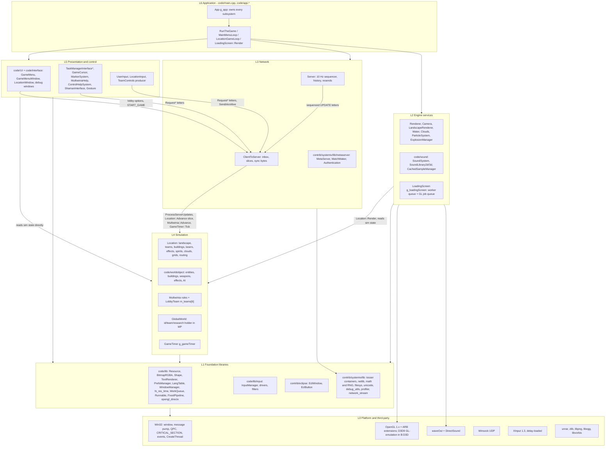
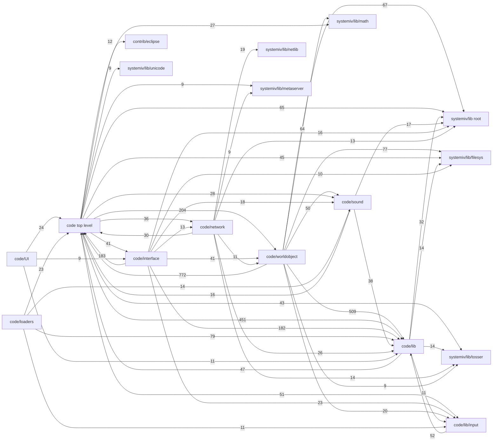
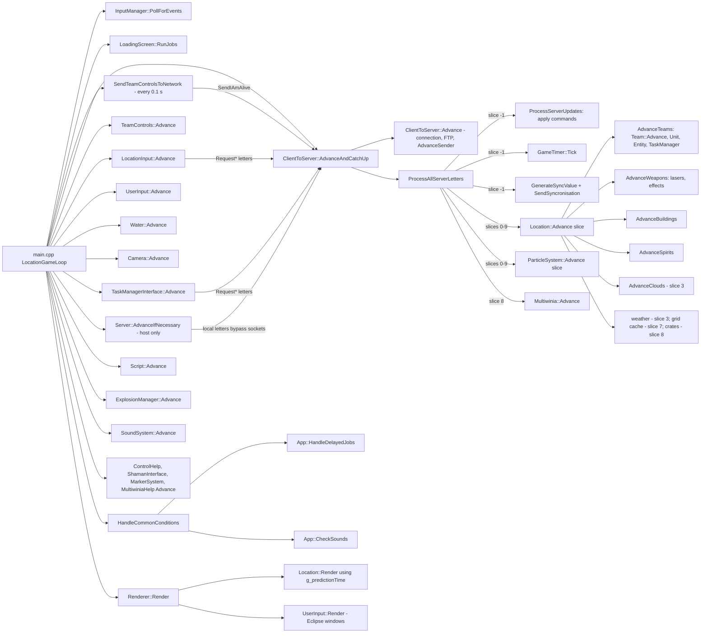

# 20 — Architecture

> Part B · Baseline build: Release|Win32 (OpenGL) + TARGET_PC_FULLGAME ([B:FULL]); see _work/build_matrix.md.
> Evidence: [C] confirmed · [I] inferred · [U] unknown. Citations are `path:Symbol` relative to the multiwinia/ source root.
> Sources merged: P01_app_core (§1 App, §2 loops/timing/threads, §7 constants), P14_platform_lib (§20.T threading primitives and thread map, §31.2–31.3 platform/timing), P15_network (§2 timing model, §13 threads and locking), P16_sound (§27.3 lifecycle/threading), P20_sequences_loaders_bench (§1 loading screen threading), P12_render_core (§24.8 prediction convention), P13_gfx_backend_math (vsync/Flip), routed `_meta_*` notes, `phase2_log.md`. Every claim below was re-checked against `code/app.*`, `code/main.cpp`, `code/gametimer.*`, `code/lib/work_queue.*`, `code/lib/runnable.*`, `code/loading_screen.*`, `code/network/clienttoserver.cpp`, `code/network/server.cpp` and the SystemIV netlib/metaserver sources; where the drafts disagreed the resolution is noted in place.

## Contents

- [1 Scope and reading guide](#1-scope-and-reading-guide)
- [2 Layered architecture](#2-layered-architecture)
- [3 Module dependency graph](#3-module-dependency-graph)
- [4 The App class](#4-the-app-class)
- [5 Global singletons and process-wide state](#5-global-singletons-and-process-wide-state)
- [6 Start-up sequence](#6-start-up-sequence)
- [7 Shutdown and teardown](#7-shutdown-and-teardown)
- [8 Lifetimes: process, session, match](#8-lifetimes-process-session-match)
- [9 Main loops](#9-main-loops)
- [10 Frame timing](#10-frame-timing)
- [11 Threading model](#11-threading-model)
- [12 Constants](#12-constants)
- [13 Architecture for the new game](#13-architecture-for-the-new-game)
- [Open questions and unknowns](#open-questions-and-unknowns)
- [Docs-vs-code discrepancies](#docs-vs-code-discrepancies)
- [IP items](#ip-items)
- [Source map](#source-map)
- [Appendix — dead/legacy code](#appendix--deadlegacy-code)

## 1 Scope and reading guide

This document describes how the Multiwinia executable is put together: which layers and modules exist and how they depend on each other, who owns every long-lived object, when each object is created and destroyed, which threads run, and how one frame is scheduled (fixed 10 Hz simulation ticks spread over variable-rate render frames, with render-time extrapolation).

It deliberately stops at the boundary of three neighbouring documents:

| Topic | Owner document |
|---|---|
| WorldObject/Entity/Building hierarchy, `Location` containers, per-slice update order inside `Location::Advance`, spatial grids, teams and units | [21 — Simulation and entity model](21_simulation_and_entity_model.md) |
| Lockstep protocol, letters, sequence ids, sync hashing, desync handling, RNG discipline, float determinism | [22 — Determinism and networking](22_determinism_and_networking.md) |
| Render pass order, GL/D3D state, the prediction convention as used by each renderer | [24 — Rendering](24_rendering.md) |
| Sound engine internals (voices, mixer, DirectSound) | [27 — Audio engine](27_audio_engine.md) |
| Eclipse window framework, menus | [28 — UI framework](28_ui_framework.md), [09 — Meta systems](09_meta_systems.md) |
| Build configurations, platform layer, timers, file locations | [31 — Platform, build and tools](31_platform_build_and_tools.md) |
| Carry-forward decisions for each subsystem | [40 — Carry-forward assessment](40_carry_forward_assessment.md) |

Three facts dominate the architecture and are worth stating up front [C]:

1. **Everything that matters runs on one thread.** Input, the network pump, the whole simulation, rendering and sound mixing all run on the main thread inside one busy loop (`code/main.cpp:LocationGameLoop`). Worker threads only load data and receive UDP packets.
2. **The simulation is driven by the network, even offline.** A `Server` object (also for single-player games against the CPU, on loop-back) emits one sequenced update every 0.1 s of real time; the client executes each update as 10 *slices* of `Location::Advance`, and `GameTimer` advances game time by `0.1 × gameSpeed` per update. There is no other source of simulation time.
3. **One global root object.** `App` (`g_app`) owns raw pointers to every subsystem; there are no interfaces, no dependency injection and no reference counting. About forty further `g_*` globals and many class-static variables hold the rest of the process state.

## 2 Layered architecture

### 2.1 Layer diagram

The layering below is the *intended* structure as visible in directory names and call direction; §2.3 lists every place the code is known to break it. Arrows mean "calls into / depends on" [C] for the module placement (directory and include analysis, §3.2), [I] for the layer names (they are this document's names, not the code's).

### 2.2 Layer responsibilities

| Layer | Modules (directories) | Key classes / globals | Responsibility | Threads that execute it |
|---|---|---|---|---|
| L6 Application | `code/main.cpp`, `code/main.h`, `code/app.*`, `code/globals.h`, `code/lib/window_manager_win32.cpp:WinMain` | `App`, `g_app`, `RunTheGame`, `MainMenuLoop`, `LocationGameLoop`, `EnterLocation`, `DoEnterLocation`, `Initialise`, `Finalise` | process start/stop, ownership of all subsystems, mode switching between front end and match, frame scheduling | main; `App::Initialise` and `DoEnterLocation` run on the loading-screen worker |
| L5 Presentation and control | `code/UI`, `code/interface`, top-level `code/user_input.*`, `location_input.*`, `taskmanager_interface*.*`, `gamecursor*.*`, `markersystem.*`, `multiwiniahelp.*`, `control_help.*`, `shaman_interface.*`, `gesture*.*` | `GameMenu`, `GameMenuWindow`, `LocationWindow`, `UserInput`, `LocationInput`, `TaskManagerInterfaceMultiwinia`, `GameCursor`, `MarkerSystem`, `MultiwiniaHelp` | menus and lobby; HUD; turns local input into network requests; never supposed to write simulation state (see §2.3) | main |
| L4 Simulation | `code/worldobject`, top-level `code/location.*`, `landscape.*`, `team.*`, `unit.*`, `taskmanager.*`, `entity_grid*.*`, `obstruction_grid.*`, `routing_system.*`, `multiwinia.*`, `global_world.*`, `gametimer.*`, `level_file.*` | `Location`, `Team`, `Unit`, `WorldObject` tree, `Multiwinia`, `GlobalWorld`, `GameTimer`, synced RNG (`syncrand`) | deterministic game state; advanced only by `ClientToServer::ProcessAllServerLetters` (§10.3) | main (level load on loading-screen worker) |
| L3 Network | `code/network`, `contrib/systemiv/lib/metaserver`, `contrib/systemiv/lib/netlib` | `Server`, `ClientToServer`, `ServerToClientLetter`, `IFrame`, `FTPManager`, `NetworkValue*`, `MetaServer_*`, `MatchMaker_*`, `Authentication_*` | relay-lockstep command sequencing at 10 Hz, join/leave, sync checks, lobby discovery and NAT punch-through ([22](22_determinism_and_networking.md)) | main (all sending and sequencing); listener threads receive; metaserver helper threads (§11.2) |
| L2 Engine services | `code/sound`, top-level `code/renderer.*`, `camera.*`, `landscape_renderer.*`, `water*.*`, `clouds.*`, `particle_system.*`, `explosion.*`, `deform.*`, `loading_screen.*` | `Renderer`, `Camera`, `SoundSystem`, `ParticleSystem`, `g_explosionManager`, `g_loadingScreen` | rendering, audio, cosmetic effects, loading-screen pump | main (sound fill callback is pulled on main; waveOut notifies from an OS thread) |
| L1 Foundation | `code/lib`, `code/lib/input`, `code/unicode`, `contrib/eclipse`, `contrib/systemiv/lib` (compiled subset: `debug_utils`, `memory_leak`, `network_stream`, `profiler`, `string_utils`, `filesys`, `math` 8 of 30 files, `metaserver` 6 of 12, `netlib` 16 of 20, `tosser` 9 of 17, `unicode`) | `Resource`, `PrefsManager`, `LangTable`, `TextRenderer`, `InputManager`, `WorkQueue`, `LList`/`DArray`/`FastDArray`/`SliceDArray`, `NetMutex`, `NetEvent`, `Directory` | data access, containers, threading primitives, input abstraction, window framework | any |
| L0 Platform | Win32, OpenGL/GLU, D3D9 [B:D3D], DirectSound, waveOut, Winsock, XInput; `contrib/unrar`, `contrib/zlib`/`contrib/lpng1215`, `contrib/libogg-1.1.3`, `contrib/libvorbis-1.1.2` | — | OS services and codecs | any |

Build status per module is in §3.1 and [build_matrix §6](_work/build_matrix.md).

### 2.3 Observed layering rules and their violations

Rules the code follows almost everywhere [C]:

1. **Control enters the simulation only through the network layer.** Local input produces `TeamControls` (sent as `ALIVE` every 0.1 s, `code/main.cpp:SendTeamControlsToNetwork`) or `ClientToServer::Request*` letters; the simulation applies them when the sequenced update arrives (`code/network/clienttoserver.cpp:ClientToServer::ProcessServerUpdates`).
2. **The simulation never reads the wall clock** for game rules; it uses `GetNetworkTime()` ≡ `g_gameTimer.GetGameTime()` and `SERVER_ADVANCE_PERIOD` ≡ `0.1 × gameSpeed` (`code/gametimer.h`).
3. **Presentation reads simulation state directly** (no snapshot, no double buffering); rendering extrapolates positions with `g_predictionTime` (§10.6).

Known violations (each is documented in detail in the owning document) [C] unless marked:

| # | Violation | Direction | Ref | Consequence |
|---|---|---|---|---|
| V1 | `ClientToServer` (network) calls `Location::Advance`, `ParticleSystem::Advance`, `Multiwinia::Advance`, `GameTimer::Tick` | L3 → L4 (network owns the sim clock) | `code/network/clienttoserver.cpp:ClientToServer::ProcessAllServerLetters` | simulation cannot be stepped without the network object; offline play needs a loop-back `Server` |
| V2 | Simulation calls HUD/UI singletons: `TaskManager::SelectTask` → `GameCursor::BoostSelectionArrows`; `Task` code → `TaskManagerInterface::SetCurrentMessage`, camera requests, `Location::SetCurrentMessage` (guarded by `m_teamId == m_myTeamId` or cosmetic) | L4 → L5 | `code/taskmanager.cpp` (see [22](22_determinism_and_networking.md), item D5 of the determinism register) | deterministic only because the calls are local-only side effects |
| V3 | Simulation triggers sounds synchronously (`SoundSystem::Trigger*Event` from `Advance`) | L4 → L2 | `code/sound/soundsystem.cpp:SoundSystem::NotReadyForGameSoundsYet` | allowed because it runs on the main thread; triggers from any other thread are silently dropped |
| V4 | `InsertionSquad::DirectControl` reads the local camera (`m_camLookAround`) while applying networked controls | L4 reads L2 local state | `code/worldobject/insertion_squad.cpp:InsertionSquad::DirectControl` | confirmed desync path ([06](06_player_control_and_input.md), [22](22_determinism_and_networking.md)) |
| V5 | `LocationInput::SelectObjectUnderMouse` calls `FenceSwitch::Switch()` directly (no network message) | L5 → L4 write | `code/location_input.cpp:LocationInput::SelectObjectUnderMouse`, `code/worldobject/switch.cpp:FenceSwitch::Switch` | desync hazard if a map contains a fence switch ([03](03_buildings_and_world_objects.md)) |
| V6 | Task-manager UI writes `TaskManager::m_mostRecentTaskId = -1` (local-only reset); the cursor's crosshair test is written `building->m_type = Building::TypeRadarDish` (assignment), overwriting the selected building's type on the local client (a no-op in practice in MP, see [06](06_player_control_and_input.md)) | L5 → L4 write | `code/taskmanager_interface_multiwinia.cpp:TaskManagerInterfaceMultiwinia::Advance` (L287), `code/gamecursor.cpp:GameCursor::RenderCrosshair` (L602) | local divergence |
| V7 | Tree collision spheres are produced as a by-product of display-list compilation using the unsynced RNG | L2 (render) → L4 | `code/worldobject/tree.cpp:Tree::Generate` (resets `m_hitcheckRadius`, then `CreateDisplayListAsync` with `Tree::GenerateLeaves` as the compile callback) via `code/lib/resource.cpp:Resource::CreateDisplayListAsync` | simulation data depends on render path ([03](03_buildings_and_world_objects.md)) |
| V8 | `code/lib` (engine library) includes and calls game-layer headers: `Resource` calls `g_loadingScreen->QueueJob` and reads `g_app->m_mainThreadId`; `PrefsManager`/`TargetCursor` include `code/interface` | L1 → L6/L5 | `code/lib/resource.cpp:Resource::CreateDisplayListAsync`, `code/lib/preferences.cpp`, `code/lib/targetcursor.cpp` | 47 include pairs from `code/lib` into top-level `code` (§3.2) |
| V9 | SystemIV library sources include `lib/universal_include.h`, which resolves to **`code/lib`** (not SystemIV) because `..\..\code` precedes `..\..\contrib\SystemIV` on the include path | L1 (third-party-ish) → game config | `targets/vs2005/Common.vsprops` (AdditionalIncludeDirectories) | SystemIV is compiled with Multiwinia's build switches; two `Vector3` classes coexist ([31](31_platform_build_and_tools.md)) |
| V10 | The `NET_DARWINIA_TOGGLEENTITY` update handler calls `RequestSelectUnit` from inside update processing on every client | L3 → L5 → L3 | `code/network/clienttoserver.cpp:ClientToServer::ProcessServerUpdates` | duplicate (idempotent) select requests from every peer |
| V11 | `GameTimer::Tick` and `GetPredictionTime` call `g_app->GamePaused()`, which reads `ClientToServer::m_outOfSyncClients` and the local `m_lostFocusPause` | L4 → L3/L6 | `code/gametimer.cpp:GameTimer::Tick`, `code/app.cpp:App::GamePaused` | game time stops per client when that client sees an out-of-sync peer ([22](22_determinism_and_networking.md)) |

## 3 Module dependency graph

### 3.1 Module inventory

One row per top-level module/directory of the source tree. "Source files" counts `source/*` rows in `_work/manifest.csv`; "in vcproj" = listed and built in all four configurations of `targets/vs2005/Darwinia.vcproj`. Sub-projects of `targets/vs2005/Darwinia.sln` are compiled as separate static libraries and are therefore "not in vcproj" but **linked** [C] `targets/vs2005/Darwinia.sln`.

| Module | Role | Source files (in vcproj / not) | .cpp built | Build status | Main documents |
|---|---|---|---|---|---|
| `code/` (top level) | application, simulation core (`Location`, `Team`, `Unit`, grids, routing, `Multiwinia`), renderer, camera, effects, task manager, menus root (`game_menu`), loading screen | 123 (122 / 1) | 62 of 63 | [B:FULL] (the one excluded file is a platform variant) | 20, 21, 24, 05 |
| `code/worldobject/` | every simulated object: entities, buildings, weapons, effects, crates, AI | 170 (170 / 0) | 85 of 85 | [B:FULL]; many classes [B:LEGACY] via `BLOCK_OLD_DARWINIA_OBJECTS` | 02, 03, 04, 07, 21 |
| `code/network/` | `Server`, `ClientToServer`, letters, iframes/sync diff, FTP manager, network values, bandwidth, demo limitations | 29 (27 / 2) | 12 of 12 | [B:FULL] | 22 |
| `code/sound/` | `SoundSystem`, 2-D/3-D libraries (waveOut, DirectSound, software), sample cache, Ogg decoder, filters | 26 (24 / 2) | 12 of 13 | [B:FULL]; SDL back-end [B:DEAD] | 27, 10 |
| `code/interface/` | Darwinia-style windows: in-game menu (`LocationWindow`), options, debug/cheat/profiler/network windows, editor windows | 94 (90 / 4) | 45 of 47 | [B:FULL]; editor windows [B:EDITOR]; sound-editor windows [B:DEBUG] | 28, 09, 32, 08 |
| `code/UI/` | Multiwinia front end and lobby (`GameMenuWindow` and its buttons, map data) | 75 (72 / 3) | 3 of 4 | [B:FULL] (most files are header-only button classes) | 09, 28 |
| `code/loaders/` | loading-screen mini-programs and credits | 22 (22 / 0) | 11 of 11 | compiled; dispatcher `RunBootloader` [B:DEAD] (`USE_LOADERS` off); credits [B:LEGACY] | 09 |
| `code/lib/` | engine library: resources, bitmaps/textures, shapes, text, preferences, language, window managers, timing, work queue, GL extension loading, D3D9 GL-emulation, fixed-function shader emulation | 122 (101 / 21) | 48 of 62 | [B:FULL]; `opengl_directx*`/`FixedPipeline` live only in [B:D3D]; SDL/Mac/Linux variants [B:DEAD] | 31, 24, 25, 29 |
| `code/lib/input/` | input manager, driver/filter graph, bindings | 70 (61 / 9) | 27 of 32 | [B:FULL]; `xbox_eventhandler.cpp` excluded in all configs; SDL drivers [B:DEAD] | 06 |
| `code/unicode/` | Unicode text-file writer; old copies of sound-library headers | 8 (2 / 6) | 1 of 4 | mostly [B:DEAD] | 29 |
| `contrib/eclipse/` | Introversion's in-house window/button framework (`EclWindow`, `EclButton`, `eclipse.cpp`) | 6 (sub-project) | 3 | **linked** (`eclipse.vcproj`) [B:FULL] | 28 |
| `contrib/systemiv/lib/` (root files) | `debug_utils`, `memory_leak`, `network_stream`, `profiler`, `string_utils` | 19 (10 / 9) | 5 of 9 | [B:FULL] subset | 31, 32, 22 |
| `contrib/systemiv/lib/tosser/` | containers: `LList`, `DArray`, `FastDArray`, `BTree`, `HashTable`, `Directory` | 17 (9 / 8) | 1 of 8 (templates are included via headers) | [B:FULL] subset | 21, 29 |
| `contrib/systemiv/lib/netlib/` | sockets, listener, `NetMutex`, `NetEvent`, `NetStartThread` | 20 (16 / 4) | 7 of 9 | [B:FULL]; `*_linux.cpp` [B:DEAD] | 22, 20 §11 |
| `contrib/systemiv/lib/metaserver/` | metaserver client, matchmaker (NAT), authentication | 12 (6 / 6) | 3 of 5 | [B:FULL]; `steamauth_client.cpp`, `steamauth_server.cpp` [B:DEAD] | 22, 09 |
| `contrib/systemiv/lib/math/` | RNG (`random_number`), `hash`, `filecrc`, `math_stubs` (`iv_*`), vectors/matrices | 30 (8 / 22) | 4 of 14 | [B:FULL] subset | 22, 29 |
| `contrib/systemiv/lib/filesys/` | file utilities, text/binary readers and writers, `FileSystem` | 10 (10 / 0) | 5 of 5 | [B:FULL] (`FileSystem` compiled but unused) | 29, 31 |
| `contrib/systemiv/lib/unicode/` | `UnicodeString` | 4 (4 / 0) | 2 of 2 | [B:FULL] | 29 |
| `contrib/systemiv/lib/{eclipse,gucci,render,resource,sound}` and `contrib/systemiv` interface/template/tools/contrib | SystemIV's own UI, input, renderer, resource and sound layers | 6 + 12 + 6 + 8 + 30 + 821 (0 in vcproj) | 0 | **not compiled**; headers occasionally reached by include resolution (e.g. `contrib/systemiv/lib/render` from `code/animatedpanel.cpp`, `code/water.cpp`) | appendix |
| `contrib/unrar/` | RAR decompression for `.dat` archives (`MemMappedFile`) | 114 (sub-project) | 55 | **linked** (`Unrar.vcproj`); "not thread safe" comment drives the sound-loading serialisation (§11) | 31 |
| `contrib/libogg-1.1.3/`, `contrib/libvorbis-1.1.2/` | Ogg/Vorbis decoding for streamed samples | 6 + 85 | 3 + 40 | **linked** (`ogg_static`, `vorbis_static`, `vorbisfile_static`) | 27 |
| `contrib/lpng1215/`, `contrib/zlib/` | PNG writing (thumbnails/screenshots) and zlib | 118 | 72 | **linked** (`libpng.vcproj`, `zlib.vcproj` under `contrib/lpng1215/projects/visualc71`) | 25 |
| `contrib/XCrashReport/`, `contrib/linux/`, `contrib/macosx/`, `contrib/loki_setup*/`, `contrib/oggvorbis-macosx-libs-1.0/`, `contrib/GLEXT.h` | crash-report sample, Linux/Mac SDKs, Loki installer | 51 + 36 + 38 + 89 + 6 + 1 | — | not linked in the PC baseline | 31 |
| `targets/vs2005/` | solution, project, property sheets, resource script | — | — | build definition | 31 |

### 3.2 Compile-time include graph

Generated by `_work/scripts/S_20_module_graph.py` (run `python3 -I S_20_module_graph.py <SRC> _work/manifest.csv <out>`): the seed set is every `.cpp`/`.c` that `Darwinia.vcproj` builds plus the Eclipse sources; includes are resolved like MSVC (including file's directory, then `Common.vsprops` include directories in order) and followed transitively (858 files in the closure); the weight of an edge A→B is the number of distinct (including file in A, included file in B) pairs. Conditional compilation is **not** evaluated, so a few edges come from dead `#ifdef` blocks [I]. The diagram shows first-party edges with weight ≥ 9; the table after it lists every edge.

Reading the graph [C] (counts) / [I] (interpretation):

- `code/` top level and `code/worldobject` are mutually dependent (772 / 204 pairs): every object includes `app.h`, `location.h`, `team.h`; `Location` includes every building/entity header it constructs. There is no simulation "kernel" that could be compiled without the application layer.
- `code/lib` is not a leaf: 47 include pairs reach back into top-level `code` (e.g. `code/lib/resource.cpp` → `app.h`, `loading_screen.h`), 2 into `code/interface` and 2 into `code/sound`.
- SystemIV is used as a utility layer (containers, sockets, RNG, file readers) by everything; its own sources include `code/lib/universal_include.h` (resolved by include order), so it is not an independent library in this build.
- `code/network` depends on `code/worldobject` (11 pairs) and `code/UI` (3 pairs: `clienttoserver.cpp`, `networkvalue.cpp`, `server.cpp` include `UI/` headers to post error dialogues and update lobby buttons).
- `code/worldobject` depends on `code/network` (5 pairs: `building.cpp`, `controlstation.cpp`, `controltower.cpp`, `laserfence.cpp`, `switch.cpp`) and on `code/sound` (50 pairs).

Full edge table (from the script; "OS:" and "C/C++ standard library" are buckets for headers not found in the tree):

| From module | To module | Include pairs |
|---|---|---|
| code (top level) | code/lib | 451 |
| code (top level) | code/worldobject | 204 |
| code (top level) | contrib/systemiv/lib (root files) | 65 |
| code (top level) | C/C++ standard library | 62 |
| code (top level) | code/lib/input | 51 |
| code (top level) | contrib/systemiv/lib/filesys | 45 |
| code (top level) | contrib/systemiv/lib/tosser | 43 |
| code (top level) | code/interface | 41 |
| code (top level) | code/network | 36 |
| code (top level) | code/sound | 28 |
| code (top level) | contrib/systemiv/lib/math | 27 |
| code (top level) | OS: Win32 / CRT | 22 |
| code (top level) | contrib/eclipse | 12 |
| code (top level) | contrib/systemiv/lib/metaserver | 9 |
| code (top level) | contrib/systemiv/lib/unicode | 9 |
| code (top level) | code/UI | 7 |
| code (top level) | code/loaders | 5 |
| code (top level) | contrib/systemiv/lib/netlib | 5 |
| code (top level) | OS: SDL/POSIX/Mac (non-baseline) | 1 |
| code (top level) | contrib/systemiv/lib/render | 1 |
| code (top level) | third-party: libpng/zlib | 1 |
| code/UI | code (top level) | 24 |
| code/UI | code/lib | 11 |
| code/UI | code/interface | 9 |
| code/UI | code/network | 5 |
| code/UI | contrib/systemiv/lib/metaserver | 5 |
| code/UI | code/lib/input | 3 |
| code/UI | C/C++ standard library | 2 |
| code/UI | code/sound | 2 |
| code/UI | OS: SDL/POSIX/Mac (non-baseline) | 1 |
| code/UI | OS: Win32 / CRT | 1 |
| code/UI | contrib/systemiv/lib/unicode | 1 |
| code/interface | code (top level) | 183 |
| code/interface | code/lib | 182 |
| code/interface | code/worldobject | 41 |
| code/interface | C/C++ standard library | 28 |
| code/interface | code/lib/input | 23 |
| code/interface | code/sound | 18 |
| code/interface | contrib/systemiv/lib (root files) | 16 |
| code/interface | code/network | 13 |
| code/interface | contrib/systemiv/lib/filesys | 10 |
| code/interface | code/UI | 7 |
| code/interface | contrib/systemiv/lib/math | 7 |
| code/interface | contrib/eclipse | 4 |
| code/interface | contrib/systemiv/lib/tosser | 4 |
| code/interface | contrib/systemiv/lib/unicode | 3 |
| code/interface | OS: Win32 / CRT | 1 |
| code/lib | C/C++ standard library | 77 |
| code/lib | code (top level) | 47 |
| code/lib | contrib/systemiv/lib (root files) | 32 |
| code/lib | OS: Win32 / CRT | 21 |
| code/lib | contrib/systemiv/lib/filesys | 14 |
| code/lib | contrib/systemiv/lib/tosser | 14 |
| code/lib | code/lib/input | 11 |
| code/lib | OS: DirectX (D3D9/DSound/XInput) | 9 |
| code/lib | contrib/systemiv/lib/unicode | 8 |
| code/lib | contrib/systemiv/lib/netlib | 5 |
| code/lib | OS: OpenGL/GLU | 4 |
| code/lib | code/interface | 2 |
| code/lib | code/sound | 2 |
| code/lib | code/unicode | 2 |
| code/lib | contrib/unrar | 2 |
| code/lib | OS: SDL/POSIX/Mac (non-baseline) | 1 |
| code/lib | contrib/eclipse | 1 |
| code/lib | contrib/systemiv/lib/math | 1 |
| code/lib | third-party: libpng/zlib | 1 |
| code/lib/input | C/C++ standard library | 54 |
| code/lib/input | code/lib | 52 |
| code/lib/input | code (top level) | 5 |
| code/lib/input | contrib/systemiv/lib (root files) | 3 |
| code/lib/input | OS: SDL/POSIX/Mac (non-baseline) | 2 |
| code/lib/input | contrib/systemiv/lib/filesys | 2 |
| code/lib/input | OS: DirectX (D3D9/DSound/XInput) | 1 |
| code/lib/input | OS: Win32 / CRT | 1 |
| code/lib/input | contrib/eclipse | 1 |
| code/loaders | code/lib | 79 |
| code/loaders | code (top level) | 23 |
| code/loaders | code/sound | 14 |
| code/loaders | code/lib/input | 11 |
| code/loaders | contrib/systemiv/lib/math | 7 |
| code/loaders | C/C++ standard library | 2 |
| code/loaders | OS: Win32 / CRT | 2 |
| code/loaders | contrib/systemiv/lib/tosser | 2 |
| code/loaders | code/worldobject | 1 |
| code/loaders | contrib/systemiv/lib (root files) | 1 |
| code/loaders | contrib/systemiv/lib/filesys | 1 |
| code/loaders | contrib/systemiv/lib/unicode | 1 |
| code/network | code (top level) | 30 |
| code/network | code/lib | 26 |
| code/network | contrib/systemiv/lib/netlib | 19 |
| code/network | contrib/systemiv/lib/tosser | 14 |
| code/network | contrib/systemiv/lib (root files) | 13 |
| code/network | code/worldobject | 11 |
| code/network | C/C++ standard library | 9 |
| code/network | contrib/systemiv/lib/metaserver | 9 |
| code/network | contrib/systemiv/lib/math | 5 |
| code/network | code/UI | 3 |
| code/network | OS: Win32 / CRT | 2 |
| code/network | contrib/systemiv/lib/unicode | 2 |
| code/network | contrib/unrar | 2 |
| code/network | code/lib/input | 1 |
| code/network | code/sound | 1 |
| code/sound | code/lib | 38 |
| code/sound | contrib/systemiv/lib (root files) | 17 |
| code/sound | code (top level) | 16 |
| code/sound | C/C++ standard library | 13 |
| code/sound | contrib/systemiv/lib/filesys | 8 |
| code/sound | OS: Win32 / CRT | 4 |
| code/sound | code/worldobject | 4 |
| code/sound | OS: DirectX (D3D9/DSound/XInput) | 2 |
| code/sound | code/interface | 2 |
| code/sound | contrib/systemiv/lib/math | 2 |
| code/sound | contrib/systemiv/lib/netlib | 2 |
| code/sound | contrib/systemiv/lib/tosser | 2 |
| code/sound | third-party: libvorbis | 2 |
| code/sound | OS: SDL/POSIX/Mac (non-baseline) | 1 |
| code/unicode | C/C++ standard library | 4 |
| code/unicode | contrib/systemiv/lib/filesys | 2 |
| code/unicode | OS: Win32 / CRT | 1 |
| code/unicode | code/lib | 1 |
| code/unicode | contrib/systemiv/lib (root files) | 1 |
| code/unicode | contrib/systemiv/lib/unicode | 1 |
| code/worldobject | code (top level) | 772 |
| code/worldobject | code/lib | 509 |
| code/worldobject | contrib/systemiv/lib/filesys | 77 |
| code/worldobject | contrib/systemiv/lib (root files) | 67 |
| code/worldobject | contrib/systemiv/lib/math | 64 |
| code/worldobject | code/sound | 50 |
| code/worldobject | C/C++ standard library | 27 |
| code/worldobject | code/lib/input | 20 |
| code/worldobject | contrib/systemiv/lib/tosser | 9 |
| code/worldobject | code/network | 5 |
| code/worldobject | contrib/systemiv/lib/unicode | 3 |
| code/worldobject | OS: Win32 / CRT | 2 |
| code/worldobject | targets/vs2005 (resources) | 2 |
| contrib/eclipse | C/C++ standard library | 9 |
| contrib/eclipse | OS: SDL/POSIX/Mac (non-baseline) | 2 |
| contrib/eclipse | OS: Win32 / CRT | 2 |
| contrib/eclipse | contrib/systemiv/lib/tosser | 2 |
| contrib/eclipse | contrib/systemiv/lib/unicode | 2 |
| contrib/eclipse | code/lib | 1 |
| contrib/eclipse | contrib/systemiv/lib (root files) | 1 |
| contrib/eclipse | contrib/systemiv/lib/math | 1 |
| contrib/systemiv/lib (root files) | C/C++ standard library | 30 |
| contrib/systemiv/lib (root files) | OS: Win32 / CRT | 5 |
| contrib/systemiv/lib (root files) | code/lib | 5 |
| contrib/systemiv/lib (root files) | contrib/systemiv/lib/tosser | 5 |
| contrib/systemiv/lib (root files) | contrib/systemiv/lib/math | 4 |
| contrib/systemiv/lib (root files) | OS: SDL/POSIX/Mac (non-baseline) | 2 |
| contrib/systemiv/lib (root files) | contrib/systemiv/lib/filesys | 2 |
| contrib/systemiv/lib (root files) | contrib/unrar | 2 |
| contrib/systemiv/lib (root files) | contrib/systemiv/lib/netlib | 1 |
| contrib/systemiv/lib (root files) | contrib/systemiv/lib/unicode | 1 |
| contrib/systemiv/lib/filesys | C/C++ standard library | 19 |
| contrib/systemiv/lib/filesys | OS: Win32 / CRT | 7 |
| contrib/systemiv/lib/filesys | code/lib | 5 |
| contrib/systemiv/lib/filesys | contrib/systemiv/lib (root files) | 5 |
| contrib/systemiv/lib/filesys | contrib/systemiv/lib/tosser | 3 |
| contrib/systemiv/lib/filesys | OS: SDL/POSIX/Mac (non-baseline) | 1 |
| contrib/systemiv/lib/filesys | contrib/systemiv/lib/unicode | 1 |
| contrib/systemiv/lib/filesys | contrib/unrar | 1 |
| contrib/systemiv/lib/math | C/C++ standard library | 10 |
| contrib/systemiv/lib/math | code/lib | 5 |
| contrib/systemiv/lib/math | contrib/unrar | 3 |
| contrib/systemiv/lib/math | contrib/systemiv/lib (root files) | 1 |
| contrib/systemiv/lib/math | contrib/systemiv/lib/filesys | 1 |
| contrib/systemiv/lib/math | contrib/systemiv/lib/tosser | 1 |
| contrib/systemiv/lib/metaserver | code/lib | 6 |
| contrib/systemiv/lib/metaserver | contrib/systemiv/lib/tosser | 6 |
| contrib/systemiv/lib/metaserver | contrib/systemiv/lib (root files) | 3 |
| contrib/systemiv/lib/metaserver | contrib/systemiv/lib/math | 3 |
| contrib/systemiv/lib/metaserver | contrib/systemiv/lib/netlib | 3 |
| contrib/systemiv/lib/metaserver | OS: Win32 / CRT | 1 |
| contrib/systemiv/lib/netlib | C/C++ standard library | 11 |
| contrib/systemiv/lib/netlib | code/lib | 7 |
| contrib/systemiv/lib/netlib | OS: SDL/POSIX/Mac (non-baseline) | 5 |
| contrib/systemiv/lib/netlib | OS: Win32 / CRT | 5 |
| contrib/systemiv/lib/netlib | contrib/systemiv/lib (root files) | 2 |
| contrib/systemiv/lib/tosser | C/C++ standard library | 13 |
| contrib/systemiv/lib/tosser | contrib/systemiv/lib (root files) | 9 |
| contrib/systemiv/lib/tosser | code/lib | 4 |
| contrib/systemiv/lib/tosser | contrib/systemiv/lib/math | 1 |
| contrib/systemiv/lib/tosser | contrib/systemiv/lib/unicode | 1 |
| contrib/systemiv/lib/unicode | C/C++ standard library | 7 |
| contrib/systemiv/lib/unicode | contrib/systemiv/lib (root files) | 3 |
| contrib/systemiv/lib/unicode | code/lib | 2 |
| contrib/systemiv/lib/unicode | contrib/systemiv/lib/filesys | 2 |
| contrib/unrar | C/C++ standard library | 27 |
| contrib/unrar | OS: Win32 / CRT | 7 |
| contrib/unrar | OS: SDL/POSIX/Mac (non-baseline) | 5 |
| third-party: libogg | C/C++ standard library | 3 |
| third-party: libogg | OS: Win32 / CRT | 1 |
| third-party: libpng/zlib | C/C++ standard library | 14 |
| third-party: libpng/zlib | OS: Win32 / CRT | 7 |
| third-party: libpng/zlib | OS: SDL/POSIX/Mac (non-baseline) | 1 |
| third-party: libvorbis | C/C++ standard library | 1 |
| third-party: libvorbis | third-party: libogg | 1 |

Files reached per module in the compiled closure: code top level 122, `code/UI` 66, `code/interface` 91, `code/lib` 109, `code/lib/input` 66, `code/loaders` 22, `code/network` 26, `code/sound` 25, `code/unicode` 2, `code/worldobject` 170, `contrib/eclipse` 6, SystemIV lib root 14, `filesys` 10, `math` 16, `metaserver` 7, `netlib` 17, `render` 2 (headers only), `tosser` 16, `unicode` 4, `contrib/unrar` 58 (headers), `targets/vs2005` 1 (`resource.h`), libogg 2, libpng/zlib 4, libvorbis 2 (headers).

Note on the bucket "OS: OpenGL/GLU" (only 4 pairs): GL headers are pulled in centrally by `code/lib/universal_include.h`, so almost every file depends on OpenGL transitively [C] `code/lib/universal_include.h`.

### 3.3 Run-time call graph of one in-match frame

Arrows mean "calls during one iteration of `LocationGameLoop`" [C] `code/main.cpp:LocationGameLoop`, `code/network/clienttoserver.cpp:ClientToServer::ProcessAllServerLetters`, `code/location.cpp:Location::Advance`.

The inner order of `Location::Advance` and of each container is specified in [21](21_simulation_and_entity_model.md).

### 3.4 Third-party libraries and OS APIs

| Library / API | How linked | Used by | Purpose | Ref |
|---|---|---|---|---|
| unrar (`contrib/unrar`) | static lib, sub-project `Unrar.vcproj` | `code/lib/resource.cpp:Resource::ParseArchive` (`MemMappedFile`) | read `.dat` RAR archives into memory; not thread-safe → archive loads are serialised (§11.3) | [C] `code/app.cpp:App::App` comment, `targets/vs2005/Darwinia.sln` |
| zlib + libpng 1.2.15 | static libs `zlib.vcproj`, `libpng.vcproj` | `code/lib/bitmap.cpp:BitmapRGBA::WritePng` (screenshots/thumbnails) | PNG encoding (`Z_BEST_SPEED`) | [C] `targets/vs2005/Darwinia.sln`, `code/lib/bitmap.cpp` |
| libogg 1.1.3, libvorbis 1.1.2 (+ vorbisfile) | static libs | `code/sound/sound_stream_decoder.cpp` | Ogg Vorbis sample decoding | [C] sln; [27](27_audio_engine.md) |
| Eclipse (`contrib/eclipse`) | static lib `eclipse.vcproj` | `code/user_input.cpp:UserInput::UserInput` (`EclInitialise`), all windows | window/button framework | [C] |
| OpenGL 1.x + GLU | `opengl32.lib glu32.lib` (`OpenGL.vsprops`) | renderer, all drawing | baseline renderer | [C] `targets/vs2005/OpenGL.vsprops` |
| Direct3D 9 + D3DX | `d3d9.lib d3dx9.lib d3dxof.lib` (`Direct3D.vsprops`) | `code/lib/opengl_directx*.cpp` | [B:D3D] GL emulation | [C] `targets/vs2005/Direct3D.vsprops` |
| DirectSound, waveOut | `dsound.lib`, `winmm.lib` | `code/sound/sound_library_3d_dsound.cpp`, `sound_library_2d_win32.cpp` | audio output | [C] `targets/vs2005/Common.vsprops` |
| Winsock 1 | `wsock32.lib` | `contrib/systemiv/lib/netlib` | UDP sockets | [C] |
| XInput 1.3 | `xinput.lib`, delay-loaded `xinput1_3.dll`; driver registered only if `LoadLibrary("XINPUT1_3")` succeeds | `code/lib/input/inputdriver_xinput.cpp` | gamepad | [C] `code/main.cpp:InitialiseInputManager` |
| DbgHelp | `dbghelp.lib` | `code/lib/exception_handler.cpp` (`RecordExceptionInfo`) | crash minidumps ([31](31_platform_build_and_tools.md)) | [C] |
| Video for Windows | `vfw32.lib` | `code/lib/avi_generator.cpp` | AVI capture, [B:DEBUG] (`AVI_GENERATOR`) | [C] |
| DirectX error/GUID | `dxerr9.lib`, `dxguid.lib` | sound and D3D paths | error strings, GUIDs | [C] |
| Steam SDK | include path `..\..\contrib\steam\` only; directory absent; `steamauth_*.cpp` not compiled | — | [B:DEAD] | [C] `targets/vs2005/Common.vsprops` |

## 4 The App class

### 4.1 Role and design

`App` (`code/app.h:App`, `code/app.cpp`) is a plain aggregate with public data members: one instance, created by `code/main.cpp:Initialise` as `g_app = new App()` (the constructor already sets `g_app = this` as its first statement), owns raw pointers to every long-lived subsystem. It has no virtual functions and no explicit state machine; the program "state" is the set of flags `m_atMainMenu`, `m_atLobby`, `m_requestedLocationId` / `m_locationId`, `m_loadingLocation`, `m_gameMode`, `m_editing`, `m_requestToggleEditing`, `m_requestQuit` consulted by the loops in `code/main.cpp` (§9) [C].

Two construction phases [C] `code/app.cpp:App::App`, `App::Initialise`:

- **Main-thread phase (`App::App`)**: NetLib, thread affinity, `Resource` + `init.dat`, `PrefsManager`, `Renderer` (window + GL context). Everything that needs the GL context's thread is created here.
- **Worker phase (`App::Initialise`)**, queued on the loading-screen work queue while the main thread animates the loading screen: archives, language, and construction of every other subsystem. GL work requested by these constructors is marshalled back to the main thread (§11.4).

C++ note [C]: data members are initialised in declaration order, not initialiser-list order, so `m_mainThreadId(NetGetCurrentThreadId())` and `m_soundsWorkQueue(new WorkQueue)` run **before** the constructor body; the sound-loader thread therefore exists (idle) before `NetLib` is initialised. Pointer members not in the initialiser list (`m_gameCursor`, `m_markerSystem`, `m_multiwiniaHelp`, `m_achievementTracker`, `m_backgroundColour`, `m_userProfileName`, `m_requestedMission`, `m_requestedMap`, `m_gameDataFile`) are indeterminate until `App::Initialise` assigns them [C] `code/app.cpp:App::App`.

### 4.2 Subsystem pointer members — owner and lifetime

Every pointer member, in declaration order. "Thread" = thread that runs the constructor call. Lifetime classes: **process** (boot → `~App`), **session** (one hosted/joined network session, lobby → end of match), **match** (one `Location`), **mode** (re-created on an input-mode or game-mode change).

| Member | Type | Created (where, thread) | Destroyed | Lifetime | Build | Notes [C] `code/app.cpp` unless stated |
|---|---|---|---|---|---|---|
| `m_userInput` | `UserInput*` | `App::Initialise` (worker) — ctor calls `EclInitialise(ScreenW, ScreenH)` | `~App` | process | FULL | mouse picking, Eclipse pump (`EclUpdateMouse`, `EclUpdate`), calls `InputManager::Advance` [C] `code/user_input.cpp:UserInput::Advance` |
| `m_resource` | `Resource*` | `App::App` (main), immediately `ParseArchive("init.dat")` | `~App` (second-to-last group) | process | FULL | archive/texture/shape/display-list cache; `m_mutex` guards archive insertion and lookups [C] `code/lib/resource.cpp` |
| `m_soundSystem` | `SoundSystem*` | `App::Initialise` (worker) — constructor only allocates profilers and `m_initializedEvent` | `~App` | process | FULL | device opened lazily on the main thread by the first `App::CheckSounds` (§6) |
| `m_particleSystem` | `ParticleSystem*` | `App::Initialise` (worker) | `~App` | process | FULL | `Empty()` in `ShutdownCurrentGame`; advanced in sim slices |
| `m_langTable` | `LangTable*` | `App::SetLanguage` via `InitLanguage` (worker at boot; main thread when the player changes language) | `~App`; a replaced table is moved to `m_oldLangTable` and deleted by `DelayedJob(Method<App>(&App::DeleteOldLangTable), 5)` | process | FULL | the delayed job runs on the 6th `HandleDelayedJobs` poll in which it is at the queue head [C] `code/lib/runnable.cpp:DelayedJob::ReadyToRun` |
| `m_aviGenerator` | `AVIGenerator*` | never assigned in the baseline (init NULL) | — | — | [B:DEBUG] `AVI_GENERATOR` | |
| `m_globalWorld` | `GlobalWorld*` | `App::Initialise` (worker); re-created by `LoadProfile` / `ResetLevel(true)` [B:LEGACY] | `~App` | process | FULL | in Multiwinia only a holder of `m_myTeamId`, research levels, `s_nextUniqueBuildingId`, `TransferSpirits`, `EvaluateEvents` (§8.4) |
| `m_location` | `Location*` | `DoEnterLocation` (worker) — assigned **before** `Location::Init` runs; also re-created on the main thread by `Multiwinia::ResetLocation` | `App::ShutdownCurrentGame` (main) | match | FULL | [21](21_simulation_and_entity_model.md) |
| `m_locationId` | `int` | `DoEnterLocation`: `= m_requestedLocationId` | `ShutdownCurrentGame` → -1 | match | FULL | Multiwinia always uses id **999** (`code/network/clienttoserver.cpp` START_GAME handler) |
| `m_camera` | `Camera*` | `App::Initialise` (worker) | `~App` | process | FULL | |
| `m_server` | `Server*` | `App::StartNetwork(true, …)` — in Multiwinia called from the lobby UI on the main thread (`GameMenuWindow::SetupGameSelectPage`, `GameMenuWindow::UpdateMainPage`); `StartNetwork` deletes any previous instance first | `ShutdownCurrentGame` (`delete m_server`) | session | FULL | NULL on joining clients; exists (loop-back) for games against the CPU |
| `m_clientToServer` | `ClientToServer*` | `App::Initialise` (worker); `OpenConnections()` binds the client socket and starts the client listener thread right after `InitMetaServer` | `~App` (destructor busy-waits until `m_outbox` is empty, stops the listener, deletes its work queue) | process | FULL | connection state is per session (§8.6) |
| `m_networkMutex` | `NetMutex` | member | — | process | FULL | taken by `StartSinglePlayerServer`, `ClientToServer::ClientLeave` (flush), and try-locked by the loading screen before pumping the network (§11.3) |
| `m_delayedJobListMutex` | `NetMutex` | member | — | process | FULL | guards `m_delayedJobs` |
| `m_originVersion` | `char*` | literal `"unknown"`, replaced by `strdup` of the first line of the file `origin` if present | never freed | process | FULL | reported to the metaserver |
| 24 testbed members (`m_eTestBedMode` … `m_iTerminationSequenceID`) | various | | | | [B:DEAD] `TESTBED_ENABLED` | Appendix |
| `m_netLib` | `NetLib*` | `App::App` (main) first statement after `g_app = this`; `Initialise()` = Winsock start-up | `~App` (second to last) | process | FULL | |
| `m_mainThreadId` | `NetThreadId` | member initialiser `NetGetCurrentThreadId()` | — | process | FULL | compared by every GL-job producer and by the sound trigger gate (§11.4) |
| `m_renderer` | `Renderer*` | `App::App` (main); `Initialise()` creates the window and GL context, `SetOpenGLState()` | `~App` | process | FULL | the GL context is bound to the main thread for the whole run |
| `m_locationInput` | `LocationInput*` | `DoEnterLocation` (worker) | `ShutdownCurrentGame` | match | FULL | |
| `m_locationEditor` | `LocationEditor*` | `EnterLocation` when `m_editing` | end of `LocationEditorLoop` | editor session | [B:EDITOR] | |
| `m_helpSystem`, `m_tutorial`, `m_sepulveda`, `m_demoEndSequence` | | | | | [B:DEAD] `USE_SEPULVEDA_HELP_TUTORIAL` | members not even declared in the baseline |
| `m_effectProcessor` | `EffectProcessor*` | `App::Initialise` under `SOUND_EDITOR` | `~App` | | [B:DEBUG] | NULL in FULL |
| `m_taskManagerInterface` | `TaskManagerInterface*` | `TaskManagerInterface::CreateTaskManager()` (static; deletes the previous instance, assigns the member): at boot (`App::Initialise`), in `DoEnterLocation`, and by `SwitchTaskManagerForX360Controller` when the input mode changes between gamepad and keyboard while the task manager is hidden | `~App` | mode | FULL | variant: `TaskManagerInterfaceGestures` if not gamepad, `IsSinglePlayer()` and pref `ControlMethod == 0`; else `TaskManagerInterfaceMultiwinia` if `Multiplayer()`; else `TaskManagerInterfaceIcons` [C] `code/taskmanager_interface.cpp:TaskManagerInterface::CreateTaskManager`. At boot and in the lobby `m_gameMode == GameModeNone`, so the Icons variant exists until `DoEnterLocation` |
| `m_gesture` | `Gesture*` | `App::Initialise`: `new Gesture("gestures.txt")` | `~App` | process | FULL | |
| `m_script` | `Script*` | `App::Initialise` | `~App` | process | FULL | advanced every frame; scripts cannot run in Multiwinia ([30](30_scripting_tutorial_and_cutscenes.md)) |
| `m_testHarness` | `TestHarness*` | `RunTheGame` under `TEST_HARNESS_ENABLED` | — | | [B:DEAD] | |
| `m_gameCursor` | `GameCursor*` | `App::Initialise` (first object created there) | `~App` | process | FULL | |
| `m_startSequence` | `StartSequence*` | `RunBootloader` (`USE_LOADERS`) | same | | [B:DEAD] | |
| `m_attractMode` | `AttractMode*` | `App::Initialise` under `ATTRACTMODE_ENABLED` | `~App` | | [B:DEAD] | NULL in FULL |
| `m_controlHelpSystem` | `ControlHelpSystem*` | `App::Initialise` | `~App` | process | FULL | `Shutdown()` when a match's fade-out completes |
| `m_gameMenu` | `GameMenu*` | `App::Initialise` | `~App` (first deleted) | process | FULL | `CreateMenu`/`DestroyMenu` bracket each front-end visit; owns `m_maps[gameType]` |
| `m_multiwinia` | `Multiwinia*` | `App::Initialise` | `~App` | process | FULL | game rules + `LobbyTeam m_teams[NUM_TEAMS]`; `Reset()` in `GameMenu::CreateMenu` and `ShutdownCurrentGame` |
| `m_shamanInterface` | `ShamanInterface*` | `App::Initialise` | `~App` | process | FULL | Darwinia-era UI still advanced every frame |
| `m_markerSystem` | `MarkerSystem*` | `App::Initialise` | `~App` | process | FULL | `ClearAllMarkers()` per match |
| `m_multiwiniaHelp` | `MultiwiniaHelp*` | `App::Initialise` | `~App` | process | FULL | `Reset()` per match |
| `m_benchMark` | `BenchMark*` | `App::Initialise` under `BENCHMARK_AND_FTP` | `~App` | | [B:DEAD] | member declared only under the macro |
| `m_achievementTracker` | `AchievementTracker*` | `App::Initialise` | `~App` (last) | process | FULL | `Load()` polled by `MainMenuLoop` until loaded |
| `m_soundsWorkQueue` (private) | `WorkQueue*` | member initialiser (spawns the sound-loader thread) | `~App` (joins the thread) | process | FULL | runs `SetWorkingThreadProcessor` then `App::LoadSounds` |
| `m_delayedJobs` (private) | `LList<DelayedJob*>` | member | — | process | FULL | at most one job run per `HandleDelayedJobs` |
| `m_oldLangTable` (private) | `LangTable*` | `SetLanguage` | `DeleteOldLangTable` (delayed job) | transient | FULL | |
| `m_thumbnailScreenshot`, `m_saveThumbnail` | | | | | [B:DEAD] `TARGET_OS_VISTA` | |

### 4.3 Scalar and state members

| Member | Type | Initial | Meaning [C] `code/app.h:App`, `code/app.cpp:App::App` |
|---|---|---|---|
| `m_negativeRenderer` | bool | false; then pref `RenderNegative` in `Initialise` | inverted colours; sets `m_backgroundColour` to (255,255,255,255), else (0,0,0,0) |
| `m_difficultyLevel` | int | 0 | `UpdateDifficultyFromPreferences` hard-codes 0 (pref read commented out); `Location::Init` overwrites from/to `LevelFile::m_levelDifficulty` |
| `m_largeMenus` | bool | false | true iff pref `OTHER_LARGEMENUS` == 2 |
| `m_usingFontCopies` | bool | false | CJK languages alias the game/editor fonts to the title font |
| `m_steamInited` | bool | false | never read or written elsewhere [C] grep — dead flag |
| `m_userRequestsPause` | bool | false | toggled by the network `NET_DARWINIA_PAUSE` command; reset in `ShutdownCurrentGame`; used by `Renderer::Render` to draw the paused banner |
| `m_lostFocusPause` | bool | false | `!window has focus` (forced false-focus when a controller is unplugged in gamepad mode), recomputed every `HandleCommonConditions`; pauses only `IsSinglePlayer()` games (never Multiwinia) |
| `m_editing` | bool | false | editor mode ([B:EDITOR] paths only) |
| `m_requestedLocationId` | int | -1 | -1 = no match / global world; 999 = Multiwinia match (set by the START_GAME update) |
| `m_requestToggleEditing` | bool | false | |
| `m_requestQuit` | bool | false | seen by `HandleCommonConditions` → `Finalise(); exit(0)` |
| `m_userProfileName[256]` | char | via `SetProfileName(pref UserProfile, default "none")` | special names `AccessAllAreas`, `AttractMode` [B:LEGACY] |
| `m_requestedMission[256]`, `m_requestedMap[256]` | char | `"null"` | map filename set by the `GAMEOPTION_MAPNAME` network option |
| `m_levelReset` | bool | false | suppresses one mission save [B:LEGACY] |
| `m_gameDataFile[256]` | char | `"game.txt"` | Darwinia campaign save [B:LEGACY] |
| `m_backgroundColour` | RGBAColour | see `m_negativeRenderer` | clear colour, fog colour |
| `m_atMainMenu` | bool | **true** | front end visible; cleared by START_GAME |
| `m_atLobby` | bool | false | lobby page shown; cleared by START_GAME |
| `m_gameMode` | int | `GameModeNone` | `GameModeNone` in front end and lobby (`GameMenu::CreateMenu` resets it), `GameModeMultiwinia` from START_GAME on; Prologue/Campaign [B:LEGACY] |
| `m_loadingLocation` | bool | false | true from the START_GAME update until `LocationGameLoop` starts; while true `ClientToServer::AdvanceAndCatchUp` only sends keep-alives |
| `m_spectator` | bool | false (true under `SPECTATOR_ONLY`) | |
| `m_multiwiniaTutorial` | bool | false | tutorial match; suppresses the `m_aiType` reset |
| `m_multiwiniaTutorialType` | int | `MultiwiniaTutorial1` | |
| `m_hideInterface` | bool | false | toggled by `ControlToggleInterface`; set when the in-game menu opens |
| `m_soundsLoaded` | bool | false | set by the sound-loader thread at the end of `LoadSounds` (plain bool, no barrier) |
| `m_requireSoundsLoaded` | bool | false | set at the end of `MainMenuLoop`; makes the next loading screen wait for `m_soundsLoaded` |
| `m_doMenuTransition` | bool | false | menu transition request (UI) |
| `m_checkedForPDLC` | bool | false | `DoCheckForPDLC` is declared but has no definition [C] grep |

### 4.4 Enumerations declared in App

| Enum | Values |
|---|---|
| tutorial type (anonymous) | `MultiwiniaTutorial1 = 0`, `MultiwiniaTutorial2 = 1` |
| achievements (anonymous) | `DarwiniaAchievementDominator = 0`, `DarwiniaAchievementHoarder = 1`, `DarwiniaAchievementHailToTheKing = 2`, `DarwiniaAchievementUncladSkies = 3`, `DarwiniaAchievementAggravatedAssault = 4`, `DarwiniaAchievementMasterPlayer = 5`, `DarwiniaAchievementMasterOfMultiwinia = 6`, `DarwiniaAchievementExplorer = 7`, `DarwiniaAchievementCarnage = 8`, `DarwiniaAchievementBlitzMaster = 9`, `DarwiniaAchievementWrongGame = 10`, `DarwiniaAchievementGenocide = 11`, `NumAchievements = 12` (achievements are a no-op in `App`, see [09](09_meta_systems.md)) |
| game mode (anonymous) | `GameModeNone = 0`, `GameModePrologue = 1`, `GameModeCampaign = 2`, `GameModeMultiwinia = 3`, `NumGameModes = 4` |
| `TESTBED_MODE`, `TESTBED_TYPE`, `TESTBED_STATE` | [B:DEAD] — Appendix |

### 4.5 Methods

| Method | Semantics [C] `code/app.cpp` |
|---|---|
| `App()` | `g_app = this`; `new NetLib` + `Initialise()`; `SetThreadAffinityMask(main, 0x02\|0x08\|0x20\|0x80)` (logical CPUs 1,3,5,7; the source comment says "Even processors"); `new Resource` + `ParseArchive("init.dat")`; `g_prefsManager = new PrefsManager(GetPreferencesPath())`; `SetPreferenceOverrides()` (empty body in the baseline: both branches need `FOG_LOGGING`/`FOG_PREFERENCE`); `new Renderer` + `Initialise()` + `SetOpenGLState()`; `glGetIntegerv(GL_MAX_TEXTURE_SIZE)` → `BitmapRGBA::SetMaxTextureSize`; `SPECTATOR_ONLY` → `m_spectator`; `g_loadingScreen->m_workQueue->Add(&App::Initialise, this)`; `g_loadingScreen->Render()` (blocks until done); then `m_soundsWorkQueue->Add(&SetWorkingThreadProcessor)` and `Add(&App::LoadSounds, this)` |
| `Initialise()` (private; loading-screen worker) | §6.1 step 7 |
| `SetProfileName(name)` | copy; unless `"AttractMode"`, write pref `UserProfile` and save prefs |
| `LoadProfile()` | re-creates `m_globalWorld`; profiles `AccessAllAreas`/`AttractMode` load `game_unlockall.txt` [B:LEGACY] |
| `SaveProfile(global, local)` | only if full version, `IsSinglePlayer()` and a real profile → **no-op in Multiwinia** |
| `ResetLevel(global)` | deletes saved mission/game files and re-creates `m_globalWorld` [B:LEGACY] |
| `HandleDelayedJobs()` | `TryLock(m_delayedJobListMutex)`; if the head job's `ReadyToRun()` (decrements its counter) → `Run()`, remove, delete; at most one job per call |
| `AddDelayedJob(job)` | locked append |
| `StartNetwork(server, ip, port)` | ignored while editing; if `server`: `delete m_server; m_server = new Server; m_server->Initialise(); m_noAdvertise = true`; `port != -1` → real local IP (`GetLocalHostIP`) and the server listener's port, else `"127.0.0.1"`; then `m_clientToServer->ClientJoin(ip, port)` |
| `StartSinglePlayerServer()` | `m_aiType = AITypeStandard` unless tutorial; `g_gameTimer.Reset()`; lock `m_networkMutex`; `StartNetwork(true, NULL, -1)` (loop-back); returns true |
| `StartMultiPlayerServer()` | `m_aiType = AITypeStandard` unless tutorial; `StartNetwork(true, NULL, NULL)` — the port argument `NULL` is 0 ≠ -1, so the real IP and listener port are used; returns 0 (`S_OK`) |
| `ShutdownCurrentGame()` | per-match teardown, §7.3 |
| `GetFirstAvailableLanguage()` | first file in `language/` minus extension, else `"unknown"` |
| `GetDefaultLanguage()` | `g_systemInfo->m_localeInfo.m_language` |
| `InitLanguage()` | tries pref `TextLanguage` (not on macOS), OS locale, `"english"`, first available; `AppReleaseAssert` that one succeeds |
| `TrySetLanguage(lang)` | if `language/<lang>.txt` exists: save pref `TextLanguage`, `SetLanguage(lang, pref TextLanguageTest)` |
| `SetLanguage(lang, test)` | builds `LangTable("language/<lang>.txt")`, optional `TestAgainstEnglish`; `setlocale(LC_CTYPE, lang)`; merges `strings_<lang>.txt` or `strings_default.txt`; first call initialises fonts `speccy` (game), `editor`, `square` (title) with horizontal spacing editor 0.91, title 1.03; for `chinese-trad`, `chinese-simp`, `korean`, `japanese`: horizontal scale 1.0 and game + editor fonts := title font; otherwise scale 0.6 for all three; `RebuildTables()` if `g_inputManager` exists; the old table is deleted by a `DelayedJob(…, 5)` |
| `InitMetaServer()` (worker at boot) | loads `<profile>authkey.dev`; `Authentication_SetKey`; `Authentication_RequestStatus(key, METASERVER_GAMETYPE_MULTIWINIA)` (starts the authentication thread); `MetaServer_Initialise`; `MetaServer_Connect("metaserver-mwdev.introversion.co.uk", PORT_METASERVER_CLIENT_LISTEN = 5009)` (starts the metaserver listener thread); `MatchMaker_LocateService(same host, PORT_METASERVER_LISTEN = 5113)` |
| `Multiplayer()` | `m_gameMode == GameModeMultiwinia` — true for **every** Multiwinia match, including games against the CPU |
| `IsSinglePlayer()` | `m_gameMode ∈ {Campaign, Prologue}` |
| `UseProfileDirectory(b)` (static) | toggles profile-directory use (`--NoProfile`) |
| `GetProfileDirectory()` (static) | Win32, not `TARGET_DEBUG`, ≥ Windows 2000: `SHGetFolderPath(CSIDL_LOCAL_APPDATA)` + `\Introversion\Multiwinia\` (directories created); else `""` ([31](31_platform_build_and_tools.md)) |
| `GetPreferencesPath()` (static, cached) | `<profile>preferences.txt` |
| `GetScreenshotDirectory()` (static, cached) | `<profile>screenshots/` |
| `GetMapDirectory()` (static, cached) | `<profile>maps/` (user `.mwm` maps) |
| `UpdateDifficultyFromPreferences()` | `m_difficultyLevel = 0` |
| `ToggleGamePaused()` | allowed only if no `LobbyTeam` is `TeamTypeRemotePlayer`, not in grace period, not game over → `m_clientToServer->RequestPause()`; returns whether allowed |
| `GamePaused() const` | `m_location && (g_gameTimer.IsPaused() \|\| m_clientToServer->m_outOfSyncClients.Size() > 0 \|\| (m_lostFocusPause && IsSinglePlayer()))` (`m_userRequestsPause` is commented out of the expression) |
| `EarnedAchievement(id)` | returns false (stub) |
| `CheckMasterAchievement()` | empty |
| `GiveAchievement(id)` | for ids other than MasterPlayer/Carnage/Genocide: return if any of the level's first `m_numPlayers` teams is CPU; then `EarnedAchievement` (no effect) |
| `IsFullVersion()` | `!Authentication_IsDemoKey(key)`; false under `MULTIWINIA_DEMOONLY`, true under `GIVE_ALL_LEVELS` |
| `MultiplayerPermitted()` | false under `MULTIPLAYER_DISABLED`; full → true; else demo limits `m_maxDemoPlayers > 0` |
| `HostGamePermitted()` | false under `MULTIPLAYER_DISABLED`; full → true; else `m_allowDemoServers > 0` |
| `IsMapAvailableInDemo(mode, map)` | demo limits permit both |
| `IsGameModePermitted(mode)` | demo limits (if not full) AND mode compiled in (`INCLUDEGAMEMODE_*`) |
| `IsMapPermitted(mode, map)` | mode permitted && map permitted |
| `IsMapPermitted(mapId)` | `PERMITTED_MAPS` list (map CRC ids) if defined; else demo limits when not full; else true |
| `GetMapID(mode, crc)` | index in `m_gameMenu->m_maps[mode]` whose `m_mapId == crc`, else -1 (also -1 if `mode ∉ [0, MAX_GAME_TYPES)`) |
| `GetBuyNowURL()` | `"http://store.introversion.co.uk"` |
| `CheckSounds()` | if `!m_soundSystem->IsInitialized()` → `SoundSystem::Initialise()` (PC: `LoadEffects`, `LoadBlueprints`, `RestartSoundLibraryInternal` → opens the device and sets `m_isInitialized = true`, so the first call succeeds); then, once initialised, `g_cachedSampleManager.CleanUp()` on every call [C] `code/sound/soundsystem.cpp:SoundSystem::Initialise` |
| `GetMaxNumberofPlayers()` | `m_numPlayers` of the `MapData` in `m_gameMenu->m_maps[m_gameType]` whose filename == `m_requestedMap`; else 0 |
| `UseChristmasMode()` | false while editing; true only on 24, 25, 26 December local time (`CHRISTMAS_DEMO`: 27 Nov–31 Dec); `DEMOBUILD` → false |
| `LoadSounds()` (private; sound-loader thread) | `ParseArchive("sounds.dat")`, `ParseArchive("sounds2.dat")`; `m_soundsLoaded = true`; `m_soundSystem->TriggerInitialize()` (signals `m_initializedEvent`, which only `SoundSystem::WaitIsInitialized` waits on) |
| `DeleteOldLangTable()` (private) | deletes `m_oldLangTable` |
| `DoStartServer()`, `DoCheckForPDLC()` (private) | declared, never defined or called [C] |
| `SaveRichHeader()`, `SaveThumbnailScreenshot()` | [B:DEAD] `TARGET_OS_VISTA` |
| testbed accessors (24) | [B:DEAD] |

## 5 Global singletons and process-wide state

<!-- S5 -->

## 6 Start-up sequence

<!-- S6 -->

## 7 Shutdown and teardown

<!-- S7 -->

## 8 Lifetimes: process, session, match

<!-- S8 -->

## 9 Main loops

<!-- S9 -->

## 10 Frame timing

<!-- S10 -->

## 11 Threading model

<!-- S11 -->

## 12 Constants

<!-- S12 -->

## 13 Architecture for the new game

<!-- S13 -->

## Open questions and unknowns

<!-- SU -->

## Docs-vs-code discrepancies

<!-- SD -->

## IP items

<!-- SIP -->

## Source map

<!-- SSM -->

## Appendix — dead/legacy code

<!-- SAPP -->
