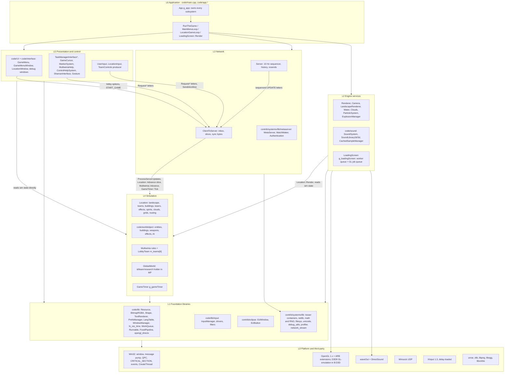

# 20 — Architecture

> Part B · Baseline build: Release|Win32 (OpenGL) + TARGET_PC_FULLGAME ([B:FULL]); see _work/build_matrix.md.
> Evidence: [C] confirmed · [I] inferred · [U] unknown. Citations are `path:Symbol` relative to the multiwinia/ source root.
> Sources merged: P01_app_core (§1 App, §2 loops/timing/threads, §7 constants), P14_platform_lib (§20.T threading primitives and thread map, §31.2–31.3 platform/timing), P15_network (§2 timing model, §13 threads and locking), P16_sound (§27.3 lifecycle/threading), P20_sequences_loaders_bench (§1 loading screen threading), P12_render_core (§24.8 prediction convention), P13_gfx_backend_math (vsync/Flip), routed `_meta_*` notes, `phase2_log.md`. Every claim below was re-checked against `code/app.*`, `code/main.cpp`, `code/gametimer.*`, `code/lib/work_queue.*`, `code/lib/runnable.*`, `code/loading_screen.*`, `code/network/clienttoserver.cpp`, `code/network/server.cpp` and the SystemIV netlib/metaserver sources; where the drafts disagreed the resolution is noted in place.

## Contents

- [1 Scope and reading guide](#1-scope-and-reading-guide)
- [2 Layered architecture](#2-layered-architecture)
- [3 Module dependency graph](#3-module-dependency-graph)
- [4 The App class](#4-the-app-class)
- [5 Global singletons and process-wide state](#5-global-singletons-and-process-wide-state)
- [6 Start-up sequence](#6-start-up-sequence)
- [7 Shutdown and teardown](#7-shutdown-and-teardown)
- [8 Lifetimes: process, session, match](#8-lifetimes-process-session-match)
- [9 Main loops](#9-main-loops)
- [10 Frame timing](#10-frame-timing)
- [11 Threading model](#11-threading-model)
- [12 Constants](#12-constants)
- [13 Architecture for the new game](#13-architecture-for-the-new-game)
- [Open questions and unknowns](#open-questions-and-unknowns)
- [Docs-vs-code discrepancies](#docs-vs-code-discrepancies)
- [IP items](#ip-items)
- [Source map](#source-map)
- [Appendix — dead/legacy code](#appendix--deadlegacy-code)

## 1 Scope and reading guide

This document describes how the Multiwinia executable is put together: which layers and modules exist and how they depend on each other, who owns every long-lived object, when each object is created and destroyed, which threads run, and how one frame is scheduled (fixed 10 Hz simulation ticks spread over variable-rate render frames, with render-time extrapolation).

It deliberately stops at the boundary of three neighbouring documents:

| Topic | Owner document |
|---|---|
| WorldObject/Entity/Building hierarchy, `Location` containers, per-slice update order inside `Location::Advance`, spatial grids, teams and units | [21 — Simulation and entity model](21_simulation_and_entity_model.md) |
| Lockstep protocol, letters, sequence ids, sync hashing, desync handling, RNG discipline, float determinism | [22 — Determinism and networking](22_determinism_and_networking.md) |
| Render pass order, GL/D3D state, the prediction convention as used by each renderer | [24 — Rendering](24_rendering.md) |
| Sound engine internals (voices, mixer, DirectSound) | [27 — Audio engine](27_audio_engine.md) |
| Eclipse window framework, menus | [28 — UI framework](28_ui_framework.md), [09 — Meta systems](09_meta_systems.md) |
| Build configurations, platform layer, timers, file locations | [31 — Platform, build and tools](31_platform_build_and_tools.md) |
| Carry-forward decisions for each subsystem | [40 — Carry-forward assessment](40_carry_forward_assessment.md) |

Three facts dominate the architecture and are worth stating up front [C]:

1. **Everything that matters runs on one thread.** Input, the network pump, the whole simulation, rendering and sound mixing all run on the main thread inside one busy loop (`code/main.cpp:LocationGameLoop`). Worker threads only load data and receive UDP packets.
2. **The simulation is driven by the network, even offline.** A `Server` object (also for single-player games against the CPU, on loop-back) emits one sequenced update every 0.1 s of real time; the client executes each update as 10 *slices* of `Location::Advance`, and `GameTimer` advances game time by `0.1 × gameSpeed` per update. There is no other source of simulation time.
3. **One global root object.** `App` (`g_app`) owns raw pointers to every subsystem; there are no interfaces, no dependency injection and no reference counting. About forty further `g_*` globals and many class-static variables hold the rest of the process state.

## 2 Layered architecture

### 2.1 Layer diagram

The layering below is the *intended* structure as visible in directory names and call direction; §2.3 lists every place the code is known to break it. Arrows mean "calls into / depends on" [C] for the module placement (directory and include analysis, §3.2), [I] for the layer names (they are this document's names, not the code's).

### 2.2 Layer responsibilities

| Layer | Modules (directories) | Key classes / globals | Responsibility | Threads that execute it |
|---|---|---|---|---|
| L6 Application | `code/main.cpp`, `code/main.h`, `code/app.*`, `code/globals.h`, `code/lib/window_manager_win32.cpp:WinMain` | `App`, `g_app`, `RunTheGame`, `MainMenuLoop`, `LocationGameLoop`, `EnterLocation`, `DoEnterLocation`, `Initialise`, `Finalise` | process start/stop, ownership of all subsystems, mode switching between front end and match, frame scheduling | main; `App::Initialise` and `DoEnterLocation` run on the loading-screen worker |
| L5 Presentation and control | `code/UI`, `code/interface`, top-level `code/user_input.*`, `location_input.*`, `taskmanager_interface*.*`, `gamecursor*.*`, `markersystem.*`, `multiwiniahelp.*`, `control_help.*`, `shaman_interface.*`, `gesture*.*` | `GameMenu`, `GameMenuWindow`, `LocationWindow`, `UserInput`, `LocationInput`, `TaskManagerInterfaceMultiwinia`, `GameCursor`, `MarkerSystem`, `MultiwiniaHelp` | menus and lobby; HUD; turns local input into network requests; never supposed to write simulation state (see §2.3) | main |
| L4 Simulation | `code/worldobject`, top-level `code/location.*`, `landscape.*`, `team.*`, `unit.*`, `taskmanager.*`, `entity_grid*.*`, `obstruction_grid.*`, `routing_system.*`, `multiwinia.*`, `global_world.*`, `gametimer.*`, `level_file.*` | `Location`, `Team`, `Unit`, `WorldObject` tree, `Multiwinia`, `GlobalWorld`, `GameTimer`, synced RNG (`syncrand`) | deterministic game state; advanced only by `ClientToServer::ProcessAllServerLetters` (§10.3) | main (level load on loading-screen worker) |
| L3 Network | `code/network`, `contrib/systemiv/lib/metaserver`, `contrib/systemiv/lib/netlib` | `Server`, `ClientToServer`, `ServerToClientLetter`, `IFrame`, `FTPManager`, `NetworkValue*`, `MetaServer_*`, `MatchMaker_*`, `Authentication_*` | relay-lockstep command sequencing at 10 Hz, join/leave, sync checks, lobby discovery and NAT punch-through ([22](22_determinism_and_networking.md)) | main (all sending and sequencing); listener threads receive; metaserver helper threads (§11.2) |
| L2 Engine services | `code/sound`, top-level `code/renderer.*`, `camera.*`, `landscape_renderer.*`, `water*.*`, `clouds.*`, `particle_system.*`, `explosion.*`, `deform.*`, `loading_screen.*` | `Renderer`, `Camera`, `SoundSystem`, `ParticleSystem`, `g_explosionManager`, `g_loadingScreen` | rendering, audio, cosmetic effects, loading-screen pump | main (sound fill callback is pulled on main; waveOut notifies from an OS thread) |
| L1 Foundation | `code/lib`, `code/lib/input`, `code/unicode`, `contrib/eclipse`, `contrib/systemiv/lib` (compiled subset: `debug_utils`, `memory_leak`, `network_stream`, `profiler`, `string_utils`, `filesys`, `math` 8 of 30 files, `metaserver` 6 of 12, `netlib` 16 of 20, `tosser` 9 of 17, `unicode`) | `Resource`, `PrefsManager`, `LangTable`, `TextRenderer`, `InputManager`, `WorkQueue`, `LList`/`DArray`/`FastDArray`/`SliceDArray`, `NetMutex`, `NetEvent`, `Directory` | data access, containers, threading primitives, input abstraction, window framework | any |
| L0 Platform | Win32, OpenGL/GLU, D3D9 [B:D3D], DirectSound, waveOut, Winsock, XInput; `contrib/unrar`, `contrib/zlib`/`contrib/lpng1215`, `contrib/libogg-1.1.3`, `contrib/libvorbis-1.1.2` | — | OS services and codecs | any |

Build status per module is in §3.1 and [build_matrix §6](_work/build_matrix.md).

### 2.3 Observed layering rules and their violations

Rules the code follows almost everywhere [C]:

1. **Control enters the simulation only through the network layer.** Local input produces `TeamControls` (sent as `ALIVE` every 0.1 s, `code/main.cpp:SendTeamControlsToNetwork`) or `ClientToServer::Request*` letters; the simulation applies them when the sequenced update arrives (`code/network/clienttoserver.cpp:ClientToServer::ProcessServerUpdates`).
2. **The simulation never reads the wall clock** for game rules; it uses `GetNetworkTime()` ≡ `g_gameTimer.GetGameTime()` and `SERVER_ADVANCE_PERIOD` ≡ `0.1 × gameSpeed` (`code/gametimer.h`).
3. **Presentation reads simulation state directly** (no snapshot, no double buffering); rendering extrapolates positions with `g_predictionTime` (§10.6).

Known violations (each is documented in detail in the owning document) [C] unless marked:

| # | Violation | Direction | Ref | Consequence |
|---|---|---|---|---|
| V1 | `ClientToServer` (network) calls `Location::Advance`, `ParticleSystem::Advance`, `Multiwinia::Advance`, `GameTimer::Tick` | L3 → L4 (network owns the sim clock) | `code/network/clienttoserver.cpp:ClientToServer::ProcessAllServerLetters` | simulation cannot be stepped without the network object; offline play needs a loop-back `Server` |
| V2 | Simulation calls HUD/UI singletons: `TaskManager::SelectTask` → `GameCursor::BoostSelectionArrows`; `Task` code → `TaskManagerInterface::SetCurrentMessage`, camera requests, `Location::SetCurrentMessage` (guarded by `m_teamId == m_myTeamId` or cosmetic) | L4 → L5 | `code/taskmanager.cpp` (see [22](22_determinism_and_networking.md), item D5 of the determinism register) | deterministic only because the calls are local-only side effects |
| V3 | Simulation triggers sounds synchronously (`SoundSystem::Trigger*Event` from `Advance`) | L4 → L2 | `code/sound/soundsystem.cpp:SoundSystem::NotReadyForGameSoundsYet` | allowed because it runs on the main thread; triggers from any other thread are silently dropped |
| V4 | `InsertionSquad::DirectControl` reads the local camera (`m_camLookAround`) while applying networked controls | L4 reads L2 local state | `code/worldobject/insertion_squad.cpp:InsertionSquad::DirectControl` | confirmed desync path ([06](06_player_control_and_input.md), [22](22_determinism_and_networking.md)) |
| V5 | `LocationInput::SelectObjectUnderMouse` calls `FenceSwitch::Switch()` directly (no network message) | L5 → L4 write | `code/location_input.cpp:LocationInput::SelectObjectUnderMouse`, `code/worldobject/switch.cpp:FenceSwitch::Switch` | desync hazard if a map contains a fence switch ([03](03_buildings_and_world_objects.md)) |
| V6 | Task-manager UI writes `TaskManager::m_mostRecentTaskId = -1` (local-only reset); the cursor's crosshair test is written `building->m_type = Building::TypeRadarDish` (assignment), overwriting the selected building's type on the local client (a no-op in practice in MP, see [06](06_player_control_and_input.md)) | L5 → L4 write | `code/taskmanager_interface_multiwinia.cpp:TaskManagerInterfaceMultiwinia::Advance` (L287), `code/gamecursor.cpp:GameCursor::RenderCrosshair` (L602) | local divergence |
| V7 | Tree collision spheres are produced as a by-product of display-list compilation using the unsynced RNG | L2 (render) → L4 | `code/worldobject/tree.cpp:Tree::Generate` (resets `m_hitcheckRadius`, then `CreateDisplayListAsync` with `Tree::GenerateLeaves` as the compile callback) via `code/lib/resource.cpp:Resource::CreateDisplayListAsync` | simulation data depends on render path ([03](03_buildings_and_world_objects.md)) |
| V8 | `code/lib` (engine library) includes and calls game-layer headers: `Resource` calls `g_loadingScreen->QueueJob` and reads `g_app->m_mainThreadId`; `PrefsManager`/`TargetCursor` include `code/interface` | L1 → L6/L5 | `code/lib/resource.cpp:Resource::CreateDisplayListAsync`, `code/lib/preferences.cpp`, `code/lib/targetcursor.cpp` | 47 include pairs from `code/lib` into top-level `code` (§3.2) |
| V9 | SystemIV library sources include `lib/universal_include.h`, which resolves to **`code/lib`** (not SystemIV) because `..\..\code` precedes `..\..\contrib\SystemIV` on the include path | L1 (third-party-ish) → game config | `targets/vs2005/Common.vsprops` (AdditionalIncludeDirectories) | SystemIV is compiled with Multiwinia's build switches; two `Vector3` classes coexist ([31](31_platform_build_and_tools.md)) |
| V10 | The `NET_DARWINIA_TOGGLEENTITY` update handler calls `RequestSelectUnit` from inside update processing on every client | L3 → L5 → L3 | `code/network/clienttoserver.cpp:ClientToServer::ProcessServerUpdates` | duplicate (idempotent) select requests from every peer |
| V11 | `GameTimer::Tick` and `GetPredictionTime` call `g_app->GamePaused()`, which reads `ClientToServer::m_outOfSyncClients` and the local `m_lostFocusPause` | L4 → L3/L6 | `code/gametimer.cpp:GameTimer::Tick`, `code/app.cpp:App::GamePaused` | game time stops per client when that client sees an out-of-sync peer ([22](22_determinism_and_networking.md)) |

## 3 Module dependency graph

<!-- S3 -->

## 4 The App class

<!-- S4 -->

## 5 Global singletons and process-wide state

<!-- S5 -->

## 6 Start-up sequence

<!-- S6 -->

## 7 Shutdown and teardown

<!-- S7 -->

## 8 Lifetimes: process, session, match

<!-- S8 -->

## 9 Main loops

<!-- S9 -->

## 10 Frame timing

<!-- S10 -->

## 11 Threading model

<!-- S11 -->

## 12 Constants

<!-- S12 -->

## 13 Architecture for the new game

<!-- S13 -->

## Open questions and unknowns

<!-- SU -->

## Docs-vs-code discrepancies

<!-- SD -->

## IP items

<!-- SIP -->

## Source map

<!-- SSM -->

## Appendix — dead/legacy code

<!-- SAPP -->
