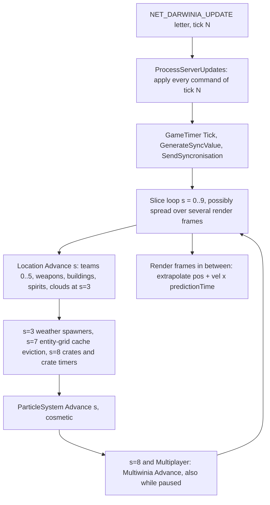
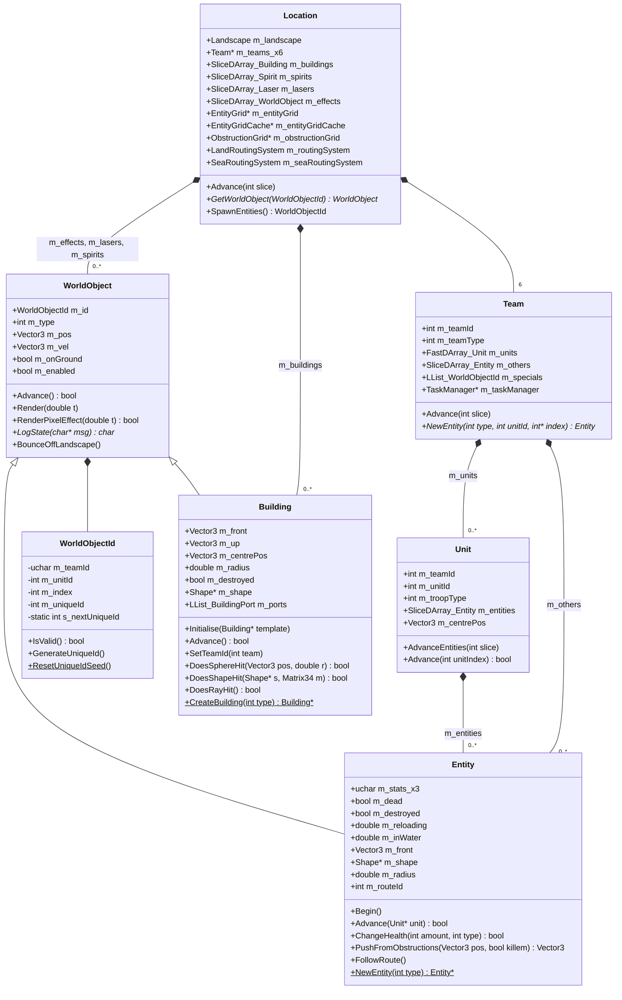

# 21 — Simulation and entity model

> Part B · Baseline build: Release|Win32 (OpenGL) + TARGET_PC_FULLGAME ([B:FULL]); see _work/build_matrix.md.
> Evidence: [C] confirmed · [I] inferred · [U] unknown. Citations are `path:Symbol` relative to the multiwinia/ source root.
> Sources merged: P03_entity_core (identity, WorldObject/Entity base, spatial partitioning, routing, class hierarchy of all 159 `code/worldobject` classes), P01_app_core (Location containers, level-load order, per-slice update order, Team/LobbyTeam/Unit, TeamControls), P14_platform_lib (container types, slot reuse, iteration order), X3_determinism_sync (simulated vs cosmetic classification, render-writes-sim scan, local-state leaks, id allocation), cross-partition notes in `_work/routed/_meta_*.md`, coordinator log `_work/phase2_log.md`; re-verified against the code by S21.

## Contents

- [1 Scope and the model at a glance](#1-scope-and-the-model-at-a-glance)
- [2 Class hierarchy (every class)](#2-class-hierarchy-every-class)
- [3 Object identity and handles](#3-object-identity-and-handles)
- [4 Base-class contracts](#4-base-class-contracts)
- [5 Location: containers, creation, removal and update ordering](#5-location-containers-creation-removal-and-update-ordering)
- [6 Spatial partitioning](#6-spatial-partitioning)
- [7 Pathfinding and routing](#7-pathfinding-and-routing)
- [8 Collision and physics approximations](#8-collision-and-physics-approximations)
- [9 Team and ownership model](#9-team-and-ownership-model)
- [10 Simulated state versus render state](#10-simulated-state-versus-render-state)
- [11 Guidance for the new engine's entity model](#11-guidance-for-the-new-engines-entity-model)
- [12 Constants](#12-constants)
- [Open questions and unknowns](#open-questions-and-unknowns)
- [Docs-vs-code discrepancies](#docs-vs-code-discrepancies)
- [IP items](#ip-items)
- [Source map](#source-map)
- [Appendix — dead/legacy code](#appendix--deadlegacy-code)

## 1 Scope and the model at a glance

This document specifies the engine-level object model of a match: what kinds of simulated objects exist, how they are identified, stored, created, advanced, removed and found in space, how they move, collide and find paths, who owns them, and how simulated state is kept apart from what is drawn. Per-type behaviour (state machines, stats, weapons) lives in [02](02_units_and_entities.md) (entities), [03](03_buildings_and_world_objects.md) (buildings) and [04](04_crates_powerups_and_weapons.md) (crates, weapons, effects); the main loop, tick clock and threads in [20](20_architecture.md); lockstep networking, RNG and float determinism in [22](22_determinism_and_networking.md); terrain queries in [23](23_terrain_and_landscape.md); render passes in [24](24_rendering.md).

Summary [C] unless tagged:

- One `Location` object (`g_app->m_location`) owns everything simulated in a match: the landscape, six `Team` slots, the building/effect/laser/spirit containers, an entity grid, its query cache, an obstruction grid and two routing systems [C] `code/location.h:Location`.
- Every simulated object derives from `WorldObject` (position, velocity, type, `WorldObjectId`). Three families: `Entity` (units, owned by a team), `Building` (level-placed or runtime-created static objects) and "effects" (`WorldObject` subclasses in `Location::m_effects`, plus `Laser` and `Spirit` stored by value) [C] `code/worldobject/worldobject.h`.
- Objects are addressed by a weak four-field handle `WorldObjectId(team, unit, index, uniqueId)` that is re-resolved on every use [C] `code/location.cpp:Location::GetWorldObject`.
- The simulation is lockstep: one server tick (one `NET_DARWINIA_UPDATE` letter, 0.1 s of real time, `0.1 × gameSpeed` of game time) is executed as 10 *slices*; every slice-partitioned container advances one tenth of its slots per slice, so every object advances exactly once per tick with `dt = SERVER_ADVANCE_PERIOD` [C] `code/network/clienttoserver.cpp:ClientToServer::ProcessAllServerLetters`, `code/lib/slice_darray.cpp:SliceDArray::GetNextSliceBounds` ([20 §10.3](20_architecture.md#103-client-tick-and-slices)).
- `Advance()` returning **true** means "remove and delete me" for every object family; the container owner performs the removal and its side effects (grid removal, obstruction-grid rebuild, AI-link rebuild) [C] `code/team.cpp:Team::Advance`, `code/location.cpp:Location::AdvanceBuildings`.
- Rendering never stores interpolated state: renderers receive a prediction time and extrapolate `pos + vel × t` [C] ([§10.2](#102-prediction-time-extrapolation-not-interpolation)).

## 2 Class hierarchy (every class)

### 2.1 Inventory and method

- The class list is every `class X [: public Y]` declaration in the 85 headers of `code/worldobject/` (all compiled into the baseline) — **159 classes**: 142 derive from a base, 17 have none [C] `_work/drafts/P03_worldobject_classes.csv` (generated by `_work/scripts/P03_classdiag.py`), cross-checked by `_work/scripts/S_21_classdiagram.py verify`, which re-extracts the list with the coverage checker's regex (159 = 159, no difference).
- `Unit` (base of `AirstrikeUnit`, `InsertionSquad`, `ViriiUnit`) is declared in `code/unit.h`, not in `code/worldobject/`; it is drawn in the diagrams but not counted [C] `code/unit.h:Unit`.
- No `code/worldobject` class uses non-public or multiple inheritance, and no class outside `code/worldobject` derives from `WorldObject`, `Entity` or `Building` [C] grep of `: public WorldObject`, `: public Entity`, `: public Building` over `code/`.
- Counts by family: `Entity` and its 26 subclasses (27), `Building` and its 83 subclasses (84), 31 other `WorldObject`-derived or `Unit`-derived classes, `WorldObject` itself, and 16 helper classes with no `WorldObject` ancestry [C] script output.
- Diagrams 2.3–2.7 are generated by `_work/scripts/S_21_classdiagram.py gen` from `_work/class_assignment.csv`; classes tagged `<<legacy>>` are compiled but unreachable in Multiwinia ([B:LEGACY]), `<<debug>>` only reachable under `TARGET_DEBUG`. The table in §2.8 gives every class's base, header, build tag and the heading of its behaviour specification.

### 2.2 Framework types (members that the rest of this document relies on)

Member types are written with `_` in place of template brackets for diagram compatibility (`SliceDArray_Building` = `SliceDArray<Building*>`; `m_teams_x6` = `Team *m_teams[NUM_TEAMS]`). Full member tables: `WorldObjectId`/`WorldObject`/`Entity` in [02 §3](02_units_and_entities.md#3-framework-classes), `Building` in [03 §3.2](03_buildings_and_world_objects.md#32-data-members), `Location` in [§5.1](#51-location-members), `Team`/`Unit` in [§9](#9-team-and-ownership-model).

<!-- S21:CLASSFRAG -->

## 3 Object identity and handles
