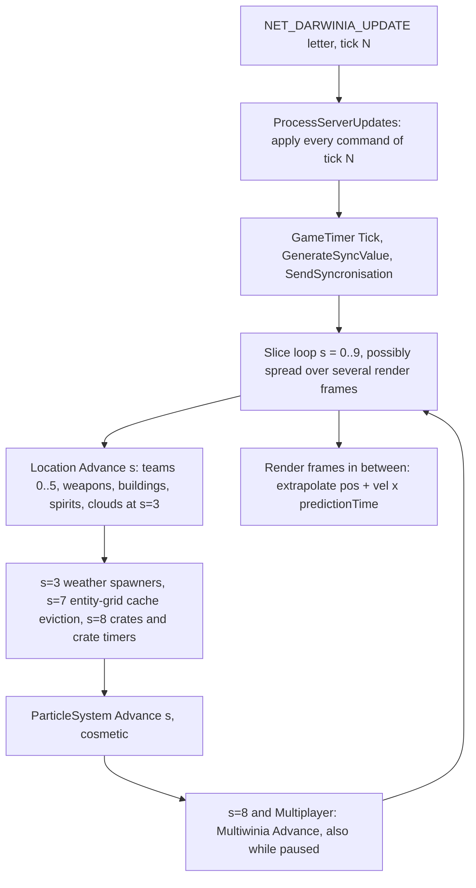
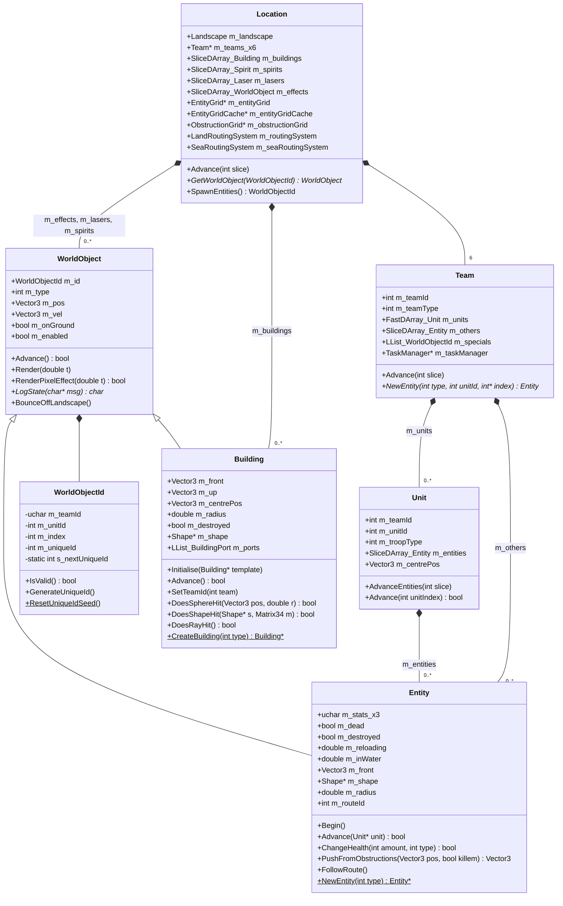
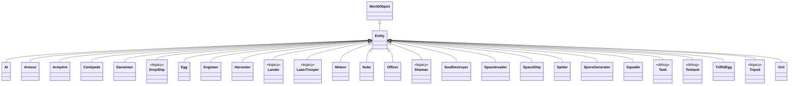
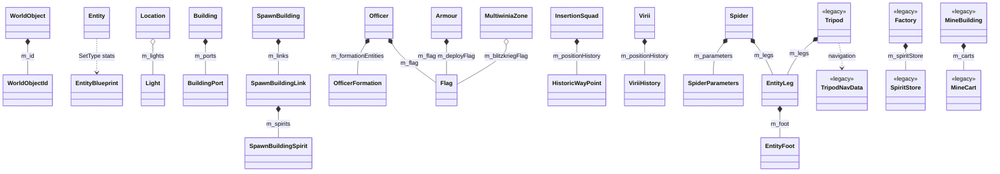
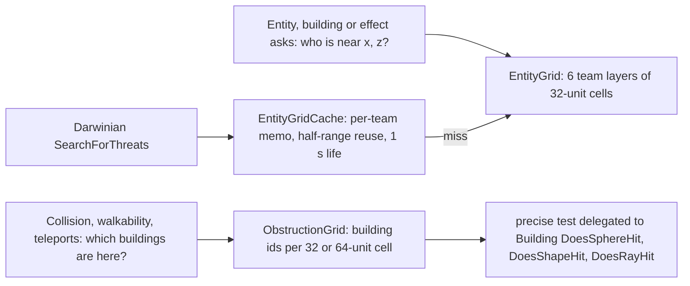
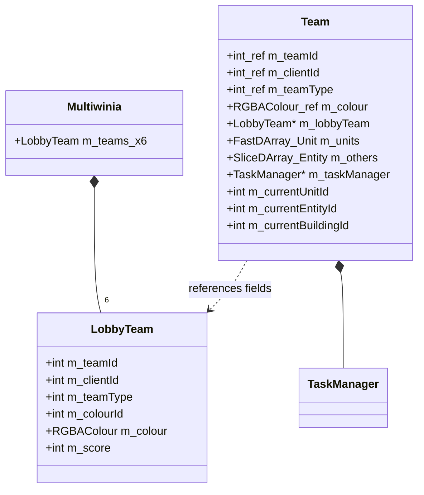

# 21 — Simulation and entity model

> Part B · Baseline build: Release|Win32 (OpenGL) + TARGET_PC_FULLGAME ([B:FULL]); see _work/build_matrix.md.
> Evidence: [C] confirmed · [I] inferred · [U] unknown. Citations are `path:Symbol` relative to the multiwinia/ source root.
> Sources merged: P03_entity_core (identity, WorldObject/Entity base, spatial partitioning, routing, class hierarchy of all 159 `code/worldobject` classes), P01_app_core (Location containers, level-load order, per-slice update order, Team/LobbyTeam/Unit, TeamControls), P14_platform_lib (container types, slot reuse, iteration order), X3_determinism_sync (simulated vs cosmetic classification, render-writes-sim scan, local-state leaks, id allocation), cross-partition notes in `_work/routed/_meta_*.md`, coordinator log `_work/phase2_log.md`; re-verified against the code by S21.

## Contents

- [1 Scope and the model at a glance](#1-scope-and-the-model-at-a-glance)
- [2 Class hierarchy (every class)](#2-class-hierarchy-every-class)
- [3 Object identity and handles](#3-object-identity-and-handles)
- [4 Base-class contracts](#4-base-class-contracts)
- [5 Location: containers, creation, removal and update ordering](#5-location-containers-creation-removal-and-update-ordering)
- [6 Spatial partitioning](#6-spatial-partitioning)
- [7 Pathfinding and routing](#7-pathfinding-and-routing)
- [8 Collision and physics approximations](#8-collision-and-physics-approximations)
- [9 Team and ownership model](#9-team-and-ownership-model)
- [10 Simulated state versus render state](#10-simulated-state-versus-render-state)
- [11 Guidance for the new engine's entity model](#11-guidance-for-the-new-engines-entity-model)
- [12 Constants](#12-constants)
- [Open questions and unknowns](#open-questions-and-unknowns)
- [Docs-vs-code discrepancies](#docs-vs-code-discrepancies)
- [IP items](#ip-items)
- [Source map](#source-map)
- [Appendix — dead/legacy code](#appendix--deadlegacy-code)

## 1 Scope and the model at a glance

This document specifies the engine-level object model of a match: what kinds of simulated objects exist, how they are identified, stored, created, advanced, removed and found in space, how they move, collide and find paths, who owns them, and how simulated state is kept apart from what is drawn. Per-type behaviour (state machines, stats, weapons) lives in [02](02_units_and_entities.md) (entities), [03](03_buildings_and_world_objects.md) (buildings) and [04](04_crates_powerups_and_weapons.md) (crates, weapons, effects); the main loop, tick clock and threads in [20](20_architecture.md); lockstep networking, RNG and float determinism in [22](22_determinism_and_networking.md); terrain queries in [23](23_terrain_and_landscape.md); render passes in [24](24_rendering.md).

Summary [C] unless tagged:

- One `Location` object (`g_app->m_location`) owns everything simulated in a match: the landscape, six `Team` slots, the building/effect/laser/spirit containers, an entity grid, its query cache, an obstruction grid and two routing systems [C] `code/location.h:Location`.
- Every simulated object derives from `WorldObject` (position, velocity, type, `WorldObjectId`). Three families: `Entity` (units, owned by a team), `Building` (level-placed or runtime-created static objects) and "effects" (`WorldObject` subclasses in `Location::m_effects`, plus `Laser` and `Spirit` stored by value) [C] `code/worldobject/worldobject.h`.
- Objects are addressed by a weak four-field handle `WorldObjectId(team, unit, index, uniqueId)` that is re-resolved on every use [C] `code/location.cpp:Location::GetWorldObject`.
- The simulation is lockstep: one server tick (one `NET_DARWINIA_UPDATE` letter, 0.1 s of real time, `0.1 × gameSpeed` of game time) is executed as 10 *slices*; every slice-partitioned container advances one tenth of its slots per slice, so every object advances exactly once per tick with `dt = SERVER_ADVANCE_PERIOD` [C] `code/network/clienttoserver.cpp:ClientToServer::ProcessAllServerLetters`, `code/lib/slice_darray.cpp:SliceDArray::GetNextSliceBounds` ([20 §10.3](20_architecture.md#103-client-tick-and-slices)).
- `Advance()` returning **true** means "remove and delete me" for every object family; the container owner performs the removal and its side effects (grid removal, obstruction-grid rebuild, AI-link rebuild) [C] `code/team.cpp:Team::Advance`, `code/location.cpp:Location::AdvanceBuildings`.
- Rendering never stores interpolated state: renderers receive a prediction time and extrapolate `pos + vel × t` [C] ([§10.2](#102-prediction-time-extrapolation-not-interpolation)).



## 2 Class hierarchy (every class)

### 2.1 Inventory and method

- The class list is every `class X [: public Y]` declaration in the 85 headers of `code/worldobject/` (all compiled into the baseline) — **159 classes**: 142 derive from a base, 17 have none [C] `_work/drafts/P03_worldobject_classes.csv` (generated by `_work/scripts/P03_classdiag.py`), cross-checked by `_work/scripts/S_21_classdiagram.py verify`, which re-extracts the list with the coverage checker's regex (159 = 159, no difference).
- `Unit` (base of `AirstrikeUnit`, `InsertionSquad`, `ViriiUnit`) is declared in `code/unit.h`, not in `code/worldobject/`; it is drawn in the diagrams but not counted [C] `code/unit.h:Unit`.
- No `code/worldobject` class uses non-public or multiple inheritance, and no class outside `code/worldobject` derives from `WorldObject`, `Entity` or `Building` [C] grep of `: public WorldObject`, `: public Entity`, `: public Building` over `code/`.
- Counts by family: `Entity` and its 26 subclasses (27), `Building` and its 83 subclasses (84), 31 other `WorldObject`-derived or `Unit`-derived classes, `WorldObject` itself, and 16 helper classes with no `WorldObject` ancestry [C] script output.
- Diagrams 2.3–2.7 are generated by `_work/scripts/S_21_classdiagram.py gen` from `_work/class_assignment.csv`; classes tagged `<<legacy>>` are compiled but unreachable in Multiwinia ([B:LEGACY]), `<<debug>>` only reachable under `TARGET_DEBUG`. The table in §2.8 gives every class's base, header, build tag and the heading of its behaviour specification.

### 2.2 Framework types (members that the rest of this document relies on)



Member types are written with `_` in place of template brackets for diagram compatibility (`SliceDArray_Building` = `SliceDArray<Building*>`; `m_teams_x6` = `Team *m_teams[NUM_TEAMS]`). Full member tables: `WorldObjectId`/`WorldObject`/`Entity` in [02 §3](02_units_and_entities.md#3-framework-classes), `Building` in [03 §3.2](03_buildings_and_world_objects.md#32-data-members), `Location` in [§5.1](#51-location-members), `Team`/`Unit` in [§9](#9-team-and-ownership-model).

### 2.3 Entity subclasses — 27 classes (Entity and every class derived from it)



### 2.4 Building intermediate bases and their subclasses — 45 classes

```mermaid
classDiagram
    WorldObject <|-- Building
    Building <|-- BlueprintBuilding
    Building <|-- CarryableBuilding
    Building <|-- DynamicBase
    Building <|-- FuelBuilding
    Building <|-- Incubator
    Building <|-- MineBuilding
    Building <|-- PowerBuilding
    Building <|-- ReceiverBuilding
    Building <|-- SpawnBuilding
    Building <|-- Teleport
    BlueprintBuilding <|-- BlueprintConsole
    BlueprintBuilding <|-- BlueprintRelay
    BlueprintBuilding <|-- BlueprintStore
    CarryableBuilding <|-- ChessPiece
    CarryableBuilding <|-- Statue
    CarryableBuilding <|-- WallBuster
    DynamicBase <|-- DynamicHub
    DynamicBase <|-- DynamicNode
    FuelBuilding <|-- EscapeRocket
    FuelBuilding <|-- FuelGenerator
    FuelBuilding <|-- FuelPipe
    FuelBuilding <|-- FuelStation
    Incubator <|-- CloneLab
    MineBuilding <|-- Mine
    MineBuilding <|-- Refinery
    MineBuilding <|-- TrackEnd
    MineBuilding <|-- TrackJunction
    MineBuilding <|-- TrackLink
    MineBuilding <|-- TrackStart
    PowerBuilding <|-- Generator
    PowerBuilding <|-- PowerSplitter
    PowerBuilding <|-- Pylon
    PowerBuilding <|-- PylonEnd
    PowerBuilding <|-- PylonStart
    PowerBuilding <|-- SolarPanel
    ReceiverBuilding <|-- ReceiverLink
    ReceiverBuilding <|-- ReceiverSpiritSpawner
    ReceiverBuilding <|-- SpiritProcessor
    ReceiverBuilding <|-- SpiritReceiver
    SpawnBuilding <|-- MasterSpawnPoint
    SpawnBuilding <|-- SpawnLink
    SpawnBuilding <|-- SpawnPoint
    Teleport <|-- Bridge
    Teleport <|-- RadarDish
    <<legacy>> BlueprintBuilding
    <<legacy>> BlueprintConsole
    <<legacy>> BlueprintRelay
    <<legacy>> BlueprintStore
    <<legacy>> Bridge
    <<legacy>> ChessPiece
    <<legacy>> DynamicBase
    <<legacy>> DynamicHub
    <<legacy>> DynamicNode
    <<legacy>> Generator
    <<legacy>> Mine
    <<legacy>> MineBuilding
    <<legacy>> PylonStart
    <<legacy>> ReceiverBuilding
    <<legacy>> ReceiverLink
    <<legacy>> ReceiverSpiritSpawner
    <<legacy>> Refinery
    <<legacy>> SpiritProcessor
    <<legacy>> SpiritReceiver
    <<legacy>> TrackEnd
    <<legacy>> TrackJunction
    <<legacy>> TrackLink
    <<legacy>> TrackStart
```



### 2.5 Building direct leaf subclasses — 39 classes

```mermaid
classDiagram
    Building <|-- AIObjective
    Building <|-- AIObjectiveMarker
    Building <|-- AISpawnPoint
    Building <|-- AITarget
    Building <|-- AntHill
    Building <|-- Cave
    Building <|-- ChessBase
    Building <|-- ConstructionYard
    Building <|-- ControlStation
    Building <|-- ControlTower
    Building <|-- Crate
    Building <|-- DisplayScreen
    Building <|-- EruptionMarker
    Building <|-- Factory
    Building <|-- FeedingTube
    Building <|-- FenceSwitch
    Building <|-- GodDish
    Building <|-- GunTurret
    Building <|-- JumpPad
    Building <|-- LaserFence
    Building <|-- Library
    Building <|-- MultiwiniaZone
    Building <|-- Portal
    Building <|-- Powerstation
    Building <|-- PrimaryUpgradePort
    Building <|-- PulseBomb
    Building <|-- ResearchItem
    Building <|-- RestrictionZone
    Building <|-- SafeArea
    Building <|-- ScriptTrigger
    Building <|-- SmokeMarker
    Building <|-- Spam
    Building <|-- SpawnPopulationLock
    Building <|-- StaticShape
    Building <|-- Tree
    Building <|-- Triffid
    Building <|-- TrunkPort
    Building <|-- UpgradePort
    Building <|-- Wall
    <<legacy>> AISpawnPoint
    <<legacy>> Cave
    <<legacy>> ChessBase
    <<legacy>> ConstructionYard
    <<legacy>> DisplayScreen
    <<legacy>> Factory
    <<legacy>> FeedingTube
    <<legacy>> FenceSwitch
    <<legacy>> GodDish
    <<legacy>> Library
    <<debug>> Portal
    <<legacy>> Powerstation
    <<legacy>> PrimaryUpgradePort
    <<legacy>> ResearchItem
    <<legacy>> SafeArea
    <<legacy>> ScriptTrigger
    <<legacy>> Spam
    <<legacy>> UpgradePort
```



### 2.6 Other WorldObject-derived classes (effects, weapons, spirits, order markers) and Unit subclasses — 32 classes


### 2.7 Helper classes with no WorldObject ancestry — 16 classes, with their owners



### 2.8 Every class: base, header, build tag, behaviour specification

Generated by `_work/scripts/S_21_classdiagram.py` from `_work/class_assignment.csv` (the class list is the one the coverage checker extracts from `code/worldobject/*.h`). "Spec" links to the heading in the final document that carries the class's behaviour specification. Build tags: `_work/build_matrix.md` §7.

| # | Class | Base | Header | Build tag | Spec |
|---|---|---|---|---|---|
| 1 | `AI` | `Entity` | `code/worldobject/ai.h` | [B:FULL] | [02 — 24 AI](02_units_and_entities.md#24-ai) |
| 2 | `AIObjective` | `Building` | `code/worldobject/aiobjective.h` | [B:FULL] | [03 — 10.2 AIObjective](03_buildings_and_world_objects.md#102-aiobjective) |
| 3 | `AIObjectiveMarker` | `Building` | `code/worldobject/aiobjective.h` | [B:FULL] | [03 — 10.3 AIObjectiveMarker](03_buildings_and_world_objects.md#103-aiobjectivemarker) |
| 4 | `AirStrikeMarker` | `ThrowableWeapon` | `code/worldobject/weapons.h` | [B:FULL] | [04 — 6.5 AirStrikeMarker](04_crates_powerups_and_weapons.md#65-airstrikemarker) |
| 5 | `AirstrikeUnit` | `Unit` | `code/worldobject/airstrike.h` | [B:FULL] | [02 — 11.1 AirstrikeUnit and SpaceInvader — role and acquisition](02_units_and_entities.md#111-airstrikeunit-and-spaceinvader--role-and-acquisition) |
| 6 | `AISpawnPoint` | `Building` | `code/worldobject/ai.h` | [B:LEGACY] | [03 — 10.4 AISpawnPoint](03_buildings_and_world_objects.md#104-aispawnpoint) |
| 7 | `AITarget` | `Building` | `code/worldobject/ai.h` | [B:FULL] | [03 — 10.1 AITarget](03_buildings_and_world_objects.md#101-aitarget) |
| 8 | `AntHill` | `Building` | `code/worldobject/anthill.h` | [B:FULL] | [03 — 9.1 AntHill](03_buildings_and_world_objects.md#91-anthill) |
| 9 | `Armour` | `Entity` | `code/worldobject/armour.h` | [B:FULL] | [02 — 8 Armour](02_units_and_entities.md#8-armour) |
| 10 | `ArmyAnt` | `Entity` | `code/worldobject/armyant.h` | [B:FULL] | [02 — 13 ArmyAnt](02_units_and_entities.md#13-armyant) |
| 11 | `BlueprintBuilding` | `Building` | `code/worldobject/blueprintstore.h` | [B:LEGACY] | [03 — 12.11 BlueprintBuilding](03_buildings_and_world_objects.md#1211-blueprintbuilding) |
| 12 | `BlueprintConsole` | `BlueprintBuilding` | `code/worldobject/blueprintstore.h` | [B:LEGACY] | [03 — 12.13 BlueprintConsole](03_buildings_and_world_objects.md#1213-blueprintconsole) |
| 13 | `BlueprintRelay` | `BlueprintBuilding` | `code/worldobject/blueprintstore.h` | [B:LEGACY] | [03 — 12.14 BlueprintRelay](03_buildings_and_world_objects.md#1214-blueprintrelay) |
| 14 | `BlueprintStore` | `BlueprintBuilding` | `code/worldobject/blueprintstore.h` | [B:LEGACY] | [03 — 12.12 BlueprintStore](03_buildings_and_world_objects.md#1212-blueprintstore) |
| 15 | `BoxKite` | `WorldObject` | `code/worldobject/darwinian.h` | [B:LEGACY] | [04 — 6.22 BoxKite](04_crates_powerups_and_weapons.md#622-boxkite) |
| 16 | `Bridge` | `Teleport` | `code/worldobject/bridge.h` | [B:LEGACY] | [03 — 12.15 Bridge](03_buildings_and_world_objects.md#1215-bridge) |
| 17 | `Building` | `WorldObject` | `code/worldobject/building.h` | [B:FULL] | [03 — 3.1 Building](03_buildings_and_world_objects.md#31-building) |
| 18 | `BuildingPort` | — | `code/worldobject/building.h` | [B:FULL] | [03 — 3.3 BuildingPort](03_buildings_and_world_objects.md#33-buildingport) |
| 19 | `CarryableBuilding` | `Building` | `code/worldobject/carryablebuilding.h` | [B:FULL] | [03 — 8.3 CarryableBuilding](03_buildings_and_world_objects.md#83-carryablebuilding) |
| 20 | `Cave` | `Building` | `code/worldobject/cave.h` | [B:LEGACY] | [03 — 12.16 Cave](03_buildings_and_world_objects.md#1216-cave) |
| 21 | `Centipede` | `Entity` | `code/worldobject/centipede.h` | [B:FULL] | [02 — 18 Centipede](02_units_and_entities.md#18-centipede) |
| 22 | `ChessBase` | `Building` | `code/worldobject/chess.h` | [B:LEGACY] | [03 — 12.17 ChessBase](03_buildings_and_world_objects.md#1217-chessbase) |
| 23 | `ChessPiece` | `CarryableBuilding` | `code/worldobject/chess.h` | [B:LEGACY] | [03 — 12.18 ChessPiece](03_buildings_and_world_objects.md#1218-chesspiece) |
| 24 | `CloneLab` | `Incubator` | `code/worldobject/clonelab.h` | [B:FULL] (loadable; no shipped map) | [03 — 11.3 CloneLab](03_buildings_and_world_objects.md#113-clonelab) |
| 25 | `ConstructionYard` | `Building` | `code/worldobject/constructionyard.h` | [B:LEGACY] | [03 — 12.1 ConstructionYard](03_buildings_and_world_objects.md#121-constructionyard) |
| 26 | `ControllerGrenade` | `ThrowableWeapon` | `code/worldobject/weapons.h` | [B:LEGACY] | [04 — 6.17 ControllerGrenade](04_crates_powerups_and_weapons.md#617-controllergrenade) |
| 27 | `ControlStation` | `Building` | `code/worldobject/controlstation.h` | [B:FULL] | [03 — 5.4 ControlStation](03_buildings_and_world_objects.md#54-controlstation) |
| 28 | `ControlTower` | `Building` | `code/worldobject/controltower.h` | [B:FULL] (loadable; no shipped map) | [03 — 11.1 ControlTower](03_buildings_and_world_objects.md#111-controltower) |
| 29 | `Crate` | `Building` | `code/worldobject/crate.h` | [B:FULL] | [04 — 1 Crate lifecycle](04_crates_powerups_and_weapons.md#1-crate-lifecycle) |
| 30 | `Darwinian` | `Entity` | `code/worldobject/darwinian.h` | [B:FULL] | [02 — 4 Darwinian](02_units_and_entities.md#4-darwinian) |
| 31 | `DisplayScreen` | `Building` | `code/worldobject/constructionyard.h` | [B:LEGACY] | [03 — 12.2 DisplayScreen](03_buildings_and_world_objects.md#122-displayscreen) |
| 32 | `DropShip` | `Entity` | `code/worldobject/dropship.h` | [B:LEGACY] | [02 — 28 DropShip](02_units_and_entities.md#28-dropship) |
| 33 | `DustBall` | `WorldObject` | `code/worldobject/dustball.h` | [B:FULL] | [04 — 6.20 DustBall](04_crates_powerups_and_weapons.md#620-dustball) |
| 34 | `DynamicBase` | `Building` | `code/worldobject/generichub.h` | [B:LEGACY] | [03 — 12.20 DynamicBase](03_buildings_and_world_objects.md#1220-dynamicbase) |
| 35 | `DynamicHub` | `DynamicBase` | `code/worldobject/generichub.h` | [B:LEGACY] | [03 — 12.21 DynamicHub](03_buildings_and_world_objects.md#1221-dynamichub) |
| 36 | `DynamicNode` | `DynamicBase` | `code/worldobject/generichub.h` | [B:LEGACY] | [03 — 12.22 DynamicNode](03_buildings_and_world_objects.md#1222-dynamicnode) |
| 37 | `Egg` | `Entity` | `code/worldobject/egg.h` | [B:FULL] | [02 — 15 Egg](02_units_and_entities.md#15-egg) |
| 38 | `Engineer` | `Entity` | `code/worldobject/engineer.h` | [B:FULL] | [02 — 10 Engineer](02_units_and_entities.md#10-engineer) |
| 39 | `Entity` | `WorldObject` | `code/worldobject/entity.h` | [B:FULL] | [02 — 3.4 Entity — base class of all units](02_units_and_entities.md#34-entity--base-class-of-all-units) |
| 40 | `EntityBlueprint` | — | `code/worldobject/entity.h` | [B:FULL] | [02 — 3.5 EntityBlueprint — the stats.txt table](02_units_and_entities.md#35-entityblueprint--the-statstxt-table) |
| 41 | `EntityFoot` | — | `code/worldobject/entity_leg.h` | [B:FULL] | [02 — 20.1 EntityFoot — data](02_units_and_entities.md#201-entityfoot--data) |
| 42 | `EntityLeg` | — | `code/worldobject/entity_leg.h` | [B:FULL] | [02 — 20 EntityLeg](02_units_and_entities.md#20-entityleg) |
| 43 | `EruptionMarker` | `Building` | `code/worldobject/eruptionmarker.h` | [B:FULL] | [03 — 7.7 EruptionMarker](03_buildings_and_world_objects.md#77-eruptionmarker) |
| 44 | `EscapeRocket` | `FuelBuilding` | `code/worldobject/rocket.h` | [B:FULL] | [03 — 8.12 EscapeRocket](03_buildings_and_world_objects.md#812-escaperocket) |
| 45 | `Factory` | `Building` | `code/worldobject/factory.h` | [B:LEGACY] | [03 — 12.10 Factory](03_buildings_and_world_objects.md#1210-factory) |
| 46 | `FeedingTube` | `Building` | `code/worldobject/feedingtube.h` | [B:LEGACY] | [03 — 12.19 FeedingTube](03_buildings_and_world_objects.md#1219-feedingtube) |
| 47 | `FenceSwitch` | `Building` | `code/worldobject/switch.h` | [B:LEGACY] | [03 — 12.37 FenceSwitch](03_buildings_and_world_objects.md#1237-fenceswitch) |
| 48 | `Fireball` | `WorldObject` | `code/worldobject/weapons.h` | [B:FULL] | [04 — 6.10 Fireball](04_crates_powerups_and_weapons.md#610-fireball) |
| 49 | `Flag` | — | `code/worldobject/flag.h` | [B:FULL] | [03 — 8.2 Flag](03_buildings_and_world_objects.md#82-flag) |
| 50 | `FlameGrenade` | `Grenade` | `code/worldobject/weapons.h` | [B:FULL] | [04 — 6.4 FlameGrenade](04_crates_powerups_and_weapons.md#64-flamegrenade) |
| 51 | `FuelBuilding` | `Building` | `code/worldobject/rocket.h` | [B:FULL] | [03 — 8.8 FuelBuilding](03_buildings_and_world_objects.md#88-fuelbuilding) |
| 52 | `FuelGenerator` | `FuelBuilding` | `code/worldobject/rocket.h` | [B:FULL] | [03 — 8.9 FuelGenerator](03_buildings_and_world_objects.md#89-fuelgenerator) |
| 53 | `FuelPipe` | `FuelBuilding` | `code/worldobject/rocket.h` | [B:FULL] | [03 — 8.10 FuelPipe](03_buildings_and_world_objects.md#810-fuelpipe) |
| 54 | `FuelStation` | `FuelBuilding` | `code/worldobject/rocket.h` | [B:FULL] | [03 — 8.11 FuelStation](03_buildings_and_world_objects.md#811-fuelstation) |
| 55 | `Generator` | `PowerBuilding` | `code/worldobject/generator.h` | [B:LEGACY] | [03 — 6.6 Generator](03_buildings_and_world_objects.md#66-generator) |
| 56 | `GodDish` | `Building` | `code/worldobject/goddish.h` | [B:LEGACY] | [03 — 12.23 GodDish](03_buildings_and_world_objects.md#1223-goddish) |
| 57 | `Grenade` | `ThrowableWeapon` | `code/worldobject/weapons.h` | [B:FULL] | [04 — 6.3 Grenade](04_crates_powerups_and_weapons.md#63-grenade) |
| 58 | `GunTurret` | `Building` | `code/worldobject/gunturret.h` | [B:FULL] | [03 — 5.1 GunTurret](03_buildings_and_world_objects.md#51-gunturret) |
| 59 | `GunTurretTarget` | `WorldObject` | `code/worldobject/gunturret.h` | [B:FULL] | [04 — 6.21 GunTurretTarget](04_crates_powerups_and_weapons.md#621-gunturrettarget) |
| 60 | `Harvester` | `Entity` | `code/worldobject/harvester.h` | [B:FULL] | [02 — 9 Harvester](02_units_and_entities.md#9-harvester) |
| 61 | `HistoricWayPoint` | — | `code/worldobject/insertion_squad.h` | [B:FULL] | [02 — 7.7 HistoricWayPoint — squad breadcrumb](02_units_and_entities.md#77-historicwaypoint--squad-breadcrumb) |
| 62 | `Incubator` | `Building` | `code/worldobject/incubator.h` | [B:FULL] (loadable; no shipped map) | [03 — 11.2 Incubator](03_buildings_and_world_objects.md#112-incubator) |
| 63 | `InsertionSquad` | `Unit` | `code/worldobject/insertion_squad.h` | [B:FULL] | [02 — 7.1 InsertionSquad and Squadie — role and acquisition](02_units_and_entities.md#71-insertionsquad-and-squadie--role-and-acquisition) |
| 64 | `JumpPad` | `Building` | `code/worldobject/jumppad.h` | [B:FULL] | [03 — 5.5 JumpPad](03_buildings_and_world_objects.md#55-jumppad) |
| 65 | `Lander` | `Entity` | `code/worldobject/lander.h` | [B:LEGACY] | [02 — 31 Lander](02_units_and_entities.md#31-lander) |
| 66 | `LandMine` | `WorldObject` | `code/worldobject/weapons.h` | [B:LEGACY] (compiled, no caller) | [04 — 6.14 LandMine](04_crates_powerups_and_weapons.md#614-landmine) |
| 67 | `Laser` | `WorldObject` | `code/worldobject/weapons.h` | [B:FULL] | [04 — 6.7 Laser](04_crates_powerups_and_weapons.md#67-laser) |
| 68 | `LaserFence` | `Building` | `code/worldobject/laserfence.h` | [B:FULL] | [03 — 7.1 LaserFence](03_buildings_and_world_objects.md#71-laserfence) |
| 69 | `LaserTrooper` | `Entity` | `code/worldobject/lasertrooper.h` | [B:LEGACY] | [02 — 26 LaserTrooper](02_units_and_entities.md#26-lasertrooper) |
| 70 | `Library` | `Building` | `code/worldobject/library.h` | [B:LEGACY] | [03 — 12.25 Library](03_buildings_and_world_objects.md#1225-library) |
| 71 | `Light` | — | `code/worldobject/worldobject.h` | [B:FULL] | [02 — 3.3 Light — level light record](02_units_and_entities.md#33-light--level-light-record) |
| 72 | `Lightning` | `WorldObject` | `code/worldobject/lightning.h` | [B:FULL] | [04 — 6.18 Lightning](04_crates_powerups_and_weapons.md#618-lightning) |
| 73 | `MasterSpawnPoint` | `SpawnBuilding` | `code/worldobject/spawnpoint.h` | [B:FULL] | [03 — 4.4 MasterSpawnPoint](03_buildings_and_world_objects.md#44-masterspawnpoint) |
| 74 | `Meteor` | `Entity` | `code/worldobject/meteor.h` | [B:FULL] | [02 — 22 Meteor](02_units_and_entities.md#22-meteor) |
| 75 | `Mine` | `MineBuilding` | `code/worldobject/mine.h` | [B:LEGACY] | [03 — 12.34 Mine](03_buildings_and_world_objects.md#1234-mine) |
| 76 | `MineBuilding` | `Building` | `code/worldobject/mine.h` | [B:LEGACY] | [03 — 12.27 MineBuilding](03_buildings_and_world_objects.md#1227-minebuilding) |
| 77 | `MineCart` | — | `code/worldobject/mine.h` | [B:LEGACY] | [03 — 12.28 MineCart](03_buildings_and_world_objects.md#1228-minecart) |
| 78 | `Missile` | `WorldObject` | `code/worldobject/weapons.h` | [B:LEGACY] (compiled, no caller) | [04 — 6.13 Missile](04_crates_powerups_and_weapons.md#613-missile) |
| 79 | `MultiwiniaOfficerOrders` | `WorldObject` | `code/worldobject/officer.h` | [B:FULL] | [02 — 5.8 OfficerOrders, MultiwiniaOfficerOrders, OfficerOrderTrail — order effects](02_units_and_entities.md#58-officerorders-multiwiniaofficerorders-officerordertrail--order-effects) |
| 80 | `MultiwiniaZone` | `Building` | `code/worldobject/multiwiniazone.h` | [B:FULL] | [03 — 8.1 MultiwiniaZone](03_buildings_and_world_objects.md#81-multiwiniazone) |
| 81 | `MuzzleFlash` | `WorldObject` | `code/worldobject/weapons.h` | [B:FULL] | [04 — 6.12 MuzzleFlash](04_crates_powerups_and_weapons.md#612-muzzleflash) |
| 82 | `Nuke` | `Entity` | `code/worldobject/nuke.h` | [B:FULL] | [02 — 12 Nuke](02_units_and_entities.md#12-nuke) |
| 83 | `Officer` | `Entity` | `code/worldobject/officer.h` | [B:FULL] | [02 — 5 Officer](02_units_and_entities.md#5-officer) |
| 84 | `OfficerFormation` | — | `code/worldobject/officer.h` | [B:FULL] | [02 — 5.6 OfficerFormation — formation slot](02_units_and_entities.md#56-officerformation--formation-slot) |
| 85 | `OfficerOrders` | `WorldObject` | `code/worldobject/officer.h` | [B:LEGACY] | [02 — 5.8 OfficerOrders, MultiwiniaOfficerOrders, OfficerOrderTrail — order effects](02_units_and_entities.md#58-officerorders-multiwiniaofficerorders-officerordertrail--order-effects) |
| 86 | `OfficerOrderTrail` | `WorldObject` | `code/worldobject/officer.h` | [B:FULL] | [02 — 5.8 OfficerOrders, MultiwiniaOfficerOrders, OfficerOrderTrail — order effects](02_units_and_entities.md#58-officerorders-multiwiniaofficerorders-officerordertrail--order-effects) |
| 87 | `Portal` | `Building` | `code/worldobject/portal.h` | [B:DEBUG] | [03 — 9.3 Portal](03_buildings_and_world_objects.md#93-portal) |
| 88 | `PowerBuilding` | `Building` | `code/worldobject/generator.h` | [B:FULL] | [03 — 6.1 PowerBuilding](03_buildings_and_world_objects.md#61-powerbuilding) |
| 89 | `PowerSplitter` | `PowerBuilding` | `code/worldobject/generator.h` | [B:FULL] | [03 — 6.5 PowerSplitter](03_buildings_and_world_objects.md#65-powersplitter) |
| 90 | `Powerstation` | `Building` | `code/worldobject/powerstation.h` | [B:LEGACY] | [03 — 6.8 Powerstation](03_buildings_and_world_objects.md#68-powerstation) |
| 91 | `PrimaryUpgradePort` | `Building` | `code/worldobject/upgrade_port.h` | [B:LEGACY] | [03 — 12.39 PrimaryUpgradePort](03_buildings_and_world_objects.md#1239-primaryupgradeport) |
| 92 | `PulseBomb` | `Building` | `code/worldobject/pulsebomb.h` | [B:FULL] | [03 — 8.7 PulseBomb](03_buildings_and_world_objects.md#87-pulsebomb) |
| 93 | `PulseWave` | `WorldObject` | `code/worldobject/weapons.h` | [B:FULL] | [04 — 6.15 PulseWave](04_crates_powerups_and_weapons.md#615-pulsewave) |
| 94 | `Pylon` | `PowerBuilding` | `code/worldobject/generator.h` | [B:FULL] | [03 — 6.3 Pylon](03_buildings_and_world_objects.md#63-pylon) |
| 95 | `PylonEnd` | `PowerBuilding` | `code/worldobject/generator.h` | [B:FULL] | [03 — 6.4 PylonEnd](03_buildings_and_world_objects.md#64-pylonend) |
| 96 | `PylonStart` | `PowerBuilding` | `code/worldobject/generator.h` | [B:LEGACY] | [03 — 6.7 PylonStart](03_buildings_and_world_objects.md#67-pylonstart) |
| 97 | `RadarDish` | `Teleport` | `code/worldobject/radardish.h` | [B:FULL] | [03 — 5.3 RadarDish](03_buildings_and_world_objects.md#53-radardish) |
| 98 | `Randomiser` | `WorldObject` | `code/worldobject/randomiser.h` | [B:FULL] | [03 — 9.4 Randomiser](03_buildings_and_world_objects.md#94-randomiser) |
| 99 | `ReceiverBuilding` | `Building` | `code/worldobject/spiritreceiver.h` | [B:LEGACY] | [03 — 12.3 ReceiverBuilding](03_buildings_and_world_objects.md#123-receiverbuilding) |
| 100 | `ReceiverLink` | `ReceiverBuilding` | `code/worldobject/spiritreceiver.h` | [B:LEGACY] | [03 — 12.5 ReceiverLink](03_buildings_and_world_objects.md#125-receiverlink) |
| 101 | `ReceiverSpiritSpawner` | `ReceiverBuilding` | `code/worldobject/spiritreceiver.h` | [B:LEGACY] | [03 — 12.6 ReceiverSpiritSpawner](03_buildings_and_world_objects.md#126-receiverspiritspawner) |
| 102 | `Refinery` | `MineBuilding` | `code/worldobject/mine.h` | [B:LEGACY] | [03 — 12.33 Refinery](03_buildings_and_world_objects.md#1233-refinery) |
| 103 | `ResearchItem` | `Building` | `code/worldobject/researchitem.h` | [B:LEGACY] | [03 — 12.26 ResearchItem](03_buildings_and_world_objects.md#1226-researchitem) |
| 104 | `RestrictionZone` | `Building` | `code/worldobject/restrictionzone.h` | [B:FULL] | [03 — 7.5 RestrictionZone](03_buildings_and_world_objects.md#75-restrictionzone) |
| 105 | `Rocket` | `WorldObject` | `code/worldobject/weapons.h` | [B:FULL] | [04 — 6.6 Rocket](04_crates_powerups_and_weapons.md#66-rocket) |
| 106 | `SafeArea` | `Building` | `code/worldobject/safearea.h` | [B:LEGACY] | [03 — 12.35 SafeArea](03_buildings_and_world_objects.md#1235-safearea) |
| 107 | `ScriptTrigger` | `Building` | `code/worldobject/scripttrigger.h` | [B:LEGACY] | [03 — 12.36 ScriptTrigger](03_buildings_and_world_objects.md#1236-scripttrigger) |
| 108 | `Shaman` | `Entity` | `code/worldobject/shaman.h` | [B:LEGACY] | [02 — 27 Shaman](02_units_and_entities.md#27-shaman) |
| 109 | `Shockwave` | `WorldObject` | `code/worldobject/weapons.h` | [B:FULL] | [04 — 6.11 Shockwave](04_crates_powerups_and_weapons.md#611-shockwave) |
| 110 | `SmokeMarker` | `Building` | `code/worldobject/smokemarker.h` | [B:FULL] | [03 — 7.6 SmokeMarker](03_buildings_and_world_objects.md#76-smokemarker) |
| 111 | `Snow` | `WorldObject` | `code/worldobject/snow.h` | [B:FULL] | [04 — 6.19 Snow](04_crates_powerups_and_weapons.md#619-snow) |
| 112 | `SolarPanel` | `PowerBuilding` | `code/worldobject/generator.h` | [B:FULL] | [03 — 6.2 SolarPanel](03_buildings_and_world_objects.md#62-solarpanel) |
| 113 | `SoulDestroyer` | `Entity` | `code/worldobject/souldestroyer.h` | [B:FULL] | [02 — 21 SoulDestroyer](02_units_and_entities.md#21-souldestroyer) |
| 114 | `SpaceInvader` | `Entity` | `code/worldobject/airstrike.h` | [B:FULL] | [02 — 11.4 SpaceInvader — behaviour](02_units_and_entities.md#114-spaceinvader--behaviour) |
| 115 | `SpaceShip` | `Entity` | `code/worldobject/spaceship.h` | [B:FULL] | [02 — 23 SpaceShip](02_units_and_entities.md#23-spaceship) |
| 116 | `Spam` | `Building` | `code/worldobject/spam.h` | [B:LEGACY] | [03 — 12.24 Spam](03_buildings_and_world_objects.md#1224-spam) |
| 117 | `SpamInfection` | `WorldObject` | `code/worldobject/spam.h` | [B:FULL] | [04 — 6.16 SpamInfection](04_crates_powerups_and_weapons.md#616-spaminfection) |
| 118 | `SpawnBuilding` | `Building` | `code/worldobject/spawnpoint.h` | [B:FULL] | [03 — 4.2 SpawnBuilding](03_buildings_and_world_objects.md#42-spawnbuilding) |
| 119 | `SpawnBuildingLink` | — | `code/worldobject/spawnpoint.h` | [B:FULL] | [03 — SpawnBuildingLink](03_buildings_and_world_objects.md#spawnbuildinglink) |
| 120 | `SpawnBuildingSpirit` | — | `code/worldobject/spawnpoint.h` | [B:FULL] | [03 — SpawnBuildingSpirit](03_buildings_and_world_objects.md#spawnbuildingspirit) |
| 121 | `SpawnLink` | `SpawnBuilding` | `code/worldobject/spawnpoint.h` | [B:FULL] | [03 — 4.3 SpawnLink](03_buildings_and_world_objects.md#43-spawnlink) |
| 122 | `SpawnPoint` | `SpawnBuilding` | `code/worldobject/spawnpoint.h` | [B:FULL] | [03 — 4.5 SpawnPoint](03_buildings_and_world_objects.md#45-spawnpoint) |
| 123 | `SpawnPopulationLock` | `Building` | `code/worldobject/spawnpoint.h` | [B:FULL] | [03 — 4.6 SpawnPopulationLock](03_buildings_and_world_objects.md#46-spawnpopulationlock) |
| 124 | `Spider` | `Entity` | `code/worldobject/spider.h` | [B:FULL] | [02 — 19 Spider](02_units_and_entities.md#19-spider) |
| 125 | `SpiderParameters` | — | `code/worldobject/spider.h` | [B:FULL] | [02 — 19.6 SpiderParameters — gait parameter set](02_units_and_entities.md#196-spiderparameters--gait-parameter-set) |
| 126 | `Spirit` | `WorldObject` | `code/worldobject/spirit.h` | [B:FULL] | [02 — 6 Spirit](02_units_and_entities.md#6-spirit) |
| 127 | `SpiritProcessor` | `ReceiverBuilding` | `code/worldobject/spiritreceiver.h` | [B:LEGACY] | [03 — 12.4 SpiritProcessor](03_buildings_and_world_objects.md#124-spiritprocessor) |
| 128 | `SpiritReceiver` | `ReceiverBuilding` | `code/worldobject/spiritreceiver.h` | [B:LEGACY] | [03 — 12.7 SpiritReceiver](03_buildings_and_world_objects.md#127-spiritreceiver) |
| 129 | `SpiritStore` | — | `code/worldobject/spiritstore.h` | [B:LEGACY] | [03 — 12.9 SpiritStore](03_buildings_and_world_objects.md#129-spiritstore) |
| 130 | `SporeGenerator` | `Entity` | `code/worldobject/sporegenerator.h` | [B:FULL] | [02 — 17 SporeGenerator](02_units_and_entities.md#17-sporegenerator) |
| 131 | `Squadie` | `Entity` | `code/worldobject/insertion_squad.h` | [B:FULL] | [02 — 7.2 Squadie — stats and constants](02_units_and_entities.md#72-squadie--stats-and-constants) |
| 132 | `StaticShape` | `Building` | `code/worldobject/staticshape.h` | [B:FULL] | [03 — 7.4 StaticShape](03_buildings_and_world_objects.md#74-staticshape) |
| 133 | `Statue` | `CarryableBuilding` | `code/worldobject/statue.h` | [B:FULL] | [03 — 8.4 Statue](03_buildings_and_world_objects.md#84-statue) |
| 134 | `Tank` | `Entity` | `code/worldobject/tank.h` | [B:DEBUG] (TankBattle); unreachable in FULL | [02 — 25 Tank](02_units_and_entities.md#25-tank) |
| 135 | `Teleport` | `Building` | `code/worldobject/teleport.h` | [B:FULL] | [03 — 5.2 Teleport](03_buildings_and_world_objects.md#52-teleport) |
| 136 | `Tentacle` | `Entity` | `code/worldobject/tentacle.h` | [B:DEBUG] (via Portal / The Beast) | [02 — 30 Tentacle](02_units_and_entities.md#30-tentacle) |
| 137 | `ThrowableWeapon` | `WorldObject` | `code/worldobject/weapons.h` | [B:FULL] | [04 — 6.2 ThrowableWeapon](04_crates_powerups_and_weapons.md#62-throwableweapon) |
| 138 | `TrackEnd` | `MineBuilding` | `code/worldobject/mine.h` | [B:LEGACY] | [03 — 12.32 TrackEnd](03_buildings_and_world_objects.md#1232-trackend) |
| 139 | `TrackJunction` | `MineBuilding` | `code/worldobject/mine.h` | [B:LEGACY] | [03 — 12.30 TrackJunction](03_buildings_and_world_objects.md#1230-trackjunction) |
| 140 | `TrackLink` | `MineBuilding` | `code/worldobject/mine.h` | [B:LEGACY] | [03 — 12.29 TrackLink](03_buildings_and_world_objects.md#1229-tracklink) |
| 141 | `TrackStart` | `MineBuilding` | `code/worldobject/mine.h` | [B:LEGACY] | [03 — 12.31 TrackStart](03_buildings_and_world_objects.md#1231-trackstart) |
| 142 | `Tree` | `Building` | `code/worldobject/tree.h` | [B:FULL] | [03 — 7.3 Tree](03_buildings_and_world_objects.md#73-tree) |
| 143 | `Triffid` | `Building` | `code/worldobject/triffid.h` | [B:FULL] | [03 — 9.2 Triffid](03_buildings_and_world_objects.md#92-triffid) |
| 144 | `TriffidEgg` | `Entity` | `code/worldobject/triffid.h` | [B:FULL] | [02 — 14 TriffidEgg](02_units_and_entities.md#14-triffidegg) |
| 145 | `Tripod` | `Entity` | `code/worldobject/tripod.h` | [B:LEGACY] | [02 — 29 Tripod](02_units_and_entities.md#29-tripod) |
| 146 | `TripodNavData` | — | `code/worldobject/tripod.h` | [B:LEGACY] | [02 — 29.2 TripodNavData — hex-direction navigator](02_units_and_entities.md#292-tripodnavdata--hex-direction-navigator) |
| 147 | `TrunkPort` | `Building` | `code/worldobject/trunkport.h` | [B:FULL] | [03 — 8.6 TrunkPort](03_buildings_and_world_objects.md#86-trunkport) |
| 148 | `TurretEmptyShell` | `WorldObject` | `code/worldobject/weapons.h` | [B:FULL] | [04 — 6.9 TurretEmptyShell](04_crates_powerups_and_weapons.md#69-turretemptyshell) |
| 149 | `TurretShell` | `WorldObject` | `code/worldobject/weapons.h` | [B:FULL] | [04 — 6.8 TurretShell](04_crates_powerups_and_weapons.md#68-turretshell) |
| 150 | `UnprocessedSpirit` | `WorldObject` | `code/worldobject/spiritreceiver.h` | [B:FULL] code path (soulrain level effect; no shipped map) | [03 — 12.8 UnprocessedSpirit](03_buildings_and_world_objects.md#128-unprocessedspirit) |
| 151 | `UpgradePort` | `Building` | `code/worldobject/upgrade_port.h` | [B:LEGACY] | [03 — 12.38 UpgradePort](03_buildings_and_world_objects.md#1238-upgradeport) |
| 152 | `Virii` | `Entity` | `code/worldobject/virii.h` | [B:FULL] | [02 — 16 Virii](02_units_and_entities.md#16-virii) |
| 153 | `ViriiHistory` | — | `code/worldobject/virii.h` | [B:FULL] | [02 — 16.7 ViriiHistory — trail sample](02_units_and_entities.md#167-viriihistory--trail-sample) |
| 154 | `ViriiUnit` | `Unit` | `code/worldobject/virii.h` | [B:FULL] | [02 — 16.6 ViriiUnit — Virii group container](02_units_and_entities.md#166-viriiunit--virii-group-container) |
| 155 | `Wall` | `Building` | `code/worldobject/wall.h` | [B:FULL] | [03 — 7.2 Wall](03_buildings_and_world_objects.md#72-wall) |
| 156 | `WallBuster` | `CarryableBuilding` | `code/worldobject/wallbuster.h` | [B:FULL] | [03 — 8.5 WallBuster](03_buildings_and_world_objects.md#85-wallbuster) |
| 157 | `WorldObject` | — | `code/worldobject/worldobject.h` | [B:FULL] | [02 — 3.2 WorldObject — base of all simulated objects](02_units_and_entities.md#32-worldobject--base-of-all-simulated-objects) |
| 158 | `WorldObjectId` | — | `code/worldobject/worldobject.h` | [B:FULL] | [02 — 3.1 WorldObjectId — object handle](02_units_and_entities.md#31-worldobjectid--object-handle) |
| 159 | `Zombie` | `WorldObject` | `code/worldobject/souldestroyer.h` | [B:FULL] | [02 — 21.6 Zombie — ghost effect](02_units_and_entities.md#216-zombie--ghost-effect) |

Totals: [B:DEBUG] 3, [B:FULL] 103, [B:LEGACY] 53; 159 classes.


## 3 Object identity and handles

### 3.1 `WorldObjectId` — fields

[C] `code/worldobject/worldobject.h:WorldObjectId`, `code/worldobject/worldobject.cpp`. All fields are `protected`; access is through `Get*`/`Set*`.

| Field | Type | Invalid default (default ctor, `SetInvalid`) | Meaning |
|---|---|---|---|
| `m_teamId` | `unsigned char` | 255 | owning team slot 0–5 (`NUM_TEAMS` = 6, `code/globals.h`); 255 = no team |
| `m_unitId` | `int` | −1 | index in the team's `m_units`; −1 = the team's loose list `m_others`; or one of the pseudo-unit codes of §3.2 |
| `m_index` | `int` | −1 | slot index inside the container selected by (team, unit) |
| `m_uniqueId` | `int` | −1 | serial number that disambiguates re-used slots (a generation counter); for buildings it is the building id from the level file or `GlobalWorld::GenerateBuildingId` |
| `s_nextUniqueId` (static, protected) | `int` | 0 | last serial handed out |

Debug-only limits asserted by `Set()`: `teamId < ID_MAXTEAMS (256)`, `unitId < ID_MAXUNITS (65536)`, `index < ID_MAXTROOPS (65536)` (`#define`s in `worldobject.cpp`; `AppDebugAssert`, compiled out in Release) [C] `code/worldobject/worldobject.cpp:WorldObjectId::Set`.

### 3.2 Pseudo-unit codes and the container each id resolves into

| `m_unitId` | `#define` | Container | Resolver | Slot check | uniqueId check |
|---|---|---|---|---|---|
| ≥ 0 | — | `Team::m_units[unitId]->m_entities` | `Location::GetEntity` | `ValidIndex(unitId)`, `ValidIndex(index)` | **yes** |
| −1 | — | `Team::m_others` | `Location::GetEntity` | `ValidIndex(index)` | **yes** |
| −100 | `UNIT_BUILDINGS` | `Location::m_buildings` | `Location::GetBuilding(uniqueId)` — linear scan over all slots, first building whose `m_id.GetUniqueId()` matches; in editing mode reads `LevelFile::GetBuilding` [B:EDITOR] | none (index is −1) | the only key |
| −101 | `UNIT_SPIRITS` | `Location::m_spirits` (by value) | `Location::GetSpirit(int index)` | `ValidIndex(index)` | **no** — spirits are created with uniqueId −1 |
| −102 | `UNIT_LASERS` | `Location::m_lasers` (by value) | none: `GetWorldObject` falls to `GetEntity`, which returns NULL | — | — |
| −103 | `UNIT_EFFECTS` | `Location::m_effects` | `Location::GetEffect` | `ValidIndex(index)` | **yes** |

[C] `code/location.cpp:Location::GetWorldObject`, `GetEntity`, `GetBuilding(int)`, `GetSpirit(int)`, `GetEffect`; `code/worldobject/worldobject.h` (`#define UNIT_*`). Lasers are created by `Location::FireLaser` with no id at all (value objects in a pooled array) [C] `code/location.cpp:Location::FireLaser`.

`Location::GetEntity(id)` exactly [C]: return NULL if `teamId ≥ NUM_TEAMS` or the team slot is `TeamTypeUnused`; if `m_units.ValidIndex(unitId)` and `unit->m_entities.ValidIndex(index)` and the occupant's uniqueId equals `id.uniqueId` → that entity; else if `unitId == −1` and `m_others.ValidIndex(index)` and uniqueId matches → that entity; else NULL. `GetEntitySafe(id, type)` additionally requires `m_type == type`; `GetUnit(id)` resolves only (team, unit). `Location::GetSpirit(WorldObjectId)` is a different function: a linear search for the spirit whose `m_worldObjectId` (the entity that released it) equals the argument, returning the slot or −1 [C] `code/location.cpp:Location::GetSpirit(WorldObjectId)`.

### 3.3 Validity and comparison

- `IsValid()` ⇔ `teamId != 255 || unitId != −1 || index != −1`; the uniqueId is ignored, so `(255, UNIT_BUILDINGS, −1, 42)` is valid and `(255, −1, −1, 42)` is not [C] `worldobject.h:WorldObjectId::IsValid`.
- `operator==` / `operator!=` compare all four fields; the entity grid stores and de-duplicates ids with `==` [C] `worldobject.cpp:operator==`, `code/entity_grid.cpp:EntityGrid::GetNeighbours`.
- A valid-looking id can be stale: validity says nothing about whether the object still exists. Only a resolver answers that.

### 3.4 Allocation — every kind of object

| Object kind | team | unit | index | uniqueId | Set by | Ref |
|---|---|---|---|---|---|---|
| Entity in `m_others` | owner | −1 | slot returned by `m_others.PutData` (LIFO free list, §5.3) | `GenerateUniqueId()` in `Entity::NewEntity` | `Team::NewEntity` → `Entity::NewEntity`; `Location::SpawnEntities` sets team/unit/index | [C] `code/worldobject/entity.cpp:Entity::NewEntity`, `code/team.cpp:Team::NewEntity`, `code/location.cpp:Location::SpawnEntities` |
| Entity in a `Unit` | owner | unit slot | slot in `unit->m_entities` | as above | `Unit::NewEntity`; `SpawnEntities` | [C] `code/unit.cpp:Unit::NewEntity` |
| Building from the level file | owner (level-file *position* remapped to a team by `GetTeamFromPosition`, unless 255/−1) | `UNIT_BUILDINGS` | −1 | level-file id (duplicate id = fatal assert) | `LevelFile::ParseBuildings`, `Location::InitBuildings` | [C] `code/location.cpp:Location::InitBuildings` |
| Building created at run time (crate, crate turret, tree offspring, AI targets of turrets/statues/dishes, statues, chess pieces) | creator | `UNIT_BUILDINGS` | −1 (trees pass a slot) | `GlobalWorld::GenerateBuildingId()` = `s_nextUniqueBuildingId++` | each creator | [C] `code/global_world.cpp:GlobalWorld::GenerateBuildingId`; `code/location.cpp:Location::CreateRandomCrate`; `code/worldobject/tree.cpp`, `gunturret.cpp`, `statue.cpp`, `radardish.cpp`, `chess.cpp`; `code/multiwinia.cpp` |
| Effect in `m_effects` | firing team, or −1/255 | `UNIT_EFFECTS` | slot | `GenerateUniqueId()` | `Location::ThrowWeapon`, `FireRocket`, `FireTurretShell`, `LaunchFireball`, `FireLaser` (muzzle flash), `CreateShockwave`, `AdvanceChristmas` (snow), `AdvanceDustWind`, `AdvanceLightning`; `Tree` (zombie), `Spam` (infection), `GunTurret` (shell, target), `Officer` (order markers), `Tank` (missile, mine) | [C] grep of `GenerateUniqueId` in `code/location.cpp`, `code/worldobject/*.cpp` |
| Effect spawned without an id | — | — | — | — | `Location::AdvanceSoulRain` puts an `UnprocessedSpirit` into `m_effects` **without setting `m_id`** (id stays invalid) | [C] `code/location.cpp:Location::AdvanceSoulRain` |
| Spirit | releasing team | `UNIT_SPIRITS` | slot from `m_spirits.GetNextFree()` | −1 | `Location::SpawnSpirit` (refused, returns −1, for the monster team 4) | [C] `code/location.cpp:Location::SpawnSpirit` |
| Laser | — (team in `Laser::m_fromTeamId`) | — | pooled slot | — | `Location::FireLaser` | [C] `code/location.cpp:Location::FireLaser` |
| Unit | — | `Team::m_units` slot via `GetNextFree` | — | — | `Team::NewUnit` | [C] `code/team.cpp:Team::NewUnit` |
| Route | — | `RoutingSystem::m_routes` slot (DArray: **lowest** free index) | — | — | `RoutingSystem::GenerateRoute` | [C] `code/routing_system.cpp:RoutingSystem::GenerateRoute`; `contrib/systemiv/lib/tosser/darray.cpp:DArray::PutData` |

Resolved: P03 inferred that effects, lasers and buildings "set their ids by other routes" [I]; the code shows the exact per-kind rules tabulated above (effects generate their own unique id, lasers have none, spirits use −1, buildings use level or generated building ids, and the soul-rain spawner leaves its effect without an id).

Counters and their reset points [C]:

| Counter | Reset | Ref |
|---|---|---|
| `WorldObjectId::s_nextUniqueId` (shared by entities **and** effects; pre-incremented, first id 1) | `ResetUniqueIdSeed()` → 0 in `DoEnterLocation`, immediately before `new Location()`; **not** reset by the Assault multi-round `Multiwinia::ResetLocation` (unreachable in the shipped game, [22](22_determinism_and_networking.md)) | `code/main.cpp:DoEnterLocation`, `code/worldobject/worldobject.cpp:WorldObjectId::ResetUniqueIdSeed` |
| `GlobalWorld::s_nextUniqueBuildingId` | 0 at the start of `Location::Init`; set to highest level id + 1 at the end of `InitBuildings` | `code/location.cpp:Location::Init`, `InitBuildings` |

Determinism consequence: ids are identical on all peers only if every peer creates the same objects in the same order. Unique ids are not just handles — they feed gameplay (`uid % 20` worship distance, `uid % 10` fence clearance, abduction blend `(uid % 10) × 0.1`, vortex height `5 × (uid % 100)`, render-damage phase `uid × 10`) [C] `code/worldobject/darwinian.cpp` ([02 §4](02_units_and_entities.md#4-darwinian)). Every effect creation therefore shifts later entity ids, including cosmetic effects such as muzzle flashes and snow [C].

### 3.5 Handle rules

1. **Handles are weak.** Holding a `WorldObjectId` never keeps an object alive; every use must call a resolver and handle NULL [C] `code/location.cpp:Location::GetEntity`.
2. **Entities and effects are generation-checked** (uniqueId must match), so a handle to a deleted object whose slot was re-used resolves to NULL, not to the new occupant [C].
3. **Spirits are not generation-checked**: `GetSpirit(index)` returns whatever spirit occupies the slot. A stored spirit index can silently designate a newer spirit after the original was removed and the slot re-used (LIFO re-use makes this likely within a tick or two) [C] `code/location.cpp:Location::GetSpirit(int)`, `SpawnSpirit`; impact on spirit collectors [I] — see [02 §6](02_units_and_entities.md#6-spirit) and 02-U items.
4. **Buildings are found by uniqueId only**, by a linear scan of `m_buildings` (O(n) per lookup; the obstruction grid, port logic and every building link resolve this way) [C] `Location::GetBuilding(int)`.
5. **Lasers have no handle** [C].
6. **Network commands address entities by slot index** inside the sender's team (TERMINATE, PROMOTE, TOGGLEENTITY, SELECTUNIT entity id) and buildings by uniqueId (AIMBUILDING, SELECTUNIT building id, TOGGLELASERFENCE). Slot allocation history must therefore be identical on all peers; it is, because all creation and removal happens inside the lockstep slices [C] `code/network/clienttoserver.cpp:ClientToServer::ProcessServerUpdates` ([22](22_determinism_and_networking.md)).
7. **Team selection is stored as raw ints** (`Team::m_currentUnitId`, `m_currentEntityId`, `m_currentBuildingId`), not as `WorldObjectId`s; they are changed only through network commands ("Do not set these directly") and re-validated on use by `Team::GetMyUnit/GetMyEntity` [C] `code/team.h:Team`, `code/team.cpp:Team::GetMyEntity`. Because the entity id is an index without a uniqueId, a selection survives the death of the selected entity and then designates whatever entity re-uses the slot [I] from the type of the field; `Unit::~Unit` clears `m_currentUnitId` when the selected unit is deleted [C] `code/unit.cpp:Unit::~Unit`.
8. **Grid membership is keyed by the full id**, including uniqueId; the id used for removal is rebuilt from (team, unit, slot, uniqueId) by the container owner, so it always matches the inserted one [C] `code/team.cpp:Team::Advance`, `code/unit.cpp:Unit::AdvanceEntities`.

## 4 Base-class contracts

### 4.1 `WorldObject`

[C] `code/worldobject/worldobject.h:WorldObject`, `code/worldobject/worldobject.cpp`. Member table and `Effect*` enum: [02 §3.2](02_units_and_entities.md#32-worldobject--base-of-all-simulated-objects).

| Hook | Default | Contract |
|---|---|---|
| ctor | `m_onGround = false`, `m_enabled = true`, `m_type = 0` | id invalid until the creator sets it |
| `virtual bool Advance()` | returns false | parameterless form used by effects, lasers, spirits and buildings; **true = remove and delete me** (lasers and spirits are removed from their pooled arrays without `delete`) [C] `code/location.cpp:Location::AdvanceWeapons`, `AdvanceSpirits` |
| `virtual void Render(double t)` | nothing | `t` = prediction time to extrapolate by; must not write simulated fields ([§10.3](#103-render-functions-that-write-fields-of-simulated-objects)) |
| `virtual bool RenderPixelEffect(double t)` | false | "return true if you did anything"; the pixel effect never runs in Multiwinia ([24](24_rendering.md)) |
| `virtual char *LogState(char *msg)` | static buffer `"WOBJ Type[%d] Id[%d] pos[x,y,z], vel[sum]"` with `HashDouble` | sync-log fingerprint ([22](22_determinism_and_networking.md)) |
| `void BounceOffLandscape()` | §8.5 | non-virtual helper |

### 4.2 `Entity`

[C] `code/worldobject/entity.h:Entity`, `code/worldobject/entity.cpp`. Full member and virtual tables: [02 §3.4](02_units_and_entities.md#34-entity--base-class-of-all-units). The engine-level contract:

| Phase | Rule | Ref |
|---|---|---|
| Construction | only through `Entity::NewEntity(type)` (class factory over the 27-value `Type*` enum; asserts on `TypeInvalid`), which also calls `m_id.GenerateUniqueId()`; constructors must not depend on the team (id not yet set) | [C] `Entity::NewEntity` |
| Initialisation | `SpawnEntities` sets type (`SetType` → stats, `m_reloading = syncfrand(Rate)`), position (`FindValidSpawnPosition`), `m_onGround = false`, velocity, front, id, spawn point, roam range, route; then `Begin()`; then inserts into the entity grid with `m_radius`. `Begin()` is where team-coloured shapes are set and where `m_centrePos`/`m_radius` are computed from the shape | [C] `code/location.cpp:Location::SpawnEntities`, `Entity::Begin` |
| Per tick | `bool Advance(Unit *unit)` (`unit` = owning unit or NULL for `m_others`); called only while `m_enabled`; **true = I am dead, remove and delete me**; false = keep. After a false return the owner moves the entity in the grid from its pre-Advance position | [C] `code/team.cpp:Team::Advance`, `code/unit.cpp:Unit::AdvanceEntities` |
| Base `Advance` sequence | (1) `!m_enabled` → false; `m_destroyed` → true. (2) `m_dead` → `AdvanceDead`, true → true. (3) `m_reloading −= dt` (≥ 0). (4) cosmetic `m_renderDamaged` (unsynced `frand`, wall clock). (5) `m_inWater ≠ −1` → `AdvanceInWater`. (6) clamp x, z into [0, worldSize]. (7) in a unit and alive → `unit->UpdateEntityPosition(pos, radius)`. (8) `m_routeId ≠ −1` → `FollowRoute()`. (9) false. Which subclasses call it (first, last, never): [02 §3.4](02_units_and_entities.md#34-entity--base-class-of-all-units) | [C] `Entity::Advance` |
| Dying | `ChangeHealth` sets `m_dead = true`, health := 100 (re-used as fade alpha), spawns one spirit; the entity stays in its container and in the grid while `AdvanceDead` fades it (−4 per tick on ground, −2 in the air); removal happens when `AdvanceDead` returns true | [C] `Entity::ChangeHealth`, `Entity::AdvanceDead` |
| Instant removal | set `m_destroyed = true`; the next `Advance` returns true | [C] `Entity::Advance` |
| Freezing | `m_enabled = false`: the owner skips `Advance` entirely; `Team::Advance` removes a just-disabled entity from the grid (`Unit::AdvanceEntities` does not). Used by teleports while an entity is in transit; the teleport re-enables it and re-inserts it into the grid on exit | [C] `code/team.cpp:Team::Advance`, `code/worldobject/radardish.cpp`, `code/worldobject/teleport.cpp` |
| Grid invariant | an entity must not change `m_radius` between grid updates (removal uses the current radius at the old position); code that teleports an entity outside `Advance` must update the grid itself (RadarDish, Bridge, Centipede, SoulDestroyer and Shaman do) | [C] `code/entity_grid.cpp:EntityGrid::UpdateObject`; grep of `m_entityGrid->AddObject` |
| Render hooks | `Render(double t)` (empty in base), `IsInView()` (true in base), `RenderShadow` static helpers; Darwinians and Virii are batch-rendered by `Team::RenderDarwinians` / `RenderVirii` instead of per-entity `Render` | [C] `code/team.cpp:Team::Render` ([24](24_rendering.md)) |
| Population counter | `static s_entityPopulation`: ++ in ctor, −− in dtor (the AI entity subtracts itself); reset to 0 in `~Location` | [C] `Entity::Entity`, `code/location.cpp:Location::~Location` |

### 4.3 `Building`

[C] `code/worldobject/building.h:Building`, `code/worldobject/building.cpp`. Full specification: [03 §3](03_buildings_and_world_objects.md#3-building-base-class). The engine-level contract:

| Phase | Rule | Ref |
|---|---|---|
| Construction | `Building::CreateBuilding(int type)` (by id; ignores the block list) or `CreateBuilding(char *name)` (level parsing; refuses blocked or unknown names). Team defaults to 255 in Multiwinia | [C] `Building::CreateBuilding`, `Building::Building` |
| Initialisation | template pattern: a template object of the concrete class is filled by `Read()` (level file) or by the creator on the stack; the live object copies it in `Initialise(template)` (snaps y to terrain, computes `m_centrePos`/`m_radius` from the shape or 13.0, collects lights and ports); `SetDetail(1)` rebuilds ports | [C] `Building::Initialise`, `Building::SetDetail` |
| Insertion | `m_buildings.PutData(building)`; runtime creators then usually call `m_obstructionGrid->CalculateAll()` themselves (tree.cpp, crate.cpp ×4, engineer.cpp, armour.cpp) | [C] grep of `CalculateAll` |
| Per tick | `bool Advance()`: base = `if (m_destroyed) return true; EvaluatePorts(); return false;` | [C] `Building::Advance` |
| Removal | true → `Location::AdvanceBuildings` removes the slot, deletes the building, calls `RecalculateAITargets()` at once if it was an `AITarget` or `Wall`, and after the slice loop calls `ObstructionGrid::CalculateAll()` once. The two routing systems are **not** rebuilt (their node tables are built once in `Location::Init`) | [C] `code/location.cpp:Location::AdvanceBuildings`; grep of `m_routingSystem.Initialise` (one call) |
| Ownership | `SetTeamId(int)` is the normal mutation point (sound `ChangeTeam`, GlobalBuilding mirror); some paths write `m_id.SetTeamId` directly ([03 §3.9](03_buildings_and_world_objects.md#39-ownership-change-paths)) | [C] |
| Collision | `DoesSphereHit`, `DoesShapeHit`, `DoesRayHit` — precise tests delegated to the shape; base indestructible (`Damage` only plays a sound) | [C] ([03 §3.14](03_buildings_and_world_objects.md#314-hit-test-overrides-and-shapes)) |
| Render hooks | `Render(t)` (opaque shape), `RenderAlphas(t)` (lights, ports, transparent parts), `IsInView()`, `PerformDepthSort(Vector3&)` (true → drawn in the far-to-near alpha sort) | [C] `code/location.cpp:Location::RenderBuildings`, `RenderBuildingAlphas` |

### 4.4 Effects, lasers and spirits

- **Effects** (`WorldObject` subclasses in `m_effects`): created with `new`, given `(team, UNIT_EFFECTS, slot, uniqueId)`, advanced with `Advance()`; true → `RemoveData` + `delete` [C] `code/location.cpp:Location::AdvanceWeapons`. Type enum `WorldObject::Effect*` (23 values) — [02 §3.2](02_units_and_entities.md#32-worldobject--base-of-all-simulated-objects); per-class behaviour [04 §6](04_crates_powerups_and_weapons.md#6-weapons-projectiles-and-effect-objects).
- **Lasers** (`Laser` by value in `m_lasers`): `FireLaser` takes a slot with `GetPointer()` (allocate) and calls `Laser::Initialise(lifetime)`; `Advance()` true → `RemoveData` (no destructor call on the pooled element) [C] `Location::FireLaser`, `AdvanceWeapons`.
- **Spirits** (`Spirit` by value in `m_spirits`, presized 100): `SpawnSpirit` fills the slot, sets `m_id = (team, UNIT_SPIRITS, slot, −1)`, calls `Begin()`; `Advance()` true → `RemoveData` [C] `Location::SpawnSpirit`, `AdvanceSpirits`.
- **Pointer stability**: by-value pools copy their elements when they grow (`FastDArray::SetSize` copies into a new array), so a `Spirit*` or `Laser*` held across any creation in the same pool may dangle; all code uses indices or ids across ticks [C] `contrib/systemiv/lib/tosser/fast_darray.cpp:FastDArray::SetSize`; [I] no held-pointer bug was found in the P03 files.

### 4.5 `Unit` (group container)

`Unit` (`code/unit.h:Unit`) is not a `WorldObject`: it is a team-owned container of same-type entities moving as a group. Its own `Advance(unitIndex)` (slice 0 only) recomputes the group centroid, velocity and radius from the members' `UpdateEntityPosition` calls of the previous tick, follows a level route and returns **true when it has no used slot left** (the team then deletes it) [C] `code/unit.cpp:Unit::Advance`. Members, formation offsets and subclasses: [§9.6](#96-unit--groups-of-entities-in-formation).

### 4.6 Render hooks — where each family is drawn

| Family | Draw call | Prediction time used | Ref |
|---|---|---|---|
| Buildings | `Location::RenderBuildings` → `Building::Render(t)` for in-view buildings; `RenderBuildingAlphas` → `RenderAlphas(t)`, depth-sorted when `PerformDepthSort` | `t` = `g_predictionTime`, + `SERVER_ADVANCE_PERIOD` for slots above `m_buildings.GetLastUpdated()` | [C] `code/location.cpp:Location::RenderBuildings` |
| Entities in `m_others` | `Team::RenderOthers`, `RenderDarwinians`, `RenderVirii` | as above against `m_others.GetLastUpdated()` | [C] `code/team.cpp:Team::RenderOthers`, `RenderDarwinians` |
| Unit members | `Unit::Render(t)` for in-view units | as above against `m_entities.GetLastUpdated()` | [C] `code/unit.cpp:Unit::Render` |
| Effects, lasers | `Location::RenderWeapons` | as above | [C] `Location::RenderWeapons` |
| Spirits | `Location::RenderSpirits` (monster spirits subtractive first, others additive) | as above | [C] `Location::RenderSpirits` |
| Route trails | `RoutingSystem::Render` | wall clock (pulse) and `g_advanceTime` (fade) | [C] `code/routing_system.cpp:RoutingSystem::Render` |

Render order of the whole frame: [24](24_rendering.md).

## 5 Location: containers, creation, removal and update ordering

`Location` (`code/location.h:Location`) is the container and service façade for everything simulated in one match. Exactly one exists at a time (`g_app->m_location`); it is created on the loading worker thread in `DoEnterLocation` and destroyed by `App::ShutdownCurrentGame` ([20 §8](20_architecture.md#8-lifetimes-process-session-match)). Simulation code reaches it through the global, never as a parameter [C] `code/main.cpp:DoEnterLocation`, `code/app.cpp:App::ShutdownCurrentGame`.

### 5.1 Location members

[C] `code/location.h`, `code/location.cpp:Location::Location`, `Location::Init`.

| Member | Type | Initial value | Meaning |
|---|---|---|---|
| `m_lastSliceProcessed` (protected) | int | 0 | last slice passed to `Advance`; read by the cloud render offset |
| `m_missionComplete` (protected) | bool | false | Darwinia objective flag [B:LEGACY] |
| `m_coopGroupColourTaken[2][2]` (private) | bool | false | per co-op group: member-0 / member-1 shade already handed out by `GetGroupColour` |
| `m_showCrateDropMessage` (private) | bool | true | show the "crate_drop" message only for the first crate |
| `m_landscape` | `Landscape` (by value) | — | height map, normal map, render data ([23](23_terrain_and_landscape.md)) |
| `m_entityGrid` | `EntityGrid*` | NULL; `new EntityGrid(32.0, 32.0)` in `Init` | spatial hash of entities (§6.2) |
| `m_entityGridCache` | `EntityGridCache*` | NULL; created in `Init`; deleted in `~Location` and `Empty` | memo of enemy queries (§6.3) |
| `m_obstructionGrid` | `ObstructionGrid*` | NULL; `new ObstructionGrid(s, s)`, s = **32.0 in Multiplayer, 64.0 otherwise** | building footprint grid (§6.4) |
| `m_levelFile` | `LevelFile*` | NULL; `LoadLevel` | parsed map + mission ([08](08_levels_and_level_design.md), [29](29_data_formats_reference.md)) |
| `m_clouds` | `Clouds*` | NULL; `Init` | sky clouds; advanced at slice 3 (cosmetic) |
| `m_water` | `Water*` | NULL; `Init` | advanced per render frame by the main loop (cosmetic) |
| `m_routingSystem` | `LandRoutingSystem` | — | land pathfinding (§7) |
| `m_seaRoutingSystem` | `SeaRoutingSystem` | — | sea pathfinding for Armour (§7) |
| `m_teams[NUM_TEAMS]` | `Team*[6]` | NULL; `InitTeams` creates **all six** (even unused) | §9 |
| `m_teamPosition[NUM_TEAMS]` | int | −1 | team id → map start position (0..numPlayers−1) |
| `m_christmasTimer` | double | −99.9 | shared timer of the snow, dust and lightning spawners (< −90 = first-run burst) |
| `m_spawnSync` | double | 0.0 | soul-rain spawner timer |
| `m_crateTimer` | double | 0.0 | crate-drop countdown ([04 §1.3](04_crates_powerups_and_weapons.md#13-drop-timer--locationadvancecrates)) |
| `m_spawnManiaTimer`, `m_bitzkreigTimer` | double | 0.0 | crate effect timers, decremented at slice 8 |
| `m_allowMonsterTeam` | bool | true | gates `GetMonsterTeamId`/`GetFuturewinianTeamId` (→ −1 when false) |
| `m_teamsInitialised` | bool | false | set at the end of `InitTeams` |
| `m_messageTimer`, `m_message`, `m_messageTeam`, `m_messageNoOverwrite` | double, UnicodeString, int, bool | 0.0, empty, −1, false | centre-screen message (real-time expiry 3.0 s; team 255 = white) — presentation |
| `m_lights` | `FastDArray<Light*>` | step 1 | level lights (render data) |
| `m_buildings` | `SliceDArray<Building*>` | step 10, 10 slices | all buildings, crates included |
| `m_spirits` | `SliceDArray<Spirit>` (by value) | size 100, step 100, 10 slices | released souls |
| `m_lasers` | `SliceDArray<Laser>` (by value) | step 100, 10 slices | laser bolts |
| `m_effects` | `SliceDArray<WorldObject*>` | step 100, 10 slices | grenades, rockets, shells, fireballs, shockwaves, muzzle flashes, snow, dust balls, lightning, pulse waves, spam infections, zombies, order markers, unprocessed spirits and the other effect classes of [04 §6](04_crates_powerups_and_weapons.md#6-weapons-projectiles-and-effect-objects) |
| `m_chatMessages` | `LList<ChatMessage*>` | — | newest first; presentation only |
| `m_windDirection` | Vector3 | zero | set by the dust-wind spawner |
| `m_coopGroups[NUM_TEAMS]` | int | 0 | 0 = none, 1 / 2 = alliance group (§9.5) |
| `m_groupColourId[2]` | int | −1 | colour id chosen for each co-op group |
| `m_burnPatches` | `LList<BurnPatch>` | — | scorched terrain patches; adding one rebuilds landscape GL state [B:LEGACY] in practice ([23 §11.5](23_terrain_and_landscape.md#115-burn-patches-blegacy)) |
| `m_christmasMode` | bool | false | copied from `ClientToServer::m_christmasMode` at `Init` |
| `m_sortedBuildingsAlphas`, `m_sizeSortedBuildingsAlphas` (private) | `DepthSortedBuilding*`, int | NULL, 0 | growable scratch buffer (step 128) for the alpha depth sort — render only |
| `s_neighbours` (static) | `std::vector<WorldObjectId>` | — | shared scratch result buffer for grid queries |
| `s_neighboursInUse` (static) | bool | false | re-entrancy guard used only by `Bang` (falls back to a local vector when set) |

Structs: `ChatMessage {m_msg, m_clientId, m_recievedTime (real time), m_colour, m_senderName}`; `BurnPatch {m_pos, m_radius}`; `DepthSortedBuilding {m_buildingIndex, m_distance (float, squared distance)}` [C] `code/location.h`.

### 5.2 Every simulation container

| Container | Owner | Type | Element identity | Added by | Removed when | Sliced? |
|---|---|---|---|---|---|---|
| `m_others` | `Team` | `SliceDArray<Entity*>` step 100 | (team, −1, slot, uid) | `Location::SpawnEntities` → `Team::NewEntity(type, −1)` → `Entity::NewEntity` | `Advance(NULL)` true → grid remove at the pre-Advance position, `RemoveData`, `delete` | yes |
| `m_entities` | `Unit` | `SliceDArray<Entity*>` step 100, presized to the requested count | (team, unit, slot, uid) | `SpawnEntities` with `unitId ≠ −1` → `Unit::NewEntity` | `Advance(unit)` true → `Unit::RemoveEntity` (grid remove + delete) | yes |
| `m_units` | `Team` | `FastDArray<Unit*>` step 5 | unit slot | `Team::NewUnit` (class by troop type: `InsertionSquad`, `AirstrikeUnit`, `ViriiUnit`, else `Unit`) | `Unit::Advance` true (no used slot) at slice 0 → `RemoveData`, `delete` | no (all units every slice) |
| `m_specials` | `Team` | `LList<WorldObjectId>` | id copy | `Team::RegisterSpecial` (Officer, Armour, Harvester, Engineer (MP), Tank, Shaman in their `Begin`) | `UnRegisterSpecial` | no (lookup list) |
| `m_buildings` | `Location` | `SliceDArray<Building*>` step 10 | (team, `UNIT_BUILDINGS`, −1, uid) | `InitBuildings`, `CreateRandomCrate`, runtime creators (§3.4) | `Advance()` true → `RemoveData`, `delete`; `RecalculateAITargets()` if AITarget/Wall; `ObstructionGrid::CalculateAll()` after the slice | yes |
| `m_spirits` | `Location` | `SliceDArray<Spirit>` by value, presized 100, step 100 | (team, `UNIT_SPIRITS`, slot, −1) | `SpawnSpirit` (−1 for the monster team) | `Spirit::Advance()` true → `RemoveData` | yes |
| `m_lasers` | `Location` | `SliceDArray<Laser>` by value, step 100 | none | `FireLaser` | `Laser::Advance()` true → `RemoveData` | yes |
| `m_effects` | `Location` | `SliceDArray<WorldObject*>` step 100 | (team or 255, `UNIT_EFFECTS`, slot, uid) | §3.4 | `Advance()` true → `RemoveData`, `delete` | yes |
| `m_lights` | `Location` | `FastDArray<Light*>` | — | `InitLights` | `Empty` | render data |
| `m_chatMessages`, `m_burnPatches` | `Location` | `LList` | — | chat / `AddBurnPatch` | after 60 s / never | presentation |
| `m_cells[team][cell]` | `EntityGrid` | growable id arrays per team per cell | `WorldObjectId` | `AddObject` | `RemoveObject` | — (§6.2) |
| `m_cache` | `EntityGridCache` | `FastDArray<EntityGridCacheElement*>` size 20, step 20 | slot | cache miss in `GetEnemies` | older than 1.0 s game time at slice 7 | — (§6.3) |
| `m_cells` | `ObstructionGrid` | `SurfaceMap2D<ObstructionGridCell>`; each cell `LList<int>` of building ids | building uid | `CalculateAll` | `CalculateAll` clears | — (§6.4) |
| `m_nodes`, `m_routes` | `RoutingSystem` | `DArray<RouteNode*>`, `DArray<Route*>` | slot | `Initialise`, `GenerateRoute` | never / `DeleteRoute` | — (§7) |
| `m_ports` | `Building` | `LList<BuildingPort*>` | port index | `SetShapePorts` | `SetDetail` rebuilds | — ([03 §3.6](03_buildings_and_world_objects.md#36-ports-occupancy-and-reservation)) |
| `m_particles` | `ParticleSystem` | `SliceDArray<Particle>` | none | `CreateParticle` (returns void) | life over | cosmetic; all particles advance at slice 0 only ([26](26_animation_and_vfx.md)) |

[C] `code/location.h`, `code/team.h`, `code/unit.h`, `code/particle_system.h`, `code/location.cpp:Location::Location`, `code/team.cpp:Team::Team`, `code/unit.cpp:Unit::Unit`.

### 5.3 Container semantics: iteration order and slot re-use

All are header templates whose bodies live in the `.cpp` the header includes [C] `contrib/systemiv/lib/tosser/*.h`, `code/lib/*.h`. The simulation uses `LList`, `DArray`, `FastDArray`, `SliceDArray`, `Array2D`/`SurfaceMap2D` and `std::vector`; the others are listed because they define the ordering of data the simulation reads (language tables, archives).

| Container | Storage | Insert | Remove | Iteration order | Notes |
|---|---|---|---|---|---|
| `LList<T>` | doubly linked list + cached cursor (`m_previous`, `m_previousIndex`) | `PutData` = `PutDataAtEnd`, `PutDataAtStart`, `PutDataAtIndex` (O(n)) | `RemoveData(i)` | index order 0…n−1 (insertion order unless inserted at an index) | `GetData(i)` walks from first/last/cursor, whichever is nearest; sequential access O(1) amortised; **const reads move the cursor** (not thread-safe); `GetData` on an invalid index returns `(T)0` |
| `DArray<T>` | array + `shadow` used-flags | `PutData(x)` takes the **lowest free index** (linear scan), else grows; `PutData(x, i)` grows until i fits | `RemoveData(i)` clears the flag (no compaction; indices stable) | slot order 0…Size()−1 skipping unused (`ValidIndex`) | grow step default 1 (`SetStepDouble` → doubling); `Size()` = capacity, `NumUsed()` counts flags; accessors bounds-check with **release asserts** |
| `FastDArray<T>` : DArray | + free list | `PutData(x)` / `GetNextFree()` pop the **head of the free list = most recently freed slot (LIFO)**; when full, grows by the step (or doubles for step −1): new slots are linked in ascending order and the last new slot links to the previous head | `RemoveData(i)` pushes i on the free-list head | slot order | `PutData(x, i)` / `MarkUsed` rebuild the free list ascending; growth **copies by-value elements** (pointers into the array dangle) |
| `SliceDArray<T>` : FastDArray | + slice bookkeeping (`totalNumSlices`, `lastSlice`, `lastUpdated`) | as FastDArray | as FastDArray | slot order; `GetNextSliceBounds` (§5.4) | the constructor is declared `(newstepsize, totalNumSlices)` but defined `(totalNumSlices, newstepsize)` — the first argument is the slice count; every simulation container sets both explicitly (`SetTotalNumSlices`, `SetStepSize`) so the mismatch is inert |
| `BoundedArray<T>` | fixed array | — | — | index | release-assert bounds check |
| `PresizedArray<T,N>` | `T m_data[N]` | — | — | index | debug-only bounds assert |
| `BTree<T>` | unbalanced binary search tree keyed by `char*`, `stricmp` | `PutData` (equal keys go left; duplicates allowed) | `RemoveData` (replaces the node with its left child and appends the right subtree; leaks nodes) | `ConvertToDArray` / `ConvertIndexToDArray` give **pre-order** (node, left, right) — not sorted; depends on insertion order | `GetData` returns 0 if absent; language tables, archive maps (`Resource::m_resourceFiles`) |
| `HashTable<T>` | open addressing, linear probing, `char*` keys, `stricmp` | `PutData` grows ×2 when `slotsFree × 2 ≤ size` (load ≤ 50 %); **inserting an existing key aborts** (`AppAbort("Error with HashTable")`) | `RemoveData` marks + full rehash | slot order (hash-dependent) | hash: 16-bit sum over character pairs `(c0 & 0xDF) + ~(c1 & 0xDF)` (+ last odd character), masked by `size − 1`; initial size 4; max 65536 (release assert) |
| `SortingHashTable<T>` : HashTable | + `short` linked list in alphabetical (`stricmp`) order | O(n) ordered insert | buggy when removing the first element (walk runs off the list) | `StartOrderedWalk` / `GetNextOrderedIndex` alphabetical | profiler only |
| `Array2D<T>` | row-major `T[cols × rows]` (`unsigned short` dimensions) | `PutData(x, y)` ignores out-of-range | — | — | out-of-range `GetData`/`GetPointer` return the single shared `m_outsideValue` |
| `SurfaceMap2D<T>` : Array2D | + world transform (`m_x0`, `m_y0`, cell sizes) | — | — | — | `GetValue` interpolates bilinearly; `GetValueNearest`/`GetPointerNearest` use `floor(x / cell)` **without subtracting `m_x0`** (only correct for origin 0, which every user has); height map, normal map, water depth, obstruction grid ([23 §7.3](23_terrain_and_landscape.md#73-bilinear-resampling-and-the-unsigned-short-conversion-edge-cases)) |
| `auto_vector<T>` | `std::vector<T*>` owning pointers | `push_back(auto_ptr)`, `insert` | `erase` deletes | vector order | input system lists |
| `Directory` | DArrays of data and subdirectories | `CreateData` (replace by name) | `RemoveData` | slot order | network letters ([29](29_data_formats_reference.md)) |

[C] `contrib/systemiv/lib/tosser/llist.cpp`, `darray.cpp`, `fast_darray.cpp`, `bounded_array.h`, `btree.cpp`, `hash_table.cpp`, `sorting_hash_table.cpp`, `code/lib/slice_darray.cpp`, `code/lib/2d_array.cpp`, `code/lib/2d_surface_map.cpp`, `code/lib/auto_vector.h`.

Resolved: P01 stated that all Location arrays are `FastDArray` derivatives with LIFO re-use; that is true for the entity, building, effect, laser and spirit pools, but `RoutingSystem::m_routes` and `m_nodes` are plain `DArray`s that re-use the **lowest** free slot [C] `code/routing_system.h:RoutingSystem`.

Guarantees a re-implementation must reproduce for bit-compatibility, or replace by one documented policy [C]/[I]:
- Iteration of every simulation array is by **ascending slot index**, including the slots created during the iteration (§5.4).
- `FastDArray` re-use is **LIFO** (most recently freed first); `DArray` re-use is **lowest index first**. The same sequence of operations therefore yields different slots in the two container kinds [C]; routes (`DArray`) and entities/effects (`FastDArray`) differ.
- Slot indices never move; removal never compacts.
- No simulation code iterates a hash map, sorts by pointer, or depends on allocation addresses (`qsort` is used only for the alpha depth sort; `std::map<Entity*, …>` only in the `TRACK_SYNC_RAND` watch list) [C] grep over `code/worldobject`, `location`, `team`, `unit`, `taskmanager`, `multiwinia`, `entity_grid`, `routing_system`, `obstruction_grid`, `level_file`, `global_world` (X3).

### 5.4 Slice partitioning

`SliceDArray::GetNextSliceBounds(slice, &lower, &upper)` [C] `code/lib/slice_darray.cpp`:

```
lower = (slice == 0) ? 0 : lastUpdated + 1
upper = (slice == totalNumSlices - 1) ? Size() - 1
                                      : lower + int(Size() / (float)totalNumSlices)
lastUpdated = upper; lastSlice = slice
```

- `Size()` is the **capacity** (empty slots included), read at the moment each slice starts. Slices 0–8 each cover `int(Size()/10) + 1` slots (inclusive bounds) and slice 9 the remainder, which can be empty or negative-length [C].
- An object created during a tick into a slot **above** the current `lastUpdated` is advanced later in the same tick; one created into a re-used slot **at or below** it waits until the next tick. If the container grows during a tick, later slice bounds are computed from the new capacity [C]/[I] arithmetic.
- Every object present for the whole tick is advanced exactly once per tick [C] ([20 §10.3](20_architecture.md#103-client-tick-and-slices)).
- Within a tick, objects in earlier slices see the previous-tick state of objects in later slices; ordering between objects is by slot index, which is history-dependent but identical on all peers [C]/[I].
- `GetLastUpdated()` (the last upper bound) is what renderers compare slot indices against to pick the extrapolation offset (§4.6).
- A debug assert enforces that slices are requested in order 0, 1, …, 9, 0 [C].

### 5.5 Per-slice update order (exact)

The only caller of `Location::Advance` is `ClientToServer::ProcessAllServerLetters` on the main thread, once per slice while `!App::GamePaused()` [C] `code/network/clienttoserver.cpp:ClientToServer::ProcessAllServerLetters`. Within one tick, before slice 0, the server letter's commands are applied (`ProcessServerUpdates`: ALIVE → `Location::UpdateTeam`, SELECTUNIT, RUNPROGRAM, …), the game timer ticks and the sync byte is generated ([20 §10.3](20_architecture.md#103-client-tick-and-slices), [22](22_determinism_and_networking.md)).

`Location::Advance(slice)` [C] `code/location.cpp:Location::Advance`:

1. `m_lastSliceProcessed = slice`.
2. Sub-steps 0–4, serially in this order (written as `#pragma omp parallel for schedule(dynamic)` over `step = 0..4`, but OpenMP is off in every configuration, so the loop is serial — see [20 §10.3](20_architecture.md#103-client-tick-and-slices)):
   1. **Teams** — `AdvanceTeams(slice)`: teams 0…5 in index order, skipping `TeamTypeUnused`; each `Team::Advance(slice)` (§5.6).
   2. **Weapons** — `AdvanceWeapons(slice)`: this slice of `m_lasers` (`Laser::Advance`, remove), then this slice of `m_effects` (`WorldObject::Advance`, remove + delete).
   3. **Buildings** — `AdvanceBuildings(slice)`: this slice of `m_buildings`, each bracketed by `SyncRandLogText(LogState)`; removals as in §5.2; then, if anything was removed, `ObstructionGrid::CalculateAll()`.
   4. **Spirits** — `AdvanceSpirits(slice)`: this slice of `m_spirits`.
   5. **Clouds** — `AdvanceClouds(slice)`: `m_clouds->Advance()` only when slice == 3 (cosmetic offset, no RNG).
3. Darwinia objectives: `!m_missionComplete && MissionComplete()` → `DoMissionCompleteActions()` (Multiwinia maps carry only the automatic never-true objective) [B:LEGACY].
4. slice == 3: level effects, in this order — `LevelEffectSnow` → `AdvanceChristmas()`; `LevelEffectSoulRain` → `AdvanceSoulRain()`; `LevelEffectDustStorm` → `AdvanceDustWind()`; `LevelEffectLightning` → `AdvanceLightning()`; then `ChristmasModEnabled()` → `AdvanceChristmas()` again (§5.10).
5. slice == 7: `m_entityGridCache->Advance()` (evict entries older than 1.0 s).
6. `Multiplayer()` and slice == 8: `AdvanceCrates()`; `m_spawnManiaTimer −= SERVER_ADVANCE_PERIOD` if > 0; `m_bitzkreigTimer −= SERVER_ADVANCE_PERIOD` if > 0.

After `Location::Advance(slice)` returns: `ParticleSystem::Advance(slice)` (cosmetic); and at slice 8 in Multiplayer `Multiwinia::Advance()` (mode rules, scoring, victory) — which runs **even while paused** [C] `code/network/clienttoserver.cpp:ClientToServer::ProcessAllServerLetters` ([01](01_game_modes.md)).

Which work runs on which slice:

| Slice | Work |
|---|---|
| every slice 0–9 | one tenth of every team's `m_others` and of every unit's `m_entities`; one tenth of `m_lasers`, `m_effects`, `m_buildings`, `m_spirits` |
| 0 | every `Unit::Advance` (centroid/radius/velocity, route following, empty-unit removal); per-team selected-Darwinian count and centre latched; all particles |
| 1 | every team's `TaskManager::Advance()`; team kill-milestone messages (local team only) |
| 3 | clouds; weather and level-effect spawners |
| 7 | entity-grid cache eviction |
| 8 | crates and crate timers (inside `Location::Advance`), then `Multiwinia::Advance()` |

### 5.6 `Team::Advance(slice)` and `Unit::AdvanceEntities(slice)`

`Team::Advance(slice)` runs only when `m_teamType > TeamTypeUnused` [C] `code/team.cpp:Team::Advance`:

1. slice 1: `m_taskManager->Advance()`; if `m_teamKills` changed and this is the local team, the first crossed milestone of 500 / 1000 / 2000 / 3000 / 4000 / 5000 shows `multiwinia_kills_N` (else-if chain: one per tick); `m_oldKills = m_teamKills`.
2. Every slice: for each valid unit in slot order, `Unit::AdvanceEntities(slice)`.
3. slice 0: for each valid unit in slot order, `Unit::Advance(unitIndex)`; true → `RemoveData` + `delete`.
4. slice 0: `m_numDarwiniansSelected = m_newNumDarwiniansSelected`; `m_selectedDarwinianCentre = m_newSelectedDarwinianCentre / count` (**division by zero when count is 0** → NaN/∞ centre, consumed only by the UI route preview and order code that first checks the count [I]); accumulators reset.
5. This slice of `m_others`: for each valid **enabled** entity: remember `oldPos` and `myId = (team, −1, slot, uid)`; `dead = Advance(NULL)`; a live, not-dead Darwinian with `m_underPlayerControl` adds to the selection accumulators; then dead → grid `RemoveObject(myId, oldPos, radius)`, `RemoveData`, `delete`; else if now disabled → grid `RemoveObject`; else grid `UpdateObject(myId, oldPos → m_pos, radius)`.

`Unit::AdvanceEntities(slice)` [C] `code/unit.cpp:Unit::AdvanceEntities`: for this slice of `m_entities`, each enabled entity: `oldPos`; `dead = Advance(this)`; dead → `RemoveEntity(slot, oldPos)` (grid remove + delete); else `UpdateObject((team, unit, slot, uid), oldPos → m_pos, radius)`. Unlike `Team::Advance` it does not remove an entity that disabled itself during its `Advance` from the grid [C].

Ordering consequence: all units' members of team 0 advance before team 0's loose entities, which advance before any entity of team 1 [C].

### 5.7 Creation rules

| Kind | Rule | Ref |
|---|---|---|
| Entities | only through `Location::SpawnEntities(pos, team, unitId, type, n, vel, spread, range = −1, routeId = −1, routeWaypointId = −1)`. If `team` is the monster (4) or Futurewinian (5) slot and it is unused, the slot is initialised first. For each of `n`: `Team::NewEntity` → `SetType` → position `FindValidSpawnPosition(pos, spread)` (up to 10 tries of `r = syncfrand(spread)`, `θ = syncfrand(2π)`, accepting on-map points with height > 0, else `pos` clamped to [20, size − 20]) → `m_onGround = false` → velocity, front (normalised velocity; else (1,0,0), Darwinians a random horizontal front from two synced `SFRAND(1)`) → id → `m_spawnPoint = pos` → `m_roamRange` (`range`, or `spread` when `range == −1`) → route ids → `Begin()` → `EntityGrid::AddObject(id, x, z, m_radius)`. Then `unit->RecalculateOffsets()` if spawned into a unit. The population-cap check is commented out (caps are enforced by spawning buildings, [05](05_economy_and_population.md)) | [C] `code/location.cpp:Location::SpawnEntities`, `FindValidSpawnPosition` |
| Units | `Team::NewUnit(troopType, n, &unitId, pos)`: slot `m_units.GetNextFree()`; class by type (`TypeInsertionSquadie` → `InsertionSquad`, `TypeSpaceInvader` → `AirstrikeUnit`, `TypeVirii` → `ViriiUnit`, else `Unit`); `PutData(unit, slot)`; `Begin()` | [C] `code/team.cpp:Team::NewUnit` |
| Spirits | `Location::SpawnSpirit(pos, vel, team, ownerId)`: refused (−1) for the monster team; slot `GetNextFree()`; `pos + up`, `vel`, team, owner id; `Begin()` | [C] `Location::SpawnSpirit` |
| Effects | `new` + `m_effects.PutData` + id (§3.4); the creating helper usually also creates a `MuzzleFlash` effect (`ThrowWeapon`, `FireRocket`, `FireTurretShell`, `FireLaser`) | [C] `code/location.cpp` |
| Buildings | §4.3; level buildings in `InitBuildings` (owner position → team; `Initialise(template)`, `SetDetail(1)`); runtime creators then `CalculateAll()` | [C] `Location::InitBuildings` |
| Creation inside a tick | allowed from any `Advance`; visibility to the rest of the same tick follows §5.4 | [C]/[I] |
| Creation outside the tick | must not happen; the known exceptions are listed in §10.4 (tutorial director, local preview routes) | [C] |

### 5.8 Removal rules

| Kind | Who removes | Side effects | Ref |
|---|---|---|---|
| Entity | container owner after `Advance` returned true (or the entity was `m_destroyed`) | entity-grid removal at the pre-Advance position with the current radius; `delete` (dtor: `s_entityPopulation−−`; subclass dtors unregister specials) | [C] `Team::Advance`, `Unit::RemoveEntity` |
| Dead entity | stays in its container and the grid while fading (`m_dead`), still visible to grid queries; most queries skip `m_dead` explicitly (e.g. `GetBestEnemy`) | — | [C] `EntityGrid::GetBestEnemy` |
| Whole team | `Team::Eliminate()` (game rules) calls `ChangeHealth(−2 × StatHealth)` on every member and loose entity, stops all tasks and neutralises owned trunk ports; removal then follows the normal death path | [C] `code/team.cpp:Team::Eliminate` |
| Unit | `Team::Advance` slice 0 when `Unit::Advance` reports no used slot | `~Unit` clears the team's selection if it pointed here | [C] |
| Building | `AdvanceBuildings` | `RecalculateAITargets` (AITarget, Wall); `ObstructionGrid::CalculateAll` once per slice; routing node tables untouched | [C] |
| Effect / laser / spirit | `AdvanceWeapons` / `AdvanceSpirits` | none | [C] |
| Route | only `RoutingSystem::DeleteRoute`; simulation routes are never deleted (§7.6) | — | [C] |
| Everything | `Location::Empty()` (and `~Location`): delete water, landscape, lights, buildings, effects; empty spirits, lasers; delete `Unit::s_offsets`; delete all teams; delete level file, entity grid, cache, obstruction grid, clouds; reset AIObjective/Armour/Engineer statics; `~Location` also zeroes `Entity::s_entityPopulation` | — | [C] `Location::Empty`, `Location::~Location` |

### 5.9 Level-load order (`Location::Init(mission, map)`)

Exact order [C] `code/location.cpp:Location::Init` (runs on the loading worker thread for a normal start, [20 §9.3](20_architecture.md#93-entering-a-match-enterlocation--doenterlocation)):

1. `LoadLevel(mission, map)` → `m_levelFile = new LevelFile(mission, map, ext(map) == "txt")`; if `MissionComplete()` already, mark the global location complete (false for Multiwinia's automatic objective).
2. `AppSeedRandom(1)` — reseeds the **non-synchronised** generator ([22](22_determinism_and_networking.md)).
3. Reset statics: `GlobalWorld::s_nextUniqueBuildingId = 0`; `Crate::s_crates = 0`; `Crate::s_spaceShipUsed = false`; `AIObjective::s_objectivesInitialised = false`; `Armour::s_armourObjectives.Empty()`; `Engineer::s_buildingIds` / `s_researchIds.EmptyAndDelete()`; `SpawnPopulationLock::Reset()`; `SoulDestroyer::s_numSoulDestroyers = 0`; `DustBall::s_vortexTimer = 0`, `s_vortexPos = 0`; delete `Unit::s_offsets`; for each team i: `AI::s_ai[i] = NULL`, `SpawnPoint::s_numSpawnPoints[i] = 0`, `GetTeamPosition(i)` (assigns start positions — consumes `syncrand`), `PulseBomb::s_pulseBombs[i] = −1`, `MultiwiniaZone::s_blitzkriegBaseZone[i] = −1`.
4. Christmas: `m_clientToServer->m_christmasMode` → `m_christmasMode`.
5. `InitLights()`, `InitLandscape()` ([23](23_terrain_and_landscape.md)), `m_water = new Water()`.
6. Team colours / alliances (§9.5): Assault → `SetupAssault()`; else co-op → `SetupCoop(i)` per player position not yet grouped; else every CPU team gets `Multiwinia::GetCPUColour()` (tutorial: colour = team index).
7. Not editing: `InitBuildings()` → `RecalculateAITargets()` (**before** the obstruction grid exists, so AI-target links ignore walls — [07 §4](07_ai.md#4-the-aitarget-node-graph--the-ais-map)) → `m_entityGrid = new EntityGrid(32, 32)` → `m_entityGridCache` → `m_obstructionGrid(32 or 64)` (its constructor runs `CalculateAll`) → `m_clouds` → `m_routingSystem.Initialise()` → `m_seaRoutingSystem.Initialise()` (both **after** the obstruction grid, so routing edges see walls). Editing [B:EDITOR]: only snap level buildings to the terrain. Resolved: S07 reported that "the initial node graph is built before walls and fences are known"; that applies to the AI-target links (`RecalculateAITargets`, obstruction grid still NULL, so `IsWalkable` skips the wall test), not to the routing system, whose `Initialise` runs after the obstruction grid exists [C] `Location::Init`, `Location::IsWalkable` (`if( m_obstructionGrid )`).
8. `InitTeams()`: for i in 0..5: a lobby colour of −1 → `GetNextAvailableColour()`; `m_teams[i] = new Team(lobbyTeam)`; type ≠ Unused → `InitialiseTeam(i)`; `m_teamsInitialised = true`.
9. Fewer than 4 players: each team slot i ≥ numPlayers (except 4 and 5) gets a random unused colour `(syncrand() % 8) / 2` (0–3), colour only.
10. Difficulty: level difficulty −1 → store `g_app->m_difficultyLevel` (0 in Multiwinia) in it; else copy it into `m_difficultyLevel`.
11. `m_allowMonsterTeam = true`; Multiplayer: `InitMonsterTeam(4)`, `InitFuturewinianTeam(5)`; fixed research levels (every item 3, then Squad 1, Laser 2, Grenade 2, Rocket 2, AirStrike 2, Darwinian 4).

`InitBuildings()` and `InitialiseTeam(team)` (AI entity, starting power-ups, one Darwinian per port of owned spawn points and solar panels, instant units, terrain snap) are specified in [03 §3.4](03_buildings_and_world_objects.md#34-lifecycle) and [05 §6.7](05_economy_and_population.md#67-starting-units) [C] `code/location.cpp:Location::InitBuildings`, `Location::InitialiseTeam`.

### 5.10 Weather and ambient spawners (slice 3, dt = `SERVER_ADVANCE_PERIOD`)

| Function | Behaviour [C] `code/location.cpp` |
|---|---|
| `AdvanceChristmas` | if `m_christmasTimer < −90`: 150 `Snow` effects at (FRAND(sizeX), syncfrand(1000), FRAND(sizeZ)). Timer −= dt; when ≤ 0: timer = 0.1 s and one `Snow` at y = 700 + syncfrand(300). Ids (255, `UNIT_EFFECTS`, slot, generated uid) |
| `AdvanceSoulRain` | `m_spawnSync −= dt`; when ≤ 0: 1.0 s; one `UnprocessedSpirit` at (FRAND(sizeX), 700 + syncfrand(300), FRAND(sizeZ)) into `m_effects` **without an id**. No shipped `mp_` map sets `soulrain` [C] scan of `data/levels/mp_*.txt` `Effects` lines. Resolved: 03 tags `UnprocessedSpirit` [B:LEGACY] as a SpiritProcessor product; this spawner is compiled and reachable from any level whose `Effects` line contains `soulrain` (`code/level_file.cpp:LevelFile::ParseMultiwiniaOptions`, `Effects` keyword), so the class is a live code path that no shipped map triggers (§2.8 tag) |
| `AdvanceDustWind` | `DustBall::s_vortexTimer −= dt`; when ≤ 0: timer = 15 + syncfrand(15); if `syncrand() % 10 == 0` and no vortex: vortex at a random point (FRAND(sizeX), FRAND(500), FRAND(sizeZ)) re-rolled while terrain ≤ 1.0; else clear the vortex and set `m_windDirection = normalise(random − random)`. First run (`m_christmasTimer < −90`): 300 `DustBall`s at y = syncfrand(1000), size += syncfrand(20). Shared timer −= dt; when ≤ 0: two dust balls (timer 0.1). Active vortex: every grid neighbour within 50 of the vortex ground point that is an on-ground Darwinian → `StateInVortex`, airborne |
| `AdvanceLightning` | shared timer −= dt; when ≤ 0: timer = syncfrand(15); one `Lightning` effect at y = 1200 over a random land point (height > 1.0, re-rolled) |

`AdvanceChristmas`, `AdvanceDustWind` and `AdvanceLightning` share `m_christmasTimer`, so a level with several of these effects (or Christmas mode plus dust) makes them interfere; in Christmas mode on a snow level `AdvanceChristmas` runs twice per tick [C]. Crate drops (`AdvanceCrates`, `CreateRandomCrate`, slice 8): [04 §1.3–1.4](04_crates_powerups_and_weapons.md#13-drop-timer--locationadvancecrates).

### 5.11 Location query and service API

[C] `code/location.cpp`. Functions specified elsewhere are linked.

| Function | Semantics |
|---|---|
| `GetWorldObject(id)`, `GetEntity(id)`, `GetEntitySafe(id, type)`, `GetUnit(id)`, `GetEffect(id)`, `GetBuilding(uid)`, `GetSpirit(index)`, `GetSpirit(ownerId)` | §3.2 |
| `GetEntity(rayStart, dir)` / `GetBuilding(rayStart, dir)` | first entity (teams 0–5, `Team::RayHitEntity`) / building (`DoesRayHit`) hit; `GetBuilding(ray)` returns `false` cast to NULL when nothing is hit |
| `GetBuildingId(rayStart, dir, team, maxDist, *range)` | buildings of `team` or 255 except ControlTower; RadarDish/GunTurret use exact `DoesRayHit` and win immediately (range 0); others ray–sphere at 0.75 × radius; best = smallest screen-space distance between building centre and hit point (local picking) |
| `GetUnitId(rayStart, dir, team, *range)` | ray vs unit sphere (1.5 × radius) then per-member sphere (1.5 × radius), screen-distance best (local picking) |
| `GetEntityId(rayStart, dir, team, *range, ignoreDarwinians)` | over `m_others`: Officer → `CalculateBoundingSphere` (camera-scaled, local only); Armour → `RayHit` (wins with range 0.001); others sphere 1.0 × radius (local picking) |
| `IsWalkable`, `GetWalkingDistance` | §7.2 |
| `IsVisible(from, to)` | landscape ray from `from + 20·dir`; visible if no hit or the hit lies beyond `|to − from| + 20` |
| `SpawnEntities`, `FindValidSpawnPosition`, `SpawnSpirit` | §5.7 |
| `ThrowWeapon`, `FireRocket`, `FireTurretShell`, `LaunchFireball`, `FireLaser`, `CreateShockwave`, `Bang` | [04 §6.0–6.1](04_crates_powerups_and_weapons.md#60-conventions-class-inventory-and-fire-helpers) |
| `SelectDarwinians`, `IssueDarwinianOrders`, `PromoteDarwinian`, `DemoteOfficer`, `UpdateTeam` | command application ([06](06_player_control_and_input.md)) |
| `IsFriend`, `GetMonsterTeamId`, `GetFuturewinianTeamId`, `InitMonsterTeam`, `InitFuturewinianTeam`, `GetTeamPosition`, `GetTeamFromPosition`, `RotatePositions`, `IsAttacking`, `IsDefending`, `SetupCoop`, `SetupAssault`, `SetCoopTeam`, `SetSoloTeam`, `GetGroupColour`, `SetGroupColourId` | §9 |
| `RecalculateAITargets()` | every live AITarget recomputes its neighbours, then links culled ([07 §4.3](07_ai.md#43-link-culling--locationrecalculateaitargets-c)) |
| `ViablePosition(pos)` | true if `IsWalkable(pos, aiTarget, false, true)` to any AITarget |
| `GetMyTeam()` / `GetMyTaskManager()` | via `GlobalWorld::m_myTeamId` (255 → NULL) — local |
| `DumpWorldToSyncLog(file)` | appends `LogState()` of all unit members, loose entities, effects (except snow) and buildings ([22](22_determinism_and_networking.md)) |
| `Render`, `RenderChatMessages`, `SetupFog`, `SetupLights`, `SetupSpecialLights`, `FlushOpenGlState`, `RegenerateOpenGlState`, `SetCurrentMessage`, `NewChatMessage`, `AddBurnPatch` | presentation ([24](24_rendering.md)) |
| `MissionComplete`, `DoMissionCompleteActions` | [B:LEGACY] |
| `GetLastProcessedSlice` / `SetLastProcessedSlice` | accessors |

## 6 Spatial partitioning

### 6.1 Overview

Three independent structures, all owned by `Location` and created in `Location::Init` (not in editing mode) [C] `code/location.cpp:Location::Init`:

| Structure | Construction | Cell size (world units) | Content | Rebuilt |
|---|---|---|---|---|
| `m_entityGrid` (`EntityGrid`) | `new EntityGrid(32.0, 32.0)` | 32 × 32 | entity ids, bucketed **per team** (team 255 never stored) | incrementally, by the container owners after every `Advance` |
| `m_entityGridCache` (`EntityGridCache`) | `new EntityGridCache()` | — | memo of recent `GetEnemies` queries | entries evicted after 1.0 s game time (slice 7) |
| `m_obstructionGrid` (`ObstructionGrid`) | `new ObstructionGrid(s, s)` | `s` = 64.0 single-player, **32.0 multiplayer** | building unique ids whose geometry overlaps the cell | fully (`CalculateAll`) on creation, after any building removal, and by runtime building creators |

Buildings, effects, lasers and spirits are **not** in the entity grid; spirits and effects find targets by scanning their containers or querying the entity grid for entities [C] grep of `m_entityGrid->AddObject` (entities only).



### 6.2 `EntityGrid`

[C] `code/entity_grid.h`, `code/entity_grid.cpp`.

**Layout.** `m_cells[NUM_TEAMS]`, each a row-major array of `numCellsX × numCellsZ` `EntityGridCell`s with `numCellsX = int(worldSizeX / 32) + 1` (same for Z). Cell index of a world coordinate = `int(x × (1 / cellSize))` (truncation). `GetCell(world)` does **not** clamp — callers must pass on-map positions (`Entity::Advance` clamps entity x, z to [0, worldSize], and the `+1` cell makes x = worldSize valid); out-of-range indices only trip a debug assert [C] `EntityGrid::EntityGrid`, `EntityGrid::GetCell`.

**Cell.** `EntityGridCell` = growable slot array: `WorldObjectId *m_objectIds`, `int *m_usageLists` (intrusive free list, `END_OF_LIST = −100000`), `m_arraySize`, `m_numSlotsFree`, `m_firstFree`. Starts with capacity 0 (`INITIAL_OBJECT_ID_ARRAY_SIZE = 0`); when full the capacity doubles (0 → 2 → 4 → 8 …), the new upper half is chained into the free list ascending. `AddObjectId` pops the free-list head; `RemoveObjectId` linear-scans and invalidates **every** matching slot (pushing each on the free list, LIFO) and returns whether any was found. **Capacity never shrinks** [C] `EntityGridCell::AddObjectId`, `RemoveObjectId`.

**Insertion footprint.** `AddObject(id, x, z, radius)` / `RemoveObject(…)` [C]:
- team 255 → ignored.
- `radius == 0` (sprite entities) → the single cell containing (x, z).
- `radius > 0` (shaped entities) → every cell overlapping the square `[x − r/2, x + r/2] × [z − r/2, z + r/2]` (note **r/2**), clamped to the grid.
- A failed removal calls `LogEntityGridError` → `AppDebugAssert(false)` (debug only; the `DEBUG_ENTITY_GRID` visualiser is commented out).

**Update.** `UpdateObject(id, oldX, oldZ, newX, newZ, radius)`: if the cell changed **or radius > 0**, remove at old and add at new — shaped entities are re-inserted every tick [C] `EntityGrid::UpdateObject`. Called by the container owners after every `Advance` that returned false (§5.6).

**Exact query.** `GetNeighbours(out, x, z, r, &n, include[NUM_TEAMS])` [C] `EntityGrid::GetNeighbours`:

```
cells = every cell overlapping [x-r, x+r] x [z-r, z+r], clamped
for cellX ascending, cellZ ascending, team 0..5 with include[team], slot 0..arraySize-1:
    id = slot id; skip invalid ids
    skip if id already in out[0..n-1]          # shaped entities occupy several cells; O(n^2)
    e = Location.GetEntity(id); skip if NULL   # (+ debug assert)
    if (e.x - x)^2 + (e.z - z)^2 < r^2: append id
```

The distance test uses the entity's **current** position (which may already have moved this tick), strict `<`. Output order is deterministic given identical insertion history: cell x, then z, then team, then cell slot order (which reflects LIFO slot re-use inside the cell). `out` grows through `EnsureMaxNeighbours` (+100, or + the requested count when larger) [C].

**Query API** (all take world x, z and a range; team filtering through the `include` mask) [C] `code/entity_grid.cpp`:

| Method | Teams | Range test | Result |
|---|---|---|---|
| `GetNeighbours(out, x, z, r, &n, include[])` | mask | circular, exact (above) | ids |
| `GetNeighbours(out, x, z, r, &n)` | all | exact | ids |
| `GetEnemies(out, x, z, r, &n, myTeam)` | `!IsFriend(t, myTeam)` | exact | ids; team 255 is never anyone's friend, so the enemy mask contains every non-friend team |
| `GetFriends(out, x, z, r, &n, myTeam)` | `IsFriend(t, myTeam)` | exact | ids |
| `GetBestEnemy(x, z, minR, maxR, myTeam)` | enemies | exact within `maxR`, then `minR² ≤ d² < best` | nearest enemy that is not `TypeAI` ("never a target") and not `m_dead`; ties → first found; invalid id if none; uses the grid's own scratch `m_neighbours` |
| `GetNumNeighbours(x, z, r, include[])` | mask | **none** | count of distinct ids in every cell overlapping the `[x ± r]` square (square, cell-granular; entities up to `r + 32·√2` away are counted) |
| `GetNumEnemies` / `GetNumFriends` | enemies / friends | **none** | as above |
| `AreNeighboursPresent(x, z, r[, include])` | all / mask | **none** | true if any covered cell of an included team has `m_arraySize > 0` — i.e. **capacity**, so a cell that ever held an entity of that team reports true for the rest of the match |
| `AreEnemiesPresent` / `AreFriendsPresent` | enemies / friends | **none** | as above |
| `Render()` | — | — | debug: per team, per non-empty cell, a translucent quad at y = 100 + 30·team with the count (`DEBUG_RENDER_ENABLED`) |

**Approximate queries are gameplay** (they decide behaviour, not just performance). Every caller in the live code [C] grep of `GetNumEnemies`, `GetNumFriends`, `GetNumNeighbours`, `AreEnemiesPresent`, `AreFriendsPresent`, `AreNeighboursPresent` over `code/`:

| Caller | Query | Decision it drives |
|---|---|---|
| `Darwinian::SearchForThreats` | `AreEnemiesPresent(searchPos, range)` gates the cached `GetEnemies`; `AreFriendsPresent` | whether to look for threats at all; fear test |
| `Darwinian` combat (grenade decision) | `GetNumNeighbours(threat, 50)`, `GetNumFriends(threat, 50)`, `GetNumEnemies(threat, 50)` | throw a grenade when > 5 enemies and < 2 friends near the target ([02 §4.7](02_units_and_entities.md#47-darwinian--combat-advancecombat)) |
| `SpawnPopulationLock::Advance` | `GetNumFriends(m_pos, m_searchRadius, team)` per team on a staggered recount | population-lock counts ([03 §4.6](03_buildings_and_world_objects.md#46-spawnpopulationlock)) |
| `MultiwiniaZone` | `GetNumEnemies(m_pos, m_size) > 0` | zone contest ([03 §8.1](03_buildings_and_world_objects.md#81-multiwiniazone)) |
| `GunTurret` | `GetNumFriends(test, range)`; `AreEnemiesPresent(m_pos, GetMaxRange())` | friendly-fire guard; target search gate |
| `AIObjective`, `AIObjectiveMarker` | `GetNumNeighbours(m_pos, m_scanRange)`, `GetNumFriends` per team | objective ownership ([07 §11](07_ai.md#11-ai-objectives--assault-objective-chain-and-rocket-riot-markers)) |
| `AI` | `AreEnemiesPresent(marker, 450)`; `GetNumFriends(b, area) < 30 && GetNumEnemies(b, area) > 50` | under-attack and losing-position tests ([07](07_ai.md)) |
| `Armour` | `GetNumFriends(b, 200)`, `GetNumNeighbours(marker, DARWINIAN_SEARCHRANGE_ARMOUR) > 25`, `GetNumFriends/GetNumEnemies(info, range)` | AI loading and drop decisions |
| `InsertionSquad` | `GetNumEnemies(e, 75)` | squad target scoring |
| `Virii` | `AreEnemiesPresent(centre, searchRadius)` | whether to search |
| `Triffid` | `AreEnemiesPresent(trigger, m_triggerRadius)` | launch trigger |
| `TaskManager` | `GetNumNeighbours(pos, POWERUP_EFFECT_RANGE)` | power-up target validity |
| weapons (`code/worldobject/weapons.cpp` ≈L1935) | `GetNumEnemies(m_pos, 15)` | effect trigger |
| `rocket.cpp` (Rocket Riot) | `GetNumEnemies(test, radius)` | escape-rocket logic |
| `Cave` [B:LEGACY], tutorials `MultiwiniaHelp` (local UI) | counts | — |

Consequences [C] code, [I] magnitude: (a) the count queries over-count by up to one cell (32 units) beyond the range in every direction; (b) the presence queries become permanently true once any entity of the team has passed through a covered cell, so they only skip work early in a match; (c) behaviour such as grenade throwing and zone contest therefore differs from what an exact-radius implementation would do. A new engine should either reproduce the approximation deliberately or retune the thresholds.

### 6.3 `EntityGridCache`

[C] `code/entity_grid_cache.h`, `code/entity_grid_cache.cpp`.

- Element `EntityGridCacheElement`: `float m_timeIndex, m_worldX, m_worldZ, m_rangeSqd, m_halfRangeSqd; unsigned char m_teamId; int m_numFound; std::vector<WorldObjectId> m_ids` — positions, ranges and time are stored as **float** (binary32). Container `FastDArray`, initial size 20, step 20.
- `GetEnemies(x, z, r, &n, team)`: `FindCacheHit` returns, among elements of the **same team**, the one whose centre is nearest to (x, z) among those with `d² < m_halfRangeSqd` (i.e. the query point lies within **half the cached range**); the *requested* range is ignored on a hit. On a miss it queries `EntityGrid::GetEnemies(x, z, r)` and stores `(x, z, r², (r/2)², team, n, gameTime)`. Returns a pointer to the cached id vector.
- `Advance()` (slice 7 only): deletes elements whose age (game time) exceeds `ENTITYGRIDCACHE_MAXAGE = 1.0f` s.
- Only caller: `Darwinian::SearchForThreats` [C] grep of `m_entityGridCache`.
- Consequences: results can be up to ~1.1 s stale (entries are evicted once per tick at slice 7), may contain ids of entities that have since died or moved (callers re-resolve and re-check), may miss entities that are within the requester's range but outside the cached circle, and depend on which Darwinian queried first. Deterministic across peers because query order is deterministic [C]/[I]. Whether the staleness was intended is unknown (21-U2).
- `Render()` (call commented out): fading team-coloured circle per element.

### 6.4 `ObstructionGrid`

[C] `code/obstruction_grid.h`, `code/obstruction_grid.cpp`, `code/lib/2d_surface_map.cpp`, `code/lib/2d_array.cpp`.

**Storage.** `SurfaceMap2D<ObstructionGridCell>` over the world, origin (0, 0), `ceil(worldSize / cellSize)` cells per axis; each cell holds `LList<int> m_buildings` (building unique ids). Out-of-range cell coordinates read and write the map's single shared **outside cell** (`Array2D::GetPointer` returns `&m_outsideValue`).

**Population — `CalculateAll()`**: clear every in-range cell, then for every building in `m_buildings` slot order `CalculateBuildingArea(uid)`:
1. Building cell `(cx, cz)` from `m_centrePos`; `range = ceil(m_radius / cellSize)`; loop x ∈ [max(cx − range, 0), min(cx + range, **numRows**)], z ∈ [max(cz − range, 0), min(cz + range, **numColumns**)] — both upper bounds **inclusive** and with rows/columns swapped (harmless on square maps).
2. For each cell: test `building->DoesSphereHit(cellCentre with y = terrain height, cellSize / 2)`; on a hit append the id (no duplicate check).
3. A `LaserFence` with a link (`GetBuildingLink() ≠ −1`): sample the segment fence → linked fence at `numCells = int(|link − fence|) + 1` points (≈ one per world unit) and add the fence id to each sample's cell (with a duplicate check). A guard meant to also add the four neighbours only when consecutive samples skip diagonally is defeated by shadowing — `oldCellX`/`oldCellY` are re-declared inside the loop, so the outer ones stay −1 and the guard is true for every sample whose cellX and cellY are both non-zero — so **every sampled cell's 4-neighbours are added**, dilating the fence line by one cell. Fences are added whether or not they are enabled (`IsEnabled` is checked by the users).
   "TODO: This is WAY too slow" — the whole grid is rebuilt on every building removal and on every runtime building creation [C] comment in `Location::AdvanceBuildings`; callers of `CalculateAll` in `code/worldobject/tree.cpp`, `crate.cpp` (4), `engineer.cpp`, `armour.cpp`.

**The outside cell accumulates** [C] code, [I] impact: because the x/z loop runs up to and **including** the row/column count, a building whose bounding sphere reaches within half a cell beyond the far map edge has its id appended to the shared outside cell, and `CalculateAll` never clears that cell (its clear loop covers in-range cells only). Every rebuild therefore appends the same ids again, so the outside list grows for the whole match and keeps ids of deleted buildings. Positions with x or z ≥ `numCells × cellSize` (for example an entity clamped to exactly x = worldSize when the world size is a multiple of the cell size) read this list; the users re-resolve ids with `GetBuilding`; most skip NULL (extra collision candidates at the far edges, growing memory and CPU), but `Entity::EnterTeleports` only debug-asserts the result and then dereferences it, so a Release build would crash if an entity standing in the outside cell looked for a teleport while the list held a deleted building's id [C] `code/worldobject/entity.cpp:Entity::EnterTeleports`; [I] needs an edge-touching building that was later removed (crate, burnt tree). Whether any shipped map has an edge-touching building is unknown (21-U3).

**Query.** `GetBuildings(x, z)` → the list of the cell `floor(x / cell), floor(z / cell)` (nearest cell, no interpolation; negative coordinates convert to an out-of-range `unsigned short` and read the outside cell) [C] `ObstructionGrid::GetBuildings`, `SurfaceMap2D::GetValueNearest`. Precise collision is always delegated to the building (`DoesSphereHit`, `DoesShapeHit`, `DoesRayHit`; [03 §3.14](03_buildings_and_world_objects.md#314-hit-test-overrides-and-shapes)).

Users [C] grep of `m_obstructionGrid->GetBuildings`: `Entity::PushFromObstructions`, `Entity::EnterTeleports`, `Darwinian`, `Officer`, `Location::IsWalkable`, `Location::GetWalkingDistance`, `ai.cpp`, `armour.cpp`, `crate.cpp`, `engineer.cpp`, `gunturret.cpp`, `insertion_squad.cpp`, `laserfence.cpp`, `lightning.cpp`, `shaman.cpp`, `spirit.cpp`, `tree.cpp`, `wallbuster.cpp`, `weapons.cpp`.

`Render()`: debug quads at y = 150 with alpha = numBuildings / 3.

### 6.5 Hazard summary

| # | Behaviour | Effect | Ref |
|---|---|---|---|
| H1 | count queries ignore the range (square of whole cells) | over-count up to one cell beyond the range | §6.2 |
| H2 | presence queries test cell capacity | permanently true after first use of the cell | §6.2 |
| H3 | cache answers within half the cached range and ignores the requested range | stale, range-mismatched threat lists | §6.3 |
| H4 | shaped entities re-inserted every tick | CPU cost proportional to shaped entities × cells | §6.2 |
| H5 | removal uses the current radius at the old position | radius changes between updates corrupt the grid | §4.2 |
| H6 | obstruction grid rebuilt in full on every building removal/creation | CPU spikes when trees burn or crates land | §6.4 |
| H7 | fence lines dilated by one cell | fences block a 3-cell-wide band for collision candidates | §6.4 |
| H8 | outside cell accumulates ids | growing list at far edges | §6.4 |
| H9 | AI-target links computed before the obstruction grid exists | AI links ignore walls at load ([07](07_ai.md)) | §5.9 |

## 7 Pathfinding and routing

[C] `code/routing_system.h`, `code/routing_system.cpp`, `code/location.cpp:Location::IsWalkable`, `Location::GetWalkingDistance`.

### 7.1 Data model

| Class | Members | Notes |
|---|---|---|
| `RoutingSystem` (abstract) | `DArray<RouteNode*> m_nodes`, `DArray<Route*> m_routes`, `bool m_walkableRoute` | `virtual Initialise() = 0` |
| `LandRoutingSystem` | — | `Location::m_routingSystem`: Darwinian group orders, officers, statues, carryable buildings, wall-busters, Armour order preview, local mouse previews |
| `SeaRoutingSystem` | — | `Location::m_seaRoutingSystem`: Armour (`code/worldobject/armour.cpp`) only; never rendered ("only ai use this") |
| `RouteNode` | `WayPoint m_waypoint`, `LList<RoutingTableEntry*> m_routeTable`, `bool m_checkCliffs` (default true) | one per `AITarget` building |
| `RoutingTableEntry` (struct) | `int m_targetNode`, `int m_nextNode`, `double m_totalDistance` | distance-vector entry: "to reach target, go to next first; total remaining distance" |
| `WayPoint` | `int m_type` ∈ {`Type3DPos` = 0, `TypeGroundPos` = 1, `TypeBuilding` = 2}, `Vector3 m_pos`, `int m_buildingId` (−1) | `GetPos()`: `TypeBuilding` → the Teleport's (RadarDish or Bridge) entrance position (debug assert on the type); `TypeGroundPos` → raw position (the terrain-snapping code is commented out); otherwise `m_pos` |
| `Route` | `int m_id`, `LList<WayPoint*> m_wayPoints`, `int m_status`, `double m_alpha` (0) | `ROUTE_OK = 1`, `ROUTEID_FAILURE = −1` (`#define`) |

`Route` methods: `AddWayPoint(pos)` (Type3DPos, appended), `AddWayPoint(buildingId)` (TypeBuilding), `GetWayPoint(i)`, `GetIdOfNearestWayPoint(pos)` (3D squared distance), `GetIdOfNearestEdge(pos, *dist)` (2D point–segment distance; returns the index of the segment's first waypoint; `*dist` is **not written**), `GetWalkingDistance()` (sum of `Location::GetWalkingDistance` per leg; any negative leg returns that negative value), `GetEndPoint()`, `Render()` [C] `code/routing_system.cpp:Route::*`.

### 7.2 Walkability primitives

`Location::IsWalkable(from, to, evaluateCliffs = false, permitSteepDownhill = false, *laserFenceId = NULL)` [C] `code/location.cpp:Location::IsWalkable`:

```
if from.y <= 0 or to.y <= 0: return false          # uses the passed y, not the terrain
numSteps = int(|to - from| / 20); diff = (to - from) / numSteps
pos = from; under = 0
repeat numSteps times (samples from, from+diff, ..., one step short of to):
    pos.y = height(pos)
    if pos.y <= 0: under += 20
    if under >= 40: return false                    # two wet samples
    if evaluateCliffs:
        g = (pos.y - from.y) / 20                   # relative to the START point, never advanced
        if g > 2.4: return false                    # i.e. more than 48 units above the start
        if not permitSteepDownhill or g > 0:
            if normal(pos).y < 0.8: return false
    for b in obstructionGrid.GetBuildings(pos) (if the grid exists):
        Wall and b.DoesSphereHit(pos, 20 * 0.66 = 13.2): return false
        enabled LaserFence and b.DoesSphereHit(pos, 10): *laserFenceId = b.uid   # reported, does NOT block
    pos += diff
return true
```

- The slope test compares every sample with the **start point** (`oldPosition` is set to `from` and never advanced), so a long gentle climb fails once it is 48 units above the start, and a steep step that stays below that is accepted [C]. Resolved: S07 and P03 both report this; the code confirms it.
- For segments shorter than 20 units, `numSteps = 0` and only the endpoint water test applies (`diff` is ∞/NaN but never used) [C].
- The function is direction-dependent (`from` sets the slope reference) [C].

`Location::GetWalkingDistance(from, to, checkObstructions = true)` [C] `code/location.cpp:Location::GetWalkingDistance`: `numSteps = int(|to − from| / 40)`; samples i = 1…numSteps at `from + (to − from)·i/numSteps` on the terrain; ≥ 40 units under water (one wet sample) → −1; with `checkObstructions`, a Wall or an **enabled** LaserFence with `DoesSphereHit(pos, 20)` → −1; cost per step = `|Δ3D| × (1 + max(0, 1.5 × gradient))` with the gradient taken between consecutive samples (uphill penalty only).

### 7.3 Graph construction — `LandRoutingSystem::Initialise()`

Called once from `Location::Init`, after the buildings and the obstruction grid exist (§5.9) and never again in a match [C] grep of `m_routingSystem.Initialise`.

1. One `RouteNode` per `Building::TypeAITarget` in `m_buildings` slot order; `m_checkCliffs = AITarget::m_checkCliffs`; position = the target's position [C].
2. Edges: for every ordered pair (i, j), **including i == j**, with straight distance < **600** and `walkableCache(i, j)` → `node_i.AddRoute(target = j, next = j, cost = walkableDistanceCache(i, j))`. `walkableCache(i, j) = IsWalkable(p_i, p_j, evaluateCliffs = checkCliffs_i && checkCliffs_j)`; `walkableDistanceCache(i, j) = GetWalkingDistance(p_i, p_j, checkObstructions = false)` (walls and fences ignored in the cost). Both are memoised in **symmetric** matrix caches (`WalkableRSCache`, `WalkableDistanceRSCache` derived from `SymmetricMatrixCache`), so (i, j) and (j, i) share one answer although `IsWalkable` is direction-dependent — the first-computed direction wins [C] `code/routing_system.cpp:WalkableRSCache`, `LandRoutingSystem::Initialise`.
3. Propagation (distance-vector, Bellman-Ford style): repeat N = node count times: for every node i, for each entry e of i (first hop h = e.m_nextNode), for each entry k of node h: `i.AddRoute(k.target, h, walk(i, h) + k.total)`. `AddRoute` keeps an existing entry whose total ≤ the new total, otherwise removes it and appends the new one (so the table being iterated is modified during the iteration; the N passes make the result converge regardless) [C] `RouteNode::AddRoute`.
4. Result: every node knows, for each reachable target, the next hop on the cheapest path.

`SeaRoutingSystem::Initialise()`: same nodes but all `m_checkCliffs = false`; edge test `distance < 600 && Armour::IsRouteClear(p_i, p_j)`; edge cost = straight 3D distance; logs nodes whose table size ≠ node count [C] `SeaRoutingSystem::Initialise`.

Consequence: walls destroyed and fences toggled during the match never change the node tables; only the per-query walkability tests in `GenerateRoute` see the current state [C].

### 7.4 Path query — `RoutingSystem::GenerateRoute(from, to, directRoute = false, permitClimbing = true, noRounding = false)` → route id

[C] `code/routing_system.cpp:RoutingSystem::GenerateRoute`.

1. **Single-player returns −1** (no routing; Darwinia levels use level-file routes).
2. Route starts with waypoint `from`.
3. `targetNode = GetNearestNode(to, requireWalkable = true)`, `startNode = GetNearestNode(from, true)`; each falls back to `requireWalkable = false`. `GetNearestNode` is a linear scan for the minimum 3D distance; with `requireWalkable` a candidate must satisfy `IsWalkable(pos, node, evaluateCliffs = true, permitSteepDownhill = false, &fence)` **and** report no enabled laser fence on the way.
4. `complexRoutePossible = both nodes found && !directRoute`. If so, a 3-lane corridor test: `IsWalkable(from, to)` and the same segment offset ±40 units perpendicular (`(from − to) × up`, length 40), all with `evaluateCliffs = true, permitSteepDownhill = permitClimbing`; and `straightLineWalkDistance = GetWalkingDistance(from, to)` (with obstructions).
5. Not straight-line walkable and complex possible: append the start node position, then follow `GetRouteId(targetNode)` next hops appending each node position, until the next hop is the target; a missing table entry bails out with what was built; reaching 100 waypoints logs "Error in route planning!" and resets the route to `[from]`.
6. Append `to`.
7. **Corner smoothing** (more than 2 waypoints and `!noRounding`): for each interior waypoint i, with `fromPos` = the already-smoothed predecessor and `toPos` = the successor: `numSteps = int(|mid − fromPos| / 50)`; for j = numSteps − 1 down to 0, candidate `fromPos + (mid − fromPos)·j/numSteps`; accept it while the 3-lane corridor candidate → `toPos` is walkable (`evaluateCliffs = true, permitSteepDownhill = true`), stop at the first failure; waypoint i := last accepted candidate (pulls the corner back towards the predecessor).
8. **Merge** consecutive waypoints closer than 50 units with `IsWalkable(p1, p2, true)` into their midpoint (repeated in place).
9. Snap every waypoint's y to the terrain.
10. **Direct-route override**: `climbing = !straightLineWalkable && straightLineWalkDistance > 0`; if `straightLineWalkDistance ≥ 0` and (`!climbing || permitClimbing`) and `straightLineWalkDistance ≤ route.GetWalkingDistance()` → replace the route by `[from, to]`.
11. `id = m_routes.PutData(route)` — `DArray`: the **lowest** free slot. A > 10 ms wall-clock "Performance warning" is logged (no effect).

No RNG is used; the result depends only on terrain, buildings and node tables [C]. The waypoints are `Type3DPos` positions; routes produced here never contain `TypeBuilding` waypoints (those come from level-file routes and teleport logic) [C].

Callers [C] grep of `GenerateRoute`: land — `Location::IssueDarwinianOrders` (group orders, `code/location.cpp` ≈L3679), `Location::UpdateTeam` (Armour order: direct route generated and highlighted on every peer, ≈L3936), `Officer` (`SetOrders` ≈L1414, the route rebuild when more than 50 from the route start ≈L1064, a direct highlight route ≈L1555), `Statue` (`GenerateRoute(pos, target, false, false)` — no climbing), `WallBuster` (`GenerateRoute(pos, target, false, true)`), and six `LocationInput` preview sites (client-local, ≈L867–L1072); sea — `Armour` (`GenerateRoute(m_pos, target, false, true, true)`). `CarryableBuilding` only follows the route its subclass generated (`GetRoute`).

### 7.5 Following a route

- `Entity::FollowRoute()` [C] `code/worldobject/entity.cpp:Entity::FollowRoute`: route = `m_levelFile->GetRoute(m_routeId)`, **replaced in Multiplayer by `m_routingSystem.GetRoute(m_routeId)`**; a missing route clears `m_routeId`. `m_routeWayPointId == −1` → 0. The current waypoint → `SetWaypoint(pos)` and `m_spawnPoint = pos`. If the waypoint is not `TypeBuilding` and is within `m_routeTriggerDistance` (10.0) → next waypoint; past the end → `m_routeId = m_routeWayPointId = −1`. `TypeBuilding` waypoints are never "reached": the entity enters the teleport and the teleport's exit continues the route.
- `Unit::FollowRoute()` (slice 0, in `Unit::Advance`): waypoint = route[m_routeWayPointId] (start 0); advance within 10.0 unless the waypoint is a building; route end clears it [C] `code/unit.cpp:Unit::FollowRoute`.
- Darwinian and Officer have their own route following (orders, formation): [02 §4.8](02_units_and_entities.md#48-darwinian--movement-routes-and-orders), [02 §5.5](02_units_and_entities.md#55-officer--orders-and-formation-api-player-control).

### 7.6 Route lifetime, ids and the slot-sharing hazard

- `DeleteRoute(id)` frees a slot; it is called only by `LocationInput` (the local mouse-preview route, each frame before a new preview) and by `Armour` for sea routes [C] grep of `DeleteRoute`. **Routes generated by simulation code are never deleted**, so `m_routes` grows for the whole match (memory only; the renderer fades them) [C]/[I].
- **Route ids are peer-local.** `LocationInput` (client UI, outside the lockstep) allocates and frees preview routes in the same `m_routes` array the simulation uses, and `DArray::PutData` hands out the lowest free slot. The id a simulated Darwinian or officer receives from `GenerateRoute` therefore depends on whether this peer currently holds a preview route — it can differ between peers [C] `code/location_input.cpp:LocationInput::AdvanceTeamControl`, `code/routing_system.cpp:RoutingSystem::GenerateRoute`. The routes' *contents* are identical on all peers (same inputs, no RNG), and route ids are never transmitted, hashed or compared across peers, so the simulation stays in step [I] (21-U4). The hazard becomes a desync the moment any code compares route ids, sorts by them, or lets the preview free a simulation slot. A new design must keep UI previews in a separate container.

### 7.7 Rendering of routes (presentation only)

- `HighlightRoute(id, team)`: two `Particle::TypeMuzzleFlash` particles (sizes 75 and 60, velocity up × 10) every 10 units along the route; colour = team colour + (100, 100, 100, 100) in Multiplayer, (255, 100, 255) otherwise. `SetRouteIntensity(id, a)`: `m_alpha = max(m_alpha, a)` [C] `RoutingSystem::HighlightRoute`, `SetRouteIntensity`.
- `Render()`: for every route whose end lies inside the landscape, `m_alpha −= g_advanceTime × 0.25` (fades over 4 s), then a dotted sprite trail (`textures/particle.bmp`, spot size = camera distance / 100, pulsing alpha `0.5 + 0.5·sin(t·10 + i·0.7)` with **wall-clock** `GetHighResTime`); colour = the local team colour if `m_walkableRoute`, else black (alpha 100), + 50 grey [C] `RoutingSystem::Render`, `RenderRouteLine`.
- `m_walkableRoute` is true when the local player's selected entity is Armour, Engineer or Harvester (can cross water) or every leg is `IsWalkable`; written in the render path and read by `GameCursor` — render state only [C] `code/gamecursor.cpp`.
- `m_alpha` is written by `Render`, so it is a render field stored in a simulated container (sim-resident cosmetic, §10.1).

### 7.8 Level-file routes [B:LEGACY]

Single-player levels carry predefined routes (`Routes_StartDefinition`, read by `LevelFile`, [08](08_levels_and_level_design.md), [29](29_data_formats_reference.md)); `Entity::FollowRoute` and `Unit::FollowRoute` use them when `!Multiplayer()`. Instant units in Multiwinia levels may name a route id, but in Multiplayer `FollowRoute` would look the id up in the routing system instead, where it designates an unrelated (or no) generated route [C] `Entity::FollowRoute`, `code/level_file.cpp:LevelFile::ParseInstantUnits`. Harmless in shipped data: all 285 `InstantUnits` rows of the 57 `data/levels/mp_*.txt` files have route id −1 and route waypoint −1 [C] scan of the route columns.

## 8 Collision and physics approximations

There is no rigid-body physics and no entity–entity collision. Motion is explicit per-tick integration with `dt = SERVER_ADVANCE_PERIOD` (`0.1 × gameSpeed` s), terrain height look-ups, and push-out loops against building hit volumes [C] ([02 §2.9](02_units_and_entities.md#29-shared-physics-and-obstacle-rules) gives the per-class speed and slope rules).

### 8.1 Integration model and time base

| Rule | Detail | Ref |
|---|---|---|
| Step | every object integrates once per tick with `dt = SERVER_ADVANCE_PERIOD`; game speed scales `dt`, never the number of ticks (10 per real second) | [C] `code/gametimer.cpp:GameTimer::GetServerAdvancePeriod`; [20 §10.7](20_architecture.md#107-gametimer-api-and-semantics) |
| Scheme | semi-implicit Euler where gravity is used (`v += g·dt; p += v·dt`), plain `p += v·dt` elsewhere | [C] `Entity::AdvanceInAir` |
| Per-tick constants | several subclasses apply constants per tick rather than per second (egg and spider gravity, some counters), so they do not scale with game speed ([05 §8](05_economy_and_population.md#8-timer-granularity-effects), [02](02_units_and_entities.md)) | [C] per class |
| Thrown weapons | `vel.y −= 9.8 × gameSpeed` per tick = 98 units/s² of game time | [C] `code/worldobject/weapons.cpp:ThrowableWeapon::Advance` ([04 §6.0](04_crates_powerups_and_weapons.md#60-conventions-class-inventory-and-fire-helpers)) |
| Units | world units ≈ metres (stats.txt calls speeds "m/s"); sea level y = 0 | [C] `data/stats.txt`; [23 §9.4](23_terrain_and_landscape.md#94-sea-level) |

### 8.2 Ground clamp and world clamp

- **World clamp**: base `Entity::Advance` clamps x, z into [0, worldSizeX] × [0, worldSizeZ] every tick (classes that never call the base — SpaceInvader, Nuke, Centipede, Meteor, AI, DropShip, Tripod, Tentacle, Lander — get no clamp) [C] `Entity::Advance`, [02 §3.4](02_units_and_entities.md#34-entity--base-class-of-all-units).
- **Ground clamp**: ground units set `m_pos.y = height(x, z)` in their own movement code (e.g. `Darwinian::AdvanceToTargetPosition`) and in `PushFromObstructions` when `m_onGround`; buildings snap `m_pos.y` to the height map in `Initialise` and `SetDetail` [C] `Entity::PushFromObstructions`, `Building::Initialise`.
- **Spawn clamp**: `FindValidSpawnPosition` falls back to the requested point clamped 20 units inside the map edges (possibly in water) [C].
- **Height source**: `Landscape::m_heightMap->GetValue(x, z)` (bilinear) and `m_normalMap->GetValue` ([23 §14](23_terrain_and_landscape.md#14-landscape-queries-used-by-gameplay)).

### 8.3 Falling — `Entity::AdvanceInAir(unit)`

[C] `code/worldobject/entity.cpp:Entity::AdvanceInAir`:

```
vel += (0, -15, 0) * dt                 # gravity 15 units/s^2
pos += vel * dt
PushFromObstructions(pos)               # result discarded: only its side effects remain (synced RNG draw over water, fence kill)
if not dead:
    ground = height(pos) + 0.1
    if pos.y <= ground: onGround = true; vel = 0; pos.y = ground + 0.1
    if pos.y <= 0:                     # sea level
        if inWater < 0: inWater = 0    # start the drowning clock
        vel = 0
```

- **Dead airborne entities never land**: the landing test is skipped for `m_dead`, so a corpse thrown into the air keeps falling (through the terrain) while `AdvanceDead` fades it at −2 health per tick (100 → 0 in 50 ticks = 5 s at normal speed); it is drawn below ground [C] `Entity::AdvanceInAir`, `Entity::AdvanceDead`; [I] visual only.
- Who calls it: subclasses while `!m_onGround` (Darwinian, Officer, Squadie, ArmyAnt and others; [02](02_units_and_entities.md)) [C].
- Knock-back: `Location::Bang` adds `normalise((dir.x, onGround ? damage : −1, dir.z)) × fraction` to velocity and sets `m_onGround = false` (except InsertionSquadie, Officer, Shaman) [C] `code/location.cpp:Location::Bang` ([04 §6.1](04_crates_powerups_and_weapons.md#61-shared-explosion-model--locationbang)).

### 8.4 Water

| Mechanism | Rule | Ref |
|---|---|---|
| Sea level | y = 0; terrain ≤ 0 is water | [C] `Location::IsWalkable` (`waterLevel = 0`) |
| Entering | `AdvanceInAir` starts `m_inWater = 0` when y ≤ 0 | [C] |
| Swimming | `Entity::AdvanceInWater`: `m_inWater += dt`; after **10 s** `ChangeHealth(−500)`; in a unit, steer to the unit waypoint + rectangle-formation offset at speed × 0.3; then `m_vel.SetLength(5.0)` unconditionally; `pos += vel·dt`; `pos.y = −sin(3·m_inWater) − 4` (bobbing); terrain > 0 under it → `m_inWater = −1` (out) | [C] `Entity::AdvanceInWater` |
| Darwinians | own rules (instant death in deep water; [02 §4.9](02_units_and_entities.md#49-darwinian--terrain-and-obstacles-darwinianpushfromobstructionspos-killem--true)) | [C] `Darwinian::PushFromObstructions` |
| Push to shore | `PushFromObstructions`: if `result.y ≤ 1.0`, `pushAngle = syncsfrand(1.0)`, spiral `d = 0..50` step 1, angle `d · pushAngle · π`, first sample with height > 1.0 becomes the result | [C] `Entity::PushFromObstructions` |
| Path tests | `IsWalkable`: two wet 20-unit samples block; `GetWalkingDistance`: one wet 40-unit sample blocks | [C] §7.2 |

### 8.5 Obstacle push and building contact

`Entity::PushFromObstructions(pos, killem = true)` [C] `code/worldobject/entity.cpp:Entity::PushFromObstructions`:

1. If `m_onGround`, `result.y = height(result)`.
2. Water push (§8.4).
3. For each building id in the obstruction cell of `result` (re-resolved; NULL skipped):
   - hit if (`m_shape` and `building->DoesShapeHit(m_shape, Matrix34(m_front, up, result))`) or ((no shape or Officer) and `DoesSphereHit(result, 1.0)`); otherwise hit if `DoesRayHit(oldPos = m_pos − m_vel·dt, m_front, |m_pos − oldPos|)` (anti-tunnelling).
   - Hit and the building is an **enabled** `LaserFence` and `killem`: if the fence's team is not a friend (team 255 is nobody's friend) → `ChangeHealth(−9999)` + `LaserFence::Electrocute(m_pos)`; a friendly enabled fence is passed through with no push.
   - Any other hit: `pushForce = (building.pos − result)` flattened, length 4.0; `while DoesSphereHit(result, 2.0): result −= pushForce` (4-unit steps directly away from the building's base point; unbounded loop — a zero-length push vector, i.e. standing exactly on the building's base point, would never terminate [I]).
4. Return `result` (y not re-snapped after the building push).

Other push helpers [C]:

| Helper | Rule | Live callers |
|---|---|---|
| `Darwinian::PushFromObstructions` | Darwinian-specific water, wall, fence (sets enemies on fire), tree and generic rules | Darwinian ([02 §4.9](02_units_and_entities.md#49-darwinian--terrain-and-obstacles-darwinianpushfromobstructionspos-killem--true)) |
| `Building::PushFromBuilding(pos, r)` | while sphere (pos, r) hits the building, step 2.0 units directly away from `m_pos` | port placement (r = 5.0) and others ([03 §3.5](03_buildings_and_world_objects.md#35-virtual-and-member-function-catalogue)) |
| `Entity::PushFromCliffs(pos, oldPos)` | slope `(pos.y − old.y) / horizDist > 1.0` → spiral `d = 0..50` step 0.2, angle `d·2π`, first point with slope < 1.0 | none in Multiwinia [B:LEGACY] |
| `Entity::PushFromEachOther(pos)` | grid neighbours within 2.0: `result += normalise(pos − other) × 0.1 / |pos − other|`; y = terrain | only `LaserTrooper` [B:LEGACY]; commented out in `Entity::Advance` |

### 8.6 Bounce

`WorldObject::BounceOffLandscape()` [C] `code/worldobject/worldobject.cpp`: intended to place the object at the midpoint of its last and current positions, but the last-position term is commented out (`lastPos = m_pos`), so the impact point is the current position snapped to the terrain; velocity is reflected about the terrain normal n: `v' = 2(n·(−v))n − (−v)`, then × `COEF_OF_RESTITUTION = 0.85` (`#define`). Users: TriffidEgg ([02 §14](02_units_and_entities.md#14-triffidegg)) and throwables ([04 §6.2](04_crates_powerups_and_weapons.md#62-throwableweapon)).

### 8.7 Teleports

`Entity::EnterTeleports(requiredId = −1)` [C] `code/worldobject/entity.cpp:Entity::EnterTeleports`: for each building in the obstruction cell under `m_pos` (only `requiredId` when given): `RadarDish` — `ReadyToSend()`, distance to the entrance < 15 and `m_front · entranceFront < 0`; `Bridge` — entrance available, distance to the bridge position < 25, `ReadyToSend()`, same facing test. Success → `EnterTeleport(m_id)` (the teleport disables the entity, carries it, re-enables and re-inserts it into the grid at the exit — [03 §5.2](03_buildings_and_world_objects.md#52-teleport)), sound `EnterTeleport`, returns the building id; else −1.

### 8.8 Ray tests (picking and hit scans)

| Test | Rule | Ref |
|---|---|---|
| `Entity::RayHit(start, dir)` | shape ray test with `Matrix34(m_front, up, m_pos)`; sprite entities: ray–sphere radius 5.0 | [C] `Entity::RayHit` |
| `Building::DoesRayHit(start, dir, len, pos, norm)` | shape ray test (`pos`/`norm` not filled); no shape: ray–sphere | [C] ([03 §3.14](03_buildings_and_world_objects.md#314-hit-test-overrides-and-shapes)) |
| `Landscape::RayHit` | used by `Location::IsVisible` and the mouse cursor | [C] ([23 §14](23_terrain_and_landscape.md#14-landscape-queries-used-by-gameplay)) |
| Mouse picking | `Location::GetEntityId`, `GetUnitId`, `GetBuildingId` (screen-space best, local only) | [C] §5.11 |

### 8.9 Explosions and area effects

`Location::Bang(pos, range, damage, team, fromBuilding)` is the only area-damage primitive: entities within 2 × range take `damage × clamp(2·(2r − d)/r, 0, 1)` (operator-precedence effect: full damage to d ≤ 1.5 r, linear to 0 at 2 r) and are knocked back; buildings within 3 × range take `damage × (1 − d/3r)`; a shockwave effect and (D3D) a deform punch are created; kills are counted. Entity iteration is in entity-grid order (§6.2), which decides kill credit order [C] `code/location.cpp:Location::Bang` ([04 §6.1](04_crates_powerups_and_weapons.md#61-shared-explosion-model--locationbang)).

## 9 Team and ownership model

### 9.1 Team slots and ids

| Id | Role | Ref |
|---|---|---|
| 0–3 | player positions (human local/remote, CPU or spectator); a map's start positions 0..numPlayers−1 are assigned to team ids at load (§9.5) | [C] `code/location.cpp:Location::GetTeamPosition` |
| 4 | **monster team** (virus/creature owner) — `GetMonsterTeamId()` returns 4 (−1 when `m_allowMonsterTeam` is false); colour RGB (10, 10, 10), colour id 8 (`MULTIWINIA_NUM_TEAMCOLOURS`); a CPU team with client −1 | [C] `Location::GetMonsterTeamId`, `InitMonsterTeam` |
| 5 | **Futurewinian team** — `GetFuturewinianTeamId()` returns 5; colour RGB (200, 200, 200), colour id 9; CPU, client −1 | [C] `Location::GetFuturewinianTeamId`, `InitFuturewinianTeam` |
| 255 | no team / neutral: unowned buildings, weather effects, crates, team-less ids; never stored in the entity grid; never anyone's friend | [C] `EntityGrid::AddObject`, `Location::IsFriend` |
| −1 | used as "everyone" for effects such as `Fireball` (stored as 255 in the `unsigned char` id) | [C] `Location::LaunchFireball` |

There are always `NUM_TEAMS = 6` slots (`code/globals.h`; comment: "If increased, location.cpp's IsFriend method must also be updated") and all six `Team` objects exist in every match, unused ones with `TeamTypeUnused` [C] `Location::InitTeams`. In Multiplayer the monster and Futurewinian teams are initialised in `Location::Init` step 11 and also on demand by `SpawnEntities`; each gets an `AI` entity like every CPU team ([07 §2.3](07_ai.md#23-instantiation-and-lifetime-c)). Spirits are never created for the monster team (`SpawnSpirit` refuses) [C].

### 9.2 `LobbyTeam` and `Team`

Two objects per slot: the persistent **`LobbyTeam`** in `Multiwinia::m_teams[6]` (survives lobby → match → results) and the per-match **`Team`** in `Location::m_teams[6]`. `Team` binds `m_teamId`, `m_clientId`, `m_teamType` and `m_colour` as **C++ references** to the `LobbyTeam` fields, so a write through either object is seen by both [C] `code/team.h:Team`.



Team types (`code/team.h` enum) [C]:

| Value | Name | Meaning |
|---|---|---|
| −1 | `TeamTypeUnused` | empty slot; skipped by `AdvanceTeams` and `GetEntity` |
| 0 | `TeamTypeLocalPlayer` | the human on this client (sets `GlobalWorld::m_myTeamId`) |
| 1 | `TeamTypeRemotePlayer` | a human on another client (its presence disables pause) |
| 2 | `TeamTypeCPU` | AI-controlled (an `Entity::TypeAI` is spawned for it); also the monster and Futurewinian teams |
| 3 | `TeamTypeSpectator` | spectator slot |

`LobbyTeam` fields [C] `code/team.h:LobbyTeam`, `code/team.cpp:LobbyTeam::LobbyTeam`:

| Field | Init | Meaning |
|---|---|---|
| `m_teamId` | −1 | slot |
| `m_clientId` | −1 | owning network client, set by `Multiwinia::InitialiseTeam(team, type, clientId)`; −1 for the monster and Futurewinian teams |
| `m_teamType` | Unused | §above |
| `m_colourId` | −1 | index into the Multiwinia colour tables (0–7 players, 8 monster, 9 Futurewinian) |
| `m_colour` | — | RGBA used for rendering |
| `m_coopGroupPosition` | 0 | 1 or 2 = which member of a co-op pair (picks the shade table) |
| `m_score`, `m_prevScore` | 0 | game-mode score ([01](01_game_modes.md)) |
| `m_rocketId` | −1 | Rocket Riot rocket building |
| `m_disconnected` | true | |
| `m_ready` | false | lobby ready flag |
| `m_demoPlayer` | false | demo-key player |
| `m_teamName` | empty | player name |
| `m_accurateCPUTakeOverTime` | −1.0 (float) | when a CPU takes over a dropped player ([22](22_determinism_and_networking.md)) |
| `m_achievementMask` | 0 | |
| `m_iframe`, `m_syncDifferences` | NULL / empty | sync-error forensics (`SyncDiff::Render` per team) |

`Team` fields [C] `code/team.h:Team`, `code/team.cpp:Team::Team`:

| Field | Init | Meaning |
|---|---|---|
| `m_teamId`, `m_clientId`, `m_teamType`, `m_colour` | references into the LobbyTeam | |
| `m_colourID` | uninitialised, unused | |
| `m_lobbyTeam` | pointer | back-pointer |
| `m_units` | `FastDArray<Unit*>` step 5 | squads and other units |
| `m_others` | `SliceDArray<Entity*>` step 100, 10 slices | every free entity (Darwinians, officers, armour, engineers, harvesters, AI, creatures not in units) |
| `m_specials` | `LList<WorldObjectId>` | officers, armour, harvesters, engineers (MP), tanks, shamans — quick lookup. Resolved: the header comment (and P01) say "Officers and tanks"; `RegisterSpecial` is called from `Armour`, `Engineer`, `Harvester`, `Officer`, `Shaman` and `Tank` [C] grep of `RegisterSpecial` |
| `m_taskManager` | NULL → `new TaskManager(teamId)` in `Initialise` | per-team task slots ([06](06_player_control_and_input.md)) |
| `m_ready` | false | in-match ready (grace period) |
| `m_currentUnitId`, `m_currentEntityId`, `m_currentBuildingId` | −1 | **current selection; changed only by network commands** (§3.5 rule 7) |
| `m_currentMousePos` | — | last mouse position received in this team's `TeamControls` |
| `m_monsterTeam`, `m_futurewinianTeam` | false | special-team flags |
| `m_numDarwiniansSelected`, `m_selectedDarwinianCentre` | 0 | latched at slice 0 from the previous tick's accumulation |
| `m_newNumDarwiniansSelected`, `m_newSelectedDarwinianCentre` | 0 | accumulators during the tick |
| `m_selectionCircleCentre`, `m_selectionCircleRadius` | zero, 0.0 | **client-local** selection-circle UI state (written by `LocationInput` for the local team only) |
| `m_lastOrdersSet` | 0.0 | client-local throttle timestamp (game time) |
| `m_teamKills`, `m_oldKills` | 0 | kill counter (Darwinian kills only in Multiwinia, added by `Bang`/lasers) and milestone tracker |
| `m_blockUnitChange` | false | when true `SelectUnit` is ignored |
| `m_evolutions[NumEvolutions]` | `EvolutionFormationSize` = **90**, `EvolutionRockets` = 0 | per-team upgrades (officer formation cap; Rocketwinians crate) |

`Team` methods [C] `code/team.cpp`:

| Method | Semantics |
|---|---|
| `Initialise()` | create the `TaskManager`; build texture `sprites/viriifull.bmp` (160 × 512) if absent: 32 shrinking copies of `sprites/virii.bmp` (size 32 − i/2) plus `textures/glow.bmp` 128 × 128 at x = 32 (render data) |
| `SetTeamType(t)` | |
| `SelectUnit(unit, entity, building)` | ignored if `m_blockUnitChange`; sets the three ids; local team: cursor arrows ×2.0; selecting an Officer clears the current task; "Selected" sound (local); clears `m_underPlayerControl` on all of this team's Darwinians if any were selected; task-manager sounds; local team + GunTurret → camera turret-aim mode; GunTurret → `m_fireTimer = 0.5` |
| `RegisterSpecial(id)` / `UnRegisterSpecial(id)` | maintain `m_specials` |
| `RayHitEntity(start, end)` | first hit among units then loose entities |
| `GetMyUnit()` / `GetMyEntity()` | resolve the current selection (NULL if invalid) |
| `NewUnit(type, n, *unitId, pos)` | §5.7 |
| `NewEntity(type, unitId, *index)` | unit −1 → `Entity::NewEntity(type)` into `m_others`; else delegate to the unit |
| `GetTeamName()` | lobby name (CPU prefix `teamtype_2`, or `teamtype_left` after game over; demo prefix `teamtype_demo`); unnamed: monster `multiwinia_team_virus`, Futurewinian `multiwinia_team_future`, else by colour id 0–7 `multiwinia_team_{green,red,yellow,blue,orange,purple,cyan,pink}` (+ CPU prefix); other → "BAD TEAM NAME" |
| `NumEntities(type)` | count in units + loose list (type 255 = all) |
| `Advance(slice)` | §5.6 |
| `Render()` | units in view (`Unit::Render`), `RenderOthers`, `RenderVirii`, `RenderDarwinians`, `RenderSyncErrors` ([24](24_rendering.md)) |
| `GetTeamType(t)` (static) | returns a heap string `"teamtype_<t>"` (leaks) |
| `IsFuturewinianTeam()` | level option `LevelOptionFuturewinianTeam` equals this team's position, or `m_futurewinianTeam` |
| `Eliminate()` | `ChangeHealth(−2 × StatHealth)` on every unit member and loose entity; `StopAllTasks()`; every TrunkPort owned by the team → team 255 |

### 9.3 Ownership of objects

| Object | Owner representation | Can ownership change? | How | Ref |
|---|---|---|---|---|
| Entity | `m_id.GetTeamId()`, fixed by the team container that holds it | **no** — an entity never changes team in place | conversion = spawn a new entity of the new team at the same position (`SpawnEntities`) and set `m_destroyed` on the old one: subversion lasers, Futurewinian pulse wave, spam infection ([04](04_crates_powerups_and_weapons.md)) | [C] `code/worldobject/weapons.cpp:Laser::Advance` |
| Unit members | as entity | no | — | [C] |
| Building | `m_id` team; 255 = neutral | **yes** | `Building::SetTeamId` (sound, GlobalBuilding mirror) or direct `m_id.SetTeamId` (no sound): capture rules ([03 §3.7](03_buildings_and_world_objects.md#37-capture-model-summary-every-capturable-type)), `Team::Eliminate` (trunk ports → 255), PulseBomb, SolarPanel empty → 255 | [C] [03 §3.9](03_buildings_and_world_objects.md#39-ownership-change-paths) |
| Level-file building | the level stores a **start position**; `InitBuildings` maps it to a team with `GetTeamFromPosition` | at load | §9.5 | [C] |
| Effect | firing team in `m_id` (shells, rockets, grenades, lasers via `m_fromTeamId`); 255 for weather; −1/255 for fireballs | no | — | [C] |
| Spirit | `m_teamId` (the releasing team) and `m_id` team | no; collectors may take any team's spirits ([05 §5.3](05_economy_and_population.md#53-who-can-collect-a-spirit)) | — | [C] |
| Crate-spawned creatures | the task-placing team, except Soul Destroyers (monster team in MP) and ant hills (monster team) | no | ([02](02_units_and_entities.md), [04](04_crates_powerups_and_weapons.md)) | [C] `code/worldobject/crate.cpp` |

### 9.4 Friendship — `Location::IsFriend(a, b)`

[C] `code/location.cpp:Location::IsFriend`:

```
if a == 255 or b == 255: return false
if Multiplayer:
    if coop mode: return m_coopGroups[a] == m_coopGroups[b]
    return a == b
return SINGLE_PLAYER_TABLE[a][b]          # [B:LEGACY]
```

- In co-op every team whose group is 0 (the monster team 4, the Futurewinian team 5, unused slots) is a "friend" of every other group-0 team — so in a co-op match teams 4 and 5 are friends of each other [C].
- Single-player table (rows a, columns b; 1 = friend): row 0 {0, 2}, row 1 {1}, row 2 {0, 2}, row 3 {0, 3}, rows 4 and 5 none — **not symmetric** (IsFriend(0, 3) false, IsFriend(3, 0) true) and teams 4/5 are not even their own friends [B:LEGACY] [C].
- Used by the entity grid (`GetEnemies`/`GetFriends`/counts), laser fences, damage filters and AI ([§6.2](#62-entitygrid)).

### 9.5 Colours, start positions and alliances at level load

Colour tables [C] `code/multiwinia.cpp` (`teamColours`, `groupColours1`, `groupColours2`), `MULTIWINIA_NUM_TEAMCOLOURS = 8`:

| Id | teamColours (RGB) | Name key | groupColours1 (member 1) | groupColours2 (member 2) |
|---|---|---|---|---|
| 0 | 100, 255, 100 | green | 0, 150, 20 | 90, 200, 100 |
| 1 | 255, 50, 50 | red | 150, 0, 20 | 255, 80, 80 |
| 2 | 255, 255, 50 | yellow | 150, 150, 20 | 200, 200, 90 |
| 3 | 120, 180, 255 | blue | 20, 0, 150 | 90, 90, 200 |
| 4 | 255, 150, 0 | orange | 150, 90, 0 | 200, 150, 60 |
| 5 | 150, 0, 255 | purple | 180, 120, 255 | 100, 60, 180 |
| 6 | 70, 200, 200 | cyan | 0, 140, 140 | 110, 210, 210 |
| 7 | 255, 150, 255 | pink | 255, 90, 255 | 255, 190, 255 |
| 8 | 10, 10, 10 | monster | 10, 10, 10 | 10, 10, 10 |
| 9 | 200, 200, 200 | future | 200, 200, 200 | 200, 200, 20 |

Rules [C] `code/location.cpp`, `code/multiwinia.cpp:Multiwinia::InitialiseTeam`:
- **Free-for-all**: `Multiwinia::InitialiseTeam` sets `colourId = teamId` when not co-op and not Assault; human choices arrive through `NET_DARWINIA_REQUEST_COLOUR` ([22](22_determinism_and_networking.md)). CPU teams re-roll at `Location::Init`: `GetCPUColour()` = random colour 0–3 used by no team (tutorial: colour = team index). Failsafe in `InitTeams`: a team still at −1 gets the first colour 0–7 used by nobody (`GetNextAvailableColour`).
- **Start positions**: `GetTeamPosition(team)` — non-multiplayer, tutorial and teams 4/5: identity; otherwise lazily assigns `unused[syncrand() % unused.Size()]` among positions 0..numPlayers−1 (−1 if none free). `GetTeamFromPosition(pos)` — single-player identity, else the first team i < numPlayers with `m_teamPosition[i] == pos` (forcing assignment), 255 if none. `RotatePositions()`: `new[i] = old[(i + 1) mod numPlayers]` (rematch rotation). Level-file building owners and instant units are matched by position; the opening camera mount is `"player<position>"`.
- **Assault** (`SetupAssault`): positions cleared; for each player without a colour: attackers full → defender colour (`ASSAULT_DEFENDER_COLOURID = 0`, green), defenders full → attacker (`ASSAULT_ATTACKER_COLOURID = 1`, red), else `syncrand() % 2`; position = a random free defender/attacker position; co-op Assault additionally sets the group (1 if the position is in `m_coopGroup1Positions`, else 2) and the shade. `IsAttacking(team)` / `IsDefending(team)` read `m_levelFile->m_attacking[GetTeamPosition(team)]`.
- **Co-op (2v2)** (`SetupCoop`): determine the team's group from the level's group position lists; if the group is full move the team to the other group's first free position, re-rolling any team that held it; solo group → `SetSoloTeam` (keep colour or random unused 0–3); no predefined groups → `SetCoopTeam(team)` (pair teams that chose the same colour, else one with none, else any unpaired team, giving a random free colour `(syncrand() % 8) / 2`); predefined group → `SetCoopTeam(team, group)` (partner takes the group's other position, shared colour id, shade 1/2). The local team then sends `ReliableSetTeamColour(colourId)`.
- **Shades**: `GetGroupColour(group)` returns the member-0 shade the first time, member-1 afterwards; white if the group has no colour.
- **Unused slots** (< 4 players): random unused colour 0–3 each, so "random team colour" effects have a full palette (§5.9 step 9).

All of this consumes the synced RNG during `Location::Init` in team-index order, so every peer must load with identical `LobbyTeam` state [C] ([22](22_determinism_and_networking.md)).

### 9.6 `Unit` — groups of entities in formation

`Unit` (`code/unit.h:Unit`) is a team-owned container of same-type entities moving as a group (`m_troopType`). Live in Multiwinia through `InsertionSquad` (Squad crate), `AirstrikeUnit` (`TypeSpaceInvader` bombers), `ViriiUnit`; the base class serves `LaserTrooper` [B:LEGACY], Centipede segments, ant groups and level instant units with `m_inAUnit` [C] `code/team.cpp:Team::NewUnit`.

| Field | Meaning |
|---|---|
| `m_wayPoint` (protected) | formation anchor |
| `m_aiTimer` (protected) | 0.0, for subclasses |
| `m_routeId`, `m_routeWayPointId` | level route following (−1 none) |
| `m_teamId`, `m_unitId`, `m_troopType` | identity |
| `m_entities` | `SliceDArray<Entity*>` 10 slices, step 100, presized to the requested count |
| `m_centrePos`, `m_vel`, `m_radius` | group centroid, velocity, bounding radius |
| `m_targetDir` | (1, 0, 0) initially; set towards the mouse on move |
| `m_attackAccumulator` | fire-rate regulator |
| `s_offsets` (static) | 100 random formation jitters, lazily generated with `syncfrand(1.0)` on the first `GetFormationOffset`; deleted in `Location::Init`/`Empty` (resolved: P04 said it is never reset between games; the code deletes it in both) |
| `m_accumulatedCentre`, `m_accumulatedRadiusSquared`, `m_numAccumulated` (protected) | filled by members each tick through `UpdateEntityPosition` |
| enum | `FormationRectangle = 0`, `FormationAirstrike = 1`, `NumFormations = 2` |

| Method | Semantics [C] `code/unit.cpp` |
|---|---|
| ctor / dtor | dtor clears the team's `m_currentUnitId` if it pointed here; deletes the members |
| `Begin()` | virtual, empty |
| `NewEntity(*index)` / `AddEntity(e)` / `RemoveEntity(index, x, z)` | slot management; removal also removes from the entity grid at the given position |
| `AdvanceEntities(slice)` | §5.6 |
| `Advance(unitIndex)` (slice 0) | `m_centrePos = accumulated / n`; `m_vel = (centre − old) / SERVER_ADVANCE_PERIOD`; `m_radius = sqrt(max r²)`; no used slot → radius 0, return true; reset accumulators; follow the route; LaserTroop: each trooper within 0.2 of its target steps 1.0 towards its unit target, snapped to the ground and pushed from obstructions. Division by `SERVER_ADVANCE_PERIOD` would be by zero at game speed 0, which cannot occur because `Location::Advance` is skipped while paused [I] |
| `Attack(pos, withGrenade)` | grenade: the nearest live member throws `EffectThrowableGrenade`; then all enabled, live, not-reloading members are candidates; `timeToWait = StatRate(type) / NumEntities()`; `m_attackAccumulator += SERVER_ADVANCE_PERIOD / timeToWait`; while ≥ 1 pick a random candidate (`syncfrand(count)` truncated) and `Attack(pos)` |
| `UpdateEntityPosition(pos, r)` | accumulate the centroid; max of `(|pos − centre| + r)²` |
| `GetWayPoint()` / `SetWayPoint(pos)` (virtual) | |
| `GetFormationOffset(formation, index)` | index −1 → 0; spacing 4.0; jitter `s_offsets[index % 100]` ∈ [0, 1). Rectangle: `rowLen = int(sqrt(NumEntities()))`; x = (index % rowLen − rowLen/2) × 4 + j; z = (index / rowLen − rowLen/2) × 4 + j; returns **(z, 0, x)** (axes swapped). Airstrike: rowLen 4; x = (i % 4 − 2) × 24 + j; y = (i / 4 − 2) × 12 + j; z = (i / 4 − 2) × 24 + j; returns (x, −y, z). (`rowLen` is 0 for an empty unit → integer division by zero [I]) |
| `GetOffset(formation, index)` | formation offset; the "obstruction-aware" comment is not implemented (`(m_wayPoint + off) − m_wayPoint`) |
| `RecalculateOffsets()` | live members get consecutive `m_formationIndex` 0..n−1, dead −1; LaserTroop: each trooper's `m_unitTargetPos = PushFromObstructions(m_wayPoint + GetFormationOffset(Rectangle, slot))` |
| `IsSelectable()` | false (subclasses override) |
| `FollowRoute()` | §7.5 |
| `RayHit(start, dir)` | first member hit |
| `DirectControl(teamControls)`, `RunAI(ai)` | virtual, empty |
| `IsInView()` / `Render(t)` | frustum sphere test; members extrapolated (§4.6) |

### 9.7 `TeamControls` — the continuous per-team input packet

`TeamControls` (`code/team.h`) carries the continuously sampled control state that each client sends 10 times per second in `NET_DARWINIA_ALIVE` letters; `Location::UpdateTeam` applies it to the owning team on every peer [C] `code/team.cpp:TeamControls::Advance`, `TeamControls::Pack`, `code/location.cpp:Location::UpdateTeam`.

| Field | Bit (`GetFlags`) | Sampled from (`TeamControls::Advance`) |
|---|---|---|
| `m_unitMove` | 0x0001 | `ControlUnitSetTarget` && !secondaryFireTarget && canSetMove (false with gamepad + squad selected) |
| `m_directUnitMove` | 0x0002 | `ControlUnitMove` (left stick) produced a vector |
| `m_primaryFireTarget` | 0x0004 | `ControlUnitPrimaryFireTarget` && !camera look-around |
| `m_secondaryFireTarget` | 0x0008 | `ControlUnitSecondaryFireTarget` |
| `m_targetDirected` | 0x0010 | `ControlTargetMoveSecondary` or right stick (`ControlUnitTargetDirected`) |
| `m_secondaryFireDirected` | 0x0020 | `ControlUnitSecondaryFireDirected` |
| `m_cameraEntityTracking` | 0x0040 | camera in `ModeEntityTrack` |
| `m_unitSecondaryMode` | 0x0080 | `ControlIssueSpecialOrders` |
| `m_endSetTarget` | 0x0100 | `ControlUnitEndSetTarget` |
| `m_consoleController` | 0x0200 | input mode == gamepad |
| `m_leftButtonPressed` | 0x0400 | `ControlLeftButtonPressed` |
| `m_mousePos` | — | `UserInput::GetMousePos3d()` (landscape hit), possibly snapped |
| `m_directUnitMoveDx/Dy` (short) | — | stick vector rotated into world space (`right` = camera control vector, `front = up × −right`; waypoint = right·(−x) + front·(−y); stores (x, z)) |
| `m_directUnitTargetDx/Dy` (short) | — | right-stick target vector; also steers `camera->m_wantedTargetVector` |

Flags are ORed over all frames between sends and cleared after each send. Wire format (`Pack`/`Unpack`): `uint16 flags`; if `directUnitMove`: `int16 dx, int16 dy`; if `targetDirected` or `secondaryFireDirected`: `int16 tdx, int16 tdy`; then `Vector3 m_mousePos` [C] `TeamControls::Pack`. `Location::UpdateTeam` ignores all controls while `GamePaused()` or after `GameOver()` in Multiplayer [C]. Control semantics: [06](06_player_control_and_input.md); message layout: [22](22_determinism_and_networking.md).

## 10 Simulated state versus render state

Network topology, the sync byte, RNG discipline and float determinism are specified in [22](22_determinism_and_networking.md); this section classifies the state of the object model.

### 10.1 Classification of every major subsystem

"Simulated" = must be bit-identical on all peers; changed only inside `ProcessAllServerLetters` (commands + slices). "Cosmetic" = local, may differ freely, must never be read by simulated code. "Sim-resident cosmetic" = stored in a simulated object but only written and read by presentation (a re-implementation should move it to a view model).

| Subsystem / state | Class | Evidence |
|---|---|---|
| Entities (`Team::m_units[].m_entities`, `Team::m_others`) — positions, velocities, fronts, health, states, timers, orders | **simulated** | [C] `Team::Advance`, `Unit::AdvanceEntities`; hashed by the debug IFrame |
| Buildings (`Location::m_buildings`) incl. ownership, capture, ports, spawn timers | **simulated** | [C] `Location::AdvanceBuildings` |
| Lasers (`m_lasers`), effects (`m_effects`: grenades, rockets, shells, airstrike markers and bombs, shockwaves, fireballs, pulse wave, spam infections, zombies, snow, dust balls, lightning, muzzle flashes) | **simulated** — some (snow, zombies, muzzle flashes, empty shells) are purely decorative but live in the simulated list, take unique ids and draw synced RNG | [C] `Location::AdvanceWeapons`; `code/worldobject/worldobject.h` effect enum |
| Spirits (`m_spirits`) | **simulated** (not hashed even by the debug IFrame) | [C] `Location::AdvanceSpirits`, `code/network/iframe.cpp:IFrame::Generate` |
| Crates (spawn, fall, capture, reward) | **simulated** | [C] `Location::AdvanceCrates` ([04](04_crates_powerups_and_weapons.md)) |
| Crate orientation `m_front`/`m_up`, `m_centrePos`, bubble timer | **sim-resident cosmetic**: `Crate::Render` rotates `m_front`/`m_up` by wall-clock `g_advanceTime`; `m_centrePos` is recomputed in the simulation from that orientation but only read by the renderer; crate hit tests are disabled (`DoesSphereHit/ShapeHit/RayHit` return false) and the debug IFrame writes zero vectors for crates | [C] `code/worldobject/crate.cpp:Crate::Render`, `Crate::DoesSphereHit`; `code/network/iframe.cpp` |
| AI (one `Entity::TypeAI` per CPU team) | **simulated** on every peer | [C] `Location::InitialiseTeam`; [07](07_ai.md) |
| Task-manager tasks | **simulated**; `m_recentTasks`, `m_mostRecentTaskIdTimer`, `TaskSource::m_timer` use the wall clock — sim-resident cosmetic | [C] `code/taskmanager.cpp` ([06](06_player_control_and_input.md)) |
| Game timer `m_gameTime`, `m_gameSpeed`, speed requests | **simulated**; `m_lastClientAdvance`, `m_accurateTime`, `m_estimatedServerStartTime`, prediction are local | [C] `code/gametimer.cpp` |
| Multiwinia rules state (scores, timers, eliminations, statue/rocket/zone state) | **simulated**; messages, achievements and help notifications keyed on `m_myTeamId` are local side effects | [C] `code/multiwinia.cpp` |
| Lobby/game options, team names/colours, ready flags | **synchronised** through the sequenced stream | [C] `ClientToServer::ProcessServerUpdates` |
| Terrain height map, normal map, obstruction grid, routing node tables | **simulated static data** (deterministic generation from the level file; private per-tile LCG for terrain) | [C] `code/landscape.cpp` ([23](23_terrain_and_landscape.md)) |
| Entity grid, entity-grid cache | **simulated derived structures** (query results, order and staleness matter) | [C] §6 |
| Routes: contents | **simulated** | [C] §7.4 |
| Routes: slot ids, `m_alpha`, `m_walkableRoute` | ids **peer-local** (§7.6); alpha and walkable flag cosmetic | [C] §7.6–7.7 |
| Trees: fire, spread, spirit drops, corruption, offspring | **simulated**; the crown hit sphere is simulated but computed by the display-list generator with the shared non-synced LCG (§10.3, [22](22_determinism_and_networking.md)); colours and sway cosmetic | [C] `code/worldobject/tree.cpp:Tree::Generate`, `Tree::RenderAlphas` |
| Clouds offset | cosmetic, advanced inside the step (slice 3) without RNG | [C] `code/clouds.cpp:Clouds::Advance` |
| Weather spawn (snow, soul rain, dust storm, lightning) | **simulated** (the dust-ball vortex and lightning strikes affect units; snow is decoration on the synced stream) | [C] `Location::AdvanceChristmas`, `AdvanceDustWind`, `AdvanceLightning` |
| Particles (`ParticleSystem`) | **cosmetic**: advanced inside the slice loop but only with unsynced RNG; `CreateParticle` returns void, nothing reads particles | [C] `code/particle_system.cpp` |
| Explosions (shape shatter, `g_explosionManager`) | cosmetic; wall-clock lifetimes; advanced per render frame | [C] `code/explosion.cpp`, `code/main.cpp:LocationGameLoop` |
| Sound | cosmetic (never writes simulated state) | [C] ([27](27_audio_engine.md)) |
| Camera, `LocationInput`, `GameCursor`, `TaskManagerInterface`, markers, `MultiwiniaHelp`, chat, HUD | local; leaks in §10.4 | [C] `code/main.cpp:LocationGameLoop` |
| Water (`Water::Advance` per render frame), landscape colours, lights, fog, deform and pixel effects | cosmetic | [C] `LocationGameLoop` ([23](23_terrain_and_landscape.md), [24](24_rendering.md)) |
| Entity legs (`EntityLeg`: Spider, Tripod) | sim-resident cosmetic for Spider (foot swing timed with wall-clock `g_gameTime`; only leg rendering, foot-fall sounds and `m_nextLegMoveTime` depend on it; body height comes from the terrain, not the feet); Tripod uses the wall clock for gameplay [B:LEGACY] | [C] `code/worldobject/entity_leg.cpp:EntityLeg::Advance`, `code/worldobject/spider.cpp:Spider::Advance` |
| `m_renderDamaged` flags (Entity, AntHill, Centipede, Triffid) | sim-resident cosmetic (unsynced `frand` and wall clock inside `Advance`) | [C] `Entity::Advance` |
| Soul Destroyer captured-spirit trail | sim-resident cosmetic (wall-clock birth times, `AppRandom` slot) | [C] `code/worldobject/souldestroyer.cpp:SoulDestroyer::Attack` |
| `Officer::CalculateBoundingSphere` | local (camera-distance and `DarwinianScaleFactor` scaled); used only by mouse picking | [C] `code/worldobject/officer.cpp`, `Location::GetEntityId` |
| Achievements, statistics, profile | local | [C] ([09](09_meta_systems.md)) |

### 10.2 Prediction time: extrapolation, not interpolation

- `GameTimer::GetPredictionTime() = min(now − m_lastClientAdvance, 1.0) × m_gameSpeed`, 0 while paused; `m_lastClientAdvance` is the wall-clock time at which the current tick's letter was taken (before its slices ran) [C] `code/gametimer.cpp:GameTimer::Tick`, `GameTimer::GetPredictionTime`.
- Renderers receive it as a function argument and draw `pos + vel × t` (fragments also `angVel × t`); objects in slots not yet advanced in the current tick get `t + SERVER_ADVANCE_PERIOD` (§4.6). There is no previous-state copy anywhere; when a new tick is taken the prediction drops to 0, so extrapolation errors (turns, stops, collisions) show as small snaps; the 1.0 s clamp bounds runaway extrapolation when updates stop [C]/[I] ([20 §10.6](20_architecture.md#106-prediction-render-time-extrapolation)).
- Prediction is never stored into simulated state [C] scripted scan of `*Render*` functions in `code/worldobject` and the core simulation files (X3; §10.3).

### 10.3 Render functions that write fields of simulated objects

Scan: every assignment to an `m_…` member inside a function whose name contains `Render`, in `code/worldobject/*.cpp`, `location.cpp`, `team.cpp`, `unit.cpp`, `taskmanager.cpp`, `multiwinia.cpp`, `routing_system.cpp` (94 lines) [C] `_work/scripts/X3_local_state_sites.py`.

| Writer | Field(s) | Read by simulation? | Verdict |
|---|---|---|---|
| `Tree::RenderAlphas` → `Generate()` when the display lists are missing (after `Location::FlushOpenGlState`) | `m_hitcheckCentre`, `m_hitcheckRadius` (accumulated while compiling the leaf display list), colour arrays | **yes** (fire spread `theirRadius + ourRadius ≥ distance`, obstruction) | recomputes the same values from `m_seed` with `AppSeedRandom(m_seed)` (idempotent) — unless another thread draws from the shared non-synced LCG between the reseed and the end of the pass ([22](22_determinism_and_networking.md)); colours cosmetic [C] `code/worldobject/tree.cpp:Tree::Generate`, `Tree::GenerateLeaves` |
| `LaserFence::RenderAlphas` | `m_nextLaserFenceId = −1` if the linked id is missing or not a LaserFence | **yes** (`LaserFence::Advance` branches on −1), and the call is camera-culled | latent desync; shipped data has 0 dangling links among 703 fences in the 57 `mp_*` maps [C] `_work/scripts/X3_fence_links.py`; fences are never destroyed [C] |
| `RadarDish::RenderAlphas` | `m_range`, `m_receiverId` | yes | saved and restored around the link drawing (single-threaded) → safe [C] |
| `GunTurret::Render` | `m_turretFront = m_front` | yes (aim) | only when `g_app->m_editing` [B:EDITOR]; `m_actualTargetPos` render-only [C] |
| `Crate::Render`, `Crate::RenderBubble` | `m_front`, `m_up`, `m_bubbleTimer` | no (§10.1) | sim-resident cosmetic |
| `ThrowableWeapon::Render` | `m_up`, `m_front` (tumble per render frame), `m_numFlashes` | no (only the constructor and renderer use them) [C] grep | sim-resident cosmetic |
| `TurretEmptyShell::Render`, `Missile::Render` (`m_fire`), `Armour::Render` (`m_smooth*`), `Darwinian::Render` (`m_colourTimer`, `m_shadowBuildingId`), `FuelGenerator::Render` (`m_pumpMovement`), `Flag::Render`, `MultiwiniaZone::RenderBlitzkrieg` (creates `m_blitzkriegFlag`), `ConstructionYard::RenderAlphas` [B:LEGACY], `LaserTrooper::Render` (`m_justFired`) | presentation fields | no [I] names and grep of readers | cosmetic |
| `SolarPanel::Render`, `DynamicNode::Render` [B:LEGACY], `SpiritReceiver::Render` [B:LEGACY] | `m_up`, `m_front` from the terrain normal | yes (shape hit transform) | idempotent: `SolarPanel::Initialise` sets the same values [C] |
| `BlueprintRelay::Render` | `m_pos.y` | — | [B:LEGACY] |
| `Location::RenderBuildingAlphas` (sort buffer), `RenderCurrentMessage`, `RoutingSystem::Render` (`m_alpha`, `m_walkableRoute`), `Multiwinia::RenderRocketStatusPanel` | UI state | no | cosmetic |
| `GameCursor::RenderCrosshair` (`code/gamecursor.cpp`) | **`building->m_type = Building::TypeRadarDish`** (`=` typo for `==`) for the local team's selected non-turret building | yes (type!) | confirmed; dormant because only RadarDish and GunTurret can be selected in Multiwinia ([06](06_player_control_and_input.md)) |

### 10.4 Local-only state leaking into the simulation

| # | Leak | Reachable in MW? | Severity | Ref |
|---|---|---|---|---|
| L1 | `InsertionSquad::DirectControl`, executed on every peer from `Location::UpdateTeam` for the team's selected squad, returns early only if **neither** the sender's `m_cameraEntityTracking` **nor the local camera's `m_camLookAround`** is set. `m_camLookAround` = local control `CameraFreeMovement` held (default F2, gamepad right-stick click). On any peer whose player holds it, the squad receives `SetWayPoint(pointMan->m_pos)` while moving (with the left button held, `SetWayPoint(point + Dx/Dy)`) plus an extra `Attack(...)` when the sender fires → that squad diverges on that peer only | **yes** (Squad crate; any player holding free-look while an opponent's selected squad moves) [C] code; [I] frequency | **High** | [C] `code/worldobject/insertion_squad.cpp:InsertionSquad::DirectControl`, `code/location.cpp:Location::UpdateTeam`, `code/camera.cpp:Camera::SwitchEntityTracking`, `data/input/input_preferences.txt` (`CameraFreeMovement`) |
| L2 | `GameCursor::RenderCrosshair` type-assignment typo | dormant | medium (latent) | §10.3 |
| L3 | `TaskManagerInterfaceMultiwinia::Advance` sets `tm->m_mostRecentTaskId = −1` on the owning client only, after a wall-clock delay; the simulation reads it right after successful `RunTask` calls | safe today (reads follow a successful `RunTask` in the same tick) | medium (latent) | [C] `code/taskmanager_interface_multiwinia.cpp` (≈L287) |
| L4 | `TaskManagerInterfaceMultiwinia::RunScreenZone("DeleteTask")` calls `TaskManager::TerminateTask` directly (no network); same in the Icons/Gestures interfaces | dormant in MP (zone not drawn / control unbound) | medium (latent) | [C] `code/taskmanager_interface_multiwinia.cpp` (≈L865) |
| L5 | `MultiwiniaHelp::AttachTutorialTo3d` / `AttachTutorial2To3d` (render-frame loop, wall-clock timers) insert crates into `m_buildings` with `GenerateBuildingId` and change game options | single-player tutorial only | low (breaks replay determinism) | [C] `code/multiwiniahelp.cpp` ([30](30_scripting_tutorial_and_cutscenes.md)) |
| L6 | `LocationInput` allocates and frees preview routes in the simulated `RoutingSystem::m_routes` | yes; ids never transmitted | low | §7.6 |
| L7 | Presentation calls guarded by `m_myTeamId` inside simulated code: `Location::UpdateTeam` (cursor marker), `Team::SelectUnit` (selection arrows, sounds, turret-aim camera), `Location::SelectDarwinians` (sound), `Location::IssueDarwinianOrders` (route highlight, cursor marker), `Location::PromoteDarwinian` (officer marker), `Officer::Advance`/`SetOrders`/`SetFormation` (route highlight), `Crate::CaptureCrate`/`AdvanceOnGround` (messages, help), `MultiwiniaZone`, `Statue`, `EscapeRocket`, `Nuke` (messages, achievements), `Task::*`/`TaskManager::*` (interface messages, camera) | yes; presentation only | low (an event queue is the right design) | [C] |
| L8 | `Officer::CalculateBoundingSphere` scales by local camera distance and pref `DarwinianScaleFactor` | used only by local mouse picking | none | [C] `code/worldobject/officer.cpp`, `Location::GetEntityId` |
| L9 | `Darwinian::AdvanceWatchingSpectacle` faces a wall-clock-wobbled target | `EscapeRocket::IsSpectacle` returns false in Multiplayer; GodDish blocked | none in MW [B:LEGACY] | [C] `code/worldobject/darwinian.cpp`, `code/worldobject/rocket.cpp:EscapeRocket::IsSpectacle` |
| L10 | `Tripod::*` mode timers and turn rate use the wall clock | Tripod blocked | none in MW [B:LEGACY] | [C] `code/worldobject/tripod.cpp` |
| L11 | Armour direct `SetOrders` from local input | only in the `!Multiplayer()` branch | none in MW [B:LEGACY] | [C] `code/location_input.cpp` (≈L1054) |
| L12 | `Multiwinia::AdvanceAssault` compares wall clock `GetHighResTime()` with game-time `m_startTime` | only feeds the local "defended all" achievement flag | none | [C] `code/multiwinia.cpp` (≈L1752) |
| L13 | `FenceSwitch::Switch()` runs from local input (`LocationInput::SelectObjectUnderMouse`) without a network message | FenceSwitch is blocked and appears in no shipped map | none in MW [B:LEGACY] | [C] `code/location_input.cpp`; [03 §12.37](03_buildings_and_world_objects.md#1237-fenceswitch) |

Resolved: P01 listed the `FenceSwitch` local switch as a possible desync pending a level census; the census in 03 §2.1 shows 0 FenceSwitch lines in every map and the type is blocked, so it is [B:LEGACY] (L13).

### 10.5 Rules the object model must state (carried into the new design)

1. Simulated objects live in match-owned containers with stable ids and a documented iteration order (§5.3–5.5).
2. Every simulated object advances exactly once per tick; whether an object created during a tick is advanced in that tick must be an explicit rule (the original's slot/capacity behaviour is incidental, §5.4).
3. Simulated objects hold no presentation fields; presentation state is keyed by entity id in the client (§10.1, §10.3).
4. Hit volumes used by gameplay are data or simulation-computed, never by-products of rendering (Tree crowns, §10.3).
5. The only time source is the tick counter; the only randomness is the simulation RNG ([22](22_determinism_and_networking.md)).
6. Client-local helpers (previews, cursor markers) never allocate from simulation containers (§7.6).

## 11 Guidance for the new engine's entity model

Brief; the carry-forward decision per subsystem is in [40](40_carry_forward_assessment.md) [I] (design recommendations, not code facts).

| Topic | Original | Recommended for C++23 / DirectX 12 / multiplayer |
|---|---|---|
| Identity | `WorldObjectId(team, unit, index, uid)`; spirits and lasers unchecked; buildings found by linear scan | one 64-bit generational handle (`{index:32, generation:32}`) per pool, checked on every dereference for **every** kind (including spirits and projectiles); a dense id → slot map for buildings |
| Ownership | entity team fixed by the container; conversion = respawn | keep "conversion = destroy + spawn" (it makes ownership changes explicit events), but store the team as a component, not as the container |
| Containers | `SliceDArray` slot pools with LIFO re-use, capacity-based slicing | fixed-capacity pools with a documented re-use policy (FIFO or lowest-index) and **one** policy for all simulation pools; deterministic iteration in slot order; spread work over frames with explicit scheduling instead of capacity slices |
| Update order | teams → weapons → buildings → spirits, per slice; units before loose entities | keep a fixed, documented system order; make same-tick creation visibility explicit (e.g. spawned objects start advancing next tick) |
| Advance contract | `bool Advance()` = "delete me" | return an explicit result enum or set a `pendingDestroy` flag processed at a defined point; destruction emits events (spirit release, grid removal, AI-link rebuild) |
| Spatial grid | per-team 32-unit cells, approximate count/presence queries, 1-s cache | per-team uniform grid (or one grid with team masks) with exact queries; if the approximate behaviour is wanted as gameplay, specify it as such; drop the cache or make it an explicit per-tick memo |
| Obstruction grid | full rebuild on every building change; edge-cell leak | incremental per-building update of the affected cells; clamp to the map; precise tests stay on the building |
| Routing | static distance-vector tables over AI-target nodes, 3-lane corridor test, symmetric walkability cache | keep the node-graph idea (cheap and deterministic) but rebuild affected edges when walls fall; make walkability symmetric or cache directionally; keep UI previews in a separate store |
| Physics | per-tick Euler, terrain clamp, push-out loops | same approach is adequate; bound every push loop, guard zero-length vectors, express all constants per second |
| Sim vs render | extrapolation by prediction time; some render writes to simulated fields | separate simulation state from a per-entity view model (interpolation between the last two ticks if smoother motion is wanted); forbid render-side writes to simulation memory (const access) |
| Threading | single-threaded simulation (OpenMP pragma inert) | keep the simulation single-threaded or partition with per-job RNG and scratch buffers; static scratch vectors (`s_neighbours`) must become per-call or per-thread |

## 12 Constants

| Constant | Value | Kind | Ref |
|---|---|---|---|
| `NUM_TEAMS` | 6 | `#define` | `code/globals.h` |
| `NUM_SLICES_PER_FRAME` | 10 | `#define` | `code/globals.h` |
| Server tick | 0.1 s real time; `SERVER_ADVANCE_PERIOD` = 0.1 × gameSpeed | code | `code/network/server.cpp:Server::AdvanceIfNecessary`, `code/gametimer.cpp` |
| `UNIT_BUILDINGS` / `UNIT_SPIRITS` / `UNIT_LASERS` / `UNIT_EFFECTS` | −100 / −101 / −102 / −103 | `#define` | `code/worldobject/worldobject.h` |
| `ID_MAXTEAMS` / `ID_MAXUNITS` / `ID_MAXTROOPS` | 256 / 65536 / 65536 (debug asserts) | `#define` | `code/worldobject/worldobject.cpp` |
| `COEF_OF_RESTITUTION` | 0.85 | `#define` | `code/worldobject/worldobject.cpp` |
| Monster / Futurewinian team id | 4 / 5 | literal | `code/location.cpp:GetMonsterTeamId`, `GetFuturewinianTeamId` |
| Monster / Futurewinian colour | (10,10,10) id 8 / (200,200,200) id 9 | literal | `Location::InitMonsterTeam`, `InitFuturewinianTeam` |
| `MULTIWINIA_NUM_TEAMCOLOURS` | 8 | `#define` | `code/multiwinia.h` |
| Container steps | buildings 10; spirits size 100, step 100; lasers 100; effects 100; `m_others` 100; `m_units` 5; unit members 100 (presized to count); lights 1 | literal | `Location::Location`, `Team::Team`, `Unit::Unit` |
| Entity grid cell | 32 × 32; cells per axis `int(size/32) + 1` | ctor arg | `Location::Init`, `EntityGrid::EntityGrid` |
| `END_OF_LIST` | −100000 | `#define` | `code/entity_grid.cpp` |
| `INITIAL_OBJECT_ID_ARRAY_SIZE` | 0 (then 2, ×2) | `#define` | `code/entity_grid.cpp` |
| Grid insertion footprint | square of half-width r/2 | literal | `EntityGrid::AddObject` |
| Neighbour buffer growth | +100 (or + requested) | literal | `EntityGrid::EnsureMaxNeighbours` |
| `ENTITYGRIDCACHE_MAXAGE` | 1.0 s | `#define` | `code/entity_grid_cache.h` |
| Cache hit radius | half the cached range | literal | `EntityGridCache::GetEnemies` |
| Cache container | size 20, step 20 | literal | `EntityGridCache::EntityGridCache` |
| Obstruction grid cell | 64 (single-player) / 32 (multiplayer); cells per axis `ceil(size/cell)` | ctor arg | `Location::Init`, `SurfaceMap2D::Initialise` |
| Obstruction cell test sphere | cellSize / 2 at cell centre on terrain | literal | `ObstructionGrid::CalculateBuildingArea` |
| Route graph edge limit | 600 | literal | `LandRoutingSystem::Initialise`, `SeaRoutingSystem::Initialise` |
| Corridor half-width | 40 | literal | `RoutingSystem::GenerateRoute` |
| Smoothing step / merge distance | 50 / 50 | literal | `RoutingSystem::GenerateRoute` |
| Max route waypoints | 100 | literal | `RoutingSystem::GenerateRoute` |
| Route performance warning | 10 ms | literal | `RoutingSystem::GenerateRoute` |
| Route fade | 0.25 per second | literal | `RoutingSystem::Render` |
| Route waypoint reached | 10.0 (`m_routeTriggerDistance`) | member default | `Entity::Entity`, `Unit::FollowRoute` |
| IsWalkable step / water / slope / normal / wall / fence | 20 / 40 / 2.4 (vs start) / 0.8 / 13.2 / 10 | literal | `Location::IsWalkable` |
| GetWalkingDistance step / water / obstacle / uphill factor | 40 / 40 / 20 / 1.5 | literal | `Location::GetWalkingDistance` |
| Gravity (entities) | 15 units/s² | literal | `Entity::AdvanceInAir` |
| Gravity (throwables) | 9.8 × gameSpeed per tick (98 units/s²) | literal | `ThrowableWeapon::Advance` |
| Landing epsilon | ground + 0.1, placed at + 0.2 | literal | `Entity::AdvanceInAir` |
| Drown time / swim speed / bob | 10 s / 5 units/s / `−sin(3t) − 4` | literal | `Entity::AdvanceInWater` |
| Death fade | −40·dt on ground, −20·dt in air, from 100 | literal | `Entity::AdvanceDead` |
| Water push | y ≤ 1.0; spiral 0–50 step 1; dry if height > 1.0 | literal | `Entity::PushFromObstructions` |
| Building push | hit sphere 1.0 (sprites, Officer); loop while sphere 2.0 hits; step 4.0 | literal | `Entity::PushFromObstructions` |
| `PushFromBuilding` step | 2.0 | literal | `Building::PushFromBuilding` |
| Cliff push | slope > 1.0; spiral 0–50 step 0.2 | literal | `Entity::PushFromCliffs` |
| Separation | radius 2.0, force 0.1/d | literal | `Entity::PushFromEachOther` |
| Teleport entry | RadarDish 15 (entrance), Bridge 25 (position) | literal | `Entity::EnterTeleports` |
| Sprite pick sphere | 5.0 | literal | `Entity::RayHit` |
| Spawn search | 10 tries; fallback clamp 20 from the edges | literal | `Location::FindValidSpawnPosition` |
| Prediction clamp | 1.0 s | literal | `GameTimer::GetPredictionTime` |
| Weather timers | snow 0.1 s (first burst 150); soul rain 1.0 s; dust vortex 15 + U[0,15) s, p = 1/10, radius 50, burst 300, 2 per 0.1 s; lightning U[0,15) s at y 1200 | literal | `Location::AdvanceChristmas`, `AdvanceSoulRain`, `AdvanceDustWind`, `AdvanceLightning` |
| Formation spacing | rectangle 4.0; airstrike 24 / 12 / 24; jitter table 100 | literal | `Unit::GetFormationOffset` |
| Kill milestones | 500, 1000, 2000, 3000, 4000, 5000 | literal | `Team::Advance` |
| Evolution defaults | formation size 90, rockets 0 | literal | `Team::Team` |

## Open questions and unknowns

| # | Item | Tag | What would resolve it |
|---|---|---|---|
| 21-U1 | Whether the shared non-synced LCG race during `Tree::Generate` (reseed with `AppSeedRandom(m_seed)`, then another thread — sound on the loading-screen loop, the metaserver registration thread — draws from the same generator) ever changes a tree's crown hit sphere on one peer (§10.3) | [U] | instrument `AppRandom` with a thread-id check during `Tree::Generate`; long multi-client soak test |
| 21-U2 | Whether the `EntityGridCache` staleness (≤ ~1.1 s, half-range reuse, requested range ignored) was a deliberate gameplay property or only an optimisation (§6.3) | [U] | designer intent; compare Darwinian combat behaviour with the cache disabled |
| 21-U3 | Whether any shipped map has a building whose bounding sphere reaches within half a cell beyond the far map edge, which would feed the never-cleared obstruction-grid outside cell and could make `Entity::EnterTeleports` dereference a deleted building (§6.4) | [U] | compute building bounding spheres (shape radius) against the world size for the 57 `mp_*` maps, or run a debug build with the assert enabled |
| 21-U4 | Route ids differ between peers (preview routes share `m_routes`, lowest-free-slot re-use); the analysis that this is harmless rests on ids never being transmitted, hashed (the debug IFrame does not hash routes) or compared across entities (§7.6) | [I] design-critical | audit every read of `m_routeId`, `m_orderRouteId`, `Unit::m_routeId` for equality tests or ordering; a replay comparing two clients' route ids |
| 21-U5 | Real-world frequency of the `InsertionSquad::DirectControl` free-look leak L1 (§10.4) | [U] | two-client play test or a replay harness logging per-tick squad state |
| 21-U6 | Spirit handles are slot indices without a generation check; Harvester (`m_spirits`), Engineer (`m_spirits`) and Darwinian (`m_spiritId`) hold them across ticks. Whether a held spirit can be removed (lifetime expiry, another collector) so that the index silently designates a newer spirit (§3.5 rule 3) | [U] | read the Spirit attached/harvested states ([02 §6](02_units_and_entities.md#6-spirit)) for removal paths while held; test with a debug check in `GetSpirit(int)` |
| 21-U7 | `Team::m_currentEntityId` is a raw slot index; after the selected entity dies, the selection can designate the entity that re-uses the slot. Whether any command path (SELECTUNIT, TERMINATE, PROMOTE, TOGGLEENTITY) then acts on the wrong entity (§3.5 rule 7) | [I] | trace the command handlers in `ClientToServer::ProcessServerUpdates` and `Team::GetMyEntity` validation ([22](22_determinism_and_networking.md)) |
| 21-U8 | Whether the unbounded building push loop in `Entity::PushFromObstructions` (zero-length push vector when the entity stands exactly on a building's base point) is reachable (§8.5) | [I] | bound the loop and log in a test build |
| 21-U9 | Whether designers tuned thresholds (grenade decision, zone contest, AI under-attack tests) against the approximate count/presence queries; i.e. whether exact queries would change balance (§6.2) | [U] | designer intent; A/B simulation with exact counts |
| 21-U10 | Whether any by-value pool pointer (`Spirit*`, `Laser*`) is held across a creation into the same pool (growth copies the array, §4.4) | [I] | audit `GetPointer` results kept in locals across `SpawnSpirit`/`FireLaser` calls; none found in the P03 files |
| 21-U11 | Dead airborne entities skip the landing test and fall through the terrain while fading (§8.3); whether any grid user counts them (most queries skip `m_dead`, the approximate counts do not) | [I] | audit grid users for `m_dead` checks; counts are cell-based and include dead entities [C] for `GetNumNeighbours` |

## Docs-vs-code discrepancies

| Source | Says | Code | Ref |
|---|---|---|---|
| `docs/Network.txt` | the server sleeps until `lastFrameTimeStamp + 1/25`; the client "runs heavy weight physics at 25 fps" | the server ticks at 10 Hz (0.1 s real time) and each tick is executed as 10 slices | [C] `code/network/server.cpp:Server::AdvanceIfNecessary`, `code/globals.h` (`NUM_SLICES_PER_FRAME`) |
| `docs/Network.txt` | heavy-weight physics "runs as a separate thread (at least conceptually)" | the simulation runs on the main thread interleaved with rendering; only the initial `Location::Init` runs on the loading worker thread | [C] `code/network/clienttoserver.cpp:ClientToServer::ProcessAllServerLetters`, `code/main.cpp:DoEnterLocation` |
| `docs/game objects.txt` ("Tree / forest") | "Acts as an obstacle to anything in the air, but can be walked through" | trees are in the obstruction grid; ground units are pushed out of the trunk and crown spheres (`Entity::PushFromObstructions`, `Darwinian::PushFromObstructions`) | [C] `code/worldobject/entity.cpp:Entity::PushFromObstructions` |
| code comment, `code/routing_system.cpp` / `code/location.cpp:IsWalkable` | "Only check the surface normal if the gradient is sloping upwards" | the gradient is measured against the start point, not between samples | [C] §7.2 |
| code comment, `code/obstruction_grid.cpp:CalculateBuildingArea` | fill the 4-neighbours only when a sample skipped diagonally | shadowed `oldCellX/oldCellY` make it fill them for every sample with non-zero cell coordinates | [C] §6.4 |
| code comment, `code/worldobject/worldobject.cpp:BounceOffLandscape` | impact point = midpoint of last and current position | `lastPos = m_pos` (the velocity term is commented out): no midpoint | [C] §8.6 |
| code comment, `code/unit.h:Unit::GetOffset` | "Takes into account formation AND obstructions" | obstructions ignored | [C] §9.6 |
| code comment, `code/team.h:Team::m_specials` | "Officers and tanks for quick lookup" | also armour, harvesters, engineers, shamans | [C] §9.2 |
| `code/lib/slice_darray.h` declaration | constructor `(newstepsize, totalNumSlices)` | defined `(totalNumSlices, newstepsize)` | [C] §5.3 |
| code comment, `code/location.h:ChristmasModEnabled` | "0 = unavailable, 1 = enabled, 2 = disabled" | returns a bool; callers compare `== 1` | [C] `code/location.cpp:Location::ChristmasModEnabled` |

## IP items

| Item | Kind | Ref | Neutral placeholder |
|---|---|---|---|
| "Darwinian" (class and entity type name, sound-event prefixes, `sprites/darwinian.bmp`, `data/shapes/darwinian.shp`) | name / art | `code/worldobject/darwinian.h`, `code/team.cpp:Team::RenderDarwinians` | "Citizen" / "Worker"; new sprite and model |
| "Multiwinia" (string keys `multiwinia_team_*`, `multiwinia_kills_*`, class `MultiwiniaZone`, `MultiwiniaOfficerOrders`) | name / text | `code/team.cpp:Team::GetTeamName`, `Team::Advance` | `team_name_*`, `kills_milestone_*`, `ControlZone`, `OrderMarker` |
| "Futurewinian" team and its colour role | name | `code/location.cpp:Location::InitFuturewinianTeam`, `code/team.cpp:Team::IsFuturewinianTeam` | "Elite faction" |
| "Virii" and `sprites/virii.bmp`, generated `sprites/viriifull.bmp` | name / art | `code/team.cpp:Team::Initialise`, `Team::RenderVirii` | "Swarm" sprite |
| Monster team "virus" name key `multiwinia_team_virus`, future team `multiwinia_team_future` | text | `Team::GetTeamName` | `team_name_hostile`, `team_name_elite` |
| Team colour names green, red, yellow, blue, orange, purple, cyan, pink and the RGB tables | design data (generic; reusable) | `code/multiwinia.cpp` (`teamColours`, `groupColours1/2`) | may be reused or re-tuned |
| Entity, building and effect class/type names of §2 (Squadie, SoulDestroyer, TriffidEgg, SpaceInvader, Officer, Harvester, Engineer, Armour, Nuke, Meteor, SpaceShip, DropShip, Tentacle, Tripod, Centipede, Spider, ArmyAnt, Egg, SporeGenerator, Lander, LaserTrooper, Shaman, AI, Tank; RadarDish, TrunkPort, SpawnPoint, PulseBomb, EscapeRocket, Statue, WallBuster, GodDish …) | names | §2.8 | generic role names (per-type placeholders in [02](02_units_and_entities.md), [03](03_buildings_and_world_objects.md), [04](04_crates_powerups_and_weapons.md)) |
| `textures/glow.bmp`, `textures/particle.bmp`, `textures/laser.bmp` used by shadows, route trails, lasers | art | `code/worldobject/entity.cpp:Entity::RenderShadow`, `code/routing_system.cpp:RoutingSystem::Render`, `code/location.cpp:Location::RenderWeapons` | new VFX textures |
| Spirit/soul concept and its rendering | design / art | `code/location.cpp:Location::RenderSpirits` | "essence orb" |

## Source map

Generated by `_work/scripts/S_21_classdiagram.py sourcemap` (every path checked against `_work/manifest.csv`; every `code/worldobject` header that declares a class is listed because it feeds the class diagram).

| File | Role in this document |
|---|---|
| `code/location.h` | Location: members, containers, API declarations |
| `code/location.cpp` | Location: Init order, containers, per-slice Advance, Spawn*/Get* resolvers, IsWalkable, GetWalkingDistance, IsFriend, weather, Bang, teams/colours/positions |
| `code/team.h` | Team, LobbyTeam, TeamControls declarations; team types |
| `code/team.cpp` | Team::Advance order, NewUnit/NewEntity, selection, Eliminate, TeamControls pack/sample |
| `code/unit.h` | Unit declaration (base of InsertionSquad, AirstrikeUnit, ViriiUnit) |
| `code/unit.cpp` | Unit::AdvanceEntities, Advance, formation offsets, FollowRoute, destructor |
| `code/globals.h` | NUM_TEAMS, NUM_SLICES_PER_FRAME |
| `code/entity_grid.h` | EntityGrid declaration |
| `code/entity_grid.cpp` | EntityGrid cells, footprint, exact and approximate queries |
| `code/entity_grid_cache.h` | EntityGridCacheElement, ENTITYGRIDCACHE_MAXAGE |
| `code/entity_grid_cache.cpp` | cache hit rule, eviction |
| `code/obstruction_grid.h` | ObstructionGrid declaration |
| `code/obstruction_grid.cpp` | CalculateAll, CalculateBuildingArea (fence rasterising), GetBuildings |
| `code/routing_system.h` | RoutingSystem, Land/Sea, RouteNode, RoutingTableEntry, WayPoint, Route |
| `code/routing_system.cpp` | graph construction, GenerateRoute, route rendering |
| `code/lib/matrix_cache.h` | SymmetricMatrixCache used by the routing walkability caches |
| `code/lib/slice_darray.h` | SliceDArray declaration |
| `code/lib/slice_darray.cpp` | GetNextSliceBounds |
| `code/lib/2d_array.h` | Array2D declaration |
| `code/lib/2d_array.cpp` | Array2D accessors, outside value |
| `code/lib/2d_surface_map.h` | SurfaceMap2D declaration |
| `code/lib/2d_surface_map.cpp` | SurfaceMap2D indexing (nearest, bilinear) |
| `code/lib/auto_vector.h` | auto_vector container |
| `contrib/systemiv/lib/tosser/llist.h` | LList declaration |
| `contrib/systemiv/lib/tosser/llist.cpp` | LList semantics |
| `contrib/systemiv/lib/tosser/darray.h` | DArray declaration |
| `contrib/systemiv/lib/tosser/darray.cpp` | DArray lowest-free-slot policy |
| `contrib/systemiv/lib/tosser/fast_darray.h` | FastDArray declaration |
| `contrib/systemiv/lib/tosser/fast_darray.cpp` | FastDArray LIFO free list, growth copy |
| `contrib/systemiv/lib/tosser/bounded_array.h` | BoundedArray |
| `contrib/systemiv/lib/tosser/bounded_array.cpp` | BoundedArray bodies |
| `contrib/systemiv/lib/tosser/btree.h` | BTree declaration |
| `contrib/systemiv/lib/tosser/btree.cpp` | BTree pre-order conversion |
| `contrib/systemiv/lib/tosser/hash_table.h` | HashTable declaration |
| `contrib/systemiv/lib/tosser/hash_table.cpp` | HashTable probing, hash function |
| `contrib/systemiv/lib/tosser/sorting_hash_table.h` | SortingHashTable declaration |
| `contrib/systemiv/lib/tosser/sorting_hash_table.cpp` | SortingHashTable ordered walk |
| `contrib/systemiv/lib/tosser/directory.h` | Directory container |
| `contrib/systemiv/lib/tosser/directory.cpp` | Directory bodies |
| `code/worldobject/worldobject.cpp` | WorldObjectId (allocation, comparison), WorldObject base, BounceOffLandscape, Light |
| `code/worldobject/entity.cpp` | Entity factory, base Advance, AdvanceInAir/InWater/Dead, PushFromObstructions, EnterTeleports, FollowRoute, RayHit |
| `code/worldobject/building.cpp` | Building base Advance, Initialise, PushFromBuilding, CreateBuilding |
| `code/worldobject/weapons.cpp` | Laser conversion (destroy + respawn), throwable gravity |
| `code/worldobject/tree.cpp` | Tree::Generate hit sphere from render-time generation; CalculateAll caller |
| `code/worldobject/crate.cpp` | Crate render-side orientation; CalculateAll callers; runtime building ids |
| `code/worldobject/radardish.cpp` | teleport disable/enable and grid re-insertion |
| `code/worldobject/teleport.cpp` | teleport entry disables entities |
| `code/worldobject/insertion_squad.cpp` | InsertionSquad::DirectControl local-state leak L1 |
| `code/worldobject/darwinian.cpp` | SearchForThreats (cache user), approximate count users, unique-id gameplay uses |
| `code/worldobject/spawnpoint.cpp` | SpawnPopulationLock approximate count user |
| `code/worldobject/officer.cpp` | route generation callers; CalculateBoundingSphere (local) |
| `code/worldobject/armour.cpp` | sea routing user; approximate count users |
| `code/worldobject/statue.cpp` | route generation caller; runtime AI target id |
| `code/worldobject/wallbuster.cpp` | route generation caller |
| `code/worldobject/gunturret.cpp` | approximate query users; render writes |
| `code/worldobject/laserfence.cpp` | render-side link reset |
| `code/worldobject/entity_leg.cpp` | wall-clock leg timing (sim-resident cosmetic) |
| `code/gametimer.h` | g_predictionTime, SERVER_ADVANCE_PERIOD macros |
| `code/gametimer.cpp` | GetPredictionTime, server advance period |
| `code/network/clienttoserver.cpp` | ProcessAllServerLetters: the only caller of Location::Advance; command application |
| `code/network/server.cpp` | 10 Hz server tick |
| `code/network/iframe.cpp` | debug state hash (what is and is not hashed) |
| `code/main.cpp` | DoEnterLocation: ResetUniqueIdSeed before new Location; LocationGameLoop render-frame calls |
| `code/global_world.cpp` | GenerateBuildingId |
| `code/level_file.cpp` | building and instant-unit parsing (owners by position, route columns), level effects |
| `code/location_input.cpp` | local preview routes (slot sharing), FenceSwitch local switch |
| `code/gamecursor.cpp` | RenderCrosshair type-assignment typo; m_walkableRoute reader |
| `code/particle_system.h` | ParticleSystem container |
| `code/particle_system.cpp` | cosmetic particle advance |
| `code/multiwinia.h` | MULTIWINIA_NUM_TEAMCOLOURS |
| `code/multiwinia.cpp` | colour tables, InitialiseTeam, Multiwinia::Advance at slice 8 |
| `code/multiwiniahelp.cpp` | tutorial director inserting crates from the render loop (leak L5) |
| `code/taskmanager_interface_multiwinia.cpp` | local-state leaks L3, L4 |
| `code/camera.cpp` | free-look flag read by L1 |
| `data/stats.txt` | entity stat rows loaded by EntityBlueprint (positional) |
| `data/input/input_preferences.txt` | CameraFreeMovement binding (L1 trigger) |
| `data/levels/mp_*.txt` | level buildings, instant units, effects (scanned for route ids and soulrain) |
| `code/worldobject/ai.h` | declares `AI`, `AISpawnPoint`, `AITarget` (class diagram §2) |
| `code/worldobject/aiobjective.h` | declares `AIObjective`, `AIObjectiveMarker` (class diagram §2) |
| `code/worldobject/airstrike.h` | declares `AirstrikeUnit`, `SpaceInvader` (class diagram §2) |
| `code/worldobject/anthill.h` | declares `AntHill` (class diagram §2) |
| `code/worldobject/armour.h` | declares `Armour` (class diagram §2) |
| `code/worldobject/armyant.h` | declares `ArmyAnt` (class diagram §2) |
| `code/worldobject/blueprintstore.h` | declares `BlueprintBuilding`, `BlueprintConsole`, `BlueprintRelay`, `BlueprintStore` (class diagram §2) |
| `code/worldobject/bridge.h` | declares `Bridge` (class diagram §2) |
| `code/worldobject/building.h` | declares `Building`, `BuildingPort` (class diagram §2) |
| `code/worldobject/carryablebuilding.h` | declares `CarryableBuilding` (class diagram §2) |
| `code/worldobject/cave.h` | declares `Cave` (class diagram §2) |
| `code/worldobject/centipede.h` | declares `Centipede` (class diagram §2) |
| `code/worldobject/chess.h` | declares `ChessBase`, `ChessPiece` (class diagram §2) |
| `code/worldobject/clonelab.h` | declares `CloneLab` (class diagram §2) |
| `code/worldobject/constructionyard.h` | declares `ConstructionYard`, `DisplayScreen` (class diagram §2) |
| `code/worldobject/controlstation.h` | declares `ControlStation` (class diagram §2) |
| `code/worldobject/controltower.h` | declares `ControlTower` (class diagram §2) |
| `code/worldobject/crate.h` | declares `Crate` (class diagram §2) |
| `code/worldobject/darwinian.h` | declares `BoxKite`, `Darwinian` (class diagram §2) |
| `code/worldobject/dropship.h` | declares `DropShip` (class diagram §2) |
| `code/worldobject/dustball.h` | declares `DustBall` (class diagram §2) |
| `code/worldobject/egg.h` | declares `Egg` (class diagram §2) |
| `code/worldobject/engineer.h` | declares `Engineer` (class diagram §2) |
| `code/worldobject/entity.h` | declares `Entity`, `EntityBlueprint` (class diagram §2) |
| `code/worldobject/entity_leg.h` | declares `EntityFoot`, `EntityLeg` (class diagram §2) |
| `code/worldobject/eruptionmarker.h` | declares `EruptionMarker` (class diagram §2) |
| `code/worldobject/factory.h` | declares `Factory` (class diagram §2) |
| `code/worldobject/feedingtube.h` | declares `FeedingTube` (class diagram §2) |
| `code/worldobject/flag.h` | declares `Flag` (class diagram §2) |
| `code/worldobject/generator.h` | declares `Generator`, `PowerBuilding`, `PowerSplitter`, `Pylon`, `PylonEnd`, `PylonStart`, `SolarPanel` (class diagram §2) |
| `code/worldobject/generichub.h` | declares `DynamicBase`, `DynamicHub`, `DynamicNode` (class diagram §2) |
| `code/worldobject/goddish.h` | declares `GodDish` (class diagram §2) |
| `code/worldobject/gunturret.h` | declares `GunTurret`, `GunTurretTarget` (class diagram §2) |
| `code/worldobject/harvester.h` | declares `Harvester` (class diagram §2) |
| `code/worldobject/incubator.h` | declares `Incubator` (class diagram §2) |
| `code/worldobject/insertion_squad.h` | declares `HistoricWayPoint`, `InsertionSquad`, `Squadie` (class diagram §2) |
| `code/worldobject/jumppad.h` | declares `JumpPad` (class diagram §2) |
| `code/worldobject/lander.h` | declares `Lander` (class diagram §2) |
| `code/worldobject/laserfence.h` | declares `LaserFence` (class diagram §2) |
| `code/worldobject/lasertrooper.h` | declares `LaserTrooper` (class diagram §2) |
| `code/worldobject/library.h` | declares `Library` (class diagram §2) |
| `code/worldobject/lightning.h` | declares `Lightning` (class diagram §2) |
| `code/worldobject/meteor.h` | declares `Meteor` (class diagram §2) |
| `code/worldobject/mine.h` | declares `Mine`, `MineBuilding`, `MineCart`, `Refinery`, `TrackEnd`, `TrackJunction`, `TrackLink`, `TrackStart` (class diagram §2) |
| `code/worldobject/multiwiniazone.h` | declares `MultiwiniaZone` (class diagram §2) |
| `code/worldobject/nuke.h` | declares `Nuke` (class diagram §2) |
| `code/worldobject/officer.h` | declares `MultiwiniaOfficerOrders`, `Officer`, `OfficerFormation`, `OfficerOrderTrail`, `OfficerOrders` (class diagram §2) |
| `code/worldobject/portal.h` | declares `Portal` (class diagram §2) |
| `code/worldobject/powerstation.h` | declares `Powerstation` (class diagram §2) |
| `code/worldobject/pulsebomb.h` | declares `PulseBomb` (class diagram §2) |
| `code/worldobject/radardish.h` | declares `RadarDish` (class diagram §2) |
| `code/worldobject/randomiser.h` | declares `Randomiser` (class diagram §2) |
| `code/worldobject/researchitem.h` | declares `ResearchItem` (class diagram §2) |
| `code/worldobject/restrictionzone.h` | declares `RestrictionZone` (class diagram §2) |
| `code/worldobject/rocket.h` | declares `EscapeRocket`, `FuelBuilding`, `FuelGenerator`, `FuelPipe`, `FuelStation` (class diagram §2) |
| `code/worldobject/safearea.h` | declares `SafeArea` (class diagram §2) |
| `code/worldobject/scripttrigger.h` | declares `ScriptTrigger` (class diagram §2) |
| `code/worldobject/shaman.h` | declares `Shaman` (class diagram §2) |
| `code/worldobject/smokemarker.h` | declares `SmokeMarker` (class diagram §2) |
| `code/worldobject/snow.h` | declares `Snow` (class diagram §2) |
| `code/worldobject/souldestroyer.h` | declares `SoulDestroyer`, `Zombie` (class diagram §2) |
| `code/worldobject/spaceship.h` | declares `SpaceShip` (class diagram §2) |
| `code/worldobject/spam.h` | declares `Spam`, `SpamInfection` (class diagram §2) |
| `code/worldobject/spawnpoint.h` | declares `MasterSpawnPoint`, `SpawnBuilding`, `SpawnBuildingLink`, `SpawnBuildingSpirit`, `SpawnLink`, `SpawnPoint`, `SpawnPopulationLock` (class diagram §2) |
| `code/worldobject/spider.h` | declares `Spider`, `SpiderParameters` (class diagram §2) |
| `code/worldobject/spirit.h` | declares `Spirit` (class diagram §2) |
| `code/worldobject/spiritreceiver.h` | declares `ReceiverBuilding`, `ReceiverLink`, `ReceiverSpiritSpawner`, `SpiritProcessor`, `SpiritReceiver`, `UnprocessedSpirit` (class diagram §2) |
| `code/worldobject/spiritstore.h` | declares `SpiritStore` (class diagram §2) |
| `code/worldobject/sporegenerator.h` | declares `SporeGenerator` (class diagram §2) |
| `code/worldobject/staticshape.h` | declares `StaticShape` (class diagram §2) |
| `code/worldobject/statue.h` | declares `Statue` (class diagram §2) |
| `code/worldobject/switch.h` | declares `FenceSwitch` (class diagram §2) |
| `code/worldobject/tank.h` | declares `Tank` (class diagram §2) |
| `code/worldobject/teleport.h` | declares `Teleport` (class diagram §2) |
| `code/worldobject/tentacle.h` | declares `Tentacle` (class diagram §2) |
| `code/worldobject/tree.h` | declares `Tree` (class diagram §2) |
| `code/worldobject/triffid.h` | declares `Triffid`, `TriffidEgg` (class diagram §2) |
| `code/worldobject/tripod.h` | declares `Tripod`, `TripodNavData` (class diagram §2) |
| `code/worldobject/trunkport.h` | declares `TrunkPort` (class diagram §2) |
| `code/worldobject/upgrade_port.h` | declares `PrimaryUpgradePort`, `UpgradePort` (class diagram §2) |
| `code/worldobject/virii.h` | declares `Virii`, `ViriiHistory`, `ViriiUnit` (class diagram §2) |
| `code/worldobject/wall.h` | declares `Wall` (class diagram §2) |
| `code/worldobject/wallbuster.h` | declares `WallBuster` (class diagram §2) |
| `code/worldobject/weapons.h` | declares `AirStrikeMarker`, `ControllerGrenade`, `Fireball`, `FlameGrenade`, `Grenade`, `LandMine`, `Laser`, `Missile`, `MuzzleFlash`, `PulseWave`, `Rocket`, `Shockwave`, `ThrowableWeapon`, `TurretEmptyShell`, `TurretShell` (class diagram §2) |
| `code/worldobject/worldobject.h` | declares `Light`, `WorldObject`, `WorldObjectId` (class diagram §2) |

## Appendix — dead/legacy code

- **[B:DEAD]/inert**: the `#pragma omp parallel for` around the five `Location::Advance` sub-steps (OpenMP off in every configuration; enabling it would race the shared RNG, grid and scratch buffers) [C] `code/location.cpp:Location::Advance`; the `DEBUG_ENTITY_GRID` error visualiser (commented-out `#define`) [C] `code/entity_grid.cpp`; `EntityGridCache::Render` (call commented out) [C]; the commented-out population-cap check in `SpawnEntities` and `m_doubleingSpirits` loop in `AdvanceSoulRain` [C] `code/location.cpp`; the commented-out "first free slot" logic of `GetMonsterTeamId` [C]; the commented-out terrain snapping in `WayPoint::GetPos` (`TypeGroundPos`) [C] `code/routing_system.cpp`; the commented-out `PushFromObstructions`/`PushFromEachOther` calls in `Entity::Advance` [C].
- **[B:DEBUG]**: `TRACK_SYNC_RAND` before/after `LogState` logging and `WatchEntities()` in every advance loop (`Location::AdvanceWeapons`, `AdvanceBuildings`, `Team::Advance`, `Unit::AdvanceEntities`) [C]; debug renders `EntityGrid::Render`, `ObstructionGrid::Render`, `RoutingSystem::RenderNodes` (compiled under the global `DEBUG_RENDER_ENABLED`, drawn only from debug entry points) [C].
- **[B:EDITOR]**: `Location::GetBuilding` reading the level file while editing; the editing branch of `Location::Init` (snap only, no grids or routing); `GunTurret::Render` writing `m_turretFront` while editing [C].
- **[B:LEGACY]**: single-player `IsFriend` table; level-file routes and `GenerateRoute` returning −1 in single-player; `Entity::PushFromCliffs` (no caller) and `PushFromEachOther` (LaserTrooper only); `Location::MissionComplete`/`DoMissionCompleteActions`; burn patches; `FenceSwitch` local switching (L13); single-player Armour direct orders from `LocationInput` (L11); Tripod and GodDish wall-clock paths (L9, L10); legacy building and entity classes tagged `<<legacy>>` in §2 [C].
