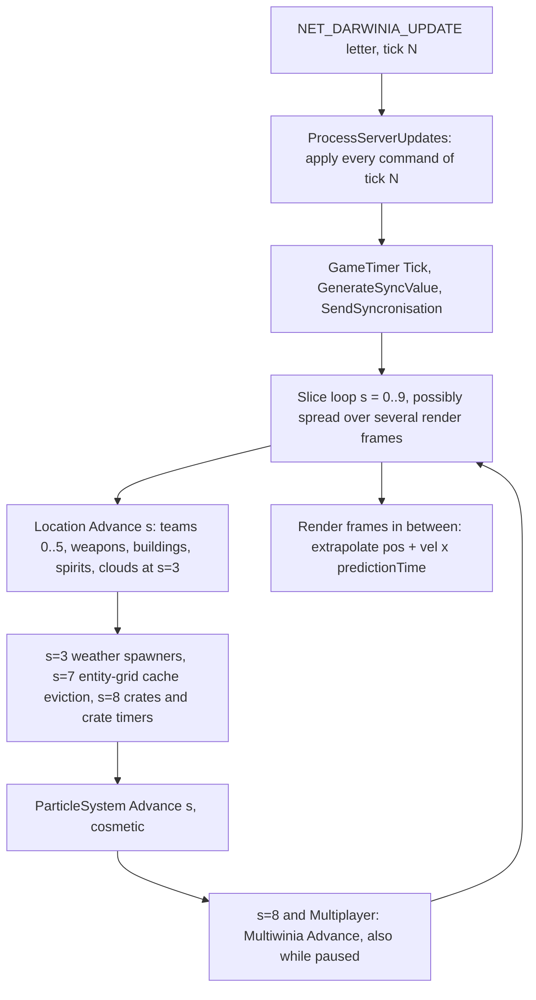
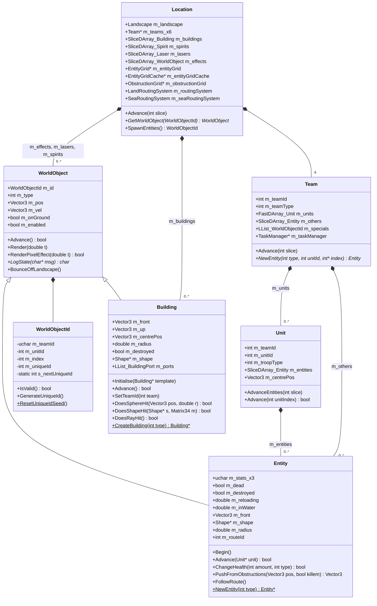
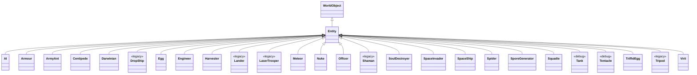
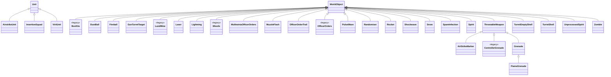

# 21 — Simulation and entity model

> Part B · Baseline build: Release|Win32 (OpenGL) + TARGET_PC_FULLGAME ([B:FULL]); see _work/build_matrix.md.
> Evidence: [C] confirmed · [I] inferred · [U] unknown. Citations are `path:Symbol` relative to the multiwinia/ source root.
> Sources merged: P03_entity_core (identity, WorldObject/Entity base, spatial partitioning, routing, class hierarchy of all 159 `code/worldobject` classes), P01_app_core (Location containers, level-load order, per-slice update order, Team/LobbyTeam/Unit, TeamControls), P14_platform_lib (container types, slot reuse, iteration order), X3_determinism_sync (simulated vs cosmetic classification, render-writes-sim scan, local-state leaks, id allocation), cross-partition notes in `_work/routed/_meta_*.md`, coordinator log `_work/phase2_log.md`; re-verified against the code by S21.

## Contents

- [1 Scope and the model at a glance](#1-scope-and-the-model-at-a-glance)
- [2 Class hierarchy (every class)](#2-class-hierarchy-every-class)
- [3 Object identity and handles](#3-object-identity-and-handles)
- [4 Base-class contracts](#4-base-class-contracts)
- [5 Location: containers, creation, removal and update ordering](#5-location-containers-creation-removal-and-update-ordering)
- [6 Spatial partitioning](#6-spatial-partitioning)
- [7 Pathfinding and routing](#7-pathfinding-and-routing)
- [8 Collision and physics approximations](#8-collision-and-physics-approximations)
- [9 Team and ownership model](#9-team-and-ownership-model)
- [10 Simulated state versus render state](#10-simulated-state-versus-render-state)
- [11 Guidance for the new engine's entity model](#11-guidance-for-the-new-engines-entity-model)
- [12 Constants](#12-constants)
- [Open questions and unknowns](#open-questions-and-unknowns)
- [Docs-vs-code discrepancies](#docs-vs-code-discrepancies)
- [IP items](#ip-items)
- [Source map](#source-map)
- [Appendix — dead/legacy code](#appendix--deadlegacy-code)

## 1 Scope and the model at a glance

This document specifies the engine-level object model of a match: what kinds of simulated objects exist, how they are identified, stored, created, advanced, removed and found in space, how they move, collide and find paths, who owns them, and how simulated state is kept apart from what is drawn. Per-type behaviour (state machines, stats, weapons) lives in [02](02_units_and_entities.md) (entities), [03](03_buildings_and_world_objects.md) (buildings) and [04](04_crates_powerups_and_weapons.md) (crates, weapons, effects); the main loop, tick clock and threads in [20](20_architecture.md); lockstep networking, RNG and float determinism in [22](22_determinism_and_networking.md); terrain queries in [23](23_terrain_and_landscape.md); render passes in [24](24_rendering.md).

Summary [C] unless tagged:

- One `Location` object (`g_app->m_location`) owns everything simulated in a match: the landscape, six `Team` slots, the building/effect/laser/spirit containers, an entity grid, its query cache, an obstruction grid and two routing systems [C] `code/location.h:Location`.
- Every simulated object derives from `WorldObject` (position, velocity, type, `WorldObjectId`). Three families: `Entity` (units, owned by a team), `Building` (level-placed or runtime-created static objects) and "effects" (`WorldObject` subclasses in `Location::m_effects`, plus `Laser` and `Spirit` stored by value) [C] `code/worldobject/worldobject.h`.
- Objects are addressed by a weak four-field handle `WorldObjectId(team, unit, index, uniqueId)` that is re-resolved on every use [C] `code/location.cpp:Location::GetWorldObject`.
- The simulation is lockstep: one server tick (one `NET_DARWINIA_UPDATE` letter, 0.1 s of real time, `0.1 × gameSpeed` of game time) is executed as 10 *slices*; every slice-partitioned container advances one tenth of its slots per slice, so every object advances exactly once per tick with `dt = SERVER_ADVANCE_PERIOD` [C] `code/network/clienttoserver.cpp:ClientToServer::ProcessAllServerLetters`, `code/lib/slice_darray.cpp:SliceDArray::GetNextSliceBounds` ([20 §10.3](20_architecture.md#103-client-tick-and-slices)).
- `Advance()` returning **true** means "remove and delete me" for every object family; the container owner performs the removal and its side effects (grid removal, obstruction-grid rebuild, AI-link rebuild) [C] `code/team.cpp:Team::Advance`, `code/location.cpp:Location::AdvanceBuildings`.
- Rendering never stores interpolated state: renderers receive a prediction time and extrapolate `pos + vel × t` [C] ([§10.2](#102-prediction-time-extrapolation-not-interpolation)).

## 2 Class hierarchy (every class)

### 2.1 Inventory and method

- The class list is every `class X [: public Y]` declaration in the 85 headers of `code/worldobject/` (all compiled into the baseline) — **159 classes**: 142 derive from a base, 17 have none [C] `_work/drafts/P03_worldobject_classes.csv` (generated by `_work/scripts/P03_classdiag.py`), cross-checked by `_work/scripts/S_21_classdiagram.py verify`, which re-extracts the list with the coverage checker's regex (159 = 159, no difference).
- `Unit` (base of `AirstrikeUnit`, `InsertionSquad`, `ViriiUnit`) is declared in `code/unit.h`, not in `code/worldobject/`; it is drawn in the diagrams but not counted [C] `code/unit.h:Unit`.
- No `code/worldobject` class uses non-public or multiple inheritance, and no class outside `code/worldobject` derives from `WorldObject`, `Entity` or `Building` [C] grep of `: public WorldObject`, `: public Entity`, `: public Building` over `code/`.
- Counts by family: `Entity` and its 26 subclasses (27), `Building` and its 83 subclasses (84), 31 other `WorldObject`-derived or `Unit`-derived classes, `WorldObject` itself, and 16 helper classes with no `WorldObject` ancestry [C] script output.
- Diagrams 2.3–2.7 are generated by `_work/scripts/S_21_classdiagram.py gen` from `_work/class_assignment.csv`; classes tagged `<<legacy>>` are compiled but unreachable in Multiwinia ([B:LEGACY]), `<<debug>>` only reachable under `TARGET_DEBUG`. The table in §2.8 gives every class's base, header, build tag and the heading of its behaviour specification.

### 2.2 Framework types (members that the rest of this document relies on)

Member types are written with `_` in place of template brackets for diagram compatibility (`SliceDArray_Building` = `SliceDArray<Building*>`; `m_teams_x6` = `Team *m_teams[NUM_TEAMS]`). Full member tables: `WorldObjectId`/`WorldObject`/`Entity` in [02 §3](02_units_and_entities.md#3-framework-classes), `Building` in [03 §3.2](03_buildings_and_world_objects.md#32-data-members), `Location` in [§5.1](#51-location-members), `Team`/`Unit` in [§9](#9-team-and-ownership-model).

#### 2.3 Entity subclasses — 27 classes (Entity and every class derived from it)

#### 2.4 Building intermediate bases and their subclasses — 45 classes

```mermaid
classDiagram
    WorldObject <|-- Building
    Building <|-- BlueprintBuilding
    Building <|-- CarryableBuilding
    Building <|-- DynamicBase
    Building <|-- FuelBuilding
    Building <|-- Incubator
    Building <|-- MineBuilding
    Building <|-- PowerBuilding
    Building <|-- ReceiverBuilding
    Building <|-- SpawnBuilding
    Building <|-- Teleport
    BlueprintBuilding <|-- BlueprintConsole
    BlueprintBuilding <|-- BlueprintRelay
    BlueprintBuilding <|-- BlueprintStore
    CarryableBuilding <|-- ChessPiece
    CarryableBuilding <|-- Statue
    CarryableBuilding <|-- WallBuster
    DynamicBase <|-- DynamicHub
    DynamicBase <|-- DynamicNode
    FuelBuilding <|-- EscapeRocket
    FuelBuilding <|-- FuelGenerator
    FuelBuilding <|-- FuelPipe
    FuelBuilding <|-- FuelStation
    Incubator <|-- CloneLab
    MineBuilding <|-- Mine
    MineBuilding <|-- Refinery
    MineBuilding <|-- TrackEnd
    MineBuilding <|-- TrackJunction
    MineBuilding <|-- TrackLink
    MineBuilding <|-- TrackStart
    PowerBuilding <|-- Generator
    PowerBuilding <|-- PowerSplitter
    PowerBuilding <|-- Pylon
    PowerBuilding <|-- PylonEnd
    PowerBuilding <|-- PylonStart
    PowerBuilding <|-- SolarPanel
    ReceiverBuilding <|-- ReceiverLink
    ReceiverBuilding <|-- ReceiverSpiritSpawner
    ReceiverBuilding <|-- SpiritProcessor
    ReceiverBuilding <|-- SpiritReceiver
    SpawnBuilding <|-- MasterSpawnPoint
    SpawnBuilding <|-- SpawnLink
    SpawnBuilding <|-- SpawnPoint
    Teleport <|-- Bridge
    Teleport <|-- RadarDish
    <<legacy>> BlueprintBuilding
    <<legacy>> BlueprintConsole
    <<legacy>> BlueprintRelay
    <<legacy>> BlueprintStore
    <<legacy>> Bridge
    <<legacy>> ChessPiece
    <<legacy>> DynamicBase
    <<legacy>> DynamicHub
    <<legacy>> DynamicNode
    <<legacy>> Generator
    <<legacy>> Mine
    <<legacy>> MineBuilding
    <<legacy>> PylonStart
    <<legacy>> ReceiverBuilding
    <<legacy>> ReceiverLink
    <<legacy>> ReceiverSpiritSpawner
    <<legacy>> Refinery
    <<legacy>> SpiritProcessor
    <<legacy>> SpiritReceiver
    <<legacy>> TrackEnd
    <<legacy>> TrackJunction
    <<legacy>> TrackLink
    <<legacy>> TrackStart
```

#### 2.5 Building direct leaf subclasses — 39 classes

```mermaid
classDiagram
    Building <|-- AIObjective
    Building <|-- AIObjectiveMarker
    Building <|-- AISpawnPoint
    Building <|-- AITarget
    Building <|-- AntHill
    Building <|-- Cave
    Building <|-- ChessBase
    Building <|-- ConstructionYard
    Building <|-- ControlStation
    Building <|-- ControlTower
    Building <|-- Crate
    Building <|-- DisplayScreen
    Building <|-- EruptionMarker
    Building <|-- Factory
    Building <|-- FeedingTube
    Building <|-- FenceSwitch
    Building <|-- GodDish
    Building <|-- GunTurret
    Building <|-- JumpPad
    Building <|-- LaserFence
    Building <|-- Library
    Building <|-- MultiwiniaZone
    Building <|-- Portal
    Building <|-- Powerstation
    Building <|-- PrimaryUpgradePort
    Building <|-- PulseBomb
    Building <|-- ResearchItem
    Building <|-- RestrictionZone
    Building <|-- SafeArea
    Building <|-- ScriptTrigger
    Building <|-- SmokeMarker
    Building <|-- Spam
    Building <|-- SpawnPopulationLock
    Building <|-- StaticShape
    Building <|-- Tree
    Building <|-- Triffid
    Building <|-- TrunkPort
    Building <|-- UpgradePort
    Building <|-- Wall
    <<legacy>> AISpawnPoint
    <<legacy>> Cave
    <<legacy>> ChessBase
    <<legacy>> ConstructionYard
    <<legacy>> DisplayScreen
    <<legacy>> Factory
    <<legacy>> FeedingTube
    <<legacy>> FenceSwitch
    <<legacy>> GodDish
    <<legacy>> Library
    <<debug>> Portal
    <<legacy>> Powerstation
    <<legacy>> PrimaryUpgradePort
    <<legacy>> ResearchItem
    <<legacy>> SafeArea
    <<legacy>> ScriptTrigger
    <<legacy>> Spam
    <<legacy>> UpgradePort
```

#### 2.6 Other WorldObject-derived classes (effects, weapons, spirits, order markers) and Unit subclasses — 32 classes

#### 2.7 Helper classes with no WorldObject ancestry — 16 classes, with their owners

#### 2.8 Every class: base, header, build tag, behaviour specification

Generated by `_work/scripts/S_21_classdiagram.py` from `_work/class_assignment.csv` (the class list is the one the coverage checker extracts from `code/worldobject/*.h`). "Spec" links to the heading in the final document that carries the class's behaviour specification. Build tags: `_work/build_matrix.md` §7.

| # | Class | Base | Header | Build tag | Spec |
|---|---|---|---|---|---|
| 1 | `AI` | `Entity` | `code/worldobject/ai.h` | [B:FULL] | [02 — 24 AI](02_units_and_entities.md#24-ai) |
| 2 | `AIObjective` | `Building` | `code/worldobject/aiobjective.h` | [B:FULL] | [03 — 10.2 AIObjective](03_buildings_and_world_objects.md#102-aiobjective) |
| 3 | `AIObjectiveMarker` | `Building` | `code/worldobject/aiobjective.h` | [B:FULL] | [03 — 10.3 AIObjectiveMarker](03_buildings_and_world_objects.md#103-aiobjectivemarker) |
| 4 | `AirStrikeMarker` | `ThrowableWeapon` | `code/worldobject/weapons.h` | [B:FULL] | [04 — 6.5 AirStrikeMarker](04_crates_powerups_and_weapons.md#65-airstrikemarker) |
| 5 | `AirstrikeUnit` | `Unit` | `code/worldobject/airstrike.h` | [B:FULL] | [02 — 11.1 AirstrikeUnit and SpaceInvader — role and acquisition](02_units_and_entities.md#111-airstrikeunit-and-spaceinvader--role-and-acquisition) |
| 6 | `AISpawnPoint` | `Building` | `code/worldobject/ai.h` | [B:LEGACY] | [03 — 10.4 AISpawnPoint](03_buildings_and_world_objects.md#104-aispawnpoint) |
| 7 | `AITarget` | `Building` | `code/worldobject/ai.h` | [B:FULL] | [03 — 10.1 AITarget](03_buildings_and_world_objects.md#101-aitarget) |
| 8 | `AntHill` | `Building` | `code/worldobject/anthill.h` | [B:FULL] | [03 — 9.1 AntHill](03_buildings_and_world_objects.md#91-anthill) |
| 9 | `Armour` | `Entity` | `code/worldobject/armour.h` | [B:FULL] | [02 — 8 Armour](02_units_and_entities.md#8-armour) |
| 10 | `ArmyAnt` | `Entity` | `code/worldobject/armyant.h` | [B:FULL] | [02 — 13 ArmyAnt](02_units_and_entities.md#13-armyant) |
| 11 | `BlueprintBuilding` | `Building` | `code/worldobject/blueprintstore.h` | [B:LEGACY] | [03 — 12.11 BlueprintBuilding](03_buildings_and_world_objects.md#1211-blueprintbuilding) |
| 12 | `BlueprintConsole` | `BlueprintBuilding` | `code/worldobject/blueprintstore.h` | [B:LEGACY] | [03 — 12.13 BlueprintConsole](03_buildings_and_world_objects.md#1213-blueprintconsole) |
| 13 | `BlueprintRelay` | `BlueprintBuilding` | `code/worldobject/blueprintstore.h` | [B:LEGACY] | [03 — 12.14 BlueprintRelay](03_buildings_and_world_objects.md#1214-blueprintrelay) |
| 14 | `BlueprintStore` | `BlueprintBuilding` | `code/worldobject/blueprintstore.h` | [B:LEGACY] | [03 — 12.12 BlueprintStore](03_buildings_and_world_objects.md#1212-blueprintstore) |
| 15 | `BoxKite` | `WorldObject` | `code/worldobject/darwinian.h` | [B:LEGACY] | [04 — 6.22 BoxKite](04_crates_powerups_and_weapons.md#622-boxkite) |
| 16 | `Bridge` | `Teleport` | `code/worldobject/bridge.h` | [B:LEGACY] | [03 — 12.15 Bridge](03_buildings_and_world_objects.md#1215-bridge) |
| 17 | `Building` | `WorldObject` | `code/worldobject/building.h` | [B:FULL] | [03 — 3.1 Building](03_buildings_and_world_objects.md#31-building) |
| 18 | `BuildingPort` | — | `code/worldobject/building.h` | [B:FULL] | [03 — 3.3 BuildingPort](03_buildings_and_world_objects.md#33-buildingport) |
| 19 | `CarryableBuilding` | `Building` | `code/worldobject/carryablebuilding.h` | [B:FULL] | [03 — 8.3 CarryableBuilding](03_buildings_and_world_objects.md#83-carryablebuilding) |
| 20 | `Cave` | `Building` | `code/worldobject/cave.h` | [B:LEGACY] | [03 — 12.16 Cave](03_buildings_and_world_objects.md#1216-cave) |
| 21 | `Centipede` | `Entity` | `code/worldobject/centipede.h` | [B:FULL] | [02 — 18 Centipede](02_units_and_entities.md#18-centipede) |
| 22 | `ChessBase` | `Building` | `code/worldobject/chess.h` | [B:LEGACY] | [03 — 12.17 ChessBase](03_buildings_and_world_objects.md#1217-chessbase) |
| 23 | `ChessPiece` | `CarryableBuilding` | `code/worldobject/chess.h` | [B:LEGACY] | [03 — 12.18 ChessPiece](03_buildings_and_world_objects.md#1218-chesspiece) |
| 24 | `CloneLab` | `Incubator` | `code/worldobject/clonelab.h` | [B:FULL] (loadable; no shipped map) | [03 — 11.3 CloneLab](03_buildings_and_world_objects.md#113-clonelab) |
| 25 | `ConstructionYard` | `Building` | `code/worldobject/constructionyard.h` | [B:LEGACY] | [03 — 12.1 ConstructionYard](03_buildings_and_world_objects.md#121-constructionyard) |
| 26 | `ControllerGrenade` | `ThrowableWeapon` | `code/worldobject/weapons.h` | [B:LEGACY] | [04 — 6.17 ControllerGrenade](04_crates_powerups_and_weapons.md#617-controllergrenade) |
| 27 | `ControlStation` | `Building` | `code/worldobject/controlstation.h` | [B:FULL] | [03 — 5.4 ControlStation](03_buildings_and_world_objects.md#54-controlstation) |
| 28 | `ControlTower` | `Building` | `code/worldobject/controltower.h` | [B:FULL] (loadable; no shipped map) | [03 — 11.1 ControlTower](03_buildings_and_world_objects.md#111-controltower) |
| 29 | `Crate` | `Building` | `code/worldobject/crate.h` | [B:FULL] | [04 — 1 Crate lifecycle](04_crates_powerups_and_weapons.md#1-crate-lifecycle) |
| 30 | `Darwinian` | `Entity` | `code/worldobject/darwinian.h` | [B:FULL] | [02 — 4 Darwinian](02_units_and_entities.md#4-darwinian) |
| 31 | `DisplayScreen` | `Building` | `code/worldobject/constructionyard.h` | [B:LEGACY] | [03 — 12.2 DisplayScreen](03_buildings_and_world_objects.md#122-displayscreen) |
| 32 | `DropShip` | `Entity` | `code/worldobject/dropship.h` | [B:LEGACY] | [02 — 28 DropShip](02_units_and_entities.md#28-dropship) |
| 33 | `DustBall` | `WorldObject` | `code/worldobject/dustball.h` | [B:FULL] | [04 — 6.20 DustBall](04_crates_powerups_and_weapons.md#620-dustball) |
| 34 | `DynamicBase` | `Building` | `code/worldobject/generichub.h` | [B:LEGACY] | [03 — 12.20 DynamicBase](03_buildings_and_world_objects.md#1220-dynamicbase) |
| 35 | `DynamicHub` | `DynamicBase` | `code/worldobject/generichub.h` | [B:LEGACY] | [03 — 12.21 DynamicHub](03_buildings_and_world_objects.md#1221-dynamichub) |
| 36 | `DynamicNode` | `DynamicBase` | `code/worldobject/generichub.h` | [B:LEGACY] | [03 — 12.22 DynamicNode](03_buildings_and_world_objects.md#1222-dynamicnode) |
| 37 | `Egg` | `Entity` | `code/worldobject/egg.h` | [B:FULL] | [02 — 15 Egg](02_units_and_entities.md#15-egg) |
| 38 | `Engineer` | `Entity` | `code/worldobject/engineer.h` | [B:FULL] | [02 — 10 Engineer](02_units_and_entities.md#10-engineer) |
| 39 | `Entity` | `WorldObject` | `code/worldobject/entity.h` | [B:FULL] | [02 — 3.4 Entity — base class of all units](02_units_and_entities.md#34-entity--base-class-of-all-units) |
| 40 | `EntityBlueprint` | — | `code/worldobject/entity.h` | [B:FULL] | [02 — 3.5 EntityBlueprint — the stats.txt table](02_units_and_entities.md#35-entityblueprint--the-statstxt-table) |
| 41 | `EntityFoot` | — | `code/worldobject/entity_leg.h` | [B:FULL] | [02 — 20.1 EntityFoot — data](02_units_and_entities.md#201-entityfoot--data) |
| 42 | `EntityLeg` | — | `code/worldobject/entity_leg.h` | [B:FULL] | [02 — 20 EntityLeg](02_units_and_entities.md#20-entityleg) |
| 43 | `EruptionMarker` | `Building` | `code/worldobject/eruptionmarker.h` | [B:FULL] | [03 — 7.7 EruptionMarker](03_buildings_and_world_objects.md#77-eruptionmarker) |
| 44 | `EscapeRocket` | `FuelBuilding` | `code/worldobject/rocket.h` | [B:FULL] | [03 — 8.12 EscapeRocket](03_buildings_and_world_objects.md#812-escaperocket) |
| 45 | `Factory` | `Building` | `code/worldobject/factory.h` | [B:LEGACY] | [03 — 12.10 Factory](03_buildings_and_world_objects.md#1210-factory) |
| 46 | `FeedingTube` | `Building` | `code/worldobject/feedingtube.h` | [B:LEGACY] | [03 — 12.19 FeedingTube](03_buildings_and_world_objects.md#1219-feedingtube) |
| 47 | `FenceSwitch` | `Building` | `code/worldobject/switch.h` | [B:LEGACY] | [03 — 12.37 FenceSwitch](03_buildings_and_world_objects.md#1237-fenceswitch) |
| 48 | `Fireball` | `WorldObject` | `code/worldobject/weapons.h` | [B:FULL] | [04 — 6.10 Fireball](04_crates_powerups_and_weapons.md#610-fireball) |
| 49 | `Flag` | — | `code/worldobject/flag.h` | [B:FULL] | [03 — 8.2 Flag](03_buildings_and_world_objects.md#82-flag) |
| 50 | `FlameGrenade` | `Grenade` | `code/worldobject/weapons.h` | [B:FULL] | [04 — 6.4 FlameGrenade](04_crates_powerups_and_weapons.md#64-flamegrenade) |
| 51 | `FuelBuilding` | `Building` | `code/worldobject/rocket.h` | [B:FULL] | [03 — 8.8 FuelBuilding](03_buildings_and_world_objects.md#88-fuelbuilding) |
| 52 | `FuelGenerator` | `FuelBuilding` | `code/worldobject/rocket.h` | [B:FULL] | [03 — 8.9 FuelGenerator](03_buildings_and_world_objects.md#89-fuelgenerator) |
| 53 | `FuelPipe` | `FuelBuilding` | `code/worldobject/rocket.h` | [B:FULL] | [03 — 8.10 FuelPipe](03_buildings_and_world_objects.md#810-fuelpipe) |
| 54 | `FuelStation` | `FuelBuilding` | `code/worldobject/rocket.h` | [B:FULL] | [03 — 8.11 FuelStation](03_buildings_and_world_objects.md#811-fuelstation) |
| 55 | `Generator` | `PowerBuilding` | `code/worldobject/generator.h` | [B:LEGACY] | [03 — 6.6 Generator](03_buildings_and_world_objects.md#66-generator) |
| 56 | `GodDish` | `Building` | `code/worldobject/goddish.h` | [B:LEGACY] | [03 — 12.23 GodDish](03_buildings_and_world_objects.md#1223-goddish) |
| 57 | `Grenade` | `ThrowableWeapon` | `code/worldobject/weapons.h` | [B:FULL] | [04 — 6.3 Grenade](04_crates_powerups_and_weapons.md#63-grenade) |
| 58 | `GunTurret` | `Building` | `code/worldobject/gunturret.h` | [B:FULL] | [03 — 5.1 GunTurret](03_buildings_and_world_objects.md#51-gunturret) |
| 59 | `GunTurretTarget` | `WorldObject` | `code/worldobject/gunturret.h` | [B:FULL] | [04 — 6.21 GunTurretTarget](04_crates_powerups_and_weapons.md#621-gunturrettarget) |
| 60 | `Harvester` | `Entity` | `code/worldobject/harvester.h` | [B:FULL] | [02 — 9 Harvester](02_units_and_entities.md#9-harvester) |
| 61 | `HistoricWayPoint` | — | `code/worldobject/insertion_squad.h` | [B:FULL] | [02 — 7.7 HistoricWayPoint — squad breadcrumb](02_units_and_entities.md#77-historicwaypoint--squad-breadcrumb) |
| 62 | `Incubator` | `Building` | `code/worldobject/incubator.h` | [B:FULL] (loadable; no shipped map) | [03 — 11.2 Incubator](03_buildings_and_world_objects.md#112-incubator) |
| 63 | `InsertionSquad` | `Unit` | `code/worldobject/insertion_squad.h` | [B:FULL] | [02 — 7.1 InsertionSquad and Squadie — role and acquisition](02_units_and_entities.md#71-insertionsquad-and-squadie--role-and-acquisition) |
| 64 | `JumpPad` | `Building` | `code/worldobject/jumppad.h` | [B:FULL] | [03 — 5.5 JumpPad](03_buildings_and_world_objects.md#55-jumppad) |
| 65 | `Lander` | `Entity` | `code/worldobject/lander.h` | [B:LEGACY] | [02 — 31 Lander](02_units_and_entities.md#31-lander) |
| 66 | `LandMine` | `WorldObject` | `code/worldobject/weapons.h` | [B:LEGACY] (compiled, no caller) | [04 — 6.14 LandMine](04_crates_powerups_and_weapons.md#614-landmine) |
| 67 | `Laser` | `WorldObject` | `code/worldobject/weapons.h` | [B:FULL] | [04 — 6.7 Laser](04_crates_powerups_and_weapons.md#67-laser) |
| 68 | `LaserFence` | `Building` | `code/worldobject/laserfence.h` | [B:FULL] | [03 — 7.1 LaserFence](03_buildings_and_world_objects.md#71-laserfence) |
| 69 | `LaserTrooper` | `Entity` | `code/worldobject/lasertrooper.h` | [B:LEGACY] | [02 — 26 LaserTrooper](02_units_and_entities.md#26-lasertrooper) |
| 70 | `Library` | `Building` | `code/worldobject/library.h` | [B:LEGACY] | [03 — 12.25 Library](03_buildings_and_world_objects.md#1225-library) |
| 71 | `Light` | — | `code/worldobject/worldobject.h` | [B:FULL] | [02 — 3.3 Light — level light record](02_units_and_entities.md#33-light--level-light-record) |
| 72 | `Lightning` | `WorldObject` | `code/worldobject/lightning.h` | [B:FULL] | [04 — 6.18 Lightning](04_crates_powerups_and_weapons.md#618-lightning) |
| 73 | `MasterSpawnPoint` | `SpawnBuilding` | `code/worldobject/spawnpoint.h` | [B:FULL] | [03 — 4.4 MasterSpawnPoint](03_buildings_and_world_objects.md#44-masterspawnpoint) |
| 74 | `Meteor` | `Entity` | `code/worldobject/meteor.h` | [B:FULL] | [02 — 22 Meteor](02_units_and_entities.md#22-meteor) |
| 75 | `Mine` | `MineBuilding` | `code/worldobject/mine.h` | [B:LEGACY] | [03 — 12.34 Mine](03_buildings_and_world_objects.md#1234-mine) |
| 76 | `MineBuilding` | `Building` | `code/worldobject/mine.h` | [B:LEGACY] | [03 — 12.27 MineBuilding](03_buildings_and_world_objects.md#1227-minebuilding) |
| 77 | `MineCart` | — | `code/worldobject/mine.h` | [B:LEGACY] | [03 — 12.28 MineCart](03_buildings_and_world_objects.md#1228-minecart) |
| 78 | `Missile` | `WorldObject` | `code/worldobject/weapons.h` | [B:LEGACY] (compiled, no caller) | [04 — 6.13 Missile](04_crates_powerups_and_weapons.md#613-missile) |
| 79 | `MultiwiniaOfficerOrders` | `WorldObject` | `code/worldobject/officer.h` | [B:FULL] | [02 — 5.8 OfficerOrders, MultiwiniaOfficerOrders, OfficerOrderTrail — order effects](02_units_and_entities.md#58-officerorders-multiwiniaofficerorders-officerordertrail--order-effects) |
| 80 | `MultiwiniaZone` | `Building` | `code/worldobject/multiwiniazone.h` | [B:FULL] | [03 — 8.1 MultiwiniaZone](03_buildings_and_world_objects.md#81-multiwiniazone) |
| 81 | `MuzzleFlash` | `WorldObject` | `code/worldobject/weapons.h` | [B:FULL] | [04 — 6.12 MuzzleFlash](04_crates_powerups_and_weapons.md#612-muzzleflash) |
| 82 | `Nuke` | `Entity` | `code/worldobject/nuke.h` | [B:FULL] | [02 — 12 Nuke](02_units_and_entities.md#12-nuke) |
| 83 | `Officer` | `Entity` | `code/worldobject/officer.h` | [B:FULL] | [02 — 5 Officer](02_units_and_entities.md#5-officer) |
| 84 | `OfficerFormation` | — | `code/worldobject/officer.h` | [B:FULL] | [02 — 5.6 OfficerFormation — formation slot](02_units_and_entities.md#56-officerformation--formation-slot) |
| 85 | `OfficerOrders` | `WorldObject` | `code/worldobject/officer.h` | [B:LEGACY] | [02 — 5.8 OfficerOrders, MultiwiniaOfficerOrders, OfficerOrderTrail — order effects](02_units_and_entities.md#58-officerorders-multiwiniaofficerorders-officerordertrail--order-effects) |
| 86 | `OfficerOrderTrail` | `WorldObject` | `code/worldobject/officer.h` | [B:FULL] | [02 — 5.8 OfficerOrders, MultiwiniaOfficerOrders, OfficerOrderTrail — order effects](02_units_and_entities.md#58-officerorders-multiwiniaofficerorders-officerordertrail--order-effects) |
| 87 | `Portal` | `Building` | `code/worldobject/portal.h` | [B:DEBUG] | [03 — 9.3 Portal](03_buildings_and_world_objects.md#93-portal) |
| 88 | `PowerBuilding` | `Building` | `code/worldobject/generator.h` | [B:FULL] | [03 — 6.1 PowerBuilding](03_buildings_and_world_objects.md#61-powerbuilding) |
| 89 | `PowerSplitter` | `PowerBuilding` | `code/worldobject/generator.h` | [B:FULL] | [03 — 6.5 PowerSplitter](03_buildings_and_world_objects.md#65-powersplitter) |
| 90 | `Powerstation` | `Building` | `code/worldobject/powerstation.h` | [B:LEGACY] | [03 — 6.8 Powerstation](03_buildings_and_world_objects.md#68-powerstation) |
| 91 | `PrimaryUpgradePort` | `Building` | `code/worldobject/upgrade_port.h` | [B:LEGACY] | [03 — 12.39 PrimaryUpgradePort](03_buildings_and_world_objects.md#1239-primaryupgradeport) |
| 92 | `PulseBomb` | `Building` | `code/worldobject/pulsebomb.h` | [B:FULL] | [03 — 8.7 PulseBomb](03_buildings_and_world_objects.md#87-pulsebomb) |
| 93 | `PulseWave` | `WorldObject` | `code/worldobject/weapons.h` | [B:FULL] | [04 — 6.15 PulseWave](04_crates_powerups_and_weapons.md#615-pulsewave) |
| 94 | `Pylon` | `PowerBuilding` | `code/worldobject/generator.h` | [B:FULL] | [03 — 6.3 Pylon](03_buildings_and_world_objects.md#63-pylon) |
| 95 | `PylonEnd` | `PowerBuilding` | `code/worldobject/generator.h` | [B:FULL] | [03 — 6.4 PylonEnd](03_buildings_and_world_objects.md#64-pylonend) |
| 96 | `PylonStart` | `PowerBuilding` | `code/worldobject/generator.h` | [B:LEGACY] | [03 — 6.7 PylonStart](03_buildings_and_world_objects.md#67-pylonstart) |
| 97 | `RadarDish` | `Teleport` | `code/worldobject/radardish.h` | [B:FULL] | [03 — 5.3 RadarDish](03_buildings_and_world_objects.md#53-radardish) |
| 98 | `Randomiser` | `WorldObject` | `code/worldobject/randomiser.h` | [B:FULL] | [03 — 9.4 Randomiser](03_buildings_and_world_objects.md#94-randomiser) |
| 99 | `ReceiverBuilding` | `Building` | `code/worldobject/spiritreceiver.h` | [B:LEGACY] | [03 — 12.3 ReceiverBuilding](03_buildings_and_world_objects.md#123-receiverbuilding) |
| 100 | `ReceiverLink` | `ReceiverBuilding` | `code/worldobject/spiritreceiver.h` | [B:LEGACY] | [03 — 12.5 ReceiverLink](03_buildings_and_world_objects.md#125-receiverlink) |
| 101 | `ReceiverSpiritSpawner` | `ReceiverBuilding` | `code/worldobject/spiritreceiver.h` | [B:LEGACY] | [03 — 12.6 ReceiverSpiritSpawner](03_buildings_and_world_objects.md#126-receiverspiritspawner) |
| 102 | `Refinery` | `MineBuilding` | `code/worldobject/mine.h` | [B:LEGACY] | [03 — 12.33 Refinery](03_buildings_and_world_objects.md#1233-refinery) |
| 103 | `ResearchItem` | `Building` | `code/worldobject/researchitem.h` | [B:LEGACY] | [03 — 12.26 ResearchItem](03_buildings_and_world_objects.md#1226-researchitem) |
| 104 | `RestrictionZone` | `Building` | `code/worldobject/restrictionzone.h` | [B:FULL] | [03 — 7.5 RestrictionZone](03_buildings_and_world_objects.md#75-restrictionzone) |
| 105 | `Rocket` | `WorldObject` | `code/worldobject/weapons.h` | [B:FULL] | [04 — 6.6 Rocket](04_crates_powerups_and_weapons.md#66-rocket) |
| 106 | `SafeArea` | `Building` | `code/worldobject/safearea.h` | [B:LEGACY] | [03 — 12.35 SafeArea](03_buildings_and_world_objects.md#1235-safearea) |
| 107 | `ScriptTrigger` | `Building` | `code/worldobject/scripttrigger.h` | [B:LEGACY] | [03 — 12.36 ScriptTrigger](03_buildings_and_world_objects.md#1236-scripttrigger) |
| 108 | `Shaman` | `Entity` | `code/worldobject/shaman.h` | [B:LEGACY] | [02 — 27 Shaman](02_units_and_entities.md#27-shaman) |
| 109 | `Shockwave` | `WorldObject` | `code/worldobject/weapons.h` | [B:FULL] | [04 — 6.11 Shockwave](04_crates_powerups_and_weapons.md#611-shockwave) |
| 110 | `SmokeMarker` | `Building` | `code/worldobject/smokemarker.h` | [B:FULL] | [03 — 7.6 SmokeMarker](03_buildings_and_world_objects.md#76-smokemarker) |
| 111 | `Snow` | `WorldObject` | `code/worldobject/snow.h` | [B:FULL] | [04 — 6.19 Snow](04_crates_powerups_and_weapons.md#619-snow) |
| 112 | `SolarPanel` | `PowerBuilding` | `code/worldobject/generator.h` | [B:FULL] | [03 — 6.2 SolarPanel](03_buildings_and_world_objects.md#62-solarpanel) |
| 113 | `SoulDestroyer` | `Entity` | `code/worldobject/souldestroyer.h` | [B:FULL] | [02 — 21 SoulDestroyer](02_units_and_entities.md#21-souldestroyer) |
| 114 | `SpaceInvader` | `Entity` | `code/worldobject/airstrike.h` | [B:FULL] | [02 — 11.4 SpaceInvader — behaviour](02_units_and_entities.md#114-spaceinvader--behaviour) |
| 115 | `SpaceShip` | `Entity` | `code/worldobject/spaceship.h` | [B:FULL] | [02 — 23 SpaceShip](02_units_and_entities.md#23-spaceship) |
| 116 | `Spam` | `Building` | `code/worldobject/spam.h` | [B:LEGACY] | [03 — 12.24 Spam](03_buildings_and_world_objects.md#1224-spam) |
| 117 | `SpamInfection` | `WorldObject` | `code/worldobject/spam.h` | [B:FULL] | [04 — 6.16 SpamInfection](04_crates_powerups_and_weapons.md#616-spaminfection) |
| 118 | `SpawnBuilding` | `Building` | `code/worldobject/spawnpoint.h` | [B:FULL] | [03 — 4.2 SpawnBuilding](03_buildings_and_world_objects.md#42-spawnbuilding) |
| 119 | `SpawnBuildingLink` | — | `code/worldobject/spawnpoint.h` | [B:FULL] | [03 — SpawnBuildingLink](03_buildings_and_world_objects.md#spawnbuildinglink) |
| 120 | `SpawnBuildingSpirit` | — | `code/worldobject/spawnpoint.h` | [B:FULL] | [03 — SpawnBuildingSpirit](03_buildings_and_world_objects.md#spawnbuildingspirit) |
| 121 | `SpawnLink` | `SpawnBuilding` | `code/worldobject/spawnpoint.h` | [B:FULL] | [03 — 4.3 SpawnLink](03_buildings_and_world_objects.md#43-spawnlink) |
| 122 | `SpawnPoint` | `SpawnBuilding` | `code/worldobject/spawnpoint.h` | [B:FULL] | [03 — 4.5 SpawnPoint](03_buildings_and_world_objects.md#45-spawnpoint) |
| 123 | `SpawnPopulationLock` | `Building` | `code/worldobject/spawnpoint.h` | [B:FULL] | [03 — 4.6 SpawnPopulationLock](03_buildings_and_world_objects.md#46-spawnpopulationlock) |
| 124 | `Spider` | `Entity` | `code/worldobject/spider.h` | [B:FULL] | [02 — 19 Spider](02_units_and_entities.md#19-spider) |
| 125 | `SpiderParameters` | — | `code/worldobject/spider.h` | [B:FULL] | [02 — 19.6 SpiderParameters — gait parameter set](02_units_and_entities.md#196-spiderparameters--gait-parameter-set) |
| 126 | `Spirit` | `WorldObject` | `code/worldobject/spirit.h` | [B:FULL] | [02 — 6 Spirit](02_units_and_entities.md#6-spirit) |
| 127 | `SpiritProcessor` | `ReceiverBuilding` | `code/worldobject/spiritreceiver.h` | [B:LEGACY] | [03 — 12.4 SpiritProcessor](03_buildings_and_world_objects.md#124-spiritprocessor) |
| 128 | `SpiritReceiver` | `ReceiverBuilding` | `code/worldobject/spiritreceiver.h` | [B:LEGACY] | [03 — 12.7 SpiritReceiver](03_buildings_and_world_objects.md#127-spiritreceiver) |
| 129 | `SpiritStore` | — | `code/worldobject/spiritstore.h` | [B:LEGACY] | [03 — 12.9 SpiritStore](03_buildings_and_world_objects.md#129-spiritstore) |
| 130 | `SporeGenerator` | `Entity` | `code/worldobject/sporegenerator.h` | [B:FULL] | [02 — 17 SporeGenerator](02_units_and_entities.md#17-sporegenerator) |
| 131 | `Squadie` | `Entity` | `code/worldobject/insertion_squad.h` | [B:FULL] | [02 — 7.2 Squadie — stats and constants](02_units_and_entities.md#72-squadie--stats-and-constants) |
| 132 | `StaticShape` | `Building` | `code/worldobject/staticshape.h` | [B:FULL] | [03 — 7.4 StaticShape](03_buildings_and_world_objects.md#74-staticshape) |
| 133 | `Statue` | `CarryableBuilding` | `code/worldobject/statue.h` | [B:FULL] | [03 — 8.4 Statue](03_buildings_and_world_objects.md#84-statue) |
| 134 | `Tank` | `Entity` | `code/worldobject/tank.h` | [B:DEBUG] (TankBattle); unreachable in FULL | [02 — 25 Tank](02_units_and_entities.md#25-tank) |
| 135 | `Teleport` | `Building` | `code/worldobject/teleport.h` | [B:FULL] | [03 — 5.2 Teleport](03_buildings_and_world_objects.md#52-teleport) |
| 136 | `Tentacle` | `Entity` | `code/worldobject/tentacle.h` | [B:DEBUG] (via Portal / The Beast) | [02 — 30 Tentacle](02_units_and_entities.md#30-tentacle) |
| 137 | `ThrowableWeapon` | `WorldObject` | `code/worldobject/weapons.h` | [B:FULL] | [04 — 6.2 ThrowableWeapon](04_crates_powerups_and_weapons.md#62-throwableweapon) |
| 138 | `TrackEnd` | `MineBuilding` | `code/worldobject/mine.h` | [B:LEGACY] | [03 — 12.32 TrackEnd](03_buildings_and_world_objects.md#1232-trackend) |
| 139 | `TrackJunction` | `MineBuilding` | `code/worldobject/mine.h` | [B:LEGACY] | [03 — 12.30 TrackJunction](03_buildings_and_world_objects.md#1230-trackjunction) |
| 140 | `TrackLink` | `MineBuilding` | `code/worldobject/mine.h` | [B:LEGACY] | [03 — 12.29 TrackLink](03_buildings_and_world_objects.md#1229-tracklink) |
| 141 | `TrackStart` | `MineBuilding` | `code/worldobject/mine.h` | [B:LEGACY] | [03 — 12.31 TrackStart](03_buildings_and_world_objects.md#1231-trackstart) |
| 142 | `Tree` | `Building` | `code/worldobject/tree.h` | [B:FULL] | [03 — 7.3 Tree](03_buildings_and_world_objects.md#73-tree) |
| 143 | `Triffid` | `Building` | `code/worldobject/triffid.h` | [B:FULL] | [03 — 9.2 Triffid](03_buildings_and_world_objects.md#92-triffid) |
| 144 | `TriffidEgg` | `Entity` | `code/worldobject/triffid.h` | [B:FULL] | [02 — 14 TriffidEgg](02_units_and_entities.md#14-triffidegg) |
| 145 | `Tripod` | `Entity` | `code/worldobject/tripod.h` | [B:LEGACY] | [02 — 29 Tripod](02_units_and_entities.md#29-tripod) |
| 146 | `TripodNavData` | — | `code/worldobject/tripod.h` | [B:LEGACY] | [02 — 29.2 TripodNavData — hex-direction navigator](02_units_and_entities.md#292-tripodnavdata--hex-direction-navigator) |
| 147 | `TrunkPort` | `Building` | `code/worldobject/trunkport.h` | [B:FULL] | [03 — 8.6 TrunkPort](03_buildings_and_world_objects.md#86-trunkport) |
| 148 | `TurretEmptyShell` | `WorldObject` | `code/worldobject/weapons.h` | [B:FULL] | [04 — 6.9 TurretEmptyShell](04_crates_powerups_and_weapons.md#69-turretemptyshell) |
| 149 | `TurretShell` | `WorldObject` | `code/worldobject/weapons.h` | [B:FULL] | [04 — 6.8 TurretShell](04_crates_powerups_and_weapons.md#68-turretshell) |
| 150 | `UnprocessedSpirit` | `WorldObject` | `code/worldobject/spiritreceiver.h` | [B:FULL] code path (soulrain level effect; no shipped map) | [03 — 12.8 UnprocessedSpirit](03_buildings_and_world_objects.md#128-unprocessedspirit) |
| 151 | `UpgradePort` | `Building` | `code/worldobject/upgrade_port.h` | [B:LEGACY] | [03 — 12.38 UpgradePort](03_buildings_and_world_objects.md#1238-upgradeport) |
| 152 | `Virii` | `Entity` | `code/worldobject/virii.h` | [B:FULL] | [02 — 16 Virii](02_units_and_entities.md#16-virii) |
| 153 | `ViriiHistory` | — | `code/worldobject/virii.h` | [B:FULL] | [02 — 16.7 ViriiHistory — trail sample](02_units_and_entities.md#167-viriihistory--trail-sample) |
| 154 | `ViriiUnit` | `Unit` | `code/worldobject/virii.h` | [B:FULL] | [02 — 16.6 ViriiUnit — Virii group container](02_units_and_entities.md#166-viriiunit--virii-group-container) |
| 155 | `Wall` | `Building` | `code/worldobject/wall.h` | [B:FULL] | [03 — 7.2 Wall](03_buildings_and_world_objects.md#72-wall) |
| 156 | `WallBuster` | `CarryableBuilding` | `code/worldobject/wallbuster.h` | [B:FULL] | [03 — 8.5 WallBuster](03_buildings_and_world_objects.md#85-wallbuster) |
| 157 | `WorldObject` | — | `code/worldobject/worldobject.h` | [B:FULL] | [02 — 3.2 WorldObject — base of all simulated objects](02_units_and_entities.md#32-worldobject--base-of-all-simulated-objects) |
| 158 | `WorldObjectId` | — | `code/worldobject/worldobject.h` | [B:FULL] | [02 — 3.1 WorldObjectId — object handle](02_units_and_entities.md#31-worldobjectid--object-handle) |
| 159 | `Zombie` | `WorldObject` | `code/worldobject/souldestroyer.h` | [B:FULL] | [02 — 21.6 Zombie — ghost effect](02_units_and_entities.md#216-zombie--ghost-effect) |

Totals: [B:DEBUG] 3, [B:FULL] 103, [B:LEGACY] 53; 159 classes.

## 3 Object identity and handles
