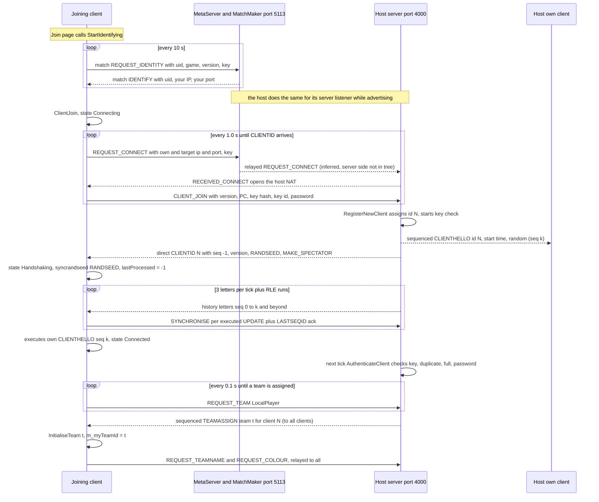
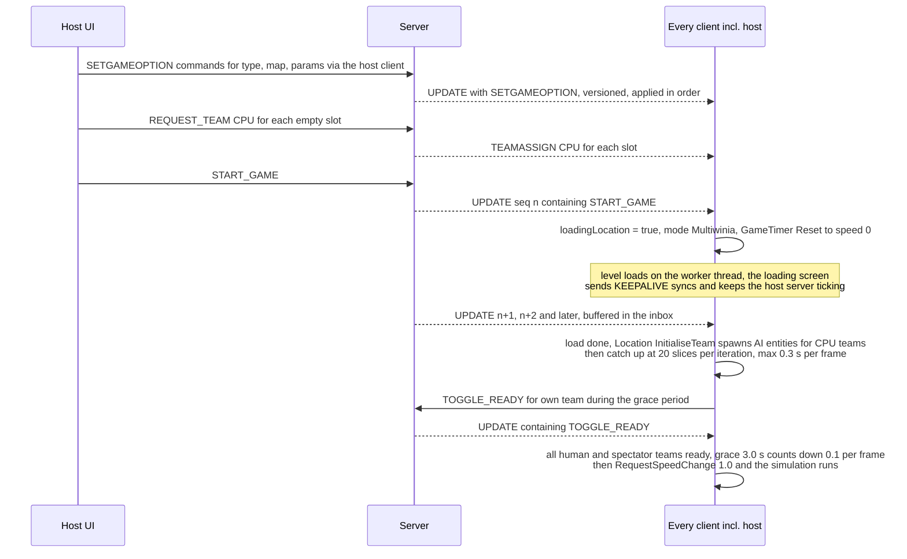
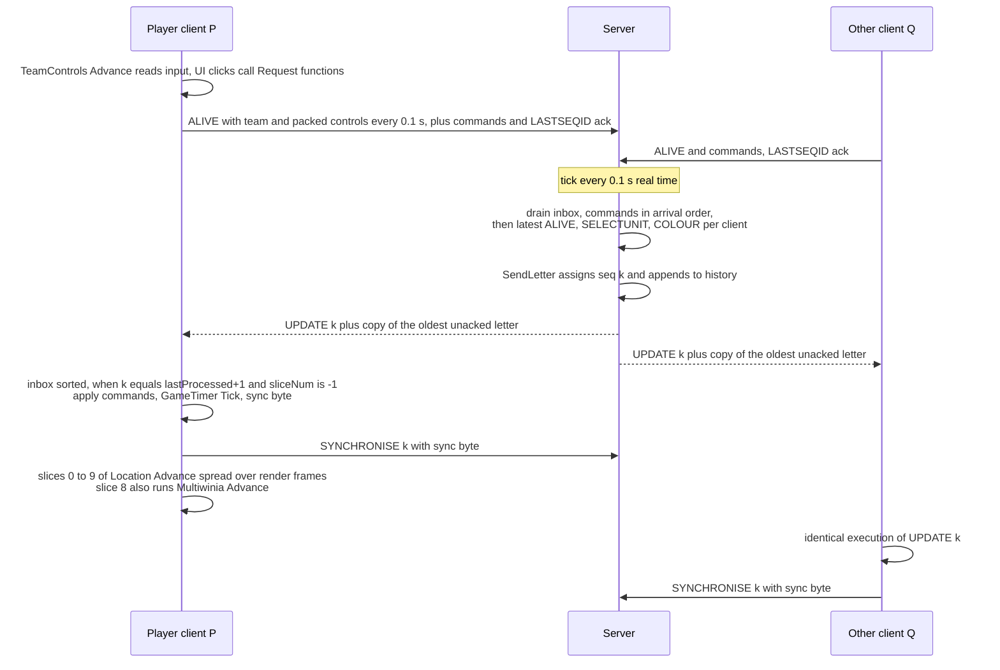
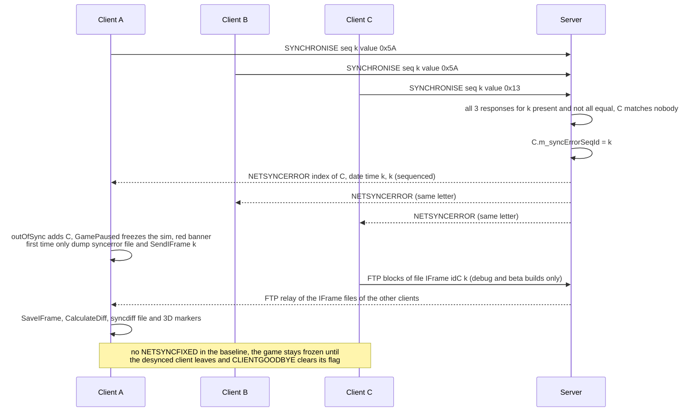

# 22 — Determinism and networking

> Part B · Baseline build: Release|Win32 (OpenGL) + TARGET_PC_FULLGAME ([B:FULL]); see _work/build_matrix.md.
> Evidence: [C] confirmed · [I] inferred · [U] unknown. Citations are `path:Symbol` relative to the multiwinia/ source root.
> Sources merged: P15_network (network model, protocol, sessions, metaserver), X3_determinism_sync (RNG, floating point, ordering, sync checking, leaks, risk register), P13_gfx_backend_math (numeric environment, math library), P14_platform_lib (RNG algorithms, hashing helpers), P01_app_core, P02_game_modes, P03_entity_core, P04_entities_military, P05_entities_creatures, P06_buildings_core, P07_buildings_misc, P08_crates_ai, P09_control_taskmanager, P10_input_camera, P11_terrain_world, P16_sound (determinism notes), routed `_meta_*` notes. Generated tables: `_work/scripts/S_22_rng_tables.py` over `_work/drafts/X3_syncrand_sites.csv`, `X3_unsynced_rng_sites.csv`, `X3_local_state_refs.csv`.

This document specifies how Multiwinia keeps several machines running one game: the relay-lockstep network model, the complete wire protocol, session lifecycle, sync checking, and the determinism discipline (random numbers, floating point, ordering, state classification) on which the model depends. The lobby **user interface** and server-browser screens are specified in [09 §5](09_meta_systems.md#5-multiplayer-front-end-versus-cpu-quick-match-lanwan-browser-hostjoin-lobby); this document specifies the **protocol** underneath them. Entity/container internals are in [21](21_simulation_and_entity_model.md); the main loop and threads in [20 §9–§11](20_architecture.md#9-main-loops).

## Contents

1. [Model overview](#1-model-overview)
2. [Timing and pacing](#2-timing-and-pacing)
3. [Transport — NetLib over UDP](#3-transport--netlib-over-udp)
4. [Wire encoding](#4-wire-encoding)
5. [Message catalogue](#5-message-catalogue)
6. [Server sequencing and client ordering](#6-server-sequencing-and-client-ordering)
7. [IFrames](#7-iframes)
8. [Session lifecycle](#8-session-lifecycle)
9. [Sync checking and desync handling](#9-sync-checking-and-desync-handling)
10. [Virtual (CPU) players in the network model](#10-virtual-cpu-players-in-the-network-model)
11. [Bandwidth, network quality, file transfer, demo limits, replay](#11-bandwidth-network-quality-file-transfer-demo-limits-replay)
12. [Lobby and server discovery protocol](#12-lobby-and-server-discovery-protocol)
13. [Threads and locking](#13-threads-and-locking)
14. [Determinism model](#14-determinism-model)
15. [Risk register for the new game](#15-risk-register-for-the-new-game)
16. [Constants](#16-constants)
- [Open questions and unknowns](#open-questions-and-unknowns)
- [Docs-vs-code discrepancies](#docs-vs-code-discrepancies)
- [IP items](#ip-items)
- [Source map](#source-map)
- [Appendix — dead/legacy code](#appendix--deadlegacy-code)

---

## 1 Model overview

### 1.1 At a glance

| Question | Answer | Evidence |
|---|---|---|
| Topology | **Star, client/server over UDP.** One process hosts a `Server`; every participant (including the host) runs a `ClientToServer`. Clients never talk to each other. | [C] `code/app.cpp:App::StartNetwork`, `code/network/server.cpp:Server::Initialise`, `code/network/clienttoserver.cpp:ClientToServer::ClientJoin` |
| Is the host also a client? | **Yes.** `App::StartNetwork(true,…)` creates `m_server` and then calls `m_clientToServer->ClientJoin()` in the same process. Host-client ↔ server traffic bypasses sockets: the host client hands letters straight to `Server::ReceiveLetter` (tagged with the host's LAN IP and client listen port), and the server hands letters whose `m_receiverId == m_clientToServer->m_clientId` straight to `ClientToServer::ReceiveLetter`. The host client nevertheless goes through exactly the same sequencing/ack pipeline as remote clients. | [C] `code/network/clienttoserver.cpp:ClientToServer::AdvanceSender`, `code/network/server.cpp:Server::AdvanceSender` |
| Dedicated server? | **No.** There is no headless mode; the server is always embedded in a game client. | [C] the only construction site of `Server` is `App::StartNetwork` (`code/app.cpp`) |
| Single player | Uses the identical pipeline: `App::StartSinglePlayerServer` → `StartNetwork(true, NULL, -1)` → server IP `"127.0.0.1"`, server port **−1**. `ClientToServer::GetServerPort() == -1` is the game-wide "single player" flag (no advertising, other joiners rejected, no kicking on authentication failure). | [C] `code/app.cpp:App::StartSinglePlayerServer`, `App::StartNetwork`; `code/network/server.cpp:Server::RegisterNewTeam`, `Server::Advertise`, `Server::AuthenticateClients` |
| Multiplayer host | `App::StartMultiPlayerServer` → `StartNetwork(true, NULL, NULL)`; port `NULL` (= 0) ≠ −1, so the host client joins its own LAN IP (`GetLocalHostIP`) at the server listener's port. | [C] `code/app.cpp:App::StartMultiPlayerServer` |
| Lockstep vs state sync | **Deterministic lockstep over a server-sequenced command stream ("relay lockstep").** The server never simulates authoritatively and never sends world state. Every 0.1 s of real time it packages all client commands received since the previous tick into one *UPDATE letter* with a monotonically increasing sequence id, appends it to an unbounded history and sends it to every client. Each client executes the letters strictly in sequence-id order; one UPDATE letter = one simulation *frame* of `0.1 × gameSpeed` game seconds, executed as 10 *slices*. Only a 1-byte checksum per frame flows back for desync detection. | [C] `code/network/server.cpp:Server::Advance`, `Server::SendLetter`; `code/network/clienttoserver.cpp:ClientToServer::ProcessAllServerLetters`, `ClientToServer::GetNextLetter` |
| Input delay | Not a fixed number of frames. A command takes effect at the start of the first UPDATE frame generated after the server receives it: delay = wait for the next server tick (0–100 ms) + one-way latency to the server + one-way latency back + client-side slice backlog (§2.4). The host experiences zero network latency but the same tick quantisation and buffering. | [C] pipeline; [I] composition of delays |
| Lobby | Runs **inside the same lockstep channel**: game options, team assignments, names, colours, chat, ready flags and START_GAME are all sequenced commands in the history. A late joiner reconstructs lobby state by replaying the full history from sequence id 0. | [C] `ClientToServer::ProcessServerUpdates`; `code/UI/WaitingButton.h` (connect progress = `g_lastProcessedSequenceId / m_serverSequenceId`) |
| Transport reliability | Custom over UDP: sequence ids + cumulative acks (every client letter carries `LASTSEQID` = highest contiguous id received) + a server-side resend window of 3 letters per client per tick + one piggy-backed copy of the oldest unacknowledged letter + run-length encoding of empty frames. Client→server messages are **not** acknowledged or resent by the transport; where it matters they are repeated at application level (ALIVE 10 Hz, team requests, joins, sync bytes). | [C] `code/network/server.cpp:Server::UpdateClients`; `ClientToServer::ReceiveLetter`, `ClientToServer::Advance` |
| What must be bit-identical on every peer | (1) the ordered command stream; (2) the synced RNG state (MT19937, one seed per server session); (3) every simulated field touched by `Location::Advance` and `Multiwinia::Advance` (classification §14.10); (4) static data — level file, `data/stats.txt`, shapes used for hit tests, terrain seeds; (5) per-process statics that simulation code reads (§14.12). | [C]/[I] |
| Numeric environment relied on | Win32 **x87** code (no `/arch:SSE2`), x87 precision control forced to a **53-bit significand** per thread, `/fp:precise` in the shipped configuration, and every transcendental and `sqrt` result rounded to **IEEE binary32** by `iv_trunc_low_nibble`. | §14.8 |
| Ordering relied on | Strictly serial, single-threaded, index-ordered iteration of slot arrays (`FastDArray`/`SliceDArray` with LIFO free lists) under a fixed slice schedule; no hash-map or pointer ordering anywhere in the simulation. | §14.9 |
| How divergence is detected | One byte per frame sent to the server. **Baseline build: the byte is the next synced-RNG draw** (`255 × syncfrand(1)`), so only divergence of the RNG stream position is detected; debug/beta builds hash a world snapshot (SHA-1). | [C] `code/network/iframe.cpp:IFrame::Generate`; §9 |
| What happens on desync | The server broadcasts NETSYNCERROR (sequenced); every client pauses the simulation permanently (`App::GamePaused`), shows a red banner and writes `syncerror-*.txt`. No resync, no recovery. | [C] §9 |

### 1.2 Peer roles

| Role | Object | Count | Responsibilities |
|---|---|---|---|
| Server | `Server` (`g_app->m_server`) | 0 or 1 per process | Accept/authenticate clients, assign client ids and team slots, sequence and broadcast commands, keep the full history, resend lost letters, compare sync bytes, relay IFrame files, advertise to the metaserver/LAN, kick |
| Client | `ClientToServer` (`g_app->m_clientToServer`) | exactly 1 per process (created at application start-up) | Connect/handshake, send commands, receive/order letters, execute simulation slices, generate sync bytes, display desync/lag |
| Per-client server record | `ServerToClient` | one per connected (and per disconnected) client | IP/port, socket session, auth key / key id, password, client id, spectator flag, last known/sent sequence id, caught-up flag, last-message time, sync byte array `m_sync`, saved last ALIVE / SELECTUNIT / REQUEST_COLOUR, FTP manager, `m_syncErrorSeqId`, `m_disconnected` reason, `m_basicAuthCheck` |
| Team slot (server side) | `ServerTeam {m_clientId, m_teamType}` in `Server::m_teams` (DArray, index = team id 0..5) | ≤ `NUM_TEAMS` = 6 | Which client owns which team; a client may own several (the host owns its own team plus every CPU team it requested) |

[C] `code/network/server.h`, `code/network/servertoclient.h`, `code/globals.h:NUM_TEAMS`. This two-level client/team split is exactly what `docs/integrating virtual players into network system.txt` proposed ("DArray of Teams … DArray of Clients") [C].

### 1.3 Why the model works (and its preconditions)

The design relies on four properties, each of which the code maintains only by discipline, not by construction [I from the whole analysis]:

1. **Total order of inputs.** All player intent reaches the simulation only as relayed commands inside UPDATE letters, executed in sequence order on every client (§6). Local input is converted into world-space command data before sending (`TeamControls`, positions as raw doubles), so no client re-interprets another's input with local state (with one confirmed exception, §14.11 L1).
2. **Identical initial state.** Every client loads the same level by file name and seeds the synced RNG with the server's seed before replaying the history (§8.1, §14.3). Nothing verifies that the level files or game data are identical (§14.13).
3. **Bit-identical arithmetic.** One executable, one compiler configuration, the same x87 precision on every simulation thread, and transcendental results rounded to binary32 (§14.8).
4. **Strict separation of randomness.** Gameplay draws only from the synced generator; cosmetics from separate generators whose call counts may differ per peer (§14.2–§14.6).

The model's costs: input latency of at least one server tick plus a round trip; a single slow client slows nobody else but cannot catch up faster than 20 frames/s; late joiners must re-simulate the entire session; and any determinism bug is unrecoverable (§9.4).

---

## 2 Timing and pacing

### 2.1 Server tick

- `Server::Initialise`: `m_startTime = GetHighResTime()`, `m_nextServerAdvanceTime = m_startTime + 0.1` [C] `code/network/server.cpp:Server::Initialise`.
- `Server::AdvanceIfNecessary(now)`: if `now > m_nextServerAdvanceTime` → `Advance()` once, then `m_nextServerAdvanceTime += 0.1f` (a **float** literal added to a double: each step is 0.100000001490116 s) [C]. At most **one** tick per call; if the main loop stalls, ticks are produced back-to-back on subsequent calls until the schedule catches up (no tick skipping). `Server::SkipToTime` exists to jump the schedule ("waking from sleep") but has no caller [C] `Server::AdvanceIfNecessary`, `Server::SkipToTime`. Under `TESTBED_ENABLED` ([B:DEAD]: commented out in every target, `code/lib/universal_include.h`) the same `+= 0.1f` is applied in every branch.
- Callers: `code/main.cpp:LocationGameLoop`, `MainMenuLoop` (front end/lobby) and the loading-screen loop under `m_networkMutex.TryLock()` (`code/loading_screen.cpp:LoadingScreen::Render`). `GlobalWorldGameLoop` also contains a call, but it is unreachable: the function sets `m_atMainMenu = true` and its loop breaks on the first test of that flag [C] `code/main.cpp:GlobalWorldGameLoop` ([B:LEGACY], [20 §9.6](20_architecture.md#96-globalworldgameloop-stub-blegacy)). The server therefore ticks at **10 Hz real time** independently of game speed and pause [C], provided the host's loop runs at least 10 iterations per second — each call produces at most one tick, so a host below 10 fps slows the whole session ([20 §10.2](20_architecture.md#102-server-tick--10-hz-of-real-time)) [C one tick per call; I consequence].

### 2.2 Client frame and slices

- One UPDATE letter ⇒ one *frame*. When the client takes a letter (only while `g_sliceNum == -1`) it applies its commands (`ProcessServerUpdates`), sets `g_lastProcessedSequenceId = seqId`, `g_sliceNum = 0`, calls `g_gameTimer.Tick()`, then `GenerateSyncValue()` and `SendSyncronisation()`. Each subsequent slice step calls `Location::Advance(g_sliceNum)` and `ParticleSystem::Advance(g_sliceNum)` (both skipped while `App::GamePaused()`), and **at slice 8** `Multiwinia::Advance()` (always, even when paused, if `App::Multiplayer()`); after slice 9 `g_sliceNum = -1` [C] `code/network/clienttoserver.cpp:ClientToServer::ProcessAllServerLetters`. `NUM_SLICES_PER_FRAME = 10` (`code/globals.h`).
- Non-UPDATE sequenced letters (CLIENTHELLO, CLIENTGOODBYE, TEAMASSIGN, NETSYNCERROR, NETSYNCFIXED, SPECTATORASSIGN) consume a sequence id but do **not** start a frame, tick the timer or produce a sync byte. Unsequenced letters (`SEQID == -1`) are processed as soon as they reach the inbox head [C] same function.
- `App::Multiplayer()` is `m_gameMode == GameModeMultiwinia`, i.e. true in every Multiwinia game including versus-CPU and tutorials [C] `code/app.cpp:App::Multiplayer`.
- `GameTimer::Tick` stamps `m_lastClientAdvance = GetHighResTime()`, adds `GetServerAdvancePeriod() = 0.1 × m_gameSpeed` to `m_gameTime` unless `App::GamePaused()`, and moves `m_gameSpeed` toward a requested speed by `diff × speedOfChange` per tick (snap when within 0.01, using `iv_abs`) [C] `code/gametimer.cpp:GameTimer::Tick`. `GameTimer::Reset` sets speed **0** in multiplayer (the match starts frozen until the grace countdown finishes), 1 otherwise; `m_gameTime = 0` [C] `GameTimer::Reset`. `GetNetworkTime` is a macro for `g_gameTimer.GetGameTime` and `SERVER_ADVANCE_PERIOD` for `g_gameTimer.GetServerAdvancePeriod()` — one synced clock (Resolved: P06 asked whether `GetNetworkTime()` and `GetGameTime()` were different clocks; `code/gametimer.h` shows they are the same) [C].

### 2.3 Slices per render frame (client pacing controller)

`ClientToServer::GetNumSlicesToAdvance(catchUp)` [C]:

```
if catchUp: return 20
pending = (m_lastValidSequenceIdFromServer - g_lastProcessedSequenceId) * 10
if g_sliceNum != -1: pending += 10 - g_sliceNum
n = int(pending * 0.3)
// a branch for pending <= 10 computes a time-based value (timeSinceStartOfServerAdvance * 100)
// into a shadowing local and has no effect
return clamp(n, 0, 20)
```

`ClientToServer::AdvanceAndCatchUp` (called once per render frame) [C]:

```
if loadingLocation: KeepAlive(); return
start = now
do:
   catchUp = g_lastProcessedSequenceId < m_lastValidSequenceIdFromServer - 20  and  m_clientId != -1
   Advance()                       // connection logic, FTP, identity upkeep, send outbox
   ProcessAllServerLetters(catchUp)
   if loadingLocation: return      // a START_GAME was just processed
while catchUp and (now - start) <= 0.3 s
```

So a client more than 20 frames behind runs 20 slices (2 frames) per iteration for up to 0.3 s per render frame; otherwise it drains 30 % of its pending slices per render frame, at most 20.

### 2.4 Effective buffering and input latency [I]

Derived from §2.3 by re-simulating the controller (zero network latency, one letter per 0.1 s, letters arriving on a frame boundary): the server injects 100 slices/s and the client consumes ⌊0.3·P⌋ slices per frame, where P is the pending count at the start of the frame. The simple balance P ≈ 100/(0.3·R) underestimates the backlog because the floor and the 10-slice arrival quantum keep P higher. The simulated mean P at frame start is **≈ 7.0 slices at 60 fps, 12.7 at 30 fps, 17.0 at 20 fps and 23.3 at 15 fps**. The delay from a letter's arrival to its 10th slice is 100 ms at 60–120 fps, 133 ms at 30 fps, 150 ms at 20 fps and 217 ms at 15 fps; letters that arrive between frames wait up to one more frame. These figures match the per-frame trace and the table in [20 §10.4](20_architecture.md#104-pacing-how-many-slices-per-render-frame) and §10.9. Because ⌊0.3·P⌋ = 0 for P ≤ 3, a backlog of up to 3 slices is never drained until the next letter arrives, so at ≥ 60 fps slices 7–9 of every tick wait for the next letter. Total command latency ≈ U(0, 100 ms) tick wait + RTT + this pacing delay. A replacement design should use an explicit, fixed input-delay/jitter buffer instead. [U-intent] whether the dead time-based branch was meant to pace by time (22-U4).

### 2.5 Estimated latency (statistics only)

`GetEstimatedServerSeqId = max( floor((now − g_gameTimer.m_estimatedServerStartTime)/0.1), m_serverSequenceId )`; `m_estimatedServerStartTime` = minimum over received letters of `now − seqId × 0.1`. `GetEstimatedLatency = max(0, estimated − g_lastProcessedSequenceId) × 0.1` s. Used only by the network statistics window (and the benchmark report, which is compiled out: `code/benchmark.cpp` is wholly inside `#ifdef BENCHMARK_AND_FTP` [B:DEAD]). `m_latency` (PING round trip) is computed from relayed PING commands, but `SendPing` has no caller [C] `code/network/clienttoserver.cpp:ClientToServer::GetEstimatedServerSeqId`, `GetEstimatedLatency`, `ReceiveLetter`; `code/interface/network_window.cpp`.

### 2.6 Pause and game speed

- `App::ToggleGamePaused` allows a pause only when no team is `TeamTypeRemotePlayer` (effectively versus-CPU/single player), not in the grace period and not game over; it sends PAUSE [C] `code/app.cpp:App::ToggleGamePaused`.
- Every client executing PAUSE toggles `m_userRequestsPause` and requests speed 0 (or 1) with rate 0.2 per frame: speed after n frames = 0.8ⁿ (stopping) or 1 − 0.8ⁿ (resuming); snapped when within 0.01, i.e. **21 frames ≈ 2.1 s** of slow-down/speed-up [C] `GameTimer::Tick`; [I] arithmetic.
- `App::GamePaused()` = location exists and (`GameTimer::IsPaused()` (speed < 0.01) or `m_outOfSyncClients.Size() > 0` or (lost focus and single player)); the `m_userRequestsPause` term is commented out [C] `code/app.cpp:App::GamePaused`. While paused the server keeps producing frames; clients consume them (sequence ids advance) but skip `Location::Advance`; `GameTimer::Tick` still blends speed, so a pause can end.
- Other deterministic speed changes come from the simulation: slow-down crate `0.2 + syncfrand(0.2)` for 15 s, speed-up crate `1.3 + syncfrand(0.7)` for 15 s (rate 0.05), meteor slow-motion 0.4 for 4 s (rate 0.1), victory (speed 0, then locked) [C] `code/worldobject/crate.cpp:Crate::RunSlowDownTime/RunSpeedUpTime`, `code/worldobject/meteor.cpp:Meteor::Advance`, `code/multiwinia.cpp:Multiwinia::DeclareWinner`. The grace countdown `Multiwinia::AdvanceGracePeriod` decrements `GRACE_TIME` (3.0 s) by a literal 0.1 per frame while every Local/Remote/Spectator team is ready, then requests speed 1.0 immediately (rate 1.0) [C] `code/multiwinia.cpp:Multiwinia::AdvanceGracePeriod`, `code/lib/universal_include.h:GRACE_TIME`.
- A requested duration counts down 0.1 per frame regardless of speed, but only from the frame on which the target speed has been reached (the countdown runs only while no request is pending or `m_gameSpeed == m_requestedSpeed`); when it expires the target becomes 1.0 at the old rate of change. `LockSpeedChange` blocks further requests [C] `GameTimer::Tick`, `GameTimer::RequestSpeedChange`; full table of resulting durations in [20 §10.7](20_architecture.md#107-gametimer-api-and-semantics).

---

## 3 Transport — NetLib over UDP

NetLib is "a very thin portable UDP network library" [C] `contrib/systemiv/lib/netlib/net_lib.h`.

| Class / function | Behaviour | Ref |
|---|---|---|
| `NetLib::Initialise` | `WSAStartup(2.2)`; fails if 2.2 is unavailable. Called **twice** per process, on two separate `NetLib` objects: first in `App::App` (`m_netLib`), then in `MetaServer_Initialise` (`s_netLib`, only if not yet created). WSAStartup is reference-counted, so the second call is harmless. The import library is `wsock32.lib` ([20 §3.4](20_architecture.md#34-third-party-libraries-and-os-apis)), but the requested and required Winsock version is 2.2. | [C] `contrib/systemiv/lib/netlib/net_lib.cpp:NetLib::Initialise`, `code/app.cpp:App::App`, `contrib/systemiv/lib/metaserver/metaserver.cpp:MetaServer_Initialise` |
| `NetSocketListener(port, name, iface="")` | Owns one UDP socket. `Bind()`: `socket(AF_INET, SOCK_DGRAM, IPPROTO_UDP)`, bind to `INADDR_ANY:port` (or a resolved interface via `getaddrinfo`), up to 6 attempts with a sleep of `attempts × 100 ms` while the address is in use; port 0 ⇒ OS-assigned, read back with `getsockname`. Mutex-guarded, idempotent. | [C] `contrib/systemiv/lib/netlib/net_socket_listener.cpp:NetSocketListener::Bind` |
| `NetSocketListener::StartListening(cb)` | **Blocking loop** on the calling thread: `recvfrom` into a fresh `NetUdpPacket` (buffer `MAX_PACKET_SIZE` = **1500** bytes); on success calls `cb(packet)` (the callee owns and deletes it); a result `<= 0` is logged via `AppDebugOutNetSocketError` and the packet is reused. Runs until `StopListening` (sets the flag, `shutdown` + `closesocket`, `Sleep(250)`). | [C] `NetSocketListener::StartListening`, `StopListening` |
| `NetSocketListener::EnableBroadcast` | `setsockopt(SO_BROADCAST)` | [C] |
| `NetSocketSession(listener, host, port)` | A *send endpoint* that reuses the listener's bound socket (so replies come back to the same port — essential for NAT hole punching). Resolves `host` with `getaddrinfo` (AF_INET). `WriteData` = one `sendto` (no fragmentation, no retry). | [C] `contrib/systemiv/lib/netlib/net_socket_session.cpp` |
| `NetSocket` | A separately created "connected" UDP socket with a select-based write loop (timeout 10 000 ms, poll 100 ms). Only used by `GetLocalHostIP` to discover the default-route local address by `connect("80.175.29.66", 5000)` + `getsockname` (no packet sent); fallback `gethostbyname(gethostname())`, then `"127.0.0.1"`. | [C] `contrib/systemiv/lib/netlib/net_socket.cpp`, `net_lib.cpp:GetLocalHostIP` |
| `NetUdpPacket` | `{int m_length; sockaddr_in m_clientAddress; char m_data[1500];}`; `GetPort()` = `ntohs(sin_port)`. | [C] `contrib/systemiv/lib/netlib/net_udp_packet.h` |
| `NetMutex` | Win32 `CRITICAL_SECTION` (recursive); `NetLockMutex` RAII guard; `NetEvent` (auto-reset Win32 event, `Wait(ms)`, −1 = infinite); `NetSemaphore`. | [C] `contrib/systemiv/lib/netlib/net_mutex.h`, `net_mutex_win32.cpp` |
| `NetStartThread(fn, arg)` | `CreateThread`, never joined. | [C] `contrib/systemiv/lib/netlib/net_thread_win32.cpp` |
| `GetLocalHost`, `StrToIpAddress`, `IpAddressToStr` | Host-name resolution helpers; `IpToString(in_addr, char*)` (`code/network/generic.cpp`) is the game-side equivalent used by both listen callbacks. | [C] |

**Ports** [C] `code/network/network_defines.h`, `Server::Initialise`, `ClientToServer::OpenConnections`: game server UDP **4000** (pref `NetworkServerPort`), game client UDP **4001** (pref `NetworkClientPort`; falls back to an OS-chosen port), metaserver/matchmaker **5113**, metaserver client listener / LAN broadcast **5009** (§12). If the server port cannot be bound, `Server::Initialise` ignores the failure ("TODO PORT FORWARDING") [C].

**Reliability model** [C]: server→client letters are reliable through the resend window (§6.2); client→server letters are fire-and-forget, with application-level repetition (ALIVE every 0.1 s, SYNCHRONISE per frame, JOIN every 1 s, team/name/colour requests until echoed, CLIENT_LEAVE sent 3×). Every received datagram is parsed as one `Directory` (§4.2); a malformed datagram is discarded ("bogus letter").

**The 1500-byte limit.** `recvfrom` uses a 1500-byte buffer [C] `contrib/systemiv/lib/netlib/net_lib.h:MAX_PACKET_SIZE`, `net_socket_listener.cpp:StartListening`; senders write any size in one `sendto` (the client into a 16 384-byte buffer, the server whatever `Directory::Write` produces) [C] `ClientToServer::AdvanceSender`, `Server::AdvanceSender`. On Windows a larger datagram makes `recvfrom` fail with `WSAEMSGSIZE`, which the loop treats as an error and drops [I: documented WinSock behaviour]; on BSD sockets it is truncated, then `Directory::Read` fails on the missing end marker and it is dropped [I]. Consequences [I computed from §4]: (a) a single history letter larger than ≈ 1500 bytes can never be delivered — the server resends it (and piggy-backs it) forever, the client cannot pass that sequence id, shows "lost connection" after 5 s, and never recovers; (b) a normal-size letter that carries a large piggy-backed copy (§6.2) is lost, but a later letter's piggy-back usually repairs the gap. The server only logs "Largest datagram sent" [C] `Server::AdvanceSender`. A relayed SETGAMEOPTIONARRAYELEMENTINT command is 46 bytes and an ALIVE 53–61 bytes (§4.3), so a single letter crosses the limit at ≈ 30 option commands or ≈ 25 ALIVE-sized commands in one 0.1-s tick. The new design must enforce an MTU budget or fragment.

**Unused transport helpers** [C]: `code/network/listener.*` (`Listener`, `EventListener`, `ListenerList` observer classes) — no users; `code/network/bytestream.h` and `contrib/systemiv/lib/netlib/bytestream.h` (raw-pointer `READ_`/`WRITE_` macros) — no users.

## 4 Wire encoding

### 4.1 Primitive encoding — `contrib/systemiv/lib/network_stream*`

All multi-byte values are written as their in-memory bytes; on big-endian hosts they are byte-reversed, so **the wire format is little-endian** [C] `contrib/systemiv/lib/network_stream_inlines.cpp:ReadNetworkValue/WriteNetworkValue` (`#ifndef __BIG_ENDIAN__`; this `.cpp` is not a compilation unit but is `#include`d by `network_stream.h`, so it is live).

| Primitive | Encoding | Bytes | Ref |
|---|---|---|---|
| `int`, `unsigned` | LE 32-bit | 4 | [C] `WriteNetworkValue<T>` |
| `float` | IEEE-754 binary32 LE | 4 | [C] |
| `double` | IEEE-754 binary64 LE | 8 | [C] |
| `unsigned long long` | LE 64-bit | 8 | [C] |
| `short` / `unsigned short` | LE 16-bit | 2 | [C] (used by `TeamControls::Pack`) |
| `char`, `bool` | 1 byte (bool written as 0/1) | 1 | [C] |
| `Vector3` | x, y, z as **double** | 24 | [C] `contrib/systemiv/lib/network_stream.cpp:WriteNetworkValue(Vector3)`; `code/lib/vector3.h` and `contrib/systemiv/lib/math/vector3.h` both declare `double x, y, z` under the same include guard `VECTOR3_H` |
| Packed int | value 0..254 → 1 byte; otherwise byte `0xFF` + 4-byte int (so −1 takes 5 bytes) | 1 or 5 | [C] `network_stream.cpp:WritePackedInt` |
| Dynamic string | packed-int length (−1 = NULL) + raw bytes, no terminator; on read a length < 0 (≠ −1) or > max ⇒ substitute the safe string | 1/5 + n | [C] `WriteDynamicString`, `ReadDynamicString` |
| Unicode string | packed-int length in UTF-16 code units (−1 = NULL) + 2 bytes per unit (Win32 `wchar_t`); Linux/Mac builds convert to/from UTF-16LE | 1/5 + 2n | [C] `WriteUnicodeString`, `ReadUnicodeString` |
| Void (blob) | 4-byte int length + bytes | 4 + n | [C] `WriteVoidData` |
| Number array | packed-int count + each element via `WriteNetworkValue` | 1/5 + 4n for ints | [C] `WriteNumbersData` |

### 4.2 Message container — `Directory` (tosser)

Every network message in the game, the metaserver protocol and the matchmaker is a `Directory`: a named node with a list of typed, named fields and a list of child Directories. Fields are written in slot order of the node's field array (creation order; `CreateData` on an existing name replaces that field in place) and children in slot order [C] `contrib/systemiv/lib/tosser/directory.cpp:Directory::Write`, `DirectoryData::Write`.

```
Directory     := '<' DynString(name) PackedInt(numFields) Field* PackedInt(numSubdirs) Directory* '>'
Field         := DynString(fieldName) u8(type) Value(type)
Value(1 INT)      := i32
Value(2 FLOAT)    := f32
Value(3 CHAR)     := u8          (unsigned char fields are stored as CHAR)
Value(4 STRING)   := DynString
Value(5 BOOL)     := u8 (0/1)
Value(6 VOID)     := i32 length, bytes
Value(7 FIXED)    := 8 bytes     (only with USE_FIXED — dead in the baseline)
Value(8 INTS)     := PackedInt count, i32*
Value(9 ULLONG)   := u64
Value(10 UNICODE) := UnicodeString
```

Parser [C]: `Directory::Read(istream&)` (and the buffer overload `Directory::Read(const char*, int)` used on received datagrams) reads the node; `DirectoryData::Read` reads each field. Both are in `contrib/systemiv/lib/tosser/directory.cpp`. Limits on read [C] `contrib/systemiv/lib/tosser/directory.cpp:Directory::Read` (`DIRECTORY_MAXDIRSIZE` 1024, `DIRECTORY_MAXSTRINGLENGTH` 10240, `DIRECTORY_MARKERSTART` `"<"`, `DIRECTORY_MARKEREND` `">"`, marker size 1): ≤ 1024 fields per node (the subdirectory-count check mistakenly re-tests the field count), strings ≤ 10 240 characters. Start/end markers must match or the whole datagram is rejected ("bogus letter"). Missing-field reads return safe values [C] `contrib/systemiv/lib/tosser/directory.h` (`DIRECTORY_SAFE*`): int −1, float −1.0, char `'?'` (63), string `"[SAFESTRING]"`, Unicode `L"[SAFESTRING"` (closing bracket missing in the source), bool false, ullong `0xFFFF…`.

Consequence used by the server relay filter (§6.1): `GetDataUChar(NET_DARWINIA_TEAMID)` on a message without a TEAMID field returns 63, not 255 [C].

Field names are deliberately 1–4-character codes ("optimised network symbols"); an uncompiled alternative header `code/network/network_defines_debug.h` maps them to readable names ("much higher bandwidth usage") [C]. `TRACK_SYNC_RAND` builds contain a decoder table `DecodeCmd` (`code/network/clienttoserver.cpp`) listing every code → name pair [B:DEBUG] [C].

**Worked example — the client SYNCHRONISE letter, 35 bytes** [I computed from §4.1/§4.2; field order [C] `ClientToServer::SendSyncronisation`, `ClientToServer::AdvanceSender`]:

| Offset | Bytes | Content |
|---|---|---|
| 0 | 1 | `'<'` |
| 1 | 3 | name: packed length 2, `"ba"` |
| 4 | 1 | numFields = 4 |
| 5 | 7 | field `"bb"` (3) · type 4 · DynString `"cq"` (3) — COMMAND = SYNCHRONISE |
| 12 | 8 | field `"dc"` (3) · type 1 · i32 last processed sequence id |
| 20 | 5 | field `"dd"` (3) · type 3 · u8 sync value |
| 25 | 8 | field `"eq"` (3) · type 1 · i32 LASTSEQID (added by `AdvanceSender`) |
| 33 | 1 | numSubdirs = 0 |
| 34 | 1 | `'>'` |

### 4.3 Size budget of common messages [I computed from §4.1/§4.2]

| Message | Size (bytes, excluding the 28-byte IP+UDP header; the code accounts `UDP_HEADER_SIZE` = 32 — "12 bytes for UDP header, 20 bytes for IP header", `code/network/server.h`) |
|---|---|
| Node overhead (`'<'`, name `"ba"`, two counts, `'>'`) | 7 |
| COMMAND field (2-character code) | 7 |
| char field | 5; int field 8; Vector3 blob field 32 |
| Client ALIVE letter | 61 (flags + mouse only) … 69 (with both direct vectors) |
| Client SYNCHRONISE letter | 35 |
| UPDATE header as stored in history (COMMAND + SEQID) | 22; as sent (+ LASTSEQID) 30 |
| ALIVE as relayed inside an UPDATE (FROMIP/FROMPORT/LASTSEQID stripped) | 53–61 |
| SETGAMEOPTIONARRAYELEMENTINT as relayed | 46 |
| 4-player in-game UPDATE with only ALIVEs | 30 + 4 × 53 = 242; with a piggy-backed PREVUPDATE copy ≈ 476 |
| RLE "N empty updates" letter | 38 |

⇒ ≈ 5 KB/s per client downstream and ≈ 1 KB/s upstream in a quiet 4-player game.

### 4.4 `NetworkValue` family — UI ↔ network option binding (`code/network/networkvalue.*`)

Despite the name these classes are not a wire encoding; they adapt lobby UI input fields (`InputField::Type` order: Nowt, Char, Bool, Int, Float, String, UnicodeString) to network requests [C] `code/network/networkvalue.h`.

| Class | `Get()` reads | `Set()` does | Ref |
|---|---|---|---|
| `NetworkValue` (abstract) | — | `ToLatinString`/`FromLatinString` via Unicode; abstract `To/FromUnicodeString` | [C] |
| `BoundedNetworkValue` | — | optional `[min,max]` clamp `Bound()` (the constructor initialises `m_max` with itself — an uninitialised value) | [C] `code/network/networkvalue.cpp:BoundedNetworkValue` |
| `NetworkInt`, `NetworkBool`, `NetworkChar` | `%d` text | parse `%d` | [C] |
| `NetworkFloat`, `NetworkDouble` | `%.2f` text | parse `%lf`, then `iv_trunc_low_nibble` (binary32 rounding, §14.8) | [C] `NetworkFloat::FromUnicodeString`, `NetworkDouble::FromUnicodeString` |
| `NetworkString`, `NetworkUnicodeString`, `LocalString` (bounded copy), `LocalUnicodeString`, `LocalType<…>` (`LocalInt`, `LocalFloat`, `LocalDouble`, `LocalChar`, `LocalBool`, `LocalIntAsBool`), `NetworkIntAsBool`, `NetworkIntAsString` | local variable | local variable (no network) | [C] |
| `NetworkGameOptionInt(option, int&)` | bound int | `RequestSetGameOptionInt(option, Bound(v))` | [C] |
| `NetworkGameOptionBool(option, bool&)` | bound bool | `RequestSetGameOptionInt(option, Bound(v))` | [C] |
| `NetworkGameOptionString(option, const char*&)` | bound string | `RequestSetGameOptionString(option, v)` | [C] |
| `NetworkGameOptionMapId` | index of `g_app->m_requestedMap` in `m_gameMenu->m_maps[gameType]` (case-insensitive file-name match), −1 if none | `RequestSetGameOptionString(GAMEOPTION_MAPNAME, maps[v]->m_fileName)` | [C] `GetMapId`, `SetMapId` |
| `NetworkGameParam(index)` | `m_multiwinia->m_params[index]` | `RequestSetGameOptionArrayElementInt(GAMEOPTION_GAME_PARAM, index, v)` | [C] `code/network/networkvalue.cpp` |
| `NetworkGameResearchLevel(index)` | `m_globalWorld->m_research->m_researchLevel[index]` | `RequestSetGameOptionArrayElementInt(GAMEOPTION_GAME_RESEARCH_LEVEL, index, v)` | [C] |
| `NetworkIntArray(size, factory)` | array of the above | element assignment calls the element's `Set` | [C] |

Lobby bindings instantiated by `GameMenuWindow`: `m_gameType` (GAMEOPTION_GAME_TYPE), `m_requestedMapId` (map), `m_aiMode` (GAMEOPTION_AIMODE), `m_coopMode` (GAMEOPTION_COOPMODE, bool), `m_singleAssaultRound` (GAMEOPTION_SINGLEASSAULT, bool), `m_basicCrates` (GAMEOPTION_BASICCRATES, bool), `m_params[64]`, `m_researchLevel[NumResearchItems]` [C] `code/UI/GameMenuWindow.h`, `code/UI/GameMenuWindow.cpp:GameMenuWindow::GameMenuWindow`. Choosing a game type assigns every blueprint parameter's default (`main->m_params[i] = param->m_default` in `code/UI/GameTypeButton.h`), i.e. one SETGAMEOPTIONARRAYELEMENTINT per parameter in a single frame [C].

---

## 5 Message catalogue

All game messages use Directory name `NET_DARWINIA_MESSAGE` = `"ba"` and a string command field `NET_DARWINIA_COMMAND` = `"bb"` [C] `code/network/network_defines.h`. The server adds `FROMIP "ga"` (string) and `FROMPORT "gb"` (int) to every received letter (`Server::ReceiveLetter`) and strips them, together with `LASTSEQID`, before relaying (`ServerToClientLetter::AddUpdate`) [C] `code/network/server.cpp`, `code/network/servertoclientletter.h`.

### 5.1 Data-field codes (complete list from `code/network/network_defines.h`)

| Code | Symbol | Wire type as used | Meaning |
|---|---|---|---|
| da | TEAMTYPE | int | requested/assigned team type (`TeamTypeUnused = −1, LocalPlayer = 0, RemotePlayer = 1, CPU = 2, Spectator = 3`, `code/team.h`) |
| db | DESIREDTEAMID | int | always −1; the server ignores it (the handling code is commented out) |
| dc | LASTPROCESSEDSEQID | int | sequence id the sync byte refers to |
| dd | SYNCVALUE | char | 1-byte sync value |
| de | TEAMID | char (int in TEAMASSIGN) | team slot 0..5, 255 = none |
| df | POSITION | void (24-byte Vector3) | world position |
| dg | ALIVE_DATA | void | packed `TeamControls` (§5.2) |
| dl | UNITID | int | unit slot |
| dm | ENTITYID | int | entity slot index (unique id for SHAMANSUMMON) |
| dn | BUILDINGID | int | building unique id |
| do | ENTITYTYPE | char | shaman summon type |
| dp | RADIUS | float | selection radius |
| dq | PROGRAM | char | task-manager task id; 255 = "entity" in TERMINATE |
| dr | RANDSEED | int | sync RNG seed |
| ds | TEAMNAME | unicode | team name |
| dt | COLOURID | int | colour 0..7, −1 = none |
| dw | UNICODEMESSAGE | unicode | chat text |
| dx | ENCRYPTION_PADDING_CTS | — | **unused** |
| dy | SERVER_PASSWORD | unicode | join password (also the metaserver key GAMETIME, §12.2) |
| dz | CHRISTMASMODE | (used as a *command* code) | — |
| ea | DISCONNECT | int (reason) / also a command code | — |
| ed | CLIENTID | int (char in chat/spectator messages) | client id |
| ei | SYNCERRORID | string | `"YYYY-MM-DD H.MM.S <seq>"` server local time |
| ej | SYNCERRORSEQID | int | sequence id of the detected desync |
| el | VERSION | string | `APP_VERSION` |
| em | SYSTEMTYPE | string | `APP_SYSTEM` = `"PC"` |
| en | PREVUPDATE | (subdirectory name) | piggy-backed earlier letter |
| eo | NUMEMPTYUPDATES | int | run length of empty frames |
| ep | SEQID | int | sequence id; −1 = unsequenced/direct |
| eq | LASTSEQID | int | client→server: highest contiguous id received (ack); server→client: the server's next sequence id at send time |
| er | XUID | — | **unused** (Xbox Live) |
| et | CLIENTISDEMO | bool | client uses a demo key |
| eu | ENCRYPTION_PADDING_STC | — | **unused** |
| ev | SERVER_FULL | (command code) | handled by the client, never sent |
| ew | MAKE_SPECTATOR | int | 0/1 in the CLIENTID reply |
| ey | SET_PLAYERACHIEVEMENTS | (command code) | — |
| ez | PLAYERACHIEVEMENTS | char | "viral achievement" bit mask |
| fa | FILESEND | (command code) | FTP block/ack |
| fb | FILENAME | string | — |
| fc | FILESIZE | int | — |
| fd | BLOCKNUMBER | int (data) / ints (ack list) | — |
| fe | BLOCKDATA | void (≤ 1024 bytes) | — |
| ga | FROMIP | string | added by the server on receipt |
| gb | FROMPORT | int | added by the server on receipt |
| gc | FROMPLAYER | — | **unused** |
| he | GAMEOPTION_NAME | int | option id (§5.3) |
| hf | GAMEOPTION_INDEX | int | array index (or element count for ARRAYINT) |
| hg | GAMEOPTION_VALUE | int / string / ints | — |
| hi | GAMEOPTION_VERSION | int | per-option version counter |
| hj | GAMEOPTION_PDLC_BITMASK | — | **unused** (downloadable content, console remnant) |
| hk | JOIN_VIA_INVITE | — | **unused** |
| c3 | TEAM_SCORES | ints[6] (also the command code) | — |
| cob | DIRECTROUTE | char (bool in armour orders) | — |
| cod | FORCEONLYMOVE | char | — |
| coe | SECONDARYFUNCTION | char | — |
| (metaserver keys) dq AUTHKEY, dr AUTHKEYID, di GAMEVERSION, dB RANDOM, dC STARTTIME | see §12 | — | also embedded in game messages (CLIENT_JOIN, CLIENTHELLO) |

Note the reuse of codes across the two namespaces: `dq` is both `PROGRAM` and metaserver `AUTHKEY`, `dr` both `RANDSEED` and `AUTHKEYID`, `dp` both `RADIUS` and `PROTOCOLMATCH`, `dy` both `SERVER_PASSWORD` and `GAMETIME` — harmless because each message uses only one meaning, but it caused the browser's password-filter bug (§12.7) [C].

Preference names defined here: `NetworkClientPort` (default 4001), `NetworkServerPort` (default 4000), `NetworkUsePortForwarding` (default 0), `NetworkTrackSynchronisation` (defined, unused in code) [C] `code/network/network_defines.h`, `ClientToServer::OpenConnections`, `Server::Initialise`.

### 5.2 Team controls payload (`ALIVE_DATA`) — `code/team.cpp:TeamControls::Pack`

| Offset | Field | Bytes | Present when |
|---|---|---|---|
| 0 | flags (u16): 0x0001 unitMove, 0x0002 directUnitMove, 0x0004 primaryFireTarget, 0x0008 secondaryFireTarget, 0x0010 targetDirected, 0x0020 secondaryFireDirected, 0x0040 cameraEntityTracking, 0x0080 unitSecondaryMode, 0x0100 endSetTarget, 0x0200 consoleController, 0x0400 leftButtonPressed | 2 | always |
| 2 | directUnitMoveDx, directUnitMoveDy (i16 each) | 4 | flag 0x0002 |
| +0 | directUnitTargetDx, directUnitTargetDy (i16 each) | 4 | flag 0x0010 or 0x0020 |
| +0 | mousePos (Vector3, 3 × double) | 24 | always |

[C] `code/team.cpp:TeamControls::GetFlags`, `SetFlags`, `Pack`, `Unpack` (packed into a 256-byte buffer by `ClientToServer::SendIAmAlive`). Sent every `IAMALIVE_PERIOD` = 0.1 s from `code/main.cpp:SendTeamControlsToNetwork` while in a location (flags cleared when a window, the task manager or the chat log is open). Applied on every client by `Location::UpdateTeam(teamId, controls)`, which also copies `mousePos` into `Team::m_currentMousePos` [C] `code/location.cpp:Location::UpdateTeam` (Resolved: P04 asked whether `Squadie::Advance`'s facing target `team->m_currentMousePos` is network-synchronised; it is, via ALIVE).

### 5.3 Lobby game-option ids (`GAMEOPTION_*`, `code/network/network_defines.h`)

| Id | Symbol | Message used | Client effect on receipt (`ProcessServerUpdates`) |
|---|---|---|---|
| 0 | GAME_TYPE | SETGAMEOPTIONINT | if 0 ≤ v < `Multiwinia::NumGameTypes` (7): zero all 64 params and all research levels, `SetGameResearch(zeros)`, `SetGameOptions(v, zeros)` |
| 1 | GAME_PARAM | SETGAMEOPTIONARRAYELEMENTINT (index 0..63) | if `ValidGameOption(index)`: `SetGameOption(index, v)` |
| 2 | GAME_RESEARCH_LEVEL | SETGAMEOPTIONARRAYELEMENTINT (index < `GlobalResearch::NumResearchItems`) | `m_researchLevel[index] = v` |
| 3 | MAPNAME | SETGAMEOPTIONSTRING | `strcpy(g_app->m_requestedMap, v)`; on the host: `m_server->m_noAdvertise = (single player or map "null"/empty)` |
| 4 | AIMODE | SETGAMEOPTIONINT | if 0 ≤ v ≤ `NumAITypes` (3; the off-by-one accepts 3): `m_aiType = v` (`AITypeEasy = 0, Standard = 1, Hard = 2`) |
| 5 | COOPMODE | SETGAMEOPTIONINT | `m_coopMode = v`; when enabled clears every team colour to −1 and the local requested colour; restores the menu's previously requested colour when disabled (dereferences the main-menu window without a null check) |
| 6 | SINGLEASSAULT | SETGAMEOPTIONINT | `m_assaultSingleRound = v` |
| 7 | BASICCRATES | SETGAMEOPTIONINT | `m_basicCratesOnly = v` |
| 8..13 | TEAMSSTATUS_LBOUND..UBOUND (8 + NUM_TEAMS − 1) | SETGAMEOPTIONINT | `m_teamsStatus[id − 8] = v` (no sender found in the baseline) |
| 14 | NUMGAMEOPTIONS | — | array size |

Versioning [C] `ClientToServer::RequestSetGameOption*`, `GameOptionVersion`, `SetGameOptionVersion`, `ResetGameOptionVersions`: every option (and every array element of options 1 and 2, arrays of 64) carries a version; a request is sent with `localVersion + 1`; a receiver applies an update only if `version > localVersion`, then stores the version. Because all clients apply the same sequenced stream, conflicting simultaneous edits resolve deterministically (the first one in the stream wins; later ones with an equal version are discarded). Versions reset to 0 on handshake (CLIENTID). `SETGAMEOPTIONARRAYINT` ignores versions and has no caller ("TODO: Delete this method").

### 5.4 Client → server commands (every value of COMMAND a client can send)

"Relay" = copied into the next UPDATE letter and executed by **every** client in sequence (the deterministic command stream). "Server" = consumed by the server. Field types per §4.2. Every letter also carries `LASTSEQID` (ack). Sender functions are in `code/network/clienttoserver.cpp`; server handling in `code/network/server.cpp:Server::Advance`; client execution in `ClientToServer::ProcessServerUpdates`. [C] for every row unless marked.

| # | Code | Symbol | Fields | Sender (call site) | Handling | Effect when executed by each client |
|---|---|---|---|---|---|---|
| 1 | ca | CLIENT_JOIN | GAMEVERSION `di` str, SYSTEMTYPE `em` str, AUTHKEY `dq` str (full key if the sender hosts the server or uses a demo key, else the `hsh…` hash), AUTHKEYID `dr` int (hash case only), SERVER_PASSWORD `dy` unicode (if set), [B:EDITOR] REQUESTMAP | `ClientToServer::Advance` every 1.0 s while `StateConnecting` | Server: unknown ip:port → `RegisterNewClient` + `SendClientId`; known → ignored; from a *disconnected* ip:port → treated as a brand-new client (old record removed). No version check server-side (`Server::CheckPlayerCanJoin` returns true and has no caller). | — |
| 2 | cb | CLIENT_LEAVE | — | `ClientLeave` (sent ×3, flushed immediately, only if state > Connecting) | Server: `RemoveClient(id, Disconnect_ClientLeave)` | — |
| 3 | cba | REQUEST_SPECTATOR | TEAMID char, CLIENTID char | `RequestToRegisterAsSpectator` (lobby `CSpectatorButton`, `code/UI/CSpectatorButton.h`) | Server: removes the first `ServerTeam` owned by that client (not deleted); in single player calls `RemoveClient(ServerFull)` and **returns from `Advance`**, so that tick emits no UPDATE; otherwise the *host's local client* sends ASSIGN_SPECTATOR (row 40) | — |
| 4 | cc | REQUEST_TEAM | TEAMTYPE int, DESIREDTEAMID int (−1) | `ClientToServer::Advance` every 0.1 s while connected with `m_myTeamId == 255` and not spectator (type LocalPlayer); lobby / quick-start code for CPU teams | Server: `RegisterNewTeam` (§8.3) → TEAMASSIGN | — |
| 5 | cca | TOGGLE_READY | TEAMID | `RequestToggleReady` (in-game grace-period key `ControlToggleReady`, `code/location_input.cpp`; `PlayGameButton`, `FinishMultiwiniaButton`) | Relay | at the main menu: lobby team `m_ready ^= 1`; in game: `Team::m_ready ^= 1` |
| 6 | ccb | SET_TEAM_READY | TEAMID | `RequestSetTeamReady` ([B:DEAD] `TESTBED_ENABLED` only) | Relay | `Team::m_ready = true` |
| 7 | cd | ALIVE | TEAMID char, ALIVE_DATA void | `SendIAmAlive` every 0.1 s in a location | Relay, **only the latest per client per tick**: an earlier ALIVE of the same tick is deleted together with its one-shot click flags; a tick in which no ALIVE arrived carries none for that client (§6.1) | `Location::UpdateTeam(teamId, TeamControls)` |
| 8 | ce | SELECTUNIT | TEAMID, UNITID int, ENTITYID int, BUILDINGID int | `RequestSelectUnit` | Relay, latest only per client per tick | `Team::SelectUnit(unit, entity, building)`; `TaskManager::SelectTask(WorldObjectId(team, unit, entity, −1))` |
| 9 | cf | AIMBUILDING | TEAMID, BUILDINGID int, POSITION | `RequestAimBuilding` (`code/location_input.cpp`) | Relay | if the building exists, belongs to the team and is a RadarDish: `RadarDish::Aim(pos)` |
| 10 | cg | TOGGLELASERFENCE | BUILDINGID | `RequestToggleFence` (no TEAMID: passes the filter because a missing char reads as 63) | Relay | if LaserFence: `Toggle()` |
| 11 | ch | RUNPROGRAM | TEAMID, PROGRAM char | `RequestRunProgram` | Relay | `TaskManager::RunTask(program)` |
| 12 | ci | TARGETPROGRAM | TEAMID, PROGRAM, POSITION | `RequestTargetProgram` | Relay | `TaskManager::TargetTask(program, pos)` |
| 13 | cj | SELECTPROGRAM | TEAMID, PROGRAM | `RequestSelectProgram` | Relay | `TaskManager::SelectTask(program)` |
| 14 | ck | TERMINATE | TEAMID, PROGRAM (255 ⇒ entity), ENTITYID (−1 for programs) | `RequestTerminateProgram`, `RequestTerminateEntity` | Relay | program ≠ 255: `TerminateTask(program)`; else `team->m_others[entityId]->ChangeHealth(−999)` |
| 15 | cl | SHAMANSUMMON | TEAMID, ENTITYID (shaman unique id), ENTITYTYPE char | `RequestShamanSummon` (`code/shaman_interface.cpp`) | Relay | find the shaman in `team->m_specials` by unique id → `Shaman::SummonEntity(type)` [B:LEGACY in effect: Shaman self-deletes, see 02] |
| 16 | cm | SELECTDGS | TEAMID, RADIUS float, POSITION | `RequestSelectDarwinians` | Relay | `Location::SelectDarwinians(team, pos, radius)` |
| 17 | cn | ORDERDGS | TEAMID, DIRECTROUTE char, POSITION | `RequestIssueDarwinanOrders` | Relay | `Location::IssueDarwinianOrders(team, pos, directRoute)` |
| 18 | co | PROMOTE | TEAMID, ENTITYID | `RequestPromoteDarwinian` | Relay | if `m_others[id]` is an Officer: `DemoteOfficer`, `SelectUnit(−1,−1,−1)`; else `PromoteDarwinian` and select the new officer |
| 19 | coa | ORDERGOTO | TEAMID, DIRECTROUTE, FORCEONLYMOVE char, POSITION | `RequestOfficerOrders`; `RequestArmourOrders` (DIRECTROUTE written as **bool**, read back with `GetDataChar` ⇒ `'?'` ⇒ true) | Relay | current entity Officer: forceOnlyMove ? `SetWaypoint(pos)` : `SetOrders(pos, directRoute)`; Armour: forceOnlyMove ? `SetWayPoint(pos)` : `SetOrders(pos)`, plus an orders marker if the team is a friend of the local team |
| 20 | coc | TOGGLEENTITY | TEAMID, ENTITYID, SECONDARYFUNCTION char | `RequestToggleEntity` | Relay | Armour: secondary ? `ToggleConversionAction()` : `ToggleLoading()`; Officer: if in formation or `OrderGoto` → `CancelOrders()`, else `SetOrders(pos + front)` **and the executing client sends a new SELECTUNIT** (a command generated during simulation — every client does it, so N identical SELECTUNITs appear in a later frame) |
| 21 | cp | PAUSE | — | `App::ToggleGamePaused` (only if no RemotePlayer team, not in grace period, not game over) | Relay | toggle `m_userRequestsPause`; `RequestSpeedChange(0 or 1, 0.2, −1)` |
| 22 | cq | SYNCHRONISE | LASTPROCESSEDSEQID int, SYNCVALUE char | after every executed UPDATE frame; `KeepAlive` once per second while loading | Server: `HandleSyncMessage` (§9) | — |
| 23 | cr | PING | TEAMID | `SendPing` (**no caller**) | Relay | sender: `m_latency = now − m_pingSentTime` |
| 24 | cs | START_GAME | — | `RequestStartGame` (host lobby / quick start) | Relay, **only the first START_GAME per server lifetime** (`SecondMessage`, flag reset only in `Server::Initialise`) | `m_loadingLocation = true`, `m_requestedLocationId = 999`, `m_gameMode = GameModeMultiwinia`, `m_requestedMission = "null"`, `g_gameTimer.Reset()`, leave main menu/lobby; processing stops until the level is loaded |
| 25 | cx | NEXTWEAPON | TEAMID | `RequestNextWeapon` — **no live sender**: its only call (`code/location_input.cpp:LocationInput::AdvanceTeamControl`, on `ControlWeaponCycleLeft/Right` with an armour selected) is inside a `/* … */` block | Relay (handler live) | Officer: `SetNextMode()`; Armour: `SetDirectOrders()` (§14.12) |
| 26 | cy | PREVWEAPON | TEAMID | `RequestPreviousWeapon` — **no caller** | Relay (handler live) | Officer: `SetPreviousMode()`; Armour: `SetDirectOrders()` |
| 27 | cya | FOLLOW | TEAMID | `RequestOfficerFollow` | Relay | Officer: `SetFollowMode()` |
| 28 | cyb | NONE | TEAMID | `RequestOfficerNone` | Relay | Officer: `CancelOrders()` |
| 29 | cz | REQUEST_TEAMNAME | TEAMNAME unicode, TEAMID | `ClientToServer::Advance` at most once per second while the lobby name differs from `m_requestedTeamDetails.m_name` | Relay | set lobby team name; if it was empty and at the main menu, post chat "PLAYERJOIN" |
| 30 | czz | REQUEST_COLOUR | COLOURID int, TEAMID | `ClientToServer::Advance` every 0.1 s while the colour differs (blocked in co-op/Assault unless at the main menu with no location) | Relay, latest only per client per tick | if `colourId < MULTIWINIA_NUM_TEAMCOLOURS` (8): `Multiwinia::SetTeamColour` |
| 31 | cczz | SEND_CHATMESSAGE | UNICODEMESSAGE, CLIENTID char (sender's client id) | `SendChatMessage` (`code/interface/chatinput_window.cpp`) | Relay | lobby `GameMenuWindow::NewChatMessage` or in-game `Location::NewChatMessage` |
| 32 | c3 | TEAM_SCORES | TEAM_SCORES ints[6], TEAMID (winner) | `SendTeamScores` (Multiwinia game-over, `code/multiwinia.cpp`) | Relay | **ignored** ("Ignore this") |
| 33 | ey | SET_PLAYERACHIEVEMENTS | PLAYERACHIEVEMENTS char mask, TEAMID | `ClientToServer::Advance` every 60 s once a team is held | Relay | `m_teams[team].m_achievementMask = mask` |
| 34 | ha | SETGAMEOPTIONINT | VERSION, NAME, VALUE int | `NetworkGameOptionInt/Bool::Set` | Relay | §5.3 |
| 35 | hb | SETGAMEOPTIONARRAYELEMENTINT | VERSION, NAME, INDEX, VALUE | `NetworkGameParam/NetworkGameResearchLevel::Set` | Relay | §5.3 |
| 36 | hc | SETGAMEOPTIONARRAYINT | VERSION, NAME, INDEX (= count), VALUE ints | **no caller** | Relay | replace params / research arrays wholesale |
| 37 | hd | SETGAMEOPTIONSTRING | VERSION, NAME, VALUE string | `NetworkGameOptionString/MapId::Set` | Relay | §5.3 |
| 38 | dz | CHRISTMASMODE | — | `ClientToServer::Advance` when `App::UseChristmasMode()` and at the main menu | Relay | at the main menu: `m_christmasMode = true` |
| 39 | fa | FILESEND | FTP fields (§11.4) | `FTPManager::MakeSendLetters` | Server: per-client `FTPManager` | — |
| 40 | es | ASSIGN_SPECTATOR | TEAMID char, CLIENTID char | sent by the **host's** client on behalf of the server (row 3) | Relay | `Multiwinia::RemoveTeams(clientId)`; if `m_myTeamId == teamId`: `g_app->m_spectator = true`, `m_myTeamId = 255` |

Defined but never sent in the baseline (the "4 unused") [C] grep of all call sites: `ct` MAPNAME, `cu` GAMETYPE, `cv` GAMEPARAMS, `cw` RESEARCHLEVEL — Darwinia-era commands superseded by SETGAMEOPTION*. Defined and handled but with no live sender: `cr` PING, `hc` SETGAMEOPTIONARRAYINT, `ccb` SET_TEAM_READY (testbed only), `cx` NEXTWEAPON (the only `RequestNextWeapon` call is commented out) and `cy` PREVWEAPON (`RequestPreviousWeapon` has no caller) [C] `code/location_input.cpp:LocationInput::AdvanceTeamControl`, grep of `code/`. An unmodified baseline peer therefore never sends NEXTWEAPON or PREVWEAPON; only a modified client could.

**Server relay filter** [C] `Server::Advance`: a non-server command is relayed only if the sender is a registered client **and** `GetDataUChar(TEAMID) != 255`. Commands without a TEAMID read 63 and pass; a client whose own team id is 255 cannot inject team commands. There is **no ownership check** — any client may send commands for any team id, and any client may send game-option changes (the UI only offers them to the host) [C absence of checks]. A new design must validate sender ↔ team ownership and host-only options on the server (§14.13).

**Task ids on the wire.** PROGRAM is one byte (`RequestRunProgram(unsigned char teamId, unsigned char program)` and peers) while task ids are unbounded per-team `int` counters: after 256 tasks in one team, SELECTPROGRAM/TARGETPROGRAM/TERMINATE address the wrong task — identically on every peer (no desync, wrong behaviour) — and id 255 is unterminable because 255 is the entity sentinel [C] `ClientToServer::RequestRunProgram`, `RequestTerminateProgram`; P09 D7.

### 5.5 Server → client letters (`ServerToClientLetter`, every COMMAND the server emits)

`ServerToClientLetter {int m_receiverId = −1; bool m_clientDisconnected = false; Directory *m_data;}`; `SERVERTOCLIENTLETTER_BYTESTREAMSIZE 1024` is defined but unused [C] `code/network/servertoclientletter.h`. Two delivery classes [C] `code/network/server.cpp`:

- **Sequenced** (`Server::SendLetter`): gets `SEQID = m_sequenceId++`, is appended to `m_history`, and is delivered to every client by `UpdateClients` (each client gets a private copy with `m_receiverId` set) — part of the lockstep stream and replayed to late joiners.
- **Direct** (`SEQID = −1`, put straight into `m_outbox` for one receiver): not in the history, no ordering, processed by the client as soon as it is at the head of its inbox.

`Server::AdvanceSender` stamps `LASTSEQID = m_sequenceId` on every outgoing copy.

| # | Code | Symbol | Class | Fields | Produced by | Client handling (`ProcessServerLetters` unless noted) |
|---|---|---|---|---|---|---|
| 1 | ek | UPDATE | Sequenced | SEQID; subdirectories = relayed commands (each named "ba"), in arrival order, then per client (array order) its latest ALIVE, SELECTUNIT, REQUEST_COLOUR | `Server::Advance` every tick (also when empty) | `ProcessServerUpdates` executes each subdirectory; starts a frame (§2.2) |
| 1a | ek + en | UPDATE with PREVUPDATE | copy of #1 | as #1 plus one subdirectory named `en` = full copy of an older history letter | `UpdateClients` | `ReceiveLetter` detaches `en`, renames it "ba" and feeds it through `ReceiveLetter` first (the duplicate filter discards it if already held) |
| 1b | ek + eo | UPDATE run-length | direct-ish (carries a real SEQID, not stored in the history) | SEQID = first id, NUMEMPTYUPDATES = N, no subdirectories | `UpdateClients` when > 5 consecutive empty UPDATEs are pending and the client spoke within 5 s | counts as frames s…s+N−1: on execution, if N > 1 a copy with SEQID + 1, N − 1 is pushed to the inbox head |
| 2 | eb | CLIENTHELLO | Sequenced | CLIENTID, STARTTIME `dC` u64 (`time(NULL)` at server init, `m_startTimeActual`), RANDOM `dB` int, CLIENTISDEMO bool (if demo key) | `RegisterNewClient` | if CLIENTID == mine: `StateConnected`; store server start time and random number (used for sync-log file names and server identity) |
| 3 | ec | CLIENTGOODBYE | Sequenced | CLIENTID, DISCONNECT reason | `RemoveClient` | `Multiwinia::RemoveTeams(clientId)` (lobby: free slot; in game: convert to CPU, §10); if mine, clear spectator flag; `SetSyncState(clientId, true)` |
| 4 | ed | CLIENTID | Direct, placed at the **front** of the outbox | CLIENTID, SEQID −1, VERSION str, RANDSEED int, MAKE_SPECTATOR int (only when the map's max players ≠ 0: 1 if `m_clients.NumUsed() > maxPlayers`) | `SendClientId` (reply to JOIN) | if I already have an id: `ClientLeave` + error "multiwinia_error_connection". Else store id; if MAKE_SPECTATOR = 1: `ClientLeave` + "multiwinia_error_serverfull"; else `StateHandshaking`, `g_lastProcessedSequenceId = −1`, store server version, `syncrandseed(RANDSEED)`, `Multiwinia::Reset()`, reset option versions |
| 5 | ef | TEAMASSIGN | Sequenced | TEAMID int, TEAMTYPE int, CLIENTID int, CLIENTISDEMO (if `m_clients[clientId]` uses a demo key — indexes the array by client id) | `RegisterNewTeam` | non-CPU, non-spectator teams of other clients become `TeamTypeRemotePlayer`; `Multiwinia::InitialiseTeam(team, type, clientId)` (sets `m_myTeamId` for LocalPlayer; initialises the in-world team if the game is already running); demo flag |
| 6 | eg | NETSYNCERROR | Sequenced | CLIENTID (**array index** of the desynced client, not its id), SYNCERRORID string, SYNCERRORSEQID int | `HandleSyncMessage` → `NotifyNetSyncError` | §9.3 |
| 7 | eh | NETSYNCFIXED | Sequenced | CLIENTID | `NotifyNetSyncFixed` — **call commented out** ("If we have a sync error, we want to stay with it") | `SetSyncState(id, true)` |
| 8 | ea | DISCONNECT | Direct | DISCONNECT reason, SEQID −1 | `RemoveClient` (reason ≠ ClientLeave); `HandleDisconnectedClient` (re-sent whenever a removed ip:port keeps talking) | inserted at the inbox head and `m_lastValidSequenceIdFromServer++` (a "hack" so the pacing controller lets it be processed); `ClientLeave()` then a dialogue by reason (§8.7) |
| 9 | ex | SPECTATORASSIGN | Sequenced | CLIENTID | `RegisterSpectator` — only called under `TESTBED_ENABLED` [B:DEAD] | `RemoveTeams(clientId)`; if mine `m_bSpectator = true` |
| 10 | fa | FILESEND | Direct | FTP block or ack (§11.4) | per-client `FTPManager` in `UpdateClients` | `ProcessFTPLetter` |
| 11 | ev | SERVER_FULL | — | CLIENTID | **never produced** | if mine: `ClientLeave` + "multiwinia_error_serverfull" |

### 5.6 Disconnect reasons

`code/network/server.h` anonymous enum; log strings from `Server::RemoveClient` (indexed directly by the reason) [C].

| Value | Symbol | Log text | Produced when |
|---|---|---|---|
| 0 | Disconnect_ClientLeave | "client left" | CLIENT_LEAVE received |
| 1 | Disconnect_ClientDrop | "client dropped" | no message for > 20.0 s |
| 2 | Disconnect_ClientNeedsPDLC | "client needed pdlc" | never (console DLC remnant) |
| 3 | Disconnect_ServerFull | "server full" | teams full / single-player server / spectator request in single player |
| 4 | Disconnect_InvalidKey | "invalid key" | basic key check failed (auth −1, also the default) |
| 5 | Disconnect_DuplicateKey | "duplicate key" | another connected client uses the same key or its hash (auth −2) |
| 6 | Disconnect_BadPassword | "bad password" | password mismatch (auth −4) |
| 7 | Disconnect_DemoFull | "demo full" | auth −6 — never assigned |
| 8 | Disconnect_KeyAuthFailed | "key authentication failed" | metaserver status < 0 (auth −3) |
| 9 | Disconnect_KickedByServer | "kicked by server" | host pressed kick (`code/UI/KickPlayerButton.h` → `Server::KickClient`) |

---

## 6 Server sequencing and client ordering

### 6.1 `Server::Advance()` — one tick (every 0.1 s) [C] `code/network/server.cpp:Server::Advance`

```
letter = new UPDATE {COMMAND="ek"}
while (msg = inbox.pop_front()):              // inbox filled by the listener thread, FIFO
    if msg.name != "ba" or no string COMMAND: discard
    cmd, ack = msg.COMMAND, msg.LASTSEQID
    clientId = lookup(msg.FROMIP, msg.FROMPORT)            // -1 if unknown
    if ip:port is in disconnectedClients and cmd != JOIN:  HandleDisconnectedClient  // re-send DISCONNECT
    elif cmd == JOIN:          if clientId == -1: forget disconnected record; RegisterNewClient; SendClientId
    elif cmd == LEAVE:         if known: RemoveClient(id, ClientLeave)
    elif cmd == REQUEST_TEAM:  if known: RegisterNewTeam(id, TEAMTYPE, DESIREDTEAMID)
    elif cmd == REQUEST_SPECTATOR: (§5.4 row 3)   // may 'return' early, leaking the letter
    elif cmd == SYNCHRONISE:   if known: HandleSyncMessage
    elif cmd == FILESEND:      if known: client.ftp.ReceiveLetter(msg)
    else:
        if known and GetDataUChar(TEAMID) != 255:
            if cmd == ALIVE:            client.lastAlive      = msg  (replace)
            elif cmd == SELECTUNIT:     client.lastSelectUnit = msg  (replace)
            elif cmd == REQUEST_COLOUR: client.lastTeamColour = msg  (replace)
            elif cmd == START_GAME and one was already relayed: drop
            else letter.addSubdir(copy(msg) minus FROMIP/FROMPORT/LASTSEQID)
    if known (still registered): client.lastMessageReceived = now; client.lastKnownSeq = max(client.lastKnownSeq, ack)
for client in clients (array order): append lastAlive, lastSelectUnit, lastTeamColour (then clear them)
SendLetter(letter)          // SEQID = m_sequenceId++; history.append
UpdateClients()             // §6.2
AuthenticateClients()       // §8.4
AdvanceSender()             // serialise and send outbox (main thread)
if !m_noAdvertise: Advertise()   // §12.3
```

Properties [C]: (1) command order inside a frame = server arrival order, except the three "latest-only" kinds, which come last in client-array order; (2) every tick produces exactly one UPDATE, even if empty (except the single-player REQUEST_SPECTATOR early return, which simply does not consume a sequence id); (3) the history (`m_history`, LList) is **never trimmed** — 10 letters/s for the whole server lifetime (lobby + match), and `ServerToClient::m_sync` grows the same way; (4) `Server::ReceiveLetter` routes Directories named `"match"` to the matchmaker instead of the inbox; (5) the receive-rate counter is updated on the listener thread without a lock.

**Latest-only ALIVE drops input** [C mechanism; I frequency]. The client ORs its one-shot control flags over every render frame since the last send and clears them after each ALIVE (`m_primaryFireTarget`, `m_secondaryFireTarget`, `m_unitMove` via `ControlUnitSetTarget`, `m_endSetTarget`, `m_targetDirected`, `m_secondaryFireDirected`, `m_unitSecondaryMode`; [21 §9.7](21_simulation_and_entity_model.md#97-teamcontrols--the-continuous-per-team-input-packet)) [C] `code/team.cpp:TeamControls::Advance`, `code/main.cpp:SendTeamControlsToNetwork`. `SaveLast` deletes the previous saved ALIVE when a newer one from the same client arrives in the same tick, without merging [C] `code/network/server.cpp:SaveLast`, `Server::Advance`. The source comment gives the reason: it stops "a growing snowball of ALIVE messages if the server starts to fall behind". Two consequences follow, identical on every peer (lost or late input, not a desync):

- When two ALIVEs from one client reach the server within one tick, the clicks, fire and move flags of the first are lost.
- When no ALIVE arrives in a tick, that client's team (each client sends ALIVE only for `m_myTeamId`; CPU teams send none) gets no `Location::UpdateTeam` in that frame. There is no fire or direct control for that tick, and `Team::m_currentMousePos` keeps its old value.

The client's 0.1-s send schedule (`nextIAmAliveMessage`, real time) and the host's 0.1f-s tick schedule are independent schedules, each tested once per render frame (for a remote client they also run on another machine's clock). Network jitter, frame quantisation, or a host stall followed by back-to-back catch-up ticks (§2.1) therefore regularly give one tick two ALIVEs and a neighbouring tick none [I]. SELECTUNIT and REQUEST_COLOUR are also latest-only. Both set state, so dropping an earlier request of the same tick changes only intermediate effects; the last request determines the result.

### 6.2 `Server::UpdateClients()` — per-client resend/ack window [C]

For each registered client `c` (`H = m_history.Size()`, threshold `T = 10`):

```
if (not _DEBUG) and now - c.lastMessageReceived > 20.0: RemoveClient(c, ClientDrop); continue
c.lastSent = max(c.lastSent, c.lastKnown)
from = c.lastSent + 1 ;  to = min(H, from + 3)
if c.lastKnown < H - T:           c.caughtUp = false
elif c.lastKnown > H - T/2 - 1:   c.caughtUp = true          // i.e. > H - 6
if !c.caughtUp:
    if c.lastKnown < c.lastSent - T: from = c.lastKnown + 1   // rewind
    to = from + 3
n = number of consecutive empty UPDATE letters in history starting at 'from'
if n > 5 and now - c.lastMessageReceived < 5.0:
    queue {UPDATE, NUMEMPTYUPDATES=n, SEQID=from}; c.lastSent = from + n - 1
else for l in [from, to) if history[l] exists:
    copy = history[l] (+receiver c)
    p = c.lastKnown + (l - from) + 1 ;  if !c.caughtUp: p -= 9
    if p < l and history[p] exists: attach copy of history[p] renamed "en"
    queue copy ; c.lastSent = l
FTP: queue c.ftp.MakeSendLetters()
IFrame relay: if c.syncErrorSeq != -1 and c.ftp has completed file "IFrame <c.id> <seq>": SendFile to every other client's FTP manager
```

Net effect: in steady state one new letter per tick, carrying a copy of the oldest unacknowledged letter whenever the round trip exceeds one tick; a lagging client receives 3 letters per tick (30/s, so it gains 20 frames/s on the 10/s production); long idle stretches (lobby) collapse into one RLE letter. A lost letter is repaired either by the next letter's piggy-back or, once the client is more than 10 behind, by the rewind.

### 6.3 `Server::AdvanceSender()` [C]

Locks `m_outboxMutex`; for each queued letter: stamp `LASTSEQID = m_sequenceId`; if the receiver is the local client id → `ClientToServer::ReceiveLetter` directly; else look the receiver up among connected, then disconnected, clients, `Directory::Write`, `NetSocketSession::WriteData` (one `sendto`), count `size + 32` in `m_sendRate`; delete (a letter whose receiver is found in neither list is removed from the outbox but not deleted — a leak). Before the host client knows its own id (`m_clientId == −1`), its CLIENTID reply goes through the real socket to its own LAN IP:client port and arrives via its listener thread [C]. `RemoveClient` and `HandleDisconnectedClient` append to `m_outbox` without `m_outboxMutex` (benign: only the main thread touches the outbox) [C].

### 6.4 Client connection states [C] `code/network/clienttoserver.h`

| State | Entered by | Behaviour |
|---|---|---|
| StateDisconnected (0) | construction; `ClientLeave` | inbox flushed every Advance, `g_sliceNum = −1`; all received game letters discarded |
| StateConnecting (1) | `ClientJoin(ip, port)` (resets sequence ids, creates a `NetSocketSession` unless hosting) | every 1.0 s: matchmaker REQUEST_CONNECT (if the own public identity is known) + CLIENT_JOIN; attempts counted (shown in the UI); unlimited in the baseline (`CTOS_MAX_CONNECTION_ATTEMPTS` = 50 enforced only under `TESTBED_ENABLED`) |
| StateHandshaking (2) | CLIENTID received | replaying the history; only messages, no team yet |
| StateConnected (3) | own CLIENTHELLO executed (reached in the replayed stream) | periodic REQUEST_TEAM / name / colour / achievements / Christmas (§8.2) |

### 6.5 `ClientToServer::ReceiveLetter` (client listener thread, or main thread for the host) [C]

```
count bytes; [B:DEBUG] drop if ControlDebugDropPacket
if name == "match": MatchMaker_ReceiveMessage; return
if state == Disconnected: drop
require name "ba" and int SEQID else drop
if has subdir "en": detach, rename "ba", ReceiveLetter(it)   (recursion)
m_serverSequenceId = max(m_serverSequenceId, LASTSEQID)      (unlocked)
if SEQID == -1: inbox.push_front; if COMMAND == DISCONNECT: m_lastValidSequenceIdFromServer++ ; return
if SEQID <= m_lastValidSequenceIdFromServer: drop (duplicate)
estimatedServerStartTime = min(it, now - SEQID*0.1)         (unlocked)
sorted insert by SEQID from the back; equal SEQID => drop
recompute m_lastValidSequenceIdFromServer = highest contiguous SEQID in the inbox (an RLE letter counts as SEQID..SEQID+N-1)
```

### 6.6 `GetNextLetter` [C]

Returns the inbox head only if: (`m_clientId == −1` ⇒ only `SEQID == −1`); `SEQID == g_lastProcessedSequenceId + 1` or `−1`. Stale heads (`SEQID ≤ last processed`) are deleted; future heads wait. Combined with §2.2 this gives strict in-order execution with unsequenced letters jumping the queue.

### 6.7 Outgoing [C] `ClientToServer::AdvanceSender`

Only when state > Disconnected. Stamps `LASTSEQID = m_lastValidSequenceIdFromServer`. Host: hand to `Server::ReceiveLetter(letter, GetOurIP_String(), GetLocalPort())`. Remote: `Directory::Write` into a 16 384-byte buffer, single `sendto`. A compile-time switch `NETWORKQUALITY_TESTING` (commented out) routes writes through `NetworkQuality(200 ms, 0.25 loss, 8000 B/s)` (§11.3).

---

## 7 IFrames

An `IFrame` is the per-frame sync record created by `ClientToServer::GenerateSyncValue` after every executed UPDATE frame [C] `code/network/iframe.cpp`, `code/network/iframe.h`.

### 7.1 Two build variants of `IFrame::Generate`

| Build | Sync value per frame | IFrame payload |
|---|---|---|
| **Baseline FULLGAME** (neither `TARGET_DEBUG` nor `TARGET_BETATEST_GROUP`) | `m_hashValue = 255 * syncfrand(1)` stored into `unsigned char` — the next number of the synchronised Mersenne-Twister stream scaled to 0..254. Detects only divergence of the **count/order of sync-RNG draws**, not world-state divergence. With no location (lobby) `Generate` returns before drawing and the value stays 0. | none (`m_data = NULL`, `m_length = 0`, `m_sequenceId = 0`) |
| [B:DEBUG] / beta-test groups (`TARGET_BETATEST_GROUP` is defined by every `TARGET_BETATEST_GROUP_*` target) | low 8 bits of word 0 of SHA-1 over the serialised world snapshot below | full snapshot (newest 50 kept) |

[C] `code/network/iframe.cpp:IFrame::Generate`, `IFrame::CalculateHashValue`; `code/lib/universal_include.h`. Both variants consume exactly one sync-RNG draw per frame on every client (`syncfrand(1)` vs `syncfrand(255)` inside the snapshot), so the RNG stream stays aligned between builds of the same kind [C].

### 7.2 Snapshot layout ([B:DEBUG]/beta only; all values via §4.1) [C] `IFrame::Generate`, `ReadIFrameData`

| # | Field | Type / bytes |
|---|---|---|
| 1 | `g_lastProcessedSequenceId` | int 4 |
| 2 | `GetNetworkTime()` | double 8 |
| 3 | tag `"Teams"` | 5 ASCII bytes |
| 4 | for t = 0..5: `teamUsed` (= teamType ≠ Unused) | bool 1 |
| 4a | if used: `unitsSize` | int 4 |
| 4b | per unit slot: `valid` bool 1; if valid: `centrePos` Vector3 24, `entitiesSize` int 4, per entity slot: `valid` bool 1; if valid: `pos`, `vel`, `front` (3 × 24) + `uniqueId` int 4 | — |
| 4c | `othersSize` int 4; per slot: `valid` bool 1; if valid: `pos`, `vel`, `front` (72) + `uniqueId` 4 | — |
| 5 | tag `"Lasers"` (6), `size` int, per slot: valid bool; if valid `pos`, `vel` (48) | — |
| 6 | tag `"Effects"` (7), `size` int, per slot: valid bool; if valid `pos`, `vel` (48) | — |
| 7 | tag `"Buildings"` (9), `size` int, per slot: valid bool; if valid `pos`, `vel` (48), `radius` double 8, `uniqueId` int 4, `front`, `up`, `centrePos` (72; three zero vectors for crates) | — |
| 8 | tag `"RandValue"` (9), `syncfrand(255)` | double 8 |

Hash: SHA-1 (unrar's `hash_process`, run on a copy because it scribbles the buffer); `m_hashValue = word0 & 0xFF`; `m_sequenceId = g_lastProcessedSequenceId` (which also overwrites the id read from received frames — a harmless quirk). History: `ClientToServer::AddIFrame` keeps the newest **50** [C] `IFrame::CalculateHashValue`, `ClientToServer::AddIFrame`. A `CHECK_IFRAME_SERIALISATION` self-check re-reads the snapshot (commented out) [C].

### 7.3 Exchange and diff

On the first NETSYNCERROR a client calls `SendIFrame(seq)`: it looks up its frame with `SequenceId() == seq`, uploads it through the FTP manager as file `"IFrame <myClientId> <seq>"` and keeps its own copy via `Multiwinia::SaveIFrame`. The server relays each completed upload to every other client's FTP manager (§6.2). Each `ClientToServer::Advance` while desynced retrieves completed `"IFrame <otherClient> <seq>"` files → `SaveIFrame` → for local vs remote frames with different hashes `IFrame::CalculateDiff`: an index-aligned diff of units/entities/others/lasers/effects/buildings with descriptions `"Local only"`, `"Remote only"`, `"[POS][VEL][FRONT][UP][CENTRE][RADIUS]"`, `"[CENTREPOS]"`, `"[n ENTITY DIFFS]"`, `"Network Time Different"`, `"Sync Rand Different"` → `DumpSyncDiffs` to `syncdiff-….txt`, and `Team::RenderSyncErrors` draws each `SyncDiff` (arrow from 500 units above down to the object, size 20, two text lines size 5) [C] `code/network/iframe.cpp:IFrame::CalculateDiff`, `code/multiwinia.cpp:Multiwinia::SaveIFrame`, `ClientToServer::SendIFrame`, `ClientToServer::Advance`.

In the baseline build the exchange is inert: no snapshot exists and frames keep `SequenceId() == 0`, so `SendIFrame(seq)` finds nothing to send [C].

`SyncDiff` record [C] `code/network/syncdiff.h`: `{WorldObjectId m_id; Vector3 m_pos; char *m_name; char *m_description; RGBAColour m_colour;}`; `Print` format `syncdiff: id: (team: T, unit: U, index: I, uniqueId: N) (x, y, z)  - name - description` [C] `code/network/syncdiff.cpp`.

---

## 8 Session lifecycle

### 8.1 Connect, join and handshake [C] `ClientToServer::ClientJoin/Advance/ProcessServerLetters`, `Server::RegisterNewClient/SendClientId`

1. `ClientJoin(ip, port)`: state Connecting, sequence ids −1, send socket bound to the client listener (port 4001 or OS-chosen).
2. Every 1.0 s: matchmaker REQUEST_CONNECT (if the client's public identity is known, §12.4) and CLIENT_JOIN.
3. Server, on the first JOIN from an ip:port: new `ServerToClient` (next client id, counting from 0 per server lifetime), copy auth key / key id / password, `Authentication_RequestStatus(key, 4, keyId, ip)` (asynchronous metaserver check), sequenced CLIENTHELLO broadcast, then direct CLIENTID at the front of the outbox.
4. Client, on CLIENTID: Handshaking, `g_lastProcessedSequenceId = −1`, `syncrandseed(RANDSEED)`, `Multiwinia::Reset()`, reset option versions, then execute the **entire history from sequence 0** (lobby options, existing teams, chat and — if the match already started — START_GAME and every frame since). The connecting page shows `100 × lastProcessed / serverSeq` % (`code/UI/WaitingButton.h`).
5. When the replay reaches its own CLIENTHELLO: Connected. From then on, every 0.1 s while `m_myTeamId == 255` and not a spectator: REQUEST_TEAM(LocalPlayer). The in-code comment says "once a second" but the gate is the 0.1-s timer [C].
6. Next server tick: `AuthenticateClient` (§8.4) may kick the newcomer.



### 8.2 Lobby synchronisation and identity upkeep [C] `ClientToServer::Advance`

- Everything in the lobby is a sequenced command (§5.3–§5.4): game type, map name, parameters, research levels, AI mode, co-op, single-round Assault, basic crates (host UI controls bound through `NetworkValue`), team names and colours (each player's own), ready toggles, chat, spectator conversion, achievement masks, START_GAME. Late joiners obtain the lobby by history replay; per-option version numbers make every option converge.
- While Connected with a team, a client sends REQUEST_TEAMNAME at most once per second while the lobby name differs from the `ReliableSetTeamName` value; REQUEST_COLOUR every 0.1 s while the colour differs from `ReliableSetTeamColour` (not in co-op or Assault unless at the main menu with no location); SET_PLAYERACHIEVEMENTS every 60 s; CHRISTMASMODE once when `App::UseChristmasMode()` at the main menu. Every Advance also refreshes the metaserver client properties (key, game name, version, origin version).
- The server enforces only slot counts, the password and key checks at join; option ownership is not enforced (§14.13). The lobby UI flow is in [09 §5](09_meta_systems.md#5-multiplayer-front-end-versus-cpu-quick-match-lanwan-browser-hostjoin-lobby).

### 8.3 Team assignment — `Server::RegisterNewTeam(client, type, desired)` [C]

`maxPlayers = App::GetMaxNumberofPlayers()` = `m_numPlayers` of the currently requested map in the current game type, or 0 if none (`code/app.cpp`).

```
if client is spectator: ignore
LocalPlayer:  ignore if client already owns a LocalPlayer team
              single-player server and any Local/Remote team exists -> RemoveClient(ServerFull)
              maxPlayers != 0 and teams >= maxPlayers                 -> RemoveClient(ServerFull)
CPU:          ignore if teams >= maxPlayers   (so CPU requests are ignored while no map is chosen)
other types:  ignore if client owns any team; single player or full -> RemoveClient(ServerFull)
teamId = first free slot in m_teams (0..5); broadcast TEAMASSIGN(teamId, type, client, [demo])
```

On receipt every client calls `Multiwinia::InitialiseTeam` (remote humans → RemotePlayer). The CPU team is owned by the requesting client id — the host in practice (Resolved: P01 U2 asked which client id CPU teams carry; it is the requester's) [C].

### 8.4 Server-side admission checks — `AuthenticateClients` every tick [C] `code/network/server.cpp:Server::AuthenticateClients`, `Server::AuthenticateClient`

| Step | Condition | `m_basicAuthCheck` | Kick reason |
|---|---|---|---|
| once (`m_basicAuthCheck == 0`) | `Authentication_SimpleKeyCheck(key) < 0` (hash keys "hsh…" always pass; otherwise length must be 31) | −1 | InvalidKey |
| once | another client has the same key string, or another client's plain key hashed with the current hash token equals this key (skipped under `TESTBED_ENABLED`/`TARGET_DEBUG`) | −2 | DuplicateKey |
| once | `maxPlayers != 0 && teams != 0 && teams >= maxPlayers` | −5 | ServerFull |
| once | server password non-empty and the client password differs (exact UnicodeString compare) | −4 | BadPassword |
| once | otherwise | 1 | — |
| **every tick** | `Authentication_GetStatus(key) < 0` (metaserver verdict, §12.5) | −3 | KeyAuthFailed |
| every tick | `m_basicAuthCheck < 0` and not single player | — | `RemoveClient(reason)` (`AUTHENTICATION_LEVEL == 1`) |

An unknown status (metaserver unreachable) never kicks. A key revoked mid-game kicks the player mid-game.

### 8.5 Game start

1. The host's UI sets options (SETGAMEOPTION*), fills empty slots with CPU teams (REQUEST_TEAM CPU × (numPlayers − filled)) and sends START_GAME (`code/UI/GameMenuWindow.cpp:UpdateGameOptions`, `code/UI/PlayGameButton.h`) [C].
2. The server relays only the first START_GAME of its lifetime (§5.4 row 24).
3. Each client executing it sets `m_loadingLocation = true` and `GameModeMultiwinia`, resets the game timer (speed 0) and stops processing further letters until the level is loaded; `Location::Init` runs on the loading worker thread and draws from the synced RNG at the same logical point on every peer (§14.3). The loading screen keeps sending KEEPALIVE syncs (1/s) and, on the host, keeps ticking the server [C] `code/loading_screen.cpp:LoadingScreen::Render`, `ClientToServer::KeepAlive`.
4. After loading, the client catches up on the buffered frames (20 slices per iteration, ≤ 0.3 s per render frame). The match starts frozen (speed 0); players press Ready (TOGGLE_READY); when every human and spectator team is ready the 3.0-s grace countdown runs in `Multiwinia::Advance` (slice 8, even while paused), then speed 1.0 is requested [C] `code/multiwinia.cpp:Multiwinia::AdvanceGracePeriod`.



### 8.6 One frame of input flow



### 8.7 Pause, leaving, timeouts and lag [C]

- Pause: §2.6.
- Graceful leave: `ClientLeave()` sends CLIENT_LEAVE × 3 (only if state > Connecting), flushes immediately under `g_app->m_networkMutex`, sleeps 100 ms, then resets everything (`m_clientId = −1`, `g_lastProcessedSequenceId = −2`, `m_myTeamId = 255`, `m_requestedMap = "null"`, out-of-sync list and IFrame history emptied, FTP reset, identity requests stopped, inbox flushed) [C] `ClientToServer::ClientLeave`. Called from `App::ShutdownCurrentGame`, DISCONNECT handling and error paths. `App::ShutdownCurrentGame` (end of every match) also deletes the `Server`, so every new game creates a new server session with a new seed [C] `code/app.cpp:App::ShutdownCurrentGame`.
- Server drop timeout: **20.0 s** without any message (`Server::UpdateClients`, only `#ifndef _DEBUG`; a 60-s variant uses a `TESTBED` macro that is never defined).
- `RemoveClient`: sequenced CLIENTGOODBYE to all; direct DISCONNECT to the victim unless it left voluntarily; immediate send; the record moves to `m_disconnectedClients` (kept for the server's lifetime) with the reason; in the lobby all `ServerTeam`s owned by that client are deleted; in game the slot stays reserved on the server [C] `Server::RemoveClient`.
- The client has no timeout of its own: after **5.0 s** without a server letter it draws "multiwinia_error_lostconnection" (lobby or location, not single player) (`code/renderer.cpp`), and the post-game finish button treats > 5 s as lagged (`code/UI/FinishMultiwiniaButton.h`).
- Packets from a removed ip:port (other than JOIN) get the DISCONNECT re-sent (`HandleDisconnectedClient`).
- Client reaction to DISCONNECT [C] `ProcessServerLetters`: `ClientLeave()` then, if the main-menu window exists: ServerFull → dialogue "multiwinia_error_serverfull", back to the Join page; DuplicateKey → "dialog_duplicate_key", main page; KickedByServer → "multiwinia_error_kickedbyserver", main page; BadPassword → "multiwinia_error_badpass", Join page; any other reason → main page without a dialogue.

### 8.8 Reconnect, late join, spectators, kick, password

- **No session resumption** [C]: a JOIN from a previously removed ip:port deletes the old record and registers a **new** client id; the player replays the whole history and must obtain a new team (the old in-game team was turned into a CPU team, §10). Because the departed client's `ServerTeam` stays reserved in game and counts toward `teams >= maxPlayers`, a rejoin into a full match is refused [I from `RegisterNewTeam`].
- **Late join** [C]: joining a match in progress is not refused anywhere (the server never checks `GameRunning()`; the browser lists in-progress games and blocks only full/incompatible/missing-map/demo-restricted ones). A late joiner replays from sequence 0; network catch-up is bounded at +20 frames/s (§6.2), so joining a 20-minute match (12 000 frames) needs ≈ 10 minutes of replay [I computed]. If a slot is free its LocalPlayer team is created mid-game (`Multiwinia::InitialiseTeam` → `Location::InitialiseTeam` when teams are already initialised); otherwise the server-full rules kick it. Whether in-progress joining was intended for release is unknown (22-U6).
- **Spectators** [C]: joining a server whose client count exceeds the map's player count yields CLIENTID.MAKE_SPECTATOR = 1, which the client treats as "server full" and leaves. In the lobby a seated player can convert to spectator (REQUEST_SPECTATOR → ASSIGN_SPECTATOR, `g_app->m_spectator = true`, team removed). Advertised spectator counts are always 0/0. `JoinServerAsSpectator` only sets a menu flag and joins normally.
- **Kick** [C]: host-only `KickPlayerButton` → `Server::KickClient(clientId)` → `RemoveClient(KickedByServer)`.
- **Password** [C]: the host sets it via `Server::SetPassword` (`code/UI/GameMenuWindow.h`); the joiner types it on the password page; it is sent **in clear text** in CLIENT_JOIN.

---

## 9 Sync checking and desync handling

### 9.1 What the per-frame sync byte covers

| Build | Sync byte | Covers | Does **not** cover | Ref |
|---|---|---|---|---|
| Baseline FULL (`!TARGET_DEBUG && !TARGET_BETATEST_GROUP`) | `(unsigned char)(255 × syncfrand(1))` → 0…254 | only the **number of synced draws consumed so far** (and the seed): MT19937 outputs are a fixed sequence, so peers that made the same number of draws report the same byte whatever they used the values for | every world field; a divergence is noticed only once it changes the count of synced draws (for example a different number of units in range, or a branch that draws) | [C] `code/network/iframe.cpp:IFrame::Generate` |
| `TARGET_DEBUG`, `TARGET_BETATEST_GROUP*` | low byte of SHA-1 word 0 over the snapshot (§7.2) | sequence id, `GetNetworkTime()`, per used team: every unit's `m_centrePos` and every unit entity's `m_pos/m_vel/m_front/uniqueId`, every `m_others` entity's `m_pos/m_vel/m_front/uniqueId`; every laser `m_pos/m_vel`; every effect `m_pos/m_vel`; every building `m_pos/m_vel/m_radius/uniqueId` and `m_front/m_up/m_centrePos` (zero vectors for crates); slot validity flags and array sizes; a `syncfrand(255)` sample | health and stats, entity/building **states and timers**, building **team ownership**, spirits, task managers, AI state, scores and mode state, game speed, entity-grid cache, routes | [C] `IFrame::Generate`, `ReadIFrameData` |

**Cadence** [C] `ClientToServer::GenerateSyncValue`, `KeepAlive`, `SendSyncronisation`: one SYNCHRONISE per executed UPDATE frame (10 Hz in game and in the lobby, where the value is 0), plus 1-Hz KEEPALIVE repeats of the last value while a level loads. Each value consumes one synced draw in both build kinds, keeping the streams of same-kind builds aligned. A late joiner replaying history sends syncs for old sequence ids, which the server compares with the stored values — the replay itself is therefore sync-checked.

**Detection statistics** [I arithmetic]: if two peers' draw counts differ, their next outputs are effectively independent, so the bytes collide with probability 1/255 per frame; the chance of escaping detection for k consecutive frames is 255^−k (≈ 0.4 % for one frame, 1.5·10^−5 for two). The real latency is dominated by how long a state divergence takes to alter the draw count — unbounded in principle (for example a divergent position that never changes a branch).

### 9.2 Server decision algorithm [C] `code/network/server.cpp:Server::HandleSyncMessage`, `NotifyNetSyncError`

1. Reject if the sequence id is not in the history (debug assert); store `client.m_sync[seq] = value`.
2. Count clients holding a value for `seq` (`numResults`) and whether all equal the incoming value (`provisionalResult`).
3. When `numResults == m_clients.NumUsed()` and the values differ: for every client A not already flagged, count clients B ≠ A (unflagged, or flagged at a later sequence id) whose value equals A's; if none → `A.m_syncErrorSeqId = seq` and broadcast sequenced NETSYNCERROR(A's **array index**, `"YYYY-MM-DD H.MM.S seq"` server local time, seq). In a 2-client game both are flagged (cannot tell who is wrong); with ≥ 3 clients only the odd ones out.
4. When all agree and some client is flagged at ≤ seq: the loop body that would call `NotifyNetSyncFixed` is commented out — **a desync is permanent**.

### 9.3 Client reaction [C] `ClientToServer::ProcessServerLetters` (NETSYNCERROR), `App::GamePaused`, `code/renderer.cpp`, `Multiwinia::SaveIFrame`

1. `SetSyncState(id, false)` → id appended to `m_outOfSyncClients`.
2. On the first notification only (`m_outOfSyncClients.Size() == 1`): `SendIFrame(seq)`, `m_syncErrorSeqId = seq`, `[B:DEBUG] DumpSyncRandLog`, and `Location::DumpWorldToSyncLog` writes `<profile>syncerror-<server start YYYY-MM-DD--HH-MM-SS>-client<id>-team<team>.txt` (header `Begin Final Object Positions`, then one `LogState()` line per unit entity, other entity, effect except snow, and building) [C] `ClientToServer::GetSyncFileName`, `code/location.cpp:Location::DumpWorldToSyncLog`.
3. **The simulation freezes for everyone**: `App::GamePaused()` is true while `m_outOfSyncClients` is non-empty, so `Location::Advance`, particles and game-time accumulation stop; because NETSYNCERROR is sequenced, every peer freezes at the **same sequence id** (Resolved: P01 D4/U4 asked whether clients could stop at different ticks — they cannot) [C] `Server::SendLetter`. `Multiwinia::Advance` keeps running; the server keeps sequencing; a red centred "multiwinia_error_syncerror" banner is drawn [C] `code/renderer.cpp`.
4. Each `ClientToServer::Advance` while desynced: retrieve completed IFrame files and diff them (§7.3) — inert in the baseline.
5. Recovery: none. When a client leaves, CLIENTGOODBYE calls `SetSyncState(id, true)`; if the list empties the remaining players resume. Because NETSYNCERROR carries the server's array index while GOODBYE carries the client id, this matches only while no earlier client has left (array index = client id until the first removal) [I from `Server::RemoveClient` slot reuse].



### 9.4 Consequences for players

In the shipped build a desync is (a) detected late (only when it reaches the RNG draw count), (b) unrecoverable (permanent freeze for everyone), and (c) attributed to nobody in a 2-player game. The only ways out are for the flagged client(s) to leave or for everyone to quit [C §9.2–§9.3; I player experience].

### 9.5 Forensic tooling

| Tool | Build | Behaviour | Ref |
|---|---|---|---|
| Sync-rand call log | [B:DEBUG] (`TRACK_SYNC_RAND`, defined only by `TARGET_DEBUG`; commented out for `TARGET_BETATEST_GROUP_ALL`) | every synced draw appends `"%8d \| <value> \| <file basename> line %d"` (call counter since the last seed; value printed by `HashDouble`) to an `LList<char*>` ring of **100 000** lines (oldest dropped); the seed call logs `"SyncRandSeed called"`; frame markers (`Seq ID`, letter summaries via `WriteSummary`/`DecodeCmd` for the first 1000 sequence ids, slice numbers, "Advance Location", "Advance Multiwinia"); `ENTITY/UNIT ENTITY/EFFECT/Building BEFORE/AFTER` state lines around every advance; `DumpSyncRandLog(file)` writes `SyncRandSeed <n> (as signed int: <n>)` then the lines with Unix line endings; `FlushSyncRandLog()` empties the log when a client connects | [C] `contrib/systemiv/lib/math/random_number.cpp:DebugSyncRand`, `DumpSyncRandLog`; `code/network/clienttoserver.cpp:ProcessAllServerLetters`; `code/team.cpp`, `code/unit.cpp`, `code/location.cpp` |
| Excluded streams | [B:DEBUG] | `code/worldobject/snow.cpp` and `code/worldobject/spirit.cpp` `#undef TRACK_SYNC_RAND` before including `random_number.h`, so their draws are not logged (and use the untracked formula) | [C] |
| Entity watch list | [B:DEBUG] | `TrackEntity` (body commented out) / `WatchEntities` log `Watch Changed From/To` when a tracked entity's `LogState` changes | [C] `code/location.cpp`, `code/worldobject/entity.cpp:Entity::CreateEntity` |
| `HashDouble` | all | prints the IEEE-754 bit pattern of a double as 16 lowercase hex digits, **least-significant nibble first** (byte-reversed text); `HashVector3` = `(h,h,h)`; `HashMatrix34` = `((r),(u),(f),(pos))` | [C] `contrib/systemiv/lib/debug_utils.cpp:HashDouble`, `code/worldobject/tree.cpp` |
| `LogState()` formats | all | `WOBJ Type[t] Id[u] pos[x,y,z], vel[Σ]`; `ENT Type[name] Id pos vel[Σ] front[Σ]`; Darwinian adds `state`, `waypoint[x,y,z]`, `boxId`; Officer adds `state`, `waypoint[Σ]`; Building adds `front[Σ] centre[Σ] radius`; Crate `pos vel radius`; Tree adds `height`, `hitcheckCentre[Σ]`, `hitcheckRadius` (Σ = sum of components, hashed); `Building::LogState` is written before/after each building advance | [C] `code/worldobject/worldobject.cpp`, `entity.cpp`, `darwinian.cpp`, `officer.cpp`, `building.cpp`, `crate.cpp`, `tree.cpp` `::LogState`; `code/location.cpp:Location::AdvanceBuildings` |
| Cost note | all | `Location::AdvanceBuildings` and `Unit::AdvanceEntities` call `LogState()` (two `sprintf`s with `HashDouble`) around **every** advance even in the baseline, where `SyncRandLogText` is an empty function | [C] |
| IFrame exchange and diff | [B:DEBUG]/beta | §7 | [C] |
| Network statistics window | [B:FULL] (`NETWORK_STATS_ENABLED`) | per client "out of sync" when the server has flagged it (§11.2) | [C] `code/interface/network_window.cpp` |
| Command-history record/replay | all (pref `RecordDemo`) | §11.6 | [C] |

Historical evidence of desync classes (release notes, supporting only): trees and height maps, laser fences, statues (Capture the Statue), the Tornado/dust-storm effect, Officers sending Darwinians into radar dishes [C] `docs/multiwiniareleasenotes-beta.txt`, `docs/multiwiniachanges-beta.txt`, `docs/multiwinia-changes.txt`.

---

## 10 Virtual (CPU) players in the network model

- A CPU player is a **team slot** of `TeamTypeCPU` owned by the client that requested it — the host's client in practice: Play / quick start requests `numPlayers − filled` CPU teams then START_GAME (`code/UI/GameMenuWindow.cpp:UpdateGameOptions`, `code/UI/PlayGameButton.h`) [C].
- The AI is not a network participant: when a CPU team is initialised in the world, every client spawns one `Entity::TypeAI` for it (`SpawnEntities` is asked for (−100, 0, −100) by `Location::InitialiseTeam`; the entity ends up at (20, 0, 20): `FindValidSpawnPosition` makes 10 off-map tries, drawing `syncfrand` twice per try (20 synced draws), then clamps to [20, size − 20]) [C] `code/location.cpp:Location::InitialiseTeam`, `Location::FindValidSpawnPosition`; [07](07_ai.md). That entity is simulated **identically on every client** as part of the lockstep simulation and sends no commands over the network — it calls simulation functions directly (`TaskManager::RunTask`, officer orders) [C: no `ClientToServer::Request*` call is made on behalf of CPU teams; AI internals in 07].
- Monster and Futurewinian teams always get an AI entity as well (see [07](07_ai.md)).
- When a human leaves mid-game, every client executing CLIENTGOODBYE converts that team to CPU, spawns an `Entity::TypeAI` for it, records `m_accurateCPUTakeOverTime` and shows "multiwinia_player_left" — deterministic because GOODBYE is sequenced [C] `code/multiwinia.cpp:Multiwinia::RemoveTeams`. In the lobby the slot is freed instead.
- Server checks: CPU requests are ignored once `teams >= maxPlayers`; CPU teams count toward "server full" for humans (the browser's `NUMTEAMS` includes CPU teams) [C].
- `docs/integrating virtual players into network system.txt` suggested a client could host "an AI running locally"; the code instead runs the AI inside the lockstep simulation on every peer [C] (docs-vs-code table).

---

## 11 Bandwidth, network quality, file transfer, demo limits, replay

### 11.1 `BandwidthCounter` (`code/network/bandwidth.*`) [C]

Fields `m_since` (s), `m_count` (bytes), `m_rate` (bytes/s). `Count(n)`: if `now − m_since > 5.0` then `m_rate = m_count / (now − m_since)`, reset the count, `m_since = now`; then `m_count += n`. `operator float` / `Rate()` return the last 5-second average (bytes/s); the rate only updates when `Count` is called. Instances: `Server::m_sendRate` (payload + 32 per datagram), `Server::m_receiveRate` (payload), `ClientToServer::m_sendRate` (payload per Advance, no header), `ClientToServer::m_receiveRate` (payload + 32). Consumers: the network statistics window (and the [B:DEAD] benchmark report). There is **no bandwidth limiting or adaptation** anywhere — only measurement.

### 11.2 Network statistics window [B:FULL] (`NETWORK_STATS_ENABLED`; `code/interface/network_window.cpp`, toggled by `ControlToggleNetworkStats` in `code/user_input.cpp`, default F9 per [32](32_debug_test_and_performance.md))

Shows: server sequence id and send/receive KB/s; per client id: IP:port, last acked sequence id, player name, status caption, "out of sync"; a strip of upcoming inbox sequence ids ("Ideal is 0 or 1 filled, no gaps", via `IsSequenceIdInQueue`); client last processed / server known / estimated server sequence ids, estimated latency, client sequence id and send/receive KB/s [C].

### 11.3 `NetworkQuality` (`code/network/network_quality.*`) — a link simulator, not a measurement [C]

Constructed as `NetworkQuality(latencyMs, packetLossProbability, bandwidthBytesPerSec)`. `Write(socket, data, len)`: calls `Advance()`; reports `len` written; if bytes queued in the last second exceed the budget the packet is silently dropped; otherwise with probability `1 − loss` (test `AppRandom() % 1000 > loss × 1000`) the packet is queued with a timestamp and counted. `Advance()`: forget packets older than 1 s from the bandwidth window; send every queued packet whose age ≥ latency. Used only when `NETWORKQUALITY_TESTING` is defined in `clienttoserver.cpp` (commented out) with `(200 ms, 0.25, 8000 B/s)` → **dead in the baseline**. The only network-quality indication shown to players is the 5-s lag banner (§8.7).

### 11.4 FTP manager (`code/network/ftp_manager.*`) — reliable blob transfer over the letter channel [C]

Purpose in the baseline: transfer **IFrame sync snapshots** between client and server after a desync (file name `"IFrame <clientId> <seqId>"`). It does not transfer maps, demos or benchmark results (the benchmark upload in `code/benchmark.cpp` uses an external `ncftpput` and is compiled out — `BENCHMARK_AND_FTP` [B:DEAD]). One `FTPManager("CLIENT")` per client; one `FTPManager("SERVER:<id>")` per `ServerToClient`, created lazily.

- `FTP` (outgoing or incoming file): name, data, size, `numBlocks = ceil(size/1024)` (`FTP_BLOCK_SIZE` 1024), per-block `{sendTime = −1, done = false, timedOut = true}`.
- Data letter: {COMMAND "fa", SEQID −1, FILENAME, FILESIZE int, BLOCKNUMBER int, BLOCKDATA void}. Ack letter: {COMMAND "fa", SEQID −1, FILENAME, BLOCKNUMBER ints[≤ 256]}. A letter is data iff it has BLOCKDATA.
- Sender (`MakeSendLetters`, called each client Advance / server tick): per file, blocks unacked for > 3 × RTT become "timed out"; each such block shrinks `m_windowSize` by 1 (minimum 1) and frees a window slot; then not-done and timed-out blocks are sent while `windowUsed < windowSize`. Initial window 10, initial RTT 0.1 s.
- Receiver: copy the block if its size matches; mark ack-to-send × 3 (`NUM_ACKS_TO_SEND`); a file is retrievable (`Retrieve`) once complete, after which duplicates are discarded via `m_finished`.
- Ack emission (`MakeSendLettersAck`): `m_lastAckTime` is set to *now* before the timing test, so non-urgent re-acks never pass the "one RTT since last ack" test; in practice, whenever a newly received block is pending the loop emits ack letters back-to-back until every pending counter (3) is exhausted (3 identical ack letters), and an ack set is deleted on the first call where it had nothing left.
- On ack: block done; if it had not timed out: `windowUsed−−`, `windowSize++`; RTT ← 0.9·RTT + 0.1·max(sample); completed outgoing files are removed.
- `Reset` (on `ClientLeave`) cancels everything; the `Lock/Unlock` mutex exists but callers do not use it.

### 11.5 Demo limitations (`code/network/demo_limitations.*`) [C]

Filled from metaserver data type `"Demo2Limits"` (`ClientToServer::GetDemoLimitations` → `MetaServer_RequestData`), else defaults:

| Field (metaserver key) | Default | Used by |
|---|---|---|
| `m_maxGameSize` ("MaxDemoGameSize", int) | 4 | no reader in the baseline |
| `m_maxDemoPlayers` ("MaxDemoPlayers", int) | 4 | `App::MultiplayerPermitted` (a demo may play online iff > 0) |
| `m_allowDemoServers` ("AllowDemoServers", bool) | true | `App::HostGamePermitted`; the WAN registration thread refuses to register a demo-key server when false |
| `m_allowedGameModes` ("DMo", int bit mask by `Multiwinia::GameType`) | (1<<1)\|(1<<2)\|(1<<4) = 22 = KingOfTheHill, CaptureTheStatue, RocketRiot | `App::IsGameModePermitted` (demo only) |
| `m_allowedMapCRCs` ("DMa", ints) | `0xfa61f648` MP_KOTH_2P_1, `0x88897d17` MP_KOTH_4P_1, `0x00486fb0` MP_CTS_2P_1, `0xc5dbe61e` MP_KOTH_3P_1, `0x847aae73` MP_ROCKETRIOT_3P_1 | `App::IsMapPermitted` (demo only, unless `PERMITTED_MAPS`) |

All five keys must be present with the right types or the defaults are used. Demo = runtime `IS_DEMO` gate [B:DEMO runtime] (`!App::IsFullVersion()` = own key is a demo key) [C] `code/network/demo_limitations.cpp:DemoLimitations::Initialise`, `code/app.cpp`.

### 11.6 Record / replay of the command stream [C]

Preference `RecordDemo`: 1 ⇒ `Server::SaveHistory("serverHistory.dat")` on game shutdown (`code/app.cpp:App::ShutdownCurrentGame`); 2 ⇒ `Server::LoadHistory("ServerHistory.dat")` after a location loads (`code/main.cpp:DoEnterLocation`); both values also switch `UpdateAdvanceTime` to a fixed fake clock (`DemoFrameRate`, default 25) for AVI capture. File = raw host-endian `int` count + `Directory::Write` of every history letter. `LoadHistory` sets `m_sequenceId = seqId + 1` only when `seqId > m_sequenceId` (it skips the update when equal — a quirk).

Resolved: P15 presented the history as a full replay "subject to identical code, data and sync seed", X3 as reproducing a match "only by accident". Code shows both caveats are real: the sync seed travels in the unsequenced CLIENTID and is **not** in the file, and the history is loaded **after** the replaying session's own START_GAME has already been processed, replacing the history the client is consuming mid-stream [C `Server::LoadHistory`, `DoEnterLocation`; I consequence]. It is therefore a developer tool that reproduces a match only if seed and alignment happen to match; not a player-facing replay feature.

---

## 12 Lobby and server discovery protocol

The **server side** of the metaserver and matchmaker (directory, key validation, NAT relay) is an external Introversion service whose source is **not in this tree**; everything below is the client-side protocol as implemented in `contrib/systemiv/lib/metaserver/*` plus the game's use of it (22-U1). The screens built on it (browser, filters, quick match) are in [09 §5.8–§5.9](09_meta_systems.md#58-lanwan-server-browser-pagejoingame-4).

### 12.1 Components and endpoints [C] `code/app.cpp:App::InitMetaServer`, `contrib/systemiv/lib/metaserver/metaserver_defines.h`

| Component | Role | Endpoint |
|---|---|---|
| MetaServer (WAN directory, external service) | server registration/listing, key authentication, small data items (MOTD, latest version, demo limits) | host `metaserver-mwdev.introversion.co.uk` (the *dev* host is compiled in), UDP `PORT_METASERVER_LISTEN` = **5113** |
| MatchMaker (same host and port) | tells a socket its public IP:port (STUN-like) and relays hole-punch requests | same |
| MetaServer client listener (in game) | receives list results, auth results, data and LAN broadcasts | local UDP **5009** (`PORT_METASERVER_CLIENT_LISTEN`), falling back to an OS-chosen port (LAN discovery then cannot work) |
| LAN discovery | game servers broadcast REGISTER every 5 s (`PERIOD_SERVER_REGISTER_LAN`) | `255.255.255.255:5009`, from the listener socket with `SO_BROADCAST` |
| Game server / client | lockstep traffic | UDP 4000 / 4001 |

Start-up [C] `App::InitMetaServer`: `Authentication_LoadKey("<profile>authkey.dev")`, `Authentication_SetKey`, `Authentication_RequestStatus(key, METASERVER_GAMETYPE_MULTIWINIA = 4)`, `MetaServer_Initialise` (WinSock), `MetaServer_Connect(host, 5009)`, `MatchMaker_LocateService(host, 5113)`. Game type ids: Defcon 2, Multiwinia 4; `PORT_DEFCON_METASERVER_LISTEN` = 5008 is also defined. All metaserver traffic is Directory-encoded (§4.2) with node name `NET_METASERVER_MESSAGE` = `"m"` and command field `"c"`; the matchmaker node name is `NET_MATCHMAKER_MESSAGE` = `"match"` [C].

### 12.2 Metaserver / matchmaker message catalogue [C] `contrib/systemiv/lib/metaserver/metaserver.cpp`, `matchmaker.cpp`, `authentication.cpp`

| Code | Symbol | Direction | Fields | Notes |
|---|---|---|---|---|
| ma | REGISTER | game server → metaserver (WAN, every TTL/3 ± 1.5 s or on change) and → LAN broadcast (every 5 s or on change) | server properties (§12.3) + COMMAND | demo-key servers skip WAN registration when Demo2Limits.AllowDemoServers is false |
| mb | REQUEST_LIST | client → metaserver | AUTHKEY, GAMENAME, GAMEVERSION, [ORIGINVERSION "dH"] | refused locally if the own key fails the simple check |
| mc | LISTRESULT | metaserver → client | one server's properties incl. IP "da", PORT "db" [+ metaserver-added fields, I: PROTOCOLMATCH "dp", DEMORESTRICTED "demo", DEMOSERVER "dz"] | `MetaServer_UpdateServerList(ip, port, WAN, dir)` |
| mg | LISTRESULT_ENVELOPE | metaserver → client | any number of VOID fields, each a serialised LISTRESULT Directory | unpacked recursively |
| md | REQUEST_AUTH | client/server → metaserver | AUTHKEY, AUTHKEYID, GAMENAME, GAMEVERSION, [IP of the joining client] | from the authentication thread |
| me | AUTHRESULT | metaserver → requester | AUTHRESULT "me" int status, AUTHKEY, AUTHKEYID, [HASHTOKEN "ds" int] | sets the key status and the hash token |
| mf | REQUEST_DATA | both directions | request: DataType, [LANGUAGE "ec"], GAMENAME, GAMEVERSION, AUTHKEY, ORIGINVERSION; reply: DataType + payload fields + optional DataTTL (s; < 0 never expires) | cached per type |
| mh | REQUESTSERVERDETAILS | client → metaserver | client properties + IP, PORT | `MetaServer_RequestServerDetails` — no caller in `code/` |
| mi | UNREGISTER | game server → metaserver (× 3) and LAN (× 3) | PORT (WAN: advertised port; LAN: the local port value under key PORT) | the receiver expects LOCALPORT and an AUTHKEY, neither of which is sent → LAN delisting never matches; entries simply expire [C] |
| aa | REQUEST_IDENTITY ("match") | any listener → matchmaker, every 10 s (`PERIOD_MATCHMAKER_REQUESTID`) | UNIQUEID "ae" int, GAMENAME, GAMEVERSION, AUTHKEY | keeps the NAT mapping alive |
| ab | IDENTIFY ("match") | matchmaker → listener | UNIQUEID, YOURIP "af" str, YOURPORT "ag" int | first answer per request id wins |
| ac | REQUEST_CONNECT ("match") | joining client → matchmaker (every 1 s while connecting), relayed to the target server [I] | GAMENAME, GAMEVERSION, AUTHKEY, IP (client public IP), PORT (public port, or the local listener port with port forwarding), TARGETIP "ah", TARGETPORT "ai" | server side requires IP and PORT |
| ad | RECEIVED_CONNECT ("match") | game server → client's public ip:port | — | the outbound packet punches the server's NAT; the client only logs it. Any other "match" command ⇒ `AppAbort("unrecognised matchmaker message")` — a **remote crash vector** [C] `matchmaker.cpp:MatchMaker_ReceiveMessage` |
| sa…sh | STEAM_* | — | Steam authentication | **dead** (files not compiled) |

Field keys for server/client properties [C] `metaserver_defines.h` ("unused" = no reader/writer in compiled code): IP da, PORT db, FROMIP dc, FROMPORT dd, LOCALIP de, LOCALPORT df, SERVERNAME dg, GAMENAME dh, GAMEVERSION di, NUMTEAMS dj, NUMDEMOTEAMS dk (unused), MAXTEAMS dl, NUMSPECTATORS dm, MAXSPECTATORS dn, PROTOCOL do (unused), PROTOCOLMATCH dp, AUTHKEY dq, AUTHKEYID dr, HASHTOKEN ds, PASSWORD dt (unused), RECEIVETIME du (unused), GAMEINPROGRESS dv, GAMEMODE dw, SCOREMODE dx (unused), GAMETIME dy (unused), DEMOSERVER dz, DELISTED dA, RANDOM dB, STARTTIME dC, SEARCHRESULT dD (unused), MAPCRC dE, MAPINDEX dF (unused), MASTERPLAYER dG (unused), ORIGINVERSION dH, HASPASSWORD dI, CUSTOMMAPNAME dJ ([B:EDITOR]), DEMORESTRICTED "demo", LANGAME "lan", PLAYERNAME pn / PLAYERSCORE ps / PLAYERALLIANCE pa (unused), NUMHUMANTEAMS ea, MODPATH eb (unused), LANGUAGE ec.

Data types (`DataType` values) [C]: Time, MOTD (requested with the language), DemoLimits (unused), Demo2Limits (§11.5), KeyLimits (unused), LatestVersion (main menu shows "update available" when ≠ `APP_VERSION`), UpdateURL, StressServers / StressClients (unused), ServerTTL (string seconds; default 60, minimum 10). Reply fields DataTTL, DataExpired, TimeHours, TimeMinutes, MaxDemoGameSize, MaxDemoPlayers, AllowDemoServers, AllowDemoLanPlay (unused), DMo, DMa.

`MetaServer_RequestData` caching [C]: the first call creates an empty entry expiring in 1 s and returns NULL; a request is only sent when an existing entry has expired (so the first network request goes out on a call ≥ 1 s after the first); retry interval 1 s, 60 s after more than 10 failed retries; expired-but-present data is still returned with a `DataExpired` counter.

### 12.3 What a hosting server advertises — `Server::Advertise` (every server tick) [C] `code/network/server.cpp:Server::Advertise`

Not advertised when: no map chosen (`m_requestedMap` "null"/empty), `m_noAdvertise` (set at server start; cleared when a non-null map is chosen on a multiplayer host), game type −1, own key fails the simple check, or single player. Otherwise both LAN and WAN registration run.

| Field | Value |
|---|---|
| SERVERNAME | pref `ServerName`, default pref `PlayerName`, default `"NewServer"` |
| GAMENAME / GAMEVERSION | `"Multiwinia"` / `APP_VERSION` (`DARWINIA_VERSION` = `"dev"` in this tree) |
| STARTTIME / RANDOM | server wall-clock start (u64) / `m_random` — the browser's de-duplication key |
| LOCALIP / LOCALPORT | `GetLocalHostIP()` / server listener port |
| NUMTEAMS | `m_teams.NumUsed()` (humans + CPU), uchar |
| MAXTEAMS | requested map's `m_numPlayers` (1 if the map is not found), uchar |
| NUMHUMANTEAMS | `m_clients.NumUsed()` (connected clients incl. the host), uchar |
| NUMSPECTATORS / MAXSPECTATORS | 0 / 0 |
| GAMEINPROGRESS | `Multiwinia::GameRunning()` (0/1) |
| GAMEMODE | `Multiwinia::m_gameType` (0 Domination/Skirmish, 1 KotH, 2 CtS, 3 Assault, 4 Rocket Riot, 5 Blitzkrieg, 6 Tank Battle) |
| HASPASSWORD | 1 if a password is set (field absent otherwise) |
| MAPCRC | map id/CRC of the requested map |
| AUTHKEY | the host's **full plaintext key** |
| PORT | local port if `NetworkUsePortForwarding`, else the matchmaker-identified public port if known, else absent |

`MetaServer_SetServerProperties` stores a copy and signals both registration threads only when the properties changed (`Directory::operator!=`), so changes propagate immediately while unchanged properties are re-sent at the normal period [C].

### 12.4 NAT traversal [C] `contrib/systemiv/lib/metaserver/matchmaker.cpp`, `Server::Advertise`, `ClientToServer::Advance`, `code/UI/GameMenuWindow.cpp:GameMenuWindow::JoinServer`

1. When a host starts WAN advertising it starts identity requests for its game listener; when a player opens the Join Game (or Quick Match) page the client starts identity requests for its client listener (stopped when leaving those pages unless moving to the connecting page, and on `ClientLeave`).
2. The public IP:port learned through IDENTIFY becomes the server's advertised PORT and the client's "our details".
3. While connecting, the client sends REQUEST_CONNECT via the matchmaker and CLIENT_JOIN directly every second (`PERIOD_MATCHMAKER_REQUESTCONNECTION` = 3 s is defined but unused); the server's RECEIVED_CONNECT reply to the client's public address opens the server-side NAT so the next JOIN gets through [I: standard UDP hole punch; matchmaker behaviour is server-side and not in the tree].
4. LAN shortcut: if the client's own public IP equals the server's listed IP, it connects to the server's LOCALIP:LOCALPORT instead.
5. `NetworkUsePortForwarding = 1` bypasses identification for the advertised/declared port.

### 12.5 Authentication keys [C] `contrib/systemiv/lib/metaserver/authentication.*`, `contrib/systemiv/lib/math/hash.cpp:HashData`

Status codes: −10 UnknownGame, −9 WrongPlatform, −8 KeyDead, −7 VersionNotFound, −6 KeyInactive, −5 VersionRevoked, −4 KeyNotFound, −3 KeyRevoked, −2 KeyBanned, −1 KeyInvalid, 0 Unknown, 1 Accepted (UI phrases `dialog_auth_*`).

- Key format: `AUTHENTICATION_KEYLEN` 32 incl. NUL ⇒ 31 characters (pattern `XXXXXX-XXXXXX-XXXXXX-XXXXXX-XXX`). In this source release `Authentication_SimpleKeyCheck` only checks the length and `Authentication_GenerateKey` always yields a fixed demo key — the real algorithm was stripped (22-U2).
- Demo key ⇔ in a two-entry blacklist, or the metaserver says KeyNotFound, or (not a hash and) starts with `"DEMO"`. Ambrosia keys start with `"AMBR"` (unused).
- Hash for transmission: `"hsh"` + 5 × `%04x` of SHA-1(`"<key>-<hashToken>"`), the token supplied by the metaserver in AUTHRESULT. Remote joiners send the hash + key id; the host's own client and demo keys send the plain key.
- Authentication thread: every 2 s (`PERIOD_AUTHENTICATION_RETRY`), the first key with status Unknown and < 5 tries: simple-check failure ⇒ that status; demo key ⇒ Accepted locally; else REQUEST_AUTH. Results are cached per key string for the session.
- Server use: §8.4. Key files: read `authkey.dev`, written `authkey` — which one shipped is open (see [09](09_meta_systems.md) / [31](31_platform_build_and_tools.md)).

### 12.6 Client-side server list [C] `contrib/systemiv/lib/metaserver/metaserver.cpp`

- Entries `GameServer {identity "ip:port", updateTime, authResult, receivedWan, receivedLan, Directory *data}` under `s_serverListMutex`.
- Update: matched by identity, or by equal AUTHKEY (unless the entry is demo-restricted — "one key can only run one server at once"); a LAN receipt adds `"lan" = true`. LAN identity = broadcast source IP + LOCALPORT.
- Purge on every `GetServerList`: drop entries not refreshed within `s_serverTTL` = **30 s** (`MetaServer_SetServerTTL` has no caller).
- `GetServerList(authRequired, wan, lan, max)`: copies, adds AUTHRESULT, skips WAN entries without PORT.
- `MetaServer_GraduallySortList` (one bubble pass; no caller in `code/`): score 0 open lobby with room, 10/20 otherwise; running 30 − players or 40; game over 50 (its spectator terms read the team fields — bug).

### 12.7 Browser-side protocol rules (UI in 09)

- Compatibility test: `PROTOCOLMATCH` if present (metaserver-supplied), else `GAMEVERSION == APP_VERSION`; with every build reporting `"dev"`, mixed builds (GL vs D3D, debug vs release, PC vs Mac) look compatible (§14.13) [C] `code/UI/GameMenuWindow.cpp`.
- De-duplication: WAN duplicates of LAN entries (same STARTTIME + RANDOM) are dropped; delisted entries are dropped [C].
- "Hide passworded" tests key `"dy"` while servers advertise `HASPASSWORD "dI"`, so it filters nothing [C].
- Quick match joins the first protocol-compatible, not-full entry (no ping, region or skill matching); in [B:FULL] the Quick Match page is unreachable from the menus — see [09 §5.9](09_meta_systems.md#59-quick-match-pagequickmatchgame-5--unreachable).

---

## 13 Threads and locking

| Thread | Created by | Loop | Shared data touched | Lock |
|---|---|---|---|---|
| Main (game) thread | process | menus/lobby/location loops call `Server::AdvanceIfNecessary` then `ClientToServer::AdvanceAndCatchUp`; all simulation, all sends (`AdvanceSender` of both sides), server sequencing, sync checks, advertising property updates | everything | `m_inboxMutex` / `m_outboxMutex` around queue operations |
| Loading-screen pump | runs on the main thread while a `WorkQueue` worker loads the level (`LoadingScreen::Render` loops until its work queue is empty) [I] | renders, `ClientToServer::KeepAlive` (SYNCHRONISE 1/s) and `Server::AdvanceIfNecessary`; executes display-list jobs queued by the worker | client/server | `g_app->m_networkMutex.TryLock()` (skips if busy) |
| Level-load worker | `WorkQueue` (`code/main.cpp:EnterLocation`) | `Location::Init` (draws synced RNG) | simulation state | `WorkQueue` mutex/events; never concurrent with frame execution [C] |
| Server listener | `Server::Initialise` → `NetStartThread(ListenThread)` | blocking `recvfrom` on the server port (pref `NetworkServerPort`, default 4000); parse Directory; `Server::ReceiveLetter` | `Server::m_inbox`, matchmaker listener table, `m_receiveRate` (unlocked) | `m_inboxMutex`; `s_listenersMutex` |
| Client listener | `ClientToServer::OpenConnections` → `WorkQueue::Add(ListenThread)` (once at start-up) | blocking `recvfrom` on the client port (pref `NetworkClientPort`, default 4001, else OS-chosen); `ClientToServer::ReceiveLetter` (sorted insert) | `m_inbox`, `m_lastValidSequenceIdFromServer`, `m_serverSequenceId` (written unlocked), `g_gameTimer.m_estimatedServerStartTime` (unlocked) | `m_inboxMutex` for the inbox only |
| MetaServer listener | `MetaServer_Connect` | blocking `recvfrom` on port 5009 (else OS-chosen); `ReceiveDirectory` | server list, data cache, auth results | `s_serverListMutex`, `s_metaServerDataMutex`, `s_authResultsMutex` |
| WAN registration | `MetaServer_StartRegisteringOverWAN` | send REGISTER, wait `TTL/3 + sfrand(3.0)` s or until properties change | `s_serverProperties`; the **global non-synced LCG** (`sfrand`) | `s_serverPropertiesMutex`; `s_wanRegisterEvent` |
| LAN registration | `MetaServer_StartRegisteringOverLAN` | broadcast REGISTER, wait 5 s or until change | `s_serverProperties`, `s_socketToLAN` | `s_serverPropertiesMutex`, `s_socketToLANMutex`; `s_lanRegisterEvent` |
| Authentication | first `Authentication_RequestStatus` | every 2 s: next Unknown key (< 5 tries) | `s_authResults` | `s_authResultsMutex` |
| Matchmaker identity (one per identified listener) | `MatchMaker_StartRequestingIdentity` | every 10 s send REQUEST_IDENTITY from that listener's socket | `MatchMakerListener` record | `s_listenersMutex` (the thread later deletes its record without the lock) |

`g_app->m_networkMutex` additionally guards `App::StartSinglePlayerServer` and the forced flush in `ClientLeave` [C] `code/app.cpp`, `code/network/clienttoserver.cpp`. Only the main and level-load threads ever run simulation code, and never concurrently [C]. x87 precision is standardised on the main thread and on every `WorkQueue` thread (which includes the client listener); the `NetStartThread` threads (server listener, metaserver threads) are not standardised and do no simulation math [C] `code/lib/work_queue.cpp:WorkQueue::RunThread`, `code/main.cpp:StandardiseCPUPrecision`. Full thread map: [20 §11](20_architecture.md#11-threading-model). `docs/NetworkThreads.txt` describes dedicated send threads that suspend when queues are empty; the code sends synchronously from the main thread (docs-vs-code table).

---

## 14 Determinism model

### 14.1 Scope

This section states every rule the lockstep model depends on, where the code follows it and where it breaks it. "Simulation" means everything executed from `ClientToServer::ProcessAllServerLetters` (command application, `GameTimer::Tick`, `Location::Advance`, `Multiwinia::Advance`) and `Location::Init` (level load); "cosmetic" means anything that may legitimately differ between peers.

### 14.2 Random number generators — every generator in the live code

| # | Generator (call form) | Algorithm and state | Seeding | Output (as implemented) | Synced? | Thread(s) that call it | Ref |
|---|---|---|---|---|---|---|---|
| G1 | `syncrand()` → `_syncrand()` | **MT19937** (Matsumoto–Nishimura 2002 `init_genrand`, N = 624, M = 397, `MATRIX_A 0x9908B0DF`, `UPPER_MASK 0x80000000`, `LOWER_MASK 0x7FFFFFFF`, tempering `y ^= y>>11; y ^= (y<<7) & 0x9D2C5680; y ^= (y<<15) & 0xEFC60000; y ^= y>>18`); state = file-static `unsigned long mt[624]`, `int mti` (625 = unseeded), `mag01[2]`, `s_randseed`, a call counter | `syncrandseed(s)`: `s == (unsigned long)−1` → 5489, else `s`; `mt[0] = s`, `mt[i] = 1812433253 × (mt[i−1] ^ (mt[i−1] >> 30)) + i` (32-bit) for i = 1…623; resets the call counter. If `_syncrand` runs before any seed it calls `syncrandseed()`, whose default argument is **0** (not 5489) | 32-bit unsigned `[0, 2³²−1]` (`unsigned long` is 32 bits on Win32) | **yes** | main thread (frames) and the loading worker thread (`Location::Init`) — never concurrently | [C] `contrib/systemiv/lib/math/random_number.cpp:syncrandseed`, `_syncrand` |
| G2 | `syncfrand(r)` → `_syncfrand(r)` | `(_syncrand() × r) / 4294967296.0` in double | G1 | `[0, r)` for r > 0 | yes | as G1 | [C] `_syncfrand` |
| G3 | `syncsfrand(r)` → `_syncsfrand(r)` | `(_syncfrand(1.0) − 0.5) × r` | G1 | **`[−r/2, r/2)`** (the header comment says `−range < result < range`; wrong) | yes | as G1 | [C] `_syncsfrand`, `random_number.h` |
| G4 | `FRAND(x)`, `SFRAND(x)` inside `Vector3(…)` / `Vector3::Set(…)` | marker structs `RandomFloat{v}` / `SymmetricRandomFloat{v}`; the templated `Vector3` constructor / `Set` calls `FromRand` on x, then y, then z, which calls `_syncfrand(v)` / `_syncsfrand(v)`. Purpose: C++ leaves argument evaluation order unspecified, so draws written directly as constructor arguments would be consumed in compiler-dependent order | G1 | as G2/G3 | yes | as G1 | [C] `code/lib/vector3.h` (`RandomFloat`, template ctor), `code/lib/vector3.cpp:FromRand` |
| G5 | `RandomNormalNumber(mean, range)`, `RandomApplyVariance(num, var)` | Irwin–Hall: sum of 12 `syncfrand(1.0)`, `s = (sum − 6) × range/3 + mean`, clamped to `mean ± range`; `RandomApplyVariance = num × (1 + RandomNormalNumber(0, var))` | G1 | clamped normal | yes | — | [C] `random_number.cpp`; **no callers** in the live code [C grep] |
| G6 | `AppRandom()`, `frand(r)`, `sfrand(r)`, `AppSeedRandom(s)` | **MSVC `rand()` clone LCG**: `holdrand = holdrand × 214013 + 2531011` (`static long`, initial 1, wraps), returns `(holdrand >> 16) & 0x7FFF`; `frand(r) = r × AppRandom()/32767`, `sfrand(r) = (0.5 − AppRandom()/32767) × r` | `AppSeedRandom(1)` in `Location::Init` (after `LoadLevel`, before the landscape), in the `GlobalInternet` constructor (start-up); reseeded with `m_seed` by every tree geometry pass; `landscape_renderer` reseeds per vertex with `x \| (y + AppRandom())`; never reseeded otherwise | `AppRandom ∈ [0, 32767]` **inclusive** (header comment: `< APP_RAND_MAX`); `frand ∈ [0, r]` inclusive; `sfrand ∈ [−r/2, r/2]` (header comments claim `[0, r)` and `(−r, r)`) | **no** | main thread; loading worker thread (tree hit-sphere pass, landscape colours); **MetaServer WAN-registration thread** (`sfrand(3.0)`); sound code on the main thread | [C] `random_number.cpp:AppRandom/frand/sfrand`; `code/location.cpp:Location::Init`; `code/worldobject/tree.cpp:Tree::Generate`; `contrib/systemiv/lib/metaserver/metaserver.cpp` (WAN registration thread) |
| G7 | CRT `rand()` | MSVC CRT LCG, per-thread state under the static multithreaded CRT (`RuntimeLibrary="0"`) [I: CRT behaviour] | `srand` is called only in dead code (`TESTBED_ENABLED` block of `GameMenuWindow.cpp`, `egames_loader.cpp`) → default seed 1 per thread | `[0, 32767]` | no | main thread | [C] `code/worldobject/tree.cpp:Tree::Advance` (leaf particles), `code/worldobject/darwinian.cpp:Darwinian::AdvanceInfection` (plague particles), `code/worldobject/randomiser.cpp:Randomiser::Render`, `code/multiwiniahelp.cpp:MultiwiniaHelp::AttachTo3d`, `code/worldobject/portal.cpp` [B:LEGACY] |
| G8 | `LandscapeTile::LandscapeAppRandom/Landscapefrand/Landscapesfrand` | same LCG constants as G6 but a **per-tile private** `m_holdrand` | `LandscapeAppSeedRandom(m_randomSeed)` from the level file before each tile's generation | as G6 | deterministic by construction (simulation-relevant: height map) | loading worker thread | [C] `code/landscape.cpp`; [23](23_terrain_and_landscape.md) |
| G9 | Orphan `::syncrand()` in `code/lib/math_utils.cpp` | a second MT19937 copy (`init_genrand(5489)` on first use, file-static state) | none exported | — | — | **never called**: every `syncrand()` in code is rewritten to `_syncrand` by the `random_number.h` macro; `math_utils.cpp` does not include that header and `math_utils.h` does not declare the function [C grep]; dead duplicate [I] | [C] `code/lib/math_utils.cpp:syncrand` |
| G10 | Server session seed | `MakeRandom() = GetCurrentThreadId() XOR (low 32 bits of the bit pattern of the double GetHighResTime())`; `GenSyncRandSeed = (int) SHA1(LE32(random) ‖ LE64(bits(m_startTime)))[word 0]` where `m_startTime = GetHighResTime()` at `Server::Initialise` | per `Server::Initialise` | int | it *is* the seed | main thread | [C] `code/network/server.cpp:MakeRandom`, `GenSyncRandSeed`, `Server::Initialise`; `contrib/systemiv/lib/hash.h:Hash` |

`m_random` and the wall-clock start time `time(NULL)` (`m_startTimeActual`) are also published (CLIENTHELLO, metaserver STARTTIME/RANDOM) and used as the server's identity key in the browser (`code/UI/GameMenuWindow.cpp:ServerKey`) [C]. Resolved: P04 described `syncfrand` as an LCG; it is MT19937 (G1) [C].

**Debug-only forms** [B:DEBUG] (`TRACK_SYNC_RAND`): `syncrand()` → `DebugSyncRand(__FILE__, __LINE__)`, `syncfrand(x)` → `DebugSyncFrand(file, line, 0.0f, x)`, `syncsfrand(x)` → `DebugSyncFrand(file, line, −x/2.0, x/2.0)` computing `min + (r × range) × (1/2³²)`. Consequences [C code, I consequence]: (a) the tracked `syncsfrand` is **not bit-identical** to the untracked one (`−x/2 + r·x·2⁻³²` vs `(r·2⁻³² − 0.5)·x` round differently), so tracked and untracked builds cannot play together (in addition, `INCLUDE_THEBEAST` changes `Crate::NumCrateRewards` in debug builds); (b) the macro does not parenthesise `x` — harmless today because no call passes a top-level `+`/`−` expression [C: scripted check over all 148 `syncsfrand` arguments].

### 14.3 Seeding and lifetime of the synced stream

1. **One stream per server session = one match.** `App::ShutdownCurrentGame` calls `ClientToServer::ClientLeave` and deletes `m_server`; the next game creates a new `Server` with a new seed [C] `code/app.cpp:App::ShutdownCurrentGame`, `Server::Initialise`. Resolved: P01 (D9) and the coordinator log stated the sync RNG is "seeded only at client join, never per match"; both are true, but because every match runs in a fresh server session the client re-joins and re-seeds before each match, and no synced draw happens in the lobby (item 3), so no RNG state carries between matches [C].
2. The seed travels in the **unsequenced** CLIENTID reply; on receipt every client calls `syncrandseed(randomSeed)`, resets `g_lastProcessedSequenceId = −1`, `Multiwinia::Reset()`, option versions, and then replays the server history from sequence 0 [C] `ClientToServer::ProcessServerLetters` (CLIENTID branch). This is the only `syncrandseed` call in `code/` [C grep].
3. In the lobby no synced draw happens: `IFrame::Generate` returns before drawing when there is no `Location`, and `Location::Advance`/`Multiwinia::Advance` are not called without a location [C] `code/network/iframe.cpp:IFrame::Generate`, `ProcessAllServerLetters` (`if( loc )`). No synced call exists in UI, render, sound or input code [C: scripted census, §14.5 — 0 of 655 baseline sites are in `code/UI`, `code/interface` (except the `CHEATMENU_ENABLED` window), `code/sound`, or in functions whose name contains `Render`/`Draw`].
4. START_GAME is processed inside an UPDATE letter; `m_loadingLocation` stops further letter processing until `Location::Init` (run on the loading-screen **worker thread** by `DoEnterLocation`) has finished; Init's synced draws (unused-team colours `syncrand() % MULTIWINIA_NUM_TEAMCOLOURS / 2` retry loop, start positions in team-index order — `GetTeamPosition(i)` is called for all 6 slots — CPU colours, co-op pairing, Assault sides, building/AI initialisation, starting power-ups) therefore occur at the same logical point on every peer, provided every peer loads with identical `LobbyTeam` state (colour ids, types) [C] `code/main.cpp:EnterLocation/DoEnterLocation`, `code/location.cpp:Location::Init/GetTeamPosition/SetupCoop/SetupAssault/InitialiseTeam`.
5. Late joiners re-simulate the whole match from sequence 0 (§2.3, §8.8).
6. Under `TESTBED_ENABLED` [B:DEAD] the server can override the seed (`m_bRandSeedOverride`, `m_iRandSeed`) [C] `Server::SendClientId`.

### 14.4 RNG discipline rules the code follows (and where it breaks them)

| Rule | Status | Evidence |
|---|---|---|
| R1 Every gameplay decision draws from G1–G4 | Followed in all inspected simulation code (crate outcomes, AI choices, spawn timers, damage rolls, conversions, scatter) | [C] census §14.5; partition notes §14.15 |
| R2 Fixed draw order inside an expression | Enforced by `FRAND/SFRAND` for `Vector3`; `GenerateTrees` explicitly sequences eight `syncrand()` calls for the same reason; spawners write `posY = syncfrand(...)` on its own line before x and z. **One violation**: `SpiritStore::AddSpirit` builds `Vector3(syncsfrand(a), syncsfrand(b), syncsfrand(c))` (three raw draws as constructor arguments → x/y/z permutation is compiler-dependent) — [B:LEGACY] (SpiritStore is used only by the blocked Factory) | [C] `code/worldobject/spiritstore.cpp:SpiritStore::AddSpirit`; scripted multi-draw-per-statement search found no other case |
| R3 Draw *count* must not depend on local state | Followed except where local state leaks (§14.11). Cosmetic effects inside `Advance` sometimes draw from the synced stream (e.g. `ArmyAnt::Advance` leg shape `syncrand()%3` every tick per ant, `Snow`/`Zombie` wobble `syncsfrand(1)` × 3 + `syncfrand(20)` per object per tick, `Meteor` fire size `syncsfrand(60)` × 5 per tick, `Triffid` fire size, `GunTurret` shell casings `SFRAND(0.5)` × 3 + `syncfrand(20)` per shot and overheat smoke, `Squadie::Attack` brass, `Missile` trail size, `Darwinian::AdvanceBeingAbducted` spark `syncfrand(1) < 0.5`, `BoxKite` brightness `syncfrand(0.5)` per tick, `EruptionMarker` idle `syncrand()`) — harmless but they must be preserved draw-for-draw if bit-compatibility were ever wanted | [C] CSV column `cosmetic_hint`; P04, P05, P06, P07 notes |
| R4 Variable-length rejection loops | Deterministic given identical inputs; several are unbounded: `Crate::CaptureCrate` if no valid type exists, `RunNuke` sea search (every shipped map has ≥ 26.2 % sea, so it terminates — [04](04_crates_powerups_and_weapons.md)), `RunSpaceShip` land search, AI target-area loops, StartingPowerups, `RunEggs`, `FindTargetBuilding` retries, squad/armour/harvester/engineer valid-point loops, `RunGunTurretBlitzkrieg` spacing, `RRFindDropoffPoint`, the `Location::Init` colour loop and `Multiwinia::GetCPUColour` (unbounded if all four CPU colours are taken) | [C] P08 §17, P02 D10; `Location::Init` |
| R5 Short-circuit evaluation changes stream length | e.g. `syncfrand(1.0) < 0.9` is evaluated only when `m_rewardId == −1` in crate capture (a forced reward shortens the stream) | [C] P08 §17 |
| R6 Unsynced generators never feed the sim | Followed, with one sanctioned exception: tree geometry (G6 reseeded from `Tree::m_seed`) produces the **simulation** hit sphere `m_hitcheckCentre/m_hitcheckRadius` used for fire spread (§14.7) | [C] `code/worldobject/tree.cpp:Tree::Generate`, `RenderBranch`, `Tree::Advance` |
| R7 Constructors that draw | `AI::AI` (4 draws), `Darwinian::Darwinian` (2), `Engineer::Engineer`, `Snow::Snow` (4), `Zombie::Zombie` (4), `Triffid::Triffid`, `TriffidEgg::TriffidEgg`, `Virii::Virii`, `BoxKite::BoxKite`, `AIObjectiveMarker::AIObjectiveMarker`, `SpawnPoint` (2: `m_evaluateTimer`, `m_spawnTimer`), `SpawnPopulationLock` (1), `UnprocessedSpirit` (4), `GunTurret::Initialise` (3, `SearchForRandomPos`) draw from G1. `LevelFile::ParseBuildings` constructs a template object per level building and `Location::InitBuildings` constructs the real one again, so e.g. every map-placed AIObjectiveMarker (present in 16 `mp_*` maps) draws twice during load. Safe only because no UI/editor/preview code constructs these classes in the baseline (`Building::CreateBuilding` outside the sim occurs only in `LOCATION_EDITOR`, `CHEATMENU_ENABLED` and `SOUND_EDITOR` windows, plus the single-player tutorial's crates, whose constructor/`Initialise` do not draw). `Entity::SetType` draws `syncfrand(Rate)` on every spawn — **twice for Darwinians** (constructor `SetType` + `SpawnEntities → SetType`). `Unit::s_offsets` (formation jitter) is generated lazily on the first `Unit::GetFormationOffset` call with 100 `syncfrand(1.0)` draws (hidden RNG consumption; a port should generate it eagerly at a fixed point) | [C] CSV rows with `init/create`; `code/level_file.cpp:LevelFile::ParseBuildings`, `code/location.cpp:Location::InitBuildings`, `code/unit.cpp:Unit::GetFormationOffset`, `code/worldobject/entity.cpp:Entity::SetType` |

### 14.5 Census of synced call sites (generated)

Scripts: `_work/scripts/X3_rng_sites.py` (comment-stripping, evaluates every `#if/#ifdef/#elif/#else` against the baseline macro set, attributes each call to its enclosing function) → `_work/drafts/X3_syncrand_sites.csv` (684 rows; columns `file,line,function,generator,argument,context,decides,cosmetic_hint,liveness,build,compiled,kind,preproc_conditions,statement`). `decides` is a heuristic (assignment target, `condition`, or the callee the value is passed to); `cosmetic_hint` flags draws whose value feeds `CreateParticle` or a sound trigger within the next 8 lines; `liveness` marks files whose classes are Darwinia-only in Multiwinia. The tables below were generated from it by `_work/scripts/S_22_rng_tables.py`. **The CSV lists, per call site, what each draw decides; it is the authoritative list.**

| Measure | Value |
|---|---|
| Baseline (`[B:FULL]`) call sites | **655** (`syncfrand` 268, `syncsfrand` 148, `syncrand` 110, `SFRAND` 80, `FRAND` 49) in **55** files (Resolved: X3 stated 56 files; the generated count over the CSV is 55) |
| … in files with only live classes / mixed live+legacy files / legacy-only files | 410 / 179 / 66 |
| … by enclosing-function class | `*Advance*`/tick 248, constructors/`Initialise`/`Read`/`Create*`/`Spawn*` 129, other simulation functions (`Damage`, `Explode`, AI `Run*`, crate `Run*`, …) 278, render/UI/sound **0** |
| Non-baseline sites | 4: `code/interface/cheat_window.cpp` × 2 [B:DEBUG], the debug branch of `IFrame::Generate` [B:DEBUG], `code/loaders/gameoflife_loader.cpp` [B:DEAD] |
| Wrapper definitions / declarations | 16 / 7 rows (`kind` column) |
| Draws flagged `cosmetic_hint` (live/mixed files) | 35 (e.g. `Armour::Advance` exhaust, `GunTurret::Advance` sparks, `Squadie::Attack` brass, `Spirit::BreakSpirit`, `Missile::Advance`, `Meteor::Advance`, `Triffid::Advance`, `EscapeRocket::AdvanceExploding`) — heuristic, includes a few false positives (e.g. `Triffid::Launch` egg timer is gameplay) |
| Per-frame fixed draws | exactly **one** per executed UPDATE frame for the sync value (`IFrame::Generate`), in every build |

**Table A — synced call sites per file (baseline [B:FULL], 655 calls).** Columns: calls by generator; context of the enclosing function (advance = `*Advance*`/tick, init = constructor/`Initialise`/`Read`/`Create*`/`Spawn*`, other = other simulation functions); `cosm.` = draws flagged by the `cosmetic_hint` heuristic; liveness of the file's classes in Multiwinia.

| File | Subsystem | Liveness | Calls | syncfrand | syncsfrand | syncrand | FRAND | SFRAND | advance | init | other | cosm. |
|---|---|---|---|---|---|---|---|---|---|---|---|---|
| `code/location.cpp` | Core loop / rules | MIXED | 61 | 17 | 2 | 14 | 26 | 2 | 36 | 16 | 9 | 0 |
| `code/multiwinia.cpp` | Core loop / rules | LIVE | 14 | 5 | 0 | 5 | 0 | 4 | 9 | 0 | 5 | 0 |
| `code/network/iframe.cpp` | Core loop / rules | LIVE | 1 | 1 | 0 | 0 | 0 | 0 | 0 | 1 | 0 | 0 |
| `code/unit.cpp` | Core loop / rules | LIVE | 2 | 2 | 0 | 0 | 0 | 0 | 0 | 0 | 2 | 0 |
| `code/worldobject/ai.cpp` | Crates and AI | LIVE | 56 | 22 | 17 | 17 | 0 | 0 | 14 | 5 | 37 | 0 |
| `code/worldobject/aiobjective.cpp` | Crates and AI | LIVE | 1 | 1 | 0 | 0 | 0 | 0 | 0 | 1 | 0 | 0 |
| `code/worldobject/anthill.cpp` | Creatures | LIVE | 13 | 10 | 0 | 3 | 0 | 0 | 4 | 2 | 7 | 1 |
| `code/worldobject/armour.cpp` | Units and entities | LIVE | 18 | 10 | 0 | 4 | 0 | 4 | 3 | 0 | 15 | 3 |
| `code/worldobject/armyant.cpp` | Creatures | LIVE | 9 | 2 | 4 | 1 | 0 | 2 | 5 | 0 | 4 | 3 |
| `code/worldobject/bridge.cpp` | Buildings | LEGACY | 3 | 0 | 0 | 0 | 1 | 2 | 0 | 0 | 3 | 0 |
| `code/worldobject/building.cpp` | Buildings | LIVE | 3 | 0 | 3 | 0 | 0 | 0 | 0 | 0 | 3 | 0 |
| `code/worldobject/cave.cpp` | Buildings | LEGACY | 1 | 1 | 0 | 0 | 0 | 0 | 1 | 0 | 0 | 0 |
| `code/worldobject/centipede.cpp` | Creatures | LIVE | 6 | 4 | 2 | 0 | 0 | 0 | 1 | 0 | 5 | 0 |
| `code/worldobject/chess.cpp` | Buildings | LEGACY | 3 | 0 | 3 | 0 | 0 | 0 | 1 | 2 | 0 | 0 |
| `code/worldobject/crate.cpp` | Crates and AI | LIVE | 76 | 25 | 14 | 20 | 9 | 8 | 1 | 27 | 48 | 0 |
| `code/worldobject/darwinian.cpp` | Units and entities | MIXED | 84 | 55 | 12 | 11 | 0 | 6 | 48 | 3 | 33 | 3 |
| `code/worldobject/engineer.cpp` | Units and entities | LEGACY | 4 | 0 | 2 | 0 | 0 | 2 | 0 | 1 | 3 | 0 |
| `code/worldobject/entity.cpp` | Units and entities | MIXED | 4 | 1 | 3 | 0 | 0 | 0 | 0 | 0 | 4 | 0 |
| `code/worldobject/eruptionmarker.cpp` | Buildings | LIVE | 2 | 1 | 0 | 1 | 0 | 0 | 2 | 0 | 0 | 0 |
| `code/worldobject/factory.cpp` | Buildings | LEGACY | 5 | 0 | 3 | 0 | 0 | 2 | 5 | 0 | 0 | 0 |
| `code/worldobject/generator.cpp` | Buildings | MIXED | 2 | 2 | 0 | 0 | 0 | 0 | 2 | 0 | 0 | 1 |
| `code/worldobject/gunturret.cpp` | Buildings | LIVE | 18 | 7 | 5 | 0 | 0 | 6 | 6 | 0 | 12 | 5 |
| `code/worldobject/harvester.cpp` | Units and entities | LIVE | 5 | 1 | 4 | 0 | 0 | 0 | 3 | 0 | 2 | 0 |
| `code/worldobject/incubator.cpp` | Buildings | LEGACY | 11 | 1 | 3 | 1 | 0 | 6 | 0 | 7 | 4 | 1 |
| `code/worldobject/insertion_squad.cpp` | Units and entities | LIVE | 12 | 4 | 4 | 1 | 0 | 3 | 1 | 0 | 11 | 4 |
| `code/worldobject/lander.cpp` | Units and entities | LEGACY | 2 | 1 | 1 | 0 | 0 | 0 | 2 | 0 | 0 | 0 |
| `code/worldobject/laserfence.cpp` | Buildings | LIVE | 2 | 2 | 0 | 0 | 0 | 0 | 1 | 1 | 0 | 0 |
| `code/worldobject/lasertrooper.cpp` | Units and entities | LIVE | 2 | 2 | 0 | 0 | 0 | 0 | 2 | 0 | 0 | 0 |
| `code/worldobject/lightning.cpp` | Weapons and effects | LIVE | 1 | 1 | 0 | 0 | 0 | 0 | 1 | 0 | 0 | 0 |
| `code/worldobject/meteor.cpp` | Weapons and effects | LIVE | 1 | 0 | 1 | 0 | 0 | 0 | 1 | 0 | 0 | 1 |
| `code/worldobject/mine.cpp` | Weapons and effects | LEGACY | 6 | 2 | 0 | 4 | 0 | 0 | 1 | 1 | 4 | 0 |
| `code/worldobject/multiwiniazone.cpp` | Buildings | LIVE | 1 | 1 | 0 | 0 | 0 | 0 | 1 | 0 | 0 | 0 |
| `code/worldobject/officer.cpp` | Units and entities | LIVE | 6 | 3 | 1 | 0 | 0 | 2 | 1 | 0 | 5 | 0 |
| `code/worldobject/radardish.cpp` | Buildings | LIVE | 3 | 0 | 0 | 0 | 1 | 2 | 0 | 0 | 3 | 0 |
| `code/worldobject/randomiser.cpp` | Buildings | LIVE | 2 | 1 | 0 | 1 | 0 | 0 | 2 | 0 | 0 | 0 |
| `code/worldobject/rocket.cpp` | Weapons and effects | MIXED | 14 | 6 | 2 | 6 | 0 | 0 | 8 | 0 | 6 | 2 |
| `code/worldobject/snow.cpp` | Weapons and effects | LIVE | 8 | 5 | 3 | 0 | 0 | 0 | 4 | 4 | 0 | 0 |
| `code/worldobject/souldestroyer.cpp` | Creatures | LIVE | 16 | 8 | 8 | 0 | 0 | 0 | 4 | 4 | 8 | 0 |
| `code/worldobject/spaceship.cpp` | Creatures | LIVE | 5 | 1 | 0 | 0 | 2 | 2 | 2 | 0 | 3 | 0 |
| `code/worldobject/spam.cpp` | Creatures | MIXED | 14 | 6 | 5 | 0 | 1 | 2 | 5 | 5 | 4 | 0 |
| `code/worldobject/spawnpoint.cpp` | Buildings | LIVE | 10 | 6 | 4 | 0 | 0 | 0 | 4 | 6 | 0 | 0 |
| `code/worldobject/spider.cpp` | Creatures | LIVE | 5 | 2 | 2 | 1 | 0 | 0 | 1 | 0 | 4 | 0 |
| `code/worldobject/spirit.cpp` | Units and entities | LIVE | 14 | 7 | 4 | 0 | 3 | 0 | 7 | 0 | 7 | 3 |
| `code/worldobject/spiritreceiver.cpp` | Buildings | LEGACY | 16 | 8 | 4 | 0 | 4 | 0 | 9 | 7 | 0 | 0 |
| `code/worldobject/spiritstore.cpp` | Buildings | LEGACY | 3 | 0 | 3 | 0 | 0 | 0 | 0 | 0 | 3 | 0 |
| `code/worldobject/sporegenerator.cpp` | Buildings | LIVE | 12 | 3 | 1 | 1 | 1 | 6 | 5 | 0 | 7 | 0 |
| `code/worldobject/statue.cpp` | Buildings | LIVE | 1 | 0 | 0 | 1 | 0 | 0 | 0 | 1 | 0 | 0 |
| `code/worldobject/tank.cpp` | Units and entities | LIVE | 2 | 0 | 2 | 0 | 0 | 0 | 0 | 0 | 2 | 0 |
| `code/worldobject/teleport.cpp` | Buildings | LIVE | 2 | 0 | 0 | 0 | 0 | 2 | 0 | 0 | 2 | 0 |
| `code/worldobject/tentacle.cpp` | Creatures | LEGACY | 4 | 0 | 0 | 2 | 0 | 2 | 4 | 0 | 0 | 0 |
| `code/worldobject/tree.cpp` | Buildings | LIVE | 14 | 9 | 3 | 1 | 1 | 0 | 9 | 5 | 0 | 0 |
| `code/worldobject/triffid.cpp` | Creatures | LIVE | 36 | 9 | 4 | 13 | 0 | 10 | 3 | 29 | 4 | 2 |
| `code/worldobject/tripod.cpp` | Creatures | LEGACY | 8 | 0 | 6 | 2 | 0 | 0 | 3 | 0 | 5 | 0 |
| `code/worldobject/virii.cpp` | Creatures | LIVE | 8 | 5 | 1 | 0 | 0 | 2 | 3 | 1 | 4 | 3 |
| `code/worldobject/weapons.cpp` | Weapons and effects | LIVE | 23 | 8 | 12 | 0 | 0 | 3 | 23 | 0 | 0 | 3 |

**Table B — synced call sites rolled up by subsystem.**

| Subsystem | Files | Calls | LIVE-file calls | MIXED-file calls | LEGACY-file calls |
|---|---|---|---|---|---|
| Core loop / rules | 4 | 78 | 17 | 61 | 0 |
| Units and entities | 11 | 153 | 59 | 88 | 6 |
| Creatures | 11 | 124 | 98 | 14 | 12 |
| Weapons and effects | 6 | 53 | 33 | 14 | 6 |
| Crates and AI | 3 | 133 | 133 | 0 | 0 |
| Buildings | 20 | 114 | 70 | 2 | 42 |
| **Total** | 55 | 655 | 410 | 179 | 66 |

#### 14.5.1 Synced draws per class — what they decide (from the partition notes, spot-checked against the CSV)

Ranges: `syncfrand(x)` ∈ [0, x), `syncsfrand(x)` ∈ [−x/2, x/2), `syncrand()` 32-bit, `FRAND/SFRAND` = synced wrappers. [C] for every row (P03, P04, P05, P06, P07, P08, P02 notes; `X3_syncrand_sites.csv`).

| File:function | Calls (per invocation) | When |
|---|---|---|
| `entity.cpp:Entity::SetType` | `syncfrand(Rate)` | every spawn — twice for Darwinians |
| `entity.cpp:Entity::Attack` | `syncsfrand(15)` × 2 | each shot |
| `entity.cpp:Entity::PushFromObstructions` | `syncsfrand(1)` | when `y ≤ 1` |
| `location.cpp:Location::SpawnEntities / FindValidSpawnPosition` | `syncfrand(spread)`, `syncfrand(2π)` per try (≤ 10); Darwinian front `SFRAND(1)` × 2 | spawn |
| `darwinian.cpp:Darwinian::Darwinian` | `syncfrand(5)`, `syncfrand(60)` | constructor |
| `Darwinian::Advance` | `syncfrand(1)` | every re-target (1–2 s) |
| `Darwinian::AdvanceIdle` | `syncfrand(60)`, `syncfrand(40)`, `syncfrand(2π)` | dead path in MP |
| `Darwinian::AdvanceWatchingSpectacle` | `syncfrand(min/2)` | too close to the spectacle (unreachable in MP, §14.11) |
| `Darwinian::AdvanceApproachingCarriableBuilding` | `syncfrand(2π)` | waypoint far |
| `Darwinian::AdvanceInsideArmour` | `SFRAND(1)` × 2, `syncfrand(20)` (armour destroyed); `syncsfrand(π/2)`, `syncfrand(10)` (unload) | events |
| `Darwinian::AdvanceCombat` | `syncsfrand(π/2)` (every tick, movement), `syncfrand(20)` (approach), `syncrand()` (fire roll, non-formation), `syncsfrand(60)` × 2 (rage), `syncfrand(8)` (grenade timer), `syncfrand(4)` × 2 (insane rocket) | every combat tick |
| `Darwinian::AdvanceUnderControl` | `syncfrand(0.5)`, `syncfrand(numControlled)`, `syncfrand(2π)` | every 0.5–1 s |
| `Darwinian::AdvanceFollowingOrders` | `syncfrand(10)`, `syncfrand(2π)` | teleport wiggle |
| `Darwinian::AdvanceFollowingShaman` / `AdvanceFollowingOfficer` | `syncfrand(r)`, `syncfrand(2π)` | 5-s re-target / arrival |
| `Darwinian::AdvanceAttackingBuilding` | `syncfrand(50)` | every tick |
| `Darwinian::SearchForRandomPosition` | `syncfrand(1)`, then `syncsfrand(2π)` (70 %) | idle |
| `Darwinian::SearchForCrates` | `syncfrand(2·35/3)`, `syncfrand(2π)`, `syncfrand(35/3)` | found crate |
| `Darwinian::SearchForFlags` | `SFRAND(20)` × 2 | found zone |
| `Darwinian::SearchForArmour` / `SearchForOfficers` / `SearchForPorts` (× 2) / `SearchForCarryableBuilding` | `syncrand()` | candidates exist (`SearchForPorts` draws one that is then overridden by the nearest-building loop) |
| `Darwinian::SearchForOfficers`, `GiveOrders`, `FollowRoute`, `SearchForShamans` | `syncfrand(r)`, `syncfrand(2π)` | — |
| `Darwinian::SearchForSpirits` | `syncrand()` | SP only |
| `Darwinian::SearchForThreats` | `syncrand()` (ant-nest 1/500) | every search past the tree check |
| `Darwinian::BeginVictoryDance` | `syncfrand(5)` (team 0 only), `syncfrand(15)` | idle re-target |
| `Darwinian::AdvanceToTargetPosition` | `syncrand()` | infected, every tick |
| `Darwinian::PushFromObstructions` | `syncsfrand(1)` | `y ≤ 1` |
| `Darwinian::AdvanceOnFire` | `SFRAND(100)` × 2, `syncfrand(10)` | every burning tick |
| `Darwinian::AdvanceSacraficing` | `syncsfrand(1)`, `syncfrand(20)` | legacy |
| `Darwinian::AdvanceBeingAbducted` | `syncfrand(1)` (cosmetic spark) | every abducted tick |
| `Darwinian::AdvanceInfection` | `syncfrand(5)`, `syncrand()` per neighbour, `syncrand()`, `syncfrand(10)` | every 5–10 s |
| `Darwinian::Sacrafice`, `Infect` | `syncfrand(2.5)`, `syncfrand(10)` | events |
| `Darwinian::FireSubversion` | `syncsfrand(15)` × 2 | each shot |
| `BoxKite::BoxKite / Advance` | `syncsfrand(1)`; `syncfrand(2)` (released), `syncfrand(0.5)` every tick (cosmetic brightness) | SP |
| `officer.cpp:Officer::ChangeHealth` | `SFRAND(40)` × 2 per shield spirit | — |
| `Officer::SearchForRandomPosition` | `syncsfrand(2π)` | no caller found in its file |
| `Officer::Advance` | `syncfrand(1)` | SP Goto, every tick |
| `Officer::RunAI` | `syncfrand(20)`, `syncfrand(2π)` | AI re-order |
| `spirit.cpp:Spirit::Begin` | `syncfrand(10)`, `syncfrand(2)` × 3 | spawn |
| `Spirit::Advance` | `syncsfrand(1)` × 3 every tick (+ `syncfrand(0.5)` Birth, `syncfrand(10)` Birth-high, `syncsfrand(60)` Birth→Floating, `syncfrand(2)` Death) | **every spirit, every tick** |
| `Spirit::BreakSpirit` | `FRAND(5)` × 3 × 5 (cosmetic particles) | once |
| `unit.cpp:Unit::GetFormationOffset` | 100 × `syncfrand(1.0)` | first call after level load |
| `armyant.cpp:ArmyAnt::Advance` | `syncrand()%3` leg shape | every tick per ant (cosmetic) |
| `ArmyAnt::AdvanceToTargetPosition` | `syncsfrand(0.2)` heading jitter | every tick |
| `meteor.cpp:Meteor::Advance` | `syncsfrand(60)` × 5 fire size (cosmetic); slow-motion `RequestSpeedChange` from sim | every tick |
| `triffid.cpp:Triffid::Advance` | `syncsfrand(100 × size)` burning particle size (cosmetic) | burning |
| `snow.cpp:Snow::Advance`, `souldestroyer.cpp:Zombie::Advance` | `syncsfrand(1)` × 3 + `syncfrand(20)` wobble (no gameplay effect; snow unlogged) | every object every tick |
| `location.cpp:Location::AdvanceChristmas / AdvanceDustWind / AdvanceLightning` | `syncfrand`, `FRAND` spawn positions (dust-ball vortex and lightning strikes are gameplay; the shared `m_christmasTimer` couples maps that enable more than one effect) | slice 3 |
| `lightning.cpp:Lightning::Advance` | `syncfrand(1) < 0.01` strike roll (1 % per tick, sets fire) | every tick |
| `virii.cpp:Virii::FindNearbyEgg` | `int(syncfrand(n))` | — |
| `tree.cpp:Tree::Advance` spirit drop | `syncrand()` test → `syncfrand(h)` (x) → `syncfrand(2π)` (yaw) → `syncfrand(6)` until a valid team; spawn timer `syncfrand(5)` | — |
| `Tree::CreateAnotherTree` | `syncfrand(H)` → (`syncsfrand(π/4)` or `syncfrand(2π)`) → `syncfrand(99999)` seed → `syncsfrand(0.2)` height (with `volatile` temporaries) | offspring |
| `Tree` (evil) | `syncfrand(10)` every tick, Zombie `syncsfrand(1)`, `syncfrand(25)`; corruption `syncfrand(5)` | — |
| `laserfence.cpp:LaserFence` | `syncfrand(10)` in `Initialise`, `syncfrand(4)` per spark | — |
| `eruptionmarker.cpp:EruptionMarker::Advance` | `syncrand()` every idle tick, `syncfrand(4)` (cosmetic) | — |
| `randomiser.cpp:Randomiser` | `syncfrand(2.5)`, `syncrand()` per converted Darwinian | — |
| `gunturret.cpp:GunTurret` | shell casings `SFRAND(0.5)` × 3 + `syncfrand(20)` per shot; overheat smoke `syncfrand` per particle; `Initialise` 3 draws | — |
| `solarpanel` (inside `generator.cpp`) | per-tick `syncfrand(20)` (gameplay, drawn even when unmanned) | every tick |
| `radardish.cpp:RadarDish` | beam-loss kick | — |
| `spawnpoint.cpp:SpawnPoint` | constructor 2 draws; `SpawnPopulationLock` 1 | construction |
| `weapons.cpp`, `airstrike/napalm`, `nuke`, `insertion_squad.cpp`, `armour.cpp`, `harvester.cpp`, `engineer.cpp`, `tank.cpp` | laser damage `20 + syncfrand(20)` and push, shockwave ignite chance, bomb count `3 + syncrand()%5`, marker scatter `SFRAND(100)`, nuke scatter `syncsfrand(300)`, squad target choice/aim/grenade chance, Armour AI choices and conversion jitter, Harvester wander and spirit snap offsets, Tank AI scatter, Engineer `m_idleRotateRate`; cosmetic synced draws: ThrowableWeapon trail, AirStrikeMarker smoke, Rocket smoke, Missile trail, Armour exhaust | — |
| `crate.cpp`, `ai.cpp`, `aiobjective.cpp` | crate spawning, falling, capture, reward choice and every effect; AITarget priorities and AI decisions (rejection loops R4, short-circuit R5) | — |
| `multiwinia.cpp` | `syncrand` (statue spawn choice, retribution reward, CPU colour, statue shape), `syncfrand` (statue timer, trunk-port spawn offsets/velocities), `SFRAND` inside `Vector3(...)` (statue facing) | slice 8 |

`code/routing_system.cpp`, `code/entity_grid*.cpp`, `code/obstruction_grid.cpp`, `code/worldobject/worldobject.cpp`, `code/worldobject/entity_leg.cpp`: **no RNG** [C].

### 14.6 Non-synced randomness inside simulation code — every live site, with verdict

Generated list: `_work/drafts/X3_unsynced_rng_sites.csv` (417 rows; 328 baseline call sites in compiled files: `sfrand` 144, `frand` 128, `AppRandom` 40, `rand` 9, `AppSeedRandom` 7; by context: `*Advance*` 132, other 99, render 53, init 19, loaders 11 [B:DEAD content], particle/explosion system 7, UI 4, sound 3). Every non-render site in simulation files was read; verdicts [C]:

| Site(s) | What the unsynced value drives | Verdict | Ref |
|---|---|---|---|
| `Tree::GenerateBranches/GenerateLeaves/Generate` (`AppSeedRandom(m_seed)` then `frand` per branch) | branch geometry **and the simulation hit sphere** (leaf centroid, maximum leaf distance × 0.8) | deterministic **only** while nothing else touches G6 between the reseed and the end of the pass — §14.7 | [C] `code/worldobject/tree.cpp` |
| `Tree::Advance` fire particles (`frand`, `sfrand`), leaf drop (`rand() % (51 − leafDropRate)`) | particles only | cosmetic | [C] |
| `Entity::Advance`, `AntHill::Advance`, `Centipede::Advance`, `Triffid::Advance` — `m_renderDamaged = frand(0.75)·(…) > healthFraction` (with wall-clock `g_gameTime`) | render flicker flag stored in the sim object | cosmetic (never read by the sim) [I] | [C] `code/worldobject/entity.cpp:Entity::Advance` |
| `Darwinian::AdvanceOnFire`, `AdvanceSacraficing` [B:LEGACY], `AdvanceHotFeet`, `AdvanceInfection` (`rand()%2`), `AdvanceOpeningCrate`, `SetBooster`, `GiveHotFeet`, `GiveMindControl`, `GiveRage`, `TakeControl`, `LoseControl` | particle counts/velocities; `AppRandom()%30` / `%100` gates the "OnFire" sound | cosmetic | [C] `code/worldobject/darwinian.cpp` |
| `Darwinian::SearchForThreats` `frand(200) < 1.0` | "SeenThreatAttackHorn" sound, rate-limited by a function-static game-time stamp shared by all Darwinians | cosmetic | [C] |
| `Location::Bang` (core/debris particle counts, sizes), `Location::PromoteDarwinian/DemoteOfficer`, `Task::Promote/Demote` (flash particles) | particles | cosmetic | [C] `code/location.cpp`, `code/taskmanager.cpp` |
| `Crate::RunExtinguisher` (200 fire particles, rejection loop on `sfrand`) | particles | cosmetic (loop length local) | [C] `code/worldobject/crate.cpp` |
| `Laser::Advance`, `TurretShell::Advance`, `Fireball::Advance`, `FlameGrenade::Advance`, `ControllerGrenade::Advance`, `Rocket::Explode` (firework colours/cores), `Lightning::Advance`, `Meteor::Advance` (positions), `Harvester::AdvanceEngines`, `SpaceShip::AdvanceEngines`, `EscapeRocket::Advance`, `FuelGenerator::Advance`, `FuelStation::BoardRocket`, `EruptionMarker::Advance`, `SmokeMarker::Advance`, `LaserFence::Spark`, `Incubator::SpawnEntity` [content LEGACY], `ControlTower::Advance` [content LEGACY], `Engineer::AdvanceResearching` [B:LEGACY], `Tentacle::AdvanceSlam` / `Tentacle::HandleGroundCollision` [B:LEGACY], `SpamInfection::AdvanceAttackingEntity` / `AdvanceAttackingSpirit`, `Shaman::SacraficeDarwinians` [B:LEGACY] | particles | cosmetic | [C] `code/worldobject/weapons.cpp`, `lightning.cpp`, `meteor.cpp`, `harvester.cpp`, `spaceship.cpp`, `rocket.cpp`, `eruptionmarker.cpp`, `smokemarker.cpp`, `laserfence.cpp`, `incubator.cpp`, `controltower.cpp`, `engineer.cpp`, `tentacle.cpp`, `spam.cpp`, `shaman.cpp` |
| `SoulDestroyer::SoulDestroyer` (`m_spiritPosition[]`), `SoulDestroyer::Attack` (`AppRandom() % SOULDESTROYER_MAXSPIRITS` slot, value = `GetHighResTime()`) | the trail of captured-spirit sprites (render) | cosmetic; the source comment says it does not need to be sync-safe | [C] `code/worldobject/souldestroyer.cpp` |
| `Explosion`/`Tumbler` (`frand`, `sfrand`, `AppRandom`), `Particle::Initialise/Advance` | shatter debris and particles; advanced with wall-clock `g_advanceTime` (explosions) or inside the sim slice (particles) | cosmetic; nothing in the sim reads particles or explosions (`CreateParticle` returns `void`) | [C] `code/explosion.cpp`, `code/particle_system.cpp` |
| `Camera::Advance` shake (`sfrand`) | local camera | local | [C] `code/camera.cpp` |
| `LevelFile::ParseInstantUnits` centipede copies `sfrand(60)` | instant-unit positions — **sim state, drawn from G6 in whatever state previous local consumers left it** (`LoadLevel` runs before `AppSeedRandom(1)`) | unreachable in Multiwinia: copies are made only for team-1 centipedes when `loadDifficultyFactor > 1`, i.e. `m_difficultyLevel > 0` and no `CreatedAsDifficulty` pin. The `LevelFile` constructor calls `App::UpdateDifficultyFromPreferences()`, which sets `m_difficultyLevel = 0`, before any parse step runs (the preference read is commented out). No `mp_*` map has a `Difficulty_StartDefinition` block (only the three `mission_*_attract` files do), so the factor is always 1.0 in Multiwinia (§14.11 L13, resolved) [C] | [C] `code/level_file.cpp:LevelFile::LevelFile`, `LevelFile::ParseInstantUnits`, `code/app.cpp:App::UpdateDifficultyFromPreferences`, grep of `data/levels/` |
| `ResearchItem::ResearchItem`, `Spam::Spam` (`m_front.RotateAroundY(frand(2π))`) | building orientation (hashed in debug IFrames) | [B:LEGACY] (both blocked) — would desync if reachable; `Spam::Render` also mutates `m_front/m_up` used by `Advance` | [C] |
| `GlobalWorld::TransferSpirits`, `SphereWorld::AddLocation`, `GlobalInternet` | Darwinia global world | [B:LEGACY] | [C] |
| `MultiwiniaHelp::AttachTo3d` (`rand() % numPlayers`) | which help tab to show | local UI | [C] |
| `Randomiser::Render` (`rand() % NUM_TEAMS`) | particle colour in a render function | cosmetic (render calling `CreateParticle` — particle count depends on frame rate) | [C] `code/worldobject/randomiser.cpp:Randomiser::Render` |
| `SoundInstance::OpenStream`, `GetAttachedObject`, `SoundParameter::Recalculate` | sample choice, emitter choice, randomised parameters | cosmetic ([27](27_audio_engine.md)) | [C] `code/sound/sound_instance.cpp`, `code/sound/sound_parameter.cpp` |
| `GetLandscapeColour` (`AppSeedRandom`/`AppRandom` chain after `Location::Init`'s `AppSeedRandom(1)`), `Water` shore noise (`sfrand`) | landscape colours, water shore | cosmetic | [C] `code/landscape_renderer.cpp`, `code/water.cpp` |
| `EclRegisterWindow` (`AppRandom` window placement), `NetworkQuality::Write` [B:DEAD], loaders [B:DEAD] (`GetRandomLoaderIndex` reseeds G6 from wall-clock time), MetaServer WAN thread `sfrand(3.0)` | UI / test / network timing | local | [C] `contrib/eclipse/eclipse.cpp`, `code/network/network_quality.cpp`, `code/loaders/loader.cpp`, `contrib/systemiv/lib/metaserver/metaserver.cpp` |

**Table C — unsynced generator call sites per file (baseline compiled files, 328 calls).** Context buckets as Table A plus `render`.

| File | Calls | sfrand | frand | AppRandom | rand | AppSeedRandom | advance | init | render | other |
|---|---|---|---|---|---|---|---|---|---|---|
| `code/3d_sierpinski_gasket.cpp` | 1 | 0 | 0 | 1 | 0 | 0 | 0 | 1 | 0 | 0 |
| `code/camera.cpp` | 2 | 2 | 0 | 0 | 0 | 0 | 2 | 0 | 0 | 0 |
| `code/clouds.cpp` | 7 | 1 | 5 | 1 | 0 | 0 | 0 | 0 | 7 | 0 |
| `code/explosion.cpp` | 5 | 3 | 1 | 1 | 0 | 0 | 0 | 0 | 0 | 5 |
| `code/global_internet.cpp` | 7 | 3 | 2 | 1 | 0 | 1 | 0 | 4 | 2 | 1 |
| `code/global_world.cpp` | 6 | 0 | 6 | 0 | 0 | 0 | 0 | 0 | 3 | 3 |
| `code/landscape_renderer.cpp` | 3 | 1 | 0 | 1 | 0 | 1 | 0 | 0 | 3 | 0 |
| `code/level_file.cpp` | 2 | 2 | 0 | 0 | 0 | 0 | 0 | 0 | 0 | 2 |
| `code/loaders/credits_loader.cpp` | 9 | 0 | 0 | 9 | 0 | 0 | 0 | 0 | 0 | 9 |
| `code/loaders/loader.cpp` | 2 | 0 | 0 | 1 | 0 | 1 | 0 | 0 | 0 | 2 |
| `code/location.cpp` | 17 | 6 | 8 | 2 | 0 | 1 | 0 | 1 | 0 | 16 |
| `code/multiwiniahelp.cpp` | 2 | 0 | 0 | 0 | 2 | 0 | 0 | 0 | 0 | 2 |
| `code/network/network_quality.cpp` | 1 | 0 | 0 | 1 | 0 | 0 | 0 | 0 | 0 | 1 |
| `code/particle_system.cpp` | 2 | 0 | 2 | 0 | 0 | 0 | 0 | 0 | 0 | 2 |
| `code/sound/sound_instance.cpp` | 2 | 0 | 0 | 2 | 0 | 0 | 0 | 0 | 0 | 2 |
| `code/sound/sound_parameter.cpp` | 1 | 0 | 1 | 0 | 0 | 0 | 0 | 0 | 0 | 1 |
| `code/taskmanager.cpp` | 8 | 4 | 2 | 2 | 0 | 0 | 0 | 0 | 0 | 8 |
| `code/taskmanager_interface_icons.cpp` | 3 | 0 | 3 | 0 | 0 | 0 | 3 | 0 | 0 | 0 |
| `code/water.cpp` | 1 | 1 | 0 | 0 | 0 | 0 | 0 | 0 | 0 | 1 |
| `code/worldobject/anthill.cpp` | 2 | 0 | 2 | 0 | 0 | 0 | 1 | 0 | 1 | 0 |
| `code/worldobject/armour.cpp` | 1 | 0 | 1 | 0 | 0 | 0 | 0 | 0 | 1 | 0 |
| `code/worldobject/centipede.cpp` | 1 | 0 | 1 | 0 | 0 | 0 | 1 | 0 | 0 | 0 |
| `code/worldobject/controltower.cpp` | 3 | 3 | 0 | 0 | 0 | 0 | 3 | 0 | 0 | 0 |
| `code/worldobject/crate.cpp` | 5 | 4 | 1 | 0 | 0 | 0 | 0 | 0 | 0 | 5 |
| `code/worldobject/darwinian.cpp` | 47 | 12 | 27 | 7 | 1 | 0 | 18 | 0 | 0 | 29 |
| `code/worldobject/engineer.cpp` | 3 | 2 | 1 | 0 | 0 | 0 | 3 | 0 | 0 | 0 |
| `code/worldobject/entity.cpp` | 1 | 0 | 1 | 0 | 0 | 0 | 1 | 0 | 0 | 0 |
| `code/worldobject/eruptionmarker.cpp` | 3 | 2 | 1 | 0 | 0 | 0 | 3 | 0 | 0 | 0 |
| `code/worldobject/harvester.cpp` | 7 | 6 | 1 | 0 | 0 | 0 | 7 | 0 | 0 | 0 |
| `code/worldobject/incubator.cpp` | 4 | 2 | 1 | 1 | 0 | 0 | 0 | 4 | 0 | 0 |
| `code/worldobject/insertion_squad.cpp` | 1 | 0 | 1 | 0 | 0 | 0 | 0 | 0 | 1 | 0 |
| `code/worldobject/laserfence.cpp` | 10 | 5 | 5 | 0 | 0 | 0 | 0 | 0 | 0 | 10 |
| `code/worldobject/lightning.cpp` | 9 | 4 | 5 | 0 | 0 | 0 | 9 | 0 | 0 | 0 |
| `code/worldobject/meteor.cpp` | 6 | 6 | 0 | 0 | 0 | 0 | 6 | 0 | 0 | 0 |
| `code/worldobject/officer.cpp` | 1 | 0 | 1 | 0 | 0 | 0 | 0 | 0 | 1 | 0 |
| `code/worldobject/portal.cpp` | 8 | 0 | 5 | 0 | 3 | 0 | 0 | 0 | 8 | 0 |
| `code/worldobject/randomiser.cpp` | 2 | 0 | 0 | 0 | 2 | 0 | 0 | 0 | 2 | 0 |
| `code/worldobject/researchitem.cpp` | 1 | 0 | 1 | 0 | 0 | 0 | 0 | 1 | 0 | 0 |
| `code/worldobject/rocket.cpp` | 13 | 8 | 4 | 1 | 0 | 0 | 9 | 0 | 0 | 4 |
| `code/worldobject/shaman.cpp` | 5 | 2 | 2 | 1 | 0 | 0 | 0 | 0 | 1 | 4 |
| `code/worldobject/smokemarker.cpp` | 3 | 2 | 1 | 0 | 0 | 0 | 3 | 0 | 0 | 0 |
| `code/worldobject/souldestroyer.cpp` | 4 | 3 | 0 | 1 | 0 | 0 | 0 | 3 | 0 | 1 |
| `code/worldobject/spaceship.cpp` | 9 | 6 | 3 | 0 | 0 | 0 | 9 | 0 | 0 | 0 |
| `code/worldobject/spam.cpp` | 9 | 4 | 3 | 2 | 0 | 0 | 8 | 1 | 0 | 0 |
| `code/worldobject/spider.cpp` | 1 | 0 | 1 | 0 | 0 | 0 | 0 | 0 | 1 | 0 |
| `code/worldobject/sporegenerator.cpp` | 1 | 0 | 1 | 0 | 0 | 0 | 0 | 0 | 1 | 0 |
| `code/worldobject/tank.cpp` | 2 | 0 | 2 | 0 | 0 | 0 | 0 | 0 | 2 | 0 |
| `code/worldobject/tentacle.cpp` | 6 | 4 | 2 | 0 | 0 | 0 | 3 | 0 | 0 | 3 |
| `code/worldobject/tree.cpp` | 12 | 4 | 4 | 0 | 1 | 3 | 8 | 3 | 1 | 0 |
| `code/worldobject/triffid.cpp` | 9 | 6 | 3 | 0 | 0 | 0 | 8 | 0 | 1 | 0 |
| `code/worldobject/weapons.cpp` | 53 | 35 | 17 | 1 | 0 | 0 | 27 | 0 | 17 | 9 |
| `contrib/eclipse/eclipse.cpp` | 4 | 0 | 0 | 4 | 0 | 0 | 0 | 0 | 0 | 4 |
| `contrib/systemiv/lib/metaserver/metaserver.cpp` | 1 | 1 | 0 | 0 | 0 | 0 | 0 | 1 | 0 | 0 |

### 14.7 The shared non-synced LCG is a simulation input for trees — and it is not thread-safe

[C] code facts: `holdrand` is a single unsynchronised global; `Tree::Generate` (called by `Tree::SetDetail` from `Location::InitBuildings` — `newBuilding->SetDetail( 1 )` — during level load on the **worker thread**, by `CreateAnotherTree` at runtime, and by `Tree::RenderAlphas` whenever the display lists were flushed) first compiles the leaf display list (`GenerateLeaves` accumulates `m_hitcheckCentre`/`m_numLeafs`), then reseeds and runs a radius pass on the calling thread; `Resource::CreateDisplayListAsync` runs the compile synchronously on the main thread or, from another thread, queues it to the loading screen and blocks until done. Concurrent G6 users exist: the loading-screen loop calls `SoundSystem::Advance` (sample choice `AppRandom`) on the main thread while the worker thread runs the radius pass; the MetaServer WAN registration thread calls `sfrand(3.0)` each period on the host. `Tree::SetDetail` asserts detail 1 because other values change the hit sphere (source comment) [C] `code/worldobject/tree.cpp:Tree::SetDetail`.

[I] consequence: a G6 draw from another thread between the reseed and the end of a tree's pass changes that tree's crown sphere on that peer only → fire spread (`Tree::Advance` neighbour test `theirRadius + ourRadius >= distance`) diverges → a desync detectable only once it changes synced draws. Frequency unknown (22-U9). The beta release notes list "synchronization errors related to trees and height maps" as fixed [C] `docs/multiwiniareleasenotes-beta.txt`, consistent with this area being fragile. **Design rule for the new game**: geometry that feeds the simulation must use its own local generator object (or be baked into level data), never a process-global one.

### 14.8 Floating-point model

#### 14.8.1 Numeric types used by the simulation

All math types in `code/lib` are live in every build [B:FULL][B:D3D]. `FLOAT_NUMERICS` is defined globally; the fixed-point alternatives `USE_FIXED` / `FIXED64_NUMERICS` are never defined [C] `code/lib/universal_include.h`.

| Item | Fact | Ref |
|---|---|---|
| Geometry | `Vector2`, `Vector3`, `Matrix33`, `Matrix34`, `Plane` store **double** | [C] `code/lib/vector3.h`, `vector2.h`, `matrix33.h`, `matrix34.h`, `plane.h` |
| Simulation object fields | overwhelmingly double (301 `double m_…` members across `code/worldobject/*.h`) | [C] grep |
| Simulation fields declared **float** | `Task::m_lifeTimer`, `Task::m_startTimer` (task timers), `Tree::m_corruptCheckTimer`, `SpaceShip::m_abductionTimer`, `EscapeRocket::m_fuelBeforeExplosion`, `GunTurret::m_firedLastFrame`, `RRSolarPanelInfo::m_range` (AI Rocket-Riot helper struct, `ai.h`), `Team::m_accurateCPUTakeOverTime`, `EntityGridCacheElement::{m_timeIndex, m_worldX, m_worldZ, m_rangeSqd, m_halfRangeSqd}` (simulation-relevant query cache) — each assignment rounds a double to binary32 | [C] `code/taskmanager.h`, `code/worldobject/tree.h`, `code/worldobject/spaceship.h`, `code/worldobject/rocket.h`, `code/worldobject/gunturret.h`, `code/worldobject/ai.h`, `code/team.h`, `code/entity_grid_cache.h` |
| float locals in simulation decisions | `Task::FindDarwinian` (nearest distance), `TaskManager::IsValidTargetArea`, `Multiwinia::AdvanceAssault` (`bestTime`), `GunTurret::Advance` (`range`), `SpaceShip::AdvanceAbducting` (`distance`), `Teleport::EnterTeleport`; `RadarDish::Advance` uses single-precision `fabsf`/`signf` | [C] scripted scan (`_work/scripts/X3_local_state_sites.py`, pattern `float-decl`) |
| float literals | e.g. `Location::Bang` `numCores = _range * _damage * 0.01f` (float literal promoted) | [C] `code/location.cpp:Location::Bang` |
| Byte stats | `EntityBlueprint` `m_stats` are `unsigned char`; speed multipliers (× 2, × 1.5, × 0.75, / 2) truncate; out-of-range blueprint values (350, 500 — SpaceShip speed 500 ⇒ ≈ 244 on MSVC [I]) are undefined behaviour | [C] `code/worldobject/entity.cpp:Entity::SetType`, `EntityBlueprint::GetStat` |
| Accumulated game time | `GameTimer::m_gameTime += 0.1 × m_gameSpeed` in double each frame (0.1 is not representable) → "1-second" countdowns written `t −= 0.1; if (t <= 0) t = 1.0` take **11** frames; grace 3.0 s → 30 frames; victory timers 10/15/5 s → 101/151/51 frames; retribution 45 s → 450; a 10.0-s pause → 101 frames, 0.2-s burst interval exactly 2, rocket reload 1.5 s → 15, subversion reload 0.5 s → **6**, mortar 4.0 s → 40, spawn activation 30.0 s → 300 (repeated IEEE-double subtraction of 0.1) | [C] `code/gametimer.cpp:GameTimer::Tick`; `code/multiwinia.cpp`; P02 D1, P06 note 5; [I] computed tick counts |

#### 14.8.2 The `iv_*` wrappers and `iv_trunc_low_nibble`

`code/lib/universal_include.h` (C++ only) defines [C]:

| Macro | Expansion |
|---|---|
| `iv_sin(x)` | `iv_trunc_low_nibble(sin(double(x)))` |
| `iv_cos(x)` | `iv_trunc_low_nibble(cos(double(x)))` |
| `iv_tan(x)` | `iv_trunc_low_nibble(tan(double(x)))` |
| `iv_sqrt(x)` | `iv_trunc_low_nibble(sqrt(double(x)))` |
| `iv_pow(x,y)` | `iv_trunc_low_nibble(pow(double(x), double(y)))` |
| `iv_exp(x)` | `iv_trunc_low_nibble(exp(double(x)))` |
| `iv_log(x)` | `iv_trunc_low_nibble(log(double(x)))` |
| `iv_asin(x)` | `iv_trunc_low_nibble(asin(double(x)))` |
| `iv_acos(x)` | `iv_trunc_low_nibble(acos(double(x)))` |
| `iv_atan(x)` | `iv_trunc_low_nibble(atan(double(x)))` |
| `iv_abs(x)` (inline function) | `x >= 0.0 ? x : -x` (no truncation) |

There is no `iv_atan2`, `iv_floor` or `iv_fmod`. Related helpers in `contrib/systemiv/lib/math/math_stubs.cpp` (compiled): `iv_atof(s) = iv_trunc_low_nibble(atof(s))`, `iv_wtof(ws)` = `swscanf("%lf")` then `iv_trunc_low_nibble` (0 on failure), `iv_wtoi(ws)` = `swscanf("%d")` (0 on failure). `NetworkFloat::FromUnicodeString` and `NetworkDouble::FromUnicodeString` also pass parsed values through `iv_trunc_low_nibble` [C] `code/network/networkvalue.cpp`.

> **Verbatim excerpt** — `contrib/systemiv/lib/math/math_stubs.cpp:iv_trunc_low_nibble` (Introversion licence, ≤15 lines)
```cpp
double iv_trunc_low_nibble(double x)
{
	volatile float f = (float)x;
	return f;
}
```

- **What it does** [C]: converts the double result to IEEE-754 **single precision** and back, rounding under the current rounding mode (never changed → round-to-nearest-even [I]); the `volatile` forces a real 32-bit memory store so the x87 cannot keep the 53/64-bit register value. Despite the name it neither truncates nor touches a "nibble": it discards the low **29** bits of the 53-bit significand. Result precision ≈ 7.2 significant decimal digits; values outside float range become ±∞, tiny values flush through float denormals. Compiled for every non-Xbox target (`#ifndef _XBOX`).
- **Why** [I]: the file is credited to the Mac porting partner (header: Ambrosia Software, 2007-10-25) and the precision-control helper notes that the PowerPC exponent size differs; CRT transcendental functions (`sin`, `cos`, `pow`, `exp`, `log`, `asin`, `acos`, `atan`, `tan`) are not correctly rounded and differ in the last ulps across CRTs (MSVC x87 CRT, Apple libm, SSE paths, CPU vendors). Rounding to binary32 collapses those tiny differences to the same float in the vast majority of cases, enabling PC↔Mac lockstep. It is **not a guarantee**: if two platforms' doubles straddle a binary32 rounding midpoint they still round to different floats — ≈ 2⁻²⁹ per call for a 1-ulp disagreement (k·2⁻²⁹ for k ulps), rare but not impossible over 10⁸–10⁹ calls per match.
- **Side effect on the model** [C]: every `Mag()`, `Normalise()`, `SetLength()`, `RotateAround()`, `FastRotateAround()` and angle uses a single-precision-rounded sqrt/sin/cos, so distances and unit vectors carry ~7 significant digits although positions are doubles. `sqrt` is correctly rounded on IEEE hardware, so the rounding in `iv_sqrt` is a precision loss, not a portability need [I].
- `iv_strtod` is declared `extern "C"` in `math_stubs.cpp` but defined nowhere in the tree [C grep].
- Call-site lines in `code/` + `contrib/systemiv/lib` [C grep]: `iv_sin` 296, `iv_cos` 159, `iv_sqrt` 69, `iv_pow` 19, `iv_acos` 7, `iv_asin` 5, `iv_exp` 3, `iv_log` 3, `iv_atan` 2, `iv_tan` 1, `iv_abs` 84, `iv_atof` 122.
- Parsing is mixed: 122 `iv_atof` vs 44 raw `atof` sites. `MultiwiniaZone::Read` (`m_size`, a `double`) and `AITarget::Read` (`m_priorityModifier`, a `double`) keep full double precision, while most building fields are float-rounded by `iv_atof`. `LevelFile` landscape `maxHeight` is read with raw `atof` but stored in the `float` field `LandscapeDef::m_maxHeight`, so it is rounded to single precision anyway [C] grep; `code/level_file.h:LandscapeDef`, `code/level_file.cpp:LevelFile::ParseLandscapeData`, `code/worldobject/multiwiniazone.h`, `code/worldobject/ai.h:AITarget`. Deterministic on one CRT; cross-CRT `strtod` rounding is a residual risk (22-U11).
- Gameplay users include turret aim angle (`iv_acos`, fire cone 0.3 rad), radar yaw speed (`iv_sqrt`), carryable heave (`iv_sin(networkTime)`), turret target wobble [C] P06 note 6.

#### 14.8.3 Remaining raw CRT math

Raw call lines in `code/` [C grep]: `sinf` 53, `cosf` 24, `sqrtf` 10, `expf` 4, `atan2` 6, `acosf` 1, `fmodf` 31, `fmod` 13, `pow` 11, `sin` 5, `sqrt` 5 (P13's slightly different counts — `sinf` 52, `cosf` 23, `fabs` 27, `fabsf` 15, `floor` 13, `ceil` 12, `pow` 12, `asin` 2, `atan` 2, `cos` 2, `exp` 2, `acos` 1, `log` 1 — came from a cruder grep; the differences do not affect any finding). In simulation code the only uses are:

- `Darwinian::AdvanceCombat` — formation volley timing `int(fmodf(gameTime × 10 + formationIndex, formationSize/4.0)) == 0` (and `/16.0` with Rage): converts the accumulated **double game time to float** and truncates; exact fmod but extremely sensitive to the accumulated value (a peer whose game time differed in the last bit could fire on a different tick); `formationSize < 4` → modulus < 1 → fires every frame [C] `code/worldobject/darwinian.cpp:Darwinian::AdvanceCombat`.
- `Darwinian::AdvanceBeingAbducted` `fmodf(uniqueId, 10)` (exact); `TurretEmptyShell::Advance` `fmod` (cosmetic object); `Location::GetEntityId` `pow` (mouse picking, local); `code/location.cpp` mixes `iv_pow` with raw `pow` in one expression (P13 sample).
- `Matrix33/34::DecomposeToYDR` (raw `atan2`) has no caller outside `code/lib` [C grep].

All other raw calls are in render, UI, camera, water, explosion, gesture and sound code [C].

#### 14.8.4 FPU control word, compiler and instruction set — GL vs D3D

| Item | Baseline `Release\|Win32` (shipped) | `ReleaseDirect3D\|Win32` | Ref |
|---|---|---|---|
| FP model | no `FloatingPointModel` attribute → VS2005 default `/fp:precise` [I: default] | `FloatingPointModel="2"` = **`/fp:fast`** | [C] `targets/vs2005/Darwinia.vcproj` (one `FloatingPointModel` attribute in the project; no per-file overrides) |
| Instruction set | no `EnableEnhancedInstructionSet` → x87 [I: VS2005 x86 default] | same | [C] vcproj |
| Optimisation | `/O2`, `/Ob2` | `/O2`, `/Ob2`, `/Oy`, `/GS-` | [C] vcproj |
| OpenMP | attribute absent → off [I default] | `OpenMP="false"` | [C] vcproj |
| Precision control | `StandardiseCPUPrecision()` = `_control87(_PC_53, _MCW_PC)` (53-bit significand; the exponent range stays x87-extended — the source comment acknowledges the PowerPC difference) called first thing in start-up (main thread) and at the start of every `WorkQueue` thread (`WorkQueue::RunThread`, comment: precision flags are per-thread) — covers the loading worker (where `Location::Init` runs), the sounds loader, the client listen thread and the D3D work queue (the sound preload queue `SoundSystem::m_PreloadQueue` is created only under `TARGET_OS_MACOSX`, so it does not exist in the PC baseline [C] `code/sound/soundsystem.cpp:SoundSystem::Initialise`) | same, **but** `IDirect3D9::CreateDevice` is called with only `D3DCREATE_HARDWARE_VERTEXPROCESSING` or `D3DCREATE_SOFTWARE_VERTEXPROCESSING` — **without `D3DCREATE_FPU_PRESERVE`** → D3D9 switches the calling (main/simulation) thread to 24-bit precision after `Direct3DInit` and every device recreation [I: documented D3D9 behaviour] | [C] `code/main.cpp:StandardiseCPUPrecision`; `code/lib/work_queue.cpp:WorkQueue::RunThread`; `code/lib/opengl_directx.cpp:Direct3DInit` |
| Threads not standardised | `Server` listen thread, MetaServer/matchmaker/authentication threads (`NetStartThread` directly) — they do no simulation math [I] | same | [C] `code/network/server.cpp:Server::Initialise`, `contrib/systemiv/lib/metaserver/metaserver.cpp` |
| Rounding mode / exceptions | never changed (no `fesetround`, `_controlfp` rounding, `_RC_*`, `_clearfp`, `fldcw` outside the Mac `#elif`) | same | [C] grep |
| Mac precision | inline-asm `fnstenv`/`fldenv` variant for i386 [B:DEAD] | — | `code/main.cpp` |

Consequences [I]: the shipped GL build and the D3D build run different arithmetic (24-bit vs 53-bit x87 precision, `/fp:precise` vs `/fp:fast`) and must never be mixed in one match; the D3D build is not a safe multiplayer peer for the baseline, in addition to the doubt that it compiles at all at this commit ([24](24_rendering.md), [31](31_platform_build_and_tools.md)). Only `multiwinia.exe` (GL) shipped (build_matrix). The lobby cannot tell the builds apart (both report `APP_VERSION` = "dev", §14.13). On x87 with `_PC_53`, `+ − × ÷` produce the same results as SSE2 doubles except where a value overflows/underflows the double exponent range while held in a register; `/fp:precise` makes assignments and casts round to their declared type, which is what makes the many `float` locals reproducible across optimisation levels.

#### 14.8.5 Deliberate ordering/rounding guards in the code

| Guard | Where | Purpose [I unless C] |
|---|---|---|
| `volatile double lenSqrd` | `Vector3::Normalise` (comment: "volatile for sync") [C] | force a 64-bit store so register spills cannot change the comparison `lenSqrd > 1e-10` and the reciprocal |
| `volatile` temporaries for offspring height (`syncsfrand(0.2)`, `h × 0.75`, `1 + r`, product) | `Tree::CreateAnotherTree` [C] | fix evaluation order and rounding of a synced value |
| `volatile double randomFactor = 1.0; += syncfrand(0.3)` (comment: ordering of operations important for error control) | `Spider::AdvancePouncing` squash [C] | same |
| `volatile double force` (comment: sync safety) | `TriffidEgg::Advance` tumble force [C] `code/worldobject/triffid.cpp` | same |
| `FRAND/SFRAND` marker classes | `Vector3` [C] | fixed draw order |
| Reciprocal multiply in `Vector3::operator/` and `/=` | [C] `code/lib/vector3.h` | speed; part of the de-facto numeric spec |
| `Vector3::operator==` = `NearlyEquals` per component (`\|a − b\| < 1e-6` absolute; the header comment says FLT_EPSILON) | [C] `code/lib/vector3.h`, `code/lib/vector3.cpp` | tolerance comparisons are deterministic but not transitive |
| `Round(a)` ≡ `(int)(a)` truncation (comment warns not to use an asm rounding version for repeatable results) | [C] `code/lib/math_utils.h` | MSVC `/fp:precise` `(int)` truncates independent of the rounding mode [I] |

#### 14.8.6 Known NaN/∞ producers in simulation paths

| Site | Condition | Ref |
|---|---|---|
| `Team::Advance` slice 0: `m_selectedDarwinianCentre = m_newSelectedDarwinianCentre / (double)m_numDarwiniansSelected` | no selected Darwinians (the common case) → `0 × (1/0)` = NaN stored every frame; read only by UI (`LocationInput` route preview, `GameCursor` selection arrows, task-manager icon position) → harmless today | [C] `code/team.cpp:Team::Advance`; readers `code/location_input.cpp`, `code/gamecursor.cpp`, `code/taskmanager_interface_multiwinia.cpp` |
| `Location::IssueDarwinianOrders` centre when no Darwinian is controlled (NaN route start); `Unit::GetFormationOffset` with row length 0; `IsWalkable` with numSteps 0 (diff = ∞, loop skipped → true) | degenerate inputs | [C] `code/location.cpp`, `code/unit.cpp`; P01 D19 |
| `Darwinian::AdvanceOnFire`, `ThrowableWeapon::Advance`, `Darwinian::AdvanceCombat`: `x / g_gameTimer.GetGameSpeed()` | speed 0 → ∞ (not reached: the simulation is skipped while paused) | [C] |
| AI priority `RecalculatePriorityStandard` with no usable neighbours, weighted crate drops with total score 0 (`CreateRandomCrate` then falls back to random after consuming extra `syncfrand`s) | 0/0 | [C] P08 §17, P01 D20 |
| `iv_acos(dot)` with `\|dot\| > 1` from rounding (`GunTurret::Advance` aim angle) | NaN → all comparisons false | [C] `code/worldobject/gunturret.cpp` |
| Degenerate math (`Vector3::HorizontalAndNormalise`, `Vector2::SetLength`, `SegRayIntersection2D`, `Matrix33::Invert`, `InvertMatrix`) | §14.8.8 | [C] |

`ASSERT_FLOAT_IS_SANE(x)` (`AppDebugAssert(x + 1.0 != x)`) catches ±∞ and |x| ≥ 2⁵³ but **not NaN** [C] `code/lib/math_utils.h`. NaN propagation is deterministic on one platform/compiler; payload and sign handling differ across instruction sets [I].

#### 14.8.7 Unused fixed-point alternative in SystemIV

`contrib/systemiv/lib/math/fixed.h` selects a `Fixed` numeric class: `fixed_float.h` (a double wrapper) under `FLOAT_NUMERICS` — which `universal_include.h` defines globally — or `fixed_64.h` (signed 64-bit fixed point with 128-bit intermediates, `FromDouble` marked non-portable, table-driven `sin`/`asin` from `fixed64_sin_table.inc`/`fixed64_asin_table.inc` generated by `fixed_generate_sin.cpp`/`fixed_generate_asin.cpp`) under `FIXED64_NUMERICS`; `Directory` serialisation and `contrib/systemiv/lib/hash.h` have `USE_FIXED` hooks. None of these files is in `Darwinia.vcproj` and no code in `code/` uses `Fixed` [C grep; files skimmed]. Only 8 of the 30 files in `contrib/systemiv/lib/math` are built (`filecrc`, `hash`, `math_stubs`, `random_number`, `.cpp` + `.h`); the game's vector/matrix maths is `code/lib/{vector2,vector3,matrix33,matrix34,math_utils}` [C] build_matrix §6. It documents that Introversion's shared framework already had a deterministic fixed-point path that Multiwinia did not adopt — a precedent for risk D1 (§15).

#### 14.8.8 Math-library semantics that are part of the de-facto numeric spec

These details matter only for bit-compatibility with the original (replays, cross-play) and for understanding NaN sources; a new game defines its own [C] `code/lib/*`.

**`Vector3`** (`code/lib/vector3.h`, `code/lib/vector3.cpp`):

| Member | Semantics |
|---|---|
| `double x, y, z` | components (world: y up) |
| `Vector3()` | (0,0,0) |
| `Vector3(double,double,double)` | direct (chosen for plain doubles; integer-literal arguments go through the template with `FromRand(double)`) |
| `Vector3(Vector2 const&)` | (v.x, 0, v.y) — 2D "y" maps to world z |
| `template Vector3(X,Y,Z)`, `template Set(X,Y,Z)` | `x = FromRand(_x); y = FromRand(_y); z = FromRand(_z)` in that order; `FromRand(double d) = d`; `FromRand(RandomFloat r) = _syncfrand(r.v)`; `FromRand(SymmetricRandomFloat s) = _syncsfrand(s.v)`; under `TRACK_SYNC_RAND` `DebugSyncFrand(file, line, 0, v)` / `DebugSyncFrand(file, line, −v/2, v/2)` |
| `Zero()`, `Set(double,double,double)` | — |
| `operator^(b)` | cross product (y·b.z − z·b.y, z·b.x − x·b.z, x·b.y − y·b.x) |
| `operator*(b)` | dot product |
| unary `-`, `+`, `-` | component-wise |
| `operator*(double)`, global `operator*(double, Vector3)` | scale |
| `operator/(double)`, `operator/=(double)` | multiply by `1.0/b` (one reciprocal, three multiplies — not bit-identical to three divisions) |
| `operator=`, `*=`, `+=`, `-=` | component-wise; return `const&` |
| `Normalise()` | `volatile double lenSqrd = x²+y²+z²`; if `lenSqrd > 1e-10`: multiply by `1.0/iv_sqrt(lenSqrd)`; else **set to (0,0,1)**; returns `*this` |
| `SetLength(len)` | `mag = Mag()`; if `NearlyEquals(mag, 0)`: `x = len` (y, z untouched); else scale by `len/mag` |
| `operator==`, `operator!=` | all components within `NearlyEquals` (\|Δ\| < 1e-6 absolute) |
| `RotateAroundX/Y/Z(angle)` | `FastRotateAround((1,0,0)/(0,1,0)/(0,0,1), angle)` |
| `FastRotateAround(n, angle)` | Rodrigues with unit n: `a = n·(v·n)`, `n1 = v − a`, `n2 = n × n1`, `v' = a + cos·n1 + sin·n2` (`iv_sin/iv_cos`); positive angle = counter-clockwise looking down −n [I] |
| `RotateAround(axis)` | angle = \|axis\| (skip if \|axis\|² < 1e-8); `FastRotateAround(axis/angle, angle)` |
| `Mag()` | `iv_sqrt(x²+y²+z²)` |
| `MagSquared()` | x²+y²+z² |
| `HorizontalAndNormalise()` | y = 0; scale x, z by `1/iv_sqrt(x²+z²)` — **no zero guard** (∞/NaN for vertical vectors) |
| `GetData()`, `GetDataConst()` | `&x` (double[3]) |
| globals `g_upVector` (0,1,0), `g_zeroVector` (0,0,0) | `const` |

**`Vector2`** (`code/lib/vector2.*`): `double x, y`; constructors `()` → (0,0), `(Vector3)` → (v.x, v.z), `(x,y)`; `Zero`, `Set`; `operator^` = 2D cross scalar `x·b.y − y·b.x`; `operator*` dot; unary −, +, −, `*(double)`, `/(double)` (reciprocal), global `double * Vector2`; `operator=(Vector2)` and `operator=(Vector3)` (takes x, z; both return `void`); `*=`, `/=` (reciprocal), `+=`, `-=` (return `void`); `==`/`!=` via `fabsf(x − b.x) < FLT_EPSILON && fabsf(y − b.y) < FLT_EPSILON` (**float** `fabsf` on a double difference, FLT_EPSILON ≈ 1.19e-7); `Normalise()` (if `lenSqrd > 0` scale by `1/iv_sqrt`, else (0,1)); `SetLength(len)` (no zero guard); `Mag()` (`iv_sqrt`), `MagSquared()`, `GetData()`.

**`Matrix33`** (`code/lib/matrix33.*`): rows `Vector3 r, u, f` = the object's right, up and forward axes in parent/world coordinates; `static double m_openGLFormat[16]` (shared scratch → not thread-safe).

| Member | Semantics |
|---|---|
| `Matrix33()` | members default-constructed ⇒ all zero |
| `Matrix33(int)` | identity |
| copy constructor / `operator=` | `memcpy` |
| `Matrix33(r,u,f)`, `Matrix33(9 doubles)` | direct |
| `Matrix33(yaw, dive, roll)` | identity, then `RotateAroundZ(roll)`, `RotateAroundX(dive)`, `RotateAroundY(yaw)` |
| `OrientRU(r,u)` | `r = normalise(r)`; `f = normalise(r × u)`; `u = f × r` |
| `OrientRF(r,f)` | `r = normalise(r)`; `u = normalise(f × r)`; `f = r × u` |
| `OrientUF(u,f)` | `u = normalise(u)`; `r = normalise(u × f)`; `f = r × u` |
| `OrientUR(u,r)` | `u = normalise(u)`; `f = normalise(r × u)`; `r = u × f` |
| `OrientFR(f,r)` | `f = normalise(f)`; `u = normalise(f × r)`; `r = u × f` |
| `OrientFU(f,u)` | `f = normalise(f)`; `r = normalise(u × f)`; `u = f × r` |
| `RotateAroundX(θ)` (world X) | for each b ∈ {r,u,f}: `b.y' = b.y·c + b.z·s`, `b.z' = −b.y·s + b.z·c` |
| `RotateAroundY(θ)` | `b.z' = b.z·c + b.x·s`, `b.x' = −b.z·s + b.x·c` |
| `RotateAroundZ(θ)` | `b.x' = b.x·c + b.y·s`, `b.y' = −b.x·s + b.y·c` |
| `RotateAroundR(θ)` (local) | `u' = u·c + f·s`, `f' = −u·s + f·c` |
| `RotateAroundU(θ)` | `f' = f·c + r·s`, `r' = −f·s + r·c` |
| `RotateAroundF(θ)` | `r' = r·c + u·s`, `u' = −r·s + u·c` |
| `RotateAround(axisVec)` | angle = \|axis\|; no-op if \|axis\|² < (1e-5)²; `FastRotateAround(axis/|axis|, |axis|)` |
| `RotateAround(n, θ)` | normalises n, then Rodrigues on r, u, f |
| `FastRotateAround(n, θ)` | Rodrigues on r, u, f (n assumed unit) |
| `Transpose()` | swaps off-diagonal terms |
| `Invert()` | adjugate / determinant (`det = a1·r.x + a2·u.x + a3·f.x`); no singularity check |
| `DecomposeToYDR(&y,&d,&r)` | `yaw = −atan2(f.x, f.z)`; `dive = atan2(f.y, u.y)` (comment: avoids `asin(f.y)` precision problems); rotate a copy by `−yaw` about Y and `−dive` about X; `roll = −atan2(r.y, r.x)` — **raw `atan2`** |
| `DecomposeToYDR()` → Vector3 | returns `(yaw, dive, roll)` in (x, y, z) — the inline comment claims "x = dive, y = yaw" (contradiction inside the code) |
| `SetToIdentity()` | zero then r.x = u.y = f.z = 1 |
| `Normalise()` | `f = normalise(f)`; `r = normalise(u × f)`; `u = f × r` |
| `InverseMultiplyVector(v)` | `v.x·r + v.y·u + v.z·f` (local → world) |
| global `Matrix33 * Vector3` and `Vector3 * Matrix33` | **both** `(r·v, u·v, f·v)` (world → local) |
| `operator*`, `operator*=` | `(A·B).r = A.r.x·B.r + A.r.y·B.u + A.r.z·B.f` (likewise u, f) — apply A, then B |
| `ConvertToOpenGLFormat(pos*)` | column-major GL array `[r 0 u 0 f 0 pos\|0 1]` in the static buffer |
| `OutputToDebugStream()` | broken format string `"%4.1 "` (prints nothing useful) |

**`Matrix34`** (`code/lib/matrix34.*`): `Vector3 r, u, f, pos`; `static double m_openGLFormat[16]`; global `const Matrix34 g_identityMatrix34(0)`.

| Member | Semantics |
|---|---|
| constructors | `()` zeros; `(int)` identity; copy = `memcpy`; `(Matrix33, pos)`; `(f, u, pos)`: `r = normalise(u × f)`, `u = normalise(f × r)`, **f kept as given (not normalised)**; `(yaw, dive, roll)` as Matrix33 (pos = 0) |
| `Orient*`, `RotateAround*`, `FastRotateAround`, `DecomposeToYDR`, `SetToIdentity`, `Normalise` | identical formulas to Matrix33 (pos untouched) |
| `Transpose()` | `pos = (*this)·(−pos)` (forward transform including +pos) then transposes the 3×3 — **not** a rigid inverse (correct would be `pos' = −Rᵀ·pos`); no callers [C grep] |
| `IsNormalised()` | \|r\|², \|u\|², \|f\|² ∈ [0.999, 1.001] and \|r·u\|, \|r·f\|, \|f·u\| ≤ 0.001 (via `fabsf`) |
| `InverseMultiplyVector(s)` | `v = s − pos`, returns `v.x·r + v.y·u + v.z·f` — the **forward** rotation of (s − pos), not the inverse; referenced only from commented-out code in `code/lib/shape.cpp` |
| global `Matrix34 * Vector3` and `Vector3 * Matrix34` | **both** `v.x·r + v.y·u + v.z·f + pos` (local → world) — the opposite convention to `Matrix33 * Vector3` |
| `operator*=` / `operator*` | rotation as Matrix33; `pos' = pos.x·o.r + pos.y·o.u + pos.z·o.f + o.pos` (apply this, then `o`) |
| `operator==` | `Vector3::operator==` (1e-6) on r, u, f, pos |
| `ConvertToOpenGLFormat()` | `[r 0 u 0 f 0 pos 1]` (column-major model matrix for `glMultMatrixd`) |
| `GetOr()` | `Matrix33(r, u, f)` |
| `WriteToDebugStream()`, `Test()` | debug (broken `"%5.2 "` format) |

**`Plane`** (`code/lib/plane.*`): `Vector3 m_normal; double m_distFromOrigin`; plane equation `n·p + d = 0` as returned by `GetCartesianDefinition(&a,&b,&c,&d)`. `Plane(a, b, c)`: `n = normalise((a−b) × (a−c))`, `d = −n·a` (consistent); `Plane(n, point)`: `d = +n·point` — **opposite sign** (inconsistent; no callers in `code/` [C grep]); `Plane(n, d)`: direct.

**`math_utils`** (`code/lib/math_utils.*`):

| Symbol | Kind | Semantics / constants |
|---|---|---|
| `M_PI` | `#define` | `3.1415926535897932384626` (redefined after `#undef`) |
| `sign(a)` / `signf(a)` | macro | `a < 0 ? −1 : 1` / `a < 0.0 ? −1.0 : 1.0` (sign(0) = +1) |
| `Round(a)` | macro | `(int)(a)` — C truncation toward zero |
| `clamp(a, low, high)` | statement macro | `if (a > high) a = high; else if (a < low) a = low;` (unsafe inside an unbraced if/else) |
| `NearlyEquals(a, b)` | macro | `fabs(a − b) < 1e-6` |
| `ASSERT_FLOAT_IS_SANE(x)`, `ASSERT_VECTOR3_IS_SANE(v)` | macro | `AppDebugAssert(x + 1.0 != x)` (NaN passes) |
| `Log2(x)` | fn | `iv_log(x) · (1/iv_log(2))`, reciprocal cached in a function-static |
| `RampUpAndDown(start, dur, now)` | fn | `now > start + dur → 1.0001`; `t = (now − start)/dur`; `t < 0.5 → 2t²`; else `1 − 2(1 − t)²` |
| `RequirePowerOfTwoTextures()` / `RequireSquareTextures()` | fn | see [24](24_rendering.md) |
| `nearestPowerOfTwo(x)` | fn | smallest power of two ≥ x (x = 0 → 1); x > 2³¹ → 2³¹ |
| `syncrand()` (+ static `init_genrand`) | fn | duplicate MT19937, unreferenced (G9) |
| `GetPlaneMatrix(t1,t2,t3,&m)` | fn | `f = normalise(t1 − t2)`, `r = t2 − t3`, `u = normalise(f × r)`, `r = f × u`, `pos = t1` |
| `ProjectPointOntoPlane(p, m, &out)` | fn | `d = (p − m.pos)·m.u`; `out = p − m.u·d`; returns signed d |
| `ConvertWorldSpaceIntoPlaneSpace(p, m, &v2)` | fn | `(Δ·m.r, Δ·m.f)` with `Δ = p − m.pos` |
| `ConvertPlaneSpaceIntoWorldSpace(v2, m, &p)` | fn | `m.pos + m.f·v2.y + m.r·v2.x` |
| `CalcTriArea(t1,t2,t3)` | fn | `0.5·|shoelace|` computed with **`fabsf`** (float rounding) |
| `IsPointInTriangle(p,t1,t2,t3)` | fn | sub-triangle area sum ≤ `area·1.0001` (early exit after each sub-area) |
| `PointSegDist2D(p,l0,l1,&nearest)` | fn | projection parameter clamped to the segment; returns the distance |
| `SegRayIntersection2D(s0,s1,r0,dir,&hit)` | fn | segment parameter r ∈ [0,1] and ray parameter s ≥ 0; hit = r0 + dir·s; parallel ⇒ division by zero ⇒ NaN ⇒ false |
| `RayRayDist(a,aDir,b,bDir,&pA,&pB)` | fn | `c = aDir × bDir`; plane A through a ⊃ aDir, c; plane B through b ⊃ bDir, c; `pA = line A ∩ plane B`, `pB = line B ∩ plane A`; returns \|pA − pB\|; parallel lines leave outputs untouched |
| `RaySegDist(p,dir,s0,s1,&pRay,&pSeg)` | fn | `RayRayDist` then segment parameter t from the first of x, y, z with `segDir > 0.0001` (positive only; else z — may divide by zero); returns dist if 0 < t < 1 else `dist·100000` |
| `RayTriIntersection(o,dir,v0,v1,v2,len=1e10,&hit)` | fn | Möller–Trumbore; `|det| < 1e-7` → false; barycentrics bounded; **t not checked ≥ 0**; rejects if `|(t,u,v)|² > len²` (compares the (t,u,v) vector, not t); hit = o + dir·t |
| `RayPlaneIntersection(p,dir,plane,&hit)` | fn | returns 0 = parallel/no hit, 1 = line in plane, 2 = hit (writes `hit`, must be non-NULL); thresholds `|denominator| < 1e-7`, `|numerator| < 1e-7` |
| `RaySphereIntersection(o,dir,c,r,len=1e10,&pos,&normal)` | fn | geometric test, dir assumed unit; false if `tca < 0`, `d² > r²`, `t < 0` (origin inside) or `t > len`; normal needs `pos` non-NULL |
| `SphereSphereIntersection(c1,r1,c2,r2)` | fn | `|c1 − c2|² ≤ (r1 + r2)²` |
| `SphereTriangleIntersection(c,r,t1,t2,t3)` | fn | plane matrix; signed distance > r → false (only the positive side is rejected); inside-triangle test in plane space else nearest edge point; final `|c − nearest|² ≤ r²` |
| `TriTriIntersection(...)` | declaration | defined in `code/lib/tri_tri.cpp`, which is excluded from the build; no callers [C grep] |

**`invert_matrix`** (`code/lib/invert_matrix.*`): `InvertMatrix(double *in, double *out, int rows, int cols)` copies a row-major array into a private heap `Matrix` class (1-based indexing, debug bounds asserts), calls `inv(A, Ainv)` — Gaussian elimination with **scaled partial pivoting** (row scale = max \|a_ij\|, pivot = max \|a_ik\|/scale), forward elimination storing multipliers, determinant sign tracking, back-substitution against the identity — and copies the result back. No singularity check. Only caller: `code/gesture.cpp` (covariance matrix of size `GESTURE_MAX_FEATURES + 1 = 14`, local UI only).

**`RGBAColour`** (`code/lib/rgb_colour.*`): `unsigned char r, g, b, a`; the default constructor leaves bytes **uninitialised**; `RGBAColour(int)` / `Set(int)`: r = bits 31–24 … a = 7–0; `+`, `-` wrap modulo 256; `*`/`/` by float truncate without clamping (values > 255 are undefined behaviour); `AddWithClamp`, `MultiplyWithClamp` clamp. Render-only; listed because `SyncDiff` carries one.

**`code/globals.h` constants** (determinism-relevant) [C]: `NUM_TEAMS` 6 (team slots), `NUM_SLICES_PER_FRAME` 10, `IAMALIVE_PERIOD` 0.1 s, `MINIMUM_RENDER_PERIOD` 1.0 s, `GRAVITY` 10.0 world units/s².

#### 14.8.9 Terrain must be identical on every peer

| # | Topic | Finding | Tag |
|---|---|---|---|
| T1 | Inputs | The height field depends only on the map text (parsed with float-rounding `iv_atof`) and integer seeds. No dependence on `syncrand`, `AppRandom`, time, preferences (`RenderLandscapeDetail` reads are hard-coded to 1) or hardware | [C] [23](23_terrain_and_landscape.md) |
| T2 | RNG | Each tile owns a private MSVC-`rand()`-style LCG (G8) seeded with its `seed` column, re-seeded at the start of every `Generate` — deterministic and independent of call history | [C] `code/landscape.cpp:LandscapeTile::LandscapeAppSeedRandom` |
| T3 | Floating point | Double arithmetic with forced float rounding at `iv_atof`, `iv_pow`, `iv_exp`, `iv_log` (`Log2`), `iv_sqrt` (`Normalise`) and `fabsf`. Reproduction on a new engine requires IEEE double for the rest, no FMA contraction, no x87 extended precision, and pow/exp/log whose results round to the same float as MSVC 2005's CRT ([23](23_terrain_and_landscape.md) measured 39.7 M `pow` calls, of which only 17 lie near a rounding boundary, all `pow(x,2)` exact) | [C] mechanism; [U] cross-CRT equality (22-U12) |
| T4 | Map identity | Peers load the map by **file name** (`GAMEOPTION_MAPNAME`); the CRC is used only for listing/demo gating. A peer with a different file of the same name generates different terrain and desyncs silently | [C] usage grep; [I] consequence |
| T5 | Index semantics | `unsigned short` wrap of negative indices, `GetValue` wrap-to-zero at the far edge, and double → `unsigned short` truncation are part of the observable terrain and must be emulated exactly | [C] [23](23_terrain_and_landscape.md) |
| T6 | Simulation consumers | `m_heightMap->GetValue/GetData` (entity/building heights, bounce physics), `m_normalMap->GetValue`, `GetWorldSizeX/Z`, `IsInLandscape`, `RayHit`, building `m_pos.y` at load. `Landscape::SphereHit` is defined but has no caller anywhere, so it is not a consumer ([23 §14](23_terrain_and_landscape.md)). Render-only: render normals/colours, water depth map, water waves, clouds | [C] `code/landscape.cpp:Landscape::SphereHit` (definition only; grep of `code/` and `contrib/`) |
| T7 | Non-synced randomness during load | `GetLandscapeColour`, `Water` shore noise, `ParseInstantUnits` centipede copies (inert: the difficulty is always 0 in Multiwinia, §14.6), `GlobalInternet` at start-up — none reach simulation state in Multiwinia | [C] `code/level_file.cpp:LevelFile::LevelFile`, `LevelFile::ParseInstantUnits` |
| T8 | Mid-game regeneration | Applying graphics/other options regenerates landscape + water from the same `LandscapeDef`; height values are reproduced, so the sim is unaffected; no code caches the height-map pointer | [C] `code/interface/prefs_graphics_window.cpp`, `code/interface/prefs_other_window.cpp`; [I] grep-based |
| T9 | Clouds | `Clouds::Advance` runs in simulation slice 3 but only moves a cosmetic texture offset | [C] `code/location.cpp:Location::AdvanceClouds`, `code/clouds.cpp` |
| T10 | Water | Animation uses `g_gameTimer.GetAccurateTime()` on the render path; purely visual | [C] `code/water.cpp` |

### 14.9 Timestep, frame structure and update ordering

#### 14.9.1 Time constants

| Quantity | Value | Kind | Ref |
|---|---|---|---|
| Server tick (one UPDATE letter) | **0.1 s real time**; schedule `m_nextServerAdvanceTime += 0.1f`, at most one tick per call, no skipping (`SkipToTime` has no caller) | literal | [C] `code/network/server.cpp:Server::Initialise`, `AdvanceIfNecessary` |
| Game time per frame `SERVER_ADVANCE_PERIOD` | `0.1 × m_gameSpeed` game seconds (macro → `GameTimer::GetServerAdvancePeriod()`) | derived | [C] `code/gametimer.h`, `code/gametimer.cpp` |
| Slices per frame | `NUM_SLICES_PER_FRAME = 10` | `#define` | [C] `code/globals.h` |
| Client input (ALIVE) period | `IAMALIVE_PERIOD = 0.1` s real time | `#define` | [C] `code/globals.h`, `code/main.cpp:LocationGameLoop` |
| Game speed values | 0 (MP match start; pause; victory, then locked), 1.0 (grace end, immediate), slow-down crate `0.2 + syncfrand(0.2)` for 15 s, speed-up crate `1.3 + syncfrand(0.7)` for 15 s, meteor slow-motion 0.4 for 4 s | data from the sim | [C] §2.6 |
| Speed blending per frame | `speed += (target − speed) × rate` (rate 0.05 crates, 0.1 meteor, 0.2 pause, 1.0 grace), snap when within 0.01; a duration counts down **0.1 per frame regardless of speed** then the target becomes 1.0; `LockSpeedChange` blocks further requests | sim | [C] `GameTimer::Tick`, `RequestSpeedChange` |
| Physics step | variable: every object integrates once per frame with `dt = SERVER_ADVANCE_PERIOD` ∈ {0, 0.02 … 0.2} s — the network frame rate stays 10 Hz, game speed scales dt, not the tick count; some terms are per tick, not per second (TriffidEgg gravity `9.8 × force` per tick, Spider pounce gravity 40 per tick, ArmyAnt/AntHill counters in ticks such as `m_antInsideCheck` 30, Lightning 1 % per tick, SpaceShip/DropShip `dt²` integration) and do not scale with speed crates; the crate capture-rate cap 0.05 per tick does not scale either | sim | [C] e.g. `code/worldobject/spider.cpp:Spider::AdvancePouncing` (`m_pos += m_vel * SERVER_ADVANCE_PERIOD`); P05, P08 notes |
| Sim pacing on clients | `GetNumSlicesToAdvance`: 20 when catching up, else `int(0.3 × pendingSlices)` clamped to [0, 20] | local only | [C] §2.3 |
| Catch-up | loop while > 20 frames behind and < 0.3 s spent this render frame | local only | [C] §2.3 |

#### 14.9.2 Execution order of one frame (single entry point)

The only caller of `Location::Advance` and `Multiwinia::Advance` is `ClientToServer::ProcessAllServerLetters` on the main thread [C grep]. For frame N:

1. `GetNextLetter` returns letter N (strict sequence order; unsequenced letters run immediately at the inbox head) [C].
2. `ProcessServerLetters` (CLIENTHELLO / GOODBYE / CLIENTID / TEAMASSIGN / NETSYNCERROR / NETSYNCFIXED / SPECTATORASSIGN / FILESEND / DISCONNECT / SERVER_FULL) else `ProcessServerUpdates`: the letter's subdirectories are applied **in the order the server popped them from its FIFO inbox** (ALIVE → `Location::UpdateTeam`, SELECTUNIT, RUNPROGRAM, TARGETPROGRAM, TERMINATE, ORDERGOTO, PROMOTE, TOGGLEENTITY, SELECTDGS, ORDERDGS, PAUSE, game options …) [C].
3. If it was an UPDATE: `g_sliceNum = 0`, `GameTimer::Tick()`, `GenerateSyncValue()`, `SendSyncronisation()` [C]. Commands of frame N are therefore applied **before** slice 0 of frame N, and the sync value is generated right after applying them.
4. Slices 0…9 (possibly spread over several render frames):

| Slice | `Location::Advance(slice)` work, in this order | Ref |
|---|---|---|
| every | **Teams** 0 → 5 (skip `TeamTypeUnused`): [slice 1 only: `TaskManager::Advance`, kill-milestone messages for the local team] → for each unit (index order) `Unit::AdvanceEntities(slice)` (the unit's slice range) → [slice 0 only: `Unit::Advance` for every unit, remove dead] → [slice 0 only: selected-Darwinian count/centroid roll-over] → `m_others` slice range: `Entity::Advance`, then entity-grid `RemoveObject`/`UpdateObject` | [C] `code/team.cpp:Team::Advance`, `code/unit.cpp:Unit::AdvanceEntities` |
| every | **Weapons**: `m_lasers` slice range (`Laser::Advance`, remove), then `m_effects` slice range (`WorldObject::Advance`, delete) | [C] `code/location.cpp:Location::AdvanceWeapons` |
| every | **Buildings** slice range (`Building::Advance`; on removal: delete, `RecalculateAITargets` if AITarget/Wall, and after the loop `ObstructionGrid::CalculateAll`) | [C] `Location::AdvanceBuildings` |
| every | **Spirits** slice range | [C] `Location::AdvanceSpirits` |
| 3 | **Clouds** (`m_offset += (0.03, 0, −0.01) × period` — cosmetic but inside the step) | [C] `Location::AdvanceClouds`, `code/clouds.cpp:Clouds::Advance` |
| every | `MissionComplete()` evaluation (Darwinia objectives; MW maps use `NeverTrue`) | [C] `Location::Advance` |
| 3 | Weather spawners: snow (level effect or Christmas mode — both may run, sharing `m_christmasTimer`), soul rain, dust storm, lightning | [C] `Location::Advance` |
| 7 | `EntityGridCache::Advance` — evict cached enemy queries older than 1.0 game s | [C] `code/entity_grid_cache.cpp` |
| 8 (MP) | `AdvanceCrates`; `m_spawnManiaTimer`, `m_bitzkreigTimer` −= period | [C] `Location::Advance` |
| after each slice | `ParticleSystem::Advance(slice)` — advances **all** particles at slice 0 only (cosmetic) | [C] `code/particle_system.cpp:ParticleSystem::Advance` |
| 8 (MP) | `Multiwinia::Advance()` — mode rules; runs **even while `GamePaused()`** (grace countdown, un-pause); on three Blitzkrieg maps with trunk-port reinforcements `AdvanceTrunkPorts` runs twice per tick (deterministic, unintended — [01](01_game_modes.md)) | [C] `ProcessAllServerLetters`; P02 D3 |

Steps 1–5 of `Location::Advance` are written as `#pragma omp parallel for schedule(dynamic)` over `step = 0..4` (with `#undef for` to defeat the `for`-scoping macro). OpenMP is not enabled in any configuration, so they execute serially in the order above [C config, I default]. They share the synced RNG, the entity grid, building lists and the static scratch buffers (`Entity::s_neighbours`, `spirit.cpp` `s_neighbours`, `EntityGrid::m_neighbours`, `Building::s_neighbours`) and `WorldObjectId::s_nextUniqueId` — enabling OpenMP would make the simulation nondeterministic.

#### 14.9.3 Container iteration and slot allocation (what makes the order reproducible)

| Mechanism | Rule | Ref |
|---|---|---|
| `FastDArray<T>` (base of `SliceDArray`) | slots iterated 0…`Size()−1` skipping empty slots; `PutData` takes the head of a **LIFO free list** (most recently freed slot first); when full it grows by the step size (`m_buildings` 10, `m_spirits`/`m_lasers`/`m_effects` 100; `m_spirits` presized 100) or doubles when step = −1; `RemoveData` pushes the slot on the free list | [C] `contrib/systemiv/lib/tosser/fast_darray.cpp:PutData/RemoveData/Grow`; `code/location.cpp:Location::Location` |
| `SliceDArray::GetNextSliceBounds(slice)` | slice 0 starts at 0; slice k < 9 covers `[lastUpdated+1, lastUpdated+1+int(Size()/10.0f)]`; slice 9 ends at `Size()−1`; `Size()` is the **capacity**, read at slice time, so growth during earlier slices shifts later bounds. Every slot is advanced exactly once per frame, except: an object created into a slot above the current `lastUpdated` is advanced in the same frame; one created into a reused lower slot waits for the next frame. Entities in earlier slices see later-slice entities' previous-tick state | [C] `code/lib/slice_darray.cpp` |
| Render-side use | renderers call `GetLastUpdated()`: slots ≤ lastUpdated are extrapolated with `predictionTime`, later slots with `predictionTime + SERVER_ADVANCE_PERIOD` | [C] `code/team.cpp:Team::RenderDarwinians` |
| Entity-grid queries | results ordered by cell x ascending, then z ascending, then team 0…5, then cell slot order; duplicates (multi-cell objects) removed; "nearest" selections use strict `<`, so the first found wins ties | [C] `code/entity_grid.cpp:EntityGrid::GetNeighbours` |
| Entity-grid cache | `GetEnemies` returns a cached result list when a same-team query centre lies within half the cached range (float-stored keys), regardless of the requested range; entries die after 1.0 game s (slice 7). Cached results are therefore stale by up to 1 s — the cache is simulation state and its contents depend on query order | [C] `code/entity_grid_cache.cpp:EntityGridCache::GetEnemies/FindCacheHit/Advance` |
| Order-dependent decisions | port occupant = first matching Darwinian in entity-grid order; ownership ties resolve to the lowest team index (SpawnPoint, GunTurret, SolarPanel, KOTH zones, Rocket Riot simultaneous launch, Assault single-round winner); CTS co-op winner = last member of the winning group; Rocket lookup = last matching building; statue spawn = first zone with maximum distance; `SpawnPopulationLock` association = first lock in building-list order; RadarDish receiver = nearest by float distance; AI scans `m_buildings` by index with "first found"/strict `>`; `Location::Bang` damages in entity-grid order (kill credit depends on transitions) | [C] P02 D7, P04 note 9, P06 note 4, P08 §17 |
| Hash maps / sorting / pointer order | none in simulation code: `qsort` only for the alpha-pass building depth sort (render), `std::map<Entity*,…>` only in the `TRACK_SYNC_RAND` watch list; BTree pre-order and HashTable slot order elsewhere are deterministic functions of the operation sequence | [C grep over `code/worldobject`, `location`, `team`, `unit`, `taskmanager`, `multiwinia`, `entity_grid`, `routing_system`, `obstruction_grid`, `level_file`, `global_world`]; [21](21_simulation_and_entity_model.md) |
| Function-static scratch vectors | `s_neighbours` in several files, `Location::s_neighbours` with an in-use flag (`Location::Bang` falls back to a local vector when re-entered) | [C] |

#### 14.9.4 Object identity and id allocation

| Id | Allocation | Determinism notes | Ref |
|---|---|---|---|
| `WorldObjectId` = {`unsigned char teamId`, `int unitId`, `int index`, `int uniqueId`}; special unit ids `UNIT_BUILDINGS −100`, `UNIT_SPIRITS −101`, `UNIT_LASERS −102`, `UNIT_EFFECTS −103` | — | `index` is the slot in `Team::m_others` / `Unit::m_entities`; network commands address entities **by slot index** (TERMINATE, PROMOTE, TOGGLEENTITY, SELECTUNIT entityId), so slot allocation history must be identical on all peers | [C] `code/worldobject/worldobject.h`; `ClientToServer::ProcessServerUpdates` |
| `uniqueId` for entities and effects | global `WorldObjectId::s_nextUniqueId`, pre-incremented (first id 1) by `GenerateUniqueId` in `Entity::CreateEntity`, `Location::ThrowWeapon/FireRocket/FireTurretShell/LaunchFireball/FireLaser/CreateShockwave`, weather spawners, zombies, spam infections, turret shells/targets, tank missiles/mines, BoxKite, OfficerOrders, MultiwiniaOfficerOrders (every 2 s), OfficerOrderTrail (every 0.2 s per active order effect) | reset only by `ResetUniqueIdSeed` in `DoEnterLocation` (**not** in Assault `Multiwinia::ResetLocation`) — deterministic either way because every peer executes the same allocations. Unique ids feed gameplay (`uid % 20` worship range, `uid % 10` fence clearance, abduction blend, render variation) ⇒ every peer must create exactly the same effects in the same order | [C] `code/worldobject/worldobject.cpp`, `code/main.cpp:DoEnterLocation`; P03 |
| Building `uniqueId` | level-file ids; runtime buildings (crates, trees, AI targets of turrets/statues/radar dishes) from `GlobalWorld::GenerateBuildingId()` = `s_nextUniqueBuildingId++`, reset to 0 in `Location::Init` and set to (highest level id + 1) after `InitBuildings` | building ids travel in AIMBUILDING, SELECTUNIT, TOGGLELASERFENCE; `Location::GetBuilding(id)` is a linear scan returning the first match. **Local callers exist**: `MultiwiniaHelp::AttachTutorialTo3d/AttachTutorial2To3d` create crates with `GenerateBuildingId` from the render-frame loop (single-player tutorial only) | [C] `code/global_world.cpp:GlobalWorld::GenerateBuildingId`; `code/location.cpp:Location::InitBuildings`; `code/multiwiniahelp.cpp` |
| Route ids | slots of `RoutingSystem::m_routes`, shared by simulated routes and **local** mouse-preview routes from `LocationInput` (the previous frame's preview route is still allocated while the sim runs `IssueDarwinianOrders → GenerateRoute`) | handles only, never transmitted or hashed — but they perturb the slot order on each peer differently | [C] `code/location_input.cpp:LocationInput::AdvanceTeamControl`, `code/routing_system.cpp`; P01 D15 |
| Spirit index | slot in `Location::m_spirits` (`FastDArray<Spirit>` by value) | as FastDArray | [C] `Location::SpawnSpirit` |
| Task ids | per-team counter, 1 byte on the wire | §5.4 | [C] |

#### 14.9.5 Threads and the simulation

The simulation runs on exactly one thread at a time: the main thread for frames, the loading-screen worker thread for `Location::Init` (initial load; the Assault `ResetLocation` re-init runs on the main thread). While the worker loads, the main thread renders the loading screen, advances sound, sends KEEPALIVE syncs, ticks the server and executes display-list jobs queued by the worker — none of which touch the synced RNG [C] `code/loading_screen.cpp:LoadingScreen::Render`, `code/main.cpp:EnterLocation`. Hand-over is via the `WorkQueue` mutex/events [I: memory visibility guaranteed by the Win32 synchronisation calls]. The only cross-thread hazard to simulation state is the shared non-synced LCG (§14.7).

### 14.10 Simulated vs cosmetic state

"Simulated" = must be bit-identical on all peers; advanced only inside `ProcessAllServerLetters`. "Cosmetic" = local, may differ freely, must never be read by simulated code. "Sim-resident cosmetic" = stored in a simulated object but only written/read by presentation (a re-implementation should move it to a view model). Full entity-model treatment: [21](21_simulation_and_entity_model.md).

| Subsystem / state | Class | Evidence |
|---|---|---|
| Entities (`Team::m_units[].m_entities`, `Team::m_others`) — positions, velocities, fronts, health, states, timers, orders | **simulated** | [C] `Team::Advance`, `Unit::AdvanceEntities`; hashed by the debug IFrame |
| Buildings (`Location::m_buildings`) incl. ownership, capture, ports, spawn timers | **simulated** | [C] `Location::AdvanceBuildings` |
| Lasers (`m_lasers`), effects (`m_effects`: grenades, rockets, shells, airstrike markers/bombs, shockwaves, fireballs, pulse wave, spam infections, zombies, snow, dust balls, lightning, muzzle flashes) | **simulated** (snow, zombies and muzzle flashes are purely decorative but live in the simulated list and draw synced RNG) | [C] `Location::AdvanceWeapons`; `code/worldobject/worldobject.h` effect enum |
| Spirits (`m_spirits`) | **simulated** (not hashed even by the debug IFrame) | [C] `Location::AdvanceSpirits`, `IFrame::Generate` |
| Crates (spawn, fall, capture, reward) | **simulated** | [C] `Location::AdvanceCrates`; [04](04_crates_powerups_and_weapons.md) |
| Crate orientation `m_front/m_up`, `m_centrePos`, bubble timer | **sim-resident cosmetic**: `Crate::Render` rotates `m_front/m_up` by wall-clock `g_advanceTime`; `m_centrePos` is recomputed in the sim from that orientation but only read by the renderer; crates' hit tests are disabled (`DoesSphereHit/ShapeHit/RayHit` return false) and the debug IFrame writes zero vectors for them | [C] `code/worldobject/crate.cpp:Crate::Render`, `Crate::DoesSphereHit`; `code/network/iframe.cpp` |
| AI (one `Entity::TypeAI` per CPU team) | **simulated** on every peer | [C] `Location::InitialiseTeam`; §10 |
| Task-manager tasks | **simulated**; `m_recentTasks`, `m_mostRecentTaskIdTimer`, `TaskSource::m_timer` use the wall clock — sim-resident cosmetic | [C] `code/taskmanager.cpp:TaskManager::RunTask`, `TaskManager::Advance`; P09 D1 |
| Game timer `m_gameTime`, `m_gameSpeed`, speed requests | **simulated**; `m_lastClientAdvance`, `m_accurateTime`, `m_estimatedServerStartTime`, prediction are local | [C] `code/gametimer.cpp` |
| Multiwinia rules state (scores, timers, eliminations, statue/rocket/zone state) | **simulated**; messages, achievements, help notifications keyed on `m_myTeamId` are local side effects | [C] `code/multiwinia.cpp`; P02 D5 |
| Lobby/game options, team names/colours, ready flags | **synchronised** through the sequenced stream | [C] `ProcessServerUpdates` |
| Terrain height map, normal map, obstruction grid, routing node tables | **simulated static data** (deterministic generation from the level file; private LCG) | [C] `code/landscape.cpp`; §14.8.9 |
| Entity grid, entity-grid cache | **simulated derived structures** (query results and staleness matter) | [C] §14.9.3 |
| Trees: fire, spread, spirit drops, corruption, offspring | **simulated**; the crown hit sphere is simulated but computed by the display-list generator (§14.7); colours/sway are cosmetic | [C] `code/worldobject/tree.cpp` |
| Clouds offset | cosmetic, advanced inside the step (slice 3) without RNG | [C] `Clouds::Advance` |
| Weather spawn (snow, soul rain, dust storm, lightning) | **simulated** (dust-ball vortex and lightning strikes affect units; snow is decoration on the synced stream) | [C] `Location::AdvanceChristmas/AdvanceDustWind/AdvanceLightning` |
| Particles (`ParticleSystem`) | **cosmetic**; advanced inside the slice loop but only from unsynced RNG; `CreateParticle` returns `void`; nothing reads particles | [C] `code/particle_system.cpp` |
| Explosions (shape shatter, `g_explosionManager`) | cosmetic; wall-clock lifetimes; advanced per render frame | [C] `code/explosion.cpp`, `code/main.cpp:LocationGameLoop` |
| Sound | cosmetic: never writes simulation state; reads world objects, positions, team ids, `m_myTeamId`, landscape height, game speed, grace state and the camera; uses G6 and wall-clock time; team-matched sounds, camera-relative priorities and voice stealing differ per peer by design; game code only queries sound state to decide whether to (re)trigger sounds (`FuelPipe::Advance`, `EscapeRocket`, `Script::RunCommand_TriggerSound`) | [C] `code/sound/sound_instance.cpp`, `code/sound/soundsystem.cpp`; [27](27_audio_engine.md) |
| Camera, `LocationInput`, `GameCursor`, `TaskManagerInterface`, markers, `MultiwiniaHelp`, chat, HUD | local; see leaks §14.11 | [C] `code/main.cpp:LocationGameLoop` render-frame calls |
| Input drivers and camera | local and non-deterministic by design: drivers sample wall-clock state once per render frame; the camera integrates with `g_advanceTime` (≤ 0.25 s) or its own `GetHighResTime` deltas; camera shake uses `sfrand`; nothing in `code/lib/input` or `code/camera.cpp` calls the synced RNG. Input reaches the sim only through `TeamControls` (camera-relative stick directions are converted to world-space deltas **before** sending — correct, keep it) | [C] `code/camera.cpp`, `code/team.cpp:TeamControls::Advance`; P10 notes 1–2, 4, 6 |
| Water (`Water::Advance` per render frame), landscape colours, lights, fog, deform/pixel effects | cosmetic | [C] `LocationGameLoop`; [24](24_rendering.md) |
| Entity legs (`EntityLeg`: Spider, Tripod) | sim-resident cosmetic for Spider (foot swing timed with wall-clock `g_gameTime`; only leg rendering, foot-fall sounds and `m_nextLegMoveTime` depend on it; the body height comes from the terrain, not the feet); Tripod uses the wall clock for gameplay [B:LEGACY] | [C] `code/worldobject/entity_leg.cpp:EntityLeg::Advance`, `code/worldobject/spider.cpp:Spider::Advance` |
| `m_renderDamaged` flags (Entity, AntHill, Centipede, Triffid) | sim-resident cosmetic (unsynced `frand` + wall clock inside `Advance`) | [C] |
| Soul Destroyer captured-spirit trail (`m_spirits` of the creature) | sim-resident cosmetic (wall-clock birth times, `AppRandom` slot) | [C] `SoulDestroyer::Attack` |
| Achievements, statistics, profile | local | [01](01_game_modes.md), [09](09_meta_systems.md) |

**Render-time interpolation** [C] `code/gametimer.cpp`: `GameTimer::GetPredictionTime() = min(now − m_lastClientAdvance, 1.0) × m_gameSpeed`, 0 while paused; `m_lastClientAdvance` is stamped (wall clock) when a frame's commands are applied. Renderers receive `predictionTime` and extrapolate locally (`predictedPos = m_pos + m_vel × t`), adding one `SERVER_ADVANCE_PERIOD` for slots the current frame has not yet advanced (§14.9.3). Prediction is a pure function argument — never stored into simulated state [C: scripted scan of `*Render*` functions]. `docs/NetworkThreads.txt`'s "light weight advance" is this extrapolation; there is no state reception.

**Render functions that write fields of simulated objects** (complete list from the scan of every assignment to an `m_…` member inside a function whose name contains `Render`, in `code/worldobject/*.cpp`, `location.cpp`, `team.cpp`, `unit.cpp`, `taskmanager.cpp`, `multiwinia.cpp`, `routing_system.cpp` — 94 lines) [C]:

| Writer | Field(s) | Read by simulation? | Verdict |
|---|---|---|---|
| `Tree::RenderAlphas` → `Generate()` when display lists are missing | `m_hitcheckCentre`, `m_hitcheckRadius` (via `RenderBranch`) | **yes** (fire spread) | recomputes the same values from `m_seed` (idempotent) unless the G6 race of §14.7 hits; colours `m_*ColourArray`, `m_renderCorruptShadow` cosmetic |
| `LaserFence::RenderAlphas` | `m_nextLaserFenceId = −1` if the linked id is missing or not a LaserFence | **yes** (`LaserFence::Advance` branches on `== −1`) and the call is camera-culled (`IsInView`) | latent desync: shipped data has **0 dangling links** among 703 fences in 57 `mp_*` maps [C] `_work/scripts/X3_fence_links.py`; fences are never destroyed |
| `RadarDish::RenderAlphas` | `m_range`, `m_receiverId` | yes | saved and restored around the link drawing (single-threaded) → safe |
| `GunTurret::Render` | `m_turretFront = m_front` | yes (aim) | only when `g_app->m_editing` [B:EDITOR]; `m_actualTargetPos` render-only |
| `Crate::Render`, `Crate::RenderBubble` | `m_front`, `m_up`, `m_bubbleTimer` | no | sim-resident cosmetic |
| `ThrowableWeapon::Render` | `m_up`, `m_front` (tumble per render frame), `m_numFlashes` (flash sound counter) | no (only the constructor and renderer use them) [C grep] | sim-resident cosmetic |
| `TurretEmptyShell::Render`, `Missile::Render` (`m_fire`), `Armour::Render` (`m_smooth*`), `Darwinian::Render` (`m_colourTimer`, `m_shadowBuildingId`), `FuelGenerator::Render` (`m_pumpMovement`), `Flag::Render`, `MultiwiniaZone::RenderBlitzkrieg` (creates `m_blitzkriegFlag`), `ConstructionYard::RenderAlphas` [B:LEGACY], `LaserTrooper::Render` (`m_justFired`) | presentation fields | no [I: names and grep of readers] | cosmetic |
| `SolarPanel::Render`, `DynamicNode::Render` [B:LEGACY], `SpiritReceiver::Render` [B:LEGACY] | `m_up`, `m_front` from the terrain normal | yes (shape hit transform) | idempotent: `SolarPanel::Initialise` sets the same values |
| `BlueprintRelay::Render` | `m_pos.y` | — | [B:LEGACY] |
| `Location::RenderBuildingAlphas` (sort buffer), `RenderCurrentMessage`, `RoutingSystem::Render` (`m_walkableRoute`), `Multiwinia::RenderRocketStatusPanel` | UI state | no | cosmetic |
| `GameCursor::RenderCrosshair` (`code/gamecursor.cpp`) | **`building->m_type = Building::TypeRadarDish`** (`=` typo for `==`) for the local team's selected non-turret building | yes (type!) | dormant: only RadarDish/GunTurret can be selected in Multiwinia (L2) |

### 14.11 Local-only state leaking into simulation — every known desync path

Severity is for the shipped game. "Reachable" = can happen in a [B:FULL] Multiwinia match.

| # | Leak | Reachable in MW? | Severity | Ref |
|---|---|---|---|---|
| L1 | `InsertionSquad::DirectControl`, executed on every peer from `Location::UpdateTeam` for the team's selected squad, returns early only if **neither** the sender's `m_cameraEntityTracking` **nor the local camera's `m_camLookAround`** is set. `m_camLookAround` = local control `CameraFreeMovement` held (default F2, gamepad right-stick click), refreshed every frame in free-movement mode. On any peer whose player holds it (including the squad owner's own peer), the squad receives `SetWayPoint(pointMan->m_pos)` whenever it is moving and the sender is not holding the left button (with the left button held, `SetWayPoint(point + Dx/Dy)`, which the later `unitMove` waypoint overrides unless the sender is also firing), plus an extra `Attack(...)` when the sender fires; the function also reads the local `Camera::GetControlVector()` and writes cosmetic camera fields → that squad's state diverges on that peer only | **yes** (squad crate reward; any player holding the free-look control while another team's selected squad moves) [C code; I frequency, 22-U8] | **High** | [C] `code/worldobject/insertion_squad.cpp:InsertionSquad::DirectControl`, `code/location.cpp:Location::UpdateTeam` (the surrounding comment itself warns that local input state is invalid there), `code/camera.cpp`, `data/input/input_preferences.txt` (`CameraFreeMovement`) |
| L2 | `GameCursor::RenderCrosshair` type-assignment typo (§14.10) | dormant | medium (latent) | [C] `code/gamecursor.cpp`; P09 D4 |
| L3 | `TaskManagerInterfaceMultiwinia::Advance` sets `tm->m_mostRecentTaskId = −1` on the owning client only, after a wall-clock delay; the sim reads it right after successful `RunTask` calls (crate turret/napalm option, instant units, AI officer) | safe today (reads follow a successful `RunTask` in the same tick; AI teams are never "my team" [I]) | medium (latent) | [C] `code/taskmanager_interface_multiwinia.cpp:TaskManagerInterfaceMultiwinia::Advance`; P09 D2 |
| L4 | `TaskManagerInterfaceMultiwinia::RunScreenZone("DeleteTask")` calls `TaskManager::TerminateTask` directly (no network); likewise the Icons/Gestures interfaces (`TaskManagerInterfaceGestures::AdvanceTerminate`) | dormant in MP (zone not drawn, control `ControlTaskManagerEndTask` unbound) | medium (latent) | [C] `code/taskmanager_interface_multiwinia.cpp`; P09 D3 |
| L5 | `MultiwiniaHelp::AttachTutorialTo3d/AttachTutorial2To3d` (render-frame loop, wall-clock timers) insert crates into `m_buildings` with `GenerateBuildingId` and change game options | single-player tutorial only | low (but breaks replay determinism) | [C] `code/multiwiniahelp.cpp`; [30](30_scripting_tutorial_and_cutscenes.md) |
| L6 | `LocationInput` allocates/frees preview routes in the simulated `RoutingSystem::m_routes` | yes; ids never transmitted or hashed | low | [C] `code/location_input.cpp`, `code/routing_system.cpp` |
| L7 | Presentation calls guarded by `m_myTeamId` inside simulated code: `Location::UpdateTeam` (cursor marker; a function-static `unitMoved` shared by all teams gates it), `Team::SelectUnit` (selection arrows, sounds, turret-aim camera), `Location::SelectDarwinians` (sound), `Location::IssueDarwinianOrders` (route highlight, `GameCursor::CreateMarker` — an unbounded list in MP), `Location::PromoteDarwinian` (officer marker), `Officer::Advance/SetOrders/SetFormation` (route highlight), `Crate::CaptureCrate/AdvanceOnGround` (messages, help), `MultiwiniaZone`, `Statue`, `EscapeRocket`, `Nuke` (messages, achievements), `Task::*`/`TaskManager::*` (interface messages, camera requests `RequestEntityTrackMode`/`RequestMode`, `GameCursor::BoostSelectionArrows`), `Multiwinia` (`AddToTotalKills`, `m_isMasterPlayer`, help notifications) | yes; presentation only | low (an event queue is the right design) | [C]; P02 D5, P09 D5, D11 |
| L8 | `Officer::CalculateBoundingSphere` scales by local camera distance and pref `DarwinianScaleFactor` | used only by `Location::GetEntityId` mouse picking (local) | none | [C] `code/worldobject/officer.cpp`, `code/location.cpp:Location::GetEntityId` |
| L9 | `Darwinian::AdvanceWatchingSpectacle` takes `m_front` from a wall-clock (`g_gameTime`) wobbled target | **no**: `EscapeRocket::IsSpectacle` returns false whenever `App::Multiplayer()`, so `WatchSpectacle` is never called by rockets in MW and the state exits immediately; `GodDish` is blocked. Resolved: P03 and the coordinator log listed "Darwinian rocket-watch wall-clock facing" as a probable desync; the code makes it unreachable in Multiwinia [C] | none in MW [B:LEGACY] | [C] `code/worldobject/rocket.cpp:EscapeRocket::IsSpectacle`, `code/worldobject/darwinian.cpp:Darwinian::AdvanceWatchingSpectacle`, `code/worldobject/goddish.cpp` |
| L10 | `Tripod::*` mode timers and turn rate use the wall clock (`g_gameTime`, `g_advanceTime`); `Tank::IsUnloading` uses `GetHighResTime()` | Tripod blocked; Tank unreachable in FULL | none in MW [B:LEGACY] | [C] `code/worldobject/tripod.cpp`, `code/worldobject/tank.cpp` |
| L11 | Armour direct `SetOrders` / `m_awaitingDeployment` from local input | only in the `!Multiplayer()` branch | none in MW [B:LEGACY] | [C] `code/location_input.cpp:LocationInput::AdvanceTeamControl` |
| L12 | `Multiwinia::AdvanceAssault` compares wall-clock `GetHighResTime()` with game-time `m_startTime` | only feeds the local "defended all" achievement flag | none | [C] `code/multiwinia.cpp:Multiwinia::AdvanceAssault` |
| L13 | **Difficulty preference — not a desync path (resolved).** Simulation code reads `g_app->m_difficultyLevel`. `EntityBlueprint::GetStat` scales **only `StatSpeed`**, by `1 + d/10`, for every entity type except `SpaceInvader`; `StatHealth` and `StatRate` are returned unscaled (10 explicit `StatSpeed`, 24 `StatHealth` and 2 `StatRate` call sites, plus the all-stats copy loop in `Entity::SetType`). Other readers are the `SporeGenerator` egg chance `10 + 20·d/10` % and timer `2 + syncfrand(2) − d/10`, and the level-parsing factor `1 + d/5` in `ParseBuildings`/`ParseInstantUnits`. Single-player-only or blocked code also reads it: the `SpawnPoint::Advance` non-MP branch, `AntHill`, `Spam`. The value cannot differ between unmodified peers. Every level load constructs a `LevelFile`, and its constructor calls `App::UpdateDifficultyFromPreferences()`, which sets `m_difficultyLevel = 0` before any parsing (the preference read `GetInt(OTHER_DIFFICULTY) − 1` is commented out). `Location::Init` then copies that 0 into `m_levelDifficulty`, because no `mp_*` map has a `Difficulty_StartDefinition` / `CreatedAsDifficulty` block. Options → Other → Apply writes `m_difficultyLevel` only when `g_app->m_locationId == −1` (front end), while a Multiwinia match runs with `m_locationId = 999`; any front-end value is overwritten at the next level load. Resolved: an earlier version rated this a reachable medium desync (a hand-edited `Difficulty` preference applied in Other Options). That analysis missed the reset in the `LevelFile` constructor, and the speed-only scope of `GetStat` | **no**: always 0 in Multiwinia; only a modified client could change it | none in MW | [C] `code/level_file.cpp:LevelFile::LevelFile`, `code/app.cpp:App::UpdateDifficultyFromPreferences`, `code/location.cpp:Location::LoadLevel`, `Location::Init`, `code/interface/prefs_other_window.cpp:ApplyOtherButton::MouseUp`, `code/interface/multiwinia_window.cpp` (`m_requestedLocationId = 999`), `code/worldobject/entity.cpp:EntityBlueprint::GetStat`, `code/worldobject/sporegenerator.cpp`, grep of `data/levels/` |
| L14 | `FenceSwitch::Switch()` executed directly from local input (`LocationInput::SelectObjectUnderMouse`) without a network message | **no**: `FenceSwitch` is in the `BLOCK_OLD_DARWINIA_OBJECTS` list and no shipped level file contains one. Resolved: P01 D16 flagged it as a desync hazard "if any MW map has a fence switch"; none does [C] | none in MW [B:LEGACY] | [C] `code/location_input.cpp`, `code/worldobject/building.cpp:Building::BuildingIsBlocked`; grep of `data/levels/` |
| L15 | `TOGGLEENTITY` on an officer makes **every** client issue a new SELECTUNIT command from inside the simulation step (N identical commands appear in a later frame) | yes | low (idempotent) | [C] `ClientToServer::ProcessServerUpdates`; P09 D9 |
| L16 | Command handlers branch on local, non-simulation state: `TOGGLE_READY` and `CHRISTMASMODE` on `g_app->m_atMainMenu`; `REQUEST_TEAMNAME`/`SEND_CHATMESSAGE` post to UI chat windows; `ORDERGOTO` adds a marker only for friends of the local team; `COOPMODE` dereferences the main-menu window without a null check | yes | low (consistent as long as every peer is in the same phase when the command executes — true for lobby and in-game replays [I]) | [C] `ClientToServer::ProcessServerUpdates` |
| L17 | `LocationInput` writes `Team::m_selectionCircleCentre/Radius` and `Team::m_lastOrdersSet` on the local client only | yes | none: only `code/location_input.cpp` and `code/multiwiniahelp.cpp` (UI) read them (Resolved: P09 D10 left this [U]; grep shows no simulation reader) [C]; `Officer::m_lastOrdersSet` is read only in SP code | [C] grep |
| L18 | `ScriptTrigger::Advance` fires camera scripts from local camera distance/velocity/`IsInteractive()` | blocked type (`TypeScriptTrigger`) | none in MW [B:LEGACY] | [C] `code/worldobject/scripttrigger.cpp`, `code/worldobject/building.cpp:Building::BuildingIsBlocked` |
| L19 | `Spam::Render` rotates `m_front/m_up` that `Spam::Advance` uses; `Spam::Spam`/`ResearchItem` random orientation from G6 | blocked types | none in MW [B:LEGACY] | [C] `code/worldobject/spam.cpp`, `code/worldobject/researchitem.cpp` |
| L20 | Function and file statics that survive between matches and are read by the sim. (a) File-static `s_numMultiwiniaZones`: **reachable**. (b) `Armour::SetDirectOrders` function-static `lastOrdersSet`: **latent**. Its only paths are the NEXTWEAPON/PREVWEAPON handlers, and an unmodified peer never sends either command (§5.4 rows 25–26) | (a) yes; (b) no (modified client only) | (a) **High** for peers with different session histories; (b) none in an unmodified game | §14.12 |
| L21 | Tree hit sphere from the shared G6 (thread race) | yes (load time) | medium (frequency unknown) | §14.7 |

Camera state is read by 73 `.cpp` files (calls to `m_camera->GetPos/GetFront/GetVel/GetUp/GetRight/GetHeight/GetBestBuildingInView/PosInViewFrustum/SphereInViewFrustum`); spot checks show render/LOD/sound uses (`Unit::IsInView` → `SphereInViewFrustum`, Darwinian/virii detail by camera distance in `Team::Render*`, `RoutingSystem` debug spots); the only simulation-side uses found are L1 and L18 [C] grep (P10 note 5). The remaining `code/worldobject/*` hits were classified by the scripted scan summarised in Table D below; the full row list is `_work/drafts/X3_local_state_refs.csv` (columns `file,line,function,symbol,context,statement`) [C].

**Table D — local-state references in simulation-adjacent code (1941 rows of `X3_local_state_refs.csv`), symbol class × enclosing-function context.**

| Symbol class | Total | advance | init/create | other | render | vfx-system |
|---|---|---|---|---|---|---|
| `float-decl` | 491 | 116 | 16 | 109 | 240 | 10 |
| `wallclock` | 348 | 79 | 35 | 57 | 165 | 12 |
| `camera` | 327 | 33 | 1 | 46 | 247 | 0 |
| `renderer` | 176 | 27 | 0 | 10 | 139 | 0 |
| `input` | 137 | 117 | 0 | 17 | 3 | 0 |
| `m_myTeamId` | 109 | 45 | 3 | 46 | 15 | 0 |
| `ui` | 96 | 40 | 2 | 51 | 3 | 0 |
| `static-local` | 77 | 27 | 0 | 35 | 15 | 0 |
| `prefs` | 55 | 5 | 2 | 14 | 34 | 0 |
| `raw-transcendental` | 50 | 0 | 0 | 2 | 48 | 0 |
| `GetMyTeam` | 43 | 15 | 1 | 17 | 10 | 0 |
| `fmod` | 16 | 6 | 0 | 2 | 8 | 0 |
| `prediction` | 13 | 2 | 0 | 1 | 10 | 0 |
| `raw-sqrt` | 3 | 0 | 0 | 1 | 2 | 0 |

### 14.12 Static/global simulation state and its reset points

**Reset at every level load** (`Location::Init`) [C] `code/location.cpp:Location::Init`, `Location::~Location`, `Location::Empty`, `code/main.cpp:DoEnterLocation`, `code/unit.cpp:Unit::GetFormationOffset`: `GlobalWorld::s_nextUniqueBuildingId`, `Crate::s_crates`, `Crate::s_spaceShipUsed`, `AIObjective::s_objectivesInitialised`, `Armour::s_armourObjectives`, `Engineer::s_buildingIds`, `Engineer::s_researchIds`, `SpawnPopulationLock::Reset()`, `SoulDestroyer::s_numSoulDestroyers`, `DustBall::s_vortexTimer`, `DustBall::s_vortexPos`, `Unit::s_offsets` (freed in `Init` and `Empty`; lazily refilled with 100 `syncfrand(1.0)` on the first `Unit::GetFormationOffset` call — Resolved: P04 said it is never reset between games; the code deletes it), per team i = 0…5 `AI::s_ai[i]`, `SpawnPoint::s_numSpawnPoints[i]`, `PulseBomb::s_pulseBombs[i]`, `MultiwiniaZone::s_blitzkriegBaseZone[i]`, `AppSeedRandom(1)`; `DoEnterLocation`: `WorldObjectId::ResetUniqueIdSeed()`; `~Location`: `Entity::s_entityPopulation = 0`; `Location::LoadLevel` → `LevelFile::LevelFile` → `App::UpdateDifficultyFromPreferences`: `g_app->m_difficultyLevel = 0`, then `Location::Init` stores it in `m_levelFile->m_levelDifficulty` (L13) [C] `code/level_file.cpp:LevelFile::LevelFile`, `code/app.cpp:App::UpdateDifficultyFromPreferences`.

**Not reset** (survive into the next match of the same process):

| Static | Read by sim? | Hazard | Ref |
|---|---|---|---|
| `Armour::SetDirectOrders` function-static `lastOrdersSet` (game time of the last toggle by **any** armour of **any** team) | only from the NEXTWEAPON/PREVWEAPON handlers: on a selected armour, the command toggles loading only if `GetNetworkTime() > lastOrdersSet + 0.3` | **latent**. An unmodified baseline peer never sends NEXTWEAPON or PREVWEAPON: the only `RequestNextWeapon` call is inside a block comment and `RequestPreviousWeapon` has no caller (§5.4). If a modified client sent them, game time restarts at 0 each match, so a peer that toggled late in a previous match would ignore every toggle until the new match's clock passed that time, while a fresh peer applied them → desync for peers with different session histories. Within a match one team's toggle would block every other team's for 0.3 s | [C] `code/worldobject/armour.cpp:Armour::SetDirectOrders`; `ClientToServer::ProcessServerUpdates` (NEXTWEAPON/PREVWEAPON); `code/location_input.cpp:LocationInput::AdvanceTeamControl` (commented-out sender) |
| File-static `s_numMultiwiniaZones` | yes (`Multiwinia::AdvanceTrunkPorts` reward choice: GunTurret vs AirStrike when `numZones >= (s_numMultiwiniaZones + 1)/2`; KOTH win test; a score term) | reset only by KOTH's per-second loop; Blitzkrieg's initialisation **adds** to it → its value depends on which games this process played before → **desync** for peers with different session histories | [C] `code/multiwinia.cpp` (`s_numMultiwiniaZones` definition and uses); [01](01_game_modes.md) |
| `SpawnPoint::s_numSpawnPoints[6]` — the slot for team 5 (the array has `NUM_TEAMS + 1` = 7 entries, index 0 = neutral, index t + 1 = team t; `Location::Init` resets indices 0…5 only) | yes: `SpawnPoint::Advance` skips the 30-s activation delay when `s_numSpawnPoints[team + 1] == 1` ("first or last spawn point") | stale count for team 5 → different activation timing on a peer that played earlier matches where team 5 held spawn points [C code]; reachable only if team slot 5 ever owns spawn points (no shipped map has more than 4 player slots; slots 4–5 are the monster/Futurewinian teams) [I] → latent. Resolved: X3 listed `s_numSpawnPoints[i]` as fully reset; P06 was right that the team-5 slot is not | [C] `code/worldobject/spawnpoint.cpp:SpawnPoint::Initialise`, `SpawnPoint::Advance`; `code/location.cpp:Location::Init` |
| `MasterSpawnPoint::s_masterSpawnPointId` (live, [B:FULL]: `SpawnPointMaster` is not blocked and appears in 34 of 57 `mp_*` maps) | cached building id, resolved by `MasterSpawnPoint::GetMasterSpawnPoint` (`GetBuilding` lookup plus a `TypeSpawnPointMaster` type check) | rewritten at the start of **every** `MasterSpawnPoint::Advance`, never cleared between matches. Harmless. The only reader is the spirit request in `SpawnPoint::Advance`. It first fires ≥ 2 game seconds into a match (`SpawnPoint::Initialise` sets `m_spawnTimer = 2 + syncfrand(2)`; a spawn-mania crate cannot be active at the start), and by then the master's first `Advance` has rewritten the id on every peer. On a map without a master, a stale id from an earlier match fails the `TypeSpawnPointMaster` check and resolves to NULL. | [C] `code/worldobject/spawnpoint.cpp:MasterSpawnPoint::Advance`, `MasterSpawnPoint::GetMasterSpawnPoint`; `code/worldobject/building.cpp:Building::BuildingIsBlocked`; grep of `data/levels/mp_*.txt` |
| `Teleport::m_teleportMap` | yes | pruned only when units vanish | [C] P06 note 8 |
| `ReceiverBuilding::GetSpiritProcessor` static id cache | [B:LEGACY] | — | [C] `code/worldobject/spiritreceiver.cpp` |
| ControlTower render statics | render only | none | [C] P06 note 8 |
| `Officer::SetNextMode/SetPreviousMode` statics | return early in Multiplayer | none in MW | [C] `code/worldobject/officer.cpp` |
| `Location::UpdateTeam` static `unitMoved` (shared by all teams) | only gates the local cursor marker | none | [C] `code/location.cpp:Location::UpdateTeam` |
| `Darwinian::SearchForThreats` static `lastAttackHorn`, `Multiwinia::AdvanceGracePeriod` statics | sound / presentation only | none | [C] |
| `ClientToServer::KeepAlive` static `lastKeepAlive` | network timing | none | [C] |
| Synced RNG state | re-seeded per session (§14.3) | none | [C] |

### 14.13 Inputs that must match but are never verified — security and integrity gaps

| Gap | Verification in code | Consequence | Ref |
|---|---|---|---|
| **Command sender owns the target team** | none — the relay filter only rejects TEAMID 255 from registered clients (§5.4) | any client can issue orders, run tasks, terminate entities, promote/demote, toggle ready or change game options for any team (the UI only offers host options to the host) | [C] `Server::Advance` |
| **Data files** (`data/stats.txt`, level files, shapes used for hit tests, `data/game.txt` options) | none: no CRC/hash exchange; the map is chosen by **file-name string** (`GAMEOPTION_MAPNAME`); `mapcrc.h` ids serve only map lists, browser "missing map" filtering and demo permissions | modified or mismatched data desyncs silently (only detected if it changes the synced draw count) | [C] `ClientToServer::ProcessServerUpdates` (SETGAMEOPTIONSTRING), `code/level_file.cpp:LevelFile::CalculeCRC` callers (`code/UI/MapData.cpp`, `code/main.cpp:DoEnterLocation`) |
| **Executable version** | only the **client-side** server browser filters on `GAMEVERSION == APP_VERSION` (or a metaserver PROTOCOLMATCH); the server accepts any CLIENT_JOIN and stores the joiner's version nowhere; `APP_VERSION` is `"dev"` in this tree for every build | mixed builds (GL vs D3D, debug vs release, PC vs Mac with the same version string) can join each other and desync (§14.8.4, §14.2) | [C] `code/UI/GameMenuWindow.cpp`, `Server::Advance`, `code/lib/universal_include.h` |
| Simulation-relevant preferences | none reaches the simulation in an unmodified game. `m_difficultyLevel` is forced to 0 at every level load, whatever the `Difficulty` preference says (L13, resolved); a modified client could still change it, and nothing verifies it. Other prefs read inside simulation code are cosmetic as implemented: `RenderBuildingDetail` (tree fire particle count only), `RenderTreeDetail` (leaf alpha only; `Tree::SetDetail` asserts 1), `RenderEntityDetail` (read by `Virii::RecordHistoryPosition` but unused — tail length is the constant 175), `DarwinianScaleFactor` (render/picking), `AutomaticCamera` (`Task::TargetSquad` camera only), `SoundMemoryUsage` (sound) | none in an unmodified game; a modified difficulty value would desync silently (no verification) | [C] `code/worldobject/tree.cpp`, `code/worldobject/virii.cpp:Virii::RecordHistoryPosition`, `code/taskmanager.cpp:Task::TargetSquad`, `code/level_file.cpp:LevelFile::LevelFile` |
| FPU state | per-thread `_PC_53` (§14.8.4) | D3D9 device creation silently changes it on the D3D build | §14.8.4 |
| Password | sent in **clear text** in CLIENT_JOIN; compared exactly | sniffable | [C] §8.8 |
| Host key | the host advertises its **full plaintext authentication key** to the metaserver and LAN | key theft by anyone on the LAN or with metaserver access [I] | [C] §12.3 |
| Matchmaker input | any unrecognised `"match"` command ⇒ `AppAbort` | a single crafted UDP packet to a listener port crashes the game | [C] §12.2 |
| Datagram size | > 1500 bytes dropped on receive | stall (§3) | [C]/[I] |
| Message parsing | `Directory::Read` bounds field counts and string lengths but not subdirectory counts (the check re-tests the field count), and recursion depth is unbounded | malformed nested packets can exhaust memory/stack [I] | [C] `contrib/systemiv/lib/tosser/directory.cpp:Directory::Read` |
| Sync-error identity | NETSYNCERROR carries an array index, not a client id | after a client leaves, the wrong client may be blamed/cleared | [C] §9.3 |
| Key check algorithm | stripped from this release (`Authentication_SimpleKeyCheck` checks length only) | — | [C] §12.5 |

### 14.14 Latent: the Assault multi-round level reset is applied at a peer-dependent point

`Multiwinia::AdvanceAssault` (slice 8) sets `m_resetLevel = true` at round end; the reload itself (`Multiwinia::ResetLocation`: delete + `new Location` + `Init`, which draws synced RNG, and `g_gameTimer.Reset()`) runs from `LocationGameLoop` **after** `AdvanceAndCatchUp` returns. Between the flag and the reset each peer keeps advancing the old location for however many slices its pacing allows (`GetNumSlicesToAdvance`, catch-up loop), consuming synced draws, so the RNG position at the new `Location::Init` differs per peer [C code; I consequence]. Unreachable in the shipped game because `m_assaultSingleRound` is always true (no UI sets the option; [01](01_game_modes.md)). A re-implementation must apply such resets as a sequenced/simulated event at a fixed tick [C] `code/multiwinia.cpp:Multiwinia::AdvanceAssault`, `Multiwinia::ResetLocation`; `code/main.cpp:LocationGameLoop`.

### 14.15 Further per-subsystem determinism notes

| # | Note | Evidence | Tag |
|---|---|---|---|
| N1 | Game-speed blending is an exponential approach evaluated per tick (`speed += (target − speed) × rate`, snap within 0.01) with a duration counter decremented by 0.1 per tick, starting only once the target speed has been reached (§2.6) — a port must keep the per-tick formula, not a frame-based one | `code/gametimer.cpp:GameTimer::Tick` | [C] |
| N2 | `Multiwinia::Advance()` runs at slice 8 even when paused (outside the `!GamePaused()` check) — it drives the grace-period countdown and the un-pause | `ProcessAllServerLetters` | [C] |
| N3 | `SliceDArray` partitioning uses array **capacity** and `int(Size()/10.0f)` (float division); slot reuse is LIFO — creation/deletion order fully determines which slot (and thus which slice and tick) a new object is advanced in | `code/lib/slice_darray.cpp`, `contrib/systemiv/lib/tosser/fast_darray.cpp` | [C] |
| N4 | `Location::Bang` damage falloff `(_range*2.0 - d) / _range*2.0` (operator precedence makes it `((2r − d)/r)·2`) — a gameplay constant to reproduce exactly | `code/location.cpp:Location::Bang` | [C] |
| N5 | Real time used only to decide *how many* slices run per frame (`GetNumSlicesToAdvance`, `AdvanceAndCatchUp`), UI throttles (`SetCurrentMessage`, `Team::m_lastOrdersSet`) — none affect simulation results | `code/network/clienttoserver.cpp:GetNumSlicesToAdvance`, `code/location.cpp:Location::SetCurrentMessage`, `code/location_input.cpp` | [C] |
| N6 | Render extrapolation reads simulation state but never writes it (`g_predictionTime`) | `code/team.cpp`, `code/unit.cpp`, `code/location.cpp` render functions | [C] |
| N7 | Formation volley uses `fmodf(float(gameTime × 10 + idx), size/4)` — single precision, compiler/FPU-mode sensitive (§14.8.3) | `Darwinian::AdvanceCombat` | [C] |
| N8 | `m_threatRange` exponential relaxation, spirit hover random walk, slope factors — double accumulations that depend on the `iv_*` wrappers | P03 | [C] |
| N9 | Mixed clocks: Assault `m_defendedAll` compares wall clock with game time (achievement only); rocket status panel and blink effects use the wall clock (render only); `Nuke::RenderGroundMarker`, Harvester/Engineer render paths use `GetHighResTime()`/`g_gameTime` (render only); `GetCrateOffset` uses `g_gameTime` (particles only) | P02 D6, P04 note 7, P03 | [C] |
| N10 | Float → int truncations in scoring (`m_score = fuel; += passengers; += height`), integer divisions in handicap and population caps — rounding must be specified explicitly | P02 D8 | [C] |
| N11 | `SERVER_ADVANCE_PERIOD` scales with game speed (speed crates, end-of-game slow-down) while the grace decrement is a literal 0.1 — "real tick" and "game dt" are distinct concepts | P02 D9 | [C] |
| N12 | `m_rocketsFound` uninitialised but only read in dead code; `m_defendedAll`, `m_timeRemaining` uninitialised in the constructor until first use | `code/multiwinia.cpp` constructor | [C] |
| N13 | Spawn-link pointer sharing in multi-path graphs would double-advance a spirit deterministically; shipped graphs are trees | P06 note 11 | [C]/[I] |
| N14 | `GunTurret::Render` uses `acosf` (render only); `RadarDish::Advance` uses single-precision `fabsf/signf` (precision loss but deterministic for one binary) | P06 note 6 | [C] |
| N15 | Byte stats and the SpaceShip speed overflow (§14.8.1); store stats as floats in a new engine | P05 | [C]/[I] |
| N16 | Officer orders sending Darwinians into radar dishes was a fixed sync error (release notes); current code path `SearchForOfficers` copies `m_ordersBuildingId`; no residual issue identified | `docs/multiwinia-changes.txt` | [I] |
| N17 | Sound must not affect the simulation and does not; audio uses the shared G6 on the main thread, so it perturbs any other G6 consumer (one of the concurrent users in §14.7) | [27](27_audio_engine.md) | [C] |
| N18 | Gesture features use CRT `atan` and `iv_sqrt`/`iv_atan`; irrelevant to sync (local UI) | `code/gesture.cpp:Gesture::CalculateFeatureSet` | [C] |
| N19 | Terrain recommendation: treat terrain generation as a pure function `bytes → heights`, ship a content hash in the lobby handshake, prefer baked height maps (or a fixed-point generator) over CRT transcendental functions | P11 D.11 | [I] |

---

## 15 Risk register for the new game

Target: Windows, C++23, DirectX 12, multiplayer. Each row: what the original does, why it is a hazard for a modern lockstep (or replay-capable) implementation, and the mitigation to design in. Severity is for the new game. D-rows concern determinism, N-rows the network model; cross-cutting carry-forward decisions are in [40](40_carry_forward_assessment.md) and open risks in [41](41_risks_and_open_questions.md).

| ID | Hazard | Original behaviour (ref) | Severity | Mitigation |
|---|---|---|---|---|
| D1 | Floating-point results differ across compilers, optimisation flags, CPUs | x87 + `_PC_53` + `/fp:precise`, transcendental/sqrt rounded to binary32 (§14.8) — x64 has no precision control (`_MCW_PC` unsupported); MSVC x64 CRT `sin/cos/exp/log/pow` select SIMD/FMA code paths at run time by CPU [I: external CRT behaviour]; FMA contraction and `/fp:fast` reorder arithmetic | **High** | Pick one strategy up front: (a) **fixed-point / integer simulation** (Q16.16 or Q32.32 positions, integer ticks, table- or CORDIC-based trig, integer sqrt) — portable and replay-safe (SystemIV's unused `Fixed` is a precedent, §14.8.7); or (b) strict floats: one compiler and one binary for all players, `/fp:strict` (or `/fp:precise` + `/fp:contract-`), no auto-vectorisation of sim code, own deterministic `sin/cos/atan2/exp` (polynomials), `sqrt` only (IEEE exact), and CI that replays recorded matches on Intel/AMD/ARM64 machines and compares per-tick hashes |
| D2 | Floating-point control state changed behind the sim's back | D3D9 without `D3DCREATE_FPU_PRESERVE` changes x87 precision; per-thread FPU state needed explicit set-up (§14.8.4) | Medium | On x64, assert/restore MXCSR (round-to-nearest, FTZ/DAZ fixed one way) at the start of every sim tick and in every sim worker; never call third-party code (graphics, audio, middleware) from inside a sim tick |
| D3 | One global synced RNG shared by all systems; cosmetic draws on it; draw order hidden in expressions | MT19937 global (G1–G4), 655 call sites, cosmetic consumers (§14.4 R3), `FRAND/SFRAND` workaround, one unordered case | High | `SimRng` object inside the match state (e.g. PCG32/xoshiro128++), passed explicitly; a separate client-local `FxRng`; derive sub-streams `hash(seed, systemId, entityId, tick)` so adding a cosmetic or new gameplay draw in one system does not shift all others; one draw per statement (lint rule); never draw inside function-call argument lists |
| D4 | Non-sim RNG feeding sim data; thread-unsafe global RNG | tree crown sphere from the global LCG while the main thread (sound, during loading) and the MetaServer WAN thread also use it (§14.7) | Medium | Gameplay-relevant procedural data generated by the sim with sim-owned generators or baked into level data; presentation RNGs are per-thread objects |
| D5 | Weak desync detection | baseline byte = next RNG output → detects only draw-count divergence; the debug hash omits health, states, ownership, spirits, timers (§9.1) | High | 64-bit hash of the canonical serialised sim state (or an incremental hash maintained on mutation) every tick or every N ticks, compared by the host; on mismatch dump the state of both peers at that tick (structured diff) |
| D6 | No recovery from desync; late join replays the full history | permanent freeze (§9.3); joiners re-simulate from sequence 0 (§8.8) | Medium | Serialisable sim state → host snapshot + tail of commands for late join, reconnection and desync repair; replay files = config + seed + command stream (+ periodic snapshots) |
| D7 | Local client state read by simulation code | L1 squad direct control reads the local camera (reachable desync), L2 crosshair typo writes a building type, L3/L4 UI writes task state, L5 tutorial inserts buildings (§14.11). Process-global settings read by the sim (`m_difficultyLevel`) are safe only because every level load forces the value to 0 (L13, resolved) | **High** | Hard module boundary: the sim library cannot include camera/input/UI/sound/renderer headers (C++20 modules or a separate static library with an include allow-list); all player intent enters as commands; the sim emits presentation events into a queue consumed by the client |
| D8 | Render code mutating sim objects | crate orientation, tree regeneration, laser-fence link reset, throwable tumble (§14.10) | Medium | The renderer receives `const` snapshots / read-only views; interpolation and per-object visual state live in client-side view components keyed by entity id |
| D9 | Statics surviving between matches | `s_numMultiwiniaZones` (reachable), `SpawnPoint::s_numSpawnPoints[6]` (latent), `Armour::SetDirectOrders` debounce (latent: its commands have no live sender) (§14.12) | Medium | All mutable sim state inside a `Match` object constructed per match; forbid mutable `static` variables in sim code (static analysis) |
| D10 | Unverified data, version and settings | no data hash; the server accepts any version; sim-relevant globals such as `m_difficultyLevel` are never compared (the baseline forces it to 0 at each load, so only a modified client could differ) (§14.13) | High | The lobby exchanges build id + hash of every sim-relevant asset (maps, unit stats, shapes/collision, rules); gameplay settings exist only as lobby options inside the command stream; refuse mismatches |
| D11 | Variable timestep through game speed; double time accumulation | dt = 0.1 × speed; `m_gameTime += 0.1·speed`; "1-second" timers take 11 ticks; formation volleys from `fmodf(time × 10)` (§14.8.1, §14.8.3) | Medium | Fixed simulation dt; game speed changes the number of ticks per real second (or is a cosmetic slow-motion only); timers as integer tick counts; every "per second" rule expressed in ticks |
| D12 | Iteration order coupled to slot reuse; commands addressing slots | LIFO free lists, slice bounds from capacity; TERMINATE/PROMOTE/TOGGLEENTITY by slot index (§14.9.3–§14.9.4) | Medium | Stable monotonically increasing entity ids (never reused within a match); iterate in id order or a documented stable order; commands carry ids; no `unordered_map` iteration and no pointer comparisons in the sim |
| D13 | Parallelising the sim | single-threaded original; an OpenMP pragma over shared-state steps would break determinism (§14.9.2) | Medium | Deterministic job design: phases that read the previous state and write per-entity outputs, fixed-order reductions, per-entity RNG sub-streams; no shared mutable caches (or caches whose content is a pure function of the tick) |
| D14 | Derived caches change results | `EntityGridCache` returns up-to-1-s-stale query results depending on query order (§14.9.3) | Low | Either make caches transparent (results identical to uncached) or specify their semantics as part of the rules |
| D15 | Mode transitions outside the tick | Assault `ResetLocation` from the render loop (§14.14) | Medium | Every state transition (round reset, victory, eliminations) executes inside a sim tick at a defined slice |
| D16 | Sim generating network traffic | the TOGGLEENTITY handler makes every client send SELECTUNIT (L15) | Low | The sim never sends; it may emit "suggested command" events handled only by the owning client |
| D17 | NaN/∞ inside sim state | 0/0 selection centroid every frame, AI 0/0, `acos` domain (§14.8.6) | Low | Debug assertion "no NaN/Inf in sim state" after each tick; guarded divisions |
| D18 | Debug instrumentation altering arithmetic | tracked `syncsfrand` formula differs from untracked; The Beast changes the crate enum in debug (§14.2) | Low | Tracing must observe, not recompute; debug and release must be able to play together (or the lobby must refuse) |
| D19 | GPU or middleware in the sim | — (original is CPU-only; GPU used only for rendering) | Medium | Keep all gameplay on the CPU sim; no DX12 compute, no third-party physics in gameplay unless certified deterministic |
| D20 | Wall-clock time read by sim code | Spider legs, Tripod, `m_renderDamaged`, task pop-up timers (§14.10, §14.11) | Low | The sim API exposes only the tick counter; wall clock is a client-only service |
| D21 | Math-library conventions as hidden rules | reciprocal division, `NearlyEquals` 1e-6 absolute, opposite `Matrix33`/`Matrix34` multiply conventions, `fabsf` rounding helpers (§14.8.8) | Low | Specify the new math library's semantics explicitly; never compare floats for equality in rules; unit tests pinning results |
| D22 | Construction draws and double construction | level templates constructed twice, constructors draw RNG (§14.4 R7) | Low | Constructors never draw; spawn-time initialisation is an explicit sim step |
| N1 | No server-side validation of command authority | any client may command any team and change options (§14.13) | **High** | The host/server validates sender ↔ team ownership, phase (lobby vs game) and host-only options for every command; reject and log violations |
| N2 | Datagram size unbounded vs a 1500-byte receive buffer | oversize letters dropped and resent forever (§3) | **High** | MTU budget (~1200 bytes payload), fragmentation/reassembly or splitting frames across datagrams, and a hard assert on the sender side |
| N3 | Unbounded history and replay-from-zero join | `m_history` never trimmed; late join ≈ match length / 2 to catch up (§6.1, §8.8) | Medium | Snapshot-based join (D6); history window bounded by the last snapshot |
| N4 | No reconnection or host migration | a returning player gets a new id and the CPU took his team; the host leaving destroys the server (`App::ShutdownCurrentGame` deletes it) [I: all clients then lose the connection] | Medium | Session tokens to reclaim a slot; optionally a dedicated or relay server, or host migration from the last agreed snapshot |
| N5 | Input latency depends on render rate and backlog | pacing drains 30 % of pending slices per frame (§2.3–§2.4) | Medium | Fixed input delay (e.g. 2–3 ticks) with a jitter buffer and time-based slice pacing; render interpolation between the last two ticks |
| N6 | Client→server traffic unreliable except by repetition | commands are fire-and-forget (§3); a lost RUNPROGRAM or ORDER is simply lost | Medium | Reliable ordered command channel with acks (commands are small) |
| N7 | Plaintext secrets on the wire | join password in clear text; the host advertises its full key (§14.13) | Medium | Platform authentication tickets (Steam/Xbox/Epic), encrypted transport (DTLS or a platform relay), never broadcast credentials |
| N8 | Remote crash and parsing robustness | unknown matchmaker command ⇒ `AppAbort`; unbounded nesting in `Directory::Read` (§14.13) | **High** | Treat all network input as hostile: bounded, versioned binary schema; reject unknown messages; fuzz-test the parser |
| N9 | Lockstep exposes full game state to every client | every peer simulates everything (inherent) [I] | Low | Accept (RTS norm) or add fog-of-war-aware presentation only; cheat detection via hash comparison |
| N10 | Dependence on a proprietary metaserver/matchmaker whose server side is absent | §12 (22-U1) | Medium | Use platform lobbies/NAT services or an own documented rendezvous/relay service |
| N11 | No bandwidth management | measurement only (§11.1) | Low | Budget per peer and send-rate pacing. Coalesce only continuous state (cursor position, stick vectors: latest wins). Merge one-shot events (OR the flags, or send them as discrete commands) rather than replacing them; the original's latest-only ALIVE bounds traffic under lag but drops clicks (row N15 of this register) |
| N12 | Desync attribution impossible with 2 peers | both flagged (§9.2) | Low | Host-authoritative hash or a third-party arbiter (dedicated server / replay validation) |
| N13 | Index-vs-id confusion in protocol fields | NETSYNCERROR uses an array index, TEAMASSIGN's demo lookup indexes by client id (§5.5) | Low | Use stable ids in every message; schema review |
| N14 | Task ids truncated to one byte | 256th task misaddressed (§5.4) | Low | Full-width ids in commands |
| N15 | Latest-only continuous input loses one-shot events | the server keeps only the last ALIVE per client per tick; the ORed click/fire/move flags of an earlier ALIVE in the same tick are discarded, and a tick without an ALIVE applies no `UpdateTeam` for that team (§6.1) | Medium | Separate continuous state from events: events carry their own sequence number (or are ORed into the pending packet on the server) and are delivered exactly once in tick order; continuous state is held (last value persists) when a tick receives no packet |

---

## 16 Constants

| Constant | Value | Kind | Ref |
|---|---|---|---|
| Server tick / frame period | 0.1 s real time (10 Hz); schedule step `0.1f` | literal | [C] `Server::AdvanceIfNecessary`, `Server::Initialise` |
| Game time per frame | 0.1 × game speed s | `GameTimer::GetServerAdvancePeriod` | [C] `code/gametimer.cpp` |
| Slices per frame | 10 (`NUM_SLICES_PER_FRAME`) | `#define` | [C] `code/globals.h` |
| Multiwinia::Advance slice | 8 | literal | [C] `ProcessAllServerLetters` |
| Weather slice / cloud slice / entity-grid-cache slice / crate slice / task-manager slice | 3 / 3 / 7 / 8 / 1 | literal | [C] `Location::Advance`, `Team::Advance` |
| ALIVE period | 0.1 s (`IAMALIVE_PERIOD`) | `#define` | [C] `code/globals.h`, `code/main.cpp` |
| Slice pacing gain / cap | 0.3 × pending, max 20 per render frame | literal | [C] `GetNumSlicesToAdvance` |
| Catch-up trigger / per-iteration slices / time budget | > 20 frames behind / 20 / 0.3 s | literal | [C] `AdvanceAndCatchUp` |
| Server resend window | 3 letters per client per tick | literal | [C] `UpdateClients` |
| Fallen-behind threshold | 10 letters (caught up again at > H − 6); rewind −9 for the piggy-back | literal | [C] `UpdateClients` |
| RLE trigger | > 5 consecutive empty UPDATEs and client heard within 5.0 s | literal | [C] `UpdateClients` |
| Server client timeout | 20.0 s (`#ifndef _DEBUG`) | literal | [C] `UpdateClients` |
| Client lag banner | 5.0 s since the last server letter | literal | [C] `code/renderer.cpp` |
| Connect retry | 1.0 s | literal | [C] `ClientToServer::Advance` |
| Team request / colour retry | 0.1 s | literal | [C] |
| Team name retry | 1.0 s | literal | [C] |
| Achievement mask resend | 60.0 s | literal | [C] |
| Keep-alive while loading | 1.0 s | literal | [C] `KeepAlive` |
| Leave burst | 3 × CLIENT_LEAVE then 100 ms sleep | literal | [C] `ClientLeave` |
| Max connection attempts | 50 (`CTOS_MAX_CONNECTION_ATTEMPTS`), TESTBED only | `#define` | [C] `code/network/clienttoserver.h` |
| IFrame history | 50 | literal | [C] `AddIFrame` |
| Sync-rand log ring | 100 000 lines [B:DEBUG] | literal | [C] `random_number.cpp` |
| Max UDP payload received | 1500 bytes (`MAX_PACKET_SIZE`) | `#define` | [C] `contrib/systemiv/lib/netlib/net_lib.h` |
| Client send buffer | 16 384 bytes | literal | [C] `ClientToServer::AdvanceSender` |
| TeamControls pack buffer | 256 bytes | literal | [C] `ClientToServer::SendIAmAlive` |
| Accounted UDP/IP header | 32 bytes (`UDP_HEADER_SIZE`) | `#define` | [C] `code/network/server.h` |
| Directory limits | 1024 fields per node, 10 240-character strings | `#define` | [C] `contrib/systemiv/lib/tosser/directory.cpp` |
| Bandwidth averaging interval | 5.0 s | literal | [C] `BandwidthCounter::Count` |
| FTP block / initial window / initial RTT / timeout / acks / ack list | 1024 B / 10 / 0.1 s / 3 × RTT / 3 / 256 | `#define`/literal | [C] `code/network/ftp_manager.cpp` |
| Network-quality test profile | 200 ms, 25 % loss, 8000 B/s (dead) | literal | [C] `clienttoserver.cpp` |
| Default ports | server 4000, client 4001, metaserver 5113, metaserver client/LAN 5009, Defcon metaserver 5008 | pref default / `#define` | [C] `network_defines.h`, `metaserver_defines.h` |
| LAN register period | 5 s (`PERIOD_SERVER_REGISTER_LAN`) | `#define` | [C] |
| WAN register period | ServerTTL/3 + U(−1.5, +1.5) s; ServerTTL default 60, minimum 10 | computed | [C] `metaserver.cpp` |
| Auth retry period / max tries per key | 2 s (`PERIOD_AUTHENTICATION_RETRY`) / 5 | `#define`/literal | [C] |
| Matchmaker identity period | 10 s (`PERIOD_MATCHMAKER_REQUESTID`) | `#define` | [C] |
| `PERIOD_MATCHMAKER_REQUESTCONNECTION` | 3 s — **unused** (the client retries every 1 s) | `#define` | [C] |
| Local server-list TTL | 30 s (`s_serverTTL`) | static | [C] `metaserver.cpp` |
| Data request retry | 1 s; 60 s after > 10 retries | literal | [C] `MetaServer_RequestData` |
| Bind retries | 6 attempts, sleep n × 100 ms | literal | [C] `NetSocketListener::Bind` |
| `NetSocket` timeout / poll | 10 000 ms / 100 ms | literal | [C] |
| Listener stop delay | 250 ms | literal | [C] |
| Quick match list refresh / WAN request | 1.0 s / 10.0 s | literal | [C] `GameMenuWindow::UpdateQuickMatchGamePage` |
| Grace countdown | `GRACE_TIME` 3.0 s (20.0 s under `TESTBED_ENABLED`) | `#define` | [C] `code/lib/universal_include.h`, `code/multiwinia.cpp` |
| Pause ramp | 0.2 of the remaining difference per frame (≈ 21 frames) | literal | [C] `ProcessServerUpdates` (PAUSE) |
| Speed-change rates | crates 0.05, meteor 0.1, pause 0.2, grace 1.0; snap 0.01; pause threshold speed < 0.01 | literal | [C] `GameTimer` |
| Prediction cap | 1.0 s | literal | [C] `GameTimer::GetPredictionTime` |
| Max teams | 6 (`NUM_TEAMS`) | `#define` | [C] |
| Team colours | 8 (`MULTIWINIA_NUM_TEAMCOLOURS`) | `#define` | [C] |
| Game params | 64 (`MULTIWINIA_MAXPARAMS`) | `#define` | [C] |
| Key length | 31 characters (`AUTHENTICATION_KEYLEN` 32) | `#define` | [C] |
| Synced RNG | MT19937; default seed 5489 for `(unsigned long)−1`, seed 0 if unseeded | algorithm | [C] `random_number.cpp` |
| App LCG | multiplier 214013, increment 2531011, output `(h >> 16) & 0x7FFF`, max 32767 | algorithm | [C] `random_number.cpp:AppRandom` |
| `NearlyEquals` tolerance / `Normalise` threshold | 1e-6 absolute / `lenSqrd > 1e-10` | literal | [C] `code/lib/math_utils.h`, `code/lib/vector3.cpp` |

---

## Open questions and unknowns

| # | Question | Tag | What would resolve it |
|---|---|---|---|
| 22-U1 | MetaServer/MatchMaker server-side behaviour: which fields it adds to LISTRESULT (PROTOCOLMATCH, DEMORESTRICTED, DEMOSERVER), how it relays REQUEST_CONNECT, how it validates keys, the hash-token policy | [U] | the metaserver source (not in this tree) or packet captures of the live service |
| 22-U2 | The real key algorithm (`Authentication_SimpleKeyCheck`, `Authentication_GenerateKey` are stubbed in this release) | [U] | the original `authentication.cpp`; irrelevant for a new game (use platform entitlements) |
| 22-U3 | Whether a single UPDATE letter > 1500 bytes ever occurred in shipped play (stall, §3) and whether Windows `recvfrom` drops it (`WSAEMSGSIZE`) as inferred | [I] design-critical | measure letter sizes with 6 players + option bursts; test `recvfrom` with an oversize datagram |
| 22-U4 | Intent of the dead time-based branch in `GetNumSlicesToAdvance` (time-based vs backlog-based pacing) | [U] intent | developer history; irrelevant for a new design |
| 22-U5 | Measured steady-state backlog/latency over a real network (§2.4 is a zero-latency re-simulation of the pacing controller) | [I] | instrumented two-machine run |
| 22-U6 | Whether joining a match in progress was intended for release (it works but replays from frame 0) | [U] | release notes or a UI that greys in-progress games (`GameServerButton` does not) |
| 22-U7 | Whether the VS2005 x87 CRT `sin/cos/pow/acos` produce identical doubles on all x86 CPUs of the era (how much work `iv_trunc_low_nibble` did on PC-only games) | [U] | disassemble the CRT of the shipped binary or run a cross-CPU comparison |
| 22-U8 | Real-world frequency of L1 (holding `CameraFreeMovement` while another team's selected squad moves) | [U] | two-client play-test or a replay harness logging per-tick state |
| 22-U9 | Whether the tree / global-LCG race (§14.7) ever fires (sound triggers during level load, WAN-thread wake-ups) | [U] | instrument `AppRandom` with a thread-id check during `Tree::Generate` |
| 22-U10 | VS2005 defaults assumed for absent project attributes (`/fp:precise`, x87 code generation, OpenMP off) | [I] | the shipped binary's `cl` command line / build log |
| 22-U11 | Whether VS2005 `atof` is correctly rounded for every literal in the shipped data (matters only for non-MSVC peers) | [U] | compare `atof` with a correctly rounded parser over all numeric tokens in `data/` |
| 22-U12 | Cross-CRT equality of `pow/exp/log` results after binary32 rounding for terrain generation | [U] | run the terrain oracle (`_work/scripts/S_23_terrain_oracle.py`) against another libm |
| 22-U13 | Whether PC and Mac clients actually played together (the precision helper and `iv_*` wrappers imply the intent) | [U] | Mac target files / release notes for a cross-platform lobby |
| 22-U14 | Whether `EntityGridCache` staleness (≤ 1 s, half-range reuse) was a deliberate gameplay property | [U] | designer intent; compare behaviour with the cache disabled |
| 22-U15 | Whether the D3D configuration was ever used for multiplayer (it would not interoperate with the GL build) | [U] | release history; the D3D build probably does not compile at this commit ([24](24_rendering.md)) |
| 22-U16 | Which key file name shipped (`authkey.dev` read vs `authkey` written) | [U] | a retail install or the release branch ([09](09_meta_systems.md), [31](31_platform_build_and_tools.md)) |
| 22-U17 | Whether team slot 5 ever owns spawn points in a shipped mode (stale `s_numSpawnPoints[6]`, §14.12) | [I] | census of team assignments per mode/map ([01](01_game_modes.md), [05](05_economy_and_population.md)) |
| 22-U18 | Whether a rejoin into a full match is refused (the departed client's reserved `ServerTeam` counts toward the limit) | [I] | two-client test |
| 22-U19 | What all clients experience when the host quits mid-match (server deleted by `ShutdownCurrentGame`; inferred: lost-connection banner, then nothing) | [I] design-critical | two-client test |
| 22-U20 | Whether `RecordDemo` replays ever reproduced a match (seed not stored; loaded after the replaying session's START_GAME) | [I] | run with `RecordDemo` 1 then 2 |
| 22-U21 | Release-time size of the frame-level command stream for 6-player games and its effect on late join | [I] | measurement |

## Docs-vs-code discrepancies

| Doc | Doc says | Code does |
|---|---|---|
| `docs/Network.txt` | the server ticks at **25 FPS**; the client "runs heavy weight physics at 25 fps"; the server sleeps until the next 1/25 s | server tick every 0.1 s (10 Hz) of real time, no sleep; each tick is executed as 10 slices on the main thread, consumed at ~30 % of the backlog per render frame [C] `Server::AdvanceIfNecessary`, `GetNumSlicesToAdvance` |
| `docs/Network.txt` | each chunk also sends copies of the previous two frames | at most one piggy-backed copy (oldest unacknowledged) + up to 3 letters per tick [C] `UpdateClients` |
| `docs/Network.txt` | watchdog: a client is dead after 1.0 s of silence | 20.0 s [C] |
| `docs/Network.txt` | the client sends a "ResyncMe" message on gaps; I'm-alive only when idle | no resync message — cumulative ack `LASTSEQID` on every letter; gaps are filled by the resend window; a desync is never repaired; ALIVE always every 0.1 s in game [C] `ClientToServer::ReceiveLetter`, `Server::UpdateClients` |
| `docs/NetworkThreads.txt` | separate client/server send threads that suspend when idle | sends happen synchronously on the main thread (`AdvanceSender` at the end of `ClientToServer::Advance` and inside `Server::Advance`); only receive/listen paths are threads [C] |
| `docs/NetworkThreads.txt` | the main thread runs the "client heavy weight advance" only when `time >= nextClientTimeSlice`, and a "light weight advance" extrapolates positions from the last received velocity | heavy-weight work is sliced (10 slices/tick) and interleaved with every rendered frame; there is no state reception — rendering extrapolates locally via `g_predictionTime` [C for no state; I for rendering] |
| `docs/network overview.txt` | lobby over **TCP**, broadcast "Are you a server?" query, LOAD MAP + confirm handshake, then UDP 4000/4001 | everything is UDP in one channel; servers broadcast REGISTER every 5 s (clients never query); START_GAME is just a sequenced command — no confirm; clients catch up after loading [C] |
| `docs/network overview.txt` | ports 4000 server / 4001 client | matches the defaults [C] |
| `docs/integrating virtual players into network system.txt` | `ServerToClient` index = team id; proposes separate team and client arrays; a client may host "an AI running locally" | implemented as proposed (`m_teams` + `m_clients`); the AI is a simulation entity executed identically on all peers, with no input messages [C] |
| `docs/multiwinia_todo.txt` | "(DONE) … fix determinism; ensure floating point accuracy over multiple platforms" | implemented as `_PC_53` precision control plus binary32 rounding of transcendental results [C] |
| `docs/multiwiniareleasenotes-beta.txt` (1.9.20) | beta builds enable debugging code to track rand sync errors | in this tree `TRACK_SYNC_RAND` is commented out for `TARGET_BETATEST_GROUP_ALL`; beta targets instead hash the full IFrame snapshot [C] `code/lib/universal_include.h`, `code/network/iframe.cpp` |
| `docs/multiwinia-changes.txt` | "Fixed: Sync error involving Officers sending Darwinians into a radar dish" | current path `SearchForOfficers` copies `m_ordersBuildingId`; no residual issue identified [I] |
| `contrib/systemiv/lib/math/random_number.h` comments | `AppRandom < APP_RAND_MAX`; `frand`: `0 ≤ r < range`; `sfrand`, `_syncsfrand`: `−range < r < range` | `AppRandom ≤ 32767` inclusive; `frand ∈ [0, range]`; `sfrand ∈ [−range/2, range/2]`; `syncsfrand ∈ [−range/2, range/2)` [C] `random_number.cpp` |
| `code/lib/vector3.h` comment | `operator==` uses FLT_EPSILON | absolute tolerance 1e-6 (`NearlyEquals`) [C] |
| `code/lib/matrix33.h` inline comment | `DecomposeToYDR()` returns "x = dive, y = yaw" | returns (yaw, dive, roll) in (x, y, z) [C] |
| `code/network/clienttoserver.cpp` comment | team requests are sent "once a second" | the gate fires every 0.1 s [C] |

## IP items

| Item | Kind | Ref | Neutral placeholder |
|---|---|---|---|
| `metaserver-mwdev.introversion.co.uk` | brand / service hostname | `code/app.cpp:App::InitMetaServer` | `directory.example.net` |
| `80.175.29.66` (route-probe address) | Introversion-owned IP [I] | `contrib/systemiv/lib/netlib/net_lib.cpp:GetLocalHostIP` | use OS interface enumeration |
| `ftp.introversion.co.uk`, benchmark upload account | brand / credentials | `code/benchmark.cpp` (credentials deliberately not reproduced) | none — do not reuse |
| `http://store.introversion.co.uk` | brand URL | `code/app.cpp:App::GetBuyNowURL` | the new title's store URL |
| `"Multiwinia"` (`APP_NAME`, GAMENAME on the wire, fallback server name) | name | `code/lib/universal_include.h`, `Server::Advertise` | `<NewTitle>` |
| `METASERVER_GAMETYPE_MULTIWINIA` = 4, `_DEFCON` = 2, "defcon-steam3" | product ids / names | `contrib/systemiv/lib/metaserver/metaserver_defines.h`, `steamauth_server.cpp` | new product id |
| Fixed demo key and two blacklisted keys | key strings | `contrib/systemiv/lib/metaserver/authentication.cpp` | none (do not copy) |
| Key prefixes `"DEMO"`, `"AMBR"` (Ambrosia distributor), hash prefix `"hsh"` | text / partner brand | `authentication.cpp` | platform entitlements |
| `authkey.dev` / `authkey` file names | text | `code/app.cpp` | — |
| Steam app id 1520 | partner id | `contrib/systemiv/lib/metaserver/steamauth_client.cpp` (dead) | — |
| Ambrosia Software credit | third-party name | `contrib/systemiv/lib/math/math_stubs.cpp` | — (do not copy) |
| UI phrases `multiwinia_error_serverfull`, `_kickedbyserver`, `_badpass`, `_connection`, `_syncerror`, `_lostconnection`, `_incompatible`, `_missingmap`, `_unknownmap`, `multiwinia_player_left`, `multiwinia_menu_connected`, `multiwinia_menu_attempts`, `multiwinia_update_available`, `dialog_duplicate_key`, `dialog_auth_*`, `dialog_steam_progress_*`, `authentication_demorestricted`, chat tokens `PLAYERJOIN`/`PLAYERLEAVE` | UI string ids (text in data/language) | `code/network/clienttoserver.cpp`, `code/renderer.cpp`, `code/UI/GameServerButton.h`, `code/multiwinia.cpp`, `authentication.cpp` | `net_error_server_full`, `net_error_kicked`, `net_error_bad_password`, `net_error_connection`, `net_error_desync`, `net_error_connection_lost`, `net_error_incompatible`, `net_error_missing_map`, `net_error_unknown_map`, `net_player_left`, … |
| Default server name `"NewServer"` | text | `Server::Advertise` | `"New Server"` |
| Map ids `MAPID_MP_KOTH_2P_1`, `_KOTH_3P_1`, `_KOTH_4P_1`, `_CTS_2P_1`, `_ROCKETRIOT_3P_1` (demo map list) | level names | `code/network/demo_limitations.cpp`, `code/mapcrc.h` | new map ids |
| Game-mode names (Domination/Skirmish, King of the Hill, Capture the Statue, Assault, Rocket Riot, Blitzkrieg, Tank Battle) carried in `GAMEMODE` | names | `code/multiwinia.h` | generic mode names |
| Identifier prefix `NET_DARWINIA_*` and readable codes "DARWINIA"/"CMD" | brand in identifiers | `code/network/network_defines.h`, `network_defines_debug.h` | `NET_GAME_*` |
| "Darwinian" in debug state lines (`DARWINIAN Id[…]`) and entity type names | name | `code/worldobject/darwinian.cpp:Darwinian::LogState` | "Worker" |
| Sync error report file names `syncerror-…`, `syncdiff-…` | generic text (not IP) | `ClientToServer::GetSyncFileName` | may be reused |
| MT19937 reference implementation (BSD-style licence, Matsumoto & Nishimura) | third-party code | `contrib/systemiv/lib/math/random_number.cpp`, `code/lib/math_utils.cpp` | `std::mt19937` or own PCG/xoshiro; attribution if reference code is copied |
| SHA-1 from the bundled unrar sources (seed, IFrame hash) | third-party code (unrar licence) | `contrib/unrar/sha1.cpp`, `code/network/server.cpp:GenSyncRandSeed`, `code/network/iframe.cpp` | any public-domain hash (xxHash, BLAKE3) |

## Source map

Generated by `_work/scripts/S_22_source_map.py` (every path checked against `_work/manifest.csv`).

| File | Role in this document |
|---|---|
| `code/network/bandwidth.cpp` | `BandwidthCounter` 5-s average rate (measurement only) |
| `code/network/bandwidth.h` | `BandwidthCounter` declaration |
| `code/network/bytestream.h` | raw-pointer READ_/WRITE_ macros — unused |
| `code/network/clienttoserver.cpp` | client: connection states, pacing, receive/order, command senders, `ProcessServerLetters`/`ProcessServerUpdates`, sync value, IFrame exchange |
| `code/network/clienttoserver.h` | `ClientToServer` class, connection-state enum, `CTOS_MAX_CONNECTION_ATTEMPTS` |
| `code/network/demo_limitations.cpp` | Demo2Limits parsing and defaults |
| `code/network/demo_limitations.h` | `DemoLimitations` declaration |
| `code/network/ftp_manager.cpp` | reliable blob transfer (IFrame files) over letters |
| `code/network/ftp_manager.h` | `FTPManager`, `FTP` declarations, block constants |
| `code/network/generic.cpp` | `IpToString` helper used by both listen callbacks |
| `code/network/generic.h` | `IpToString` declaration |
| `code/network/iframe.cpp` | per-frame sync value (baseline: synced-RNG byte; debug/beta: SHA-1 of snapshot), snapshot serialisation, diff |
| `code/network/iframe.h` | `IFrame` class |
| `code/network/listener.cpp` | observer classes — unused |
| `code/network/listener.h` | observer class declarations — unused |
| `code/network/network_defines.h` | every message/field code, `GAMEOPTION_*` ids, network preference names |
| `code/network/network_defines_debug.h` | readable alternative codes — not included [B:DEAD] |
| `code/network/network_quality.cpp` | packet loss/latency/bandwidth simulator — compiled, unused (`NETWORKQUALITY_TESTING` off) |
| `code/network/network_quality.h` | `NetworkQuality` declaration |
| `code/network/networkupdate.inc` | accessors of a removed Darwinia `NetworkUpdate` class [B:DEAD] |
| `code/network/networkvalue.cpp` | UI ↔ network option bindings; float parse truncation |
| `code/network/networkvalue.h` | `NetworkValue` family declarations |
| `code/network/server.cpp` | server: tick, sequencing, latest-only ALIVE/SELECTUNIT/REQUEST_COLOUR (`SaveLast`), history, resend window, admission/auth, sync comparison, team assignment, advertising, seed generation, history save/load |
| `code/network/server.h` | `Server`, `ServerTeam`, disconnect-reason enum, `UDP_HEADER_SIZE` |
| `code/network/servertoclient.cpp` | per-client server record |
| `code/network/servertoclient.h` | `ServerToClient` fields |
| `code/network/servertoclientletter.h` | `ServerToClientLetter`, `AddUpdate` (strips FROMIP/FROMPORT/LASTSEQID) |
| `code/network/syncdiff.cpp` | `SyncDiff` printing |
| `code/network/syncdiff.h` | `SyncDiff` record |
| `contrib/systemiv/lib/netlib/bytestream.h` | raw byte-stream macros — unused |
| `contrib/systemiv/lib/netlib/net_lib.cpp` | WinSock start-up, `GetLocalHostIP` |
| `contrib/systemiv/lib/netlib/net_lib.h` | `MAX_PACKET_SIZE` 1500, NetLib API |
| `contrib/systemiv/lib/netlib/net_lib_apple.h` | Mac socket port [B:DEAD on PC] |
| `contrib/systemiv/lib/netlib/net_lib_linux.h` | Linux socket port [B:DEAD on PC] |
| `contrib/systemiv/lib/netlib/net_lib_win32.h` | Win32 socket definitions |
| `contrib/systemiv/lib/netlib/net_mutex.h` | `NetMutex`, `NetLockMutex`, `NetEvent`, `NetSemaphore` |
| `contrib/systemiv/lib/netlib/net_mutex_linux.cpp` | pthread mutex [B:DEAD on PC] |
| `contrib/systemiv/lib/netlib/net_mutex_win32.cpp` | CRITICAL_SECTION mutex, events |
| `contrib/systemiv/lib/netlib/net_socket.cpp` | connected UDP socket used for local-IP discovery |
| `contrib/systemiv/lib/netlib/net_socket.h` | `NetSocket` declaration |
| `contrib/systemiv/lib/netlib/net_socket_listener.cpp` | bind with retries, blocking receive loop (1500-byte buffer) |
| `contrib/systemiv/lib/netlib/net_socket_listener.h` | `NetSocketListener` declaration |
| `contrib/systemiv/lib/netlib/net_socket_session.cpp` | send endpoint sharing the listener socket |
| `contrib/systemiv/lib/netlib/net_socket_session.h` | `NetSocketSession` declaration |
| `contrib/systemiv/lib/netlib/net_thread.h` | `NetStartThread` declaration |
| `contrib/systemiv/lib/netlib/net_thread_linux.cpp` | pthread threads [B:DEAD on PC] |
| `contrib/systemiv/lib/netlib/net_thread_win32.cpp` | `CreateThread` wrapper |
| `contrib/systemiv/lib/netlib/net_udp_packet.cpp` | `NetUdpPacket` constructor |
| `contrib/systemiv/lib/netlib/net_udp_packet.h` | `NetUdpPacket` layout |
| `contrib/systemiv/lib/metaserver/authentication.cpp` | key status, hashing, simple check (stripped), authentication thread |
| `contrib/systemiv/lib/metaserver/authentication.h` | status codes, key length |
| `contrib/systemiv/lib/metaserver/matchmaker.cpp` | identity (STUN-like) and hole-punch messages; `AppAbort` on unknown command |
| `contrib/systemiv/lib/metaserver/matchmaker.h` | matchmaker API |
| `contrib/systemiv/lib/metaserver/metaserver.cpp` | registration threads, server list, data cache, listener |
| `contrib/systemiv/lib/metaserver/metaserver.h` | metaserver API |
| `contrib/systemiv/lib/metaserver/metaserver_defines.h` | ports, periods, message codes, property keys |
| `contrib/systemiv/lib/metaserver/metaserver_defines_old.h` | older readable protocol [B:DEAD] |
| `contrib/systemiv/lib/metaserver/steamauth_client.cpp` | Steam authentication client [B:DEAD] |
| `contrib/systemiv/lib/metaserver/steamauth_client.h` | Steam authentication client [B:DEAD] |
| `contrib/systemiv/lib/metaserver/steamauth_server.cpp` | Steam authentication server [B:DEAD] |
| `contrib/systemiv/lib/metaserver/steamauth_server.h` | Steam authentication server [B:DEAD] |
| `contrib/systemiv/lib/network_stream.cpp` | packed ints, strings, Vector3, blobs |
| `contrib/systemiv/lib/network_stream.h` | stream API; includes the inlines |
| `contrib/systemiv/lib/network_stream_inlines.cpp` | little-endian primitive read/write (included, live) |
| `contrib/systemiv/lib/tosser/directory.cpp` | `Directory` wire format, read limits |
| `contrib/systemiv/lib/tosser/directory.h` | field types, safe defaults |
| `contrib/systemiv/lib/tosser/fast_darray.cpp` | LIFO free-list slot allocation (iteration order) |
| `contrib/systemiv/lib/tosser/fast_darray.h` | `FastDArray` declaration |
| `contrib/systemiv/lib/math/random_number.cpp` | MT19937 synced RNG, App LCG, `TRACK_SYNC_RAND` log |
| `contrib/systemiv/lib/math/random_number.h` | RNG macros and API |
| `contrib/systemiv/lib/math/math_stubs.cpp` | `iv_trunc_low_nibble`, `iv_atof`, `iv_wtof`, `iv_wtoi` |
| `contrib/systemiv/lib/math/math_stubs.h` | declarations (`iv_strtod` declared, undefined) |
| `contrib/systemiv/lib/math/hash.cpp` | `HashData` (key hash for transmission) |
| `contrib/systemiv/lib/math/hash.h` | hash declarations |
| `contrib/systemiv/lib/math/fixed.h` | unused fixed-point selector [B:DEAD] |
| `contrib/systemiv/lib/math/fixed_64.cpp` | unused 64-bit fixed point [B:DEAD] |
| `contrib/systemiv/lib/math/fixed_64.h` | unused 64-bit fixed point [B:DEAD] |
| `contrib/systemiv/lib/math/fixed_float.cpp` | unused double wrapper [B:DEAD] |
| `contrib/systemiv/lib/math/fixed_float.h` | unused double wrapper [B:DEAD] |
| `contrib/systemiv/lib/math/fixed64_sin_table.inc` | fixed-point sine table [B:DEAD] |
| `contrib/systemiv/lib/math/fixed64_asin_table.inc` | fixed-point arcsine table [B:DEAD] |
| `contrib/systemiv/lib/math/fixed_generate_sin.cpp` | table generator [B:DEAD] |
| `contrib/systemiv/lib/math/fixed_generate_asin.cpp` | table generator [B:DEAD] |
| `contrib/systemiv/lib/hash.h` | `Hash(context, value)` helpers used by the seed and IFrame hash |
| `contrib/systemiv/lib/debug_utils.cpp` | `HashDouble` for sync logs |
| `contrib/systemiv/lib/debug_utils.h` | debug helper declarations |
| `contrib/unrar/sha1.cpp` | SHA-1 used for the seed and debug IFrame hashes |
| `contrib/unrar/sha1.h` | SHA-1 declarations |
| `code/lib/universal_include.h` | build targets, `TRACK_SYNC_RAND`, `TARGET_BETATEST_GROUP`, `iv_*` macros, `GRACE_TIME`, `APP_VERSION` |
| `code/lib/vector3.h` | double vector; `FRAND/SFRAND` ordered draws |
| `code/lib/vector3.cpp` | `FromRand`, `Normalise`, rotations |
| `code/lib/vector2.h` | double 2-D vector |
| `code/lib/vector2.cpp` | 2-D vector implementation |
| `code/lib/matrix33.h` | 3×3 orientation |
| `code/lib/matrix33.cpp` | orientation maths, `DecomposeToYDR` |
| `code/lib/matrix34.h` | transform |
| `code/lib/matrix34.cpp` | transform maths |
| `code/lib/plane.h` | plane |
| `code/lib/plane.cpp` | plane implementation |
| `code/lib/math_utils.h` | `Round`, `NearlyEquals`, `ASSERT_FLOAT_IS_SANE` |
| `code/lib/math_utils.cpp` | geometry helpers; orphan MT19937 |
| `code/lib/invert_matrix.cpp` | Gaussian elimination (gesture only) |
| `code/lib/rgb_colour.cpp` | colour arithmetic (render; `SyncDiff` colour) |
| `code/lib/slice_darray.cpp` | slice bounds from capacity |
| `code/lib/slice_darray.h` | `SliceDArray` declaration |
| `code/lib/work_queue.cpp` | worker threads; per-thread `StandardiseCPUPrecision` |
| `code/lib/opengl_directx.cpp` | D3D9 device creation without `D3DCREATE_FPU_PRESERVE` [B:D3D] |
| `code/main.cpp` | `StandardiseCPUPrecision`, main loops (server tick, ALIVE send), `DoEnterLocation` (id reset, history load) |
| `code/app.cpp` | `StartNetwork`, single/multi-player servers, `GamePaused`, `ToggleGamePaused`, `ShutdownCurrentGame`, metaserver start-up, demo permission checks |
| `code/app.h` | `App` network members |
| `code/gametimer.cpp` | game time, speed blending, prediction |
| `code/gametimer.h` | `SERVER_ADVANCE_PERIOD`, `GetNetworkTime` macros |
| `code/globals.h` | `NUM_TEAMS`, `NUM_SLICES_PER_FRAME`, `IAMALIVE_PERIOD` |
| `code/location.cpp` | `Location::Init` (synced draws, statics reset), `Advance` slice order, `UpdateTeam`, `InitialiseTeam` (AI entity), `DumpWorldToSyncLog` |
| `code/team.cpp` | `TeamControls::Pack/Unpack`, `Team::Advance`, `RenderSyncErrors` |
| `code/team.h` | `TeamControls`, team types |
| `code/unit.cpp` | `Unit::AdvanceEntities`, `GetFormationOffset` (lazy synced draws) |
| `code/location_input.cpp` | local input → network requests; preview routes; FenceSwitch local call; commented-out NEXTWEAPON sender |
| `code/loading_screen.cpp` | loading-screen pump: KEEPALIVE and server tick |
| `code/multiwinia.cpp` | `Multiwinia::Advance` (slice 8), `RemoveTeams` (CPU takeover), `SaveIFrame`, `s_numMultiwiniaZones`, Assault reset |
| `code/renderer.cpp` | desync and lost-connection banners |
| `code/entity_grid_cache.cpp` | query cache (simulation state) |
| `code/entity_grid_cache.h` | float-keyed cache elements |
| `code/entity_grid.cpp` | neighbour query order |
| `code/particle_system.cpp` | cosmetic particles advanced in slices |
| `code/taskmanager.cpp` | tasks (simulated) with wall-clock pop-up state |
| `code/taskmanager_interface_multiwinia.cpp` | UI writes to task state (L3, L4) |
| `code/gamecursor.cpp` | crosshair type-assignment typo (L2) |
| `code/multiwiniahelp.cpp` | tutorial director inserting crates from the render loop (L5) |
| `code/level_file.cpp` | level parsing (template construction, instant units, CRC); constructor resets the difficulty (L13) |
| `code/landscape.cpp` | per-tile private LCG |
| `code/camera.cpp` | local camera (`m_camLookAround`, shake) |
| `code/user_input.cpp` | network statistics window toggle |
| `code/benchmark.cpp` | benchmark/FTP upload [B:DEAD] |
| `code/routing_system.cpp` | route slots shared with previews |
| `code/global_world.cpp` | `GenerateBuildingId` |
| `code/shaman_interface.cpp` | SHAMANSUMMON sender |
| `code/interface/network_window.cpp` | network statistics window [B:FULL] |
| `code/interface/chatinput_window.cpp` | chat sender |
| `code/interface/prefs_other_window.cpp` | Apply writes `m_difficultyLevel` only at the top level (`m_locationId == −1`); overwritten at every level load (L13, resolved) |
| `code/interface/cheat_window.cpp` | debug synced draws [B:DEBUG] |
| `code/UI/GameMenuWindow.cpp` | lobby option bindings, CPU fill + START_GAME, browser filters, join |
| `code/UI/GameMenuWindow.h` | `NetworkValue` members, password |
| `code/UI/WaitingButton.h` | connect/resync progress |
| `code/UI/KickPlayerButton.h` | host kick |
| `code/UI/CSpectatorButton.h` | REQUEST_SPECTATOR sender |
| `code/UI/FinishMultiwiniaButton.h` | ready toggle; 5-s lag test |
| `code/UI/PlayGameButton.h` | ready / start |
| `code/UI/GameTypeButton.h` | bulk parameter defaults on game-type change |
| `code/UI/GameServerButton.h` | browser row |
| `code/worldobject/insertion_squad.cpp` | `DirectControl` local-camera leak (L1) |
| `code/worldobject/armour.cpp` | `SetDirectOrders` function-static debounce (latent, L20) |
| `code/worldobject/darwinian.cpp` | heaviest synced-RNG consumer; spectacle watching |
| `code/worldobject/rocket.cpp` | `EscapeRocket::IsSpectacle` false in MP |
| `code/worldobject/tree.cpp` | hit sphere from the global LCG; `LogState` |
| `code/worldobject/spawnpoint.cpp` | `s_numSpawnPoints` (team-5 slot not reset); `MasterSpawnPoint::s_masterSpawnPointId` (rewritten every `Advance`) |
| `code/worldobject/entity.cpp` | `EntityBlueprint::GetStat` difficulty factor (speed only); `SetType` draws |
| `code/worldobject/sporegenerator.cpp` | difficulty-dependent egg chance |
| `code/worldobject/laserfence.cpp` | render-path link reset |
| `code/worldobject/crate.cpp` | synced crate logic; render-rotated orientation |
| `code/worldobject/gunturret.cpp` | cosmetic synced draws; `iv_acos` NaN |
| `code/worldobject/snow.cpp` | decorative synced draws, untracked |
| `code/worldobject/spirit.cpp` | per-tick synced draws, untracked |
| `code/worldobject/spiritstore.cpp` | unordered triple draw [B:LEGACY] |
| `code/worldobject/building.cpp` | `BuildingIsBlocked` list; `LogState` |
| `code/worldobject/worldobject.cpp` | unique-id allocation; `LogState` |
| `code/worldobject/worldobject.h` | `WorldObjectId` |
| `code/worldobject/souldestroyer.cpp` | cosmetic unsynced trail; Zombie synced wobble |
| `code/worldobject/generator.cpp` | SolarPanel per-tick synced draw |
| `code/worldobject/scripttrigger.cpp` | camera-driven triggers [B:LEGACY] |
| `targets/vs2005/Darwinia.vcproj` | FP model, instruction set, OpenMP per configuration |
| `targets/vs2005/Common.vsprops` | common defines and libraries |
| `targets/vs2005/Direct3D.vsprops` | `USE_DIRECT3D` secondary configuration |
| `targets/vs2005/OpenGL.vsprops` | baseline OpenGL configuration |
| `data/input/input_preferences.txt` | `CameraFreeMovement` binding (L1 trigger) |
| `docs/Network.txt` | design note (stale: 25 FPS, ResyncMe) |
| `docs/NetworkThreads.txt` | design note (stale: send threads) |
| `docs/network overview.txt` | design note (stale: TCP lobby) |
| `docs/integrating virtual players into network system.txt` | client/team split proposal (implemented) |
| `docs/multiwiniareleasenotes-beta.txt` | historical desync fixes |
| `docs/multiwiniachanges-beta.txt` | historical desync fixes |
| `docs/multiwinia-changes.txt` | historical desync fixes |
| `docs/multiwinia_todo.txt` | determinism to-do item |

## Appendix — dead/legacy code

| Item | Status | Ref |
|---|---|---|
| `code/network/network_defines_debug.h` — readable alternative codes ("DARWINIA", "CMD", "ClientJoin", …, incl. obsolete fields X/Y/Z/Flags/DUMoveDX) | [B:DEAD] (not included anywhere) | `code/network/network_defines_debug.h` |
| `code/network/networkupdate.inc` — inline accessors of a removed Darwinia `NetworkUpdate` class | [B:DEAD] | `code/network/networkupdate.inc` |
| `contrib/systemiv/lib/metaserver/metaserver_defines_old.h` — older readable protocol (metaserver port 5008, LAN period 2 s, WAN 10 s, discard 20 s, names "METASERVER"/"Register") | [B:DEAD] | — |
| Steam authentication (`steamauth_client.*`, `steamauth_server.*`): state machine NotStarted → Started → StartingSteam → StartingSteamAPI → LoggingOnToSteam → GettingSteamId → GettingSteam3Auth → RequestAuthentication → Success/SuccessDemo/Failed, ≤ 10 retries with n × 100 ms back-off; STEAM_AUTHENTICATE "sa" carries the Steam3 ticket; server side wraps Steam GameServer auth (approve ⇒ Accepted, `k_EDenyNoLicense` ⇒ Demo, else Failed) | [B:DEAD] (not in the vcproj; requires Steam SDK headers) | `contrib/systemiv/lib/metaserver/steamauth_client.cpp`, `steamauth_server.cpp` |
| NetLib Linux/Mac ports (`net_lib_linux.h`, `net_lib_apple.h`, `net_mutex_linux.cpp`, `net_thread_linux.cpp`): recursive pthread mutex, condition-variable events, POSIX semaphores, detached threads | [B:DEAD on PC] | `contrib/systemiv/lib/netlib/` |
| `NetworkQuality` packet-loss simulator (`AppRandom`) | compiled, unused (`NETWORKQUALITY_TESTING` commented out) | `code/network/network_quality.cpp` |
| `Listener`/`EventListener`/`ListenerList`; both `bytestream.h` | compiled, unused | `code/network/listener.cpp`, `code/network/bytestream.h`, `contrib/systemiv/lib/netlib/bytestream.h` |
| Darwinia-era commands `ct` MAPNAME, `cu` GAMETYPE, `cv` GAMEPARAMS, `cw` RESEARCHLEVEL; `SendPing`; `SETGAMEOPTIONARRAYINT` sender; `RequestNextWeapon` (only call commented out) and `RequestPreviousWeapon` (no caller), hence the NEXTWEAPON/PREVWEAPON handlers and the `Armour::SetDirectOrders` debounce; `Server::SkipToTime`; `Server::CheckPlayerCanJoin`; `MetaServer_RequestServerDetails`; `MetaServer_GraduallySortList`; `MetaServer_SetServerTTL`; `NotifyNetSyncFixed` call | defined, never invoked | §5, §12 |
| [B:DEBUG]/`TARGET_BETATEST_GROUP`: full IFrame snapshots and diffs (§7.2–§7.3); `TRACK_SYNC_RAND` per-call and per-letter logging (`DecodeCmd`, `WriteSummary`, `SyncRandLog`, `DumpSyncRandLog`); entity watch list; `ControlDebugDropPacket`; `CHECK_IFRAME_SERIALISATION` (commented) | [B:DEBUG] | `code/network/iframe.cpp`, `code/network/clienttoserver.cpp`, `contrib/systemiv/lib/math/random_number.cpp` |
| `TESTBED_ENABLED`: seed override, spectator auto-registration (`RegisterSpectator` → SPECTATORASSIGN), SET_TEAM_READY, 50-attempt connect limit, testbed server names, `srand(time)`/`rand()` fake server lists | [B:DEAD] (commented out in every target) | `code/network/server.cpp`, `code/network/clienttoserver.cpp`, `code/UI/GameMenuWindow.cpp` |
| `LOCATION_EDITOR`: REQUESTMAP join flag, CUSTOMMAPNAME advertising/browser display, `RecordDemo` save from the editor loop | [B:EDITOR] | `code/network/clienttoserver.cpp`, `code/main.cpp` |
| Console remnants: XUID, PDLC bit mask, JOIN_VIA_INVITE, ENCRYPTION_PADDING_*, `Disconnect_ClientNeedsPDLC`, `IQNetPlayer` forward declarations (Xbox 360 QNet) | [B:DEAD] | `code/network/network_defines.h`, `code/network/server.h` |
| Benchmark report and FTP upload (`BENCHMARK_AND_FTP`) | [B:DEAD] | `code/benchmark.cpp` |
| Orphan MT19937 `::syncrand()` | [B:DEAD in effect] | `code/lib/math_utils.cpp` |
| Mac `StandardiseCPUPrecision` (`fnstenv`/`fldenv`, clear bit 8) | [B:DEAD] (`TARGET_OS_MACOSX && __i386__`) | `code/main.cpp` |
| `iv_strtod` declaration (no definition) | dead | `contrib/systemiv/lib/math/math_stubs.cpp` |
| `RandomNormalNumber`, `RandomApplyVariance` | no callers | `contrib/systemiv/lib/math/random_number.cpp` |
| SystemIV `Fixed` (`fixed.h`, `fixed_64.*`, `fixed_float.*`, generated sin/asin tables) and `USE_FIXED` hooks | not compiled | `contrib/systemiv/lib/math/`, `contrib/systemiv/lib/tosser/directory.h`, `contrib/systemiv/lib/hash.h` |
| `INCLUDE_THEBEAST` crate outcome (changes `Crate::NumCrateRewards`) | [B:DEBUG] | `code/worldobject/crate.h` |
| Loader RNG: `AppSeedRandom(time(NULL))` in `Loader::GetRandomLoaderIndex`, reachable only through `GetLoaderIndex("random")` from `RunBootloader`; egames `srand(0)` (`EGAMESBUILD`); Game-of-Life loader seeding from `syncrand` | [B:DEAD] (`USE_LOADERS` and `EGAMESBUILD` off) | `code/loaders/loader.cpp`, `code/loaders/egames_loader.cpp`, `code/loaders/gameoflife_loader.cpp`, `code/main.cpp:RunBootloader` |
| `CreditsLoader` `AppRandom` draws (G6): the class is compiled, but it is constructed only through `Loader::CreateLoader(GetLoaderIndex("credits"))` from Darwinia script and camera paths | [B:LEGACY] | `code/loaders/credits_loader.cpp`, `code/script.cpp`, `code/camera.cpp` |
| `SpiritStore::AddSpirit` unordered triple draw; spectacle watching (wall-clock facing); Tripod wall-clock timers; `ResearchItem`/`Spam` random orientation; Armour direct local `SetOrders`; `FenceSwitch::Switch` local call; `GlobalWorld::TransferSpirits`; `ScriptTrigger` camera triggers | [B:LEGACY] | §14.4, §14.11 |
| `#pragma omp parallel for` in `Location::Advance` | inert (OpenMP off) | `code/location.cpp` |
