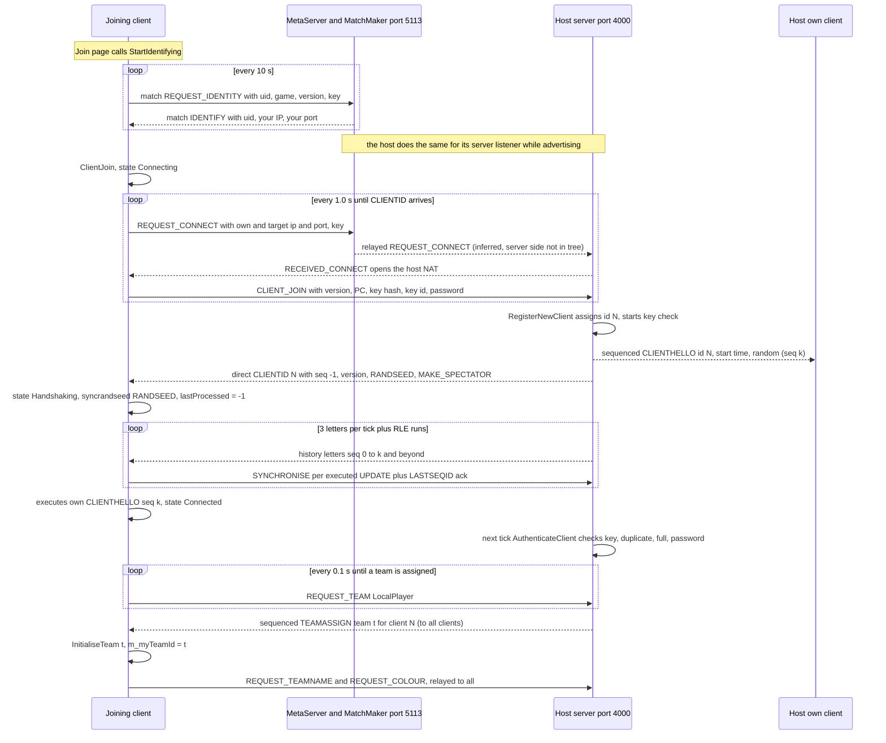
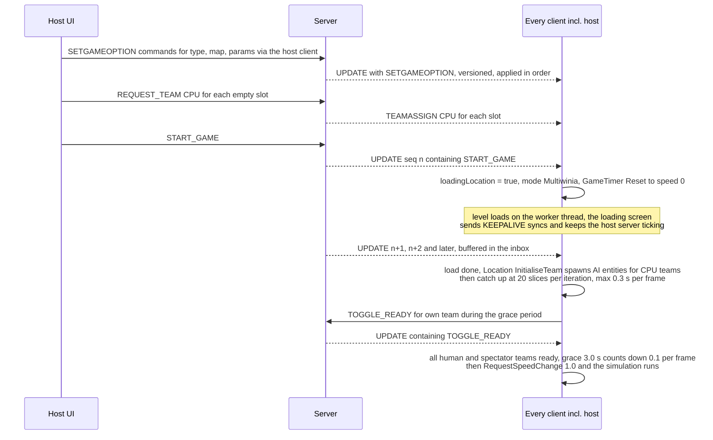
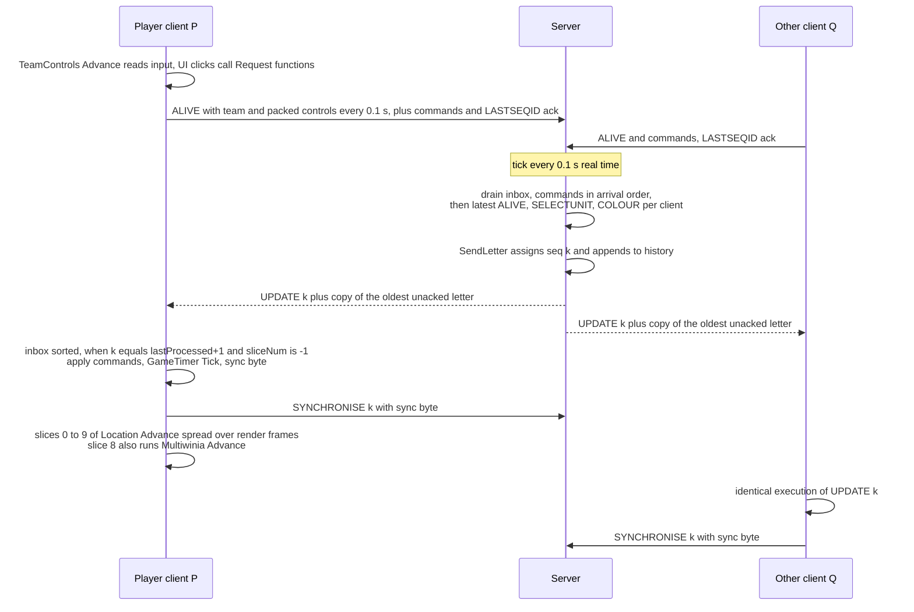
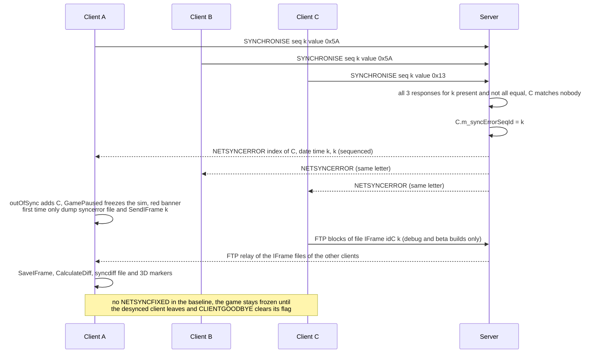

# 22 — Determinism and networking

> Part B · Baseline build: Release|Win32 (OpenGL) + TARGET_PC_FULLGAME ([B:FULL]); see _work/build_matrix.md.
> Evidence: [C] confirmed · [I] inferred · [U] unknown. Citations are `path:Symbol` relative to the multiwinia/ source root.
> Sources merged: P15_network (network model, protocol, sessions, metaserver), X3_determinism_sync (RNG, floating point, ordering, sync checking, leaks, risk register), P13_gfx_backend_math (numeric environment, math library), P14_platform_lib (RNG algorithms, hashing helpers), P01_app_core, P02_game_modes, P03_entity_core, P04_entities_military, P05_entities_creatures, P06_buildings_core, P07_buildings_misc, P08_crates_ai, P09_control_taskmanager, P10_input_camera, P11_terrain_world, P16_sound (determinism notes), routed `_meta_*` notes. Generated tables: `_work/scripts/S_22_rng_tables.py` over `_work/drafts/X3_syncrand_sites.csv`, `X3_unsynced_rng_sites.csv`, `X3_local_state_refs.csv`.

This document specifies how Multiwinia keeps several machines running one game: the relay-lockstep network model, the complete wire protocol, session lifecycle, sync checking, and the determinism discipline (random numbers, floating point, ordering, state classification) on which the model depends. The lobby **user interface** and server-browser screens are specified in [09 §5](09_meta_systems.md#5-multiplayer-front-end-versus-cpu-quick-match-lanwan-browser-hostjoin-lobby); this document specifies the **protocol** underneath them. Entity/container internals are in [21](21_simulation_and_entity_model.md); the main loop and threads in [20 §9–§11](20_architecture.md#9-main-loops).

## Contents

1. [Model overview](#1-model-overview)
2. [Timing and pacing](#2-timing-and-pacing)
3. [Transport — NetLib over UDP](#3-transport--netlib-over-udp)
4. [Wire encoding](#4-wire-encoding)
5. [Message catalogue](#5-message-catalogue)
6. [Server sequencing and client ordering](#6-server-sequencing-and-client-ordering)
7. [IFrames](#7-iframes)
8. [Session lifecycle](#8-session-lifecycle)
9. [Sync checking and desync handling](#9-sync-checking-and-desync-handling)
10. [Virtual (CPU) players in the network model](#10-virtual-cpu-players-in-the-network-model)
11. [Bandwidth, network quality, file transfer, demo limits, replay](#11-bandwidth-network-quality-file-transfer-demo-limits-replay)
12. [Lobby and server discovery protocol](#12-lobby-and-server-discovery-protocol)
13. [Threads and locking](#13-threads-and-locking)
14. [Determinism model](#14-determinism-model)
15. [Risk register for the new game](#15-risk-register-for-the-new-game)
16. [Constants](#16-constants)
- [Open questions and unknowns](#open-questions-and-unknowns)
- [Docs-vs-code discrepancies](#docs-vs-code-discrepancies)
- [IP items](#ip-items)
- [Source map](#source-map)
- [Appendix — dead/legacy code](#appendix--deadlegacy-code)

---

## 1 Model overview

### 1.1 At a glance

| Question | Answer | Evidence |
|---|---|---|
| Topology | **Star, client/server over UDP.** One process hosts a `Server`; every participant (including the host) runs a `ClientToServer`. Clients never talk to each other. | [C] `code/app.cpp:App::StartNetwork`, `code/network/server.cpp:Server::Initialise`, `code/network/clienttoserver.cpp:ClientToServer::ClientJoin` |
| Is the host also a client? | **Yes.** `App::StartNetwork(true,…)` creates `m_server` and then calls `m_clientToServer->ClientJoin()` in the same process. Host-client ↔ server traffic bypasses sockets: the host client hands letters straight to `Server::ReceiveLetter` (tagged with the host's LAN IP and client listen port), and the server hands letters whose `m_receiverId == m_clientToServer->m_clientId` straight to `ClientToServer::ReceiveLetter`. The host client nevertheless goes through exactly the same sequencing/ack pipeline as remote clients. | [C] `code/network/clienttoserver.cpp:ClientToServer::AdvanceSender`, `code/network/server.cpp:Server::AdvanceSender` |
| Dedicated server? | **No.** There is no headless mode; the server is always embedded in a game client. | [C] the only construction site of `Server` is `App::StartNetwork` (`code/app.cpp`) |
| Single player | Uses the identical pipeline: `App::StartSinglePlayerServer` → `StartNetwork(true, NULL, -1)` → server IP `"127.0.0.1"`, server port **−1**. `ClientToServer::GetServerPort() == -1` is the game-wide "single player" flag (no advertising, other joiners rejected, no kicking on authentication failure). | [C] `code/app.cpp:App::StartSinglePlayerServer`, `App::StartNetwork`; `code/network/server.cpp:Server::RegisterNewTeam`, `Server::Advertise`, `Server::AuthenticateClients` |
| Multiplayer host | `App::StartMultiPlayerServer` → `StartNetwork(true, NULL, NULL)`; port `NULL` (= 0) ≠ −1, so the host client joins its own LAN IP (`GetLocalHostIP`) at the server listener's port. | [C] `code/app.cpp:App::StartMultiPlayerServer` |
| Lockstep vs state sync | **Deterministic lockstep over a server-sequenced command stream ("relay lockstep").** The server never simulates authoritatively and never sends world state. Every 0.1 s of real time it packages all client commands received since the previous tick into one *UPDATE letter* with a monotonically increasing sequence id, appends it to an unbounded history and sends it to every client. Each client executes the letters strictly in sequence-id order; one UPDATE letter = one simulation *frame* of `0.1 × gameSpeed` game seconds, executed as 10 *slices*. Only a 1-byte checksum per frame flows back for desync detection. | [C] `code/network/server.cpp:Server::Advance`, `Server::SendLetter`; `code/network/clienttoserver.cpp:ClientToServer::ProcessAllServerLetters`, `ClientToServer::GetNextLetter` |
| Input delay | Not a fixed number of frames. A command takes effect at the start of the first UPDATE frame generated after the server receives it: delay = wait for the next server tick (0–100 ms) + one-way latency to the server + one-way latency back + client-side slice backlog (§2.4). The host experiences zero network latency but the same tick quantisation and buffering. | [C] pipeline; [I] composition of delays |
| Lobby | Runs **inside the same lockstep channel**: game options, team assignments, names, colours, chat, ready flags and START_GAME are all sequenced commands in the history. A late joiner reconstructs lobby state by replaying the full history from sequence id 0. | [C] `ClientToServer::ProcessServerUpdates`; `code/UI/WaitingButton.h` (connect progress = `g_lastProcessedSequenceId / m_serverSequenceId`) |
| Transport reliability | Custom over UDP: sequence ids + cumulative acks (every client letter carries `LASTSEQID` = highest contiguous id received) + a server-side resend window of 3 letters per client per tick + one piggy-backed copy of the oldest unacknowledged letter + run-length encoding of empty frames. Client→server messages are **not** acknowledged or resent by the transport; where it matters they are repeated at application level (ALIVE 10 Hz, team requests, joins, sync bytes). | [C] `code/network/server.cpp:Server::UpdateClients`; `ClientToServer::ReceiveLetter`, `ClientToServer::Advance` |
| What must be bit-identical on every peer | (1) the ordered command stream; (2) the synced RNG state (MT19937, one seed per server session); (3) every simulated field touched by `Location::Advance` and `Multiwinia::Advance` (classification §14.10); (4) static data — level file, `data/stats.txt`, shapes used for hit tests, terrain seeds; (5) per-process statics that simulation code reads (§14.12). | [C]/[I] |
| Numeric environment relied on | Win32 **x87** code (no `/arch:SSE2`), x87 precision control forced to a **53-bit significand** per thread, `/fp:precise` in the shipped configuration, and every transcendental and `sqrt` result rounded to **IEEE binary32** by `iv_trunc_low_nibble`. | §14.8 |
| Ordering relied on | Strictly serial, single-threaded, index-ordered iteration of slot arrays (`FastDArray`/`SliceDArray` with LIFO free lists) under a fixed slice schedule; no hash-map or pointer ordering anywhere in the simulation. | §14.9 |
| How divergence is detected | One byte per frame sent to the server. **Baseline build: the byte is the next synced-RNG draw** (`255 × syncfrand(1)`), so only divergence of the RNG stream position is detected; debug/beta builds hash a world snapshot (SHA-1). | [C] `code/network/iframe.cpp:IFrame::Generate`; §9 |
| What happens on desync | The server broadcasts NETSYNCERROR (sequenced); every client pauses the simulation permanently (`App::GamePaused`), shows a red banner and writes `syncerror-*.txt`. No resync, no recovery. | [C] §9 |

### 1.2 Peer roles

| Role | Object | Count | Responsibilities |
|---|---|---|---|
| Server | `Server` (`g_app->m_server`) | 0 or 1 per process | Accept/authenticate clients, assign client ids and team slots, sequence and broadcast commands, keep the full history, resend lost letters, compare sync bytes, relay IFrame files, advertise to the metaserver/LAN, kick |
| Client | `ClientToServer` (`g_app->m_clientToServer`) | exactly 1 per process (created at application start-up) | Connect/handshake, send commands, receive/order letters, execute simulation slices, generate sync bytes, display desync/lag |
| Per-client server record | `ServerToClient` | one per connected (and per disconnected) client | IP/port, socket session, auth key / key id, password, client id, spectator flag, last known/sent sequence id, caught-up flag, last-message time, sync byte array `m_sync`, saved last ALIVE / SELECTUNIT / REQUEST_COLOUR, FTP manager, `m_syncErrorSeqId`, `m_disconnected` reason, `m_basicAuthCheck` |
| Team slot (server side) | `ServerTeam {m_clientId, m_teamType}` in `Server::m_teams` (DArray, index = team id 0..5) | ≤ `NUM_TEAMS` = 6 | Which client owns which team; a client may own several (the host owns its own team plus every CPU team it requested) |

[C] `code/network/server.h`, `code/network/servertoclient.h`, `code/globals.h:NUM_TEAMS`. This two-level client/team split is exactly what `docs/integrating virtual players into network system.txt` proposed ("DArray of Teams … DArray of Clients") [C].

### 1.3 Why the model works (and its preconditions)

The design relies on four properties, each of which the code maintains only by discipline, not by construction [I from the whole analysis]:

1. **Total order of inputs.** All player intent reaches the simulation only as relayed commands inside UPDATE letters, executed in sequence order on every client (§6). Local input is converted into world-space command data before sending (`TeamControls`, positions as raw doubles), so no client re-interprets another's input with local state (with one confirmed exception, §14.11 L1).
2. **Identical initial state.** Every client loads the same level by file name and seeds the synced RNG with the server's seed before replaying the history (§8.1, §14.3). Nothing verifies that the level files or game data are identical (§14.13).
3. **Bit-identical arithmetic.** One executable, one compiler configuration, the same x87 precision on every simulation thread, and transcendental results rounded to binary32 (§14.8).
4. **Strict separation of randomness.** Gameplay draws only from the synced generator; cosmetics from separate generators whose call counts may differ per peer (§14.2–§14.6).

The model's costs: input latency of at least one server tick plus a round trip; a single slow client slows nobody else but cannot catch up faster than 20 frames/s; late joiners must re-simulate the entire session; and any determinism bug is unrecoverable (§9.4).

---

## 2 Timing and pacing

### 2.1 Server tick

- `Server::Initialise`: `m_startTime = GetHighResTime()`, `m_nextServerAdvanceTime = m_startTime + 0.1` [C] `code/network/server.cpp:Server::Initialise`.
- `Server::AdvanceIfNecessary(now)`: if `now > m_nextServerAdvanceTime` → `Advance()` once, then `m_nextServerAdvanceTime += 0.1f` (a **float** literal added to a double: each step is 0.100000001490116 s) [C]. At most **one** tick per call; if the main loop stalls, ticks are produced back-to-back on subsequent calls until the schedule catches up (no tick skipping). `Server::SkipToTime` exists to jump the schedule ("waking from sleep") but has no caller [C] `Server::AdvanceIfNecessary`, `Server::SkipToTime`. Under `TESTBED_ENABLED` [B:DEBUG] the same `+= 0.1f` is applied in every branch.
- Callers: every main loop — `code/main.cpp:LocationGameLoop`, `GlobalWorldGameLoop` and `MainMenuLoop` (front end/lobby) — and the loading-screen loop under `m_networkMutex.TryLock()` (`code/loading_screen.cpp:LoadingScreen::Render`). The server therefore ticks at **10 Hz real time** regardless of game speed or pause [C].

### 2.2 Client frame and slices

- One UPDATE letter ⇒ one *frame*. When the client takes a letter (only while `g_sliceNum == -1`) it applies its commands (`ProcessServerUpdates`), sets `g_lastProcessedSequenceId = seqId`, `g_sliceNum = 0`, calls `g_gameTimer.Tick()`, then `GenerateSyncValue()` and `SendSyncronisation()`. Each subsequent slice step calls `Location::Advance(g_sliceNum)` and `ParticleSystem::Advance(g_sliceNum)` (both skipped while `App::GamePaused()`), and **at slice 8** `Multiwinia::Advance()` (always, even when paused, if `App::Multiplayer()`); after slice 9 `g_sliceNum = -1` [C] `code/network/clienttoserver.cpp:ClientToServer::ProcessAllServerLetters`. `NUM_SLICES_PER_FRAME = 10` (`code/globals.h`).
- Non-UPDATE sequenced letters (CLIENTHELLO, CLIENTGOODBYE, TEAMASSIGN, NETSYNCERROR, NETSYNCFIXED, SPECTATORASSIGN) consume a sequence id but do **not** start a frame, tick the timer or produce a sync byte. Unsequenced letters (`SEQID == -1`) are processed as soon as they reach the inbox head [C] same function.
- `App::Multiplayer()` is `m_gameMode == GameModeMultiwinia`, i.e. true in every Multiwinia game including versus-CPU and tutorials [C] `code/app.cpp:App::Multiplayer`.
- `GameTimer::Tick` stamps `m_lastClientAdvance = GetHighResTime()`, adds `GetServerAdvancePeriod() = 0.1 × m_gameSpeed` to `m_gameTime` unless `App::GamePaused()`, and moves `m_gameSpeed` toward a requested speed by `diff × speedOfChange` per tick (snap when within 0.01, using `iv_abs`) [C] `code/gametimer.cpp:GameTimer::Tick`. `GameTimer::Reset` sets speed **0** in multiplayer (the match starts frozen until the grace countdown finishes), 1 otherwise; `m_gameTime = 0` [C] `GameTimer::Reset`. `GetNetworkTime` is a macro for `g_gameTimer.GetGameTime` and `SERVER_ADVANCE_PERIOD` for `g_gameTimer.GetServerAdvancePeriod()` — one synced clock (Resolved: P06 asked whether `GetNetworkTime()` and `GetGameTime()` were different clocks; `code/gametimer.h` shows they are the same) [C].

### 2.3 Slices per render frame (client pacing controller)

`ClientToServer::GetNumSlicesToAdvance(catchUp)` [C]:

```
if catchUp: return 20
pending = (m_lastValidSequenceIdFromServer - g_lastProcessedSequenceId) * 10
if g_sliceNum != -1: pending += 10 - g_sliceNum
n = int(pending * 0.3)
// a branch for pending <= 10 computes a time-based value (timeSinceStartOfServerAdvance * 100)
// into a shadowing local and has no effect
return clamp(n, 0, 20)
```

`ClientToServer::AdvanceAndCatchUp` (called once per render frame) [C]:

```
if loadingLocation: KeepAlive(); return
start = now
do:
   catchUp = g_lastProcessedSequenceId < m_lastValidSequenceIdFromServer - 20  and  m_clientId != -1
   Advance()                       // connection logic, FTP, identity upkeep, send outbox
   ProcessAllServerLetters(catchUp)
   if loadingLocation: return      // a START_GAME was just processed
while catchUp and (now - start) <= 0.3 s
```

So a client more than 20 frames behind runs 20 slices (2 frames) per iteration for up to 0.3 s per render frame; otherwise it drains 30 % of its pending slices per render frame, at most 20.

### 2.4 Effective buffering and input latency [I]

Derived from §2.3: the server injects 100 slices/s; at render rate R fps the client consumes ⌊0.3·P⌋ slices per frame, so the steady-state backlog is P ≈ 100/(0.3·R) slices: ≈ 5.6 slices (56 ms) at 60 fps, ≈ 11 slices (110 ms) at 30 fps. Because ⌊0.3·P⌋ = 0 for P ≤ 3, a backlog of up to 3 slices is never drained until the next letter arrives. Total command latency ≈ U(0, 100 ms) tick wait + RTT + backlog. A replacement design should use an explicit, fixed input-delay/jitter buffer instead. [U-intent] whether the dead time-based branch was meant to pace by time (22-U4).

### 2.5 Estimated latency (statistics only)

`GetEstimatedServerSeqId = max( floor((now − g_gameTimer.m_estimatedServerStartTime)/0.1), m_serverSequenceId )`; `m_estimatedServerStartTime` = minimum over received letters of `now − seqId × 0.1`. `GetEstimatedLatency = max(0, estimated − g_lastProcessedSequenceId) × 0.1` s. Used only by the network statistics window (and the benchmark report, which is compiled out: `code/benchmark.cpp` is wholly inside `#ifdef BENCHMARK_AND_FTP` [B:DEAD]). `m_latency` (PING round trip) is computed from relayed PING commands, but `SendPing` has no caller [C] `code/network/clienttoserver.cpp:ClientToServer::GetEstimatedServerSeqId`, `GetEstimatedLatency`, `ReceiveLetter`; `code/interface/network_window.cpp`.

### 2.6 Pause and game speed

- `App::ToggleGamePaused` allows a pause only when no team is `TeamTypeRemotePlayer` (effectively versus-CPU/single player), not in the grace period and not game over; it sends PAUSE [C] `code/app.cpp:App::ToggleGamePaused`.
- Every client executing PAUSE toggles `m_userRequestsPause` and requests speed 0 (or 1) with rate 0.2 per frame: speed after n frames = 0.8ⁿ (stopping) or 1 − 0.8ⁿ (resuming); snapped when within 0.01, i.e. **21 frames ≈ 2.1 s** of slow-down/speed-up [C] `GameTimer::Tick`; [I] arithmetic.
- `App::GamePaused()` = location exists and (`GameTimer::IsPaused()` (speed < 0.01) or `m_outOfSyncClients.Size() > 0` or (lost focus and single player)); the `m_userRequestsPause` term is commented out [C] `code/app.cpp:App::GamePaused`. While paused the server keeps producing frames; clients consume them (sequence ids advance) but skip `Location::Advance`; `GameTimer::Tick` still blends speed, so a pause can end.
- Other deterministic speed changes come from the simulation: slow-down crate `0.2 + syncfrand(0.2)` for 15 s, speed-up crate `1.3 + syncfrand(0.7)` for 15 s (rate 0.05), meteor slow-motion 0.4 for 4 s (rate 0.1), victory (speed 0, then locked) [C] `code/worldobject/crate.cpp:Crate::RunSlowDownTime/RunSpeedUpTime`, `code/worldobject/meteor.cpp:Meteor::Advance`, `code/multiwinia.cpp:Multiwinia::DeclareWinner`. The grace countdown `Multiwinia::AdvanceGracePeriod` decrements `GRACE_TIME` (3.0 s) by a literal 0.1 per frame while every Local/Remote/Spectator team is ready, then requests speed 1.0 immediately (rate 1.0) [C] `code/multiwinia.cpp:Multiwinia::AdvanceGracePeriod`, `code/lib/universal_include.h:GRACE_TIME`.
- A requested duration counts down 0.1 per frame regardless of speed, after which the target becomes 1.0; `LockSpeedChange` blocks further requests [C] `GameTimer::Tick`, `GameTimer::RequestSpeedChange`.

---

## 3 Transport — NetLib over UDP

NetLib is "a very thin portable UDP network library" [C] `contrib/systemiv/lib/netlib/net_lib.h`.

| Class / function | Behaviour | Ref |
|---|---|---|
| `NetLib::Initialise` | `WSAStartup(2.2)`; fails if 2.2 is unavailable. Called once from `MetaServer_Initialise`. | [C] `contrib/systemiv/lib/netlib/net_lib.cpp:NetLib::Initialise`, `contrib/systemiv/lib/metaserver/metaserver.cpp:MetaServer_Initialise` |
| `NetSocketListener(port, name, iface="")` | Owns one UDP socket. `Bind()`: `socket(AF_INET, SOCK_DGRAM, IPPROTO_UDP)`, bind to `INADDR_ANY:port` (or a resolved interface via `getaddrinfo`), up to 6 attempts with a sleep of `attempts × 100 ms` while the address is in use; port 0 ⇒ OS-assigned, read back with `getsockname`. Mutex-guarded, idempotent. | [C] `contrib/systemiv/lib/netlib/net_socket_listener.cpp:NetSocketListener::Bind` |
| `NetSocketListener::StartListening(cb)` | **Blocking loop** on the calling thread: `recvfrom` into a fresh `NetUdpPacket` (buffer `MAX_PACKET_SIZE` = **1500** bytes); on success calls `cb(packet)` (the callee owns and deletes it); a result `<= 0` is logged via `AppDebugOutNetSocketError` and the packet is reused. Runs until `StopListening` (sets the flag, `shutdown` + `closesocket`, `Sleep(250)`). | [C] `NetSocketListener::StartListening`, `StopListening` |
| `NetSocketListener::EnableBroadcast` | `setsockopt(SO_BROADCAST)` | [C] |
| `NetSocketSession(listener, host, port)` | A *send endpoint* that reuses the listener's bound socket (so replies come back to the same port — essential for NAT hole punching). Resolves `host` with `getaddrinfo` (AF_INET). `WriteData` = one `sendto` (no fragmentation, no retry). | [C] `contrib/systemiv/lib/netlib/net_socket_session.cpp` |
| `NetSocket` | A separately created "connected" UDP socket with a select-based write loop (timeout 10 000 ms, poll 100 ms). Only used by `GetLocalHostIP` to discover the default-route local address by `connect("80.175.29.66", 5000)` + `getsockname` (no packet sent); fallback `gethostbyname(gethostname())`, then `"127.0.0.1"`. | [C] `contrib/systemiv/lib/netlib/net_socket.cpp`, `net_lib.cpp:GetLocalHostIP` |
| `NetUdpPacket` | `{int m_length; sockaddr_in m_clientAddress; char m_data[1500];}`; `GetPort()` = `ntohs(sin_port)`. | [C] `contrib/systemiv/lib/netlib/net_udp_packet.h` |
| `NetMutex` | Win32 `CRITICAL_SECTION` (recursive); `NetLockMutex` RAII guard; `NetEvent` (auto-reset Win32 event, `Wait(ms)`, −1 = infinite); `NetSemaphore`. | [C] `contrib/systemiv/lib/netlib/net_mutex.h`, `net_mutex_win32.cpp` |
| `NetStartThread(fn, arg)` | `CreateThread`, never joined. | [C] `contrib/systemiv/lib/netlib/net_thread_win32.cpp` |
| `GetLocalHost`, `StrToIpAddress`, `IpAddressToStr` | Host-name resolution helpers; `IpToString(in_addr, char*)` (`code/network/generic.cpp`) is the game-side equivalent used by both listen callbacks. | [C] |

**Ports** [C] `code/network/network_defines.h`, `Server::Initialise`, `ClientToServer::OpenConnections`: game server UDP **4000** (pref `NetworkServerPort`), game client UDP **4001** (pref `NetworkClientPort`; falls back to an OS-chosen port), metaserver/matchmaker **5113**, metaserver client listener / LAN broadcast **5009** (§12). If the server port cannot be bound, `Server::Initialise` ignores the failure ("TODO PORT FORWARDING") [C].

**Reliability model** [C]: server→client letters are reliable through the resend window (§6.2); client→server letters are fire-and-forget, with application-level repetition (ALIVE every 0.1 s, SYNCHRONISE per frame, JOIN every 1 s, team/name/colour requests until echoed, CLIENT_LEAVE sent 3×). Every received datagram is parsed as one `Directory` (§4.2); a malformed datagram is discarded ("bogus letter").

**The 1500-byte limit.** `recvfrom` uses a 1500-byte buffer [C] `contrib/systemiv/lib/netlib/net_lib.h:MAX_PACKET_SIZE`, `net_socket_listener.cpp:StartListening`; senders write any size in one `sendto` (the client into a 16 384-byte buffer, the server whatever `Directory::Write` produces) [C] `ClientToServer::AdvanceSender`, `Server::AdvanceSender`. On Windows a larger datagram makes `recvfrom` fail with `WSAEMSGSIZE`, which the loop treats as an error and drops [I: documented WinSock behaviour]; on BSD sockets it is truncated, then `Directory::Read` fails on the missing end marker and it is dropped [I]. Consequences [I computed from §4]: (a) a single history letter larger than ≈ 1500 bytes can never be delivered — the server resends it (and piggy-backs it) forever, the client cannot pass that sequence id, shows "lost connection" after 5 s, and never recovers; (b) a normal-size letter that carries a large piggy-backed copy (§6.2) is lost, but a later letter's piggy-back usually repairs the gap. The server only logs "Largest datagram sent" [C] `Server::AdvanceSender`. A relayed SETGAMEOPTIONARRAYELEMENTINT command is 46 bytes and an ALIVE 53–61 bytes (§4.3), so a single letter crosses the limit at ≈ 30 option commands or ≈ 25 ALIVE-sized commands in one 0.1-s tick. The new design must enforce an MTU budget or fragment.

**Unused transport helpers** [C]: `code/network/listener.*` (`Listener`, `EventListener`, `ListenerList` observer classes) — no users; `code/network/bytestream.h` and `contrib/systemiv/lib/netlib/bytestream.h` (raw-pointer `READ_`/`WRITE_` macros) — no users.

## 4 Wire encoding

### 4.1 Primitive encoding — `contrib/systemiv/lib/network_stream*`

All multi-byte values are written as their in-memory bytes; on big-endian hosts they are byte-reversed, so **the wire format is little-endian** [C] `contrib/systemiv/lib/network_stream_inlines.cpp:ReadNetworkValue/WriteNetworkValue` (`#ifndef __BIG_ENDIAN__`; this `.cpp` is not a compilation unit but is `#include`d by `network_stream.h`, so it is live).

| Primitive | Encoding | Bytes | Ref |
|---|---|---|---|
| `int`, `unsigned` | LE 32-bit | 4 | [C] `WriteNetworkValue<T>` |
| `float` | IEEE-754 binary32 LE | 4 | [C] |
| `double` | IEEE-754 binary64 LE | 8 | [C] |
| `unsigned long long` | LE 64-bit | 8 | [C] |
| `short` / `unsigned short` | LE 16-bit | 2 | [C] (used by `TeamControls::Pack`) |
| `char`, `bool` | 1 byte (bool written as 0/1) | 1 | [C] |
| `Vector3` | x, y, z as **double** | 24 | [C] `contrib/systemiv/lib/network_stream.cpp:WriteNetworkValue(Vector3)`; `code/lib/vector3.h` and `contrib/systemiv/lib/math/vector3.h` both declare `double x, y, z` under the same include guard `VECTOR3_H` |
| Packed int | value 0..254 → 1 byte; otherwise byte `0xFF` + 4-byte int (so −1 takes 5 bytes) | 1 or 5 | [C] `network_stream.cpp:WritePackedInt` |
| Dynamic string | packed-int length (−1 = NULL) + raw bytes, no terminator; on read a length < 0 (≠ −1) or > max ⇒ substitute the safe string | 1/5 + n | [C] `WriteDynamicString`, `ReadDynamicString` |
| Unicode string | packed-int length in UTF-16 code units (−1 = NULL) + 2 bytes per unit (Win32 `wchar_t`); Linux/Mac builds convert to/from UTF-16LE | 1/5 + 2n | [C] `WriteUnicodeString`, `ReadUnicodeString` |
| Void (blob) | 4-byte int length + bytes | 4 + n | [C] `WriteVoidData` |
| Number array | packed-int count + each element via `WriteNetworkValue` | 1/5 + 4n for ints | [C] `WriteNumbersData` |

### 4.2 Message container — `Directory` (tosser)

Every network message in the game, the metaserver protocol and the matchmaker is a `Directory`: a named node with a list of typed, named fields and a list of child Directories. Fields are written in slot order of the node's field array (creation order; `CreateData` on an existing name replaces that field in place) and children in slot order [C] `contrib/systemiv/lib/tosser/directory.cpp:Directory::Write`, `DirectoryData::Write`.

```
Directory     := '<' DynString(name) PackedInt(numFields) Field* PackedInt(numSubdirs) Directory* '>'
Field         := DynString(fieldName) u8(type) Value(type)
Value(1 INT)      := i32
Value(2 FLOAT)    := f32
Value(3 CHAR)     := u8          (unsigned char fields are stored as CHAR)
Value(4 STRING)   := DynString
Value(5 BOOL)     := u8 (0/1)
Value(6 VOID)     := i32 length, bytes
Value(7 FIXED)    := 8 bytes     (only with USE_FIXED — dead in the baseline)
Value(8 INTS)     := PackedInt count, i32*
Value(9 ULLONG)   := u64
Value(10 UNICODE) := UnicodeString
```

Limits on read [C] `contrib/systemiv/lib/tosser/directory.cpp` (`DIRECTORY_MAXDIRSIZE` 1024, `DIRECTORY_MAXSTRINGLENGTH` 10240, `DIRECTORY_MARKERSTART` `"<"`, `DIRECTORY_MARKEREND` `">"`, marker size 1): ≤ 1024 fields per node (the subdirectory-count check mistakenly re-tests the field count), strings ≤ 10 240 characters. Start/end markers must match or the whole datagram is rejected ("bogus letter"). Missing-field reads return safe values [C] `contrib/systemiv/lib/tosser/directory.h` (`DIRECTORY_SAFE*`): int −1, float −1.0, char `'?'` (63), string `"[SAFESTRING]"`, Unicode `L"[SAFESTRING"` (closing bracket missing in the source), bool false, ullong `0xFFFF…`.

Consequence used by the server relay filter (§6.1): `GetDataUChar(NET_DARWINIA_TEAMID)` on a message without a TEAMID field returns 63, not 255 [C].

Field names are deliberately 1–4-character codes ("optimised network symbols"); an uncompiled alternative header `code/network/network_defines_debug.h` maps them to readable names ("much higher bandwidth usage") [C]. `TRACK_SYNC_RAND` builds contain a decoder table `DecodeCmd` (`code/network/clienttoserver.cpp`) listing every code → name pair [B:DEBUG] [C].

**Worked example — the client SYNCHRONISE letter, 35 bytes** [I computed from §4.1/§4.2; field order [C] `ClientToServer::SendSyncronisation`, `ClientToServer::AdvanceSender`]:

| Offset | Bytes | Content |
|---|---|---|
| 0 | 1 | `'<'` |
| 1 | 3 | name: packed length 2, `"ba"` |
| 4 | 1 | numFields = 4 |
| 5 | 7 | field `"bb"` (3) · type 4 · DynString `"cq"` (3) — COMMAND = SYNCHRONISE |
| 12 | 8 | field `"dc"` (3) · type 1 · i32 last processed sequence id |
| 20 | 5 | field `"dd"` (3) · type 3 · u8 sync value |
| 25 | 8 | field `"eq"` (3) · type 1 · i32 LASTSEQID (added by `AdvanceSender`) |
| 33 | 1 | numSubdirs = 0 |
| 34 | 1 | `'>'` |

### 4.3 Size budget of common messages [I computed from §4.1/§4.2]

| Message | Size (bytes, excluding the 28-byte IP+UDP header; the code accounts `UDP_HEADER_SIZE` = 32 — "12 bytes for UDP header, 20 bytes for IP header", `code/network/server.h`) |
|---|---|
| Node overhead (`'<'`, name `"ba"`, two counts, `'>'`) | 7 |
| COMMAND field (2-character code) | 7 |
| char field | 5; int field 8; Vector3 blob field 32 |
| Client ALIVE letter | 61 (flags + mouse only) … 69 (with both direct vectors) |
| Client SYNCHRONISE letter | 35 |
| UPDATE header as stored in history (COMMAND + SEQID) | 22; as sent (+ LASTSEQID) 30 |
| ALIVE as relayed inside an UPDATE (FROMIP/FROMPORT/LASTSEQID stripped) | 53–61 |
| SETGAMEOPTIONARRAYELEMENTINT as relayed | 46 |
| 4-player in-game UPDATE with only ALIVEs | 30 + 4 × 53 = 242; with a piggy-backed PREVUPDATE copy ≈ 476 |
| RLE "N empty updates" letter | 38 |

⇒ ≈ 5 KB/s per client downstream and ≈ 1 KB/s upstream in a quiet 4-player game.

### 4.4 `NetworkValue` family — UI ↔ network option binding (`code/network/networkvalue.*`)

Despite the name these classes are not a wire encoding; they adapt lobby UI input fields (`InputField::Type` order: Nowt, Char, Bool, Int, Float, String, UnicodeString) to network requests [C] `code/network/networkvalue.h`.

| Class | `Get()` reads | `Set()` does | Ref |
|---|---|---|---|
| `NetworkValue` (abstract) | — | `ToLatinString`/`FromLatinString` via Unicode; abstract `To/FromUnicodeString` | [C] |
| `BoundedNetworkValue` | — | optional `[min,max]` clamp `Bound()` (the constructor initialises `m_max` with itself — an uninitialised value) | [C] `code/network/networkvalue.cpp:BoundedNetworkValue` |
| `NetworkInt`, `NetworkBool`, `NetworkChar` | `%d` text | parse `%d` | [C] |
| `NetworkFloat`, `NetworkDouble` | `%.2f` text | parse `%lf`, then `iv_trunc_low_nibble` (binary32 rounding, §14.8) | [C] `NetworkFloat::FromUnicodeString`, `NetworkDouble::FromUnicodeString` |
| `NetworkString`, `NetworkUnicodeString`, `LocalString` (bounded copy), `LocalUnicodeString`, `LocalType<…>` (`LocalInt`, `LocalFloat`, `LocalDouble`, `LocalChar`, `LocalBool`, `LocalIntAsBool`), `NetworkIntAsBool`, `NetworkIntAsString` | local variable | local variable (no network) | [C] |
| `NetworkGameOptionInt(option, int&)` | bound int | `RequestSetGameOptionInt(option, Bound(v))` | [C] |
| `NetworkGameOptionBool(option, bool&)` | bound bool | `RequestSetGameOptionInt(option, Bound(v))` | [C] |
| `NetworkGameOptionString(option, const char*&)` | bound string | `RequestSetGameOptionString(option, v)` | [C] |
| `NetworkGameOptionMapId` | index of `g_app->m_requestedMap` in `m_gameMenu->m_maps[gameType]` (case-insensitive file-name match), −1 if none | `RequestSetGameOptionString(GAMEOPTION_MAPNAME, maps[v]->m_fileName)` | [C] `GetMapId`, `SetMapId` |
| `NetworkGameParam(index)` | `m_multiwinia->m_params[index]` | `RequestSetGameOptionArrayElementInt(GAMEOPTION_GAME_PARAM, index, v)` | [C] `code/network/networkvalue.cpp` |
| `NetworkGameResearchLevel(index)` | `m_globalWorld->m_research->m_researchLevel[index]` | `RequestSetGameOptionArrayElementInt(GAMEOPTION_GAME_RESEARCH_LEVEL, index, v)` | [C] |
| `NetworkIntArray(size, factory)` | array of the above | element assignment calls the element's `Set` | [C] |

Lobby bindings instantiated by `GameMenuWindow`: `m_gameType` (GAMEOPTION_GAME_TYPE), `m_requestedMapId` (map), `m_aiMode` (GAMEOPTION_AIMODE), `m_coopMode` (GAMEOPTION_COOPMODE, bool), `m_singleAssaultRound` (GAMEOPTION_SINGLEASSAULT, bool), `m_basicCrates` (GAMEOPTION_BASICCRATES, bool), `m_params[64]`, `m_researchLevel[NumResearchItems]` [C] `code/UI/GameMenuWindow.h`, `code/UI/GameMenuWindow.cpp:GameMenuWindow::GameMenuWindow`. Choosing a game type assigns every blueprint parameter's default (`main->m_params[i] = param->m_default` in `code/UI/GameTypeButton.h`), i.e. one SETGAMEOPTIONARRAYELEMENTINT per parameter in a single frame [C].

---

## 5 Message catalogue

All game messages use Directory name `NET_DARWINIA_MESSAGE` = `"ba"` and a string command field `NET_DARWINIA_COMMAND` = `"bb"` [C] `code/network/network_defines.h`. The server adds `FROMIP "ga"` (string) and `FROMPORT "gb"` (int) to every received letter (`Server::ReceiveLetter`) and strips them, together with `LASTSEQID`, before relaying (`ServerToClientLetter::AddUpdate`) [C] `code/network/server.cpp`, `code/network/servertoclientletter.h`.

### 5.1 Data-field codes (complete list from `code/network/network_defines.h`)

| Code | Symbol | Wire type as used | Meaning |
|---|---|---|---|
| da | TEAMTYPE | int | requested/assigned team type (`TeamTypeUnused = −1, LocalPlayer = 0, RemotePlayer = 1, CPU = 2, Spectator = 3`, `code/team.h`) |
| db | DESIREDTEAMID | int | always −1; the server ignores it (the handling code is commented out) |
| dc | LASTPROCESSEDSEQID | int | sequence id the sync byte refers to |
| dd | SYNCVALUE | char | 1-byte sync value |
| de | TEAMID | char (int in TEAMASSIGN) | team slot 0..5, 255 = none |
| df | POSITION | void (24-byte Vector3) | world position |
| dg | ALIVE_DATA | void | packed `TeamControls` (§5.2) |
| dl | UNITID | int | unit slot |
| dm | ENTITYID | int | entity slot index (unique id for SHAMANSUMMON) |
| dn | BUILDINGID | int | building unique id |
| do | ENTITYTYPE | char | shaman summon type |
| dp | RADIUS | float | selection radius |
| dq | PROGRAM | char | task-manager task id; 255 = "entity" in TERMINATE |
| dr | RANDSEED | int | sync RNG seed |
| ds | TEAMNAME | unicode | team name |
| dt | COLOURID | int | colour 0..7, −1 = none |
| dw | UNICODEMESSAGE | unicode | chat text |
| dx | ENCRYPTION_PADDING_CTS | — | **unused** |
| dy | SERVER_PASSWORD | unicode | join password (also the metaserver key GAMETIME, §12.2) |
| dz | CHRISTMASMODE | (used as a *command* code) | — |
| ea | DISCONNECT | int (reason) / also a command code | — |
| ed | CLIENTID | int (char in chat/spectator messages) | client id |
| ei | SYNCERRORID | string | `"YYYY-MM-DD H.MM.S <seq>"` server local time |
| ej | SYNCERRORSEQID | int | sequence id of the detected desync |
| el | VERSION | string | `APP_VERSION` |
| em | SYSTEMTYPE | string | `APP_SYSTEM` = `"PC"` |
| en | PREVUPDATE | (subdirectory name) | piggy-backed earlier letter |
| eo | NUMEMPTYUPDATES | int | run length of empty frames |
| ep | SEQID | int | sequence id; −1 = unsequenced/direct |
| eq | LASTSEQID | int | client→server: highest contiguous id received (ack); server→client: the server's next sequence id at send time |
| er | XUID | — | **unused** (Xbox Live) |
| et | CLIENTISDEMO | bool | client uses a demo key |
| eu | ENCRYPTION_PADDING_STC | — | **unused** |
| ev | SERVER_FULL | (command code) | handled by the client, never sent |
| ew | MAKE_SPECTATOR | int | 0/1 in the CLIENTID reply |
| ey | SET_PLAYERACHIEVEMENTS | (command code) | — |
| ez | PLAYERACHIEVEMENTS | char | "viral achievement" bit mask |
| fa | FILESEND | (command code) | FTP block/ack |
| fb | FILENAME | string | — |
| fc | FILESIZE | int | — |
| fd | BLOCKNUMBER | int (data) / ints (ack list) | — |
| fe | BLOCKDATA | void (≤ 1024 bytes) | — |
| ga | FROMIP | string | added by the server on receipt |
| gb | FROMPORT | int | added by the server on receipt |
| gc | FROMPLAYER | — | **unused** |
| he | GAMEOPTION_NAME | int | option id (§5.3) |
| hf | GAMEOPTION_INDEX | int | array index (or element count for ARRAYINT) |
| hg | GAMEOPTION_VALUE | int / string / ints | — |
| hi | GAMEOPTION_VERSION | int | per-option version counter |
| hj | GAMEOPTION_PDLC_BITMASK | — | **unused** (downloadable content, console remnant) |
| hk | JOIN_VIA_INVITE | — | **unused** |
| c3 | TEAM_SCORES | ints[6] (also the command code) | — |
| cob | DIRECTROUTE | char (bool in armour orders) | — |
| cod | FORCEONLYMOVE | char | — |
| coe | SECONDARYFUNCTION | char | — |
| (metaserver keys) dq AUTHKEY, dr AUTHKEYID, di GAMEVERSION, dB RANDOM, dC STARTTIME | see §12 | — | also embedded in game messages (CLIENT_JOIN, CLIENTHELLO) |

Note the reuse of codes across the two namespaces: `dq` is both `PROGRAM` and metaserver `AUTHKEY`, `dr` both `RANDSEED` and `AUTHKEYID`, `dp` both `RADIUS` and `PROTOCOLMATCH`, `dy` both `SERVER_PASSWORD` and `GAMETIME` — harmless because each message uses only one meaning, but it caused the browser's password-filter bug (§12.7) [C].

Preference names defined here: `NetworkClientPort` (default 4001), `NetworkServerPort` (default 4000), `NetworkUsePortForwarding` (default 0), `NetworkTrackSynchronisation` (defined, unused in code) [C] `code/network/network_defines.h`, `ClientToServer::OpenConnections`, `Server::Initialise`.

### 5.2 Team controls payload (`ALIVE_DATA`) — `code/team.cpp:TeamControls::Pack`

| Offset | Field | Bytes | Present when |
|---|---|---|---|
| 0 | flags (u16): 0x0001 unitMove, 0x0002 directUnitMove, 0x0004 primaryFireTarget, 0x0008 secondaryFireTarget, 0x0010 targetDirected, 0x0020 secondaryFireDirected, 0x0040 cameraEntityTracking, 0x0080 unitSecondaryMode, 0x0100 endSetTarget, 0x0200 consoleController, 0x0400 leftButtonPressed | 2 | always |
| 2 | directUnitMoveDx, directUnitMoveDy (i16 each) | 4 | flag 0x0002 |
| +0 | directUnitTargetDx, directUnitTargetDy (i16 each) | 4 | flag 0x0010 or 0x0020 |
| +0 | mousePos (Vector3, 3 × double) | 24 | always |

[C] `code/team.cpp:TeamControls::GetFlags`, `SetFlags`, `Pack`, `Unpack` (packed into a 256-byte buffer by `ClientToServer::SendIAmAlive`). Sent every `IAMALIVE_PERIOD` = 0.1 s from `code/main.cpp:SendTeamControlsToNetwork` while in a location (flags cleared when a window, the task manager or the chat log is open). Applied on every client by `Location::UpdateTeam(teamId, controls)`, which also copies `mousePos` into `Team::m_currentMousePos` [C] `code/location.cpp:Location::UpdateTeam` (Resolved: P04 asked whether `Squadie::Advance`'s facing target `team->m_currentMousePos` is network-synchronised; it is, via ALIVE).

### 5.3 Lobby game-option ids (`GAMEOPTION_*`, `code/network/network_defines.h`)

| Id | Symbol | Message used | Client effect on receipt (`ProcessServerUpdates`) |
|---|---|---|---|
| 0 | GAME_TYPE | SETGAMEOPTIONINT | if 0 ≤ v < `Multiwinia::NumGameTypes` (7): zero all 64 params and all research levels, `SetGameResearch(zeros)`, `SetGameOptions(v, zeros)` |
| 1 | GAME_PARAM | SETGAMEOPTIONARRAYELEMENTINT (index 0..63) | if `ValidGameOption(index)`: `SetGameOption(index, v)` |
| 2 | GAME_RESEARCH_LEVEL | SETGAMEOPTIONARRAYELEMENTINT (index < `GlobalResearch::NumResearchItems`) | `m_researchLevel[index] = v` |
| 3 | MAPNAME | SETGAMEOPTIONSTRING | `strcpy(g_app->m_requestedMap, v)`; on the host: `m_server->m_noAdvertise = (single player or map "null"/empty)` |
| 4 | AIMODE | SETGAMEOPTIONINT | if 0 ≤ v ≤ `NumAITypes` (3; the off-by-one accepts 3): `m_aiType = v` (`AITypeEasy = 0, Standard = 1, Hard = 2`) |
| 5 | COOPMODE | SETGAMEOPTIONINT | `m_coopMode = v`; when enabled clears every team colour to −1 and the local requested colour; restores the menu's previously requested colour when disabled (dereferences the main-menu window without a null check) |
| 6 | SINGLEASSAULT | SETGAMEOPTIONINT | `m_assaultSingleRound = v` |
| 7 | BASICCRATES | SETGAMEOPTIONINT | `m_basicCratesOnly = v` |
| 8..13 | TEAMSSTATUS_LBOUND..UBOUND (8 + NUM_TEAMS − 1) | SETGAMEOPTIONINT | `m_teamsStatus[id − 8] = v` (no sender found in the baseline) |
| 14 | NUMGAMEOPTIONS | — | array size |

Versioning [C] `ClientToServer::RequestSetGameOption*`, `GameOptionVersion`, `SetGameOptionVersion`, `ResetGameOptionVersions`: every option (and every array element of options 1 and 2, arrays of 64) carries a version; a request is sent with `localVersion + 1`; a receiver applies an update only if `version > localVersion`, then stores the version. Because all clients apply the same sequenced stream, conflicting simultaneous edits resolve deterministically (the first one in the stream wins; later ones with an equal version are discarded). Versions reset to 0 on handshake (CLIENTID). `SETGAMEOPTIONARRAYINT` ignores versions and has no caller ("TODO: Delete this method").

### 5.4 Client → server commands (every value of COMMAND a client can send)

"Relay" = copied into the next UPDATE letter and executed by **every** client in sequence (the deterministic command stream). "Server" = consumed by the server. Field types per §4.2. Every letter also carries `LASTSEQID` (ack). Sender functions are in `code/network/clienttoserver.cpp`; server handling in `code/network/server.cpp:Server::Advance`; client execution in `ClientToServer::ProcessServerUpdates`. [C] for every row unless marked.

| # | Code | Symbol | Fields | Sender (call site) | Handling | Effect when executed by each client |
|---|---|---|---|---|---|---|
| 1 | ca | CLIENT_JOIN | GAMEVERSION `di` str, SYSTEMTYPE `em` str, AUTHKEY `dq` str (full key if the sender hosts the server or uses a demo key, else the `hsh…` hash), AUTHKEYID `dr` int (hash case only), SERVER_PASSWORD `dy` unicode (if set), [B:EDITOR] REQUESTMAP | `ClientToServer::Advance` every 1.0 s while `StateConnecting` | Server: unknown ip:port → `RegisterNewClient` + `SendClientId`; known → ignored; from a *disconnected* ip:port → treated as a brand-new client (old record removed). No version check server-side (`Server::CheckPlayerCanJoin` returns true and has no caller). | — |
| 2 | cb | CLIENT_LEAVE | — | `ClientLeave` (sent ×3, flushed immediately, only if state > Connecting) | Server: `RemoveClient(id, Disconnect_ClientLeave)` | — |
| 3 | cba | REQUEST_SPECTATOR | TEAMID char, CLIENTID char | `RequestToRegisterAsSpectator` (lobby `CSpectatorButton`, `code/UI/CSpectatorButton.h`) | Server: removes the first `ServerTeam` owned by that client (not deleted); in single player calls `RemoveClient(ServerFull)` and **returns from `Advance`**, so that tick emits no UPDATE; otherwise the *host's local client* sends ASSIGN_SPECTATOR (row 40) | — |
| 4 | cc | REQUEST_TEAM | TEAMTYPE int, DESIREDTEAMID int (−1) | `ClientToServer::Advance` every 0.1 s while connected with `m_myTeamId == 255` and not spectator (type LocalPlayer); lobby / quick-start code for CPU teams | Server: `RegisterNewTeam` (§8.3) → TEAMASSIGN | — |
| 5 | cca | TOGGLE_READY | TEAMID | `RequestToggleReady` (in-game grace-period key `ControlToggleReady`, `code/location_input.cpp`; `PlayGameButton`, `FinishMultiwiniaButton`) | Relay | at the main menu: lobby team `m_ready ^= 1`; in game: `Team::m_ready ^= 1` |
| 6 | ccb | SET_TEAM_READY | TEAMID | `RequestSetTeamReady` ([B:DEBUG] testbed only) | Relay | `Team::m_ready = true` |
| 7 | cd | ALIVE | TEAMID char, ALIVE_DATA void | `SendIAmAlive` every 0.1 s in a location | Relay, **only the latest per client per tick** | `Location::UpdateTeam(teamId, TeamControls)` |
| 8 | ce | SELECTUNIT | TEAMID, UNITID int, ENTITYID int, BUILDINGID int | `RequestSelectUnit` | Relay, latest only per client per tick | `Team::SelectUnit(unit, entity, building)`; `TaskManager::SelectTask(WorldObjectId(team, unit, entity, −1))` |
| 9 | cf | AIMBUILDING | TEAMID, BUILDINGID int, POSITION | `RequestAimBuilding` (`code/location_input.cpp`) | Relay | if the building exists, belongs to the team and is a RadarDish: `RadarDish::Aim(pos)` |
| 10 | cg | TOGGLELASERFENCE | BUILDINGID | `RequestToggleFence` (no TEAMID: passes the filter because a missing char reads as 63) | Relay | if LaserFence: `Toggle()` |
| 11 | ch | RUNPROGRAM | TEAMID, PROGRAM char | `RequestRunProgram` | Relay | `TaskManager::RunTask(program)` |
| 12 | ci | TARGETPROGRAM | TEAMID, PROGRAM, POSITION | `RequestTargetProgram` | Relay | `TaskManager::TargetTask(program, pos)` |
| 13 | cj | SELECTPROGRAM | TEAMID, PROGRAM | `RequestSelectProgram` | Relay | `TaskManager::SelectTask(program)` |
| 14 | ck | TERMINATE | TEAMID, PROGRAM (255 ⇒ entity), ENTITYID (−1 for programs) | `RequestTerminateProgram`, `RequestTerminateEntity` | Relay | program ≠ 255: `TerminateTask(program)`; else `team->m_others[entityId]->ChangeHealth(−999)` |
| 15 | cl | SHAMANSUMMON | TEAMID, ENTITYID (shaman unique id), ENTITYTYPE char | `RequestShamanSummon` (`code/shaman_interface.cpp`) | Relay | find the shaman in `team->m_specials` by unique id → `Shaman::SummonEntity(type)` [B:LEGACY in effect: Shaman self-deletes, see 02] |
| 16 | cm | SELECTDGS | TEAMID, RADIUS float, POSITION | `RequestSelectDarwinians` | Relay | `Location::SelectDarwinians(team, pos, radius)` |
| 17 | cn | ORDERDGS | TEAMID, DIRECTROUTE char, POSITION | `RequestIssueDarwinanOrders` | Relay | `Location::IssueDarwinianOrders(team, pos, directRoute)` |
| 18 | co | PROMOTE | TEAMID, ENTITYID | `RequestPromoteDarwinian` | Relay | if `m_others[id]` is an Officer: `DemoteOfficer`, `SelectUnit(−1,−1,−1)`; else `PromoteDarwinian` and select the new officer |
| 19 | coa | ORDERGOTO | TEAMID, DIRECTROUTE, FORCEONLYMOVE char, POSITION | `RequestOfficerOrders`; `RequestArmourOrders` (DIRECTROUTE written as **bool**, read back with `GetDataChar` ⇒ `'?'` ⇒ true) | Relay | current entity Officer: forceOnlyMove ? `SetWaypoint(pos)` : `SetOrders(pos, directRoute)`; Armour: forceOnlyMove ? `SetWayPoint(pos)` : `SetOrders(pos)`, plus an orders marker if the team is a friend of the local team |
| 20 | coc | TOGGLEENTITY | TEAMID, ENTITYID, SECONDARYFUNCTION char | `RequestToggleEntity` | Relay | Armour: secondary ? `ToggleConversionAction()` : `ToggleLoading()`; Officer: if in formation or `OrderGoto` → `CancelOrders()`, else `SetOrders(pos + front)` **and the executing client sends a new SELECTUNIT** (a command generated during simulation — every client does it, so N identical SELECTUNITs appear in a later frame) |
| 21 | cp | PAUSE | — | `App::ToggleGamePaused` (only if no RemotePlayer team, not in grace period, not game over) | Relay | toggle `m_userRequestsPause`; `RequestSpeedChange(0 or 1, 0.2, −1)` |
| 22 | cq | SYNCHRONISE | LASTPROCESSEDSEQID int, SYNCVALUE char | after every executed UPDATE frame; `KeepAlive` once per second while loading | Server: `HandleSyncMessage` (§9) | — |
| 23 | cr | PING | TEAMID | `SendPing` (**no caller**) | Relay | sender: `m_latency = now − m_pingSentTime` |
| 24 | cs | START_GAME | — | `RequestStartGame` (host lobby / quick start) | Relay, **only the first START_GAME per server lifetime** (`SecondMessage`, flag reset only in `Server::Initialise`) | `m_loadingLocation = true`, `m_requestedLocationId = 999`, `m_gameMode = GameModeMultiwinia`, `m_requestedMission = "null"`, `g_gameTimer.Reset()`, leave main menu/lobby; processing stops until the level is loaded |
| 25 | cx | NEXTWEAPON | TEAMID | `RequestNextWeapon` | Relay | Officer: `SetNextMode()`; Armour: `SetDirectOrders()` (§14.12) |
| 26 | cy | PREVWEAPON | TEAMID | `RequestPreviousWeapon` | Relay | Officer: `SetPreviousMode()`; Armour: `SetDirectOrders()` |
| 27 | cya | FOLLOW | TEAMID | `RequestOfficerFollow` | Relay | Officer: `SetFollowMode()` |
| 28 | cyb | NONE | TEAMID | `RequestOfficerNone` | Relay | Officer: `CancelOrders()` |
| 29 | cz | REQUEST_TEAMNAME | TEAMNAME unicode, TEAMID | `ClientToServer::Advance` at most once per second while the lobby name differs from `m_requestedTeamDetails.m_name` | Relay | set lobby team name; if it was empty and at the main menu, post chat "PLAYERJOIN" |
| 30 | czz | REQUEST_COLOUR | COLOURID int, TEAMID | `ClientToServer::Advance` every 0.1 s while the colour differs (blocked in co-op/Assault unless at the main menu with no location) | Relay, latest only per client per tick | if `colourId < MULTIWINIA_NUM_TEAMCOLOURS` (8): `Multiwinia::SetTeamColour` |
| 31 | cczz | SEND_CHATMESSAGE | UNICODEMESSAGE, CLIENTID char (sender's client id) | `SendChatMessage` (`code/interface/chatinput_window.cpp`) | Relay | lobby `GameMenuWindow::NewChatMessage` or in-game `Location::NewChatMessage` |
| 32 | c3 | TEAM_SCORES | TEAM_SCORES ints[6], TEAMID (winner) | `SendTeamScores` (Multiwinia game-over, `code/multiwinia.cpp`) | Relay | **ignored** ("Ignore this") |
| 33 | ey | SET_PLAYERACHIEVEMENTS | PLAYERACHIEVEMENTS char mask, TEAMID | `ClientToServer::Advance` every 60 s once a team is held | Relay | `m_teams[team].m_achievementMask = mask` |
| 34 | ha | SETGAMEOPTIONINT | VERSION, NAME, VALUE int | `NetworkGameOptionInt/Bool::Set` | Relay | §5.3 |
| 35 | hb | SETGAMEOPTIONARRAYELEMENTINT | VERSION, NAME, INDEX, VALUE | `NetworkGameParam/NetworkGameResearchLevel::Set` | Relay | §5.3 |
| 36 | hc | SETGAMEOPTIONARRAYINT | VERSION, NAME, INDEX (= count), VALUE ints | **no caller** | Relay | replace params / research arrays wholesale |
| 37 | hd | SETGAMEOPTIONSTRING | VERSION, NAME, VALUE string | `NetworkGameOptionString/MapId::Set` | Relay | §5.3 |
| 38 | dz | CHRISTMASMODE | — | `ClientToServer::Advance` when `App::UseChristmasMode()` and at the main menu | Relay | at the main menu: `m_christmasMode = true` |
| 39 | fa | FILESEND | FTP fields (§11.4) | `FTPManager::MakeSendLetters` | Server: per-client `FTPManager` | — |
| 40 | es | ASSIGN_SPECTATOR | TEAMID char, CLIENTID char | sent by the **host's** client on behalf of the server (row 3) | Relay | `Multiwinia::RemoveTeams(clientId)`; if `m_myTeamId == teamId`: `g_app->m_spectator = true`, `m_myTeamId = 255` |

Defined but never sent in the baseline (the "4 unused") [C] grep of all call sites: `ct` MAPNAME, `cu` GAMETYPE, `cv` GAMEPARAMS, `cw` RESEARCHLEVEL — Darwinia-era commands superseded by SETGAMEOPTION*. Defined and handled but with no live sender: `cr` PING, `hc` SETGAMEOPTIONARRAYINT, `ccb` SET_TEAM_READY (testbed only).

**Server relay filter** [C] `Server::Advance`: a non-server command is relayed only if the sender is a registered client **and** `GetDataUChar(TEAMID) != 255`. Commands without a TEAMID read 63 and pass; a client whose own team id is 255 cannot inject team commands. There is **no ownership check** — any client may send commands for any team id, and any client may send game-option changes (the UI only offers them to the host) [C absence of checks]. A new design must validate sender ↔ team ownership and host-only options on the server (§14.13).

**Task ids on the wire.** PROGRAM is one byte (`RequestRunProgram(unsigned char teamId, unsigned char program)` and peers) while task ids are unbounded per-team `int` counters: after 256 tasks in one team, SELECTPROGRAM/TARGETPROGRAM/TERMINATE address the wrong task — identically on every peer (no desync, wrong behaviour) — and id 255 is unterminable because 255 is the entity sentinel [C] `ClientToServer::RequestRunProgram`, `RequestTerminateProgram`; P09 D7.

### 5.5 Server → client letters (`ServerToClientLetter`, every COMMAND the server emits)

`ServerToClientLetter {int m_receiverId = −1; bool m_clientDisconnected = false; Directory *m_data;}`; `SERVERTOCLIENTLETTER_BYTESTREAMSIZE 1024` is defined but unused [C] `code/network/servertoclientletter.h`. Two delivery classes [C] `code/network/server.cpp`:

- **Sequenced** (`Server::SendLetter`): gets `SEQID = m_sequenceId++`, is appended to `m_history`, and is delivered to every client by `UpdateClients` (each client gets a private copy with `m_receiverId` set) — part of the lockstep stream and replayed to late joiners.
- **Direct** (`SEQID = −1`, put straight into `m_outbox` for one receiver): not in the history, no ordering, processed by the client as soon as it is at the head of its inbox.

`Server::AdvanceSender` stamps `LASTSEQID = m_sequenceId` on every outgoing copy.

| # | Code | Symbol | Class | Fields | Produced by | Client handling (`ProcessServerLetters` unless noted) |
|---|---|---|---|---|---|---|
| 1 | ek | UPDATE | Sequenced | SEQID; subdirectories = relayed commands (each named "ba"), in arrival order, then per client (array order) its latest ALIVE, SELECTUNIT, REQUEST_COLOUR | `Server::Advance` every tick (also when empty) | `ProcessServerUpdates` executes each subdirectory; starts a frame (§2.2) |
| 1a | ek + en | UPDATE with PREVUPDATE | copy of #1 | as #1 plus one subdirectory named `en` = full copy of an older history letter | `UpdateClients` | `ReceiveLetter` detaches `en`, renames it "ba" and feeds it through `ReceiveLetter` first (the duplicate filter discards it if already held) |
| 1b | ek + eo | UPDATE run-length | direct-ish (carries a real SEQID, not stored in the history) | SEQID = first id, NUMEMPTYUPDATES = N, no subdirectories | `UpdateClients` when > 5 consecutive empty UPDATEs are pending and the client spoke within 5 s | counts as frames s…s+N−1: on execution, if N > 1 a copy with SEQID + 1, N − 1 is pushed to the inbox head |
| 2 | eb | CLIENTHELLO | Sequenced | CLIENTID, STARTTIME `dC` u64 (`time(NULL)` at server init, `m_startTimeActual`), RANDOM `dB` int, CLIENTISDEMO bool (if demo key) | `RegisterNewClient` | if CLIENTID == mine: `StateConnected`; store server start time and random number (used for sync-log file names and server identity) |
| 3 | ec | CLIENTGOODBYE | Sequenced | CLIENTID, DISCONNECT reason | `RemoveClient` | `Multiwinia::RemoveTeams(clientId)` (lobby: free slot; in game: convert to CPU, §10); if mine, clear spectator flag; `SetSyncState(clientId, true)` |
| 4 | ed | CLIENTID | Direct, placed at the **front** of the outbox | CLIENTID, SEQID −1, VERSION str, RANDSEED int, MAKE_SPECTATOR int (only when the map's max players ≠ 0: 1 if `m_clients.NumUsed() > maxPlayers`) | `SendClientId` (reply to JOIN) | if I already have an id: `ClientLeave` + error "multiwinia_error_connection". Else store id; if MAKE_SPECTATOR = 1: `ClientLeave` + "multiwinia_error_serverfull"; else `StateHandshaking`, `g_lastProcessedSequenceId = −1`, store server version, `syncrandseed(RANDSEED)`, `Multiwinia::Reset()`, reset option versions |
| 5 | ef | TEAMASSIGN | Sequenced | TEAMID int, TEAMTYPE int, CLIENTID int, CLIENTISDEMO (if `m_clients[clientId]` uses a demo key — indexes the array by client id) | `RegisterNewTeam` | non-CPU, non-spectator teams of other clients become `TeamTypeRemotePlayer`; `Multiwinia::InitialiseTeam(team, type, clientId)` (sets `m_myTeamId` for LocalPlayer; initialises the in-world team if the game is already running); demo flag |
| 6 | eg | NETSYNCERROR | Sequenced | CLIENTID (**array index** of the desynced client, not its id), SYNCERRORID string, SYNCERRORSEQID int | `HandleSyncMessage` → `NotifyNetSyncError` | §9.3 |
| 7 | eh | NETSYNCFIXED | Sequenced | CLIENTID | `NotifyNetSyncFixed` — **call commented out** ("If we have a sync error, we want to stay with it") | `SetSyncState(id, true)` |
| 8 | ea | DISCONNECT | Direct | DISCONNECT reason, SEQID −1 | `RemoveClient` (reason ≠ ClientLeave); `HandleDisconnectedClient` (re-sent whenever a removed ip:port keeps talking) | inserted at the inbox head and `m_lastValidSequenceIdFromServer++` (a "hack" so the pacing controller lets it be processed); `ClientLeave()` then a dialogue by reason (§8.7) |
| 9 | ex | SPECTATORASSIGN | Sequenced | CLIENTID | `RegisterSpectator` — only called under `TESTBED_ENABLED` [B:DEBUG] | `RemoveTeams(clientId)`; if mine `m_bSpectator = true` |
| 10 | fa | FILESEND | Direct | FTP block or ack (§11.4) | per-client `FTPManager` in `UpdateClients` | `ProcessFTPLetter` |
| 11 | ev | SERVER_FULL | — | CLIENTID | **never produced** | if mine: `ClientLeave` + "multiwinia_error_serverfull" |

### 5.6 Disconnect reasons

`code/network/server.h` anonymous enum; log strings from `Server::RemoveClient` (indexed directly by the reason) [C].

| Value | Symbol | Log text | Produced when |
|---|---|---|---|
| 0 | Disconnect_ClientLeave | "client left" | CLIENT_LEAVE received |
| 1 | Disconnect_ClientDrop | "client dropped" | no message for > 20.0 s |
| 2 | Disconnect_ClientNeedsPDLC | "client needed pdlc" | never (console DLC remnant) |
| 3 | Disconnect_ServerFull | "server full" | teams full / single-player server / spectator request in single player |
| 4 | Disconnect_InvalidKey | "invalid key" | basic key check failed (auth −1, also the default) |
| 5 | Disconnect_DuplicateKey | "duplicate key" | another connected client uses the same key or its hash (auth −2) |
| 6 | Disconnect_BadPassword | "bad password" | password mismatch (auth −4) |
| 7 | Disconnect_DemoFull | "demo full" | auth −6 — never assigned |
| 8 | Disconnect_KeyAuthFailed | "key authentication failed" | metaserver status < 0 (auth −3) |
| 9 | Disconnect_KickedByServer | "kicked by server" | host pressed kick (`code/UI/KickPlayerButton.h` → `Server::KickClient`) |

---

## 6 Server sequencing and client ordering

### 6.1 `Server::Advance()` — one tick (every 0.1 s) [C] `code/network/server.cpp:Server::Advance`

```
letter = new UPDATE {COMMAND="ek"}
while (msg = inbox.pop_front()):              // inbox filled by the listener thread, FIFO
    if msg.name != "ba" or no string COMMAND: discard
    cmd, ack = msg.COMMAND, msg.LASTSEQID
    clientId = lookup(msg.FROMIP, msg.FROMPORT)            // -1 if unknown
    if ip:port is in disconnectedClients and cmd != JOIN:  HandleDisconnectedClient  // re-send DISCONNECT
    elif cmd == JOIN:          if clientId == -1: forget disconnected record; RegisterNewClient; SendClientId
    elif cmd == LEAVE:         if known: RemoveClient(id, ClientLeave)
    elif cmd == REQUEST_TEAM:  if known: RegisterNewTeam(id, TEAMTYPE, DESIREDTEAMID)
    elif cmd == REQUEST_SPECTATOR: (§5.4 row 3)   // may 'return' early, leaking the letter
    elif cmd == SYNCHRONISE:   if known: HandleSyncMessage
    elif cmd == FILESEND:      if known: client.ftp.ReceiveLetter(msg)
    else:
        if known and GetDataUChar(TEAMID) != 255:
            if cmd == ALIVE:            client.lastAlive      = msg  (replace)
            elif cmd == SELECTUNIT:     client.lastSelectUnit = msg  (replace)
            elif cmd == REQUEST_COLOUR: client.lastTeamColour = msg  (replace)
            elif cmd == START_GAME and one was already relayed: drop
            else letter.addSubdir(copy(msg) minus FROMIP/FROMPORT/LASTSEQID)
    if known (still registered): client.lastMessageReceived = now; client.lastKnownSeq = max(client.lastKnownSeq, ack)
for client in clients (array order): append lastAlive, lastSelectUnit, lastTeamColour (then clear them)
SendLetter(letter)          // SEQID = m_sequenceId++; history.append
UpdateClients()             // §6.2
AuthenticateClients()       // §8.4
AdvanceSender()             // serialise and send outbox (main thread)
if !m_noAdvertise: Advertise()   // §12.3
```

Properties [C]: (1) command order inside a frame = server arrival order, except the three "latest-only" kinds, which come last in client-array order; (2) every tick produces exactly one UPDATE, even if empty (except the single-player REQUEST_SPECTATOR early return, which simply does not consume a sequence id); (3) the history (`m_history`, LList) is **never trimmed** — 10 letters/s for the whole server lifetime (lobby + match), and `ServerToClient::m_sync` grows the same way; (4) `Server::ReceiveLetter` routes Directories named `"match"` to the matchmaker instead of the inbox; (5) the receive-rate counter is updated on the listener thread without a lock.

### 6.2 `Server::UpdateClients()` — per-client resend/ack window [C]

For each registered client `c` (`H = m_history.Size()`, threshold `T = 10`):

```
if (not _DEBUG) and now - c.lastMessageReceived > 20.0: RemoveClient(c, ClientDrop); continue
c.lastSent = max(c.lastSent, c.lastKnown)
from = c.lastSent + 1 ;  to = min(H, from + 3)
if c.lastKnown < H - T:           c.caughtUp = false
elif c.lastKnown > H - T/2 - 1:   c.caughtUp = true          // i.e. > H - 6
if !c.caughtUp:
    if c.lastKnown < c.lastSent - T: from = c.lastKnown + 1   // rewind
    to = from + 3
n = number of consecutive empty UPDATE letters in history starting at 'from'
if n > 5 and now - c.lastMessageReceived < 5.0:
    queue {UPDATE, NUMEMPTYUPDATES=n, SEQID=from}; c.lastSent = from + n - 1
else for l in [from, to) if history[l] exists:
    copy = history[l] (+receiver c)
    p = c.lastKnown + (l - from) + 1 ;  if !c.caughtUp: p -= 9
    if p < l and history[p] exists: attach copy of history[p] renamed "en"
    queue copy ; c.lastSent = l
FTP: queue c.ftp.MakeSendLetters()
IFrame relay: if c.syncErrorSeq != -1 and c.ftp has completed file "IFrame <c.id> <seq>": SendFile to every other client's FTP manager
```

Net effect: in steady state one new letter per tick, carrying a copy of the oldest unacknowledged letter whenever the round trip exceeds one tick; a lagging client receives 3 letters per tick (30/s, so it gains 20 frames/s on the 10/s production); long idle stretches (lobby) collapse into one RLE letter. A lost letter is repaired either by the next letter's piggy-back or, once the client is more than 10 behind, by the rewind.

### 6.3 `Server::AdvanceSender()` [C]

Locks `m_outboxMutex`; for each queued letter: stamp `LASTSEQID = m_sequenceId`; if the receiver is the local client id → `ClientToServer::ReceiveLetter` directly; else look the receiver up among connected, then disconnected, clients, `Directory::Write`, `NetSocketSession::WriteData` (one `sendto`), count `size + 32` in `m_sendRate`; delete (a letter whose receiver is found in neither list is removed from the outbox but not deleted — a leak). Before the host client knows its own id (`m_clientId == −1`), its CLIENTID reply goes through the real socket to its own LAN IP:client port and arrives via its listener thread [C]. `RemoveClient` and `HandleDisconnectedClient` append to `m_outbox` without `m_outboxMutex` (benign: only the main thread touches the outbox) [C].

### 6.4 Client connection states [C] `code/network/clienttoserver.h`

| State | Entered by | Behaviour |
|---|---|---|
| StateDisconnected (0) | construction; `ClientLeave` | inbox flushed every Advance, `g_sliceNum = −1`; all received game letters discarded |
| StateConnecting (1) | `ClientJoin(ip, port)` (resets sequence ids, creates a `NetSocketSession` unless hosting) | every 1.0 s: matchmaker REQUEST_CONNECT (if the own public identity is known) + CLIENT_JOIN; attempts counted (shown in the UI); unlimited in the baseline (`CTOS_MAX_CONNECTION_ATTEMPTS` = 50 enforced only under `TESTBED_ENABLED`) |
| StateHandshaking (2) | CLIENTID received | replaying the history; only messages, no team yet |
| StateConnected (3) | own CLIENTHELLO executed (reached in the replayed stream) | periodic REQUEST_TEAM / name / colour / achievements / Christmas (§8.2) |

### 6.5 `ClientToServer::ReceiveLetter` (client listener thread, or main thread for the host) [C]

```
count bytes; [B:DEBUG] drop if ControlDebugDropPacket
if name == "match": MatchMaker_ReceiveMessage; return
if state == Disconnected: drop
require name "ba" and int SEQID else drop
if has subdir "en": detach, rename "ba", ReceiveLetter(it)   (recursion)
m_serverSequenceId = max(m_serverSequenceId, LASTSEQID)      (unlocked)
if SEQID == -1: inbox.push_front; if COMMAND == DISCONNECT: m_lastValidSequenceIdFromServer++ ; return
if SEQID <= m_lastValidSequenceIdFromServer: drop (duplicate)
estimatedServerStartTime = min(it, now - SEQID*0.1)         (unlocked)
sorted insert by SEQID from the back; equal SEQID => drop
recompute m_lastValidSequenceIdFromServer = highest contiguous SEQID in the inbox (an RLE letter counts as SEQID..SEQID+N-1)
```

### 6.6 `GetNextLetter` [C]

Returns the inbox head only if: (`m_clientId == −1` ⇒ only `SEQID == −1`); `SEQID == g_lastProcessedSequenceId + 1` or `−1`. Stale heads (`SEQID ≤ last processed`) are deleted; future heads wait. Combined with §2.2 this gives strict in-order execution with unsequenced letters jumping the queue.

### 6.7 Outgoing [C] `ClientToServer::AdvanceSender`

Only when state > Disconnected. Stamps `LASTSEQID = m_lastValidSequenceIdFromServer`. Host: hand to `Server::ReceiveLetter(letter, GetOurIP_String(), GetLocalPort())`. Remote: `Directory::Write` into a 16 384-byte buffer, single `sendto`. A compile-time switch `NETWORKQUALITY_TESTING` (commented out) routes writes through `NetworkQuality(200 ms, 0.25 loss, 8000 B/s)` (§11.3).

---

## 7 IFrames

An `IFrame` is the per-frame sync record created by `ClientToServer::GenerateSyncValue` after every executed UPDATE frame [C] `code/network/iframe.cpp`, `code/network/iframe.h`.

### 7.1 Two build variants of `IFrame::Generate`

| Build | Sync value per frame | IFrame payload |
|---|---|---|
| **Baseline FULLGAME** (neither `TARGET_DEBUG` nor `TARGET_BETATEST_GROUP`) | `m_hashValue = 255 * syncfrand(1)` stored into `unsigned char` — the next number of the synchronised Mersenne-Twister stream scaled to 0..254. Detects only divergence of the **count/order of sync-RNG draws**, not world-state divergence. With no location (lobby) `Generate` returns before drawing and the value stays 0. | none (`m_data = NULL`, `m_length = 0`, `m_sequenceId = 0`) |
| [B:DEBUG] / beta-test groups (`TARGET_BETATEST_GROUP` is defined by every `TARGET_BETATEST_GROUP_*` target) | low 8 bits of word 0 of SHA-1 over the serialised world snapshot below | full snapshot (newest 50 kept) |

[C] `code/network/iframe.cpp:IFrame::Generate`, `IFrame::CalculateHashValue`; `code/lib/universal_include.h`. Both variants consume exactly one sync-RNG draw per frame on every client (`syncfrand(1)` vs `syncfrand(255)` inside the snapshot), so the RNG stream stays aligned between builds of the same kind [C].

### 7.2 Snapshot layout ([B:DEBUG]/beta only; all values via §4.1) [C] `IFrame::Generate`, `ReadIFrameData`

| # | Field | Type / bytes |
|---|---|---|
| 1 | `g_lastProcessedSequenceId` | int 4 |
| 2 | `GetNetworkTime()` | double 8 |
| 3 | tag `"Teams"` | 5 ASCII bytes |
| 4 | for t = 0..5: `teamUsed` (= teamType ≠ Unused) | bool 1 |
| 4a | if used: `unitsSize` | int 4 |
| 4b | per unit slot: `valid` bool 1; if valid: `centrePos` Vector3 24, `entitiesSize` int 4, per entity slot: `valid` bool 1; if valid: `pos`, `vel`, `front` (3 × 24) + `uniqueId` int 4 | — |
| 4c | `othersSize` int 4; per slot: `valid` bool 1; if valid: `pos`, `vel`, `front` (72) + `uniqueId` 4 | — |
| 5 | tag `"Lasers"` (6), `size` int, per slot: valid bool; if valid `pos`, `vel` (48) | — |
| 6 | tag `"Effects"` (7), `size` int, per slot: valid bool; if valid `pos`, `vel` (48) | — |
| 7 | tag `"Buildings"` (9), `size` int, per slot: valid bool; if valid `pos`, `vel` (48), `radius` double 8, `uniqueId` int 4, `front`, `up`, `centrePos` (72; three zero vectors for crates) | — |
| 8 | tag `"RandValue"` (9), `syncfrand(255)` | double 8 |

Hash: SHA-1 (unrar's `hash_process`, run on a copy because it scribbles the buffer); `m_hashValue = word0 & 0xFF`; `m_sequenceId = g_lastProcessedSequenceId` (which also overwrites the id read from received frames — a harmless quirk). History: `ClientToServer::AddIFrame` keeps the newest **50** [C] `IFrame::CalculateHashValue`, `ClientToServer::AddIFrame`. A `CHECK_IFRAME_SERIALISATION` self-check re-reads the snapshot (commented out) [C].

### 7.3 Exchange and diff

On the first NETSYNCERROR a client calls `SendIFrame(seq)`: it looks up its frame with `SequenceId() == seq`, uploads it through the FTP manager as file `"IFrame <myClientId> <seq>"` and keeps its own copy via `Multiwinia::SaveIFrame`. The server relays each completed upload to every other client's FTP manager (§6.2). Each `ClientToServer::Advance` while desynced retrieves completed `"IFrame <otherClient> <seq>"` files → `SaveIFrame` → for local vs remote frames with different hashes `IFrame::CalculateDiff`: an index-aligned diff of units/entities/others/lasers/effects/buildings with descriptions `"Local only"`, `"Remote only"`, `"[POS][VEL][FRONT][UP][CENTRE][RADIUS]"`, `"[CENTREPOS]"`, `"[n ENTITY DIFFS]"`, `"Network Time Different"`, `"Sync Rand Different"` → `DumpSyncDiffs` to `syncdiff-….txt`, and `Team::RenderSyncErrors` draws each `SyncDiff` (arrow from 500 units above down to the object, size 20, two text lines size 5) [C] `code/network/iframe.cpp:IFrame::CalculateDiff`, `code/multiwinia.cpp:Multiwinia::SaveIFrame`, `ClientToServer::SendIFrame`, `ClientToServer::Advance`.

In the baseline build the exchange is inert: no snapshot exists and frames keep `SequenceId() == 0`, so `SendIFrame(seq)` finds nothing to send [C].

`SyncDiff` record [C] `code/network/syncdiff.h`: `{WorldObjectId m_id; Vector3 m_pos; char *m_name; char *m_description; RGBAColour m_colour;}`; `Print` format `syncdiff: id: (team: T, unit: U, index: I, uniqueId: N) (x, y, z)  - name - description` [C] `code/network/syncdiff.cpp`.

---

## 8 Session lifecycle

### 8.1 Connect, join and handshake [C] `ClientToServer::ClientJoin/Advance/ProcessServerLetters`, `Server::RegisterNewClient/SendClientId`

1. `ClientJoin(ip, port)`: state Connecting, sequence ids −1, send socket bound to the client listener (port 4001 or OS-chosen).
2. Every 1.0 s: matchmaker REQUEST_CONNECT (if the client's public identity is known, §12.4) and CLIENT_JOIN.
3. Server, on the first JOIN from an ip:port: new `ServerToClient` (next client id, counting from 0 per server lifetime), copy auth key / key id / password, `Authentication_RequestStatus(key, 4, keyId, ip)` (asynchronous metaserver check), sequenced CLIENTHELLO broadcast, then direct CLIENTID at the front of the outbox.
4. Client, on CLIENTID: Handshaking, `g_lastProcessedSequenceId = −1`, `syncrandseed(RANDSEED)`, `Multiwinia::Reset()`, reset option versions, then execute the **entire history from sequence 0** (lobby options, existing teams, chat and — if the match already started — START_GAME and every frame since). The connecting page shows `100 × lastProcessed / serverSeq` % (`code/UI/WaitingButton.h`).
5. When the replay reaches its own CLIENTHELLO: Connected. From then on, every 0.1 s while `m_myTeamId == 255` and not a spectator: REQUEST_TEAM(LocalPlayer). The in-code comment says "once a second" but the gate is the 0.1-s timer [C].
6. Next server tick: `AuthenticateClient` (§8.4) may kick the newcomer.



### 8.2 Lobby synchronisation and identity upkeep [C] `ClientToServer::Advance`

- Everything in the lobby is a sequenced command (§5.3–§5.4): game type, map name, parameters, research levels, AI mode, co-op, single-round Assault, basic crates (host UI controls bound through `NetworkValue`), team names and colours (each player's own), ready toggles, chat, spectator conversion, achievement masks, START_GAME. Late joiners obtain the lobby by history replay; per-option version numbers make every option converge.
- While Connected with a team, a client sends REQUEST_TEAMNAME at most once per second while the lobby name differs from the `ReliableSetTeamName` value; REQUEST_COLOUR every 0.1 s while the colour differs from `ReliableSetTeamColour` (not in co-op or Assault unless at the main menu with no location); SET_PLAYERACHIEVEMENTS every 60 s; CHRISTMASMODE once when `App::UseChristmasMode()` at the main menu. Every Advance also refreshes the metaserver client properties (key, game name, version, origin version).
- The server enforces only slot counts, the password and key checks at join; option ownership is not enforced (§14.13). The lobby UI flow is in [09 §5](09_meta_systems.md#5-multiplayer-front-end-versus-cpu-quick-match-lanwan-browser-hostjoin-lobby).

### 8.3 Team assignment — `Server::RegisterNewTeam(client, type, desired)` [C]

`maxPlayers = App::GetMaxNumberofPlayers()` = `m_numPlayers` of the currently requested map in the current game type, or 0 if none (`code/app.cpp`).

```
if client is spectator: ignore
LocalPlayer:  ignore if client already owns a LocalPlayer team
              single-player server and any Local/Remote team exists -> RemoveClient(ServerFull)
              maxPlayers != 0 and teams >= maxPlayers                 -> RemoveClient(ServerFull)
CPU:          ignore if teams >= maxPlayers   (so CPU requests are ignored while no map is chosen)
other types:  ignore if client owns any team; single player or full -> RemoveClient(ServerFull)
teamId = first free slot in m_teams (0..5); broadcast TEAMASSIGN(teamId, type, client, [demo])
```

On receipt every client calls `Multiwinia::InitialiseTeam` (remote humans → RemotePlayer). The CPU team is owned by the requesting client id — the host in practice (Resolved: P01 U2 asked which client id CPU teams carry; it is the requester's) [C].

### 8.4 Server-side admission checks — `AuthenticateClients` every tick [C] `code/network/server.cpp:Server::AuthenticateClients`, `Server::AuthenticateClient`

| Step | Condition | `m_basicAuthCheck` | Kick reason |
|---|---|---|---|
| once (`m_basicAuthCheck == 0`) | `Authentication_SimpleKeyCheck(key) < 0` (hash keys "hsh…" always pass; otherwise length must be 31) | −1 | InvalidKey |
| once | another client has the same key string, or another client's plain key hashed with the current hash token equals this key (skipped under `TESTBED_ENABLED`/`TARGET_DEBUG`) | −2 | DuplicateKey |
| once | `maxPlayers != 0 && teams != 0 && teams >= maxPlayers` | −5 | ServerFull |
| once | server password non-empty and the client password differs (exact UnicodeString compare) | −4 | BadPassword |
| once | otherwise | 1 | — |
| **every tick** | `Authentication_GetStatus(key) < 0` (metaserver verdict, §12.5) | −3 | KeyAuthFailed |
| every tick | `m_basicAuthCheck < 0` and not single player | — | `RemoveClient(reason)` (`AUTHENTICATION_LEVEL == 1`) |

An unknown status (metaserver unreachable) never kicks. A key revoked mid-game kicks the player mid-game.

### 8.5 Game start

1. The host's UI sets options (SETGAMEOPTION*), fills empty slots with CPU teams (REQUEST_TEAM CPU × (numPlayers − filled)) and sends START_GAME (`code/UI/GameMenuWindow.cpp:UpdateGameOptions`, `code/UI/PlayGameButton.h`) [C].
2. The server relays only the first START_GAME of its lifetime (§5.4 row 24).
3. Each client executing it sets `m_loadingLocation = true` and `GameModeMultiwinia`, resets the game timer (speed 0) and stops processing further letters until the level is loaded; `Location::Init` runs on the loading worker thread and draws from the synced RNG at the same logical point on every peer (§14.3). The loading screen keeps sending KEEPALIVE syncs (1/s) and, on the host, keeps ticking the server [C] `code/loading_screen.cpp:LoadingScreen::Render`, `ClientToServer::KeepAlive`.
4. After loading, the client catches up on the buffered frames (20 slices per iteration, ≤ 0.3 s per render frame). The match starts frozen (speed 0); players press Ready (TOGGLE_READY); when every human and spectator team is ready the 3.0-s grace countdown runs in `Multiwinia::Advance` (slice 8, even while paused), then speed 1.0 is requested [C] `code/multiwinia.cpp:Multiwinia::AdvanceGracePeriod`.



### 8.6 One frame of input flow



### 8.7 Pause, leaving, timeouts and lag [C]

- Pause: §2.6.
- Graceful leave: `ClientLeave()` sends CLIENT_LEAVE × 3 (only if state > Connecting), flushes immediately under `g_app->m_networkMutex`, sleeps 100 ms, then resets everything (`m_clientId = −1`, `g_lastProcessedSequenceId = −2`, `m_myTeamId = 255`, `m_requestedMap = "null"`, out-of-sync list and IFrame history emptied, FTP reset, identity requests stopped, inbox flushed) [C] `ClientToServer::ClientLeave`. Called from `App::ShutdownCurrentGame`, DISCONNECT handling and error paths. `App::ShutdownCurrentGame` (end of every match) also deletes the `Server`, so every new game creates a new server session with a new seed [C] `code/app.cpp:App::ShutdownCurrentGame`.
- Server drop timeout: **20.0 s** without any message (`Server::UpdateClients`, only `#ifndef _DEBUG`; a 60-s variant uses a `TESTBED` macro that is never defined).
- `RemoveClient`: sequenced CLIENTGOODBYE to all; direct DISCONNECT to the victim unless it left voluntarily; immediate send; the record moves to `m_disconnectedClients` (kept for the server's lifetime) with the reason; in the lobby all `ServerTeam`s owned by that client are deleted; in game the slot stays reserved on the server [C] `Server::RemoveClient`.
- The client has no timeout of its own: after **5.0 s** without a server letter it draws "multiwinia_error_lostconnection" (lobby or location, not single player) (`code/renderer.cpp`), and the post-game finish button treats > 5 s as lagged (`code/UI/FinishMultiwiniaButton.h`).
- Packets from a removed ip:port (other than JOIN) get the DISCONNECT re-sent (`HandleDisconnectedClient`).
- Client reaction to DISCONNECT [C] `ProcessServerLetters`: `ClientLeave()` then, if the main-menu window exists: ServerFull → dialogue "multiwinia_error_serverfull", back to the Join page; DuplicateKey → "dialog_duplicate_key", main page; KickedByServer → "multiwinia_error_kickedbyserver", main page; BadPassword → "multiwinia_error_badpass", Join page; any other reason → main page without a dialogue.

### 8.8 Reconnect, late join, spectators, kick, password

- **No session resumption** [C]: a JOIN from a previously removed ip:port deletes the old record and registers a **new** client id; the player replays the whole history and must obtain a new team (the old in-game team was turned into a CPU team, §10). Because the departed client's `ServerTeam` stays reserved in game and counts toward `teams >= maxPlayers`, a rejoin into a full match is refused [I from `RegisterNewTeam`].
- **Late join** [C]: joining a match in progress is not refused anywhere (the server never checks `GameRunning()`; the browser lists in-progress games and blocks only full/incompatible/missing-map/demo-restricted ones). A late joiner replays from sequence 0; network catch-up is bounded at +20 frames/s (§6.2), so joining a 20-minute match (12 000 frames) needs ≈ 10 minutes of replay [I computed]. If a slot is free its LocalPlayer team is created mid-game (`Multiwinia::InitialiseTeam` → `Location::InitialiseTeam` when teams are already initialised); otherwise the server-full rules kick it. Whether in-progress joining was intended for release is unknown (22-U6).
- **Spectators** [C]: joining a server whose client count exceeds the map's player count yields CLIENTID.MAKE_SPECTATOR = 1, which the client treats as "server full" and leaves. In the lobby a seated player can convert to spectator (REQUEST_SPECTATOR → ASSIGN_SPECTATOR, `g_app->m_spectator = true`, team removed). Advertised spectator counts are always 0/0. `JoinServerAsSpectator` only sets a menu flag and joins normally.
- **Kick** [C]: host-only `KickPlayerButton` → `Server::KickClient(clientId)` → `RemoveClient(KickedByServer)`.
- **Password** [C]: the host sets it via `Server::SetPassword` (`code/UI/GameMenuWindow.h`); the joiner types it on the password page; it is sent **in clear text** in CLIENT_JOIN.

---

## 9 Sync checking and desync handling

### 9.1 What the per-frame sync byte covers

| Build | Sync byte | Covers | Does **not** cover | Ref |
|---|---|---|---|---|
| Baseline FULL (`!TARGET_DEBUG && !TARGET_BETATEST_GROUP`) | `(unsigned char)(255 × syncfrand(1))` → 0…254 | only the **number of synced draws consumed so far** (and the seed): MT19937 outputs are a fixed sequence, so peers that made the same number of draws report the same byte whatever they used the values for | every world field; a divergence is noticed only once it changes the count of synced draws (for example a different number of units in range, or a branch that draws) | [C] `code/network/iframe.cpp:IFrame::Generate` |
| `TARGET_DEBUG`, `TARGET_BETATEST_GROUP*` | low byte of SHA-1 word 0 over the snapshot (§7.2) | sequence id, `GetNetworkTime()`, per used team: every unit's `m_centrePos` and every unit entity's `m_pos/m_vel/m_front/uniqueId`, every `m_others` entity's `m_pos/m_vel/m_front/uniqueId`; every laser `m_pos/m_vel`; every effect `m_pos/m_vel`; every building `m_pos/m_vel/m_radius/uniqueId` and `m_front/m_up/m_centrePos` (zero vectors for crates); slot validity flags and array sizes; a `syncfrand(255)` sample | health and stats, entity/building **states and timers**, building **team ownership**, spirits, task managers, AI state, scores and mode state, game speed, entity-grid cache, routes | [C] `IFrame::Generate`, `ReadIFrameData` |

**Cadence** [C] `ClientToServer::GenerateSyncValue`, `KeepAlive`, `SendSyncronisation`: one SYNCHRONISE per executed UPDATE frame (10 Hz in game and in the lobby, where the value is 0), plus 1-Hz KEEPALIVE repeats of the last value while a level loads. Each value consumes one synced draw in both build kinds, keeping the streams of same-kind builds aligned. A late joiner replaying history sends syncs for old sequence ids, which the server compares with the stored values — the replay itself is therefore sync-checked.

**Detection statistics** [I arithmetic]: if two peers' draw counts differ, their next outputs are effectively independent, so the bytes collide with probability 1/255 per frame; the chance of escaping detection for k consecutive frames is 255^−k (≈ 0.4 % for one frame, 1.5·10^−5 for two). The real latency is dominated by how long a state divergence takes to alter the draw count — unbounded in principle (for example a divergent position that never changes a branch).

### 9.2 Server decision algorithm [C] `code/network/server.cpp:Server::HandleSyncMessage`, `NotifyNetSyncError`

1. Reject if the sequence id is not in the history (debug assert); store `client.m_sync[seq] = value`.
2. Count clients holding a value for `seq` (`numResults`) and whether all equal the incoming value (`provisionalResult`).
3. When `numResults == m_clients.NumUsed()` and the values differ: for every client A not already flagged, count clients B ≠ A (unflagged, or flagged at a later sequence id) whose value equals A's; if none → `A.m_syncErrorSeqId = seq` and broadcast sequenced NETSYNCERROR(A's **array index**, `"YYYY-MM-DD H.MM.S seq"` server local time, seq). In a 2-client game both are flagged (cannot tell who is wrong); with ≥ 3 clients only the odd ones out.
4. When all agree and some client is flagged at ≤ seq: the loop body that would call `NotifyNetSyncFixed` is commented out — **a desync is permanent**.

### 9.3 Client reaction [C] `ClientToServer::ProcessServerLetters` (NETSYNCERROR), `App::GamePaused`, `code/renderer.cpp`, `Multiwinia::SaveIFrame`

1. `SetSyncState(id, false)` → id appended to `m_outOfSyncClients`.
2. On the first notification only (`m_outOfSyncClients.Size() == 1`): `SendIFrame(seq)`, `m_syncErrorSeqId = seq`, `[B:DEBUG] DumpSyncRandLog`, and `Location::DumpWorldToSyncLog` writes `<profile>syncerror-<server start YYYY-MM-DD--HH-MM-SS>-client<id>-team<team>.txt` (header `Begin Final Object Positions`, then one `LogState()` line per unit entity, other entity, effect except snow, and building) [C] `ClientToServer::GetSyncFileName`, `code/location.cpp:Location::DumpWorldToSyncLog`.
3. **The simulation freezes for everyone**: `App::GamePaused()` is true while `m_outOfSyncClients` is non-empty, so `Location::Advance`, particles and game-time accumulation stop; because NETSYNCERROR is sequenced, every peer freezes at the **same sequence id** (Resolved: P01 D4/U4 asked whether clients could stop at different ticks — they cannot) [C] `Server::SendLetter`. `Multiwinia::Advance` keeps running; the server keeps sequencing; a red centred "multiwinia_error_syncerror" banner is drawn [C] `code/renderer.cpp`.
4. Each `ClientToServer::Advance` while desynced: retrieve completed IFrame files and diff them (§7.3) — inert in the baseline.
5. Recovery: none. When a client leaves, CLIENTGOODBYE calls `SetSyncState(id, true)`; if the list empties the remaining players resume. Because NETSYNCERROR carries the server's array index while GOODBYE carries the client id, this matches only while no earlier client has left (array index = client id until the first removal) [I from `Server::RemoveClient` slot reuse].



### 9.4 Consequences for players

In the shipped build a desync is (a) detected late (only when it reaches the RNG draw count), (b) unrecoverable (permanent freeze for everyone), and (c) attributed to nobody in a 2-player game. The only ways out are for the flagged client(s) to leave or for everyone to quit [C §9.2–§9.3; I player experience].

### 9.5 Forensic tooling

| Tool | Build | Behaviour | Ref |
|---|---|---|---|
| Sync-rand call log | [B:DEBUG] (`TRACK_SYNC_RAND`, defined only by `TARGET_DEBUG`; commented out for `TARGET_BETATEST_GROUP_ALL`) | every synced draw appends `"%8d \| <value> \| <file basename> line %d"` (call counter since the last seed; value printed by `HashDouble`) to an `LList<char*>` ring of **100 000** lines (oldest dropped); the seed call logs `"SyncRandSeed called"`; frame markers (`Seq ID`, letter summaries via `WriteSummary`/`DecodeCmd` for the first 1000 sequence ids, slice numbers, "Advance Location", "Advance Multiwinia"); `ENTITY/UNIT ENTITY/EFFECT/Building BEFORE/AFTER` state lines around every advance; `DumpSyncRandLog(file)` writes `SyncRandSeed <n> (as signed int: <n>)` then the lines with Unix line endings; `FlushSyncRandLog()` empties the log when a client connects | [C] `contrib/systemiv/lib/math/random_number.cpp:DebugSyncRand`, `DumpSyncRandLog`; `code/network/clienttoserver.cpp:ProcessAllServerLetters`; `code/team.cpp`, `code/unit.cpp`, `code/location.cpp` |
| Excluded streams | [B:DEBUG] | `code/worldobject/snow.cpp` and `code/worldobject/spirit.cpp` `#undef TRACK_SYNC_RAND` before including `random_number.h`, so their draws are not logged (and use the untracked formula) | [C] |
| Entity watch list | [B:DEBUG] | `TrackEntity` (body commented out) / `WatchEntities` log `Watch Changed From/To` when a tracked entity's `LogState` changes | [C] `code/location.cpp`, `code/worldobject/entity.cpp:Entity::CreateEntity` |
| `HashDouble` | all | prints the IEEE-754 bit pattern of a double as 16 lowercase hex digits, **least-significant nibble first** (byte-reversed text); `HashVector3` = `(h,h,h)`; `HashMatrix34` = `((r),(u),(f),(pos))` | [C] `contrib/systemiv/lib/debug_utils.cpp:HashDouble`, `code/worldobject/tree.cpp` |
| `LogState()` formats | all | `WOBJ Type[t] Id[u] pos[x,y,z], vel[Σ]`; `ENT Type[name] Id pos vel[Σ] front[Σ]`; Darwinian adds `state`, `waypoint[x,y,z]`, `boxId`; Officer adds `state`, `waypoint[Σ]`; Building adds `front[Σ] centre[Σ] radius`; Crate `pos vel radius`; Tree adds `height`, `hitcheckCentre[Σ]`, `hitcheckRadius` (Σ = sum of components, hashed); `Building::LogState` is written before/after each building advance | [C] `code/worldobject/worldobject.cpp`, `entity.cpp`, `darwinian.cpp`, `officer.cpp`, `building.cpp`, `crate.cpp`, `tree.cpp` `::LogState`; `code/location.cpp:Location::AdvanceBuildings` |
| Cost note | all | `Location::AdvanceBuildings` and `Unit::AdvanceEntities` call `LogState()` (two `sprintf`s with `HashDouble`) around **every** advance even in the baseline, where `SyncRandLogText` is an empty function | [C] |
| IFrame exchange and diff | [B:DEBUG]/beta | §7 | [C] |
| Network statistics window | [B:FULL] (`NETWORK_STATS_ENABLED`) | per client "out of sync" when the server has flagged it (§11.2) | [C] `code/interface/network_window.cpp` |
| Command-history record/replay | all (pref `RecordDemo`) | §11.6 | [C] |

Historical evidence of desync classes (release notes, supporting only): trees and height maps, laser fences, statues (Capture the Statue), the Tornado/dust-storm effect, Officers sending Darwinians into radar dishes [C] `docs/multiwiniareleasenotes-beta.txt`, `docs/multiwiniachanges-beta.txt`, `docs/multiwinia-changes.txt`.

---

## 10 Virtual (CPU) players in the network model

- A CPU player is a **team slot** of `TeamTypeCPU` owned by the client that requested it — the host's client in practice: Play / quick start requests `numPlayers − filled` CPU teams then START_GAME (`code/UI/GameMenuWindow.cpp:UpdateGameOptions`, `code/UI/PlayGameButton.h`) [C].
- The AI is not a network participant: when a CPU team is initialised in the world, every client spawns one `Entity::TypeAI` for it (`SpawnEntities` is asked for (−100, 0, −100) by `Location::InitialiseTeam`; [07](07_ai.md) records that the entity ends up at (20, 0, 20) after clamping) [C] `code/location.cpp:Location::InitialiseTeam`. That entity is simulated **identically on every client** as part of the lockstep simulation and sends no commands over the network — it calls simulation functions directly (`TaskManager::RunTask`, officer orders) [C: no `ClientToServer::Request*` call is made on behalf of CPU teams; AI internals in 07].
- Monster and Futurewinian teams always get an AI entity as well (see [07](07_ai.md)).
- When a human leaves mid-game, every client executing CLIENTGOODBYE converts that team to CPU, spawns an `Entity::TypeAI` for it, records `m_accurateCPUTakeOverTime` and shows "multiwinia_player_left" — deterministic because GOODBYE is sequenced [C] `code/multiwinia.cpp:Multiwinia::RemoveTeams`. In the lobby the slot is freed instead.
- Server checks: CPU requests are ignored once `teams >= maxPlayers`; CPU teams count toward "server full" for humans (the browser's `NUMTEAMS` includes CPU teams) [C].
- `docs/integrating virtual players into network system.txt` suggested a client could host "an AI running locally"; the code instead runs the AI inside the lockstep simulation on every peer [C] (docs-vs-code table).

---

## 11 Bandwidth, network quality, file transfer, demo limits, replay

### 11.1 `BandwidthCounter` (`code/network/bandwidth.*`) [C]

Fields `m_since` (s), `m_count` (bytes), `m_rate` (bytes/s). `Count(n)`: if `now − m_since > 5.0` then `m_rate = m_count / (now − m_since)`, reset the count, `m_since = now`; then `m_count += n`. `operator float` / `Rate()` return the last 5-second average (bytes/s); the rate only updates when `Count` is called. Instances: `Server::m_sendRate` (payload + 32 per datagram), `Server::m_receiveRate` (payload), `ClientToServer::m_sendRate` (payload per Advance, no header), `ClientToServer::m_receiveRate` (payload + 32). Consumers: the network statistics window (and the [B:DEAD] benchmark report). There is **no bandwidth limiting or adaptation** anywhere — only measurement.

### 11.2 Network statistics window [B:FULL] (`NETWORK_STATS_ENABLED`; `code/interface/network_window.cpp`, toggled by `ControlToggleNetworkStats` in `code/user_input.cpp`, default F9 per [32](32_debug_test_and_performance.md))

Shows: server sequence id and send/receive KB/s; per client id: IP:port, last acked sequence id, player name, status caption, "out of sync"; a strip of upcoming inbox sequence ids ("Ideal is 0 or 1 filled, no gaps", via `IsSequenceIdInQueue`); client last processed / server known / estimated server sequence ids, estimated latency, client sequence id and send/receive KB/s [C].

### 11.3 `NetworkQuality` (`code/network/network_quality.*`) — a link simulator, not a measurement [C]

Constructed as `NetworkQuality(latencyMs, packetLossProbability, bandwidthBytesPerSec)`. `Write(socket, data, len)`: calls `Advance()`; reports `len` written; if bytes queued in the last second exceed the budget the packet is silently dropped; otherwise with probability `1 − loss` (test `AppRandom() % 1000 > loss × 1000`) the packet is queued with a timestamp and counted. `Advance()`: forget packets older than 1 s from the bandwidth window; send every queued packet whose age ≥ latency. Used only when `NETWORKQUALITY_TESTING` is defined in `clienttoserver.cpp` (commented out) with `(200 ms, 0.25, 8000 B/s)` → **dead in the baseline**. The only network-quality indication shown to players is the 5-s lag banner (§8.7).

### 11.4 FTP manager (`code/network/ftp_manager.*`) — reliable blob transfer over the letter channel [C]

Purpose in the baseline: transfer **IFrame sync snapshots** between client and server after a desync (file name `"IFrame <clientId> <seqId>"`). It does not transfer maps, demos or benchmark results (the benchmark upload in `code/benchmark.cpp` uses an external `ncftpput` and is compiled out — `BENCHMARK_AND_FTP` [B:DEAD]). One `FTPManager("CLIENT")` per client; one `FTPManager("SERVER:<id>")` per `ServerToClient`, created lazily.

- `FTP` (outgoing or incoming file): name, data, size, `numBlocks = ceil(size/1024)` (`FTP_BLOCK_SIZE` 1024), per-block `{sendTime = −1, done = false, timedOut = true}`.
- Data letter: {COMMAND "fa", SEQID −1, FILENAME, FILESIZE int, BLOCKNUMBER int, BLOCKDATA void}. Ack letter: {COMMAND "fa", SEQID −1, FILENAME, BLOCKNUMBER ints[≤ 256]}. A letter is data iff it has BLOCKDATA.
- Sender (`MakeSendLetters`, called each client Advance / server tick): per file, blocks unacked for > 3 × RTT become "timed out"; each such block shrinks `m_windowSize` by 1 (minimum 1) and frees a window slot; then not-done and timed-out blocks are sent while `windowUsed < windowSize`. Initial window 10, initial RTT 0.1 s.
- Receiver: copy the block if its size matches; mark ack-to-send × 3 (`NUM_ACKS_TO_SEND`); a file is retrievable (`Retrieve`) once complete, after which duplicates are discarded via `m_finished`.
- Ack emission (`MakeSendLettersAck`): `m_lastAckTime` is set to *now* before the timing test, so non-urgent re-acks never pass the "one RTT since last ack" test; in practice, whenever a newly received block is pending the loop emits ack letters back-to-back until every pending counter (3) is exhausted (3 identical ack letters), and an ack set is deleted on the first call where it had nothing left.
- On ack: block done; if it had not timed out: `windowUsed−−`, `windowSize++`; RTT ← 0.9·RTT + 0.1·max(sample); completed outgoing files are removed.
- `Reset` (on `ClientLeave`) cancels everything; the `Lock/Unlock` mutex exists but callers do not use it.

### 11.5 Demo limitations (`code/network/demo_limitations.*`) [C]

Filled from metaserver data type `"Demo2Limits"` (`ClientToServer::GetDemoLimitations` → `MetaServer_RequestData`), else defaults:

| Field (metaserver key) | Default | Used by |
|---|---|---|
| `m_maxGameSize` ("MaxDemoGameSize", int) | 4 | no reader in the baseline |
| `m_maxDemoPlayers` ("MaxDemoPlayers", int) | 4 | `App::MultiplayerPermitted` (a demo may play online iff > 0) |
| `m_allowDemoServers` ("AllowDemoServers", bool) | true | `App::HostGamePermitted`; the WAN registration thread refuses to register a demo-key server when false |
| `m_allowedGameModes` ("DMo", int bit mask by `Multiwinia::GameType`) | (1<<1)\|(1<<2)\|(1<<4) = 22 = KingOfTheHill, CaptureTheStatue, RocketRiot | `App::IsGameModePermitted` (demo only) |
| `m_allowedMapCRCs` ("DMa", ints) | `0xfa61f648` MP_KOTH_2P_1, `0x88897d17` MP_KOTH_4P_1, `0x00486fb0` MP_CTS_2P_1, `0xc5dbe61e` MP_KOTH_3P_1, `0x847aae73` MP_ROCKETRIOT_3P_1 | `App::IsMapPermitted` (demo only, unless `PERMITTED_MAPS`) |

All five keys must be present with the right types or the defaults are used. Demo = runtime `IS_DEMO` gate [B:DEMO runtime] (`!App::IsFullVersion()` = own key is a demo key) [C] `code/network/demo_limitations.cpp:DemoLimitations::Initialise`, `code/app.cpp`.

### 11.6 Record / replay of the command stream [C]

Preference `RecordDemo`: 1 ⇒ `Server::SaveHistory("serverHistory.dat")` on game shutdown (`code/app.cpp:App::ShutdownCurrentGame`); 2 ⇒ `Server::LoadHistory("ServerHistory.dat")` after a location loads (`code/main.cpp:DoEnterLocation`); both values also switch `UpdateAdvanceTime` to a fixed fake clock (`DemoFrameRate`, default 25) for AVI capture. File = raw host-endian `int` count + `Directory::Write` of every history letter. `LoadHistory` sets `m_sequenceId = seqId + 1` only when `seqId > m_sequenceId` (it skips the update when equal — a quirk).

Resolved: P15 presented the history as a full replay "subject to identical code/data and sync seed", X3 as reproducing a match "only by accident". Code shows both caveats are real: the sync seed travels in the unsequenced CLIENTID and is **not** in the file, and the history is loaded **after** the replaying session's own START_GAME has already been processed, replacing the history the client is consuming mid-stream [C `Server::LoadHistory`, `DoEnterLocation`; I consequence]. It is therefore a developer tool that reproduces a match only if seed and alignment happen to match; not a player-facing replay feature.

---

## 12 Lobby and server discovery protocol

The **server side** of the metaserver and matchmaker (directory, key validation, NAT relay) is an external Introversion service whose source is **not in this tree**; everything below is the client-side protocol as implemented in `contrib/systemiv/lib/metaserver/*` plus the game's use of it (22-U1). The screens built on it (browser, filters, quick match) are in [09 §5.8–§5.9](09_meta_systems.md#58-lanwan-server-browser-pagejoingame-4).

### 12.1 Components and endpoints [C] `code/app.cpp:App::InitMetaServer`, `contrib/systemiv/lib/metaserver/metaserver_defines.h`

| Component | Role | Endpoint |
|---|---|---|
| MetaServer (WAN directory, external service) | server registration/listing, key authentication, small data items (MOTD, latest version, demo limits) | host `metaserver-mwdev.introversion.co.uk` (the *dev* host is compiled in), UDP `PORT_METASERVER_LISTEN` = **5113** |
| MatchMaker (same host and port) | tells a socket its public IP:port (STUN-like) and relays hole-punch requests | same |
| MetaServer client listener (in game) | receives list results, auth results, data and LAN broadcasts | local UDP **5009** (`PORT_METASERVER_CLIENT_LISTEN`), falling back to an OS-chosen port (LAN discovery then cannot work) |
| LAN discovery | game servers broadcast REGISTER every 5 s (`PERIOD_SERVER_REGISTER_LAN`) | `255.255.255.255:5009`, from the listener socket with `SO_BROADCAST` |
| Game server / client | lockstep traffic | UDP 4000 / 4001 |

Start-up [C] `App::InitMetaServer`: `Authentication_LoadKey("<profile>authkey.dev")`, `Authentication_SetKey`, `Authentication_RequestStatus(key, METASERVER_GAMETYPE_MULTIWINIA = 4)`, `MetaServer_Initialise` (WinSock), `MetaServer_Connect(host, 5009)`, `MatchMaker_LocateService(host, 5113)`. Game type ids: Defcon 2, Multiwinia 4; `PORT_DEFCON_METASERVER_LISTEN` = 5008 is also defined. All metaserver traffic is Directory-encoded (§4.2) with node name `NET_METASERVER_MESSAGE` = `"m"` and command field `"c"`; the matchmaker node name is `NET_MATCHMAKER_MESSAGE` = `"match"` [C].

### 12.2 Metaserver / matchmaker message catalogue [C] `contrib/systemiv/lib/metaserver/metaserver.cpp`, `matchmaker.cpp`, `authentication.cpp`

| Code | Symbol | Direction | Fields | Notes |
|---|---|---|---|---|
| ma | REGISTER | game server → metaserver (WAN, every TTL/3 ± 1.5 s or on change) and → LAN broadcast (every 5 s or on change) | server properties (§12.3) + COMMAND | demo-key servers skip WAN registration when Demo2Limits.AllowDemoServers is false |
| mb | REQUEST_LIST | client → metaserver | AUTHKEY, GAMENAME, GAMEVERSION, [ORIGINVERSION "dH"] | refused locally if the own key fails the simple check |
| mc | LISTRESULT | metaserver → client | one server's properties incl. IP "da", PORT "db" [+ metaserver-added fields, I: PROTOCOLMATCH "dp", DEMORESTRICTED "demo", DEMOSERVER "dz"] | `MetaServer_UpdateServerList(ip, port, WAN, dir)` |
| mg | LISTRESULT_ENVELOPE | metaserver → client | any number of VOID fields, each a serialised LISTRESULT Directory | unpacked recursively |
| md | REQUEST_AUTH | client/server → metaserver | AUTHKEY, AUTHKEYID, GAMENAME, GAMEVERSION, [IP of the joining client] | from the authentication thread |
| me | AUTHRESULT | metaserver → requester | AUTHRESULT "me" int status, AUTHKEY, AUTHKEYID, [HASHTOKEN "ds" int] | sets the key status and the hash token |
| mf | REQUEST_DATA | both directions | request: DataType, [LANGUAGE "ec"], GAMENAME, GAMEVERSION, AUTHKEY, ORIGINVERSION; reply: DataType + payload fields + optional DataTTL (s; < 0 never expires) | cached per type |
| mh | REQUESTSERVERDETAILS | client → metaserver | client properties + IP, PORT | `MetaServer_RequestServerDetails` — no caller in `code/` |
| mi | UNREGISTER | game server → metaserver (× 3) and LAN (× 3) | PORT (WAN: advertised port; LAN: the local port value under key PORT) | the receiver expects LOCALPORT and an AUTHKEY, neither of which is sent → LAN delisting never matches; entries simply expire [C] |
| aa | REQUEST_IDENTITY ("match") | any listener → matchmaker, every 10 s (`PERIOD_MATCHMAKER_REQUESTID`) | UNIQUEID "ae" int, GAMENAME, GAMEVERSION, AUTHKEY | keeps the NAT mapping alive |
| ab | IDENTIFY ("match") | matchmaker → listener | UNIQUEID, YOURIP "af" str, YOURPORT "ag" int | first answer per request id wins |
| ac | REQUEST_CONNECT ("match") | joining client → matchmaker (every 1 s while connecting), relayed to the target server [I] | GAMENAME, GAMEVERSION, AUTHKEY, IP (client public IP), PORT (public port, or the local listener port with port forwarding), TARGETIP "ah", TARGETPORT "ai" | server side requires IP and PORT |
| ad | RECEIVED_CONNECT ("match") | game server → client's public ip:port | — | the outbound packet punches the server's NAT; the client only logs it. Any other "match" command ⇒ `AppAbort("unrecognised matchmaker message")` — a **remote crash vector** [C] `matchmaker.cpp:MatchMaker_ReceiveMessage` |
| sa…sh | STEAM_* | — | Steam authentication | **dead** (files not compiled) |

Field keys for server/client properties [C] `metaserver_defines.h` ("unused" = no reader/writer in compiled code): IP da, PORT db, FROMIP dc, FROMPORT dd, LOCALIP de, LOCALPORT df, SERVERNAME dg, GAMENAME dh, GAMEVERSION di, NUMTEAMS dj, NUMDEMOTEAMS dk (unused), MAXTEAMS dl, NUMSPECTATORS dm, MAXSPECTATORS dn, PROTOCOL do (unused), PROTOCOLMATCH dp, AUTHKEY dq, AUTHKEYID dr, HASHTOKEN ds, PASSWORD dt (unused), RECEIVETIME du (unused), GAMEINPROGRESS dv, GAMEMODE dw, SCOREMODE dx (unused), GAMETIME dy (unused), DEMOSERVER dz, DELISTED dA, RANDOM dB, STARTTIME dC, SEARCHRESULT dD (unused), MAPCRC dE, MAPINDEX dF (unused), MASTERPLAYER dG (unused), ORIGINVERSION dH, HASPASSWORD dI, CUSTOMMAPNAME dJ ([B:EDITOR]), DEMORESTRICTED "demo", LANGAME "lan", PLAYERNAME pn / PLAYERSCORE ps / PLAYERALLIANCE pa (unused), NUMHUMANTEAMS ea, MODPATH eb (unused), LANGUAGE ec.

Data types (`DataType` values) [C]: Time, MOTD (requested with the language), DemoLimits (unused), Demo2Limits (§11.5), KeyLimits (unused), LatestVersion (main menu shows "update available" when ≠ `APP_VERSION`), UpdateURL, StressServers / StressClients (unused), ServerTTL (string seconds; default 60, minimum 10). Reply fields DataTTL, DataExpired, TimeHours, TimeMinutes, MaxDemoGameSize, MaxDemoPlayers, AllowDemoServers, AllowDemoLanPlay (unused), DMo, DMa.

`MetaServer_RequestData` caching [C]: the first call creates an empty entry expiring in 1 s and returns NULL; a request is only sent when an existing entry has expired (so the first network request goes out on a call ≥ 1 s after the first); retry interval 1 s, 60 s after more than 10 failed retries; expired-but-present data is still returned with a `DataExpired` counter.

### 12.3 What a hosting server advertises — `Server::Advertise` (every server tick) [C] `code/network/server.cpp:Server::Advertise`

Not advertised when: no map chosen (`m_requestedMap` "null"/empty), `m_noAdvertise` (set at server start; cleared when a non-null map is chosen on a multiplayer host), game type −1, own key fails the simple check, or single player. Otherwise both LAN and WAN registration run.

| Field | Value |
|---|---|
| SERVERNAME | pref `ServerName`, default pref `PlayerName`, default `"NewServer"` |
| GAMENAME / GAMEVERSION | `"Multiwinia"` / `APP_VERSION` (`DARWINIA_VERSION` = `"dev"` in this tree) |
| STARTTIME / RANDOM | server wall-clock start (u64) / `m_random` — the browser's de-duplication key |
| LOCALIP / LOCALPORT | `GetLocalHostIP()` / server listener port |
| NUMTEAMS | `m_teams.NumUsed()` (humans + CPU), uchar |
| MAXTEAMS | requested map's `m_numPlayers` (1 if the map is not found), uchar |
| NUMHUMANTEAMS | `m_clients.NumUsed()` (connected clients incl. the host), uchar |
| NUMSPECTATORS / MAXSPECTATORS | 0 / 0 |
| GAMEINPROGRESS | `Multiwinia::GameRunning()` (0/1) |
| GAMEMODE | `Multiwinia::m_gameType` (0 Domination/Skirmish, 1 KotH, 2 CtS, 3 Assault, 4 Rocket Riot, 5 Blitzkrieg, 6 Tank Battle) |
| HASPASSWORD | 1 if a password is set (field absent otherwise) |
| MAPCRC | map id/CRC of the requested map |
| AUTHKEY | the host's **full plaintext key** |
| PORT | local port if `NetworkUsePortForwarding`, else the matchmaker-identified public port if known, else absent |

`MetaServer_SetServerProperties` stores a copy and signals both registration threads only when the properties changed (`Directory::operator!=`), so changes propagate immediately while unchanged properties are re-sent at the normal period [C].

### 12.4 NAT traversal [C] `contrib/systemiv/lib/metaserver/matchmaker.cpp`, `Server::Advertise`, `ClientToServer::Advance`, `code/UI/GameMenuWindow.cpp:GameMenuWindow::JoinServer`

1. When a host starts WAN advertising it starts identity requests for its game listener; when a player opens the Join Game (or Quick Match) page the client starts identity requests for its client listener (stopped when leaving those pages unless moving to the connecting page, and on `ClientLeave`).
2. The public IP:port learned through IDENTIFY becomes the server's advertised PORT and the client's "our details".
3. While connecting, the client sends REQUEST_CONNECT via the matchmaker and CLIENT_JOIN directly every second (`PERIOD_MATCHMAKER_REQUESTCONNECTION` = 3 s is defined but unused); the server's RECEIVED_CONNECT reply to the client's public address opens the server-side NAT so the next JOIN gets through [I: standard UDP hole punch; matchmaker behaviour is server-side and not in the tree].
4. LAN shortcut: if the client's own public IP equals the server's listed IP, it connects to the server's LOCALIP:LOCALPORT instead.
5. `NetworkUsePortForwarding = 1` bypasses identification for the advertised/declared port.

### 12.5 Authentication keys [C] `contrib/systemiv/lib/metaserver/authentication.*`, `contrib/systemiv/lib/math/hash.cpp:HashData`

Status codes: −10 UnknownGame, −9 WrongPlatform, −8 KeyDead, −7 VersionNotFound, −6 KeyInactive, −5 VersionRevoked, −4 KeyNotFound, −3 KeyRevoked, −2 KeyBanned, −1 KeyInvalid, 0 Unknown, 1 Accepted (UI phrases `dialog_auth_*`).

- Key format: `AUTHENTICATION_KEYLEN` 32 incl. NUL ⇒ 31 characters (pattern `XXXXXX-XXXXXX-XXXXXX-XXXXXX-XXX`). In this source release `Authentication_SimpleKeyCheck` only checks the length and `Authentication_GenerateKey` always yields a fixed demo key — the real algorithm was stripped (22-U2).
- Demo key ⇔ in a two-entry blacklist, or the metaserver says KeyNotFound, or (not a hash and) starts with `"DEMO"`. Ambrosia keys start with `"AMBR"` (unused).
- Hash for transmission: `"hsh"` + 5 × `%04x` of SHA-1(`"<key>-<hashToken>"`), the token supplied by the metaserver in AUTHRESULT. Remote joiners send the hash + key id; the host's own client and demo keys send the plain key.
- Authentication thread: every 2 s (`PERIOD_AUTHENTICATION_RETRY`), the first key with status Unknown and < 5 tries: simple-check failure ⇒ that status; demo key ⇒ Accepted locally; else REQUEST_AUTH. Results are cached per key string for the session.
- Server use: §8.4. Key files: read `authkey.dev`, written `authkey` — which one shipped is open (see [09](09_meta_systems.md) / [31](31_platform_build_and_tools.md)).

### 12.6 Client-side server list [C] `contrib/systemiv/lib/metaserver/metaserver.cpp`

- Entries `GameServer {identity "ip:port", updateTime, authResult, receivedWan, receivedLan, Directory *data}` under `s_serverListMutex`.
- Update: matched by identity, or by equal AUTHKEY (unless the entry is demo-restricted — "one key can only run one server at once"); a LAN receipt adds `"lan" = true`. LAN identity = broadcast source IP + LOCALPORT.
- Purge on every `GetServerList`: drop entries not refreshed within `s_serverTTL` = **30 s** (`MetaServer_SetServerTTL` has no caller).
- `GetServerList(authRequired, wan, lan, max)`: copies, adds AUTHRESULT, skips WAN entries without PORT.
- `MetaServer_GraduallySortList` (one bubble pass; no caller in `code/`): score 0 open lobby with room, 10/20 otherwise; running 30 − players or 40; game over 50 (its spectator terms read the team fields — bug).

### 12.7 Browser-side protocol rules (UI in 09)

- Compatibility test: `PROTOCOLMATCH` if present (metaserver-supplied), else `GAMEVERSION == APP_VERSION`; with every build reporting `"dev"`, mixed builds (GL vs D3D, debug vs release, PC vs Mac) look compatible (§14.13) [C] `code/UI/GameMenuWindow.cpp`.
- De-duplication: WAN duplicates of LAN entries (same STARTTIME + RANDOM) are dropped; delisted entries are dropped [C].
- "Hide passworded" tests key `"dy"` while servers advertise `HASPASSWORD "dI"`, so it filters nothing [C].
- Quick match joins the first protocol-compatible, not-full entry (no ping, region or skill matching); in [B:FULL] the Quick Match page is unreachable from the menus — see [09 §5.9](09_meta_systems.md#59-quick-match-pagequickmatchgame-5--unreachable).

---

## 13 Threads and locking

| Thread | Created by | Loop | Shared data touched | Lock |
|---|---|---|---|---|
| Main (game) thread | process | menus/lobby/location loops call `Server::AdvanceIfNecessary` then `ClientToServer::AdvanceAndCatchUp`; all simulation, all sends (`AdvanceSender` of both sides), server sequencing, sync checks, advertising property updates | everything | `m_inboxMutex` / `m_outboxMutex` around queue operations |
| Loading-screen pump | runs on the main thread while a `WorkQueue` worker loads the level (`LoadingScreen::Render` loops until its work queue is empty) [I] | renders, `ClientToServer::KeepAlive` (SYNCHRONISE 1/s) and `Server::AdvanceIfNecessary`; executes display-list jobs queued by the worker | client/server | `g_app->m_networkMutex.TryLock()` (skips if busy) |
| Level-load worker | `WorkQueue` (`code/main.cpp:EnterLocation`) | `Location::Init` (draws synced RNG) | simulation state | `WorkQueue` mutex/events; never concurrent with frame execution [C] |
| Server listener | `Server::Initialise` → `NetStartThread(ListenThread)` | blocking `recvfrom` on the server port (pref `NetworkServerPort`, default 4000); parse Directory; `Server::ReceiveLetter` | `Server::m_inbox`, matchmaker listener table, `m_receiveRate` (unlocked) | `m_inboxMutex`; `s_listenersMutex` |
| Client listener | `ClientToServer::OpenConnections` → `WorkQueue::Add(ListenThread)` (once at start-up) | blocking `recvfrom` on the client port (pref `NetworkClientPort`, default 4001, else OS-chosen); `ClientToServer::ReceiveLetter` (sorted insert) | `m_inbox`, `m_lastValidSequenceIdFromServer`, `m_serverSequenceId` (written unlocked), `g_gameTimer.m_estimatedServerStartTime` (unlocked) | `m_inboxMutex` for the inbox only |
| MetaServer listener | `MetaServer_Connect` | blocking `recvfrom` on port 5009 (else OS-chosen); `ReceiveDirectory` | server list, data cache, auth results | `s_serverListMutex`, `s_metaServerDataMutex`, `s_authResultsMutex` |
| WAN registration | `MetaServer_StartRegisteringOverWAN` | send REGISTER, wait `TTL/3 + sfrand(3.0)` s or until properties change | `s_serverProperties`; the **global non-synced LCG** (`sfrand`) | `s_serverPropertiesMutex`; `s_wanRegisterEvent` |
| LAN registration | `MetaServer_StartRegisteringOverLAN` | broadcast REGISTER, wait 5 s or until change | `s_serverProperties`, `s_socketToLAN` | `s_serverPropertiesMutex`, `s_socketToLANMutex`; `s_lanRegisterEvent` |
| Authentication | first `Authentication_RequestStatus` | every 2 s: next Unknown key (< 5 tries) | `s_authResults` | `s_authResultsMutex` |
| Matchmaker identity (one per identified listener) | `MatchMaker_StartRequestingIdentity` | every 10 s send REQUEST_IDENTITY from that listener's socket | `MatchMakerListener` record | `s_listenersMutex` (the thread later deletes its record without the lock) |

`g_app->m_networkMutex` additionally guards `App::StartSinglePlayerServer` and the forced flush in `ClientLeave` [C] `code/app.cpp`, `code/network/clienttoserver.cpp`. Only the main and level-load threads ever run simulation code, and never concurrently [C]. x87 precision is standardised on the main thread and on every `WorkQueue` thread (which includes the client listener); the `NetStartThread` threads (server listener, metaserver threads) are not standardised and do no simulation math [C] `code/lib/work_queue.cpp:WorkQueue::RunThread`, `code/main.cpp:StandardiseCPUPrecision`. Full thread map: [20 §11](20_architecture.md#11-threading-model). `docs/NetworkThreads.txt` describes dedicated send threads that suspend when queues are empty; the code sends synchronously from the main thread (docs-vs-code table).

---

## 14 Determinism model

### 14.1 Scope

This section states every rule the lockstep model depends on, where the code follows it and where it breaks it. "Simulation" means everything executed from `ClientToServer::ProcessAllServerLetters` (command application, `GameTimer::Tick`, `Location::Advance`, `Multiwinia::Advance`) and `Location::Init` (level load); "cosmetic" means anything that may legitimately differ between peers.

### 14.2 Random number generators — every generator in the live code

| # | Generator (call form) | Algorithm and state | Seeding | Output (as implemented) | Synced? | Thread(s) that call it | Ref |
|---|---|---|---|---|---|---|---|
| G1 | `syncrand()` → `_syncrand()` | **MT19937** (Matsumoto–Nishimura 2002 `init_genrand`, N = 624, M = 397, `MATRIX_A 0x9908B0DF`, `UPPER_MASK 0x80000000`, `LOWER_MASK 0x7FFFFFFF`, tempering `y ^= y>>11; y ^= (y<<7) & 0x9D2C5680; y ^= (y<<15) & 0xEFC60000; y ^= y>>18`); state = file-static `unsigned long mt[624]`, `int mti` (625 = unseeded), `mag01[2]`, `s_randseed`, a call counter | `syncrandseed(s)`: `s == (unsigned long)−1` → 5489, else `s`; `mt[0] = s`, `mt[i] = 1812433253 × (mt[i−1] ^ (mt[i−1] >> 30)) + i` (32-bit) for i = 1…623; resets the call counter. If `_syncrand` runs before any seed it calls `syncrandseed()`, whose default argument is **0** (not 5489) | 32-bit unsigned `[0, 2³²−1]` (`unsigned long` is 32 bits on Win32) | **yes** | main thread (frames) and the loading worker thread (`Location::Init`) — never concurrently | [C] `contrib/systemiv/lib/math/random_number.cpp:syncrandseed`, `_syncrand` |
| G2 | `syncfrand(r)` → `_syncfrand(r)` | `(_syncrand() × r) / 4294967296.0` in double | G1 | `[0, r)` for r > 0 | yes | as G1 | [C] `_syncfrand` |
| G3 | `syncsfrand(r)` → `_syncsfrand(r)` | `(_syncfrand(1.0) − 0.5) × r` | G1 | **`[−r/2, r/2)`** (the header comment says `−range < result < range`; wrong) | yes | as G1 | [C] `_syncsfrand`, `random_number.h` |
| G4 | `FRAND(x)`, `SFRAND(x)` inside `Vector3(…)` / `Vector3::Set(…)` | marker structs `RandomFloat{v}` / `SymmetricRandomFloat{v}`; the templated `Vector3` constructor / `Set` calls `FromRand` on x, then y, then z, which calls `_syncfrand(v)` / `_syncsfrand(v)`. Purpose: C++ leaves argument evaluation order unspecified, so draws written directly as constructor arguments would be consumed in compiler-dependent order | G1 | as G2/G3 | yes | as G1 | [C] `code/lib/vector3.h` (`RandomFloat`, template ctor), `code/lib/vector3.cpp:FromRand` |
| G5 | `RandomNormalNumber(mean, range)`, `RandomApplyVariance(num, var)` | Irwin–Hall: sum of 12 `syncfrand(1.0)`, `s = (sum − 6) × range/3 + mean`, clamped to `mean ± range`; `RandomApplyVariance = num × (1 + RandomNormalNumber(0, var))` | G1 | clamped normal | yes | — | [C] `random_number.cpp`; **no callers** in the live code [C grep] |
| G6 | `AppRandom()`, `frand(r)`, `sfrand(r)`, `AppSeedRandom(s)` | **MSVC `rand()` clone LCG**: `holdrand = holdrand × 214013 + 2531011` (`static long`, initial 1, wraps), returns `(holdrand >> 16) & 0x7FFF`; `frand(r) = r × AppRandom()/32767`, `sfrand(r) = (0.5 − AppRandom()/32767) × r` | `AppSeedRandom(1)` in `Location::Init` (after `LoadLevel`, before the landscape), in the `GlobalInternet` constructor (start-up); reseeded with `m_seed` by every tree geometry pass; `landscape_renderer` reseeds per vertex with `x \| (y + AppRandom())`; never reseeded otherwise | `AppRandom ∈ [0, 32767]` **inclusive** (header comment: `< APP_RAND_MAX`); `frand ∈ [0, r]` inclusive; `sfrand ∈ [−r/2, r/2]` (header comments claim `[0, r)` and `(−r, r)`) | **no** | main thread; loading worker thread (tree hit-sphere pass, landscape colours); **MetaServer WAN-registration thread** (`sfrand(3.0)`); sound code on the main thread | [C] `random_number.cpp:AppRandom/frand/sfrand`; `code/location.cpp:Location::Init`; `code/worldobject/tree.cpp:Tree::Generate`; `contrib/systemiv/lib/metaserver/metaserver.cpp` (WAN registration thread) |
| G7 | CRT `rand()` | MSVC CRT LCG, per-thread state under the static multithreaded CRT (`RuntimeLibrary="0"`) [I: CRT behaviour] | `srand` is called only in dead code (`TESTBED_ENABLED` block of `GameMenuWindow.cpp`, `egames_loader.cpp`) → default seed 1 per thread | `[0, 32767]` | no | main thread | [C] `code/worldobject/tree.cpp:Tree::Advance` (leaf particles), `code/worldobject/darwinian.cpp:Darwinian::AdvanceInfection` (plague particles), `code/worldobject/randomiser.cpp:Randomiser::Render`, `code/multiwiniahelp.cpp:MultiwiniaHelp::AttachTo3d`, `code/worldobject/portal.cpp` [B:LEGACY] |
| G8 | `LandscapeTile::LandscapeAppRandom/Landscapefrand/Landscapesfrand` | same LCG constants as G6 but a **per-tile private** `m_holdrand` | `LandscapeAppSeedRandom(m_randomSeed)` from the level file before each tile's generation | as G6 | deterministic by construction (simulation-relevant: height map) | loading worker thread | [C] `code/landscape.cpp`; [23](23_terrain_and_landscape.md) |
| G9 | Orphan `::syncrand()` in `code/lib/math_utils.cpp` | a second MT19937 copy (`init_genrand(5489)` on first use, file-static state) | none exported | — | — | **never called**: every `syncrand()` in code is rewritten to `_syncrand` by the `random_number.h` macro; `math_utils.cpp` does not include that header and `math_utils.h` does not declare the function [C grep]; dead duplicate [I] | [C] `code/lib/math_utils.cpp:syncrand` |
| G10 | Server session seed | `MakeRandom() = GetCurrentThreadId() XOR (low 32 bits of the bit pattern of the double GetHighResTime())`; `GenSyncRandSeed = (int) SHA1(LE32(random) ‖ LE64(bits(m_startTime)))[word 0]` where `m_startTime = GetHighResTime()` at `Server::Initialise` | per `Server::Initialise` | int | it *is* the seed | main thread | [C] `code/network/server.cpp:MakeRandom`, `GenSyncRandSeed`, `Server::Initialise`; `contrib/systemiv/lib/hash.h:Hash` |

`m_random` and the wall-clock start time `time(NULL)` (`m_startTimeActual`) are also published (CLIENTHELLO, metaserver STARTTIME/RANDOM) and used as the server's identity key in the browser (`code/UI/GameMenuWindow.cpp:ServerKey`) [C]. Resolved: P04 described `syncfrand` as an LCG; it is MT19937 (G1) [C].

**Debug-only forms** [B:DEBUG] (`TRACK_SYNC_RAND`): `syncrand()` → `DebugSyncRand(__FILE__, __LINE__)`, `syncfrand(x)` → `DebugSyncFrand(file, line, 0.0f, x)`, `syncsfrand(x)` → `DebugSyncFrand(file, line, −x/2.0, x/2.0)` computing `min + (r × range) × (1/2³²)`. Consequences [C code, I consequence]: (a) the tracked `syncsfrand` is **not bit-identical** to the untracked one (`−x/2 + r·x·2⁻³²` vs `(r·2⁻³² − 0.5)·x` round differently), so tracked and untracked builds cannot play together (in addition, `INCLUDE_THEBEAST` changes `Crate::NumCrateRewards` in debug builds); (b) the macro does not parenthesise `x` — harmless today because no call passes a top-level `+`/`−` expression [C: scripted check over all 148 `syncsfrand` arguments].

### 14.3 Seeding and lifetime of the synced stream

1. **One stream per server session = one match.** `App::ShutdownCurrentGame` calls `ClientToServer::ClientLeave` and deletes `m_server`; the next game creates a new `Server` with a new seed [C] `code/app.cpp:App::ShutdownCurrentGame`, `Server::Initialise`. Resolved: P01 (D9) and the coordinator log stated the sync RNG is "seeded only at client join, never per match"; both are true, but because every match runs in a fresh server session the client re-joins and re-seeds before each match, and no synced draw happens in the lobby (item 3), so no RNG state carries between matches [C].
2. The seed travels in the **unsequenced** CLIENTID reply; on receipt every client calls `syncrandseed(randomSeed)`, resets `g_lastProcessedSequenceId = −1`, `Multiwinia::Reset()`, option versions, and then replays the server history from sequence 0 [C] `ClientToServer::ProcessServerLetters` (CLIENTID branch). This is the only `syncrandseed` call in `code/` [C grep].
3. In the lobby no synced draw happens: `IFrame::Generate` returns before drawing when there is no `Location`, and `Location::Advance`/`Multiwinia::Advance` are not called without a location [C] `code/network/iframe.cpp:IFrame::Generate`, `ProcessAllServerLetters` (`if( loc )`). No synced call exists in UI, render, sound or input code [C: scripted census, §14.5 — 0 of 655 baseline sites are in `code/UI`, `code/interface` (except the `CHEATMENU_ENABLED` window), `code/sound`, or in functions whose name contains `Render`/`Draw`].
4. START_GAME is processed inside an UPDATE letter; `m_loadingLocation` stops further letter processing until `Location::Init` (run on the loading-screen **worker thread** by `DoEnterLocation`) has finished; Init's synced draws (unused-team colours `syncrand() % MULTIWINIA_NUM_TEAMCOLOURS / 2` retry loop, start positions in team-index order — `GetTeamPosition(i)` is called for all 6 slots — CPU colours, co-op pairing, Assault sides, building/AI initialisation, starting power-ups) therefore occur at the same logical point on every peer, provided every peer loads with identical `LobbyTeam` state (colour ids, types) [C] `code/main.cpp:EnterLocation/DoEnterLocation`, `code/location.cpp:Location::Init/GetTeamPosition/SetupCoop/SetupAssault/InitialiseTeam`.
5. Late joiners re-simulate the whole match from sequence 0 (§2.3, §8.8).
6. Under `TESTBED_ENABLED` [B:DEBUG] the server can override the seed (`m_bRandSeedOverride`, `m_iRandSeed`) [C] `Server::SendClientId`.

### 14.4 RNG discipline rules the code follows (and where it breaks them)

| Rule | Status | Evidence |
|---|---|---|
| R1 Every gameplay decision draws from G1–G4 | Followed in all inspected simulation code (crate outcomes, AI choices, spawn timers, damage rolls, conversions, scatter) | [C] census §14.5; partition notes §14.15 |
| R2 Fixed draw order inside an expression | Enforced by `FRAND/SFRAND` for `Vector3`; `GenerateTrees` explicitly sequences eight `syncrand()` calls for the same reason; spawners write `posY = syncfrand(...)` on its own line before x and z. **One violation**: `SpiritStore::AddSpirit` builds `Vector3(syncsfrand(a), syncsfrand(b), syncsfrand(c))` (three raw draws as constructor arguments → x/y/z permutation is compiler-dependent) — [B:LEGACY] (SpiritStore is used only by the blocked Factory) | [C] `code/worldobject/spiritstore.cpp:SpiritStore::AddSpirit`; scripted multi-draw-per-statement search found no other case |
| R3 Draw *count* must not depend on local state | Followed except where local state leaks (§14.11). Cosmetic effects inside `Advance` sometimes draw from the synced stream (e.g. `ArmyAnt::Advance` leg shape `syncrand()%3` every tick per ant, `Snow`/`Zombie` wobble `syncsfrand(1)` × 3 + `syncfrand(20)` per object per tick, `Meteor` fire size `syncsfrand(60)` × 5 per tick, `Triffid` fire size, `GunTurret` shell casings `SFRAND(0.5)` × 3 + `syncfrand(20)` per shot and overheat smoke, `Squadie::Attack` brass, `Missile` trail size, `Darwinian::AdvanceBeingAbducted` spark `syncfrand(1) < 0.5`, `BoxKite` brightness `syncfrand(0.5)` per tick, `EruptionMarker` idle `syncrand()`) — harmless but they must be preserved draw-for-draw if bit-compatibility were ever wanted | [C] CSV column `cosmetic_hint`; P04, P05, P06, P07 notes |
| R4 Variable-length rejection loops | Deterministic given identical inputs; several are unbounded: `Crate::CaptureCrate` if no valid type exists, `RunNuke` sea search (every shipped map has ≥ 26.2 % sea, so it terminates — [04](04_crates_powerups_and_weapons.md)), `RunSpaceShip` land search, AI target-area loops, StartingPowerups, `RunEggs`, `FindTargetBuilding` retries, squad/armour/harvester/engineer valid-point loops, `RunGunTurretBlitzkrieg` spacing, `RRFindDropoffPoint`, the `Location::Init` colour loop and `Multiwinia::GetCPUColour` (unbounded if all four CPU colours are taken) | [C] P08 §17, P02 D10; `Location::Init` |
| R5 Short-circuit evaluation changes stream length | e.g. `syncfrand(1.0) < 0.9` is evaluated only when `m_rewardId == −1` in crate capture (a forced reward shortens the stream) | [C] P08 §17 |
| R6 Unsynced generators never feed the sim | Followed, with one sanctioned exception: tree geometry (G6 reseeded from `Tree::m_seed`) produces the **simulation** hit sphere `m_hitcheckCentre/m_hitcheckRadius` used for fire spread (§14.7) | [C] `code/worldobject/tree.cpp:Tree::Generate`, `RenderBranch`, `Tree::Advance` |
| R7 Constructors that draw | `AI::AI` (4 draws), `Darwinian::Darwinian` (2), `Engineer::Engineer`, `Snow::Snow` (4), `Zombie::Zombie` (4), `Triffid::Triffid`, `TriffidEgg::TriffidEgg`, `Virii::Virii`, `BoxKite::BoxKite`, `AIObjectiveMarker::AIObjectiveMarker`, `SpawnPoint` (2: `m_evaluateTimer`, `m_spawnTimer`), `SpawnPopulationLock` (1), `UnprocessedSpirit` (4), `GunTurret::Initialise` (3, `SearchForRandomPos`) draw from G1. `LevelFile::ParseBuildings` constructs a template object per level building and `Location::InitBuildings` constructs the real one again, so e.g. every map-placed AIObjectiveMarker (present in 16 `mp_*` maps) draws twice during load. Safe only because no UI/editor/preview code constructs these classes in the baseline (`Building::CreateBuilding` outside the sim occurs only in `LOCATION_EDITOR`, `CHEATMENU_ENABLED` and `SOUND_EDITOR` windows, plus the single-player tutorial's crates, whose constructor/`Initialise` do not draw). `Entity::SetType` draws `syncfrand(Rate)` on every spawn — **twice for Darwinians** (constructor `SetType` + `SpawnEntities → SetType`). `Unit::s_offsets` (formation jitter) is generated lazily on the first `Unit::GetFormationOffset` call with 100 `syncfrand(1.0)` draws (hidden RNG consumption; a port should generate it eagerly at a fixed point) | [C] CSV rows with `init/create`; `code/level_file.cpp:LevelFile::ParseBuildings`, `code/location.cpp:Location::InitBuildings`, `code/unit.cpp:Unit::GetFormationOffset`, `code/worldobject/entity.cpp:Entity::SetType` |

### 14.5 Census of synced call sites (generated)

Scripts: `_work/scripts/X3_rng_sites.py` (comment-stripping, evaluates every `#if/#ifdef/#elif/#else` against the baseline macro set, attributes each call to its enclosing function) → `_work/drafts/X3_syncrand_sites.csv` (684 rows; columns `file,line,function,generator,argument,context,decides,cosmetic_hint,liveness,build,compiled,kind,preproc_conditions,statement`). `decides` is a heuristic (assignment target, `condition`, or the callee the value is passed to); `cosmetic_hint` flags draws whose value feeds `CreateParticle` or a sound trigger within the next 8 lines; `liveness` marks files whose classes are Darwinia-only in Multiwinia. The tables below were generated from it by `_work/scripts/S_22_rng_tables.py`. **The CSV lists, per call site, what each draw decides; it is the authoritative list.**

| Measure | Value |
|---|---|
| Baseline (`[B:FULL]`) call sites | **655** (`syncfrand` 268, `syncsfrand` 148, `syncrand` 110, `SFRAND` 80, `FRAND` 49) in **55** files (Resolved: X3 stated 56 files; the generated count over the CSV is 55) |
| … in files with only live classes / mixed live+legacy files / legacy-only files | 410 / 179 / 66 |
| … by enclosing-function class | `*Advance*`/tick 248, constructors/`Initialise`/`Read`/`Create*`/`Spawn*` 129, other simulation functions (`Damage`, `Explode`, AI `Run*`, crate `Run*`, …) 278, render/UI/sound **0** |
| Non-baseline sites | 4: `code/interface/cheat_window.cpp` × 2 [B:DEBUG], the debug branch of `IFrame::Generate` [B:DEBUG], `code/loaders/gameoflife_loader.cpp` [B:DEAD] |
| Wrapper definitions / declarations | 16 / 7 rows (`kind` column) |
| Draws flagged `cosmetic_hint` (live/mixed files) | 35 (e.g. `Armour::Advance` exhaust, `GunTurret::Advance` sparks, `Squadie::Attack` brass, `Spirit::BreakSpirit`, `Missile::Advance`, `Meteor::Advance`, `Triffid::Advance`, `EscapeRocket::AdvanceExploding`) — heuristic, includes a few false positives (e.g. `Triffid::Launch` egg timer is gameplay) |
| Per-frame fixed draws | exactly **one** per executed UPDATE frame for the sync value (`IFrame::Generate`), in every build |

**Table A — synced call sites per file (baseline [B:FULL], 655 calls).** Columns: calls by generator; context of the enclosing function (advance = `*Advance*`/tick, init = constructor/`Initialise`/`Read`/`Create*`/`Spawn*`, other = other simulation functions); `cosm.` = draws flagged by the `cosmetic_hint` heuristic; liveness of the file's classes in Multiwinia.

| File | Subsystem | Liveness | Calls | syncfrand | syncsfrand | syncrand | FRAND | SFRAND | advance | init | other | cosm. |
|---|---|---|---|---|---|---|---|---|---|---|---|---|
| `code/location.cpp` | Core loop / rules | MIXED | 61 | 17 | 2 | 14 | 26 | 2 | 36 | 16 | 9 | 0 |
| `code/multiwinia.cpp` | Core loop / rules | LIVE | 14 | 5 | 0 | 5 | 0 | 4 | 9 | 0 | 5 | 0 |
| `code/network/iframe.cpp` | Core loop / rules | LIVE | 1 | 1 | 0 | 0 | 0 | 0 | 0 | 1 | 0 | 0 |
| `code/unit.cpp` | Core loop / rules | LIVE | 2 | 2 | 0 | 0 | 0 | 0 | 0 | 0 | 2 | 0 |
| `code/worldobject/ai.cpp` | Crates and AI | LIVE | 56 | 22 | 17 | 17 | 0 | 0 | 14 | 5 | 37 | 0 |
| `code/worldobject/aiobjective.cpp` | Crates and AI | LIVE | 1 | 1 | 0 | 0 | 0 | 0 | 0 | 1 | 0 | 0 |
| `code/worldobject/anthill.cpp` | Creatures | LIVE | 13 | 10 | 0 | 3 | 0 | 0 | 4 | 2 | 7 | 1 |
| `code/worldobject/armour.cpp` | Units and entities | LIVE | 18 | 10 | 0 | 4 | 0 | 4 | 3 | 0 | 15 | 3 |
| `code/worldobject/armyant.cpp` | Creatures | LIVE | 9 | 2 | 4 | 1 | 0 | 2 | 5 | 0 | 4 | 3 |
| `code/worldobject/bridge.cpp` | Buildings | LEGACY | 3 | 0 | 0 | 0 | 1 | 2 | 0 | 0 | 3 | 0 |
| `code/worldobject/building.cpp` | Buildings | LIVE | 3 | 0 | 3 | 0 | 0 | 0 | 0 | 0 | 3 | 0 |
| `code/worldobject/cave.cpp` | Buildings | LEGACY | 1 | 1 | 0 | 0 | 0 | 0 | 1 | 0 | 0 | 0 |
| `code/worldobject/centipede.cpp` | Creatures | LIVE | 6 | 4 | 2 | 0 | 0 | 0 | 1 | 0 | 5 | 0 |
| `code/worldobject/chess.cpp` | Buildings | LEGACY | 3 | 0 | 3 | 0 | 0 | 0 | 1 | 2 | 0 | 0 |
| `code/worldobject/crate.cpp` | Crates and AI | LIVE | 76 | 25 | 14 | 20 | 9 | 8 | 1 | 27 | 48 | 0 |
| `code/worldobject/darwinian.cpp` | Units and entities | MIXED | 84 | 55 | 12 | 11 | 0 | 6 | 48 | 3 | 33 | 3 |
| `code/worldobject/engineer.cpp` | Units and entities | LEGACY | 4 | 0 | 2 | 0 | 0 | 2 | 0 | 1 | 3 | 0 |
| `code/worldobject/entity.cpp` | Units and entities | MIXED | 4 | 1 | 3 | 0 | 0 | 0 | 0 | 0 | 4 | 0 |
| `code/worldobject/eruptionmarker.cpp` | Buildings | LIVE | 2 | 1 | 0 | 1 | 0 | 0 | 2 | 0 | 0 | 0 |
| `code/worldobject/factory.cpp` | Buildings | LEGACY | 5 | 0 | 3 | 0 | 0 | 2 | 5 | 0 | 0 | 0 |
| `code/worldobject/generator.cpp` | Buildings | MIXED | 2 | 2 | 0 | 0 | 0 | 0 | 2 | 0 | 0 | 1 |
| `code/worldobject/gunturret.cpp` | Buildings | LIVE | 18 | 7 | 5 | 0 | 0 | 6 | 6 | 0 | 12 | 5 |
| `code/worldobject/harvester.cpp` | Units and entities | LIVE | 5 | 1 | 4 | 0 | 0 | 0 | 3 | 0 | 2 | 0 |
| `code/worldobject/incubator.cpp` | Buildings | LEGACY | 11 | 1 | 3 | 1 | 0 | 6 | 0 | 7 | 4 | 1 |
| `code/worldobject/insertion_squad.cpp` | Units and entities | LIVE | 12 | 4 | 4 | 1 | 0 | 3 | 1 | 0 | 11 | 4 |
| `code/worldobject/lander.cpp` | Units and entities | LEGACY | 2 | 1 | 1 | 0 | 0 | 0 | 2 | 0 | 0 | 0 |
| `code/worldobject/laserfence.cpp` | Buildings | LIVE | 2 | 2 | 0 | 0 | 0 | 0 | 1 | 1 | 0 | 0 |
| `code/worldobject/lasertrooper.cpp` | Units and entities | LIVE | 2 | 2 | 0 | 0 | 0 | 0 | 2 | 0 | 0 | 0 |
| `code/worldobject/lightning.cpp` | Weapons and effects | LIVE | 1 | 1 | 0 | 0 | 0 | 0 | 1 | 0 | 0 | 0 |
| `code/worldobject/meteor.cpp` | Weapons and effects | LIVE | 1 | 0 | 1 | 0 | 0 | 0 | 1 | 0 | 0 | 1 |
| `code/worldobject/mine.cpp` | Weapons and effects | LEGACY | 6 | 2 | 0 | 4 | 0 | 0 | 1 | 1 | 4 | 0 |
| `code/worldobject/multiwiniazone.cpp` | Buildings | LIVE | 1 | 1 | 0 | 0 | 0 | 0 | 1 | 0 | 0 | 0 |
| `code/worldobject/officer.cpp` | Units and entities | LIVE | 6 | 3 | 1 | 0 | 0 | 2 | 1 | 0 | 5 | 0 |
| `code/worldobject/radardish.cpp` | Buildings | LIVE | 3 | 0 | 0 | 0 | 1 | 2 | 0 | 0 | 3 | 0 |
| `code/worldobject/randomiser.cpp` | Buildings | LIVE | 2 | 1 | 0 | 1 | 0 | 0 | 2 | 0 | 0 | 0 |
| `code/worldobject/rocket.cpp` | Weapons and effects | MIXED | 14 | 6 | 2 | 6 | 0 | 0 | 8 | 0 | 6 | 2 |
| `code/worldobject/snow.cpp` | Weapons and effects | LIVE | 8 | 5 | 3 | 0 | 0 | 0 | 4 | 4 | 0 | 0 |
| `code/worldobject/souldestroyer.cpp` | Creatures | LIVE | 16 | 8 | 8 | 0 | 0 | 0 | 4 | 4 | 8 | 0 |
| `code/worldobject/spaceship.cpp` | Creatures | LIVE | 5 | 1 | 0 | 0 | 2 | 2 | 2 | 0 | 3 | 0 |
| `code/worldobject/spam.cpp` | Creatures | MIXED | 14 | 6 | 5 | 0 | 1 | 2 | 5 | 5 | 4 | 0 |
| `code/worldobject/spawnpoint.cpp` | Buildings | LIVE | 10 | 6 | 4 | 0 | 0 | 0 | 4 | 6 | 0 | 0 |
| `code/worldobject/spider.cpp` | Creatures | LIVE | 5 | 2 | 2 | 1 | 0 | 0 | 1 | 0 | 4 | 0 |
| `code/worldobject/spirit.cpp` | Units and entities | LIVE | 14 | 7 | 4 | 0 | 3 | 0 | 7 | 0 | 7 | 3 |
| `code/worldobject/spiritreceiver.cpp` | Buildings | LEGACY | 16 | 8 | 4 | 0 | 4 | 0 | 9 | 7 | 0 | 0 |
| `code/worldobject/spiritstore.cpp` | Buildings | LEGACY | 3 | 0 | 3 | 0 | 0 | 0 | 0 | 0 | 3 | 0 |
| `code/worldobject/sporegenerator.cpp` | Buildings | LIVE | 12 | 3 | 1 | 1 | 1 | 6 | 5 | 0 | 7 | 0 |
| `code/worldobject/statue.cpp` | Buildings | LIVE | 1 | 0 | 0 | 1 | 0 | 0 | 0 | 1 | 0 | 0 |
| `code/worldobject/tank.cpp` | Units and entities | LIVE | 2 | 0 | 2 | 0 | 0 | 0 | 0 | 0 | 2 | 0 |
| `code/worldobject/teleport.cpp` | Buildings | LIVE | 2 | 0 | 0 | 0 | 0 | 2 | 0 | 0 | 2 | 0 |
| `code/worldobject/tentacle.cpp` | Creatures | LEGACY | 4 | 0 | 0 | 2 | 0 | 2 | 4 | 0 | 0 | 0 |
| `code/worldobject/tree.cpp` | Buildings | LIVE | 14 | 9 | 3 | 1 | 1 | 0 | 9 | 5 | 0 | 0 |
| `code/worldobject/triffid.cpp` | Creatures | LIVE | 36 | 9 | 4 | 13 | 0 | 10 | 3 | 29 | 4 | 2 |
| `code/worldobject/tripod.cpp` | Creatures | LEGACY | 8 | 0 | 6 | 2 | 0 | 0 | 3 | 0 | 5 | 0 |
| `code/worldobject/virii.cpp` | Creatures | LIVE | 8 | 5 | 1 | 0 | 0 | 2 | 3 | 1 | 4 | 3 |
| `code/worldobject/weapons.cpp` | Weapons and effects | LIVE | 23 | 8 | 12 | 0 | 0 | 3 | 23 | 0 | 0 | 3 |

**Table B — synced call sites rolled up by subsystem.**

| Subsystem | Files | Calls | LIVE-file calls | MIXED-file calls | LEGACY-file calls |
|---|---|---|---|---|---|
| Core loop / rules | 4 | 78 | 17 | 61 | 0 |
| Units and entities | 11 | 153 | 59 | 88 | 6 |
| Creatures | 11 | 124 | 98 | 14 | 12 |
| Weapons and effects | 6 | 53 | 33 | 14 | 6 |
| Crates and AI | 3 | 133 | 133 | 0 | 0 |
| Buildings | 20 | 114 | 70 | 2 | 42 |
| **Total** | 55 | 655 | 410 | 179 | 66 |

