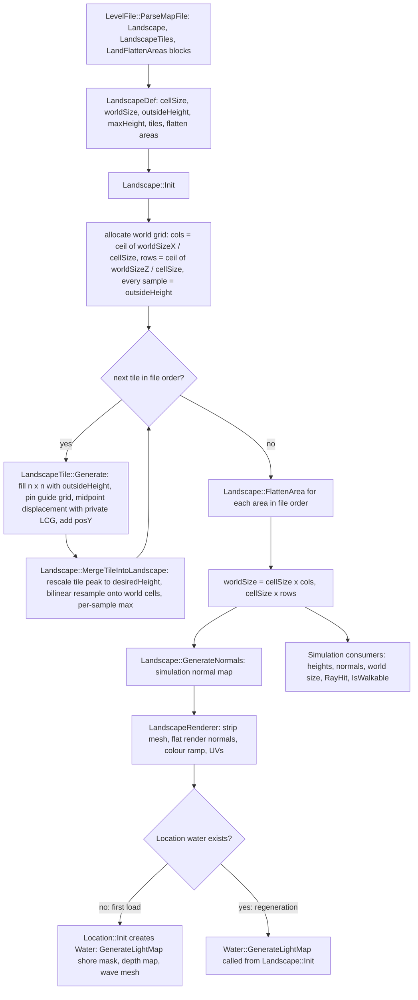

# 23 — Terrain and landscape

> Part B · Baseline build: Release|Win32 (OpenGL) + TARGET_PC_FULLGAME ([B:FULL]); see _work/build_matrix.md.
> Evidence: [C] confirmed · [I] inferred · [U] unknown. Citations are `path:Symbol` relative to the multiwinia/ source root.
> Sources merged: P11_terrain_world (primary: routed §23.1–23.16, determinism notes §D, constants table, unknowns, discrepancies, IP register, appendix), P13_gfx_backend_math and P14_platform_lib (floating-point model, `iv_*` wrappers, x87 precision control, work-queue threads), P17a_ui_framework_editor (landscape editor windows and value ranges), P16_sound (global `AppRandom` use on the main thread during loading), P06_buildings_core (building placement on the height map), P08_crates_ai (open question on maps without sea), X4 (level catalogue). Every numeric constant, formula and loop order below was re-read in `code/landscape.cpp`, `code/lib/2d_surface_map.cpp`, `code/lib/2d_array.cpp`, `code/level_file.cpp`, `code/landscape_renderer.cpp` and `code/water.cpp` at commit `f909630`; new measurements were made with `_work/scripts/S_23_terrain_oracle.py` (built on P11's Python port `_work/scripts/P11_terrain_ref.py`).

## Contents

1. [Scope, summary and build tags](#1-scope-summary-and-build-tags)
2. [Pipeline overview](#2-pipeline-overview)
3. [Numeric primitives the pipeline depends on](#3-numeric-primitives-the-pipeline-depends-on)
4. [Landscape definition data — every field](#4-landscape-definition-data--every-field)
5. [Tile generation — exact algorithm (all three generation methods)](#5-tile-generation--exact-algorithm-all-three-generation-methods)
6. [Guide-grid encoding](#6-guide-grid-encoding)
7. [Height-map composition across tiles (merge and bilinear resampling)](#7-height-map-composition-across-tiles-merge-and-bilinear-resampling)
8. [Smoothing and flatten areas (five types)](#8-smoothing-and-flatten-areas-five-types)
9. [World grid: cell size, world size, outside height and world-edge handling](#9-world-grid-cell-size-world-size-outside-height-and-world-edge-handling)
10. [Normals — simulation versus render](#10-normals--simulation-versus-render)
11. [Colour-ramp application (`data/terrain/landscape_*.bmp`)](#11-colour-ramp-application-dataterrainlandscape_bmp)
12. [Landscape lightmap — documentation versus code](#12-landscape-lightmap--documentation-versus-code)
13. [Water level, shore mask, depth map and coastline waves](#13-water-level-shore-mask-depth-map-and-coastline-waves)
14. [Landscape queries used by gameplay](#14-landscape-queries-used-by-gameplay)
15. [Lifecycle and regeneration](#15-lifecycle-and-regeneration)
16. [Worked example — `mp_koth_2P_1`](#16-worked-example--mp_koth_2p_1)
17. [Determinism and conformance](#17-determinism-and-conformance)
18. [Shipped terrain survey and golden digests](#18-shipped-terrain-survey-and-golden-digests)
19. [Constants](#19-constants)
- [Open questions and unknowns](#open-questions-and-unknowns)
- [Docs-vs-code discrepancies](#docs-vs-code-discrepancies)
- [IP items](#ip-items)
- [Source map](#source-map)
- [Appendix — dead/legacy code](#appendix--deadlegacy-code)

## 1 Scope, summary and build tags

This document specifies how a level file becomes the terrain that the simulation stands on and the renderer draws: the three landscape blocks of a level file, the fractal tile generator, the composition of tiles into one world height field, flatten areas, the world grid and its edge semantics, simulation normals, the colour ramp, the water shore mask, and the coastline waves. It is precise enough to regenerate the shipped terrain from the shipped level text; §17 explains how to prove that with the Python port.

Key facts [C] unless tagged:

- The terrain is **one regular height field** (`SurfaceMap2D<double>`, origin (0,0), square cells of `cellSize` world units) generated **once per level load** from the `Landscape`, `LandscapeTiles` and `LandFlattenAreas` blocks. Gameplay never modifies it afterwards (no writes to `m_heightMap` outside `code/landscape.cpp`; grep over `code/`) [C].
- A level is a list of **tiles**. Each tile is an independent square fractal height map produced by midpoint displacement (square/diamond steps) with its **own private linear-congruential RNG**, optionally pinned by a coarse **guide grid** of 8-bit heights. Each tile's peak is linearly rescaled to a designer-chosen height and resampled onto the world grid with a **per-sample maximum** (later tiles can only raise terrain).
- **Flatten areas** (axis-aligned squares, five operation types) are applied after all tiles; they are the only operation that can lower terrain.
- There is **no smoothing pass between tiles**; the only smoothing is bilinear resampling and flatten type 3.
- **Sea level is y = 0 everywhere**; there is no per-level water level. Everything outside the tiles sits at `outsideHeight` (a negative sea-floor value).
- The generated heights depend only on the level text and integer seeds; floating-point results are forced to IEEE single precision after every transcendental call (`iv_*` wrappers), which makes the output nearly independent of the C runtime (§17).
- Rendering consumers (landscape mesh, flat-shaded colour ramp, wireframe overlay, water) are derived from the height field and are cosmetic. Their GL state and pass order are owned by [24 §landscape and water passes](24_rendering.md); this document gives the data-derivation formulas.

| Feature | Build tag | Evidence |
|---|---|---|
| Landscape parse, generation, merge, flatten, normals, queries | [B:FULL] | `code/level_file.cpp:LevelFile::ParseMapFile`, `code/landscape.cpp` |
| Landscape renderer colour ramp, water shore mask and waves | [B:FULL] | `code/landscape_renderer.cpp`, `code/water.cpp` |
| Christmas-mode texture override | [B:FULL] (runtime flag `Location::m_christmasMode`) | `code/landscape_renderer.cpp:LandscapeRenderer::LandscapeRenderer`, `code/water.cpp:Water::Water`, `Water::RenderFlatWater` |
| Burn patches (darkened terrain colours) | [B:LEGACY] — only `Portal`, a blocked building | `code/location.cpp:Location::AddBurnPatch`, `code/worldobject/portal.cpp:Portal::Advance`, `code/worldobject/building.cpp:Building::BuildingIsBlocked` |
| Landscape editor (tiles, flatten areas, guide-grid painting, scaling) | [B:EDITOR] | `code/interface/landscape_window.cpp` (inside `#ifdef LOCATION_EDITOR`) |
| D3D landscape normal flip / triangle-list conversion; D3D water | [B:D3D] (does not compile at this commit, §Appendix) | `code/landscape_renderer.cpp:LandscapeRenderer::BuildOpenGlState`, `code/water.cpp:Water::Water` |
| `docs/landscape lightmap.txt` landscape shadow lightmap | [B:DEAD] (not in the code at all) | §12 |

Cross-references: level-file block grammar and load sequence → [08](08_levels_and_level_design.md); tokeniser and formal grammars → [29](29_data_formats_reference.md); landscape/water render passes → [24](24_rendering.md); terrain textures in the asset catalogue → [25](25_textures_and_assets.md); lockstep model → [22](22_determinism_and_networking.md).

## 2 Pipeline overview

Call order inside a level load [C] `code/location.cpp:Location::Init`:

1. `LoadLevel` → `LevelFile` parses the map file (`code/level_file.cpp:LevelFile::ParseMapFile`).
2. `AppSeedRandom(1)` — reseeds the **global, non-synchronised** `AppRandom` LCG (used later only by the cosmetic colour ramp and the water shore noise).
3. Static resets, team positions (no `AppRandom` draws), Christmas-mode latch.
4. `InitLights()`.
5. `InitLandscape()` = `Landscape::Init(&levelFile->m_landscape)` — the whole height pipeline, normals and the renderer. `m_water` is still NULL at this moment, so `Landscape::Init` does not build the shore mask on first load [C] `code/landscape.cpp:Landscape::Init`.
6. `m_water = new Water()` — shore mask, depth map, wave mesh (§13).
7. Later `InitBuildings()`: each building's `m_pos.y = heightMap.GetValue(x, z)` [C] `code/worldobject/building.cpp:Building::Initialise`.

Threading [C]: `EnterLocation` queues `DoEnterLocation` on the loading screen's `WorkQueue`, whose dedicated thread runs the whole level load (`code/main.cpp:EnterLocation`, `code/lib/work_queue.cpp`). That thread sets x87 precision to 53 bits on start (`StandardiseCPUPrecision`, see [22](22_determinism_and_networking.md)). Meanwhile the main thread runs `LoadingScreen::Render`, which renders, advances the sound system and the network, and services GL jobs (the landscape VBO upload is marshalled to it with `g_loadingScreen->QueueJob`) [C] `code/loading_screen.cpp:LoadingScreen::Render`, `code/landscape_renderer.cpp:LandscapeRenderer::BuildOpenGlState`.

Data products and who consumes them:

| Product | Type / grid | Lifetime | Consumers | Sim or cosmetic |
|---|---|---|---|---|
| `Landscape::m_heightMap` | `SurfaceMap2D<double>`, cols × rows, cell `cellSize`, outside value `outsideHeight` | level | 394 `m_heightMap->GetValue` call sites (entities, buildings, physics, AI, camera, sound, water) | **simulation** |
| `Landscape::m_normalMap` | `SurfaceMap2D<Vector3>`, same grid, outside value (0,1,0) | level | 57 `m_normalMap->GetValue/GetData` call sites (bounce physics, centipede, nuke, particles) | **simulation** (and cosmetic) |
| `Landscape::m_worldSizeX/Z` | double | level | `GetWorldSizeX/Z`, `IsInLandscape`, camera bounds, fog, water plane | **simulation** |
| `LandscapeRenderer::m_verts` | one triangle strip, 36-byte vertices | renderer lifetime | landscape passes | cosmetic |
| `"water_lightmap"` bitmap/texture | 128 × 128 grey | level | flat-water pass texture unit 1 | cosmetic |
| `Water::m_waterDepthMap` | `SurfaceMap2D<float>` 128 × 128 over the 2× sea plane | freed after the wave mesh is built | wave mesh build | cosmetic |
| `Water::m_flatWaterTiles` | `Array2D<bool>` 32 × 32 | level | flat-water pass | cosmetic |

(Call-site counts from a grep of `code/` [C].)

## 3 Numeric primitives the pipeline depends on

The terrain is defined by these primitives as much as by the algorithm; an implementation must reproduce each exactly to reproduce the shipped heights. "f32(x)" = round a double to IEEE single (round-to-nearest-even) and widen back to double.

| Primitive | Exact behaviour | Evidence |
|---|---|---|
| `iv_trunc_low_nibble(x)` | `volatile float f = (float)x; return f;` — i.e. f32(x) | [C] `contrib/systemiv/lib/math/math_stubs.cpp:iv_trunc_low_nibble` |
| `iv_atof(s)` | f32(`atof(s)`) | [C] `contrib/systemiv/lib/math/math_stubs.cpp:iv_atof` |
| `iv_pow(x,y)`, `iv_exp(x)`, `iv_log(x)`, `iv_sqrt(x)`, `iv_sin(x)` | f32(CRT double function of the arguments converted to double) | [C] `code/lib/universal_include.h` (macros under `__cplusplus`) |
| `Log2(x)` | `iv_log(x) * c` with `c = 1.0 / iv_log(2.0)` computed once (function-static) in double | [C] `code/lib/math_utils.cpp:Log2` |
| `LandscapeTile::GetPowerOfTwo(x)` | `(int)ceil(Log2(x))`. Equal to the exact ⌈log₂ x⌉ for every integer 1 ≤ x < 70000 under float-rounded logs, including exact powers of two | [C] `code/landscape.cpp:LandscapeTile::GetPowerOfTwo`; [I] `_work/scripts/P11_log2check.py` reports 0 mismatches (assumes a correctly rounded `log`; the oracle found no `log` result near a float rounding boundary in any shipped tile, §17.2) |
| `fabsf(d)` on a double | converts d to float first (rounding), then absolute value | [C] use in `code/landscape.cpp:LandscapeTile::GenerateNoise` |
| `Array2D<T>::GetData(x, y)` | indices are `unsigned short`; any index ≥ size (including negative ints, which wrap modulo 2¹⁶ to ≥ 65 536 − 32 768) returns the array's **outside value** | [C] `code/lib/2d_array.cpp:Array2D::GetData` |
| `Array2D<T>::PutData`, `AddToData` | silently ignore out-of-range indices | [C] `code/lib/2d_array.cpp` |
| `Array2D` constructor | allocates `new T[cols·rows]` **without initialising**; every caller in this pipeline calls `SetAll` or writes every element before reading | [C] `code/lib/2d_array.cpp:Array2D::Array2D` |
| `SurfaceMap2D(w, h, x0, y0, cx, cy, outside)` | `cols = ceil(w / cx)`, `rows = ceil(h / cy)` converted to `unsigned short`; `invCellX = 1.0f / cx` (evaluated in double because `cx` is double) | [C] `code/lib/2d_surface_map.cpp:SurfaceMap2D::SurfaceMap2D` |
| `SurfaceMap2D::GetValue(x, y)` | `fx = (x − x0)·invX`; `x1 = (unsigned short)fx` (C++ truncation toward zero); `x2 = (unsigned short)(x1 + 1)`; `fx −= floor(fx)`; **then** `if x1 ≥ cols: x1 = 0`; `if x2 ≥ cols: x2 = 0` (same for y); result `v(x1,y1)·(1−fx)(1−fy) + v(x1,y2)·(1−fx)fy + v(x2,y1)·fx(1−fy) + v(x2,y2)·fx·fy`, summed in that order. Edge consequences are enumerated in §9.3 | [C] `code/lib/2d_surface_map.cpp:SurfaceMap2D::GetValue` |
| `GetMapIndexX(r)` | `(int)((r − x0)·invX)` — truncation toward zero (so −0.5 → 0) | [C] `code/lib/2d_surface_map.cpp:SurfaceMap2D::GetMapIndexX` |
| `GetRealX(i)` | `i·cellSizeX + x0` (int parameter) | [C] `code/lib/2d_surface_map.cpp:SurfaceMap2D::GetRealX` |
| `GetHighestValue()` | starts at `GetData(0,0)`; scans `y < rows`, `x < rows` (rows used for both bounds — correct only for square maps; tiles are always square) | [C] `code/lib/2d_surface_map.cpp:SurfaceMap2D::GetHighestValue` |
| `GetValueNearest(x, y)` | `GetData(floor(x·invX), floor(y·invY))` — **ignores the origin** (x0, y0); not used by the landscape | [C] `code/lib/2d_surface_map.cpp:SurfaceMap2D::GetValueNearest` |
| `Vector3::Normalise()` | `lenSqrd` held in a `volatile double`; if `lenSqrd > 1e-10` multiply by `1.0 / iv_sqrt(lenSqrd)`, else set to (0, 0, 1) | [C] `code/lib/vector3.h:Vector3::Normalise` |
| `Vector3 a ^ b` | cross product `(a.y·b.z − a.z·b.y, a.z·b.x − a.x·b.z, a.x·b.y − a.y·b.x)` | [C] `code/lib/vector3.h:Vector3::operator^` |
| Signed `long` LCG arithmetic | 32-bit `long` on Win32; overflow wraps (MSVC); `>> 16` of a negative value is arithmetic but bits 16–30 are then masked, so the result equals the unsigned computation | [C] `code/landscape.h:LandscapeTile::m_holdrand`; [I] wrap behaviour of MSVC |
| Text tokens | separators `" \t\n\r:,"`; `#` starts a comment to end of line; a file whose first line starts with `redshirt2` is decrypted line by line first | [C] `contrib/systemiv/lib/filesys/text_stream_readers.cpp:TextReader::CleanLine`, `TextReader::GetNextToken` (formal grammar in [29](29_data_formats_reference.md)) |
| Arithmetic precision | Release|Win32 compiles x87 code with the default `/fp:precise` (no `FloatingPointModel` attribute) and the level-load thread runs with 53-bit x87 precision, so double expressions round like IEEE double | [C] `targets/vs2005/Darwinia.vcproj` (`Release|Win32` block has no `FloatingPointModel`; `ReleaseDirect3D|Win32` has `FloatingPointModel="2"` = `/fp:fast`); [I] equivalence of x87-PC53 to SSE2 double for these magnitudes (no denormals or overflow occur) |

## 4 Landscape definition data — every field

### 4.1 Block framing

The three blocks are recognised only in **map files** (`LevelFile::ParseMapFile`); in a mission file they trigger a debug assertion and are ignored [C] `code/level_file.cpp:LevelFile::ParseMissionFile`. Block keywords are compared case-insensitively (`stricmp`). Lines are tokenised as in §3. Multiwinia `mp_*` files contain everything in one map file ([08](08_levels_and_level_design.md)).

| Block | Start keyword | End keyword | Parser | Blank / comment-only lines inside |
|---|---|---|---|---|
| Landscape data | `Landscape_StartDefinition` | `Landscape_EndDefinition` | `code/level_file.cpp:LevelFile::ParseLandscapeData` | **not skipped**: `GetNextToken` returns NULL and `stricmp(NULL, …)` dereferences it (crash-prone). No shipped file has such a line [C] (scan of all 69 `mp_*`/`map_*` files) |
| Tiles | `LandscapeTiles_StartDefinition` | `LandscapeTiles_EndDefinition` | `code/level_file.cpp:LevelFile::ParseLandscapeTiles` | skipped (`TokenAvailable`) |
| Flatten areas | `LandFlattenAreas_StartDefinition` | `LandFlattenAreas_EndDefinition` | `code/level_file.cpp:LevelFile::ParseLandFlattenAreas` | skipped |

A tile line with fewer than 11 tokens makes `GetNextToken` return NULL, which is passed to `atoi`/`iv_atof` (crash-prone) [C]. A guide-grid string shorter than required is read past its end (§6) [C].

### 4.2 `Landscape_StartDefinition` block → `LandscapeDef` and `LevelFile` strings

Each line is `key value`. Keys are case-insensitive; unknown keys are ignored; values missing from the file keep their defaults.

| Key | Field | Type / parse | Units | Default | Range (shipped `mp_*`; editor control) | Semantics | Parser ref |
|---|---|---|---|---|---|---|---|
| `cellSize` | `LandscapeDef::m_cellSize` | double via `iv_atof` (float-rounded, e.g. `15.76` → 15.760000228881836) | world units per sample, both axes | 12.0 | 9.00 – 27.08; editor 1.0 – 100.0 step 1 | spacing of world height samples; the renderer draws one quad per cell. Shipped values: 9.00, 9.87, 9.95, 12.00 (×11), 14.00 (×3), 15.00, 15.76 (×4), 15.80, 16.00 (×13), 17.03, 18.00 (×7), 20.00 (×6), 20.35 (×2), 22.00, 22.32, 26.00 (×2), 27.08 | `code/level_file.cpp:LevelFile::ParseLandscapeData` |
| `worldSizeX` | `m_worldSizeX` | int (`atoi`) | world units | 2000 | 2000 – 7000 (all shipped maps are square); editor 1 – 1e6 step 10 | requested X extent; the real extent is `cellSize × ceil(worldSizeX / cellSize)` (§9.1) | same |
| `worldSizeZ` | `m_worldSizeZ` | int (`atoi`) | world units | 2000 | equal to `worldSizeX` in every shipped map; editor 1 – 1e6 | requested Z extent | same |
| `outsideHeight` | `m_outsideHeight` | double via `iv_atof` | world units (y) | −10 | −30.00 … −6.93 (−10.00 in 40 of 57 `mp_*`; −15.39 ×7, −26.13 ×3, −30.00 ×2, −18.32 ×2, −6.93, −27.89, −21.05); editor −100 – 100 | height of every world sample not raised by a tile (the sea floor), the initial value of every tile sample, the tile border level, and the value returned for out-of-grid integer reads | same |
| `maxHeight` | `m_maxHeight` | `float` field assigned from `atof` (double → float) | world units | 0.0 | 0.00 or absent except `mp_cts_3p_3` = 200.00 (28 of the 69 landscape files omit the key); editor 0 – 2000 | **colour ramp only**: when > 0 it replaces the real highest sample as the ramp's height normaliser (§11). Copied to `Landscape::m_artificalMaxHeight`; the code comment states it "isn't required for any other calculations" and a grep confirms no other use [C] | same; `code/landscape.cpp:Landscape::Init` |
| `landColourFile` | `LevelFile::m_landscapeColourFilename` | string, `strcpy` into `char[512]` (no length check) | file name under `terrain/` | `landscape_default.bmp` | 14 distinct ramps in `mp_*` (§11.4) | terrain colour ramp | same; default in `code/level_file.cpp:LevelFile::LevelFile` |
| `wavesColourFile` | `m_wavesColourFilename` | string, `strcpy` (512) | file name under `terrain/` | `waves_default.bmp` | 8 distinct in `mp_*` (§13.6) | wave colour table | same |
| `waterColourFile` | `m_waterColourFilename` | string, `strcpy` (512) | file name under `terrain/` | `water_default.bmp` | 4 distinct in `mp_*` (§13.6) | flat-water texture | same |

Christmas mode (`Location::ChristmasModEnabled()`, latched in `Location::Init` from `ClientToServer::m_christmasMode`) replaces the three files with `landscape_icecaps.bmp`, `waves_earth.bmp` and `water_icecaps.bmp` at render-build time; heights are unaffected [C] `code/landscape_renderer.cpp:LandscapeRenderer::LandscapeRenderer`, `code/water.cpp:Water::Water`, `code/water.cpp:Water::RenderFlatWater`.

### 4.3 `LandscapeTiles_StartDefinition` block → `LandscapeTile`

One tile per non-empty line, appended in file order (order matters: §7). Positional, whitespace-separated tokens.

| # | Header label (writer comment) | Field | Type / parse | Units | Default (ctor) | Range (shipped `mp_*`; editor control) | Semantics | Parser ref |
|---|---|---|---|---|---|---|---|---|
| 1 | `x` | `m_posX` | int (`atoi`) | world units | – | −1 … 5 401 for on-map tiles (plus two parked tiles at −67 487 and −59 979); editor −10 000 – 10 000 step `cellSize` | world X of the tile's low corner. Two shipped tiles are "parked" far off the map (−67 487/−80 089 and −59 979/−35 486) and contribute nothing (§7.4) | `code/level_file.cpp:LevelFile::ParseLandscapeTiles` |
| 2 | `y` | `m_posY` | double via `iv_atof` | world units (tile space) | – | −25.93 … 83.90 (all 69 files: −27.41 … 83.90); editor −1000 – 1000 step 0.5 | added to **every** tile sample after generation, before the peak rescale (§5.2 step 7, §7.2) | same |
| 3 | `z` | `m_posZ` | int (`atoi`) | world units | – | 1 … 5 215 for on-map tiles (parked tiles at −80 089 and −35 486); editor −10 000 – 10 000 | world Z of the tile's low corner | same |
| 4 | `size` | `m_size` | int (`atoi`) | world units | 256 (editor "new tile" uses 384) | 124 – 4 484 (all 69 files: 104 – 4 484); editor 0 – 10 000 step 10 | edge length of the square footprint on the world grid | same |
| 5 | `frac dim` | `m_fractalDimension` | double via `iv_atof` | dimensionless | 1.2 | 0.57 – 7.88 (1.2 in 230 of 445 `mp_*` tiles); editor label `editor_noiseperiod`, 0 – 10 step 0.01 | roughness exponent: noise amplitude at a level ∝ (2560·h/n)^fd (§5.4). Higher values exaggerate the coarse levels relative to the fine ones and, through the compensation factor 30.7·e^(−6.5·fd), reduce overall gain | same |
| 6 | `height scale` | `m_heightScale` | double via `iv_atof` | dimensionless gain | 1.0 | 0.0 – 10.0 (0.0 in 4 `mp_*` tiles); editor `editor_noisescale` 0 – 10 step 0.02 | linear noise gain; 0 ⇒ no noise (the tile is the midpoint interpolation of its guide grid / border) | same |
| 7 | `desired height` | `m_desiredHeight` | double via `iv_atof` | world units | 200 | 30 – 961 (all 69 files: 21 – 961); editor `editor_height` 0 – 1000 step 5 | the tile's highest sample is mapped to this height (relative to `outsideHeight`, §7.2). The editor writer rounds it to an integer (`%6.0f`) | same; writer `code/level_file.cpp:LevelFile::WriteLandscapeTiles` |
| 8 | `gen method` | `m_generationMethod` | int | enum 0–2 | 1 | `mp_*`: method 1 ×356, 2 ×59, 0 ×30 (all 69 files: 449 / 72 / 39); editor 0 – 2 | 0 = average of 4 parents; 1 = average of a random opposite pair; 2 = copy one random parent (§5.3). Any other value leaves the base height uninitialised (undefined) [C] (switch has no default) | same |
| 9 | `seed` | `m_randomSeed` | int | – | 1 | 1 – 6 507 202 (seed 1 in 85 of 445 tiles); editor 0 – 1e10 step 1; editor "randomise" sets `(int)(GetHighResTime()·1000)` | seed of the tile's private LCG, reapplied at the start of every `Generate` | same; `code/interface/landscape_window.cpp:LandscapeTileButton::MouseUp` |
| 10 | `lowland smooth` | `m_lowlandSmoothingFactor` | double via `iv_atof` | exponent | 1.0 | 0.0 – 3.0 (1.0 ×254, 0.0 ×50, 1.2 ×49, 0.9 ×20, 1.1 ×14 of 445); editor 0 – 3 step 0.02 | exponent on \|base height\| in the noise envelope (0.1 + 0.15·\|h\|^ls): higher ⇒ low ground stays flatter relative to high ground; with ls = 0 the envelope is the constant 0.25. Also scales gain by 15.353·e^(−3.1·ls) | same |
| 11 | `guideGrid` (power) | `m_guideGridPower` via `GuideGridSetPower` | int | log₂(resolution + 1) | 0 | p ∈ {0,1,2,3,4,5}: `mp_*` counts 71/26/209/30/93/16 (all 69 files: 158/34/214/35/98/21); editor 0 – 5 | p = 0: no guide grid. p > 0: guide-grid resolution r = 2^p − 1 points per side (§6) | same; `code/landscape.cpp:LandscapeTile::GuideGridSetPower` |
| 12 | (guide string) | `m_guideGrid` (`Array2D<unsigned char>` r × r) | token, only read when p > 0, decoded by `GuideGridFromString` | 2 letters per cell | NULL | 2·r² letters (2, 18, 98, 450, 1 922) | pinned absolute heights in tile space (§6) | same; `code/landscape.cpp:LandscapeTile::GuideGridFromString` |

Generated (not in the file) [C] `code/landscape.h:LandscapeTile`: `m_heightMap` (n × n `SurfaceMap2D<double>`, cell 1.0, origin 0 during generation; re-targeted to world space during merge), `m_compensatedHeightScale`, `m_holdrand` (LCG state, ctor 1), `m_outsideHeight` (ctor 0.0; overwritten with the landscape's `outsideHeight` before every `Generate` by `Landscape::GenerateHeightMap`).

### 4.4 `LandFlattenAreas_StartDefinition` block → `LandscapeFlattenArea`

Tokens per line: `x y z size [type threshold]`.

| # | Field | Type / parse | Units | Default (ctor) | Range (shipped; editor) | Semantics | Parser ref |
|---|---|---|---|---|---|---|---|
| 1 | `m_centre.x` | double via `iv_atof` | world units | – | inside the map; editor places it at the camera-centre ray hit | centre X of the square | `code/level_file.cpp:LevelFile::ParseLandFlattenAreas` |
| 2 | `m_centre.y` | double via `iv_atof` | world units | – | −26.0 … 886.2 (`mp_*`); editor −1000 – 1000 step 1 | the operand `t`: target height (type 0), amount added (1) or subtracted (2, 4), target level (3) | same |
| 3 | `m_centre.z` | double via `iv_atof` | world units | – | – | centre Z of the square | same |
| 4 | `m_size` | double via `iv_atof` | world units | 40.0 | 8.4 – 1000.0 (`mp_*`); editor 0 – 1000 step 1 (new area 40.0) | **half**-width of the axis-aligned square | same |
| 5 | `m_flattenType` | int, optional | enum 0–4 | 0 (`FlattenTypeAbsolute`) when tokens 5–6 are absent | `mp_*` usage: 0 ×17, 1 ×1, 2 ×5, 3 ×27, 4 ×3 (53 areas; all 69 files: 0 ×25, 1 ×1, 2 ×5, 3 ×27, 4 ×3) | operation (§8) | same |
| 6 | `m_heightThreshold` | double via `iv_atof`; read only when token 5 is present | world units | 40.0 | −3.9 … 348.9 (`mp_*`); editor 0 – 1000 step 1 | threshold `T` for types 2, 3, 4 | same |

`FlattenType` enum [C] `code/level_file.h:LandscapeFlattenArea`: 0 `FlattenTypeAbsolute`, 1 `FlattenTypeAdd`, 2 `FlattenTypeSubtract`, 3 `FlattenTypeSmooth`, 4 `FlattenTypeSubtract2`. (The editor drop-down lists them in the order Absolute, Add, Subtract, Subtract2, Smooth [C] `code/interface/landscape_window.cpp:LandscapeFlattenAreaEditWindow::Create`.)

### 4.5 Writer formats (editor save) and precision loss

[C] `code/level_file.cpp:LevelFile::WriteLandscapeData`, `WriteLandscapeTiles`, `WriteLandFlattenAreas` ([B:EDITOR] callers):

| Block | Format per value | Precision loss on round-trip |
|---|---|---|
| Landscape | `worldSizeX %d`, `worldSizeZ %d`, `cellSize %.2f`, `outsideHeight %.2f`, `maxHeight %.2f`, three file names `%s` | cellSize/outsideHeight/maxHeight to 0.01 |
| Tiles | `%6d %6.2f %6d` (x y z), `%6d` size, `%5.2f` fd, `%6.2f` heightScale, `%6.0f` desiredHeight, `%6d` method, `%6d` seed, `%6.2f` lowland, `%6d` power, then three spaces and the guide string when power > 0; preceded by a 3-line `#` comment header | desiredHeight rounded to an integer; fd, heightScale, lowland, posY to 0.01 |
| Flatten areas | `%6.1f %6.1f %6.1f %6.1f %6d %6.1f` (x y z size type threshold) — always writes all six tokens | centre, size, threshold to 0.1 |

Because values are float-rounded on read (`iv_atof`) and decimal-rounded on write, a load/save cycle is not the identity for arbitrary values, but it is for the 2-decimal values the shipped files contain [I].

