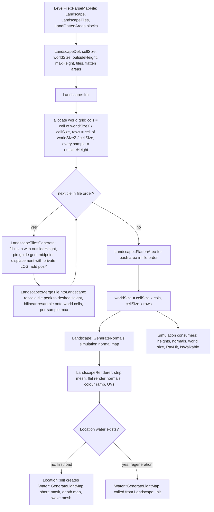

# 23 — Terrain and landscape

> Part B · Baseline build: Release|Win32 (OpenGL) + TARGET_PC_FULLGAME ([B:FULL]); see _work/build_matrix.md.
> Evidence: [C] confirmed · [I] inferred · [U] unknown. Citations are `path:Symbol` relative to the multiwinia/ source root.
> Sources merged: P11_terrain_world (primary: routed §23.1–23.16, determinism notes §D, constants table, unknowns, discrepancies, IP register, appendix), P13_gfx_backend_math and P14_platform_lib (floating-point model, `iv_*` wrappers, x87 precision control, work-queue threads), P17a_ui_framework_editor (landscape editor windows and value ranges), P16_sound (global `AppRandom` use on the main thread during loading), P06_buildings_core (building placement on the height map), P08_crates_ai (open question on maps without sea), X4 (level catalogue). Every numeric constant, formula and loop order below was re-read in `code/landscape.cpp`, `code/lib/2d_surface_map.cpp`, `code/lib/2d_array.cpp`, `code/level_file.cpp`, `code/landscape_renderer.cpp` and `code/water.cpp` at commit `f909630`; new measurements were made with `_work/scripts/S_23_terrain_oracle.py` (built on P11's Python port `_work/scripts/P11_terrain_ref.py`).

## Contents

1. [Scope, summary and build tags](#1-scope-summary-and-build-tags)
2. [Pipeline overview](#2-pipeline-overview)
3. [Numeric primitives the pipeline depends on](#3-numeric-primitives-the-pipeline-depends-on)
4. [Landscape definition data — every field](#4-landscape-definition-data--every-field)
5. [Tile generation — exact algorithm (all three generation methods)](#5-tile-generation--exact-algorithm-all-three-generation-methods)
6. [Guide-grid encoding](#6-guide-grid-encoding)
7. [Height-map composition across tiles (merge and bilinear resampling)](#7-height-map-composition-across-tiles-merge-and-bilinear-resampling)
8. [Smoothing and flatten areas (five types)](#8-smoothing-and-flatten-areas-five-types)
9. [World grid: cell size, world size, outside height and world-edge handling](#9-world-grid-cell-size-world-size-outside-height-and-world-edge-handling)
10. [Normals — simulation versus render](#10-normals--simulation-versus-render)
11. [Colour-ramp application (`data/terrain/landscape_*.bmp`)](#11-colour-ramp-application-dataterrainlandscape_bmp)
12. [Landscape lightmap — documentation versus code](#12-landscape-lightmap--documentation-versus-code)
13. [Water level, shore mask, depth map and coastline waves](#13-water-level-shore-mask-depth-map-and-coastline-waves)
14. [Landscape queries used by gameplay](#14-landscape-queries-used-by-gameplay)
15. [Lifecycle and regeneration](#15-lifecycle-and-regeneration)
16. [Worked example — `mp_koth_2P_1`](#16-worked-example--mp_koth_2p_1)
17. [Determinism and conformance](#17-determinism-and-conformance)
18. [Shipped terrain survey and golden digests](#18-shipped-terrain-survey-and-golden-digests)
19. [Constants](#19-constants)
- [Open questions and unknowns](#open-questions-and-unknowns)
- [Docs-vs-code discrepancies](#docs-vs-code-discrepancies)
- [IP items](#ip-items)
- [Source map](#source-map)
- [Appendix — dead/legacy code](#appendix--deadlegacy-code)

## 1 Scope, summary and build tags

This document specifies how a level file becomes the terrain that the simulation stands on and the renderer draws: the three landscape blocks of a level file, the fractal tile generator, the composition of tiles into one world height field, flatten areas, the world grid and its edge semantics, simulation normals, the colour ramp, the water shore mask, and the coastline waves. It is precise enough to regenerate the shipped terrain from the shipped level text; §17 explains how to prove that with the Python port.

Key facts [C] unless tagged:

- The terrain is **one regular height field** (`SurfaceMap2D<double>`, origin (0,0), square cells of `cellSize` world units) generated **once per level load** from the `Landscape`, `LandscapeTiles` and `LandFlattenAreas` blocks. Gameplay never modifies it afterwards (no writes to `m_heightMap` outside `code/landscape.cpp`; grep over `code/`) [C].
- A level is a list of **tiles**. Each tile is an independent square fractal height map produced by midpoint displacement (square/diamond steps) with its **own private linear-congruential RNG**, optionally pinned by a coarse **guide grid** of 8-bit heights. Each tile's peak is linearly rescaled to a designer-chosen height and resampled onto the world grid with a **per-sample maximum** (later tiles can only raise terrain).
- **Flatten areas** (axis-aligned squares, five operation types) are applied after all tiles; they are the only operation that can lower terrain.
- There is **no smoothing pass between tiles**; the only smoothing is bilinear resampling and flatten type 3.
- **Sea level is y = 0 everywhere**; there is no per-level water level. Everything outside the tiles sits at `outsideHeight` (a negative sea-floor value).
- The generated heights depend only on the level text and integer seeds; floating-point results are forced to IEEE single precision after every transcendental call (`iv_*` wrappers), which makes the output nearly independent of the C runtime (§17).
- Rendering consumers (landscape mesh, flat-shaded colour ramp, wireframe overlay, water) are derived from the height field and are cosmetic. Their GL state and pass order are owned by [24 §landscape and water passes](24_rendering.md); this document gives the data-derivation formulas.

| Feature | Build tag | Evidence |
|---|---|---|
| Landscape parse, generation, merge, flatten, normals, queries | [B:FULL] | `code/level_file.cpp:LevelFile::ParseMapFile`, `code/landscape.cpp` |
| Landscape renderer colour ramp, water shore mask and waves | [B:FULL] | `code/landscape_renderer.cpp`, `code/water.cpp` |
| Christmas-mode texture override | [B:FULL] (runtime flag `Location::m_christmasMode`) | `code/landscape_renderer.cpp:LandscapeRenderer::LandscapeRenderer`, `code/water.cpp:Water::Water`, `Water::RenderFlatWater` |
| Burn patches (darkened terrain colours) | [B:LEGACY] — only `Portal`, a blocked building | `code/location.cpp:Location::AddBurnPatch`, `code/worldobject/portal.cpp:Portal::Advance`, `code/worldobject/building.cpp:Building::BuildingIsBlocked` |
| Landscape editor (tiles, flatten areas, guide-grid painting, scaling) | [B:EDITOR] | `code/interface/landscape_window.cpp` (inside `#ifdef LOCATION_EDITOR`) |
| D3D landscape normal flip / triangle-list conversion; D3D water | [B:D3D] (does not compile at this commit, §Appendix) | `code/landscape_renderer.cpp:LandscapeRenderer::BuildOpenGlState`, `code/water.cpp:Water::Water` |
| `docs/landscape lightmap.txt` landscape shadow lightmap | [B:DEAD] (not in the code at all) | §12 |

Cross-references: level-file block grammar and load sequence → [08](08_levels_and_level_design.md); tokeniser and formal grammars → [29](29_data_formats_reference.md); landscape/water render passes → [24](24_rendering.md); terrain textures in the asset catalogue → [25](25_textures_and_assets.md); lockstep model → [22](22_determinism_and_networking.md).

## 2 Pipeline overview



Call order inside a level load [C] `code/location.cpp:Location::Init`:

1. `LoadLevel` → `LevelFile` parses the map file (`code/level_file.cpp:LevelFile::ParseMapFile`).
2. `AppSeedRandom(1)` — reseeds the **global, non-synchronised** `AppRandom` LCG (used later only by the cosmetic colour ramp and the water shore noise).
3. Static resets, team positions (no `AppRandom` draws), Christmas-mode latch.
4. `InitLights()`.
5. `InitLandscape()` = `Landscape::Init(&levelFile->m_landscape)` — the whole height pipeline, normals and the renderer. `m_water` is still NULL at this moment, so `Landscape::Init` does not build the shore mask on first load [C] `code/landscape.cpp:Landscape::Init`.
6. `m_water = new Water()` — shore mask, depth map, wave mesh (§13).
7. Later `InitBuildings()`: each building's `m_pos.y = heightMap.GetValue(x, z)` [C] `code/worldobject/building.cpp:Building::Initialise`.

Threading [C]: `EnterLocation` queues `DoEnterLocation` on the loading screen's `WorkQueue`, whose dedicated thread runs the whole level load (`code/main.cpp:EnterLocation`, `code/lib/work_queue.cpp`). That thread sets x87 precision to 53 bits on start (`StandardiseCPUPrecision`, see [22](22_determinism_and_networking.md)). Meanwhile the main thread runs `LoadingScreen::Render`, which renders, advances the sound system and the network, and services GL jobs (the landscape VBO upload is marshalled to it with `g_loadingScreen->QueueJob`) [C] `code/loading_screen.cpp:LoadingScreen::Render`, `code/landscape_renderer.cpp:LandscapeRenderer::BuildOpenGlState`.

Data products and who consumes them:

| Product | Type / grid | Lifetime | Consumers | Sim or cosmetic |
|---|---|---|---|---|
| `Landscape::m_heightMap` | `SurfaceMap2D<double>`, cols × rows, cell `cellSize`, outside value `outsideHeight` | level | 394 `m_heightMap->GetValue` call sites (entities, buildings, physics, AI, camera, sound, water) | **simulation** |
| `Landscape::m_normalMap` | `SurfaceMap2D<Vector3>`, same grid, outside value (0,1,0) | level | 57 `m_normalMap->GetValue/GetData` call sites (bounce physics, centipede, nuke, particles) | **simulation** (and cosmetic) |
| `Landscape::m_worldSizeX/Z` | double | level | `GetWorldSizeX/Z`, `IsInLandscape`, camera bounds, fog, water plane | **simulation** |
| `LandscapeRenderer::m_verts` | one triangle strip, 36-byte vertices | renderer lifetime | landscape passes | cosmetic |
| `"water_lightmap"` bitmap/texture | 128 × 128 grey | level | flat-water pass texture unit 1 | cosmetic |
| `Water::m_waterDepthMap` | `SurfaceMap2D<float>` 128 × 128 over the 2× sea plane | freed after the wave mesh is built | wave mesh build | cosmetic |
| `Water::m_flatWaterTiles` | `Array2D<bool>` 32 × 32 | level | flat-water pass | cosmetic |

(Call-site counts from a grep of `code/` [C].)

## 3 Numeric primitives the pipeline depends on

The terrain is defined by these primitives as much as by the algorithm; an implementation must reproduce each exactly to reproduce the shipped heights. "f32(x)" = round a double to IEEE single (round-to-nearest-even) and widen back to double.

| Primitive | Exact behaviour | Evidence |
|---|---|---|
| `iv_trunc_low_nibble(x)` | `volatile float f = (float)x; return f;` — i.e. f32(x) | [C] `contrib/systemiv/lib/math/math_stubs.cpp:iv_trunc_low_nibble` |
| `iv_atof(s)` | f32(`atof(s)`) | [C] `contrib/systemiv/lib/math/math_stubs.cpp:iv_atof` |
| `iv_pow(x,y)`, `iv_exp(x)`, `iv_log(x)`, `iv_sqrt(x)`, `iv_sin(x)` | f32(CRT double function of the arguments converted to double) | [C] `code/lib/universal_include.h` (macros under `__cplusplus`) |
| `Log2(x)` | `iv_log(x) * c` with `c = 1.0 / iv_log(2.0)` computed once (function-static) in double | [C] `code/lib/math_utils.cpp:Log2` |
| `LandscapeTile::GetPowerOfTwo(x)` | `(int)ceil(Log2(x))`. Equal to the exact ⌈log₂ x⌉ for every integer 1 ≤ x < 70000 under float-rounded logs, including exact powers of two | [C] `code/landscape.cpp:LandscapeTile::GetPowerOfTwo`; [I] `_work/scripts/P11_log2check.py` reports 0 mismatches (assumes a correctly rounded `log`; the oracle found no `log` result near a float rounding boundary in any shipped tile, §17.2) |
| `fabsf(d)` on a double | converts d to float first (rounding), then absolute value | [C] use in `code/landscape.cpp:LandscapeTile::GenerateNoise` |
| `Array2D<T>::GetData(x, y)` | indices are `unsigned short`; any index ≥ size (including negative ints, which wrap modulo 2¹⁶ to ≥ 65 536 − 32 768) returns the array's **outside value** | [C] `code/lib/2d_array.cpp:Array2D::GetData` |
| `Array2D<T>::PutData`, `AddToData` | silently ignore out-of-range indices | [C] `code/lib/2d_array.cpp` |
| `Array2D` constructor | allocates `new T[cols·rows]` **without initialising**; every caller in this pipeline calls `SetAll` or writes every element before reading | [C] `code/lib/2d_array.cpp:Array2D::Array2D` |
| `SurfaceMap2D(w, h, x0, y0, cx, cy, outside)` | `cols = ceil(w / cx)`, `rows = ceil(h / cy)` converted to `unsigned short`; `invCellX = 1.0f / cx` (evaluated in double because `cx` is double) | [C] `code/lib/2d_surface_map.cpp:SurfaceMap2D::SurfaceMap2D` |
| `SurfaceMap2D::GetValue(x, y)` | `fx = (x − x0)·invX`; `x1 = (unsigned short)fx` (C++ truncation toward zero); `x2 = (unsigned short)(x1 + 1)`; `fx −= floor(fx)`; **then** `if x1 ≥ cols: x1 = 0`; `if x2 ≥ cols: x2 = 0` (same for y); result `v(x1,y1)·(1−fx)(1−fy) + v(x1,y2)·(1−fx)fy + v(x2,y1)·fx(1−fy) + v(x2,y2)·fx·fy`, summed in that order. Edge consequences are enumerated in §9.3 | [C] `code/lib/2d_surface_map.cpp:SurfaceMap2D::GetValue` |
| `GetMapIndexX(r)` | `(int)((r − x0)·invX)` — truncation toward zero (so −0.5 → 0) | [C] `code/lib/2d_surface_map.cpp:SurfaceMap2D::GetMapIndexX` |
| `GetRealX(i)` | `i·cellSizeX + x0` (int parameter) | [C] `code/lib/2d_surface_map.cpp:SurfaceMap2D::GetRealX` |
| `GetHighestValue()` | starts at `GetData(0,0)`; scans `y < rows`, `x < rows` (rows used for both bounds — correct only for square maps; tiles are always square) | [C] `code/lib/2d_surface_map.cpp:SurfaceMap2D::GetHighestValue` |
| `GetValueNearest(x, y)` | `GetData(floor(x·invX), floor(y·invY))` — **ignores the origin** (x0, y0); not used by the landscape | [C] `code/lib/2d_surface_map.cpp:SurfaceMap2D::GetValueNearest` |
| `Vector3::Normalise()` | `lenSqrd` held in a `volatile double`; if `lenSqrd > 1e-10` multiply by `1.0 / iv_sqrt(lenSqrd)`, else set to (0, 0, 1) | [C] `code/lib/vector3.h:Vector3::Normalise` |
| `Vector3 a ^ b` | cross product `(a.y·b.z − a.z·b.y, a.z·b.x − a.x·b.z, a.x·b.y − a.y·b.x)` | [C] `code/lib/vector3.h:Vector3::operator^` |
| Signed `long` LCG arithmetic | 32-bit `long` on Win32; overflow wraps (MSVC); `>> 16` of a negative value is arithmetic but bits 16–30 are then masked, so the result equals the unsigned computation | [C] `code/landscape.h:LandscapeTile::m_holdrand`; [I] wrap behaviour of MSVC |
| Text tokens | separators `" \t\n\r:,"`; `#` starts a comment to end of line; a file whose first line starts with `redshirt2` is decrypted line by line first | [C] `contrib/systemiv/lib/filesys/text_stream_readers.cpp:TextReader::CleanLine`, `TextReader::GetNextToken` (formal grammar in [29](29_data_formats_reference.md)) |
| Arithmetic precision | Release|Win32 compiles x87 code with the default `/fp:precise` (no `FloatingPointModel` attribute) and the level-load thread runs with 53-bit x87 precision, so double expressions round like IEEE double | [C] `targets/vs2005/Darwinia.vcproj` (`Release|Win32` block has no `FloatingPointModel`; `ReleaseDirect3D|Win32` has `FloatingPointModel="2"` = `/fp:fast`); [I] equivalence of x87-PC53 to SSE2 double for these magnitudes (no denormals or overflow occur) |

## 4 Landscape definition data — every field

### 4.1 Block framing

The three blocks are recognised only in **map files** (`LevelFile::ParseMapFile`); in a mission file they trigger a debug assertion and are ignored [C] `code/level_file.cpp:LevelFile::ParseMissionFile`. Block keywords are compared case-insensitively (`stricmp`). Lines are tokenised as in §3. Multiwinia `mp_*` files contain everything in one map file ([08](08_levels_and_level_design.md)).

| Block | Start keyword | End keyword | Parser | Blank / comment-only lines inside |
|---|---|---|---|---|
| Landscape data | `Landscape_StartDefinition` | `Landscape_EndDefinition` | `code/level_file.cpp:LevelFile::ParseLandscapeData` | **not skipped**: `GetNextToken` returns NULL and `stricmp(NULL, …)` dereferences it (crash-prone). No shipped file has such a line [C] (scan of all 69 `mp_*`/`map_*` files) |
| Tiles | `LandscapeTiles_StartDefinition` | `LandscapeTiles_EndDefinition` | `code/level_file.cpp:LevelFile::ParseLandscapeTiles` | skipped (`TokenAvailable`) |
| Flatten areas | `LandFlattenAreas_StartDefinition` | `LandFlattenAreas_EndDefinition` | `code/level_file.cpp:LevelFile::ParseLandFlattenAreas` | skipped |

A tile line with fewer than 11 tokens makes `GetNextToken` return NULL, which is passed to `atoi`/`iv_atof` (crash-prone) [C]. A guide-grid string shorter than required is read past its end (§6) [C].

### 4.2 `Landscape_StartDefinition` block → `LandscapeDef` and `LevelFile` strings

Each line is `key value`. Keys are case-insensitive; unknown keys are ignored; values missing from the file keep their defaults.

| Key | Field | Type / parse | Units | Default | Range (shipped `mp_*`; editor control) | Semantics | Parser ref |
|---|---|---|---|---|---|---|---|
| `cellSize` | `LandscapeDef::m_cellSize` | double via `iv_atof` (float-rounded, e.g. `15.76` → 15.760000228881836) | world units per sample, both axes | 12.0 | 9.00 – 27.08; editor 1.0 – 100.0 step 1 | spacing of world height samples; the renderer draws one quad per cell. Shipped values: 9.00, 9.87, 9.95, 12.00 (×11), 14.00 (×3), 15.00, 15.76 (×4), 15.80, 16.00 (×13), 17.03, 18.00 (×7), 20.00 (×6), 20.35 (×2), 22.00, 22.32, 26.00 (×2), 27.08 | `code/level_file.cpp:LevelFile::ParseLandscapeData` |
| `worldSizeX` | `m_worldSizeX` | int (`atoi`) | world units | 2000 | 2000 – 7000 (all shipped maps are square); editor 1 – 1e6 step 10 | requested X extent; the real extent is `cellSize × ceil(worldSizeX / cellSize)` (§9.1) | same |
| `worldSizeZ` | `m_worldSizeZ` | int (`atoi`) | world units | 2000 | equal to `worldSizeX` in every shipped map; editor 1 – 1e6 | requested Z extent | same |
| `outsideHeight` | `m_outsideHeight` | double via `iv_atof` | world units (y) | −10 | −30.00 … −6.93 (−10.00 in 40 of 57 `mp_*`; −15.39 ×7, −26.13 ×3, −30.00 ×2, −18.32 ×2, −6.93, −27.89, −21.05); editor −100 – 100 | height of every world sample not raised by a tile (the sea floor), the initial value of every tile sample, the tile border level, and the value returned for out-of-grid integer reads | same |
| `maxHeight` | `m_maxHeight` | `float` field assigned from `atof` (double → float) | world units | 0.0 | 0.00 or absent except `mp_cts_3p_3` = 200.00 (28 of the 69 landscape files omit the key); editor 0 – 2000 | **colour ramp only**: when > 0 it replaces the real highest sample as the ramp's height normaliser (§11). Copied to `Landscape::m_artificalMaxHeight`; the code comment states it "isn't required for any other calculations" and a grep confirms no other use [C] | same; `code/landscape.cpp:Landscape::Init` |
| `landColourFile` | `LevelFile::m_landscapeColourFilename` | string, `strcpy` into `char[512]` (no length check) | file name under `terrain/` | `landscape_default.bmp` | 14 distinct ramps in `mp_*` (§11.4) | terrain colour ramp | same; default in `code/level_file.cpp:LevelFile::LevelFile` |
| `wavesColourFile` | `m_wavesColourFilename` | string, `strcpy` (512) | file name under `terrain/` | `waves_default.bmp` | 8 distinct in `mp_*` (§13.6) | wave colour table | same |
| `waterColourFile` | `m_waterColourFilename` | string, `strcpy` (512) | file name under `terrain/` | `water_default.bmp` | 4 distinct in `mp_*` (§13.6) | flat-water texture | same |

Christmas mode (`Location::ChristmasModEnabled()`, latched in `Location::Init` from `ClientToServer::m_christmasMode`) replaces the three files with `landscape_icecaps.bmp`, `waves_earth.bmp` and `water_icecaps.bmp` at render-build time; heights are unaffected [C] `code/landscape_renderer.cpp:LandscapeRenderer::LandscapeRenderer`, `code/water.cpp:Water::Water`, `code/water.cpp:Water::RenderFlatWater`.

### 4.3 `LandscapeTiles_StartDefinition` block → `LandscapeTile`

One tile per non-empty line, appended in file order (order matters: §7). Positional, whitespace-separated tokens.

| # | Header label (writer comment) | Field | Type / parse | Units | Default (ctor) | Range (shipped `mp_*`; editor control) | Semantics | Parser ref |
|---|---|---|---|---|---|---|---|---|
| 1 | `x` | `m_posX` | int (`atoi`) | world units | – | −1 … 5 401 for on-map tiles (plus two parked tiles at −67 487 and −59 979); editor −10 000 – 10 000 step `cellSize` | world X of the tile's low corner. Two shipped tiles are "parked" far off the map (−67 487/−80 089 and −59 979/−35 486) and contribute nothing (§7.4) | `code/level_file.cpp:LevelFile::ParseLandscapeTiles` |
| 2 | `y` | `m_posY` | double via `iv_atof` | world units (tile space) | – | −25.93 … 83.90 (all 69 files: −27.41 … 83.90); editor −1000 – 1000 step 0.5 | added to **every** tile sample after generation, before the peak rescale (§5.2 step 7, §7.2) | same |
| 3 | `z` | `m_posZ` | int (`atoi`) | world units | – | 1 … 5 215 for on-map tiles (parked tiles at −80 089 and −35 486); editor −10 000 – 10 000 | world Z of the tile's low corner | same |
| 4 | `size` | `m_size` | int (`atoi`) | world units | 256 (editor "new tile" uses 384) | 124 – 4 484 (all 69 files: 104 – 4 484); editor 0 – 10 000 step 10 | edge length of the square footprint on the world grid | same |
| 5 | `frac dim` | `m_fractalDimension` | double via `iv_atof` | dimensionless | 1.2 | 0.57 – 7.88 (1.2 in 230 of 445 `mp_*` tiles); editor label `editor_noiseperiod`, 0 – 10 step 0.01 | roughness exponent: noise amplitude at a level ∝ (2560·h/n)^fd (§5.4). Higher values exaggerate the coarse levels relative to the fine ones and, through the compensation factor 30.7·e^(−6.5·fd), reduce overall gain | same |
| 6 | `height scale` | `m_heightScale` | double via `iv_atof` | dimensionless gain | 1.0 | 0.0 – 10.0 (0.0 in 4 `mp_*` tiles); editor `editor_noisescale` 0 – 10 step 0.02 | linear noise gain; 0 ⇒ no noise (the tile is the midpoint interpolation of its guide grid / border) | same |
| 7 | `desired height` | `m_desiredHeight` | double via `iv_atof` | world units | 200 | 30 – 961 (all 69 files: 21 – 961); editor `editor_height` 0 – 1000 step 5 | the tile's highest sample is mapped to this height (relative to `outsideHeight`, §7.2). The editor writer rounds it to an integer (`%6.0f`) | same; writer `code/level_file.cpp:LevelFile::WriteLandscapeTiles` |
| 8 | `gen method` | `m_generationMethod` | int | enum 0–2 | 1 | `mp_*`: method 1 ×356, 2 ×59, 0 ×30 (all 69 files: 449 / 72 / 39); editor 0 – 2 | 0 = average of 4 parents; 1 = average of a random opposite pair; 2 = copy one random parent (§5.3). Any other value leaves the base height uninitialised (undefined) [C] (switch has no default) | same |
| 9 | `seed` | `m_randomSeed` | int | – | 1 | 1 – 6 507 202 (seed 1 in 85 of 445 tiles); editor 0 – 1e10 step 1; editor "randomise" sets `(int)(GetHighResTime()·1000)` | seed of the tile's private LCG, reapplied at the start of every `Generate` | same; `code/interface/landscape_window.cpp:LandscapeTileButton::MouseUp` |
| 10 | `lowland smooth` | `m_lowlandSmoothingFactor` | double via `iv_atof` | exponent | 1.0 | 0.0 – 3.0 (1.0 ×254, 0.0 ×50, 1.2 ×49, 0.9 ×20, 1.1 ×14 of 445); editor 0 – 3 step 0.02 | exponent on \|base height\| in the noise envelope (0.1 + 0.15·\|h\|^ls): higher ⇒ low ground stays flatter relative to high ground; with ls = 0 the envelope is the constant 0.25. Also scales gain by 15.353·e^(−3.1·ls) | same |
| 11 | `guideGrid` (power) | `m_guideGridPower` via `GuideGridSetPower` | int | log₂(resolution + 1) | 0 | p ∈ {0,1,2,3,4,5}: `mp_*` counts 71/26/209/30/93/16 (all 69 files: 158/34/214/35/98/21); editor 0 – 5 | p = 0: no guide grid. p > 0: guide-grid resolution r = 2^p − 1 points per side (§6) | same; `code/landscape.cpp:LandscapeTile::GuideGridSetPower` |
| 12 | (guide string) | `m_guideGrid` (`Array2D<unsigned char>` r × r) | token, only read when p > 0, decoded by `GuideGridFromString` | 2 letters per cell | NULL | 2·r² letters (2, 18, 98, 450, 1 922) | pinned absolute heights in tile space (§6) | same; `code/landscape.cpp:LandscapeTile::GuideGridFromString` |

Generated (not in the file) [C] `code/landscape.h:LandscapeTile`: `m_heightMap` (n × n `SurfaceMap2D<double>`, cell 1.0, origin 0 during generation; re-targeted to world space during merge), `m_compensatedHeightScale`, `m_holdrand` (LCG state, ctor 1), `m_outsideHeight` (ctor 0.0; overwritten with the landscape's `outsideHeight` before every `Generate` by `Landscape::GenerateHeightMap`).

### 4.4 `LandFlattenAreas_StartDefinition` block → `LandscapeFlattenArea`

Tokens per line: `x y z size [type threshold]`.

| # | Field | Type / parse | Units | Default (ctor) | Range (shipped; editor) | Semantics | Parser ref |
|---|---|---|---|---|---|---|---|
| 1 | `m_centre.x` | double via `iv_atof` | world units | – | inside the map; editor places it at the camera-centre ray hit | centre X of the square | `code/level_file.cpp:LevelFile::ParseLandFlattenAreas` |
| 2 | `m_centre.y` | double via `iv_atof` | world units | – | −26.0 … 886.2 (`mp_*`); editor −1000 – 1000 step 1 | the operand `t`: target height (type 0), amount added (1) or subtracted (2, 4), target level (3) | same |
| 3 | `m_centre.z` | double via `iv_atof` | world units | – | – | centre Z of the square | same |
| 4 | `m_size` | double via `iv_atof` | world units | 40.0 | 8.4 – 1000.0 (`mp_*`); editor 0 – 1000 step 1 (new area 40.0) | **half**-width of the axis-aligned square | same |
| 5 | `m_flattenType` | int, optional | enum 0–4 | 0 (`FlattenTypeAbsolute`) when tokens 5–6 are absent | `mp_*` usage: 0 ×17, 1 ×1, 2 ×5, 3 ×27, 4 ×3 (53 areas; all 69 files: 0 ×25, 1 ×1, 2 ×5, 3 ×27, 4 ×3) | operation (§8) | same |
| 6 | `m_heightThreshold` | double via `iv_atof`; read only when token 5 is present | world units | 40.0 | −3.9 … 348.9 (`mp_*`); editor 0 – 1000 step 1 | threshold `T` for types 2, 3, 4 | same |

`FlattenType` enum [C] `code/level_file.h:LandscapeFlattenArea`: 0 `FlattenTypeAbsolute`, 1 `FlattenTypeAdd`, 2 `FlattenTypeSubtract`, 3 `FlattenTypeSmooth`, 4 `FlattenTypeSubtract2`. (The editor drop-down lists them in the order Absolute, Add, Subtract, Subtract2, Smooth [C] `code/interface/landscape_window.cpp:LandscapeFlattenAreaEditWindow::Create`.)

### 4.5 Writer formats (editor save) and precision loss

[C] `code/level_file.cpp:LevelFile::WriteLandscapeData`, `WriteLandscapeTiles`, `WriteLandFlattenAreas` ([B:EDITOR] callers):

| Block | Format per value | Precision loss on round-trip |
|---|---|---|
| Landscape | `worldSizeX %d`, `worldSizeZ %d`, `cellSize %.2f`, `outsideHeight %.2f`, `maxHeight %.2f`, three file names `%s` | cellSize/outsideHeight/maxHeight to 0.01 |
| Tiles | `%6d %6.2f %6d` (x y z), `%6d` size, `%5.2f` fd, `%6.2f` heightScale, `%6.0f` desiredHeight, `%6d` method, `%6d` seed, `%6.2f` lowland, `%6d` power, then three spaces and the guide string when power > 0; preceded by a 3-line `#` comment header | desiredHeight rounded to an integer; fd, heightScale, lowland, posY to 0.01 |
| Flatten areas | `%6.1f %6.1f %6.1f %6.1f %6d %6.1f` (x y z size type threshold) — always writes all six tokens | centre, size, threshold to 0.1 |

Because values are float-rounded on read (`iv_atof`) and decimal-rounded on write, a load/save cycle is not the identity for arbitrary values, but it is for the 2-decimal values the shipped files contain [I].

## 5 Tile generation — exact algorithm (all three generation methods)

[C] `code/landscape.cpp:LandscapeTile::Generate`, `LandscapeTile::GenerateMidpoints`, `LandscapeTile::GenerateSquareMidpoint`, `LandscapeTile::GenerateDiamondMidpoint`, `LandscapeTile::GenerateNoise`, `LandscapeTile::LandscapeAppSeedRandom`, `LandscapeTile::LandscapeAppRandom`, `LandscapeTile::Landscapesfrand`. All arithmetic is IEEE double unless f32() is written.

### 5.1 The private per-tile RNG

Each `LandscapeTile` owns `long m_holdrand`. It uses the same constants as the MSVC C runtime's `rand()` and as the game's global `AppRandom`, but the state is **private to the tile** and is not the synchronised network RNG (`syncrand`) nor the global `AppRandom` [C].

```
seed(s):    state = (uint32) s
next():     state = state * 214013 + 2531011   (mod 2^32)
            return (state >> 16) & 0x7FFF                  // 0 .. 32767
sfrand(R):  return (0.5 - next() / 32767.0) * R           // uniform over [-R/2, +R/2]; next()=0 gives +R/2
frand(R):   return R * (next() / 32767.0)                 // defined (Landscapefrand) but never called
```

Test vector [C] (identical to MSVC `rand()` after `srand(1)`): seed 1 → 41, 18467, 6334, 26500, 19169, 15724, 11478, 29358 (confirmed by the trace in §16.3). Using an unsigned 32-bit state reproduces the signed-`long` original bit for bit [I] (§3).

### 5.2 `LandscapeTile::Generate` — numbered pseudocode

Inputs: the tile fields of §4.3, `cellSize` from the `LandscapeDef`, and `outside` = the landscape's `outsideHeight` (copied into the tile by `Landscape::GenerateHeightMap` immediately before the call).

1. **Size the tile grid.**
   `reqWorldCells = (int)(size / cellSize)` (int ÷ double, truncated toward zero).
   `k = GetPowerOfTwo(reqWorldCells − 1)` = ⌈log₂(reqWorldCells − 1)⌉.
   `n = (int)iv_pow(2, k) + 1` (exact).
   The tile map is n × n samples, cell size 1.0, origin (0, 0), outside value `outside`; it is reallocated only when n changes. Shipped `mp_*` tiles use n = 9 (4 tiles), 17 (36), 33 (70), 65 (236), 129 (71), 257 (28) [C] (`S_23_terrain_oracle.py`); (n − 1)/reqWorldCells ranges 0.94 – 1.95, so a tile is sampled at roughly one to two tile samples per world cell.
2. **Initialise.** Every sample = `outside`.
3. **Pin the guide grid** (only if p = `m_guideGridPower` > 0). `r = 2^p − 1`; `scale = (n − 1) / (r + 1)` (integer division; = 2^(k − p) when k ≥ p). For z = 0 … r − 1 (outer) and x = 0 … r − 1 (inner): `sample((x + 1)·scale, (z + 1)·scale) = (double)guide[x, z]` — the raw byte 0 – 255 used directly as a tile-space height. Guide points never lie on the tile border.
4. **Compensated gain.**
   `fracDimModifier = 30.7 · f32(exp(−6.5 · fd))`
   `smoothingModifier = 15.353 · f32(exp(−3.1 · ls))`
   `comp = heightScale; comp *= fracDimModifier; comp *= smoothingModifier` (two separate double multiplications, in this order).
5. **Iteration plan.** `iterations = GetPowerOfTwo(n) − p` (= k + 1 − p because ⌈log₂(2^k + 1)⌉ = k + 1); `step = (n − 1) >> p` (= 2^(k − p)).
6. **Midpoint displacement.**
   ```
   seed(m_randomSeed)
   repeat iterations times:
       for x = 0; x < n - 1; x += step:            # x is the OUTER loop
           for z = 0; z < n - 1; z += step:        # z is the INNER loop
               h  = step >> 1
               mx = x + h ; mz = z + h
               Square(mx, mz, h)                   # centre of the cell
               if z != 0: Diamond(mx, z, h)        # midpoint of the cell's low-z edge
               if x != 0: Diamond(x, mz, h)        # midpoint of the cell's low-x edge
       step >>= 1
   ```
   Each `Square`/`Diamond` call computes a base value from its parents (§5.3), adds `Noise(h, base)` (§5.4) and writes the sample.
7. **Height shift.** For every sample (border included; loops x outer, z inner): `sample += posY`.

Properties that follow from the loop structure [C]:

- **The tile border never moves during step 6.** Edge midpoints on x = 0 and z = 0 are skipped explicitly; midpoints on x = n − 1 and z = n − 1 are never visited (they would belong to cells beyond the tile). After step 7 the whole border equals `outside + posY`.
- **All parents exist when read.** Because z ascends inside x, the square centre of the cell below (x, z − step) and of the cell to the left (x − step, z) have already been written in the current pass; no parent read falls outside the tile.
- **The final pass is a no-op that still consumes RNG draws.** When `step = 1`, h = 0: every call reads the sample itself, and `Noise(0, ·)` = sfrand(f32(pow(0, fd)))·… = ±0 for fd > 0. The pass touches samples with x, z < n − 1 (including row/column 0) and leaves them unchanged. Its draws do not matter because nothing uses the tile RNG afterwards.
- **Determinism.** The output depends only on the tile's own fields, `cellSize` (through n) and `outside`; reseeding at step 6 makes regeneration idempotent.

Iteration plan for every shipped (k, p) combination (n − 1 = 2^k; "h list" = half-steps of the displacement passes, excluding the final no-op h = 0 pass):

| k (n) | p = 0 | p = 1 | p = 2 | p = 3 | p = 4 | p = 5 |
|---|---|---|---|---|---|---|
| 3 (9) | 4 passes; first step 8; h 4,2,1 | 3; step 4; h 2,1 | 2; step 2; h 1 | 1; step 1; – | – | – |
| 4 (17) | 5; 16; h 8,4,2,1 | 4; 8; h 4,2,1 | 3; 4; h 2,1 | 2; 2; h 1 | 1; 1; – | – |
| 5 (33) | 6; 32; h 16…1 | 5; 16; h 8…1 | 4; 8; h 4,2,1 | 3; 4; h 2,1 | 2; 2; h 1 | 1; 1; – |
| 6 (65) | 7; 64; h 32…1 | 6; 32; h 16…1 | 5; 16; h 8…1 | 4; 8; h 4,2,1 | 3; 4; h 2,1 | 2; 2; h 1 |
| 7 (129) | 8; 128; h 64…1 | 7; 64; h 32…1 | 6; 32; h 16…1 | 5; 16; h 8…1 | 4; 8; h 4,2,1 | 3; 4; h 2,1 |
| 8 (257) | 9; 256; h 128…1 | 8; 128; h 64…1 | 7; 64; h 32…1 | 6; 32; h 16…1 | 5; 16; h 8…1 | 4; 8; h 4,2,1 |

(Cells marked "–" for p > k do not occur in shipped data, §5.6.) With c = (n − 1)/step cells per side in a pass, the pass makes c² square calls and 2c(c − 1) diamond calls.

### 5.3 Parents and the three generation methods

`Square(x, z, h)` parents are the four cell corners **A** = (x − h, z − h), **B** = (x − h, z + h), **C** = (x + h, z − h), **D** = (x + h, z + h).
`Diamond(x, z, h)` parents are the four edge neighbours **W** = (x − h, z), **E** = (x + h, z), **N** = (x, z + h), **S** = (x, z − h).

| `m_generationMethod` | Square base | Diamond base | RNG draws per call (in order) |
|---|---|---|---|
| 0 — average | (A + B + C + D) · 0.25 (summed in that order) | (W + E + S + N) · 0.25 (summed W, E, S, N) | 1: noise |
| 1 — random diagonal / axis pair | `next() & 1` ? (A + D)·0.5 : (B + C)·0.5 | `next() & 1` ? (W + E)·0.5 : (N + S)·0.5 | 2: choice, then noise |
| 2 — copy one parent | `r = next() & 0xFFFF`; r < 0x3FFF → A; r < 0x7FFF → B; r < 0xBFFF → C; else D | same thresholds → W, E, N, S | 2: choice, then noise |

Method 2 bias [C]+[I] (arithmetic consequence): because `next()` never exceeds 0x7FFF, r ∈ [0, 16 382] selects A/W (probability 16 383/32 768), r ∈ [16 383, 32 766] selects B/E (16 384/32 768), r = 32 767 selects C/N (1/32 768), and D/S is **never** selected. Square midpoints therefore copy almost exclusively from the two low-x corners and diamond midpoints from the two x-neighbours, giving method-2 tiles a directional, streaky character along z. A new implementation that wants the original look must keep the bias; one that wants an unbiased "copy" method should not use this as a reference.

Method 1 uses bit 0 of the 15-bit output (bit 16 of the LCG state) as the coin.

Any other method value leaves the base uninitialised (no `default:` in the switch) — undefined behaviour; not present in shipped data [C].

### 5.4 Noise maths (roughness and height)

> **Verbatim excerpt** — `code/landscape.cpp:LandscapeTile::GenerateNoise` (Introversion licence, ≤15 lines)
```cpp
double length = 256.0 * _halfSize / m_heightMap->GetNumColumns();
double val = Landscapesfrand(iv_pow(length * 10.0, m_fractalDimension));
val *= m_compensatedHeightScale;
val *= 0.1 + (double)iv_pow(fabsf(_height), m_lowlandSmoothingFactor) * 0.15;
return val;
```

Written out, for half-step h and parent base value b:

- `L = 256·h / n` (n = 2^k + 1, so L ≈ 256·h/2^k: the half-step measured as if the tile were 256 units wide).
- Amplitude `R(h) = f32(pow(10·L, fd))`.
- Envelope `E(b) = 0.1 + 0.15 · f32(pow(|f32(b)|, ls))` (the base is rounded to float by `fabsf`; pow(0, 0) = 1).
- `Noise(h, b) = ((0.5 − next()/32767) · R(h)) · comp · E(b)`, multiplied in exactly that order.
- New sample = b + Noise(h, b).

Interpretation [I] (derived from the formula, not from comments):

- **Roughness across scales.** Successive levels differ by a factor 2^(−fd) in amplitude, so `fd` behaves like a spectral (Hurst-style) exponent: larger `fd` ⇒ smoother terrain dominated by the coarsest level; smaller `fd` ⇒ more fine detail. This is the opposite of the usual "fractal dimension" convention. The editor labels the field "noise period" (`editor_noiseperiod`) [C] `code/interface/landscape_window.cpp:LandscapeTileEditWindow::Create`.
- **Gain compensation.** At the coarsest level 10·L ≈ 1280, and 1280^fd · e^(−6.5·fd) = e^(≈0.655·fd), so `fracDimModifier` keeps the coarse amplitude within the same order of magnitude whatever `fd` is. Likewise `smoothingModifier` = 15.353·e^(−3.1·ls) cancels the growth of |b|^ls for |b| ≈ e^3.1 ≈ 22 world units.
- **Height-dependent roughness.** E grows with |b|: samples whose tile-space height is near 0 get the 0.1 floor (smooth), high or deeply negative samples get more noise. Because tiles start at `outsideHeight` (negative) and guide values are ≥ 0, "lowland" here means tile-space heights near zero, not sea level after rescaling.
- **Absolute scale is mostly irrelevant** because §7.2 rescales the tile peak to `desiredHeight`; what matters is the relative size of noise versus guide-grid values and `posY`, and the non-linear envelope.

Representative magnitude: tile 2 of `mp_koth_2P_1` (n = 65, fd = 1.2, hs = 1, ls = 1) has comp = 0.008700047, R(32) = f32(1260.31^1.2) ≈ 5 257, E(−15.39) = 2.4085, so its first displacement (r = 41) is +54.92 world units in tile space (§16.3).

### 5.5 Worked RNG / call order for one pass

For a pass with step s, the sequence of writes is: for x = 0, s, 2s, …: for z = 0, s, 2s, …: square centre (x + s/2, z + s/2); low-z edge (x + s/2, z) if z > 0; low-x edge (x, z + s/2) if x > 0. For methods 1 and 2 every call draws the choice before the noise. The first eight writes of a real tile with all intermediate values are in §16.3 and can be used as a unit-test vector.

### 5.6 Edge cases

| Case | Behaviour | In shipped data? |
|---|---|---|
| k = p (guide grid as dense as the tile) | scale = 1, every interior sample is a guide point; iterations = 1 with step 1, i.e. only the no-op pass: the tile is exactly its guide grid inside a border at `outside` | yes, 6 `mp_*` tiles [C] |
| k < p | scale = 0: every guide value is written to sample (0, 0), the last one (x = z = r − 1) wins; iterations ≤ 0, so no displacement; the tile is flat `outside` except that corner | no (`k_lt_p` = 0 in every file) [C] |
| p > 0 with an all-zero guide grid (`AAAA…`) | **not** equivalent to p = 0: the guide points are pinned at height 0, above the negative border, producing a raised interior before noise | yes, e.g. both p = 2 tiles of `mp_koth_2P_1` [C] |
| `heightScale` = 0 | comp = 0, all noise is ±0: the tile is the pure method-0/1/2 interpolation of guide points and border | yes, 4 `mp_*` tiles |
| `heightScale` = 0, p = 0, posY > 0 | tile is flat at `outside + posY`; after the rescale (§7.2) it becomes a plateau at ≈ `desiredHeight` covering the whole footprint | not checked for every tile; a designer trick [I] |
| `ls` = 0 | E(b) = 0.25 for every b (pow(x, 0) = 1, including pow(0, 0)); smoothingModifier = 15.353 | yes, 50 `mp_*` tiles |
| `fd` = 0 | R = 1 at every level including the final h = 0 pass (pow(0, 0) = 1), so the final pass adds noise of amplitude comp·E/2 to every sample with x, z < n − 1, **including border row and column 0** | no (minimum fd 0.57) |
| reqWorldCells = 2 (size < 3·cellSize) | k = 0, n = 2, one no-op pass: flat tile | no |
| reqWorldCells ≤ 1 (size < 2·cellSize) | `Log2(0)` = −∞, `(int)ceil(−∞)` is undefined (MSVC yields INT_MIN [I]) | no (minimum size/cell ≈ 10) |
| method ∉ {0, 1, 2} | uninitialised base (undefined) | no |

## 6 Guide-grid encoding

[C] `code/landscape.cpp:LandscapeTile::GuideGridSetPower`, `LandscapeTile::GuideGridFromString`, `LandscapeTile::GuideGridToString`, `code/level_file.cpp:LevelFile::ParseLandscapeTiles`, `LevelFile::WriteLandscapeTiles`.

**Resolution.** Power p (token 11) gives r = (1 << p) − 1 points per side; p = 0 means no grid (pointer NULL). `GuideGridSetPower` reallocates only when p changes and zero-fills the new grid; it asserts (debug only) that ⌈log₂(r + 1)⌉ ≠ ⌈log₂(r + 2)⌉.

| p | r × r | Characters in the string | Tile sample spacing of guide points (n = 2^k + 1) |
|---|---|---|---|
| 1 | 1 × 1 | 2 | 2^(k−1) (the single point is the tile centre) |
| 2 | 3 × 3 | 18 | 2^(k−2) |
| 3 | 7 × 7 | 98 | 2^(k−3) |
| 4 | 15 × 15 | 450 | 2^(k−4) |
| 5 | 31 × 31 | 1 922 | 2^(k−5) |

(String lengths confirmed in every shipped file [C] `scripts/P11_levelstats.py`; editor range 0 – 5 [C] `code/interface/landscape_window.cpp:LandscapeGuideGridWindow::Create`.)

**Cell order.** Row-major with **z outer, x inner**: cell (x, z) is at character offset 2·(z·r + x).

**Character → value mapping.** Each cell is two letters `hi lo`: value = 16·(hi − 'A') + (lo − 'A'). Legal letters are `A`–`P`, i.e. one hexadecimal nibble each:

| Letter | A | B | C | D | E | F | G | H | I | J | K | L | M | N | O | P |
|---|---|---|---|---|---|---|---|---|---|---|---|---|---|---|---|---|
| Nibble value | 0 | 1 | 2 | 3 | 4 | 5 | 6 | 7 | 8 | 9 | 10 | 11 | 12 | 13 | 14 | 15 |

Examples: `AA` = 0, `AP` = 15, `BA` = 16, `PP` = 255, `CN` = 2·16 + 13 = 45.

Decoder behaviour [C]: no validation. The int value is stored into an `unsigned char` (`PutData`), so out-of-range letters give `value mod 256` [I: C++ conversion]; a string shorter than 2r² is read past its terminating NUL into whatever memory follows (undefined); a longer string is silently truncated. The writer emits `'A' + v/16` and `'A' + v%16` for every cell, after the power and three spaces.

**Semantics.** The decoded byte is an absolute height in **tile space** (before `posY` and before the `desiredHeight` rescale). Guide cell (x, z) pins tile sample ((x + 1)·2^(k−p), (z + 1)·2^(k−p)); the border is never a guide point. Because the first displacement pass uses step 2^(k−p), the coarse lattice formed by the guide points plus the border is exactly the set of corners of that pass, so the fractal refines between the pinned points and never moves them (later passes only write midpoints). A guide value of 0 is a real height (above the negative border), see §5.6.

**Editor tools** [B:EDITOR] [C] `code/interface/landscape_window.cpp:GuideGrid::HandleMouseInput`: Freehand (left button adds, right subtracts `toolSize × effect`), Flatten (values above 20 are lowered, values at or below 20 raised, by `toolSize × effect`), Binary (left = 255, right = 0); results are clamped to 0 – 255 then multiplied by the window's "max height" factor (0 – 1, step 0.01); tool size 1 – 40.

## 7 Height-map composition across tiles (merge and bilinear resampling)

[C] `code/landscape.cpp:Landscape::GenerateHeightMap`, `Landscape::MergeTileIntoLandscape`, `code/lib/2d_surface_map.cpp:SurfaceMap2D::GetValue`.

### 7.1 Pseudocode

```
world = SurfaceMap2D(worldSizeX, worldSizeZ, origin (0,0), cell = cellSize, outside = outsideHeight)
world.SetAll(outsideHeight)
for tile in tiles (file order):
    tile.outside = outsideHeight
    tile.Generate(def)                                             # section 5
    MergeTile(tile)
for area in flattenAreas (file order):
    FlattenArea(area)                                              # section 8
worldSizeX = cellSize * world.cols ; worldSizeZ = cellSize * world.rows

MergeTile(tile):
    posXi    = (unsigned short)((double)tile.posX / cellSize + 0.5)   # nearest world sample index (see 7.4 for negatives)
    posZi    = (unsigned short)((double)tile.posZ / cellSize + 0.5)
    numCells = (int)((double)tile.size / cellSize)                    # world samples covered per side
    range    = tile.GetHighestValue() - outsideHeight + 0.001
    factor   = (tile.desiredHeight - outsideHeight) / range
    # re-target the tile map from tile-sample space to world space:
    tile.x0 = tile.posX ; tile.y0 = tile.posZ
    tile.cellX = tile.size / (double)n ; tile.cellY = tile.size / (double)n    # NB: divided by n, not n - 1
    tile.invX = 1.0 / tile.cellX ; tile.invY = 1.0 / tile.cellY
    for z in 0 .. numCells-1:                                         # unsigned short counters, z outer
        wz = world.GetRealY(z + posZi)                               # = (z + posZi) * cellSize, int argument, not wrapped
        for x in 0 .. numCells-1:
            wx = world.GetRealX(x + posXi)
            h1 = tile.GetValue(wx, wz)                                # bilinear, section 3 / 7.3
            h1 = h1 - outsideHeight ; h1 = h1 * factor ; h1 = h1 + outsideHeight
            if h1 > world.GetData(x + posXi, z + posZi):              # indices wrap modulo 2^16
                world.PutData(x + posXi, z + posZi, h1)               # out-of-grid writes are dropped
```

The function also computes `int posY = tile.m_posY` and a `factor` of (n − 1)/(numCells − 1) that are never used [C].

### 7.2 Peak rescale

Every tile is linearly remapped about the sea-floor level so that its **highest sample becomes `desiredHeight`** and a sample equal to `outsideHeight` stays at `outsideHeight`: h_world = outside + (h_tile − outside)·(desired − outside)/(highest − outside + 0.001). The +0.001 only prevents division by zero for a flat tile. Consequences [C]+[I]:

- The absolute output of §5 matters only through its shape; `desiredHeight` sets the tile's peak.
- Because the peak is measured **after** the `posY` shift, `posY` changes the relief, not the peak: the border moves to `outside + posY·factor` (above the sea floor when posY > 0 — the whole footprint becomes a plinth; below it when posY < 0 — the border never wins the max and the tile blends into existing terrain), and the interior is compressed or expanded accordingly.
- The world peak can be lower than `desiredHeight` because the world grid does not necessarily sample the tile's peak sample (e.g. `mp_koth_2P_1` tile 2: desired 300, world maximum 273.38, §16).

### 7.3 Bilinear resampling and the `unsigned short` conversion edge cases

`tile.GetValue(wx, wz)` uses the rules of §3. With fx = (wx − posX)/tileCell and the analogous fy:

| Case | What the original computes | Shipped occurrence (tile merges, all 57 `mp_*` / all 69 files) | Must a re-implementation emulate it? |
|---|---|---|---|
| 0 ≤ fx < n − 1 | normal bilinear between tile columns ⌊fx⌋ and ⌊fx⌋ + 1 | almost all calls | yes |
| −1 < fx < 0 (first world sample slightly before the tile origin, because posXi rounds to nearest) | `(unsigned short)fx` truncates toward zero → x1 = 0, x2 = 1, weight fx − ⌊fx⌋ = fx + 1 on column 1: the value is mirrored into the tile (at fx = −0.3 the result is 0.3·col0 + 0.7·col1). Well-defined C++ | 22 771 / 29 051 calls | **yes** — a `floor`-based sampler (x1 = −1) that clamps or returns the outside value gives a different height, and the difference survives the max-composite whenever the tile border is above the existing terrain |
| fx ≤ −1 | double → `unsigned short` of a value whose truncation is negative: undefined in C++; MSVC converts through a 32-bit integer and keeps the low 16 bits (→ ≥ 32 768 ≥ n → column 0) [I] | **0 / 0** calls (fx > −1 always, because cellSize/tileCell = n/reqWorldCells ≤ 1.96 and the offset is at most half a world cell) | no, for the shipped maps |
| fx ≥ n − 1 (far edge of the footprint: the tile's last sample is at size·(n − 1)/n, short of the footprint edge) | x1 and/or x2 ≥ n → set to 0 → column 0. Columns 0 and n − 1 are both border samples (`outside + posY`), so the result equals clamping to the border | 15 334 / 16 162 calls (includes the parked tiles of §7.4) | only its value: "clamp to border" is equivalent |

(Counts by `S_23_terrain_oracle.py survey`, columns `samp_frac_neg`, `samp_le_minus1`, `samp_far_wrap`.) Resolved: phase-2 notes flagged "negative double → unsigned short conversion in the bilinear sampler" as a bit-exactness risk; the measurement shows the undefined (≤ −1) case never occurs in shipped data, while the well-defined (−1, 0) truncation case occurs about 23 000 times and is the one that must be emulated.

### 7.4 Tiles outside the world grid ("parked" tiles)

World indices that fall outside the grid are dropped by `PutData`, so tiles may hang off the map edge [C]. Two shipped tiles are parked far outside the map (`mp_blitzkrieg_2p_1`: x = −67 487, z = −80 089; `mp_cts_4p_3`: x = −59 979, z = −35 486). For them `posX/cellSize + 0.5` is far below −1, so the `unsigned short` conversion of posXi/posZi is undefined in C++ (MSVC: low 16 bits of the truncated int, e.g. 59 914 and 58 863 for the first tile) [I]. Either way the tile has no effect: with MSVC wrapping every destination index is ≥ cols and every write is dropped; with a saturating conversion (posXi = posZi = 0) the tile would be sampled far outside its own grid, return its border value `outside + posY`, which with their negative posY (−2.57, −1.00) rescales below `outsideHeight` and loses the max [I]. A re-implementation should simply skip tiles whose footprint does not intersect the grid.

### 7.5 Composition rules

- **Per-sample maximum.** A tile can only raise world samples; overlapping tiles combine by max, so tile order does not change the result except through flatten areas (applied afterwards) [C].
- **No inter-tile smoothing.** Seams between overlapping tiles are max-creases; `GenerateHeightMap` has no smoothing step [C].
- **Footprint quantisation.** The footprint starts at the nearest world sample to (posX, posZ) and is `(int)(size/cellSize)` samples wide, so tile edges snap to the world grid; the tile itself is sampled at its true (unsnapped) position.

## 8 Smoothing and flatten areas (five types)

[C] `code/landscape.cpp:Landscape::FlattenArea`.

**Region.** `x1 = GetMapIndexX(cx − size) + 1`, `x2 = GetMapIndexX(cx + size) + 1`, `z1 = GetMapIndexY(cz − size) + 1`, `z2 = GetMapIndexY(cz + size) + 1`; the operation visits integer world samples x ∈ [x1, x2), z ∈ [z1, z2). With truncation toward zero this is, for positive coordinates, the samples whose world position lies in (cx − size, cx + size] × (cz − size, cz + size] — an **axis-aligned square** of half-width `size`, hard-edged, with no falloff or blending at its boundary. Indices are not clamped: reads outside the grid return `outsideHeight`, writes are dropped.

**Order.** Areas are applied after all tiles, in file order; within an area, z is the outer loop and x the inner loop; updates are written **in place**, so neighbours at x − 1 and z − 1 have already been updated when the smooth type reads them (Gauss–Seidel).

Per sample, with `cur` = current height, `t` = `m_centre.y`, `T` = `m_heightThreshold`:

| Type | Name | New value | Passes | Shipped `mp_*` uses (examples) |
|---|---|---|---|---|
| 0 | Absolute | `t` | 1 | 17 (pads levelled to t = −26.0 … 68.2) |
| 1 | Add | `t + cur` | 1 | 1 (`mp_cts_4P_1`: +24.1) |
| 2 | Subtract | `cur > T ? cur − t : cur` | 1 | 5 (e.g. `mp_skirmish_3P_1`: t = 886.2, T = 348.9 — cuts a pit to −537.05, below sea) |
| 3 | Smooth | if `cur > T`: `v = cur·(t / cur)` (two roundings, ≈ t) `+ h(x−1,z) + h(x+1,z) + h(x,z+1) + h(x,z−1)` (added in that order), then `v = v / 6.0`; else `v = t`. Finally `v = min(v, cur)` | **2** (a loop flag runs the double loop twice) | 27 (T from −3.9 to 127.6; e.g. `mp_koth_3P_4`: t = 62.0, half-width 1000, T = 11.7) |
| 4 | Subtract2 | `cur < T ? cur − t : cur` | 1 | 3 (e.g. `mp_assault_4P_1`: t = 126.2, T = 118.4 — lowers everything below 118.4 by 126.2) |

Behaviour of the smooth type [C]+[I]: it never raises terrain (`min(v, cur)`); samples at or below T are capped at t (so with t ≥ T they are unchanged); samples above T become (t + sum of four neighbours)/6 — five terms over a divisor of six — so a plateau of height H ≫ t is pulled down to about (t + 4H)/6 per pass (≈ 0.44·H plus t-terms after two passes) as well as smoothed. A commented-out block that would rescale the result by t/cur on the first pass is dead [C]. Designers used it to soften and lower hilltops above a threshold; a new tool should expose a true blur and a separate lower operation.

## 9 World grid: cell size, world size, outside height and world-edge handling

### 9.1 Sizes

| Quantity | Rule | Evidence |
|---|---|---|
| Sample spacing | `cellSize` (f32-rounded) on both axes. `Landscape::Init` multiplies it by `1 + (detailScaleFactor − 1)·0.5` with `detailScaleFactor` hard-coded to 1 (the `RenderLandscapeDetail` preference read is commented out) and restores the original afterwards ⇒ no effect | [C] `code/landscape.cpp:Landscape::Init` |
| Grid size | `cols = ceil(worldSizeX / cellSize)`, `rows = ceil(worldSizeZ / cellSize)` (`unsigned short`) | [C] `code/lib/2d_surface_map.cpp:SurfaceMap2D::SurfaceMap2D` |
| World extent | `worldSizeX' = cellSize × cols`, `worldSizeZ' = cellSize × rows`, origin (0, 0); stored in `Landscape::m_worldSizeX/Z` at the end of `GenerateHeightMap`. Example: `mp_koth_2P_1` 2700 / 15.760000228881836 = 171.32 → 172 samples → 2710.720039 units | [C]; numbers [I] from `S_23_terrain_oracle.py` |
| Sample positions | sample (i, j) is at world (i·cellSize, j·cellSize); the last sample is at (cols − 1)·cellSize, one cell short of the extent | [C] `SurfaceMap2D::GetRealX` |
| `GetWorldSizeX/Z()` | the extent above; 1e6 when no height map exists | [C] `code/landscape.cpp:Landscape::GetWorldSizeX` |
| `IsInLandscape(p)` | `0 ≤ p.x < sizeX' && 0 ≤ p.z < sizeZ'` | [C] `code/landscape.cpp:Landscape::IsInLandscape` |
| Camera bounds | `[−200, sizeX' + 200]` on **both** axes (Z uses the X size) | [C] `code/main.cpp:DoEnterLocation` (see [06](06_player_control_and_input.md)) |
| Fog distance | `fogEnd = max(4000, sizeX' + 1000, sizeZ' + 1000)`, `fogStart = fogEnd / 3` | [C] `code/location.cpp:Location::SetupFog` (see [24](24_rendering.md)) |
| Sea plane | rendered from (−sizeX'/2, −sizeZ'/2) to (1.5·sizeX', 1.5·sizeZ') | [C] `code/water.h` header comment, `code/water.cpp:Water::BuildTriangleStrips` |

### 9.2 Outside height

`outsideHeight` is (a) the initial value of every world sample, (b) the starting value and border level of every tile, (c) the base of every tile's rescale, and (d) the value `GetData` returns for any integer index outside the grid (both maps carry it as their outside value; the normal map's outside value is the up vector) [C] `code/landscape.cpp:Landscape::Init`. `Landscape::m_outsideHeight` is −20 before the first `Init` [C] `code/landscape.cpp:Landscape::Landscape`.

### 9.3 World-edge semantics of `GetValue` (what gameplay reads off the map)

Because of the rules in §3, interpolated reads near and beyond the edges do **not** return `outsideHeight`. For the world map (origin 0), with fx = x / cellSize:

| Region of fx | Result | Tag |
|---|---|---|
| 0 ≤ fx < cols − 1 | bilinear inside the grid | [C] |
| cols − 1 ≤ fx < cols (last cell) | blend of column cols − 1 and **column 0** (x2 wraps to 0) | [C] |
| cols ≤ fx < 65 536 | column 0 only (x1 and x2 both reset to 0) | [C] |
| fx ≥ 65 536 | low 16 bits of the truncated index: an arbitrary column (aliasing); needs coordinates > 589 000 units | [I] (MSVC conversion) |
| −1 < fx < 0 | x1 = 0, x2 = 1 with weight fx + 1 on column 1 — discontinuous at x = 0 (at x → 0⁻ the value approaches column 1) | [C] |
| fx ≤ −1 | column 0 only (truncated negative index wraps to ≥ 32 768) | [I] (undefined in C++; MSVC behaviour) |

The same table applies independently on the z axis (rows). So off-map reads return the row-0 / column-0 terrain profile. In every shipped map all border samples are at or below sea level (`edge_max` ≤ 0 for all 69 landscape files, `S_23_terrain_oracle.py`), so these artefacts only alter underwater depths (e.g. `mp_tankbattle_4P`: border maximum −9.418 versus `outsideHeight` −27.89) and never create phantom land. A new engine should define off-map heights explicitly (recommended: `outsideHeight`), and if lockstep compatibility with the original is not required, need not emulate the wrap.

### 9.4 Sea level

There is **no water-level parameter**: the sea surface is y = 0 everywhere [C]. Evidence: `Location::IsWalkable` uses a local `waterLevel = 0.0` and rejects paths with ≥ 40 units under water (sampled every 20 units) [C] `code/location.cpp:Location::IsWalkable`; the renderer culls quads whose six neighbouring samples are all ≤ 0 and sinks vertices below 0.3 to −10 [C] `code/landscape_renderer.cpp:LandscapeRenderer::BuildVertArrayAndTriStrip`; the shore mask treats height > 0 as land [C] `code/water.cpp:Water::GenerateLightMap`; the dynamic water mesh rests at y = 0 [C] `code/water.cpp:Water::BuildTriangleStrips`. Many entity rules test `y < 0` / `≤ 0` for "in water" (drowning, armour unloading, statue destruction) — see [02](02_units_and_entities.md) and [03](03_buildings_and_world_objects.md).

Every shipped map has sea: land (height > 0) covers 8.0 % – 70.1 % of the world samples of the 57 `mp_*` maps (mean 43.5 %), and the whole map border is under water in all 69 files [C] (`S_23_terrain_oracle.py`, columns `land_frac`, `edge_max`). This resolves the phase-2 open question "does any shipped map lack sea (which would hang the AI's nuke-target search)": none does (see [07](07_ai.md)).

## 10 Normals — simulation versus render

There are two unrelated sets of normals.

### 10.1 Simulation normal map (`Landscape::GenerateNormals`)

[C] `code/landscape.cpp:Landscape::GenerateNormals`. `m_normalMap` is a `SurfaceMap2D<Vector3>` on the same grid as the height map, outside value (0, 1, 0). It is computed once per `Init`, after flatten areas, in double precision:

```
for z in 0 .. rows-1:                          # z outer
    for x in 0 .. cols-1:                      # x inner
        hN = h(x, z-1) ; hW = h(x+1, z) ; hE = h(x-1, z) ; hS = h(x, z+1)     # GetData: off-grid -> outsideHeight
        if hN == hW and hE == hS and hN == hE:  normal = (0, 1, 0) ; continue  # centre is NOT compared
        c  = h(x, z)
        vN = (0,    c - hN,  cy) ; vW = (-cx, c - hW, 0)
        vS = (0,    c - hS, -cy) ; vE = ( cx, c - hE, 0)
        nA = Normalise(vW ^ vN)      # = Normalise(((c-hW)*cy,  cx*cy, -cx*(c-hN)))
        nB = Normalise(vE ^ vS)      # = Normalise((-(c-hE)*cy, cx*cy,  cx*(c-hS)))
        normal = Normalise(nA + nB)
```

The neighbour labels do not match compass directions (the code's "W" is +x and "E" is −x), but for a plane h = a·x + b·z both half-normals equal (−a, 1, −b)/|…|, i.e. the result is the true upward normal, leaning downhill [I] (expansion of the cross products). Each half is normalised before summing, so on curved ground the result weights the (+x, −z) and (−x, +z) one-sided gradients equally regardless of their magnitude. An isolated spike or pit whose four neighbours are equal gets the up vector [C].

Consumers read it with `GetValue` (bilinear, §9.3 edge rules) and receive a **non-normalised** blend of the four corner normals [C] `code/lib/2d_surface_map.cpp:SurfaceMap2D::GetValue` (no renormalisation in the template). Callers include ground bounce physics in `code/location.cpp`, `code/worldobject/centipede.cpp`, `code/worldobject/nuke.cpp` and `code/particle_system.cpp` (57 call sites in total) [C] grep.

### 10.2 Render normals (`LandscapeRenderer::BuildNormArray`)

[C] `code/landscape_renderer.cpp:LandscapeRenderer::BuildNormArray`. One normal per **strip triangle** for flat shading. The strip vertices are float positions (x·cell, h, z·cell) with h < 0.3 replaced by −10 (§11.2). Vertices 0 and 1 get (0, 1, 0). For j = 0, 2, 4, … < numVerts − 2, with a, b, c, d = vertices j … j + 3: `n(T_j) = Normalise((c − b) ^ (a − b))` stored on vertex j + 2 and `n(T_j+1) = Normalise((d − b) ^ (c − b))` stored on vertex j + 3. Vertex k ≥ 2 therefore carries the normal of triangle (k − 2, k − 1, k); OpenGL's flat shading uses the last vertex of each strip triangle, which is exactly that vertex. Degenerate (join) triangles normalise a zero vector and get (0, 0, 1). [B:D3D]: all normals are negated and the strip is expanded to a triangle list (§Appendix; [24](24_rendering.md)).

| Aspect | Simulation normal map | Render normals |
|---|---|---|
| Location | per height sample | per strip triangle (provoking vertex) |
| Precision | double | float |
| Input heights | true heights | heights with < 0.3 sunk to −10 (coast cliffs) |
| Smoothing | two normalised one-sided cross products | none (facet normal) |
| Consumers | gameplay physics, particles | GL lighting (LIGHT0, LIGHT1) and the slope axis of the colour ramp (§11) |
| Lockstep relevance | **yes** | no |

## 11 Colour-ramp application (`data/terrain/landscape_*.bmp`)

### 11.1 Ramp asset format

All 23 ramps are 64 × 64, 24-bit, uncompressed BMP (`BITMAPINFOHEADER`, size 40) [C] `_work/scripts/P11_bmpinfo.py`. `BitmapRGBA::LoadBmp` stores file rows in file order and BMPs with positive height are stored bottom-up, so **bitmap row y = 0 is the bottom row of the picture as viewed**; 24-bit pixels get alpha 255 [C] `code/lib/bitmap.cpp:BitmapRGBA::LoadBmp`, `BitmapRGBA::Read24BitLine`. The ramp is loaded with `Resource::GetBitmap("terrain/<landColourFile>")` (name lower-cased, cached by name) [C] `code/landscape_renderer.cpp:LandscapeRenderer::LandscapeRenderer`, `code/lib/resource.cpp:Resource::GetBitmap`. A missing file returns NULL and the renderer dereferences it (crash) [C].

### 11.2 Mesh the ramp is applied to

[C] `code/landscape_renderer.cpp:LandscapeRenderer::BuildVertArrayAndTriStrip` (full mesh and pass description in [24](24_rendering.md)): the whole landscape is **one triangle strip** built row by row (z outer over rows, x inner over columns); a column x of row z is emitted (as the vertex pair (x, z), (x, z + 1)) if any of the six samples h(x − 1 … x + 1, z … z + 1) is > 0, otherwise the strip is closed with a degenerate join; emitted vertex heights below 0.3 are replaced by −10.0 so the coast is a crisp cliff into the sea; there is no LOD and no chunking.

### 11.3 Formula

[C] `code/landscape_renderer.cpp:LandscapeRenderer::BuildColourArray`, `LandscapeRenderer::GetLandscapeColour`. Executed once per renderer build, after the render normals:

1. `highest` (float) = `maxHeight` if `maxHeight > 0`, else `heightMap.GetHighestValue()`.
2. Vertices 0 and 1 of the strip get magenta (255, 0, 255); they are never provoking vertices.
3. For each strip triangle j = 0 … numVerts − 3 with vertices v_j, v_j+1, v_j+2 (render positions):
   1. `centre = (v_j + v_j+1 + v_j+2) × 0.33333` (double; note 0.33333, not 1/3).
   2. `g = (float) normal(v_j+2).y` — 1 = flat, 0 = vertical.
   3. `u = (float) f32(pow(1.0 − g, 0.4))`.
   4. `hgt = (float) centre.y`; `v = (float)(1.0 − hgt / highest)`.
   5. `r0 = AppRandom()`; `AppSeedRandom((unsigned)centre.x | ((unsigned)centre.z + r0))` — C precedence: `x | (z + r0)`; global, non-synchronised LCG (same constants as §5.1).
   6. `hClamp = max(hgt, 0)`; `v += sfrand(0.45 / (hClamp + 2.0))` — one global draw, uniform in ±0.225/(hClamp + 2).
   7. `px = (int)(u × 64)`, `py = (int)(v × 64)` (truncation toward zero; 64 = bitmap width/height), each clamped to [0, 63].
   8. `colour = ramp.GetPixel(px, py)`; in negative-renderer mode alpha = 0.
   9. Burn patches (§11.5) may darken the colour.
   10. The colour is stored on vertex v_j+2 (the provoking vertex of triangle j).

### 11.4 Reading a ramp, and the shipped ramps

**x axis = slope**, **y axis = height** [C]+[I]:

- Column 0 = flat ground, column 63 = vertical. The 0.4 exponent stretches gentle slopes: a 10° facet uses column 11, 30° column 28, 45° column 39, 60° column 48, vertical column 63 (u = (1 − cos θ)^0.4 [I] arithmetic).
- Bitmap row 0 (the **bottom** row of the picture as viewed) = the highest terrain; row 63 (the **top** row as viewed) = sea level and below (v ≥ 1 clamps). Height maps linearly onto rows: row = ⌊64·(1 − h/highest + jitter)⌋.
- The jitter blurs bands vertically by up to ±0.1125 of the ramp (±7.2 rows) near sea level, decaying to ±0.0022 (±0.14 rows) at h = 100.
- With `maxHeight` smaller than the real peak (only `mp_cts_3p_3`: maxHeight 200 vs peak 238.0), everything above `maxHeight` uses row 0.

| Ramp file | `mp_*` maps | `map_*` maps | Notes |
|---|---|---|---|
| `landscape_default.bmp` | 10 | 5 | also the `LevelFile` default |
| `landscape_icecaps.bmp` | 10 | 1 | also forced by Christmas mode |
| `landscape_earth.bmp` | 8 | 1 | |
| `landscape_mine.bmp` | 5 | 3 | |
| `landscape_launchpad.bmp` | 5 | 1 | |
| `landscape_dark.bmp` | 5 | 0 | |
| `landscape_firetop.bmp` | 3 | 0 | |
| `landscape_desert.bmp` | 3 | 1 | |
| `landscape_stronghold.bmp` | 2 | 0 | |
| `landscape_jailbreak.bmp` | 2 | 0 | |
| `landscape_trippy.bmp` | 1 | 0 | used with `maxHeight 200` (`mp_cts_3p_3`) |
| `landscape_silver.bmp` | 1 | 0 | |
| `landscape_shrine.bmp` | 1 | 0 | |
| `landscape_marble.bmp` | 1 | 0 | |
| `landscape_beach.bmp` | 0 | 0 | unreferenced by any level or code |
| `landscape_containment.bmp` | 0 | 0 | unreferenced |
| `landscape_field.bmp` | 0 | 0 | unreferenced |
| `landscape_icecaps_peaked.bmp` | 0 | 0 | unreferenced |
| `landscape_marble2.bmp` | 0 | 0 | unreferenced |
| `landscape_mine2.bmp` | 0 | 0 | unreferenced |
| `landscape_ridges.bmp` | 0 | 0 | unreferenced |
| `landscape_volcanic.bmp` | 0 | 0 | unreferenced |
| `landscape_volcanicplain.bmp` | 0 | 0 | unreferenced |

(Counts from a grep of `landColourFile` in `data/levels/*.txt` [C]; the nine unreferenced ramps are reachable only through the editor's file picker, which lists `landscape_*` [B:EDITOR] `code/interface/landscape_window.cpp:TerrainSelectorFileDialog`.)

### 11.5 Burn patches [B:LEGACY]

For every `Location::m_burnPatches` entry P with distance d = |centre − P.pos| (3-D) < 1.5·P.r: `ratio = 0` if d ≤ P.r/2, else `min(1, (d − P.r/2)/P.r)`; `colour = colour·ratio + (20, 20, 20)·(1 − ratio)`. `Location::AddBurnPatch` rebuilds the whole renderer; its only caller is `Portal::Advance` when a Portal dies, and `Portal` is a blocked Darwinia building [C] `code/landscape_renderer.cpp:LandscapeRenderer::BuildColourArray`, `code/location.cpp:Location::AddBurnPatch`, `code/worldobject/portal.cpp:Portal::Advance`.

### 11.6 RNG discipline of the colours

The colours are cosmetic — they never feed the simulation (only `m_verts[].m_col`) [C]. Their reproducibility:

- `Location::Init` calls `AppSeedRandom(1)` immediately after parsing, so on a clean first load the chain of step 5–6 starts from a known state [C] `code/location.cpp:Location::Init`.
- The level load runs on the work-queue thread while the main thread keeps calling `SoundSystem::Advance`, whose sample selection draws `AppRandom()` (`code/sound/sound_instance.cpp`), so concurrent draws can perturb the chain and colours may differ between runs or peers [I] `code/loading_screen.cpp:LoadingScreen::Render`.
- Regeneration from the options screens re-runs the chain **without** reseeding (`code/interface/prefs_graphics_window.cpp`, `code/interface/prefs_other_window.cpp` call `Landscape::Init` directly), so colours change after "apply" while heights do not [C] (no `AppSeedRandom` on that path).

For the new game: derive colour noise from a stateless hash of the triangle position (e.g. a 32-bit integer hash of the cell indices), not from a shared RNG.

## 12 Landscape lightmap — documentation versus code

`docs/landscape lightmap.txt` contains source code for `Landscape::GenerateLightMap`, `Landscape::ApplyLightmap` and `Landscape::DeleteLightMap`: one shade value per height cell, initialised to 255; for each cell above sea level a ray from a fixed point light at (700, 200, 100) to the cell is tested — cells facing away from the light or whose ray hits terrain more than 5 units before the cell get 50; a 5 × 5 smoothing filter is present but commented out; the result is turned into a texture and multiplied into vertex colours [C] (document read in full).

**None of this exists in the code** [C]: there is no `m_lightMap`, `ApplyLightmap` or `DeleteLightMap` anywhere under `code/` (grep), and `Landscape` has no `GenerateLightMap`. The only remnant is the unused `#define LIGHTMAP_SCALEFACTOR 1` in `code/landscape.h`. Terrain shading in the shipped game is purely fixed-function GL vertex lighting from the first two level lights (`GL_LIGHT0`, `GL_LIGHT1`) on flat-shaded facets, multiplied by the colour ramp ([24](24_rendering.md)). The only "lightmap" in the build is the **water shore mask** `"water_lightmap"` produced by `Water::GenerateLightMap` (§13.2) [C] `code/water.cpp:LIGHTMAP_TEXTURE_NAME`. Resolved: the P12 render-pass draft called the flat-water unit-1 texture a "landscape lightmap"; the code shows it is the water shore mask.

## 13 Water level, shore mask, depth map and coastline waves

All of this is cosmetic and rebuilt from the height map; render state and pass order are in [24](24_rendering.md). Sea level is y = 0 (§9.4).

### 13.1 Construction order

`Water::Water` [C] `code/water.cpp:Water::Water`: (1) `GenerateLightMap()` (shore mask, depth map, flat-tile mask); (2) if the `RenderWaterDetail` preference > 0: water cell size, wave colour table, `BuildTriangleStrips()` (mesh, per-vertex depth and shore noise, then the depth map is freed), wave tables, one `UpdateDynamicWater()`; (3) otherwise only the flat layer exists.

### 13.2 Shore mask (`Water::GenerateLightMap`)

[C] `code/water.cpp:Water::GenerateLightMap`. Variables are float unless noted; sizeX, sizeZ = world extent (§9.1).

1. `MASK_SIZE = 128`. Pixel (x, z) of the mask corresponds to world ((x − 32)·sX, (z − 32)·sZ) with `sX = 2·sizeX/128`, `sZ = 2·sizeZ/128` (exact, because dividing a float by 64 is exact); the mask covers the sea plane [−sizeX/2, 1.5·sizeX) × [−sizeZ/2, 1.5·sizeZ).
2. `land[x, z] = 1.0` if `heightMap.GetValue(x·sX − 32·sX, z·sZ − 32·sZ) > 0`, for x, z ∈ [32, 96) only (the land rectangle); all other pixels 0.
3. Kernel `m = {0.2, 0.3, 0.4, 0.5, 0.8, 1.0, 0.8, 0.5, 0.4, 0.3, 0.2}`, each divided by 5.4 (sum 1.0).
4. Horizontal blur in scatter form: for each pixel with `!NearlyEquals(val, 0)`, add `val·m[i]` to (x + i − 5, z) for i = 0 … 10 (`AddToData`, off-image contributions dropped).
5. Vertical blur of that result in the same scatter form along z.
6. `grey = min(255, blurred·855.0)`; stored as `RGBAColour(grey, grey, grey)` (float → `unsigned char` truncation) at bitmap position (x, 127 − z) — i.e. **vertically flipped**.
7. Any previous `"water_lightmap"` bitmap and texture are deleted, the new bitmap is registered under that name with `Resource::AddBitmap`.

Effect: a soft 0–255 "distance to coast" mask, saturated (255) on and near land and reaching 0 six mask pixels from a straight coast (one pixel = size/64 world units, so ≈ 0.094·size) [I] (kernel half-width 5 plus the ×855 gain).

### 13.3 Depth map and flat-water tile mask

- **Depth map** [C]: `SurfaceMap2D<float>(2·sizeX, 2·sizeZ, origin (−sizeX/2, −sizeZ/2), cell = 2·sizeX/128 on both axes, outside = 1.0)`; `depth(x, z) = 1 − grey(x, 127 − z)/255` (un-flipped back to mask orientation). 1.0 = open sea, 0.0 = on or next to land.
- **Flat-water tiles** [C]: `Array2D<bool>(cols/4, rows/4)` = 32 × 32; tile (x, z) is **false** (not drawn) iff all 16 depth samples of its 4 × 4 block are ≥ 1.0; stored at row `rows/4 − 1 − z` to match the north-to-south order of the renderer.

### 13.4 Dynamic wave mesh vertices

[C] `code/water.cpp:Water::BuildTriangleStrips`, `Water::IsVertNeeded`.

- Water cell `wc = RenderWaterDetail × max(sizeX, sizeZ)/100` (detail 1 = high ⇒ 200 cells across the 2× plane; 2 = medium; 3 = low).
- Grid xb ∈ [0, ⌊2·sizeX/wc⌋), zb likewise; vertex pair at (fx, 0, fz) and (fx, 0, fz + wc) with fx = −sizeX/2 + xb·wc. Same single-strip/degenerate-join scheme as the landscape; a column is emitted if any of the six points (fx − wc … fx + wc, fz / fz + wc) is needed.
- `IsVertNeeded(x, z)` = false if the bilinear land height > 4.0; false if the bilinear depth > 0.999; else true. (A commented-out shortcut for detail 1 means detail never changes this rule.)
- Per vertex: `depth` = bilinear depth; `s = 1 − depth`; `shoreNoise = (s + sfrand(s)·0.25)·250` (global `AppRandom`, one draw per vertex at build time).

### 13.5 Coastline waves (`Water::UpdateDynamicWater`)

[C] `code/water.cpp:Water::UpdateDynamicWater`, called once per **rendered** frame from the client loop via `Water::Advance` (`code/main.cpp:LocationGameLoop`), not from the simulation; time t = `g_gameTimer.GetAccurateTime()` seconds.

```
for i in 0 .. tableSizeX-1:  x = i*wc
    waveX[i] = 7 * (1.2*sin(0.01*x + 0.65*t) + 0.9*sin(0.03*x + 1.5*t))
for i in 0 .. tableSizeZ-1:  z = i*wc
    waveZ[i] = 7 * (0.9*sin(0.02*z + 0.75*t) + 0.65*sin(0.03*z + 1.85*t))
(tableSize = int(2*size/wc + 2); x, z measured from the sea-plane origin (-sizeX/2, -sizeZ/2); sin = iv_sin)

for each vertex pair (v1 = j, v2 = j+1), prevH1 = prevH2 = 0 at strip start:
    ix = int((v1.x + sizeX/2)/wc + 0.1) ; iz = int((v1.z + sizeZ/2)/wc + 0.1)
    v1.y = (waveX[ix] + waveZ[iz])   * depth[j]
    b1   = (prevH1 + prevH2 + v1.y) * 4.0 * (1 - depth[j])   + shoreNoise[j]   ; prevH1 = v1.y
    v2.y = (waveX[ix] + waveZ[iz+1]) * depth[j+1]
    b2   = (prevH2 + prevH1 + v2.y) * 4.0 * (1 - depth[j+1]) + shoreNoise[j+1] ; prevH2 = v2.y
    v1.colour = waveTable[clamp(Round(0.7*b2 + 0.3*b1), 0, numColours-1)]   # Round(a) is #define'd as (int)(a): truncation
    v2.colour = waveTable[clamp(Round(0.7*b1 + 0.3*b2), 0, numColours-1)]   # cross-mix softens the flat-shading sawtooth
    v1.normal = (-(waveX[ix+1]-waveX[ix-1])*depth[j],   v1.y, -(waveZ[iz+1]-waveZ[iz])*depth[j])     # unnormalised, D3D shader only
    v2.normal = (-(waveX[ix+1]-waveX[ix-1])*depth[j+1], v2.y, -(waveZ[iz+2]-waveZ[iz+1])*depth[j+1])
    duplicated degenerate-join vertices are kept at equal heights (isIdentical on x, z)
```

So waves are a sum of two travelling sinusoids per axis (peak amplitude 7·(1.2 + 0.9) = 14.7 along x and 7·(0.9 + 0.65) = 10.85 along z, ±25.55 combined), scaled by depth so they vanish at the shore; brightness is a wave-height proxy times "shoreness" plus the per-vertex shore whitening, so deep water is dark and coasts are bright [C]+[I]. `waveX[ix − 1]` is read out of bounds when ix = 0 [I] (only if the very first water column is needed; not in practice). `Round` is the macro `(int)(a)` (truncation toward zero; the comment above it warns it is not repeatable, but the macro form is a plain cast) [C] `code/lib/math_utils.h:Round`. Constants are file-scope `float const`: `waveBrightnessScale = 4.0`, `shoreBrighteningFactor = 250.0`, `shoreNoiseFactor = 0.25`, plus the local `scaleFactor = 7.0` [C].

### 13.6 Water assets

[C] `_work/scripts/P11_bmpinfo.py`, grep of `data/levels/*.txt`.

| File | Format | Role | `mp_*` uses | `map_*` uses |
|---|---|---|---|---|
| `waves_default.bmp` | 400 × 10, 24-bit | wave colour table: bitmap row y = 1 (second row from the bottom as viewed), 400 entries, alpha forced to 255 (0 in negative mode) | 17 | 2 |
| `waves_earth.bmp` | 400 × 10, 24-bit | same; also forced by Christmas mode | 11 | 2 |
| `waves_containmentfield.bmp` | 400 × 10, 24-bit | same | 10 | 4 |
| `waves_icecaps.bmp` | 400 × 10, 24-bit | same | 8 | 1 |
| `waves_launchpad.bmp` | 400 × 10, 24-bit | same | 4 | 1 |
| `waves_yellow.bmp` | 400 × 10, 24-bit | same | 3 | 0 |
| `waves_generator.bmp` | 400 × 10, 24-bit | same | 3 | 2 |
| `waves_dull.bmp` | 400 × 10, 24-bit | same | 1 | 0 |
| `waves_desert.bmp` | 400 × 10, 24-bit | same | 0 | 0 (unreferenced) |
| `water_default.bmp` | 128 × 128, 8-bit palettised | flat (under-)water texture, tiled 30× and scrolled | 30 | 8 |
| `water_icecaps.bmp` | 128 × 128, 8-bit | same; also forced by Christmas mode | 20 | 3 |
| `water_launchpad.bmp` | 128 × 128, 8-bit | same | 5 | 1 |
| `water_yellow.bmp` | 128 × 128, 8-bit | same | 2 | 0 |

The wave table size is taken from the bitmap width (`m_numColours = width`), so a new table may have any width [C] `code/water.cpp:Water::Water`.

## 14 Landscape queries used by gameplay

[C] `code/landscape.cpp`. All are read-only; all simulation reads go through `g_app->m_location->m_landscape` (no cached pointers), which is why mid-game regeneration is safe (§15).

| Function | Behaviour | Edge cases |
|---|---|---|
| `m_heightMap->GetValue(x, z)` | bilinear height (§3) — 394 call sites | off-map rules of §9.3 |
| `m_heightMap->GetData(i, j)` | raw sample; off-grid → `outsideHeight` | — |
| `m_normalMap->GetValue(x, z)` | bilinear, non-normalised normal (§10.1) | off-map rules of §9.3; outside value (0,1,0) only via `GetData` |
| `GetWorldSizeX/Z()` | extent (§9.1); 1e6 before a map exists | — |
| `IsInLandscape(p)` | `0 ≤ x < sizeX'` and `0 ≤ z < sizeZ'` | — |
| `RayHit(start, dir, *hit)` | normalises dir; if the start cell is inside (`0 ≤ x0 < cols` and `0 ≤ z0 ≤ rows` — note `≤` on z) calls `UnsafeRayHit`; otherwise intersects the 2-D ray with the two grid edges facing it (chosen by the signs of dir.x and dir.z) using `SegRayIntersection2D`, returns false if neither is hit, else restarts from the entry point with entry height `start.y + λ·dir.y`, λ = (entry.x − start.x)/dir.x | the source comment warns it may report hits behind the start; a ray with dir.x = 0 entering from outside divides by zero [I] |
| `UnsafeRayHit` | grid walk: test `RayHitCell`; step in z if the ray crosses the cell's far z-edge segment, else step in x; stop when leaving the grid. Four quadrant variants; dir.x = 0 or dir.z = 0 falls into the last (south-east) branch | [I] for the zero-component case |
| `RayHitCell(x0, z0)` | two triangles per cell: (c00, c01, c10) then (c01, c10, c11) via `RayTriIntersection(…, 1e10)` — the same diagonal as the render mesh | — |
| `SphereHit(c, r)` | debug-asserts 0 < r < 200; scans samples in the bounding box (indices clamped to [0, size]); returns the distance to the nearest **sample point** if ≤ r, else −1 | no caller outside `code/landscape.cpp` [C] grep — dead in practice |
| `DeleteTile(id)` | removes a tile from the level's `LandscapeDef` and re-runs `Init` | [B:EDITOR] (`code/interface/landscape_window.cpp`) |
| `RenderHitNormals()` | debug lines of normals × 20, colour (255, 90, 90) | no caller — dead |

`RayHit` callers: `code/location.cpp`, `code/user_input.cpp`, `code/worldobject/armour.cpp`, `code/worldobject/tank.cpp`, `code/worldobject/weapons.cpp` and editor/cheat windows [C] grep.

## 15 Lifecycle and regeneration

| Event | Effect | Evidence |
|---|---|---|
| Level load | `Location::Init` → `Landscape::Init(def)` (full pipeline, normals, renderer) → `new Water()`; buildings then sample the height map | [C] `code/location.cpp:Location::Init`, `Location::InitLandscape` |
| Graphics options "apply" or Other options "apply" while a location is loaded | `Landscape::Init(def)` again (full regeneration; also calls `m_water->GenerateLightMap()` because water exists), then the water is deleted and rebuilt | [C] `code/interface/prefs_graphics_window.cpp`, `code/interface/prefs_other_window.cpp` |
| `Location::RegenerateOpenGlState` (screen-mode change, resource regeneration) | `Landscape::BuildOpenGlState` (renderer rebuilt from the unchanged height map; colours re-drawn from the current `AppRandom` state) + `Water::BuildOpenGlState` (D3D buffers only) | [C] `code/location.cpp:Location::RegenerateOpenGlState` |
| Burn patch added | renderer rebuilt with new colours | [C] `code/location.cpp:Location::AddBurnPatch` [B:LEGACY] |
| Editor tile / flatten edits, scaling (× 0.95 / × 1.05 of tile positions, sizes and world size, also moving buildings, units and camera mounts), "randomise" seed | `Landscape::Init` | [C] `code/interface/landscape_window.cpp:ScaleLandscapeButton::MouseUp`, `LandscapeTileButton::MouseUp` [B:EDITOR] |
| Level unload | `Location::Empty` deletes the water; `Landscape::~Landscape` → `Empty` deletes renderer, height and normal maps | [C] `code/landscape.cpp:Landscape::Empty` |

`Landscape::Init` reallocates the height and normal maps whenever the cell size changed **or** the stored world size differs from the requested one — the stored value is the snapped extent, so in practice it reallocates every time [C]. Regeneration is a pure function of `LandscapeDef`, so heights after an options "apply" are identical to the original ones and the simulation is unaffected, provided the regenerating thread uses the same FP environment (§17.3) [I].

## 16 Worked example — `mp_koth_2P_1`

### 16.1 Input (numbers from `data/levels/mp_koth_2P_1.txt`)

Landscape block: `worldSizeX 2700`, `worldSizeZ 2700`, `cellSize 15.76`, `outsideHeight -15.39`, `landColourFile landscape_launchpad.bmp`, `wavesColourFile waves_launchpad.bmp`, `waterColourFile water_launchpad.bmp` (no `maxHeight`). No flatten areas. Three tiles:

| Tile | x | y | z | size | frac dim | height scale | desired height | gen method | seed | lowland smooth | guide power | guide string |
|---|---|---|---|---|---|---|---|---|---|---|---|---|
| 0 | 204 | −3.98 | 260 | 2264 | 1.20 | 4.00 | 220 | 1 | 269491 | 1.00 | 2 | `AAAAAAAAAAAAAAAAAA` (9 zeros) |
| 1 | 1274 | 1.57 | 132 | 1014 | 1.20 | 4.00 | 220 | 1 | 904945 | 1.00 | 2 | `AAAAAAAAAAAAAAAAAA` (9 zeros) |
| 2 | 1129 | 0.00 | 985 | 834 | 1.20 | 1.00 | 300 | 0 | 1 | 1.00 | 0 | – |

### 16.2 Derived values

Produced by `python3 -I _work/scripts/S_23_terrain_oracle.py <SRC> detail mp_koth_2P_1.txt` [I] (the oracle implements §5–§9; hand-checkable steps are shown).

- `cellSize` = f32(15.76) = 15.760000228881836; `outsideHeight` = f32(−15.39) = −15.390000343322754.
- Grid: 2700 / 15.760000228881836 = 171.32 → **172 × 172** samples; extent 2710.720039 × 2710.720039.
- fd = f32(1.2) = 1.2000000476837158 ⇒ fracDimModifier = 30.7 · f32(e^(−7.8000003)) = 0.012578859674977138; ls = 1.0 ⇒ smoothingModifier = 15.353 · f32(e^(−3.1)) = 0.6916403936557471.

| Quantity | Tile 0 | Tile 1 | Tile 2 |
|---|---|---|---|
| reqWorldCells = ⌊size / cellSize⌋ | ⌊143.65⌋ = 143 | ⌊64.34⌋ = 64 | ⌊52.92⌋ = 52 |
| k = ⌈log₂(reqWorldCells − 1)⌉ → n | ⌈log₂ 142⌉ = 8 → 257 | ⌈log₂ 63⌉ = 6 → 65 | ⌈log₂ 51⌉ = 6 → 65 |
| guide grid | r = 3, scale 64, points at 64/128/192, all 0 | r = 3, scale 16, points at 16/32/48, all 0 | none |
| iterations / first step | 9 − 2 = 7 / 64 | 7 − 2 = 5 / 16 | 7 − 0 = 7 / 64 |
| comp | 4 × 0.012578859… × 0.691640… = 0.03480018982936636 | 0.03480018982936636 | 0.00870004745734159 |
| tile highest after posY | 11.67633525289311 | 27.39792619447322 | 39.5289374012995 |
| range = highest − outside + 0.001 | 27.067335596215866 | 42.78892653779597 | 54.91993774462225 |
| factor = (desired − outside)/range | 8.696459963951211 | 5.501189662596465 | 5.742723194805618 |
| posXi = (ushort)(x / cell + 0.5) | ⌊12.944 + 0.5⌋ = 13 | ⌊80.84 + 0.5⌋ = 81 | ⌊71.64 + 0.5⌋ = 72 |
| posZi | ⌊16.497 + 0.5⌋ = 16 | ⌊8.376 + 0.5⌋ = 8 | **62** (see below) |
| numCells | 143 | 64 | 52 |
| tile cell = size / n | 8.809338521400779 | 15.6 | 12.830769230769231 |

Precision trap illustrated: for tile 2, 985 / 15.760000228881836 = 62.4999991 → + 0.5 = 62.9999991 → posZi = 62. Had `cellSize` been parsed in full double precision (15.76 exactly as a double), 985 / 15.76 = 62.5 → 63.0 → posZi = 63, shifting the tile's footprint by one world cell. This is why `iv_atof` rounding must be replicated.

### 16.3 First displacement steps of tile 2 (unit-test vector)

`python3 -I _work/scripts/S_23_terrain_oracle.py <SRC> trace mp_koth_2P_1.txt 2 24` (method 0, seed 1, n = 65, p = 0). Pass 1 (step 64) has one cell; pass 2 (step 32) has four cells.

| # | Event | Value |
|---|---|---|
| 1 | RNG draw | 41 |
| 2 | Square(32, 32, h = 32): base = mean of four corners = −15.390000343322754; noise | +54.918937744622255 |
| 3 | write (32, 32) — becomes the tile's highest sample | 39.5289374012995 |
| 4 | RNG 18467; Square(16, 16, 16): base = (3·outside + 39.5289…)/4 = −1.6602659071671901; noise −0.4416614889824001 | write (16, 16) = −2.1019273961495903 |
| 5 | RNG 6334; Square(16, 48, 16): base −1.6602659071671901; noise +2.1302986002057267 | write (16, 48) = 0.47003269303853656 |
| 6 | RNG 26500; Diamond(16, 32, 16): base = (W + E + S + N)/4 = (−15.39 + 39.5289 − 2.1019 + 0.4700)/4 = 5.626760588716423; noise −5.800023064758535 | write (16, 32) = −0.17326247604211176 |
| 7 | RNG 19169; Square(48, 16, 16): base −1.6602659071671901; noise −0.5904718394818702 | write (48, 16) = −2.2507377466490603 |
| 8 | RNG 15724; Diamond(32, 16, 16) (low-x edge of cell x = 32): base 4.9465679787945245; noise +0.3372408885970395 | write (32, 16) = 5.2838088673915635 |
| 9 | RNG 11478; Square(48, 48, 16) | write (48, 48) = −0.6203952883991724 |
| 10 | RNG 29358; Diamond(48, 32, 16) | write (48, 32) = −1.7554467377951273 |

The whole tile makes 48 387 traced events (draws, noise calls and writes, including the 65² posY writes).

### 16.4 Result

World heights range −15.390000343322754 … 273.38014287056404; the peak is below tile 2's `desiredHeight` of 300 because no world sample coincides with tile sample (32, 32) (§7.2). Probe samples: h[0, 0] = −15.390000343322754, h[43, 43] = 64.11465376675797, h[86, 86] = 99.71780778328521, h[129, 57] = 80.84683847539341. All 48 building entries the oracle parses from the file stand above sea level. 259 tile-merge samples hit the (−1, 0) truncation case of §7.3. Grid digest (SHA-256 of the 172 × 172 little-endian float64 values, z outer, x inner, first 16 hex digits): **`bb4397625e5006a1`** — identical to `mp_domination_2P_2`, which reuses the same landscape blocks.

## 17 Determinism and conformance

Multiwinia is a lockstep game: every peer simulates from the same command stream and must hold bit-identical simulation state ([22](22_determinism_and_networking.md)). The terrain is not transmitted; **every peer regenerates it from its own copy of the level file**.

### 17.1 What must be bit-exact

| Item | Must match across peers? | Why |
|---|---|---|
| `m_heightMap` (all samples, double) | **yes** | read by 394 call sites: building y at load, entity heights every tick, `IsWalkable` (water tests at 0.0, step and slope thresholds), physics, AI target scoring, weapon impacts. A 1-ulp difference can flip a comparison and cause a divergence |
| `m_normalMap` | **yes** | bounce physics, centipede, nuke, particles with sim effects |
| `m_worldSizeX/Z`, `cols`, `rows`, `cellSize` | **yes** | `IsInLandscape`, edge rules, spawning bounds |
| Tile LCG streams | yes, implicitly (they determine the heights) | private per tile, so independent of any other RNG consumer [C] |
| Global `AppRandom` draws during load (colours, shore noise) | no | cosmetic only; they do not touch the sync RNG [C] |
| Render mesh, render normals, colours, water mask, depth map, waves, clouds | no | cosmetic [C] |

The original relies on every peer running the **same executable on x86**: `Release|Win32` links the C runtime statically (`RuntimeLibrary="0"` = `/MT`) so `pow`/`exp`/`log` are the same code on every machine [C] `targets/vs2005/Darwinia.vcproj`; the lobby only compares a version string ([22](22_determinism_and_networking.md)). The level file itself is identified by **name only**: `LevelFile::CalculeCRC` produces a CRC used for the map list, metaserver listing and demo gating, but nothing compares map CRCs between peers before the simulation starts, so a peer with a modified file of the same name generates different terrain and desynchronises silently [I] (grep of the start-game path; see [08](08_levels_and_level_design.md) and [22](22_determinism_and_networking.md)).

### 17.2 CRT functions and how risky they are

All transcendental results pass through f32() (§3), so two C runtimes whose double results differ by less than the distance to the nearest float rounding midpoint produce identical terrain. The oracle measures that distance for every call made while generating all 69 landscape files with glibc's libm (`S_23_terrain_oracle.py survey`, columns `pow_calls`, `pow_fragile`, `pow_tie_exact`, `exp_fragile`, `log_fragile`):

| Function | Used for | Calls (all 69 files) | Results within 1 double-ulp of a float midpoint | Risk assessment |
|---|---|---|---|---|
| `pow` (`iv_pow`) | noise amplitude R(h) = (10L)^fd (one distinct value per pass) and envelope \|b\|^ls (every call); also n = 2^k | 39 709 950 | **17**, all in tile 5 of `mp_assault_2p_3` (ls = 2.0), and all 17 are **exact ties**: x² of a float x is exactly representable in double and lies exactly on a float midpoint, so the result is reproducible iff `pow(x, 2.0)` returns the exact square | low; residual risk only if a CRT's `pow(x, 2)` is inexact [I] |
| `exp` (`iv_exp`) | the two gain modifiers (2 per tile; 560 tiles) | 1 120 | 0 | negligible |
| `log` (`iv_log` in `Log2`) | `GetPowerOfTwo` (tile size, iteration count; plus two calls per guide-grid allocation in `GuideGridSetPower` whose results only feed a debug assertion) | 1 120 in the port (2 per tile; the 804 assert-only calls are not modelled) | 0; and `ceil` of the result equals the exact ⌈log₂⌉ for all integers below 70 000 (`P11_log2check.py`) | negligible |
| `sqrt` (`iv_sqrt` in `Normalise`) | simulation normals | cols × rows × 3 per map | not measured; IEEE `sqrt` is correctly rounded on every conforming platform | negligible |
| `atof` (`iv_atof`) | every parsed decimal | a few hundred per map | shipped values have ≤ 2 decimals; f32 rounding of a near-correct double is stable [I] | negligible for shipped data |
| `ceil`, `floor`, `fabsf` | grid sizing, sampler fractions, envelope | many | exact operations | none |
| `sin` (`iv_sin`) | water waves | per frame | cosmetic | none |

Conclusion [I]: for the shipped maps the generator's output is insensitive to the C runtime as long as `pow`, `exp` and `log` are accurate to within one double ulp and exact on exactly-representable results; MSVC 2005's static CRT (which may select x87 or SSE2 code paths by CPU at run time — toolchain behaviour, not visible in this source) and glibc are both expected to satisfy that. The remaining sources of mismatch are therefore the arithmetic environment (§17.3) and implementation choices (§17.4), not the CRT.

### 17.3 Arithmetic environment

- **Baseline [B:FULL]**: x87 code (`/fp:precise`, no `/arch:SSE2`), `/O2`; `StandardiseCPUPrecision()` sets 53-bit precision on the main thread and on every `WorkQueue` thread (the level load runs on one) [C] P14/P13 findings (`code/lib/work_queue.cpp`, `code/main.cpp`). With 53-bit precision and no extended-range effects at these magnitudes, x87 double expressions round like IEEE double [I]. x87 has no fused multiply-add, so **a re-implementation must disable FMA contraction** (MSVC: `/fp:precise` without `/fp:contract`; Clang/GCC: `-ffp-contract=off`) and must evaluate every expression in the order written in §5–§8.
- **[B:D3D]**: `/fp:fast` (reassociation allowed) and the D3D9 device is created without `D3DCREATE_FPU_PRESERVE`, which drops the **main** thread to 24-bit x87 precision [I: documented D3D9 behaviour]. The first generation (work-queue thread, 53-bit) would therefore differ only through `/fp:fast` code generation, but a mid-game regeneration from the options screen (main thread) would run at 24-bit precision and change the heights [I]. Moot at this commit because the D3D configuration does not compile (§Appendix), but a reminder that terrain must never be regenerated under a different FP environment.
- **Other platforms**: the maintained Mac project (`targets/macosx`, see [31](31_platform_build_and_tools.md)) uses a different compiler and CRT; cross-platform terrain equality would rest on the f32 masking of §17.2 [I] (untested).

### 17.4 Implementation-defined and undefined behaviour that shapes the output

| Construct | Where | Shipped data exercises it? | Required emulation |
|---|---|---|---|
| double → `unsigned short` truncation toward zero for −1 < v < 0 (well-defined, gives 0) | tile sampler (§7.3) | **yes**, 29 051 calls | **must** emulate (do not use `floor`) |
| double → `unsigned short` for v ≤ −1 (undefined; MSVC wraps) | tile sampler; posXi/posZi of parked tiles | sampler: never; parked tiles: 2 tiles, result-insensitive (§7.4) | skip tiles fully outside the grid |
| int → `unsigned short` wrap of negative indices in `GetData`/`PutData` | everywhere | yes (neighbour reads at row/column 0; flatten areas touching edges) | treat any out-of-range index as "outside" |
| `GetValue` far-edge wrap to column/row 0 | tile sampler, world queries | tile sampler: yes but value-equivalent to clamping (§7.3); world: only underwater (§9.3) | emulate for tiles (or clamp); define world off-map behaviour explicitly |
| signed 32-bit `long` overflow in the LCG | `LandscapeTile::LandscapeAppRandom` | yes, constantly | use `uint32_t` arithmetic |
| `(int)ceil(-inf)` for size < 2·cellSize | `GetPowerOfTwo` | no | reject such tiles at load |
| uninitialised base for method ∉ {0, 1, 2} | `GenerateSquareMidpoint` / `GenerateDiamondMidpoint` | no | reject at load |
| guide string shorter than 2r² | `GuideGridFromString` | no | reject at load |
| `fabsf` rounding of the base height to float | `GenerateNoise` | yes, every call | must emulate |
| float-rounded parse (`iv_atof`) of `cellSize`, `outsideHeight`, tile and flatten values | parsers | yes; changes footprints (§16.2 precision trap) | must emulate |

### 17.5 Using the Python port as a golden reference

Files [C] (all run with `python3 -I`, paths as arguments):

| Script | Purpose |
|---|---|
| `_work/scripts/P11_terrain_ref.py` | the reference re-implementation of §3–§9 heights: `LevelFile` landscape parsing, `Landscape::Init` → `GenerateHeightMap` → `LandscapeTile::Generate` → `MergeTileIntoLandscape` → `FlattenArea`. `python3 -I P11_terrain_ref.py <level.txt> [--dump out.csv]` prints grid size, min/max and how many buildings stand above sea level; `--dump` writes the grid as CSV (4 decimals) |
| `_work/scripts/P11_terrain_check.py` | runs the port over every `mp_*`/`map_*` file and counts, per building type, how many sit at or below sea level |
| `_work/scripts/S_23_terrain_oracle.py` | conformance tooling built on the port: `survey` (per-level CSV with SHA-256 grid digests, sampler edge-case counts, CRT-fragility counts, edge height, land fraction), `detail <file>` (per-tile derived values as in §16.2), `trace <file> <tile> <N>` (first N RNG draws, noise calls and writes, as in §16.3), `dump <file> <out.f64>` (raw little-endian float64 grid, z outer, x inner), `table <survey.csv>` (the digest table of §18) |
| `_work/scripts/P11_log2check.py` | checks the float-rounded `Log2`/`GetPowerOfTwo` against exact ⌈log₂⌉ |
| `_work/scripts/P11_mapcrc.py` | recomputes `LevelFile::CalculeCRC` for every level; reproduces all 87 `MAPID_*` constants of `code/mapcrc.h` |

Evidence that the port reproduces the original [I]: it was written from the specification without access to a running binary; generating every shipped map puts **0** of 793 Trees, 321 SpawnPoints, 178 MultiwiniaZones, 156 TrunkPorts, 252 SolarPanels, 208 GunTurrets, 121 ControlTowers and 108 RadarDishes at or below sea level, whereas object types that legitimately stand in the sea do sit there (FuelGenerator 60 of 60, AIObjective 77 of 95, PylonEnd 65 of 92, SpawnPointMaster 20 of 37, LaserFence 79 of 756) (`P11_terrain_check.py`, re-run for this document). A transposed axis, a wrong origin, an off-by-one footprint or a wrong rescale would put many land-only buildings under water. Bit-equality with `multiwinia.exe` is **[U]** (23-U1).

Conformance procedure for a new implementation:

1. Implement generation as a pure function `level text → (cols, rows, cellSize, float64[rows][cols])`.
2. Unit-test the primitives: the LCG vector of §5.1; f32 rounding; `GetValue` for each row of the §9.3 table; `GetPowerOfTwo` for 1 … 70 000.
3. Unit-test one tile: the derived values of §16.2 and the event sequence of §16.3 (`trace` prints as many events as needed).
4. For every shipped map, hash the grid (SHA-256 over little-endian float64, z outer, x inner) and compare with §18; on a mismatch, `dump` both grids and locate the first differing sample, then re-run with one tile at a time to isolate the stage.
5. Extend the same approach to the simulation normal map (§10.1) if the new engine keeps it (the port does not yet compute normals).
6. To obtain ground truth from the original (resolves 23-U1): build or instrument the original executable to write `Landscape::m_heightMap` after `Landscape::Init`, and diff against `dump`.

### 17.6 Recommendation for the new game

- **Ship baked heightfields.** Store the final height grid (and, if wanted, the normal grid) in the map asset — e.g. 32-bit float or 16-bit quantised heights with a scale and offset — and generate it offline in the editor/build pipeline. Runtime generation from tile parameters buys nothing but a dependency on floating-point reproducibility.
- **Hash the map content in the lobby.** Include a SHA-256 (or similar) of the baked terrain and of the whole map asset in the session handshake and refuse mismatches; never identify maps by file name alone (§17.1).
- **If runtime procedural terrain is required**, make it integer/fixed-point: a stateless counter-based hash RNG keyed by (seed, level, x, z) instead of a sequential LCG, integer or table-driven amplitude laws instead of `pow`/`exp`, and explicit, documented edge semantics (clamp or `outsideHeight`) instead of index wrap-around.
- **Define off-map heights explicitly** (§9.3) and keep all simulation height queries on one well-specified bilinear sampler.
- **Keep cosmetic derivations stateless** (colour jitter, shore noise) so that render rebuilds and loading-thread races cannot change them.
- **Reuse the design, not the data**: the shipped landscape parameter sets, ramps and textures are Introversion IP (§IP items); new maps should be authored fresh. The Python port remains useful as a reference for the generator's *look* (diamond-square with per-level amplitude 2^(−fd), height-dependent envelope, peak rescale, max-composite, five flatten operations) when building the new editor.

## 18 Shipped terrain survey and golden digests

Generated by `python3 -I _work/scripts/S_23_terrain_oracle.py <SRC> survey > survey.csv` followed by `python3 -I _work/scripts/S_23_terrain_oracle.py - table survey.csv`. "Extent" = cellSize × cols; "Land %" = share of samples above 0; the digest is the first 16 hex digits of SHA-256 over the grid as little-endian float64, z outer, x inner. These are digests of the **Python port's** output; they become golden values for the original game once 23-U1 is resolved [I].

| Map file | Grid | cellSize (f32) | Extent | Tiles | Flatten | Min h | Max h | Land % | SHA-256/16 of grid |
|---|---|---|---|---|---|---|---|---|---|
| `mp_assault_2P_1` | 137×137 | 22 | 3014.000 | 5 | 0 | -10.000 | 198.914 | 68.1 | `12bf7e9cc2e0b88b` |
| `mp_assault_2P_2` | 150×150 | 20 | 3000.000 | 7 | 0 | -10.000 | 199.618 | 59.9 | `921e71e0b1c9b4e0` |
| `mp_assault_2p_3` | 302×302 | 17.03 | 5143.060 | 10 | 3 | -10.000 | 261.967 | 8.0 | `3c8e5d3aca88f31c` |
| `mp_assault_3P_2` | 193×193 | 26 | 5018.000 | 1 | 0 | -10.000 | 271.572 | 42.7 | `93a59dcf8beb0a3b` |
| `mp_assault_3p_1` | 225×225 | 22.32 | 5022.000 | 11 | 2 | -10.000 | 199.611 | 46.7 | `369e4a1e1b078c05` |
| `mp_assault_3p_3` | 257×257 | 9.95 | 2557.150 | 7 | 1 | -10.000 | 175.167 | 68.0 | `acf803732b5ace17` |
| `mp_assault_4P_1` | 204×204 | 20 | 4080.000 | 15 | 5 | -130.862 | 260.116 | 43.3 | `2be6ed0d2b3306b6` |
| `mp_assault_4P_2` | 270×270 | 26 | 7020.000 | 19 | 5 | -10.000 | 293.340 | 17.4 | `a690b8a392e097f3` |
| `mp_assault_stress` | 200×200 | 20 | 4000.000 | 5 | 0 | -10.000 | 196.112 | 32.6 | `80c514cfd2e341bd` |
| `mp_benchmark_1` | 167×167 | 18 | 3006.000 | 10 | 0 | -10.000 | 189.740 | 54.7 | `c0420f27cb4338a8` |
| `mp_blitzkrieg_2P_3` | 188×188 | 16 | 3008.000 | 12 | 0 | -10.000 | 225.163 | 38.7 | `5f832c4f9679f19c` |
| `mp_blitzkrieg_2P_4` | 150×150 | 20 | 3000.000 | 7 | 1 | -10.000 | 368.866 | 63.7 | `a81762bff5f8533b` |
| `mp_blitzkrieg_2p_1` | 292×292 | 12 | 3504.000 | 6 | 2 | -10.000 | 272.846 | 18.9 | `94bfb67696d10cbd` |
| `mp_blitzkrieg_2p_2` | 223×223 | 18 | 4014.000 | 8 | 4 | -10.000 | 412.568 | 45.7 | `6ec550608a0a3f39` |
| `mp_blitzkrieg_3P_1` | 334×334 | 12 | 4008.000 | 7 | 1 | -10.000 | 291.922 | 27.6 | `1af680d81377952d` |
| `mp_blitzkrieg_3P_2` | 184×184 | 16 | 2944.000 | 9 | 0 | -10.000 | 199.725 | 34.8 | `f126882157bbae23` |
| `mp_blitzkrieg_4P_2` | 200×200 | 20 | 4000.000 | 25 | 0 | -10.000 | 195.707 | 59.9 | `235125e8502b7709` |
| `mp_cts_2p_1` | 148×148 | 15.76 | 2332.480 | 4 | 0 | -15.390 | 295.573 | 44.4 | `dcc2194219fe87d0` |
| `mp_cts_2p_2` | 148×148 | 15.76 | 2332.480 | 1 | 0 | -15.390 | 200.993 | 44.9 | `42fcba41112b8c88` |
| `mp_cts_2p_3` | 167×167 | 12 | 2004.000 | 5 | 0 | -10.000 | 285.057 | 41.9 | `bb15b115be06dd0c` |
| `mp_cts_2p_4` | 223×223 | 9 | 2007.000 | 3 | 0 | -10.000 | 318.301 | 38.7 | `ad8d63c311a656dc` |
| `mp_cts_3P_2` | 188×188 | 16 | 3008.000 | 17 | 6 | -38.218 | 417.119 | 40.0 | `274f0f3aceed27ac` |
| `mp_cts_3p_1` | 190×190 | 15.8 | 3002.000 | 5 | 0 | -10.000 | 301.872 | 49.3 | `b192100bde436e10` |
| `mp_cts_3p_3` | 215×215 | 12 | 2580.000 | 5 | 0 | -10.000 | 237.999 | 42.1 | `df376686c08d3e64` |
| `mp_cts_4P_1` | 188×188 | 16 | 3008.000 | 14 | 6 | -10.000 | 224.699 | 56.5 | `ce0250d7cfec8683` |
| `mp_cts_4P_2` | 215×215 | 16 | 3440.000 | 18 | 0 | -21.050 | 229.521 | 32.0 | `2a2faa999f28781e` |
| `mp_cts_4p_3` | 182×182 | 15 | 2730.000 | 7 | 0 | -26.130 | 317.978 | 55.4 | `660e73d70424a533` |
| `mp_domination_2P_1` | 167×167 | 12 | 2004.000 | 8 | 0 | -10.000 | 282.971 | 63.8 | `811ee34920b9b56f` |
| `mp_domination_2P_2` | 172×172 | 15.76 | 2710.720 | 3 | 0 | -15.390 | 273.380 | 50.4 | `bb4397625e5006a1` |
| `mp_domination_3P_1` | 147×147 | 16 | 2352.000 | 1 | 0 | -10.000 | 189.331 | 51.3 | `b8cd1b3bd76c4edd` |
| `mp_domination_4P_1` | 188×188 | 16 | 3008.000 | 15 | 1 | -10.000 | 224.699 | 58.4 | `3a77b45aad7c3e51` |
| `mp_domination_4P_2` | 215×215 | 14 | 3010.000 | 5 | 0 | -30.000 | 197.130 | 34.7 | `fe6a500f29353bdc` |
| `mp_koth_2P_1` | 172×172 | 15.76 | 2710.720 | 3 | 0 | -15.390 | 273.380 | 50.4 | `bb4397625e5006a1` |
| `mp_koth_2P_2` | 192×192 | 14 | 2688.000 | 3 | 0 | -10.000 | 197.144 | 38.1 | `54ffc6ebb7977433` |
| `mp_koth_2P_3` | 173×173 | 16 | 2768.000 | 10 | 0 | -10.000 | 189.639 | 40.9 | `49200a8a15b33761` |
| `mp_koth_2P_3b` | 173×173 | 16 | 2768.000 | 11 | 4 | -10.000 | 189.639 | 44.0 | `cbd1cc94ad488cb9` |
| `mp_koth_3P_1` | 250×250 | 12 | 3000.000 | 8 | 1 | -10.000 | 199.452 | 25.7 | `511cd807d8e8f666` |
| `mp_koth_3P_2` | 147×147 | 16 | 2352.000 | 1 | 0 | -10.000 | 189.331 | 51.3 | `b8cd1b3bd76c4edd` |
| `mp_koth_3P_3` | 175×175 | 16 | 2800.000 | 8 | 3 | -18.320 | 181.052 | 36.9 | `40b1d32820118ff3` |
| `mp_koth_3P_4` | 230×230 | 12 | 2760.000 | 3 | 1 | -10.000 | 215.014 | 27.9 | `21ad6d86923bac04` |
| `mp_koth_4P_1` | 188×188 | 16 | 3008.000 | 15 | 3 | -26.000 | 224.699 | 58.2 | `31946d503ad2498c` |
| `mp_koth_4P_3` | 215×215 | 14 | 3010.000 | 5 | 0 | -30.000 | 197.130 | 34.7 | `fe6a500f29353bdc` |
| `mp_koth_4P_4` | 167×167 | 18 | 3006.000 | 10 | 0 | -10.000 | 189.740 | 54.7 | `c0420f27cb4338a8` |
| `mp_rocketriot_2P_2` | 278×278 | 18 | 5004.000 | 6 | 0 | -6.930 | 249.550 | 22.8 | `2b8508dc0fafc350` |
| `mp_rocketriot_2P_4` | 203×203 | 9.87 | 2003.610 | 1 | 0 | -10.000 | 191.066 | 53.9 | `353ffc89ba7919a8` |
| `mp_rocketriot_2p_3` | 139×139 | 27.08 | 3764.120 | 15 | 0 | -26.130 | 542.917 | 38.9 | `417aee8b7b4659e2` |
| `mp_rocketriot_3P_2` | 239×239 | 18 | 4302.000 | 22 | 0 | -26.130 | 289.242 | 34.5 | `9e8738cb1393281a` |
| `mp_rocketriot_3P_3` | 282×282 | 16 | 4512.000 | 7 | 3 | -10.000 | 449.999 | 29.5 | `9579aec05284420a` |
| `mp_rocketriot_3p_1` | 278×278 | 18 | 5004.000 | 7 | 0 | -15.390 | 224.076 | 29.4 | `eb90ae018edca369` |
| `mp_rocketriot_4P_1` | 233×233 | 18 | 4194.000 | 17 | 0 | -10.000 | 255.042 | 42.2 | `413fa648c272ab7d` |
| `mp_sandbox` | 162×162 | 20.35 | 3296.700 | 1 | 0 | -15.390 | 377.408 | 36.3 | `fab7562a1d82b423` |
| `mp_sandbox_all` | 162×162 | 20.35 | 3296.700 | 1 | 0 | -15.390 | 377.408 | 36.3 | `fab7562a1d82b423` |
| `mp_skirmish_2p_4` | 167×167 | 12 | 2004.000 | 2 | 0 | -10.000 | 193.097 | 49.7 | `2b640af044ee584c` |
| `mp_skirmish_3P_1` | 300×300 | 20 | 6000.000 | 10 | 1 | -537.051 | 820.760 | 20.2 | `3e70c419d03a79b0` |
| `mp_tankbattle_2P` | 167×167 | 12 | 2004.000 | 1 | 0 | -10.000 | 181.432 | 63.0 | `1a31f857640bccd2` |
| `mp_tankbattle_3P` | 167×167 | 12 | 2004.000 | 2 | 0 | -10.000 | 373.795 | 56.7 | `bc192cebe5c27e13` |
| `mp_tankbattle_4P` | 167×167 | 12 | 2004.000 | 1 | 0 | -27.890 | 323.422 | 70.1 | `964be1712b965e0f` |

Darwinia-era maps (loaded only by the unreachable campaign path, [B:LEGACY]):

| Map file | Grid | cellSize (f32) | Extent | Tiles | Flatten | Min h | Max h | Land % | SHA-256/16 of grid |
|---|---|---|---|---|---|---|---|---|---|
| `map_biosphere` | 229×229 | 20 | 4580.000 | 8 | 0 | -26.130 | 244.514 | 30.2 | `e73b56d6c7c3e3e6` |
| `map_containment` | 259×259 | 17.2 | 4454.800 | 12 | 0 | -2.250 | 284.541 | 27.6 | `83c21d922964ab77` |
| `map_escort` | 309×309 | 12.87 | 3976.830 | 4 | 0 | -26.130 | 286.138 | 20.5 | `a60f27d1708052bc` |
| `map_garden` | 188×188 | 10.66 | 2004.080 | 7 | 0 | -26.130 | 103.900 | 27.9 | `40e2258bbb0cf2f7` |
| `map_generator` | 345×345 | 15.61 | 5385.450 | 11 | 1 | -26.130 | 392.618 | 16.6 | `9ff220ab47a609b9` |
| `map_launchpad` | 234×234 | 15.76 | 3687.840 | 13 | 0 | -15.390 | 271.569 | 30.9 | `484391acd25394b4` |
| `map_mine` | 190×190 | 20 | 3800.000 | 13 | 4 | -26.130 | 298.634 | 33.6 | `00a489cb585b8032` |
| `map_pattern_buffer` | 244×244 | 16 | 3904.000 | 6 | 0 | -26.130 | 423.955 | 26.3 | `2e402e7170724b4e` |
| `map_receiver` | 240×240 | 20 | 4800.000 | 18 | 0 | -26.130 | 384.427 | 35.1 | `1db37ee41ee6ee5b` |
| `map_sandbox` | 246×246 | 20.35 | 5006.100 | 2 | 0 | -15.390 | 391.777 | 25.2 | `1f10eba3b872067c` |
| `map_temple` | 306×306 | 14.29 | 4372.740 | 9 | 0 | -26.130 | 271.873 | 22.7 | `89ea05e906653d25` |
| `map_yard` | 236×236 | 21.17 | 4996.120 | 12 | 3 | -26.130 | 383.524 | 33.0 | `a2eadef933b4af77` |

Observations [C] (from the survey):

- **Shared terrains.** Five pairs of `mp_*` files have identical terrain digests because they reuse the same landscape blocks: `mp_koth_2P_1` = `mp_domination_2P_2`; `mp_koth_3P_2` = `mp_domination_3P_1`; `mp_koth_4P_3` = `mp_domination_4P_2`; `mp_koth_4P_4` = `mp_benchmark_1`; `mp_sandbox` = `mp_sandbox_all`.
- **Tile counts** 1 – 25 per `mp_*` map (445 tiles in total); **flatten areas** 0 – 6 (53 in total).
- **Terrain below the sea floor** occurs in four `mp_*` maps only, all through flatten areas: `mp_skirmish_3P_1` (minimum −537.05, type 2), `mp_assault_4P_1` (−130.86, type 4), `mp_cts_3P_2` (−38.22 versus `outsideHeight` −18.32, type 4) and `mp_koth_4P_1` (−26.00, a type 0 area with t = −26.0); in every other `mp_*` map the minimum equals `outsideHeight`.
- **Sea everywhere at the border**: `edge_max` ≤ 0 for all files (§9.3, §9.4).

## 19 Constants

All literals in code unless noted. Units: world units (wu); "tile space" = before the peak rescale.

| Constant | Value | Kind | Where |
|---|---|---|---|
| `LandscapeDef` defaults: cellSize, worldSizeX, worldSizeZ, outsideHeight, maxHeight | 12.0, 2000, 2000, −10, 0.0f | ctor | `code/level_file.h:LandscapeDef::LandscapeDef` |
| `LevelFile` colour-file defaults | `landscape_default.bmp`, `waves_default.bmp`, `water_default.bmp` | ctor | `code/level_file.cpp:LevelFile::LevelFile` |
| Christmas-mode overrides | `landscape_icecaps.bmp`, `waves_earth.bmp`, `water_icecaps.bmp` | literal | `code/landscape_renderer.cpp`, `code/water.cpp` |
| Tile defaults: outsideHeight, size, guideGridPower, method, desiredHeight, fractalDimension, heightScale, lowlandSmoothingFactor, seed, LCG state | 0.0, 256, 0, 1, 200, 1.2, 1.0, 1.0, 1, 1 | ctor | `code/landscape.cpp:LandscapeTile::LandscapeTile` |
| `Landscape::m_outsideHeight` before the first `Init` | −20 | ctor | `code/landscape.cpp:Landscape::Landscape` |
| Flatten defaults: size (half-width), type, threshold | 40.0, Absolute (0), 40.0 | ctor | `code/level_file.h:LandscapeFlattenArea` |
| LCG multiplier, increment, output | 214013, 2531011, `(state >> 16) & 0x7FFF` | literal | `code/landscape.cpp:LandscapeTile::LandscapeAppRandom` (same in `contrib/systemiv/lib/math/random_number.cpp:AppRandom`) |
| `APP_RAND_MAX` | 32767 | `#define` | `contrib/systemiv/lib/math/random_number.h` |
| Noise length scale, length multiplier, envelope floor, envelope gain | 256.0, 10.0, 0.1, 0.15 | literal | `code/landscape.cpp:LandscapeTile::GenerateNoise` |
| Gain compensation | 30.7·e^(−6.5·fd), 15.353·e^(−3.1·ls) | literal | `code/landscape.cpp:LandscapeTile::Generate` |
| Method-2 thresholds | 0x3FFF, 0x7FFF, 0xBFFF on `next() & 0xFFFF` | literal | `GenerateSquareMidpoint`, `GenerateDiamondMidpoint` |
| Merge range epsilon | 0.001 | literal | `code/landscape.cpp:Landscape::MergeTileIntoLandscape` |
| Merge index rounding | + 0.5 then truncation | literal | same |
| Smooth flatten divisor / passes | 6.0 / 2 | literal | `code/landscape.cpp:Landscape::FlattenArea` |
| Detail scale factor | 1 (preference read commented out) | literal | `code/landscape.cpp:Landscape::Init` |
| `LIGHTMAP_SCALEFACTOR` | 1 (unused) | `#define` | `code/landscape.h` |
| Sea level | 0.0 | literal (`waterLevel`) | `code/location.cpp:Location::IsWalkable` |
| `IsWalkable` sampling step / max distance under water | 20.0 / 40.0 | literal | same |
| Render near-sea sink threshold → depth | 0.3 → −10.0 | literal | `code/landscape_renderer.cpp:LandscapeRenderer::BuildVertArrayAndTriStrip` |
| Colour: slope exponent, jitter numerator, jitter offset, centre factor | 0.4, 0.45, + 2.0, 0.33333 | literal | `code/landscape_renderer.cpp:LandscapeRenderer::GetLandscapeColour`, `BuildColourArray` |
| Strip start colour | (255, 0, 255) | literal | `BuildColourArray` |
| Burn patch outer radius, inner radius, colour | 1.5·r, r/2, (20, 20, 20) | literal | `BuildColourArray` |
| Ramp size (shipped) | 64 × 64, 24-bit | data | `data/terrain/landscape_*.bmp` |
| Shore mask size, land window, blur taps, blur normaliser, gain | 128, pixels 32 – 95, {0.2, 0.3, 0.4, 0.5, 0.8, 1.0, 0.8, 0.5, 0.4, 0.3, 0.2}, 5.4, 855 | `#define` / literal | `code/water.cpp:Water::GenerateLightMap` |
| Shore mask resource name | `"water_lightmap"` | `#define LIGHTMAP_TEXTURE_NAME` | `code/water.cpp` |
| Depth map outside value / "very deep" test | 1.0 / ≥ 1.0 | literal | `GenerateLightMap` |
| Flat-water tile ratio | 4 (32 × 32 tiles) | literal | `GenerateLightMap` |
| `IsVertNeeded` thresholds | land > 4.0, depth > 0.999 | literal | `code/water.cpp:Water::IsVertNeeded` |
| Water cell | `RenderWaterDetail × max(sizeX, sizeZ) / 100` | preference-driven | `code/water.cpp:Water::Water` |
| Wave table size | `int(2·size/wc + 2)` | literal | `Water::Water` |
| Wave amplitude scale | 7.0 | local `float const` | `code/water.cpp:Water::UpdateDynamicWater` |
| Wave X terms (spatial freq, temporal freq, amplitude) | (0.01, 0.65, 1.2), (0.03, 1.5, 0.9) | literal | same |
| Wave Z terms | (0.02, 0.75, 0.9), (0.03, 1.85, 0.65) | literal | same |
| Wave index bias | + 0.1 before truncation | literal | same |
| Brightness scale, shore brightening, shore noise | 4.0, 250.0, 0.25 | file-scope `float const` | `code/water.cpp` |
| Colour cross-mix | 0.7 / 0.3 | literal | `UpdateDynamicWater` |
| Wave colour table row / width | bitmap row y = 1 / bitmap width (400 shipped) | literal / data | `Water::Water` |
| Camera border | 200.0 | literal (`borderSize`) | `code/main.cpp:DoEnterLocation` |
| Fog minimum end, size margin, start ratio | 4000, + 1000, end / 3 | literal | `code/location.cpp:Location::SetupFog` |
| `SphereHit` radius assertion | 0 < r < 200 | literal | `code/landscape.cpp:Landscape::SphereHit` |
| `RayTriIntersection` range in `RayHitCell` | 1e10 | literal | `code/landscape.cpp:Landscape::RayHitCell` |
| `Normalise` threshold | len² > 1e-10 (else (0, 0, 1)) | literal | `code/lib/vector3.h:Vector3::Normalise` |
| Editor: new tile size, new flatten half-width, scale factors, guide flatten pivot, guide power range, tool size range, guide max-height range | 384, 40.0, 0.95 / 1.05, 20, 0 – 5, 1 – 40, 0 – 1 | literal [B:EDITOR] | `code/interface/landscape_window.cpp` |

## Open questions and unknowns

Unknowns:

- **23-U1** — Bit-exactness of the Python port (and hence of this specification) against `multiwinia.exe`. Evidence so far is indirect (§17.5). *Resolve*: instrument or patch a build of the original to dump `Landscape::m_heightMap` after `Landscape::Init` for several maps (at least `mp_koth_2P_1`, `mp_assault_2p_3`, `mp_rocketriot_2p_3`, `mp_skirmish_3P_1`, `mp_blitzkrieg_2p_1`) and compare with `S_23_terrain_oracle.py dump` / the digests of §18.
- **23-U2** — Accuracy of the MSVC 2005 static CRT's `pow`/`exp`/`log` (x87 and SSE2 code paths), in particular whether `pow(x, 2.0)` is exact for the 17 exact-tie arguments of `mp_assault_2p_3` tile 5. *Resolve*: a test program linked against the VS2005 `/MT` CRT, run on SSE2 and non-SSE2 CPUs, evaluating the logged arguments (`S_23_terrain_oracle.py` can be extended to print them).
- **23-U3** — Whether the main thread's sound-system `AppRandom` draws during level loading actually interleave with the colour chain of §11.6 (cosmetic: terrain colours varying between runs/peers). *Resolve*: log `AppRandom` calls with thread ids during a level load.
- **23-U4** — MSVC 2005's conversion of doubles ≤ −1 to `unsigned short` (assumed: truncate to 32-bit int and keep the low 16 bits). Irrelevant to the shipped maps (§7.4, §17.4) but needed to predict user-made maps. *Resolve*: disassemble `SurfaceMap2D<double>::GetValue` and `Landscape::MergeTileIntoLandscape` in the shipped executable.
- **23-U5** — Terrain equality between the PC and the maintained Mac build (different compiler and CRT). *Resolve*: dump heights from a Mac build and compare digests.

Design-critical inferences:

- **23-I1** — x87 code at 53-bit precision under `/fp:precise` evaluates the generator exactly like IEEE double without FMA (§3, §17.3); the port depends on it.
- **23-I2** — No map-content check between peers before a match (§17.1); a modified local map desynchronises silently. Confirm against the start-game handshake in [22](22_determinism_and_networking.md).
- **23-I3** — `fd` acts as a roughness exponent (larger = smoother) and the gain modifiers approximately normalise amplitude across `fd` and `ls` (§5.4); intent is inferred from the formulas only.
- **23-I4** — Generation method 2's directional bias (D/S never chosen, C/N almost never) and the smooth flatten type's 5-terms-over-6 divisor are arithmetic facts [C]; whether designers relied on them deliberately is unknown. A new editor should offer unbiased variants and keep these only for importing legacy parameters.
- **23-I5** — World-edge wrap artefacts (§9.3) only affect underwater heights in shipped maps; gameplay never sees phantom land at the edges.

## Docs-vs-code discrepancies

| Document / comment | Says | Code does | Ref |
|---|---|---|---|
| `docs/landscape lightmap.txt` | Landscape has `GenerateLightMap`, `ApplyLightmap`, `DeleteLightMap`: ray-cast shadows from a point light at (700, 200, 100), shade 255/50, optional 5 × 5 smoothing, a lightmap texture | none of these functions or members exist; terrain is only GL vertex-lit by two level lights; the only "lightmap" is the water shore mask; only `LIGHTMAP_SCALEFACTOR` survives | §12 |
| `docs/OpenGLState.txt` | fog start 800, end 2000 | fog derived from world size: end = max(4000, size + 1000), start = end/3 | `code/location.cpp:Location::SetupFog`; [24](24_rendering.md) |
| `code/landscape.h` comment on `m_guideGridPower` | "Log to the base 2 of the resolution of the guide grid" | resolution = 2^p − 1, so p = log₂(resolution + 1) | `code/landscape.cpp:LandscapeTile::GuideGridSetPower` |
| `contrib/systemiv/lib/math/random_number.h` comment on `sfrand` | "−range < result < range" | result is in [−range/2, +range/2] (same for `Landscapesfrand`) | `contrib/systemiv/lib/math/random_number.cpp:sfrand` |
| `code/lib/math_utils.h` comment on `Round` | may round up or down depending on the CPU rounding mode | the active macro is `(int)(a)`: always truncates toward zero (the `fistp` version is commented out) | `code/lib/math_utils.h:Round` |
| `code/landscape.h` declaration `GenerateMidpoints(int _x1, int _x2, int _z1, int _z2)` | parameter order x1, x2, z1, z2 | definition and call use (x1, z1, x2, z2); names only, behaviour consistent | `code/landscape.cpp:LandscapeTile::GenerateMidpoints` |
| Editor label `editor_noiseperiod` for `m_fractalDimension`; file header label "frac dim" | a period / a fractal dimension | the value is the exponent of the per-level amplitude law; larger means smoother (§5.4) | `code/interface/landscape_window.cpp:LandscapeTileEditWindow::Create` |
| `code/water.h` header comment | sea plane twice the land size; depth modulates brightness, wave amplitude and colour | matches; additionally deep water is not drawn at all (flat tiles skipped where all depths ≥ 1, wave vertices where depth > 0.999) | §13 |
| Phase-2 P12 render-pass draft (not a docs file; recorded for traceability) | flat-water texture unit 1 is the "landscape lightmap" | it is the water shore mask `"water_lightmap"` | §12 |

## IP items

| Item | Kind | Ref | Neutral placeholder |
|---|---|---|---|
| 23 terrain colour ramps: `landscape_beach`, `landscape_containment`, `landscape_dark`, `landscape_default`, `landscape_desert`, `landscape_earth`, `landscape_field`, `landscape_firetop`, `landscape_icecaps`, `landscape_icecaps_peaked`, `landscape_jailbreak`, `landscape_launchpad`, `landscape_marble`, `landscape_marble2`, `landscape_mine`, `landscape_mine2`, `landscape_ridges`, `landscape_shrine`, `landscape_silver`, `landscape_stronghold`, `landscape_trippy`, `landscape_volcanic`, `landscape_volcanicplain` | art | `data/terrain/landscape_*.bmp` | new 64 × 64 slope/height ramps `ramp_<theme>` |
| 9 wave colour tables: `waves_containmentfield`, `waves_default`, `waves_desert`, `waves_dull`, `waves_earth`, `waves_generator`, `waves_icecaps`, `waves_launchpad`, `waves_yellow` | art | `data/terrain/waves_*.bmp` | new 1-D gradients `wavegrad_<theme>` |
| 4 flat-water textures: `water_default`, `water_icecaps`, `water_launchpad`, `water_yellow` | art | `data/terrain/water_*.bmp` | new tileable textures `seabed_<theme>` |
| Landscape overlay grid texture `triangleoutline.bmp` | art | `data/textures/triangleoutline.bmp` | new grid texture |
| Shipped landscape designs (the tile/flatten parameter sets, seeds and guide grids of all 69 landscape-bearing level files) | level design | `data/levels/mp_*.txt`, `data/levels/map_*.txt` | author new maps; do not bake the shipped terrains into the new game |
| Map file names and IDs (`mp_koth_2P_1` …, `map_*` location names such as launchpad, containment, generator, mine, receiver, temple, yard, biosphere, escort, garden, pattern_buffer, sandbox) | name | `data/levels/`, `code/mapcrc.h` | `map_<mode>_<n>`, `region_<nn>` |
| Theme words embedded in asset names (icecaps, launchpad, jailbreak, stronghold, shrine, firetop, trippy, containmentfield) | name | `data/terrain/*` | neutral theme names |
| `docs/landscape lightmap.txt` (Introversion source text) | text / code | `docs/landscape lightmap.txt` | do not reuse; §12 describes the idea in prose |
| Editor UI string ids: `editor_noiseperiod`, `editor_noisescale`, `editor_height`, `editor_method`, `editor_lowlandsmooth`, `editor_posX`, `editor_posY`, `editor_posZ`, `editor_size`, `editor_seed`, `editor_generate`, `editor_randomise`, `editor_delete`, `editor_clone`, `editor_guidegrid`, `editor_flattentype`, `editor_flatten_absolute`, `editor_flatten_add`, `editor_flatten_subtract`, `editor_flatten_subtract2`, `editor_flatten_smooth`, `editor_threshold`, `editor_newtile`, `editor_newflattenarea`, `editor_scaledown`, `editor_scaleup`, `editor_outsideheight`, `editor_cellsize`, `editor_worldsizex`, `editor_worldsizez`, `editor_maxheight`, `editor_movebuildings`, `editor_selectterrain`, `editor_selectwaves`, `editor_selectwater`, `editor_resolution`, `editor_toolsize` | text | `code/interface/landscape_window.cpp` | new string table |
| `redshirt2` text-file cipher marker | text | `contrib/systemiv/lib/filesys/text_stream_readers.cpp:TextReader::CleanLine` | none (use signed/hashed assets) |

## Source map

Code, build and documentation files:

| File | Role |
|---|---|
| `code/landscape.h` | `LandscapeTile` and `Landscape` declarations; `LIGHTMAP_SCALEFACTOR` |
| `code/landscape.cpp` | tile generation (LCG, guide grid, midpoint displacement, noise), merge, flatten areas, normals, `Init`, queries (`RayHit`, `SphereHit`, `IsInLandscape`, world size) |
| `code/level_file.h` | `LandscapeDef`, `LandscapeFlattenArea` (enum, defaults), colour-file members |
| `code/level_file.cpp` | parsers and writers of the three landscape blocks; block dispatch in `ParseMapFile`/`ParseMissionFile`; colour-file defaults; `CalculeCRC` (map identity) |
| `code/lib/2d_array.h` | `Array2D` declaration (`unsigned short` indices, outside value) |
| `code/lib/2d_array.cpp` | `GetData`/`PutData`/`AddToData`/`SetAll` semantics |
| `code/lib/2d_surface_map.h` | `SurfaceMap2D` declaration |
| `code/lib/2d_surface_map.cpp` | grid sizing, bilinear `GetValue` with wrap rules, `GetHighestValue`, index/real conversions |
| `code/lib/math_utils.h` | `Round` macro (truncation) used by the wave colours |
| `code/lib/math_utils.cpp` | `Log2` (used by `GetPowerOfTwo`) |
| `code/lib/vector3.h` | `Normalise`, cross product (normals) |
| `code/lib/universal_include.h` | `iv_*` float-truncating math macros |
| `code/lib/bitmap.h` | `BitmapRGBA` declaration (ramp, wave table, shore mask) |
| `code/lib/bitmap.cpp` | BMP loading (row order, alpha), pixel access |
| `code/lib/resource.cpp` | `Resource::GetBitmap` (ramp and wave-table loading, cache by name) |
| `code/lib/rgb_colour.h` | `RGBAColour` (float → `unsigned char` in the shore mask) |
| `code/lib/work_queue.h` | `WorkQueue` declaration (level-load thread) |
| `code/lib/work_queue.cpp` | worker thread sets x87 precision before running the level load |
| `code/landscape_renderer.h` | `LandVertex` layout, `m_highest` |
| `code/landscape_renderer.cpp` | strip mesh, render normals, colour-ramp formula, burn patches, UVs, Christmas override |
| `code/water.h` | sea-plane definition comment, `GetColour` clamp |
| `code/water.cpp` | shore mask, depth map, flat-water tiles, wave mesh selection, shore noise, wave animation and colours; D3D compile error |
| `code/location.h` | `Location` members used here (`m_landscape`, `m_water`, `m_burnPatches`) |
| `code/location.cpp` | level-load order and `AppSeedRandom(1)`, `InitLandscape`, `SetupFog`, `IsWalkable` (sea level 0), `AddBurnPatch`, `RegenerateOpenGlState`, `ChristmasModEnabled` |
| `code/main.cpp` | `EnterLocation`/`DoEnterLocation` (level load on the work queue; camera bounds), `LocationGameLoop` (water advance per frame) |
| `code/loading_screen.cpp` | main-thread loop during loading (sound advance, GL jobs) |
| `code/sound/sound_instance.cpp` | main-thread `AppRandom` draws during loading (colour-chain race, §11.6) |
| `code/worldobject/building.cpp` | `Building::Initialise` places buildings on the height map; `BuildingIsBlocked` (Portal) |
| `code/worldobject/portal.cpp` | only caller of `AddBurnPatch` [B:LEGACY] |
| `code/interface/landscape_window.h` | editor window declarations [B:EDITOR] |
| `code/interface/landscape_window.cpp` | editor tile/flatten/guide-grid windows, value ranges, scaling, randomise, file pickers [B:EDITOR] |
| `code/location_editor.cpp` | `MoveBuildingsInTile` when tiles are dragged [B:EDITOR] |
| `code/interface/prefs_graphics_window.cpp` | mid-game landscape and water regeneration on "apply" |
| `code/interface/prefs_other_window.cpp` | same for the Other options screen |
| `code/mapcrc.h` | generated map CRC constants (map identity, §17.1) |
| `contrib/systemiv/lib/math/math_stubs.cpp` | `iv_trunc_low_nibble`, `iv_atof` |
| `contrib/systemiv/lib/math/random_number.h` | `APP_RAND_MAX`, `sfrand` comment |
| `contrib/systemiv/lib/math/random_number.cpp` | global `AppRandom`/`AppSeedRandom`/`sfrand` (colours, shore noise) |
| `contrib/systemiv/lib/filesys/text_stream_readers.cpp` | tokeniser, comments, `redshirt2` decryption |
| `targets/vs2005/Darwinia.vcproj` | per-configuration FP model (`/fp:precise` vs `/fp:fast`), `/O2`, static CRT |
| `docs/landscape lightmap.txt` | stale description of a landscape shadow lightmap (§12) |
| `data/textures/triangleoutline.bmp` | landscape overlay grid texture (pass details in [24](24_rendering.md)) |
| `data/shaders/water-meshwaves.vs` | [B:D3D] water vertex shader using the wave normals of §13.5 ([24](24_rendering.md)) |
| `data/shaders/water-meshwaves.ps` | [B:D3D] water pixel shader, ps_2 ([24](24_rendering.md)) |
| `data/shaders/water-meshwaves.ps3` | [B:D3D] water pixel shader, ps_3 ([24](24_rendering.md)) |

Terrain assets (`data/terrain/`, all 36 files):

| File | Role |
|---|---|
| `data/terrain/landscape_beach.bmp` | colour ramp, unreferenced |
| `data/terrain/landscape_containment.bmp` | colour ramp, unreferenced |
| `data/terrain/landscape_dark.bmp` | colour ramp (5 `mp_*`) |
| `data/terrain/landscape_default.bmp` | colour ramp (10 `mp_*`, 5 `map_*`; default) |
| `data/terrain/landscape_desert.bmp` | colour ramp (3 `mp_*`, 1 `map_*`) |
| `data/terrain/landscape_earth.bmp` | colour ramp (8 `mp_*`, 1 `map_*`) |
| `data/terrain/landscape_field.bmp` | colour ramp, unreferenced |
| `data/terrain/landscape_firetop.bmp` | colour ramp (3 `mp_*`) |
| `data/terrain/landscape_icecaps.bmp` | colour ramp (10 `mp_*`, 1 `map_*`; Christmas override) |
| `data/terrain/landscape_icecaps_peaked.bmp` | colour ramp, unreferenced |
| `data/terrain/landscape_jailbreak.bmp` | colour ramp (2 `mp_*`) |
| `data/terrain/landscape_launchpad.bmp` | colour ramp (5 `mp_*`, 1 `map_*`) |
| `data/terrain/landscape_marble.bmp` | colour ramp (1 `mp_*`) |
| `data/terrain/landscape_marble2.bmp` | colour ramp, unreferenced |
| `data/terrain/landscape_mine.bmp` | colour ramp (5 `mp_*`, 3 `map_*`) |
| `data/terrain/landscape_mine2.bmp` | colour ramp, unreferenced |
| `data/terrain/landscape_ridges.bmp` | colour ramp, unreferenced |
| `data/terrain/landscape_shrine.bmp` | colour ramp (1 `mp_*`) |
| `data/terrain/landscape_silver.bmp` | colour ramp (1 `mp_*`) |
| `data/terrain/landscape_stronghold.bmp` | colour ramp (2 `mp_*`) |
| `data/terrain/landscape_trippy.bmp` | colour ramp (1 `mp_*`) |
| `data/terrain/landscape_volcanic.bmp` | colour ramp, unreferenced |
| `data/terrain/landscape_volcanicplain.bmp` | colour ramp, unreferenced |
| `data/terrain/water_default.bmp` | flat-water texture (30 `mp_*`, 8 `map_*`; default) |
| `data/terrain/water_icecaps.bmp` | flat-water texture (20 `mp_*`, 3 `map_*`; Christmas override) |
| `data/terrain/water_launchpad.bmp` | flat-water texture (5 `mp_*`, 1 `map_*`) |
| `data/terrain/water_yellow.bmp` | flat-water texture (2 `mp_*`) |
| `data/terrain/waves_containmentfield.bmp` | wave colour table (10 `mp_*`, 4 `map_*`) |
| `data/terrain/waves_default.bmp` | wave colour table (17 `mp_*`, 2 `map_*`; default) |
| `data/terrain/waves_desert.bmp` | wave colour table, unreferenced |
| `data/terrain/waves_dull.bmp` | wave colour table (1 `mp_*`) |
| `data/terrain/waves_earth.bmp` | wave colour table (11 `mp_*`, 2 `map_*`; Christmas override) |
| `data/terrain/waves_generator.bmp` | wave colour table (3 `mp_*`, 2 `map_*`) |
| `data/terrain/waves_icecaps.bmp` | wave colour table (8 `mp_*`, 1 `map_*`) |
| `data/terrain/waves_launchpad.bmp` | wave colour table (4 `mp_*`, 1 `map_*`) |
| `data/terrain/waves_yellow.bmp` | wave colour table (3 `mp_*`) |

Level files carrying landscape blocks (all 69; generated by `S_23_terrain_oracle.py sourcemap`; `mission_*` files carry none, and the 30 superseded maps in `data/levels/old/` are not listed by the game — see [08](08_levels_and_level_design.md)):

| File | Role |
|---|---|
| `data/levels/map_biosphere.txt` | landscape blocks: 8 tiles, 0 flatten areas, ramp `landscape_earth.bmp`, grid 229×229 [B:LEGACY] |
| `data/levels/map_containment.txt` | landscape blocks: 12 tiles, 0 flatten areas, ramp `landscape_default.bmp`, grid 259×259 [B:LEGACY] |
| `data/levels/map_escort.txt` | landscape blocks: 4 tiles, 0 flatten areas, ramp `landscape_default.bmp`, grid 309×309 [B:LEGACY] |
| `data/levels/map_garden.txt` | landscape blocks: 7 tiles, 0 flatten areas, ramp `landscape_default.bmp`, grid 188×188 [B:LEGACY] |
| `data/levels/map_generator.txt` | landscape blocks: 11 tiles, 1 flatten areas, ramp `landscape_mine.bmp`, grid 345×345 [B:LEGACY] |
| `data/levels/map_launchpad.txt` | landscape blocks: 13 tiles, 0 flatten areas, ramp `landscape_launchpad.bmp`, grid 234×234 [B:LEGACY] |
| `data/levels/map_mine.txt` | landscape blocks: 13 tiles, 4 flatten areas, ramp `landscape_mine.bmp`, grid 190×190 [B:LEGACY] |
| `data/levels/map_pattern_buffer.txt` | landscape blocks: 6 tiles, 0 flatten areas, ramp `landscape_icecaps.bmp`, grid 244×244 [B:LEGACY] |
| `data/levels/map_receiver.txt` | landscape blocks: 18 tiles, 0 flatten areas, ramp `landscape_mine.bmp`, grid 240×240 [B:LEGACY] |
| `data/levels/map_sandbox.txt` | landscape blocks: 2 tiles, 0 flatten areas, ramp `landscape_default.bmp`, grid 246×246 [B:LEGACY] |
| `data/levels/map_temple.txt` | landscape blocks: 9 tiles, 0 flatten areas, ramp `landscape_desert.bmp`, grid 306×306 [B:LEGACY] |
| `data/levels/map_yard.txt` | landscape blocks: 12 tiles, 3 flatten areas, ramp `landscape_default.bmp`, grid 236×236 [B:LEGACY] |
| `data/levels/mp_assault_2P_1.txt` | landscape blocks: 5 tiles, 0 flatten areas, ramp `landscape_desert.bmp`, grid 137×137 [B:FULL] |
| `data/levels/mp_assault_2P_2.txt` | landscape blocks: 7 tiles, 0 flatten areas, ramp `landscape_firetop.bmp`, grid 150×150 [B:FULL] |
| `data/levels/mp_assault_2p_3.txt` | landscape blocks: 10 tiles, 3 flatten areas, ramp `landscape_dark.bmp`, grid 302×302 [B:FULL] |
| `data/levels/mp_assault_3P_2.txt` | landscape blocks: 1 tiles, 0 flatten areas, ramp `landscape_launchpad.bmp`, grid 193×193 [B:FULL] |
| `data/levels/mp_assault_3p_1.txt` | landscape blocks: 11 tiles, 2 flatten areas, ramp `landscape_earth.bmp`, grid 225×225 [B:FULL] |
| `data/levels/mp_assault_3p_3.txt` | landscape blocks: 7 tiles, 1 flatten areas, ramp `landscape_icecaps.bmp`, grid 257×257 [B:FULL] |
| `data/levels/mp_assault_4P_1.txt` | landscape blocks: 15 tiles, 5 flatten areas, ramp `landscape_desert.bmp`, grid 204×204 [B:FULL] |
| `data/levels/mp_assault_4P_2.txt` | landscape blocks: 19 tiles, 5 flatten areas, ramp `landscape_icecaps.bmp`, grid 270×270 [B:FULL] |
| `data/levels/mp_assault_stress.txt` | landscape blocks: 5 tiles, 0 flatten areas, ramp `landscape_default.bmp`, grid 200×200 [B:FULL] |
| `data/levels/mp_benchmark_1.txt` | landscape blocks: 10 tiles, 0 flatten areas, ramp `landscape_stronghold.bmp`, grid 167×167 [B:FULL] |
| `data/levels/mp_blitzkrieg_2P_3.txt` | landscape blocks: 12 tiles, 0 flatten areas, ramp `landscape_default.bmp`, grid 188×188 [B:FULL] |
| `data/levels/mp_blitzkrieg_2P_4.txt` | landscape blocks: 7 tiles, 1 flatten areas, ramp `landscape_icecaps.bmp`, grid 150×150 [B:FULL] |
| `data/levels/mp_blitzkrieg_2p_1.txt` | landscape blocks: 6 tiles, 2 flatten areas, ramp `landscape_earth.bmp`, grid 292×292 [B:FULL] |
| `data/levels/mp_blitzkrieg_2p_2.txt` | landscape blocks: 8 tiles, 4 flatten areas, ramp `landscape_earth.bmp`, grid 223×223 [B:FULL] |
| `data/levels/mp_blitzkrieg_3P_1.txt` | landscape blocks: 7 tiles, 1 flatten areas, ramp `landscape_marble.bmp`, grid 334×334 [B:FULL] |
| `data/levels/mp_blitzkrieg_3P_2.txt` | landscape blocks: 9 tiles, 0 flatten areas, ramp `landscape_dark.bmp`, grid 184×184 [B:FULL] |
| `data/levels/mp_blitzkrieg_4P_2.txt` | landscape blocks: 25 tiles, 0 flatten areas, ramp `landscape_icecaps.bmp`, grid 200×200 [B:FULL] |
| `data/levels/mp_cts_2p_1.txt` | landscape blocks: 4 tiles, 0 flatten areas, ramp `landscape_launchpad.bmp`, grid 148×148 [B:FULL] |
| `data/levels/mp_cts_2p_2.txt` | landscape blocks: 1 tiles, 0 flatten areas, ramp `landscape_icecaps.bmp`, grid 148×148 [B:FULL] |
| `data/levels/mp_cts_2p_3.txt` | landscape blocks: 5 tiles, 0 flatten areas, ramp `landscape_jailbreak.bmp`, grid 167×167 [B:FULL] |
| `data/levels/mp_cts_2p_4.txt` | landscape blocks: 3 tiles, 0 flatten areas, ramp `landscape_earth.bmp`, grid 223×223 [B:FULL] |
| `data/levels/mp_cts_3P_2.txt` | landscape blocks: 17 tiles, 6 flatten areas, ramp `landscape_icecaps.bmp`, grid 188×188 [B:FULL] |
| `data/levels/mp_cts_3p_1.txt` | landscape blocks: 5 tiles, 0 flatten areas, ramp `landscape_desert.bmp`, grid 190×190 [B:FULL] |
| `data/levels/mp_cts_3p_3.txt` | landscape blocks: 5 tiles, 0 flatten areas, ramp `landscape_trippy.bmp`, grid 215×215 [B:FULL] |
| `data/levels/mp_cts_4P_1.txt` | landscape blocks: 14 tiles, 6 flatten areas, ramp `landscape_default.bmp`, grid 188×188 [B:FULL] |
| `data/levels/mp_cts_4P_2.txt` | landscape blocks: 18 tiles, 0 flatten areas, ramp `landscape_dark.bmp`, grid 215×215 [B:FULL] |
| `data/levels/mp_cts_4p_3.txt` | landscape blocks: 7 tiles, 0 flatten areas, ramp `landscape_icecaps.bmp`, grid 182×182 [B:FULL] |
| `data/levels/mp_domination_2P_1.txt` | landscape blocks: 8 tiles, 0 flatten areas, ramp `landscape_silver.bmp`, grid 167×167 [B:FULL] |
| `data/levels/mp_domination_2P_2.txt` | landscape blocks: 3 tiles, 0 flatten areas, ramp `landscape_launchpad.bmp`, grid 172×172 [B:FULL] |
| `data/levels/mp_domination_3P_1.txt` | landscape blocks: 1 tiles, 0 flatten areas, ramp `landscape_default.bmp`, grid 147×147 [B:FULL] |
| `data/levels/mp_domination_4P_1.txt` | landscape blocks: 15 tiles, 1 flatten areas, ramp `landscape_default.bmp`, grid 188×188 [B:FULL] |
| `data/levels/mp_domination_4P_2.txt` | landscape blocks: 5 tiles, 0 flatten areas, ramp `landscape_mine.bmp`, grid 215×215 [B:FULL] |
| `data/levels/mp_koth_2P_1.txt` | landscape blocks: 3 tiles, 0 flatten areas, ramp `landscape_launchpad.bmp`, grid 172×172 [B:FULL] |
| `data/levels/mp_koth_2P_2.txt` | landscape blocks: 3 tiles, 0 flatten areas, ramp `landscape_shrine.bmp`, grid 192×192 [B:FULL] |
| `data/levels/mp_koth_2P_3.txt` | landscape blocks: 10 tiles, 0 flatten areas, ramp `landscape_icecaps.bmp`, grid 173×173 [B:FULL] |
| `data/levels/mp_koth_2P_3b.txt` | landscape blocks: 11 tiles, 4 flatten areas, ramp `landscape_icecaps.bmp`, grid 173×173 [B:FULL] |
| `data/levels/mp_koth_3P_1.txt` | landscape blocks: 8 tiles, 1 flatten areas, ramp `landscape_earth.bmp`, grid 250×250 [B:FULL] |
| `data/levels/mp_koth_3P_2.txt` | landscape blocks: 1 tiles, 0 flatten areas, ramp `landscape_default.bmp`, grid 147×147 [B:FULL] |
| `data/levels/mp_koth_3P_3.txt` | landscape blocks: 8 tiles, 3 flatten areas, ramp `landscape_mine.bmp`, grid 175×175 [B:FULL] |
| `data/levels/mp_koth_3P_4.txt` | landscape blocks: 3 tiles, 1 flatten areas, ramp `landscape_earth.bmp`, grid 230×230 [B:FULL] |
| `data/levels/mp_koth_4P_1.txt` | landscape blocks: 15 tiles, 3 flatten areas, ramp `landscape_default.bmp`, grid 188×188 [B:FULL] |
| `data/levels/mp_koth_4P_3.txt` | landscape blocks: 5 tiles, 0 flatten areas, ramp `landscape_mine.bmp`, grid 215×215 [B:FULL] |
| `data/levels/mp_koth_4P_4.txt` | landscape blocks: 10 tiles, 0 flatten areas, ramp `landscape_stronghold.bmp`, grid 167×167 [B:FULL] |
| `data/levels/mp_rocketriot_2P_2.txt` | landscape blocks: 6 tiles, 0 flatten areas, ramp `landscape_dark.bmp`, grid 278×278 [B:FULL] |
| `data/levels/mp_rocketriot_2P_4.txt` | landscape blocks: 1 tiles, 0 flatten areas, ramp `landscape_earth.bmp`, grid 203×203 [B:FULL] |
| `data/levels/mp_rocketriot_2p_3.txt` | landscape blocks: 15 tiles, 0 flatten areas, ramp `landscape_mine.bmp`, grid 139×139 [B:FULL] |
| `data/levels/mp_rocketriot_3P_2.txt` | landscape blocks: 22 tiles, 0 flatten areas, ramp `landscape_firetop.bmp`, grid 239×239 [B:FULL] |
| `data/levels/mp_rocketriot_3P_3.txt` | landscape blocks: 7 tiles, 3 flatten areas, ramp `landscape_mine.bmp`, grid 282×282 [B:FULL] |
| `data/levels/mp_rocketriot_3p_1.txt` | landscape blocks: 7 tiles, 0 flatten areas, ramp `landscape_launchpad.bmp`, grid 278×278 [B:FULL] |
| `data/levels/mp_rocketriot_4P_1.txt` | landscape blocks: 17 tiles, 0 flatten areas, ramp `landscape_icecaps.bmp`, grid 233×233 [B:FULL] |
| `data/levels/mp_sandbox.txt` | landscape blocks: 1 tiles, 0 flatten areas, ramp `landscape_default.bmp`, grid 162×162 [B:FULL] |
| `data/levels/mp_sandbox_all.txt` | landscape blocks: 1 tiles, 0 flatten areas, ramp `landscape_default.bmp`, grid 162×162 [B:FULL] |
| `data/levels/mp_skirmish_2p_4.txt` | landscape blocks: 2 tiles, 0 flatten areas, ramp `landscape_earth.bmp`, grid 167×167 [B:FULL] |
| `data/levels/mp_skirmish_3P_1.txt` | landscape blocks: 10 tiles, 1 flatten areas, ramp `landscape_firetop.bmp`, grid 300×300 [B:FULL] |
| `data/levels/mp_tankbattle_2P.txt` | landscape blocks: 1 tiles, 0 flatten areas, ramp `landscape_default.bmp`, grid 167×167 [B:FULL] |
| `data/levels/mp_tankbattle_3P.txt` | landscape blocks: 2 tiles, 0 flatten areas, ramp `landscape_jailbreak.bmp`, grid 167×167 [B:FULL] |
| `data/levels/mp_tankbattle_4P.txt` | landscape blocks: 1 tiles, 0 flatten areas, ramp `landscape_dark.bmp`, grid 167×167 [B:FULL] |

Helper scripts (not source files of the game): `_work/scripts/P11_terrain_ref.py`, `_work/scripts/P11_terrain_check.py`, `_work/scripts/P11_log2check.py`, `_work/scripts/P11_mapcrc.py`, `_work/scripts/P11_bmpinfo.py`, `_work/scripts/P11_bmpascii.py`, `_work/scripts/P11_levelstats.py`, `_work/scripts/S_23_terrain_oracle.py`.

## Appendix — dead/legacy code

| Item | Status | Evidence |
|---|---|---|
| `Landscape(double, int, int)` constructor, `LandscapeRenderer::Initialise`, `Water::RenderReflectiveWater` | declared, never defined or called | [C] grep of `code/` |
| `LandscapeTile::Landscapefrand` | defined, never called | [C] grep |
| `Landscape::RenderHitNormals` | defined, no caller | [C] grep |
| `Landscape::SphereHit` | defined, no caller outside `code/landscape.cpp` | [C] grep |
| `LIGHTMAP_SCALEFACTOR` | defined, unused (remnant of the documented lightmap, §12) | [C] |
| Landscape shadow lightmap of `docs/landscape lightmap.txt` | [B:DEAD] — not in the code | §12 |
| `RenderLandscapeDetail` reads (cell scaling in `Landscape::Init`, overlay skip) | commented out; literal 1 | [C] `code/landscape.cpp:Landscape::Init`, `code/landscape_renderer.cpp` |
| Unused locals `posY` and `factor` in `MergeTileIntoLandscape`; commented-out rescale block in `FlattenArea`; commented-out bounding-box version of `RayHitCell` | dead code inside live functions | [C] |
| `SurfaceMap2D::GetValueNearest` / `GetPointerNearest` (ignore the origin) | not used by the landscape (one use in `code/obstruction_grid.cpp`) | [C] grep |
| Burn patches (`Location::AddBurnPatch`, colour darkening) | [B:LEGACY]: only `Portal`, a blocked building | [C] §11.5 |
| Landscape editor: tile/flatten/guide-grid windows, `DeleteTile`, clone, randomise, scaling, `MoveBuildingsInTile`, file pickers | [B:EDITOR] (`LOCATION_EDITOR` off in every target) | [C] `code/interface/landscape_window.cpp`, `code/location_editor.cpp` |
| Editor water grid in `Water::Render` | [B:EDITOR] (`g_app->m_editing`) | [C] |
| [B:D3D] landscape: normals negated and the strip expanded to a triangle list (`USE_DIRECT3D_TRILIST`) for first-vertex flat shading | secondary configuration, which does not compile at this commit | [C] `code/landscape_renderer.cpp:LandscapeRenderer::BuildOpenGlState` |
| [B:D3D] water: colour packing branch uses `bmp.GetPixel` on a `const BitmapRGBA *` — a hard compile error; triangle-list conversion; 10 rotating dynamic vertex buffers; `UpdateWaterThread` never started; reflection shader | does not compile | [C] `code/water.cpp:Water::Water` (line 119), `code/water.cpp:Water::UpdateWaterThread` |
| Mac water update throttling (every other call, ≤ 15 Hz) | [B:DEAD] on PC (`TARGET_OS_MACOSX`) | [C] `code/water.cpp:Water::UpdateDynamicWater` |
| Darwinia `map_*` landscapes | [B:LEGACY]: parsed only on the unreachable campaign path; same pipeline | [C] §18 |
