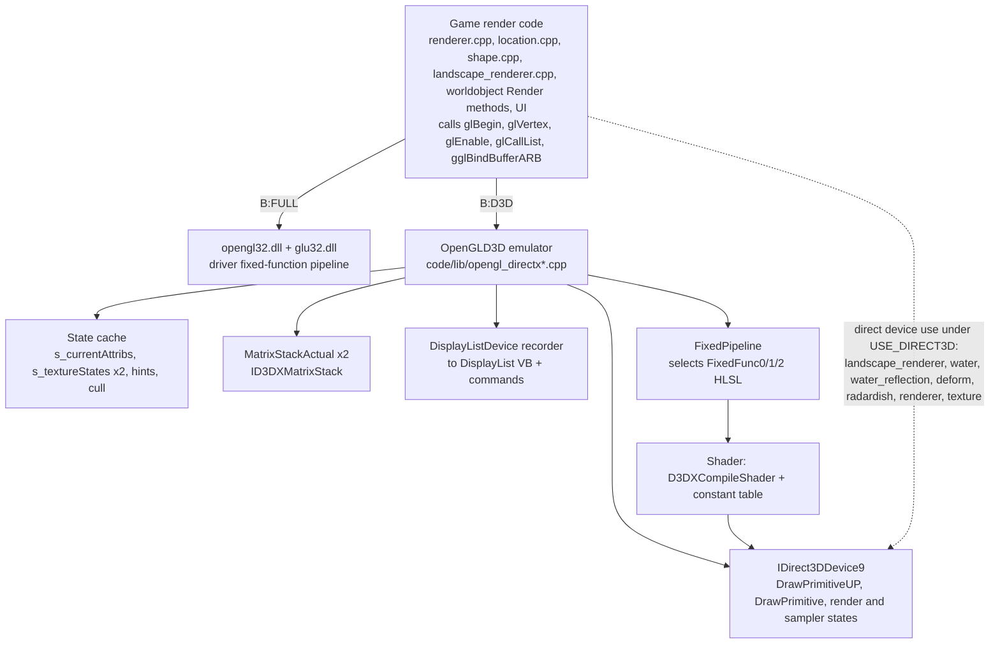
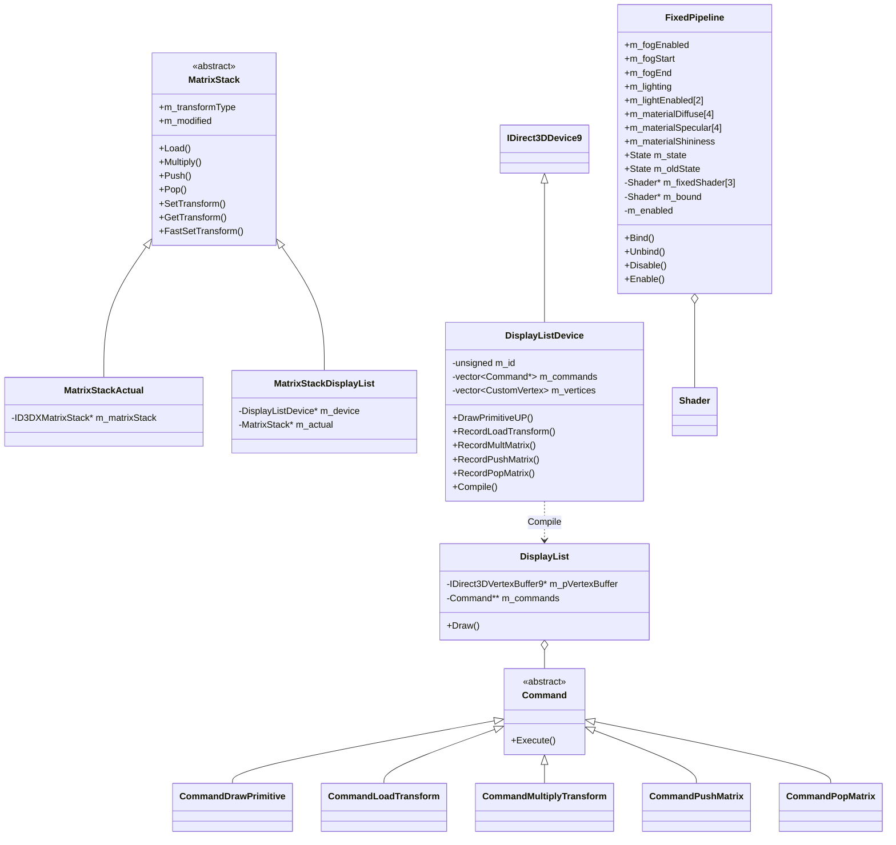
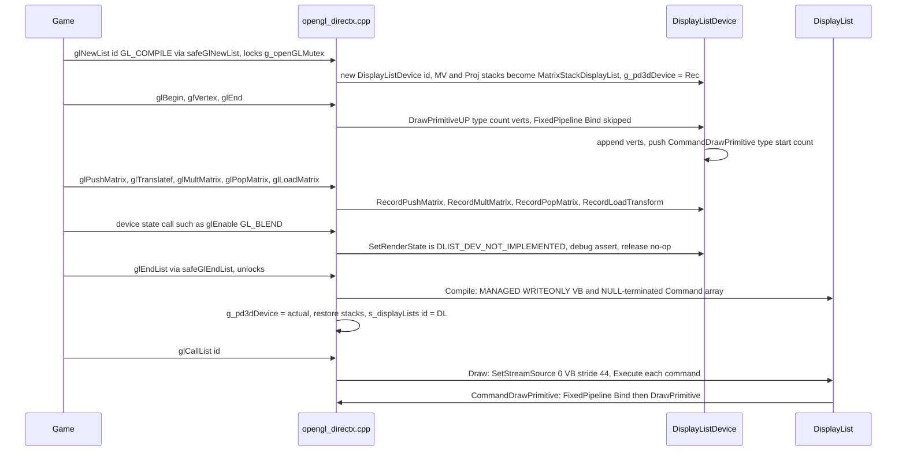
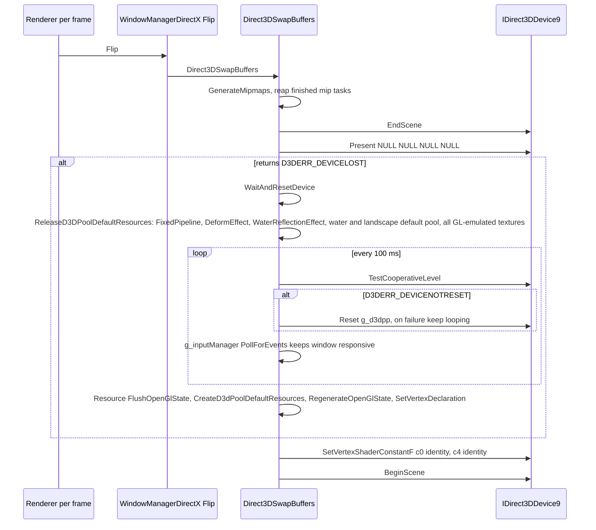
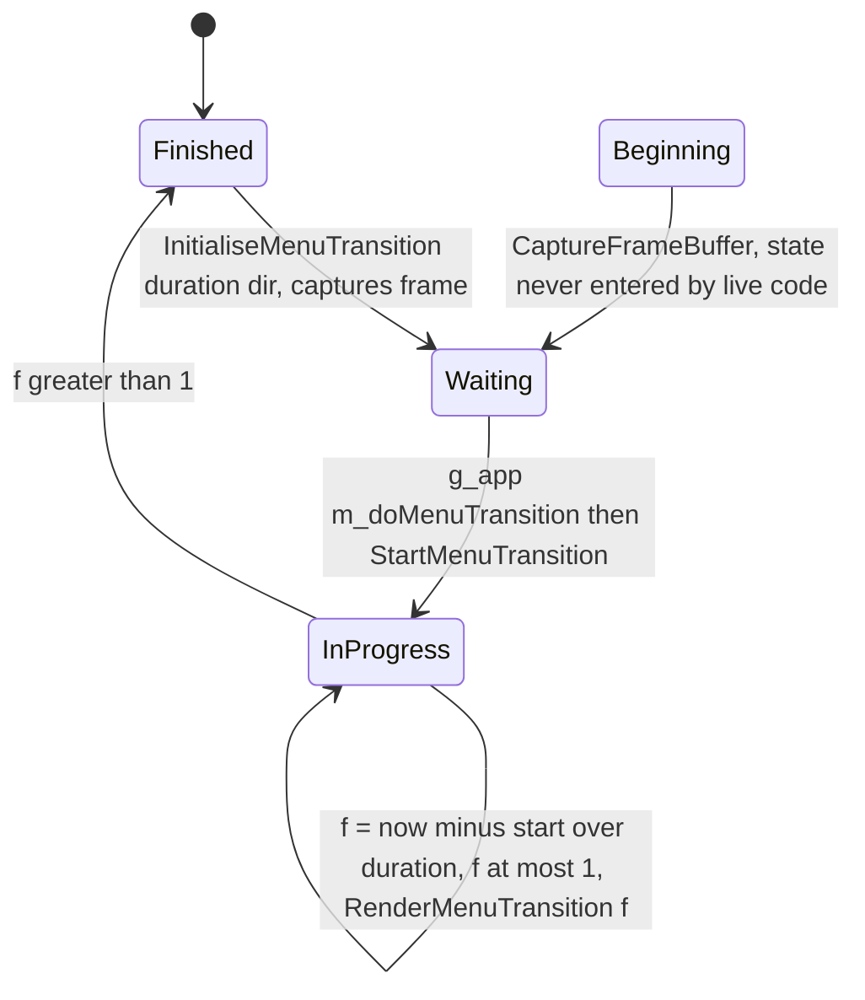
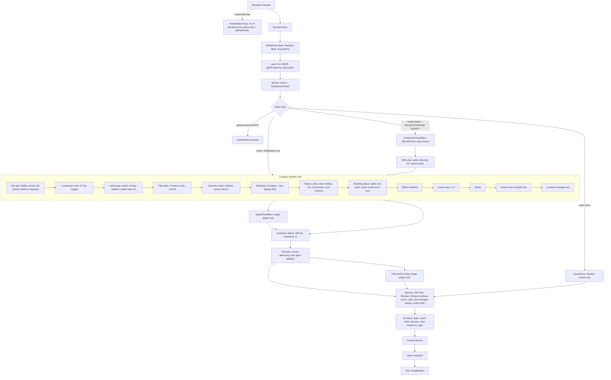

# 24 — Rendering

> Part B · Baseline build: Release|Win32 (OpenGL) + TARGET_PC_FULLGAME ([B:FULL]); see _work/build_matrix.md.
> Evidence: [C] confirmed · [I] inferred · [U] unknown. Citations are `path:Symbol` relative to the multiwinia/ source root.
> Sources merged: P12_render_core, P13_gfx_backend_math, P11_terrain_world, P07_buildings_misc, P09_control_taskmanager, P10_input_camera, plus render notes from P03_entity_core, P04_entities_military, P05_entities_creatures, P06_buildings_core, P17a_ui_framework_editor, P17b_menus_options, P02_game_modes (via routed/_meta_*.md).

## Contents

- [1 Backend architecture](#1-backend-architecture) — 1.1 backend selection and per-file guards · 1.2 D3D build viability (four blockers) · 1.3 native OpenGL path (API surface, extensions and blacklist, WGL context/vsync/MSAA, `safegl`) · 1.4 hardware-compatibility fallbacks · 1.5 D3D9 GL-emulation layer (module map, device, vertex format, state cache, capability and enum tables, complete entry-point table, immediate mode, matrix stacks, display lists, VBOs/textures/mips, FixedPipeline, present/device loss, defects D1–D29, tracing)
- [2 Renderer object, initialisation and baseline state](#2-renderer-object-initialisation-and-baseline-state) — members, window-creation fallback chain, baseline GL state contract, prediction convention, screenshots, fade/pause/logo/menu transition
- [3 Frame composition](#3-frame-composition) — frame types, **ordered pass table with full state per pass**, branches, reachability in a Multiwinia match, **pipeline diagram**
- [4 Renderer components](#4-renderer-components) — 4.1 landscape · 4.2 water · 4.3 water reflection · 4.4 clouds/sky · 4.5 shapes (format, hierarchy, display lists, team colouring, hit tests) · 4.6 buildings · 4.7 trees · 4.8 laser fences · 4.9 entities/sprites/billboards · 4.10 lasers/beams/lightning/blasts · 4.11 particles · 4.12 explosions · 4.13 deform · 4.14 pixel effect · 4.15 glow/starburst/god-rays/blur · 4.16 sphere renderer · 4.17 route lines · 4.18 markers · 4.19 cursor · 4.20 task-manager/HUD · 4.21 UI windows · 4.22 text and font atlases (Unicode/CJK) · 4.23 debug renderers · 4.24 global internet/sphere world · 4.25 loading screen
- [5 Camera, projection, frustum, fog, lighting, shadows](#5-camera-projection-frustum-fog-lighting-shadows) — projection/view, near-plane depth bias, frustum tests, fog, lighting model and level lights, shadows, screen-space effects
- 6 Shaders — all 14 files of `data/shaders/` with inputs, outputs, uniforms, effect and binding code
- 7 Visual style; resolution and aspect
- 8 Graphics options, quality presets and performance budgets
- [9 Direct3D 12 mapping notes per component](#9-direct3d-12-mapping-notes-per-component)
- [Open questions and unknowns](#open-questions-and-unknowns) · [Docs-vs-code discrepancies](#docs-vs-code-discrepancies) · [IP items](#ip-items) · [Source map](#source-map) · [Appendix — dead/legacy code](#appendix--deadlegacy-code)

Asset names (`textures/…`, `sprites/…`, `icons/…`, `terrain/…`, `shaders/…`) are written as the code requests them, relative to `data/`; the resource loader lower-cases paths, so `textures/triangleOutline.bmp` loads `data/textures/triangleoutline.bmp`. Reading guide: everything not tagged otherwise is **[B:FULL]** (the shipped OpenGL `multiwinia.exe`). The D3D9 path ([B:D3D]) is documented completely in §1.5 and §6 but is a secondary, probably non-building configuration. Content of individual objects is owned by [02](02_units_and_entities.md), [03](03_buildings_and_world_objects.md) and [04](04_crates_powerups_and_weapons.md); particle/explosion models by [26](26_animation_and_vfx.md); textures and the asset catalogue by [25](25_textures_and_assets.md); terrain generation by [23](23_terrain_and_landscape.md); UI widgets by [28](28_ui_framework.md); window management by [31](31_platform_build_and_tools.md).

## 1 Backend architecture

### 1.1 How the backend is chosen [C]

All game render code (`code/renderer.cpp`, `code/location.cpp`, `code/lib/shape.cpp`, `code/landscape_renderer.cpp`, every `Render*` method in `code/worldobject/`, the UI) is written **once against the OpenGL 1.x fixed-function, immediate-mode API** plus two ARB extensions (multitexture, vertex buffer objects). The backend is chosen at **compile time** by which headers `code/lib/universal_include.h` pulls in:

| Build | Define | Headers included by `universal_include.h` | What `glXxx()` resolves to |
|---|---|---|---|
| `Release\|Win32` / `Debug\|Win32` **[B:FULL]** (ships as `multiwinia.exe`) | (none) | `<GL/gl.h>`, `<GL/glu.h>` | real `opengl32.dll` / `glu32.dll` entry points; WGL context created by `WindowManagerWin32` |
| `ReleaseDirect3D\|Win32` / `DebugDirect3D\|Win32` **[B:D3D]** | `USE_DIRECT3D` (`targets/vs2005/Direct3D.vsprops`) | `<d3d9.h>`, `<d3dx9.h>`, `lib/opengl_directx.h`, `lib/safegl.h` | free functions **of the same names** implemented in `code/lib/opengl_directx*.cpp` on top of `IDirect3DDevice9` + runtime-compiled HLSL |
| Mac OS X **[B:DEAD]** | `TARGET_OS_MACOSX` | `<OpenGL/gl.h>`, `<OpenGL/glu.h>`, `lib/safegl.h` | Apple OpenGL |

Evidence: `code/lib/universal_include.h` (`#ifdef USE_DIRECT3D … #include "lib/opengl_directx.h" … #else #include <GL/gl.h>`) [C]. `opengl_directx.h` re-declares every GL entry point used by the game **without `APIENTRY`/`__stdcall` DLL linkage**, with its own `#define` for every GL enum used [C] `code/lib/opengl_directx.h`. Two signatures are *extended* relative to real GL: `glTexImage2D(…, bool _compressed = false)` and `gluBuild2DMipmaps(…, bool _compressed = false)` (the flag selects DXT1) [C].

**Per-file compilation guards** (all files are listed for all four VS configurations in `targets/vs2005/Darwinia.vcproj`; bodies are switched by preprocessor) [C]:

| File | Guard | Content in baseline [B:FULL] |
|---|---|---|
| `code/lib/opengl_directx.cpp`, `opengl_directx_dlist.cpp`, `opengl_directx_dlist_dev.cpp`, `opengl_directx_matrix_stack.cpp`, `opengl_directx_stubs.cpp`, `opengl_trace.cpp`, `ogl_extensions_directx.cpp`, `window_manager_directx.cpp` | `#ifdef USE_DIRECT3D` | empty translation unit |
| `code/lib/FixedPipeline.cpp`, `code/lib/shader.cpp`, `code/lib/texture.cpp`, `code/deform.cpp`, `code/water_reflection.cpp` | `#ifdef USE_DIRECT3D` | empty |
| `code/lib/ogl_extensions.cpp`, `code/lib/window_manager_win32.cpp` | `#if !defined USE_DIRECT3D` | live |
| `code/lib/safegl.cpp` | unguarded; inner `#ifndef USE_DIRECT3D` | compiled, but `safeGlNewList/EndList` are **never reached** in baseline because the `#define glNewList safeGlNewList` lives in `safegl.h`, which is only included for D3D/Mac (§1.3.4) |
| `code/lib/window_manager.cpp` | none | live (abstract base) |
| `code/lib/avi_generator.cpp` | `#ifdef AVI_GENERATOR` (`TARGET_DEBUG` only) | empty in FULL; in debug builds compiled but unreachable — its only user, `GrabberWindow`, is opened only by `DebugKeyBindings::GrabberButton`, which nothing calls ([B:DEAD]) |
| `code/lib/avi_player.cpp` | `#ifdef EGAMESBUILD` (never defined) | empty ([B:DEAD]) |
| `code/landscape_renderer.cpp`, `code/water.cpp`, `code/renderer.cpp`, `code/worldobject/radardish.cpp`, `code/lib/text_renderer.cpp` | inner `#ifdef USE_DIRECT3D` blocks | GL path live; D3D blocks call `OpenGLD3D::g_pd3dDevice` directly |
| `code/lib/ogl_extensions_sdl.cpp`, `code/lib/window_manager_sdl.{cpp,h}` | not in the `.vcproj` | not built on Win32 (Appendix) |

46 files under `code/` contain `USE_DIRECT3D` [C grep (P13)]. Files that bypass the emulator and talk to `OpenGLD3D::g_pd3dDevice` directly under `USE_DIRECT3D`: `code/landscape_renderer.cpp`, `code/water.cpp`, `code/water_reflection.cpp`, `code/deform.cpp`, `code/renderer.cpp`, `code/worldobject/radardish.cpp`, `code/lib/texture.cpp`, `code/lib/shader.cpp`, `code/lib/FixedPipeline.cpp` [C].



**Which backend shipped.** Every Multiwinia packaging script copies `darwinia_gl.exe` (the `Release|Win32` OpenGL output) to `multiwinia.exe` [C] `tools/build_multiwinia_retail.bat` (packaging scripts compared in [31](31_platform_build_and_tools.md)). **The OpenGL path is the shipped renderer; the D3D9 path is a secondary configuration documented here for completeness and because it encodes a "GL-on-D3D" design** [C].

### 1.2 Is the D3D configuration buildable at this commit? [I]

Resolved: phase-2 notes spoke of "three independent breakages" while listing four items; reading the code shows **four** candidate compile blockers, two of which are ill-formed C++ regardless of SDK headers ([C]) and two of which depend on the DirectX SDK headers ([I]):

| # | Location | Problem | Certainty |
|---|---|---|---|
| B1 | `code/water.cpp:Water::Water` (L119, inside `#else` of `#ifndef USE_DIRECT3D`) | `bmp.GetPixel(x, 1)` where `bmp` is `const BitmapRGBA *` — member access through `.` on a pointer is ill-formed | [C] ill-formed |
| B2 | `code/lib/window_manager_directx.h:WindowManagerDirectX::CreateWin` | takes `const char *_title`; the pure virtual `code/lib/window_manager.h:WindowManager::CreateWin` takes `const wchar_t *_title`. The derived function hides instead of overriding, `WindowManagerDirectX` stays abstract, and `new WindowManagerDirectX()` in `code/lib/window_manager_directx.cpp:WinMain` is ill-formed (MSVC C2259). `code/renderer.cpp:Renderer::Initialise` also passes `APP_NAME_W` (wide) | [C] ill-formed |
| B3 | `code/deform.cpp:DeformEffect::Stop` | `g_pd3dDevice->Resolve(D3DRESOLVE_RENDERTARGET0, …)` — an Xbox 360 device method/constant not present on PC `IDirect3DDevice9`; no shim found anywhere in the tree [C grep] | [I] SDK-dependent |
| B4 | `code/lib/opengl_directx.cpp:glLineWidth` | `SetRenderState(D3DRS_LINEWIDTH, …)` — not a PC D3D9 `D3DRENDERSTATETYPE` member to the agents' knowledge and not defined in the tree; the comment `// autogenmipmap ignored by xbox` in `d3dCreateTexture` corroborates Xbox heritage | [I] SDK-dependent |

Conclusion [I]: `ReleaseDirect3D` does not build unmodified at commit `f909630`; it was evidently last maintained against an Xbox 360 branch. The emulation layer is nevertheless specified below (§1.5) because it is a complete, readable design for running a GL-1.x renderer on D3D9. See 24-U1.

### 1.3 Native OpenGL path [B:FULL]

#### 1.3.1 API surface used [C]

OpenGL 1.1–1.3 fixed function only: immediate mode (`glBegin/glEnd`), display lists (`glNewList/glCallList`), client vertex arrays (`glVertexPointer` + `glDrawArrays`), ARB VBOs (landscape only), fixed-function lighting (2 directional lights, `GL_COLOR_MATERIAL`), linear fog, alpha test, blending, two-unit multitexture with `GL_COMBINE_EXT` (flat water, laser-fence curtains), `glCopyTexImage2D` render-to-texture (menu transition capture, legacy pixel effect), `glReadPixels` (screenshots), `glClipPlane` (radar dish, D3D water reflection), `glScissor` (UI clip), `gluBuild2DMipmaps`, `gluPerspective`, `gluLookAt`, `gluOrtho2D`, `gluProject/gluUnProject`. **No GLSL, no ARB vertex/fragment programs** — all programmable-shader code is `USE_DIRECT3D`-only [C].

#### 1.3.2 Extension handling — `code/lib/ogl_extensions.cpp` [C]

`InitialiseOGLExtensions()` is called once per renderer creation from `Renderer::Initialise`, right after window creation [C] `code/renderer.cpp:Renderer::Initialise`. It (1) loads every pointer below with `wglGetProcAddress` without checking the extension string (a missing entry point leaves `NULL`), and (2) reads `glGetString(GL_VENDOR/GL_RENDERER/GL_VERSION/GL_EXTENSIONS)` into static buffers `s_glVendor[256]`, `s_glRenderer[256]`, `s_glVersion[256]`, `s_glExtensions[4096]` with `strncpy` + forced NUL — **the extension string is silently truncated at 4095 characters** — and logs them with `AppDebugOut` [C].

| Global pointer | Loaded name | Extension | Consumers | If missing |
|---|---|---|---|---|
| `gglMultiTexCoord2fARB` | `glMultiTexCoord2fARB` | GL_ARB_multitexture | `code/lib/render_utils.cpp`, `code/water.cpp`, `code/worldobject/laserfence.cpp`, `code/worldobject/feedingtube.cpp`, `code/worldobject/radardish.cpp`, `code/taskmanager_interface_gestures.cpp`, `code/deform.cpp` | **no guard anywhere** — call through `NULL` ⇒ crash [C grep: no `if (gglActiveTextureARB)` in `code/`] |
| `gglActiveTextureARB` | `glActiveTextureARB` | GL_ARB_multitexture | same | same |
| `gglBindBufferARB` | `glBindBufferARB` | GL_ARB_vertex_buffer_object | `code/landscape_renderer.cpp` | landscape falls back to display lists |
| `gglDeleteBuffersARB` | `glDeleteBuffersARB` | VBO | landscape | as above |
| `gglGenBuffersARB` | `glGenBuffersARB` | VBO | landscape | as above |
| `gglIsBufferARB` | `glIsBufferARB` | VBO | none | — |
| `gglBufferDataARB` | `glBufferDataARB` | VBO | landscape | as above |
| `gglBufferSubDataARB` | `glBufferSubDataARB` | VBO | none | — |
| `gglGetBufferSubDataARB` | `glGetBufferSubDataARB` | VBO | none | — |
| `gglMapBufferARB` | `glMapBufferARB` | VBO | none | — |
| `gglUnmapBufferARB` | `glUnmapBufferARB` | VBO | none | — |
| `gglGetBufferParameterivARB` | `glGetBufferParameterivARB` | VBO | none | — |
| `gglGetBufferPointervARB` | `glGetBufferPointervARB` | VBO | none | — |
| `gglChoosePixelFormatARB` | `wglChoosePixelFormatARB` | WGL_ARB_pixel_format | **none** — loaded, never called, so no multisampled pixel format is ever requested [C grep] | — |

Enum constants declared in `code/lib/ogl_extensions.h` [C]: `GL_COMBINE_EXT 0x8570`, `GL_COMBINE_RGB_EXT 0x8571`, `GL_COMBINE_ALPHA_EXT 0x8572`, `GL_ADD_SIGNED_EXT 0x8574`, `GL_INTERPOLATE_EXT 0x8575`, `GL_CONSTANT_EXT 0x8576`, `GL_SOURCE0_ALPHA_ARB 0x8588`, `GL_TEXTURE0_ARB 0x84C0`, `GL_TEXTURE1_ARB 0x84C1`; `WGL_*_PBUFFER_*` 0x202D–0x2036 (pbuffer API commented out); the full `GL_*_BUFFER_*_ARB` set (0x8892–0x88EA, 0x8764/0x8765, 0x88B8–0x88BD); `WGL_SAMPLE_BUFFERS_ARB 0x2041`, `WGL_SAMPLES_ARB 0x2042`, `WGL_DOUBLE_BUFFER_ARB 0x2011`, `WGL_ACCELERATION_ARB 0x2003`, `WGL_FULL_ACCELERATION_ARB 0x2027`, `GL_MULTISAMPLE_ARB 0x809D`, `WGL_DRAW_TO_WINDOW_EXT 0x2001`, `WGL_SUPPORT_OPENGL_EXT 0x2010`, `WGL_COLOR_BITS_EXT 0x2014`, `WGL_ALPHA_BITS_EXT 0x201B`, `WGL_DEPTH_BITS_EXT 0x2022`, `WGL_STENCIL_BITS_EXT 0x2023`.

**Query functions** [C] `code/lib/ogl_extensions.cpp`:

- `IsOGLExtensionSupported(name)`: 0 if `IsOGLExtensionBlacklisted(name)`; else a whole-word search of `s_glExtensions` (match preceded by start-of-string or space and followed by space or NUL); names containing a space, or empty names, return 0.
- `IsOGLExtensionBlacklisted(name)`: only ever blacklists `"GL_ARB_vertex_buffer_object"`, when `GL_VENDOR` contains `"Intel"` and `GL_RENDERER` contains any entry of `blacklistIntel[]`, or `GL_VENDOR` contains `"SiS"` and the renderer contains any entry of `blacklistSiS[]` (substring match):

| Vendor | Renderer substrings (exact strings) | Code annotation |
|---|---|---|
| Intel | `Intel 945GM`, `Intel 965/963`, `Intel Bear Lake B` | "Reported by users" (Bear Lake B = G33/G31, GMA 3100) |
| Intel | `Intel 82810`, `Intel 82815`, `Intel 82830M`, `Intel 82845G`, `Intel 82845PE`, `Intel 82852`, `Intel 82855`, `Intel 82865G`, `Intel 82910GL`, `Intel 82915G`, `Intel 82945G`, `Intel 910GML`, `Intel 915GM`, `Intel 945`, `Intel 963`, `Intel 965` | "Untested" |
| SiS | `Mirage Graphics3` | "Reported by users" (SiS Mirage 3) |

A second, commented-out `blacklistIntel[]` of full Windows driver names and a commented "Ok Intel card?" list (G965, 946GZ, Q35) also exist [C].

- `IsOGLExtensionPerfectlySupported(name)`: `IsOGLExtensionSupported(name)`, but additionally 0 for `GL_ARB_vertex_buffer_object` whenever the vendor string contains `"Intel"` **or** `"SiS"` (any renderer) [C].

**Every extension query and its fallback** [C]:

| Query site | Extension | Fallback when absent |
|---|---|---|
| `code/landscape_renderer.cpp:LandscapeRenderer::LandscapeRenderer` (pref `RenderLandscapeMode` = −1, the default) | `IsOGLExtensionPerfectlySupported("GL_ARB_vertex_buffer_object")` | `RenderModeDisplayList` instead of `RenderModeVertexBufferObject` — every Intel/SiS GPU gets display lists by default |
| same, after the mode is chosen | `!gglBindBufferARB \|\| !IsOGLExtensionSupported("GL_ARB_vertex_buffer_object")` | forced to `RenderModeDisplayList` even if the preference asked for VBO |
| `code/lib/math_utils.cpp:RequirePowerOfTwoTextures` | `strstr(glGetString(GL_EXTENSIONS), "GL_ARB_texture_non_power_of_two")` (raw substring, cached in a function static) | true ⇒ `code/lib/bitmap.cpp` rescales textures to `nearestPowerOfTwo`; `code/renderer.cpp:Renderer::CaptureFrameBuffer` copies a POT-sized region and scales UVs by `W/nearestPowerOfTwo(W)` |
| `code/lib/math_utils.cpp:RequireSquareTextures` | `strstr(…, "GL_ARB_texture_rectangle")` | true ⇒ `bitmap.cpp` makes textures square |
| `GL_ARB_multitexture` | never queried | none (crash if absent) |
| pref `ManuallyScaleTextures` (default 0) | — | forces POT rescale regardless [C] `code/lib/bitmap.cpp` |

Under `USE_DIRECT3D` both `Require*Textures` return `false` immediately [C].

#### 1.3.3 WGL context, vsync, MSAA, gamma [C] `code/lib/window_manager_win32.cpp:WindowManagerWin32::EnableOpenGL`

- Pixel format: `PIXELFORMATDESCRIPTOR{PFD_DRAW_TO_WINDOW|PFD_SUPPORT_OPENGL|PFD_DOUBLEBUFFER, PFD_TYPE_RGBA, cColorBits = ScreenColourDepth, cDepthBits = ScreenZDepth, PFD_MAIN_PLANE}` → `ChoosePixelFormat` + `SetPixelFormat` (results unchecked). **No alpha, stencil or multisample bits are requested.**
- Two contexts: primary `m_hRC`, and a secondary `m_hRC2` "for loading thread" joined with `wglShareLists`; `m_hRC2` is **never made current** and never deleted (`UseSecondaryContext/ReleaseSecondaryContext/DestroySecondaryContext` declared, not defined). All GL work runs on the main thread; worker threads queue GL jobs to the loading screen (§4.25).
- **Vsync**: no `wglSwapIntervalEXT` call exists anywhere [C grep] ⇒ the swap interval is the driver default; the `WaitVerticalRetrace` preference has no effect in the baseline. `waitVRT` and `antiAlias` arguments of `CreateWin` are ignored by the Win32 GL window manager.
- **Multisampling**: none (see `gglChoosePixelFormatARB`).
- **Gamma**: no gamma-ramp code for GL (`Renderer::SetScreenGamma` exists only under `USE_DIRECT3D` and has no caller).
- Present: `WindowManagerWin32::Flip` = `SwapBuffers(m_hDC)`. Window creation, mode switching and display-mode enumeration are specified in [31](31_platform_build_and_tools.md).

#### 1.3.4 `safegl` [C] `code/lib/safegl.h`, `code/lib/safegl.cpp`

`safegl.h` redefines `glNewList`→`safeGlNewList` and `glEndList`→`safeGlEndList`. `safeGlNewList` (non-D3D) logs `"glNewList called from non-mainthread (bad for OpenGL)"` when `NetGetCurrentThreadId() != g_app->m_mainThreadId`, then locks the global `NetMutex g_openGLMutex` and calls the real `glNewList`; `safeGlEndList` calls `glEndList` and unlocks. `LoadingScreen::RenderFrame` takes the same mutex for its whole frame [C] `code/loading_screen.cpp`. Because `safegl.h` is only included for `USE_DIRECT3D` and Mac, **in the baseline the wrapper is inactive** — display lists compile without the lock [C for include topology; I for consequence — harmless because all GL work is on the main thread].

### 1.4 Hardware-compatibility fallbacks [B:FULL]

| Problem | Mechanism | Ref |
|---|---|---|
| Intel/SiS VBO driver bugs | blacklist + "perfectly supported" test ⇒ display lists | `code/lib/ogl_extensions.cpp` |
| No NPOT textures | rescale to POT; POT `glCopyTexImage2D` | `code/lib/math_utils.cpp:RequirePowerOfTwoTextures`, `code/lib/bitmap.cpp` |
| No rectangle textures | square textures | `code/lib/math_utils.cpp:RequireSquareTextures` |
| Over-size textures | downscale to `GL_MAX_TEXTURE_SIZE` (`BitmapRGBA::SetMaxTextureSize`, set in `code/app.cpp:App::App`); the downscale is discarded when POT rescale also applies (see [25](25_textures_and_assets.md)) | `code/lib/bitmap.cpp:BitmapRGBA::ConvertToTexture` |
| Requested display mode fails | 4-stage `CreateWin` retry chain (§2.2) | `code/renderer.cpp:Renderer::Initialise` |
| Long extension strings | truncated at 4095 chars (late-listed extensions reported missing) | `InitialiseOGLExtensions` |
| Radeon fog artefacts on large quads | sky/cloud quads subdivided 4×4 (`Clouds::RenderQuad`); `RenderSplitUpQuad*` helpers exist but are unused | `code/clouds.cpp`, `code/lib/render_utils.cpp` |
| Radeon X300 16-bit modes [B:D3D] | try `R5G6B5` before `A1R5G5B5` | `code/lib/opengl_directx.cpp:Direct3DInit` |
| Radeon X300 deform interference [B:D3D] | +0.0003 UV offset in `deform.vs` | `data/shaders/deform.vs` |
| Multitexture missing | **none** (crash) | — |

`docs/HardwareComplianceIssues.txt` contains only: "Johnny's Linux Machine: – Multitexturing ARB not supported – Mouse pointer background not transparent" [C]. Neither issue has a Win32 code-side fallback (Docs-vs-code table). `docs/OpenGLState.txt` is cross-checked against the code in §2.3.

### 1.5 Direct3D 9 path: OpenGL-API emulation layer [B:D3D]

#### 1.5.1 Module map [C]

| File | Namespace / classes | Role |
|---|---|---|
| `code/lib/opengl_directx.h` | — | GL type/enum `#define`s and prototypes for every emulated entry point; includes `opengl_directx_inline.h` |
| `code/lib/opengl_directx_inline.h` | — | `__forceinline` wrappers `glColor*`, `glNormal*`, `glVertex*`, `glTexCoord*`, `glFogf/glFogi`, template `openGLMatrixToDirect3D` |
| `code/lib/opengl_directx_internals.h` | `OpenGLD3D::CustomVertex`; externs `g_pd3dDeviceActual`, `g_pd3dDevice`, `g_currentVertexBuffer`, `g_supportsHwVertexProcessing`, `glActiveTextureD3D`, `glMultiTexCoord2fD3D` | shared internals |
| `code/lib/opengl_directx.cpp` | `OpenGLD3D::TextureState`, `CurrentAttributes`, `Attributes`, `MipMapTask`; device globals | core emulator + device lifecycle |
| `code/lib/opengl_directx_stubs.cpp` | — | no-op stubs |
| `code/lib/opengl_directx_matrix_stack.{h,cpp}` | `MatrixStack` (abstract), `MatrixStackActual`, `MatrixStackDisplayList` | GL matrix stacks |
| `code/lib/opengl_directx_dlist_dev.{h,cpp}` | `DisplayListDevice : IDirect3DDevice9` | records draws while a list is open |
| `code/lib/opengl_directx_dlist.{h,cpp}` | `Command` + `CommandDrawPrimitive`, `CommandLoadTransform`, `CommandMultiplyTransform`, `CommandPushMatrix`, `CommandPopMatrix`; `DisplayList` | compiled list + playback |
| `code/lib/ogl_extensions_directx.cpp` | — | ARB multitexture + VBO emulation, extension query stubs |
| `code/lib/FixedPipeline.{h,cpp}` | `FixedPipeline` | fixed-function emulation: shader selection + uniform upload |
| `code/lib/shader.{h,cpp}` | `Shader` | HLSL compile/bind/constant-table helper |
| `code/lib/texture.{h,cpp}` | `Texture` | render-target texture wrapper (deform, water reflection) |
| `code/lib/opengl_trace.{h,cpp}` | — | debug call tracing |



#### 1.5.2 Device globals and device creation [C] `code/lib/opengl_directx.cpp` (namespace `OpenGLD3D`)

| Global | Type | Meaning |
|---|---|---|
| `g_pD3D` | `LPDIRECT3D9` | `Direct3DCreate9(D3D_SDK_VERSION)`, created once, kept across window recreation |
| `g_d3dpp` | `D3DPRESENT_PARAMETERS` | last present parameters (reused for `Reset`) |
| `g_pd3dDevice` | `LPDIRECT3DDEVICE9` | **current command target** — the real device, or the `DisplayListDevice` recorder while `glNewList` is open |
| `g_pd3dDeviceActual` | `LPDIRECT3DDEVICE9` | the real device |
| `g_supportsHwVertexProcessing` | `bool` (default true) | `caps.DevCaps & D3DDEVCAPS_HWTRANSFORMANDLIGHT` |
| `g_currentVertexBuffer` | `IDirect3DVertexBuffer9 **` | slot of the VBO bound by `glBindBufferD3D` |

`Direct3DInit` (summary; full table in [31](31_platform_build_and_tools.md)) [C]: `D3DADAPTER_DEFAULT`, `D3DDEVTYPE_HAL`; hardware vertex processing if `D3DDEVCAPS_HWTRANSFORMANDLIGHT` else software; behaviour flags contain **no `D3DCREATE_FPU_PRESERVE` and no `D3DCREATE_MULTITHREADED`** (x87 precision then drops to 24-bit [I], see [22](22_determinism_and_networking.md), 24-U13); windowed = desktop format, fullscreen colour 24/32 → `X8R8G8B8` (fallback `A8R8G8B8`), 15/16 → `X1R5G5B5` (fallbacks `R5G6B5`, `A1R5G5B5`); depth 16→`D16`, 24→`D24X8`, 32→`D32`, no stencil; `SwapEffect=DISCARD`, one back buffer; `PresentationInterval = waitVRT ? ONE : IMMEDIATE`; no multisampling; refresh-rate preference not applied (`FullScreen_RefreshRateInHz` = 0). After creation: `InitialiseData()` (matrix stacks, vertex declaration, 1024-vertex immediate buffer, cleared texture table, cull/hints/attribute reset, mip work queue), `BeginScene`, `SetVertexDeclaration`, `CreateD3DResources()` → `DeformEffect::Create`, `WaterReflectionEffect::Create`, `new FixedPipeline`.

#### 1.5.3 Vertex format [C] `code/lib/opengl_directx_internals.h:CustomVertex`, `s_customVertexDesc`

| Offset | Field(s) | Decl type | Usage |
|---|---|---|---|
| 0 | `float x, y, z` | FLOAT3 | POSITION0 |
| 12 | `float nx, ny, nz` | FLOAT3 | NORMAL0 |
| 24 | `unsigned char b8, g8, r8, a8` | D3DCOLOR (BGRA bytes = ARGB dword) | COLOR0 |
| 28 | `float u, v` | FLOAT2 | TEXCOORD0 |
| 36 | `float u2, v2` | FLOAT2 | TEXCOORD1 |

Stride 44 bytes. The declaration is created in `InitialiseData` and set after `BeginScene` and after every device reset.

#### 1.5.4 State cache — what GL state is tracked and where it goes [C]

| GL state | Emulator storage | D3D9 target |
|---|---|---|
| Current colour (`glColor*`) | `s_currentAttribs.r8/g8/b8/a8` (float→byte: `x<0→0`, `x>1→255`, else `(unsigned char)(x*255)` truncation, macro `CLAMPF2B`) | baked into each vertex's COLOR0 |
| Current normal (`glNormal*`) | `s_currentAttribs.nx/ny/nz` **negated** (comment: LH/RH) | NORMAL0 |
| Current texcoord unit 0 / 1 | `u,v` / `u2,v2` (`glTexCoord*`, `glMultiTexCoord2fD3D`) | TEXCOORD0 / TEXCOORD1 |
| Alpha reference | `s_currentAttribs.alphaRef` (clamped float) | `D3DRS_ALPHAREF = DWORD(clamp(ref,0,1)*255)` |
| Alpha func | — | `D3DRS_ALPHAFUNC` (`GL_LEQUAL→LESSEQUAL`, `GL_GREATER→GREATER`; others assert → LESSEQUAL) |
| Alpha test enable | — | `D3DRS_ALPHATESTENABLE` |
| Blend enable / func | — | `D3DRS_ALPHABLENDENABLE`, `D3DRS_SRCBLEND`, `D3DRS_DESTBLEND` |
| Depth test / func / mask | — | `D3DRS_ZENABLE` (`D3DZB_TRUE/FALSE`), `D3DRS_ZFUNC`, `D3DRS_ZWRITEENABLE` |
| Cull enable | `s_currentAttribs.backCullingEnabled` | `D3DRS_CULLMODE = s_cullMode` or `D3DCULL_NONE` |
| Front face | `s_ccwFrontFace` (default true) → `s_cullMode` (`GL_CCW→D3DCULL_CW`, `GL_CW→D3DCULL_CCW`) | `D3DRS_CULLMODE` when culling enabled |
| Polygon mode | — | `D3DRS_FILLMODE` (`GL_FILL→SOLID`, `GL_LINE→WIREFRAME`; face argument ignored) |
| Polygon offset enable / params | `polygonOffsetEnabled`, `depthBias=units`, `slopeDepthBias=factor` | `D3DRS_DEPTHBIAS`, `D3DRS_SLOPESCALEDEPTHBIAS` (defect D11) |
| Scissor enable / rect | — | `D3DRS_SCISSORTESTENABLE`, `SetScissorRect` |
| Clip planes 0–2 enable / equation | — | `D3DRS_CLIPPLANEENABLE` bit `1<<(cap−GL_CLIP_PLANE0)`, `SetClipPlane` |
| Point size | — | `D3DRS_POINTSIZE` (float bits) |
| Line width | — | `D3DRS_LINEWIDTH` (float bits) — build blocker B4 |
| Viewport | — | `SetViewport` (MinZ/MaxZ preserved) |
| Clear colour | `s_clearColor` (default `D3DCOLOR_RGBA(0,0,0,255)`) | `Clear(…, colour, z=1.0f, stencil=0)` |
| Texture enable per unit | `s_currentAttribs.texturingEnabled[2]` | selects FixedFunc shader variant |
| Bound texture per unit | `s_textureStates[unit].target` (GL id) | `SetTexture(unit, s_textureIds[id])` |
| Active texture unit | `s_activeTexture` (0..1, `MAX_ACTIVE_TEXTURES = 2`) | stage/sampler index |
| Tex env mode / combine / colour | `TextureState.envMode` (default `GL_MODULATE`), `rgbCombineMode`, `envColour` | **stored only — no D3D effect** |
| Tex wrap / filters | — | sampler states of the **active stage** (`D3DSAMP_ADDRESSU/V`, `MAGFILTER`, `MINFILTER`, `MIPFILTER`) |
| Colour material enable / mode | `colorMaterialEnabled`, `colorMaterialMode` (default `GL_DIFFUSE`) | stored only |
| Lighting enable | `g_fixedPipeline->m_lighting` | shader `numLights` |
| Light 0/1 enable | `g_fixedPipeline->m_lightEnabled[0..1]` | shader `numLights` |
| Light params | `g_fixedPipeline->m_state.m_light[i]` (`D3DLIGHT9`) | shader `lights[i]` |
| Material diffuse/specular/shininess | `g_fixedPipeline->m_materialDiffuse[4]`, `m_materialSpecular[4]`, `m_materialShininess` | **stored only — never uploaded** |
| Fog enable/start/end | `g_fixedPipeline->m_fogEnabled/m_fogStart/m_fogEnd` | shader `fogRange` |
| Fog colour/mode/density | — | **ignored** |
| Hints | `s_fogHint`, `s_polygonSmoothHint` | stored only (readable via `glGetIntegerv`) |
| Matrix mode | `s_matrixMode`, `s_pTargetMatrixStack`, `s_targetMatrixTransformType` | — |
| Attribute stack | `class Attributes{CurrentAttributes, IDirect3DStateBlock9*}`, `std::stack<Attributes> s_attributeStack` | **declared, unused** — no `glPushAttrib/glPopAttrib` exists in emulator or game [C grep] |

`CurrentAttributes` derives from `CustomVertex` and adds `alphaRef`, `texturingEnabled[2]`, `backCullingEnabled`, `polygonOffsetEnabled`, `depthBias`, `slopeDepthBias`, `colorMaterialEnabled`, `colorMaterialMode`; its constructor zero-fills and sets `colorMaterialMode = GL_DIFFUSE`, `a8 = 255`. `TextureState` = `{target=0, lastTarget=-1, envColour=0, envMode=GL_MODULATE, lastEnvMode=0, rgbCombineMode=0}`. There is **no redundant-state filtering**: every `glEnable/glBlendFunc/…` issues a `SetRenderState` (the "lastEnvMode/lastTarget" optimisation in `setupTexturing` is commented out) [C].

**`glEnable` / `glDisable` / `glIsEnabled`** [C]:

| Cap | `glEnable` | `glDisable` | `glIsEnabled` |
|---|---|---|---|
| `GL_ALPHA_TEST` | ALPHATESTENABLE=TRUE | FALSE | reads RS |
| `GL_BLEND` | ALPHABLENDENABLE=TRUE | FALSE | reads RS |
| `GL_CLIP_PLANE0..2` | set bit in CLIPPLANEENABLE (Get→Set) | clear bit | not handled (assert, returns 0) |
| `GL_COLOR_MATERIAL` | flag only | flag only | flag |
| `GL_CULL_FACE` | CULLMODE=`s_cullMode` | CULLMODE=NONE | `CULLMODE != NONE` |
| `GL_DEPTH_TEST` | ZENABLE=TRUE | FALSE | reads RS |
| `GL_FOG` | `m_fogEnabled=true` | false | flag |
| `GL_LIGHTING` | `m_lighting=true` | false | flag |
| `GL_LIGHT0`, `GL_LIGHT1` | `m_lightEnabled[i]=true` | false | flag |
| `GL_LIGHT2`…`GL_LIGHT7` | default branch (trace "not implemented") | same | assert, 0 |
| `GL_LINE_SMOOTH` | no-op | no-op | assert, 0 |
| `GL_NORMALIZE` | no-op | no-op | assert, 0 |
| `GL_POINT_SMOOTH` | default branch (trace) | no-op | FALSE |
| `GL_POLYGON_OFFSET_FILL` | flag + SLOPESCALEDEPTHBIAS/DEPTHBIAS from cache | flag + both 0 | assert, 0 |
| `GL_SCISSOR_TEST` | SCISSORTESTENABLE=TRUE | FALSE | reads RS |
| `GL_TEXTURE_2D` | `texturingEnabled[active]=true`; if bound texture pointer non-NULL → `SetTexture` | flag false | flag |

**Enum translation** [C]:

| GL | D3D9 |
|---|---|
| Blend `GL_ZERO`, `GL_ONE`, `GL_SRC_COLOR`, `GL_ONE_MINUS_SRC_COLOR`, `GL_SRC_ALPHA`, `GL_ONE_MINUS_SRC_ALPHA` | `D3DBLEND_ZERO`, `ONE`, `SRCCOLOR`, `INVSRCCOLOR`, `SRCALPHA`, `INVSRCALPHA`; any other factor → assert + `D3DBLEND_ONE` |
| Compare `GL_LEQUAL`, `GL_GREATER` | `D3DCMP_LESSEQUAL`, `D3DCMP_GREATER`; others (NEVER/LESS/EQUAL/NOTEQUAL/GEQUAL/ALWAYS commented out) → assert + LESSEQUAL |
| Filter `GL_LINEAR`, `GL_NEAREST`, `GL_LINEAR_MIPMAP_LINEAR` | `D3DTEXF_LINEAR`, `D3DTEXF_POINT`, `D3DTEXF_LINEAR`; any other (including `GL_NEAREST_MIPMAP_LINEAR`, which is `#define`d) → **`AppReleaseAssert`** (fatal in release) |
| MIN filter → MIPFILTER | `GL_LINEAR_MIPMAP_LINEAR → D3DTEXF_LINEAR`, else `D3DTEXF_NONE` |
| Wrap `GL_CLAMP`, `GL_REPEAT` | `D3DTADDRESS_CLAMP`, `D3DTADDRESS_WRAP`; other → `AppReleaseAssert` |
| Fill `GL_FILL`, `GL_LINE` | `D3DFILL_SOLID`, `D3DFILL_WIREFRAME` |
| Clear `GL_COLOR_BUFFER_BIT`, `GL_DEPTH_BUFFER_BIT` | `D3DCLEAR_TARGET`, `D3DCLEAR_ZBUFFER` (other bits → debug assert) |

#### 1.5.5 Complete emulated entry-point table [C]

Legend: **Impl** implemented; **Stub** compiled, does nothing (traces in `_DEBUG`); **Partial** subset of GL semantics. Ref `code/lib/opengl_directx.cpp` unless noted.

| GL / GLU / extension function | Status | D3D9 implementation summary |
|---|---|---|
| `glBegin(mode)` | Impl | reset vertex cursor to `s_vertices[0]`, count 0, store `s_primitiveMode` |
| `glEnd()` | Impl | `FastSetTransform()` (no-op); if `g_fixedPipeline` and not recording → `FixedPipeline::Bind()`; convert primitive (§1.5.6) and `DrawPrimitiveUP` stride 44 |
| `glVertex2i/2f/2fv/2dv/3d/3dv/3f/3fv` | Impl (inline) | `glVertex3f_impl`: grow buffer if `count+2 ≥ allocated` (×2, initial 1024); copy whole `s_currentAttribs` as the vertex, set xyz; quad expansion; 2D variants set z=0 |
| `glColor3ub/3ubv/3f/4ub/4ubv/4f/4fv` | Impl | set current colour bytes (3-component variants alpha=255 / 1.0) |
| `glNormal3f/3fv/3dv` | Impl | current normal = **−n** |
| `glTexCoord2i/2f/2fv/2dv` | Impl | current `u,v` |
| `glEnable/glDisable/glIsEnabled` | Partial | table §1.5.4 |
| `glGetError()` | Stub-like | always 0 |
| `glGetString(name)` | Stub | returns NULL (`code/lib/opengl_directx_stubs.cpp`) |
| `glHint(target, mode)` | Partial | stores `GL_FOG_HINT` / `GL_POLYGON_SMOOTH_HINT`; no effect |
| `glFrontFace(mode)` | Impl | updates `s_ccwFrontFace`, `s_cullMode`; re-applies CULLMODE if culling on |
| `glShadeModel(mode)` | Stub | ignored (flat look emulated only for strips) |
| `glBlendFunc(s,d)` | Impl | SRCBLEND/DESTBLEND |
| `glAlphaFunc(func, ref)` | Impl | ALPHAFUNC; ALPHAREF = `DWORD(clamp(ref)*255)` (truncation) |
| `glDepthFunc(func)` | Impl | ZFUNC |
| `glDepthMask(flag)` | Impl | ZWRITEENABLE |
| `glClipPlane(plane, eq)` | Impl | normalise plane; transform by `(MV⁻¹)ᵀ` then `(P⁻¹)ᵀ` → clip-space plane; `SetClipPlane(plane−GL_CLIP_PLANE0)` |
| `glClear(mask)` | Impl | `Clear(0,NULL,flags,s_clearColor,1.0f,0)` |
| `glClearColor(r,g,b,a)` | Impl | `s_clearColor = D3DCOLOR_COLORVALUE(r,g,b,a)` |
| `glFinish()` | Stub | returns immediately (back-buffer lock code after `return` is dead) |
| `glLineWidth(w)` | Impl | `SetRenderState(D3DRS_LINEWIDTH, *(DWORD*)&w)` |
| `glPointSize(s)` | Impl | `D3DRS_POINTSIZE` float bits |
| `glViewport(x,y,w,h)` | Impl | Get/SetViewport, **no y-flip** |
| `glScissor(x,y,w,h)` | Impl | `RECT{left=x, right=x+w, bottom=ScreenH−y, top=bottom−h}` |
| `glPolygonMode(face, mode)` | Partial | FILLMODE; face ignored |
| `glPolygonOffset(factor, units)` | Partial | caches; applies DEPTHBIAS=units, SLOPESCALEDEPTHBIAS=factor if enabled (D11) |
| `glGetIntegerv(pname)` | Partial | `GL_ALPHA_TEST_FUNC`, `GL_BLEND_DST`, `GL_BLEND_SRC`, `GL_DEPTH_FUNC`, `GL_DEPTH_WRITEMASK` (read back from device RS); `GL_COLOR_MATERIAL_FACE` (always `GL_FRONT_AND_BACK`); `GL_COLOR_MATERIAL_PARAMETER`; `GL_FOG_HINT`; `GL_FRONT_FACE`; `GL_MATRIX_MODE`; `GL_POLYGON_MODE` (both entries = fill mode); `GL_POLYGON_SMOOTH_HINT`; `GL_VIEWPORT`; others trace only, output untouched |
| `glGetFloatv(pname)` | Partial | `GL_ALPHA_TEST_REF` (cached float), `GL_CURRENT_COLOR` (bytes × 1/255), `GL_FOG_COLOR` (no-op, output untouched), `GL_FOG_START`, `GL_FOG_END`; others assert |
| `glGetDoublev(pname)` | Partial | `GL_MODELVIEW_MATRIX`, `GL_PROJECTION_MATRIX` (top of stack, element-wise copy) |
| `glMatrixMode(mode)` | Impl | switch target stack (asserts MODELVIEW/PROJECTION) |
| `glLoadIdentity()` | Impl | `Load(identity)` |
| `glLoadMatrixd(m)` | Impl | `Load(openGLMatrixToDirect3D(m))` |
| `glMultMatrixd(m)`, `glMultMatrixf(m)` | Impl | `Multiply(converted)` |
| `glPushMatrix()`, `glPopMatrix()` | Impl | stack Push/Pop |
| `glTranslatef`, `glScalef` | Impl | `D3DXMatrixTranslation/Scaling` then Multiply |
| `glRotatef(angle,x,y,z)` | Impl | `D3DXMatrixRotationAxis(axis, D3DXToRadian(angle))` then Multiply |
| `glFrustum(...)` | Stub | no-op (poster tiling broken under D3D) |
| `gluOrtho2D(l,r,b,t)` | Impl | `Load(D3DXMatrixOrthoOffCenterRH(l,r,b,t,−1,+1))` |
| `gluPerspective(fovy,aspect,zn,zf)` | Impl | `D3DXMatrixPerspectiveFovRH(rad(fovy),aspect,zn,zf)`, then **`_43 *= 2`**, Load |
| `gluLookAt(eye,center,up)` | Partial | `Load(D3DXMatrixLookAtRH(...))` — **replaces** the current matrix (GL multiplies; harmless because `Camera::SetupModelviewMatrix` loads identity first) |
| `gluProject`, `gluUnProject` | Impl | D3DX maths with GL window conventions (x,y,z mapped [−1,1]↔[0,1], viewport offset; false on w=0 / singular) |
| `glLightfv(light, pname)` | Partial | `GL_POSITION` w=0 → directional: `Direction` = xyz × current modelview (w=0), normalised; w≠0 → `Type=POINT`, `Position=xyz` but the code transforms `Direction` instead of `Position` (D17); `GL_DIFFUSE`, `GL_SPECULAR`, `GL_AMBIENT` copied |
| `glGetLightfv` | Impl | stored values |
| `glLightModelfv` | Stub | ignored (no light-model ambient) |
| `glMaterialfv(face, pname)` | Partial | `GL_SPECULAR`, `GL_DIFFUSE`/`GL_AMBIENT_AND_DIFFUSE`, `GL_SHININESS` stored; `GL_AMBIENT` ignored; never reach shaders |
| `glGetMaterialfv` | Stub | no-op |
| `glColorMaterial(face, mode)` | Partial | stores mode only |
| `glFogf(pname, v)` | Partial | `GL_FOG_START`, `GL_FOG_END` → FixedPipeline; `GL_FOG_DENSITY`, `GL_FOG_MODE` accepted & ignored; others assert |
| `glFogi(pname, v)` | Partial | `DENSITY/END/START`: GL normalised-integer conversion (`v/INT_MAX` if v>0 else `v/INT_MIN`) then `glFogf`; `GL_FOG_MODE` ignored |
| `glFogfv(pname, v)` | Stub | ignored (**fog colour lost**) |
| `glGenTextures(n)` | Impl | ids = next indices of `std::vector s_textureIds`, initialised NULL (**id 0 is a real texture**) |
| `glDeleteTextures` | Stub | no-op (textures leak until device reset/shutdown) |
| `glBindTexture(GL_TEXTURE_2D, id)` | Impl | `s_activeTextureState->target=id`; if unit enabled → `SetTexture(unit, s_textureIds[id])` |
| `glTexImage2D(…, _compressed)` | Partial | asserts target 2D, level 0, internalformat 4, format RGBA; `d3dCreateTexture(mipmaps=false)` |
| `gluBuild2DMipmaps(…, _compressed)` | Impl | `d3dCreateTexture(mipmaps=true)` |
| `glTexParameteri/f` | Partial | wrap/filter → sampler states of **active stage** |
| `glGetTexParameteriv` | Partial | MAG/MIN from sampler state; WRAP_S/T read from `D3DRS_WRAP0` bits (wrong state, D16) |
| `glGetTexLevelParameteriv` | Partial | `GL_TEXTURE_WIDTH/HEIGHT` from `GetTexture(stage)->GetLevelDesc(level)` (leaks the AddRef'd reference) |
| `glTexEnvf` | Partial | `GL_TEXTURE_ENV_MODE`, `GL_COMBINE_RGB_EXT` stored (+rebind); else assert |
| `glTexEnvi` | Partial | `GL_TEXTURE_ENV_MODE` stored; else assert |
| `glTexEnviv` | Partial | `GL_TEXTURE_ENV_COLOR` stored (/255); else assert |
| `glGetTexEnviv` | Partial | `GL_TEXTURE_ENV_COLOR` (×255), `GL_TEXTURE_ENV_MODE` |
| `glCopyTexImage2D(…, x,y,w,h)` | Partial | lazily `CreateTexture(w,h,1,RENDERTARGET, backbuffer fmt, DEFAULT)`; `StretchRect(backbuffer {x,y,x+w,y+h} → level 0, D3DTEXF_NONE)`; internalFormat ignored |
| `glReadPixels(x,y,w,h,GL_RGB,…)` | Partial | GL_RGB only; reads from (0,0) regardless of x,y; temp A8R8G8B8 render target, `StretchRect(POINT)` → `GetRenderTargetData` → SYSTEMMEM surface → BGRA→RGB with vertical flip, pitch assumed `w*4` |
| `glGenLists`, `glDeleteLists`, `glNewList`, `glEndList`, `glCallList` | Impl | display-list emulation (§1.5.8) |
| `glEnableClientState`, `glDisableClientState`, `glVertexPointer`, `glColorPointer`, `glNormalPointer`, `glTexCoordPointer`, `glDrawArrays` | Stub | no-ops — the only array users (landscape, water) have `#ifdef USE_DIRECT3D` code that draws with the device directly |
| `gluErrorString` | Stub-like | returns `"[Error Reporting Not Yet Implemented]"` |
| `gglActiveTextureARB` → `glActiveTextureD3D(target)` | Impl | `s_activeTexture = target − GL_TEXTURE0_ARB` (asserts 0..1) |
| `gglMultiTexCoord2fARB` → `glMultiTexCoord2fD3D(target,s,t)` | Impl | unit 0 → `u,v`; unit 1 → `u2,v2` |
| `gglGenBuffersARB` → `glGenBuffersD3D` | Impl | ids `++s_lastVertexBufferId` (from 1) (`code/lib/ogl_extensions_directx.cpp`) |
| `gglDeleteBuffersARB` → `glDeleteBuffersD3D` | Impl | Release + erase from `std::map s_vertexBuffers` |
| `gglBindBufferARB` → `glBindBufferD3D` | Partial | asserts `GL_ARRAY_BUFFER_ARB` (no index buffers); `g_currentVertexBuffer = &s_vertexBuffers[id]` or NULL for 0 |
| `gglBufferDataARB` → `glBufferDataD3D` | Partial | releases old buffer, `CreateVertexBuffer(size, WRITEONLY[+SOFTWAREPROCESSING], FVF 0, MANAGED)`, Lock/memcpy/Unlock; usage hint ignored |
| `gglIsBufferARB`, `gglBufferSubDataARB`, `gglGetBufferSubDataARB`, `gglMapBufferARB`, `gglUnmapBufferARB`, `gglGetBufferParameterivARB`, `gglGetBufferPointervARB`, `gglChoosePixelFormatARB` | NULL | set to 0 by the D3D `InitialiseOGLExtensions` |
| `IsOGLExtensionSupported(name)` (D3D) | Impl | 1 only for `"GL_ARB_multitexture"` and `"GL_ARB_vertex_buffer_object"`; `IsOGLExtensionPerfectlySupported` same |

Non-GL helpers exported by the emulator: `Direct3DInit`, `Direct3DShutdown`, `Direct3DSwapBuffers`, `WaitAndResetDevice`, `CreateD3dPoolDefaultResources`, `ReleaseD3DPoolDefaultResources`, `CreateD3DResources`, `ReleaseD3DResources`, `SafeDeleteTexture`, `OpenGLRegisterD3DTexture` (wraps an external `IDirect3DTexture9` as a GL id; **no callers**), `GenerateMipmaps`, `GeneratingMipmaps` (polled by `code/loading_screen.cpp`), `getWorldViewMatrix`, `getProjMatrix`, `Shader::SetSamplerGLTextureId(name, glId)`, `Shader::SetSamplerGLFixedStage(name, unit)` [C].

#### 1.5.6 Immediate mode and primitive conversion [C] `glVertex3f_impl`, `glEnd`

Vertices accumulate in a growable system-memory array `s_vertices` (`new CustomVertex[1024]`, doubled with `memcpy` when `count+2 ≥ allocated`, never shrunk). Each `glEnd` issues **one `DrawPrimitiveUP`** (user-pointer draw; no dynamic VB, no batching), preceded by a full `FixedPipeline::Bind` (constant uploads).

| GL mode | Conversion | D3D draw |
|---|---|---|
| `GL_POINTS` | none | `POINTLIST`, n |
| `GL_LINES` | none | `LINELIST`, n/2 |
| `GL_LINE_LOOP` | `v[n] = v[0]` appended | `LINESTRIP`, n |
| `GL_LINE_STRIP` | none | `LINESTRIP`, **n** (should be n−1 ⇒ one extra segment to stale `v[n]`, D9) |
| `GL_TRIANGLE_STRIP`, `GL_QUAD_STRIP` | expanded to a triangle list: for i = 0..n−3 emit `(v[i+2]; v[i] with v[i+2]'s colour+normal; v[i+1] with v[i+2]'s colour+normal)` — each triangle takes the **last vertex's colour/normal** (GL flat-shading provoking vertex); positions and UVs from their own vertex; n ≤ 2 → nothing; the smooth `TRIANGLESTRIP` call is commented out | `TRIANGLELIST`, n−2 |
| `GL_TRIANGLE_FAN` | none | `TRIANGLEFAN`, n−2 |
| `GL_TRIANGLES` | none | `TRIANGLELIST`, n/3 (skipped if 0 — "could be 0 in PaintPixels") |
| `GL_QUADS` | at submission, after the 3rd vertex of each quad copies of quad vertices 0 and 2 are appended: (a,b,c,d) → (a,b,c)(a,c,d); uses a **function-static `vertexCount` (0..3) never reset by `glBegin`** (D10) | `TRIANGLELIST`, n/3 |
| other (`GL_POLYGON` not `#define`d) | trace | none |

[I] Winding: GL renders odd strip triangles as (v[i+1], v[i], v[i+2]); the list conversion emits a rotation of (v[i], v[i+1], v[i+2]) for every i, so odd triangles have reversed winding and are culled when back-face culling is on (D8). `USE_DIRECT3D_TRILIST` in landscape and water avoids strips for exactly the flat-shading reason (§4.1, §4.2).

#### 1.5.7 Matrix stacks [C] `code/lib/opengl_directx_matrix_stack.cpp`

- Two `MatrixStackActual` objects (modelview tagged `D3DTS_WORLD`, projection `D3DTS_PROJECTION`) wrap `ID3DXMatrixStack` (`D3DXCreateMatrixStack(0, …)`), recreated by `InitialiseData` at every `Direct3DInit`.
- `Load`→`LoadMatrix`; `Multiply`→`MultMatrixLocal` (top = M × top, which in D3D's row-vector convention equals GL's post-multiplication top × M); `Push`/`Pop`; `GetTransform`→`GetTop()`.
- `SetTransform()` is **empty**: fixed-function device transforms are never set; matrices reach the GPU only as shader constants in `FixedPipeline::Bind` (`matWorldView` = modelview top, `matProj` = projection top). `m_modified` is set, never cleared.
- GL ↔ D3D matrix copies are element-for-element (`openGLMatrixToDirect3D`, `direct3DMatrixToOpenGL`): GL column-major/column-vector storage is bit-identical to D3D row-major/row-vector storage — **no transpose** [C].
- No stack-depth limit or overflow emulation [I].
- **Projection quirk** [I, derived algebraically]: D3DX RH perspective gives `_33 = zf/(zn−zf)`, `_43 = zn·zf/(zn−zf)` and maps eye depth [zn, zf] → [0,1]. After `_43 *= 2`, clip z = 0 occurs at eye depth **2·zn** and z = w at **2·zf** — the effective near/far planes are doubled relative to the GL build. The FixedFunc fog distance `oPos.z` then equals `zf·(e−2zn)/(zf−zn)` ≈ eye depth − 2zn for zf ≫ zn. Intent ("Preserve OpenGL compatibility") is 24-U5.

#### 1.5.8 Display-list emulation [C] `glGenLists`…`glCallList`, `DisplayListDevice`, `DisplayList`



| Content recorded inside `glNewList…glEndList` | Emulator behaviour |
|---|---|
| Geometry (`glBegin/glEnd`, any primitive) | recorded, already converted to D3D primitive types (vertex counts: POINTLIST n, LINELIST 2n, LINESTRIP n+1, TRIANGLELIST 3n, TRIANGLESTRIP n+2, TRIANGLEFAN n+2) |
| Per-vertex colour/normal/texcoords | baked into the VB at record time — a list without its own `glColor` cannot inherit the colour current at playback (unlike GL; this is why tree lists bake colour under D3D, §4.7) |
| `glPushMatrix`, `glPopMatrix`, `glLoadMatrixd`, `glLoadIdentity`, `glMultMatrix*`, `glTranslatef`, `glScalef`, `glRotatef`, `gluOrtho2D`, `gluPerspective`, `gluLookAt` | recorded as commands against the stack current when the call was made |
| Render/sampler/texture state (`glEnable`/`glDisable` of device states, `glBlendFunc`, `glDepthMask`, `glAlphaFunc`, `glBindTexture`, `glTexParameter*`, `glClear`, `glViewport`, `glPointSize`, `glScissor`, `glClipPlane`) | **dropped** (every non-draw method of the recorder is `DLIST_DEV_NOT_IMPLEMENTED`) |
| Emulator-side state (`glEnable(GL_LIGHTING/GL_FOG/GL_LIGHTx/GL_TEXTURE_2D/GL_COLOR_MATERIAL)`, `glFogf`, `glLightfv`, `glMaterialfv`, `glTexEnv*`) | applied **immediately at record time**, not recorded |
| `glGetDoublev`, `gluProject` | `MatrixStackDisplayList::GetTransform` asserts and returns a static identity |
| Nested `glCallList` | its draws go to the recorder → dropped |
| `GL_COMPILE_AND_EXECUTE` | mode ignored; lists are compile-only |

`glGenLists(range)` returns `s_lastDisplayId` (starts at **0**) and inserts `range` NULL entries; `glCallList` on an unknown id inserts a NULL entry via `std::map::operator[]` and draws nothing; `glDeleteLists` deletes and erases; MANAGED VBs survive device reset. Playback binds the fixed pipeline per recorded draw, so state current **at playback** applies — which is how the game uses lists [I].

#### 1.5.9 Vertex buffers, textures, mip generation [C] `code/lib/ogl_extensions_directx.cpp`, `d3dCreateTexture`, `MipMapTask`

- GL VBO ids map to `IDirect3DVertexBuffer9*` in `std::map<unsigned, IDirect3DVertexBuffer9*> s_vertexBuffers`. There is no emulated `glDrawArrays`; the only VBO client, `LandscapeRenderer`, binds via `gglBindBufferARB` then calls `SetVertexDeclaration(GetVertexDecl())`, `SetStreamSource(0, *g_currentVertexBuffer, 0, sizeof(LandVertex))`, `FixedPipeline::Bind()`, `DrawPrimitive(...)` directly. Landscape render mode is forced to VBO under D3D.
- Textures: `glGenTextures` reserves a slot; the D3D texture is created lazily on upload by `d3dCreateTexture(target, components, w, h, format, type, data, mipmapping, compressed)`: releases any previous texture; debug-asserts power-of-two `w`, `h`, `format == GL_RGBA`, `type == GL_UNSIGNED_BYTE`; `CreateTexture(w, h, Levels = mipmapping ? 0 : 1, Usage = D3DUSAGE_AUTOGENMIPMAP, Format = compressed ? D3DFMT_DXT1 : D3DFMT_A8R8G8B8, Pool = D3DPOOL_MANAGED)`; fills level 0 with `D3DXLoadSurfaceFromMemory(src D3DFMT_A8B8G8R8, pitch w*4, D3DX_FILTER_NONE)`; if mipmapping wraps it in a `MipMapTask`, **sets the GL slot to NULL** (texture invisible meanwhile), enqueues `MipMapTask::GenerateMipmaps` on `s_workQueue` (a `WorkQueue` thread pinned to CPUs 0,2,4,6 via `SetThreadAffinityMask(0x01|0x04|0x10|0x40)`), appends to `s_texturesToMipmap` under `s_texturesToMipmapMutex`; finally `setupTexturing()` — whose guard `if (s_currentAttribs.texturingEnabled)` tests an *array* (always true), so the active stage is always rebound (D19).
- Worker: resamples level 0 into every level ≥ 1 with `D3DXLoadSurfaceFromSurface(…, D3DX_FILTER_TRIANGLE)` (each from level 0), then `m_complete = true` (plain `bool`, benign race [I]). Main thread: `GenerateMipmaps()` at the start of every `Direct3DSwapBuffers` deletes completed tasks; `~MipMapTask` releases surfaces and **restores the slot pointer**. `GeneratingMipmaps()` keeps the loading screen up while tasks are pending.
- [I] With `D3DUSAGE_AUTOGENMIPMAP`, D3D9 exposes only level 0, so the worker loop likely runs zero iterations and the driver generates mips; the async machinery then only delays visibility by ≥ 1 frame (24-U4).
- Formats in use: `D3DFMT_A8R8G8B8` (default), `D3DFMT_DXT1` (callers passing `_compressed=true`), back-buffer format (copy-tex render targets).

#### 1.5.10 Fixed-function emulation: `FixedPipeline` + `data/shaders/FixedFunc*` [C] `code/lib/FixedPipeline.cpp`

**Lifecycle.** `g_fixedPipeline = new FixedPipeline()` in `CreateD3dPoolDefaultResources` (at `Direct3DInit` and after every reset); deleted in `ReleaseD3DPoolDefaultResources`. The constructor `memset(this, 0, …)` (fog/light/enable state reset on every reset), sets `m_enabled = true`, compiles three shader pairs (`Shader::Create("shaders/FixedFunc0.vs","shaders/FixedFunc0Maps.ps")`, `…1…`, `…2…`), sets `D3DRS_LIGHTING=FALSE`, and writes identity into VS constants c0–c3 and c4–c7. `Direct3DSwapBuffers` re-writes the same identities after every `Present` ("JAKHACK").

| Index | Files | Chosen when |
|---|---|---|
| 0 | `data/shaders/FixedFunc0.vs` + `data/shaders/FixedFunc0Maps.ps` | texture unit 0 disabled (unit 1 irrelevant) |
| 1 | `data/shaders/FixedFunc1.vs` + `data/shaders/FixedFunc1Maps.ps` | unit 0 enabled, unit 1 disabled |
| 2 | `data/shaders/FixedFunc2.vs` + `data/shaders/FixedFunc2Maps.ps` | units 0 and 1 enabled |

**`FixedPipeline::Bind()`** (called from every `glEnd`, every display-list draw, and directly by landscape/water D3D code):

```
if !m_enabled: return                               # Disable()/Enable() bracket custom shaders (deform, water reflection)
ActiveTexture(1); tex1 = IsEnabled(TEXTURE_2D)
ActiveTexture(0); tex0 = IsEnabled(TEXTURE_2D)       # side effect: active unit left at 0 (D18)
shader = fixed[tex0 ? (tex1 ? 2 : 1) : 0]
resetAll = (shader != m_bound); if so: Unbind old; bind shader (SetVertexShader + SetPixelShader)
upload matWorldView = MV.top; matWorldViewIT = inverse(MV.top); matProj = P.top    # every call
if resetAll or specular changed: bSpecular = m_state.m_specular
numLights = (m_lighting && m_lightEnabled[0]) ? 1 + (m_lightEnabled[1] ? 1 : 0) : 0
if resetAll or changed: numLights
for i < numLights: upload lights[i].vDir / vDiffuse / vSpecular when changed (memcmp vs m_oldState)
fogRange = m_fogEnabled ? (m_fogEnd, m_fogEnd − m_fogStart) : (100000, 1000); upload when changed
upload samplers environmentDiffuse/environmentSpecular when changed (never assigned; not declared by any shader → no-op)
m_oldState = m_state
```

Constants are set **by name** through the D3DX constant tables of VS and PS (string lookup per call). `m_state.m_specular` is toggled only by `code/location.cpp:Location::RenderBuildings` (true before buildings, false after). The uniform layout and per-shader maths are in §6.

Sign conventions [C/I]: normals are negated on input and `L = −vDir` where `vDir` is the eye-space GL light "position" (pointing *towards* the light); the two negations cancel, so `N·L` equals the GL Lambert term; likewise for the Blinn term. Colour travels in a TEXCOORD interpolator, so `D3DRS_SHADEMODE` has no effect — everything is Gouraud-interpolated except strip-converted geometry [I].

#### 1.5.11 Present and lost-device handling [C] `Direct3DSwapBuffers`, `WaitAndResetDevice`



The loop exits only after a successful `Reset` (a `TestCooperativeLevel` returning `D3D_OK` without reset would spin forever [I]); `Resource::RegenerateOpenGlState` allocates **new** texture ids because `glDeleteTextures` is a no-op ⇒ `s_textureIds` grows on each reset [I]; a 5-second FPS counter (`FRAMES_PER_SECOND_COUNTER`) is computed but its output is commented out.

#### 1.5.12 Behavioural differences / defects of the emulator vs the GL baseline

Ref = symbol in `code/lib/opengl_directx.cpp` unless another file is named.

| # | Area | D3D behaviour | GL baseline | Ref | Tag |
|---|---|---|---|---|---|
| D1 | Lighting + texture | textured draws are never lit (FixedFunc1/2 have no lighting) — explosion debris and textured shapes render unlit | lit | `FixedPipeline::Bind`, `data/shaders/FixedFunc1.vs` | [C] |
| D2 | Lighting model | no ambient (light or model), no material colours/shininess, specular exponent fixed 16, specular not × material, LIGHT1 ignored unless LIGHT0, LIGHT2–7 unsupported, directional only | full GL | `data/shaders/FixedFunc0.vs`, `glMaterialfv`, `glLightModelfv` | [C] |
| D3 | Lit alpha | forced to 1 | material/vertex alpha | `FixedFunc0.vs` | [C] |
| D4 | Fog | multiplies RGBA by fog factor → fades to **black and transparent**; fog colour ignored; distance = clip-space z | blends RGB to fog colour, alpha kept; eye distance | `FixedFunc*.vs`, `glFogfv` | [C] |
| D5 | Texture env | always MODULATE; REPLACE/DECAL/COMBINE/env colour ignored | honoured | `TextureState`, shaders | [C] |
| D6 | Texture parameters | stored per **sampler stage**, not per texture (rebinding does not restore filter/wrap) | per texture object | `glTexParameteri` | [C] |
| D7 | Shade model | ignored; strips emulate flat shading by provoking-vertex copy; triangles/quads/fans interpolate | `GL_FLAT` default | `glShadeModel`, `glEnd` | [C]/[I] |
| D8 | Strip winding | odd triangles reversed → culled when culling on | correct | `glEnd` | [I] |
| D9 | `GL_LINE_STRIP` | n segments (one extra to stale vertex) | n−1 | `glEnd` | [C] |
| D10 | `GL_QUADS` | static counter not reset per `glBegin`: a batch whose vertex count is not divisible by 4 corrupts the next batch | per primitive | `glVertex3f_impl` | [C] |
| D11 | Polygon offset | float passed to `SetRenderState(DWORD)` by value conversion (not bit cast) and with GL units semantics → wrong bias | correct | `glPolygonOffset`, `glEnable` | [C] |
| D12 | `glFrustum` | no-op | works | stubs | [C] |
| D13 | `gluLookAt` | replaces current matrix | multiplies | `gluLookAt` | [C] |
| D14 | Texture/list ids | id 0 is a real texture/list | 0 reserved | `glGenTextures`, `glGenLists` | [C] |
| D15 | `glDeleteTextures` | no-op (leak) | frees | stubs | [C] |
| D16 | `glGetTexParameteriv(WRAP_*)` | reads `D3DRS_WRAP0` | correct | `glGetTexParameteriv` | [C] |
| D17 | Point-light position | transforms `Direction`, leaves `Position` in object space | eye space | `glLightfv` | [C] |
| D18 | Active texture unit | reset to 0 by every `FixedPipeline::Bind` (every `glEnd`) | persistent | `FixedPipeline::Bind` | [C] |
| D19 | Texture upload | always rebinds active stage (array-as-bool) | — | `d3dCreateTexture` | [C] |
| D20 | Mip-mapped uploads | texture NULL until its async task is reaped at a later `SwapBuffers` | immediate | `d3dCreateTexture` | [C] |
| D21 | `glViewport` | no y-flip (sub-viewports mirrored vertically) | bottom-left origin | `glViewport` | [C]/[I] |
| D22 | `glReadPixels` | ignores x,y; assumes pitch = w·4; RGB only | general | `glReadPixels` | [C] |
| D23 | Depth range | effective near/far doubled by `_43 *= 2` | [zn, zf] | `gluPerspective` | [I] |
| D24 | Errors | `glGetError` always 0; `gluErrorString` placeholder | real | — | [C] |
| D25 | Client arrays / `glDrawArrays` | no-ops | work | stubs | [C] |
| D26 | Blend/compare/filter coverage | only enumerated values; `GL_NEAREST_MIPMAP_LINEAR` is a release-fatal assert | full | translation tables | [C] |
| D27 | Line width / point smooth / line smooth / normalize / hints | `D3DRS_LINEWIDTH` (non-PC state), others ignored | driver | — | [C]/[I] |
| D28 | Device reset | emulator-side GL state is lost until game code re-issues it; `s_currentAttribs` is not re-applied | n/a | `WaitAndResetDevice` | [I] |
| D29 | Provoking vertex of unconverted `GL_TRIANGLES` | Gouraud (colour interpolated), so a triangle whose vertices differ in colour is blended, while GL flat uses the **last** vertex | flat, last vertex | shaders, `glEnd` | [I] |

#### 1.5.13 `opengl_trace` [B:D3D] + `_DEBUG` [C] `code/lib/opengl_trace.cpp`

- `GL_TRACE(...)` expands to `if (g_tracingOpenGL) glTrace(...)` only under `_DEBUG`; `GL_TRACE_IMP(...)` (on every successful call) is empty in both debug and release. Net effect: only "not implemented"/fallback paths trace, and only in `DebugDirect3D`.
- `glTrace(fmt, …)`: opens `gltrace.txt` (mode `"w"`) on first use, writes `"%8d "` line number + message + `\n`, `fflush` each line; after `MAX_LINES = 50000` writes `"Log closed after 50000 lines"`, closes, clears `g_tracingOpenGL`.
- `glTraceEnable(bool)` toggles `g_tracingOpenGL` (default false); only caller `code/loaders/gameoflife_loader.cpp` (dead: `USE_LOADERS` off).
- Formatting helpers: `glEnumToString`, `glBooleanToString`, `glArrayToString<double|float|int>`, a `GLubyte` hex overload, `glBitfieldToString` (`GL_CURRENT_BIT|GL_DEPTH_BUFFER_BIT|GL_ENABLE_BIT|GL_COLOR_BUFFER_BIT|GL_TEXTURE_BIT|(unknown_bit)`), backed by `rotatingStaticString` (ring of 32 heap buffers). `s_numberOfCalls` is a `bool` that is incremented.

## 2 Renderer object, initialisation and baseline state

### 2.1 `Renderer` singleton [C] `code/renderer.h:Renderer`, `code/renderer.cpp:Renderer::Renderer`

Owned by `App` (`g_app->m_renderer`); destroyed and recreated when screen options are applied (`code/interface/prefs_screen_window.cpp:RestartWindowManagerAndRenderer`, see [31](31_platform_build_and_tools.md)).

| Member | Initial value | Meaning |
|---|---|---|
| `m_fps` | 60 | frames counted in the last wall-clock second (`FPSMeterAdvance`) |
| `m_displayFPS` | true, **forced false under `TARGET_PC_FULLGAME`** | FPS / entity-count overlay |
| `m_renderDebug` | false | unused |
| `m_displayInputMode` | false | "InputMode: keyboard/gamepad" debug box |
| `m_renderingPoster` | `PosterMakerInactive` | enum `PosterMakerInactive, PosterMakerTiling, PosterMakerPixelEffect` |
| `m_lastFrameBufferTexture` | −1 | GL texture holding the captured frame for menu transitions |
| `m_renderDarwinLogo` | −1.0 | start time (s, wall clock) of the 10 s logo overlay; < 0 = off |
| `m_gamma` | 1.2 | only used by `SetScreenGamma` [B:D3D]; never called → unused |
| `m_nearPlane`, `m_farPlane` | 5.0, 150000.0 | overwritten every frame (§5.1) |
| `m_screenW/H` | prefs | back-buffer size in pixels |
| `m_texCoordW/H` | 0 | UV extent of the captured frame inside a power-of-two texture |
| `m_tileIndex` | 0 | current poster tile |
| `m_totalMatrix[16]` | — | modelview × projection cache (double) for `Get2DScreenPos` |
| `m_fadedness`, `m_fadeRate`, `m_fadeDelay` | 0, 0, 0 | full-screen black fade (1 = black) |
| `m_pixelEffectTexId` | `glGenTextures` in `BuildOpenGlState` | legacy pixel-effect grab texture |
| `m_pixelEffectGrid[16][16]` | — | per-cell nearest depth (1e9 = unused); declared `[y][x]`, indexed `[x][y]` everywhere (consistent, harmless) |
| `m_pixelSize` | 256 | pixel-effect off-screen render size (px, square) |
| `m_menuTransitionState`, `…StartTime`, `…Duration`, `…Direction` | Finished | menu slide transition (§2.6) |

### 2.2 `Renderer::Initialise` and the window-creation fallback chain [C]

1. Read prefs: `ScreenWidth` (0), `ScreenHeight` (0), `ScreenWindowed` (0), `ScreenColourDepth` (32), `ScreenRefresh` (75), `ScreenZDepth` (24), `WaitVerticalRetrace` (1). `ScreenOverscan` is hard-coded 0 (pref read commented out).
2. If width and height are both 0 (first run) → `WindowManager::SuggestDefaultRes` (desktop width/height/refresh/bit depth) and write `ScreenWidth/Height/Refresh/ColourDepth`.
3. `GetClosestResolution(&w,&h,&refresh)` (exact match, else minimal `|Δw|+|Δh|`, refresh snapped).

| Attempt | Parameters passed to `CreateWin` | On failure |
|---|---|---|
| 1 | prefs values, `waitVRT` = **literal `true`**, `antiAlias` = literal `true`, title `APP_NAME_W` | `MessageDialog("Error", "Failed to set requested screen resolution of …")` at (100,100), continue |
| 2 | `SuggestDefaultRes` values, `zDepth = 24`, local `waitVRT = 0` but literal `true` still passed | continue |
| 3 | 800×600, windowed, 16-bit colour, 16-bit Z, 60 Hz, `waitVRT` (= 0) | continue |
| 4 | as 3 with 24-bit Z | `AppReleaseAssert("Failed to set screen mode")` |

4. Write back `ScreenWidth`, `ScreenHeight`, `ScreenWindowed`, `ScreenColourDepth`, `ScreenZDepth`, `ScreenRefresh`, `WaitVerticalRetrace` (0 after any fallback), `ScreenOverscan=0`; `Save()`.
5. `InitialiseOGLExtensions()` (§1.3.2) and `BuildOpenGlState()` (allocates the pixel-effect texture name).

`App::App` then calls `Renderer::SetOpenGLState()` and `BitmapRGBA::SetMaxTextureSize(GL_MAX_TEXTURE_SIZE)` [C] `code/app.cpp:App::App`.

### 2.3 Baseline GL state — `Renderer::SetOpenGLState` (start of every frame) [C]

This is the **state contract**: every pass in §3 is documented as the delta it applies to this state and whether it restores.

| Group | State |
|---|---|
| Geometry | `GL_CULL_FACE` on, front face `GL_CCW`, polygon mode FILL/FILL, **shade model `GL_FLAT`**, `GL_NORMALIZE` off |
| Colour | `GL_COLOR_MATERIAL` off, `glColorMaterial(GL_FRONT_AND_BACK, GL_AMBIENT_AND_DIFFUSE)` |
| Lighting | `GL_LIGHTING` off; `GL_LIGHT0`…`GL_LIGHT7` off; then `Location::SetupLights()` (or `GlobalWorld::SetupLights()` with no location); `GL_LIGHT_MODEL_AMBIENT` = (0,0,0,0) |
| Blend / alpha | `GL_BLEND` off, `glBlendFunc(GL_SRC_ALPHA, GL_ONE_MINUS_SRC_ALPHA)`; `GL_ALPHA_TEST` off, `glAlphaFunc(GL_GREATER, 0.01)` |
| Fog | `Location::SetupFog()` (or `GlobalWorld::SetupFog()`): parameters set, fog left **disabled** (§5.4) |
| AA | `GL_LINE_SMOOTH` off, `GL_POINT_SMOOTH` off |
| Texture | `GL_TEXTURE_2D` off; wrap S/T `GL_CLAMP` (applied to the currently bound texture object); `GL_TEXTURE_ENV_MODE = GL_MODULATE`; `GL_TEXTURE_ENV_COLOR` = (0,0,0,0) |
| Framebuffer | `GL_DEPTH_TEST` on, depth mask on, `glDepthFunc(GL_LEQUAL)`, `GL_SCISSOR_TEST` off (`glStencilMask` commented out — no stencil is ever used) |
| Hints | `GL_FOG_HINT` and `GL_POLYGON_SMOOTH_HINT` = `GL_DONT_CARE` |

`Renderer::CheckOpenGLState` asserts this baseline (and `GL_FOG_END ≥ 4000`) when `OPENGL_DEBUG_ASSERTS` is defined — it is defined in no target [C] `code/renderer.h`. Note [C]/[I]: lights are specified in `SetOpenGLState` **before** `SetupMatricesFor3D`, so their directions are transformed by whatever modelview was current (the previous frame's camera matrix, restored by `EndText2D`); with a slowly moving camera this is indistinguishable, but a new engine should pass world-space light directions explicitly.

Comparison with `docs/OpenGLState.txt` (the documented contract): matches for geometry, colour, blend, alpha, AA, texture, framebuffer and hints; differs for fog parameters, light source, material calls and the missing MIN filter line — see Docs-vs-code discrepancies.

### 2.4 Render-time prediction convention [C]

Every world container advanced in slices (`SliceDArray`/`FastDArray` with `GetLastUpdated()`) is drawn with an **extrapolation** time: objects at index ≤ `GetLastUpdated()` (already advanced this server tick) get `g_predictionTime`; objects beyond it get `g_predictionTime + SERVER_ADVANCE_PERIOD` [C] `code/location.cpp:Location::RenderBuildings`, `RenderBuildingAlphas`, `RenderWeapons`, `RenderSpirits`, `code/team.cpp:Team::RenderOthers`, `RenderVirii`, `RenderDarwinians`, `code/particle_system.cpp:ParticleSystem::Render`, `code/renderer.cpp:Renderer::PreRenderPixelEffect`. Clouds use `m_lastSliceProcessed >= 3` as the threshold (`Location::RenderClouds`). Renderers extrapolate `pos + vel·t` (and shape-fragment `angVel·t`); there is **no interpolation between two stored states**. Spirits subtract one `SERVER_ADVANCE_PERIOD` again inside `Spirit::RenderWithoutGlBegin`. `g_predictionTime` is a macro for `g_gameTimer.GetPredictionTime()` = `min(GetHighResTime() − m_lastClientAdvance, 1.0) × m_gameSpeed`, and 0 while the game is paused [C] `code/gametimer.h`, `code/gametimer.cpp:GameTimer::GetPredictionTime` — wall-clock extrapolation since the last processed server tick, so rendering never waits for the 10 Hz simulation (tick model in [20](20_architecture.md)).

### 2.5 Frame entry and screenshots — `Renderer::Render` [C]

- If `ControlCreateScreenShot` fires and no Eclipse window is open → poster path: `N = RenderPosterResolution` (default 1); if N > 1 set `PosterMakerTiling`; for each of N×N tiles: `RenderFrame(false)` (no flip), `PosterMaker::AddFrame()` (`glReadPixels` RGB), `Flip`, `++m_tileIndex`; then `PosterMaker::SavePoster()` and back to `PosterMakerInactive`. Otherwise `RenderFrame()`. Works in Multiwinia matches (the pixel-effect branch is not needed for tiling, §3.3).
- `PosterMaker` [C] `code/lib/poster_maker.cpp`: allocates `BitmapRGBA(W·N, H·N)` cleared black and a `W·H·3` byte buffer; `AddFrame` copies `glReadPixels(0,0,W,H,RGB)` into tile `(m_x·W, m_y·H)` (bottom-up, tile 0 = bottom-left, matching the `glFrustum` tiling), advancing x then y; `SavePoster` writes `<App::GetScreenshotDirectory()>screenshot<i>.png` with the first unused i ≥ 1 (directory created). PNG is RGB (the `_saveAlpha` argument is dropped by `SavePng`), zlib `Z_BEST_SPEED`, rows flipped to top-down. A `delete` is used on an array (should be `delete[]`).
- Profiler `RenderStarted/RenderEnded` bracket the frame; `TARGET_OS_VISTA` thumbnail save is [B:DEAD].

### 2.6 Fade, pause banner, logo, menu transition [C] `code/renderer.cpp`

- **Fade** (`RenderFadeOut`, drawn every frame unless `IsFirsttimeSequencing()`): own static wall-clock timer, dt clamped to 0.05 s; `m_fadeDelay` counts down first, then `m_fadedness += m_fadeRate·dt` clamped to [0,1] (rate cleared at either limit). `StartFadeOut()`: rate +1/s, no delay. `StartFadeIn(delay)`: fadedness 1, rate −1/s after the delay. Draws a black quad (−1,−1)…(W,H) with alpha `fadedness·255` when fadedness > 0.0001; blend `SRC_ALPHA, ONE_MINUS_SRC_ALPHA`, depth test and write off, restored after. `IsFadeComplete` ⇔ rate ≈ 0.
- **Paused banner** (`RenderPaused`): only if no Eclipse windows are open and ((`gameMode != GameModeMultiwinia` and the window is unfocused) or `m_userRequestsPause`); "PAUSED" (literal English) centred at (W/2, 0.4H), size 80, outline pass (colour (1,1,1,0)) then white. Skipped when the interface is hidden.
- **Darwin logo** (`m_renderDarwinLogo ≥ 0`) [B:LEGACY]: `icons/darwin_research_associates.bmp`, square of side h = 0.7H at y = 0.05H; alpha ramps 0→1 over 3 s, holds to 8 s, ramps to 0 by 10 s (then switched off); drawn as **9** offset copies (dx, dy ∈ {−4, 0, +4} px) with `SRC_ALPHA, ONE_MINUS_SRC_COLOR` and colour (α,α,α,0) (dark halo), then one additive copy; caption `launchpad_logo_1` at y = 0.8H, size H/9, outline then fill. Set only by `code/script.cpp:Script::RunCommand_ShowDarwinLogo` — Darwinia campaign scripts, which cannot run in Multiwinia (see [30](30_scripting_tutorial_and_cutscenes.md)).
- **Private-demo logo** (`RenderLogo`, `PROMOTIONAL_BUILD`, never defined) and `RenderFlatTexture` (call commented out): [B:DEAD].
- **Menu transition** — captures the current frame and slides/shrinks it away while the new menu page renders behind; `AdvanceMenuTransition` runs immediately before every `Flip`:



  `CaptureFrameBuffer`: one GL texture (NEAREST, CLAMP) created on first use, `glCopyTexImage2D(GL_RGB)` of the back buffer at screen size, or `nearestPowerOfTwo(W)×nearestPowerOfTwo(H)` when `RequirePowerOfTwoTextures()`; `m_texCoordW/H = min(1, W/pow2(W))` in that case, else 1. `RenderMenuTransition(f)`: 2D matrices; `fraction = f·1.2·3`; the quad shrinks inward by `0.2·fraction·dir` of W (left/right) and H (top/bottom) and slides left by `W·fraction⁶·dir`; alpha `max(0, 1 − 0.2·fraction)`; a 20-px black→transparent gradient strip is drawn at the right edge first; texture sampled LINEAR, CLAMP; blend `SRC_ALPHA, ONE_MINUS_SRC_ALPHA`, cull/depth off; V coordinates passed through `d3dOneMinus` (identity in GL, `1−v` under D3D). An older `RenderMenuTransition` under `#if 0` is [B:DEAD].

## 3 Frame composition

### 3.1 Frame types

| Frame type | When | What `Renderer::RenderFrame` draws between clear and overlays | Build / reachability |
|---|---|---|---|
| **Match frame** | `m_locationId != −1`, not editing, not at main menu | `Location::Render(true)` (passes 3–13 below) | [B:FULL] — the frame documented in §3.2 |
| Main-menu frame | `g_app->m_atMainMenu && m_gameMenu->m_menuCreated` | `GameMenu::Render`: clouds/sky only (§4.4), then the overlay passes (menu windows are Eclipse windows, pass 19) | [B:FULL] |
| Loading-screen frame | while `LoadingScreen::Render` blocks the main thread (start-up, level load, thumbnail preload) | its own loop, not `RenderFrame` (§4.25) | [B:FULL] |
| Single-player pixel-effect frame | `RenderPixelShader > 0 && !g_app->Multiplayer()` | pixel-effect pre-pass, [D3D] water-reflection pre-pass and deform start, second clear, `Location::Render(true)`, `ApplyPixelEffect` | **[B:LEGACY]** — `App::Multiplayer()` ≡ `m_gameMode == GameModeMultiwinia` [C] `code/app.cpp:App::Multiplayer`, true in every Multiwinia game including tutorials |
| Global-world frame | `m_locationId == −1` and not at the menu | `GlobalWorld::Render` (§4.24) | [B:LEGACY] — `code/main.cpp:GlobalWorldGameLoop` exits immediately |
| Editor frame | `g_app->m_editing` | `Location::Render` + `LocationEditor::Render` under `LOCATION_EDITOR`, else `GlobalWorld::Render` | [B:EDITOR] |
| Poster tile | screenshot key with `RenderPosterResolution > 1` | per tile `RenderFrame(false)` with a `glFrustum` sub-projection (§5.1) | dev feature, live in [B:FULL] |

### 3.2 Ordered pass table — one Multiwinia match frame [B:FULL]

"Default" = the baseline of §2.3 (blend off with `SRC_ALPHA, ONE_MINUS_SRC_ALPHA`; depth test on `LEQUAL`, write on; cull on CCW; alpha test off `GREATER 0.01`; fog off; lighting off; texture off, `MODULATE`; shade `FLAT`; polygon `FILL`). Each cell gives the state the pass **sets**; "→ default" means the pass restores the default before exiting. Texture filters are written MAG/MIN; "obj" means the pass sets no filter and inherits the texture object's upload filters (LINEAR / LINEAR_MIPMAP_LINEAR for mip-mapped uploads, see [25](25_textures_and_assets.md)). Matrices are the 3D camera matrices unless stated. **"—"** means the pass does not set that state: it inherits whatever the previous pass left, which is the default unless a row above says it leaves something else on exit (or, for a pass that draws nothing, the state is irrelevant). Passes that leave non-default state behind [C]: 4a in negative mode leaves blend on (4b then disables it); 5a leaves texture unit 1 in `GL_COMBINE` mode (disabled); some 7b entities leave blend enabled (§4.9.1); `RenderArrow` (7e, 24) leaves the line width it set. Order and calls [C] `code/renderer.cpp:Renderer::RenderFrame`, `code/location.cpp:Location::Render`.

| # | Pass | Function ref | What is drawn | Blend (src, dst) | Depth test / write | Cull | Alpha test | Fog | Lighting | Texture unit(s) · env · filter · wrap | Shade · poly · line · matrices |
|---|---|---|---|---|---|---|---|---|---|---|---|
| 0 | State reset | `Renderer::SetOpenGLState` | — | sets default | on LEQUAL / on | on | off | params set, off | lights configured, off | off, MODULATE, CLAMP | FLAT, FILL |
| 1 | Camera | `RenderFrame` → `FPSMeterAdvance`, `SetupMatricesFor3D` | — | — | — | — | — | — | — | — | `gluPerspective(fov, W/H, 5, 15000)`, `gluLookAt` |
| 2 | Clear | `RenderFrame` | colour + depth clear; colour = `App::m_backgroundColour`/255 = **(0,0,0,0)** (white in negative mode); (0.05,0,0.05,0.1) with no location | — | — | — | — | — | — | — | — |
| 3a | Sky grid | `Location::RenderClouds` → `Clouds::Render` → `Clouds::RenderSky` | 125 + 125 textured line quads at y = 1200 | on (`SRC_ALPHA, ONE`) | on / **off** | on (the cull disable is commented out). Both quad sets wind counter-clockwise seen from below (face normal −y), so they are front faces and drawn while the camera is below y = 1200, and culled from above | off | **on**, colour (0,0,0,0), linear 2000→4000 | off | `textures/laser.bmp` · MODULATE · obj · CLAMP | colour (0.5,0.5,1.0,0.3); `glLineWidth(1)` unused; exit → default + `SetupFog` |
| 3b | Blobby clouds | `Clouds::RenderBlobby` | 1–3 huge textured quads (y = 1200/1000/800) by `RenderCloudDetail` | on (`SRC_ALPHA, ONE`) | **off / off** | on | off | on, black, 2000→5000 | off | `textures/clouds.bmp` (no mip) · MODULATE · LINEAR/NEAREST · REPEAT | colour (0.7,0.7,0.9,0.6); each quad split 4×4; exit → default, wrap CLAMP, `SetupFog` |
| 3c | Flat clouds | `Clouds::RenderFlat` | 1–2 huge quads (y = 1200/1000) | on (`SRC_ALPHA, ONE`) | off / off | on | off | on, black, 2000→5000 | off | `textures/clouds.bmp` · MODULATE · NEAREST/NEAREST · REPEAT | colour (0.7,0.7,0.9,0.3), alpha 0.5 at detail 3; exit as 3b |
| 3d | Sky face [B:DEBUG] | `Clouds::RenderFace` | cross-faded face images 5–30 s after the cheat | func `SRC_ALPHA, ONE` set but blend **disabled** (opaque) | on / off | on | off | off | off | `sepulveda/sepulveda1..5.bmp` (mip on the current; previous default) | cheat-window only (§4.4) |
| 4a | Landscape main | `Location::RenderLandscape` → `Landscape::Render` → `LandscapeRenderer::Render` → `RenderMainSlow` or display list `LandscapeMain` | the whole terrain as **one** triangle strip (VBO, display list or client arrays) | off (negative mode: on, `SRC_ALPHA, ONE_MINUS_SRC_COLOR`, left enabled) | on / on | on | off | **on**, level fog (§5.4) | **on**: `GL_LIGHT0`+`GL_LIGHT1`, `GL_COLOR_MATERIAL`, material specular (0,0,0,0), ambient+diffuse (1,1,1,0), shininess 100 | off | FLAT (faceted); arrays vertex/normal/colour; exit: lighting, lights, colour material off |
| 4b | Landscape overlay | `LandscapeRenderer::RenderOverlaySlow` or display list `LandscapeOverlay` | same mesh again, outline texture → glowing wire grid | on (`SRC_ALPHA, ONE`; negative `SRC_ALPHA, ONE_MINUS_SRC_COLOR`) | on (passes at equal depth by `LEQUAL`) / **off** | on | off | on | on: LIGHT0+1, material specular (0.5,0.5,0.5,1), ambient+diffuse (1.2,1.2,1.2,0), shininess 40 | `textures/triangleOutline.bmp` (mip, unmasked) · MODULATE · LINEAR/LINEAR_MIPMAP_LINEAR · **REPEAT** | arrays + texcoord; exit → default, wrap CLAMP; `glDisable(GL_FOG)` after both passes |
| 5a | Flat (under-)water | `Location::RenderWater` → `Water::Render` → `RenderFlatWater` → `RenderFlatWaterTiles` | 32×32 tile grid of `GL_QUADS` at y = −9 over twice the land size, tiles flagged "all very deep" skipped | off (negative: on, `SRC_ALPHA, ONE_MINUS_SRC_COLOR`, colour alpha 0) | on / **off** | **off** | off | on (level) | off | unit 0: `terrain/<waterColourFile>` (mip, masked) · MODULATE (a `GL_COMBINE_RGB_EXT=REPLACE` parameter is set but inert) · LINEAR/LINEAR_MIPMAP_LINEAR · REPEAT, UV 30 repeats scrolling `t/30`; unit 1: `water_lightmap` (shore mask) · `GL_COMBINE_EXT`, RGB `MODULATE` · LINEAR/LINEAR_MIPMAP_LINEAR | vertex colour (255,255,255,255); exit → default (unit 1 left in COMBINE mode, disabled) |
| 5b | Dynamic water | `Water::RenderDynamicWater` (if `RenderWaterDetail > 0`; [B:D3D] only with hardware vertex processing) | coastal wave mesh strip at y ≈ 0 with per-vertex colours | on (`SRC_ALPHA, ONE`) | on / on | on | off | on | off | none ([B:D3D]: `water-meshwaves` shader sampling the reflection target when `RenderWaterEffect && RenderPixelShader`) | arrays vertex/colour, `glDrawArrays(GL_TRIANGLE_STRIP)`; exit: `SetupFog` (fog off), blend off |
| 6 | Buildings (solid) | `Location::RenderBuildings` → `Building::Render` → `Shape::Render` (+ subclass extras) | every in-view building's `.shp` mesh | off | on / on | on | off | **on**, level fog | `Renderer::SetObjectLighting` (lighting + LIGHT0 + LIGHT1, material diffuse (1,1,1,1), specular 0, ambient 0, shininess 127) **or** `Location::SetupSpecialLights` (§5.5); [B:D3D] FixedPipeline `m_specular = true` | off (subclasses may bind) | `GL_COLOR_MATERIAL` on inside `Shape::Render`; push / `glMultMatrixd` / pop per shape; display lists; exit: fog off, lighting off |
| 7a | Units | `Location::RenderTeams` → `Team::Render` (×6 teams) → `Unit::Render` | every in-view `Team::m_units` entry (insertion-squad members) | on (default func) | on / on | on | **on, `GREATER 0.02`** | off | per unit | on · MODULATE · LINEAR/LINEAR_MIPMAP_LINEAR (applied to the bound texture) | → default, alpha ref back to 0.01 |
| 7b | Other entities | `Team::RenderOthers` → `Entity::Render` | every in-view entity in `Team::m_others` whose type is neither Darwinian nor Virii (entity catalogue in [02](02_units_and_entities.md)) | entry: off (default func); per entity, §4.9.1 (shapes opaque; flicker `ONE, ONE`, Spider darkening; sprites/glows `SRC_ALPHA, ONE`; shadows `SRC_ALPHA, ONE_MINUS_SRC_COLOR`) | entry on / on; overlays, sprites and shadows write off; Meteor glow, SoulDestroyer souls and the Nuke ground marker test off | entry on; overlays, sprites, beams, flags and shadows off | off (7a exit, ref 0.01); no entity enables it | off | shapes: `SetObjectLighting` (SpaceShip: `SetupSpecialLights`; Shaman unlit), `GL_COLOR_MATERIAL` inside `Shape::Render`; everything else unlit | entry off; shapes untextured; sprites/shadows/beams bind their own (`textures/glow.bmp` shadows, LINEAR/LINEAR_MIPMAP_LINEAR) | FLAT (Officer and Meteor shapes SMOOTH + `GL_NORMALIZE`; SoulDestroyer and TriffidEgg `GL_NORMALIZE`); blob shadows use near ×1.05 (§5.6) |
| 7c | Virii | `Team::RenderVirii` | tail-sprite strips per Virii, LOD 1–4 | on: `SRC_ALPHA, ONE`; **monster team `SRC_ALPHA, ONE_MINUS_SRC_COLOR`** | on / **off** | **off** | default (off) | off | off | `sprites/viriifull.bmp` · MODULATE · LINEAR/LINEAR_MIPMAP_LINEAR | projection near × **1.05**; exit → default, wrap CLAMP, near restored |
| 7d | Darwinians | `Team::RenderDarwinians` → `Darwinian::Render` | facing-oriented sprite cards + flat black drop shadows (§4.9, §5.6) | on (default func) | on / on (shadow quads: write off) | **off** | **on, `GREATER 0.04`** | off | off | `sprites/darwinian.bmp` (and state variants) · MODULATE · LINEAR/LINEAR_MIPMAP_LINEAR | → default |
| 7e | Sync-error markers | `Team::RenderSyncErrors` → `SyncDiff::Render` (body under `DEBUG_RENDER_ENABLED`, defined in every target) | 500-unit debug arrow + 3D text (name, description) per recorded sync difference | arrow: on only if its colour alpha ≠ 255 (default func), off at exit; text: white shadow pass `SRC_ALPHA, ONE_MINUS_SRC_COLOR`, then the diff colour `SRC_ALPHA, ONE` | arrow on / on (inherited); text **off** / — | text off | — | — | text forces off | arrow none; text font atlas · LINEAR/LINEAR_MIPMAP_LINEAR | arrow `GL_LINES`, `glLineWidth(20/dist·len)` left set, line smooth off at exit; text state saved and restored by `SaveGLFontDrawAttributes`; only when `LobbyTeam::m_syncDifferences` is non-empty; hidden with the interface |
| 8 | Building alphas | `Location::RenderBuildingAlphas` → `Building::RenderAlphas` | non-sorted buildings in index order, then buildings whose `PerformDepthSort` is true **far-to-near** by squared camera distance; default `RenderAlphas` = `RenderLights` + `RenderPorts` | per building; lights/ports `SRC_ALPHA, ONE` | on / lights+ports **off** | lights+ports off | off | **on** for the whole pass (level fog) | port pads lit with `SetObjectLighting` | lights/ports `textures/starburst.bmp` · LINEAR/LINEAR_MIPMAP_LINEAR | camera-facing quads; exit fog off |
| 9 | Location particles | `Location::RenderParticles` | **empty function** | — | — | — | — | — | — | — | — |
| 10a | Effects | `Location::RenderWeapons` (part 1) | every `Location::m_effects` object (22 types, §4.10), frustum-culled by `PosInViewFrustum` except `EffectPulseWave`, `EffectSpamInfection`, `EffectLightning` | on (`SRC_ALPHA, ONE`) set for the batch | on / **off** | **off** | default | off | off | per effect | some effects switch to smooth shading or 2D (shockwave flash) |
| 10b | Lasers | `Location::RenderWeapons` (part 2) → `Laser::Render` | all laser bolts in **one** `glBegin(GL_QUADS)` | on (`SRC_ALPHA, ONE`) | on / off | off | default | off | off | `textures/laser.bmp` (requested **without** mip-maps) · MODULATE · obj; mind-control bolts rebind `textures/subversion.bmp` | `GL_LINE_SMOOTH` on (no effect on quads); projection near × **1.2**; exit → default |
| 11 | Spirits | `Location::RenderSpirits` → `Spirit::RenderWithoutGlBegin` | untextured inner/outer quads per spirit; monster-team spirits first | monster `SRC_ALPHA, ONE_MINUS_SRC_COLOR`; others `SRC_ALPHA, ONE` | on / **off** | **off** | default | off | off | off | exit → default |
| 12 | Route lines | `RoutingSystem::Render` → `RenderRouteLine` | player route previews (fade 0.25/s) | on (`SRC_ALPHA, ONE_MINUS_SRC_ALPHA`) | **off** / on | off in line draw | default | off | off | `textures/particle.bmp`, `icons/widearrow.bmp` | `glLineWidth(1)` at exit; depth test restored |
| 13 | Location message | `Location::RenderCurrentMessage` | centred caption, 40 px (scaled to fit), grows `+√(2−t)·15` in the last 2 s, y = 370·W/1280, team-coloured, outline first | text (§4.22) | off / off | off | — | — | off | font atlases · LINEAR/LINEAR_MIPMAP_LINEAR | `g_gameFont.BeginText2D/EndText2D` |
| 14 | Explosion debris | `ExplosionManager::Render` → `Explosion::Render` | shattered shape triangles | on (default func) | on / on | **off** | off | off | **on** (`SetObjectLighting`) + `GL_COLOR_MATERIAL` | `textures/shapewireframe.bmp` · **`GL_DECAL`** · LINEAR/LINEAR_MIPMAP_LINEAR | exit: env MODULATE, → default |
| 15 | Particles | `ParticleSystem::Render` | smoke batch (darkening) then glow batch (additive) | smoke `SRC_ALPHA, ONE_MINUS_SRC_COLOR`; glow `SRC_ALPHA, ONE` | on / **off** | **off** | default | off | off | `textures/particle.bmp` · MODULATE · MAG **NEAREST** (restored LINEAR) / obj | camera billboards; exit → default |
| 16 | Markers | `MarkerSystem::Render` | world markers projected to 2D icons, off-screen compass arrows | on (`SRC_ALPHA, ONE_MINUS_SRC_ALPHA`; icon layers additive) | off (2D) | off | — | — | — | `icons/marker_shadow.bmp`, `icons/compass*.bmp`, `icons/marker_colour.bmp`, `icons/icon_*.bmp` | `SetupMatricesFor3D` to project, then `SetupMatricesFor2D` |
| 17 | Multiwinia help | `MultiwiniaHelp::Render` | help/tutorial overlays and animated mode panels | on (`SRC_ALPHA, ONE_MINUS_SRC_ALPHA`) | 2D | off | — | — | — | panel textures | `glLineWidth(8)` / `(2)`; 2D then 3D matrices |
| 18 | Shaman interface | `ShamanInterface::Render` | summon wheel (only when `m_visible`) | text | 2D | — | — | — | — | icons | never visible in Multiwinia [I] (Shaman unreachable, [02](02_units_and_entities.md)) |
| 19 | Eclipse windows | `UserInput::Render` → `EclRender` | every menu/dialog/lobby/HUD window, back-most first | on (per widget; text additive) | **off / off** | off | — | — | off | widget textures | inside `g_editorFont.BeginText2D/EndText2D` (ortho −0.325 px) |
| 20 | Game cursor | `GameCursor::Render` → `RenderMultiwinia`; then `RenderBasicCursorAlwaysOnTop` → `MouseCursor::Render` | 3D highlight rings/cylinders, formation dots, ghost models; then the 2D icon near the cursor, enter marker, crosshair or pointer | rings `SRC_ALPHA, ONE_MINUS_SRC_ALPHA`; ghost models `ONE, SRC_COLOR`; pointer: shadow `SRC_ALPHA, ONE_MINUS_SRC_COLOR` then `SRC_ALPHA, ONE` (crosshair alpha-blend) | write off | off | — | — | — | cursor bitmaps and their blurred `shadow_` copies | near × 1.03 for rings; 3D then 2D |
| 21 | Chat | `Location::RenderChatMessages` (only when `renderChat`) | chat log, "press to talk" hint; 60 s life with 5 s fade from 55 s | text | 2D | off | — | — | off | font | `g_editorFont` |
| 22 | Camera debug | `Camera::Render` | **empty** (arrow/sphere commented out) | — | — | — | — | — | — | — | — |
| 23 | Task manager | `TaskManagerInterface::Render` (instance `TaskManagerInterfaceMultiwinia`) | target-area particles, power-up bar, pop-ups, messages | on | 2D | off | — | — | — | `icons/*` | `BeginText2D` |
| 24 | Persistent debug | `g_debugRenderer.Render()` (`DEBUG_RENDER_ENABLED`, global) | queued debug squares/markers/spheres/vectors — **always empty**: nothing in `code/` or `contrib/` queues an item, so the pass draws nothing | (if items existed: square and arrow blend on only for alpha ≠ 255) | (square: test off) | (square: off) | — | — | — | — | (sphere: `GL_LINE` polygon mode, width 1; square: own 2D ortho) — §4.23 |
| 25 | Control help | `ControlHelpSystem::Render` | returns immediately when `g_app->Multiplayer()` → **draws nothing in Multiwinia** | — | — | — | — | — | — | — | [C] `code/control_help.cpp:ControlHelpSystem::Render` |
| 26 | 2D block start | `g_editorFont.BeginText2D()` | — | on | off / off | off | — | — | off | — | ortho |
| 27 | Fade | `Renderer::RenderFadeOut` | black quad | `SRC_ALPHA, ONE_MINUS_SRC_ALPHA` | off / off | — | — | — | — | — | 2D |
| 28 | Match HUD | `Multiwinia::Render` (location, not editing, not main menu, game mode Multiwinia) | scores, timers, mode HUD (content in [01](01_game_modes.md), [28](28_ui_framework.md)) | on (`SRC_ALPHA, ONE_MINUS_SRC_ALPHA`) | 2D | — | — | — | — | — | 2D |
| 29 | Text overlays | `RenderFrame` | FPS (off in FULLGAME), version string (hidden in a location in FULLGAME), `GameTimer::DebugRender` (returns immediately), input-mode box (off), editor banner [B:EDITOR], **sync-error banner** `multiwinia_error_syncerror` (red, y = 130, size 30) when any client is out of sync, **lost-connection banner** `multiwinia_error_lostconnection` (y = 170) when > 5 s since the last server letter (multiplayer, in a location or the lobby) | text | 2D | — | — | — | — | font | outline then fill |
| 30 | Start sequence | `StartSequence::Render` (`if (g_app->m_startSequence)`) | first-run intro captions | `SRC_ALPHA, ONE`, line smooth | toggles | off | — | **on** | off | — | **never instantiated** (constructed only under `USE_LOADERS`) → [B:LEGACY] |
| 31 | Darwin logo | `m_renderDarwinLogo` block | §2.6 | `ONE_MINUS_SRC_COLOR` halo + additive | 2D | — | — | — | — | logo bitmap | [B:LEGACY] |
| 32 | 2D block end | `g_editorFont.EndText2D()` | restores matrices; depth test/write on, cull on, **blend off** | — | on / on | on | — | — | — | — | — |
| 33 | Paused | `Renderer::RenderPaused` | "PAUSED" | text | 2D | — | — | — | — | font | own `BeginText2D` |
| 34 | Transition + present | `AdvanceMenuTransition`, `WindowManager::Flip` | captured-frame slide (§2.6), then `SwapBuffers` | `SRC_ALPHA, ONE_MINUS_SRC_ALPHA` | off / off | off | — | — | — | captured frame · LINEAR · CLAMP | 2D then 3D |

Resolved [C]: earlier drafts described the clear/fog colour as "level-defined"; the code sets `App::m_backgroundColour` once at start-up to (0,0,0,0), or (255,255,255,255) when `RenderNegative` is set, and nothing else ever assigns it [C] `code/app.cpp:App::App`. The unit-1 texture of flat water is the water **shore mask** `water_lightmap`, not a landscape lightmap [C] `code/water.cpp:LIGHTMAP_TEXTURE_NAME`. The start-sequence pass is unreachable [C] `code/main.cpp` (constructor call inside `#ifdef USE_LOADERS`).

### 3.3 Branches that replace passes 3–13

| Condition | Replacement | Build |
|---|---|---|
| `m_atMainMenu && m_gameMenu->m_menuCreated` | `GameMenu::Render`: fixed camera at (0,600,0), FOV 90, front (0,0,1) rotated by `RotateAroundY(−1.899)` then `RotateAroundZ(−1.079)`, `m_clouds->Render(−GetHighResTime())` | [B:FULL] |
| `m_editing` | `Location::Render` + `LocationEditor::Render` under `LOCATION_EDITOR`; or `GlobalWorld::Render` | [B:EDITOR] |
| `m_locationId == −1` (not menu) | `GlobalWorld::Render` (global internet + sphere world) | [B:LEGACY] |
| `RenderPixelShader > 0 && !Multiplayer()`, `PosterMakerInactive` | `PreRenderPixelEffect`; [B:D3D] `WaterReflectionEffect::PreRenderWaterReflection` (if `RenderWaterEffect`), `DeformEffect::Start`; second colour+depth clear; `Location::Render`; `ApplyPixelEffect`; `SetupMatricesFor3D`; [B:D3D] `DeformEffect::Stop` after pass 15 | **[B:LEGACY]** |
| same, `PosterMakerTiling` | `Location::Render` + `ApplyPixelEffect` per tile | [B:LEGACY] |
| same, `PosterMakerPixelEffect` | `PreRenderPixelEffect` only (the code that sets this state is `#if 0`) | [B:DEAD] |
| `USE_SEPULVEDA_HELP_TUTORIAL` | help system, tutorial, demo-end sequence and Sepulveda renders | [B:DEAD] |

### 3.4 Reachability in a Multiwinia match [C]+[I]

`App::Multiplayer()` is true for every Multiwinia game (single-player-vs-CPU and tutorials included, because all go through the network start path) [C] `code/app.cpp:App::Multiplayer`, `code/network/clienttoserver.cpp`. Consequences:

| Feature | Status in a match | Ref |
|---|---|---|
| Pixel effect (§4.14) | never runs | `Renderer::RenderFrame` gate |
| [B:D3D] deform effect (§4.13) | `Start/Stop` never called; `g_deformEffect` still created | same |
| [B:D3D] water reflection pre-render (§4.3) | never runs; `Water::RenderDynamicWater` **still binds** the `water-meshwaves` shader when `RenderWaterEffect && RenderPixelShader`, sampling a render target that is never written (contents undefined, 24-U2) | `code/water.cpp:Water::Render` |
| `ControlHelpSystem` hints | draw nothing | `ControlHelpSystem::Render` |
| `StartSequence`, Darwin logo, global world, Sepulveda | unreachable | §3.2 |
| Spirits | half size and half alpha (`Multiplayer()` branch) | `Spirit::RenderWithoutGlBegin` |
| Squad pixel effect | `Squadie::RenderPixelEffect` returns false | `code/worldobject/insertion_squad.cpp` |
| Rocket Riot | special lighting forced for buildings | `Location::RenderBuildings` |

### 3.5 Pipeline diagram



## 4 Renderer components

### 4.1 Landscape renderer (`LandscapeRenderer`) [B:FULL] [C] `code/landscape_renderer.h`, `code/landscape_renderer.cpp`

Terrain heights, tiles and the colour-ramp formula are specified in [23](23_terrain_and_landscape.md); this section covers mesh construction, storage and draw.

**Vertex format.** `LandVertex` = `FloatVector3 m_pos` (offset 0), `FloatVector3 m_norm` (12), `RGBAColour m_col` (24, 4×u8 RGBA; packed as `D3DCOLOR` ARGB under [B:D3D]), `TextureUV m_uv` (28, 2×float, `code/lib/texture_uv.h`) → stride **36 bytes** [C] `m_posOffset`…`m_uvOffset`.

**Mesh: one triangle strip for the whole map** with degenerate joins, skipping quads fully under water [C] `BuildVertArrayAndTriStrip` (verified: a single `LandTriangleStrip` is created and pushed into `m_strips`):

```
highest = (landscape.m_artificalMaxHeight > 0) ? that : heightMap.GetHighestValue()
degen = 0
for z in 0 .. cols-1:               # cols = heightMap.GetNumRows(); the last row reads z+1 = outside value
    for x in 0 .. rows-1:           # rows = heightMap.GetNumColumns()
        if any of h(x-1,z), h(x-1,z+1), h(x,z), h(x,z+1), h(x+1,z), h(x+1,z+1) > 0:
            v1 = (x*cs, h(x,z), z*cs);  v2 = (x*cs, h(x,z+1), (z+1)*cs)
            if v1.y < 0.3: v1.y = -10.0;  if v2.y < 0.3: v2.y = -10.0     # sink near-sea vertices
            if degen == 1: emit v1, v1                                    # restart after a gap
            degen = 2; emit v1, v2
        elif degen == 2:
            emit v2, v2 (last v2); degen = 1                              # close the run
m_numTriangles = numVerts - 2
```

- Vertices below 0.3 are pushed to −10 so the coast is a crisp cliff into the water and never z-fights the sea [I].
- No join is inserted at row ends: if a row ends and the next starts above water a long wrap-around triangle connects them [I] (shipped maps have water borders).
- **No LOD and no chunking**: the visible land is one draw per pass. `RenderLandscapeDetail` reads are commented out (literal 1) [C] `LandscapeRenderer::Render`, `code/landscape.cpp`.

**Render normals (per triangle, flat)** [C] `BuildNormArray`: vertices 0 and 1 get (0,1,0); for j = 0, 2, 4, … < numVerts−2 with `a,b,c,d = v_j..v_j+3`: `n(T_j) = normalise((c−b) × (a−b))` stored on v_j+2, `n(T_j+1) = normalise((d−b) × (c−b))` stored on v_j+3. Vertex k ≥ 2 thus carries the normal **and colour** of triangle (k−2, k−1, k); with `GL_FLAT` OpenGL uses the **last** vertex of each strip triangle — exactly that vertex. Degenerate triangles normalise a zero vector → (0,0,1) [C] `code/lib/vector3.h:Vector3::Normalise`.

**Colour** [C] `BuildColourArray`, `GetLandscapeColour`: per strip triangle, ramp lookup `u = (1 − n.y)^0.4` (slope), `v = 1 − centre.y/highest + jitter` (height) into the 64×64 `terrain/<landColourFile>` bitmap, stored on the provoking vertex (formula, RNG chain and burn patches in [23](23_terrain_and_landscape.md)); negative-renderer mode sets alpha 0; Christmas mode substitutes `terrain/landscape_icecaps.bmp` [C] `LandscapeRenderer::LandscapeRenderer`. Colours are presentation-only [C].

**UVs** [C] `BuildUVArray`: `u = x/cellSize`, `v = z/cellSize` → one outline-texture repeat per height-map cell.

**[B:D3D] differences** [C] `BuildOpenGlState`: all normals negated; with `USE_DIRECT3D_TRILIST` (always on under D3D) the strip is expanded to a triangle list (3 verts per strip triangle including degenerates, winding fixed by `i%2`, all three carrying the provoking vertex's normal/colour) because D3D9 flat shading uses the **first** vertex; dedicated vertex declaration (POSITION f3, NORMAL f3, COLOR d3dcolor, TEXCOORD0 f2); `g_fixedPipeline->Bind()` before each draw.

**Storage / draw path** [C] `LandscapeRenderer::LandscapeRenderer`, `BuildOpenGlState`, `DoBindBuffers`:

| Mode (enum value) | When | Draw |
|---|---|---|
| `RenderModeVertexArray` (0) | pref `RenderLandscapeMode = 0` | client-side arrays from `m_verts` |
| `RenderModeDisplayList` (1) | pref 1, or auto-fallback (§1.3.2) | two display lists `"LandscapeMain"`, `"LandscapeOverlay"` compiled via `Resource::CreateDisplayListAsync` from `RenderMainSlow` / `RenderOverlaySlow` (GL state changes are captured in the list) |
| `RenderModeVertexBufferObject` (2) | default: pref absent/−1 ⇒ VBO if `IsOGLExtensionPerfectlySupported("GL_ARB_vertex_buffer_object")`, else display list; also falls back if `gglBindBufferARB` is NULL; always under [B:D3D] | one static VBO (`GL_STATIC_DRAW_ARB`), uploading `m_verts.Size()` = **capacity**, including the unused tail [C]; built off the main thread → upload queued to the loading screen (`g_loadingScreen->QueueJob`) and waited for |
| `RenderModeVertexBufferDirect3D` (3) | never assigned | — |

Linux/Mac default preferences write `RenderLandscapeMode = 2` [C] `code/lib/preferences.cpp:PrefsManager::CreateDefaultValues` (platform appendix).

**Passes** (preceded by `Location::SetupFog()` + `glEnable(GL_FOG)`, followed by `glDisable(GL_FOG)`; both passes draw the identical strip) [C] `RenderMainSlow`, `RenderOverlaySlow`, `Render`:

| State | Pass 1 "Main" | Pass 2 "Overlay" |
|---|---|---|
| Purpose | solid, flat-shaded, vertex-lit terrain coloured by the ramp | additive glowing wireframe grid: `textures/triangleOutline.bmp` (128×128 8-bit; a 2×2 block of squares, three with a diagonal) |
| Fog | ON, linear, black, start = end/3, end = max(4000, sizeX+1000, sizeZ+1000) | ON (same) |
| Lighting | ON, `GL_LIGHT0`, `GL_LIGHT1` (the first two level lights, §5.5) | ON, LIGHT0, LIGHT1 |
| Material | specular (0,0,0,0), ambient+diffuse (1,1,1,0), shininess 100 | specular (0.5,0.5,0.5,1), ambient+diffuse (1.2,1.2,1.2,0), shininess 40 — the level lights' colour is also their `GL_SPECULAR`, so grid lines catch highlights [I] |
| Colour material | ON (`GL_FRONT_AND_BACK`, `GL_AMBIENT_AND_DIFFUSE`) | ON |
| Texture | OFF | ON; `GetTexture("textures/triangleOutline.bmp", mipmaps=true, masked=false)`; MAG LINEAR, MIN LINEAR_MIPMAP_LINEAR, wrap REPEAT; env MODULATE |
| Blend | OFF; negative renderer ON `(SRC_ALPHA, ONE_MINUS_SRC_COLOR)` (left enabled, disabled by pass 2) | ON `(SRC_ALPHA, ONE)`; negative `(SRC_ALPHA, ONE_MINUS_SRC_COLOR)` |
| Depth test / func | ON / LEQUAL — lets pass 2 draw at equal depth | ON / LEQUAL |
| Depth write | ON | **OFF** |
| Cull | ON, front = CCW; strip faces up | ON |
| Shade model | FLAT | FLAT |
| Arrays | vertex, normal, colour | vertex, normal, colour, texcoord |
| Exit state | colour material, lighting, LIGHT0/1 OFF; VBO unbound | colour material, blend, texture, lighting, LIGHT0/1 OFF; depth write ON; func `(SRC_ALPHA, ONE_MINUS_SRC_ALPHA)`; wrap CLAMP |

Rebuild triggers: graphics/other options "apply" while in a location (full `Landscape::Init`), `Resource::RegenerateOpenGlState` (renderer rebuilt), burn patches [B:LEGACY] — table in [23](23_terrain_and_landscape.md).

### 4.2 Water renderer (`Water`) [B:FULL] [C] `code/water.h`, `code/water.cpp`

The sea is a plane **twice the land size**, from (−sizeX/2, −sizeZ/2) to (1.5·sizeX, 1.5·sizeZ), drawn as two layers: an **under-water flat textured layer** at y = −9 near land, and a **dynamic wave mesh** at y ≈ 0 that exists only near the coast. Deep sea is not drawn at all (black background + fog show through) [C]. The shore mask, depth map and wave formulae are in [23](23_terrain_and_landscape.md).

**Construction (`Water::Water`)**:
1. `GenerateLightMap()` — shore mask `water_lightmap` (128×128), depth map, 32×32 flat-tile mask.
2. If `RenderWaterDetail` (UI 1 = high, 2 = medium, 3 = low; default 1) > 0:
   - `waterCell = detail × max(sizeX, sizeZ) / 100` (detail 1 ⇒ 200 cells across the 2× plane).
   - Colour table = row **y = 1** of `terrain/<wavesColourFile>` (400×10, 24-bit): `numColours = width = 400`, alpha forced 255 (0 in negative mode); Christmas mode substitutes `terrain/waves_earth.bmp`.
   - `BuildTriangleStrips()`: same single-strip/degenerate-join scheme over the grid `xb ∈ [0, int(2·sizeX/waterCell))`, `zb` likewise; vertex pair (fx, 0, fz)/(fx, 0, fz+cell), `fx = −sizeX/2 + xb·cell`; a column is emitted if any of the 6 neighbouring points passes `IsVertNeeded` (land height ≤ 4.0 and depth ≤ 0.999). Per vertex: `depth` (bilinear), `shoreNoise = (s + sfrand(s)·0.25)·250`, `s = 1 − depth`; depth map freed afterwards.
   - Wave tables sized `int(2·size/waterCell + 2)`; `UpdateDynamicWater()` once.
3. If detail ≤ 0 (not offered by the menu) only the flat layer exists.

**Per-frame update** (`Water::Advance` → `UpdateDynamicWater`): called once per **rendered** frame from `code/main.cpp:LocationGameLoop`, not from the simulation; time = `g_gameTimer.GetAccurateTime()` [C]. For each vertex pair (v1 at j, v2 at j+1):
```
ix = int((v1.x + sizeX/2)/cell + 0.1);  iz = int((v1.z + sizeZ/2)/cell + 0.1)
v1.y = (waveX[ix] + waveZ[iz])   * depth[j]
b1   = (prevH1 + prevH2 + v1.y) * 4.0 * (1 - depth[j])   + shoreNoise[j];   prevH1 = v1.y
v2.y = (waveX[ix] + waveZ[iz+1]) * depth[j+1]
b2   = (prevH2 + prevH1 + v2.y) * 4.0 * (1 - depth[j+1]) + shoreNoise[j+1]; prevH2 = v2.y
v1.col = table[clamp(Round(0.7*b2 + 0.3*b1), 0, 399)]
v2.col = table[clamp(Round(0.7*b1 + 0.3*b2), 0, 399)]          # cross-mix softens the flat-shading sawtooth
v1.n = (-(waveX[ix+1]-waveX[ix-1])*depth[j],   v1.y, -(waveZ[iz+1]-waveZ[iz])*depth[j])     # unnormalised
v2.n = (-(waveX[ix+1]-waveX[ix-1])*depth[j+1], v2.y, -(waveZ[iz+2]-waveZ[iz+1])*depth[j+1])
degenerate-join fix-ups keep duplicated join vertices at equal heights (isIdentical on x,z)
```
`prevH1/prevH2` reset to 0 per strip (one strip). Brightness = local wave-height sum × "shoreness" + per-vertex shore whitening: deep water dark, coast bright [C]+[I]. Normals are consumed only by the D3D shader; the GL path draws no normal array. `waveX[ix−1]` is read out of bounds when `ix == 0` [I] (not reached in practice). File-scope constants: `waveBrightnessScale = 4.0`, `shoreBrighteningFactor = 250.0`, `shoreNoiseFactor = 0.25`, `scaleFactor = 7.0` [C]. Mac builds throttle the update (every other call, ≤ 15 Hz) [B:DEAD].

**Passes** (`Water::Render`, from `Location::RenderWater`) [C]: `m_renderWaterEffect = RenderWaterEffect(1) > 0 && RenderPixelShader(1) > 0` (D3D only). If `m_editing`: editor grid (below). If detail > 0: flat layer + dynamic layer (dynamic skipped under D3D without hardware vertex processing); else flat only. Ends with `Location::SetupFog()` (fog disabled).

| State | Flat layer (`RenderFlatWater` → `RenderFlatWaterTiles`) | Dynamic layer (`RenderDynamicWater`) |
|---|---|---|
| Geometry | immediate-mode `GL_QUADS`, 32×32 tiles over the 2× plane at **y = −9.0**, skipping "all very deep" tiles; rows north (z = 1.5·sizeZ) → south (−0.5·sizeZ), columns east (x = −0.5·sizeX) → west (1.5·sizeX) | the construction strip, `glDrawArrays(GL_TRIANGLE_STRIP)` from client memory (pos + colour arrays, stride `sizeof(WaterVertex)` = 28) |
| Texture unit 0 | `terrain/<waterColourFile>` (128×128 8-bit; `GetTexture(mip=true, masked=true)`; Christmas: `terrain/water_icecaps.bmp`), MAG LINEAR, MIN LINEAR_MIPMAP_LINEAR, REPEAT, env MODULATE (`GL_COMBINE_RGB_EXT=REPLACE` also set, inert); UVs 30 repeats, scrolling `t/30` on both axes (`timeFactor = GetAccurateTime()/30`) | none |
| Texture unit 1 | `"water_lightmap"`, MAG LINEAR, MIN LINEAR_MIPMAP_LINEAR, env `GL_COMBINE_EXT`, `COMBINE_RGB = MODULATE` (default sources: texture × previous); UV 0→1 over the plane (v = 0 north) | none |
| Vertex colour | (255,255,255,255); negative (255,255,255,0) | per vertex from the waves table |
| Blend | OFF; negative ON `(SRC_ALPHA, ONE_MINUS_SRC_COLOR)` | ON `(SRC_ALPHA, ONE)` additive |
| Depth write | **OFF** | ON |
| Depth test | ON | ON |
| Cull | **OFF** | ON |
| Fog | ON (level) | ON |
| Lighting | OFF | OFF |
| Exit | unit 1 texture OFF; unit 0 texture OFF, wrap CLAMP, env MODULATE; cull ON; blend OFF, func default; fog OFF; depth write ON | blend OFF, func default; `SetupFog` |

Visual result: near islands the textured, shore-masked under-layer glows; above it the additive wave mesh brightens toward the coast and with wave height [I].

**Editor water** [B:EDITOR] (`m_editing`): two `GL_QUADS` over the land rectangle at y = −10 — textured `triangleOutline.bmp` (100 repeats, colour (250,250,250,100), blend on), then untextured (alpha 30) [C] `Water::Render`.

**[B:D3D] differences** [C]: per-vertex D3D colours; strip → list conversion detecting join triangles by perimeter > 20 units; 10 rotating dynamic vertex buffers (`NumVertexBuffers = 10`, `D3DUSAGE_DYNAMIC|WRITEONLY`, `D3DPOOL_DEFAULT`) under a mutex, filled by `UpdateDynamicWater`, consumed by `RenderDynamicWater`; an `UpdateWaterThread` (120 Hz loop) exists but is **never started**; `RenderFlatWater` resets the vertex declaration to `s_pCustomVertexDecl` ("somebody changes it and not returns back"); `RenderDynamicWater` saves the declaration, sets its own (POSITION f3 @0, COLOR d3dcolor @12, NORMAL f3 @16), `SetStreamSource(0, buffer, 0, 28)`, `g_fixedPipeline->Bind()`, `DrawPrimitive(D3DPT_TRIANGLELIST, 0, n/3)`, `SetStreamSource(0, NULL, 0, 0)`, restores the declaration; `WaterReflectionEffect::Start/Stop` bracket the draw when `m_renderWaterEffect`. The D3D constructor branch contains build blocker B1 (§1.2).

### 4.3 Water reflection (`WaterReflectionEffect`) [B:D3D] [C] `code/water_reflection.h`, `code/water_reflection.cpp`

Whole file inside `#ifdef USE_DIRECT3D`. Created in `CreateD3DResources` (`WaterReflectionEffect::Create`) only if the device supports hardware vertex processing; needs a render-target texture of **half screen resolution** in back-buffer format and shaders `shaders/water-meshwaves.vs` + `water-meshwaves.ps3` (if the pixel-shader profile is ≥ ps_3) else `water-meshwaves.ps`.

Pre-pass `PreRenderWaterReflection` — called only when `RenderPixelShader > 0 && !Multiplayer()` and `RenderWaterEffect` → **never in Multiwinia**:
1. Save RT 0, bind the reflection texture, viewport = texture size, clear colour (0.3,0.3,0.3,0) + depth, restore clear colour (0,0,0,0).
2. Mirror: `Camera::WaterReflect()` (y → −y on position, front and up), `Location::WaterReflect()` (a no-op loop — light mirroring commented out), `SetupLights`, `SetupMatricesFor3D`, `UpdateTotalMatrix`. (A block lowering building/entity/landscape detail during the pre-pass is commented out.)
3. User clip plane `GL_CLIP_PLANE2 = (0,1,0,0)` on (planes 0/1 are reserved for the radar dish); `Location::Render(false)` (no clouds, no water; spirit receivers skip themselves while `IsPrerendering()`); clip plane off.
4. Un-mirror, restore matrices and lights, cull on, restore RT and viewport.

Water pass (`Start`/`Stop` around the dynamic-water draw): `g_fixedPipeline->Disable()`, bind shader; uniforms `time = ((GetTickCount() % 10000000)/1000, 0.001·1024/ScreenW)`, `worldViewProjMatrix = Renderer::GetTotalMatrix()`, sampler `water` = reflection texture with MAG/MIN LINEAR, MIP NONE; `Stop` re-enables the fixed pipeline. Shader maths in §6. In a Multiwinia match under D3D the water shader samples a reflection texture that was never rendered (24-U2; moot given build blocker B1).

### 4.4 Clouds and sky (`Clouds`) [B:FULL] [C] `code/clouds.cpp`

Live in two places: in-game (`Location::RenderClouds`, first thing drawn by `Location::Render(true)`) and as the **main-menu backdrop** (`code/game_menu.cpp:GameMenu::Render` owns its own `Clouds`; camera at (0,600,0), FOV 90, front (0,0,1) rotated −1.899 rad about Y then −1.079 rad about Z; rendered with prediction time `−GetHighResTime()`, so the menu clouds drift with wall-clock time).

State: `m_offset` (starts 0); `m_vel` = (0.04,0,0) at construction, set to **(0.03, 0, −0.01)** by every `Advance`, then `m_offset += m_vel × SERVER_ADVANCE_PERIOD` [C] `Clouds::Advance`. In-game `Advance` runs once per server tick (`Location::AdvanceClouds`, slice 3); render offset = `m_offset + m_vel × predictionTime`. Clouds are cosmetic (not in any sync check) [I].

Order inside `Clouds::Render`: `RenderSky` → `RenderBlobby` → `RenderFlat` → `RenderFace` (only if `m_faceTime > 0` and 5 s have passed). `RenderQuad` = textured horizontal quad subdivided 4×4 (Radeon fog artefacts).

| Layer | Geometry | Texture / sampling | Colour (RGBA) | UV (offset o) | Condition |
|---|---|---|---|---|---|
| Sky grid (`RenderSky`) | `GL_QUADS` lines at y = 1200, every 80 units over [−4000, 6000]² (`r = 2`), 16 units wide (±8), both directions (125 + 125 quads) | `textures/laser.bmp` (128×32 8-bit), default flags | (0.5,0.5,1.0,0.3) | (0,0)…(1,1) across each line | always; fog black 2000→4000; depth test on |
| Blobby 1 | quad [−8000, 9000]² (`r = 8`), y = 1200 | `textures/clouds.bmp` (16×16 24-bit), `GetTexture(…, mip=false)`, MAG LINEAR, MIN NEAREST, REPEAT | (0.7,0.7,0.9,0.6) | z: o.z…o.z+9, x: o.x…o.x+9 | `RenderCloudDetail` ∈ {1,2} |
| Blobby 2 | y = 1000 | same | same | o.x/2 … o.x/2+4.5 on both axes | always |
| Blobby 3 | y = 800 | same | same | axes swapped: o.x…o.x+1.8, o.z…o.z+1.8 | detail = 1 |
| Flat 1 | quad [−8000, 9000]², y = 1200 | `textures/clouds.bmp` default flags, MAG/MIN NEAREST, REPEAT | (0.7,0.7,0.9,0.3); detail 3 → alpha 0.5 | o.z…o.z+9, o.x…o.x+9 | always |
| Flat 2 | y = 1000 | same | same | o.x/2…o.x/2+4.5 | detail = 1 |
| Sky face (`RenderFace`) [B:DEBUG] | quad 1600×1600 at y = 800 centred on (sizeX/2, sizeX/2) | `sepulveda/sepulveda{1..5}.bmp` (256×256 8-bit), cross-faded | white; alpha = min(t−5, 1) from 5 s after the trigger; from 28 s `min(t−28, 1)` (ramps up again — almost certainly a mis-coded fade-out [I]); removed at 30 s; blend **not** enabled (its `glEnable(GL_BLEND)` is commented out and `RenderFlat` just disabled it), so the face draws opaque; depth write off; fog off | random zoom (p = 1/6 per pick: `frand(0.1)`) and x-offset (p = 1/6: `sfrand(0.1)`), smoothed by `g_advanceTime·4`; a new picture every 0.4 s when alpha > 0.9: index 5 with p = 0.1 ("mouth open"), else 4 with p = 0.1 ("eyes shut"), else `1 + AppRandom()%3`; previous picture cross-faded at 0.75× alpha | only via `Clouds::ShowDrSFace` from `code/interface/cheat_window.cpp` (`CHEATMENU_ENABLED`, debug target) |

Common state for sky/blobby/flat: blend ON `(SRC_ALPHA, ONE)`; depth write OFF; depth test **OFF** for blobby and flat (sky grid keeps it ON); fog ON, colour black (0,0,0,0), per-layer start/end; lighting OFF. Exit: `Location::SetupFog()` if a location exists (re-establishes level fog parameters and disables fog), depth test/write ON, blend OFF with default func, texture OFF, wrap CLAMP. In the main menu (no location) **`GL_FOG` is left enabled** after the clouds and the cloud fog parameters stay active for the menu overlay passes [C]/[I] (harmless for 2D UI at z ≈ 0 because fog start is 2000).

Rendering of the menu clouds while a loading screen is up: `LoadingScreen::RenderFrame` calls `GameMenu::Render` + `UserInput::Render` behind the spinner when not on the initial load and at the main menu with the fade complete [C] `code/loading_screen.cpp`.

### 4.5 Shape rendering (`.shp` meshes) [C] `code/lib/shape.h`, `code/lib/shape.cpp`

Every building, most units and all debris use `.shp` meshes. The per-file catalogue (fragments, depth, markers, triangle count, consuming class) is owned by [25](25_textures_and_assets.md). Aggregate statistics over the headers of the 139 files in `data/shapes/` (parsed as in §4.5; generated by `_work/scripts/S_24_shape_stats.py`):

| Statistic | Value |
|---|---|
| Shape files in `data/shapes/` | 139 `.shp` (plus a `source/` sub-directory) |
| Formats | strips 39, triangle lists 98, markers only 2 (`battlecannonbase.shp`, `portal.shp`) |
| Fragments total / max per shape | 440 / 20 |
| Max hierarchy depth | 6 |
| Markers total / max per shape | 425 / 38 |
| Triangles total / max / mean | 150 820 / 24 366 / 1085.0 |
| Largest by triangles | `carryglobe.shp` (24 366), `globalworld_outer.shp` (10 632), `carrycube.shp` (9 768), `spaceship.shp` (9 028), `globalworld_middle.shp` (6 217) |
| Most fragments | `cannon_bullets.shp` (20), `cannon_flame.shp` (20), `carryspider.shp` (19), `plant.shp` (14), `powerstation.shp` (11) |

Resolved: the P12 draft gave "140 shapes, 1 markers-only"; the directory holds 139 `.shp` files and the CSV shows two marker-only files.

**File format** (text, tokenised by `TextReader`; keywords case-insensitive; `:` is a separator) [C] `Shape::Load`, `ShapeFragment::ShapeFragment(TextReader*,…)`, `ShapeMarker::ShapeMarker(TextReader*,…)` — formal grammar in [29](29_data_formats_reference.md):

```
Fragment: <name>                 # repeated, up to 100 (debug assert)
    ParentName: <name|SceneRoot>
    up:    ux uy uz              # local orientation (normalised after parse)
    front: fx fy fz
    pos:   px py pz              # local translation relative to parent
    Positions: N   then N lines "i: x y z"       (ids 0..N-1 in order; a bad id aborts the block)
    Normals:   N   then N lines "i: x y z"       (parsed then DISCARDED – replaced by face normals)
    Colours:   N   then N lines "i: r g b"       (0..255; stored x0.85, alpha 255)
    Vertices:  N   then N lines "i: posId colId"
    either  Strips: S   then S x { "Strip: k" ["Material: name" (ignored)] "Verts: n" then n tokens "v<idx>" }
    or      Triangles: T   then T lines "a,b,c"
Marker: <name>                   # up to 100
    ParentName: <fragment name>
    Depth: d                     # number of fragments from root (SceneRoot counts) to the parent
    up/front/pos as above
    MarkerEnd
```

- Strip → triangle conversion: sliding window; a triangle for i ≥ 2 when all three indices differ (degenerates dropped); **odd positions emitted reversed** `(v3,v2,v1)` to keep CCW [C] `ShapeFragment::ParseStripBlock`.
- Hierarchy: a synthetic root fragment `SceneRoot` (identity, no geometry); fragments whose `ParentName` is `SceneRoot` (case-insensitive) attach to it, others to the named fragment (duplicate names asserted). Markers attach to their parent fragment and fill `m_parents[0..Depth-1]` walking up to SceneRoot (`parents[0]` = SceneRoot) [C] `Shape::Load`.
- Per-fragment derived data [C] `ShapeFragment::RegisterPositions`, `GenerateNormals`: one **face normal per triangle** from `(b−a)×(c−b)`; bounding-sphere centre = AABB centre, radius = max distance from centre; vertical extents; a cylinder alternative is computed but the switch is commented out (`m_useCylinder` always false).
- Colour attenuation: every `.shp` colour × **0.85** at load ("colours on 3d models appear brighter than 2d equivalents due to lighting") [C] `ShapeFragment::ParseColourBlock`.

**Transforms**: `Matrix34` row-vector convention, `world = local × (frag.m_transform × parentTransform)`; `ShapeMarker::GetWorldMatrix(root) = m_transform × parents[d−1].T × … × parents[0].T × root` [C].

**Rendering** [C] `Shape::Render`, `ShapeFragment::Render`, `ShapeFragment::RenderSlow`:
- `Shape::Render(predictionTime, transform)`: `glEnable(GL_COLOR_MATERIAL)`, push modelview, `glMultMatrixd(transform)`, then `glCallList(shape display list)` if one exists, else recursive `root->Render(t)`; disable colour material, pop.
- `ShapeFragment::Render(t)`: predicted local transform = `m_transform` rotated by `m_angVel·t` and translated by `m_vel·t` (owners animate parts by setting fragment velocities); push/mult unless identity; fragment display list if present (**never**: `ShapeFragment::BuildDisplayList` has no callers) else `RenderSlow`; recurse; pop.
- `RenderSlow`: `glBegin(GL_TRIANGLES)`; per vertex `glNormal(faceNormal)`, `glColor4ub(colour, 255)`, `glVertex(position)`.
- Display lists (`USE_DISPLAY_LISTS` `#define`d in `shape.cpp`): `Shape::BuildDisplayList` only for non-animating shapes, compiled from `root->Render(0)` via `Resource::CreateDisplayListAsync` under an auto-generated name; deleted on destruction/flush; rebuilt by `Resource::RegenerateOpenGlState`. Emulated by `opengl_directx_dlist*` under D3D.
- Lighting, fog and blend are the caller's responsibility (pass 6: lit + fogged; explosion: §4.13).

**Shared vs instanced shapes** [C] `code/lib/resource.cpp:Resource::GetShape`, `GetShapeCopy`, `AddShape`: `GetShape(name, makeNew=true)` returns a **shared** non-animating instance cached by name; `GetShapeCopy(name, animating, buildDisplayList=true)` always loads a fresh instance (loose `data/shapes/<lowercased name>` first, then archive) — required when a caller mutates fragment transforms or colours; a missing file → `AppReleaseAssert("Couldn't find shape file …")`; `AddShape(shape, name)` registers a derived instance under a synthetic name (team-coloured variants).

**Per-team colouring** [C] `code/worldobject/entity.cpp`:
- `Entity::SetupTeamShape(name, convertAll)`: in single-player or team 255 use the plain shared shape; otherwise look up `"<name>_<r>_<g>_<b>_<a>"` (team colour) and, if absent, `GetShapeCopy(name)` + `ConvertShapeColoursToTeam` + `AddShape` — each colour variant is built once per process.
- `ConvertShapeColoursToTeam(shape, teamId, convertAll)`: skip team 255; team colour `Team::m_colour`, **halved** for colour id 0 on `shapes/darwinian.shp`; recolours **the root and its direct children only** (grandchildren keep their colours); then `BuildDisplayList()`.
- `ConvertFragmentColours`: a palette entry converts if `r > 2g && r > 2b` ("mostly red", the authoring key colour) or `convertAll`; converted colour = team colour × `(r+g+b)/(teamR+teamG+teamB)` (brightness-preserving) or exactly the team colour when `convertAll`; then ×**0.7**. Non-converted entries copy through.
- Armour uses its own routine: every colour := team colour × 0.1, keyed `"armour.shp_<colourId>_<coopGroup>"` [C] `code/worldobject/armour.cpp:ConvertShapeColours`, `Armour::Begin`. Gun turrets use team-coloured copies `battlecannonturret.shp_<colour>_<group>`; the radar dish recolours a per-instance copy on team change (see [03](03_buildings_and_world_objects.md)).
- Callers [C grep]: `code/worldobject/centipede.cpp`, `tentacle.cpp`, `armyant.cpp`, `officer.cpp` (convertAll true), `souldestroyer.cpp`, `entity.cpp` (`SetupTeamShape`).
- Team palette: colour ids 0–7 = green, red, yellow, blue, orange, purple, cyan, pink (`code/team.cpp:Team::GetTeamName`; RGB values in [01](01_game_modes.md)).

**Hit testing (CPU, used by the simulation)** [C]:

| Function | Algorithm |
|---|---|
| `RayHit(RayPackage{start,dir,len}, transform, accurate)` | per fragment: ray vs world-space bounding sphere (`RaySphereIntersection`, radius > 0 only); if hit and `!accurate` → true; if accurate, transform all positions into `m_positionsInWS` and test every triangle (`RayTriIntersection`); otherwise recurse |
| `SphereHit(SpherePackage{pos,radius}, …)` | same with `SphereSphereIntersection` / `SphereTriangleIntersection` |
| `ShapeHit(other, otherT, ourT, accurate)` | each of our fragments' bounding spheres tested with `other->SphereHit` |
| `CalculateCentre(T)` | mean of all fragment centres (SceneRoot included) |
| `CalculateRadius(T, centre)` | max over fragments of `\|fragCentre − centre\| + fragRadius` |
| `ScaleRadius(s)` | multiplies every fragment radius |

[I] `m_positionsInWS` is sized `m_numVertices` but indexed by position id and filled for `m_numPositions` entries — correct only when positions ≤ vertices (true for exporter output); the shared scratch makes hit tests non-reentrant. Hit tests run in the simulation → they must be deterministic across peers ([22](22_determinism_and_networking.md)). Debug visualisers `RenderHitCheck` (spheres) and `RenderMarkers` (arrows 20 front / 10 up, depth test off) exist under `DEBUG_RENDER_ENABLED` but `Building::Render` has the call commented out.

### 4.6 Buildings: solid pass, alpha pass, depth sort, lights and ports [C] `code/location.cpp`, `code/worldobject/building.cpp`

- **Solid pass** (pass 6): `Location::RenderBuildings` sets fog, `SetObjectLighting` (or special lighting, §5.5) and calls `Building::Render` for every in-view building with the slice-aware prediction time. Default `Building::Render` = `m_shape->Render(t, Matrix34(m_front, m_up, m_pos))` plus, when editing, a debug arrow. Subclasses add extras (team-coloured turret barrels, fence posts with `GL_NORMALIZE`, scaled static shapes).
- **Alpha pass** (pass 8): fog enabled for the whole pass. Buildings whose `PerformDepthSort(centrePos)` returns false are drawn first in container order; the others are collected into `m_sortedBuildingsAlphas` (grown in steps of 128 = `StepDepthSortedBuildings`), sorted ascending by squared camera distance with `qsort` and drawn **from the end (farthest) to the start (nearest)**.
- **Ownership lights** `Building::RenderLights` (for every shape marker whose name contains `MarkerLight`, collected in `Building::Initialise`; buildings with team ≠ 255 only): shown only when `(m_lastValidSequenceIdFromServer % 10) / 2 == teamId` (or editing) — a team-staggered blink: each team's lights are on for 2 of every 10 server sequence ids (0.2 s on, 1.0 s period at 10 Hz); since `(id % 10)/2` ranges 0–4, **team id 5 never shows ownership lights** [C]; 10 nested camera-facing quads of half-size `6·i/10` (i = 0..9) with `textures/starburst.bmp`, team colour, additive, depth write off, cull off.
- **Ports** `Building::RenderPorts`: per port, the shared `controlpad.shp` lit with `SetObjectLighting` at terrain height + 0.5 (only when `RenderBuildingDetail < 3`), then a 6-unit starburst billboard at the pad's status marker, green (0.3,1.0,0.3) when occupied, red (1.0,0.3,0.3) when empty, additive, depth write off.
- **Per-building render features** (content owned by [03](03_buildings_and_world_objects.md)):

| Building | Solid pass | Alpha pass | Textures | Blend / depth notes |
|---|---|---|---|---|
| SpawnPoint / SpawnLink / MasterSpawnPoint | shape (`masterspawnpoint.shp` only if `m_isGlobal` or editing) | spirit-link beams (`textures/laser.bmp`, half-width 1 inner / 3 outer) between link markers; in-transit spirits as diamonds (inner 2, outer 6) in the **target** spawn point's team colour (grey 120 neutral); status stars per port (grey 150 empty / occupant colour); 20/10/3 glow blobs (`textures/cloudyglow.bmp`, detail 1/2/3) above the building, alpha = occupied/total, colour lerps grey (100,100,100,200) → team colour as `m_activationTimer` 30 → 0; spirit-link laser glow only at detail 1 | laser, cloudyglow, starburst | additive, depth write off |
| GunTurret | team-coloured turret copy (`battlecannonturret.shp_<colour>_<group>`) on `battlecannonbase.shp` markers | lights, ports; barrel smoke as `TypeMissileTrail` particles; ejected shells (`TurretEmptyShell`) and shells/target as `m_effects` objects | shapes, starburst | — |
| RadarDish | dish shape (per-instance colour copy) | 4 nested beam tubes radius 10/9/8/4, alpha 0.4/0.2/0.2/0.5, `textures/laserfence.bmp` × `textures/radarsignal.bmp` (multitexture), clipped by two user clip planes (`GL_CLIP_PLANE0/1`) at the dish planes; preview beams to every valid link while hovered/selected; [B:D3D] resets the vertex declaration | laserfence, radarsignal | additive |
| JumpPad | shape | animated arrow strip (`icons/thickarrow.bmp`) 80 long, ±20 wide, brightness `0.3 + 0.7·\|sin t\|` | thickarrow | additive |
| PowerBuilding / Pylon / SolarPanel | shapes | power-line beam between `MarkerPowerLocation`s; surges as 20-unit stars in the surge team colour with a 3-sprite trail; SolarPanel status lights green/red and, when owned and occupied, 4 glow quads (60×40) pulsing `0.5 + 0.5·\|sin t\|` in team colour; `PylonEnd` draws nothing | laser, starburst, glow | additive |
| ControlTower | shape | pulsing "control line to heaven" (10 segments, height 50 + id%50 each), brightness 1.0 within 200 units of the camera else 0.1 (smoothed); signal flash size ownership/5 | laser, starburst | additive |
| Statue / carryables (CTS) | random one of 8 shapes; `ExplodeShape(0.5)` on materialise | special lights set in `Render` | shapes | — |
| Portal ("The Beast") [B:DEBUG] | shape; near ×1.5 for its glow | fire particles with unsynced `rand()` | glow, starburst | additive |
| Tree | nothing | §4.7 | `textures/tree.bmp`, starburst | additive / alpha |
| LaserFence | `laserfence.shp` with `GL_NORMALIZE` | §4.8 | laserfence, laserfence2 | alpha + additive |
| Wall | `wall.shp` (pos − (0, fallSpeed·t, 0)), scaled; nothing when destroyed | — | shape | destruction = shape shatter `g_explosionManager.AddExplosion(shape, mat, 3.0)` |
| StaticShape | named `.shp`, scaled, `GL_NORMALIZE` (no shape: debug sphere r = 40) | — | shape | shared shapes |
| CloneLab | `clonelab.shp` | port status billboards (6 units), grey empty / occupant colour | starburst | additive, depth write off |
| RestrictionZone, EruptionMarker | — | editor-only spheres (`LOCATION_EDITOR`) | — | invisible in game; EruptionMarker visuals are `TypeVolcano` particles |
| SmokeMarker | — | base `RenderAlphas` (no lights/ports → nothing) | — | visuals are `TypeMissileTrail` particles; signature bug makes it an invisible 13-unit obstacle ([03](03_buildings_and_world_objects.md)) |
| Randomiser | — | `TypeMuzzleFlash` particles spawned from `Render` with random team colours (unsynced `rand()`) | particles | — |
| DisplayScreen [B:LEGACY] | `displayscreen.shp` | 3 light rays onto a rotating ×3 `armour.shp` hologram 75 above | shapes | additive |
| FenceSwitch [B:LEGACY] | shape | additive `textures/laser.bmp` ribbon (half-width 2.0) to each linked fence top; yellow (0.9,0.9,0.5) selected link, grey (0.5,0.5,0.5) other; lights green/red | laser, starburst | additive |

`RenderBuildingDetail` (1–3) scales decorative counts (§8.1).

### 4.7 Tree rendering (procedural geometry) [B:FULL] [C] `code/worldobject/tree.cpp`

Trees are generated **once in unit space** (trunk (0,0,0)→(0,1,0)); `height` is a uniform scale at render/hit-test time. The RNG is the non-synced application LCG, **re-seeded with the tree's seed at the start of every pass**, so each pass reproduces identical geometry [C] `Tree::Generate`, `GenerateBranches`, `GenerateLeaves`, `RenderBranch`:

```
RNG (AppSeedRandom / AppRandom, contrib/systemiv/lib/math/random_number.cpp):
  state: 32-bit, wraps mod 2^32;  next(): state = state*214013 + 2531011; return (state >> 16) & 0x7FFF
  frand(r) = r * next() / 32767.0

Branch(from, to, n, pass):
  if n == 0: return
  n = n - 1
  if n == 0 (LEAF segment):
      if pass == RADIUS: hitR = max(hitR, |to - hitC|)
      elif pass == LEAF:  hitC += to; numLeafs += 1
  d = to - from;  A = normalise(d x to);  B = normalise(A x d)      # normalise of ~0 -> (0,0,1)
  len = |d|;  w = 0.1 * (n == 0 ? budsize : 1.0)
  if (n == 0 and pass == LEAF) or (n != 0 and pass == BRANCH):
      emit quad [from - A*len*w uv(0,0)], [from + A*len*w uv(0,1)], [to + A*len*w uv(1,1)], [to - A*len*w uv(1,0)]
      emit the same quad with B                                       # two crossed planes per segment
  for i in 0..3:                                                      # always 4 children
      dir = [A, -A, B, -B][i];  t = 0.3 + frand(0.6)
      cFrom = from + d*t;  cTo = cFrom + dir*len*0.4*pushOut + d*(1 - t)*pushUp
      Branch(cFrom, cTo, n, pass)

Generate():
  hitC = 0; hitR = 0; numLeafs = 0; unpack colours (optional leaf-alpha boost)
  seed(seed); BRANCH pass -> display list 1 (GL_QUADS)
  seed(seed); LEAF pass   -> display list 2 (GL_QUADS; accumulates hitC)
  hitC /= numLeafs
  seed(seed); RADIUS pass (no geometry);  hitR *= 0.8
```

Derived counts for depth N: segments at level k = 4^k; leaf segments 4^(N−1) (N = 6 → 1024); branch segments (4^(N−1) − 1)/3 (N = 6 → 341); 2 quads per segment. **The simulation's tree hit volume (crown centre `hitC`, radius `hitR`) is a by-product of compiling the render display lists** — `Resource::CreateDisplayListAsync` runs the callback on the main thread (or queues it to the loading screen and blocks). `Tree::SetDetail` asserts detail 1 because other values change the iteration count and hence the hit volume ("causes a sync error"). A new engine must compute tree hit volumes as data, independent of rendering ([03](03_buildings_and_world_objects.md), [22](22_determinism_and_networking.md)).

Rendering [C] `Tree::RenderAlphas`, `Tree::Render`:
- `Render` draws nothing; everything is in the alpha pass (`PerformDepthSort` true, sort centre `m_pos + hitC·m_height`).
- State: texture `textures/tree.bmp` (with alpha), MAG LINEAR, MIN LINEAR_MIPMAP_LINEAR; blend `SRC_ALPHA, ONE` (additive); cull off; depth write off. Transform `Matrix34(m_front, up, m_pos)` × uniform scale `actualHeight`. Draw branch list in branch colour, then (unless Christmas mode or evil) the leaf list in leaf colour. Restore defaults.
- Sway: `actualHeight *= 1 + sin((realTime + uniqueId·2)·2)·0.003` (evil: amplitude 0.01) — breathing scale.
- Magic tree (spiritDropRate > 0): leaf blue pulses `B = B·f + 255·(1−f)`, `f = |sin(realTime + uniqueId·10)|`.
- Evil: branch colour (0,0,0,200), leaves hidden, **normal alpha blend** (dark silhouette).
- Corrupting (timer ≤ 0, not yet evil): rendered twice — pass A darkens branch RGB and alpha by `factor = (10 + timer + prediction)/10`, leaf alpha ×(1−factor); pass B (recursive) black silhouette with branch alpha `200·factor`.
- Burning: alpha blend; branch RGB scaled toward black by `min(m_onFire·10, 1)`, alpha 255; leaves black with alpha ×(1−m_onFire); plus 4 camera-facing `textures/starburst.bmp` billboards with **depth test off**, colour (0.8,0.2,0.1, 0.5·actualH/height), centre `m_pos + (sin(2g+i)·i·1.7, 0.8·actualH + cos(2g+i), cos(2g+i)·i·1.7)` (g = game time), half-size `max(2·actualH, 5)`; `TypeFire` particles: count per tick `int(actualHeight/12) / RenderBuildingDetail`.
- Regrowing: leaves invisible while |m_onFire| > 0.5, else alpha ×(1 − 2|m_onFire|).
- Christmas mode: branches (180,100,50), no leaves.
- `RenderTreeDetail` pref (default 1, no UI): if > 1, leaf alpha ×1.3^detail (cap 255) at generation.
- [B:D3D]: colour is baked into the display lists (`glColor4ubv` inside `GenerateBranches/GenerateLeaves`), so runtime colour changes apply only through the global colour.
- `Location::FlushOpenGlState` deletes all tree display lists; regenerated lazily on the next `RenderAlphas`.

### 4.8 Laser fences [B:FULL] [C] `code/worldobject/laserfence.cpp:LaserFence::Render`, `LaserFence::RenderAlphas`

- Post (solid pass): `laserfence.shp`, transform scaled uniformly by `scale`, `GL_NORMALIZE` on during the draw.
- Curtain (alpha pass; mode ∉ {Disabled, NeverOn} and link valid): cull off, blend `SRC_ALPHA, ONE_MINUS_SRC_ALPHA`, depth write off. Colour: team 255 → (100,100,100,150); solar-powered → lerp((20,20,20), 0.9 × team colour, |sin(4·realTime)|), alpha 150; else team colour, alpha 150. Predicted status = status ± 0.3·predictionTime (editor: 1). Quad: BL = this − (0,h/3,0), TL = this + (0,h,0), TR = next + (0,h′,0), BR = next − (0,h′/3,0), h, h′ = each post's full height × predicted status (the skirt reaches h/3 below ground).
- If `RenderBuildingDetail < 3`: two-texture pass — unit 0 `textures/laserfence.bmp` (`GL_COMBINE_EXT`, RGB `REPLACE`), unit 1 `textures/laserfence2.bmp` (RGB `MODULATE`), both REPEAT + trilinear; unit-0 UV s ∈ [timeOff, timeOff + dx], t ∈ [0, dz] with `dx = distance/(2·fullHeight)`, `dz = status`, `timeOff = gameTime/15` (scrolling); unit-1 UV s ∈ [0,1], t ∈ [texY, texY + texH]. Solar: `texY = gameTime/1.5`, `texH = 7`, `timeOff = 0`, unit 1 also `laserfence.bmp`.
- Always: additive overlay (`SRC_ALPHA, ONE`) of `textures/laserfence2.bmp` with UV s ∈ [0,1], t ∈ [texY, texY+texH] ("burn effect").
- A smoothed `GL_LINES` top edge TL→TR, width 2.0 (0.5 solar).
- `PerformDepthSort`: sorted at `m_centrePos` when enabled and linked; `IsInView` true during the grace period; `RenderLights` empty.
- Render-side mutation [C]: `RenderAlphas` resets `m_nextLaserFenceId = −1` if the link no longer resolves to a LaserFence — a simulation-state write from the render path (hazard only for invalid links) [I].

### 4.9 Entities, sprites and billboards

**Darwinians** [C] `code/team.cpp:Team::RenderDarwinians`, `code/worldobject/darwinian.cpp:Darwinian::Render`:
- Pass state: `sprites/darwinian.bmp`, blend on (default func), **alpha test `GREATER 0.04`**, cull off. Detail factor `highDetail = clamp(1 − d²/D², 0, 1)` with D = 99999.9 / 1000 / 500 for `RenderEntityDetail` ≤ 1 / 2 / ≥ 3.
- Card geometry: base half-width `size = 3.0`; if `DarwinianScaleFactor` (`m_scaleFactor`, pref default 2.0) > 0: beyond 100 units `size *= 1 + scale·(d − 100)/1000` (units stay readable when zoomed out); per-individual variation `size *= 1 + 0.03·((index·uniqueId) % 10)`; rage task pulse `×(1 + |sin(g_gameTime)|·0.5)`. Orientation: `up` = terrain normal (high detail within 1300 units; tilted ±0.3 rad by `sin(time)` while worshipping/operating/watching/opening), `right = front × up` — a **card facing the Darwinian's own direction**; between 300 and 1300 units `up` and `right` blend linearly toward the camera's up/right (`factor = (d − 300)/1000`), i.e. the card turns into a camera billboard with distance. Quad: width 2·size, height 2·size from the feet. Resolved: earlier drafts called these "camera-facing sprites"; the code shows facing-oriented cards that become billboards with distance.
- Colour: team colour (lerped from the previous team over `m_colourTimer/4` after conversion — the render path decrements `m_colourTimer` by the prediction time, a render-side state write [C]), × `0.3 + 0.7·health`; dead: RGB ×0.2, alpha `2.5·health`; state textures (`sprites/darwinian_ouch*.bmp`, `sprites/futurewinian.bmp`, `sprites/santahat.bmp` on every 3rd Darwinian in Christmas mode, bubbles additive); drop shadow §5.6.

**Virii** [C] `Team::RenderVirii`: `sprites/viriifull.bmp` — a **runtime-generated** atlas (no such file in `data/`) built once in `code/team.cpp:Team::Initialise`: a 160×512 bitmap cleared black, the left 32-px column filled with 32 successively smaller copies of `sprites/virii.bmp` (copy i is `32 − i/2` px square, stacked downward while they fit in 512), and `textures/glow.bmp` blitted 128×128 at (32, 0), registered with `Resource::AddBitmap`; then additive (monster team: darkening), depth write off, cull off, projection near × 1.05. LOD `viriiDetail` from `RenderEntityDetail` and camera distance: detail 1: 1, or 2 beyond 1000; detail 2: 1, 2 beyond 500, 3 beyond 1000; detail 3: 1, 2 beyond 300, 3 beyond 600, 4 beyond 1000 (higher = fewer tail segments).

**Spirits** [C] `Spirit::RenderWithoutGlBegin`: two camera-facing quads per spirit (inner size 1.0 alpha 255, outer 3.0 alpha 100; **halved in Multiwinia**), team colour (white for team 255; monster team (100,100,100,0) with alpha 0 drawn in the darkening batch); birth scales sizes by `min(1, 1.2 − timeSync/6)`; death scales alpha and size by `timeSync/totalLife` (180 s, 90 s in Multiwinia); position extrapolated with `predictionTime − SERVER_ADVANCE_PERIOD` plus hover.

**Other entities** (pass 7b) render their own shapes or sprites (behaviour per entity in [02](02_units_and_entities.md)); team-coloured shapes come from §4.5. Their GL state is listed in §4.9.1.

#### 4.9.1 Render state per entity type (passes 7a and 7b) [C]

Entities that belong to a `Unit` (`Team::m_units`: insertion-squad Squadies, Centipede segments, airstrike SpaceInvaders, AntHill ant units, Tentacles, LaserTroopers) are drawn in pass 7a and enter with texture on, blend on (default func) and alpha test `GREATER 0.02`; `Unit::Render` re-enables cull after each unit. All other entities (`Team::m_others`, except Darwinians and Virii) are drawn in pass 7b — first those already advanced this tick, then those one tick behind with `predictionTime + 0.1` — and enter with the 7a exit state: blend off with the default func, texture off, alpha test off (ref 0.01), depth test and write on, cull on, lighting off, fog off, `FLAT`. Entities that set nothing inherit whatever the previous entity left. [C] `code/team.cpp:Team::Render`, `Team::RenderOthers`, `code/unit.cpp:Unit::Render`, and each class's `Render`.

Building blocks used in the table:
- **Lit shape**: `Renderer::SetObjectLighting` (lighting + `GL_LIGHT0` + `GL_LIGHT1`, material diffuse (1,1,1,1), specular 0, ambient 0, shininess 127) → `Shape::Render` (enables `GL_COLOR_MATERIAL` around its display list) → `UnsetObjectLighting`; texture off; depth test and write as inherited (on); cull as inherited (on).
- **Blob shadow**: `Entity::BeginRenderShadow` (texture `textures/glow.bmp`, LINEAR/LINEAR_MIPMAP_LINEAR, cull off, depth write off, blend `SRC_ALPHA, ONE_MINUS_SRC_COLOR`), one ground quad of half-size s per call at terrain + 0.9 (at least y = 1.0; skipped when all four corners are above the entity), `EndRenderShadow` (default func, blend off, depth write on, cull on, texture off).
- **Flicker**: the damage flicker of [26 §4.6](26_animation_and_vfx.md): one axis of the shape matrix scaled, blend enabled with `ONE, ONE` (Spider: `SRC_ALPHA, ONE_MINUS_SRC_COLOR`) for that draw.

| Entity (pass) | Body | Extras, in draw order | Leaves behind |
|---|---|---|---|
| Squadie (7a) | lit shape, colour material on, texture off, blend off; flicker | — | blend on (default func), texture on — the 7a entry state |
| Centipede segment (7a) | while alive and linked: texture off, lit shape scaled by `m_size` (no `GL_NORMALIZE`) | — | texture off |
| SpaceInvader (7a) | texture off, lit shape, plus the bomb shape while armed | — | texture off |
| ArmyAnt (7a in an AntHill unit; 7b when spawned singly) | lit shape scaled by `m_scale`, texture off | — | texture off |
| Tentacle (7a) [B:DEBUG] | texture off, lit shape | — | texture off |
| LaserTrooper (7a) [B:LEGACY] | textured sprite quads, then an additive (`SRC_ALPHA, ONE`) overlay quad | — | default func |
| Officer (7b) | lit shape with `SMOOTH` + `GL_NORMALIZE`; flicker | `RenderShield` on every call: additive, cull off, depth write off, souls drawn only while `m_shield > 0` ([B:LEGACY]) with `textures/glow.bmp`, then blend off, depth write on, cull on; flag (`Flag::Render`, only for officers of other teams or with the interface hidden): cull off, alpha blend, texture, polygon offset for the arrow | blend off, texture off |
| Armour (7b) | lit body; flicker (`ONE, ONE`, axis r or f) | — | blend off |
| Engineer (7b) | lit shape (colour material, texture off, blend off) | blob shadow (size 10); while reprogramming/operating/researching: additive `textures/laser.bmp` control beams, depth write off | blend off, texture off |
| Harvester (7b) | lit shape (as Engineer) | `textures/bubble.bmp` billboard, additive, depth write off, cull off; while harvesting: beam with blend on (default func), depth write off, cull off; blob shadow (size 10) | blend off (reset by the shadow) |
| Spider (7b) | texture off, lit shape (flicker: darkening blend), then the 8 legs (two lit shapes each) | — | blend off |
| SporeGenerator (7b) | lit shape, texture off, blend off (flicker `ONE, ONE`), then four team-coloured tail strips with colour material | blob shadow (size 20) | blend off |
| SoulDestroyer (7b) | texture off, lit head and tail shapes with `GL_NORMALIZE` | blob shadows (head 50, tail segments); carried souls: additive quads with **depth test off**, depth write off, cull off | default state restored |
| TriffidEgg (7b) | lit shape with `GL_NORMALIZE` | blob shadow | blend off |
| Egg (7b) | `sprites/egg.bmp` billboard, additive, depth write off, cull off | blob shadow | default state restored |
| Nuke (7b) | ground marker (`icons/nukesymbol.bmp` additive over its blurred shadow `SRC_ALPHA, ONE_MINUS_SRC_COLOR`, depth test and write off); submarine billboards (same two blends, depth write off, cull off); in flight: `sprites/nuke.bmp` additive (monster team darkening), depth write off, then the trail in `textures/laser.bmp` | — | in flight: blend **on** with the warhead's func, texture off |
| Meteor (7b) | lit shape, `SMOOTH` + `GL_NORMALIZE`, texture off | `textures/starburst.bmp` glow, additive, **depth test off**, depth write off, cull off | default state restored |
| SpaceShip (7b) | shape lit by `Location::SetupSpecialLights` | while abducting or dropping: beam with blend on (default func), depth write off, cull off | blend **on** after a beam |
| Tank (7b) [B:DEBUG] | lit body and turret, each with its own flicker | — | blend on if a flicker draw happened |
| Lander, Tripod (with legs), DropShip (beam as SpaceShip) (7b) [B:LEGACY] | lit shapes | — | Lander: blend and texture on; DropShip: blend on after a beam |
| Shaman (7b) [B:LEGACY] | **unlit** shape; flicker | sacrifice ring quad strip (blend on, cull off) | blend on |
| AI (7b) | nothing outside the editor (editor: debug sphere and text) | — | — |

A new renderer should give every draw its full state explicitly instead of relying on these inherited and leaked bits.

**`Render3DSprite(pos, width, height, texId)`** [C] `code/lib/3d_sprite.cpp`: camera-facing quad anchored at the bottom centre: `right = (camUp × camFront)·(width/2)`, `up = camUp·height`; LINEAR / LINEAR_MIPMAP_LINEAR; cull off during the draw; blend and colour from the caller. UVs: top-left (1,1), top-right (0,1), bottom-right (0,0), bottom-left (1,0) (horizontally mirrored). Users: `code/worldobject/dustball.cpp` (`textures/cloudyglow.bmp`), `code/worldobject/mine.cpp` (`textures/glow.bmp`, 50×50), `code/worldobject/snow.cpp` (`textures/starburst.bmp`). Most other billboards (particles, spirits, building lights) are built inline from `Camera::GetRight/GetUp`.

### 4.10 Lasers, beams, lightning and blasts (pass 10)

**Effects pass** (`Location::RenderWeapons` part 1): additive, cull off, depth write off for the whole batch; every object in `Location::m_effects` whose position passes `PosInViewFrustum` (pulse waves, spam infection and lightning always drawn). Effect types [C] `code/worldobject/worldobject.h`: `EffectThrowableGrenade`, `EffectThrowableAirstrikeMarker`, `EffectThrowableAirstrikeBomb`, `EffectThrowableControllerGrenade`, `EffectGunTurretTarget`, `EffectGunTurretShell`, `EffectSpamInfection`, `EffectBoxKite`, `EffectSnow`, `EffectRocket`, `EffectShockwave`, `EffectMuzzleFlash`, `EffectOfficerOrders`, `EffectOfficerOrderTrail`, `EffectZombie`, `EffectRandomiser`, `EffectDustBall`, `EffectLightning`, `EffectPulseWave`, `EffectFlameGrenade`, `EffectTurretEmptyShell`, `EffectFireball`. Per-effect visuals belong to [04](04_crates_powerups_and_weapons.md) / [26](26_animation_and_vfx.md); representative render recipes [C]:

| Effect | Recipe | Ref |
|---|---|---|
| Laser bolt (pass 10b) | ribbon from `pos` to `pos + norm(vel)·10`, half-width 0.8 perpendicular to the camera ray (`(camToMid × (mid − to)).Normalise()·0.8`), drawn **5 times** (additive → 5× brightness), team colour (monster team white), `textures/laser.bmp`; mind-control bolts double the width and use `textures/subversion.bmp`; bolts within √200 ≈ 14 units of the camera trigger `Camera::CreateCameraShake(0.5)` from the render path (local only) | `code/worldobject/weapons.cpp:Laser::Render` |
| Shockwave | smooth-shaded triangle fan ring at y + 5, radius `35 + 40·(size − life)`, centre (1,1,0,0) → rim (1,0.5,0.5, 0.6·life/size), depth test off; **screen flash**: in the first 0.1 s, if in view, a full-screen 2D white quad with alpha `(1 − age/0.1)·max(0, 1 − dist/500)` (additive in this pass) plus a camera shake of the same strength; "big blast" in the first second: 5 stacked camera billboards `textures/starburst.bmp` of size `size·500/√dist` growing ×1.2 each, colour (1,0.5,0.2, 1 − age), then 5 of `textures/glow.bmp` at `size·1000/√dist` | `code/worldobject/weapons.cpp:Shockwave::Render` |
| Lightning | idle: 200-unit cloud glow `textures/glow.bmp`, alpha `\|sin(2·g_gameTime)\|`, oriented `right` = camera right, `up = worldUp × right`; striking: 3 bolt quads `textures/lightning.bmp` from the cloud to the ground (height = pos.y − terrain), width 30 ×1.2 per layer, alpha `\|sin(life − t)\|` halving per layer | `code/worldobject/lightning.cpp:Lightning::Render` |
| Spawn-point links, radar beams, power lines, fence-switch links | §4.6 | [03](03_buildings_and_world_objects.md) |

### 4.11 Particles (pass 15) → [26](26_animation_and_vfx.md)

The particle model (19 types `TypeRocketTrail` … `TypePortalFire`, their life/size/gravity/friction/colours, advance rules and spawn sites) is specified in [26](26_animation_and_vfx.md). Render-side contract [C] `code/particle_system.cpp:ParticleSystem::Render`, `Particle::Render`:
- One global `ParticleSystem` (`g_app->m_particleSystem`), rendered once per frame after explosions; time `gameTime + predictionTime` (slice-aware, §2.4), position extrapolated `pos + t·vel`; particles are presentation-only (unsynced `frand()` colours, creation ignored while paused).
- Alpha 90/255 until 75 % of life, then linear to 0. Quad = a **diamond** with half-extent `size/16` along camera up and right: `(p−up, uv 0,0)`, `(p+right, 0,1)`, `(p+up, 1,1)`, `(p−right, 1,0)`. Spin is never applied.
- Single texture `textures/particle.bmp` (16×16, flat grey with a lighter rim), MAG **NEAREST**.
- Two batches under one bind: **smoke** (`TypeMissileTrail`, `TypeExplosionDebris`; only if the unpredicted position passes `PosInViewFrustum`): blend `SRC_ALPHA, ONE_MINUS_SRC_COLOR`, colour `rgb·alpha/100`, **vertex alpha 0** — the destination is multiplied by `(1 − srcColour)` (dark smoke without sorting); **glow** (all other types, no frustum test): `SRC_ALPHA, ONE`, colour `rgb`, computed alpha.
- State: cull off, blend on, texture on, depth write off (test on). Restores depth write, texture off, MAG LINEAR, blend off, default func, cull on.
- Render-relevant parameters of every type (life in s, base size → billboard half-extent size/16, colour lerped between colour1 and colour2 by an unsynced random factor; full physics in [26](26_animation_and_vfx.md)) [C] `Particle::SetupParticles`:

| # | Type | Life | Size | Colour1 (RGB) | Colour2 (RGB) | Batch |
|---|---|---|---|---|---|---|
| 0 | `TypeRocketTrail` | 2.0 | 15 | 128,128,128 | 200,200,200 | glow |
| 1 | `TypeExplosionCore` | 2.0 | 150 | 200,100,100 | 255,120,120 | glow |
| 2 | `TypeExplosionDebris` | 6.0 | 40 | 200,128,128 | 250,200,200 | smoke |
| 3 | `TypeMuzzleFlash` | 1.0 | 10 | 255,128,128 | 200,100,100 | glow |
| 4 | `TypeFire` | 4.0 | 50 | 150,50,50 | 150,120,50 | glow |
| 5 | `TypeControlFlash` | 1.0 | 30 | 50,50,150 | 50,50,250 | glow |
| 6 | `TypeSpark` | 4.0 | 15 | 250,200,0 | 250,200,50 | glow |
| 7 | `TypeBlueSpark` | 4.0 | 15 | 50,50,200 | 50,70,255 | glow |
| 8 | `TypeBrass` | 2.0 | 4 | 250,200,0 | 250,200,50 | glow |
| 9 | `TypeMissileTrail` | 5.0 | 200 | 100,100,100 | 200,200,200 | smoke |
| 10 | `TypeMissileFire` | 0.5 | 300 | 150,50,50 | 150,120,50 | glow |
| 11 | `TypeDarwinianFire` | 1.0 | 25 | 150,50,50 | 150,120,50 | glow |
| 12 | `TypeLeaf` | 60.0 | 25 | 50,150,50 | 50,200,50 | glow |
| 13 | `TypePlague` | 2.0 | 25 | 40,200,40 | 50,200,50 | glow |
| 14 | `TypeHotFeet` | 1.0 | 25 | 150,50,50 | 150,120,50 | glow |
| 15 | `TypeSelectionMarker` | 0.3 | 10 | 255,128,128 | 200,100,100 | glow |
| 16 | `TypeFireball` | 1.0 | 25 | 150,50,50 | 150,120,50 | glow |
| 17 | `TypeVolcano` | 12.0 | 400 | 150,50,50 | 150,120,50 | glow |
| 18 | `TypePortalFire` | 2.0 | 50 | 100,50,50 | 120,100,50 | glow |

`TypeInvalid` (−1) and `TypeNumTypes` (19) are sentinels. Smoke particles darken (dark smoke on a black world reads as a shadowy veil); every other type adds light.

### 4.12 Explosions — shape shattering (pass 14) → [26](26_animation_and_vfx.md)

Debris generation and physics (5 s lifetime, 5 tumblers, ≤ 502 kept triangles per fragment — indices 0–500 plus the first kept index > 500, perimeter < 6 skipped, gravity −10, no terrain collision, wall-clock time) are in [26](26_animation_and_vfx.md). Render contract [C] `code/explosion.cpp:ExplosionManager::Render`, `Explosion::Render`:
- `textures/shapewireframe.bmp` (128×128, magenta background + white lines; pink-masked → lines opaque, background alpha 0), MAG LINEAR, MIN LINEAR_MIPMAP_LINEAR, env **`GL_DECAL`**; `SetObjectLighting` + `GL_COLOR_MATERIAL`; cull off; blend on with the default func; depth test/write on.
- Per triangle: `glColor4ub(r,g,b,(1−age)·255)` with `age = (5 + now − timeToDie)/5`; colour = the **first** vertex's colour; normal = `rotMat·norm`; vertices `rotMat·v + pos`; UVs (0,0),(0,1),(1,1). `GL_DECAL` gives `Cf·(1−At) + Ct·At`: each shard shows its lit facet colour with white edge lines and fades by vertex alpha. A new engine can reproduce this with a barycentric edge mask.
- Exit: env MODULATE, lighting off, colour material off, cull on, blend off.
- [B:D3D]: textured draws are unlit and DECAL becomes MODULATE (D1, D5), so debris looks different.

### 4.13 Deform effect (screen-space distortion) [B:D3D] [C] `code/deform.h`, `code/deform.cpp`

Entire file inside `#ifdef USE_DIRECT3D`; **absent from the shipped OpenGL build** and never started in Multiwinia (§3.4).
- Lifecycle: `g_deformEffect = DeformEffect::Create()` in `CreateD3dPoolDefaultResources`, deleted in `ReleaseD3DPoolDefaultResources`; `Create` returns NULL if any of the 3 shaders or 2 render targets fail. Resources: `m_screenTexture` = render target at screen size, back-buffer format; `m_deformTexture` = render target at **half** screen size, `D3DFMT_A8R8G8B8`; shaders `deform.vs` + `deformFullscreen.ps` / `deformSphere.ps` / `deformDiamond.ps`.
- Per frame (single-player only): `Start()` before `Location::Render` (a no-op because `STRETCH_RECT` is `#define`d — "should make FSAA possible"); `Stop()` after particles.
- Triggers [C]:

| Caller | Call | Params | Build |
|---|---|---|---|
| `Location::Bang` (right after `CreateShockwave`) | `AddPunch(pos, range)` | `range` argument **ignored** (`m_range = 1`), `extraDepth` 1, type `DT_PUNCH`; only if `isVisible` (always true — the ray test is commented out) | D3D |
| `SoulDestroyer::Advance` | `AddTearingPath(hist[n−1], hist[n−2], 0.4)` every advance | | D3D |
| `Spider::AdvancePouncing` | `AddTearingPath(oldPos, newPos, 0.25)` | | D3D |
| `Centipede` segment advance | `AddTearing(…, 0.3)` | commented out | dead |
| `EntityLeg` | `AddTearingSpider(…)` | commented out (method does not exist) | dead |
| Spirits (`Location::m_spirits`, state ≠ `StateAttached`) | drawn every frame as diamond deformers | width 0.32, depth 0.12, redux 1.3 | D3D |

  `AddTearingPath(p1, p2, s)`: `n = (int)|p2 − p1|` points (one per world unit), `strength *= 0.8`, each point `AddTearing(p2 + (p1 − p2)·(i/n), strength)`. `AddTearing`: `range = strength`, `extraDepth = 3`, type `DT_TEAR`. Birth time = `GetTickCount()` (ms, wall clock).

| Type | Table texture | Lifetime | width | depth | colour.r ("time") | redux |
|---|---|---|---|---|---|---|
| `DT_PUNCH` (0) | `textures/deform36c.bmp` | 1 s | 10 | `0.03·(1−a)²` (a = age/maxage) | `sqrt(max(a, 0.03))` | 0.8 |
| `DT_TEAR` (1) | `textures/deform3.bmp` | 1 s | `10·(maxage − (maxage − age)²/maxage)` (ease-out 0→10) | `0.15·(1−a)` | `max(a, 0.03)` | 0.6 |
| Spirit diamond | `textures/deform1c.bmp` | per frame | 0.32 | 0.12 | `(GetTickCount() % 1000)/1000` | 1.3 |

  Sprite width passed = `range·width`, depth = `range·extraDepth·depth`; the shader "time" is passed in `glColor3f(time,0,0)` with `time = max(age/maxage, 0.03)` (punch: its square root).
- `Stop()` algorithm: (1) depth write/test off, cull off; `StretchRect` back buffer → `m_screenTexture`. (2) render target = `m_deformTexture`, half-res viewport, clear, blend `ONE, ONE` (additive accumulation of displacement vectors). (3) sort non-attached spirits by squared camera distance far-to-near (`CompareSoulDistance`), render each with `deformDiamond.ps` (sampler `deformSampler` = `deform1c.bmp`). (4) for type in {PUNCH, TEAR}: bind `deformSphere.ps` with that type's table; iterate deformations newest-first; drop expired; render sprite. (5) blend back to default, disabled; `g_pd3dDevice->Resolve(D3DRESOLVE_RENDERTARGET0, …)` into `m_deformTexture` (build blocker B3). (6) full-screen viewport, clear colour, one full-screen quad with `deformFullscreen.ps` (`deformSampler` = `m_deformTexture`, `screenSampler` = `m_screenTexture`); re-enable cull/depth. [I] The render target is never reset to `m_oldRenderTarget` after step 2 (and the `GetRenderTarget` reference leaks); on PC the composite would be drawn into the deform texture.
- `RenderSprite(shader, posWorld, width, depth, redux)` [C]: project `posWorld` with `gluProject` into a unit viewport; if in front (`z < 1`), project a point 1 world unit sideways (perpendicular to the look direction in XZ) to get on-screen size per world unit; `size = min(0.4, 10·|Δ|·(aspect,1))` (0.001 if more than one screen off); vertex attributes `TEXCOORD0 = (sx, 1−sy)` (centre), `TEXCOORD1 = (1/(size·width), size·width·depth·4)` (invSize, height), `COLOR.r = time`; corners at clip-space `centre·2 − 1 ± (size·width, size·width·aspect)·redux`; depth == 0 → full-screen quad (−1..1).
- Samplers: `deformSampler` LINEAR/LINEAR/no mip, U WRAP (time axis), V CLAMP (distance axis); `screenSampler` LINEAR/LINEAR/no mip, CLAMP/CLAMP; uniform `aspect = ScreenW/ScreenH` [C] `DeformEffect::RenderSpritesBegin`.

### 4.14 Pixel effect (screen-space "pixelation" ghosting) [B:LEGACY] [C] `code/renderer.cpp`

`Renderer::PreRenderPixelEffect`, `PaintPixels`, `ApplyPixelEffect`, `RasteriseSphere`, `MarkUsedCells`; `USE_PIXEL_EFFECT_GRID_OPTIMISATION` = 1. Compiled into both builds, **never runs in Multiwinia** (§3.4); the graphics-menu checkbox is commented out.
1. `UpdateTotalMatrix` (MV×P cache); reset the 16×16 grid (`PIXEL_EFFECT_GRID_RES`) to 1e9.
2. A "blend old" block binds the effect texture and enters/leaves 2D but its quad draw is commented out (dead residue).
3. `glViewport(0,0,256,256)`; for each team, units of type `TypeInsertionSquadie` or `TypeCentipede` in view within 1000 units of the camera: `entity->RenderPixelEffect(t)`; every team's `m_others` in view within 1000; every building within 1000 (`m_centrePos`). Each override draws the object normally into the small viewport and calls `Renderer::MarkUsedCells(shape, transform)`, which recursively rasterises each in-frustum fragment's screen-space bounding square into the grid, storing the nearest depth `centre.z − radius`. Overrides in `code/worldobject/{centipede,tank,insertion_squad,tentacle,officer,sporegenerator,entity_leg,engineer,souldestroyer,harvester,triffid,researchitem,spider}.cpp`; `code/worldobject/meteor.cpp` calls `MarkUsedCells`; `Squadie::RenderPixelEffect` returns false in multiplayer.
4. Restore viewport; `glCopyTexImage2D(GL_RGBA, 0,0, 256,256)` into `m_pixelEffectTexId` (NEAREST, CLAMP). Adaptive `m_pixelSize` (128/256/512 by nearest distance) is commented out.
5. After `Location::Render`, `ApplyPixelEffect`: blend on, cull off, depth write off, depth test **on**, 3D projection with identity modelview; `PaintPixels` draws, per used cell, a quad placed at the cell's stored depth in eye space (`z = −distance`, x/y scaled by distance, `scale = (0.017 + 0.000037·fov)·fov`, `step = scale·aspect/16`, rows beyond `ceil(16/aspect)` skipped), textured with the matching region of the 256² capture, in four passes:

| Pass | MAG filter | Blend | Colour |
|---|---|---|---|
| 1 "additive blocky" | NEAREST | `SRC_ALPHA, ONE` | (1,1,1,1) |
| 2 "subtractive smooth" | LINEAR | `SRC_ALPHA, ONE_MINUS_SRC_COLOR` | (1,1,1,0) |
| 3 "subtractive smooth" | LINEAR | `SRC_ALPHA, ONE_MINUS_SRC_COLOR` | (1,1,1,0.2) |
| 4 "additive smooth" (labelled; actually NEAREST) | NEAREST | `SRC_ALPHA, ONE` | (1,1,1,0.9) |

Result: a blocky low-resolution additive ghost of selected units overlaid at their depth — Darwinia's "pixelated soldier" look. Two debug overlays behind `if (0)` are [B:DEAD].

### 4.15 Glow, starburst, god-rays and blur

- **Glow** is entirely additive textured billboards: `textures/starburst.bmp` (ownership lights, ports, shockwave blasts, tree fire, snow, spawn-point stars), `textures/glow.bmp` (blob shadows, lightning cloud, mines, shockwave halo), `textures/cloudyglow.bmp` (spawn-point blobs, dust balls). There is **no bloom or glow post-process** in the shipped build [C] (only the legacy pixel effect, §4.14).
- **God-rays**: `textures/godray.bmp` is used only by `code/global_world.cpp` (block commented out → [B:DEAD]) and `code/sepulveda.cpp:Sepulveda::RenderHighlights` (`USE_SEPULVEDA_HELP_TUTORIAL` → [B:DEAD]); none in Multiwinia [C grep].
- **Blur** exists only on the CPU: `BitmapRGBA::ApplyBlurFilter(radius)` (kernel `[2,4,7,4,2]·scale·0.0526`, vertical ×2) bakes soft `shadow_<file>` textures for cursors, crate target icons and the nuke submarine, plus the legacy gesture trail [C] `code/lib/bitmap.cpp`, `code/gamecursor.cpp:MouseCursor`, `code/worldobject/crate.cpp`, `code/worldobject/nuke.cpp`. No GPU blur pass exists.

### 4.16 Sphere renderer and render utilities [C] `code/lib/sphere_renderer.cpp`, `code/lib/render_utils.cpp`

- `Sphere`: icosahedron (12 vertices with `x = 0.5257311121`, `z = 0.85065080835`; 20 faces), subdivided **once** (each face → 4 by normalised edge midpoints) → 80 triangles in one display list (`GenerateDisplayList`, regenerated when `Sphere::s_regenerateDisplayList` is set by `Resource::RegenerateOpenGlState`). `Render(pos, r)`: translate/scale, **polygon mode LINE** (wireframe), line width 1, restore FILL. `RenderFilled` draws filled. Only user: `code/lib/debug_render.cpp`.
- `RenderSplitUpQuadTextured` / `RenderSplitUpQuadMultiTextured` tessellate a horizontal quad into `steps × steps` sub-quads "to prevent fog artifacts on Radeon cards" — **no callers** (dead in baseline).

### 4.17 Route lines (pass 12) [C] `code/routing_system.cpp:RoutingSystem::Render`, `RenderRouteLine`

Depth test **off** (route previews are always visible over terrain), blend on; for each route whose end point is inside the landscape, `route->m_alpha -= g_advanceTime·0.25` (presentation-only fade computed in the render path) and, while > 0, each segment drawn by `RenderRouteLine` (cull off, `textures/particle.bmp` dotted strip with `icons/widearrow.bmp` arrows, `SRC_ALPHA, ONE_MINUS_SRC_ALPHA`). The pass also computes `m_walkableRoute` (armour/engineer/harvester routes always walkable, otherwise `Location::IsWalkable` per segment), which the cursor reads to show the red "no route" sprite (§4.19). Line width reset to 1, depth test restored.

### 4.18 Markers (pass 16) [C] `code/markersystem.cpp:MarkerSystem::Render`

Client-side presentation list of `LocationMarker`s (types and registration in [06](06_player_control_and_input.md)/[04](04_crates_powerups_and_weapons.md)), drawn as 2D icons over the 3D view, clamped to the screen edge with a compass arrow when off-screen. Render rules:
- Skipped with no location, in the editor, or with the interface hidden.
- Screen position (`CalculateScreenPosition`): project; on-screen if in front and inside the viewport; otherwise project a point 100 units from `camPos + front·1000` toward the target and intersect the centre→point ray with the screen rectangle (`FindScreenEdge`). Off-screen markers are offset 50 px inward along the edge normal and the compass is oriented along it.
- Alpha: on-screen time accumulates; seen after 1 s; seen and > 6 s → fade over 9 s; floor `minAlpha = max((camDist − 350)/500, 1 − distToCentre/(0.5·screenH))`; non-persistent markers additionally fade over 2 s after 6 s; own tasks/orders ≥ 0.75.
- Size: icon `screenH/20`, shadow icon + 10, compass icon + screenH/30; flashing ×1.3 alternating alpha 0.2/1.0 every 0.2 s for 3 s; ×`(2 − camDist/500)` when camDist < 500; ×1.2 and alpha 1 when hovered/selected; on-screen icons lifted `5·screenH/camDist` px.
- Layers (2D, blend on): `icons/marker_shadow.bmp` (black, alpha 0.9, alpha-blend), compass `icons/compass_shadow.bmp` + `icons/compass.bmp` (additive) or `icons/compass_empty.bmp` on-screen, `icons/marker_colour.bmp` colour circle (additive, filled bottom-up to `percent`), then the icon (additive; UVs rotated for spin). Officer markers draw the officer's 3D flag instead; order markers add a 3D ground ring (`GameCursor::RenderUnitHighlightEffect`, size 10 + sin(5t)).
- AI debug overlay (pref `RenderAIInfo` = 1, `AIInfoTeam`): per-team AI target priorities as text and team-coloured arrows ([07](07_ai.md)).

### 4.19 Mouse cursor, highlights and placement previews (pass 20) [C] `code/gamecursor.cpp`

Full behaviour (cursor objects, context rules, crosshair rules) in [06](06_player_control_and_input.md). Render recipes:
- `MouseCursor` = a textured quad with an optional blurred shadow: the BMP is registered as a texture under its name and a copy blurred with `ApplyBlurFilter(10.0)` as `shadow_<file>`; defaults: size 20 px, hotspot (0,0) (fraction of size), shadowed, additive, white. 2D render: top-left = (x − s·hotX, y − s·hotY), rotate by `angle` about the quad centre; **shadow pass** `shadow_` texture, blend `SRC_ALPHA, ONE_MINUS_SRC_COLOR`, colour (1,1,1,0); **main pass** colour, `SRC_ALPHA, ONE` (or `SRC_ALPHA, ONE_MINUS_SRC_ALPHA` when `m_additive = false`, the turret crosshair); depth write off, cull off; V flipped (BMP bottom-up). Animated size `size + |sin(4·g_gameTime)|·size·0.6`. `RENDER_CURSOR_3D` is never defined → all cursors use the projected-2D path. Cursors are sized in **physical pixels** (standard pointer 35 px at any resolution).

| Cursor | Texture | Hotspot | Size | Blend | Used in Multiwinia |
|---|---|---|---|---|---|
| `m_cursorStandard` | `icons/mouse_game.bmp` | (0.055, 0.070) | 35 | additive, shadowed | yes — default pointer |
| `m_cursorPlacement` | `icons/mouse_placement.bmp` | (0.5, 0.5) | 40 | additive | yes — "trying to enter" marker |
| `m_cursorDisabled` | `icons/mouse_disabled.bmp` | (0.5, 0.5) | 60 | red (255,0,0), additive | yes — invalid enter / no route |
| `m_cursorMoveHere` | `icons/mouse_movehere.bmp` | (0.5, 0.5) | 30 | (255,255,150) additive | single-player only |
| `m_cursorHighlight` | `icons/mouse_highlight.bmp` | (0.5, 0.5) | 30 | additive | single-player only (texture reused as task-bar focus) |
| `m_cursorTurretTarget` | `icons/mouse_turrettarget.bmp` | (0.5, 0.5) | caller | **alpha blend, no shadow** | yes — crosshair |
| `m_cursorSelection` | `icons/mouse_selection.bmp` | (0.5, 0.5) | caller | team colour | single-player only |
| `m_cursorEnter` | `icons/mouse_enter.bmp` | (0.5, 1.0) | 50 | additive | single-player only |
| `m_cursorMissile` | — (never created) | — | — | — | no |

- **Unit highlight** `RenderUnitHighlightEffect(pos, radius, colour)`: `numSteps = max(25, 2·radius)`; projection near × **1.03**; alpha blend; depth write off; ring 1 (team colour) radius−0.2r…r; ring 2 (black) r−0.275r…r−0.2r; ring 3 (black) r…r+0.075r; rings drape onto the terrain by `min(1, 75/camDist)` when > 0.1; glow cylinder radius 1.075r, height `r·max(1, camDist/300)`, colour alpha at the base fading to 0 at the top (**smooth shading**).
- **Area cylinder** for started area power-ups (`RenderCyliner`, 100 sides): radius/height 70/42 default, 280/70 MeteorShower, 210/70 Nuke; alpha halved in the off phase of a 0.4 s blink.
- **Ghost models** for turret/ant-nest placement: `battlecannonturret.shp` / `anthill.shp` at the cursor, blend `ONE, SRC_COLOR`, depth write off.
- **Formation preview**: camera-facing diamonds (±2·camUp, ±2·camRight), `textures/particle.bmp`, team colour, alpha blend, near × 1.03.
- **Selection circle**: 30 `TypeControlFlash` particles per frame on the circle (radius ≤ 100), rotating 0.5 rad/s, 10 above terrain.
- Icon near the cursor: `MarkerSystem::RenderShadow/RenderColourCircle/RenderIcon` at cursor + 5 px along normalise(0.85, 1), size `screenH/24`.
- Docs-vs-code: `docs/HardwareComplianceIssues.txt` "mouse pointer background not transparent" (Linux) — the OS pointer is hidden and the game draws its own additive cursor, so black backgrounds read as transparent; no other fix exists [I] (24-U9).

### 4.20 Task-manager and HUD overlays (passes 23, 28)

[C] `code/taskmanager_interface_multiwinia.cpp:TaskManagerInterfaceMultiwinia::Render` (content in [06](06_player_control_and_input.md)), `code/multiwinia.cpp:Multiwinia::Render` ([01](01_game_modes.md)). Immediate-mode GL in a **600-unit-high orthographic canvas** `gluOrtho2D(0, 600·aspect, 600, 0)` — resolution-independent UI, unlike cursors (pixels) and chat/messages (`ScreenW/1280` scale):

| Element | Space | Blend (src, dst) | Depth | Texture | Ref |
|---|---|---|---|---|---|
| Cursor shadow | 2D px | `SRC_ALPHA, ONE_MINUS_SRC_COLOR`, colour (1,1,1,0) | write off | `shadow_<cursor>` (blur r = 10) | `MouseCursor::Render` |
| Cursor main | 2D px | additive, or alpha for the crosshair | write off | cursor BMP | same |
| Highlight rings | 3D, near × 1.03 | `SRC_ALPHA, ONE_MINUS_SRC_ALPHA` | write off | none | `RenderUnitHighlightEffect` |
| Glow / area cylinder | 3D | alpha, smooth shading, top alpha 0 | write off | none | `RenderCyliner` |
| Ghost turret/anthill | 3D model at cursor | `ONE, SRC_COLOR` | write off | model | `RenderSelectedTaskIcon` |
| Formation dots | 3D billboards | alpha | — | `textures/particle.bmp` | `RenderFormation` |
| Task-bar shadow | 2D ortho 600 | alpha | write off | `icons/marker_shadow.bmp` (alpha) | `RenderRunningTasks` |
| Task-bar colour disc / icon | same | additive | write off | `icons/marker_colour.bmp` (alpha), `icons/icon_*.bmp` | same |
| Compass | same | shadow alpha, arrow additive | — | `icons/compass_shadow.bmp`, `icons/compass.bmp` (no mip) | `RenderCompass` |
| Pop-up box | same | alpha; gradient with smooth shading; crate icon additive, clipped by `Renderer::Clip` (scissor) | — | `icons/icon_crate.bmp` | `RenderRecentRunTask` |
| Text | same | fonts' own (outline pass colour alpha 0, then fill) | — | `g_titleFont`, `g_gameFont`, `g_editorFont` | `RenderMessages`, `RenderCurrentCrateHelp` |
| Gesture trail [B:LEGACY] | full-screen quad | additive ×2 (nearest then linear) | — | dynamic 64×64 RGBA, blurred 1.4 | `code/taskmanager_interface_gestures.cpp` |

[I] Icon BMPs carry no alpha (24-bit BMP; only `marker_*` and `compass_shadow` are loaded with `GetTextureWithAlpha`), so black reads as transparent through additive blending and "shadow" passes darken via `ONE_MINUS_SRC_COLOR` [C for the blend modes]. A new renderer must keep additive icon art or author RGBA art.

### 4.21 UI rendering — Eclipse windows (pass 19) → [28](28_ui_framework.md)

[C] `code/user_input.cpp:UserInput::Render`, `contrib/eclipse/eclipse.cpp:EclRender`: inside `g_editorFont.BeginText2D()` (2D ortho = viewport, −0.325 px offset), blend on, cull off, depth test and write off; `EclRender` draws every dirty window **back-most first** (painter's order; the dirty flag is never cleared, so all windows draw every frame). Widgets draw immediate-mode quads/lines with alpha blend, additive text, smooth shading only for gradients; known state leak: `ScrollChangeButton::Render` leaves `SRC_ALPHA, ONE`. Palette, textures (`textures/interface_red.bmp`, `icons/selectionarrow.bmp`, `icons/tick.bmp`, `icons/button_b.bmp`) and widgets are specified in [28](28_ui_framework.md). The main menu's background is the cloud sky (§4.4); menu page changes use the captured-frame transition (§2.6).

### 4.22 Text rendering and font atlases (incl. Unicode/CJK) [C] `code/lib/text_renderer.cpp`, `code/app.cpp:App::SetLanguage`

**Fonts**:

| Global | `Initialise` arg | Role | Horizontal spacing factor |
|---|---|---|---|
| `g_gameFont` | `"speccy"` | in-game captions, banners | 1.0 |
| `g_editorFont` | `"editor"` | UI/body text, chat, FPS | 0.91 |
| `g_titleFont` | `"square"` | titles; **only font with CJK/Hangul atlases** | 1.03 |
| `g_oldGameFont`, `g_oldEditorFont` | — | saved copies when CJK swaps fonts | — |

Horizontal scale (glyph width / height): 0.6 for Latin/Cyrillic languages; for `chinese-trad`, `chinese-simp`, `korean`, `japanese` all three are set to 1.0 and `g_gameFont = g_editorFont = g_titleFont` (struct copies). `m_horizScaleFactorDefault` stays 0.6 and is used for every character < U+3000, so Latin glyphs stay narrow inside CJK text.

**Atlas discovery** (Unicode path — the only path used, because no font name ends in `.bmp`): `BuildUnicodeArray` lists `textures/unicode/<font>.*.*.bmp`; each file `<font>.<LOWERHEX>.<UPPERHEX>.bmp` covers code points [lower, upper]; loaded with `GetTexture(path)` (mip-mapped, pink-masked); `lines = height / (width/16)` (16 glyph columns, square cells); `textHeight = (1/lines)·(1 − 26·(0.003·(height/448)))` (integer division: the margin applies only to atlases ≥ 448 px tall). `data/textures/unicode` holds **138** files: `editor` 4, `speccy` 4, `square` 130 [C] (`ls`):

| Range | Fonts | Size / format | Cell |
|---|---|---|---|
| U+0020–00FF (Latin-1) | editor, speccy, square | 512×448, 8-bit palettised | 32 px, 14 rows |
| U+0410–042F, U+0430–044F (Cyrillic, 2 files) | editor, speccy, square | 512×64, 24-bit | 32 px, 2 rows |
| U+20A0–20AF (currency) | editor, speccy, square | 512×32, 24-bit | 32 px, 1 row |
| U+3000–30FF (CJK punctuation, kana) | square | 512×512, 8-bit | 32 px, 16 rows |
| U+4E00–9EFF (CJK ideographs, 81 blocks of 256) | square | 256×256, 24-bit | 16 px, 16 rows |
| U+AC00–D7FF (Hangul, 44 blocks) | square | 512×512, 4-bit | 32 px, 16 rows |

Anomaly: the Hangul block for U+BB00 is named `square.bb00.bfff.bmp` (claims U+BB00–BFFF). Lookup returns the first atlas in alphabetical order whose range contains the character unless the bound atlas already matches, so U+BC00–BFFF may resolve to the U+BB00 atlas and sample outside it (wrong glyphs) depending on the previous character [I] `TextRenderer::GetTextureID`. The legacy single-bitmap path (load `m_filename`, upscale 2× nearest, upload) remains for names ending `.bmp`; `textures/editor_font*.bmp`, `textures/speccy_font_*.bmp` are unreferenced in baseline [I].

**Glyph UVs** [C] `GetTexCoordX/Y`: `TEX_MARGIN = 0.003`, `TEX_STRETCH = 1 − 26·0.003 = 0.922`, `TEX_WIDTH = (1/16)·0.922·0.9 ≈ 0.05187`, legacy `TEX_HEIGHT = (1/14)·0.922`. Unicode: `u = ((c − lower%16) % 16)/16 + 0.003·(width/512) + 0.002`; `row = (c>>4) − (lower>>4)`; `v = 1 − row/lines − 1/lines + 0.003·(height/448) + 0.001` (BMP rows bottom-up); quad `[u, u+TEX_WIDTH] × [v, v+textHeight]`. Legacy: `u = (c%16)/16 + 0.005`, `row = (c>>4) − 2`, 14 rows.

**Drawing** [C]:
- `BeginText2D`: saves matrices, ortho over the viewport shifted −0.325 px (texel alignment), lighting off, colour white, blend on, cull off, depth test and write off. `EndText2D`: restore matrices; depth mask/test on, cull on, **blend off**.
- `DrawText2DSimple(x, y, size, text)`: `x −= 3, y −= 7` ("compatibility"); per character: skip ≤ 32 (space advances only); surrogate pairs combined; switch atlas when needed (`glEnd`/`glBindTexture`/`glBegin`); glyph quad `size` tall, `size·scale` wide; advance `x += width·m_horizSpacingFactor`; LINEAR / LINEAR_MIPMAP_LINEAR.
- Blend: normal text `SRC_ALPHA, ONE` (**additive** — text brightens what is behind); **shadow/outline** `SRC_ALPHA, ONE_MINUS_SRC_COLOR`. Outline mode draws the glyph 8 times at ±1 px offsets (3D: ±5 % of size). Idiom used everywhere: draw with `SetRenderOutline(true)` and colour (1,1,1,0) (darkens a 1-px border), then the normal pass in the desired colour. Afterwards blend func back to default, texture off, blend left enabled (comment: Eclipse needs it).
- Variants: `DrawText2D` (printf), `DrawText2DRight` / `DrawText2DCentre` / `DrawText2DJustified` (<0 right, 0 centre, >0 left) using `GetTextWidthReal`; `DrawText2DUp` / `DrawText2DDown` (rotated ±90°; `Up` ignores outline); `DrawText3DSimple/3D/3DCentre/3DRight` (camera-facing, depth test off, state saved/restored by RAII `SaveGLFontDrawAttributes`); `DrawText3D(pos, front, up, …)` oriented in the world (depth test left on).
- `GetTextWidth(n, size) = n·size·scale` (approximate); `GetTextWidthReal` sums per-character advances including spacing.
- Unicode: UTF-16 `WCHAR`; characters in (0xD800, 0xE000) are treated as surrogates; `DecodeSurrogatePair` uses `((hi^0xD800)<<10 | (lo^0xDC00)) | 0x10000` (OR instead of ADD — wrong for planes ≥ 2) and stores the result in a 16-bit `WCHAR` → **astral characters cannot render**. `DrawText3DCentre/Right` compute the centring offset as `(scale·nonLatinCount)·(defaultScale·latinCount)·0.5·size` — a product, not a sum, so pure-Latin 3D text is effectively left-aligned.
- `DEF_FONT_SIZE` = 12.0 (`#define`); `STARTING_FONT_ARRAY_SIZE` = 8 (doubles).

Summary for a new engine: fixed-advance cells (0.6·size below U+3000, 1.0·size otherwise in CJK languages), no kerning, no shaping, no BiDi, BMP only, all atlases loaded at start-up (≈ 130 textures for `square`). Replace with a glyph cache over licensed fonts.

### 4.23 Debug renderers and utilities [C]

- `code/lib/debug_render.cpp` (all under `DEBUG_RENDER_ENABLED`, defined globally → compiled into the shipped exe): `RenderSquare2d` (own ortho, depth off), `RenderCube` (line loops, line smooth, width 2), `RenderSphereRings` (3 orthogonal 20-segment circles), `RenderSphere`/`RenderSphereFilled` (icosphere §4.16), `RenderVerticalCylinder` (16 edges, lighting off/on), `RenderArrow` (line width `width/distToCamera·arrowLength`, two 20 % arrow-head lines), `RenderPointMarker` (arrow from +20,+20,+20 plus 3D text size 3), `PrintMatrix/PrintMatrices` (log ≤ 10 times).
- `code/lib/persisting_debug_render.cpp`: global `g_debugRenderer`, `FastDArray<PersistRenderItem>` (initial 100); items keyed by formatted label (≤ 63 chars, case-insensitive prefix compare): `Square2d`, `PointMarker`, `Sphere`, `Vector`; `life` in **frames** (0 = forever; decremented each `Render`, removed at 1); rendered at pass 24; `Sphere`/`Vector` never store their label.
- `SyncDiff::Render` (pass 7e): 500-unit arrow down to each recorded sync difference plus two lines of 3D text ([22](22_determinism_and_networking.md)).
- Shape `RenderHitCheck`/`RenderMarkers`, tree `RenderHitCheck`: compiled, callers commented out.
- `code/lib/targetcursor.cpp` (`g_target`): not a renderer — the abstract input cursor (screen X/Y/Z and per-frame deltas) consumed by `MouseCursor`/`GameCursor` ([06](06_player_control_and_input.md)).
- `code/3d_sierpinski_gasket.cpp`: chaos-game point cloud for a 5-vertex pyramid (apex (0,0,20), base (±20,±20,−20)); `Render(scale)`: additive, point size 3, depth test off, colour `(0.4,0.7,1.0)·128·scale/255`, alpha 128; only user `code/loaders/amiga_loader.cpp` (`USE_LOADERS` off) → unreachable.
- F9 network-statistics window and cheat window render through Eclipse ([32](32_debug_test_and_performance.md)).

### 4.24 Global internet and sphere world [B:LEGACY] [C] `code/global_internet.cpp`, `code/global_world.cpp`

`GlobalWorld::Render` → `GlobalInternet::Render` + `SphereWorld::Render` is reachable only when `m_locationId == −1` outside the main menu, i.e. in `GlobalWorldGameLoop`, which sets `m_atMainMenu = true` and exits immediately; `GlobalWorldEditorLoop` returns immediately (`if (true)`) [C] `code/main.cpp`. The data is still **built at start-up** because `App` constructs `GlobalWorld` [C] `code/app.cpp`: `GlobalInternet` seeds the global RNG with `AppSeedRandom(1)` and generates its tree; `SphereWorld` loads `globalworld_outer/middle/inner.shp`.
- GlobalInternet generation: recursive tree from centre (−797, 1949, −1135) with `size = GLOBALINTERNET_ITERATIONS = 7`; a node of size s spawns s children at offset `(sfrand(d), sfrand(d), sfrand(d))` (drawn z, y, x) with `d = 2·s⁴`, child size s−1; link width = parent size. N(s) = 1 + s·N(s−1) ⇒ 13 700, plus one origin node linked to the nearest ⇒ 13 701 nodes (`MAXNODES`), 13 700 links (`MAXLINKS`).
- Render (×1000 scale, fog linear 0…5 810 000 black; blend `SRC_ALPHA, ONE`; depth write off; cull off; texture on): links as ribbons facing the origin (`textures/laserfence2.bmp`, (0.25,0.25,0.5,0.8), width = link size), nodes as 20×20 quads (`textures/glow.bmp`, (0.8,0.8,1.0,0.6)), compiled once into display lists `"GlobalInternetLinks"`/`"GlobalInternetNodes"` (`USE_DISPLAY_LISTS` in this file). Packets: each frame with p = 11 % a random leaf bursts for 4 s, emitting packets that travel 1 link-length/s and hop at nodes; 60×60 camera billboards (`textures/starburst.bmp`, (0.25,0.25,0.5,0.8)).
- SphereWorld (×120): `RenderWorldShape` (3 nested shapes, lit by `GlobalWorld::SetupLights`: one directional light (0,1,0), colour (2.0,1.5,0.75), material specular 0.5, shininess 10), `RenderIslands` (starburst stacks, 5 or 10 redraws, names via `g_gameFont`), `RenderTrunkLinks` (ribbons width 400, (0.4,0.3,1.0, 1.0 online / 0.4 offline)), `RenderSpirits`, `RenderHeaven` (50 glow sprites); skips the first 10 frames. `GlobalWorld::SetupFog`: linear 0…19 000, grey 0.1. The god-ray block is commented out.

### 4.25 Loading-screen frame [B:FULL] [C] `code/loading_screen.cpp:LoadingScreen::RenderFrame`

Holds `g_openGLMutex` for the whole frame; once the spinner texture (`sprites/darwinian.bmp`) exists: clear to black; if not the initial load, not loading a location, at the main menu and the fade is complete → `GameMenu::Render` + `UserInput::Render` behind; then `g_editorFont.BeginText2D()`, blend on, cull off; on the initial load the publisher logo fades in over 1 s and out over 1 s once the work queue is empty (`RenderIVLogo`); `RenderSpinningDarwinian()`; `EndText2D`; `Flip`. No progress bar. Between frames the loading screen runs GL jobs queued by worker threads (texture uploads, display-list compiles, landscape VBO upload) and, under D3D, keeps the screen up while mip tasks are pending. Behaviour and threading: [09](09_meta_systems.md), [20](20_architecture.md).

## 5 Camera, projection, frustum, fog, lighting, shadows

### 5.1 Projection and view [C] `code/renderer.cpp:Renderer::SetupProjMatrixFor3D`, `RenderFrame`, `code/camera.cpp:Camera::SetupProjectionMatrix`, `Camera::SetupModelviewMatrix`

| Parameter | Value | Ref |
|---|---|---|
| Projection | `gluPerspective(fovY = camera.m_fov degrees, aspect = screenW/screenH, near, far)` — FOV is **vertical**; horizontal FOV follows the aspect | `Renderer::SetupProjMatrixFor3D` |
| FOV clamp | `clamp(m_fov, 1, 180)` in place before every camera projection set-up | `Camera::SetupProjectionMatrix`; `code/lib/math_utils.h:clamp` |
| FOV values | 60° free camera; 15° while zooming (60/4); 50° turret aim; 100° sphere world; 70° intro/outro; 90° main menu | [06](06_player_control_and_input.md); `code/game_menu.cpp` |
| Near / far in a location | **5 / 15 000** world units, re-set every frame | `Renderer::RenderFrame` |
| Near / far outside a location (menu, global world) | 50 / 10 000 000 | same |
| Initial near / far | 5 / 150 000 | `Renderer::Renderer` |
| Poster tiling | when `PosterMakerTiling`: `scale = fov/78`, `left = −scale·near`, `top = −(H/W)·scale·near`, tile size `2\|left\|/N × 2\|top\|/N`, tile `(x, y) = (idx % N, idx / N)`, `glFrustum` per tile ([B:D3D]: `glFrustum` is a stub) | `SetupProjMatrixFor3D` |
| View matrix | `glLoadIdentity`; `gluLookAt(pos, pos + front·\|pos\|, up·\|pos\|)` (vectors scaled by distance from the origin, presumably for precision) | `Camera::SetupModelviewMatrix` |
| 2D overlay | `SetupMatricesFor2D`: identity modelview, `gluOrtho2D(vx, vx+vw, vy+vh, vy)` (y down, pixel units); text uses its own ortho shifted −0.325 px | `Renderer::SetupMatricesFor2D`, `TextRenderer::BeginText2D` |
| Total matrix | `UpdateTotalMatrix` caches MV × P (double); `Get2DScreenPos` multiplies by it (row-vector convention), divides by w, maps to [0,W]×[0,H], z = w; returns early (output untouched) when w ≤ 0 | `Renderer::UpdateTotalMatrix`, `Get2DScreenPos` |
| Clip | `Renderer::Clip(x,y,w,h)` projects two points with `Camera::Get2DScreenPos` and enables `GL_SCISSOR_TEST`; `EndClip` disables it | `Renderer::Clip` |
| Picking | `Camera::GetClickRay` / `Get2DScreenPos` read back the live GL matrices; callers must have the 3D matrices set | `code/camera.cpp` |
| Water reflection [B:D3D] | `Camera::WaterReflect()` (y → −y on pos/front/up), called again to restore | `code/water_reflection.cpp` |

[B:D3D] the projection's effective near/far are doubled (§1.5.7).

### 5.2 Depth bias by near-plane nudging [C]

Instead of `glPolygonOffset`, several passes temporarily re-set the projection with a larger near plane (`Camera::SetupProjectionMatrix(near·k, far)`) and restore it afterwards. Increasing the near plane compresses window depth for the same eye distance (depth ≈ 1 − near/d for far ≫ near), so these passes win `LEQUAL` ties against coplanar terrain [I]. Complete list [C] grep of `SetupProjectionMatrix`:

| Factor | Pass / object | Ref |
|---|---|---|
| ×1.03 | cursor highlight rings, formation preview | `code/gamecursor.cpp:GameCursor::RenderUnitHighlightEffect`, `RenderFormation` |
| ×1.05 | Virii | `code/team.cpp:Team::RenderVirii`, `code/worldobject/virii.cpp` |
| ×1.05 | entity blob shadows | `code/worldobject/entity.cpp:Entity::BeginRenderShadow` |
| ×1.05 | single-player cursor path [B:LEGACY] | `code/gamecursor.cpp:GameCursor::Render` |
| ×1.1 | spirit receivers [B:LEGACY], mines | `code/worldobject/spiritreceiver.cpp`, `code/worldobject/mine.cpp` |
| ×1.2 | lasers, rockets | `code/location.cpp:Location::RenderWeapons`, `code/worldobject/rocket.cpp` |
| ×1.5 | portals, Sepulveda highlights [B:DEAD] | `code/worldobject/portal.cpp`, `code/sepulveda.cpp` |

Resolved: a draft listed "Darwinians ×1.05 in `team.cpp`"; the code applies ×1.05 only to Virii there; Darwinians use no near-plane bias (their shadows sit 0.3 units above the terrain instead).

### 5.3 Frustum tests (CPU culling helpers) [C] `code/camera.cpp`

- `SetupProjectionMatrix` also computes `m_cosFov = cos(fovY)` and the **diagonal half-angle** `m_maxFovRadians`: with half sizes W/2, H/2 in pixels, `dtc = (H/2)/sin(fovY/2)`, `dc = √(dtc² + (W/2)²)`, `ddHalf = √(W²+H²)/2`, `m_maxFovRadians = 2·asin(ddHalf/dc)`.
- `PosInViewFrustum(p)`: `dot(norm(p − pos), front) ≥ cos(fovY) − 0.2` — a cone test using the full vertical FOV (not the half angle) with tolerance 0.2, i.e. generous.
- `SphereInViewFrustum(c, r)`: true if the camera is inside the sphere; else `acos(dot(norm(c − pos), front)) − asin(r/|c − pos|) ≤ m_maxFovRadians/2`.
- No plane-based frustum and no far-plane rejection. Objects decide visibility via `IsInView` (usually `SphereInViewFrustum`); the far plane (15 000) and fog end (≥ 4000) bound what is seen.

### 5.4 Fog [C] `code/location.cpp:Location::SetupFog`, `code/clouds.cpp`

| Item | Rule |
|---|---|
| Location fog | `GL_LINEAR`, density 1, colour = `App::m_backgroundColour`/255 with alpha 0 = **black** (white in negative mode), `fogEnd = max(4000, worldSizeX + 1000, worldSizeZ + 1000)`, `fogStart = fogEnd/3`, hint `DONT_CARE`; `SetupFog` leaves fog **disabled** — each pass enables it |
| Passes using level fog | landscape (both), flat and dynamic water, buildings (solid and alpha) |
| Sky/clouds fog | black; sky grid 2000→4000; blobby/flat clouds 2000→5000 |
| Unfogged | teams (units, Darwinians, Virii, others), effects, lasers, spirits, particles, explosions, UI |
| Global world | linear 0…19 000, grey 0.1; global internet 0…5 810 000 black |
| `RenderFog` pref | read only under `FOG_PREFERENCE` / `FOG_LOGGING`, defined nowhere → no effect on Win32 [C] `code/main.cpp:SetPreferenceOverrides` |
| [B:D3D] | fog colour ignored; colour × fog factor (fades to black and transparent) on clip-space z (D4) |

Because the background is black, linear fog fades distant terrain and buildings to black — the "objects emerging from darkness" look.

### 5.5 Lighting model [C] `code/level_file.cpp:ParseLights`, `code/location.cpp:Location::SetupLights`, `SetupSpecialLights`, `code/renderer.cpp:Renderer::SetObjectLighting`

| Item | Rule |
|---|---|
| Level lights | `Lights_StartDefinition` lines `fx fy fz r g b` (comment lines start with `#`); front normalised, w = 0 (directional); `colour[3] = 0`; if a mission file defined lights, map lights are ignored (mission files cannot contain lights — assert) — grammar in [29](29_data_formats_reference.md) |
| Survey | all 57 `data/levels/mp_*.txt` files define **exactly 2** lights [C] (count excluding comments); e.g. `mp_koth_2P_1`: (0.07, 0.35, 0.93) colour (1,1,1) and (−0.04, 0.43, 0.90) colour (2.0, 1.0, 0.4) — colours > 1 are allowed and over-brighten |
| GL binding | `Location::SetupLights` (each frame from `SetOpenGLState`): `GL_LIGHT1` first set to direction (0,0,−1,0), diffuse/specular/ambient black; then light i → `GL_LIGHT0+i`: `GL_POSITION` = (normalised front, 0), `GL_DIFFUSE` = `GL_SPECULAR` = colour, `GL_AMBIENT` = (0,0,0,1); all lights and lighting left disabled; global light-model ambient (0,0,0,0) |
| Effective lights | only `GL_LIGHT0` and `GL_LIGHT1` are ever enabled (landscape, `SetObjectLighting`) → **max 2 directional lights**, no ambient term; the D3D FixedFunc shaders also support only 2 |
| Object lighting | `SetObjectLighting`: material specular (0,0,0,0), diffuse (1,1,1,1), ambient (0,0,0,1), shininess 127; enables lighting + LIGHT0 + LIGHT1; `UnsetObjectLighting` disables them |
| Landscape materials | §4.1 (main: diffuse 1, shininess 100, no specular; overlay: diffuse 1.2, specular 0.5, shininess 40) |
| Special lighting | `SetupSpecialLights`: one light `normalise(0, 1, 0.5)`, diffuse = specular (2.0, 1.5, 0.75, 1), ambient black; material specular (1,1,1,1), diffuse 1, shininess 10; LIGHT1 disabled. Used for buildings when pref `RenderSpecialLighting == 1`, **or** the game type is Rocket Riot, **or** the level has the `SpecialLighting` effect, **or** game mode Prologue [B:LEGACY]. Levels with `Effects … SpecialLighting`: `mp_koth_2P_3`, `mp_koth_2P_3b`, `mp_koth_3P_1` [C] (resolves P12-U7). Cheat keys under `CHEATMENU_ENABLED` toggle the pref [B:DEBUG] |
| Christmas theme | `Location::m_christmasMode` (copied from `ClientToServer::m_christmasMode` at `Location::Init`; requested automatically on 24–26 December, `App::UseChristmasMode`): light colours forced to (1.3, 1.2, 1.2); terrain ramp `landscape_icecaps.bmp`; water `water_icecaps.bmp`; waves `waves_earth.bmp`; trees leafless brown; Santa hats on every 3rd Darwinian — ref `code/location.cpp`, `code/landscape_renderer.cpp`, `code/water.cpp`, `code/worldobject/tree.cpp`, `code/worldobject/darwinian.cpp` |
| Default `Light` | colour (1.3,1.3,1.3,0), front (0,0,1) — ref `code/worldobject/worldobject.cpp:Light::Light`  |
| Unlit | water, clouds, sprites, particles, effects, UI |
| Light-direction timing | specified before the camera matrix each frame (§2.3) [I] — ref `Renderer::SetOpenGLState`  |

### 5.6 Shadows [C]

There are **no shadow maps, no stencil shadows and no projected-geometry shadows** (no stencil buffer is requested; `glStencilMask` is commented out). Resolved: a draft stated "no shadows of any kind"; the code has three kinds of fake decal shadows:

| Kind | Recipe | Users |
|---|---|---|
| Sprite drop shadow | the entity's own sprite texture drawn as a flat quad lying on the terrain, offset +z by 2·size (a fixed implied light direction), vertex heights = terrain + 0.3 (0.2 for LaserTrooper), colour black, alpha `150·highDetail` (×0.3 for the monster team; LaserTrooper 90), depth write off; skipped beyond 2000 units, when dead, abducted or watching a God Dish | `code/worldobject/darwinian.cpp:Darwinian::Render`, `code/worldobject/lasertrooper.cpp` [B:LEGACY] |
| Blob shadow | `Entity::BeginRenderShadow`: `textures/glow.bmp`, blend `SRC_ALPHA, ONE_MINUS_SRC_COLOR`, colour (0.6,0.6,0.6,0) (darkening), cull off, depth write off, near × 1.05; `RenderShadow(pos, size)` = quad ±size following the terrain + 0.9 (min y 1.0), skipped when all corners are above the caster | `code/worldobject/egg.cpp`, `sporegenerator.cpp` (20), `engineer.cpp` (10), `souldestroyer.cpp` (50 + per-segment `scale·20`), `harvester.cpp` (10), `triffid.cpp` (`size·10`) |
| Blurred-icon shadow | a `shadow_<file>` texture made with `ApplyBlurFilter(10)` drawn first with `SRC_ALPHA, ONE_MINUS_SRC_COLOR`, then the icon additively | cursors (§4.19), crate target marker (`code/worldobject/crate.cpp`, `icons/target.bmp`, colour 0.5), nuke submarine (`sprites/subshadow.bmp`) |

### 5.7 Screen-space effects (summary)

| Effect | Mechanism | Build / reachability |
|---|---|---|
| Fade to/from black | full-screen quad (§2.6) | [B:FULL] |
| Menu transition | captured frame slide (§2.6) | [B:FULL] |
| Shockwave flash | full-screen white quad, additive, first 0.1 s (§4.10) | [B:FULL] |
| Camera shake | lasers near the camera and shockwaves call `Camera::CreateCameraShake` from render code | [B:FULL] (local only) |
| Pixel effect | §4.14 | [B:LEGACY] |
| Deform distortion | §4.13 | [B:D3D], never in Multiwinia |
| Water reflection | §4.3 | [B:D3D], never refreshed in Multiwinia |
| Gamma ramp | `Renderer::SetScreenGamma` (`g = 2 − gamma`, ramp `(i/255)^g·65535`) | [B:D3D], no caller |
| Post-process bloom/blur/AA | none | — |

## 6 Shaders (`data/shaders/`) — all [B:D3D]

**The shipped OpenGL build uses no programmable shaders.** All 14 files are HLSL (Shader Model 2/3 era) consumed only by the D3D9 configuration (`code/lib/shader.cpp`, `code/lib/FixedPipeline.cpp`, `code/deform.cpp`, `code/water_reflection.cpp` are `#ifdef USE_DIRECT3D`) [C].

**Compilation and binding** [C] `code/lib/shader.cpp:Shader::Shader`, `Shader::Create`, `MyD3DXInclude`:
- `Shader::Create(vsFile, psFile)` loads both files through the resource system (`MemFile`), compiles with `D3DXCompileShader(text, size, NULL, &include, "vs_main" | "ps_main", profile, 0, &code, &errors, &constantTable)` using the **device's best profile** (`D3DXGetVertexShaderProfile` / `D3DXGetPixelShaderProfile`); `#include "x"` is resolved by `MyD3DXInclude::Open` as resource `shaders/x`. On failure `Create` deletes the object and raises `AppReleaseAssert("Shader create error: vertex name … pixel name …")` (fatal).
- `Shader::Bind` = `SetVertexShader` + `SetPixelShader`; `Unbind` sets both NULL. Constants are set **by name** through the D3DX constant tables of both stages: `SetBool`, `SetBoolArray`, `SetInt`, `SetIntArray`, `SetFloat`, `SetFloatArray`, `SetUniform(1–4 floats)`, `SetMatrix(float*|double*)`, `SetMatrixTranspose`, `SetSamplerDX(name, IDirect3DBaseTexture9*)`, `SetSamplerTex(name, Texture*)`, and (in `code/lib/opengl_directx.cpp`) `SetSamplerGLTextureId(name, glId)`, `SetSamplerGLFixedStage(name, unit)`.

| # | File | Stage / profile | Inputs | Outputs | Uniforms / constants | Effect | Bound by |
|---|---|---|---|---|---|---|---|
| 1 | `data/shaders/globals.h` | include | — | — | `#define DEFORM_PRECISION 10` ("greater = higher precision (use against banding), but max deformation limited to 1/DEFORM_PRECISION of screen") | shared constant | included by `deformDiamond.ps`, `deformSphere.ps`, `deformFullscreen.ps` (not by FixedFunc shaders) |
| 2 | `data/shaders/FixedFunc0.vs` | VS, device profile | `POSITION0` float4, `NORMAL0` float3, `COLOR0` float4 | `POSITION`, `TEXCOORD0` = colour | `shared float4x4 matCameraView : register(c0)`, `shared float4x4 matCameraViewIT : register(c4)` (both identity), `float4x4 matProj`, `float4x4 matWorldView`, `float4x4 matWorldViewIT`, `bool bSpecular`, `float2 fogRange` (x = end, y = end − start), `int numLights`, `CLight lights[2] {float3 vDir; float4 vDiffuse; float4 vSpecular;}` | `P = pos·(matWorldView·matCameraView)`, `oPos = P·matProj`. If `numLights ≤ 0`: colour = input colour. Else `N = normalize((float3x3)(matCameraViewIT·matWorldViewIT)·normalize(n) + (0, 0.0001, 0))`, `V = normalize(P)`; per light `L = −vDir`, `d = N·L`; if `d > 0`: diffuse `d·vDiffuse`, specular (if `bSpecular`) `pow(max(0, normalize(L+V)·N), 16)·vSpecular`; colour = Σ(diffuse·inColour + specular); **alpha forced 1** ("fixes world map"). Fog `f = saturate((fogRange.x − oPos.z)/fogRange.y)`; output colour × f (all 4 channels) | `FixedPipeline::Bind` when texture unit 0 is off |
| 3 | `data/shaders/FixedFunc0Maps.ps` | PS | `TEXCOORD0` colour | `COLOR` | none | pass-through colour | with #2 |
| 4 | `data/shaders/FixedFunc1.vs` | VS | `POSITION0`, `COLOR0`, `TEXCOORD0` | `POSITION`, `TEXCOORD1` = colour, `TEXCOORD0` = uv | `matCameraView` c0, `matCameraViewIT` c4, `matProj`, `matWorldView`, `matWorldViewIT` (unused), `fogRange` | same transform; colour × fog; **no lighting** | `FixedPipeline::Bind` when unit 0 on, unit 1 off |
| 5 | `data/shaders/FixedFunc1Maps.ps` | PS | `TEXCOORD1` colour, `TEXCOORD0` uv | `COLOR` | `sampler map0` (stage 0 [I]) | `colour · tex2D(map0, uv)` (MODULATE only) | with #4 |
| 6 | `data/shaders/FixedFunc2.vs` | VS | `POSITION0`, `COLOR0`, `TEXCOORD0`, `TEXCOORD1` | `POSITION`, `TEXCOORD2` = colour, `TEXCOORD0`, `TEXCOORD1` | as #4 plus `float4 fogColour` (**never set, never used**) | same; two UV sets; no lighting | `FixedPipeline::Bind` when units 0 and 1 on |
| 7 | `data/shaders/FixedFunc2Maps.ps` | PS | `TEXCOORD2` colour, `TEXCOORD0`, `TEXCOORD1` | `COLOR` | `sampler map0`, `sampler map1` (stages 0/1 [I]) | `colour · tex2D(map0, uv0) · tex2D(map1, uv1)` (fixed MODULATE×MODULATE — flat water's COMBINE and the fence's REPLACE are not honoured) | with #6 |
| 8 | `data/shaders/deform.vs` | VS | `POSITION` (clip-space xy), `TEXCOORD0` = sprite centre (u,v), `TEXCOORD1` = (invSize, height), `COLOR` (x = time) | `POSITION` = input; `COLOR` = (centre.x, centre.y, invSize, height); `TEXCOORD0.xy` = screen UV `(0.5(1+x)+0.0003, 0.5(1−y)+0.0003)` (offset "protects against ugly interference on Radeon X300"), `TEXCOORD0.z` = time | none | passes per-sprite parameters through the colour interpolator | `DeformEffect` (all three PS) |
| 9 | `data/shaders/deformSphere.ps` | PS | `TEXCOORD0` (uv, time), `COLOR` (centre, invSize, height) | float4 (dx, dy, −dx, −dy) | `sampler deformSampler`, `float aspect` | radial displacement: `dir = uv − centre; dist = \|dir·(aspect, 1)\|; delta = tex(deformSampler, (time, dist·invSize)).x · height/dist · dir · DEFORM_PRECISION`; the signed vector is split into positive (xy) and negated (zw) channels so additive blending into an unsigned target accumulates both signs | `DeformEffect::Stop` (punch, tear) |
| 10 | `data/shaders/deformDiamond.ps` | PS | same | same; `clip(−1)` where delta == 0 | `deformSampler`, `aspect`, unused `noiseSampler` | diamond (L1) metric `\|dx\|·aspect + \|dy\|`, lookup at `(time, 1 − dist·invSize)`, **inward** (negated) displacement | `DeformEffect::Stop` (spirits) |
| 11 | `data/shaders/deformFullscreen.ps` | PS | `TEXCOORD0` | `COLOR` | `sampler screenSampler`, `sampler deformSampler` | `screen(uv + (d.xy − d.zw)/DEFORM_PRECISION)` — pure refraction ("transparent"); commented alternatives: rainbow (− delta), darken (− delta.x), darken+brighten | `DeformEffect::Stop` final composite |
| 12 | `data/shaders/water-meshwaves.vs` | VS | `POSITION`, `NORMAL` (unnormalised wave normal), `COLOR` | `TEXCOORD1` = world position, `POSITION` = pos·WVP, `TEXCOORD0` = (pos + (normal, 0))·WVP (reflection coordinates), `COLOR` | `float4x4 worldViewProjMatrix` (= `Renderer::GetTotalMatrix()`); `matCameraView` c0 and `matCameraViewIT` c4 declared, unused | projects water vertices; perturbs the reflection lookup by the wave normal | `WaterReflectionEffect::Start` |
| 13 | `data/shaders/water-meshwaves.ps` | PS (ps_2) | `TEXCOORD0` reflection coords (xyw), `COLOR` | `COLOR` | `sampler water` | `uv = 0.5·((1,1) − refl.xy/refl.w)`; `uv.y += 0.004` ("fix 1pix seam between water and land"); `out = 0.7·colour + 0.7·(r+g+b)·tex(water, uv)`; `out.a = 0.7` | `WaterReflectionEffect::Create` when the PS profile is below ps_3 |
| 14 | `data/shaders/water-meshwaves.ps3` | PS (≥ ps_3) | + `TEXCOORD1` world position | `COLOR` | `sampler water`, `float2 time` (x = seconds `(GetTickCount() % 10000000)/1000`, y = small-wave amplitude `0.001·1024/ScreenW`) | as #13 plus screen-space ripples `uv += time.y · sin((0.2·pos.yy + pos.xz)·0.25 + 4·time.x) / (\|ddx(pos.x)\| + \|ddx(pos.z)\|)` | chosen when `D3DXGetPixelShaderProfile` returns ps_3 or higher |

**Uniform/register layout** [C for declarations; non-`register()` assignments are compiler-chosen (24-U3)]:

| Uniform | Declared in | Register | Set by |
|---|---|---|---|
| `shared float4x4 matCameraView` | FixedFunc0/1/2.vs, water-meshwaves.vs | **c0–c3** | identity (FixedPipeline ctor, after each `Present`) |
| `shared float4x4 matCameraViewIT` | same | **c4–c7** | identity |
| `float4x4 matProj` | FixedFunc VS | compiler | `FixedPipeline::Bind` |
| `float4x4 matWorldView` | FixedFunc VS | compiler | `FixedPipeline::Bind` |
| `float4x4 matWorldViewIT` | FixedFunc VS | compiler | `FixedPipeline::Bind` (plain inverse; HLSL `mul((float3x3)M, n)` applies it transposed) |
| `float2 fogRange` | FixedFunc VS | compiler | `FixedPipeline::Bind` (`(100000, 1000)` when fog is off) |
| `bool bSpecular` | FixedFunc0.vs | compiler | `FixedPipeline::Bind` (true only during `Location::RenderBuildings`) |
| `int numLights` | FixedFunc0.vs | compiler | `FixedPipeline::Bind` |
| `CLight lights[2]` | FixedFunc0.vs | compiler | `FixedPipeline::Bind` |
| `float4 fogColour` | FixedFunc2.vs | compiler | never |
| `sampler map0`, `map1` | FixedFunc1/2Maps.ps | s0, s1 [I] | GL emulation stage textures |
| `float4x4 worldViewProjMatrix`, `float2 time`, `sampler water` | water-meshwaves | compiler | `WaterReflectionEffect::Start` |
| `float aspect`, `sampler deformSampler`, `screenSampler`, `noiseSampler` | deform PS | compiler | `DeformEffect::RenderSpritesBegin`, `Stop` (`noiseSampler` never) |

**Effective shader count in Multiwinia** [I]: under [B:D3D] only the six FixedFunc files run every frame; `water-meshwaves.*` run (sampling a stale target) whenever `RenderWaterEffect && RenderPixelShader`; the deform shaders are compiled but never used. Under [B:FULL] none run.

## 7 Visual style; resolution and aspect

### 7.1 How the look is produced [C] unless marked

The deliberate retro look — flat-faceted geometry, glowing wire grids, additive neon sprites on black — comes from a small set of techniques that a new renderer can reproduce exactly:

| Technique | Implementation | Where |
|---|---|---|
| **Flat polygons** | `glShadeModel(GL_FLAT)` globally; `.shp` fragments carry one face normal per triangle (file normals discarded); terrain stores one normal and one colour per strip triangle on the provoking vertex | `Renderer::SetOpenGLState`, `ShapeFragment::GenerateNormals`, `LandscapeRenderer::BuildNormArray/BuildColourArray` |
| Provoking vertex | OpenGL flat shading uses the **last** vertex of a triangle; D3D9 uses the **first** — the D3D path rebuilds strips as lists to compensate, but unconverted `GL_TRIANGLES` with differing vertex colours render differently (explosion debris explicitly takes vertex 1's colour) [I] | §1.5.6, D29 |
| **Wireframe edges** | textures with bright edge lines: `textures/triangleOutline.bmp` repeated once per terrain cell (REPEAT) and drawn additively over the lit terrain; `textures/shapewireframe.bmp` on explosion shards with `GL_DECAL`; sphere renderer in `GL_LINE` mode for debug | §4.1, §4.12, §4.16 |
| **Additive glow** | nearly every non-solid element uses `SRC_ALPHA, ONE` with depth write off (sky grid, clouds, terrain outline, dynamic water, effects, lasers, spirits, particle glow, building lights/ports, trees, cursors, normal text); overlapping layers saturate toward white and draw order among them is irrelevant | §3.2 |
| **Dark "negative" layers** | `SRC_ALPHA, ONE_MINUS_SRC_COLOR` with source alpha 0: result = `dst·(1 − srcRGB)` — multiplicative darkening without sorting. Used for smoke particles, monster-team Virii and spirits, text outlines/shadows, cursor and icon shadows, logo halos, blob shadows, pixel-effect passes 2–3 | §4.11, §4.19, §4.22, §5.6 |
| Colour attenuation | `.shp` colours × 0.85 at load; team recolour × 0.7; armour × 0.1; green-team Darwinian shape × 0.5 | §4.5 |
| **Black world** | clear colour and fog colour = `App::m_backgroundColour` = (0,0,0,0); linear fog fades terrain and buildings to black between `fogEnd/3` and `fogEnd = max(4000, worldSize + 1000)`; deep sea is not drawn | §5.4, §4.2 |
| Over-bright lights | level light colours up to 2.0 per channel, no ambient | §5.5 |
| Team palette | 8 lobby colours (green, red, yellow, blue, orange, purple, cyan, pink); shapes recoloured only where the authored colour is "mostly red" (`r > 2g && r > 2b`) unless `convertAll` | §4.5 |
| Distance-scaled sprites | Darwinian cards grow with camera distance (`DarwinianScaleFactor`) and turn into billboards beyond 300 units | §4.9 |
| Negative renderer | pref `RenderNegative` (default 0, no UI): white background and fog, landscape/water switch to darkening blends with zero alpha — an alternative "ink on paper" look | `code/app.cpp:App::App`, §4.1, §4.2 |
| Christmas theme | networked flag: ice terrain/water ramps, warm white lights, leafless trees, Santa hats | §5.5 |
| Texture filtering | trilinear for most world textures; deliberate **NEAREST** for particles (magnification), flat clouds, pixel-effect passes 1 and 4, captured frames — the blocky pixel aesthetic | §3.2 |

Palette conventions: world art is authored as greyscale or near-white textures tinted by vertex colour (`MODULATE`); team colour is applied by vertex colour (sprites, spirits, lights, lasers) or by shape palette conversion; UI chrome uses the "red glass panel + steel-blue highlight" palette of [28](28_ui_framework.md).

### 7.2 Resolution and aspect handling [C]

| Aspect | Rule | Ref |
|---|---|---|
| Back buffer | `ScreenWidth × ScreenHeight` from preferences (first run: desktop resolution), snapped to the closest enumerated display mode | `Renderer::Initialise`, `WindowManager::GetClosestResolution` |
| Display modes | `EnumDisplaySettings` modes with bpp ≥ 15, w ≥ 640, h ≥ 480, de-duplicated by size; refresh rates per size | `code/lib/window_manager_win32.cpp:ListAllDisplayModes` ([31](31_platform_build_and_tools.md)) |
| 3D aspect | always `ScreenW/ScreenH`; vertical FOV fixed, horizontal FOV widens with aspect (Hor+); no letter-boxing, no fixed virtual resolution | `Renderer::SetupProjMatrixFor3D` |
| 2D UI (Eclipse, text) | pixel-unit ortho over the viewport; menu layouts scale by their own size helpers ([28](28_ui_framework.md)) | `SetupMatricesFor2D`, `BeginText2D` |
| Task-manager / HUD | 600-unit-high ortho `gluOrtho2D(0, 600·aspect, 600, 0)` — resolution-independent | `code/taskmanager_interface_multiwinia.cpp` |
| Messages and chat | scale `ScreenW/1280` (chat: `ScreenW/1024` at ≤ 800 px, 0.75 at ≤ 640 px) | `Location::RenderCurrentMessage`, `RenderChatMessages` |
| Markers | sizes from `screenH` (icon H/20) | `MarkerSystem::Render` |
| Cursors | physical pixels (pointer 35 px) | `GameCursor` |
| Overscan | `ScreenOverscan` forced 0 | `Renderer::Initialise` |
| Windowed mode | window must fit the desktop or creation fails; centred | `WindowManagerWin32::CreateWin` |
| Resolution change | renderer and window destroyed/recreated (fullscreen→fullscreen via a temporary 640×480 window), then `Resource::FlushOpenGlState` + `RegenerateOpenGlState` rebuild every texture and display list | `RestartWindowManagerAndRenderer` |
| Off-screen render targets | pixel effect 256×256; [B:D3D] deform RT half resolution, reflection RT half resolution; captured frame = screen size (POT when required) | §4.13, §4.14, §2.6 |

## 8 Graphics options, quality presets and performance budgets

### 8.1 Every render-related preference [C]

Defaults: all "detail" values come from `GetDefaultGraphicsDetail()` = 1 and `GetDefaultPixelShader()` = 1 on Windows [C] `code/lib/preferences.cpp:PrefsManager::CreateDefaultValues`; `data/default_preferences.txt` then overrides `WaitVerticalRetrace = 0` and `DarwinianScaleFactor = 2.0` (no `Render*` keys). Lower numbers = **higher** quality (1 = high, 2 = medium, 3 = low). Preference storage: [09](09_meta_systems.md), [31](31_platform_build_and_tools.md).

| Pref key | Default | UI control | Values | What it changes | Ref |
|---|---|---|---|---|---|
| `ScreenWidth`, `ScreenHeight` | 0 → desktop | Screen options: Resolution | enumerated modes | back buffer size, aspect, all screen-scaled UI | `Renderer::Initialise`, `code/interface/prefs_screen_window.cpp` |
| `ScreenWindowed` | 0 | Screen options: Windowed | 0/1 | window vs exclusive fullscreen; toggling recreates window and renderer and rebuilds all GL resources | `RestartWindowManagerAndRenderer` |
| `ScreenRefresh` | 75 | Screen options: Refresh rate (`HAVE_REFRESH_RATES`, Win32) | per mode | GL fullscreen `dmDisplayFrequency`; ignored by D3D | `WindowManagerWin32::CreateWin` |
| `ScreenColourDepth` | 32 | Screen options: Colour depth (fullscreen only) | 16/24/32 | `ChangeDisplaySettings` bpp + PFD colour bits | same |
| `ScreenZDepth` | 24 | Screen options: Z-buffer depth | 16/24 | PFD depth bits | `EnableOpenGL` |
| `WaitVerticalRetrace` | 1 (code), 0 (`default_preferences.txt`) | none | 0/1 | **no effect in GL** (no swap-interval call); D3D `PresentationInterval` (first two attempts pass literal true) | §1.3.3, §2.2 |
| `ScreenOverscan` | 0 | none | — | forced 0 | `Renderer::Initialise` |
| `RenderLandscapeDetail` | 1 | **commented out** of the graphics menu (options High/Medium/Low/"upgrade" 4) | 1–4 | none — reads replaced by literal 1 | `code/landscape.cpp`, `code/landscape_renderer.cpp` |
| `RenderWaterDetail` | 1 | Graphics: Water detail | 1/2/3 | dynamic wave mesh cell size `detail × maxWorldSize/100` (1 = 200 cells across the 2× plane, 2 = 100, 3 = ≈ 67); 0 (not offered) = flat layer only | `code/water.cpp:Water::Water` |
| `RenderCloudDetail` | 1 | Graphics: Sky detail | 1/2/3 | blobby layers 3 / 2 / 1; flat layers 2 / 1 / 1; flat alpha 0.3 / 0.3 / 0.5 | `code/clouds.cpp` |
| `RenderBuildingDetail` | 1 | Graphics: Building detail | 1/2/3 | decorative counts at 1/2/3: spam blobs 20/10/0; spawn-point glow blobs 20/10/3; spawn-point spirit-link laser glow only at 1; crate stars 10/5/2; portal blobs 50/25/10; rocket blobs 50/20/10 and exhaust loops `clamp(4 − detail, 1, 3)` = 3/2/1; pulse-bomb blobs 20/10/2; tree fire particles `numFire /= detail`; port control-pad shapes and the laser-fence multitexture layer only when detail < 3; construction yard, god dish, research item, mine and spirit-receiver extras [B:LEGACY] | `code/worldobject/{spam,spawnpoint,crate,portal,rocket,pulsebomb,tree,building,laserfence,constructionyard,goddish,researchitem,mine,spiritreceiver}.cpp` |
| `RenderEntityDetail` | 1 | Graphics: Entity detail | 1/2/3 | Darwinian high-detail distance 99 999.9 / 1000 / 500 (shadows, terrain-following, ouch sprites); Virii LOD thresholds (§4.9) | `code/team.cpp:RenderDarwinians`, `RenderVirii` |
| `RenderPixelShader` | 1 | checkbox **commented out** | 0/1 | single-player pixel effect, [D3D] deform and reflection pre-pass; with `RenderWaterEffect` selects the D3D water shader | `Renderer::RenderFrame`, `Water::Render` |
| `RenderWaterEffect` | 1 | none | 0/1 | [D3D] reflective water shader | `Water::Render`, `RenderFrame` |
| `RenderSpecialLighting` | 0 | none (cheat keys `ControlRTLoaderPixelWaveIncrease/Decrease` under `CHEATMENU_ENABLED`) | 0/1 | warm single key light on buildings (§5.5) | `Location::RenderBuildings` |
| `RenderTreeDetail` | 1 | none | ≥ 1 | leaf alpha ×1.3^detail at generation when > 1 | `code/worldobject/tree.cpp` |
| `RenderPosterResolution` | 1 | none | N | screenshot = N×N tiles | `Renderer::Render`, `PosterMaker` |
| `RenderNegative` | 0 | none | 0/1 | white background, darkening landscape/water blends | `App::App` |
| `RenderLandscapeMode` | −1 (auto; Linux/Mac defaults write 2) | none | −1/0/1/2 | landscape VBO / display list / client arrays | `LandscapeRenderer::LandscapeRenderer` |
| `ManuallyScaleTextures` | 0 | none | 0/1 | force power-of-two rescale in GL | `BitmapRGBA::ConvertToTexture` |
| `DarwinianScaleFactor` | 2.0 | none | float | Darwinian sprite growth with camera distance (§4.9); also read by officers and zones | `code/worldobject/darwinian.cpp`, `officer.cpp`, `multiwiniazone.cpp` |
| `RenderFog` | 1 | none | 0/1/2 | read only under `FOG_PREFERENCE`/`FOG_LOGGING` (never defined) → no effect | `code/main.cpp:SetPreferenceOverrides` |
| `RenderAIInfo`, `AIInfoTeam` | 0, 1 | none | 0/1, team | AI-target debug overlay | `code/worldobject/ai.cpp`, `aiobjective.cpp` |
| `ChristmasEnabled` | 1 (key `OTHER_CHRISTMASENABLED`) | read by the Other-options window only (its caption is commented out) | 0/1 | **no effect on the theme**: `App::UseChristmasMode()` returns true on 24–26 December (local clock, not while editing) regardless of this pref; the client then sends `RequestChristmasMode` at the main menu and the server's `NET_DARWINIA_CHRISTMASMODE` sets `ClientToServer::m_christmasMode`, copied to `Location::m_christmasMode` at `Location::Init` (§5.5) | `code/interface/prefs_other_window.cpp`, `code/app.cpp:App::UseChristmasMode`, `code/network/clienttoserver.cpp` |

Applying graphics options (`ApplyGraphicsButton::MouseUp`) saves the prefs and, if a location is loaded, **re-runs `Landscape::Init` and rebuilds `Water`** (building `SetDetail` re-application is commented out) [C] `code/interface/prefs_graphics_window.cpp`. The graphics window shows exactly four drop-downs: Water, Sky, Building, Entity detail (each High/Medium/Low, `m_cycleMode`) plus Apply/Back; the landscape drop-down and pixel-effect checkbox are commented out [C].

**Not present** [C grep]: anti-aliasing/MSAA (the SDL path requests 4× MSAA but is not compiled on Win32), anisotropic filtering, gamma/brightness (only the dead D3D `SetScreenGamma`), vsync toggle (no UI, no GL effect), resolution scaling, texture-quality setting, shadow quality, frame-rate cap.

### 8.2 Quality presets

There are **no named presets**; each of the four visible drop-downs is independent and every value defaults to 1 (High) on Windows [C]. A preset system for a new game can be derived directly from the detail table above:

| Derived preset [I] | Water | Sky | Building | Entity |
|---|---|---|---|---|
| High (shipped default) | 1 | 1 | 1 | 1 |
| Medium | 2 | 2 | 2 | 2 |
| Low | 3 | 3 | 3 | 3 |

### 8.3 Performance budgets (as coded) [C]

No frame-time or draw-call budget is encoded; the following caps and costs exist:

| Budget / cost | Value | Ref |
|---|---|---|
| Frame pacing | one `Renderer::Render` per `LocationGameLoop` iteration, uncapped; effective rate set by driver vsync | `code/main.cpp:LocationGameLoop` |
| Slow-frame reaction | if `m_fps < 15` the sound system is advanced a second time after rendering | same |
| Frame-time clamp | `g_advanceTime ≤ 0.25 s`; fade dt ≤ 0.05 s | `code/main.cpp:UpdateAdvanceTime`, `RenderFadeOut` |
| `MINIMUM_RENDER_PERIOD` | 1.0 s ("render at least this frequently") | `code/globals.h` |
| Terrain | one strip, 1 draw per pass, 2 passes, no LOD (≈ 2 triangles per height-map cell above water) | §4.1 |
| Immediate mode | GL: driver-batched; [D3D]: one `DrawPrimitiveUP` + full constant upload per `glEnd` | §1.5.6 |
| Particle array | 1500 initial, +200 growth, no cap | `ParticleSystem::ParticleSystem` |
| Explosion triangles | ≤ 502 kept triangles per fragment (the loop stops after the first kept triangle with index > 500); perimeter < 6 skipped; 5 s life | `Explosion::Explosion` |
| Shape file | ≤ 100 fragments and ≤ 100 markers (debug assert only) | `Shape::Load` |
| Display lists | static shapes, trees, landscape (fallback), sphere, global internet; names must be < 20 chars | `Resource::GetDisplayList` |
| Pixel effect | 256×256 capture, 16×16 grid, objects within 1000 units | §4.14 |
| [D3D] render targets | deform half-res A8R8G8B8 + full-res screen copy; reflection half-res | §4.13, §4.3 |
| Max texture size | `GL_MAX_TEXTURE_SIZE` (downscale only; lost when POT rescale also applies) | `App::App`, `BitmapRGBA::ConvertToTexture` |
| Fonts | ≈ 138 atlas textures loaded at start-up | §4.22 |
| Detail scaling | the four detail prefs (§8.1) are the only runtime quality knobs | — |
| Profiling | `START_PROFILE/END_PROFILE` brackets per pass and per building type; `docs/cpu cycles.txt` is a design note on the Darwinia "CPU cycles" concept, not a performance budget | [32](32_debug_test_and_performance.md) |

Measured per-frame cost and draw counts are unknown (24-U6).

## 9 Direct3D 12 mapping notes per component

Brief per-component guidance; the full keep/adapt/replace assessment is in [40](40_carry_forward_assessment.md).

| Component | Original mechanism | D3D12 mapping | Note |
|---|---|---|---|
| Backend | GL 1.x immediate mode / D3D9 emulation | explicit renderer: per-frame upload ring buffer, batched draws, PSOs for each blend/depth/cull combination in §3.2 | the pass table is the PSO catalogue |
| State contract | `SetOpenGLState` baseline + per-pass deltas | immutable PSOs + root signature (per-frame CBV: view, proj, fog, 2 lights; per-draw root constants: world matrix, tint) | do not replicate the emulator's silent state dropping |
| Fixed function | GL lighting/fog; FixedFunc0/1/2 | 4–5 HLSL SM6 material shaders: unlit vertex-colour, 1 texture, 2 textures (with explicit combine modes), lit (2 directional lights, no ambient), lit + texture + DECAL edge mask | fix D1–D5 (lit+textured, fog colour, alpha) |
| Flat shading | `GL_FLAT`, last provoking vertex | `nointerpolation` attributes with an explicit provoking-vertex convention, or per-triangle colour/normal via vertex duplication or `SV_PrimitiveID` lookup | bake one colour per triangle at build time |
| Landscape | one strip, VBO, 2 passes | static index + vertex buffer in a default heap; pass 2 can be merged into pass 1 as an additive edge term from barycentrics; consider chunking for culling | §4.1 |
| Water | client-memory strip rebuilt every frame on the CPU | dynamic upload buffer or a compute shader for wave heights/colours; flat layer as one draw with two SRVs | §4.2 |
| Water reflection | half-res mirrored pass, never used in MW | optional planar reflection RT; drop unless wanted | §4.3 |
| Sky/clouds | additive quads with black fog | single sky draw; fog in shader | §4.4 |
| Shapes | hierarchical fragments, display lists | static buffers per shape + per-fragment transforms in a structured buffer; instancing for repeated buildings; team colours as a per-instance palette remap instead of per-colour shape copies | §4.5 |
| Trees | procedural crossed quads in display lists, hit volume from compile | generate geometry and hit volume offline/at load as data; instanced draws | §4.7 |
| Sprites, particles, spirits, Darwinians | CPU-built billboards in immediate mode | instanced quads expanded in the VS from per-instance data (pos, size, colour, orientation mode); two blend PSOs (additive, darkening) | §4.9, §4.11 |
| Darkening blend | `SRC_ALPHA, ONE_MINUS_SRC_COLOR` with α = 0 | blend state `SrcBlend = ZERO`, `DestBlend = INV_SRC_COLOR` (equivalent when α = 0) | cleaner than relying on α = 0 |
| Explosions | CPU-animated triangles, DECAL texture | compute or VS-animated shard buffer with barycentric edge mask | §4.12 |
| Depth bias by near plane | re-set projection with near × k | PSO `DepthBias`/`SlopeScaledDepthBias` or a small view-space offset | §5.2 |
| Text | 138 BMP atlases, fixed advances | glyph cache from licensed fonts (DirectWrite or a signed-distance-field atlas), shaping and kerning | §4.22 |
| UI | Eclipse immediate mode | batched UI vertex buffer with alpha, additive and ink (darkening) PSOs | [28](28_ui_framework.md) |
| Screen effects | fade quad, captured-frame transition | full-screen passes sampling an offscreen copy of the back buffer | §2.6 |
| Pixel effect, deform | legacy / D3D-only | optional post-process passes (distortion via a displacement RT) | §4.13, §4.14 |
| Shadows | decal blobs and flattened sprites | keep the decal look (instanced projected quads) or add shadow maps as a deliberate change | §5.6 |
| Screenshots | `glReadPixels` tiles | `CopyTextureRegion` to a readback buffer | §2.5 |
| Device loss | D3D9 reset loop | handle `DXGI_ERROR_DEVICE_REMOVED` by full device recreation | §1.5.11 |


## Open questions and unknowns

| # | Item | Tag | What would resolve it |
|---|---|---|---|
| 24-U1 | Does `ReleaseDirect3D` compile? B1 (`water.cpp:119`) and B2 (`WindowManagerDirectX::CreateWin` signature) are ill-formed C++; B3 (`IDirect3DDevice9::Resolve`, `D3DRESOLVE_RENDERTARGET0`) and B4 (`D3DRS_LINEWIDTH`) depend on the SDK headers | [I] | build the configuration with the DirectX SDK named in `targets/vs2005/Direct3D.vsprops`; inspect `d3d9.h`/`d3d9types.h` |
| 24-U2 | What D3D players saw on dynamic water in Multiwinia (the `water-meshwaves` shader samples a reflection target that is never rendered because the pre-pass is single-player-only) | [U] | run a D3D build in a match and capture the frame |
| 24-U3 | Register allocation of FixedFunc/deform/water uniforms without `register()` and of samplers `map0`/`map1` | [U] | disassemble with `fxc /Fc` for the profile returned by `D3DXGetVertexShaderProfile` |
| 24-U4 | Whether D3D9 exposes > 1 mip level for `D3DUSAGE_AUTOGENMIPMAP` managed textures (does `MipMapTask` do any work?) | [I] | runtime `GetLevelCount()` on target hardware |
| 24-U5 | Whether `gluPerspective`'s `_43 *= 2` (effective near/far doubled under D3D) was intended | [U] | compare GL and D3D builds near the near plane; author intent unavailable |
| 24-U6 | Real per-frame cost, draw-call count and fill rate of the shipped build (no budgets are encoded) | [U] | profile `multiwinia.exe` with the built-in profiler and a GPU capture tool on a 4-player map |
| 24-U7 | Actual swap interval of the GL build (no `wglSwapIntervalEXT` call; driver default) | [U] | runtime observation on target drivers |
| 24-U8 | Which texture flags win for textures requested with different flags (texture cache keyed by name only): `textures/clouds.bmp` (blobby: no mip; flat: default mip), `textures/laser.bmp` (sky: mip; lasers: no mip) — first requester fixes mip-mapping and masking for the session | [I] | log `Resource::GetTextureWithFlags` call order at start-up (owner [25](25_textures_and_assets.md)) |
| 24-U9 | Whether the `docs/HardwareComplianceIssues.txt` "mouse pointer background not transparent" issue still applies (Linux only; Win32 cursors are additive so black is invisible) | [I] | test on a driver without multitexture/alpha support |
| 24-U10 | Visible difference of flat-shaded colours between GL (last provoking vertex) and D3D (Gouraud for unconverted triangles, first vertex for D3D flat shading) | [I] | side-by-side capture of explosions and shapes in both builds |
| 24-U11 | Hangul atlas `square.bb00.bfff.bmp` claims U+BB00–BFFF; U+BC00–BFFF may sample outside the atlas depending on the previous character | [I] | render a Korean string containing U+BC00–BFFF characters |
| 24-U12 | [B:D3D] `DeformEffect::Stop` never restores render target 0 before the full-screen composite — composite would go into the deform texture | [I] | moot unless the D3D build is revived; trace with PIX |
| 24-U13 | [B:D3D] x87 precision after `CreateDevice` without `D3DCREATE_FPU_PRESERVE` (24-bit) and its effect on lockstep between GL and D3D clients | [I] | `_control87(0,0)` readback after `Direct3DInit` (owner [22](22_determinism_and_networking.md)) |
| 24-U14 | Lights specified before the camera matrix each frame — magnitude of the one-frame lag in light direction during fast camera turns | [I] | capture a fast camera rotation; compare with lights set after `SetupMatricesFor3D` |
| 24-U15 | Design intent of `textures/triangleOutline.bmp` (2×2 sub-cells, three diagonals) mapped once per height-map cell versus the actual triangle edges of the strip | [I] | visual check in a running build (owner [23](23_terrain_and_landscape.md)) |

Resolved during synthesis (no longer open): special-lighting levels (`mp_koth_2P_3`, `mp_koth_2P_3b`, `mp_koth_3P_1`, §5.5); `g_predictionTime` semantics (§2.4); background/fog colour (constant black, §3.2); landscape D3D path does not restore the emulator vertex declaration — `Water::RenderFlatWater` works around it by resetting `s_pCustomVertexDecl` [C] (§4.2); visual content of `StartSequence` is moot (never instantiated, §3.2); `sprites/viriifull.bmp` is generated at run time (§4.9).

## Docs-vs-code discrepancies

| Doc / comment | Says | Code does | Ref |
|---|---|---|---|
| `docs/OpenGLState.txt` | fog start 800, end 2000 | start `fogEnd/3`, end `max(4000, worldSizeX+1000, worldSizeZ+1000)`; `CheckOpenGLState` asserts end ≥ 4000 | `code/location.cpp:Location::SetupFog`, `code/renderer.cpp:Renderer::CheckOpenGLState` |
| `docs/OpenGLState.txt` | fog colour `g_app->m_world->m_backgroundColour` | `g_app->m_backgroundColour` (constant black, alpha 0); the D3D path ignores fog colour entirely | `Location::SetupFog`, `code/lib/opengl_directx.cpp:glFogfv` |
| `docs/OpenGLState.txt` | lights from `g_app->m_world->m_lights[x]` with ambient/diffuse/position/specular | `Location::SetupLights` (or `GlobalWorld::SetupLights`): direction + colour, ambient (0,0,0,1), LIGHT1 zeroed first, only LIGHT0/1 ever enabled | `code/location.cpp:Location::SetupLights` |
| `docs/OpenGLState.txt` | `glTexEnvf(GL_TEXTURE_ENV_MODE, GL_MODULATE)` | `glTexEnvi(…MODULATE)` plus `glTexEnviv(GL_TEXTURE_ENV_COLOR, {0,0,0,0})` | `Renderer::SetOpenGLState` |
| `docs/OpenGLState.txt` | lists `GL_TEXTURE_MAG_FILTER` twice "undefined" (MIN missing) | neither filter is part of the default state; every textured pass sets its own; uploads default LINEAR / LINEAR_MIPMAP_LINEAR | §3.2 |
| `docs/OpenGLState.txt` | no mention of `GL_NORMALIZE`, `GL_LIGHT_MODEL_AMBIENT`, `GL_SCISSOR_TEST`, lights 2–7 | code disables NORMALIZE, sets light-model ambient (0,0,0,0), disables scissor and all 8 lights | `Renderer::SetOpenGLState` |
| `docs/OpenGLState.txt` | trailing `glMaterialfv(GL_FRONT, …)` and `allegro_gl_set_texture_format(GL_INTENSITY8)` | no Allegro anywhere in `code/`; materials set by `Renderer::SetObjectLighting` (specular 0, diffuse 1, ambient 0, shininess 127) | `Renderer::SetObjectLighting` |
| `docs/OpenGLState.txt` (implied contract) | the documented state is the API contract | under [B:D3D] shade model, line/point smooth, fog colour/density, light-model ambient and material state are not emulated | §1.5.4 |
| `docs/HardwareComplianceIssues.txt` | "Multitexturing ARB not supported" on a Linux test machine | no Win32 fallback: `gglActiveTextureARB` / `gglMultiTexCoord2fARB` are called unguarded (flat water, fences, radar dish) | `code/lib/ogl_extensions.cpp`, `code/water.cpp:Water::RenderFlatWater` |
| `docs/HardwareComplianceIssues.txt` | "Mouse pointer background not transparent" | no explicit fix; Win32 cursors are drawn additively by the game (24-U9) | `code/gamecursor.cpp:MouseCursor::Render` |
| `docs/landscape lightmap.txt` | `Landscape::GenerateLightMap/ApplyLightmap/DeleteLightMap`: ray-cast shadows from a point light at (700,200,100), shade 255/50, optional 5×5 filter | none of these exist; terrain is only GL vertex-lit; the only "lightmap" is the water shore mask; orphan `LIGHTMAP_SCALEFACTOR` remains | `code/landscape.h`, `code/water.cpp:Water::GenerateLightMap` |
| `docs/sphere world.txt`, `docs/top level map.txt` | the sphere world is the hub between islands | present and built at start-up but unreachable in Multiwinia; the menu shows only clouds | `code/main.cpp:GlobalWorldGameLoop`, `code/game_menu.cpp:GameMenu::Render` |
| `code/water.h` header comment | sea plane twice the land size; depth darkens and shrinks waves | matches; additionally deep water is not drawn at all | `code/water.cpp` |
| comment in `code/lib/render_utils.h` | split quads are needed for Radeon fog artefacts | `RenderSplitUpQuad*` have no callers (clouds subdivide inline) | `code/lib/render_utils.cpp`, `code/clouds.cpp:Clouds::RenderQuad` |
| comment in `Renderer::ApplyPixelEffect` | pass 4 "Additive smooth" | uses NEAREST (blocky) | `code/renderer.cpp:Renderer::ApplyPixelEffect` |
| comment on `ParticleType::m_spin` | spin in rad/s; fade-in/out times | `m_spin`, `m_fadeInTime`, `m_fadeOutTime` never read; render fade hard-coded | `code/particle_system.cpp` |
| signature `DeformEffect::AddPunch(Vector3 pos, float range)` | takes a range | argument ignored (`m_range = 1`) | `code/deform.cpp:DeformEffect::AddPunch` |
| comment in `WindowManagerWin32::EnableOpenGL` | secondary GL context "for loading thread" | never made current; no loading-thread GL use | `code/lib/window_manager_win32.cpp` |
| comment in `App::UseChristmasMode` | "Also allow user to disable if he wishes" | the `ChristmasEnabled` preference is not consulted | `code/app.cpp:App::UseChristmasMode`, `code/interface/prefs_other_window.cpp` |
| graphics menu (`dialog_landscapedetail`, `dialog_pixeleffect` strings) | landscape detail and pixel effect are user options | both controls are commented out; `RenderLandscapeDetail` has no effect | `code/interface/prefs_graphics_window.cpp` |
| `Renderer::Initialise` reads `WaitVerticalRetrace` | vsync is configurable | first two `CreateWin` attempts pass literal `true`; the GL window manager ignores the argument entirely | `code/renderer.cpp:Renderer::Initialise`, `code/lib/window_manager_win32.cpp:CreateWin` |

## IP items

| Item | Kind | Ref | Neutral placeholder |
|---|---|---|---|
| "Multiwinia" window title and window-class name (`APP_NAME_W`) | brand | `code/lib/universal_include.h`, `code/renderer.cpp:Renderer::Initialise` | `<GAME_TITLE>` |
| "Darwinian" sprite and shape (`data/sprites/darwinian.bmp`, `data/shapes/darwinian.shp`), `sprites/darwinian_ouch*.bmp`, `sprites/futurewinian.bmp`, loading-screen spinning Darwinian | name / art | `code/team.cpp:Team::RenderDarwinians`, `code/worldobject/darwinian.cpp`, `code/loading_screen.cpp` | `unit_basic` sprite set |
| Virii, Spirit, Soul Destroyer, Centipede, Spider, Squadie / Insertion Squad, Shaman, Officer, Armour, Triffid, Harvester (names in render code) | names | §4.9, §4.13, §4.14 | role names: swarm, soul orb, devourer, segmented crawler, leaper, squad, summoner, commander, transport, spore pod, collector |
| Sprite/texture art: `data/textures/particle.bmp`, `shapewireframe.bmp`, `triangleoutline.bmp`, `laser.bmp`, `clouds.bmp`, `starburst.bmp`, `glow.bmp`, `cloudyglow.bmp`, `tree.bmp`, `laserfence.bmp`, `laserfence2.bmp`, `lightning.bmp`, `subversion.bmp`, `radarsignal.bmp`, `godray.bmp`, `deform1c.bmp`, `deform3.bmp`, `deform36c.bmp`, `interface_red.bmp`; `data/sprites/virii.bmp`, `santahat.bmp`, `subshadow.bmp` | art | catalogue in [25](25_textures_and_assets.md) | regenerate procedurally / new art with the same roles |
| Terrain ramps, water textures and wave tables (`data/terrain/landscape_*.bmp`, `water_*.bmp`, `waves_*.bmp`) | art | §4.1, §4.2 | new ramps `ramp_<theme>`, tileable water, 1-D gradients |
| 139 `.shp` meshes (`data/shapes/*.shp`) | art | `data/shapes/*.shp`; per-file list in [25](25_textures_and_assets.md) | new meshes |
| Font atlases `speccy`, `editor`, `square` (`data/textures/unicode/*.bmp`, 138 files incl. CJK/Hangul glyph art) and legacy `editor_font*.bmp`, `speccy_font*.bmp` | art (font) | §4.22 | licensed open fonts (an OFL pixel font + Noto CJK) in a glyph cache |
| Cursor and HUD icons (`data/icons/mouse_*.bmp`, `marker_*.bmp`, `compass*.bmp`, `icon_*.bmp`, `widearrow.bmp`, `thickarrow.bmp`, `target.bmp`, `selectionarrow.bmp`) | art | §4.18–§4.20 | new icon set |
| Dr Sepulveda face in the clouds (`data/sepulveda/sepulveda1..5.bmp`, `Clouds::RenderFace`, `ShowDrSFace`) | character / art | §4.4 | drop |
| "Darwin Research Associates" logo (`data/icons/darwin_research_associates.bmp`) and caption `launchpad_logo_1`; publisher logo on the loading screen (`RenderIVLogo`) | brand / art / text | §2.6, §4.25 | omit / studio placeholder |
| `privatedemo1/2` strings and `textures/privatedemo.bmp` | text / art | `Renderer::RenderLogo` [B:DEAD] | omit |
| UI text keys `multiwinia_error_syncerror`, `multiwinia_error_lostconnection`, `multiwinia_presstotalk`; hard-coded "PAUSED" | text | §3.2 | `err_desync`, `err_connection_lost`, `hint_chat`, localised `ui_paused` |
| Team colour names green/red/yellow/blue/orange/purple/cyan/pink (`multiwinia_team_*`) | text | `code/team.cpp:Team::GetTeamName` | generic colour names, new keys |
| Christmas theme (Santa hats, ice ramps) | concept / art | §5.5 | optional seasonal theme with new art |
| Shader sources `data/shaders/*` (14 files) | code (licence) | §6 | re-author in HLSL SM6 |
| Global-world shapes `globalworld_outer/middle/inner.shp`, global-internet visuals | art / concept | §4.24 | drop (legacy) |
| Third-party note: none of the renderer code is third-party (AVIGenerator, MT19937 are listed in [31](31_platform_build_and_tools.md)/[22](22_determinism_and_networking.md)) | — | — | — |

## Source map

One row per file (generated by `_work/scripts/S_24_source_map.py`, which verifies every path against `_work/manifest.csv`; the 138 font atlases are listed individually at the end). The complete texture/shape catalogue is in [25](25_textures_and_assets.md).

| File | Role |
|---|---|
| `code/renderer.cpp` | Renderer: init, baseline state, frame composition, fade/pause/logo, menu transition, pixel effect, poster |
| `code/renderer.h` | Renderer class, PosterMaker states, CHECK_OPENGL_STATE |
| `code/location.cpp` | Location::Render pass order; buildings, alphas (depth sort), weapons, spirits, clouds, messages, chat; SetupFog, SetupLights, SetupSpecialLights |
| `code/location.h` | Location render members (m_lights, m_christmasMode, sorted alpha buffer) |
| `code/landscape_renderer.cpp` | terrain strip mesh, normals, colours, UVs, VBO/display-list/array paths, 2 passes |
| `code/landscape_renderer.h` | LandVertex layout, render modes |
| `code/landscape.cpp` | Landscape::Render/Init; RenderLandscapeDetail literal |
| `code/landscape.h` | LIGHTMAP_SCALEFACTOR orphan |
| `code/water.cpp` | flat and dynamic water passes, shore mask, wave update, D3D buffers (build blocker B1) |
| `code/water.h` | Water class, sea-plane design comment |
| `code/water_reflection.cpp` | [B:D3D] reflection pre-pass and water shader binding |
| `code/water_reflection.h` | [B:D3D] WaterReflectionEffect |
| `code/clouds.cpp` | sky grid, blobby/flat cloud layers, sky face |
| `code/clouds.h` | Clouds class |
| `code/deform.cpp` | [B:D3D] deform effect (build blocker B3) |
| `code/deform.h` | [B:D3D] DeformEffect API |
| `code/particle_system.cpp` | particle render batches (model in 26) |
| `code/particle_system.h` | Particle/ParticleType |
| `code/explosion.cpp` | explosion debris render (model in 26) |
| `code/explosion.h` | ExplosionManager |
| `code/camera.cpp` | projection, modelview, frustum tests, water reflect, camera shake |
| `code/camera.h` | Camera FOV and frustum members |
| `code/team.cpp` | Team::Render units/others/Virii/Darwinians/sync errors; runtime viriifull atlas |
| `code/team.h` | Team render entry points |
| `code/app.cpp` | background colour, negative renderer, fonts/SetLanguage, Multiplayer(), UseChristmasMode, SetOpenGLState call |
| `code/app.h` | m_backgroundColour, m_negativeRenderer |
| `code/main.cpp` | LocationGameLoop render cadence, UpdateAdvanceTime, GlobalWorldGameLoop, StartSequence creation |
| `code/gametimer.cpp` | GetPredictionTime |
| `code/gametimer.h` | g_predictionTime macro |
| `code/globals.h` | MINIMUM_RENDER_PERIOD, NUM_TEAMS |
| `code/game_menu.cpp` | main-menu cloud backdrop and camera |
| `code/game_menu.h` | GameMenu |
| `code/global_world.cpp` | [B:LEGACY] sphere world render, global lights/fog, commented god rays |
| `code/global_world.h` | [B:LEGACY] GlobalWorld/SphereWorld |
| `code/global_internet.cpp` | [B:LEGACY] global internet generation and render |
| `code/global_internet.h` | [B:LEGACY] GlobalInternet |
| `code/loading_screen.cpp` | loading-screen frame, g_openGLMutex, GL job pump |
| `code/loading_screen.h` | LoadingScreen |
| `code/markersystem.cpp` | marker icons and off-screen arrows |
| `code/markersystem.h` | LocationMarker types |
| `code/gamecursor.cpp` | MouseCursor and GameCursor rendering, highlights |
| `code/gamecursor.h` | cursor objects |
| `code/multiwiniahelp.cpp` | help overlay pass |
| `code/multiwinia.cpp` | match HUD pass |
| `code/shaman_interface.cpp` | shaman wheel pass (unreachable in MW) |
| `code/user_input.cpp` | Eclipse UI pass |
| `code/control_help.cpp` | control help pass (draws nothing in MW) |
| `code/taskmanager_interface_multiwinia.cpp` | task-manager overlay pass |
| `code/taskmanager_interface_gestures.cpp` | [B:LEGACY] gesture trail render |
| `code/routing_system.cpp` | route-line pass |
| `code/startsequence.cpp` | [B:LEGACY] start-sequence pass |
| `code/3d_sierpinski_gasket.cpp` | Sierpinski point cloud (unreachable) |
| `code/3d_sierpinski_gasket.h` | Sierpinski3D |
| `code/sepulveda.cpp` | [B:DEAD] god-ray highlights, near x1.5 |
| `code/script.cpp` | [B:LEGACY] Darwin logo trigger |
| `code/level_file.cpp` | Lights and Effects (SpecialLighting) parsing |
| `code/level_file.h` | LevelEffect enum |
| `code/network/syncdiff.cpp` | sync-difference debug markers |
| `code/network/clienttoserver.cpp` | Christmas-mode request/handling; lost-connection timing |
| `code/lib/universal_include.h` | backend header selection, APP_NAME_W, DEBUG_RENDER_ENABLED |
| `code/lib/opengl_directx.cpp` | [B:D3D] GL-on-D3D9 emulator core, device lifecycle, textures, display lists |
| `code/lib/opengl_directx.h` | [B:D3D] GL prototypes and enums |
| `code/lib/opengl_directx_inline.h` | [B:D3D] inline vertex/colour wrappers |
| `code/lib/opengl_directx_internals.h` | [B:D3D] CustomVertex, device externs |
| `code/lib/opengl_directx_stubs.cpp` | [B:D3D] stubbed entry points |
| `code/lib/opengl_directx_matrix_stack.cpp` | [B:D3D] matrix stacks |
| `code/lib/opengl_directx_matrix_stack.h` | [B:D3D] MatrixStack classes |
| `code/lib/opengl_directx_dlist.cpp` | [B:D3D] DisplayList playback |
| `code/lib/opengl_directx_dlist.h` | [B:D3D] Command classes |
| `code/lib/opengl_directx_dlist_dev.cpp` | [B:D3D] DisplayListDevice recorder |
| `code/lib/opengl_directx_dlist_dev.h` | [B:D3D] DisplayListDevice |
| `code/lib/ogl_extensions.cpp` | GL extension pointers, blacklist, queries |
| `code/lib/ogl_extensions.h` | extension enums and pointer declarations |
| `code/lib/ogl_extensions_directx.cpp` | [B:D3D] multitexture and VBO emulation (build blocker B4 is in opengl_directx.cpp) |
| `code/lib/ogl_extensions_sdl.cpp` | [B:DEAD] SDL extension loading |
| `code/lib/safegl.cpp` | glNewList mutex wrapper |
| `code/lib/safegl.h` | glNewList/glEndList redefinition |
| `code/lib/opengl_trace.cpp` | [B:D3D] GL call tracing |
| `code/lib/opengl_trace.h` | [B:D3D] GL_TRACE macros |
| `code/lib/FixedPipeline.cpp` | [B:D3D] fixed-function emulation |
| `code/lib/FixedPipeline.h` | [B:D3D] FixedPipeline state |
| `code/lib/shader.cpp` | [B:D3D] HLSL compile/bind/constants |
| `code/lib/shader.h` | [B:D3D] Shader |
| `code/lib/texture.cpp` | [B:D3D] render-target texture wrapper |
| `code/lib/texture.h` | [B:D3D] Texture |
| `code/lib/texture_uv.cpp` | landscape UV type |
| `code/lib/texture_uv.h` | TextureUV |
| `code/lib/shape.cpp` | .shp load, hierarchy, render, display lists, hit tests |
| `code/lib/shape.h` | Shape/ShapeFragment/ShapeMarker |
| `code/lib/3d_sprite.cpp` | Render3DSprite billboard |
| `code/lib/3d_sprite.h` | Render3DSprite |
| `code/lib/sphere_renderer.cpp` | icosphere wireframe |
| `code/lib/sphere_renderer.h` | Sphere |
| `code/lib/render_utils.cpp` | split-quad helpers (no callers) |
| `code/lib/render_utils.h` | split-quad declarations |
| `code/lib/debug_render.cpp` | debug primitives |
| `code/lib/debug_render.h` | debug primitive API |
| `code/lib/persisting_debug_render.cpp` | persistent debug queue |
| `code/lib/persisting_debug_render.h` | g_debugRenderer |
| `code/lib/text_renderer.cpp` | font atlases, glyph UVs, 2D/3D text |
| `code/lib/text_renderer.h` | TextRenderer, DEF_FONT_SIZE |
| `code/lib/poster_maker.cpp` | tiled screenshots |
| `code/lib/poster_maker.h` | PosterMaker |
| `code/lib/targetcursor.cpp` | abstract input cursor |
| `code/lib/targetcursor.h` | TargetCursor |
| `code/lib/resource.cpp` | texture/shape/display-list caches, flush/regenerate |
| `code/lib/resource.h` | Resource API |
| `code/lib/bitmap.cpp` | upload, POT rescale, blur for shadows (detail in 25) |
| `code/lib/bitmap.h` | BitmapRGBA |
| `code/lib/math_utils.cpp` | RequirePowerOfTwoTextures, RequireSquareTextures |
| `code/lib/math_utils.h` | clamp, nearestPowerOfTwo |
| `code/lib/window_manager.cpp` | window manager base, resolution helpers |
| `code/lib/window_manager.h` | pure-virtual CreateWin (wchar_t title) |
| `code/lib/window_manager_win32.cpp` | WGL context, Flip, display modes |
| `code/lib/window_manager_win32.h` | WindowManagerWin32 |
| `code/lib/window_manager_directx.cpp` | [B:D3D] D3D window (build blocker B2) |
| `code/lib/window_manager_directx.h` | [B:D3D] CreateWin(char*) signature |
| `code/lib/window_manager_sdl.cpp` | [B:DEAD] SDL window with MSAA |
| `code/lib/preferences.cpp` | render preference defaults |
| `code/interface/prefs_graphics_window.cpp` | graphics options UI and apply |
| `code/interface/prefs_screen_window.cpp` | screen options UI, renderer restart |
| `code/interface/prefs_other_window.cpp` | ChristmasEnabled pref (unused for theme) |
| `code/interface/prefs_other_window.h` | OTHER_CHRISTMASENABLED |
| `code/interface/cheat_window.cpp` | [B:DEBUG] sky face trigger, flush/regenerate GL state |
| `contrib/eclipse/eclipse.cpp` | EclRender window order |
| `code/worldobject/worldobject.cpp` | Light default |
| `code/worldobject/worldobject.h` | effect type enum |
| `code/worldobject/building.cpp` | default building render, lights, ports |
| `code/worldobject/entity.cpp` | team shape colouring, blob shadows |
| `code/worldobject/darwinian.cpp` | Darwinian card sprites, drop shadows, Santa hats |
| `code/worldobject/virii.cpp` | Virii render, near x1.05 |
| `code/worldobject/spirit.cpp` | spirit quads |
| `code/worldobject/weapons.cpp` | laser bolts, shockwave, flash |
| `code/worldobject/lightning.cpp` | lightning bolts and cloud glow |
| `code/worldobject/tree.cpp` | procedural tree geometry and render |
| `code/worldobject/laserfence.cpp` | fence curtain multitexture |
| `code/worldobject/wall.cpp` | wall render and shatter |
| `code/worldobject/staticshape.cpp` | scaled static shapes |
| `code/worldobject/clonelab.cpp` | clone-lab port billboards |
| `code/worldobject/armour.cpp` | armour shape colouring |
| `code/worldobject/radardish.cpp` | radar beams, clip planes, D3D decl fix |
| `code/worldobject/spawnpoint.cpp` | spawn links, blobs, stars |
| `code/worldobject/gunturret.cpp` | team-coloured turret shapes |
| `code/worldobject/crate.cpp` | crate stars, target shadow icon |
| `code/worldobject/nuke.cpp` | submarine shadow sprite |
| `code/worldobject/egg.cpp` | blob shadow user |
| `code/worldobject/sporegenerator.cpp` | blob shadow user |
| `code/worldobject/engineer.cpp` | blob shadow user, pixel-effect override |
| `code/worldobject/souldestroyer.cpp` | blob shadows, deform tearing |
| `code/worldobject/harvester.cpp` | blob shadow user |
| `code/worldobject/triffid.cpp` | blob shadow user |
| `code/worldobject/lasertrooper.cpp` | [B:LEGACY] sprite drop shadow |
| `code/worldobject/insertion_squad.cpp` | Squadie pixel effect off in MP |
| `code/worldobject/spider.cpp` | deform tearing (D3D) |
| `code/worldobject/centipede.cpp` | team shape colouring; commented deform |
| `code/worldobject/entity_leg.cpp` | commented deform call |
| `code/worldobject/rocket.cpp` | exhaust loops by detail, near x1.2 |
| `code/worldobject/portal.cpp` | [B:DEBUG] portal glow, near x1.5 |
| `code/worldobject/spam.cpp` | blob counts by detail |
| `code/worldobject/pulsebomb.cpp` | blob counts by detail |
| `code/worldobject/mine.cpp` | mine glow sprite, near x1.1 |
| `code/worldobject/dustball.cpp` | Render3DSprite user |
| `code/worldobject/snow.cpp` | Render3DSprite user |
| `code/worldobject/officer.cpp` | officer shape colouring, flag |
| `code/worldobject/meteor.cpp` | MarkUsedCells user |
| `code/worldobject/spiritreceiver.cpp` | [B:LEGACY] receiver render, near x1.1 |
| `code/worldobject/smokemarker.cpp` | smoke plume particles |
| `code/worldobject/randomiser.cpp` | random-colour muzzle flashes |
| `code/worldobject/jumppad.cpp` | arrow strip |
| `code/worldobject/controltower.cpp` | control line beams |
| `code/worldobject/multiwiniazone.cpp` | DarwinianScaleFactor reader |
| `code/loaders/amiga_loader.cpp` | [B:DEAD] Sierpinski user |
| `code/loaders/gameoflife_loader.cpp` | [B:DEAD] glTraceEnable caller |
| `targets/vs2005/Direct3D.vsprops` | USE_DIRECT3D configuration |
| `targets/vs2005/OpenGL.vsprops` | OpenGL configuration |
| `targets/vs2005/Darwinia.vcproj` | file membership per configuration |
| `docs/OpenGLState.txt` | documented GL state contract (stale) |
| `docs/HardwareComplianceIssues.txt` | hardware issues note |
| `docs/landscape lightmap.txt` | stale lightmap design |
| `docs/sphere world.txt` | legacy sphere-world design |
| `docs/top level map.txt` | legacy top-level map design |
| `data/default_preferences.txt` | WaitVerticalRetrace, DarwinianScaleFactor overrides |
| `data/shaders/globals.h` | [B:D3D] DEFORM_PRECISION |
| `data/shaders/FixedFunc0.vs` | [B:D3D] lit untextured VS |
| `data/shaders/FixedFunc0Maps.ps` | [B:D3D] pass-through PS |
| `data/shaders/FixedFunc1.vs` | [B:D3D] one-texture VS |
| `data/shaders/FixedFunc1Maps.ps` | [B:D3D] one-texture PS |
| `data/shaders/FixedFunc2.vs` | [B:D3D] two-texture VS |
| `data/shaders/FixedFunc2Maps.ps` | [B:D3D] two-texture PS |
| `data/shaders/deform.vs` | [B:D3D] deform sprite VS |
| `data/shaders/deformSphere.ps` | [B:D3D] radial displacement |
| `data/shaders/deformDiamond.ps` | [B:D3D] spirit displacement |
| `data/shaders/deformFullscreen.ps` | [B:D3D] refraction composite |
| `data/shaders/water-meshwaves.vs` | [B:D3D] water reflection VS |
| `data/shaders/water-meshwaves.ps` | [B:D3D] water PS ps_2 |
| `data/shaders/water-meshwaves.ps3` | [B:D3D] water PS ps_3 |
| `data/textures/particle.bmp` | particle diamond texture |
| `data/textures/shapewireframe.bmp` | explosion edge texture (DECAL) |
| `data/textures/triangleoutline.bmp` | terrain outline texture (requested as triangleOutline.bmp, lower-cased on load) |
| `data/textures/laser.bmp` | sky grid, lasers, link beams |
| `data/textures/clouds.bmp` | cloud layers |
| `data/textures/starburst.bmp` | lights, ports, blasts, fire glow |
| `data/textures/glow.bmp` | blob shadows, glows, viriifull atlas source |
| `data/textures/cloudyglow.bmp` | spawn-point blobs, dust balls |
| `data/textures/tree.bmp` | tree quads |
| `data/textures/laserfence.bmp` | fence curtain unit 0, radar beams |
| `data/textures/laserfence2.bmp` | fence curtain unit 1/overlay, global internet links |
| `data/textures/lightning.bmp` | lightning bolts |
| `data/textures/subversion.bmp` | mind-control laser bolts |
| `data/textures/radarsignal.bmp` | radar beam second texture |
| `data/textures/godray.bmp` | [B:DEAD] god rays |
| `data/textures/deform1c.bmp` | [B:D3D] spirit deform table |
| `data/textures/deform3.bmp` | [B:D3D] tear deform table |
| `data/textures/deform36c.bmp` | [B:D3D] punch deform table |
| `data/textures/interface_red.bmp` | UI window body |
| `data/sprites/darwinian.bmp` | Darwinian sprite, loading spinner |
| `data/sprites/virii.bmp` | source of runtime viriifull atlas |
| `data/sprites/santahat.bmp` | Christmas hats |
| `data/sprites/subshadow.bmp` | submarine shadow |
| `data/icons/darwin_research_associates.bmp` | [B:LEGACY] logo overlay |
| `data/icons/mouse_game.bmp` | standard pointer |
| `data/icons/marker_shadow.bmp` | marker/task-bar shadow |
| `data/icons/widearrow.bmp` | route-line arrows |
| `data/icons/thickarrow.bmp` | jump-pad arrows |
| `data/shapes/controlpad.shp` | port pad shape |
| `data/sepulveda/sepulveda1.bmp` | [B:DEBUG] sky face image 1 of 5 |
| `data/sepulveda/sepulveda2.bmp` | [B:DEBUG] sky face image 2 of 5 |
| `data/sepulveda/sepulveda3.bmp` | [B:DEBUG] sky face image 3 of 5 |
| `data/sepulveda/sepulveda4.bmp` | [B:DEBUG] sky face image 4 of 5 |
| `data/sepulveda/sepulveda5.bmp` | [B:DEBUG] sky face image 5 of 5 |
| `data/terrain/landscape_icecaps.bmp` | Christmas terrain ramp |
| `data/terrain/water_icecaps.bmp` | Christmas water texture |
| `data/terrain/waves_earth.bmp` | Christmas wave table |
| `data/textures/unicode/editor.0020.00ff.bmp` | font atlas (editor) |
| `data/textures/unicode/editor.0410.042f.bmp` | font atlas (editor) |
| `data/textures/unicode/editor.0430.044f.bmp` | font atlas (editor) |
| `data/textures/unicode/editor.20a0.20af.bmp` | font atlas (editor) |
| `data/textures/unicode/speccy.0020.00ff.bmp` | font atlas (speccy) |
| `data/textures/unicode/speccy.0410.042f.bmp` | font atlas (speccy) |
| `data/textures/unicode/speccy.0430.044f.bmp` | font atlas (speccy) |
| `data/textures/unicode/speccy.20a0.20af.bmp` | font atlas (speccy) |
| `data/textures/unicode/square.0020.00ff.bmp` | font atlas (square) |
| `data/textures/unicode/square.0410.042f.bmp` | font atlas (square) |
| `data/textures/unicode/square.0430.044f.bmp` | font atlas (square) |
| `data/textures/unicode/square.20a0.20af.bmp` | font atlas (square) |
| `data/textures/unicode/square.3000.30ff.bmp` | font atlas (square) |
| `data/textures/unicode/square.4e00.4eff.bmp` | font atlas (square) |
| `data/textures/unicode/square.4f00.4fff.bmp` | font atlas (square) |
| `data/textures/unicode/square.5000.50ff.bmp` | font atlas (square) |
| `data/textures/unicode/square.5100.51ff.bmp` | font atlas (square) |
| `data/textures/unicode/square.5200.52ff.bmp` | font atlas (square) |
| `data/textures/unicode/square.5300.53ff.bmp` | font atlas (square) |
| `data/textures/unicode/square.5400.54ff.bmp` | font atlas (square) |
| `data/textures/unicode/square.5500.55ff.bmp` | font atlas (square) |
| `data/textures/unicode/square.5600.56ff.bmp` | font atlas (square) |
| `data/textures/unicode/square.5700.57ff.bmp` | font atlas (square) |
| `data/textures/unicode/square.5800.58ff.bmp` | font atlas (square) |
| `data/textures/unicode/square.5900.59ff.bmp` | font atlas (square) |
| `data/textures/unicode/square.5a00.5aff.bmp` | font atlas (square) |
| `data/textures/unicode/square.5b00.5bff.bmp` | font atlas (square) |
| `data/textures/unicode/square.5c00.5cff.bmp` | font atlas (square) |
| `data/textures/unicode/square.5d00.5dff.bmp` | font atlas (square) |
| `data/textures/unicode/square.5e00.5eff.bmp` | font atlas (square) |
| `data/textures/unicode/square.5f00.5fff.bmp` | font atlas (square) |
| `data/textures/unicode/square.6000.60ff.bmp` | font atlas (square) |
| `data/textures/unicode/square.6100.61ff.bmp` | font atlas (square) |
| `data/textures/unicode/square.6200.62ff.bmp` | font atlas (square) |
| `data/textures/unicode/square.6300.63ff.bmp` | font atlas (square) |
| `data/textures/unicode/square.6400.64ff.bmp` | font atlas (square) |
| `data/textures/unicode/square.6500.65ff.bmp` | font atlas (square) |
| `data/textures/unicode/square.6600.66ff.bmp` | font atlas (square) |
| `data/textures/unicode/square.6700.67ff.bmp` | font atlas (square) |
| `data/textures/unicode/square.6800.68ff.bmp` | font atlas (square) |
| `data/textures/unicode/square.6900.69ff.bmp` | font atlas (square) |
| `data/textures/unicode/square.6a00.6aff.bmp` | font atlas (square) |
| `data/textures/unicode/square.6b00.6bff.bmp` | font atlas (square) |
| `data/textures/unicode/square.6c00.6cff.bmp` | font atlas (square) |
| `data/textures/unicode/square.6d00.6dff.bmp` | font atlas (square) |
| `data/textures/unicode/square.6e00.6eff.bmp` | font atlas (square) |
| `data/textures/unicode/square.6f00.6fff.bmp` | font atlas (square) |
| `data/textures/unicode/square.7000.70ff.bmp` | font atlas (square) |
| `data/textures/unicode/square.7100.71ff.bmp` | font atlas (square) |
| `data/textures/unicode/square.7200.72ff.bmp` | font atlas (square) |
| `data/textures/unicode/square.7300.73ff.bmp` | font atlas (square) |
| `data/textures/unicode/square.7400.74ff.bmp` | font atlas (square) |
| `data/textures/unicode/square.7500.75ff.bmp` | font atlas (square) |
| `data/textures/unicode/square.7600.76ff.bmp` | font atlas (square) |
| `data/textures/unicode/square.7700.77ff.bmp` | font atlas (square) |
| `data/textures/unicode/square.7800.78ff.bmp` | font atlas (square) |
| `data/textures/unicode/square.7900.79ff.bmp` | font atlas (square) |
| `data/textures/unicode/square.7a00.7aff.bmp` | font atlas (square) |
| `data/textures/unicode/square.7b00.7bff.bmp` | font atlas (square) |
| `data/textures/unicode/square.7c00.7cff.bmp` | font atlas (square) |
| `data/textures/unicode/square.7d00.7dff.bmp` | font atlas (square) |
| `data/textures/unicode/square.7e00.7eff.bmp` | font atlas (square) |
| `data/textures/unicode/square.7f00.7fff.bmp` | font atlas (square) |
| `data/textures/unicode/square.8000.80ff.bmp` | font atlas (square) |
| `data/textures/unicode/square.8100.81ff.bmp` | font atlas (square) |
| `data/textures/unicode/square.8200.82ff.bmp` | font atlas (square) |
| `data/textures/unicode/square.8300.83ff.bmp` | font atlas (square) |
| `data/textures/unicode/square.8400.84ff.bmp` | font atlas (square) |
| `data/textures/unicode/square.8500.85ff.bmp` | font atlas (square) |
| `data/textures/unicode/square.8600.86ff.bmp` | font atlas (square) |
| `data/textures/unicode/square.8700.87ff.bmp` | font atlas (square) |
| `data/textures/unicode/square.8800.88ff.bmp` | font atlas (square) |
| `data/textures/unicode/square.8900.89ff.bmp` | font atlas (square) |
| `data/textures/unicode/square.8a00.8aff.bmp` | font atlas (square) |
| `data/textures/unicode/square.8b00.8bff.bmp` | font atlas (square) |
| `data/textures/unicode/square.8c00.8cff.bmp` | font atlas (square) |
| `data/textures/unicode/square.8d00.8dff.bmp` | font atlas (square) |
| `data/textures/unicode/square.8e00.8eff.bmp` | font atlas (square) |
| `data/textures/unicode/square.8f00.8fff.bmp` | font atlas (square) |
| `data/textures/unicode/square.9000.90ff.bmp` | font atlas (square) |
| `data/textures/unicode/square.9100.91ff.bmp` | font atlas (square) |
| `data/textures/unicode/square.9200.92ff.bmp` | font atlas (square) |
| `data/textures/unicode/square.9300.93ff.bmp` | font atlas (square) |
| `data/textures/unicode/square.9400.94ff.bmp` | font atlas (square) |
| `data/textures/unicode/square.9500.95ff.bmp` | font atlas (square) |
| `data/textures/unicode/square.9600.96ff.bmp` | font atlas (square) |
| `data/textures/unicode/square.9700.97ff.bmp` | font atlas (square) |
| `data/textures/unicode/square.9800.98ff.bmp` | font atlas (square) |
| `data/textures/unicode/square.9900.99ff.bmp` | font atlas (square) |
| `data/textures/unicode/square.9a00.9aff.bmp` | font atlas (square) |
| `data/textures/unicode/square.9b00.9bff.bmp` | font atlas (square) |
| `data/textures/unicode/square.9c00.9cff.bmp` | font atlas (square) |
| `data/textures/unicode/square.9d00.9dff.bmp` | font atlas (square) |
| `data/textures/unicode/square.9e00.9eff.bmp` | font atlas (square) |
| `data/textures/unicode/square.ac00.acff.bmp` | font atlas (square) |
| `data/textures/unicode/square.ad00.adff.bmp` | font atlas (square) |
| `data/textures/unicode/square.ae00.aeff.bmp` | font atlas (square) |
| `data/textures/unicode/square.af00.afff.bmp` | font atlas (square) |
| `data/textures/unicode/square.b000.b0ff.bmp` | font atlas (square) |
| `data/textures/unicode/square.b100.b1ff.bmp` | font atlas (square) |
| `data/textures/unicode/square.b200.b2ff.bmp` | font atlas (square) |
| `data/textures/unicode/square.b300.b3ff.bmp` | font atlas (square) |
| `data/textures/unicode/square.b400.b4ff.bmp` | font atlas (square) |
| `data/textures/unicode/square.b500.b5ff.bmp` | font atlas (square) |
| `data/textures/unicode/square.b600.b6ff.bmp` | font atlas (square) |
| `data/textures/unicode/square.b700.b7ff.bmp` | font atlas (square) |
| `data/textures/unicode/square.b800.b8ff.bmp` | font atlas (square) |
| `data/textures/unicode/square.b900.b9ff.bmp` | font atlas (square) |
| `data/textures/unicode/square.ba00.baff.bmp` | font atlas (square) |
| `data/textures/unicode/square.bb00.bfff.bmp` | font atlas (square) |
| `data/textures/unicode/square.bc00.bcff.bmp` | font atlas (square) |
| `data/textures/unicode/square.bd00.bdff.bmp` | font atlas (square) |
| `data/textures/unicode/square.be00.beff.bmp` | font atlas (square) |
| `data/textures/unicode/square.bf00.bfff.bmp` | font atlas (square) |
| `data/textures/unicode/square.c000.c0ff.bmp` | font atlas (square) |
| `data/textures/unicode/square.c100.c1ff.bmp` | font atlas (square) |
| `data/textures/unicode/square.c200.c2ff.bmp` | font atlas (square) |
| `data/textures/unicode/square.c300.c3ff.bmp` | font atlas (square) |
| `data/textures/unicode/square.c400.c4ff.bmp` | font atlas (square) |
| `data/textures/unicode/square.c500.c5ff.bmp` | font atlas (square) |
| `data/textures/unicode/square.c600.c6ff.bmp` | font atlas (square) |
| `data/textures/unicode/square.c700.c7ff.bmp` | font atlas (square) |
| `data/textures/unicode/square.c800.c8ff.bmp` | font atlas (square) |
| `data/textures/unicode/square.c900.c9ff.bmp` | font atlas (square) |
| `data/textures/unicode/square.ca00.caff.bmp` | font atlas (square) |
| `data/textures/unicode/square.cb00.cbff.bmp` | font atlas (square) |
| `data/textures/unicode/square.cc00.ccff.bmp` | font atlas (square) |
| `data/textures/unicode/square.cd00.cdff.bmp` | font atlas (square) |
| `data/textures/unicode/square.ce00.ceff.bmp` | font atlas (square) |
| `data/textures/unicode/square.cf00.cfff.bmp` | font atlas (square) |
| `data/textures/unicode/square.d000.d0ff.bmp` | font atlas (square) |
| `data/textures/unicode/square.d100.d1ff.bmp` | font atlas (square) |
| `data/textures/unicode/square.d200.d2ff.bmp` | font atlas (square) |
| `data/textures/unicode/square.d300.d3ff.bmp` | font atlas (square) |
| `data/textures/unicode/square.d400.d4ff.bmp` | font atlas (square) |
| `data/textures/unicode/square.d500.d5ff.bmp` | font atlas (square) |
| `data/textures/unicode/square.d600.d6ff.bmp` | font atlas (square) |
| `data/textures/unicode/square.d700.d7ff.bmp` | font atlas (square) |

## Appendix — dead/legacy code

| Item | State | Ref |
|---|---|---|
| Entire D3D9 emulation layer, `FixedPipeline`, `Shader`, `Texture`, `DeformEffect`, `WaterReflectionEffect`, `opengl_trace`, `WindowManagerDirectX` | [B:D3D] only; probably not buildable at this commit (§1.2); deform and reflection pre-pass additionally single-player only | `code/lib/opengl_directx*.cpp`, `code/lib/FixedPipeline.cpp`, `code/lib/shader.cpp`, `code/lib/texture.cpp`, `code/deform.cpp`, `code/water_reflection.cpp`, `code/lib/window_manager_directx.cpp` |
| Pixel effect (`PreRenderPixelEffect`, `ApplyPixelEffect`, `PaintPixels`, `RasteriseSphere`, `MarkUsedCells`, `RenderPixelEffect` overrides) | compiled, unreachable in Multiwinia [B:LEGACY] | `code/renderer.cpp`, `code/worldobject/*` |
| `GlobalWorld::Render`, `GlobalInternet`, `SphereWorld` rendering | [B:LEGACY] (data still built at start-up) | `code/global_world.cpp`, `code/global_internet.cpp` |
| Darwin logo overlay; `StartSequence` | [B:LEGACY] (script-only trigger; constructor under `USE_LOADERS`) | `code/renderer.cpp`, `code/startsequence.cpp`, `code/main.cpp` |
| `GameModePrologue` special lighting; LaserTrooper drop shadows; spirit receivers; God Dish shadows; burn patches | [B:LEGACY] | `code/location.cpp`, `code/worldobject/lasertrooper.cpp`, `spiritreceiver.cpp`, `goddish.cpp`, `portal.cpp` |
| Sky face (`Clouds::RenderFace`) | [B:DEBUG] (cheat window) | `code/clouds.cpp` |
| `Renderer::RenderLogo` (`PROMOTIONAL_BUILD`), `RenderFlatTexture` (call commented), `privatedemo.bmp` (missing) | [B:DEAD] | `code/renderer.cpp` |
| Poster `PosterMakerPixelEffect` pre-pass (`#if 0`); old `RenderMenuTransition` (`#if 0`) | [B:DEAD] | `code/renderer.cpp` |
| `USE_SEPULVEDA_HELP_TUTORIAL` renders (help system, tutorial, demo-end sequence, Sepulveda incl. god-ray highlights); god rays in `SphereWorld::RenderIslands` (commented) | [B:DEAD] | `code/renderer.cpp`, `code/sepulveda.cpp`, `code/global_world.cpp` |
| `LOCATION_EDITOR` render branch, editor water grid, RestrictionZone/EruptionMarker spheres | [B:EDITOR] | `code/renderer.cpp`, `code/water.cpp`, `code/worldobject/restrictionzone.cpp` |
| `TARGET_OS_VISTA` thumbnail; `TESTBED_ENABLED` render gating | [B:DEAD] | `code/renderer.cpp`, `code/particle_system.cpp`, `code/explosion.cpp`, `code/location.cpp` |
| `Sierpinski3D` (only user under `USE_LOADERS`) | compiled, unreachable | `code/3d_sierpinski_gasket.cpp` |
| `RenderSplitUpQuadTextured/MultiTextured` | compiled, no callers | `code/lib/render_utils.cpp` |
| `ShapeFragment::BuildDisplayList`, cylinder hit volumes, `RenderHitCheck`/`RenderMarkers` callers; exporter-only constructors and `WriteToFile` (malformed `%5.2` formats) | compiled, unused / exporter only | `code/lib/shape.cpp` |
| Deform callers in `Centipede` and `EntityLeg` | commented out | `code/worldobject/centipede.cpp`, `entity_leg.cpp` |
| Legacy single-bitmap font path, `textures/editor_font*.bmp`, `textures/speccy_font_*.bmp` | compiled, unused | `code/lib/text_renderer.cpp` |
| `Renderer::SetScreenGamma` | [B:D3D], no callers | `code/renderer.cpp` |
| `CheckOpenGLState` / `CHECK_OPENGL_STATE` | `OPENGL_DEBUG_ASSERTS` never defined | `code/renderer.h` |
| `WindowManagerWin32::m_hRC2` secondary context; `gglChoosePixelFormatARB`; `OpenGLRegisterD3DTexture`; emulator attribute stack; `fogColour` uniform; `environmentDiffuse/Specular` samplers | compiled, unused | `code/lib/window_manager_win32.cpp`, `code/lib/ogl_extensions.cpp`, `code/lib/opengl_directx.cpp`, `data/shaders/FixedFunc2.vs`, `code/lib/FixedPipeline.cpp` |
| Water `UpdateWaterThread` (120 Hz); Mac water throttling | [B:D3D] never started; [B:DEAD] | `code/water.cpp` |
| SDL window manager (4× MSAA, swap control) and SDL extension loader | not in the `.vcproj` [B:DEAD] | `code/lib/window_manager_sdl.cpp`, `code/lib/ogl_extensions_sdl.cpp` |
| `RenderLandscapeDetail` reads; `RenderFog` (`FOG_PREFERENCE`); graphics-menu landscape and pixel-effect controls | commented out / never defined | `code/landscape.cpp`, `code/main.cpp`, `code/interface/prefs_graphics_window.cpp` |
| `GameCursor::RenderMarkers`, `RenderSelectionArrows`, `RenderOffscreenArrow`, `RenderWeaponMarker` | single-player paths [B:LEGACY] (marker list grows unbounded in MP, see [06](06_player_control_and_input.md)) | `code/gamecursor.cpp` |
