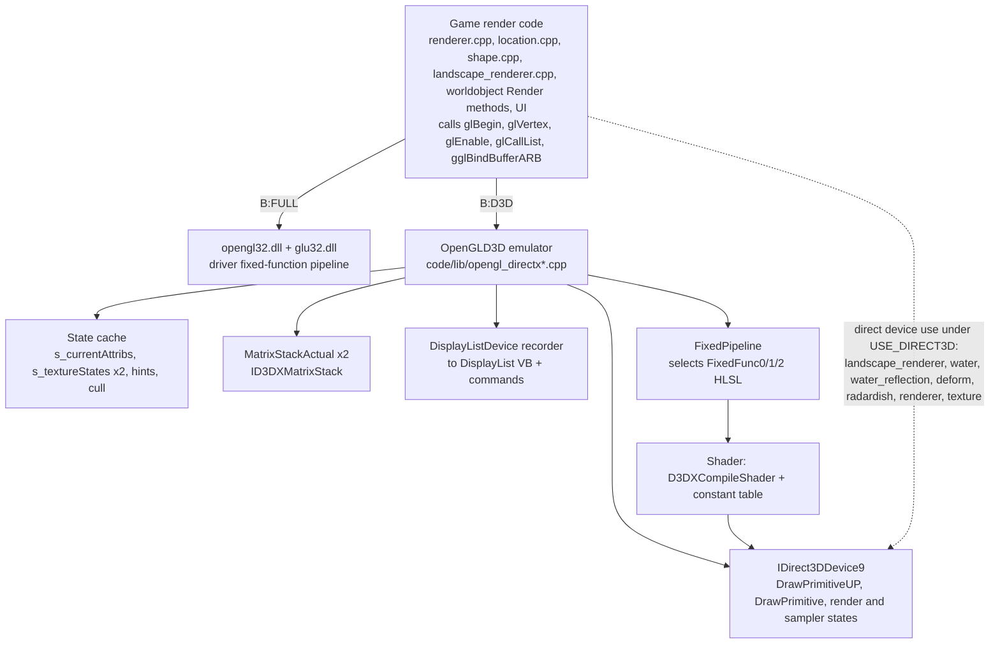
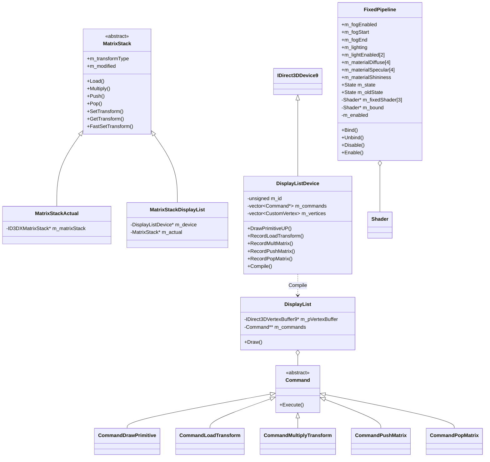
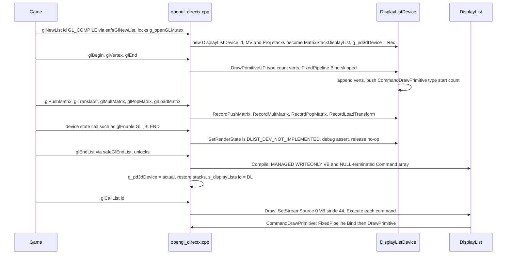
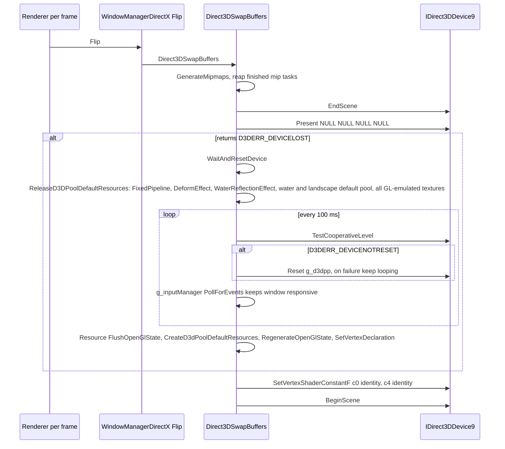
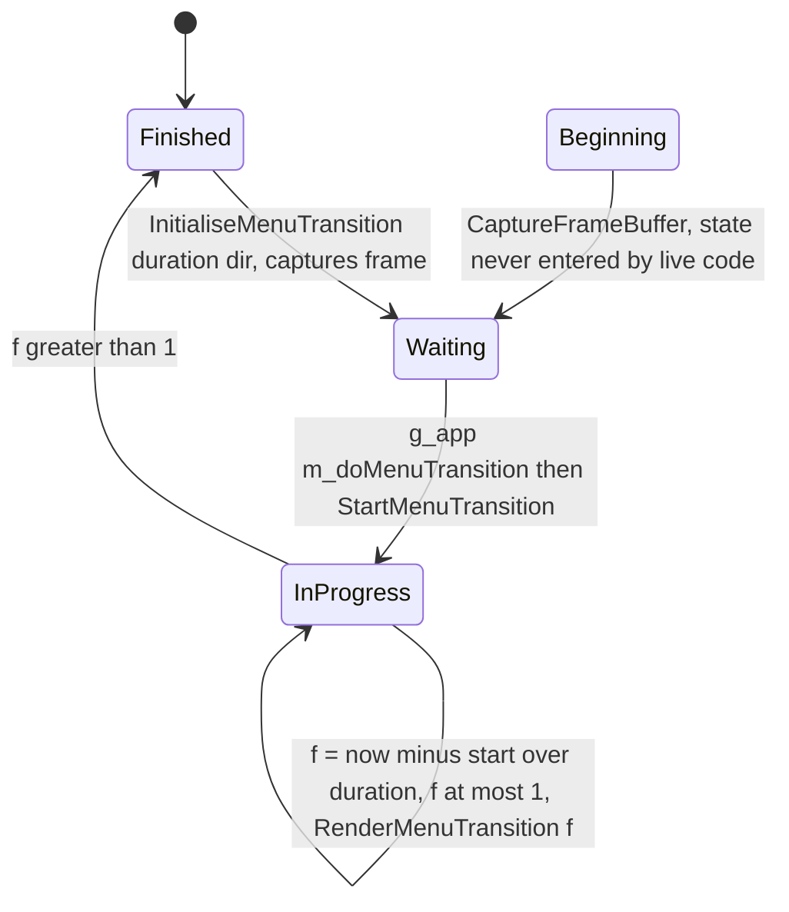
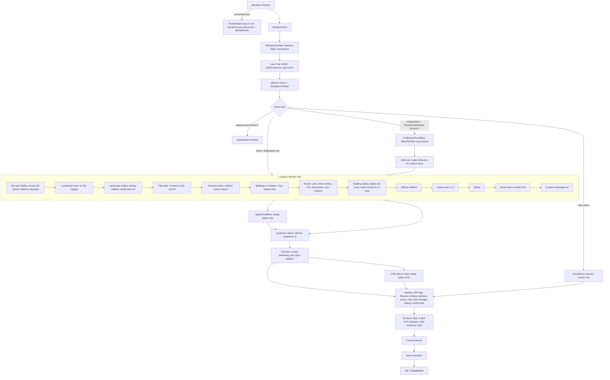

# 24 — Rendering

> Part B · Baseline build: Release|Win32 (OpenGL) + TARGET_PC_FULLGAME ([B:FULL]); see _work/build_matrix.md.
> Evidence: [C] confirmed · [I] inferred · [U] unknown. Citations are `path:Symbol` relative to the multiwinia/ source root.
> Sources merged: P12_render_core, P13_gfx_backend_math, P11_terrain_world, P07_buildings_misc, P09_control_taskmanager, P10_input_camera, plus render notes from P03_entity_core, P04_entities_military, P05_entities_creatures, P06_buildings_core, P17a_ui_framework_editor, P17b_menus_options, P02_game_modes (via routed/_meta_*.md).

## Contents

(filled at the end)

## 1 Backend architecture

### 1.1 How the backend is chosen [C]

All game render code (`code/renderer.cpp`, `code/location.cpp`, `code/lib/shape.cpp`, `code/landscape_renderer.cpp`, every `Render*` method in `code/worldobject/`, the UI) is written **once against the OpenGL 1.x fixed-function, immediate-mode API** plus two ARB extensions (multitexture, vertex buffer objects). The backend is chosen at **compile time** by which headers `code/lib/universal_include.h` pulls in:

| Build | Define | Headers included by `universal_include.h` | What `glXxx()` resolves to |
|---|---|---|---|
| `Release|Win32` / `Debug|Win32` **[B:FULL]** (ships as `multiwinia.exe`) | (none) | `<GL/gl.h>`, `<GL/glu.h>` | real `opengl32.dll` / `glu32.dll` entry points; WGL context created by `WindowManagerWin32` |
| `ReleaseDirect3D|Win32` / `DebugDirect3D|Win32` **[B:D3D]** | `USE_DIRECT3D` (`targets/vs2005/Direct3D.vsprops`) | `<d3d9.h>`, `<d3dx9.h>`, `lib/opengl_directx.h`, `lib/safegl.h` | free functions **of the same names** implemented in `code/lib/opengl_directx*.cpp` on top of `IDirect3DDevice9` + runtime-compiled HLSL |
| Mac OS X **[B:DEAD]** | `TARGET_OS_MACOSX` | `<OpenGL/gl.h>`, `<OpenGL/glu.h>`, `lib/safegl.h` | Apple OpenGL |

Evidence: `code/lib/universal_include.h` (`#ifdef USE_DIRECT3D … #include "lib/opengl_directx.h" … #else #include <GL/gl.h>`) [C]. `opengl_directx.h` re-declares every GL entry point used by the game **without `APIENTRY`/`__stdcall` DLL linkage**, with its own `#define` for every GL enum used [C] `code/lib/opengl_directx.h`. Two signatures are *extended* relative to real GL: `glTexImage2D(…, bool _compressed = false)` and `gluBuild2DMipmaps(…, bool _compressed = false)` (the flag selects DXT1) [C].

**Per-file compilation guards** (all files are listed for all four VS configurations in `targets/vs2005/Darwinia.vcproj`; bodies are switched by preprocessor) [C]:

| File | Guard | Content in baseline [B:FULL] |
|---|---|---|
| `code/lib/opengl_directx.cpp`, `opengl_directx_dlist.cpp`, `opengl_directx_dlist_dev.cpp`, `opengl_directx_matrix_stack.cpp`, `opengl_directx_stubs.cpp`, `opengl_trace.cpp`, `ogl_extensions_directx.cpp`, `window_manager_directx.cpp` | `#ifdef USE_DIRECT3D` | empty translation unit |
| `code/lib/FixedPipeline.cpp`, `code/lib/shader.cpp`, `code/lib/texture.cpp`, `code/deform.cpp`, `code/water_reflection.cpp` | `#ifdef USE_DIRECT3D` | empty |
| `code/lib/ogl_extensions.cpp`, `code/lib/window_manager_win32.cpp` | `#if !defined USE_DIRECT3D` | live |
| `code/lib/safegl.cpp` | unguarded; inner `#ifndef USE_DIRECT3D` | compiled, but `safeGlNewList/EndList` are **never reached** in baseline because the `#define glNewList safeGlNewList` lives in `safegl.h`, which is only included for D3D/Mac (§1.3.4) |
| `code/lib/window_manager.cpp` | none | live (abstract base) |
| `code/lib/avi_generator.cpp` | `#ifdef AVI_GENERATOR` (`TARGET_DEBUG` only) | empty in FULL ([B:DEBUG]) |
| `code/lib/avi_player.cpp` | `#ifdef EGAMESBUILD` (never defined) | empty ([B:DEAD]) |
| `code/landscape_renderer.cpp`, `code/water.cpp`, `code/renderer.cpp`, `code/worldobject/radardish.cpp`, `code/lib/text_renderer.cpp` | inner `#ifdef USE_DIRECT3D` blocks | GL path live; D3D blocks call `OpenGLD3D::g_pd3dDevice` directly |
| `code/lib/ogl_extensions_sdl.cpp`, `code/lib/window_manager_sdl.{cpp,h}` | not in the `.vcproj` | not built on Win32 (Appendix) |

46 files under `code/` contain `USE_DIRECT3D` [C grep (P13)]. Files that bypass the emulator and talk to `OpenGLD3D::g_pd3dDevice` directly under `USE_DIRECT3D`: `code/landscape_renderer.cpp`, `code/water.cpp`, `code/water_reflection.cpp`, `code/deform.cpp`, `code/renderer.cpp`, `code/worldobject/radardish.cpp`, `code/lib/texture.cpp`, `code/lib/shader.cpp`, `code/lib/FixedPipeline.cpp` [C].



**Which backend shipped.** Every Multiwinia packaging script copies `darwinia_gl.exe` (the `Release|Win32` OpenGL output) to `multiwinia.exe` [C] (see `_work/build_matrix.md` §1, `tools/build_multiwinia_retail.bat`). **The OpenGL path is the shipped renderer; the D3D9 path is a secondary configuration documented here for completeness and because it encodes a "GL-on-D3D" design** [C].

### 1.2 Is the D3D configuration buildable at this commit? [I]

Resolved: phase-2 notes spoke of "three independent breakages" while listing four items; reading the code shows **four** candidate compile blockers, two of which are ill-formed C++ regardless of SDK headers ([C]) and two of which depend on the DirectX SDK headers ([I]):

| # | Location | Problem | Certainty |
|---|---|---|---|
| B1 | `code/water.cpp:Water::Water` (L119, inside `#else` of `#ifndef USE_DIRECT3D`) | `bmp.GetPixel(x, 1)` where `bmp` is `const BitmapRGBA *` — member access through `.` on a pointer is ill-formed | [C] ill-formed |
| B2 | `code/lib/window_manager_directx.h:WindowManagerDirectX::CreateWin` | takes `const char *_title`; the pure virtual `code/lib/window_manager.h:WindowManager::CreateWin` takes `const wchar_t *_title`. The derived function hides instead of overriding, `WindowManagerDirectX` stays abstract, and `new WindowManagerDirectX()` in `code/lib/window_manager_directx.cpp:WinMain` is ill-formed (MSVC C2259). `code/renderer.cpp:Renderer::Initialise` also passes `APP_NAME_W` (wide) | [C] ill-formed |
| B3 | `code/deform.cpp:DeformEffect::Stop` | `g_pd3dDevice->Resolve(D3DRESOLVE_RENDERTARGET0, …)` — an Xbox 360 device method/constant not present on PC `IDirect3DDevice9`; no shim found anywhere in the tree [C grep] | [I] SDK-dependent |
| B4 | `code/lib/opengl_directx.cpp:glLineWidth` | `SetRenderState(D3DRS_LINEWIDTH, …)` — not a PC D3D9 `D3DRENDERSTATETYPE` member to the agents' knowledge and not defined in the tree; the comment `// autogenmipmap ignored by xbox` in `d3dCreateTexture` corroborates Xbox heritage | [I] SDK-dependent |

Conclusion [I]: `ReleaseDirect3D` does not build unmodified at commit `f909630`; it was evidently last maintained against an Xbox 360 branch. The emulation layer is nevertheless specified below (§1.5) because it is a complete, readable design for running a GL-1.x renderer on D3D9. See 24-U1.

### 1.3 Native OpenGL path [B:FULL]

#### 1.3.1 API surface used [C]

OpenGL 1.1–1.3 fixed function only: immediate mode (`glBegin/glEnd`), display lists (`glNewList/glCallList`), client vertex arrays (`glVertexPointer` + `glDrawArrays`), ARB VBOs (landscape only), fixed-function lighting (2 directional lights, `GL_COLOR_MATERIAL`), linear fog, alpha test, blending, two-unit multitexture with `GL_COMBINE_EXT` (flat water, laser-fence curtains), `glCopyTexImage2D` render-to-texture (menu transition capture, legacy pixel effect), `glReadPixels` (screenshots), `glClipPlane` (radar dish, D3D water reflection), `glScissor` (UI clip), `gluBuild2DMipmaps`, `gluPerspective`, `gluLookAt`, `gluOrtho2D`, `gluProject/gluUnProject`. **No GLSL, no ARB vertex/fragment programs** — all programmable-shader code is `USE_DIRECT3D`-only [C].

#### 1.3.2 Extension handling — `code/lib/ogl_extensions.cpp` [C]

`InitialiseOGLExtensions()` is called once per renderer creation from `Renderer::Initialise`, right after window creation [C] `code/renderer.cpp:Renderer::Initialise`. It (1) loads every pointer below with `wglGetProcAddress` without checking the extension string (a missing entry point leaves `NULL`), and (2) reads `glGetString(GL_VENDOR/GL_RENDERER/GL_VERSION/GL_EXTENSIONS)` into static buffers `s_glVendor[256]`, `s_glRenderer[256]`, `s_glVersion[256]`, `s_glExtensions[4096]` with `strncpy` + forced NUL — **the extension string is silently truncated at 4095 characters** — and logs them with `AppDebugOut` [C].

| Global pointer | Loaded name | Extension | Consumers | If missing |
|---|---|---|---|---|
| `gglMultiTexCoord2fARB` | `glMultiTexCoord2fARB` | GL_ARB_multitexture | `code/lib/render_utils.cpp`, `code/water.cpp`, `code/worldobject/laserfence.cpp`, `code/worldobject/feedingtube.cpp`, `code/worldobject/radardish.cpp`, `code/taskmanager_interface_gestures.cpp`, `code/deform.cpp` | **no guard anywhere** — call through `NULL` ⇒ crash [C grep: no `if (gglActiveTextureARB)` in `code/`] |
| `gglActiveTextureARB` | `glActiveTextureARB` | GL_ARB_multitexture | same | same |
| `gglBindBufferARB` | `glBindBufferARB` | GL_ARB_vertex_buffer_object | `code/landscape_renderer.cpp` | landscape falls back to display lists |
| `gglDeleteBuffersARB` | `glDeleteBuffersARB` | VBO | landscape | as above |
| `gglGenBuffersARB` | `glGenBuffersARB` | VBO | landscape | as above |
| `gglIsBufferARB` | `glIsBufferARB` | VBO | none | — |
| `gglBufferDataARB` | `glBufferDataARB` | VBO | landscape | as above |
| `gglBufferSubDataARB` | `glBufferSubDataARB` | VBO | none | — |
| `gglGetBufferSubDataARB` | `glGetBufferSubDataARB` | VBO | none | — |
| `gglMapBufferARB` | `glMapBufferARB` | VBO | none | — |
| `gglUnmapBufferARB` | `glUnmapBufferARB` | VBO | none | — |
| `gglGetBufferParameterivARB` | `glGetBufferParameterivARB` | VBO | none | — |
| `gglGetBufferPointervARB` | `glGetBufferPointervARB` | VBO | none | — |
| `gglChoosePixelFormatARB` | `wglChoosePixelFormatARB` | WGL_ARB_pixel_format | **none** — loaded, never called, so no multisampled pixel format is ever requested [C grep] | — |

Enum constants declared in `code/lib/ogl_extensions.h` [C]: `GL_COMBINE_EXT 0x8570`, `GL_COMBINE_RGB_EXT 0x8571`, `GL_COMBINE_ALPHA_EXT 0x8572`, `GL_ADD_SIGNED_EXT 0x8574`, `GL_INTERPOLATE_EXT 0x8575`, `GL_CONSTANT_EXT 0x8576`, `GL_SOURCE0_ALPHA_ARB 0x8588`, `GL_TEXTURE0_ARB 0x84C0`, `GL_TEXTURE1_ARB 0x84C1`; `WGL_*_PBUFFER_*` 0x202D–0x2036 (pbuffer API commented out); the full `GL_*_BUFFER_*_ARB` set (0x8892–0x88EA, 0x8764/0x8765, 0x88B8–0x88BD); `WGL_SAMPLE_BUFFERS_ARB 0x2041`, `WGL_SAMPLES_ARB 0x2042`, `WGL_DOUBLE_BUFFER_ARB 0x2011`, `WGL_ACCELERATION_ARB 0x2003`, `WGL_FULL_ACCELERATION_ARB 0x2027`, `GL_MULTISAMPLE_ARB 0x809D`, `WGL_DRAW_TO_WINDOW_EXT 0x2001`, `WGL_SUPPORT_OPENGL_EXT 0x2010`, `WGL_COLOR_BITS_EXT 0x2014`, `WGL_ALPHA_BITS_EXT 0x201B`, `WGL_DEPTH_BITS_EXT 0x2022`, `WGL_STENCIL_BITS_EXT 0x2023`.

**Query functions** [C] `code/lib/ogl_extensions.cpp`:

- `IsOGLExtensionSupported(name)`: 0 if `IsOGLExtensionBlacklisted(name)`; else a whole-word search of `s_glExtensions` (match preceded by start-of-string or space and followed by space or NUL); names containing a space, or empty names, return 0.
- `IsOGLExtensionBlacklisted(name)`: only ever blacklists `"GL_ARB_vertex_buffer_object"`, when `GL_VENDOR` contains `"Intel"` and `GL_RENDERER` contains any entry of `blacklistIntel[]`, or `GL_VENDOR` contains `"SiS"` and the renderer contains any entry of `blacklistSiS[]` (substring match):

| Vendor | Renderer substrings (exact strings) | Code annotation |
|---|---|---|
| Intel | `Intel 945GM`, `Intel 965/963`, `Intel Bear Lake B` | "Reported by users" (Bear Lake B = G33/G31, GMA 3100) |
| Intel | `Intel 82810`, `Intel 82815`, `Intel 82830M`, `Intel 82845G`, `Intel 82845PE`, `Intel 82852`, `Intel 82855`, `Intel 82865G`, `Intel 82910GL`, `Intel 82915G`, `Intel 82945G`, `Intel 910GML`, `Intel 915GM`, `Intel 945`, `Intel 963`, `Intel 965` | "Untested" |
| SiS | `Mirage Graphics3` | "Reported by users" (SiS Mirage 3) |

A second, commented-out `blacklistIntel[]` of full Windows driver names and a commented "Ok Intel card?" list (G965, 946GZ, Q35) also exist [C].

- `IsOGLExtensionPerfectlySupported(name)`: `IsOGLExtensionSupported(name)`, but additionally 0 for `GL_ARB_vertex_buffer_object` whenever the vendor string contains `"Intel"` **or** `"SiS"` (any renderer) [C].

**Every extension query and its fallback** [C]:

| Query site | Extension | Fallback when absent |
|---|---|---|
| `code/landscape_renderer.cpp:LandscapeRenderer::LandscapeRenderer` (pref `RenderLandscapeMode` = −1, the default) | `IsOGLExtensionPerfectlySupported("GL_ARB_vertex_buffer_object")` | `RenderModeDisplayList` instead of `RenderModeVertexBufferObject` — every Intel/SiS GPU gets display lists by default |
| same, after the mode is chosen | `!gglBindBufferARB || !IsOGLExtensionSupported("GL_ARB_vertex_buffer_object")` | forced to `RenderModeDisplayList` even if the preference asked for VBO |
| `code/lib/math_utils.cpp:RequirePowerOfTwoTextures` | `strstr(glGetString(GL_EXTENSIONS), "GL_ARB_texture_non_power_of_two")` (raw substring, cached in a function static) | true ⇒ `code/lib/bitmap.cpp` rescales textures to `nearestPowerOfTwo`; `code/renderer.cpp:Renderer::CaptureFrameBuffer` copies a POT-sized region and scales UVs by `W/nearestPowerOfTwo(W)` |
| `code/lib/math_utils.cpp:RequireSquareTextures` | `strstr(…, "GL_ARB_texture_rectangle")` | true ⇒ `bitmap.cpp` makes textures square |
| `GL_ARB_multitexture` | never queried | none (crash if absent) |
| pref `ManuallyScaleTextures` (default 0) | — | forces POT rescale regardless [C] `code/lib/bitmap.cpp` |

Under `USE_DIRECT3D` both `Require*Textures` return `false` immediately [C].

#### 1.3.3 WGL context, vsync, MSAA, gamma [C] `code/lib/window_manager_win32.cpp:WindowManagerWin32::EnableOpenGL`

- Pixel format: `PIXELFORMATDESCRIPTOR{PFD_DRAW_TO_WINDOW|PFD_SUPPORT_OPENGL|PFD_DOUBLEBUFFER, PFD_TYPE_RGBA, cColorBits = ScreenColourDepth, cDepthBits = ScreenZDepth, PFD_MAIN_PLANE}` → `ChoosePixelFormat` + `SetPixelFormat` (results unchecked). **No alpha, stencil or multisample bits are requested.**
- Two contexts: primary `m_hRC`, and a secondary `m_hRC2` "for loading thread" joined with `wglShareLists`; `m_hRC2` is **never made current** and never deleted (`UseSecondaryContext/ReleaseSecondaryContext/DestroySecondaryContext` declared, not defined). All GL work runs on the main thread; worker threads queue GL jobs to the loading screen (§4.26).
- **Vsync**: no `wglSwapIntervalEXT` call exists anywhere [C grep] ⇒ the swap interval is the driver default; the `WaitVerticalRetrace` preference has no effect in the baseline. `waitVRT` and `antiAlias` arguments of `CreateWin` are ignored by the Win32 GL window manager.
- **Multisampling**: none (see `gglChoosePixelFormatARB`).
- **Gamma**: no gamma-ramp code for GL (`Renderer::SetScreenGamma` exists only under `USE_DIRECT3D` and has no caller).
- Present: `WindowManagerWin32::Flip` = `SwapBuffers(m_hDC)`. Window creation, mode switching and display-mode enumeration are specified in [31](31_platform_build_and_tools.md).

#### 1.3.4 `safegl` [C] `code/lib/safegl.h`, `code/lib/safegl.cpp`

`safegl.h` redefines `glNewList`→`safeGlNewList` and `glEndList`→`safeGlEndList`. `safeGlNewList` (non-D3D) logs `"glNewList called from non-mainthread (bad for OpenGL)"` when `NetGetCurrentThreadId() != g_app->m_mainThreadId`, then locks the global `NetMutex g_openGLMutex` and calls the real `glNewList`; `safeGlEndList` calls `glEndList` and unlocks. `LoadingScreen::RenderFrame` takes the same mutex for its whole frame [C] `code/loading_screen.cpp`. Because `safegl.h` is only included for `USE_DIRECT3D` and Mac, **in the baseline the wrapper is inactive** — display lists compile without the lock [C for include topology; I for consequence — harmless because all GL work is on the main thread].

### 1.4 Hardware-compatibility fallbacks [B:FULL]

| Problem | Mechanism | Ref |
|---|---|---|
| Intel/SiS VBO driver bugs | blacklist + "perfectly supported" test ⇒ display lists | `code/lib/ogl_extensions.cpp` |
| No NPOT textures | rescale to POT; POT `glCopyTexImage2D` | `code/lib/math_utils.cpp:RequirePowerOfTwoTextures`, `code/lib/bitmap.cpp` |
| No rectangle textures | square textures | `code/lib/math_utils.cpp:RequireSquareTextures` |
| Over-size textures | downscale to `GL_MAX_TEXTURE_SIZE` (`BitmapRGBA::SetMaxTextureSize`, set in `code/app.cpp:App::App`); the downscale is discarded when POT rescale also applies (see [25](25_textures_and_assets.md)) | `code/lib/bitmap.cpp:BitmapRGBA::ConvertToTexture` |
| Requested display mode fails | 4-stage `CreateWin` retry chain (§2.2) | `code/renderer.cpp:Renderer::Initialise` |
| Long extension strings | truncated at 4095 chars (late-listed extensions reported missing) | `InitialiseOGLExtensions` |
| Radeon fog artefacts on large quads | sky/cloud quads subdivided 4×4 (`Clouds::RenderQuad`); `RenderSplitUpQuad*` helpers exist but are unused | `code/clouds.cpp`, `code/lib/render_utils.cpp` |
| Radeon X300 16-bit modes [B:D3D] | try `R5G6B5` before `A1R5G5B5` | `code/lib/opengl_directx.cpp:Direct3DInit` |
| Radeon X300 deform interference [B:D3D] | +0.0003 UV offset in `deform.vs` | `data/shaders/deform.vs` |
| Multitexture missing | **none** (crash) | — |

`docs/HardwareComplianceIssues.txt` contains only: "Johnny's Linux Machine: – Multitexturing ARB not supported – Mouse pointer background not transparent" [C]. Neither issue has a Win32 code-side fallback (Docs-vs-code table). `docs/OpenGLState.txt` is cross-checked against the code in §2.3.

### 1.5 Direct3D 9 path: OpenGL-API emulation layer [B:D3D]

#### 1.5.1 Module map [C]

| File | Namespace / classes | Role |
|---|---|---|
| `code/lib/opengl_directx.h` | — | GL type/enum `#define`s and prototypes for every emulated entry point; includes `opengl_directx_inline.h` |
| `code/lib/opengl_directx_inline.h` | — | `__forceinline` wrappers `glColor*`, `glNormal*`, `glVertex*`, `glTexCoord*`, `glFogf/glFogi`, template `openGLMatrixToDirect3D` |
| `code/lib/opengl_directx_internals.h` | `OpenGLD3D::CustomVertex`; externs `g_pd3dDeviceActual`, `g_pd3dDevice`, `g_currentVertexBuffer`, `g_supportsHwVertexProcessing`, `glActiveTextureD3D`, `glMultiTexCoord2fD3D` | shared internals |
| `code/lib/opengl_directx.cpp` | `OpenGLD3D::TextureState`, `CurrentAttributes`, `Attributes`, `MipMapTask`; device globals | core emulator + device lifecycle |
| `code/lib/opengl_directx_stubs.cpp` | — | no-op stubs |
| `code/lib/opengl_directx_matrix_stack.{h,cpp}` | `MatrixStack` (abstract), `MatrixStackActual`, `MatrixStackDisplayList` | GL matrix stacks |
| `code/lib/opengl_directx_dlist_dev.{h,cpp}` | `DisplayListDevice : IDirect3DDevice9` | records draws while a list is open |
| `code/lib/opengl_directx_dlist.{h,cpp}` | `Command` + `CommandDrawPrimitive`, `CommandLoadTransform`, `CommandMultiplyTransform`, `CommandPushMatrix`, `CommandPopMatrix`; `DisplayList` | compiled list + playback |
| `code/lib/ogl_extensions_directx.cpp` | — | ARB multitexture + VBO emulation, extension query stubs |
| `code/lib/FixedPipeline.{h,cpp}` | `FixedPipeline` | fixed-function emulation: shader selection + uniform upload |
| `code/lib/shader.{h,cpp}` | `Shader` | HLSL compile/bind/constant-table helper |
| `code/lib/texture.{h,cpp}` | `Texture` | render-target texture wrapper (deform, water reflection) |
| `code/lib/opengl_trace.{h,cpp}` | — | debug call tracing |



#### 1.5.2 Device globals and device creation [C] `code/lib/opengl_directx.cpp` (namespace `OpenGLD3D`)

| Global | Type | Meaning |
|---|---|---|
| `g_pD3D` | `LPDIRECT3D9` | `Direct3DCreate9(D3D_SDK_VERSION)`, created once, kept across window recreation |
| `g_d3dpp` | `D3DPRESENT_PARAMETERS` | last present parameters (reused for `Reset`) |
| `g_pd3dDevice` | `LPDIRECT3DDEVICE9` | **current command target** — the real device, or the `DisplayListDevice` recorder while `glNewList` is open |
| `g_pd3dDeviceActual` | `LPDIRECT3DDEVICE9` | the real device |
| `g_supportsHwVertexProcessing` | `bool` (default true) | `caps.DevCaps & D3DDEVCAPS_HWTRANSFORMANDLIGHT` |
| `g_currentVertexBuffer` | `IDirect3DVertexBuffer9 **` | slot of the VBO bound by `glBindBufferD3D` |

`Direct3DInit` (summary; full table in [31](31_platform_build_and_tools.md)) [C]: `D3DADAPTER_DEFAULT`, `D3DDEVTYPE_HAL`; hardware vertex processing if `D3DDEVCAPS_HWTRANSFORMANDLIGHT` else software; behaviour flags contain **no `D3DCREATE_FPU_PRESERVE` and no `D3DCREATE_MULTITHREADED`** (x87 precision drops to 24-bit, see [22](22_determinism_and_networking.md)); windowed = desktop format, fullscreen colour 24/32 → `X8R8G8B8` (fallback `A8R8G8B8`), 15/16 → `X1R5G5B5` (fallbacks `R5G6B5`, `A1R5G5B5`); depth 16→`D16`, 24→`D24X8`, 32→`D32`, no stencil; `SwapEffect=DISCARD`, one back buffer; `PresentationInterval = waitVRT ? ONE : IMMEDIATE`; no multisampling; refresh-rate preference not applied (`FullScreen_RefreshRateInHz` = 0). After creation: `InitialiseData()` (matrix stacks, vertex declaration, 1024-vertex immediate buffer, cleared texture table, cull/hints/attribute reset, mip work queue), `BeginScene`, `SetVertexDeclaration`, `CreateD3DResources()` → `DeformEffect::Create`, `WaterReflectionEffect::Create`, `new FixedPipeline`.

#### 1.5.3 Vertex format [C] `code/lib/opengl_directx_internals.h:CustomVertex`, `s_customVertexDesc`

| Offset | Field(s) | Decl type | Usage |
|---|---|---|---|
| 0 | `float x, y, z` | FLOAT3 | POSITION0 |
| 12 | `float nx, ny, nz` | FLOAT3 | NORMAL0 |
| 24 | `unsigned char b8, g8, r8, a8` | D3DCOLOR (BGRA bytes = ARGB dword) | COLOR0 |
| 28 | `float u, v` | FLOAT2 | TEXCOORD0 |
| 36 | `float u2, v2` | FLOAT2 | TEXCOORD1 |

Stride 44 bytes. The declaration is created in `InitialiseData` and set after `BeginScene` and after every device reset.

#### 1.5.4 State cache — what GL state is tracked and where it goes [C]

| GL state | Emulator storage | D3D9 target |
|---|---|---|
| Current colour (`glColor*`) | `s_currentAttribs.r8/g8/b8/a8` (float→byte: `x<0→0`, `x>1→255`, else `(unsigned char)(x*255)` truncation, macro `CLAMPF2B`) | baked into each vertex's COLOR0 |
| Current normal (`glNormal*`) | `s_currentAttribs.nx/ny/nz` **negated** (comment: LH/RH) | NORMAL0 |
| Current texcoord unit 0 / 1 | `u,v` / `u2,v2` (`glTexCoord*`, `glMultiTexCoord2fD3D`) | TEXCOORD0 / TEXCOORD1 |
| Alpha reference | `s_currentAttribs.alphaRef` (clamped float) | `D3DRS_ALPHAREF = DWORD(clamp(ref,0,1)*255)` |
| Alpha func | — | `D3DRS_ALPHAFUNC` (`GL_LEQUAL→LESSEQUAL`, `GL_GREATER→GREATER`; others assert → LESSEQUAL) |
| Alpha test enable | — | `D3DRS_ALPHATESTENABLE` |
| Blend enable / func | — | `D3DRS_ALPHABLENDENABLE`, `D3DRS_SRCBLEND`, `D3DRS_DESTBLEND` |
| Depth test / func / mask | — | `D3DRS_ZENABLE` (`D3DZB_TRUE/FALSE`), `D3DRS_ZFUNC`, `D3DRS_ZWRITEENABLE` |
| Cull enable | `s_currentAttribs.backCullingEnabled` | `D3DRS_CULLMODE = s_cullMode` or `D3DCULL_NONE` |
| Front face | `s_ccwFrontFace` (default true) → `s_cullMode` (`GL_CCW→D3DCULL_CW`, `GL_CW→D3DCULL_CCW`) | `D3DRS_CULLMODE` when culling enabled |
| Polygon mode | — | `D3DRS_FILLMODE` (`GL_FILL→SOLID`, `GL_LINE→WIREFRAME`; face argument ignored) |
| Polygon offset enable / params | `polygonOffsetEnabled`, `depthBias=units`, `slopeDepthBias=factor` | `D3DRS_DEPTHBIAS`, `D3DRS_SLOPESCALEDEPTHBIAS` (defect D11) |
| Scissor enable / rect | — | `D3DRS_SCISSORTESTENABLE`, `SetScissorRect` |
| Clip planes 0–2 enable / equation | — | `D3DRS_CLIPPLANEENABLE` bit `1<<(cap−GL_CLIP_PLANE0)`, `SetClipPlane` |
| Point size | — | `D3DRS_POINTSIZE` (float bits) |
| Line width | — | `D3DRS_LINEWIDTH` (float bits) — build blocker B4 |
| Viewport | — | `SetViewport` (MinZ/MaxZ preserved) |
| Clear colour | `s_clearColor` (default `D3DCOLOR_RGBA(0,0,0,255)`) | `Clear(…, colour, z=1.0f, stencil=0)` |
| Texture enable per unit | `s_currentAttribs.texturingEnabled[2]` | selects FixedFunc shader variant |
| Bound texture per unit | `s_textureStates[unit].target` (GL id) | `SetTexture(unit, s_textureIds[id])` |
| Active texture unit | `s_activeTexture` (0..1, `MAX_ACTIVE_TEXTURES = 2`) | stage/sampler index |
| Tex env mode / combine / colour | `TextureState.envMode` (default `GL_MODULATE`), `rgbCombineMode`, `envColour` | **stored only — no D3D effect** |
| Tex wrap / filters | — | sampler states of the **active stage** (`D3DSAMP_ADDRESSU/V`, `MAGFILTER`, `MINFILTER`, `MIPFILTER`) |
| Colour material enable / mode | `colorMaterialEnabled`, `colorMaterialMode` (default `GL_DIFFUSE`) | stored only |
| Lighting enable | `g_fixedPipeline->m_lighting` | shader `numLights` |
| Light 0/1 enable | `g_fixedPipeline->m_lightEnabled[0..1]` | shader `numLights` |
| Light params | `g_fixedPipeline->m_state.m_light[i]` (`D3DLIGHT9`) | shader `lights[i]` |
| Material diffuse/specular/shininess | `g_fixedPipeline->m_materialDiffuse[4]`, `m_materialSpecular[4]`, `m_materialShininess` | **stored only — never uploaded** |
| Fog enable/start/end | `g_fixedPipeline->m_fogEnabled/m_fogStart/m_fogEnd` | shader `fogRange` |
| Fog colour/mode/density | — | **ignored** |
| Hints | `s_fogHint`, `s_polygonSmoothHint` | stored only (readable via `glGetIntegerv`) |
| Matrix mode | `s_matrixMode`, `s_pTargetMatrixStack`, `s_targetMatrixTransformType` | — |
| Attribute stack | `class Attributes{CurrentAttributes, IDirect3DStateBlock9*}`, `std::stack<Attributes> s_attributeStack` | **declared, unused** — no `glPushAttrib/glPopAttrib` exists in emulator or game [C grep] |

`CurrentAttributes` derives from `CustomVertex` and adds `alphaRef`, `texturingEnabled[2]`, `backCullingEnabled`, `polygonOffsetEnabled`, `depthBias`, `slopeDepthBias`, `colorMaterialEnabled`, `colorMaterialMode`; its constructor zero-fills and sets `colorMaterialMode = GL_DIFFUSE`, `a8 = 255`. `TextureState` = `{target=0, lastTarget=-1, envColour=0, envMode=GL_MODULATE, lastEnvMode=0, rgbCombineMode=0}`. There is **no redundant-state filtering**: every `glEnable/glBlendFunc/…` issues a `SetRenderState` (the "lastEnvMode/lastTarget" optimisation in `setupTexturing` is commented out) [C].

**`glEnable` / `glDisable` / `glIsEnabled`** [C]:

| Cap | `glEnable` | `glDisable` | `glIsEnabled` |
|---|---|---|---|
| `GL_ALPHA_TEST` | ALPHATESTENABLE=TRUE | FALSE | reads RS |
| `GL_BLEND` | ALPHABLENDENABLE=TRUE | FALSE | reads RS |
| `GL_CLIP_PLANE0..2` | set bit in CLIPPLANEENABLE (Get→Set) | clear bit | not handled (assert, returns 0) |
| `GL_COLOR_MATERIAL` | flag only | flag only | flag |
| `GL_CULL_FACE` | CULLMODE=`s_cullMode` | CULLMODE=NONE | `CULLMODE != NONE` |
| `GL_DEPTH_TEST` | ZENABLE=TRUE | FALSE | reads RS |
| `GL_FOG` | `m_fogEnabled=true` | false | flag |
| `GL_LIGHTING` | `m_lighting=true` | false | flag |
| `GL_LIGHT0`, `GL_LIGHT1` | `m_lightEnabled[i]=true` | false | flag |
| `GL_LIGHT2`…`GL_LIGHT7` | default branch (trace "not implemented") | same | assert, 0 |
| `GL_LINE_SMOOTH` | no-op | no-op | assert, 0 |
| `GL_NORMALIZE` | no-op | no-op | assert, 0 |
| `GL_POINT_SMOOTH` | default branch (trace) | no-op | FALSE |
| `GL_POLYGON_OFFSET_FILL` | flag + SLOPESCALEDEPTHBIAS/DEPTHBIAS from cache | flag + both 0 | assert, 0 |
| `GL_SCISSOR_TEST` | SCISSORTESTENABLE=TRUE | FALSE | reads RS |
| `GL_TEXTURE_2D` | `texturingEnabled[active]=true`; if bound texture pointer non-NULL → `SetTexture` | flag false | flag |

**Enum translation** [C]:

| GL | D3D9 |
|---|---|
| Blend `GL_ZERO`, `GL_ONE`, `GL_SRC_COLOR`, `GL_ONE_MINUS_SRC_COLOR`, `GL_SRC_ALPHA`, `GL_ONE_MINUS_SRC_ALPHA` | `D3DBLEND_ZERO`, `ONE`, `SRCCOLOR`, `INVSRCCOLOR`, `SRCALPHA`, `INVSRCALPHA`; any other factor → assert + `D3DBLEND_ONE` |
| Compare `GL_LEQUAL`, `GL_GREATER` | `D3DCMP_LESSEQUAL`, `D3DCMP_GREATER`; others (NEVER/LESS/EQUAL/NOTEQUAL/GEQUAL/ALWAYS commented out) → assert + LESSEQUAL |
| Filter `GL_LINEAR`, `GL_NEAREST`, `GL_LINEAR_MIPMAP_LINEAR` | `D3DTEXF_LINEAR`, `D3DTEXF_POINT`, `D3DTEXF_LINEAR`; any other (including `GL_NEAREST_MIPMAP_LINEAR`, which is `#define`d) → **`AppReleaseAssert`** (fatal in release) |
| MIN filter → MIPFILTER | `GL_LINEAR_MIPMAP_LINEAR → D3DTEXF_LINEAR`, else `D3DTEXF_NONE` |
| Wrap `GL_CLAMP`, `GL_REPEAT` | `D3DTADDRESS_CLAMP`, `D3DTADDRESS_WRAP`; other → `AppReleaseAssert` |
| Fill `GL_FILL`, `GL_LINE` | `D3DFILL_SOLID`, `D3DFILL_WIREFRAME` |
| Clear `GL_COLOR_BUFFER_BIT`, `GL_DEPTH_BUFFER_BIT` | `D3DCLEAR_TARGET`, `D3DCLEAR_ZBUFFER` (other bits → debug assert) |

#### 1.5.5 Complete emulated entry-point table [C]

Legend: **Impl** implemented; **Stub** compiled, does nothing (traces in `_DEBUG`); **Partial** subset of GL semantics. Ref `code/lib/opengl_directx.cpp` unless noted.

| GL / GLU / extension function | Status | D3D9 implementation summary |
|---|---|---|
| `glBegin(mode)` | Impl | reset vertex cursor to `s_vertices[0]`, count 0, store `s_primitiveMode` |
| `glEnd()` | Impl | `FastSetTransform()` (no-op); if `g_fixedPipeline` and not recording → `FixedPipeline::Bind()`; convert primitive (§1.5.6) and `DrawPrimitiveUP` stride 44 |
| `glVertex2i/2f/2fv/2dv/3d/3dv/3f/3fv` | Impl (inline) | `glVertex3f_impl`: grow buffer if `count+2 ≥ allocated` (×2, initial 1024); copy whole `s_currentAttribs` as the vertex, set xyz; quad expansion; 2D variants set z=0 |
| `glColor3ub/3ubv/3f/4ub/4ubv/4f/4fv` | Impl | set current colour bytes (3-component variants alpha=255 / 1.0) |
| `glNormal3f/3fv/3dv` | Impl | current normal = **−n** |
| `glTexCoord2i/2f/2fv/2dv` | Impl | current `u,v` |
| `glEnable/glDisable/glIsEnabled` | Partial | table §1.5.4 |
| `glGetError()` | Stub-like | always 0 |
| `glGetString(name)` | Stub | returns NULL (`code/lib/opengl_directx_stubs.cpp`) |
| `glHint(target, mode)` | Partial | stores `GL_FOG_HINT` / `GL_POLYGON_SMOOTH_HINT`; no effect |
| `glFrontFace(mode)` | Impl | updates `s_ccwFrontFace`, `s_cullMode`; re-applies CULLMODE if culling on |
| `glShadeModel(mode)` | Stub | ignored (flat look emulated only for strips) |
| `glBlendFunc(s,d)` | Impl | SRCBLEND/DESTBLEND |
| `glAlphaFunc(func, ref)` | Impl | ALPHAFUNC; ALPHAREF = `DWORD(clamp(ref)*255)` (truncation) |
| `glDepthFunc(func)` | Impl | ZFUNC |
| `glDepthMask(flag)` | Impl | ZWRITEENABLE |
| `glClipPlane(plane, eq)` | Impl | normalise plane; transform by `(MV⁻¹)ᵀ` then `(P⁻¹)ᵀ` → clip-space plane; `SetClipPlane(plane−GL_CLIP_PLANE0)` |
| `glClear(mask)` | Impl | `Clear(0,NULL,flags,s_clearColor,1.0f,0)` |
| `glClearColor(r,g,b,a)` | Impl | `s_clearColor = D3DCOLOR_COLORVALUE(r,g,b,a)` |
| `glFinish()` | Stub | returns immediately (back-buffer lock code after `return` is dead) |
| `glLineWidth(w)` | Impl | `SetRenderState(D3DRS_LINEWIDTH, *(DWORD*)&w)` |
| `glPointSize(s)` | Impl | `D3DRS_POINTSIZE` float bits |
| `glViewport(x,y,w,h)` | Impl | Get/SetViewport, **no y-flip** |
| `glScissor(x,y,w,h)` | Impl | `RECT{left=x, right=x+w, bottom=ScreenH−y, top=bottom−h}` |
| `glPolygonMode(face, mode)` | Partial | FILLMODE; face ignored |
| `glPolygonOffset(factor, units)` | Partial | caches; applies DEPTHBIAS=units, SLOPESCALEDEPTHBIAS=factor if enabled (D11) |
| `glGetIntegerv(pname)` | Partial | `GL_ALPHA_TEST_FUNC`, `GL_BLEND_DST`, `GL_BLEND_SRC`, `GL_DEPTH_FUNC`, `GL_DEPTH_WRITEMASK` (read back from device RS); `GL_COLOR_MATERIAL_FACE` (always `GL_FRONT_AND_BACK`); `GL_COLOR_MATERIAL_PARAMETER`; `GL_FOG_HINT`; `GL_FRONT_FACE`; `GL_MATRIX_MODE`; `GL_POLYGON_MODE` (both entries = fill mode); `GL_POLYGON_SMOOTH_HINT`; `GL_VIEWPORT`; others trace only, output untouched |
| `glGetFloatv(pname)` | Partial | `GL_ALPHA_TEST_REF` (cached float), `GL_CURRENT_COLOR` (bytes × 1/255), `GL_FOG_COLOR` (no-op, output untouched), `GL_FOG_START`, `GL_FOG_END`; others assert |
| `glGetDoublev(pname)` | Partial | `GL_MODELVIEW_MATRIX`, `GL_PROJECTION_MATRIX` (top of stack, element-wise copy) |
| `glMatrixMode(mode)` | Impl | switch target stack (asserts MODELVIEW/PROJECTION) |
| `glLoadIdentity()` | Impl | `Load(identity)` |
| `glLoadMatrixd(m)` | Impl | `Load(openGLMatrixToDirect3D(m))` |
| `glMultMatrixd(m)`, `glMultMatrixf(m)` | Impl | `Multiply(converted)` |
| `glPushMatrix()`, `glPopMatrix()` | Impl | stack Push/Pop |
| `glTranslatef`, `glScalef` | Impl | `D3DXMatrixTranslation/Scaling` then Multiply |
| `glRotatef(angle,x,y,z)` | Impl | `D3DXMatrixRotationAxis(axis, D3DXToRadian(angle))` then Multiply |
| `glFrustum(...)` | Stub | no-op (poster tiling broken under D3D) |
| `gluOrtho2D(l,r,b,t)` | Impl | `Load(D3DXMatrixOrthoOffCenterRH(l,r,b,t,−1,+1))` |
| `gluPerspective(fovy,aspect,zn,zf)` | Impl | `D3DXMatrixPerspectiveFovRH(rad(fovy),aspect,zn,zf)`, then **`_43 *= 2`**, Load |
| `gluLookAt(eye,center,up)` | Partial | `Load(D3DXMatrixLookAtRH(...))` — **replaces** the current matrix (GL multiplies; harmless because `Camera::SetupModelviewMatrix` loads identity first) |
| `gluProject`, `gluUnProject` | Impl | D3DX maths with GL window conventions (x,y,z mapped [−1,1]↔[0,1], viewport offset; false on w=0 / singular) |
| `glLightfv(light, pname)` | Partial | `GL_POSITION` w=0 → directional: `Direction` = xyz × current modelview (w=0), normalised; w≠0 → `Type=POINT`, `Position=xyz` but the code transforms `Direction` instead of `Position` (D17); `GL_DIFFUSE`, `GL_SPECULAR`, `GL_AMBIENT` copied |
| `glGetLightfv` | Impl | stored values |
| `glLightModelfv` | Stub | ignored (no light-model ambient) |
| `glMaterialfv(face, pname)` | Partial | `GL_SPECULAR`, `GL_DIFFUSE`/`GL_AMBIENT_AND_DIFFUSE`, `GL_SHININESS` stored; `GL_AMBIENT` ignored; never reach shaders |
| `glGetMaterialfv` | Stub | no-op |
| `glColorMaterial(face, mode)` | Partial | stores mode only |
| `glFogf(pname, v)` | Partial | `GL_FOG_START`, `GL_FOG_END` → FixedPipeline; `GL_FOG_DENSITY`, `GL_FOG_MODE` accepted & ignored; others assert |
| `glFogi(pname, v)` | Partial | `DENSITY/END/START`: GL normalised-integer conversion (`v/INT_MAX` if v>0 else `v/INT_MIN`) then `glFogf`; `GL_FOG_MODE` ignored |
| `glFogfv(pname, v)` | Stub | ignored (**fog colour lost**) |
| `glGenTextures(n)` | Impl | ids = next indices of `std::vector s_textureIds`, initialised NULL (**id 0 is a real texture**) |
| `glDeleteTextures` | Stub | no-op (textures leak until device reset/shutdown) |
| `glBindTexture(GL_TEXTURE_2D, id)` | Impl | `s_activeTextureState->target=id`; if unit enabled → `SetTexture(unit, s_textureIds[id])` |
| `glTexImage2D(…, _compressed)` | Partial | asserts target 2D, level 0, internalformat 4, format RGBA; `d3dCreateTexture(mipmaps=false)` |
| `gluBuild2DMipmaps(…, _compressed)` | Impl | `d3dCreateTexture(mipmaps=true)` |
| `glTexParameteri/f` | Partial | wrap/filter → sampler states of **active stage** |
| `glGetTexParameteriv` | Partial | MAG/MIN from sampler state; WRAP_S/T read from `D3DRS_WRAP0` bits (wrong state, D16) |
| `glGetTexLevelParameteriv` | Partial | `GL_TEXTURE_WIDTH/HEIGHT` from `GetTexture(stage)->GetLevelDesc(level)` (leaks the AddRef'd reference) |
| `glTexEnvf` | Partial | `GL_TEXTURE_ENV_MODE`, `GL_COMBINE_RGB_EXT` stored (+rebind); else assert |
| `glTexEnvi` | Partial | `GL_TEXTURE_ENV_MODE` stored; else assert |
| `glTexEnviv` | Partial | `GL_TEXTURE_ENV_COLOR` stored (/255); else assert |
| `glGetTexEnviv` | Partial | `GL_TEXTURE_ENV_COLOR` (×255), `GL_TEXTURE_ENV_MODE` |
| `glCopyTexImage2D(…, x,y,w,h)` | Partial | lazily `CreateTexture(w,h,1,RENDERTARGET, backbuffer fmt, DEFAULT)`; `StretchRect(backbuffer {x,y,x+w,y+h} → level 0, D3DTEXF_NONE)`; internalFormat ignored |
| `glReadPixels(x,y,w,h,GL_RGB,…)` | Partial | GL_RGB only; reads from (0,0) regardless of x,y; temp A8R8G8B8 render target, `StretchRect(POINT)` → `GetRenderTargetData` → SYSTEMMEM surface → BGRA→RGB with vertical flip, pitch assumed `w*4` |
| `glGenLists`, `glDeleteLists`, `glNewList`, `glEndList`, `glCallList` | Impl | display-list emulation (§1.5.8) |
| `glEnableClientState`, `glDisableClientState`, `glVertexPointer`, `glColorPointer`, `glNormalPointer`, `glTexCoordPointer`, `glDrawArrays` | Stub | no-ops — the only array users (landscape, water) have `#ifdef USE_DIRECT3D` code that draws with the device directly |
| `gluErrorString` | Stub-like | returns `"[Error Reporting Not Yet Implemented]"` |
| `gglActiveTextureARB` → `glActiveTextureD3D(target)` | Impl | `s_activeTexture = target − GL_TEXTURE0_ARB` (asserts 0..1) |
| `gglMultiTexCoord2fARB` → `glMultiTexCoord2fD3D(target,s,t)` | Impl | unit 0 → `u,v`; unit 1 → `u2,v2` |
| `gglGenBuffersARB` → `glGenBuffersD3D` | Impl | ids `++s_lastVertexBufferId` (from 1) (`code/lib/ogl_extensions_directx.cpp`) |
| `gglDeleteBuffersARB` → `glDeleteBuffersD3D` | Impl | Release + erase from `std::map s_vertexBuffers` |
| `gglBindBufferARB` → `glBindBufferD3D` | Partial | asserts `GL_ARRAY_BUFFER_ARB` (no index buffers); `g_currentVertexBuffer = &s_vertexBuffers[id]` or NULL for 0 |
| `gglBufferDataARB` → `glBufferDataD3D` | Partial | releases old buffer, `CreateVertexBuffer(size, WRITEONLY[+SOFTWAREPROCESSING], FVF 0, MANAGED)`, Lock/memcpy/Unlock; usage hint ignored |
| `gglIsBufferARB`, `gglBufferSubDataARB`, `gglGetBufferSubDataARB`, `gglMapBufferARB`, `gglUnmapBufferARB`, `gglGetBufferParameterivARB`, `gglGetBufferPointervARB`, `gglChoosePixelFormatARB` | NULL | set to 0 by the D3D `InitialiseOGLExtensions` |
| `IsOGLExtensionSupported(name)` (D3D) | Impl | 1 only for `"GL_ARB_multitexture"` and `"GL_ARB_vertex_buffer_object"`; `IsOGLExtensionPerfectlySupported` same |

Non-GL helpers exported by the emulator: `Direct3DInit`, `Direct3DShutdown`, `Direct3DSwapBuffers`, `WaitAndResetDevice`, `CreateD3dPoolDefaultResources`, `ReleaseD3DPoolDefaultResources`, `CreateD3DResources`, `ReleaseD3DResources`, `SafeDeleteTexture`, `OpenGLRegisterD3DTexture` (wraps an external `IDirect3DTexture9` as a GL id; **no callers**), `GenerateMipmaps`, `GeneratingMipmaps` (polled by `code/loading_screen.cpp`), `getWorldViewMatrix`, `getProjMatrix`, `Shader::SetSamplerGLTextureId(name, glId)`, `Shader::SetSamplerGLFixedStage(name, unit)` [C].

#### 1.5.6 Immediate mode and primitive conversion [C] `glVertex3f_impl`, `glEnd`

Vertices accumulate in a growable system-memory array `s_vertices` (`new CustomVertex[1024]`, doubled with `memcpy` when `count+2 ≥ allocated`, never shrunk). Each `glEnd` issues **one `DrawPrimitiveUP`** (user-pointer draw; no dynamic VB, no batching), preceded by a full `FixedPipeline::Bind` (constant uploads).

| GL mode | Conversion | D3D draw |
|---|---|---|
| `GL_POINTS` | none | `POINTLIST`, n |
| `GL_LINES` | none | `LINELIST`, n/2 |
| `GL_LINE_LOOP` | `v[n] = v[0]` appended | `LINESTRIP`, n |
| `GL_LINE_STRIP` | none | `LINESTRIP`, **n** (should be n−1 ⇒ one extra segment to stale `v[n]`, D9) |
| `GL_TRIANGLE_STRIP`, `GL_QUAD_STRIP` | expanded to a triangle list: for i = 0..n−3 emit `(v[i+2]; v[i] with v[i+2]'s colour+normal; v[i+1] with v[i+2]'s colour+normal)` — each triangle takes the **last vertex's colour/normal** (GL flat-shading provoking vertex); positions and UVs from their own vertex; n ≤ 2 → nothing; the smooth `TRIANGLESTRIP` call is commented out | `TRIANGLELIST`, n−2 |
| `GL_TRIANGLE_FAN` | none | `TRIANGLEFAN`, n−2 |
| `GL_TRIANGLES` | none | `TRIANGLELIST`, n/3 (skipped if 0 — "could be 0 in PaintPixels") |
| `GL_QUADS` | at submission, after the 3rd vertex of each quad copies of quad vertices 0 and 2 are appended: (a,b,c,d) → (a,b,c)(a,c,d); uses a **function-static `vertexCount` (0..3) never reset by `glBegin`** (D10) | `TRIANGLELIST`, n/3 |
| other (`GL_POLYGON` not `#define`d) | trace | none |

[I] Winding: GL renders odd strip triangles as (v[i+1], v[i], v[i+2]); the list conversion emits a rotation of (v[i], v[i+1], v[i+2]) for every i, so odd triangles have reversed winding and are culled when back-face culling is on (D8). `USE_DIRECT3D_TRILIST` in landscape and water avoids strips for exactly the flat-shading reason (§4.1, §4.2).

#### 1.5.7 Matrix stacks [C] `code/lib/opengl_directx_matrix_stack.cpp`

- Two `MatrixStackActual` objects (modelview tagged `D3DTS_WORLD`, projection `D3DTS_PROJECTION`) wrap `ID3DXMatrixStack` (`D3DXCreateMatrixStack(0, …)`), recreated by `InitialiseData` at every `Direct3DInit`.
- `Load`→`LoadMatrix`; `Multiply`→`MultMatrixLocal` (top = M × top, which in D3D's row-vector convention equals GL's post-multiplication top × M); `Push`/`Pop`; `GetTransform`→`GetTop()`.
- `SetTransform()` is **empty**: fixed-function device transforms are never set; matrices reach the GPU only as shader constants in `FixedPipeline::Bind` (`matWorldView` = modelview top, `matProj` = projection top). `m_modified` is set, never cleared.
- GL ↔ D3D matrix copies are element-for-element (`openGLMatrixToDirect3D`, `direct3DMatrixToOpenGL`): GL column-major/column-vector storage is bit-identical to D3D row-major/row-vector storage — **no transpose** [C].
- No stack-depth limit or overflow emulation [I].
- **Projection quirk** [I, derived algebraically]: D3DX RH perspective gives `_33 = zf/(zn−zf)`, `_43 = zn·zf/(zn−zf)` and maps eye depth [zn, zf] → [0,1]. After `_43 *= 2`, clip z = 0 occurs at eye depth **2·zn** and z = w at **2·zf** — the effective near/far planes are doubled relative to the GL build. The FixedFunc fog distance `oPos.z` then equals `zf·(e−2zn)/(zf−zn)` ≈ eye depth − 2zn for zf ≫ zn. Intent ("Preserve OpenGL compatibility") is 24-U5.

#### 1.5.8 Display-list emulation [C] `glGenLists`…`glCallList`, `DisplayListDevice`, `DisplayList`



| Content recorded inside `glNewList…glEndList` | Emulator behaviour |
|---|---|
| Geometry (`glBegin/glEnd`, any primitive) | recorded, already converted to D3D primitive types (vertex counts: POINTLIST n, LINELIST 2n, LINESTRIP n+1, TRIANGLELIST 3n, TRIANGLESTRIP n+2, TRIANGLEFAN n+2) |
| Per-vertex colour/normal/texcoords | baked into the VB at record time — a list without its own `glColor` cannot inherit the colour current at playback (unlike GL; this is why tree lists bake colour under D3D, §4.7) |
| `glPushMatrix`, `glPopMatrix`, `glLoadMatrixd`, `glLoadIdentity`, `glMultMatrix*`, `glTranslatef`, `glScalef`, `glRotatef`, `gluOrtho2D`, `gluPerspective`, `gluLookAt` | recorded as commands against the stack current when the call was made |
| Render/sampler/texture state (`glEnable`/`glDisable` of device states, `glBlendFunc`, `glDepthMask`, `glAlphaFunc`, `glBindTexture`, `glTexParameter*`, `glClear`, `glViewport`, `glPointSize`, `glScissor`, `glClipPlane`) | **dropped** (every non-draw method of the recorder is `DLIST_DEV_NOT_IMPLEMENTED`) |
| Emulator-side state (`glEnable(GL_LIGHTING/GL_FOG/GL_LIGHTx/GL_TEXTURE_2D/GL_COLOR_MATERIAL)`, `glFogf`, `glLightfv`, `glMaterialfv`, `glTexEnv*`) | applied **immediately at record time**, not recorded |
| `glGetDoublev`, `gluProject` | `MatrixStackDisplayList::GetTransform` asserts and returns a static identity |
| Nested `glCallList` | its draws go to the recorder → dropped |
| `GL_COMPILE_AND_EXECUTE` | mode ignored; lists are compile-only |

`glGenLists(range)` returns `s_lastDisplayId` (starts at **0**) and inserts `range` NULL entries; `glCallList` on an unknown id inserts a NULL entry via `std::map::operator[]` and draws nothing; `glDeleteLists` deletes and erases; MANAGED VBs survive device reset. Playback binds the fixed pipeline per recorded draw, so state current **at playback** applies — which is how the game uses lists [I].

#### 1.5.9 Vertex buffers, textures, mip generation [C] `code/lib/ogl_extensions_directx.cpp`, `d3dCreateTexture`, `MipMapTask`

- GL VBO ids map to `IDirect3DVertexBuffer9*` in `std::map<unsigned, IDirect3DVertexBuffer9*> s_vertexBuffers`. There is no emulated `glDrawArrays`; the only VBO client, `LandscapeRenderer`, binds via `gglBindBufferARB` then calls `SetVertexDeclaration(GetVertexDecl())`, `SetStreamSource(0, *g_currentVertexBuffer, 0, sizeof(LandVertex))`, `FixedPipeline::Bind()`, `DrawPrimitive(...)` directly. Landscape render mode is forced to VBO under D3D.
- Textures: `glGenTextures` reserves a slot; the D3D texture is created lazily on upload by `d3dCreateTexture(target, components, w, h, format, type, data, mipmapping, compressed)`: releases any previous texture; debug-asserts power-of-two `w`, `h`, `format == GL_RGBA`, `type == GL_UNSIGNED_BYTE`; `CreateTexture(w, h, Levels = mipmapping ? 0 : 1, Usage = D3DUSAGE_AUTOGENMIPMAP, Format = compressed ? D3DFMT_DXT1 : D3DFMT_A8R8G8B8, Pool = D3DPOOL_MANAGED)`; fills level 0 with `D3DXLoadSurfaceFromMemory(src D3DFMT_A8B8G8R8, pitch w*4, D3DX_FILTER_NONE)`; if mipmapping wraps it in a `MipMapTask`, **sets the GL slot to NULL** (texture invisible meanwhile), enqueues `MipMapTask::GenerateMipmaps` on `s_workQueue` (a `WorkQueue` thread pinned to CPUs 0,2,4,6 via `SetThreadAffinityMask(0x01|0x04|0x10|0x40)`), appends to `s_texturesToMipmap` under `s_texturesToMipmapMutex`; finally `setupTexturing()` — whose guard `if (s_currentAttribs.texturingEnabled)` tests an *array* (always true), so the active stage is always rebound (D19).
- Worker: resamples level 0 into every level ≥ 1 with `D3DXLoadSurfaceFromSurface(…, D3DX_FILTER_TRIANGLE)` (each from level 0), then `m_complete = true` (plain `bool`, benign race [I]). Main thread: `GenerateMipmaps()` at the start of every `Direct3DSwapBuffers` deletes completed tasks; `~MipMapTask` releases surfaces and **restores the slot pointer**. `GeneratingMipmaps()` keeps the loading screen up while tasks are pending.
- [I] With `D3DUSAGE_AUTOGENMIPMAP`, D3D9 exposes only level 0, so the worker loop likely runs zero iterations and the driver generates mips; the async machinery then only delays visibility by ≥ 1 frame (24-U4).
- Formats in use: `D3DFMT_A8R8G8B8` (default), `D3DFMT_DXT1` (callers passing `_compressed=true`), back-buffer format (copy-tex render targets).

#### 1.5.10 Fixed-function emulation: `FixedPipeline` + `data/shaders/FixedFunc*` [C] `code/lib/FixedPipeline.cpp`

**Lifecycle.** `g_fixedPipeline = new FixedPipeline()` in `CreateD3dPoolDefaultResources` (at `Direct3DInit` and after every reset); deleted in `ReleaseD3DPoolDefaultResources`. The constructor `memset(this, 0, …)` (fog/light/enable state reset on every reset), sets `m_enabled = true`, compiles three shader pairs (`Shader::Create("shaders/FixedFunc0.vs","shaders/FixedFunc0Maps.ps")`, `…1…`, `…2…`), sets `D3DRS_LIGHTING=FALSE`, and writes identity into VS constants c0–c3 and c4–c7. `Direct3DSwapBuffers` re-writes the same identities after every `Present` ("JAKHACK").

| Index | Files | Chosen when |
|---|---|---|
| 0 | `data/shaders/FixedFunc0.vs` + `data/shaders/FixedFunc0Maps.ps` | texture unit 0 disabled (unit 1 irrelevant) |
| 1 | `data/shaders/FixedFunc1.vs` + `data/shaders/FixedFunc1Maps.ps` | unit 0 enabled, unit 1 disabled |
| 2 | `data/shaders/FixedFunc2.vs` + `data/shaders/FixedFunc2Maps.ps` | units 0 and 1 enabled |

**`FixedPipeline::Bind()`** (called from every `glEnd`, every display-list draw, and directly by landscape/water D3D code):

```
if !m_enabled: return                               # Disable()/Enable() bracket custom shaders (deform, water reflection)
ActiveTexture(1); tex1 = IsEnabled(TEXTURE_2D)
ActiveTexture(0); tex0 = IsEnabled(TEXTURE_2D)       # side effect: active unit left at 0 (D18)
shader = fixed[tex0 ? (tex1 ? 2 : 1) : 0]
resetAll = (shader != m_bound); if so: Unbind old; bind shader (SetVertexShader + SetPixelShader)
upload matWorldView = MV.top; matWorldViewIT = inverse(MV.top); matProj = P.top    # every call
if resetAll or specular changed: bSpecular = m_state.m_specular
numLights = (m_lighting && m_lightEnabled[0]) ? 1 + (m_lightEnabled[1] ? 1 : 0) : 0
if resetAll or changed: numLights
for i < numLights: upload lights[i].vDir / vDiffuse / vSpecular when changed (memcmp vs m_oldState)
fogRange = m_fogEnabled ? (m_fogEnd, m_fogEnd − m_fogStart) : (100000, 1000); upload when changed
upload samplers environmentDiffuse/environmentSpecular when changed (never assigned; not declared by any shader → no-op)
m_oldState = m_state
```

Constants are set **by name** through the D3DX constant tables of VS and PS (string lookup per call). `m_state.m_specular` is toggled only by `code/location.cpp:Location::RenderBuildings` (true before buildings, false after). The uniform layout and per-shader maths are in §6.

Sign conventions [C/I]: normals are negated on input and `L = −vDir` where `vDir` is the eye-space GL light "position" (pointing *towards* the light); the two negations cancel, so `N·L` equals the GL Lambert term; likewise for the Blinn term. Colour travels in a TEXCOORD interpolator, so `D3DRS_SHADEMODE` has no effect — everything is Gouraud-interpolated except strip-converted geometry [I].

#### 1.5.11 Present and lost-device handling [C] `Direct3DSwapBuffers`, `WaitAndResetDevice`



The loop exits only after a successful `Reset` (a `TestCooperativeLevel` returning `D3D_OK` without reset would spin forever [I]); `Resource::RegenerateOpenGlState` allocates **new** texture ids because `glDeleteTextures` is a no-op ⇒ `s_textureIds` grows on each reset [I]; a 5-second FPS counter (`FRAMES_PER_SECOND_COUNTER`) is computed but its output is commented out.

#### 1.5.12 Behavioural differences / defects of the emulator vs the GL baseline

Ref = symbol in `code/lib/opengl_directx.cpp` unless another file is named.

| # | Area | D3D behaviour | GL baseline | Ref | Tag |
|---|---|---|---|---|---|
| D1 | Lighting + texture | textured draws are never lit (FixedFunc1/2 have no lighting) — explosion debris and textured shapes render unlit | lit | `FixedPipeline::Bind`, `data/shaders/FixedFunc1.vs` | [C] |
| D2 | Lighting model | no ambient (light or model), no material colours/shininess, specular exponent fixed 16, specular not × material, LIGHT1 ignored unless LIGHT0, LIGHT2–7 unsupported, directional only | full GL | `data/shaders/FixedFunc0.vs`, `glMaterialfv`, `glLightModelfv` | [C] |
| D3 | Lit alpha | forced to 1 | material/vertex alpha | `FixedFunc0.vs` | [C] |
| D4 | Fog | multiplies RGBA by fog factor → fades to **black and transparent**; fog colour ignored; distance = clip-space z | blends RGB to fog colour, alpha kept; eye distance | `FixedFunc*.vs`, `glFogfv` | [C] |
| D5 | Texture env | always MODULATE; REPLACE/DECAL/COMBINE/env colour ignored | honoured | `TextureState`, shaders | [C] |
| D6 | Texture parameters | stored per **sampler stage**, not per texture (rebinding does not restore filter/wrap) | per texture object | `glTexParameteri` | [C] |
| D7 | Shade model | ignored; strips emulate flat shading by provoking-vertex copy; triangles/quads/fans interpolate | `GL_FLAT` default | `glShadeModel`, `glEnd` | [C]/[I] |
| D8 | Strip winding | odd triangles reversed → culled when culling on | correct | `glEnd` | [I] |
| D9 | `GL_LINE_STRIP` | n segments (one extra to stale vertex) | n−1 | `glEnd` | [C] |
| D10 | `GL_QUADS` | static counter not reset per `glBegin`: a batch whose vertex count is not divisible by 4 corrupts the next batch | per primitive | `glVertex3f_impl` | [C] |
| D11 | Polygon offset | float passed to `SetRenderState(DWORD)` by value conversion (not bit cast) and with GL units semantics → wrong bias | correct | `glPolygonOffset`, `glEnable` | [C] |
| D12 | `glFrustum` | no-op | works | stubs | [C] |
| D13 | `gluLookAt` | replaces current matrix | multiplies | `gluLookAt` | [C] |
| D14 | Texture/list ids | id 0 is a real texture/list | 0 reserved | `glGenTextures`, `glGenLists` | [C] |
| D15 | `glDeleteTextures` | no-op (leak) | frees | stubs | [C] |
| D16 | `glGetTexParameteriv(WRAP_*)` | reads `D3DRS_WRAP0` | correct | `glGetTexParameteriv` | [C] |
| D17 | Point-light position | transforms `Direction`, leaves `Position` in object space | eye space | `glLightfv` | [C] |
| D18 | Active texture unit | reset to 0 by every `FixedPipeline::Bind` (every `glEnd`) | persistent | `FixedPipeline::Bind` | [C] |
| D19 | Texture upload | always rebinds active stage (array-as-bool) | — | `d3dCreateTexture` | [C] |
| D20 | Mip-mapped uploads | texture NULL until its async task is reaped at a later `SwapBuffers` | immediate | `d3dCreateTexture` | [C] |
| D21 | `glViewport` | no y-flip (sub-viewports mirrored vertically) | bottom-left origin | `glViewport` | [C]/[I] |
| D22 | `glReadPixels` | ignores x,y; assumes pitch = w·4; RGB only | general | `glReadPixels` | [C] |
| D23 | Depth range | effective near/far doubled by `_43 *= 2` | [zn, zf] | `gluPerspective` | [I] |
| D24 | Errors | `glGetError` always 0; `gluErrorString` placeholder | real | — | [C] |
| D25 | Client arrays / `glDrawArrays` | no-ops | work | stubs | [C] |
| D26 | Blend/compare/filter coverage | only enumerated values; `GL_NEAREST_MIPMAP_LINEAR` is a release-fatal assert | full | translation tables | [C] |
| D27 | Line width / point smooth / line smooth / normalize / hints | `D3DRS_LINEWIDTH` (non-PC state), others ignored | driver | — | [C]/[I] |
| D28 | Device reset | emulator-side GL state is lost until game code re-issues it; `s_currentAttribs` is not re-applied | n/a | `WaitAndResetDevice` | [I] |
| D29 | Provoking vertex of unconverted `GL_TRIANGLES` | Gouraud (colour interpolated), so a triangle whose vertices differ in colour is blended, while GL flat uses the **last** vertex | flat, last vertex | shaders, `glEnd` | [I] |

#### 1.5.13 `opengl_trace` [B:D3D] + `_DEBUG` [C] `code/lib/opengl_trace.cpp`

- `GL_TRACE(...)` expands to `if (g_tracingOpenGL) glTrace(...)` only under `_DEBUG`; `GL_TRACE_IMP(...)` (on every successful call) is empty in both debug and release. Net effect: only "not implemented"/fallback paths trace, and only in `DebugDirect3D`.
- `glTrace(fmt, …)`: opens `gltrace.txt` (mode `"w"`) on first use, writes `"%8d "` line number + message + `\n`, `fflush` each line; after `MAX_LINES = 50000` writes `"Log closed after 50000 lines"`, closes, clears `g_tracingOpenGL`.
- `glTraceEnable(bool)` toggles `g_tracingOpenGL` (default false); only caller `code/loaders/gameoflife_loader.cpp` (dead: `USE_LOADERS` off).
- Formatting helpers: `glEnumToString`, `glBooleanToString`, `glArrayToString<double|float|int>`, a `GLubyte` hex overload, `glBitfieldToString` (`GL_CURRENT_BIT|GL_DEPTH_BUFFER_BIT|GL_ENABLE_BIT|GL_COLOR_BUFFER_BIT|GL_TEXTURE_BIT|(unknown_bit)`), backed by `rotatingStaticString` (ring of 32 heap buffers). `s_numberOfCalls` is a `bool` that is incremented.

## 2 Renderer object, initialisation and baseline state

### 2.1 `Renderer` singleton [C] `code/renderer.h:Renderer`, `code/renderer.cpp:Renderer::Renderer`

Owned by `App` (`g_app->m_renderer`); destroyed and recreated when screen options are applied (`code/interface/prefs_screen_window.cpp:RestartWindowManagerAndRenderer`, see [31](31_platform_build_and_tools.md)).

| Member | Initial value | Meaning |
|---|---|---|
| `m_fps` | 60 | frames counted in the last wall-clock second (`FPSMeterAdvance`) |
| `m_displayFPS` | true, **forced false under `TARGET_PC_FULLGAME`** | FPS / entity-count overlay |
| `m_renderDebug` | false | unused |
| `m_displayInputMode` | false | "InputMode: keyboard/gamepad" debug box |
| `m_renderingPoster` | `PosterMakerInactive` | enum `PosterMakerInactive, PosterMakerTiling, PosterMakerPixelEffect` |
| `m_lastFrameBufferTexture` | −1 | GL texture holding the captured frame for menu transitions |
| `m_renderDarwinLogo` | −1.0 | start time (s, wall clock) of the 10 s logo overlay; < 0 = off |
| `m_gamma` | 1.2 | only used by `SetScreenGamma` [B:D3D]; never called → unused |
| `m_nearPlane`, `m_farPlane` | 5.0, 150000.0 | overwritten every frame (§5.1) |
| `m_screenW/H` | prefs | back-buffer size in pixels |
| `m_texCoordW/H` | 0 | UV extent of the captured frame inside a power-of-two texture |
| `m_tileIndex` | 0 | current poster tile |
| `m_totalMatrix[16]` | — | modelview × projection cache (double) for `Get2DScreenPos` |
| `m_fadedness`, `m_fadeRate`, `m_fadeDelay` | 0, 0, 0 | full-screen black fade (1 = black) |
| `m_pixelEffectTexId` | `glGenTextures` in `BuildOpenGlState` | legacy pixel-effect grab texture |
| `m_pixelEffectGrid[16][16]` | — | per-cell nearest depth (1e9 = unused); declared `[y][x]`, indexed `[x][y]` everywhere (consistent, harmless) |
| `m_pixelSize` | 256 | pixel-effect off-screen render size (px, square) |
| `m_menuTransitionState`, `…StartTime`, `…Duration`, `…Direction` | Finished | menu slide transition (§2.6) |

### 2.2 `Renderer::Initialise` and the window-creation fallback chain [C]

1. Read prefs: `ScreenWidth` (0), `ScreenHeight` (0), `ScreenWindowed` (0), `ScreenColourDepth` (32), `ScreenRefresh` (75), `ScreenZDepth` (24), `WaitVerticalRetrace` (1). `ScreenOverscan` is hard-coded 0 (pref read commented out).
2. If width and height are both 0 (first run) → `WindowManager::SuggestDefaultRes` (desktop width/height/refresh/bit depth) and write `ScreenWidth/Height/Refresh/ColourDepth`.
3. `GetClosestResolution(&w,&h,&refresh)` (exact match, else minimal `|Δw|+|Δh|`, refresh snapped).

| Attempt | Parameters passed to `CreateWin` | On failure |
|---|---|---|
| 1 | prefs values, `waitVRT` = **literal `true`**, `antiAlias` = literal `true`, title `APP_NAME_W` | `MessageDialog("Error", "Failed to set requested screen resolution of …")` at (100,100), continue |
| 2 | `SuggestDefaultRes` values, `zDepth = 24`, local `waitVRT = 0` but literal `true` still passed | continue |
| 3 | 800×600, windowed, 16-bit colour, 16-bit Z, 60 Hz, `waitVRT` (= 0) | continue |
| 4 | as 3 with 24-bit Z | `AppReleaseAssert("Failed to set screen mode")` |

4. Write back `ScreenWidth`, `ScreenHeight`, `ScreenWindowed`, `ScreenColourDepth`, `ScreenZDepth`, `ScreenRefresh`, `WaitVerticalRetrace` (0 after any fallback), `ScreenOverscan=0`; `Save()`.
5. `InitialiseOGLExtensions()` (§1.3.2) and `BuildOpenGlState()` (allocates the pixel-effect texture name).

`App::App` then calls `Renderer::SetOpenGLState()` and `BitmapRGBA::SetMaxTextureSize(GL_MAX_TEXTURE_SIZE)` [C] `code/app.cpp:App::App`.

### 2.3 Baseline GL state — `Renderer::SetOpenGLState` (start of every frame) [C]

This is the **state contract**: every pass in §3 is documented as the delta it applies to this state and whether it restores.

| Group | State |
|---|---|
| Geometry | `GL_CULL_FACE` on, front face `GL_CCW`, polygon mode FILL/FILL, **shade model `GL_FLAT`**, `GL_NORMALIZE` off |
| Colour | `GL_COLOR_MATERIAL` off, `glColorMaterial(GL_FRONT_AND_BACK, GL_AMBIENT_AND_DIFFUSE)` |
| Lighting | `GL_LIGHTING` off; `GL_LIGHT0`…`GL_LIGHT7` off; then `Location::SetupLights()` (or `GlobalWorld::SetupLights()` with no location); `GL_LIGHT_MODEL_AMBIENT` = (0,0,0,0) |
| Blend / alpha | `GL_BLEND` off, `glBlendFunc(GL_SRC_ALPHA, GL_ONE_MINUS_SRC_ALPHA)`; `GL_ALPHA_TEST` off, `glAlphaFunc(GL_GREATER, 0.01)` |
| Fog | `Location::SetupFog()` (or `GlobalWorld::SetupFog()`): parameters set, fog left **disabled** (§5.5) |
| AA | `GL_LINE_SMOOTH` off, `GL_POINT_SMOOTH` off |
| Texture | `GL_TEXTURE_2D` off; wrap S/T `GL_CLAMP` (applied to the currently bound texture object); `GL_TEXTURE_ENV_MODE = GL_MODULATE`; `GL_TEXTURE_ENV_COLOR` = (0,0,0,0) |
| Framebuffer | `GL_DEPTH_TEST` on, depth mask on, `glDepthFunc(GL_LEQUAL)`, `GL_SCISSOR_TEST` off (`glStencilMask` commented out — no stencil is ever used) |
| Hints | `GL_FOG_HINT` and `GL_POLYGON_SMOOTH_HINT` = `GL_DONT_CARE` |

`Renderer::CheckOpenGLState` asserts this baseline (and `GL_FOG_END ≥ 4000`) when `OPENGL_DEBUG_ASSERTS` is defined — it is defined in no target [C] `code/renderer.h`. Note [C]/[I]: lights are specified in `SetOpenGLState` **before** `SetupMatricesFor3D`, so their directions are transformed by whatever modelview was current (the previous frame's camera matrix, restored by `EndText2D`); with a slowly moving camera this is indistinguishable, but a new engine should pass world-space light directions explicitly.

Comparison with `docs/OpenGLState.txt` (the documented contract): matches for geometry, colour, blend, alpha, AA, texture, framebuffer and hints; differs for fog parameters, light source, material calls and the missing MIN filter line — see Docs-vs-code discrepancies.

### 2.4 Render-time prediction convention [C]

Every world container advanced in slices (`SliceDArray`/`FastDArray` with `GetLastUpdated()`) is drawn with an **extrapolation** time: objects at index ≤ `GetLastUpdated()` (already advanced this server tick) get `g_predictionTime`; objects beyond it get `g_predictionTime + SERVER_ADVANCE_PERIOD` [C] `code/location.cpp:Location::RenderBuildings`, `RenderBuildingAlphas`, `RenderWeapons`, `RenderSpirits`, `code/team.cpp:Team::RenderOthers`, `RenderVirii`, `RenderDarwinians`, `code/particle_system.cpp:ParticleSystem::Render`, `code/renderer.cpp:Renderer::PreRenderPixelEffect`. Clouds use `m_lastSliceProcessed >= 3` as the threshold (`Location::RenderClouds`). Renderers extrapolate `pos + vel·t` (and shape-fragment `angVel·t`); there is **no interpolation between two stored states**. Spirits subtract one `SERVER_ADVANCE_PERIOD` again inside `Spirit::RenderWithoutGlBegin`. `g_predictionTime` and the tick model are specified in [20](20_architecture.md).

### 2.5 Frame entry and screenshots — `Renderer::Render` [C]

- If `ControlCreateScreenShot` fires and no Eclipse window is open → poster path: `N = RenderPosterResolution` (default 1); if N > 1 set `PosterMakerTiling`; for each of N×N tiles: `RenderFrame(false)` (no flip), `PosterMaker::AddFrame()` (`glReadPixels` RGB), `Flip`, `++m_tileIndex`; then `PosterMaker::SavePoster()` and back to `PosterMakerInactive`. Otherwise `RenderFrame()`. Works in Multiwinia matches (the pixel-effect branch is not needed for tiling, §3.3).
- `PosterMaker` [C] `code/lib/poster_maker.cpp`: allocates `BitmapRGBA(W·N, H·N)` cleared black and a `W·H·3` byte buffer; `AddFrame` copies `glReadPixels(0,0,W,H,RGB)` into tile `(m_x·W, m_y·H)` (bottom-up, tile 0 = bottom-left, matching the `glFrustum` tiling), advancing x then y; `SavePoster` writes `<App::GetScreenshotDirectory()>screenshot<i>.png` with the first unused i ≥ 1 (directory created). PNG is RGB (the `_saveAlpha` argument is dropped by `SavePng`), zlib `Z_BEST_SPEED`, rows flipped to top-down. A `delete` is used on an array (should be `delete[]`).
- Profiler `RenderStarted/RenderEnded` bracket the frame; `TARGET_OS_VISTA` thumbnail save is [B:DEAD].

### 2.6 Fade, pause banner, logo, menu transition [C] `code/renderer.cpp`

- **Fade** (`RenderFadeOut`, drawn every frame unless `IsFirsttimeSequencing()`): own static wall-clock timer, dt clamped to 0.05 s; `m_fadeDelay` counts down first, then `m_fadedness += m_fadeRate·dt` clamped to [0,1] (rate cleared at either limit). `StartFadeOut()`: rate +1/s, no delay. `StartFadeIn(delay)`: fadedness 1, rate −1/s after the delay. Draws a black quad (−1,−1)…(W,H) with alpha `fadedness·255` when fadedness > 0.0001; blend `SRC_ALPHA, ONE_MINUS_SRC_ALPHA`, depth test and write off, restored after. `IsFadeComplete` ⇔ rate ≈ 0.
- **Paused banner** (`RenderPaused`): only if no Eclipse windows are open and ((`gameMode != GameModeMultiwinia` and the window is unfocused) or `m_userRequestsPause`); "PAUSED" (literal English) centred at (W/2, 0.4H), size 80, outline pass (colour (1,1,1,0)) then white. Skipped when the interface is hidden.
- **Darwin logo** (`m_renderDarwinLogo ≥ 0`) [B:LEGACY]: `icons/darwin_research_associates.bmp`, square of side h = 0.7H at y = 0.05H; alpha ramps 0→1 over 3 s, holds to 8 s, ramps to 0 by 10 s (then switched off); drawn as **9** offset copies (dx, dy ∈ {−4, 0, +4} px) with `SRC_ALPHA, ONE_MINUS_SRC_COLOR` and colour (α,α,α,0) (dark halo), then one additive copy; caption `launchpad_logo_1` at y = 0.8H, size H/9, outline then fill. Set only by `code/script.cpp:Script::RunCommand_ShowDarwinLogo` — Darwinia campaign scripts, which cannot run in Multiwinia (see [30](30_scripting_tutorial_and_cutscenes.md)).
- **Private-demo logo** (`RenderLogo`, `PROMOTIONAL_BUILD`, never defined) and `RenderFlatTexture` (call commented out): [B:DEAD].
- **Menu transition** — captures the current frame and slides/shrinks it away while the new menu page renders behind; `AdvanceMenuTransition` runs immediately before every `Flip`:



  `CaptureFrameBuffer`: one GL texture (NEAREST, CLAMP) created on first use, `glCopyTexImage2D(GL_RGB)` of the back buffer at screen size, or `nearestPowerOfTwo(W)×nearestPowerOfTwo(H)` when `RequirePowerOfTwoTextures()`; `m_texCoordW/H = min(1, W/pow2(W))` in that case, else 1. `RenderMenuTransition(f)`: 2D matrices; `fraction = f·1.2·3`; the quad shrinks inward by `0.2·fraction·dir` of W (left/right) and H (top/bottom) and slides left by `W·fraction⁶·dir`; alpha `max(0, 1 − 0.2·fraction)`; a 20-px black→transparent gradient strip is drawn at the right edge first; texture sampled LINEAR, CLAMP; blend `SRC_ALPHA, ONE_MINUS_SRC_ALPHA`, cull/depth off; V coordinates passed through `d3dOneMinus` (identity in GL, `1−v` under D3D). An older `RenderMenuTransition` under `#if 0` is [B:DEAD].

## 3 Frame composition

### 3.1 Frame types

| Frame type | When | What `Renderer::RenderFrame` draws between clear and overlays | Build / reachability |
|---|---|---|---|
| **Match frame** | `m_locationId != −1`, not editing, not at main menu | `Location::Render(true)` (passes 3–13 below) | [B:FULL] — the frame documented in §3.2 |
| Main-menu frame | `g_app->m_atMainMenu && m_gameMenu->m_menuCreated` | `GameMenu::Render`: clouds/sky only (§4.4), then the overlay passes (menu windows are Eclipse windows, pass 19) | [B:FULL] |
| Loading-screen frame | while `LoadingScreen::Render` blocks the main thread (start-up, level load, thumbnail preload) | its own loop, not `RenderFrame` (§4.26) | [B:FULL] |
| Single-player pixel-effect frame | `RenderPixelShader > 0 && !g_app->Multiplayer()` | pixel-effect pre-pass, [D3D] water-reflection pre-pass and deform start, second clear, `Location::Render(true)`, `ApplyPixelEffect` | **[B:LEGACY]** — `App::Multiplayer()` ≡ `m_gameMode == GameModeMultiwinia` [C] `code/app.cpp:App::Multiplayer`, true in every Multiwinia game including tutorials |
| Global-world frame | `m_locationId == −1` and not at the menu | `GlobalWorld::Render` (§4.25) | [B:LEGACY] — `code/main.cpp:GlobalWorldGameLoop` exits immediately |
| Editor frame | `g_app->m_editing` | `Location::Render` + `LocationEditor::Render` under `LOCATION_EDITOR`, else `GlobalWorld::Render` | [B:EDITOR] |
| Poster tile | screenshot key with `RenderPosterResolution > 1` | per tile `RenderFrame(false)` with a `glFrustum` sub-projection (§5.1) | dev feature, live in [B:FULL] |

### 3.2 Ordered pass table — one Multiwinia match frame [B:FULL]

"Default" = the baseline of §2.3 (blend off with `SRC_ALPHA, ONE_MINUS_SRC_ALPHA`; depth test on `LEQUAL`, write on; cull on CCW; alpha test off `GREATER 0.01`; fog off; lighting off; texture off, `MODULATE`; shade `FLAT`; polygon `FILL`). Each cell gives the state the pass **sets**; "→ default" means the pass restores the default before exiting. Texture filters are written MAG/MIN; "obj" means the pass sets no filter and inherits the texture object's upload filters (LINEAR / LINEAR_MIPMAP_LINEAR for mip-mapped uploads, see [25](25_textures_and_assets.md)). Matrices are the 3D camera matrices unless stated. Order and calls [C] `code/renderer.cpp:Renderer::RenderFrame`, `code/location.cpp:Location::Render`.

| # | Pass | Function ref | What is drawn | Blend (src, dst) | Depth test / write | Cull | Alpha test | Fog | Lighting | Texture unit(s) · env · filter · wrap | Shade · poly · line · matrices |
|---|---|---|---|---|---|---|---|---|---|---|---|
| 0 | State reset | `Renderer::SetOpenGLState` | — | sets default | on LEQUAL / on | on | off | params set, off | lights configured, off | off, MODULATE, CLAMP | FLAT, FILL |
| 1 | Camera | `RenderFrame` → `FPSMeterAdvance`, `SetupMatricesFor3D` | — | — | — | — | — | — | — | — | `gluPerspective(fov, W/H, 5, 15000)`, `gluLookAt` |
| 2 | Clear | `RenderFrame` | colour + depth clear; colour = `App::m_backgroundColour`/255 = **(0,0,0,0)** (white in negative mode); (0.05,0,0.05,0.1) with no location | — | — | — | — | — | — | — | — |
| 3a | Sky grid | `Location::RenderClouds` → `Clouds::Render` → `Clouds::RenderSky` | 125 + 125 textured line quads at y = 1200 | on (`SRC_ALPHA, ONE`) | on / **off** | on (both quad windings face down) | off | **on**, colour (0,0,0,0), linear 2000→4000 | off | `textures/laser.bmp` · MODULATE · obj · CLAMP | colour (0.5,0.5,1.0,0.3); `glLineWidth(1)` unused; exit → default + `SetupFog` |
| 3b | Blobby clouds | `Clouds::RenderBlobby` | 1–3 huge textured quads (y = 1200/1000/800) by `RenderCloudDetail` | on (`SRC_ALPHA, ONE`) | **off / off** | on | off | on, black, 2000→5000 | off | `textures/clouds.bmp` (no mip) · MODULATE · LINEAR/NEAREST · REPEAT | colour (0.7,0.7,0.9,0.6); each quad split 4×4; exit → default, wrap CLAMP, `SetupFog` |
| 3c | Flat clouds | `Clouds::RenderFlat` | 1–2 huge quads (y = 1200/1000) | on (`SRC_ALPHA, ONE`) | off / off | on | off | on, black, 2000→5000 | off | `textures/clouds.bmp` · MODULATE · NEAREST/NEAREST · REPEAT | colour (0.7,0.7,0.9,0.3), alpha 0.5 at detail 3; exit as 3b |
| 3d | Sky face [B:DEBUG] | `Clouds::RenderFace` | cross-faded face images 5–30 s after the cheat | func `SRC_ALPHA, ONE` set but blend **disabled** (opaque) | on / off | on | off | off | off | `sepulveda/sepulveda1..5.bmp` (mip on the current; previous default) | cheat-window only (§4.4) |
| 4a | Landscape main | `Location::RenderLandscape` → `Landscape::Render` → `LandscapeRenderer::Render` → `RenderMainSlow` or display list `LandscapeMain` | the whole terrain as **one** triangle strip (VBO, display list or client arrays) | off (negative mode: on, `SRC_ALPHA, ONE_MINUS_SRC_COLOR`, left enabled) | on / on | on | off | **on**, level fog (§5.5) | **on**: `GL_LIGHT0`+`GL_LIGHT1`, `GL_COLOR_MATERIAL`, material specular (0,0,0,0), ambient+diffuse (1,1,1,0), shininess 100 | off | FLAT (faceted); arrays vertex/normal/colour; exit: lighting, lights, colour material off |
| 4b | Landscape overlay | `LandscapeRenderer::RenderOverlaySlow` or display list `LandscapeOverlay` | same mesh again, outline texture → glowing wire grid | on (`SRC_ALPHA, ONE`; negative `SRC_ALPHA, ONE_MINUS_SRC_COLOR`) | on (passes at equal depth by `LEQUAL`) / **off** | on | off | on | on: LIGHT0+1, material specular (0.5,0.5,0.5,1), ambient+diffuse (1.2,1.2,1.2,0), shininess 40 | `textures/triangleOutline.bmp` (mip, unmasked) · MODULATE · LINEAR/LINEAR_MIPMAP_LINEAR · **REPEAT** | arrays + texcoord; exit → default, wrap CLAMP; `glDisable(GL_FOG)` after both passes |
| 5a | Flat (under-)water | `Location::RenderWater` → `Water::Render` → `RenderFlatWater` → `RenderFlatWaterTiles` | 32×32 tile grid of `GL_QUADS` at y = −9 over twice the land size, tiles flagged "all very deep" skipped | off (negative: on, `SRC_ALPHA, ONE_MINUS_SRC_COLOR`, colour alpha 0) | on / **off** | **off** | off | on (level) | off | unit 0: `terrain/<waterColourFile>` (mip, masked) · MODULATE (a `GL_COMBINE_RGB_EXT=REPLACE` parameter is set but inert) · LINEAR/LINEAR_MIPMAP_LINEAR · REPEAT, UV 30 repeats scrolling `t/30`; unit 1: `water_lightmap` (shore mask) · `GL_COMBINE_EXT`, RGB `MODULATE` · LINEAR/LINEAR_MIPMAP_LINEAR | vertex colour (255,255,255,255); exit → default (unit 1 left in COMBINE mode, disabled) |
| 5b | Dynamic water | `Water::RenderDynamicWater` (if `RenderWaterDetail > 0`; [B:D3D] only with hardware vertex processing) | coastal wave mesh strip at y ≈ 0 with per-vertex colours | on (`SRC_ALPHA, ONE`) | on / on | on | off | on | off | none ([B:D3D]: `water-meshwaves` shader sampling the reflection target when `RenderWaterEffect && RenderPixelShader`) | arrays vertex/colour, `glDrawArrays(GL_TRIANGLE_STRIP)`; exit: `SetupFog` (fog off), blend off |
| 6 | Buildings (solid) | `Location::RenderBuildings` → `Building::Render` → `Shape::Render` (+ subclass extras) | every in-view building's `.shp` mesh | off | on / on | on | off | **on**, level fog | `Renderer::SetObjectLighting` (lighting + LIGHT0 + LIGHT1, material diffuse (1,1,1,1), specular 0, ambient 0, shininess 127) **or** `Location::SetupSpecialLights` (§5.6); [B:D3D] FixedPipeline `m_specular = true` | off (subclasses may bind) | `GL_COLOR_MATERIAL` on inside `Shape::Render`; push / `glMultMatrixd` / pop per shape; display lists; exit: fog off, lighting off |
| 7a | Units | `Location::RenderTeams` → `Team::Render` (×6 teams) → `Unit::Render` | every in-view `Team::m_units` entry (insertion-squad members) | on (default func) | on / on | on | **on, `GREATER 0.02`** | off | per unit | on · MODULATE · LINEAR/LINEAR_MIPMAP_LINEAR (applied to the bound texture) | → default, alpha ref back to 0.01 |
| 7b | Other entities | `Team::RenderOthers` → `Entity::Render` | every in-view entity in `Team::m_others` whose type is neither Darwinian nor Virii (entity catalogue in [02](02_units_and_entities.md)) | per entity | per entity | per entity | per entity | per entity | per entity (shapes lit via `SetObjectLighting`) | per entity | blob shadows use near ×1.05 (§5.7) |
| 7c | Virii | `Team::RenderVirii` | tail-sprite strips per Virii, LOD 1–4 | on: `SRC_ALPHA, ONE`; **monster team `SRC_ALPHA, ONE_MINUS_SRC_COLOR`** | on / **off** | **off** | default (off) | off | off | `sprites/viriifull.bmp` · MODULATE · LINEAR/LINEAR_MIPMAP_LINEAR | projection near × **1.05**; exit → default, wrap CLAMP, near restored |
| 7d | Darwinians | `Team::RenderDarwinians` → `Darwinian::Render` | facing-oriented sprite cards + flat black drop shadows (§4.9, §5.7) | on (default func) | on / on (shadow quads: write off) | **off** | **on, `GREATER 0.04`** | off | off | `sprites/darwinian.bmp` (and state variants) · MODULATE · LINEAR/LINEAR_MIPMAP_LINEAR | → default |
| 7e | Sync-error markers | `Team::RenderSyncErrors` → `SyncDiff::Render` | 500-unit debug arrow + 3D text per recorded sync difference | per helper | per helper | — | — | — | — | font | only when `LobbyTeam::m_syncDifferences` is non-empty; hidden with the interface |
| 8 | Building alphas | `Location::RenderBuildingAlphas` → `Building::RenderAlphas` | non-sorted buildings in index order, then buildings whose `PerformDepthSort` is true **far-to-near** by squared camera distance; default `RenderAlphas` = `RenderLights` + `RenderPorts` | per building; lights/ports `SRC_ALPHA, ONE` | on / lights+ports **off** | lights+ports off | off | **on** for the whole pass (level fog) | port pads lit with `SetObjectLighting` | lights/ports `textures/starburst.bmp` · LINEAR/LINEAR_MIPMAP_LINEAR | camera-facing quads; exit fog off |
| 9 | Location particles | `Location::RenderParticles` | **empty function** | — | — | — | — | — | — | — | — |
| 10a | Effects | `Location::RenderWeapons` (part 1) | every `Location::m_effects` object (22 types, §4.11), frustum-culled by `PosInViewFrustum` except `EffectPulseWave`, `EffectSpamInfection`, `EffectLightning` | on (`SRC_ALPHA, ONE`) set for the batch | on / **off** | **off** | default | off | off | per effect | some effects switch to smooth shading or 2D (shockwave flash) |
| 10b | Lasers | `Location::RenderWeapons` (part 2) → `Laser::Render` | all laser bolts in **one** `glBegin(GL_QUADS)` | on (`SRC_ALPHA, ONE`) | on / off | off | default | off | off | `textures/laser.bmp` (requested **without** mip-maps) · MODULATE · obj; mind-control bolts rebind `textures/subversion.bmp` | `GL_LINE_SMOOTH` on (no effect on quads); projection near × **1.2**; exit → default |
| 11 | Spirits | `Location::RenderSpirits` → `Spirit::RenderWithoutGlBegin` | untextured inner/outer quads per spirit; monster-team spirits first | monster `SRC_ALPHA, ONE_MINUS_SRC_COLOR`; others `SRC_ALPHA, ONE` | on / **off** | **off** | default | off | off | off | exit → default |
| 12 | Route lines | `RoutingSystem::Render` → `RenderRouteLine` | player route previews (fade 0.25/s) | on (`SRC_ALPHA, ONE_MINUS_SRC_ALPHA`) | **off** / on | off in line draw | default | off | off | `textures/particle.bmp`, `icons/widearrow.bmp` | `glLineWidth(1)` at exit; depth test restored |
| 13 | Location message | `Location::RenderCurrentMessage` | centred caption, 40 px (scaled to fit), grows `+√(2−t)·15` in the last 2 s, y = 370·W/1280, team-coloured, outline first | text (§4.23) | off / off | off | — | — | off | font atlases · LINEAR/LINEAR_MIPMAP_LINEAR | `g_gameFont.BeginText2D/EndText2D` |
| 14 | Explosion debris | `ExplosionManager::Render` → `Explosion::Render` | shattered shape triangles | on (default func) | on / on | **off** | off | off | **on** (`SetObjectLighting`) + `GL_COLOR_MATERIAL` | `textures/shapewireframe.bmp` · **`GL_DECAL`** · LINEAR/LINEAR_MIPMAP_LINEAR | exit: env MODULATE, → default |
| 15 | Particles | `ParticleSystem::Render` | smoke batch (darkening) then glow batch (additive) | smoke `SRC_ALPHA, ONE_MINUS_SRC_COLOR`; glow `SRC_ALPHA, ONE` | on / **off** | **off** | default | off | off | `textures/particle.bmp` · MODULATE · MAG **NEAREST** (restored LINEAR) / obj | camera billboards; exit → default |
| 16 | Markers | `MarkerSystem::Render` | world markers projected to 2D icons, off-screen compass arrows | on (`SRC_ALPHA, ONE_MINUS_SRC_ALPHA`; icon layers additive) | off (2D) | off | — | — | — | `icons/marker_shadow.bmp`, `icons/compass*.bmp`, `icons/marker_colour.bmp`, `icons/icon_*.bmp` | `SetupMatricesFor3D` to project, then `SetupMatricesFor2D` |
| 17 | Multiwinia help | `MultiwiniaHelp::Render` | help/tutorial overlays and animated mode panels | on (`SRC_ALPHA, ONE_MINUS_SRC_ALPHA`) | 2D | off | — | — | — | panel textures | `glLineWidth(8)` / `(2)`; 2D then 3D matrices |
| 18 | Shaman interface | `ShamanInterface::Render` | summon wheel (only when `m_visible`) | text | 2D | — | — | — | — | icons | never visible in Multiwinia [I] (Shaman unreachable, [02](02_units_and_entities.md)) |
| 19 | Eclipse windows | `UserInput::Render` → `EclRender` | every menu/dialog/lobby/HUD window, back-most first | on (per widget; text additive) | **off / off** | off | — | — | off | widget textures | inside `g_editorFont.BeginText2D/EndText2D` (ortho −0.325 px) |
| 20 | Game cursor | `GameCursor::Render` → `RenderMultiwinia`; then `RenderBasicCursorAlwaysOnTop` → `MouseCursor::Render` | 3D highlight rings/cylinders, formation dots, ghost models; then the 2D icon near the cursor, enter marker, crosshair or pointer | rings `SRC_ALPHA, ONE_MINUS_SRC_ALPHA`; ghost models `ONE, SRC_COLOR`; pointer: shadow `SRC_ALPHA, ONE_MINUS_SRC_COLOR` then `SRC_ALPHA, ONE` (crosshair alpha-blend) | write off | off | — | — | — | cursor bitmaps and their blurred `shadow_` copies | near × 1.03 for rings; 3D then 2D |
| 21 | Chat | `Location::RenderChatMessages` (only when `renderChat`) | chat log, "press to talk" hint; 60 s life with 5 s fade from 55 s | text | 2D | off | — | — | off | font | `g_editorFont` |
| 22 | Camera debug | `Camera::Render` | **empty** (arrow/sphere commented out) | — | — | — | — | — | — | — | — |
| 23 | Task manager | `TaskManagerInterface::Render` (instance `TaskManagerInterfaceMultiwinia`) | target-area particles, power-up bar, pop-ups, messages | on | 2D | off | — | — | — | `icons/*` | `BeginText2D` |
| 24 | Persistent debug | `g_debugRenderer.Render()` (`DEBUG_RENDER_ENABLED`, global) | queued debug squares/markers/spheres/vectors (normally empty) | per item | per item | — | — | — | — | — | §4.24 |
| 25 | Control help | `ControlHelpSystem::Render` | returns immediately when `g_app->Multiplayer()` → **draws nothing in Multiwinia** | — | — | — | — | — | — | — | [C] `code/control_help.cpp:ControlHelpSystem::Render` |
| 26 | 2D block start | `g_editorFont.BeginText2D()` | — | on | off / off | off | — | — | off | — | ortho |
| 27 | Fade | `Renderer::RenderFadeOut` | black quad | `SRC_ALPHA, ONE_MINUS_SRC_ALPHA` | off / off | — | — | — | — | — | 2D |
| 28 | Match HUD | `Multiwinia::Render` (location, not editing, not main menu, game mode Multiwinia) | scores, timers, mode HUD (content in [01](01_game_modes.md), [28](28_ui_framework.md)) | on (`SRC_ALPHA, ONE_MINUS_SRC_ALPHA`) | 2D | — | — | — | — | — | 2D |
| 29 | Text overlays | `RenderFrame` | FPS (off in FULLGAME), version string (hidden in a location in FULLGAME), `GameTimer::DebugRender` (returns immediately), input-mode box (off), editor banner [B:EDITOR], **sync-error banner** `multiwinia_error_syncerror` (red, y = 130, size 30) when any client is out of sync, **lost-connection banner** `multiwinia_error_lostconnection` (y = 170) when > 5 s since the last server letter (multiplayer, in a location or the lobby) | text | 2D | — | — | — | — | font | outline then fill |
| 30 | Start sequence | `StartSequence::Render` (`if (g_app->m_startSequence)`) | first-run intro captions | `SRC_ALPHA, ONE`, line smooth | toggles | off | — | **on** | off | — | **never instantiated** (constructed only under `USE_LOADERS`) → [B:LEGACY] |
| 31 | Darwin logo | `m_renderDarwinLogo` block | §2.6 | `ONE_MINUS_SRC_COLOR` halo + additive | 2D | — | — | — | — | logo bitmap | [B:LEGACY] |
| 32 | 2D block end | `g_editorFont.EndText2D()` | restores matrices; depth test/write on, cull on, **blend off** | — | on / on | on | — | — | — | — | — |
| 33 | Paused | `Renderer::RenderPaused` | "PAUSED" | text | 2D | — | — | — | — | font | own `BeginText2D` |
| 34 | Transition + present | `AdvanceMenuTransition`, `WindowManager::Flip` | captured-frame slide (§2.6), then `SwapBuffers` | `SRC_ALPHA, ONE_MINUS_SRC_ALPHA` | off / off | off | — | — | — | captured frame · LINEAR · CLAMP | 2D then 3D |

Resolved [C]: earlier drafts described the clear/fog colour as "level-defined"; the code sets `App::m_backgroundColour` once at start-up to (0,0,0,0), or (255,255,255,255) when `RenderNegative` is set, and nothing else ever assigns it [C] `code/app.cpp:App::App`. The unit-1 texture of flat water is the water **shore mask** `water_lightmap`, not a landscape lightmap [C] `code/water.cpp:LIGHTMAP_TEXTURE_NAME`. The start-sequence pass is unreachable [C] `code/main.cpp` (constructor call inside `#ifdef USE_LOADERS`).

### 3.3 Branches that replace passes 3–13

| Condition | Replacement | Build |
|---|---|---|
| `m_atMainMenu && m_gameMenu->m_menuCreated` | `GameMenu::Render`: fixed camera at (0,600,0), FOV 90, front (0,0,1) rotated by `RotateAroundY(−1.899)` then `RotateAroundZ(−1.079)`, `m_clouds->Render(−GetHighResTime())` | [B:FULL] |
| `m_editing` | `Location::Render` + `LocationEditor::Render` under `LOCATION_EDITOR`; or `GlobalWorld::Render` | [B:EDITOR] |
| `m_locationId == −1` (not menu) | `GlobalWorld::Render` (global internet + sphere world) | [B:LEGACY] |
| `RenderPixelShader > 0 && !Multiplayer()`, `PosterMakerInactive` | `PreRenderPixelEffect`; [B:D3D] `WaterReflectionEffect::PreRenderWaterReflection` (if `RenderWaterEffect`), `DeformEffect::Start`; second colour+depth clear; `Location::Render`; `ApplyPixelEffect`; `SetupMatricesFor3D`; [B:D3D] `DeformEffect::Stop` after pass 15 | **[B:LEGACY]** |
| same, `PosterMakerTiling` | `Location::Render` + `ApplyPixelEffect` per tile | [B:LEGACY] |
| same, `PosterMakerPixelEffect` | `PreRenderPixelEffect` only (the code that sets this state is `#if 0`) | [B:DEAD] |
| `USE_SEPULVEDA_HELP_TUTORIAL` | help system, tutorial, demo-end sequence and Sepulveda renders | [B:DEAD] |

### 3.4 Reachability in a Multiwinia match [C]+[I]

`App::Multiplayer()` is true for every Multiwinia game (single-player-vs-CPU and tutorials included, because all go through the network start path) [C] `code/app.cpp:App::Multiplayer`, `code/network/clienttoserver.cpp`. Consequences:

| Feature | Status in a match | Ref |
|---|---|---|
| Pixel effect (§4.15) | never runs | `Renderer::RenderFrame` gate |
| [B:D3D] deform effect (§4.14) | `Start/Stop` never called; `g_deformEffect` still created | same |
| [B:D3D] water reflection pre-render (§4.3) | never runs; `Water::RenderDynamicWater` **still binds** the `water-meshwaves` shader when `RenderWaterEffect && RenderPixelShader`, sampling a render target that is never written (contents undefined, 24-U2) | `code/water.cpp:Water::Render` |
| `ControlHelpSystem` hints | draw nothing | `ControlHelpSystem::Render` |
| `StartSequence`, Darwin logo, global world, Sepulveda | unreachable | §3.2 |
| Spirits | half size and half alpha (`Multiplayer()` branch) | `Spirit::RenderWithoutGlBegin` |
| Squad pixel effect | `Squadie::RenderPixelEffect` returns false | `code/worldobject/insertion_squad.cpp` |
| Rocket Riot | special lighting forced for buildings | `Location::RenderBuildings` |

### 3.5 Pipeline diagram



<!-- SECTION 4 components -->

<!-- SECTION 5 camera lighting -->

<!-- SECTION 6 shaders -->

<!-- SECTION 7 style -->

<!-- SECTION 8 options -->

<!-- SECTION 9 d3d12 -->

## Open questions and unknowns

## Docs-vs-code discrepancies

## IP items

## Source map

## Appendix — dead/legacy code
