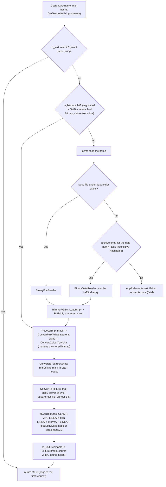

# 25 — Textures and assets

> Part C · Baseline build: Release|Win32 (OpenGL) + TARGET_PC_FULLGAME ([B:FULL]); see _work/build_matrix.md.
> Evidence: [C] confirmed · [I] inferred · [U] unknown. Citations are `path:Symbol` relative to the multiwinia/ source root.
> Sources merged: P12_render_core (decoder, upload, resource manager), X1b_asset_formats (asset-format surveys), X2a_asset_catalogue_visual (visual catalogue), X2b_asset_catalogue_audio (audio catalogue). The labels P12, X1b, X2a and X2b in "Resolved:" notes name these analysis drafts (P14 is the platform/build draft P14_platform_lib); they only record which earlier statement was corrected and are never the evidence for a claim — every claim cites code or data.
> Generated: the per-file tables of §1.2, §2.6, §2.8, §2.15, §3–§6 and the Source map were computed from the source tree by the method of §1.5 (provenance: `_work/scripts/S_25_catalogue.py` and its hand-written template `_work/script_inputs/S_25_template.md`). Every file under `data/textures`, `data/sprites`, `data/shapes`, `data/animations`, `data/terrain`, `data/shaders`, `data/icons`, `data/thumbnails`, `data/mwhelp`, `data/sepulveda`, `data/sounds` and `data/mwsounds` (2131 files) appears in this document with its `data/...` path (0 missing at generation time).

## Contents

- [1 Asset overview](#1-asset-overview)
  - [1.1 Scope, asset classes and how to read this document](#11-scope-asset-classes-and-how-to-read-this-document)
  - [1.2 Statistics by directory and status](#12-statistics-by-directory-and-status)
  - [1.3 Status vocabulary and evidence rules](#13-status-vocabulary-and-evidence-rules)
  - [1.4 Key findings](#14-key-findings)
  - [1.5 How the per-file catalogue was computed](#15-how-the-per-file-catalogue-was-computed)
- [2 Loading pipeline, resource manager, runtime textures and fonts](#2-loading-pipeline-resource-manager-runtime-textures-and-fonts)
  - [2.1 Pipeline overview](#21-pipeline-overview)
  - [2.2 Bitmap decoding (`BitmapRGBA::LoadBmp`) — supported BMP variants](#22-bitmap-decoding-bitmaprgbaloadbmp--supported-bmp-variants)
  - [2.3 Pixel operations (used by the resource system and by gameplay code to build run-time textures)](#23-pixel-operations-used-by-the-resource-system-and-by-gameplay-code-to-build-run-time-textures)
  - [2.4 Colour keying and alpha derivation](#24-colour-keying-and-alpha-derivation)
  - [2.5 Texture upload (`BitmapRGBA::ConvertToTexture`)](#25-texture-upload-bitmaprgbaconverttotexture)
  - [2.6 Texture cache, load flags and the cache-ignores-flags hazard](#26-texture-cache-load-flags-and-the-cache-ignores-flags-hazard)
  - [2.7 Mip-map, wrap and filter selection per load site](#27-mip-map-wrap-and-filter-selection-per-load-site)
  - [2.8 Power-of-two handling](#28-power-of-two-handling)
  - [2.9 Resource manager: look-up order and archives](#29-resource-manager-look-up-order-and-archives)
  - [2.10 Caches and their keys](#210-caches-and-their-keys)
  - [2.11 Shapes cache and display lists](#211-shapes-cache-and-display-lists)
  - [2.12 Context loss, regeneration and the absence of hot reload](#212-context-loss-regeneration-and-the-absence-of-hot-reload)
  - [2.13 Runtime-generated textures and registered bitmaps](#213-runtime-generated-textures-and-registered-bitmaps)
  - [2.14 Direct3D texture wrapper [B:D3D]](#214-direct3d-texture-wrapper-bd3d)
  - [2.15 Fonts and atlases](#215-fonts-and-atlases)
- [3 Per-file catalogue — bitmaps, animation scripts and shaders](#3-per-file-catalogue--bitmaps-animation-scripts-and-shaders)
  - [3.0 Column legend](#30-column-legend)
  - [3.1 `data/textures` (excluding font atlases)](#31-datatextures-excluding-font-atlases)
  - [3.2 `data/textures/unicode` (font atlases)](#32-datatexturesunicode-font-atlases)
  - [3.3 `data/sprites`](#33-datasprites)
  - [3.4 `data/animations` (bitmaps and .anim panel scripts)](#34-dataanimations-bitmaps-and-anim-panel-scripts)
  - [3.5 `data/terrain` (colour ramps, water tiles and wave tables)](#35-dataterrain-colour-ramps-water-tiles-and-wave-tables)
  - [3.6 `data/icons`](#36-dataicons)
  - [3.7 `data/thumbnails`](#37-datathumbnails)
  - [3.8 `data/mwhelp` (help images)](#38-datamwhelp-help-images)
  - [3.9 `data/sepulveda`](#39-datasepulveda)
  - [3.10 `data/shaders` (HLSL, Direct3D build only)](#310-datashaders-hlsl-direct3d-build-only)
  - [3.11 Animation panel scripts (.anim)](#311-animation-panel-scripts-anim)
- [4 Shape catalogue](#4-shape-catalogue)
  - [4.1 Conventions and statistics](#41-conventions-and-statistics)
  - [4.2 Per-file table](#42-per-file-table)
  - [4.3 Hierarchies and markers (every .shp)](#43-hierarchies-and-markers-every-shp)
  - [4.4 Marker vocabulary](#44-marker-vocabulary)
  - [4.5 Anomalies](#45-anomalies)
  - [4.6 Synthetic shape keys and level-placed meshes](#46-synthetic-shape-keys-and-level-placed-meshes)
  - [4.7 .max authoring sources](#47-max-authoring-sources)
- [5 Audio sample catalogue](#5-audio-sample-catalogue)
  - [5.1 Audio assets in the pipeline](#51-audio-assets-in-the-pipeline)
  - [5.2 Statistics](#52-statistics)
  - [5.3 `data/sounds`](#53-datasounds)
  - [5.4 `data/mwsounds`](#54-datamwsounds)
- [6 Missing names and unused assets](#6-missing-names-and-unused-assets)
  - [6.1 Names requested by code or data that have no file](#61-names-requested-by-code-or-data-that-have-no-file)
  - [6.2 Assets referenced in FULL but consumed only by unplaced buildings](#62-assets-referenced-in-full-but-consumed-only-by-unplaced-buildings)
  - [6.3 Unused and non-baseline assets](#63-unused-and-non-baseline-assets)
  - [6.4 Cross-check with `tools/FindUnusedResources.sh`](#64-cross-check-with-toolsfindunusedresourcessh)
- [7 Usage conventions and asset-replacement plan](#7-usage-conventions-and-asset-replacement-plan)
  - [7.1 Texture usage conventions (what an artist and the engine must reproduce)](#71-texture-usage-conventions-what-an-artist-and-the-engine-must-reproduce)
  - [7.2 Naming and look-up conventions a replacement pipeline must honour (or deliberately replace)](#72-naming-and-look-up-conventions-a-replacement-pipeline-must-honour-or-deliberately-replace)
  - [7.3 Asset-replacement plan (all art and audio is Introversion IP)](#73-asset-replacement-plan-all-art-and-audio-is-introversion-ip)
  - [7.4 Recommendations for the new engine (Windows, C++23, DirectX 12)](#74-recommendations-for-the-new-engine-windows-c23-directx-12)
- [Open questions and unknowns](#open-questions-and-unknowns)
- [Docs-vs-code discrepancies](#docs-vs-code-discrepancies)
- [IP items](#ip-items)
- [Source map](#source-map)
- [Appendix — dead/legacy code](#appendix--deadlegacy-code)

## 1 Asset overview

### 1.1 Scope, asset classes and how to read this document

Every image, mesh, panel animation, shader and sound sample that the Multiwinia executable can load lives under `data/` as a loose file in the development tree and is packed into RAR `.dat` archives for release (§2.9). There is **no asset metadata**: no sidecar files, no import settings, no per-asset sampler state. Everything a renderer needs to know about an image (mip-maps, colour key, alpha source, wrap, filter, blend) is decided by the code that requests and draws it, which is why the per-file tables in §3 list the requesting call sites [C] `code/lib/resource.cpp:Resource::GetTextureWithFlags`.

| Asset class | Directory | Files | On-disk format | Loader (code site) | GPU resource |
|---|---|---|---|---|---|
| World and UI textures, logos, VFX strips | `data/textures` | 56 | BMP 4/8/24/32-bit (one RLE8) | `code/lib/resource.cpp:Resource::GetTexture` → `code/lib/bitmap.cpp:BitmapRGBA::LoadBmp` | RGBA8 2-D texture |
| Font atlases | `data/textures/unicode` | 138 | BMP 4/8/24-bit, 16 glyph columns | `code/lib/text_renderer.cpp:TextRenderer::BuildUnicodeArray` | RGBA8 texture (mip-mapped, magenta-keyed) |
| Unit sprites | `data/sprites` | 17 | BMP 24/32-bit | `GetTexture` (draw sites in `code/worldobject/*`, `code/team.cpp`) | RGBA8 texture |
| Animated help panels | `data/animations` | 6 `.anim` + 25 BMP | text key-frame script + BMP | `code/animatedpanel.cpp:AnimatedPanel` reader, `code/animatedpanel_renderer.cpp:AnimatedPanelRenderer` (`GetBitmap` + `GetTexture`) | RGBA8 texture per image |
| Terrain colour ramps, water tiles, wave tables | `data/terrain` | 36 | BMP 8/24-bit | `GetBitmap` (CPU look-up) for `landscape_*`/`waves_*`; `GetTexture` for `water_*` | water only |
| Icons (HUD, cursors, markers, crates, flags, controller glyphs) | `data/icons` | 121 BMP + 1 `.psp` | BMP 4/8/24/32-bit | `GetTexture` / `GetTextureWithAlpha` / `GetBinaryReader` + `AddBitmap` | RGBA8 texture |
| Map thumbnails | `data/thumbnails` | 57 | BMP 400×300 8/24-bit | `code/UI/MapImageButton.h:MapImageButton::Render` | RGBA8 texture, no mip-maps |
| Help images | `data/mwhelp` | 51 | BMP 24/32-bit | help windows, `MultiwiniaHelp`, game-type buttons | RGBA8 texture |
| Advisor portrait frames | `data/sepulveda` | 5 | BMP 8-bit 256×256 | `code/clouds.cpp:Clouds::RenderFace` (cheat builds only) | RGBA8 texture |
| HLSL shaders | `data/shaders` | 14 | HLSL text (`vs_main`/`ps_main`) + 1 include | `code/lib/FixedPipeline.cpp:FixedPipeline::FixedPipeline`, `code/deform.cpp:DeformEffect::DeformEffect`, `code/water_reflection.cpp:WaterReflectionEffect::WaterReflectionEffect` | D3D9 shaders [B:D3D] |
| Meshes | `data/shapes` | 139 `.shp` | text hierarchical flat-shaded mesh | `code/lib/resource.cpp:Resource::GetShape`, `GetShapeCopy` → `code/lib/shape.cpp:Shape::Load` | display list per shape |
| Mesh authoring sources | `data/shapes/source` | 133 `.max` | 3ds Max scene | none (never read) | — |
| Sound samples | `data/sounds`, `data/mwsounds` | 954 + 378 | Ogg Vorbis I, mono | `code/sound/sample_cache.cpp:CachedSample::CachedSample` → `code/lib/resource.cpp:Resource::GetSoundStreamDecoder` | PCM in the sample cache ([27](27_audio_engine.md)) |

Formal byte-level grammars of every format are in [29](29_data_formats_reference.md); rendering of textures and shapes in [24](24_rendering.md); panel animation playback in [26](26_animation_and_vfx.md); sound events in [10](10_audio_design.md) and the audio engine in [27](27_audio_engine.md); archive building in [31 §8](31_platform_build_and_tools.md#8-data-build-pipeline-and-the-dat-archives).

### 1.2 Statistics by directory and status

Counts are files on disk (generated). Status columns are mutually exclusive and use the vocabulary of §1.3; "Not packed" = no archive receives the file in the retail all-language data build (§2.9).

| Directory | Files | Bytes | Bit depths | POT / NPOT | 32-bit with alpha | Magenta-key files | FULL | LEGACY only | D3D only | DEBUG only | EDITOR only | Unused (dead refs) | Unused (never named) | Authoring source | Not packed |
|---|---|---|---|---|---|---|---|---|---|---|---|---|---|---|---|
| `data/textures` | 56 | 5098316 | 4-bit ×3, 8-bit ×27, 24-bit ×21, 32-bit ×5 | 33 / 23 | 5 | 5 | 28 | 2 | 3 | 0 | 0 | 6 | 17 | 0 | 17 |
| `data/textures/unicode` | 138 | 23394332 | 4-bit ×44, 8-bit ×4, 24-bit ×90 | 135 / 3 | 0 | 0 | 138 | 0 | 0 | 0 | 0 | 0 | 0 | 0 | 3 |
| `data/sprites` | 17 | 514974 | 24-bit ×16, 32-bit ×1 | 17 / 0 | 1 | 9 | 15 | 0 | 0 | 1 | 0 | 0 | 1 | 0 | 0 |
| `data/animations` | 31 | 3854895 | 24-bit ×6, 32-bit ×19 | 14 / 11 | 19 | 2 | 31 | 0 | 0 | 0 | 0 | 0 | 0 | 0 | 0 |
| `data/terrain` | 36 | 462240 | 8-bit ×4, 24-bit ×32 | 27 / 9 | 0 | 0 | 26 | 0 | 0 | 0 | 0 | 4 | 6 | 0 | 0 |
| `data/icons` | 122 | 3806298 | 4-bit ×11, 8-bit ×25, 24-bit ×64, 32-bit ×21 | 94 / 27 | 21 | 0 | 95 | 15 | 0 | 1 | 0 | 4 | 6 | 1 | 1 |
| `data/thumbnails` | 57 | 7857058 | 8-bit ×53, 24-bit ×4 | 0 / 57 | 0 | 0 | 50 | 1 | 0 | 3 | 0 | 0 | 3 | 0 | 5 |
| `data/mwhelp` | 51 | 7423768 | 24-bit ×48, 32-bit ×3 | 2 / 49 | 3 | 0 | 47 | 2 | 0 | 0 | 0 | 0 | 2 | 0 | 1 |
| `data/sepulveda` | 5 | 333080 | 8-bit ×5 | 5 / 0 | 0 | 0 | 0 | 0 | 0 | 5 | 0 | 0 | 0 | 0 | 0 |
| `data/shaders` | 14 | 7936 | n/a | n/a | 0 | 0 | 0 | 0 | 14 | 0 | 0 | 0 | 0 | 0 | 0 |
| `data/shapes` | 139 | 6425808 | n/a | n/a | 0 | 0 | 116 | 1 | 0 | 0 | 1 | 2 | 19 | 0 | 0 |
| `data/shapes/source` | 133 | 12237824 | n/a | n/a | 0 | 0 | 0 | 0 | 0 | 0 | 0 | 0 | 0 | 133 | 133 |
| **visual total** | 799 | 71416529 | | | | | 546 | 21 | 17 | 10 | 1 | 16 | 54 | 134 | 160 |

Audio (generated, §1.5; status vocabulary in §5.2):

| Folder | Files | Total duration s | Bytes | Channels | Rates | Live | Dead (bound to never-fired events) | Unused (no binding) | menusounds.dat | sounds.dat | sounds2.dat | Not shipped |
|---|---|---|---|---|---|---|---|---|---|---|---|---|
| `data/sounds` | 954 | 4165.7 | 34323117 | mono ×954 | 22050 Hz ×1, 44100 Hz ×953 | 643 | 238 | 73 | 8 | 935 | 0 | 11 |
| `data/mwsounds` | 378 | 1471.0 | 23144494 | mono ×378 | 22050 Hz ×1, 44100 Hz ×377 | 255 | 4 | 119 | 10 | 362 | 6 | 0 |

Resolved: the X2a draft said "667 BMP bitmaps … all 667 have a 40-byte header"; the tree holds **506** `.bmp` files in these directories (194 + 17 + 25 + 36 + 121 + 57 + 51 + 5) [C] `find`, as [31 §8.7](31_platform_build_and_tools.md#87-the-archives--names-contents-load-order-override-rules); all 506 have a 40-byte `BITMAPINFOHEADER`.

### 1.3 Status vocabulary and evidence rules

| Status | Meaning | How decided [C] |
|---|---|---|
| referenced [B:FULL] | at least one confirmed reference from code compiled into the baseline and reachable in a Multiwinia session (including loads made once at start-up, e.g. the `SphereWorld` meshes and the `TaskManagerInterfaceIcons` pre-load, below), or from a data file the baseline loads (live `data/levels/mp_*` maps, the six `.anim` files) | every `.cpp/.h/.inc` under `code/` and `contrib/eclipse/` lexed into strings, comments and `#if` stacks per configuration, with vcproj membership; `"…" TEXTURE_EXTENSION` folded into `….bmp`; run-time-built names resolved by the rules below (§1.5) |
| referenced [B:LEGACY] only | compiled into FULL but unreachable in a Multiwinia match (single-player task managers, ShamanInterface, ControlHelpSystem, Darwinia world map rendering, Darwinia cut-scene logo, prologue/campaign mode pictures, the `thumbnails/default.bmp` fallback) | reachability overrides verified by grep (table below) |
| referenced [B:D3D] only | only the Direct3D configuration loads it (all shaders, the three deform tables) | `#ifdef USE_DIRECT3D` around the load site |
| referenced [B:DEBUG] only | only `TARGET_DEBUG` builds reach it (cheat window, sound editor, crate help window, TankBattle thumbnails) | `CHEATMENU_ENABLED`, `SOUND_EDITOR`, `INCLUDE_CRATE_HELP_WINDOW`, `INCLUDEGAMEMODE_TANKBATTLE` |
| referenced [B:EDITOR] only | only `LOCATION_EDITOR` builds (`data/shapes/camera.shp`) | `#ifdef LOCATION_EDITOR` |
| unused (named only in dead/commented code or never-loaded data) [B:DEAD] | every mention is in non-compiled code, commented-out code, `data/levels/old/` or a Darwinia script | as above |
| unused (never named) | no string, rule or data reference at all, or only a coincidental bare word (reviewed by hand) | — |
| unused (authoring source, never read) | `.max` and `.psp` files | no loader exists |

Run-time-built names were resolved by these rules (each tied to the code that formats the name) [C]:

| Rule | Name pattern | Site(s) | Value set (source) |
|---|---|---|---|
| research icon | `icons/icon_<name>.bmp` | `code/taskmanager_interface_multiwinia.cpp:TaskManagerInterfaceMultiwinia::TaskManagerInterfaceMultiwinia` (pre-load), `RenderRecentRunTask`, `RenderRunningTasks`; `code/markersystem.cpp:MarkerSystem::Render`; `code/gamecursor.cpp:GameCursor::RenderSelectedTaskIcon`; `code/taskmanager_interface_icons.cpp`, `code/taskmanager_interface_gestures.cpp` (legacy) | the 29 names of `code/global_world.cpp:GlobalResearch::GetTypeName` (`Task::GetTaskName` delegates to it): Darwinian, Officer, Squad, Laser, Grenade, Rocket, Controller, AirStrike, Armour, TaskManager, Engineer, Harvester, Nuke, Subversion, PersonalShield, HotFeet, GunTurret, Shaman, Infection, MagicalForest, DarkForest, AntNest, Plague, Egg, MeteorShower, FireExtinguisher, Rage, Tank, DropShip |
| research gesture | `icons/gesture_<name>.bmp` | same task-manager constructors; `code/interface/gesture_window.cpp` (dead: `GESTURE_EDITOR && USE_SEPULVEDA_HELP_TUTORIAL`) | same 29 names (8 files exist) |
| crate icon | `icons/icon_<crate>.bmp` | `code/interface/helpandoptions_windows.cpp:CrateButton::CrateButton` (only via `INCLUDE_CRATE_HELP_WINDOW`, debug) | `code/worldobject/crate.cpp:Crate::GetName` |
| icon stem | `icons/<stem>.bmp` | stems passed to `code/control_help.cpp:ControlHelpSystem::RenderControlHelp` / `RenderControlHelpDPad` and `code/multiwiniahelp.cpp:MultiwiniaHelp::RenderControlHelp` | literal stems at the call sites |
| mode image | `mwhelp/mode_<blueprint>.bmp` (lower-cased) | `code/UI/GameMenuWindow.cpp:GameMenuWindow::SetupGameSelectPage`, `SetupSPDemoPage` (pre-load loops); `code/UI/GameTypeImageButton.h:GameTypeImageButton::Render` | `GAMETYPE` names in `data/multiwinia.txt`: Domination, KingOfTheHill, CaptureTheStatue, Assault, RocketRiot, Blitzkrieg, TankBattle |
| general help page | `mwhelp/general
.bmp` | `code/interface/helpandoptions_windows.cpp:GeneralHelpWindow::Create` | p = 1…5 (`MAX_PAGES`) |
| game-type help page | `mwhelp/help_<t>_
.bmp` | `code/interface/helpandoptions_windows.cpp:GameTypeHelpWindow::Create` | (t,p) for which the phrase `multiwinia_helppage_<t+1>_
` exists in `data/language/english.txt`: (0,1), (1,1–2), (2,1–3), (3,1–3), (4,1–4), (5,1–3) |
| map thumbnail | `thumbnails/<level stem>.bmp` lower-cased | `code/UI/MapImageButton.h:MapImageButton::Render`, `code/UI/GameMenuWindow.cpp:GameMenuWindow::PreloadThumbnails` | every `data/levels/mp_*` file listed by `code/game_menu.cpp:GameMenu::CreateMapList` whose `GameTypes` names a permitted blueprint; TankBattle maps → [B:DEBUG] (`code/app.cpp:App::IsGameModePermitted`); `data/levels/old/` is never listed |
| terrain | `terrain/<landColourFile / wavesColourFile / waterColourFile>` | `code/landscape_renderer.cpp:LandscapeRenderer::LandscapeRenderer`, `code/water.cpp:Water::Water`, `Water::RenderFlatWater`, `code/mapfile.cpp:MapFile::SaveTextures` | level keys (`code/level_file.cpp:LevelFile::ParseLandscapeData`), defaults `landscape_default.bmp` / `waves_default.bmp` / `water_default.bmp` (`LevelFile::LevelFile`), Christmas overrides `landscape_icecaps.bmp` / `waves_earth.bmp` / `water_icecaps.bmp` |
| animation image | `animations/<IMAGENAME>` | `code/animatedpanel_renderer.cpp:AnimatedPanelRenderer` | `IMAGENAME` values of the six `.anim` files, loaded by `code/multiwiniahelp.cpp:MultiwiniaHelp::InitialiseAnimatedPanel` (one per game type) |
| font atlas | `textures/unicode/.<lo>.<hi>.bmp` | `code/lib/text_renderer.cpp:TextRenderer::BuildUnicodeArray` (`ListResources("textures/unicode/", ".*.*.bmp")`) | fonts `speccy`, `editor`, `square` (`code/app.cpp:App::SetLanguage`) |
| cloud face | `sepulveda/sepulveda<n>.bmp` | `code/clouds.cpp:Clouds::RenderFace` | n = 1–3 random, 4 eyes shut, 5 mouth open |
| hurt Darwinian | `sprites/darwinian_ouch<n>.bmp` | `code/worldobject/darwinian.cpp:Darwinian::Render` | n = 1 + uid % 10 when uid % 10 < 3 (dead, airborne) → 1–3; `darwinian_ouch4.bmp` is a literal |
| army-ant shape | `armyant<n>.shp` | `code/worldobject/armyant.cpp:ArmyAnt::SetShape` | n = 2, 3 |
| HLSL include | `shaders/globals.h` | `code/lib/shader.cpp` (`MyD3DXInclude::Open`) | `#include "globals.h"` in the three `deform*.ps` files |
| level shapes | `shapes/<name>.shp` | `code/worldobject/staticshape.cpp:StaticShape` | `StaticShape` lines of loaded levels |

Reachability overrides (compiled into FULL, not reachable in a Multiwinia match) [C]:

| Code | Tag | Reason |
|---|---|---|
| `code/taskmanager_interface_icons.cpp`, `code/taskmanager_interface_gestures.cpp` | LEGACY | `code/taskmanager_interface.cpp:TaskManagerInterface::CreateTaskManager` creates `TaskManagerInterfaceMultiwinia` whenever `App::Multiplayer()`; the gesture interface only for single-player keyboard `ControlMethod` 0, the icon interface otherwise. Exception: `TaskManagerInterfaceIcons::TaskManagerInterfaceIcons` runs once at start-up (game mode None, `code/app.cpp:App::Initialise`) and pre-loads four textures — counted as FULL |
| `code/shaman_interface.cpp` | LEGACY | shown only from `TaskManagerInterfaceIcons` |
| `code/control_help.cpp` | LEGACY | `ControlHelpSystem::Render` returns immediately when `App::Multiplayer()`; `RenderHelp` also requires `App::IsSinglePlayer()` |
| `code/global_world.cpp` render code, `code/global_internet.cpp` | LEGACY | Darwinia world map (`Renderer` branch `m_locationId == -1`, [24 §3.3](24_rendering.md#33-branches-that-replace-passes-313)). Exception: `code/global_world.cpp:SphereWorld::SphereWorld` runs at every start-up (`code/app.cpp:App::Initialise` → `new GlobalWorld` → `GlobalWorld::GlobalWorld` → `new SphereWorld`) and loads `globalworld_outer.shp`, `globalworld_middle.shp`, `globalworld_inner.shp` with `GetShape`, which release-asserts on a missing file (`code/lib/resource.cpp:Resource::GetShapeCopy`) — counted as FULL (load only; never drawn in a match) |
| `code/UI/MapImageButton.h:MapImageButton::Render` `thumbnails/default.bmp` fallback | LEGACY | a map whose thumbnail does not exist (`DoesTextureExist` false) is drawn without one; the fallback request runs only if `GetTexture` of an existing thumbnail returns −1, but `code/lib/resource.cpp:Resource::GetTextureWithFlags` release-asserts instead of returning −1 |
| `code/loaders/credits_loader.cpp:CreditsLoader` | LEGACY | compiled into FULL (outside `USE_LOADERS`), created only by `code/camera.cpp:Camera::AdvanceSphereWorldOutroMode` (Darwinia outro) and `code/script.cpp:Script::RunCommand_RunCredits` (cut-scene command) |
| `code/multiwiniahelp.cpp:MultiwiniaHelp::RenderControlHelp` (no-argument overload), `RenderBasicControlHelp`, `RenderCurrentUnitHelp`, `RenderCurrentTaskHelp` | LEGACY | no live caller (the two task-manager calls are commented out) |
| `code/renderer.cpp:Renderer::RenderFrame` Darwin-logo block | LEGACY | `m_renderDarwinLogo` is set only by a script command (`code/script.cpp`) used by Darwinia cut-scenes |
| `code/renderer.cpp:Renderer::RenderFlatTexture` | LEGACY | its only call is commented out |
| `code/renderer.cpp:Renderer::RenderLogo` | DEAD in practice | its only call is inside `#ifdef PROMOTIONAL_BUILD` (never defined) |
| `code/UI/HelpImageButton.h`, `code/UI/NextHelpButton.h`, `code/UI/PrevHelpButton.h` | LEGACY | `GameMenuWindow` `PageHelp` has no live entry (`HelpModeButton` never instantiated, [28](28_ui_framework.md)) |
| `code/multiwiniahelp.cpp:MultiwiniaHelp::LoadIcons` `HelpDarwinians` tab icon | LEGACY | the tab's "appropriate" test is hard-coded false ([30](30_scripting_tutorial_and_cutscenes.md)) |
| `code/UI/GameTypeImageButton.h` prologue/campaign branch | LEGACY | `GAMETYPE_PROLOGUE`/`CAMPAIGN` highlighted only from `PageDarwinia` |
| `code/clouds.cpp:Clouds::RenderFace` | DEBUG | `m_faceTime` is set only by `Clouds::ShowDrSFace`, called only from `code/interface/cheat_window.cpp` (body under `CHEATMENU_ENABLED`, defined only for `TARGET_DEBUG`). Resolved: X1b called the `sepulveda/*` images "dead/legacy"; they are cheat-build only [B:DEBUG] [C] |
| `code/interface/gesture_window.cpp` | DEBUG/DEAD | created only by `code/interface/debugmenu.cpp`; body under `GESTURE_EDITOR && USE_SEPULVEDA_HELP_TUTORIAL` |
| `code/interface/helpandoptions_windows.cpp:CrateButton`, `CrateHelpWindow` | DEBUG | reachable only through `CrateHelpWindowButton` (`#ifdef INCLUDE_CRATE_HELP_WINDOW`) |

"Referenced [B:FULL]" means compiled and callable in a Multiwinia session, not necessarily seen: 51 of the FULL assets are consumed only by building classes that no live Multiwinia map places (§6.2) [C counts of building types placed by the live `data/levels/mp_*` files, §1.5].

### 1.4 Key findings

- **One decoder, one format.** Every image is an uncompressed Windows BMP decoded on the CPU into RGBA8 and uploaded as an RGBA8 texture; there is no texture compression, no sRGB, no anisotropy and no LOD bias anywhere [C] `code/lib/bitmap.cpp:BitmapRGBA::ConvertToTexture`, grep. `data/textures/shaman_background.bmp` is RLE8 and **cannot be decoded** (garbage in release); it is used only by the legacy ShamanInterface [C].
- **Processing is chosen by the first caller.** The texture cache is keyed by the name string only, so the first request for a name fixes mip-mapping, colour keying and green→alpha conversion for the whole session; 36 textures are requested with conflicting flags by their reachable call sites, of which `data/icons/marker_colour.bmp` (green→alpha vs RGB) and the no-mip `textures/laser.bmp`/`textures/clouds.bmp` requests matter (§2.6) [C].
- **Three transparency mechanisms** coexist (magenta colour key by default, green-as-alpha masks, true 32-bit alpha) plus additive blending of art painted on black (§2.4) [C].
- **NPOT is common** (all thumbnails, most help images, many icons); images are rescaled **up** to the next power of two at upload whenever power-of-two textures are required — always in the D3D build (§2.8) [C].
- **Loose files override archives; archive look-ups are case-insensitive; nothing is encrypted** (§2.9) [C].
- **No missing-file crash is reachable in FULL.** Resolved: the X2a draft treated the unguarded `GetTexture("icons/compass_empty.bmp")` in `code/markersystem.cpp:MarkerSystem::RenderCompass` as a live fatal path; the branch requires a direction of exactly (0,0), but every caller passes a vector produced by `code/lib/vector2.cpp:Vector2::Normalise`, which maps a zero vector to (0,1), or the on-screen constant (0,−1) — the request can never be made [C] (§6.1).
- **Packaging differs from the tree:** 160 visual files are packed in no archive (133 `.max`, legacy fonts, platform/distributor branding, TankBattle/benchmark thumbnails, the cut `mp_cts_3p_3` map and every font atlas no language list names — including all three currency atlases `*.20a0.20af.bmp`, so U+20A0–20AF never renders in a packed build) (§2.9, §2.15) [C].
- **Shapes:** 139 meshes, 441 fragment blocks, 150 820 triangles, 425 markers; two files contain markers only; `data/shapes/carrycube.shp` repeats fragment name `Box04`; `data/shapes/carryweights.shp` (a live Capture-the-Statue mesh) and `data/shapes/sporegenerator.shp` declare more positions than vertices, which overruns the hit-test scratch buffer (§4.5) [C].
- **Audio:** 1332 mono Ogg Vorbis files; 898 can play in FULL, 242 are bound only to events that never fire, 192 are bound to nothing; 11 music/loader files are never shipped (§5) [C].

### 1.5 How the per-file catalogue was computed

Every value in §1.2 and §3–§6 was computed from the files of the source tree (commit `f909630`), not copied from documentation, so the catalogue can be re-derived by re-implementing these rules [C unless a column of §3.0 says [I]]:

| Columns | Method |
|---|---|
| BMP size, bit depth, compression, palette ("n used") | every `.bmp` header parsed exactly as `code/lib/bitmap.cpp:BitmapRGBA::LoadBmp` does (`ReadBMPFileHeader`, `ReadWinBMPInfoHeader` / `ReadOS2BMPInfoHeader`, palette size from `bfOffBits`, §2.2); "n used" = distinct palette indices that occur in the pixel data |
| Alpha usage statistics | pixels decoded to RGBA8 as the loader does; `magenta key` = exact (255,0,255) pixels (alpha 255); `black bg` = share of (0,0,0) pixels; `A8 x% zero, y% partial` = share of 32-bit pixels with alpha 0 and with 0 < alpha < 255 |
| POT upload size | `code/lib/math_utils.cpp:nearestPowerOfTwo` applied to each side (§2.5) |
| Shape columns, hierarchy, markers | every `.shp` parsed with the grammar of `code/lib/shape.cpp:Shape::Load` (fragments, parent names, markers, positions, vertices); triangles counted after the strip conversion of `ShapeFragment::ParseStripBlock` (degenerate triangles dropped, odd triangles reversed) |
| Load sites, flags, build tag | every `.cpp`, `.h` and `.inc` under `code/` and `contrib/eclipse/` lexed into string literals, comments and `#if`/`#ifdef` stacks; `"…" TEXTURE_EXTENSION` folded into `….bmp`; a literal naming a file under `data/` — or a name produced by a rule of §1.3 — is a reference; its build tag comes from its `#if` stack evaluated for each configuration of `code/lib/universal_include.h` and `targets/vs2005/Darwinia.vcproj` membership, then from the reachability overrides of §1.3; flags = the arguments of the `GetTexture*` call (for names held in a variable, read in the calling function) |
| Wrap / filter / blend at draw | GL state set within ±14 source lines of the bind [I per entry] |
| Data references | `StaticShape` and colour-file keys of every file in `data/levels/` (`data/levels/old/` is never listed, so dead), `IMAGENAME` of the six `.anim` files, `~ icon` lines of `data/input/*.txt` |
| Consumer and "MP-map placements" | the class or system of the requesting function; for building classes, the number of live Multiwinia maps (the menu-listed `data/levels/mp_*` files whose `GameTypes` name a permitted mode, so not the TankBattle-only maps) that place the type — level files name types by `code/worldobject/building.cpp:Building::GetTypeName`, e.g. `SpawnPointMaster` for class `MasterSpawnPoint`, `Yard` for `ConstructionYard` |
| Packed | the rules of `tools/build_multiwinia_data.bat`, `tools/listfiles.pl` and `tools/build_language_dat.bat` re-applied to the tree with Windows case-insensitive globbing ([31 §8](31_platform_build_and_tools.md#8-data-build-pipeline-and-the-dat-archives)) |
| Audio columns | Ogg identification and comment headers (channels, rate, nominal bit rate, vendor); duration from the last page's granule position; bindings from the `SAMPLE`/`SOUNDNAME` lines of `data/sounds.txt` (`code/sound/soundsystem.cpp:SoundSystem::LoadBlueprints` rules, §5.1); event liveness from [10](10_audio_design.md) |
| Missing names (§6.1) | every reference whose resolved name has no file under `data/` |

## 2 Loading pipeline, resource manager, runtime textures and fonts

### 2.1 Pipeline overview

[C] `code/lib/resource.cpp:Resource::GetTextureWithFlags`, `Resource::ProcessBmp`, `Resource::GetBinaryReader`, `Resource::GetBitmap`; `code/lib/bitmap.cpp:BitmapRGBA::LoadBmp`, `BitmapRGBA::ConvertToTextureAsync`, `BitmapRGBA::ConvertToTexture`.

### 2.2 Bitmap decoding (`BitmapRGBA::LoadBmp`) — supported BMP variants

In-memory format [C] `code/lib/bitmap.h`, `code/lib/bitmap.cpp`: `RGBAColour` is 4 bytes (r, g, b, a) per pixel; `m_pixels` is contiguous; `m_lines[y]` are row pointers; **row 0 is the bottom row** (BMP order is kept, matching the GL texture origin, so UI code puts `glTexCoord2i(0,1)` at the top-left vertex). `BitmapRGBA::Initialise(reader, type)` asserts `type == "bmp"` (debug only) and always calls `LoadBmp`; `TEXTURE_EXTENSION` is `#define`d as `"bmp"` in every build [C] `code/lib/universal_include.h`. There is no PNG/JPG/DDS/TGA reader.

| Header / field | Loader behaviour [C] `ReadBMPFileHeader`, `ReadWinBMPInfoHeader`, `ReadOS2BMPInfoHeader`, `ReadBMPPalette` |
|---|---|
| `bfType` | must be 19778 (`'BM'`) — debug assert only |
| `bfSize`, reserved | read, ignored |
| `bfOffBits` | **never used for seeking**; only to derive the palette size: `(bfOffBits − 54)/4` entries (Windows, BGRx) or `(bfOffBits − 26)/3` (OS/2, BGR); not clamped to 256 (a larger value overflows the 256-entry stack palette) |
| `biSize` = 40 | Windows `BITMAPINFOHEADER`: width, height, bit count, compression used; planes, size, resolution, `biClrUsed`, `biClrImportant` read and ignored |
| `biSize` = 12 | OS/2 header (16-bit width/height); compression forced 0 |
| `biSize` other (V4 108, V5 124) | `AppDebugAssert(0)`; in release the header stays uninitialised (garbage or crash) |
| height | read into an unsigned loop bound — negative (top-down) heights unsupported |
| `biCompression` | must be `BI_RGB` (0) — debug assert only; RLE4/RLE8/BITFIELDS decode as garbage in release |
| palette entries | alpha forced to 255 |

| Bit depth | Pixel decode | Row padding | Shipped files |
|---|---|---|---|
| 1, 16 | `AppDebugAssert(0)`; pixels left uninitialised in release | — | none |
| 4 | palette index per nibble, **high nibble = left pixel**; odd widths write one pixel past the row | **not consumed** → width must be a multiple of 8 | 58 (all widths multiples of 8) |
| 8 | palette index per byte | **not consumed** → width must be a multiple of 4 | 117 `BI_RGB` (all widths multiples of 4), plus the RLE8 file (118 8-bit files in total) |
| 24 | B, G, R; alpha := 255 | consumed (`(4 − 3w) & 3` bytes) | 281 |
| 32 | B, G, R, A used as-is — the **only** way to ship real alpha | none needed | 49 |

Decoding gap [C]: `data/textures/shaman_background.bmp` (512×512, 8-bit, compression 1 = RLE8) is decoded as raw indices that run past the data (`BinaryDataReader::ReadU8` returns 0xFF at end of data) → corrupt image in release, debug assert in debug. Its only consumer is `code/shaman_interface.cpp:ShamanInterface::RenderBackground` [B:LEGACY]. Resolved: P12 left "whether shipped data contains any RLE or top-down BMP" open (P12-U4); the header survey of all 506 files (§1.5) finds exactly this one RLE file and no top-down, OS/2, V4/V5, mis-padded or palette-gap file [C].

Output paths [C]: `SaveBmp`/`WriteBmp` write 24-bit Windows BMPs at 2835 px/m; `SavePng`/`WritePng` (libpng) write 8-bit RGB with rows flipped to top-down, `Z_BEST_SPEED`, memory level 8, window 15, buffer 8192 — `SavePng` never forwards its `_saveAlpha` argument, so PNGs are always RGB. Used for screenshots (`code/lib/poster_maker.cpp`) and the Vista save thumbnail [B:DEAD].

### 2.3 Pixel operations (used by the resource system and by gameplay code to build run-time textures)

| Operation | Behaviour [C] `code/lib/bitmap.cpp` | Used by |
|---|---|---|
| `ConvertPinkToTransparent` | pixels exactly equal to RGBA (255,0,255,**255**) (`RGBAColour::operator==` compares all four channels, `code/lib/rgb_colour.cpp`) → (128,128,128,0); the grey RGB avoids magenta fringes under bilinear filtering and mip-mapping; a 32-bit magenta pixel with alpha ≠ 255 is not keyed | `Resource::ProcessBmp` (`WithMask`, the default) |
| `ConvertColourToAlpha` | alpha := **green** channel; RGB := (255,255,255) | `Resource::ProcessBmp` (`WithAlpha`) |
| `ConvertToGreyScale` | RGB := (r+g+b)/3 | UI helpers |
| `ConvertToColour(col, threshold)` | pixels whose mean < threshold become `col × (255 − mean)/255` | UI helpers |
| `ConvertColour(old, new)` | pixels within Euclidean RGB distance < 10 of `old` → `new` (alpha kept) | UI helpers |
| `ConvertRedChannel(col)` | pure-red pixels (g = b = 0, r > 0) → `col × r/255` | team tinting of flags/banners (`code/worldobject/flag.cpp:Flag::Render`) |
| `SwapRB` | swap red and blue | capture paths |
| `ApplyBlurFilter(scale)` | separable 5-tap kernel `[2,4,7,4,2] × scale × 0.0526`; horizontal pass into a cleared buffer, then the bitmap is cleared and a vertical pass with weights ×2 splats back; only non-black source pixels contribute; saturating add per channel; debug-asserts 1 ≤ size ≤ 1024 | blurred `shadow_*` copies (scale 10, §2.13) |
| `ApplyDilateFilter` | despite the name, replaces every interior pixel by the **mean of its 8 neighbours** (box blur without centre) | none in FULL |
| `Blit` / `BlitOr` | scaled copy (nearest via `GetPixelClipped`, or bilinear `GetInterpolatedPixel`); `BlitOr` ORs bytes; a negative source height flips vertically | upload rescale, `viriifull` build |
| `DrawLine`, `PutPixel(Clipped)`, `GetPixel(Clipped)` (clipped get returns black), `Clear` | primitives | legacy gesture textures |

### 2.4 Colour keying and alpha derivation

| Mechanism | How it is requested | What the shader sees | Files that actually use it |
|---|---|---|---|
| Magenta colour key | default `GetTexture(name)` (`mask = true`) | exact (255,0,255) → (128,128,128,0); drawn with alpha blending or alpha test | 16 files contain key pixels: `data/sprites/darwinian.bmp`, `darwinian_ouch1–4.bmp`, `brainwaves.bmp`, `santahat.bmp`, `lasertrooper.bmp` (unused), `sound.bmp` (debug); `data/textures/clouds.bmp`, `shapewireframe.bmp`, `dmacrew.bmp`, `program_darwinia.bmp`, `speccy_screen.bmp` (last three dead); `data/animations/darwinian.bmp`, `darwinian_ouch4.bmp`. Every other masked request is a no-op |
| Green channel as alpha | `GetTextureWithAlpha(name)` = `WithAlpha | WithMipmaps` (no mask) | RGB white, A = green; tinted by `glColor` | `data/textures/tree.bmp`, `data/icons/compass_shadow.bmp`, `marker_shadow.bmp`, `marker_colour.bmp` |
| True alpha | 32-bit BGRA file | A as authored, `SRC_ALPHA, ONE_MINUS_SRC_ALPHA` | 49 files (§3 Alpha column: "A8 …") |
| Additive black | art on black, `SRC_ALPHA, ONE` | black adds nothing; alpha from `glColor` | glows, beams, lasers, particles, font atlases (text is additive, [24 §4.22](24_rendering.md#422-text-rendering-and-font-atlases-incl-unicodecjk-c-codelibtext_renderercpp-codeappcppappsetlanguage)) |
| Darken by texel | `SRC_ALPHA, ONE_MINUS_SRC_COLOR` with colour (a,a,a,0) | destination darkened by texel brightness | blurred `shadow_*` copies, `icon_shadow.bmp`, `*_shadow.bmp` button art, text outline pass |
| Alpha test | `GL_ALPHA_TEST GREATER 0.04` (Darwinians) / 0.02 (units) | hard cut-out of keyed pixels | `data/sprites/darwinian*.bmp`, `futurewinian.bmp` |

Hazard [C+I]: `ProcessBmp` converts a bitmap from the bitmap store **in place**. The colour key is idempotent, but green→alpha is not: after a context flush (§2.12) a store-backed bitmap requested `WithAlpha` would be converted a second time (A := G = 255 → opaque white). No current store-backed name is requested `WithAlpha` [C grep of `AddBitmap`/`GetBitmap` names against the four `GetTextureWithAlpha` names], so the hazard is latent.

### 2.5 Texture upload (`BitmapRGBA::ConvertToTexture`)

[C] `code/lib/bitmap.cpp:BitmapRGBA::ConvertToTexture`, `ConvertToTextureAsync`; `code/lib/math_utils.cpp:RequirePowerOfTwoTextures`, `RequireSquareTextures`, `nearestPowerOfTwo`; `code/app.cpp:App::App` (`GL_MAX_TEXTURE_SIZE` → `BitmapRGBA::SetMaxTextureSize`).

1. Constraints. GL build: `requirePowerOfTwo = !GL_ARB_texture_non_power_of_two || pref ManuallyScaleTextures ≠ 0`; `requireSquare = !GL_ARB_texture_rectangle` (extension strings read once and cached in function statics). D3D build: power-of-two always, square never.
2. `maxTextureSize = GL_MAX_TEXTURE_SIZE` (queried right after `Renderer::Initialise`); if it is non-zero `requireScale = true` — the bool is otherwise uninitialised (undefined behaviour if the query returned 0).
3. New size: if either side exceeds the maximum, both are scaled by the smaller of the two ratios (never up). **Then**, if power-of-two is required, `newW = nearestPowerOfTwo(m_width)`, `newH = nearestPowerOfTwo(m_height)` are computed from the **original** size, discarding the max-size down-scale; `nearestPowerOfTwo(x)` returns the smallest power of two ≥ x (always rounds **up**; inputs above 2³¹ clamp). If square is required both become the larger.
4. If the size changed, the image is bilinear-`Blit`ed into a new bitmap and the function recurses.
5. `glGenTextures`, bind, `GL_TEXTURE_WRAP_S/T = GL_CLAMP`, `MAG = GL_LINEAR`, `MIN = GL_LINEAR_MIPMAP_LINEAR` — **for every texture**, including non-mip-mapped uploads; then `gluBuild2DMipmaps(GL_RGBA, …)` when mip-mapping, else `glTexImage2D(level 0, internal format 4, GL_RGBA, GL_UNSIGNED_BYTE)`. Under `USE_DIRECT3D` the `compressed` flag is forwarded to the emulated upload ([24 §1.5](24_rendering.md#15-direct3d-9-path-opengl-api-emulation-layer-bd3d)); no call site passes `compressed = true` [C grep].
6. A non-mip-mapped texture keeps `MIN = LINEAR_MIPMAP_LINEAR` unless the drawing code resets it; GL then treats it as incomplete. Draw sites that request `mip = false` and set no MIN filter: `code/location.cpp:Location::RenderWeapons` and `code/worldobject/weapons.cpp:Laser::Render` (`textures/laser.bmp`) — saved because the start-up pre-load requests that name mip-mapped first (§2.6).
7. `ConvertToTextureAsync`: when called off the main thread (the loading worker that runs `App::Initialise`), the upload is queued as a `Job` on `g_loadingScreen` and the caller waits — all GL calls happen on the main thread [C].
8. `GL_CLAMP` (not `GL_CLAMP_TO_EDGE`): with LINEAR filtering the specification blends the border colour (0,0,0,0) into edge texels; drivers of the period commonly treated it as clamp-to-edge [I]. A D3D12 port should use clamp-to-edge unless edge darkening is reproduced deliberately.

### 2.6 Texture cache, load flags and the cache-ignores-flags hazard

| Flag | Value | Effect in `Resource::ProcessBmp` [C] |
|---|---|---|
| `WithMipmaps` | 0x1 | `gluBuild2DMipmaps` |
| `WithMask` | 0x2 | `ConvertPinkToTransparent` |
| `WithAlpha` | 0x4 | `ConvertColourToAlpha` (green → alpha) |
| `WithCompression` | 0x8 | D3D compressed upload; never requested |

Entry points [C] `code/lib/resource.cpp`: `GetTexture(name, mipMapping = true, masked = true, compressed = false)`; `GetTextureWithAlpha(name)` = `WithAlpha | WithMipmaps`; `GetTextureWithFlags(name, flags)`; `DoesTextureExist(name)` (cache, bitmap store, then file existence — does not load); `GetTextureInfo(name, &w, &h)` (cache only; reports the **source** size, before any rescale — used by the font code); `DeleteTexture(Async)`; `GetBitmap(name)` (bitmap store, else decode the file and **store the decoded bitmap in `m_bitmaps` under the name as given** — used for terrain ramps, animation images, icon size queries and map saving).

Look-up order in `GetTextureWithFlags` [C]: (1) `m_textures`, a `stdext::hash_map<std::string, TextureInfo*>` keyed by the **exact string passed** (case-sensitive; flags not part of the key); (2) `m_bitmaps` (case-insensitive `HashTable`); (3) file (§2.9). Failure → `AppReleaseAssert(false, "Failed to load texture %s")` — fatal. A mutex is taken around the hash look-up/insert only while the loading screen is rendering concurrently (the code notes a possible texture leak in that window).

Consequences:
- **First requester wins**: whichever call reaches a name first decides mip/mask/alpha processing for every later caller until `Resource::FlushOpenGlState`; after a flush the next requester decides again [C].
- **Case variants are separate cache entries**: `textures/triangleOutline.bmp` (the spelling used by `code/landscape_renderer.cpp`, `code/water.cpp`, `code/worldobject/spiritstore.cpp`) and any lower-case spelling would upload the same file twice; all current callers use the same spelling, so only one copy exists [C].
- First requesters at start-up [C] `code/app.cpp:App::Initialise`: `TaskManagerInterface::CreateTaskManager` (game mode None → `TaskManagerInterfaceIcons`, which pre-loads `textures/interface_grey.bmp`, `textures/interface_red.bmp`, `icons/gestureguide.bmp`, `icons/icon_shadow.bmp` with mip, **no mask**), then `code/UI/GameMenuWindow.cpp:GameMenuWindow::PreloadTextures` (default flags) for `icons/button_b.bmp`, `icons/button_lb_shadow.bmp`, `icons/button_rb_shadow.bmp`, `icons/button_lb.bmp`, `icons/button_rb.bmp`, `icons/button_a.bmp`, `textures/interface_blur.bmp`, `sprites/darwinian.bmp`, `mwhelp/gear.bmp`, `textures/laser.bmp`, `textures/clouds.bmp`. When a match starts, `TaskManagerInterfaceMultiwinia::TaskManagerInterfaceMultiwinia` pre-loads every existing `icons/icon_<research>.bmp` and `icons/gesture_<research>.bmp` with mip, no mask.
- Resolved: P12 inferred that `Clouds::RenderBlobby` loads `textures/clouds.bmp` first (non-mip-mapped) and that `textures/laser.bmp` is saved by `Clouds::RenderSky`; the code shows both are first loaded mip-mapped and masked by `GameMenuWindow::PreloadTextures` at start-up [C] `code/app.cpp:App::Initialise` L466, `code/UI/GameMenuWindow.cpp:GameMenuWindow::PreloadTextures`.

Every texture whose reachable call sites request different processing (generated from the flags passed at every reachable call site, §1.5; where the name is held in a variable at the `GetTexture` call, the flags were read in the calling function):

| Texture | Distinct processing requested by its reachable call sites | Magenta pixels in file | Status | Effect of the first-requester rule |
|---|---|---|---|---|
| `data/textures/clouds.bmp` | mip, mask vs no mip, mask | 146 | referenced [B:FULL] | mip chain present or absent; a no-mip draw that leaves MIN = LINEAR_MIPMAP_LINEAR samples an incomplete texture if the no-mip request came first |
| `data/textures/interface_grey.bmp` | mip, no mask vs mip, mask | 0 | referenced [B:FULL] | none visible (file has no magenta pixels) |
| `data/textures/interface_red.bmp` | mip, no mask vs mip, mask | 0 | referenced [B:FULL] | none visible (file has no magenta pixels) |
| `data/textures/laser.bmp` | mip, mask vs no mip, mask | 0 | referenced [B:FULL] | mip chain present or absent; a no-mip draw that leaves MIN = LINEAR_MIPMAP_LINEAR samples an incomplete texture if the no-mip request came first |
| `data/icons/compass.bmp` | mip, mask vs mip, no mask | 0 | referenced [B:FULL] | none visible (file has no magenta pixels) |
| `data/icons/icon_airstrike.bmp` | mip, mask vs mip, no mask | 0 | referenced [B:FULL] | none visible (file has no magenta pixels) |
| `data/icons/icon_antnest.bmp` | mip, mask vs mip, no mask | 0 | referenced [B:FULL] | none visible (file has no magenta pixels) |
| `data/icons/icon_armour.bmp` | mip, no mask vs mip, mask | 0 | referenced [B:FULL] | none visible (file has no magenta pixels) |
| `data/icons/icon_controller.bmp` | mip, no mask vs mip, mask | 0 | referenced [B:FULL] | none visible (file has no magenta pixels) |
| `data/icons/icon_darkforest.bmp` | mip, mask vs mip, no mask | 0 | referenced [B:FULL] | none visible (file has no magenta pixels) |
| `data/icons/icon_darwinian.bmp` | mip, mask vs mip, no mask | 0 | referenced [B:FULL] | none visible (file has no magenta pixels) |
| `data/icons/icon_dropship.bmp` | mip, no mask vs mip, mask | 0 | referenced [B:FULL] | none visible (file has no magenta pixels) |
| `data/icons/icon_egg.bmp` | mip, mask vs mip, no mask | 0 | referenced [B:FULL] | none visible (file has no magenta pixels) |
| `data/icons/icon_engineer.bmp` | mip, mask vs mip, no mask | 0 | referenced [B:FULL] | none visible (file has no magenta pixels) |
| `data/icons/icon_fireextinguisher.bmp` | mip, no mask vs mip, mask | 0 | referenced [B:FULL] | none visible (file has no magenta pixels) |
| `data/icons/icon_grenade.bmp` | mip, no mask vs mip, mask | 0 | referenced [B:FULL] | none visible (file has no magenta pixels) |
| `data/icons/icon_gunturret.bmp` | mip, mask vs mip, no mask | 0 | referenced [B:FULL] | none visible (file has no magenta pixels) |
| `data/icons/icon_harvester.bmp` | mip, no mask vs mip, mask | 0 | referenced [B:FULL] | none visible (file has no magenta pixels) |
| `data/icons/icon_hotfeet.bmp` | mip, mask vs mip, no mask | 0 | referenced [B:FULL] | none visible (file has no magenta pixels) |
| `data/icons/icon_infection.bmp` | mip, mask vs mip, no mask | 0 | referenced [B:FULL] | none visible (file has no magenta pixels) |
| `data/icons/icon_laser.bmp` | mip, no mask vs mip, mask | 0 | referenced [B:FULL] | none visible (file has no magenta pixels) |
| `data/icons/icon_magicalforest.bmp` | mip, mask vs mip, no mask | 0 | referenced [B:FULL] | none visible (file has no magenta pixels) |
| `data/icons/icon_meteorshower.bmp` | mip, mask vs mip, no mask | 0 | referenced [B:FULL] | none visible (file has no magenta pixels) |
| `data/icons/icon_nuke.bmp` | mip, mask vs mip, no mask | 0 | referenced [B:FULL] | none visible (file has no magenta pixels) |
| `data/icons/icon_officer.bmp` | mip, mask vs mip, no mask | 0 | referenced [B:FULL] | none visible (file has no magenta pixels) |
| `data/icons/icon_personalshield.bmp` | mip, mask vs mip, no mask | 0 | referenced [B:FULL] | none visible (file has no magenta pixels) |
| `data/icons/icon_plague.bmp` | mip, mask vs mip, no mask | 0 | referenced [B:FULL] | none visible (file has no magenta pixels) |
| `data/icons/icon_rage.bmp` | mip, mask vs mip, no mask | 0 | referenced [B:FULL] | none visible (file has no magenta pixels) |
| `data/icons/icon_rocket.bmp` | mip, no mask vs mip, mask | 0 | referenced [B:FULL] | none visible (file has no magenta pixels) |
| `data/icons/icon_shadow.bmp` | mip, no mask vs mip, mask | 0 | referenced [B:FULL] | none visible (file has no magenta pixels) |
| `data/icons/icon_shaman.bmp` | mip, no mask vs mip, mask | 0 | referenced [B:FULL] | none visible (file has no magenta pixels) |
| `data/icons/icon_squad.bmp` | mip, no mask vs mip, mask | 0 | referenced [B:FULL] | none visible (file has no magenta pixels) |
| `data/icons/icon_subversion.bmp` | mip, mask vs mip, no mask | 0 | referenced [B:FULL] | none visible (file has no magenta pixels) |
| `data/icons/icon_tank.bmp` | mip, no mask vs mip, mask | 0 | referenced [B:FULL] | none visible (file has no magenta pixels) |
| `data/icons/icon_taskmanager.bmp` | mip, no mask vs mip, mask | 0 | referenced [B:FULL] | none visible (file has no magenta pixels) |
| `data/icons/marker_colour.bmp` | mip, green→A vs mip, mask | 0 | referenced [B:FULL] | visible: alpha mask (white, A = green) vs original RGB art |

Only two outcomes are visible: `data/icons/marker_colour.bmp` becomes a white alpha mask when `MarkerSystem::RenderColourCircle` (pass 16) runs before `TaskManagerInterfaceMultiwinia::RenderRecentRunTask` (pass 23) in the first frame that shows either [I from pass order, [24 §3.2](24_rendering.md#32-ordered-pass-table--one-multiwinia-match-frame-bfull)], and the no-mip draws of `textures/laser.bmp`/`textures/clouds.bmp` would sample an incomplete texture if they ever became the first requester (only after a flush with no front-end frame in between) [I]. A new engine should key the cache by (name, processing) or make processing a property of the asset.

### 2.7 Mip-map, wrap and filter selection per load site

There is no per-asset metadata: every choice is made by the request flags and by GL state the drawing code sets after binding. Defaults written at upload (every texture): wrap CLAMP/CLAMP, MAG LINEAR, MIN LINEAR_MIPMAP_LINEAR; the per-frame default state adds env MODULATE ([24 §2.3](24_rendering.md#23-baseline-gl-state--renderersetopenglstate-start-of-every-frame-c)). The per-file "Wrap / filter at draw" column of §3 lists the overrides found within ±14 lines of each bind (a heuristic window, hence [I] per entry — confirm in the cited function), completed by hand for rule-built names. The overrides by category [C for the functions named]:

| Choice | Assets | Where set |
|---|---|---|
| mip-mapped (default `GetTexture`) | all world-space art: building/unit glows, VFX, sprites, icons drawn in 3-D or scaled HUD, font atlases | every default call |
| **no mip-maps** + MIN/MAG LINEAR at draw | the 50 FULL thumbnails (+3 TankBattle, debug; + the unreachable `thumbnails/default.bmp` fallback), `mwhelp/mode_*`, `mwhelp/general1–5`, `mwhelp/help_*` (16), `textures/mwtitle.bmp`, `textures/prices.bmp`, `textures/multiwinia.bmp` | `code/UI/MapImageButton.h:MapImageButton::Render`, `code/UI/GameMenuWindow.cpp:GameMenuWindow::PreloadThumbnails`, `code/UI/GameTypeImageButton.h:GameTypeImageButton::Render`, `code/UI/ImageButton.cpp:ImageButton::Render`, `code/UI/GameMenuWindow.cpp:GameMenuWindow::Render` (title) |
| no mip-maps, NEAREST | `textures/clouds.bmp` (blobby: MAG LINEAR / MIN NEAREST; flat: NEAREST/NEAREST) | `code/clouds.cpp:Clouds::RenderBlobby`, `Clouds::RenderFlat` |
| no mip-maps, MIN left at default | `textures/laser.bmp` | `code/location.cpp:Location::RenderWeapons`, `code/worldobject/weapons.cpp:Laser::Render` |
| mip-maps, MAG NEAREST (crisp pixels) | `textures/particle.bmp` (particle batches; LINEAR restored after), `sprites/darwinian.bmp` for the giant front-end Darwinian (restored after) | `code/particle_system.cpp:ParticleSystem::Render`, `code/UI/GameMenuWindow.cpp:GameMenuWindow::RenderBigDarwinian` |
| NEAREST both | `textures/interface_divider.bmp` (legacy task managers) | `code/taskmanager_interface_icons.cpp`, `code/taskmanager_interface_gestures.cpp` |
| **REPEAT** wrap (tiled / scrolling UVs) | `textures/clouds.bmp`, `cloudyglow.bmp` (front-end fill boxes), `fuel.bmp`, `interface_blur.bmp`, `interface_grey.bmp`, `interface_red.bmp`, `laser-long.bmp`, `laser.bmp` (sky grid), `laserfence.bmp`, `laserfence2.bmp`, `menuhighlight.bmp`, `radarsignal.bmp`, `triangleoutline.bmp` (landscape overlay), all `terrain/water_*.bmp`, `icons/mwlogo.bmp`, `icons/thickarrow.bmp` | the drawing functions listed per asset in §3 (`LandscapeRenderer::RenderOverlaySlow`, `Water::RenderFlatWater`, `LaserFence::RenderAlphas`, `RadarDish::RenderSignal`, `DrawFillBox`, `RenderHighlightBeam`); the functions inspected restore CLAMP afterwards (e.g. `code/team.cpp:Team::RenderVirii`) [I for the rest] |
| env DECAL | `textures/shapewireframe.bmp` on explosion debris | `code/explosion.cpp:ExplosionManager::Render` |
| env COMBINE_EXT, RGB REPLACE | `textures/laserfence.bmp` + `radarsignal.bmp` signal beams (two-texture) | `code/worldobject/radardish.cpp:RadarDish::RenderSignal`, `code/worldobject/feedingtube.cpp:FeedingTube::RenderSignal` |
| multitexture | `terrain/water_*.bmp` on unit 0 (REPEAT, LINEAR / LINEAR_MIPMAP_LINEAR, MODULATE) × `water_lightmap` on unit 1 (COMBINE_EXT, RGB MODULATE) | `code/water.cpp:Water::RenderFlatWater` |
| unmasked (`mask = false`) | `textures/triangleoutline.bmp`, `interface_grey/red.bmp`, `icons/compass.bmp` (task manager), `gestureguide.bmp`, `icon_shadow.bmp`, research icons (pre-load), all thumbnails, `mwhelp/mode_*`, `sepulveda/*` (current frame), `textures/deform*.bmp` | call arguments |
| green → alpha | `textures/tree.bmp`, `icons/compass_shadow.bmp`, `marker_shadow.bmp`, `marker_colour.bmp` | `GetTextureWithAlpha` |
| D3D sampler state set explicitly | deform tables: LINEAR, U WRAP / V CLAMP | `code/deform.cpp:DeformEffect` [B:D3D] |

Anisotropic filtering, texture compression, sRGB and LOD bias are never used [C grep: no `GL_TEXTURE_MAX_ANISOTROPY`, no compressed request].

### 2.8 Power-of-two handling

Images are stored at their authored size; when power-of-two textures are required (§2.5: always under D3D; under GL only without `GL_ARB_texture_non_power_of_two` or with `ManuallyScaleTextures`) each NPOT image is bilinear-resampled **up** to the next power of two on both axes and uploaded at that size; texture coordinates are not changed, so the whole image still maps to [0,1]². `GetTextureInfo` keeps reporting the source size. Every NPOT file and its upload size (generated):

| Stored size | Uploaded size when POT is required | Texel ratio | Files | Directories |
|---|---|---|---|---|
| 400×300 | 512×512 | ×2.18 | 59 | `data/mwhelp` 2, `data/thumbnails` 57 |
| 150×150 | 256×256 | ×2.91 | 20 | `data/mwhelp` 20 |
| 200×200 | 256×256 | ×1.64 | 17 | `data/mwhelp` 17 |
| 50×50 | 64×64 | ×1.64 | 16 | `data/icons` 16 |
| 256×224 | 256×256 | ×1.14 | 9 | `data/textures` 9 |
| 400×10 | 512×16 | ×2.05 | 9 | `data/terrain` 9 |
| 300×200 | 512×256 | ×2.18 | 7 | `data/mwhelp` 7 |
| 300×40 | 512×64 | ×2.73 | 3 | `data/textures` 3 |
| 512×448 | 512×512 | ×1.14 | 3 | `data/textures/unicode` 3 |
| 100×50 | 128×64 | ×1.64 | 3 | `data/icons` 3 |
| 285×216 | 512×256 | ×2.13 | 2 | `data/textures` 2 |
| 512×310 | 512×512 | ×1.65 | 2 | `data/animations` 2 |
| 500×500 | 512×512 | ×1.05 | 1 | `data/textures` 1 |
| 256×208 | 256×256 | ×1.23 | 1 | `data/textures` 1 |
| 12×37 | 16×64 | ×2.31 | 1 | `data/textures` 1 |
| 64×510 | 64×512 | ×1.00 | 1 | `data/textures` 1 |
| 600×600 | 1024×1024 | ×2.91 | 1 | `data/textures` 1 |
| 800×600 | 1024×1024 | ×2.18 | 1 | `data/textures` 1 |
| 394×149 | 512×256 | ×2.23 | 1 | `data/textures` 1 |
| 659×122 | 1024×128 | ×1.63 | 1 | `data/textures` 1 |
| 630×214 | 1024×256 | ×1.94 | 1 | `data/textures` 1 |
| 128×80 | 128×128 | ×1.60 | 1 | `data/animations` 1 |
| 181×256 | 256×256 | ×1.41 | 1 | `data/animations` 1 |
| 50×256 | 64×256 | ×1.28 | 1 | `data/animations` 1 |
| 238×256 | 256×256 | ×1.08 | 1 | `data/animations` 1 |
| 158×256 | 256×256 | ×1.62 | 1 | `data/animations` 1 |
| 260×256 | 512×256 | ×1.97 | 1 | `data/animations` 1 |
| 140×90 | 256×128 | ×2.60 | 1 | `data/animations` 1 |
| 140×110 | 256×128 | ×2.13 | 1 | `data/animations` 1 |
| 207×256 | 256×256 | ×1.24 | 1 | `data/animations` 1 |
| 75×78 | 128×128 | ×2.80 | 1 | `data/icons` 1 |
| 100×64 | 128×64 | ×1.28 | 1 | `data/icons` 1 |
| 20×20 | 32×32 | ×2.56 | 1 | `data/icons` 1 |
| 96×96 | 128×128 | ×1.78 | 1 | `data/icons` 1 |
| 277×194 | 512×256 | ×2.44 | 1 | `data/icons` 1 |
| 250×300 | 256×512 | ×1.75 | 1 | `data/icons` 1 |
| 200×300 | 256×512 | ×2.18 | 1 | `data/icons` 1 |
| 20×110 | 32×128 | ×1.86 | 1 | `data/icons` 1 |
| 600×389 | 1024×512 | ×2.25 | 1 | `data/mwhelp` 1 |
| 426×406 | 512×512 | ×1.52 | 1 | `data/mwhelp` 1 |
| 150×149 | 256×256 | ×2.93 | 1 | `data/mwhelp` 1 |

`data/terrain/waves_*.bmp` (400×10) appear above for completeness but are never uploaded (CPU look-up tables). Resolved: X1b counted "21 NPOT in `textures/`"; the count is 23 including the two `textures/plusmenu/*` images (unused) [C].

### 2.9 Resource manager: look-up order and archives

[C] `code/lib/resource.cpp:Resource::ParseArchive`, `GetTextReader`, `GetBinaryReader`, `GetShapeCopy`, `DoesShapeExist`, `ListResources`, `SoundExists`, `GetSoundStreamDecoder`; `contrib/unrar/unrar.cpp:UncompressedArchive::UncompressedArchive`; `contrib/systemiv/lib/tosser/hash_table.cpp:HashTable::HashFunc`, `HashTable::GetIndex`; `code/app.cpp:App::App`, `App::Initialise`, `App::LoadSounds`. One instance `g_app->m_resource`.

Archives — mount order, contents and override rules (contents per [31 §8.7](31_platform_build_and_tools.md#87-the-archives--names-contents-load-order-override-rules), re-checked against the per-file Packed column of §3–§5):

| Order | Archive | Mounted in | Built from | Visual / audio assets it receives (retail, all languages) |
|---|---|---|---|---|
| 1 | `init.dat` | `App::App`, before `PrefsManager` | `tools/init.list` (copied; `textures/xboxlivearcade.bmp` deleted on PC) | all 14 `data/shaders/*`, `data/sprites/darwinian.bmp`, `data/textures/ivlogo.bmp` — the loading screen needs these before `main.dat` is parsed (`code/loading_screen.cpp:LoadingScreen::RenderIVLogo`, `RenderFrame`) |
| 2 | `language.dat` | `App::Initialise` (loading worker) | `tools/build_language_dat.bat` with `tools/language.list` (retail, no language argument), `tools/englishlanguage.list` (non-retail scripts) or one `tools/*language.list` | 131 font atlases: Latin-1 for all three fonts, both Cyrillic `speccy` atlases, the kana atlas, 81 CJK and 44 Hangul `square` atlases; `tools/russianlanguage.list` adds the four Cyrillic `editor`/`square` atlases; **no list contains `*.20a0.20af.bmp`**. Resolved: X2a said "127 CJK/Hangul/kana `square.*` atlases"; `tools/language.list` names 127 `square` atlases of which 126 are kana/CJK/Hangul (the other is `square.0020.00ff.bmp`) — 131 atlases in total, as [31](31_platform_build_and_tools.md) states [C] |
| 3 | `main.dat` | `App::Initialise` | every `data/` file not matched by `tools/sounds.txt` + `tools/menu_sounds.txt` + `tools/multiwinia_exclusions.txt`, not under `sounds/`, with extension `tex bmp jpg shp txt vs ps ps3 h anim` | 496 visual files: animations 31, icons 121, mwhelp 50, sepulveda 5, shaders 8, shapes 139, sprites 16, terrain 36, textures 38, thumbnails 52. Resolved: X2a wrote 497; the per-file Packed column sums to 496 [C generated] |
| 4 | `patch.dat` | `App::Initialise` | no builder in `tools/` | [U] (25-U1) |
| 5 | `menusounds.dat` | `App::Initialise` | `tools/menu_sounds.txt` | 18 Oggs: 8 `data/sounds/*` + 10 `data/mwsounds/multilobbyamb*` |
| 6 | `branding.dat` | `App::Initialise` | no builder (only commented out in `tools/InstallerScript_retail_crashreporter_euro.iss`) | [U] (25-U1); [I] distributor overlays — `code/worldobject/statue.cpp:Statue::Render` draws an optional `carryspecialshape.shp` if any archive provides it (`DoesShapeExist`), and the four unreferenced `data/shapes/carrybillboard_*.shp` variants look like such overlays |
| 7 | `sounds.dat` | `App::LoadSounds` (sound work queue, after the loading worker has finished) | `tools/sounds.txt` | 1297 Oggs (935 `data/sounds`, 362 `data/mwsounds`) |
| 8 | `sounds2.dat` | `App::LoadSounds` | every `.ogg` not named by the lists above or excluded | 6 late UI Oggs in `data/mwsounds` |

Visual files excluded from every archive [C] `tools/multiwinia_exclusions.txt`: `shapes/source`, `textures/editor_font*`, `textures/speccy_font*`, `textures/unicode` (handled by `language.dat`), `shaders/FixedFunc*` (still shipped in `init.dat`), `sprites/darwinian.bmp` and `textures/ivlogo.bmp` (in `init.dat`), `textures/xboxlivearcade.bmp`, `textures/ambrosia_logo.bmp`, `textures/plusmenu/*`, `textures/msn_oberon_combosplash.bmp`, `textures/dmacrew.bmp`, `textures/speccy_screen.bmp`, `mwhelp/360_controller.bmp`, `thumbnails/mp_benchmark_*`, `thumbnails/mp_tankbattle_*`, `thumbnails/mp_cts_3p_3.bmp` (with `levels/mp_cts_3p_3.txt`); `data/icons/banner_template.psp` is dropped by the extension filter. The `deform*`, `water-meshwaves*` and `globals.h` shaders are in both `init.dat` and `main.dat` (identical bytes; the later archive's entry wins). Audio exclusions: `sounds/tresk*`, `sounds/trash80*`, `sounds/dma_sc*`, `sounds/twoataris*`, `sounds/pang*`, `sounds/speccyloader.ogg`, `sounds/matrix.ogg`, `sounds/fodder.ogg` (11 files).

Mount semantics [C]:
- A missing archive is silently skipped (`DoesFileExist`); an exception during decompression drops the archive.
- The **whole RAR archive is decompressed into RAM** at mount (`UncompressedArchive`, contrib/unrar, at most `MAX_FILES` = 16384 entries); the archive object is deleted but its `MemMappedFile`s move into `m_resourceFiles`.
- Entry names: `\` → `/`, then `strlwr`; **zero-byte entries are dropped**.
- A later archive's entry **replaces** an earlier one with the same name; effective precedence `sounds2 > sounds > branding > menusounds > patch > main > language > init`.
- `m_resourceFiles` is a `HashTable<MemMappedFile*>` whose hash masks the case bit (`& 0xDF`) and whose comparison is `stricmp`, so **archive look-ups are case-insensitive**; all access is under the resource mutex. Resolved: P12 wrote "text/binary assets inside archives must be requested in lower case [I]" (and P14 the same); the hash table makes case irrelevant [C] `contrib/systemiv/lib/tosser/hash_table.cpp:HashTable::GetIndex`.
- No encryption or password: every `ParseArchive` call passes `NULL`; only user save files use the "redshirt2" text obfuscation ([29](29_data_formats_reference.md)) [C].
- Unrar is not thread-safe: `App::App` waits for the loading worker queue (which mounts archives 2–6) to drain before queueing `App::LoadSounds`, so no two archives decompress concurrently [C] ([31 §8.7](31_platform_build_and_tools.md#87-the-archives--names-contents-load-order-override-rules)).

File look-up for a resource name *N* (`GetTextReader`, `GetBinaryReader`) [C]:
1. [B:DEAD] mod directories (`USE_DARWINIA_MOD_SYSTEM` undefined; `Resource::LoadMod` body compiled out).
2. **Loose file `data/` + *N*** (relative to the working directory; `fopen`, case-insensitive on Windows). Text: UTF-16 BOM → `UnicodeTextFileReader`, else `TextFileReader`; binary → `BinaryFileReader`.
3. Archive entry `data/` + *N* (text: BOM → `UnicodeTextDataReader`, else `TextDataReader`; binary → `BinaryDataReader`).
4. Not found → `NULL` (text look-ups log "Failed to find text resource"). Texture, bitmap and shape look-ups lower-case *N* first; `GetTextReader`/`GetBinaryReader` do not (harmless because of the case-insensitive table).

So **loose files always override archives** — the development tree runs with no archives at all, and a user or patch can override any asset by placing a file under `data/`. `ListResources(dir, filter, long)` lists loose `data/<dir>` files, then merges every archive entry whose directory part equals `data/<dir>` (`stricmp`) and whose file part matches the wildcard (`*`, `?`, `WildCmp`), by ordered insert (alphabetical; used for font atlases and the level list). Sounds: `SoundExists(name)` checks `sounds/<name>.ogg` then `mwsounds/<name>.ogg`; `GetSoundStreamDecoder(name)` opens `<name>.ogg` (§5.1). `GetBaseDirectory()` = `"data/"`; `GetTextFileWriter(name)` writes `data/<name>` (editor saves).

### 2.10 Caches and their keys

| Cache | Type | Key | Case | Filled by | Survives `FlushOpenGlState`? | Freed |
|---|---|---|---|---|---|---|
| `m_resourceFiles` | `HashTable<MemMappedFile*>` | lower-cased `data/...` entry name | insensitive | `ParseArchive` | yes | `~Resource` |
| `m_bitmaps` | `HashTable<BitmapRGBA*>` | name as given | insensitive | `AddBitmap` (ignored if the name exists), `GetBitmap` | yes | `DeleteBitmap` (only `water_lightmap` is ever deleted), `~Resource` |
| `m_textures` | `hash_map<std::string, TextureInfo*>` | exact name | **sensitive** | `GetTextureWithFlags` | **no** (all GL textures deleted) | `DeleteTexture`, flush, `~Resource` |
| `m_shapes` | `HashTable<Shape*>` | name as given (bare `x.shp` or synthetic team key) | insensitive | `GetShape`, `AddShape` | yes (display lists flushed) | `~Resource` |
| `m_displayLists` | `HashTable<int>` | generated decimal name (< 20 chars, debug assert) | insensitive | `CreateDisplayList` | **no** (all deleted) | `DeleteDisplayList(Async)`, flush |
| `CachedSampleManager` | sample cache | sample name | — | first play | n/a | 60 MiB LRU ([27](27_audio_engine.md)) |

### 2.11 Shapes cache and display lists

[C] `code/lib/resource.cpp:Resource::GetShape`, `GetShapeCopy`, `AddShape`, `DoesShapeExist`, `CreateDisplayList`, `CreateDisplayListAsync`, `GetDisplayList`, `DeleteDisplayList`, `DeleteDisplayListAsync`, `GenerateName`.
- `GetShape(name, makeNew = true)` returns a **shared, non-animating** instance cached by name; `GetShapeCopy(name, animating, buildDisplayList = true)` always parses a fresh instance from loose `data/shapes/<lower-cased name>` or the archive entry; missing → `AppReleaseAssert("Couldn't find shape file %s")` (fatal); `AddShape(shape, name)` registers a derived instance (team-coloured copies, §4.6) unless the name exists; `DoesShapeExist` checks cache, loose file, archive.
- `GenerateName()` returns a new decimal string from `m_nameSeed` (starting at 1); `CreateDisplayList(name)` = `glGenLists(1)` stored under the name (a `NULL` name makes an anonymous list); `CreateDisplayList(name, render, before, after)` runs `before`, compiles `render` with `GL_COMPILE`, runs `after`; `CreateDisplayListAsync` marshals to the main thread through a loading-screen job (the "D3D lists work from any thread" shortcut is disabled by the never-defined `USE_DIRECT3D_NOTTRUEANYMORE`); `GetDisplayList(name)` → id or −1; `DeleteDisplayListAsync` deletes directly under `USE_DIRECT3D`, else marshals.
- Shape geometry, transforms, team recolouring and hit tests are specified in [24 §4.5](24_rendering.md#45-shape-rendering-shp-meshes-c-codelibshapeh-codelibshapecpp); the per-file shape catalogue is §4.

### 2.12 Context loss, regeneration and the absence of hot reload

[C] `code/lib/resource.cpp:Resource::FlushOpenGlState`, `Resource::RegenerateOpenGlState`.
- **Flush**: delete every cached GL texture and clear `m_textures`; every cached shape `FlushDisplayList`; delete all named display lists and empty `m_displayLists`; `Location::FlushOpenGlState` (tree display lists). Registered bitmaps survive, so run-time textures are rebuilt from the stored bitmaps on the next request and file textures are re-read.
- **Regenerate**: fonts (`BuildUnicodeArray` for Unicode fonts, else `BuildOpenGlState`; the title font always Unicode), every shape `BuildDisplayList`, `Renderer::BuildOpenGlState` (new pixel-effect texture name), `Location::RegenerateOpenGlState` (landscape and water GL state), the loading-screen sprite id `GetTexture("sprites/darwinian.bmp")`, `Sphere::s_regenerateDisplayList = true`, and re-layout of `MultiwiniaHelp`'s animated panel: `scale = ScreenH/1300`, x centred (`ScreenW/2 − scale·width/2`), `y = ScreenH − 1.15·height·scale`, size `width·scale × height·scale`, border 5, title 25, caption 15.
- Triggers [C grep]: screen-mode change (`code/interface/prefs_screen_window.cpp`), `code/interface/mainmenus.cpp`, the cheat window (`code/interface/cheat_window.cpp`, debug), D3D device reset (`code/lib/opengl_directx.cpp`, [B:D3D]); `~Resource` flushes on shutdown.
- There is **no file watching / hot reload**. Because textures are evicted on flush and loose files override archives, editing a loose `data/` image and forcing a screen-mode change reloads it [I].

### 2.13 Runtime-generated textures and registered bitmaps

Names registered with `Resource::AddBitmap` behave exactly like files for `GetTexture`, `DoesTextureExist` and `GetBitmap`, survive context loss and are re-uploaded on demand; `AddBitmap` ignores a name that already exists. Names guarded by `DoesTextureExist` before building are built once per process and reused across matches [C].

| Key (texture name) | Built by | Source → processing | Size | Build / reach | Drawn by |
|---|---|---|---|---|---|
| `sprites/viriifull.bmp` | `code/team.cpp:Team::Initialise` (once, guarded by `DoesTextureExist`) | `sprites/virii.bmp` (32×32, read raw through `GetBinaryReader`) vertically flipped and bilinear-scaled into a black 160×512 canvas: copy *i* (i = 0…31) has side `32 − i/2` (integer division), x = `16 − side/2`, stacked from y = 0 while `destY + side < 512` → **18 copies** (32, 32, 31, 31, …, 24, 24 px; 504 px of the 512); then `textures/glow.bmp` 128×128 blitted at (32,0) | 160×512 (→ 256×512 when POT is required) | [B:FULL] | `code/team.cpp:Team::RenderVirii` (pass 7c, LINEAR / LINEAR_MIPMAP_LINEAR; blend `SRC_ALPHA, ONE`, or `ONE_MINUS_SRC_COLOR` for the monster team) → `code/worldobject/virii.cpp:Virii::Render`: the worm body is a quad strip with U ∈ [0, 32/160] and V advancing by `segment length × 6/512` per history point from 0, so a longer worm samples further down the column of ever-smaller copies (a tapering tail); the glow strip uses U ∈ [32/160, 1], V ∈ [0, 128/512] (the glow block). Resolved: P12 described "32 shrinking copies (32→17 px)"; the loop stops at 18 copies because the next one would cross y = 512 [C]; X2a's open question on the strip's visual role (X2a-U3) is answered by `Virii::Render`, `Virii::RenderLowDetail`, `Virii::RenderGlow` [C] |
| `icons/selectionarrow.bmp`, `shadow_icons/selectionarrow.bmp` | `code/gamecursor.cpp:GameCursor::GameCursor` | file read with `GetBinaryReader`, registered unchanged; a copy blurred with `ApplyBlurFilter(10)` registered as `shadow_…` | source size | [B:FULL] | selection-arrow rendering (pass 20): shadow pass `SRC_ALPHA, ONE_MINUS_SRC_COLOR`, then additive main pass |
| `shadow_<cursor>` for each `MouseCursor`: `icons/mouse_game.bmp`, `mouse_placement.bmp`, `mouse_disabled.bmp`, `mouse_movehere.bmp`, `mouse_highlight.bmp`, `mouse_turrettarget.bmp`, `mouse_selection.bmp`, `mouse_enter.bmp` (+ the originals) | `code/gamecursor.cpp:MouseCursor::MouseCursor` | as above (blur ×10) | source size | [B:FULL] | `MouseCursor::Render` (pass 20) |
| `shadow_icons/nukesymbol.bmp` | `code/worldobject/nuke.cpp:Nuke::RenderGroundMarker` | blur ×10 of `icons/nukesymbol.bmp` | 128×128 | [B:FULL] | same function |
| `shadow_icons/target.bmp` | `code/worldobject/crate.cpp:Crate::RenderGroundMarker` | blur ×10 of `icons/target.bmp` | 128×128 | [B:FULL] | same function |
| `<file>_255`, `<file>_selected_<colourId>_<coopPos>`, `<file>_<colourId>_<coopPos>` | `code/worldobject/flag.cpp:Flag::Render` (only when `App::Multiplayer()`) | file read raw, `ConvertRedChannel(c)`: c = (128,128,128) for no team, the team colour when selected/highlighted, team colour / 2 otherwise | source size | [B:FULL] | officer banners `icons/banner_*.bmp` (`Officer::RenderFlag`), Blitzkrieg zone flags `icons/flag*.bmp` (`MultiwiniaZone::RenderBlitzkrieg`) |
| `water_lightmap` (`LIGHTMAP_TEXTURE_NAME`) | `code/water.cpp:Water::GenerateLightMap` | grey = min(landMask × 855, 255), rows flipped (`MASK_SIZE − z − 1`); the previous bitmap and texture are deleted first; the same image also seeds the water depth map (depth = 1 − g/255) | 128×128 (`MASK_SIZE`) | [B:FULL] | `Water::RenderFlatWater`, texture unit 1 (`COMBINE_EXT`, RGB MODULATE) |
| custom-map terrain bitmaps (key = stored file name, e.g. `terrain/landscape_x.bmp`) | `code/mapfile.cpp:MapFile` texture loader (`AddBitmap(newFilename, bitmap)`) | raw RGBA pixel blob + width/height from the `.mwm` directory | as saved | [B:FULL] (custom `.mwm` maps are editor-made, [08](08_levels_and_level_design.md)) | `LandscapeRenderer`/`Water` like a file; `MapFile::SaveTextures` embeds a terrain bitmap only when it is not an archive entry |
| gesture-overlay textures (unnamed) | `code/taskmanager_interface_icons.cpp`, `code/taskmanager_interface_gestures.cpp` (`BITMAPW` = 64) | `BitmapRGBA` drawn on the CPU, `ConvertToTexture(false)` | 64×64 | [B:LEGACY] | single-player task managers |
| pixel-effect capture | `code/renderer.cpp:Renderer::PreRenderPixelEffect` | `glCopyTexImage2D` RGBA | `m_pixelSize`² (256²) | [B:LEGACY] (skipped when `App::Multiplayer()`, [24 §4.14](24_rendering.md#414-pixel-effect-screen-space-pixelation-ghosting-blegacy-c-coderenderercpp)) | `Renderer::ApplyPixelEffect` |
| menu-transition capture | `code/renderer.cpp:Renderer::CaptureFrameBuffer` | `glCopyTexImage2D` RGB of the back buffer | screen size, or its next power of two where required | [B:FULL] | `AdvanceMenuTransition` (pass 34) |
| deform render targets | `code/deform.cpp:DeformEffect::DeformEffect` | `Texture::Create(TF_RENDERTARGET)`: `m_screenTexture` (screen size), `m_deformTexture` (half size, `D3DFMT_A8R8G8B8`) | screen / half | [B:D3D]; never runs in a match | `DeformEffect` |
| water reflection target | `code/water_reflection.cpp:WaterReflectionEffect::WaterReflectionEffect` | `Texture::Create` half screen, back-buffer format, `TF_RENDERTARGET` | half screen | [B:D3D] | `water-meshwaves` shaders |
| legacy font up-scale | `code/lib/text_renderer.cpp:TextRenderer::BuildOpenGlState` | font bitmap ×2 nearest | 2× | dead in practice (no font name ends in `.bmp`) | — |
| Vista rich-save thumbnail | `code/app.cpp:App::SaveThumbnailScreenshot` | `PosterMaker` frame → bilinear 256×192 → PNG in the save header | 256×192 | [B:DEAD] (`TARGET_OS_VISTA`) | — |

### 2.14 Direct3D texture wrapper [B:D3D]

[C] `code/lib/texture.h`, `code/lib/texture.cpp:Texture::Create`. `TextureParams{w, h, D3DFORMAT, flags}`; flags `TF_RENDERTARGET` (1 → `D3DUSAGE_RENDERTARGET`, `D3DPOOL_DEFAULT`), `TF_CUBE` (2 → cube texture, must be square), `TF_LOCKABLE` (4 → `D3DUSAGE_DYNAMIC`, `D3DPOOL_DEFAULT`; debug-asserted exclusive with render target); otherwise `D3DPOOL_MANAGED`. Always one mip level; render-target surfaces fetched per face; `Create` returns `NULL` on failure. `D3DPOOL_DEFAULT` objects are destroyed and recreated around device resets (`ReleaseD3DPoolDefaultResources` / `CreateD3dPoolDefaultResources`, [24 §1.5](24_rendering.md#15-direct3d-9-path-opengl-api-emulation-layer-bd3d)). Ordinary file textures go through the GL-emulation upload, not this wrapper.

### 2.15 Fonts and atlases

- **Live fonts** [C] `code/app.cpp:App::SetLanguage`: `g_gameFont = "speccy"`, `g_editorFont = "editor"`, `g_titleFont = "square"`; each is the set of atlases `data/textures/unicode/.<lo>.<hi>.bmp` discovered with `Resource::ListResources("textures/unicode/", ".*.*.bmp", false)` and loaded with default flags (mip-mapped, magenta-keyed); `GetTextureInfo` supplies the source size used for the row count. Glyph metrics, UV formulae, the CJK font swap and drawing modes are in [24 §4.22](24_rendering.md#422-text-rendering-and-font-atlases-incl-unicodecjk-c-codelibtext_renderercpp-codeappcppappsetlanguage).
- **Atlas inventory** (generated; each atlas is 16 glyph cells wide, one row per 16 code points):

| Font | Range | Files | Size × bit depth | Packed (retail `language.dat`) |
|---|---|---|---|---|
| `editor` | Latin-1 U+0020–00FF | 1 | 512×448 8-bit ×1 | language.dat (every language list) ×1 |
| `editor` | Cyrillic U+0410–044F (2 files per font) | 2 | 512×64 24-bit ×2 | language.dat[russian; NOT in the all-language list] ×2 |
| `editor` | Currency U+20A0–20AF | 1 | 512×32 24-bit ×1 | not packed (excluded by "textures/unicode") ×1 |
| `speccy` | Latin-1 U+0020–00FF | 1 | 512×448 8-bit ×1 | language.dat (every language list) ×1 |
| `speccy` | Cyrillic U+0410–044F (2 files per font) | 2 | 512×64 24-bit ×2 | language.dat[russian] ×2 |
| `speccy` | Currency U+20A0–20AF | 1 | 512×32 24-bit ×1 | not packed (excluded by "textures/unicode") ×1 |
| `square` | Latin-1 U+0020–00FF | 1 | 512×448 8-bit ×1 | language.dat (every language list) ×1 |
| `square` | Cyrillic U+0410–044F (2 files per font) | 2 | 512×64 24-bit ×2 | language.dat[russian; NOT in the all-language list] ×2 |
| `square` | Currency U+20A0–20AF | 1 | 512×32 24-bit ×1 | not packed (excluded by "textures/unicode") ×1 |
| `square` | CJK punctuation + kana U+3000–30FF | 1 | 512×512 8-bit ×1 | language.dat[japanese] ×1 |
| `square` | CJK ideographs U+4E00–9EFF (one file per 256 code points) | 81 | 256×256 24-bit ×81 | language.dat[japanese] ×81 |
| `square` | Hangul U+AC00–D7FF (one file per 256 code points) | 44 | 512×512 4-bit ×44 | language.dat[korean] ×44 |

- **What ships** [C] `tools/language.list`, `tools/englishlanguage.list`, `tools/russianlanguage.list`: the all-language retail `language.dat` holds Latin-1 for all three fonts, Cyrillic **only for `speccy`**, and every kana/CJK/Hangul atlas for `square`; the Russian build adds Cyrillic for `editor` and `square`; an English-only build holds only the three Latin-1 atlases. The three currency atlases (U+20A0–20AF, including €) are in **no** list, so a packed build cannot draw those characters; characters without an atlas are skipped (`TextRenderer::GetTextureID` finds no range) [I]. Which list each retail SKU used is [U] (25-U2).
- **Anomaly**: the Hangul atlas for U+BB00 is named `square.bb00.bfff.bmp` (claims U+BB00–BFFF); the first-match look-up can map U+BC00–BFFF to it and sample outside the image [I] ([24 §4.22](24_rendering.md#422-text-rendering-and-font-atlases-incl-unicodecjk-c-codelibtext_renderercpp-codeappcppappsetlanguage)).
- **Legacy single-bitmap fonts** `data/textures/editor_font_*.bmp` (6) and `data/textures/speccy_font_*.bmp` (4): no compiled code requests them (only a commented `GetTexture("textures/editor_font_normal.bmp")` in `code/app.cpp:App::Initialise`), and `tools/multiwinia_exclusions.txt` keeps them out of every archive [C]; `TextRenderer::BuildOpenGlState` (2× nearest up-scale) is used only for font names ending in `.bmp`, which no caller passes.
- **For the new engine**: replace with a run-time glyph cache over licensed fonts (one body face, one display face, one CJK-capable face), keep the additive text + darkening outline look, and include U+20A0–20AF.

## 3 Per-file catalogue — bitmaps, animation scripts and shaders

### 3.0 Column legend

Generated by the method of §1.5: file properties from parsing every header exactly as `code/lib/bitmap.cpp:BitmapRGBA::LoadBmp` does; load sites from every reference found in the code and data, listed without truncation [C unless the column says otherwise].

| Column | Meaning |
|---|---|
| Path | file on disk (`data/...`); the resource name is the path below `data/`, lower-cased by the loader |
| Size (→ POT upload) | stored width × height in pixels; "→ W×H" = size uploaded when power-of-two textures are required (§2.8) |
| Format / channels | `P4`/`P8` palettised (16/256-entry palette; "n used" = distinct palette entries the pixels use), `BGR24`, `BGRA32`; every file is decoded to RGBA8 (palette and 24-bit alpha = 255); ⚠ marks a file the loader cannot decode |
| Alpha usage | `A8 x% zero, y% partial` = 32-bit alpha channel statistics; `magenta key n%` = share of exact (255,0,255) pixels, made transparent only by masked requests; `green→alpha` = requested through `GetTextureWithAlpha`; `black bg n%` = share of pure-black pixels (art meant for additive blending); `drawn add/alpha/darken` = blend functions set near the draw sites (`SRC_ALPHA,ONE` / `SRC_ALPHA,ONE_MINUS_SRC_ALPHA` / `SRC_ALPHA,ONE_MINUS_SRC_COLOR`; ±14-line scan, [I]); `opaque` = none of these |
| Mip | `yes`/`no` = mip chain requested by every reachable call site, followed by the colour processing (`mask`, `no mask`, `green→A`); `CONFLICT` = call sites disagree, the first requester wins (§2.6); `n/a (CPU look-up)` = read with `GetBitmap` only, never uploaded |
| Wrap / filter at draw [I] | overrides of the upload defaults (CLAMP, MAG L, MIN LML) set near the draw sites: `wrap`, `MIN`, `MAG` (L = LINEAR, LML = LINEAR_MIPMAP_LINEAR, N = NEAREST), `env` (texture environment); "upload default" = nothing set near the bind |
| Load site(s) | every reachable requesting site in the best build, as `file:Symbol` and source lines; data references list the referencing files (levels by stem) |
| Consumer | system/class drawing the asset; for building classes the number of placements in live Multiwinia maps |
| Pass | frame pass numbers of [24 §3.2](24_rendering.md#32-ordered-pass-table--one-multiwinia-match-frame-bfull) (3a–3d sky/clouds, 4a/4b landscape, 5a/5b water, 6 buildings, 7a–7d entities, 8 building alphas, 10a/10b effects/weapons, 14 explosions, 15 particles, 16 markers, 17 help overlay, 18 shaman, 19 UI windows, 20 cursor, 23 task manager, 25 control help, 28 match HUD, 30 sequences, 31 renderer overlays, 34 transitions; "all text" = every text-drawing pass) |
| Packed | archive receiving the file in the retail all-language build; `language.dat[lists]` names the per-language lists that contain the atlas (all are also in `tools/language.list` unless marked "NOT in the all-language list") |
| Status | §1.3 |

### 3.1 `data/textures` (excluding font atlases)

| Path | Size (→ POT upload) | Format / channels | Alpha usage | Mip | Wrap / filter at draw [I] | Load site(s) | Consumer | Pass | Packed | Status |
|---|---|---|---|---|---|---|---|---|---|---|
| `data/textures/ambrosia_logo.bmp` | 500×500 → 512×512 | BGR24 → RGBA8 | opaque | - · - | upload default | - | - | - | not packed (excluded by "textures/ambrosia_logo.bmp") | unused (never named) |
| `data/textures/beam.bmp` | 128×32 | BGR24 → RGBA8 | black bg 67% | yes · mask | upload default | `code/worldobject/portal.cpp:Portal::RenderBeam` L385 | Portal (Building, MP-map placements 0) | 6/8 | main.dat | referenced [B:FULL] |
| `data/textures/bubble.bmp` | 128×128 | BGR24 → RGBA8 | black bg 55%; drawn add | yes · mask | MIN LML; MAG L | `code/worldobject/crate.cpp:Crate::RenderBubble` L845; `code/worldobject/darwinian.cpp:Darwinian::Render` L4518; `code/worldobject/harvester.cpp:Harvester::RenderBubble` L965 | Crate (Building, MP-map placements 0); Darwinian (Entity); Harvester (Entity) | 6/8, 7d, 7a/7b | main.dat | referenced [B:FULL] |
| `data/textures/clouds.bmp` | 16×16 | BGR24 → RGBA8 | magenta key 57%; drawn add | CONFLICT: mip, mask vs no mip, mask — first requester wins (§2.6) | wrap REPEAT; MIN N; MAG N/L | `code/clouds.cpp:Clouds::RenderFlat` L266; `code/clouds.cpp:Clouds::RenderBlobby` L328; `code/UI/GameMenuWindow.cpp:GameMenuWindow::PreloadTextures` L486 | Clouds (sky; also menu backdrop); GameMenuWindow front-end | 3a-3d, 19 | main.dat | referenced [B:FULL] |
| `data/textures/cloudyglow.bmp` | 128×128 | P8 (256-colour palette), 251 used → RGBA8 | black bg 36%; drawn add | yes · mask | wrap REPEAT; MIN LML; MAG L | `code/game_menu.cpp:DrawFillBox` L1081; `code/worldobject/constructionyard.cpp:ConstructionYard::RenderAlphas` L198; `code/worldobject/crate.cpp:Crate::RenderGlow` L995; `code/worldobject/dustball.cpp:DustBall::Render` L120; `code/worldobject/goddish.cpp:GodDish::RenderAlphas` L84; `code/worldobject/portal.cpp:Portal::RenderExplosionBuildup` L273; `code/worldobject/researchitem.cpp:ResearchItem::RenderAlphas` L192; `code/worldobject/spam.cpp:Spam::RenderAlphas` L147; `code/worldobject/spawnpoint.cpp:SpawnPoint::RenderAlphas` L1060 | GameMenu front-end; ConstructionYard (Building, MP-map placements 0); Crate (Building, MP-map placements 0); DustBall (WorldObject); GodDish (Building, MP-map placements 0); Portal (Building, MP-map placements 0); ResearchItem (Building, MP-map placements 0); Spam (Building, MP-map placements 0); SpawnPoint (Building, MP-map placements 32) | 19, 8, 6/8, 10a | main.dat | referenced [B:FULL] |
| `data/textures/darwinian.bmp` | 64×64 | BGRA32 → RGBA8 | A8 (51% zero, 15% partial); black bg 67% | yes · mask | MIN LML; MAG L | `code/UI/LevelSelectButton.h:LevelSelectButton::Render` L231 | GameMenuWindow front-end | 19 | main.dat | referenced [B:FULL] |
| `data/textures/deform1c.bmp` | 32×32 | BGR24 → RGBA8 | opaque | no · no mask | upload default | `code/deform.cpp:DeformEffect::Stop` L297 | DeformEffect [D3D] | after 15 | main.dat | referenced [B:D3D] only |
| `data/textures/deform3.bmp` | 64×64 | BGR24 → RGBA8 | black bg 60% | no · no mask | upload default | `code/deform.cpp:DeformParams` L44 | DeformEffect [D3D] | after 15 | main.dat | referenced [B:D3D] only |
| `data/textures/deform36c.bmp` | 64×64 | BGR24 → RGBA8 | black bg 78% | no · no mask | upload default | `code/deform.cpp:DeformParams` L42 | DeformEffect [D3D] | after 15 | main.dat | referenced [B:D3D] only |
| `data/textures/dmacrew.bmp` | 256×256 | P8 (256-colour palette), 96 used → RGBA8 | magenta key 87% | yes · mask | env REPLACE/MODULATE | `code/loaders/amiga_loader.cpp:AmigaLoader::RenderLogo` L165 | Loader mini-programs | - | not packed (excluded by "textures/dmacrew.bmp") | unused (named only in dead/commented code or never-loaded data) [B:DEAD] |
| `data/textures/editor_font.bmp` | 256×208 → 256×256 | P8 (256-colour palette), 4 used → RGBA8 | black bg 83% | - · - | upload default | - | - | - | not packed (excluded by "textures/editor_font*") | unused (never named) |
| `data/textures/editor_font_french.bmp` | 256×224 → 256×256 | P8 (256-colour palette), 4 used → RGBA8 | black bg 80% | - · - | upload default | - | - | - | not packed (excluded by "textures/editor_font*") | unused (never named) |
| `data/textures/editor_font_german.bmp` | 256×224 → 256×256 | P8 (256-colour palette), 4 used → RGBA8 | black bg 80% | - · - | upload default | - | - | - | not packed (excluded by "textures/editor_font*") | unused (never named) |
| `data/textures/editor_font_italian.bmp` | 256×224 → 256×256 | P8 (256-colour palette), 4 used → RGBA8 | black bg 80% | - · - | upload default | - | - | - | not packed (excluded by "textures/editor_font*") | unused (never named) |
| `data/textures/editor_font_normal.bmp` | 256×224 → 256×256 | P8 (256-colour palette), 4 used → RGBA8 | black bg 80% | - · - | upload default | `code/app.cpp:App::Initialise` L351 | App | - | not packed (excluded by "textures/editor_font*") | unused (named only in dead/commented code or never-loaded data) [B:DEAD] |
| `data/textures/editor_font_russian.bmp` | 256×224 → 256×256 | P8 (256-colour palette), 14 used → RGBA8 | black bg 78% | - · - | upload default | - | - | - | not packed (excluded by "textures/editor_font*") | unused (never named) |
| `data/textures/fuel.bmp` | 128×128 | BGR24 → RGBA8 | drawn add | yes · mask | wrap REPEAT | `code/worldobject/rocket.cpp:FuelBuilding::RenderAlphas` L186 | FuelBuilding (Building, MP-map placements 0) | 8 | main.dat | referenced [B:FULL] |
| `data/textures/glow.bmp` | 128×128 | P8 (256-colour palette), 219 used → RGBA8 | black bg 34%; drawn darken/add/alpha | yes · mask | MIN LML; MAG L | `code/team.cpp:Team::Initialise` L154; `code/worldobject/constructionyard.cpp:DisplayScreen::RenderAlphas` L418; `code/worldobject/darwinian.cpp:Darwinian::Render` L4352,L4463; `code/worldobject/entity.cpp:Entity::BeginRenderShadow` L613; `code/worldobject/generator.cpp:SolarPanel::RenderAlphas` L856; `code/worldobject/lightning.cpp:Lightning::Render` L148; `code/worldobject/mine.cpp:MineBuilding::RenderCart` L312; `code/worldobject/officer.cpp:Officer::RenderSpirit` L230; `code/worldobject/pulsebomb.cpp:PulseBomb::RenderAlphas` L217; `code/worldobject/spiritreceiver.cpp:ReceiverBuilding::BeginRenderUnprocessedSpirits` L301; `code/worldobject/spiritreceiver.cpp:UnprocessedSpirit::Render` L962; `code/worldobject/trunkport.cpp:TrunkPort::RenderAlphas` L285; `code/worldobject/weapons.cpp:Shockwave::Render` L1074 | Team (Virii strip build / render); DisplayScreen (Building, MP-map placements 0); Darwinian (Entity); Entity (Entity); SolarPanel (Building, MP-map placements 16); Lightning (WorldObject); MineBuilding (Building, MP-map placements 0); Officer (Entity); PulseBomb (Building, MP-map placements 8); ReceiverBuilding (Building, MP-map placements 0); UnprocessedSpirit (WorldObject); TrunkPort (Building, MP-map placements 29); Shockwave (WorldObject) | 7c, 8, 7d, 7a/7b, 10a, 6/8 | main.dat | referenced [B:FULL] |
| `data/textures/godray.bmp` | 128×32 | BGR24 → RGBA8 | black bg 36%; drawn add | yes · mask | upload default | `code/global_world.cpp:SphereWorld::RenderHeaven` L1237; `code/sepulveda.cpp:Sepulveda::RenderHighlights` L570 | GlobalWorld (Darwinia world map); Sepulveda (Darwinia help) | world-map branch | main.dat | unused (named only in dead/commented code or never-loaded data) [B:DEAD] |
| `data/textures/interface_blur.bmp` | 64×512 | BGR24 → RGBA8 | drawn alpha | yes · mask | wrap REPEAT; MIN LML; MAG L | `code/game_menu.cpp:DrawFillBox` L1065; `code/UI/GameMenuWindow.cpp:GameMenuWindow::PreloadTextures` L482 | GameMenu front-end; GameMenuWindow front-end | 19 | main.dat | referenced [B:FULL] |
| `data/textures/interface_divider.bmp` | 12×37 → 16×64 | BGR24 → RGBA8 | opaque | yes · mask | wrap REPEAT; MIN N; MAG N | `code/taskmanager_interface_gestures.cpp:TaskManagerInterfaceGestures::Render` L487; `code/taskmanager_interface_icons.cpp:TaskManagerInterfaceIcons::Render` L667 | Task-manager HUD | 23 | main.dat | referenced [B:LEGACY] only |
| `data/textures/interface_grey.bmp` | 64×512 | P8 (256-colour palette), 128 used → RGBA8 | drawn add | CONFLICT: mip, no mask vs mip, mask — first requester wins (§2.6) | wrap REPEAT | `code/taskmanager_interface_icons.cpp:TaskManagerInterfaceIcons::TaskManagerInterfaceIcons` L116; `code/taskmanager_interface_multiwinia.cpp:TaskManagerInterfaceMultiwinia::TaskManagerInterfaceMultiwinia` L110; `code/worldobject/blueprintstore.cpp:BlueprintStore::RenderAlphas` L468; `code/worldobject/pulsebomb.cpp:PulseBomb::RenderCountdown` L282; `code/worldobject/rocket.cpp:FuelStation::RenderAlphas` L670 | Task-manager HUD; BlueprintStore (Building, MP-map placements 0); PulseBomb (Building, MP-map placements 8); FuelStation (Building, MP-map placements 7) | 23, 8, 6/8 | main.dat | referenced [B:FULL] |
| `data/textures/interface_red.bmp` | 64×510 → 64×512 | P8 (256-colour palette), 97 used → RGBA8 | opaque | CONFLICT: mip, no mask vs mip, mask — first requester wins (§2.6) | wrap REPEAT; MIN LML; MAG L | `code/taskmanager_interface_icons.cpp:TaskManagerInterfaceIcons::TaskManagerInterfaceIcons` L117; `code/taskmanager_interface_multiwinia.cpp:TaskManagerInterfaceMultiwinia::TaskManagerInterfaceMultiwinia` L111; `code/interface/darwinia_window.cpp:DarwiniaWindow::Render` L552; `code/interface/demoend_window.cpp:DemoEndWindow::Render` L249 | Task-manager HUD; Eclipse windows (menus/dialogs) | 23, 19 | main.dat | referenced [B:FULL] |
| `data/textures/ivlogo.bmp` | 600×600 → 1024×1024 | BGR24 → RGBA8 | black bg 54% | yes · mask | MIN L; MAG L | `code/loading_screen.cpp:LoadingScreen::RenderIVLogo` L110 | LoadingScreen | loading loop | init.dat | referenced [B:FULL] |
| `data/textures/laser-long.bmp` | 128×32 | P8 (256-colour palette), 40 used → RGBA8 | black bg 25%; drawn alpha/add | yes · mask | wrap REPEAT | `code/rocket_status_panel.cpp:RocketStatusPanel::Render` L129; `code/worldobject/multiwiniazone.cpp:MultiwiniaZone::RenderZoneEdge` L537; `code/worldobject/weapons.cpp:PulseWave::Render` L1850 | RocketStatusPanel (Rocket Riot HUD); MultiwiniaZone (Building, MP-map placements 26); PulseWave (WorldObject) | 28, 6/8, 10a | main.dat | referenced [B:FULL] |
| `data/textures/laser.bmp` | 128×32 | P8 (256-colour palette), 130 used → RGBA8 | black bg 28%; drawn alpha/add/darken | CONFLICT: mip, mask vs no mip, mask — first requester wins (§2.6) | wrap REPEAT; MIN LML; MAG L | `code/clouds.cpp:Clouds::RenderSky` L410; `code/location.cpp:Location::RenderWeapons` L2239; `code/rocket_status_panel.cpp:RocketStatusPanel::Render` L102; `code/UI/GameMenuWindow.cpp:GameMenuWindow::PreloadTextures` L485; `code/worldobject/blueprintstore.cpp:BlueprintBuilding::RenderAlphas` L135; `code/worldobject/controltower.cpp:ControlTower::RenderAlphas` L368; `code/worldobject/darwinian.cpp:Darwinian::Render` L4781; `code/worldobject/engineer.cpp:Engineer::Render` L1272; `code/worldobject/generator.cpp:PowerBuilding::RenderAlphas` L129; `code/worldobject/incubator.cpp:Incubator::RenderAlphas` L340; `code/worldobject/mine.cpp:MineBuilding::RenderAlphas` L177; `code/worldobject/nuke.cpp:Nuke::RenderHistory` L315; `code/worldobject/researchitem.cpp:ResearchItem::RenderAlphas` L270; `code/worldobject/rocket.cpp:FuelStation::RenderAlphas` L747; `code/worldobject/spam.cpp:SpamInfection::Render` L674; `code/worldobject/spawnpoint.cpp:SpawnBuilding::RenderAlphas` L213; `code/worldobject/spiritreceiver.cpp:ReceiverBuilding::RenderAlphas` L139; `code/worldobject/switch.cpp:FenceSwitch::RenderConnection` L294; `code/worldobject/weapons.cpp:Laser::Render` L867 | Clouds (sky; also menu backdrop); Location (weapons, lasers); RocketStatusPanel (Rocket Riot HUD); GameMenuWindow front-end; BlueprintBuilding (Building, MP-map placements 0); ControlTower (Building, MP-map placements 0); Darwinian (Entity); Engineer (Entity); PowerBuilding (Building, MP-map placements 0); Incubator (Building, MP-map placements 0); MineBuilding (Building, MP-map placements 0); Nuke (Entity); ResearchItem (Building, MP-map placements 0); FuelStation (Building, MP-map placements 7); SpamInfection (WorldObject); SpawnBuilding (Building, MP-map placements 0); ReceiverBuilding (Building, MP-map placements 0); FenceSwitch (Building, MP-map placements 0); Laser (WorldObject) | 3a-3d, 10b, 28, 19, 8, 7d, 7a/7b, 10a, 6/8 | main.dat | referenced [B:FULL] |
| `data/textures/laserfence.bmp` | 128×128 | P8 (256-colour palette), 64 used → RGBA8 | drawn alpha | yes · mask | wrap REPEAT; MIN LML; MAG L; env COMBINE_EXT/REPLACE | `code/worldobject/feedingtube.cpp:FeedingTube::RenderSignal` L168; `code/worldobject/laserfence.cpp:LaserFence::RenderAlphas` L351; `code/worldobject/radardish.cpp:RadarDish::RenderSignal` L485; `code/worldobject/trunkport.cpp:TrunkPort::RenderAlphas` L242 | FeedingTube (Building, MP-map placements 0); LaserFence (Building, MP-map placements 14); RadarDish (Building, MP-map placements 7); TrunkPort (Building, MP-map placements 29) | 6/8, 8 | main.dat | referenced [B:FULL] |
| `data/textures/laserfence2.bmp` | 256×64 | P8 (256-colour palette), 212 used → RGBA8 | drawn add | yes · mask | wrap REPEAT; MIN LML; MAG L | `code/worldobject/laserfence.cpp:LaserFence::RenderAlphas` L352,L416 | LaserFence (Building, MP-map placements 14) | 8 | main.dat | referenced [B:FULL] |
| `data/textures/lightning.bmp` | 64×256 | BGR24 → RGBA8 | black bg 56% | yes · mask | MIN LML; MAG L | `code/worldobject/lightning.cpp:Lightning::Render` L116 | Lightning (WorldObject) | 10a | main.dat | referenced [B:FULL] |
| `data/textures/menuhighlight.bmp` | 256×64 | P8 (256-colour palette), 212 used → RGBA8 | drawn alpha | yes · mask | wrap REPEAT; MIN LML; MAG L | `code/game_menu.cpp:RenderHighlightBeam` L1803 | GameMenu front-end | 19 | main.dat | referenced [B:FULL] |
| `data/textures/msn_oberon_combosplash.bmp` | 800×600 → 1024×1024 | P8 (256-colour palette), 245 used → RGBA8 | drawn alpha | yes · mask | upload default | `code/loaders/oberon_loader.cpp:OberonLoader::Run` L29 | Loader mini-programs | - | not packed (excluded by "textures/msn_oberon_combosplash.bmp") | unused (named only in dead/commented code or never-loaded data) [B:DEAD] |
| `data/textures/multiwinia.bmp` | 394×149 → 512×256 | BGR24 → RGBA8 | drawn alpha | no · mask | MIN L; MAG L | `code/UI/GameMenuWindow.cpp:GameMenuWindow::SetupBuyMePage` L4869 | GameMenuWindow front-end | 19 | main.dat | referenced [B:FULL] |
| `data/textures/muzzleflash.bmp` | 64×64 | BGR24 → RGBA8 | drawn add | yes · mask | upload default | `code/rocket_status_panel.cpp:RocketStatusPanel::Render` L265; `code/worldobject/weapons.cpp:MuzzleFlash::Render` L1154 | RocketStatusPanel (Rocket Riot HUD); MuzzleFlash (WorldObject) | 28, 10a | main.dat | referenced [B:FULL] |
| `data/textures/mwtitle.bmp` | 659×122 → 1024×128 | BGRA32 → RGBA8 | A8 (54% zero, 27% partial); black bg 76% | no · mask | MIN L; MAG L | `code/UI/GameMenuWindow.cpp:GameMenuWindow::Render` L2647 | GameMenuWindow front-end | 19 | main.dat | referenced [B:FULL] |
| `data/textures/particle.bmp` | 16×16 | P4 (16-colour palette), 4 used → RGBA8 | drawn alpha/add/darken | yes · mask | MAG N | `code/gamecursor.cpp:GameCursor::RenderFormation` L1241; `code/gamecursor.cpp:GameCursor::RenderOffscreenArrow` L2062; `code/particle_system.cpp:ParticleSystem::Render` L436; `code/routing_system.cpp:RoutingSystem::RenderRouteLine` L528 | GameCursor / MouseCursor; ParticleSystem; routing_system.cpp | 20, 15 | main.dat | referenced [B:FULL] |
| `data/textures/portallink.bmp` | 128×64 | BGR24 → RGBA8 | black bg 74% | - · - | upload default | - | - | - | main.dat | unused (never named) |
| `data/textures/prices.bmp` | 300×40 → 512×64 | BGRA32 → RGBA8 | A8 (66% zero, 30% partial); black bg 88%; drawn alpha | no · mask | MIN L; MAG L | `code/UI/GameMenuWindow.cpp:GameMenuWindow::SetupBuyMePage` L4841 | GameMenuWindow front-end | 19 | main.dat | referenced [B:FULL] |
| `data/textures/prices_ambrosia.bmp` | 300×40 → 512×64 | BGRA32 → RGBA8 | A8 (88% zero, 9% partial); black bg 95% | - · - | upload default | - | - | - | main.dat | unused (never named) |
| `data/textures/prices_steam.bmp` | 300×40 → 512×64 | BGRA32 → RGBA8 | A8 (84% zero, 14% partial); black bg 93% | - · - | upload default | - | - | - | main.dat | unused (never named) |
| `data/textures/program_darwinia.bmp` | 256×256 | P4 (16-colour palette), 2 used → RGBA8 | magenta key 100% | no · mask | MIN N; MAG N | `code/loaders/speccy_loader.cpp:SpeccyLoader::DrawText` L50 | Loader mini-programs | - | main.dat | unused (named only in dead/commented code or never-loaded data) [B:DEAD] |
| `data/textures/radarsignal.bmp` | 128×128 | P8 (256-colour palette), 247 used → RGBA8 | drawn add | yes · mask | wrap REPEAT; MIN LML; MAG L; env REPLACE/COMBINE_EXT/MODULATE | `code/worldobject/feedingtube.cpp:FeedingTube::RenderSignal` L178; `code/worldobject/radardish.cpp:RadarDish::RenderSignal` L495 | FeedingTube (Building, MP-map placements 0); RadarDish (Building, MP-map placements 7) | 6/8 | main.dat | referenced [B:FULL] |
| `data/textures/shaman_background.bmp` | 512×512 | P8 (256-colour palette), 254 used → RGBA8 ⚠ compression=1 (loader requires BI_RGB) | drawn add | yes · mask | upload default | `code/shaman_interface.cpp:ShamanInterface::RenderBackground` L170 | ShamanInterface | 18 | main.dat | referenced [B:LEGACY] only |
| `data/textures/shapewireframe.bmp` | 128×128 | P4 (16-colour palette), 2 used → RGBA8 | magenta key 98% | yes · mask | MIN LML; MAG L; env DECAL | `code/explosion.cpp:ExplosionManager::Render` L333 | ExplosionManager | 14 | main.dat | referenced [B:FULL] |
| `data/textures/skywireframe.bmp` | 64×64 | BGR24 → RGBA8 | black bg 88% | - · - | upload default | - | - | - | main.dat | unused (never named) |
| `data/textures/speccy_font_french.bmp` | 256×224 → 256×256 | P8 (256-colour palette), 2 used → RGBA8 | black bg 86% | - · - | upload default | - | - | - | not packed (excluded by "textures/speccy_font*") | unused (never named) |
| `data/textures/speccy_font_italian.bmp` | 256×224 → 256×256 | P8 (256-colour palette), 2 used → RGBA8 | black bg 86% | - · - | upload default | - | - | - | not packed (excluded by "textures/speccy_font*") | unused (never named) |
| `data/textures/speccy_font_normal.bmp` | 256×224 → 256×256 | P8 (256-colour palette), 2 used → RGBA8 | black bg 86% | - · - | upload default | - | - | - | not packed (excluded by "textures/speccy_font*") | unused (never named) |
| `data/textures/speccy_font_russian.bmp` | 256×224 → 256×256 | P8 (256-colour palette), 227 used → RGBA8 | black bg 80% | - · - | upload default | - | - | - | not packed (excluded by "textures/speccy_font*") | unused (never named) |
| `data/textures/speccy_screen.bmp` | 256×256 | P8 (256-colour palette), 31 used → RGBA8 | magenta key 4%; black bg 78% | no · no mask | MIN N; MAG N | `code/loaders/speccy_loader.cpp:SpeccyLoader::Screen` L298 | Loader mini-programs | - | not packed (excluded by "textures/speccy_screen.bmp") | unused (named only in dead/commented code or never-loaded data) [B:DEAD] |
| `data/textures/starburst.bmp` | 128×128 | P8 (256-colour palette), 253 used → RGBA8 | drawn add/alpha | yes · mask | MIN LML; MAG L | `code/worldobject/blueprintstore.cpp:BlueprintConsole::RenderPorts` L649; `code/worldobject/building.cpp:Building::RenderLights` L399; `code/worldobject/building.cpp:Building::RenderPorts` L524; `code/worldobject/clonelab.cpp:CloneLab::RenderPorts` L168; `code/worldobject/constructionyard.cpp:ConstructionYard::RenderAlphas` L259,L291; `code/worldobject/controlstation.cpp:ControlStation::RenderPorts` L138; `code/worldobject/controltower.cpp:ControlTower::RenderAlphas` L434; `code/worldobject/crate.cpp:Crate::RenderGlow` L954; `code/worldobject/darwinian.cpp:BoxKite::Render` L5157; `code/worldobject/generator.cpp:PowerBuilding::RenderAlphas` L166; `code/worldobject/generator.cpp:SolarPanel::RenderPorts` L776; `code/worldobject/goddish.cpp:GodDish::RenderAlphas` L127; `code/worldobject/gunturret.cpp:GunTurret::RenderPorts` L1135; `code/worldobject/meteor.cpp:Meteor::Render` L159; `code/worldobject/officer.cpp:OfficerOrders::Render` L2018; `code/worldobject/officer.cpp:MultiwiniaOfficerOrders::Render` L2160; `code/worldobject/portal.cpp:Portal::RenderExplosionBuildup` L318; `code/worldobject/portal.cpp:Portal::RenderBeam` L404; `code/worldobject/researchitem.cpp:ResearchItem::RenderAlphas` L231; `code/worldobject/rocket.cpp:EscapeRocket::RenderAlphas` L1723,L1768; `code/worldobject/snow.cpp:Snow::Render` L103; `code/worldobject/spam.cpp:Spam::RenderAlphas` L191; `code/worldobject/spawnpoint.cpp:SpawnPoint::RenderPorts` L1117; `code/worldobject/spiritreceiver.cpp:SpiritReceiver::RenderPorts` L781; `code/worldobject/switch.cpp:FenceSwitch::RenderLights` L451; `code/worldobject/tree.cpp:Tree::RenderAlphas` L816; `code/worldobject/weapons.cpp:ThrowableWeapon::Render` L171,L181; `code/worldobject/weapons.cpp:Shockwave::Render` L1053 | BlueprintConsole (Building, MP-map placements 0); Building (Building, MP-map placements 0); CloneLab (Building, MP-map placements 0); ConstructionYard (Building, MP-map placements 0); ControlStation (Building, MP-map placements 9); ControlTower (Building, MP-map placements 0); Crate (Building, MP-map placements 0); BoxKite (WorldObject); PowerBuilding (Building, MP-map placements 0); SolarPanel (Building, MP-map placements 16); GodDish (Building, MP-map placements 0); GunTurret (Building, MP-map placements 13); Meteor (Entity); OfficerOrders (WorldObject); MultiwiniaOfficerOrders (WorldObject); Portal (Building, MP-map placements 0); ResearchItem (Building, MP-map placements 0); EscapeRocket (Building, MP-map placements 7); Snow (WorldObject); Spam (Building, MP-map placements 0); SpawnPoint (Building, MP-map placements 32); SpiritReceiver (Building, MP-map placements 0); FenceSwitch (Building, MP-map placements 0); Tree (Building, MP-map placements 40); ThrowableWeapon (WorldObject); Shockwave (WorldObject) | 8, 6/8, 10a, 7a/7b | main.dat | referenced [B:FULL] |
| `data/textures/subversion.bmp` | 128×32 | BGR24 → RGBA8 | black bg 83% | yes · mask | upload default | `code/worldobject/weapons.cpp:Laser::Render` L829 | Laser (WorldObject) | 10a | main.dat | referenced [B:FULL] |
| `data/textures/tree.bmp` | 128×32 | P8 (256-colour palette), 130 used → RGBA8 | green→alpha; black bg 28%; drawn add | yes · green→A | MIN LML; MAG L | `code/worldobject/tree.cpp:Tree::RenderAlphas` L685 | Tree (Building, MP-map placements 40) | 8 | main.dat | referenced [B:FULL] |
| `data/textures/triangleoutline.bmp` | 128×128 | P8 (256-colour palette), 31 used → RGBA8 | black bg 86%; drawn add/darken | yes · no mask | wrap REPEAT; MIN LML; MAG L | `code/landscape_renderer.cpp:LandscapeRenderer::RenderOverlaySlow` L561; `code/water.cpp:Water::Render` L1058; `code/worldobject/spiritstore.cpp:SpiritStore::Render` L64 | LandscapeRenderer; Water; SpiritStore (worldobject) | 4a/4b, 5a/5b, 6-10 | main.dat | referenced [B:FULL] |
| `data/textures/xboxlivearcade.bmp` | 630×214 → 1024×256 | BGR24 → RGBA8 | black bg 84% | - · - | upload default | - | - | - | not packed (excluded by "textures/xboxlivearcade.bmp") | unused (never named) |
| `data/textures/plusmenu/darwinia.bmp` | 285×216 → 512×256 | BGR24 → RGBA8 | opaque | - · - | upload default | - | - | - | not packed (excluded by "textures/plusmenu/*") | unused (never named) |
| `data/textures/plusmenu/multiwinia.bmp` | 285×216 → 512×256 | BGR24 → RGBA8 | black bg 31% | - · - | upload default | - | - | - | not packed (excluded by "textures/plusmenu/*") | unused (never named) |

### 3.2 `data/textures/unicode` (font atlases)

| Path | Size (→ POT upload) | Format / channels | Alpha usage | Mip | Wrap / filter at draw [I] | Load site(s) | Consumer | Pass | Packed | Status |
|---|---|---|---|---|---|---|---|---|---|---|
| `data/textures/unicode/editor.0020.00ff.bmp` | 512×448 → 512×512 | P8 (256-colour palette), 4 used → RGBA8 | black bg 84% | yes · mask | MIN LML; MAG L | `code/lib/text_renderer.cpp:TextRenderer::BuildUnicodeArray` L183 | TextRenderer (fonts) | all text | language.dat (every language list) | referenced [B:FULL] |
| `data/textures/unicode/editor.0410.042f.bmp` | 512×64 | BGR24 → RGBA8 | black bg 73% | yes · mask | MIN LML; MAG L | `code/lib/text_renderer.cpp:TextRenderer::BuildUnicodeArray` L183 | TextRenderer (fonts) | all text | language.dat[russian; NOT in the all-language list] | referenced [B:FULL] |
| `data/textures/unicode/editor.0430.044f.bmp` | 512×64 | BGR24 → RGBA8 | black bg 77% | yes · mask | MIN LML; MAG L | `code/lib/text_renderer.cpp:TextRenderer::BuildUnicodeArray` L183 | TextRenderer (fonts) | all text | language.dat[russian; NOT in the all-language list] | referenced [B:FULL] |
| `data/textures/unicode/editor.20a0.20af.bmp` | 512×32 | BGR24 → RGBA8 | black bg 99% | yes · mask | MIN LML; MAG L | `code/lib/text_renderer.cpp:TextRenderer::BuildUnicodeArray` L183 | TextRenderer (fonts) | all text | not packed (excluded by "textures/unicode") | referenced [B:FULL] |
| `data/textures/unicode/speccy.0020.00ff.bmp` | 512×448 → 512×512 | P8 (256-colour palette), 2 used → RGBA8 | black bg 86% | yes · mask | MIN LML; MAG L | `code/lib/text_renderer.cpp:TextRenderer::BuildUnicodeArray` L183 | TextRenderer (fonts) | all text | language.dat (every language list) | referenced [B:FULL] |
| `data/textures/unicode/speccy.0410.042f.bmp` | 512×64 | BGR24 → RGBA8 | black bg 73% | yes · mask | MIN LML; MAG L | `code/lib/text_renderer.cpp:TextRenderer::BuildUnicodeArray` L183 | TextRenderer (fonts) | all text | language.dat[russian] | referenced [B:FULL] |
| `data/textures/unicode/speccy.0430.044f.bmp` | 512×64 | BGR24 → RGBA8 | black bg 77% | yes · mask | MIN LML; MAG L | `code/lib/text_renderer.cpp:TextRenderer::BuildUnicodeArray` L183 | TextRenderer (fonts) | all text | language.dat[russian] | referenced [B:FULL] |
| `data/textures/unicode/speccy.20a0.20af.bmp` | 512×32 | BGR24 → RGBA8 | black bg 99% | yes · mask | MIN LML; MAG L | `code/lib/text_renderer.cpp:TextRenderer::BuildUnicodeArray` L183 | TextRenderer (fonts) | all text | not packed (excluded by "textures/unicode") | referenced [B:FULL] |
| `data/textures/unicode/square.0020.00ff.bmp` | 512×448 → 512×512 | P8 (256-colour palette), 2 used → RGBA8 | black bg 84% | yes · mask | MIN LML; MAG L | `code/lib/text_renderer.cpp:TextRenderer::BuildUnicodeArray` L183 | TextRenderer (fonts) | all text | language.dat (every language list) | referenced [B:FULL] |
| `data/textures/unicode/square.0410.042f.bmp` | 512×64 | BGR24 → RGBA8 | black bg 73% | yes · mask | MIN LML; MAG L | `code/lib/text_renderer.cpp:TextRenderer::BuildUnicodeArray` L183 | TextRenderer (fonts) | all text | language.dat[russian; NOT in the all-language list] | referenced [B:FULL] |
| `data/textures/unicode/square.0430.044f.bmp` | 512×64 | BGR24 → RGBA8 | black bg 77% | yes · mask | MIN LML; MAG L | `code/lib/text_renderer.cpp:TextRenderer::BuildUnicodeArray` L183 | TextRenderer (fonts) | all text | language.dat[russian; NOT in the all-language list] | referenced [B:FULL] |
| `data/textures/unicode/square.20a0.20af.bmp` | 512×32 | BGR24 → RGBA8 | black bg 99% | yes · mask | MIN LML; MAG L | `code/lib/text_renderer.cpp:TextRenderer::BuildUnicodeArray` L183 | TextRenderer (fonts) | all text | not packed (excluded by "textures/unicode") | referenced [B:FULL] |
| `data/textures/unicode/square.3000.30ff.bmp` | 512×512 | P8 (256-colour palette), 15 used → RGBA8 | black bg 81% | yes · mask | MIN LML; MAG L | `code/lib/text_renderer.cpp:TextRenderer::BuildUnicodeArray` L183 | TextRenderer (fonts) | all text | language.dat[japanese] | referenced [B:FULL] |
| `data/textures/unicode/square.4e00.4eff.bmp` | 256×256 | BGR24 → RGBA8 | black bg 84% | yes · mask | MIN LML; MAG L | `code/lib/text_renderer.cpp:TextRenderer::BuildUnicodeArray` L183 | TextRenderer (fonts) | all text | language.dat[japanese] | referenced [B:FULL] |
| `data/textures/unicode/square.4f00.4fff.bmp` | 256×256 | BGR24 → RGBA8 | black bg 79% | yes · mask | MIN LML; MAG L | `code/lib/text_renderer.cpp:TextRenderer::BuildUnicodeArray` L183 | TextRenderer (fonts) | all text | language.dat[japanese] | referenced [B:FULL] |
| `data/textures/unicode/square.5000.50ff.bmp` | 256×256 | BGR24 → RGBA8 | black bg 76% | yes · mask | MIN LML; MAG L | `code/lib/text_renderer.cpp:TextRenderer::BuildUnicodeArray` L183 | TextRenderer (fonts) | all text | language.dat[japanese] | referenced [B:FULL] |
| `data/textures/unicode/square.5100.51ff.bmp` | 256×256 | BGR24 → RGBA8 | black bg 77% | yes · mask | MIN LML; MAG L | `code/lib/text_renderer.cpp:TextRenderer::BuildUnicodeArray` L183 | TextRenderer (fonts) | all text | language.dat[japanese] | referenced [B:FULL] |
| `data/textures/unicode/square.5200.52ff.bmp` | 256×256 | BGR24 → RGBA8 | black bg 77% | yes · mask | MIN LML; MAG L | `code/lib/text_renderer.cpp:TextRenderer::BuildUnicodeArray` L183 | TextRenderer (fonts) | all text | language.dat[japanese] | referenced [B:FULL] |
| `data/textures/unicode/square.5300.53ff.bmp` | 256×256 | BGR24 → RGBA8 | black bg 78% | yes · mask | MIN LML; MAG L | `code/lib/text_renderer.cpp:TextRenderer::BuildUnicodeArray` L183 | TextRenderer (fonts) | all text | language.dat[japanese] | referenced [B:FULL] |
| `data/textures/unicode/square.5400.54ff.bmp` | 256×256 | BGR24 → RGBA8 | black bg 81% | yes · mask | MIN LML; MAG L | `code/lib/text_renderer.cpp:TextRenderer::BuildUnicodeArray` L183 | TextRenderer (fonts) | all text | language.dat[japanese] | referenced [B:FULL] |
| `data/textures/unicode/square.5500.55ff.bmp` | 256×256 | BGR24 → RGBA8 | black bg 80% | yes · mask | MIN LML; MAG L | `code/lib/text_renderer.cpp:TextRenderer::BuildUnicodeArray` L183 | TextRenderer (fonts) | all text | language.dat[japanese] | referenced [B:FULL] |
| `data/textures/unicode/square.5600.56ff.bmp` | 256×256 | BGR24 → RGBA8 | black bg 76% | yes · mask | MIN LML; MAG L | `code/lib/text_renderer.cpp:TextRenderer::BuildUnicodeArray` L183 | TextRenderer (fonts) | all text | language.dat[japanese] | referenced [B:FULL] |
| `data/textures/unicode/square.5700.57ff.bmp` | 256×256 | BGR24 → RGBA8 | black bg 80% | yes · mask | MIN LML; MAG L | `code/lib/text_renderer.cpp:TextRenderer::BuildUnicodeArray` L183 | TextRenderer (fonts) | all text | language.dat[japanese] | referenced [B:FULL] |
| `data/textures/unicode/square.5800.58ff.bmp` | 256×256 | BGR24 → RGBA8 | black bg 77% | yes · mask | MIN LML; MAG L | `code/lib/text_renderer.cpp:TextRenderer::BuildUnicodeArray` L183 | TextRenderer (fonts) | all text | language.dat[japanese] | referenced [B:FULL] |
| `data/textures/unicode/square.5900.59ff.bmp` | 256×256 | BGR24 → RGBA8 | black bg 79% | yes · mask | MIN LML; MAG L | `code/lib/text_renderer.cpp:TextRenderer::BuildUnicodeArray` L183 | TextRenderer (fonts) | all text | language.dat[japanese] | referenced [B:FULL] |
| `data/textures/unicode/square.5a00.5aff.bmp` | 256×256 | BGR24 → RGBA8 | black bg 81% | yes · mask | MIN LML; MAG L | `code/lib/text_renderer.cpp:TextRenderer::BuildUnicodeArray` L183 | TextRenderer (fonts) | all text | language.dat[japanese] | referenced [B:FULL] |
| `data/textures/unicode/square.5b00.5bff.bmp` | 256×256 | BGR24 → RGBA8 | black bg 78% | yes · mask | MIN LML; MAG L | `code/lib/text_renderer.cpp:TextRenderer::BuildUnicodeArray` L183 | TextRenderer (fonts) | all text | language.dat[japanese] | referenced [B:FULL] |
| `data/textures/unicode/square.5c00.5cff.bmp` | 256×256 | BGR24 → RGBA8 | black bg 81% | yes · mask | MIN LML; MAG L | `code/lib/text_renderer.cpp:TextRenderer::BuildUnicodeArray` L183 | TextRenderer (fonts) | all text | language.dat[japanese] | referenced [B:FULL] |
| `data/textures/unicode/square.5d00.5dff.bmp` | 256×256 | BGR24 → RGBA8 | black bg 80% | yes · mask | MIN LML; MAG L | `code/lib/text_renderer.cpp:TextRenderer::BuildUnicodeArray` L183 | TextRenderer (fonts) | all text | language.dat[japanese] | referenced [B:FULL] |
| `data/textures/unicode/square.5e00.5eff.bmp` | 256×256 | BGR24 → RGBA8 | black bg 78% | yes · mask | MIN LML; MAG L | `code/lib/text_renderer.cpp:TextRenderer::BuildUnicodeArray` L183 | TextRenderer (fonts) | all text | language.dat[japanese] | referenced [B:FULL] |
| `data/textures/unicode/square.5f00.5fff.bmp` | 256×256 | BGR24 → RGBA8 | black bg 78% | yes · mask | MIN LML; MAG L | `code/lib/text_renderer.cpp:TextRenderer::BuildUnicodeArray` L183 | TextRenderer (fonts) | all text | language.dat[japanese] | referenced [B:FULL] |
| `data/textures/unicode/square.6000.60ff.bmp` | 256×256 | BGR24 → RGBA8 | black bg 78% | yes · mask | MIN LML; MAG L | `code/lib/text_renderer.cpp:TextRenderer::BuildUnicodeArray` L183 | TextRenderer (fonts) | all text | language.dat[japanese] | referenced [B:FULL] |
| `data/textures/unicode/square.6100.61ff.bmp` | 256×256 | BGR24 → RGBA8 | black bg 75% | yes · mask | MIN LML; MAG L | `code/lib/text_renderer.cpp:TextRenderer::BuildUnicodeArray` L183 | TextRenderer (fonts) | all text | language.dat[japanese] | referenced [B:FULL] |
| `data/textures/unicode/square.6200.62ff.bmp` | 256×256 | BGR24 → RGBA8 | black bg 80% | yes · mask | MIN LML; MAG L | `code/lib/text_renderer.cpp:TextRenderer::BuildUnicodeArray` L183 | TextRenderer (fonts) | all text | language.dat[japanese] | referenced [B:FULL] |
| `data/textures/unicode/square.6300.63ff.bmp` | 256×256 | BGR24 → RGBA8 | black bg 79% | yes · mask | MIN LML; MAG L | `code/lib/text_renderer.cpp:TextRenderer::BuildUnicodeArray` L183 | TextRenderer (fonts) | all text | language.dat[japanese] | referenced [B:FULL] |
| `data/textures/unicode/square.6400.64ff.bmp` | 256×256 | BGR24 → RGBA8 | black bg 78% | yes · mask | MIN LML; MAG L | `code/lib/text_renderer.cpp:TextRenderer::BuildUnicodeArray` L183 | TextRenderer (fonts) | all text | language.dat[japanese] | referenced [B:FULL] |
| `data/textures/unicode/square.6500.65ff.bmp` | 256×256 | BGR24 → RGBA8 | black bg 78% | yes · mask | MIN LML; MAG L | `code/lib/text_renderer.cpp:TextRenderer::BuildUnicodeArray` L183 | TextRenderer (fonts) | all text | language.dat[japanese] | referenced [B:FULL] |
| `data/textures/unicode/square.6600.66ff.bmp` | 256×256 | BGR24 → RGBA8 | black bg 75% | yes · mask | MIN LML; MAG L | `code/lib/text_renderer.cpp:TextRenderer::BuildUnicodeArray` L183 | TextRenderer (fonts) | all text | language.dat[japanese] | referenced [B:FULL] |
| `data/textures/unicode/square.6700.67ff.bmp` | 256×256 | BGR24 → RGBA8 | black bg 79% | yes · mask | MIN LML; MAG L | `code/lib/text_renderer.cpp:TextRenderer::BuildUnicodeArray` L183 | TextRenderer (fonts) | all text | language.dat[japanese] | referenced [B:FULL] |
| `data/textures/unicode/square.6800.68ff.bmp` | 256×256 | BGR24 → RGBA8 | black bg 77% | yes · mask | MIN LML; MAG L | `code/lib/text_renderer.cpp:TextRenderer::BuildUnicodeArray` L183 | TextRenderer (fonts) | all text | language.dat[japanese] | referenced [B:FULL] |
| `data/textures/unicode/square.6900.69ff.bmp` | 256×256 | BGR24 → RGBA8 | black bg 76% | yes · mask | MIN LML; MAG L | `code/lib/text_renderer.cpp:TextRenderer::BuildUnicodeArray` L183 | TextRenderer (fonts) | all text | language.dat[japanese] | referenced [B:FULL] |
| `data/textures/unicode/square.6a00.6aff.bmp` | 256×256 | BGR24 → RGBA8 | black bg 76% | yes · mask | MIN LML; MAG L | `code/lib/text_renderer.cpp:TextRenderer::BuildUnicodeArray` L183 | TextRenderer (fonts) | all text | language.dat[japanese] | referenced [B:FULL] |
| `data/textures/unicode/square.6b00.6bff.bmp` | 256×256 | BGR24 → RGBA8 | black bg 78% | yes · mask | MIN LML; MAG L | `code/lib/text_renderer.cpp:TextRenderer::BuildUnicodeArray` L183 | TextRenderer (fonts) | all text | language.dat[japanese] | referenced [B:FULL] |
| `data/textures/unicode/square.6c00.6cff.bmp` | 256×256 | BGR24 → RGBA8 | black bg 82% | yes · mask | MIN LML; MAG L | `code/lib/text_renderer.cpp:TextRenderer::BuildUnicodeArray` L183 | TextRenderer (fonts) | all text | language.dat[japanese] | referenced [B:FULL] |
| `data/textures/unicode/square.6d00.6dff.bmp` | 256×256 | BGR24 → RGBA8 | black bg 82% | yes · mask | MIN LML; MAG L | `code/lib/text_renderer.cpp:TextRenderer::BuildUnicodeArray` L183 | TextRenderer (fonts) | all text | language.dat[japanese] | referenced [B:FULL] |
| `data/textures/unicode/square.6e00.6eff.bmp` | 256×256 | BGR24 → RGBA8 | black bg 80% | yes · mask | MIN LML; MAG L | `code/lib/text_renderer.cpp:TextRenderer::BuildUnicodeArray` L183 | TextRenderer (fonts) | all text | language.dat[japanese] | referenced [B:FULL] |
| `data/textures/unicode/square.6f00.6fff.bmp` | 256×256 | BGR24 → RGBA8 | black bg 78% | yes · mask | MIN LML; MAG L | `code/lib/text_renderer.cpp:TextRenderer::BuildUnicodeArray` L183 | TextRenderer (fonts) | all text | language.dat[japanese] | referenced [B:FULL] |
| `data/textures/unicode/square.7000.70ff.bmp` | 256×256 | BGR24 → RGBA8 | black bg 83% | yes · mask | MIN LML; MAG L | `code/lib/text_renderer.cpp:TextRenderer::BuildUnicodeArray` L183 | TextRenderer (fonts) | all text | language.dat[japanese] | referenced [B:FULL] |
| `data/textures/unicode/square.7100.71ff.bmp` | 256×256 | BGR24 → RGBA8 | black bg 82% | yes · mask | MIN LML; MAG L | `code/lib/text_renderer.cpp:TextRenderer::BuildUnicodeArray` L183 | TextRenderer (fonts) | all text | language.dat[japanese] | referenced [B:FULL] |
| `data/textures/unicode/square.7200.72ff.bmp` | 256×256 | BGR24 → RGBA8 | black bg 81% | yes · mask | MIN LML; MAG L | `code/lib/text_renderer.cpp:TextRenderer::BuildUnicodeArray` L183 | TextRenderer (fonts) | all text | language.dat[japanese] | referenced [B:FULL] |
| `data/textures/unicode/square.7300.73ff.bmp` | 256×256 | BGR24 → RGBA8 | black bg 79% | yes · mask | MIN LML; MAG L | `code/lib/text_renderer.cpp:TextRenderer::BuildUnicodeArray` L183 | TextRenderer (fonts) | all text | language.dat[japanese] | referenced [B:FULL] |
| `data/textures/unicode/square.7400.74ff.bmp` | 256×256 | BGR24 → RGBA8 | black bg 78% | yes · mask | MIN LML; MAG L | `code/lib/text_renderer.cpp:TextRenderer::BuildUnicodeArray` L183 | TextRenderer (fonts) | all text | language.dat[japanese] | referenced [B:FULL] |
| `data/textures/unicode/square.7500.75ff.bmp` | 256×256 | BGR24 → RGBA8 | black bg 76% | yes · mask | MIN LML; MAG L | `code/lib/text_renderer.cpp:TextRenderer::BuildUnicodeArray` L183 | TextRenderer (fonts) | all text | language.dat[japanese] | referenced [B:FULL] |
| `data/textures/unicode/square.7600.76ff.bmp` | 256×256 | BGR24 → RGBA8 | black bg 75% | yes · mask | MIN LML; MAG L | `code/lib/text_renderer.cpp:TextRenderer::BuildUnicodeArray` L183 | TextRenderer (fonts) | all text | language.dat[japanese] | referenced [B:FULL] |
| `data/textures/unicode/square.7700.77ff.bmp` | 256×256 | BGR24 → RGBA8 | black bg 78% | yes · mask | MIN LML; MAG L | `code/lib/text_renderer.cpp:TextRenderer::BuildUnicodeArray` L183 | TextRenderer (fonts) | all text | language.dat[japanese] | referenced [B:FULL] |
| `data/textures/unicode/square.7800.78ff.bmp` | 256×256 | BGR24 → RGBA8 | black bg 80% | yes · mask | MIN LML; MAG L | `code/lib/text_renderer.cpp:TextRenderer::BuildUnicodeArray` L183 | TextRenderer (fonts) | all text | language.dat[japanese] | referenced [B:FULL] |
| `data/textures/unicode/square.7900.79ff.bmp` | 256×256 | BGR24 → RGBA8 | black bg 79% | yes · mask | MIN LML; MAG L | `code/lib/text_renderer.cpp:TextRenderer::BuildUnicodeArray` L183 | TextRenderer (fonts) | all text | language.dat[japanese] | referenced [B:FULL] |
| `data/textures/unicode/square.7a00.7aff.bmp` | 256×256 | BGR24 → RGBA8 | black bg 76% | yes · mask | MIN LML; MAG L | `code/lib/text_renderer.cpp:TextRenderer::BuildUnicodeArray` L183 | TextRenderer (fonts) | all text | language.dat[japanese] | referenced [B:FULL] |
| `data/textures/unicode/square.7b00.7bff.bmp` | 256×256 | BGR24 → RGBA8 | black bg 78% | yes · mask | MIN LML; MAG L | `code/lib/text_renderer.cpp:TextRenderer::BuildUnicodeArray` L183 | TextRenderer (fonts) | all text | language.dat[japanese] | referenced [B:FULL] |
| `data/textures/unicode/square.7c00.7cff.bmp` | 256×256 | BGR24 → RGBA8 | black bg 75% | yes · mask | MIN LML; MAG L | `code/lib/text_renderer.cpp:TextRenderer::BuildUnicodeArray` L183 | TextRenderer (fonts) | all text | language.dat[japanese] | referenced [B:FULL] |
| `data/textures/unicode/square.7d00.7dff.bmp` | 256×256 | BGR24 → RGBA8 | black bg 75% | yes · mask | MIN LML; MAG L | `code/lib/text_renderer.cpp:TextRenderer::BuildUnicodeArray` L183 | TextRenderer (fonts) | all text | language.dat[japanese] | referenced [B:FULL] |
| `data/textures/unicode/square.7e00.7eff.bmp` | 256×256 | BGR24 → RGBA8 | black bg 80% | yes · mask | MIN LML; MAG L | `code/lib/text_renderer.cpp:TextRenderer::BuildUnicodeArray` L183 | TextRenderer (fonts) | all text | language.dat[japanese] | referenced [B:FULL] |
| `data/textures/unicode/square.7f00.7fff.bmp` | 256×256 | BGR24 → RGBA8 | black bg 80% | yes · mask | MIN LML; MAG L | `code/lib/text_renderer.cpp:TextRenderer::BuildUnicodeArray` L183 | TextRenderer (fonts) | all text | language.dat[japanese] | referenced [B:FULL] |
| `data/textures/unicode/square.8000.80ff.bmp` | 256×256 | BGR24 → RGBA8 | black bg 78% | yes · mask | MIN LML; MAG L | `code/lib/text_renderer.cpp:TextRenderer::BuildUnicodeArray` L183 | TextRenderer (fonts) | all text | language.dat[japanese] | referenced [B:FULL] |
| `data/textures/unicode/square.8100.81ff.bmp` | 256×256 | BGR24 → RGBA8 | black bg 76% | yes · mask | MIN LML; MAG L | `code/lib/text_renderer.cpp:TextRenderer::BuildUnicodeArray` L183 | TextRenderer (fonts) | all text | language.dat[japanese] | referenced [B:FULL] |
| `data/textures/unicode/square.8200.82ff.bmp` | 256×256 | BGR24 → RGBA8 | black bg 78% | yes · mask | MIN LML; MAG L | `code/lib/text_renderer.cpp:TextRenderer::BuildUnicodeArray` L183 | TextRenderer (fonts) | all text | language.dat[japanese] | referenced [B:FULL] |
| `data/textures/unicode/square.8300.83ff.bmp` | 256×256 | BGR24 → RGBA8 | black bg 80% | yes · mask | MIN LML; MAG L | `code/lib/text_renderer.cpp:TextRenderer::BuildUnicodeArray` L183 | TextRenderer (fonts) | all text | language.dat[japanese] | referenced [B:FULL] |
| `data/textures/unicode/square.8400.84ff.bmp` | 256×256 | BGR24 → RGBA8 | black bg 79% | yes · mask | MIN LML; MAG L | `code/lib/text_renderer.cpp:TextRenderer::BuildUnicodeArray` L183 | TextRenderer (fonts) | all text | language.dat[japanese] | referenced [B:FULL] |
| `data/textures/unicode/square.8500.85ff.bmp` | 256×256 | BGR24 → RGBA8 | black bg 74% | yes · mask | MIN LML; MAG L | `code/lib/text_renderer.cpp:TextRenderer::BuildUnicodeArray` L183 | TextRenderer (fonts) | all text | language.dat[japanese] | referenced [B:FULL] |
| `data/textures/unicode/square.8600.86ff.bmp` | 256×256 | BGR24 → RGBA8 | black bg 78% | yes · mask | MIN LML; MAG L | `code/lib/text_renderer.cpp:TextRenderer::BuildUnicodeArray` L183 | TextRenderer (fonts) | all text | language.dat[japanese] | referenced [B:FULL] |
| `data/textures/unicode/square.8700.87ff.bmp` | 256×256 | BGR24 → RGBA8 | black bg 75% | yes · mask | MIN LML; MAG L | `code/lib/text_renderer.cpp:TextRenderer::BuildUnicodeArray` L183 | TextRenderer (fonts) | all text | language.dat[japanese] | referenced [B:FULL] |
| `data/textures/unicode/square.8800.88ff.bmp` | 256×256 | BGR24 → RGBA8 | black bg 77% | yes · mask | MIN LML; MAG L | `code/lib/text_renderer.cpp:TextRenderer::BuildUnicodeArray` L183 | TextRenderer (fonts) | all text | language.dat[japanese] | referenced [B:FULL] |
| `data/textures/unicode/square.8900.89ff.bmp` | 256×256 | BGR24 → RGBA8 | black bg 76% | yes · mask | MIN LML; MAG L | `code/lib/text_renderer.cpp:TextRenderer::BuildUnicodeArray` L183 | TextRenderer (fonts) | all text | language.dat[japanese] | referenced [B:FULL] |
| `data/textures/unicode/square.8a00.8aff.bmp` | 256×256 | BGR24 → RGBA8 | black bg 76% | yes · mask | MIN LML; MAG L | `code/lib/text_renderer.cpp:TextRenderer::BuildUnicodeArray` L183 | TextRenderer (fonts) | all text | language.dat[japanese] | referenced [B:FULL] |
| `data/textures/unicode/square.8b00.8bff.bmp` | 256×256 | BGR24 → RGBA8 | black bg 82% | yes · mask | MIN LML; MAG L | `code/lib/text_renderer.cpp:TextRenderer::BuildUnicodeArray` L183 | TextRenderer (fonts) | all text | language.dat[japanese] | referenced [B:FULL] |
| `data/textures/unicode/square.8c00.8cff.bmp` | 256×256 | BGR24 → RGBA8 | black bg 78% | yes · mask | MIN LML; MAG L | `code/lib/text_renderer.cpp:TextRenderer::BuildUnicodeArray` L183 | TextRenderer (fonts) | all text | language.dat[japanese] | referenced [B:FULL] |
| `data/textures/unicode/square.8d00.8dff.bmp` | 256×256 | BGR24 → RGBA8 | black bg 83% | yes · mask | MIN LML; MAG L | `code/lib/text_renderer.cpp:TextRenderer::BuildUnicodeArray` L183 | TextRenderer (fonts) | all text | language.dat[japanese] | referenced [B:FULL] |
| `data/textures/unicode/square.8e00.8eff.bmp` | 256×256 | BGR24 → RGBA8 | black bg 76% | yes · mask | MIN LML; MAG L | `code/lib/text_renderer.cpp:TextRenderer::BuildUnicodeArray` L183 | TextRenderer (fonts) | all text | language.dat[japanese] | referenced [B:FULL] |
| `data/textures/unicode/square.8f00.8fff.bmp` | 256×256 | BGR24 → RGBA8 | black bg 78% | yes · mask | MIN LML; MAG L | `code/lib/text_renderer.cpp:TextRenderer::BuildUnicodeArray` L183 | TextRenderer (fonts) | all text | language.dat[japanese] | referenced [B:FULL] |
| `data/textures/unicode/square.9000.90ff.bmp` | 256×256 | BGR24 → RGBA8 | black bg 76% | yes · mask | MIN LML; MAG L | `code/lib/text_renderer.cpp:TextRenderer::BuildUnicodeArray` L183 | TextRenderer (fonts) | all text | language.dat[japanese] | referenced [B:FULL] |
| `data/textures/unicode/square.9100.91ff.bmp` | 256×256 | BGR24 → RGBA8 | black bg 74% | yes · mask | MIN LML; MAG L | `code/lib/text_renderer.cpp:TextRenderer::BuildUnicodeArray` L183 | TextRenderer (fonts) | all text | language.dat[japanese] | referenced [B:FULL] |
| `data/textures/unicode/square.9200.92ff.bmp` | 256×256 | BGR24 → RGBA8 | black bg 75% | yes · mask | MIN LML; MAG L | `code/lib/text_renderer.cpp:TextRenderer::BuildUnicodeArray` L183 | TextRenderer (fonts) | all text | language.dat[japanese] | referenced [B:FULL] |
| `data/textures/unicode/square.9300.93ff.bmp` | 256×256 | BGR24 → RGBA8 | black bg 75% | yes · mask | MIN LML; MAG L | `code/lib/text_renderer.cpp:TextRenderer::BuildUnicodeArray` L183 | TextRenderer (fonts) | all text | language.dat[japanese] | referenced [B:FULL] |
| `data/textures/unicode/square.9400.94ff.bmp` | 256×256 | BGR24 → RGBA8 | black bg 84% | yes · mask | MIN LML; MAG L | `code/lib/text_renderer.cpp:TextRenderer::BuildUnicodeArray` L183 | TextRenderer (fonts) | all text | language.dat[japanese] | referenced [B:FULL] |
| `data/textures/unicode/square.9500.95ff.bmp` | 256×256 | BGR24 → RGBA8 | black bg 84% | yes · mask | MIN LML; MAG L | `code/lib/text_renderer.cpp:TextRenderer::BuildUnicodeArray` L183 | TextRenderer (fonts) | all text | language.dat[japanese] | referenced [B:FULL] |
| `data/textures/unicode/square.9600.96ff.bmp` | 256×256 | BGR24 → RGBA8 | black bg 78% | yes · mask | MIN LML; MAG L | `code/lib/text_renderer.cpp:TextRenderer::BuildUnicodeArray` L183 | TextRenderer (fonts) | all text | language.dat[japanese] | referenced [B:FULL] |
| `data/textures/unicode/square.9700.97ff.bmp` | 256×256 | BGR24 → RGBA8 | black bg 73% | yes · mask | MIN LML; MAG L | `code/lib/text_renderer.cpp:TextRenderer::BuildUnicodeArray` L183 | TextRenderer (fonts) | all text | language.dat[japanese] | referenced [B:FULL] |
| `data/textures/unicode/square.9800.98ff.bmp` | 256×256 | BGR24 → RGBA8 | black bg 79% | yes · mask | MIN LML; MAG L | `code/lib/text_renderer.cpp:TextRenderer::BuildUnicodeArray` L183 | TextRenderer (fonts) | all text | language.dat[japanese] | referenced [B:FULL] |
| `data/textures/unicode/square.9900.99ff.bmp` | 256×256 | BGR24 → RGBA8 | black bg 78% | yes · mask | MIN LML; MAG L | `code/lib/text_renderer.cpp:TextRenderer::BuildUnicodeArray` L183 | TextRenderer (fonts) | all text | language.dat[japanese] | referenced [B:FULL] |
| `data/textures/unicode/square.9a00.9aff.bmp` | 256×256 | BGR24 → RGBA8 | black bg 78% | yes · mask | MIN LML; MAG L | `code/lib/text_renderer.cpp:TextRenderer::BuildUnicodeArray` L183 | TextRenderer (fonts) | all text | language.dat[japanese] | referenced [B:FULL] |
| `data/textures/unicode/square.9b00.9bff.bmp` | 256×256 | BGR24 → RGBA8 | black bg 73% | yes · mask | MIN LML; MAG L | `code/lib/text_renderer.cpp:TextRenderer::BuildUnicodeArray` L183 | TextRenderer (fonts) | all text | language.dat[japanese] | referenced [B:FULL] |
| `data/textures/unicode/square.9c00.9cff.bmp` | 256×256 | BGR24 → RGBA8 | black bg 80% | yes · mask | MIN LML; MAG L | `code/lib/text_renderer.cpp:TextRenderer::BuildUnicodeArray` L183 | TextRenderer (fonts) | all text | language.dat[japanese] | referenced [B:FULL] |
| `data/textures/unicode/square.9d00.9dff.bmp` | 256×256 | BGR24 → RGBA8 | black bg 76% | yes · mask | MIN LML; MAG L | `code/lib/text_renderer.cpp:TextRenderer::BuildUnicodeArray` L183 | TextRenderer (fonts) | all text | language.dat[japanese] | referenced [B:FULL] |
| `data/textures/unicode/square.9e00.9eff.bmp` | 256×256 | BGR24 → RGBA8 | black bg 79% | yes · mask | MIN LML; MAG L | `code/lib/text_renderer.cpp:TextRenderer::BuildUnicodeArray` L183 | TextRenderer (fonts) | all text | language.dat[japanese] | referenced [B:FULL] |
| `data/textures/unicode/square.ac00.acff.bmp` | 512×512 | P4 (16-colour palette), 2 used → RGBA8 | black bg 88% | yes · mask | MIN LML; MAG L | `code/lib/text_renderer.cpp:TextRenderer::BuildUnicodeArray` L183 | TextRenderer (fonts) | all text | language.dat[korean] | referenced [B:FULL] |
| `data/textures/unicode/square.ad00.adff.bmp` | 512×512 | P4 (16-colour palette), 2 used → RGBA8 | black bg 88% | yes · mask | MIN LML; MAG L | `code/lib/text_renderer.cpp:TextRenderer::BuildUnicodeArray` L183 | TextRenderer (fonts) | all text | language.dat[korean] | referenced [B:FULL] |
| `data/textures/unicode/square.ae00.aeff.bmp` | 512×512 | P4 (16-colour palette), 2 used → RGBA8 | black bg 87% | yes · mask | MIN LML; MAG L | `code/lib/text_renderer.cpp:TextRenderer::BuildUnicodeArray` L183 | TextRenderer (fonts) | all text | language.dat[korean] | referenced [B:FULL] |
| `data/textures/unicode/square.af00.afff.bmp` | 512×512 | P4 (16-colour palette), 2 used → RGBA8 | black bg 87% | yes · mask | MIN LML; MAG L | `code/lib/text_renderer.cpp:TextRenderer::BuildUnicodeArray` L183 | TextRenderer (fonts) | all text | language.dat[korean] | referenced [B:FULL] |
| `data/textures/unicode/square.b000.b0ff.bmp` | 512×512 | P4 (16-colour palette), 2 used → RGBA8 | black bg 88% | yes · mask | MIN LML; MAG L | `code/lib/text_renderer.cpp:TextRenderer::BuildUnicodeArray` L183 | TextRenderer (fonts) | all text | language.dat[korean] | referenced [B:FULL] |
| `data/textures/unicode/square.b100.b1ff.bmp` | 512×512 | P4 (16-colour palette), 2 used → RGBA8 | black bg 88% | yes · mask | MIN LML; MAG L | `code/lib/text_renderer.cpp:TextRenderer::BuildUnicodeArray` L183 | TextRenderer (fonts) | all text | language.dat[korean] | referenced [B:FULL] |
| `data/textures/unicode/square.b200.b2ff.bmp` | 512×512 | P4 (16-colour palette), 2 used → RGBA8 | black bg 89% | yes · mask | MIN LML; MAG L | `code/lib/text_renderer.cpp:TextRenderer::BuildUnicodeArray` L183 | TextRenderer (fonts) | all text | language.dat[korean] | referenced [B:FULL] |
| `data/textures/unicode/square.b300.b3ff.bmp` | 512×512 | P4 (16-colour palette), 2 used → RGBA8 | black bg 87% | yes · mask | MIN LML; MAG L | `code/lib/text_renderer.cpp:TextRenderer::BuildUnicodeArray` L183 | TextRenderer (fonts) | all text | language.dat[korean] | referenced [B:FULL] |
| `data/textures/unicode/square.b400.b4ff.bmp` | 512×512 | P4 (16-colour palette), 2 used → RGBA8 | black bg 88% | yes · mask | MIN LML; MAG L | `code/lib/text_renderer.cpp:TextRenderer::BuildUnicodeArray` L183 | TextRenderer (fonts) | all text | language.dat[korean] | referenced [B:FULL] |
| `data/textures/unicode/square.b500.b5ff.bmp` | 512×512 | P4 (16-colour palette), 2 used → RGBA8 | black bg 86% | yes · mask | MIN LML; MAG L | `code/lib/text_renderer.cpp:TextRenderer::BuildUnicodeArray` L183 | TextRenderer (fonts) | all text | language.dat[korean] | referenced [B:FULL] |
| `data/textures/unicode/square.b600.b6ff.bmp` | 512×512 | P4 (16-colour palette), 2 used → RGBA8 | black bg 86% | yes · mask | MIN LML; MAG L | `code/lib/text_renderer.cpp:TextRenderer::BuildUnicodeArray` L183 | TextRenderer (fonts) | all text | language.dat[korean] | referenced [B:FULL] |
| `data/textures/unicode/square.b700.b7ff.bmp` | 512×512 | P4 (16-colour palette), 2 used → RGBA8 | black bg 87% | yes · mask | MIN LML; MAG L | `code/lib/text_renderer.cpp:TextRenderer::BuildUnicodeArray` L183 | TextRenderer (fonts) | all text | language.dat[korean] | referenced [B:FULL] |
| `data/textures/unicode/square.b800.b8ff.bmp` | 512×512 | P4 (16-colour palette), 2 used → RGBA8 | black bg 87% | yes · mask | MIN LML; MAG L | `code/lib/text_renderer.cpp:TextRenderer::BuildUnicodeArray` L183 | TextRenderer (fonts) | all text | language.dat[korean] | referenced [B:FULL] |
| `data/textures/unicode/square.b900.b9ff.bmp` | 512×512 | P4 (16-colour palette), 2 used → RGBA8 | black bg 87% | yes · mask | MIN LML; MAG L | `code/lib/text_renderer.cpp:TextRenderer::BuildUnicodeArray` L183 | TextRenderer (fonts) | all text | language.dat[korean] | referenced [B:FULL] |
| `data/textures/unicode/square.ba00.baff.bmp` | 512×512 | P4 (16-colour palette), 2 used → RGBA8 | black bg 86% | yes · mask | MIN LML; MAG L | `code/lib/text_renderer.cpp:TextRenderer::BuildUnicodeArray` L183 | TextRenderer (fonts) | all text | language.dat[korean] | referenced [B:FULL] |
| `data/textures/unicode/square.bb00.bfff.bmp` | 512×512 | P4 (16-colour palette), 2 used → RGBA8 | black bg 87% | yes · mask | MIN LML; MAG L | `code/lib/text_renderer.cpp:TextRenderer::BuildUnicodeArray` L183 | TextRenderer (fonts) | all text | language.dat[korean] | referenced [B:FULL] |
| `data/textures/unicode/square.bc00.bcff.bmp` | 512×512 | P4 (16-colour palette), 2 used → RGBA8 | black bg 86% | yes · mask | MIN LML; MAG L | `code/lib/text_renderer.cpp:TextRenderer::BuildUnicodeArray` L183 | TextRenderer (fonts) | all text | language.dat[korean] | referenced [B:FULL] |
| `data/textures/unicode/square.bd00.bdff.bmp` | 512×512 | P4 (16-colour palette), 2 used → RGBA8 | black bg 87% | yes · mask | MIN LML; MAG L | `code/lib/text_renderer.cpp:TextRenderer::BuildUnicodeArray` L183 | TextRenderer (fonts) | all text | language.dat[korean] | referenced [B:FULL] |
| `data/textures/unicode/square.be00.beff.bmp` | 512×512 | P4 (16-colour palette), 2 used → RGBA8 | black bg 84% | yes · mask | MIN LML; MAG L | `code/lib/text_renderer.cpp:TextRenderer::BuildUnicodeArray` L183 | TextRenderer (fonts) | all text | language.dat[korean] | referenced [B:FULL] |
| `data/textures/unicode/square.bf00.bfff.bmp` | 512×512 | P4 (16-colour palette), 2 used → RGBA8 | black bg 84% | yes · mask | MIN LML; MAG L | `code/lib/text_renderer.cpp:TextRenderer::BuildUnicodeArray` L183 | TextRenderer (fonts) | all text | language.dat[korean] | referenced [B:FULL] |
| `data/textures/unicode/square.c000.c0ff.bmp` | 512×512 | P4 (16-colour palette), 2 used → RGBA8 | black bg 86% | yes · mask | MIN LML; MAG L | `code/lib/text_renderer.cpp:TextRenderer::BuildUnicodeArray` L183 | TextRenderer (fonts) | all text | language.dat[korean] | referenced [B:FULL] |
| `data/textures/unicode/square.c100.c1ff.bmp` | 512×512 | P4 (16-colour palette), 2 used → RGBA8 | black bg 87% | yes · mask | MIN LML; MAG L | `code/lib/text_renderer.cpp:TextRenderer::BuildUnicodeArray` L183 | TextRenderer (fonts) | all text | language.dat[korean] | referenced [B:FULL] |
| `data/textures/unicode/square.c200.c2ff.bmp` | 512×512 | P4 (16-colour palette), 2 used → RGBA8 | black bg 88% | yes · mask | MIN LML; MAG L | `code/lib/text_renderer.cpp:TextRenderer::BuildUnicodeArray` L183 | TextRenderer (fonts) | all text | language.dat[korean] | referenced [B:FULL] |
| `data/textures/unicode/square.c300.c3ff.bmp` | 512×512 | P4 (16-colour palette), 2 used → RGBA8 | black bg 84% | yes · mask | MIN LML; MAG L | `code/lib/text_renderer.cpp:TextRenderer::BuildUnicodeArray` L183 | TextRenderer (fonts) | all text | language.dat[korean] | referenced [B:FULL] |
| `data/textures/unicode/square.c400.c4ff.bmp` | 512×512 | P4 (16-colour palette), 2 used → RGBA8 | black bg 86% | yes · mask | MIN LML; MAG L | `code/lib/text_renderer.cpp:TextRenderer::BuildUnicodeArray` L183 | TextRenderer (fonts) | all text | language.dat[korean] | referenced [B:FULL] |
| `data/textures/unicode/square.c500.c5ff.bmp` | 512×512 | P4 (16-colour palette), 2 used → RGBA8 | black bg 87% | yes · mask | MIN LML; MAG L | `code/lib/text_renderer.cpp:TextRenderer::BuildUnicodeArray` L183 | TextRenderer (fonts) | all text | language.dat[korean] | referenced [B:FULL] |
| `data/textures/unicode/square.c600.c6ff.bmp` | 512×512 | P4 (16-colour palette), 2 used → RGBA8 | black bg 87% | yes · mask | MIN LML; MAG L | `code/lib/text_renderer.cpp:TextRenderer::BuildUnicodeArray` L183 | TextRenderer (fonts) | all text | language.dat[korean] | referenced [B:FULL] |
| `data/textures/unicode/square.c700.c7ff.bmp` | 512×512 | P4 (16-colour palette), 2 used → RGBA8 | black bg 87% | yes · mask | MIN LML; MAG L | `code/lib/text_renderer.cpp:TextRenderer::BuildUnicodeArray` L183 | TextRenderer (fonts) | all text | language.dat[korean] | referenced [B:FULL] |
| `data/textures/unicode/square.c800.c8ff.bmp` | 512×512 | P4 (16-colour palette), 2 used → RGBA8 | black bg 87% | yes · mask | MIN LML; MAG L | `code/lib/text_renderer.cpp:TextRenderer::BuildUnicodeArray` L183 | TextRenderer (fonts) | all text | language.dat[korean] | referenced [B:FULL] |
| `data/textures/unicode/square.c900.c9ff.bmp` | 512×512 | P4 (16-colour palette), 2 used → RGBA8 | black bg 87% | yes · mask | MIN LML; MAG L | `code/lib/text_renderer.cpp:TextRenderer::BuildUnicodeArray` L183 | TextRenderer (fonts) | all text | language.dat[korean] | referenced [B:FULL] |
| `data/textures/unicode/square.ca00.caff.bmp` | 512×512 | P4 (16-colour palette), 2 used → RGBA8 | black bg 84% | yes · mask | MIN LML; MAG L | `code/lib/text_renderer.cpp:TextRenderer::BuildUnicodeArray` L183 | TextRenderer (fonts) | all text | language.dat[korean] | referenced [B:FULL] |
| `data/textures/unicode/square.cb00.cbff.bmp` | 512×512 | P4 (16-colour palette), 2 used → RGBA8 | black bg 85% | yes · mask | MIN LML; MAG L | `code/lib/text_renderer.cpp:TextRenderer::BuildUnicodeArray` L183 | TextRenderer (fonts) | all text | language.dat[korean] | referenced [B:FULL] |
| `data/textures/unicode/square.cc00.ccff.bmp` | 512×512 | P4 (16-colour palette), 2 used → RGBA8 | black bg 86% | yes · mask | MIN LML; MAG L | `code/lib/text_renderer.cpp:TextRenderer::BuildUnicodeArray` L183 | TextRenderer (fonts) | all text | language.dat[korean] | referenced [B:FULL] |
| `data/textures/unicode/square.cd00.cdff.bmp` | 512×512 | P4 (16-colour palette), 2 used → RGBA8 | black bg 86% | yes · mask | MIN LML; MAG L | `code/lib/text_renderer.cpp:TextRenderer::BuildUnicodeArray` L183 | TextRenderer (fonts) | all text | language.dat[korean] | referenced [B:FULL] |
| `data/textures/unicode/square.ce00.ceff.bmp` | 512×512 | P4 (16-colour palette), 2 used → RGBA8 | black bg 87% | yes · mask | MIN LML; MAG L | `code/lib/text_renderer.cpp:TextRenderer::BuildUnicodeArray` L183 | TextRenderer (fonts) | all text | language.dat[korean] | referenced [B:FULL] |
| `data/textures/unicode/square.cf00.cfff.bmp` | 512×512 | P4 (16-colour palette), 2 used → RGBA8 | black bg 87% | yes · mask | MIN LML; MAG L | `code/lib/text_renderer.cpp:TextRenderer::BuildUnicodeArray` L183 | TextRenderer (fonts) | all text | language.dat[korean] | referenced [B:FULL] |
| `data/textures/unicode/square.d000.d0ff.bmp` | 512×512 | P4 (16-colour palette), 2 used → RGBA8 | black bg 87% | yes · mask | MIN LML; MAG L | `code/lib/text_renderer.cpp:TextRenderer::BuildUnicodeArray` L183 | TextRenderer (fonts) | all text | language.dat[korean] | referenced [B:FULL] |
| `data/textures/unicode/square.d100.d1ff.bmp` | 512×512 | P4 (16-colour palette), 2 used → RGBA8 | black bg 86% | yes · mask | MIN LML; MAG L | `code/lib/text_renderer.cpp:TextRenderer::BuildUnicodeArray` L183 | TextRenderer (fonts) | all text | language.dat[korean] | referenced [B:FULL] |
| `data/textures/unicode/square.d200.d2ff.bmp` | 512×512 | P4 (16-colour palette), 2 used → RGBA8 | black bg 87% | yes · mask | MIN LML; MAG L | `code/lib/text_renderer.cpp:TextRenderer::BuildUnicodeArray` L183 | TextRenderer (fonts) | all text | language.dat[korean] | referenced [B:FULL] |
| `data/textures/unicode/square.d300.d3ff.bmp` | 512×512 | P4 (16-colour palette), 2 used → RGBA8 | black bg 86% | yes · mask | MIN LML; MAG L | `code/lib/text_renderer.cpp:TextRenderer::BuildUnicodeArray` L183 | TextRenderer (fonts) | all text | language.dat[korean] | referenced [B:FULL] |
| `data/textures/unicode/square.d400.d4ff.bmp` | 512×512 | P4 (16-colour palette), 2 used → RGBA8 | black bg 86% | yes · mask | MIN LML; MAG L | `code/lib/text_renderer.cpp:TextRenderer::BuildUnicodeArray` L183 | TextRenderer (fonts) | all text | language.dat[korean] | referenced [B:FULL] |
| `data/textures/unicode/square.d500.d5ff.bmp` | 512×512 | P4 (16-colour palette), 2 used → RGBA8 | black bg 87% | yes · mask | MIN LML; MAG L | `code/lib/text_renderer.cpp:TextRenderer::BuildUnicodeArray` L183 | TextRenderer (fonts) | all text | language.dat[korean] | referenced [B:FULL] |
| `data/textures/unicode/square.d600.d6ff.bmp` | 512×512 | P4 (16-colour palette), 2 used → RGBA8 | black bg 87% | yes · mask | MIN LML; MAG L | `code/lib/text_renderer.cpp:TextRenderer::BuildUnicodeArray` L183 | TextRenderer (fonts) | all text | language.dat[korean] | referenced [B:FULL] |
| `data/textures/unicode/square.d700.d7ff.bmp` | 512×512 | P4 (16-colour palette), 2 used → RGBA8 | black bg 87% | yes · mask | MIN LML; MAG L | `code/lib/text_renderer.cpp:TextRenderer::BuildUnicodeArray` L183 | TextRenderer (fonts) | all text | language.dat[korean] | referenced [B:FULL] |

### 3.3 `data/sprites`

| Path | Size (→ POT upload) | Format / channels | Alpha usage | Mip | Wrap / filter at draw [I] | Load site(s) | Consumer | Pass | Packed | Status |
|---|---|---|---|---|---|---|---|---|---|---|
| `data/sprites/brainwaves.bmp` | 64×64 | BGR24 → RGBA8 | magenta key 92% | yes · mask | upload default | `code/worldobject/darwinian.cpp:Darwinian::Render` L4710 | Darwinian (Entity) | 7d | main.dat | referenced [B:FULL] |
| `data/sprites/darwinian.bmp` | 128×128 | BGR24 → RGBA8 | magenta key 50%; drawn alpha/add | yes · mask | wrap CLAMP; MIN LML; MAG L/N | `code/loading_screen.cpp:LoadingScreen::RenderFrame` L272; `code/rocket_status_panel.cpp:RocketStatusPanel::Render` L214; `code/team.cpp:Team::RenderDarwinians` L760; `code/UI/GameMenuWindow.cpp:GameMenuWindow::PreloadTextures` L483; `code/UI/GameMenuWindow.cpp:GameMenuWindow::RenderBigDarwinian` L2474; `code/interface/mainmenus.cpp:AboutDarwiniaWindow::Render` L1150; `code/lib/resource.cpp:Resource::RegenerateOpenGlState` L954; `code/worldobject/blueprintstore.cpp:BlueprintStore::RenderAlphas` L431; `code/worldobject/darwinian.cpp:Darwinian::Render` L4381,L4386,L4491,L4512,L4545,L4678,L4702,L4731,L4789 | LoadingScreen; RocketStatusPanel (Rocket Riot HUD); Team (Virii strip build / render); GameMenuWindow front-end; Eclipse windows (menus/dialogs); Resource (context regeneration); BlueprintStore (Building, MP-map placements 0); Darwinian (Entity) | loading loop, 28, 7c, 19, 8, 7d | init.dat | referenced [B:FULL] |
| `data/sprites/darwinian_ouch1.bmp` | 128×128 | BGR24 → RGBA8 | magenta key 55% | yes · mask | upload default | `code/worldobject/darwinian.cpp:Darwinian::Render` L4316 | Darwinian (Entity) | 7d | main.dat | referenced [B:FULL] |
| `data/sprites/darwinian_ouch2.bmp` | 128×128 | BGR24 → RGBA8 | magenta key 59% | yes · mask | upload default | `code/worldobject/darwinian.cpp:Darwinian::Render` L4316 | Darwinian (Entity) | 7d | main.dat | referenced [B:FULL] |
| `data/sprites/darwinian_ouch3.bmp` | 128×128 | BGR24 → RGBA8 | magenta key 62% | yes · mask | upload default | `code/worldobject/darwinian.cpp:Darwinian::Render` L4316 | Darwinian (Entity) | 7d | main.dat | referenced [B:FULL] |
| `data/sprites/darwinian_ouch4.bmp` | 128×128 | BGR24 → RGBA8 | magenta key 54% | yes · mask | upload default | `code/worldobject/darwinian.cpp:Darwinian::Render` L4301,L4436,L4496 | Darwinian (Entity) | 7d | main.dat | referenced [B:FULL] |
| `data/sprites/darwinian_side.bmp` | 32×64 | BGR24 → RGBA8 | opaque | yes · mask | upload default | `code/worldobject/darwinian.cpp:Darwinian::Render` L4665 | Darwinian (Entity) | 7d | main.dat | referenced [B:FULL] |
| `data/sprites/egg.bmp` | 32×32 | BGR24 → RGBA8 | black bg 43%; drawn add | yes · mask | MIN LML; MAG L | `code/worldobject/egg.cpp:Egg::Render` L52 | Egg (Entity) | 7a/7b | main.dat | referenced [B:FULL] |
| `data/sprites/futurewinian.bmp` | 128×128 | BGRA32 → RGBA8 | A8 (40% zero, 22% partial); black bg 36%; drawn add | yes · mask | upload default | `code/worldobject/darwinian.cpp:Darwinian::Render` L4243,L4342,L4399,L4431 | Darwinian (Entity) | 7d | main.dat | referenced [B:FULL] |
| `data/sprites/ghost.bmp` | 32×32 | BGR24 → RGBA8 | black bg 42% | yes · mask | upload default | `code/worldobject/souldestroyer.cpp:Zombie::Render` L806 | Zombie (WorldObject) | 10a | main.dat | referenced [B:FULL] |
| `data/sprites/lasertrooper.bmp` | 64×64 | BGR24 → RGBA8 | magenta key 56% | - · - | upload default | - | - | - | main.dat | unused (never named) |
| `data/sprites/nuke.bmp` | 128×128 | BGR24 → RGBA8 | black bg 86%; drawn add/darken | yes · mask | upload default | `code/worldobject/nuke.cpp:Nuke::Render` L286 | Nuke (Entity) | 7a/7b | main.dat | referenced [B:FULL] |
| `data/sprites/santahat.bmp` | 32×32 | BGR24 → RGBA8 | magenta key 70% | yes · mask | upload default | `code/worldobject/darwinian.cpp:Darwinian::Render` L4690 | Darwinian (Entity) | 7d | main.dat | referenced [B:FULL] |
| `data/sprites/sound.bmp` | 64×64 | BGR24 → RGBA8 | magenta key 30% | yes · mask | MIN LML; MAG L | `code/interface/soundeditor_window.cpp:SoundEditorWindow::Render` L1187 | Eclipse windows (menus/dialogs) | 19 | main.dat | referenced [B:DEBUG] only |
| `data/sprites/sub.bmp` | 128×128 | BGR24 → RGBA8 | black bg 86%; drawn darken | yes · mask | upload default | `code/worldobject/nuke.cpp:Nuke::RenderSub` L425 | Nuke (Entity) | 7a/7b | main.dat | referenced [B:FULL] |
| `data/sprites/subshadow.bmp` | 128×128 | BGR24 → RGBA8 | black bg 68%; drawn darken | yes · mask | upload default | `code/worldobject/nuke.cpp:Nuke::RenderSub` L426 | Nuke (Entity) | 7a/7b | main.dat | referenced [B:FULL] |
| `data/sprites/virii.bmp` | 32×32 | BGR24 → RGBA8 | black bg 45%; drawn darken | yes · mask | upload default | `code/team.cpp:Team::Initialise` L132; `code/interface/leaderboards_window.cpp:Render` L733 | Team (Virii strip build / render); Eclipse windows (menus/dialogs) | 7c, 19 | main.dat | referenced [B:FULL] |

### 3.4 `data/animations` (bitmaps and .anim panel scripts)

| Path | Size (→ POT upload) | Format / channels | Alpha usage | Mip | Wrap / filter at draw [I] | Load site(s) | Consumer | Pass | Packed | Status |
|---|---|---|---|---|---|---|---|---|---|---|
| `data/animations/armour.bmp` | 128×80 → 128×128 | BGRA32 → RGBA8 | A8 (19% zero, 33% partial); black bg 41% | yes · mask | wrap CLAMP; MIN LML; MAG L | `code/animatedpanel_renderer.cpp:AnimatedPanelRenderer::RenderObjects` L190; `data/animations/rocket.anim:IMAGENAME` ×9 | AnimatedPanel keyframe (rocket.anim); AnimatedPanel (mode help animation) | 17 | main.dat | referenced [B:FULL] |
| `data/animations/assault_defend.anim` | 900×250 panel | AnimatedPanel text, 0.00–12.02 s | 14 objects, 135 keyframes, images: cloudyglow.bmp, darwinian.bmp, darwinian_ouch4.bmp, muzzleflash.bmp, trunkport.bmp, turretbarrel.bmp, turretbase.bmp, wmd.bmp | - | - | `code/multiwiniahelp.cpp:MultiwiniaHelp::InitialiseAnimatedPanel` L3483 | MultiwiniaHelp (help/tutorial overlay) | 17 | main.dat | referenced [B:FULL] |
| `data/animations/blitz.anim` | 900×250 panel | AnimatedPanel text, 0.00–24.01 s | 28 objects, 180 keyframes, images: cloudyglow.bmp, darwinian.bmp, darwinian_ouch4.bmp, flag.bmp, flag_down.bmp, flag_locked.bmp, flag_up.bmp, fuelpumper.bmp, laser.bmp, muzzleflash.bmp, trunkport.bmp | - | - | `code/multiwiniahelp.cpp:MultiwiniaHelp::InitialiseAnimatedPanel` L3485 | MultiwiniaHelp (help/tutorial overlay) | 17 | main.dat | referenced [B:FULL] |
| `data/animations/cloudyglow.bmp` | 128×128 | BGRA32 → RGBA8 | A8 (36% zero, 54% partial); black bg 36% | yes · mask | wrap CLAMP; MIN LML; MAG L | `code/animatedpanel_renderer.cpp:AnimatedPanelRenderer::RenderObjects` L190; `data/animations/assault_defend.anim:IMAGENAME` ×2; `data/animations/blitz.anim:IMAGENAME` ×4; `data/animations/cts.anim:IMAGENAME` ×2; `data/animations/domination.anim:IMAGENAME` ×8; `data/animations/koth.anim:IMAGENAME` ×2; `data/animations/rocket.anim:IMAGENAME` ×54 | AnimatedPanel keyframe (assault_defend.anim); AnimatedPanel keyframe (blitz.anim); AnimatedPanel keyframe (cts.anim); AnimatedPanel keyframe (domination.anim); AnimatedPanel keyframe (koth.anim); AnimatedPanel keyframe (rocket.anim); AnimatedPanel (mode help animation) | 17 | main.dat | referenced [B:FULL] |
| `data/animations/cts.anim` | 924×250 panel | AnimatedPanel text, 0.00–20.01 s | 23 objects, 111 keyframes, images: cloudyglow.bmp, darwinian.bmp, darwinian_ouch4.bmp, laser.bmp, muzzleflash.bmp, plusone.bmp, spawnpoint.bmp, statue.bmp, zone-back.bmp, zone-front.bmp | - | - | `code/multiwiniahelp.cpp:MultiwiniaHelp::InitialiseAnimatedPanel` L3482 | MultiwiniaHelp (help/tutorial overlay) | 17 | main.dat | referenced [B:FULL] |
| `data/animations/darwinian.bmp` | 128×128 | BGR24 → RGBA8 | magenta key 50% | yes · mask | wrap CLAMP; MIN LML; MAG L | `code/animatedpanel_renderer.cpp:AnimatedPanelRenderer::RenderObjects` L190; `data/animations/assault_defend.anim:IMAGENAME` ×28; `data/animations/blitz.anim:IMAGENAME` ×85; `data/animations/cts.anim:IMAGENAME` ×75; `data/animations/domination.anim:IMAGENAME` ×97; `data/animations/koth.anim:IMAGENAME` ×40; `data/animations/rocket.anim:IMAGENAME` ×46 | AnimatedPanel keyframe (assault_defend.anim); AnimatedPanel keyframe (blitz.anim); AnimatedPanel keyframe (cts.anim); AnimatedPanel keyframe (domination.anim); AnimatedPanel keyframe (koth.anim); AnimatedPanel keyframe (rocket.anim); AnimatedPanel (mode help animation) | 17 | main.dat | referenced [B:FULL] |
| `data/animations/darwinian_ouch4.bmp` | 128×128 | BGR24 → RGBA8 | magenta key 54% | yes · mask | wrap CLAMP; MIN LML; MAG L | `code/animatedpanel_renderer.cpp:AnimatedPanelRenderer::RenderObjects` L190; `data/animations/assault_defend.anim:IMAGENAME` ×8; `data/animations/blitz.anim:IMAGENAME` ×18; `data/animations/cts.anim:IMAGENAME` ×8; `data/animations/domination.anim:IMAGENAME` ×20; `data/animations/koth.anim:IMAGENAME` ×6 | AnimatedPanel keyframe (assault_defend.anim); AnimatedPanel keyframe (blitz.anim); AnimatedPanel keyframe (cts.anim); AnimatedPanel keyframe (domination.anim); AnimatedPanel keyframe (koth.anim); AnimatedPanel (mode help animation) | 17 | main.dat | referenced [B:FULL] |
| `data/animations/domination.anim` | 800×250 panel | AnimatedPanel text, 0.00–15.01 s | 28 objects, 169 keyframes, images: cloudyglow.bmp, darwinian.bmp, darwinian_ouch4.bmp, laser.bmp, muzzleflash.bmp, spawnpoint.bmp | - | - | `code/multiwiniahelp.cpp:MultiwiniaHelp::InitialiseAnimatedPanel` L3480 | MultiwiniaHelp (help/tutorial overlay) | 17 | main.dat | referenced [B:FULL] |
| `data/animations/flag.bmp` | 64×64 | BGR24 → RGBA8 | opaque | yes · mask | wrap CLAMP; MIN LML; MAG L | `code/animatedpanel_renderer.cpp:AnimatedPanelRenderer::RenderObjects` L190; `data/animations/blitz.anim:IMAGENAME` ×4 | AnimatedPanel keyframe (blitz.anim); AnimatedPanel (mode help animation) | 17 | main.dat | referenced [B:FULL] |
| `data/animations/flag_down.bmp` | 64×64 | BGR24 → RGBA8 | opaque | yes · mask | wrap CLAMP; MIN LML; MAG L | `code/animatedpanel_renderer.cpp:AnimatedPanelRenderer::RenderObjects` L190; `data/animations/blitz.anim:IMAGENAME` ×5 | AnimatedPanel keyframe (blitz.anim); AnimatedPanel (mode help animation) | 17 | main.dat | referenced [B:FULL] |
| `data/animations/flag_locked.bmp` | 64×64 | BGR24 → RGBA8 | opaque | yes · mask | wrap CLAMP; MIN LML; MAG L | `code/animatedpanel_renderer.cpp:AnimatedPanelRenderer::RenderObjects` L190; `data/animations/blitz.anim:IMAGENAME` ×3 | AnimatedPanel keyframe (blitz.anim); AnimatedPanel (mode help animation) | 17 | main.dat | referenced [B:FULL] |
| `data/animations/flag_up.bmp` | 64×64 | BGR24 → RGBA8 | opaque | yes · mask | wrap CLAMP; MIN LML; MAG L | `code/animatedpanel_renderer.cpp:AnimatedPanelRenderer::RenderObjects` L190; `data/animations/blitz.anim:IMAGENAME` ×20 | AnimatedPanel keyframe (blitz.anim); AnimatedPanel (mode help animation) | 17 | main.dat | referenced [B:FULL] |
| `data/animations/fuelpump.bmp` | 181×256 → 256×256 | BGRA32 → RGBA8 | A8 (39% zero, 21% partial); black bg 53% | yes · mask | wrap CLAMP; MIN LML; MAG L | `code/animatedpanel_renderer.cpp:AnimatedPanelRenderer::RenderObjects` L190; `data/animations/rocket.anim:IMAGENAME` ×3 | AnimatedPanel keyframe (rocket.anim); AnimatedPanel (mode help animation) | 17 | main.dat | referenced [B:FULL] |
| `data/animations/fuelpumper.bmp` | 50×256 → 64×256 | BGRA32 → RGBA8 | A8 (25% zero, 44% partial); black bg 55% | yes · mask | wrap CLAMP; MIN LML; MAG L | `code/animatedpanel_renderer.cpp:AnimatedPanelRenderer::RenderObjects` L190; `data/animations/blitz.anim:IMAGENAME` ×3; `data/animations/rocket.anim:IMAGENAME` ×29 | AnimatedPanel keyframe (blitz.anim); AnimatedPanel keyframe (rocket.anim); AnimatedPanel (mode help animation) | 17 | main.dat | referenced [B:FULL] |
| `data/animations/island.bmp` | 256×128 | BGRA32 → RGBA8 | A8 (41% zero, 9% partial); black bg 47% | yes · mask | wrap CLAMP; MIN LML; MAG L | `code/animatedpanel_renderer.cpp:AnimatedPanelRenderer::RenderObjects` L190; `data/animations/rocket.anim:IMAGENAME` ×2 | AnimatedPanel keyframe (rocket.anim); AnimatedPanel (mode help animation) | 17 | main.dat | referenced [B:FULL] |
| `data/animations/koth.anim` | 800×250 panel | AnimatedPanel text, 0.00–15.66 s | 17 objects, 108 keyframes, images: cloudyglow.bmp, darwinian.bmp, darwinian_ouch4.bmp, laser.bmp, muzzleflash.bmp, plusone.bmp, spawnpoint.bmp, zone-back.bmp, zone-front.bmp | - | - | `code/multiwiniahelp.cpp:MultiwiniaHelp::InitialiseAnimatedPanel` L3481 | MultiwiniaHelp (help/tutorial overlay) | 17 | main.dat | referenced [B:FULL] |
| `data/animations/laser.bmp` | 128×32 | BGRA32 → RGBA8 | A8 (28% zero, 62% partial); black bg 28% | yes · mask | wrap CLAMP; MIN LML; MAG L | `code/animatedpanel_renderer.cpp:AnimatedPanelRenderer::RenderObjects` L190; `data/animations/blitz.anim:IMAGENAME` ×18; `data/animations/cts.anim:IMAGENAME` ×8; `data/animations/domination.anim:IMAGENAME` ×21; `data/animations/koth.anim:IMAGENAME` ×6; `data/animations/rocket.anim:IMAGENAME` ×11 | AnimatedPanel keyframe (blitz.anim); AnimatedPanel keyframe (cts.anim); AnimatedPanel keyframe (domination.anim); AnimatedPanel keyframe (koth.anim); AnimatedPanel keyframe (rocket.anim); AnimatedPanel (mode help animation) | 17 | main.dat | referenced [B:FULL] |
| `data/animations/muzzleflash.bmp` | 64×64 | BGRA32 → RGBA8 | A8 (20% zero, 57% partial) | yes · mask | wrap CLAMP; MIN LML; MAG L | `code/animatedpanel_renderer.cpp:AnimatedPanelRenderer::RenderObjects` L190; `data/animations/assault_defend.anim:IMAGENAME` ×86; `data/animations/blitz.anim:IMAGENAME` ×18; `data/animations/cts.anim:IMAGENAME` ×8; `data/animations/domination.anim:IMAGENAME` ×20; `data/animations/koth.anim:IMAGENAME` ×6; `data/animations/rocket.anim:IMAGENAME` ×5 | AnimatedPanel keyframe (assault_defend.anim); AnimatedPanel keyframe (blitz.anim); AnimatedPanel keyframe (cts.anim); AnimatedPanel keyframe (domination.anim); AnimatedPanel keyframe (koth.anim); AnimatedPanel keyframe (rocket.anim); AnimatedPanel (mode help animation) | 17 | main.dat | referenced [B:FULL] |
| `data/animations/plusone.bmp` | 128×128 | BGRA32 → RGBA8 | A8 (50% zero, 34% partial); black bg 73% | yes · mask | wrap CLAMP; MIN LML; MAG L | `code/animatedpanel_renderer.cpp:AnimatedPanelRenderer::RenderObjects` L190; `data/animations/cts.anim:IMAGENAME` ×2; `data/animations/koth.anim:IMAGENAME` ×12 | AnimatedPanel keyframe (cts.anim); AnimatedPanel keyframe (koth.anim); AnimatedPanel (mode help animation) | 17 | main.dat | referenced [B:FULL] |
| `data/animations/rocket.anim` | 1000×250 panel | AnimatedPanel text, 0.00–30.01 s | 21 objects, 173 keyframes, images: armour.bmp, cloudyglow.bmp, darwinian.bmp, fuelpump.bmp, fuelpumper.bmp, island.bmp, laser.bmp, muzzleflash.bmp, rocket.bmp, solarpanel.bmp, trunkport.bmp, water.bmp | - | - | `code/multiwiniahelp.cpp:MultiwiniaHelp::InitialiseAnimatedPanel` L3484 | MultiwiniaHelp (help/tutorial overlay) | 17 | main.dat | referenced [B:FULL] |
| `data/animations/rocket.bmp` | 238×256 → 256×256 | BGRA32 → RGBA8 | A8 (50% zero, 13% partial); black bg 58% | yes · mask | wrap CLAMP; MIN LML; MAG L | `code/animatedpanel_renderer.cpp:AnimatedPanelRenderer::RenderObjects` L190; `data/animations/rocket.anim:IMAGENAME` ×3 | AnimatedPanel keyframe (rocket.anim); AnimatedPanel (mode help animation) | 17 | main.dat | referenced [B:FULL] |
| `data/animations/solarpanel.bmp` | 158×256 → 256×256 | BGRA32 → RGBA8 | A8 (54% zero, 21% partial); black bg 68% | yes · mask | wrap CLAMP; MIN LML; MAG L | `code/animatedpanel_renderer.cpp:AnimatedPanelRenderer::RenderObjects` L190; `data/animations/rocket.anim:IMAGENAME` ×1 | AnimatedPanel keyframe (rocket.anim); AnimatedPanel (mode help animation) | 17 | main.dat | referenced [B:FULL] |
| `data/animations/spawnpoint.bmp` | 260×256 → 512×256 | BGRA32 → RGBA8 | A8 (57% zero, 15% partial); black bg 70% | yes · mask | wrap CLAMP; MIN LML; MAG L | `code/animatedpanel_renderer.cpp:AnimatedPanelRenderer::RenderObjects` L190; `data/animations/cts.anim:IMAGENAME` ×1; `data/animations/domination.anim:IMAGENAME` ×3; `data/animations/koth.anim:IMAGENAME` ×1 | AnimatedPanel keyframe (cts.anim); AnimatedPanel keyframe (domination.anim); AnimatedPanel keyframe (koth.anim); AnimatedPanel (mode help animation) | 17 | main.dat | referenced [B:FULL] |
| `data/animations/statue.bmp` | 256×256 | BGRA32 → RGBA8 | A8 (39% zero, 11% partial); black bg 47% | yes · mask | wrap CLAMP; MIN LML; MAG L | `code/animatedpanel_renderer.cpp:AnimatedPanelRenderer::RenderObjects` L190; `data/animations/cts.anim:IMAGENAME` ×5 | AnimatedPanel keyframe (cts.anim); AnimatedPanel (mode help animation) | 17 | main.dat | referenced [B:FULL] |
| `data/animations/trunkport.bmp` | 256×256 | BGRA32 → RGBA8 | A8 (40% zero, 20% partial); black bg 53% | yes · mask | wrap CLAMP; MIN LML; MAG L | `code/animatedpanel_renderer.cpp:AnimatedPanelRenderer::RenderObjects` L190; `data/animations/assault_defend.anim:IMAGENAME` ×1; `data/animations/blitz.anim:IMAGENAME` ×2; `data/animations/rocket.anim:IMAGENAME` ×1 | AnimatedPanel keyframe (assault_defend.anim); AnimatedPanel keyframe (blitz.anim); AnimatedPanel keyframe (rocket.anim); AnimatedPanel (mode help animation) | 17 | main.dat | referenced [B:FULL] |
| `data/animations/turretbarrel.bmp` | 140×90 → 256×128 | BGRA32 → RGBA8 | A8 (21% zero, 24% partial); black bg 39% | yes · mask | wrap CLAMP; MIN LML; MAG L | `code/animatedpanel_renderer.cpp:AnimatedPanelRenderer::RenderObjects` L190; `data/animations/assault_defend.anim:IMAGENAME` ×8 | AnimatedPanel keyframe (assault_defend.anim); AnimatedPanel (mode help animation) | 17 | main.dat | referenced [B:FULL] |
| `data/animations/turretbase.bmp` | 140×110 → 256×128 | BGRA32 → RGBA8 | A8 (56% zero, 14% partial); black bg 68% | yes · mask | wrap CLAMP; MIN LML; MAG L | `code/animatedpanel_renderer.cpp:AnimatedPanelRenderer::RenderObjects` L190; `data/animations/assault_defend.anim:IMAGENAME` ×1 | AnimatedPanel keyframe (assault_defend.anim); AnimatedPanel (mode help animation) | 17 | main.dat | referenced [B:FULL] |
| `data/animations/water.bmp` | 256×128 | BGRA32 → RGBA8 | A8 (37% zero, 8% partial); black bg 42% | yes · mask | wrap CLAMP; MIN LML; MAG L | `code/animatedpanel_renderer.cpp:AnimatedPanelRenderer::RenderObjects` L190; `data/animations/rocket.anim:IMAGENAME` ×9 | AnimatedPanel keyframe (rocket.anim); AnimatedPanel (mode help animation) | 17 | main.dat | referenced [B:FULL] |
| `data/animations/wmd.bmp` | 207×256 → 256×256 | BGRA32 → RGBA8 | A8 (35% zero, 19% partial); black bg 52% | yes · mask | wrap CLAMP; MIN LML; MAG L | `code/animatedpanel_renderer.cpp:AnimatedPanelRenderer::RenderObjects` L190; `data/animations/assault_defend.anim:IMAGENAME` ×1 | AnimatedPanel keyframe (assault_defend.anim); AnimatedPanel (mode help animation) | 17 | main.dat | referenced [B:FULL] |
| `data/animations/zone-back.bmp` | 512×310 → 512×512 | BGRA32 → RGBA8 | A8 (72% zero, 8% partial); black bg 78% | yes · mask | wrap CLAMP; MIN LML; MAG L | `code/animatedpanel_renderer.cpp:AnimatedPanelRenderer::RenderObjects` L190; `data/animations/cts.anim:IMAGENAME` ×1; `data/animations/koth.anim:IMAGENAME` ×18 | AnimatedPanel keyframe (cts.anim); AnimatedPanel keyframe (koth.anim); AnimatedPanel (mode help animation) | 17 | main.dat | referenced [B:FULL] |
| `data/animations/zone-front.bmp` | 512×310 → 512×512 | BGRA32 → RGBA8 | A8 (66% zero, 9% partial); black bg 72% | yes · mask | wrap CLAMP; MIN LML; MAG L | `code/animatedpanel_renderer.cpp:AnimatedPanelRenderer::RenderObjects` L190; `data/animations/cts.anim:IMAGENAME` ×1; `data/animations/koth.anim:IMAGENAME` ×17 | AnimatedPanel keyframe (cts.anim); AnimatedPanel keyframe (koth.anim); AnimatedPanel (mode help animation) | 17 | main.dat | referenced [B:FULL] |

### 3.5 `data/terrain` (colour ramps, water tiles and wave tables)

Semantics [C] ([23 §11](23_terrain_and_landscape.md#11-colour-ramp-application-dataterrainlandscape_bmp), [29](29_data_formats_reference.md)): `landscape_*.bmp` (64×64) is a 2-D CPU look-up — column = slope (left flat, right vertical, `u = (1 − normal.y)^0.4`), row = height (top row of the picture = sea level, bottom = highest point of the map, with a per-triangle jitter); `waves_*.bmp` (400×10) — only row y = 1 is read, as a 1-D colour table indexed by wave brightness (x = 0 calm open water, higher x crest/foam); `water_*.bmp` (128×128, 8-bit) is the only uploaded terrain image — a seamless tile repeated 30× across the sea plane and scrolled by 1/30 tile per second, multiplied by `water_lightmap`. The ramp file names come from each level's `landColourFile`, `wavesColourFile`, `waterColourFile`; the Christmas mode forces `landscape_icecaps`, `waves_earth`, `water_icecaps` [C] `code/landscape_renderer.cpp:LandscapeRenderer::LandscapeRenderer`, `code/water.cpp:Water::Water`.

| Path | Size (→ POT upload) | Format / channels | Alpha usage | Mip | Wrap / filter at draw [I] | Load site(s) | Consumer | Pass | Packed | Status |
|---|---|---|---|---|---|---|---|---|---|---|
| `data/terrain/landscape_beach.bmp` | 64×64 | BGR24 → RGBA8 | opaque | - · - | upload default | - | - | - | main.dat | unused (never named) |
| `data/terrain/landscape_containment.bmp` | 64×64 | BGR24 → RGBA8 | opaque | n/a (CPU look-up via GetBitmap) | n/a | levels (2): old/mp_kingspass, old/mp_shaman2 | LandscapeRenderer (terrain ramp) | 4a | main.dat | unused (named only in dead/commented code or never-loaded data) [B:DEAD] |
| `data/terrain/landscape_dark.bmp` | 64×64 | BGR24 → RGBA8 | opaque | n/a (CPU look-up via GetBitmap) | n/a | levels (4): mp_assault_2p_3, mp_blitzkrieg_3P_2, mp_cts_4P_2, mp_rocketriot_2P_2 | LandscapeRenderer (terrain ramp) | 4a | main.dat | referenced [B:FULL] |
| `data/terrain/landscape_default.bmp` | 64×64 | BGR24 → RGBA8 | opaque | n/a (CPU look-up via GetBitmap) | n/a | `code/level_file.cpp:LevelFile::LevelFile` L1409,L1449; levels (6): mp_blitzkrieg_2P_3, mp_cts_4P_1, mp_domination_3P_1, mp_domination_4P_1, mp_koth_3P_2, mp_koth_4P_1 | LandscapeRenderer (terrain ramp); LevelFile (map defaults) | 4a, 4a/5a | main.dat | referenced [B:FULL] |
| `data/terrain/landscape_desert.bmp` | 64×64 | BGR24 → RGBA8 | opaque | n/a (CPU look-up via GetBitmap) | n/a | levels (3): mp_assault_2P_1, mp_assault_4P_1, mp_cts_3p_1 | LandscapeRenderer (terrain ramp) | 4a | main.dat | referenced [B:FULL] |
| `data/terrain/landscape_earth.bmp` | 64×64 | BGR24 → RGBA8 | opaque | n/a (CPU look-up via GetBitmap) | n/a | levels (8): mp_assault_3p_1, mp_blitzkrieg_2p_1, mp_blitzkrieg_2p_2, mp_cts_2p_4, mp_koth_3P_1, mp_koth_3P_4, mp_rocketriot_2P_4, mp_skirmish_2p_4 | LandscapeRenderer (terrain ramp) | 4a | main.dat | referenced [B:FULL] |
| `data/terrain/landscape_field.bmp` | 64×64 | BGR24 → RGBA8 | opaque | - · - | upload default | - | - | - | main.dat | unused (never named) |
| `data/terrain/landscape_firetop.bmp` | 64×64 | BGR24 → RGBA8 | opaque | n/a (CPU look-up via GetBitmap) | n/a | levels (3): mp_assault_2P_2, mp_rocketriot_3P_2, mp_skirmish_3P_1 | LandscapeRenderer (terrain ramp) | 4a | main.dat | referenced [B:FULL] |
| `data/terrain/landscape_icecaps.bmp` | 64×64 | BGR24 → RGBA8 | opaque | n/a (CPU look-up via GetBitmap) | n/a | `code/landscape_renderer.cpp:LandscapeRenderer::LandscapeRenderer` L284; levels (10): mp_assault_3p_3, mp_assault_4P_2, mp_blitzkrieg_2P_4, mp_blitzkrieg_4P_2, mp_cts_2p_2, mp_cts_3P_2, mp_cts_4p_3, mp_koth_2P_3, mp_koth_2P_3b, mp_rocketriot_4P_1 | LandscapeRenderer; LandscapeRenderer (terrain ramp) | 4a/4b, 4a | main.dat | referenced [B:FULL] |
| `data/terrain/landscape_icecaps_peaked.bmp` | 64×64 | BGR24 → RGBA8 | opaque | - · - | upload default | - | - | - | main.dat | unused (never named) |
| `data/terrain/landscape_jailbreak.bmp` | 64×64 | BGR24 → RGBA8 | opaque | n/a (CPU look-up via GetBitmap) | n/a | levels (1): mp_cts_2p_3 | LandscapeRenderer (terrain ramp) | 4a | main.dat | referenced [B:FULL] |
| `data/terrain/landscape_launchpad.bmp` | 64×64 | BGR24 → RGBA8 | opaque | n/a (CPU look-up via GetBitmap) | n/a | levels (5): mp_assault_3P_2, mp_cts_2p_1, mp_domination_2P_2, mp_koth_2P_1, mp_rocketriot_3p_1 | LandscapeRenderer (terrain ramp) | 4a | main.dat | referenced [B:FULL] |
| `data/terrain/landscape_marble.bmp` | 64×64 | BGR24 → RGBA8 | opaque | n/a (CPU look-up via GetBitmap) | n/a | levels (1): mp_blitzkrieg_3P_1 | LandscapeRenderer (terrain ramp) | 4a | main.dat | referenced [B:FULL] |
| `data/terrain/landscape_marble2.bmp` | 64×64 | BGR24 → RGBA8 | opaque | n/a (CPU look-up via GetBitmap) | n/a | levels (1): old/mp_marblecanyon | LandscapeRenderer (terrain ramp) | 4a | main.dat | unused (named only in dead/commented code or never-loaded data) [B:DEAD] |
| `data/terrain/landscape_mine.bmp` | 64×64 | BGR24 → RGBA8 | opaque | n/a (CPU look-up via GetBitmap) | n/a | levels (5): mp_domination_4P_2, mp_koth_3P_3, mp_koth_4P_3, mp_rocketriot_2p_3, mp_rocketriot_3P_3 | LandscapeRenderer (terrain ramp) | 4a | main.dat | referenced [B:FULL] |
| `data/terrain/landscape_mine2.bmp` | 64×64 | BGR24 → RGBA8 | opaque | n/a (CPU look-up via GetBitmap) | n/a | levels (1): old/mp_cauldron | LandscapeRenderer (terrain ramp) | 4a | main.dat | unused (named only in dead/commented code or never-loaded data) [B:DEAD] |
| `data/terrain/landscape_ridges.bmp` | 64×64 | BGR24 → RGBA8 | opaque | - · - | upload default | - | - | - | main.dat | unused (never named) |
| `data/terrain/landscape_shrine.bmp` | 64×64 | BGR24 → RGBA8 | opaque | n/a (CPU look-up via GetBitmap) | n/a | levels (1): mp_koth_2P_2 | LandscapeRenderer (terrain ramp) | 4a | main.dat | referenced [B:FULL] |
| `data/terrain/landscape_silver.bmp` | 64×64 | BGR24 → RGBA8 | opaque | n/a (CPU look-up via GetBitmap) | n/a | levels (1): mp_domination_2P_1 | LandscapeRenderer (terrain ramp) | 4a | main.dat | referenced [B:FULL] |
| `data/terrain/landscape_stronghold.bmp` | 64×64 | BGR24 → RGBA8 | opaque | n/a (CPU look-up via GetBitmap) | n/a | levels (1): mp_koth_4P_4 | LandscapeRenderer (terrain ramp) | 4a | main.dat | referenced [B:FULL] |
| `data/terrain/landscape_trippy.bmp` | 64×64 | BGR24 → RGBA8 | opaque | n/a (CPU look-up via GetBitmap) | n/a | levels (1): mp_cts_3p_3 | LandscapeRenderer (terrain ramp) | 4a | main.dat | referenced [B:FULL] |
| `data/terrain/landscape_volcanic.bmp` | 64×64 | BGR24 → RGBA8 | opaque | - · - | upload default | - | - | - | main.dat | unused (never named) |
| `data/terrain/landscape_volcanicplain.bmp` | 64×64 | BGR24 → RGBA8 | opaque | - · - | upload default | - | - | - | main.dat | unused (never named) |
| `data/terrain/water_default.bmp` | 128×128 | P8 (256-colour palette), 163 used → RGBA8 | opaque | yes · mask | wrap REPEAT; MIN LML; MAG L; env MODULATE; unit 1 = `water_lightmap` (COMBINE MODULATE) | `code/level_file.cpp:LevelFile::LevelFile` L1411,L1451; levels (24): mp_assault_2P_1, mp_assault_2p_3, mp_assault_4P_1, mp_blitzkrieg_2P_3, mp_blitzkrieg_3P_2, mp_cts_2p_3, mp_cts_2p_4, mp_cts_3P_2, mp_cts_3p_1, mp_cts_4P_1, mp_cts_4P_2, mp_domination_3P_1, mp_domination_4P_1, mp_domination_4P_2, mp_koth_2P_2, mp_koth_3P_2, mp_koth_3P_3, mp_koth_4P_1, mp_koth_4P_3, mp_koth_4P_4, mp_rocketriot_2P_4, mp_rocketriot_2p_3, mp_rocketriot_3P_2, mp_skirmish_3P_1 | Water (waterColourFile); LevelFile (map defaults) | 5a/5b, 4a/5a | main.dat | referenced [B:FULL] |
| `data/terrain/water_icecaps.bmp` | 128×128 | P8 (256-colour palette), 163 used → RGBA8 | opaque | yes · mask | wrap REPEAT; MIN LML; MAG L; env MODULATE/REPLACE; unit 1 = `water_lightmap` (COMBINE MODULATE) | `code/water.cpp:Water::RenderFlatWater` L634; levels (19): mp_assault_2P_2, mp_assault_3P_2, mp_assault_3p_1, mp_assault_3p_3, mp_assault_4P_2, mp_blitzkrieg_2P_4, mp_blitzkrieg_2p_1, mp_blitzkrieg_2p_2, mp_blitzkrieg_4P_2, mp_cts_2p_2, mp_cts_3p_3, mp_cts_4p_3, mp_koth_2P_3, mp_koth_2P_3b, mp_koth_3P_1, mp_koth_3P_4, mp_rocketriot_2P_2, mp_rocketriot_4P_1, mp_skirmish_2p_4 | Water; Water (waterColourFile) | 5a/5b | main.dat | referenced [B:FULL] |
| `data/terrain/water_launchpad.bmp` | 128×128 | P8 (256-colour palette), 163 used → RGBA8 | opaque | yes · mask | wrap REPEAT; MIN LML; MAG L; env MODULATE; unit 1 = `water_lightmap` (COMBINE MODULATE) | levels (5): mp_cts_2p_1, mp_domination_2P_2, mp_koth_2P_1, mp_rocketriot_3P_3, mp_rocketriot_3p_1 | Water (waterColourFile) | 5a/5b | main.dat | referenced [B:FULL] |
| `data/terrain/water_yellow.bmp` | 128×128 | P8 (256-colour palette), 163 used → RGBA8 | opaque | yes · mask | wrap REPEAT; MIN LML; MAG L; env MODULATE; unit 1 = `water_lightmap` (COMBINE MODULATE) | levels (2): mp_blitzkrieg_3P_1, mp_domination_2P_1 | Water (waterColourFile) | 5a/5b | main.dat | referenced [B:FULL] |
| `data/terrain/waves_containmentfield.bmp` | 400×10 → 512×16 | BGR24 → RGBA8 | opaque | n/a (CPU look-up via GetBitmap) | n/a | levels (10): mp_blitzkrieg_3P_1, mp_cts_2p_3, mp_cts_3P_2, mp_cts_4P_1, mp_domination_3P_1, mp_domination_4P_1, mp_koth_3P_2, mp_koth_3P_3, mp_koth_4P_1, mp_rocketriot_3P_2 | Water (wavesColourFile) | 5a/5b | main.dat | referenced [B:FULL] |
| `data/terrain/waves_default.bmp` | 400×10 → 512×16 | BGR24 → RGBA8 | opaque | n/a (CPU look-up via GetBitmap) | n/a | `code/level_file.cpp:LevelFile::LevelFile` L1410,L1450; levels (11): mp_assault_2P_1, mp_assault_2p_3, mp_assault_4P_1, mp_blitzkrieg_2P_3, mp_blitzkrieg_3P_2, mp_cts_2p_4, mp_cts_4P_2, mp_koth_2P_2, mp_koth_4P_4, mp_rocketriot_2P_4, mp_skirmish_3P_1 | Water (wavesColourFile); LevelFile (map defaults) | 5a/5b, 4a/5a | main.dat | referenced [B:FULL] |
| `data/terrain/waves_desert.bmp` | 400×10 → 512×16 | BGR24 → RGBA8 | opaque | n/a (CPU look-up via GetBitmap) | n/a | levels (2): old/mp_crossroads, old/mp_kingspass | Water (wavesColourFile) | 5a/5b | main.dat | unused (named only in dead/commented code or never-loaded data) [B:DEAD] |
| `data/terrain/waves_dull.bmp` | 400×10 → 512×16 | BGR24 → RGBA8 | opaque | n/a (CPU look-up via GetBitmap) | n/a | levels (1): mp_cts_3p_3 | Water (wavesColourFile) | 5a/5b | main.dat | referenced [B:FULL] |
| `data/terrain/waves_earth.bmp` | 400×10 → 512×16 | BGR24 → RGBA8 | opaque | n/a (CPU look-up via GetBitmap) | n/a | `code/water.cpp:Water::Water` L105; levels (10): mp_assault_3P_2, mp_assault_3p_1, mp_assault_4P_2, mp_blitzkrieg_2P_4, mp_blitzkrieg_2p_1, mp_blitzkrieg_2p_2, mp_blitzkrieg_4P_2, mp_koth_3P_1, mp_rocketriot_3P_3, mp_skirmish_2p_4 | Water; Water (wavesColourFile) | 5a/5b | main.dat | referenced [B:FULL] |
| `data/terrain/waves_generator.bmp` | 400×10 → 512×16 | BGR24 → RGBA8 | opaque | n/a (CPU look-up via GetBitmap) | n/a | levels (3): mp_domination_4P_2, mp_koth_4P_3, mp_rocketriot_2p_3 | Water (wavesColourFile) | 5a/5b | main.dat | referenced [B:FULL] |
| `data/terrain/waves_icecaps.bmp` | 400×10 → 512×16 | BGR24 → RGBA8 | opaque | n/a (CPU look-up via GetBitmap) | n/a | levels (8): mp_assault_2P_2, mp_assault_3p_3, mp_cts_2p_2, mp_cts_4p_3, mp_koth_2P_3, mp_koth_2P_3b, mp_koth_3P_4, mp_rocketriot_2P_2 | Water (wavesColourFile) | 5a/5b | main.dat | referenced [B:FULL] |
| `data/terrain/waves_launchpad.bmp` | 400×10 → 512×16 | BGR24 → RGBA8 | opaque | n/a (CPU look-up via GetBitmap) | n/a | levels (4): mp_cts_2p_1, mp_domination_2P_2, mp_koth_2P_1, mp_rocketriot_3p_1 | Water (wavesColourFile) | 5a/5b | main.dat | referenced [B:FULL] |
| `data/terrain/waves_yellow.bmp` | 400×10 → 512×16 | BGR24 → RGBA8 | opaque | n/a (CPU look-up via GetBitmap) | n/a | levels (3): mp_cts_3p_1, mp_domination_2P_1, mp_rocketriot_4P_1 | Water (wavesColourFile) | 5a/5b | main.dat | referenced [B:FULL] |

### 3.6 `data/icons`

| Path | Size (→ POT upload) | Format / channels | Alpha usage | Mip | Wrap / filter at draw [I] | Load site(s) | Consumer | Pass | Packed | Status |
|---|---|---|---|---|---|---|---|---|---|---|
| `data/icons/arrow.bmp` | 64×64 | BGRA32 → RGBA8 | A8 (84% zero, 15% partial); black bg 89% | yes · mask | upload default | `code/worldobject/flag.cpp:Flag::Render` L287 | Flag (worldobject) | 6-10 | main.dat | referenced [B:FULL] |
| `data/icons/arrows_load.bmp` | 64×64 | BGR24 → RGBA8 | black bg 81%; drawn darken | yes · mask | upload default | `code/taskmanager_interface_multiwinia.cpp:TaskManagerInterfaceMultiwinia::RenderExtraTaskInfo` L2301 | Task-manager HUD | 23 | main.dat | referenced [B:FULL] |
| `data/icons/arrows_moving.bmp` | 64×64 | BGR24 → RGBA8 | black bg 94%; drawn darken/add | yes · mask | upload default | `code/taskmanager_interface_multiwinia.cpp:TaskManagerInterfaceMultiwinia::RenderExtraTaskInfo` L2350 | Task-manager HUD | 23 | main.dat | referenced [B:FULL] |
| `data/icons/arrows_unload.bmp` | 64×64 | BGR24 → RGBA8 | black bg 80%; drawn darken | yes · mask | upload default | `code/taskmanager_interface_multiwinia.cpp:TaskManagerInterfaceMultiwinia::RenderExtraTaskInfo` L2306 | Task-manager HUD | 23 | main.dat | referenced [B:FULL] |
| `data/icons/background.bmp` | 64×64 | BGR24 → RGBA8 | opaque | - · - | upload default | - | - | - | main.dat | unused (never named) |
| `data/icons/banner_absorb.bmp` | 64×64 | BGR24 → RGBA8 | opaque | yes · mask | upload default | `code/worldobject/officer.cpp:Officer::RenderFlag` L325 | Officer (Entity) | 7a/7b | main.dat | referenced [B:FULL] |
| `data/icons/banner_deploy.bmp` | 64×64 | BGR24 → RGBA8 | opaque | - · - | upload default | - | - | - | main.dat | unused (never named) |
| `data/icons/banner_follow.bmp` | 64×64 | BGR24 → RGBA8 | opaque | yes · mask | upload default | `code/worldobject/officer.cpp:Officer::RenderFlag` L327 | Officer (Entity) | 7a/7b | main.dat | referenced [B:FULL] |
| `data/icons/banner_formation.bmp` | 64×64 | BGR24 → RGBA8 | opaque | yes · mask | upload default | `code/worldobject/officer.cpp:Officer::RenderFlag` L326 | Officer (Entity) | 7a/7b | main.dat | referenced [B:FULL] |
| `data/icons/banner_goto.bmp` | 64×64 | BGR24 → RGBA8 | opaque | yes · mask | upload default | `code/control_help.cpp:ControlHelpSystem::GetOrderNameAndBanner` L1085,L1089; `code/control_help.cpp:ControlHelpSystem::RenderHelp` L1113 | ControlHelpSystem | 25 | main.dat | referenced [B:LEGACY] only |
| `data/icons/banner_none.bmp` | 64×64 | BGR24 → RGBA8 | opaque | yes · mask | upload default | `code/worldobject/officer.cpp:Officer::RenderFlag` L322,L323,L324 | Officer (Entity) | 7a/7b | main.dat | referenced [B:FULL] |
| `data/icons/banner_template.psp` | 32020 B | Paint Shop Pro image | - | - | - | - | - | - | not packed (extension .psp not in main.dat list) | unused (authoring source, never read) |
| `data/icons/banner_unload.bmp` | 64×64 | BGR24 → RGBA8 | opaque | - · - | upload default | `code/worldobject/armour.cpp:Armour::Render` L1828,L1863 | Armour (Entity) | 7a/7b | main.dat | unused (named only in dead/commented code or never-loaded data) [B:DEAD] |
| `data/icons/button_a.bmp` | 64×64 | BGRA32 → RGBA8 | A8 (37% zero, 6% partial); black bg 42%; drawn alpha | yes · mask | upload default | `code/UI/GameMenuWindow.cpp:GameMenuWindow::PreloadTextures` L481; `code/UI/UnlockFullGameButton.h:UnlockFullGameButton::Render` L92 | GameMenuWindow front-end | 19 | main.dat | referenced [B:FULL] |
| `data/icons/button_a_hold.bmp` | 75×78 → 128×128 | BGRA32 → RGBA8 | A8 (44% zero, 8% partial); black bg 51% | yes · mask | upload default | `code/multiwiniahelp.cpp:MultiwiniaHelp::RenderControlHelp` L2837,L2966,L2988 | MultiwiniaHelp (help/tutorial overlay) | 17 | main.dat | referenced [B:LEGACY] only |
| `data/icons/button_abxy_shadow.bmp` | 50×50 → 64×64 | BGR24 → RGBA8 | drawn darken | yes · mask | upload default | `code/interface/leaderboards_window.cpp:Render` L403,L820 | Eclipse windows (menus/dialogs) | 19 | main.dat | referenced [B:FULL] |
| `data/icons/button_b.bmp` | 64×64 | BGRA32 → RGBA8 | A8 (37% zero, 6% partial); black bg 43%; drawn alpha | yes · mask | upload default | `code/game_menu.cpp:BackPageButton::Render` L406; `code/UI/GameMenuWindow.cpp:GameMenuWindow::PreloadTextures` L476; `code/interface/mainmenus.h:MenuCloseButton::Render` L143 | GameMenu front-end; GameMenuWindow front-end; Eclipse windows (menus/dialogs) | 19 | main.dat | referenced [B:FULL] |
| `data/icons/button_control_shadow.bmp` | 50×50 → 64×64 | BGR24 → RGBA8 | black bg 30%; drawn darken | yes · mask | upload default | `code/control_help.cpp:ControlHelpSystem::InitialiseIcons` L368,L384,L390; `code/control_help.cpp:ControlHelpSystem::RenderControlHelpDPadIcon` L1430 | ControlHelpSystem | 25 | main.dat | referenced [B:LEGACY] only |
| `data/icons/button_dpad.bmp` | 50×50 → 64×64 | BGR24 → RGBA8 | black bg 28%; drawn darken | yes · mask | upload default | `code/control_help.cpp:ControlHelpSystem::InitialiseIcons` L368; `code/control_help.cpp:ControlHelpSystem::RenderControlHelpDPadIcon` L1429 | ControlHelpSystem | 25 | main.dat | referenced [B:LEGACY] only |
| `data/icons/button_dpad_lr.bmp` | 50×50 → 64×64 | BGR24 → RGBA8 | black bg 27% | n/a (never drawn) | upload default | `data/input/input_preferences.txt:MenuLeft` ×1; `data/input/input_preferences_darwinia.txt:MenuLeft` ×1; `data/input/input_preferences_mac.txt:MenuLeft` ×1 | ControlBindings icon (never drawn) | - | main.dat | referenced [B:LEGACY] only |
| `data/icons/button_la.bmp` | 50×50 → 64×64 | BGR24 → RGBA8 | black bg 32% | yes · mask | upload default | `code/control_help.cpp:ControlHelpSystem::InitialiseIcons` L384; `data/input/input_preferences.txt:CameraMove` ×1; `data/input/input_preferences.txt:CameraUp` ×1; `data/input/input_preferences.txt:UnitMove` ×1; `data/input/input_preferences_darwinia.txt:CameraMove` ×1; `data/input/input_preferences_darwinia.txt:CameraUp` ×1; `data/input/input_preferences_darwinia.txt:UnitMove` ×1; `data/input/input_preferences_mac.txt:CameraMove` ×1; `data/input/input_preferences_mac.txt:CameraUp` ×1; `data/input/input_preferences_mac.txt:UnitMove` ×1 | ControlHelpSystem; ControlBindings icon (never drawn) | 25 | main.dat | referenced [B:LEGACY] only |
| `data/icons/button_lb.bmp` | 50×50 → 64×64 | BGRA32 → RGBA8 | A8 (65% zero, 5% partial); black bg 59%; drawn add | yes · mask | upload default | `code/taskmanager_interface_multiwinia.cpp:TaskManagerInterfaceMultiwinia::RenderRunningTasks` L1759; `code/UI/GameMenuWindow.cpp:GameMenuWindow::PreloadTextures` L479; `code/interface/leaderboards_window.cpp:Render` L695 | Task-manager HUD; GameMenuWindow front-end; Eclipse windows (menus/dialogs) | 23, 19 | main.dat | referenced [B:FULL] |
| `data/icons/button_lb_rb.bmp` | 100×50 → 128×64 | BGR24 → RGBA8 | black bg 60% | - · - | upload default | - | - | - | main.dat | unused (never named) |
| `data/icons/button_lb_shadow.bmp` | 50×50 → 64×64 | BGR24 → RGBA8 | black bg 59%; drawn darken | yes · mask | upload default | `code/UI/GameMenuWindow.cpp:GameMenuWindow::PreloadTextures` L477; `code/interface/leaderboards_window.cpp:Render` L653 | GameMenuWindow front-end; Eclipse windows (menus/dialogs) | 19 | main.dat | referenced [B:FULL] |
| `data/icons/button_lt.bmp` | 50×50 → 64×64 | BGR24 → RGBA8 | black bg 54%; drawn add | yes · mask | upload default | `code/interface/leaderboards_window.cpp:Render` L699 | Eclipse windows (menus/dialogs) | 19 | main.dat | referenced [B:FULL] |
| `data/icons/button_lt_ra.bmp` | 100×50 → 128×64 | BGR24 → RGBA8 | black bg 41% | n/a (never drawn) | upload default | `data/input/input_preferences.txt:CameraRotate` ×1; `data/input/input_preferences_darwinia.txt:CameraRotate` ×1; `data/input/input_preferences_mac.txt:CameraRotate` ×1 | ControlBindings icon (never drawn) | - | main.dat | referenced [B:LEGACY] only |
| `data/icons/button_ra.bmp` | 50×50 → 64×64 | BGR24 → RGBA8 | black bg 32% | yes · mask | upload default | `code/control_help.cpp:ControlHelpSystem::InitialiseIcons` L390; `code/multiwiniahelp.cpp:MultiwiniaHelp::RenderControlHelp` L2925; `data/input/input_preferences.txt:CameraDown` ×1; `data/input/input_preferences.txt:TargetMove` ×1; `data/input/input_preferences.txt:UnitPrimaryFireDirected` ×1; `data/input/input_preferences_darwinia.txt:CameraDown` ×1; `data/input/input_preferences_darwinia.txt:TargetMove` ×1; `data/input/input_preferences_darwinia.txt:UnitPrimaryFireDirected` ×1; `data/input/input_preferences_mac.txt:CameraDown` ×1; `data/input/input_preferences_mac.txt:TargetMove` ×1; `data/input/input_preferences_mac.txt:UnitPrimaryFireDirected` ×1 | ControlHelpSystem; ControlBindings icon (never drawn); MultiwiniaHelp (help/tutorial overlay) | 25, 17 | main.dat | referenced [B:LEGACY] only |
| `data/icons/button_rb.bmp` | 50×50 → 64×64 | BGR24 → RGBA8 | black bg 60% | yes · mask | upload default | `code/UI/GameMenuWindow.cpp:GameMenuWindow::PreloadTextures` L480; `code/interface/leaderboards_window.cpp:Render` L718 | GameMenuWindow front-end; Eclipse windows (menus/dialogs) | 19 | main.dat | referenced [B:FULL] |
| `data/icons/button_rb_shadow.bmp` | 50×50 → 64×64 | BGR24 → RGBA8 | black bg 60% | yes · mask | upload default | `code/UI/GameMenuWindow.cpp:GameMenuWindow::PreloadTextures` L478; `code/interface/leaderboards_window.cpp:Render` L675 | GameMenuWindow front-end; Eclipse windows (menus/dialogs) | 19 | main.dat | referenced [B:FULL] |
| `data/icons/button_rt.bmp` | 50×50 → 64×64 | BGR24 → RGBA8 | black bg 53%; drawn darken | yes · mask | upload default | `code/interface/leaderboards_window.cpp:Render` L722 | Eclipse windows (menus/dialogs) | 19 | main.dat | referenced [B:FULL] |
| `data/icons/button_rt_ra.bmp` | 100×50 → 128×64 | BGR24 → RGBA8 | black bg 41% | n/a (never drawn) | upload default | `data/input/input_preferences.txt:UnitSecondaryAim` ×1; `data/input/input_preferences_darwinia.txt:UnitSecondaryAim` ×1; `data/input/input_preferences_mac.txt:UnitSecondaryAim` ×1 | ControlBindings icon (never drawn) | - | main.dat | referenced [B:LEGACY] only |
| `data/icons/button_shadow.bmp` | 50×50 → 64×64 | BGR24 → RGBA8 | opaque | - · - | upload default | - | - | - | main.dat | unused (never named) |
| `data/icons/button_tab.bmp` | 128×128 | BGRA32 → RGBA8 | A8 (75% zero, 2% partial); black bg 75% | yes · mask | upload default | `code/taskmanager_interface_multiwinia.cpp:TaskManagerInterfaceMultiwinia::RenderRunningTasks` L1755 | Task-manager HUD | 23 | main.dat | referenced [B:FULL] |
| `data/icons/button_trigger_shadow.bmp` | 50×50 → 64×64 | BGR24 → RGBA8 | black bg 53%; drawn darken | yes · mask | upload default | `code/interface/leaderboards_window.cpp:Render` L657,L679 | Eclipse windows (menus/dialogs) | 19 | main.dat | referenced [B:FULL] |
| `data/icons/button_x.bmp` | 64×64 | BGRA32 → RGBA8 | A8 (40% zero, 6% partial); black bg 46%; drawn add/alpha | yes · mask | upload default | `code/interface/leaderboards_window.cpp:Render` L835 | Eclipse windows (menus/dialogs) | 19 | main.dat | referenced [B:FULL] |
| `data/icons/button_x_nearofficer.bmp` | 100×64 → 128×64 | BGR24 → RGBA8 | black bg 63% | - · - | upload default | - | - | - | main.dat | unused (never named) |
| `data/icons/button_y.bmp` | 64×64 | BGRA32 → RGBA8 | A8 (35% zero, 6% partial); black bg 40%; drawn add/alpha | yes · mask | upload default | `code/interface/leaderboards_window.cpp:Render` L418 | Eclipse windows (menus/dialogs) | 19 | main.dat | referenced [B:FULL] |
| `data/icons/compass.bmp` | 256×256 | BGR24 → RGBA8 | black bg 91%; drawn add/alpha | CONFLICT: mip, mask vs mip, no mask — first requester wins (§2.6) | upload default | `code/markersystem.cpp:MarkerSystem::RenderCompass` L266; `code/taskmanager_interface_multiwinia.cpp:TaskManagerInterfaceMultiwinia::RenderCompass` L2461 | MarkerSystem; Task-manager HUD | 16, 23 | main.dat | referenced [B:FULL] |
| `data/icons/compass_shadow.bmp` | 256×256 | BGR24 → RGBA8 | green→alpha; black bg 80%; drawn alpha/add | yes · green→A | upload default | `code/markersystem.cpp:MarkerSystem::RenderCompass` L249; `code/markersystem.cpp:MarkerSystem::RenderCompassEmpty` L310; `code/taskmanager_interface_multiwinia.cpp:TaskManagerInterfaceMultiwinia::RenderCompass` L2452 | MarkerSystem; Task-manager HUD | 16, 23 | main.dat | referenced [B:FULL] |
| `data/icons/darwin_research_associates.bmp` | 256×256 | BGR24 → RGBA8 | black bg 63% | yes · mask | upload default | `code/renderer.cpp:Renderer::RenderFrame` L800 | Renderer (logo / transitions) | 31 | main.dat | referenced [B:LEGACY] only |
| `data/icons/flag.bmp` | 64×64 | BGR24 → RGBA8 | opaque | yes · mask | upload default | `code/worldobject/multiwiniazone.cpp:MultiwiniaZone::RenderBlitzkrieg` L778 | MultiwiniaZone (Building, MP-map placements 26) | 6/8 | main.dat | referenced [B:FULL] |
| `data/icons/flag_down.bmp` | 64×64 | BGR24 → RGBA8 | opaque | yes · mask | upload default | `code/worldobject/multiwiniazone.cpp:MultiwiniaZone::RenderBlitzkrieg` L777 | MultiwiniaZone (Building, MP-map placements 26) | 6/8 | main.dat | referenced [B:FULL] |
| `data/icons/flag_locked.bmp` | 64×64 | BGR24 → RGBA8 | opaque | yes · mask | upload default | `code/worldobject/multiwiniazone.cpp:MultiwiniaZone::RenderBlitzkrieg` L784 | MultiwiniaZone (Building, MP-map placements 26) | 6/8 | main.dat | referenced [B:FULL] |
| `data/icons/flag_up.bmp` | 64×64 | BGR24 → RGBA8 | opaque | yes · mask | upload default | `code/worldobject/multiwiniazone.cpp:MultiwiniaZone::RenderBlitzkrieg` L779 | MultiwiniaZone (Building, MP-map placements 26) | 6/8 | main.dat | referenced [B:FULL] |
| `data/icons/gesture_airstrike.bmp` | 64×64 | P4 (16-colour palette), 16 used → RGBA8 | black bg 84% | yes · no mask | upload default | `code/taskmanager_interface_icons.cpp:TaskManagerInterfaceIcons::TaskManagerInterfaceIcons` L109; `code/taskmanager_interface_multiwinia.cpp:TaskManagerInterfaceMultiwinia::TaskManagerInterfaceMultiwinia` L103 | Task-manager HUD | 23 | main.dat | referenced [B:FULL] |
| `data/icons/gesture_alpha.bmp` | 128×128 | P8 (256-colour palette), 118 used → RGBA8 | opaque | yes · mask | upload default | `code/taskmanager_interface_gestures.cpp:TaskManagerInterfaceGestures::RenderTaskManager` L1108 | Task-manager HUD | 23 | main.dat | referenced [B:LEGACY] only |
| `data/icons/gesture_armour.bmp` | 64×64 | BGR24 → RGBA8 | black bg 85% | yes · no mask | upload default | `code/taskmanager_interface_icons.cpp:TaskManagerInterfaceIcons::TaskManagerInterfaceIcons` L109; `code/taskmanager_interface_multiwinia.cpp:TaskManagerInterfaceMultiwinia::TaskManagerInterfaceMultiwinia` L103 | Task-manager HUD | 23 | main.dat | referenced [B:FULL] |
| `data/icons/gesture_controller.bmp` | 64×64 | P8 (256-colour palette), 32 used → RGBA8 | black bg 80% | yes · no mask | upload default | `code/taskmanager_interface_icons.cpp:TaskManagerInterfaceIcons::TaskManagerInterfaceIcons` L109; `code/taskmanager_interface_multiwinia.cpp:TaskManagerInterfaceMultiwinia::TaskManagerInterfaceMultiwinia` L103 | Task-manager HUD | 23 | main.dat | referenced [B:FULL] |
| `data/icons/gesture_engineer.bmp` | 64×64 | P4 (16-colour palette), 15 used → RGBA8 | black bg 88% | yes · no mask | upload default | `code/taskmanager_interface_icons.cpp:TaskManagerInterfaceIcons::TaskManagerInterfaceIcons` L109; `code/taskmanager_interface_multiwinia.cpp:TaskManagerInterfaceMultiwinia::TaskManagerInterfaceMultiwinia` L103 | Task-manager HUD | 23 | main.dat | referenced [B:FULL] |
| `data/icons/gesture_grenade.bmp` | 64×64 | P4 (16-colour palette), 16 used → RGBA8 | black bg 90% | yes · no mask | upload default | `code/taskmanager_interface_icons.cpp:TaskManagerInterfaceIcons::TaskManagerInterfaceIcons` L109; `code/taskmanager_interface_multiwinia.cpp:TaskManagerInterfaceMultiwinia::TaskManagerInterfaceMultiwinia` L103 | Task-manager HUD | 23 | main.dat | referenced [B:FULL] |
| `data/icons/gesture_officer.bmp` | 64×64 | BGR24 → RGBA8 | black bg 90% | yes · no mask | upload default | `code/taskmanager_interface_icons.cpp:TaskManagerInterfaceIcons::TaskManagerInterfaceIcons` L109; `code/taskmanager_interface_multiwinia.cpp:TaskManagerInterfaceMultiwinia::TaskManagerInterfaceMultiwinia` L103 | Task-manager HUD | 23 | main.dat | referenced [B:FULL] |
| `data/icons/gesture_rocket.bmp` | 64×64 | P4 (16-colour palette), 16 used → RGBA8 | black bg 87% | yes · no mask | upload default | `code/taskmanager_interface_icons.cpp:TaskManagerInterfaceIcons::TaskManagerInterfaceIcons` L109; `code/taskmanager_interface_multiwinia.cpp:TaskManagerInterfaceMultiwinia::TaskManagerInterfaceMultiwinia` L103 | Task-manager HUD | 23 | main.dat | referenced [B:FULL] |
| `data/icons/gesture_squad.bmp` | 64×64 | P4 (16-colour palette), 16 used → RGBA8 | black bg 85% | yes · no mask | upload default | `code/taskmanager_interface_icons.cpp:TaskManagerInterfaceIcons::TaskManagerInterfaceIcons` L109; `code/taskmanager_interface_multiwinia.cpp:TaskManagerInterfaceMultiwinia::TaskManagerInterfaceMultiwinia` L103 | Task-manager HUD | 23 | main.dat | referenced [B:FULL] |
| `data/icons/gestureguide.bmp` | 256×256 | P4 (16-colour palette), 16 used → RGBA8 | black bg 94% | yes · no mask | upload default | `code/taskmanager_interface_icons.cpp:TaskManagerInterfaceIcons::TaskManagerInterfaceIcons` L118; `code/taskmanager_interface_multiwinia.cpp:TaskManagerInterfaceMultiwinia::TaskManagerInterfaceMultiwinia` L112 | Task-manager HUD | 23 | main.dat | referenced [B:FULL] |
| `data/icons/icon_airstrike.bmp` | 128×128 | P8 (256-colour palette), 155 used → RGBA8 | opaque | CONFLICT: mip, mask vs mip, no mask — first requester wins (§2.6) | upload default | `code/worldobject/crate.cpp:Crate::RunAirStrike` L1486; `code/taskmanager_interface_icons.cpp:TaskManagerInterfaceIcons::TaskManagerInterfaceIcons` L103; `code/taskmanager_interface_multiwinia.cpp:TaskManagerInterfaceMultiwinia::TaskManagerInterfaceMultiwinia` L96; `code/taskmanager_interface_multiwinia.cpp:TaskManagerInterfaceMultiwinia::RenderRecentRunTask` L1374; `code/taskmanager_interface_multiwinia.cpp:TaskManagerInterfaceMultiwinia::RenderRunningTasks` L1958; `code/markersystem.cpp:MarkerSystem::Render` L1011,L1074; `code/gamecursor.cpp:GameCursor::RenderSelectedTaskIcon` L488 | Crate (Building, MP-map placements 0); Task-manager HUD; MarkerSystem; GameCursor / MouseCursor | 6/8, 23, 16, 20 | main.dat | referenced [B:FULL] |
| `data/icons/icon_antnest.bmp` | 128×128 | BGR24 → RGBA8 | opaque | CONFLICT: mip, mask vs mip, no mask — first requester wins (§2.6) | upload default | `code/worldobject/crate.cpp:Crate::RunAntNest` L1786; `code/taskmanager_interface_icons.cpp:TaskManagerInterfaceIcons::TaskManagerInterfaceIcons` L103; `code/taskmanager_interface_multiwinia.cpp:TaskManagerInterfaceMultiwinia::TaskManagerInterfaceMultiwinia` L96; `code/taskmanager_interface_multiwinia.cpp:TaskManagerInterfaceMultiwinia::RenderRecentRunTask` L1374; `code/taskmanager_interface_multiwinia.cpp:TaskManagerInterfaceMultiwinia::RenderRunningTasks` L1958; `code/markersystem.cpp:MarkerSystem::Render` L1011,L1074; `code/gamecursor.cpp:GameCursor::RenderSelectedTaskIcon` L488 | Crate (Building, MP-map placements 0); Task-manager HUD; MarkerSystem; GameCursor / MouseCursor | 6/8, 23, 16, 20 | main.dat | referenced [B:FULL] |
| `data/icons/icon_armour.bmp` | 128×128 | P8 (256-colour palette), 161 used → RGBA8 | opaque | CONFLICT: mip, no mask vs mip, mask — first requester wins (§2.6) | upload default | `code/taskmanager_interface_icons.cpp:TaskManagerInterfaceIcons::TaskManagerInterfaceIcons` L103; `code/taskmanager_interface_multiwinia.cpp:TaskManagerInterfaceMultiwinia::TaskManagerInterfaceMultiwinia` L96; `code/taskmanager_interface_multiwinia.cpp:TaskManagerInterfaceMultiwinia::RenderRecentRunTask` L1374; `code/taskmanager_interface_multiwinia.cpp:TaskManagerInterfaceMultiwinia::RenderRunningTasks` L1958; `code/markersystem.cpp:MarkerSystem::Render` L1011,L1074; `code/gamecursor.cpp:GameCursor::RenderSelectedTaskIcon` L488 | Task-manager HUD; MarkerSystem; GameCursor / MouseCursor | 23, 16, 20 | main.dat | referenced [B:FULL] |
| `data/icons/icon_controller.bmp` | 128×128 | P8 (256-colour palette), 165 used → RGBA8 | opaque | CONFLICT: mip, no mask vs mip, mask — first requester wins (§2.6) | upload default | `code/taskmanager_interface_icons.cpp:TaskManagerInterfaceIcons::TaskManagerInterfaceIcons` L103; `code/taskmanager_interface_multiwinia.cpp:TaskManagerInterfaceMultiwinia::TaskManagerInterfaceMultiwinia` L96; `code/taskmanager_interface_multiwinia.cpp:TaskManagerInterfaceMultiwinia::RenderRecentRunTask` L1374; `code/taskmanager_interface_multiwinia.cpp:TaskManagerInterfaceMultiwinia::RenderRunningTasks` L1958; `code/markersystem.cpp:MarkerSystem::Render` L1011,L1074; `code/gamecursor.cpp:GameCursor::RenderSelectedTaskIcon` L488 | Task-manager HUD; MarkerSystem; GameCursor / MouseCursor | 23, 16, 20 | main.dat | referenced [B:FULL] |
| `data/icons/icon_crate.bmp` | 128×128 | BGR24 → RGBA8 | black bg 76%; drawn add | yes · mask | upload default | `code/markersystem.cpp:MarkerSystem::Render` L939,L967; `code/taskmanager_interface_multiwinia.cpp:TaskManagerInterfaceMultiwinia::RenderRecentRunTask` L1581 | MarkerSystem; Task-manager HUD | 16, 23 | main.dat | referenced [B:FULL] |
| `data/icons/icon_darkforest.bmp` | 128×128 | BGR24 → RGBA8 | opaque | CONFLICT: mip, mask vs mip, no mask — first requester wins (§2.6) | upload default | `code/worldobject/crate.cpp:Crate::RunDarkForest` L1726; `code/taskmanager_interface_icons.cpp:TaskManagerInterfaceIcons::TaskManagerInterfaceIcons` L103; `code/taskmanager_interface_multiwinia.cpp:TaskManagerInterfaceMultiwinia::TaskManagerInterfaceMultiwinia` L96; `code/taskmanager_interface_multiwinia.cpp:TaskManagerInterfaceMultiwinia::RenderRecentRunTask` L1374; `code/taskmanager_interface_multiwinia.cpp:TaskManagerInterfaceMultiwinia::RenderRunningTasks` L1958; `code/markersystem.cpp:MarkerSystem::Render` L1011,L1074; `code/gamecursor.cpp:GameCursor::RenderSelectedTaskIcon` L488 | Crate (Building, MP-map placements 0); Task-manager HUD; MarkerSystem; GameCursor / MouseCursor | 6/8, 23, 16, 20 | main.dat | referenced [B:FULL] |
| `data/icons/icon_darwinian.bmp` | 128×128 | P8 (256-colour palette), 158 used → RGBA8 | opaque | CONFLICT: mip, mask vs mip, no mask — first requester wins (§2.6) | upload default | `code/gamecursor.cpp:GameCursor::RenderSelectedDGsIcon` L754; `code/taskmanager_interface_multiwinia.cpp:TaskManagerInterfaceMultiwinia::RenderRunningTasks` L1966,L1958; `code/worldobject/crate.cpp:Crate::RunDarwinians` L1974; `code/taskmanager_interface_icons.cpp:TaskManagerInterfaceIcons::TaskManagerInterfaceIcons` L103; `code/taskmanager_interface_multiwinia.cpp:TaskManagerInterfaceMultiwinia::TaskManagerInterfaceMultiwinia` L96; `code/taskmanager_interface_multiwinia.cpp:TaskManagerInterfaceMultiwinia::RenderRecentRunTask` L1374; `code/markersystem.cpp:MarkerSystem::Render` L1011,L1074; `code/gamecursor.cpp:GameCursor::RenderSelectedTaskIcon` L488 | GameCursor / MouseCursor; Task-manager HUD; Crate (Building, MP-map placements 0); MarkerSystem | 20, 23, 6/8, 16 | main.dat | referenced [B:FULL] |
| `data/icons/icon_delete.bmp` | 128×128 | P8 (256-colour palette), 47 used → RGBA8 | black bg 84%; drawn add/alpha | yes · mask | upload default | `code/taskmanager_interface_multiwinia.cpp:TaskManagerInterfaceMultiwinia::RenderRunningTasks` L2117 | Task-manager HUD | 23 | main.dat | referenced [B:FULL] |
| `data/icons/icon_dropship.bmp` | 128×128 | P8 (256-colour palette), 213 used → RGBA8 | opaque | CONFLICT: mip, no mask vs mip, mask — first requester wins (§2.6) | upload default | `code/taskmanager_interface_icons.cpp:TaskManagerInterfaceIcons::TaskManagerInterfaceIcons` L103; `code/taskmanager_interface_multiwinia.cpp:TaskManagerInterfaceMultiwinia::TaskManagerInterfaceMultiwinia` L96; `code/taskmanager_interface_multiwinia.cpp:TaskManagerInterfaceMultiwinia::RenderRecentRunTask` L1374; `code/taskmanager_interface_multiwinia.cpp:TaskManagerInterfaceMultiwinia::RenderRunningTasks` L1958; `code/markersystem.cpp:MarkerSystem::Render` L1011,L1074; `code/gamecursor.cpp:GameCursor::RenderSelectedTaskIcon` L488 | Task-manager HUD; MarkerSystem; GameCursor / MouseCursor | 23, 16, 20 | main.dat | referenced [B:FULL] |
| `data/icons/icon_egg.bmp` | 128×128 | BGR24 → RGBA8 | opaque | CONFLICT: mip, mask vs mip, no mask — first requester wins (§2.6) | upload default | `code/worldobject/crate.cpp:Crate::RunEggs` L1877; `code/taskmanager_interface_icons.cpp:TaskManagerInterfaceIcons::TaskManagerInterfaceIcons` L103; `code/taskmanager_interface_multiwinia.cpp:TaskManagerInterfaceMultiwinia::TaskManagerInterfaceMultiwinia` L96; `code/taskmanager_interface_multiwinia.cpp:TaskManagerInterfaceMultiwinia::RenderRecentRunTask` L1374; `code/taskmanager_interface_multiwinia.cpp:TaskManagerInterfaceMultiwinia::RenderRunningTasks` L1958; `code/markersystem.cpp:MarkerSystem::Render` L1011,L1074; `code/gamecursor.cpp:GameCursor::RenderSelectedTaskIcon` L488 | Crate (Building, MP-map placements 0); Task-manager HUD; MarkerSystem; GameCursor / MouseCursor | 6/8, 23, 16, 20 | main.dat | referenced [B:FULL] |
| `data/icons/icon_engineer.bmp` | 128×128 | P8 (256-colour palette), 159 used → RGBA8 | opaque | CONFLICT: mip, mask vs mip, no mask — first requester wins (§2.6) | upload default | `code/worldobject/engineer.cpp:Engineer::AdvanceToControlTower` L838; `code/taskmanager_interface_icons.cpp:TaskManagerInterfaceIcons::TaskManagerInterfaceIcons` L103; `code/taskmanager_interface_multiwinia.cpp:TaskManagerInterfaceMultiwinia::TaskManagerInterfaceMultiwinia` L96; `code/taskmanager_interface_multiwinia.cpp:TaskManagerInterfaceMultiwinia::RenderRecentRunTask` L1374; `code/taskmanager_interface_multiwinia.cpp:TaskManagerInterfaceMultiwinia::RenderRunningTasks` L1958; `code/markersystem.cpp:MarkerSystem::Render` L1011,L1074; `code/gamecursor.cpp:GameCursor::RenderSelectedTaskIcon` L488 | Engineer (Entity); Task-manager HUD; MarkerSystem; GameCursor / MouseCursor | 7a/7b, 23, 16, 20 | main.dat | referenced [B:FULL] |
| `data/icons/icon_fireextinguisher.bmp` | 128×128 | BGR24 → RGBA8 | opaque | CONFLICT: mip, no mask vs mip, mask — first requester wins (§2.6) | upload default | `code/taskmanager_interface_icons.cpp:TaskManagerInterfaceIcons::TaskManagerInterfaceIcons` L103; `code/taskmanager_interface_multiwinia.cpp:TaskManagerInterfaceMultiwinia::TaskManagerInterfaceMultiwinia` L96; `code/taskmanager_interface_multiwinia.cpp:TaskManagerInterfaceMultiwinia::RenderRecentRunTask` L1374; `code/taskmanager_interface_multiwinia.cpp:TaskManagerInterfaceMultiwinia::RenderRunningTasks` L1958; `code/markersystem.cpp:MarkerSystem::Render` L1011,L1074; `code/gamecursor.cpp:GameCursor::RenderSelectedTaskIcon` L488 | Task-manager HUD; MarkerSystem; GameCursor / MouseCursor | 23, 16, 20 | main.dat | referenced [B:FULL] |
| `data/icons/icon_grenade.bmp` | 128×128 | P8 (256-colour palette), 163 used → RGBA8 | opaque | CONFLICT: mip, no mask vs mip, mask — first requester wins (§2.6) | upload default | `code/taskmanager_interface_icons.cpp:TaskManagerInterfaceIcons::TaskManagerInterfaceIcons` L103; `code/taskmanager_interface_multiwinia.cpp:TaskManagerInterfaceMultiwinia::TaskManagerInterfaceMultiwinia` L96; `code/taskmanager_interface_multiwinia.cpp:TaskManagerInterfaceMultiwinia::RenderRecentRunTask` L1374; `code/taskmanager_interface_multiwinia.cpp:TaskManagerInterfaceMultiwinia::RenderRunningTasks` L1958; `code/markersystem.cpp:MarkerSystem::Render` L1011,L1074; `code/gamecursor.cpp:GameCursor::RenderSelectedTaskIcon` L488 | Task-manager HUD; MarkerSystem; GameCursor / MouseCursor | 23, 16, 20 | main.dat | referenced [B:FULL] |
| `data/icons/icon_gunturret.bmp` | 128×128 | BGR24 → RGBA8 | black bg 30% | CONFLICT: mip, mask vs mip, no mask — first requester wins (§2.6) | upload default | `code/worldobject/crate.cpp:Crate::RunGunTurret` L1662; `code/taskmanager_interface_icons.cpp:TaskManagerInterfaceIcons::TaskManagerInterfaceIcons` L103; `code/taskmanager_interface_multiwinia.cpp:TaskManagerInterfaceMultiwinia::TaskManagerInterfaceMultiwinia` L96; `code/taskmanager_interface_multiwinia.cpp:TaskManagerInterfaceMultiwinia::RenderRecentRunTask` L1374; `code/taskmanager_interface_multiwinia.cpp:TaskManagerInterfaceMultiwinia::RenderRunningTasks` L1958; `code/markersystem.cpp:MarkerSystem::Render` L1011,L1074; `code/gamecursor.cpp:GameCursor::RenderSelectedTaskIcon` L488 | Crate (Building, MP-map placements 0); Task-manager HUD; MarkerSystem; GameCursor / MouseCursor | 6/8, 23, 16, 20 | main.dat | referenced [B:FULL] |
| `data/icons/icon_harvester.bmp` | 128×128 | BGR24 → RGBA8 | opaque | CONFLICT: mip, no mask vs mip, mask — first requester wins (§2.6) | upload default | `code/taskmanager_interface_icons.cpp:TaskManagerInterfaceIcons::TaskManagerInterfaceIcons` L103; `code/taskmanager_interface_multiwinia.cpp:TaskManagerInterfaceMultiwinia::TaskManagerInterfaceMultiwinia` L96; `code/taskmanager_interface_multiwinia.cpp:TaskManagerInterfaceMultiwinia::RenderRecentRunTask` L1374; `code/taskmanager_interface_multiwinia.cpp:TaskManagerInterfaceMultiwinia::RenderRunningTasks` L1958; `code/markersystem.cpp:MarkerSystem::Render` L1011,L1074; `code/gamecursor.cpp:GameCursor::RenderSelectedTaskIcon` L488 | Task-manager HUD; MarkerSystem; GameCursor / MouseCursor | 23, 16, 20 | main.dat | referenced [B:FULL] |
| `data/icons/icon_hotfeet.bmp` | 128×128 | P8 (256-colour palette), 249 used → RGBA8 | opaque | CONFLICT: mip, mask vs mip, no mask — first requester wins (§2.6) | upload default | `code/worldobject/crate.cpp:Crate::RunHotFeet` L1638; `code/taskmanager_interface_icons.cpp:TaskManagerInterfaceIcons::TaskManagerInterfaceIcons` L103; `code/taskmanager_interface_multiwinia.cpp:TaskManagerInterfaceMultiwinia::TaskManagerInterfaceMultiwinia` L96; `code/taskmanager_interface_multiwinia.cpp:TaskManagerInterfaceMultiwinia::RenderRecentRunTask` L1374; `code/taskmanager_interface_multiwinia.cpp:TaskManagerInterfaceMultiwinia::RenderRunningTasks` L1958; `code/markersystem.cpp:MarkerSystem::Render` L1011,L1074; `code/gamecursor.cpp:GameCursor::RenderSelectedTaskIcon` L488 | Crate (Building, MP-map placements 0); Task-manager HUD; MarkerSystem; GameCursor / MouseCursor | 6/8, 23, 16, 20 | main.dat | referenced [B:FULL] |
| `data/icons/icon_infection.bmp` | 128×128 | BGR24 → RGBA8 | black bg 73% | CONFLICT: mip, mask vs mip, no mask — first requester wins (§2.6) | upload default | `code/worldobject/crate.cpp:Crate::RunInfection` L1695; `code/taskmanager_interface_icons.cpp:TaskManagerInterfaceIcons::TaskManagerInterfaceIcons` L103; `code/taskmanager_interface_multiwinia.cpp:TaskManagerInterfaceMultiwinia::TaskManagerInterfaceMultiwinia` L96; `code/taskmanager_interface_multiwinia.cpp:TaskManagerInterfaceMultiwinia::RenderRecentRunTask` L1374; `code/taskmanager_interface_multiwinia.cpp:TaskManagerInterfaceMultiwinia::RenderRunningTasks` L1958; `code/markersystem.cpp:MarkerSystem::Render` L1011,L1074; `code/gamecursor.cpp:GameCursor::RenderSelectedTaskIcon` L488 | Crate (Building, MP-map placements 0); Task-manager HUD; MarkerSystem; GameCursor / MouseCursor | 6/8, 23, 16, 20 | main.dat | referenced [B:FULL] |
| `data/icons/icon_laser.bmp` | 128×128 | P8 (256-colour palette), 161 used → RGBA8 | opaque | CONFLICT: mip, no mask vs mip, mask — first requester wins (§2.6) | upload default | `code/taskmanager_interface_icons.cpp:TaskManagerInterfaceIcons::TaskManagerInterfaceIcons` L103; `code/taskmanager_interface_multiwinia.cpp:TaskManagerInterfaceMultiwinia::TaskManagerInterfaceMultiwinia` L96; `code/taskmanager_interface_multiwinia.cpp:TaskManagerInterfaceMultiwinia::RenderRecentRunTask` L1374; `code/taskmanager_interface_multiwinia.cpp:TaskManagerInterfaceMultiwinia::RenderRunningTasks` L1958; `code/markersystem.cpp:MarkerSystem::Render` L1011,L1074; `code/gamecursor.cpp:GameCursor::RenderSelectedTaskIcon` L488 | Task-manager HUD; MarkerSystem; GameCursor / MouseCursor | 23, 16, 20 | main.dat | referenced [B:FULL] |
| `data/icons/icon_magicalforest.bmp` | 128×128 | BGR24 → RGBA8 | opaque | CONFLICT: mip, mask vs mip, no mask — first requester wins (§2.6) | upload default | `code/worldobject/crate.cpp:Crate::RunMagicalForest` L1714; `code/taskmanager_interface_icons.cpp:TaskManagerInterfaceIcons::TaskManagerInterfaceIcons` L103; `code/taskmanager_interface_multiwinia.cpp:TaskManagerInterfaceMultiwinia::TaskManagerInterfaceMultiwinia` L96; `code/taskmanager_interface_multiwinia.cpp:TaskManagerInterfaceMultiwinia::RenderRecentRunTask` L1374; `code/taskmanager_interface_multiwinia.cpp:TaskManagerInterfaceMultiwinia::RenderRunningTasks` L1958; `code/markersystem.cpp:MarkerSystem::Render` L1011,L1074; `code/gamecursor.cpp:GameCursor::RenderSelectedTaskIcon` L488 | Crate (Building, MP-map placements 0); Task-manager HUD; MarkerSystem; GameCursor / MouseCursor | 6/8, 23, 16, 20 | main.dat | referenced [B:FULL] |
| `data/icons/icon_meteorshower.bmp` | 128×128 | BGR24 → RGBA8 | opaque | CONFLICT: mip, mask vs mip, no mask — first requester wins (§2.6) | upload default | `code/worldobject/crate.cpp:Crate::RunMeteorShower` L1933; `code/taskmanager_interface_icons.cpp:TaskManagerInterfaceIcons::TaskManagerInterfaceIcons` L103; `code/taskmanager_interface_multiwinia.cpp:TaskManagerInterfaceMultiwinia::TaskManagerInterfaceMultiwinia` L96; `code/taskmanager_interface_multiwinia.cpp:TaskManagerInterfaceMultiwinia::RenderRecentRunTask` L1374; `code/taskmanager_interface_multiwinia.cpp:TaskManagerInterfaceMultiwinia::RenderRunningTasks` L1958; `code/markersystem.cpp:MarkerSystem::Render` L1011,L1074; `code/gamecursor.cpp:GameCursor::RenderSelectedTaskIcon` L488 | Crate (Building, MP-map placements 0); Task-manager HUD; MarkerSystem; GameCursor / MouseCursor | 6/8, 23, 16, 20 | main.dat | referenced [B:FULL] |
| `data/icons/icon_notask.bmp` | 128×128 | P8 (256-colour palette), 168 used → RGBA8 | opaque | yes · mask | upload default | `code/taskmanager_interface_multiwinia.cpp:TaskManagerInterfaceMultiwinia::RenderRunningTasks` L1951 | Task-manager HUD | 23 | main.dat | referenced [B:FULL] |
| `data/icons/icon_nuke.bmp` | 128×128 | BGR24 → RGBA8 | black bg 73% | CONFLICT: mip, mask vs mip, no mask — first requester wins (§2.6) | upload default | `code/worldobject/crate.cpp:Crate::RunNuke` L1544; `code/taskmanager_interface_icons.cpp:TaskManagerInterfaceIcons::TaskManagerInterfaceIcons` L103; `code/taskmanager_interface_multiwinia.cpp:TaskManagerInterfaceMultiwinia::TaskManagerInterfaceMultiwinia` L96; `code/taskmanager_interface_multiwinia.cpp:TaskManagerInterfaceMultiwinia::RenderRecentRunTask` L1374; `code/taskmanager_interface_multiwinia.cpp:TaskManagerInterfaceMultiwinia::RenderRunningTasks` L1958; `code/markersystem.cpp:MarkerSystem::Render` L1011,L1074; `code/gamecursor.cpp:GameCursor::RenderSelectedTaskIcon` L488 | Crate (Building, MP-map placements 0); Task-manager HUD; MarkerSystem; GameCursor / MouseCursor | 6/8, 23, 16, 20 | main.dat | referenced [B:FULL] |
| `data/icons/icon_officer.bmp` | 128×128 | P8 (256-colour palette), 162 used → RGBA8 | opaque | CONFLICT: mip, mask vs mip, no mask — first requester wins (§2.6) | upload default | `code/gamecursor.cpp:GameCursor::RenderSelectedUnitIcon` L455; `code/taskmanager_interface_multiwinia.cpp:TaskManagerInterfaceMultiwinia::RenderRunningTasks` L1970,L1958; `code/taskmanager_interface_icons.cpp:TaskManagerInterfaceIcons::TaskManagerInterfaceIcons` L103; `code/taskmanager_interface_multiwinia.cpp:TaskManagerInterfaceMultiwinia::TaskManagerInterfaceMultiwinia` L96; `code/taskmanager_interface_multiwinia.cpp:TaskManagerInterfaceMultiwinia::RenderRecentRunTask` L1374; `code/markersystem.cpp:MarkerSystem::Render` L1011,L1074; `code/gamecursor.cpp:GameCursor::RenderSelectedTaskIcon` L488 | GameCursor / MouseCursor; Task-manager HUD; MarkerSystem | 20, 23, 16 | main.dat | referenced [B:FULL] |
| `data/icons/icon_personalshield.bmp` | 128×128 | BGR24 → RGBA8 | opaque | CONFLICT: mip, mask vs mip, no mask — first requester wins (§2.6) | upload default | `code/worldobject/crate.cpp:Crate::RunBooster` L1607; `code/taskmanager_interface_icons.cpp:TaskManagerInterfaceIcons::TaskManagerInterfaceIcons` L103; `code/taskmanager_interface_multiwinia.cpp:TaskManagerInterfaceMultiwinia::TaskManagerInterfaceMultiwinia` L96; `code/taskmanager_interface_multiwinia.cpp:TaskManagerInterfaceMultiwinia::RenderRecentRunTask` L1374; `code/taskmanager_interface_multiwinia.cpp:TaskManagerInterfaceMultiwinia::RenderRunningTasks` L1958; `code/markersystem.cpp:MarkerSystem::Render` L1011,L1074; `code/gamecursor.cpp:GameCursor::RenderSelectedTaskIcon` L488 | Crate (Building, MP-map placements 0); Task-manager HUD; MarkerSystem; GameCursor / MouseCursor | 6/8, 23, 16, 20 | main.dat | referenced [B:FULL] |
| `data/icons/icon_plague.bmp` | 128×128 | P8 (256-colour palette), 197 used → RGBA8 | opaque | CONFLICT: mip, mask vs mip, no mask — first requester wins (§2.6) | upload default | `code/worldobject/crate.cpp:Crate::RunPlague` L1827; `code/taskmanager_interface_icons.cpp:TaskManagerInterfaceIcons::TaskManagerInterfaceIcons` L103; `code/taskmanager_interface_multiwinia.cpp:TaskManagerInterfaceMultiwinia::TaskManagerInterfaceMultiwinia` L96; `code/taskmanager_interface_multiwinia.cpp:TaskManagerInterfaceMultiwinia::RenderRecentRunTask` L1374; `code/taskmanager_interface_multiwinia.cpp:TaskManagerInterfaceMultiwinia::RenderRunningTasks` L1958; `code/markersystem.cpp:MarkerSystem::Render` L1011,L1074; `code/gamecursor.cpp:GameCursor::RenderSelectedTaskIcon` L488 | Crate (Building, MP-map placements 0); Task-manager HUD; MarkerSystem; GameCursor / MouseCursor | 6/8, 23, 16, 20 | main.dat | referenced [B:FULL] |
| `data/icons/icon_rage.bmp` | 128×128 | BGR24 → RGBA8 | opaque | CONFLICT: mip, mask vs mip, no mask — first requester wins (§2.6) | upload default | `code/worldobject/crate.cpp:Crate::RunRage` L2163; `code/taskmanager_interface_icons.cpp:TaskManagerInterfaceIcons::TaskManagerInterfaceIcons` L103; `code/taskmanager_interface_multiwinia.cpp:TaskManagerInterfaceMultiwinia::TaskManagerInterfaceMultiwinia` L96; `code/taskmanager_interface_multiwinia.cpp:TaskManagerInterfaceMultiwinia::RenderRecentRunTask` L1374; `code/taskmanager_interface_multiwinia.cpp:TaskManagerInterfaceMultiwinia::RenderRunningTasks` L1958; `code/markersystem.cpp:MarkerSystem::Render` L1011,L1074; `code/gamecursor.cpp:GameCursor::RenderSelectedTaskIcon` L488 | Crate (Building, MP-map placements 0); Task-manager HUD; MarkerSystem; GameCursor / MouseCursor | 6/8, 23, 16, 20 | main.dat | referenced [B:FULL] |
| `data/icons/icon_randomizer.bmp` | 128×128 | BGR24 → RGBA8 | opaque | yes · mask | upload default | `code/worldobject/crate.cpp:Crate::RunRandomiser` L1990 | Crate (Building, MP-map placements 0) | 6/8 | main.dat | referenced [B:FULL] |
| `data/icons/icon_rocket.bmp` | 128×128 | P8 (256-colour palette), 157 used → RGBA8 | opaque | CONFLICT: mip, no mask vs mip, mask — first requester wins (§2.6) | upload default | `code/taskmanager_interface_icons.cpp:TaskManagerInterfaceIcons::TaskManagerInterfaceIcons` L103; `code/taskmanager_interface_multiwinia.cpp:TaskManagerInterfaceMultiwinia::TaskManagerInterfaceMultiwinia` L96; `code/taskmanager_interface_multiwinia.cpp:TaskManagerInterfaceMultiwinia::RenderRecentRunTask` L1374; `code/taskmanager_interface_multiwinia.cpp:TaskManagerInterfaceMultiwinia::RenderRunningTasks` L1958; `code/markersystem.cpp:MarkerSystem::Render` L1011,L1074; `code/gamecursor.cpp:GameCursor::RenderSelectedTaskIcon` L488 | Task-manager HUD; MarkerSystem; GameCursor / MouseCursor | 23, 16, 20 | main.dat | referenced [B:FULL] |
| `data/icons/icon_shadow.bmp` | 128×128 | P8 (256-colour palette), 255 used → RGBA8 | black bg 36%; drawn darken/add | CONFLICT: mip, no mask vs mip, mask — first requester wins (§2.6) | upload default | `code/taskmanager_interface_icons.cpp:TaskManagerInterfaceIcons::TaskManagerInterfaceIcons` L119; `code/taskmanager_interface_multiwinia.cpp:TaskManagerInterfaceMultiwinia::TaskManagerInterfaceMultiwinia` L113; `code/taskmanager_interface_multiwinia.cpp:TaskManagerInterfaceMultiwinia::RenderRecentRunTask` L1543; `code/taskmanager_interface_multiwinia.cpp:TaskManagerInterfaceMultiwinia::RenderRunningTasks` L2105 | Task-manager HUD | 23 | main.dat | referenced [B:FULL] |
| `data/icons/icon_shaman.bmp` | 128×128 | BGR24 → RGBA8 | black bg 25% | CONFLICT: mip, no mask vs mip, mask — first requester wins (§2.6) | upload default | `code/taskmanager_interface_icons.cpp:TaskManagerInterfaceIcons::TaskManagerInterfaceIcons` L103; `code/taskmanager_interface_multiwinia.cpp:TaskManagerInterfaceMultiwinia::TaskManagerInterfaceMultiwinia` L96; `code/taskmanager_interface_multiwinia.cpp:TaskManagerInterfaceMultiwinia::RenderRecentRunTask` L1374; `code/taskmanager_interface_multiwinia.cpp:TaskManagerInterfaceMultiwinia::RenderRunningTasks` L1958; `code/markersystem.cpp:MarkerSystem::Render` L1011,L1074; `code/gamecursor.cpp:GameCursor::RenderSelectedTaskIcon` L488 | Task-manager HUD; MarkerSystem; GameCursor / MouseCursor | 23, 16, 20 | main.dat | referenced [B:FULL] |
| `data/icons/icon_squad.bmp` | 128×128 | P8 (256-colour palette), 173 used → RGBA8 | opaque | CONFLICT: mip, no mask vs mip, mask — first requester wins (§2.6) | upload default | `code/taskmanager_interface_icons.cpp:TaskManagerInterfaceIcons::TaskManagerInterfaceIcons` L103; `code/taskmanager_interface_multiwinia.cpp:TaskManagerInterfaceMultiwinia::TaskManagerInterfaceMultiwinia` L96; `code/taskmanager_interface_multiwinia.cpp:TaskManagerInterfaceMultiwinia::RenderRecentRunTask` L1374; `code/taskmanager_interface_multiwinia.cpp:TaskManagerInterfaceMultiwinia::RenderRunningTasks` L1958; `code/markersystem.cpp:MarkerSystem::Render` L1011,L1074; `code/gamecursor.cpp:GameCursor::RenderSelectedTaskIcon` L488 | Task-manager HUD; MarkerSystem; GameCursor / MouseCursor | 23, 16, 20 | main.dat | referenced [B:FULL] |
| `data/icons/icon_statue.bmp` | 128×128 | BGR24 → RGBA8 | black bg 27% | yes · mask | upload default | `code/markersystem.cpp:MarkerSystem::Render` L994 | MarkerSystem | 16 | main.dat | referenced [B:FULL] |
| `data/icons/icon_subversion.bmp` | 128×128 | P8 (256-colour palette), 198 used → RGBA8 | opaque | CONFLICT: mip, mask vs mip, no mask — first requester wins (§2.6) | upload default | `code/worldobject/crate.cpp:Crate::RunSubversion` L1576; `code/taskmanager_interface_icons.cpp:TaskManagerInterfaceIcons::TaskManagerInterfaceIcons` L103; `code/taskmanager_interface_multiwinia.cpp:TaskManagerInterfaceMultiwinia::TaskManagerInterfaceMultiwinia` L96; `code/taskmanager_interface_multiwinia.cpp:TaskManagerInterfaceMultiwinia::RenderRecentRunTask` L1374; `code/taskmanager_interface_multiwinia.cpp:TaskManagerInterfaceMultiwinia::RenderRunningTasks` L1958; `code/markersystem.cpp:MarkerSystem::Render` L1011,L1074; `code/gamecursor.cpp:GameCursor::RenderSelectedTaskIcon` L488 | Crate (Building, MP-map placements 0); Task-manager HUD; MarkerSystem; GameCursor / MouseCursor | 6/8, 23, 16, 20 | main.dat | referenced [B:FULL] |
| `data/icons/icon_tank.bmp` | 128×128 | P8 (256-colour palette), 249 used → RGBA8 | opaque | CONFLICT: mip, no mask vs mip, mask — first requester wins (§2.6) | upload default | `code/taskmanager_interface_icons.cpp:TaskManagerInterfaceIcons::TaskManagerInterfaceIcons` L103; `code/taskmanager_interface_multiwinia.cpp:TaskManagerInterfaceMultiwinia::TaskManagerInterfaceMultiwinia` L96; `code/taskmanager_interface_multiwinia.cpp:TaskManagerInterfaceMultiwinia::RenderRecentRunTask` L1374; `code/taskmanager_interface_multiwinia.cpp:TaskManagerInterfaceMultiwinia::RenderRunningTasks` L1958; `code/markersystem.cpp:MarkerSystem::Render` L1011,L1074; `code/gamecursor.cpp:GameCursor::RenderSelectedTaskIcon` L488 | Task-manager HUD; MarkerSystem; GameCursor / MouseCursor | 23, 16, 20 | main.dat | referenced [B:FULL] |
| `data/icons/icon_taskmanager.bmp` | 128×128 | P8 (256-colour palette), 150 used → RGBA8 | opaque | CONFLICT: mip, no mask vs mip, mask — first requester wins (§2.6) | upload default | `code/taskmanager_interface_icons.cpp:TaskManagerInterfaceIcons::TaskManagerInterfaceIcons` L103; `code/taskmanager_interface_multiwinia.cpp:TaskManagerInterfaceMultiwinia::TaskManagerInterfaceMultiwinia` L96; `code/taskmanager_interface_multiwinia.cpp:TaskManagerInterfaceMultiwinia::RenderRecentRunTask` L1374; `code/taskmanager_interface_multiwinia.cpp:TaskManagerInterfaceMultiwinia::RenderRunningTasks` L1958; `code/markersystem.cpp:MarkerSystem::Render` L1011,L1074; `code/gamecursor.cpp:GameCursor::RenderSelectedTaskIcon` L488 | Task-manager HUD; MarkerSystem; GameCursor / MouseCursor | 23, 16, 20 | main.dat | referenced [B:FULL] |
| `data/icons/icon_template.bmp` | 128×128 | P8 (256-colour palette), 135 used → RGBA8 | drawn add/alpha | yes · mask | upload default | `code/interface/helpandoptions_windows.cpp:CrateButton::Render` L592 | Eclipse windows (menus/dialogs) | 19 | main.dat | referenced [B:DEBUG] only |
| `data/icons/icon_triffid.bmp` | 128×128 | BGR24 → RGBA8 | opaque | yes · mask | upload default | `code/worldobject/crate.cpp:Crate::RunTriffids` L2234 | Crate (Building, MP-map placements 0) | 6/8 | main.dat | referenced [B:FULL] |
| `data/icons/key_c.bmp` | 50×50 → 64×64 | BGR24 → RGBA8 | opaque | yes · mask | upload default | `code/multiwiniahelp.cpp:MultiwiniaHelp::RenderControlHelp` L2932,L2945 | MultiwiniaHelp (help/tutorial overlay) | 17 | main.dat | referenced [B:LEGACY] only |
| `data/icons/locked.bmp` | 20×20 → 32×32 | P8 (256-colour palette), 14 used → RGBA8 | black bg 72%; drawn add | yes · mask | upload default | `code/UI/GameServerButton.h:GameServerButton::Render` L282 | GameMenuWindow front-end | 19 | main.dat | referenced [B:FULL] |
| `data/icons/marker_colour.bmp` | 128×128 | BGR24 → RGBA8 | drawn alpha/add | CONFLICT: mip, green→A vs mip, mask — first requester wins (§2.6) | upload default | `code/markersystem.cpp:MarkerSystem::RenderColourCircle` L404; `code/taskmanager_interface_multiwinia.cpp:TaskManagerInterfaceMultiwinia::RenderRecentRunTask` L1558; `code/taskmanager_interface_multiwinia.cpp:TaskManagerInterfaceMultiwinia::RenderRunningTasks` L1816 | MarkerSystem; Task-manager HUD | 16, 23 | main.dat | referenced [B:FULL] |
| `data/icons/marker_shadow.bmp` | 128×128 | BGR24 → RGBA8 | green→alpha; drawn alpha | yes · green→A | upload default | `code/markersystem.cpp:MarkerSystem::RenderShadow` L209; `code/taskmanager_interface_multiwinia.cpp:TaskManagerInterfaceMultiwinia::RenderRunningTasks` L1784 | MarkerSystem; Task-manager HUD | 16, 23 | main.dat | referenced [B:FULL] |
| `data/icons/menu_advanced.bmp` | 64×32 | BGRA32 → RGBA8 | A8 (41% zero, 55% partial); black bg 75%; drawn add | yes · mask | upload default | `code/UI/GameTypeButton.h:GameTypeButton::Render` L52; `code/UI/mapDetailsButton.h:MapDetailsButton::Render` L47 | GameMenuWindow front-end | 19 | main.dat | referenced [B:FULL] |
| `data/icons/menu_basic.bmp` | 64×32 | BGRA32 → RGBA8 | A8 (79% zero, 20% partial); black bg 92%; drawn alpha/add | yes · mask | upload default | `code/UI/GameTypeButton.h:GameTypeButton::Render` L62; `code/UI/mapDetailsButton.h:MapDetailsButton::Render` L45 | GameMenuWindow front-end | 19 | main.dat | referenced [B:FULL] |
| `data/icons/menu_intermediate.bmp` | 64×32 | BGRA32 → RGBA8 | A8 (60% zero, 38% partial); black bg 83%; drawn add | yes · mask | upload default | `code/UI/GameTypeButton.h:GameTypeButton::Render` L57; `code/UI/mapDetailsButton.h:MapDetailsButton::Render` L46 | GameMenuWindow front-end | 19 | main.dat | referenced [B:FULL] |
| `data/icons/mouse_3dposition.bmp` | 128×128 | P4 (16-colour palette), 16 used → RGBA8 | black bg 76% | - · - | upload default | - | - | - | main.dat | unused (never named) |
| `data/icons/mouse_disabled.bmp` | 128×128 | BGRA32 → RGBA8 | A8 (48% zero, 32% partial); black bg 72%; drawn alpha/add/darken | yes · mask | upload default | `code/gamecursor.cpp:GameCursor::GameCursor` L61; `code/gamecursor.cpp:GameCursor::RenderSelectedTaskIcon` L522; `code/gamecursor.cpp:GameCursor::RenderSelectedDGsIcon` L779; `code/UI/KickPlayerButton.h:KickPlayerButton::Render` L63,L65,L72,L74 | GameCursor / MouseCursor; GameMenuWindow front-end | 20, 19 | main.dat | referenced [B:FULL] |
| `data/icons/mouse_enter.bmp` | 128×128 | BGR24 → RGBA8 | black bg 83% | yes · mask | upload default | `code/gamecursor.cpp:GameCursor::GameCursor` L85 | GameCursor / MouseCursor | 20 | main.dat | referenced [B:FULL] |
| `data/icons/mouse_game.bmp` | 128×128 | BGR24 → RGBA8 | black bg 69% | yes · mask | upload default | `code/gamecursor.cpp:GameCursor::GameCursor` L53 | GameCursor / MouseCursor | 20 | main.dat | referenced [B:FULL] |
| `data/icons/mouse_highlight.bmp` | 128×128 | BGR24 → RGBA8 | black bg 80%; drawn add/alpha | yes · mask | upload default | `code/gamecursor.cpp:GameCursor::GameCursor` L72; `code/taskmanager_interface_multiwinia.cpp:TaskManagerInterfaceMultiwinia::RenderScreenZoneHighlight` L999 | GameCursor / MouseCursor; Task-manager HUD | 20, 23 | main.dat | referenced [B:FULL] |
| `data/icons/mouse_lmb.bmp` | 64×64 | BGRA32 → RGBA8 | A8 (15% zero, 36% partial); black bg 47% | yes · mask | upload default | `code/control_help.cpp:ControlHelpSystem::RenderHelp` L1122,L1123,L1124,L1125,L1135,L1136,L1137,L1148,L1149,L1151,L1152,L1153,L1169,L1170; `code/multiwiniahelp.cpp:MultiwiniaHelp::RenderControlHelp` L2831,L2858,L2862,L2944,L2975 | ControlHelpSystem; MultiwiniaHelp (help/tutorial overlay) | 25, 17 | main.dat | referenced [B:LEGACY] only |
| `data/icons/mouse_lmb_hold.bmp` | 96×96 → 128×128 | BGRA32 → RGBA8 | A8 (40% zero, 37% partial); black bg 73% | yes · mask | upload default | `code/multiwiniahelp.cpp:MultiwiniaHelp::RenderControlHelp` L2837,L2966,L2988 | MultiwiniaHelp (help/tutorial overlay) | 17 | main.dat | referenced [B:LEGACY] only |
| `data/icons/mouse_main.bmp` | 128×128 | P4 (16-colour palette), 16 used → RGBA8 | black bg 80% | yes · mask | upload default | `code/sepulveda.cpp:Sepulveda::Sepulveda` L53 | Sepulveda (Darwinia help) | - | main.dat | unused (named only in dead/commented code or never-loaded data) [B:DEAD] |
| `data/icons/mouse_missiletarget.bmp` | 128×128 | P8 (256-colour palette), 33 used → RGBA8 | black bg 93% | - · - | upload default | `code/worldobject/gunturret.cpp:GunTurret::Render` L1016 | GunTurret (Building, MP-map placements 13) | 6/8 | main.dat | unused (named only in dead/commented code or never-loaded data) [B:DEAD] |
| `data/icons/mouse_movehere.bmp` | 128×128 | P8 (256-colour palette), 144 used → RGBA8 | black bg 70% | yes · mask | upload default | `code/gamecursor.cpp:GameCursor::GameCursor` L66 | GameCursor / MouseCursor | 20 | main.dat | referenced [B:FULL] |
| `data/icons/mouse_placement.bmp` | 128×128 | P4 (16-colour palette), 16 used → RGBA8 | black bg 75% | yes · mask | upload default | `code/gamecursor.cpp:GameCursor::GameCursor` L57 | GameCursor / MouseCursor | 20 | main.dat | referenced [B:FULL] |
| `data/icons/mouse_rmb.bmp` | 64×64 | BGRA32 → RGBA8 | A8 (15% zero, 36% partial); black bg 47% | yes · mask | upload default | `code/multiwiniahelp.cpp:MultiwiniaHelp::RenderControlHelp` L2883,L2892,L2903,L2907,L2918,L2925,L2967,L2989 | MultiwiniaHelp (help/tutorial overlay) | 17 | main.dat | referenced [B:LEGACY] only |
| `data/icons/mouse_selection.bmp` | 128×128 | P4 (16-colour palette), 2 used → RGBA8 | black bg 94% | yes · mask | upload default | `code/gamecursor.cpp:GameCursor::GameCursor` L82; `code/taskmanager_interface_multiwinia.cpp:TaskManagerInterfaceMultiwinia::RenderScreenZoneHighlight` L1028 | GameCursor / MouseCursor; Task-manager HUD | 20, 23 | main.dat | referenced [B:FULL] |
| `data/icons/mouse_turrettarget.bmp` | 128×128 | BGRA32 → RGBA8 | A8 (55% zero, 44% partial); black bg 86% | yes · mask | upload default | `code/gamecursor.cpp:GameCursor::GameCursor` L76 | GameCursor / MouseCursor | 20 | main.dat | referenced [B:FULL] |
| `data/icons/mwlogo.bmp` | 277×194 → 512×256 | BGRA32 → RGBA8 | A8 (46% zero, 30% partial); drawn alpha | yes · mask | wrap REPEAT; MIN L; MAG L | `code/game_menu.cpp:GameMenuDropDownWindow::Render` L1504; `code/UI/GameMenuWindow.cpp:GameMenuWindow::Render` L2699; `code/interface/mainmenus.cpp:GameOptionsWindow::Render` L124 | GameMenu front-end; GameMenuWindow front-end; Eclipse windows (menus/dialogs) | 19 | main.dat | referenced [B:FULL] |
| `data/icons/nukesymbol.bmp` | 128×128 | BGR24 → RGBA8 | black bg 77%; drawn darken | yes · mask | upload default | `code/worldobject/nuke.cpp:Nuke::RenderGroundMarker` L487 | Nuke (Entity) | 7a/7b | main.dat | referenced [B:FULL] |
| `data/icons/rocketcracked.bmp` | 250×300 → 256×512 | BGR24 → RGBA8 | drawn add | yes · mask | upload default | `code/rocket_status_panel.cpp:RocketStatusPanel::Render` L186 | RocketStatusPanel (Rocket Riot HUD) | 28 | main.dat | referenced [B:FULL] |
| `data/icons/rocketstatuspanel.bmp` | 200×300 → 256×512 | BGRA32 → RGBA8 | A8 (min 10 max 255, 0% zero, 57% partial); black bg 45%; drawn alpha | yes · mask | upload default | `code/rocket_status_panel.cpp:RocketStatusPanel::Render` L166 | RocketStatusPanel (Rocket Riot HUD) | 28 | main.dat | referenced [B:FULL] |
| `data/icons/scrollbar.bmp` | 20×110 → 32×128 | BGR24 → RGBA8 | opaque | yes · mask | upload default | `code/sepulveda.cpp:Sepulveda::RenderScrollBar` L1376 | Sepulveda (Darwinia help) | - | main.dat | unused (named only in dead/commented code or never-loaded data) [B:DEAD] |
| `data/icons/selectionarrow.bmp` | 64×64 | P4 (16-colour palette), 14 used → RGBA8 | black bg 64%; drawn add | yes · mask | upload default | `code/gamecursor.cpp:GameCursor::GameCursor` L96; `code/interface/scrollbar.cpp:ScrollChangeButton::Render` L265 | GameCursor / MouseCursor; Eclipse windows (menus/dialogs) | 20, 19 | main.dat | referenced [B:FULL] |
| `data/icons/target.bmp` | 128×128 | BGR24 → RGBA8 | black bg 75%; drawn darken | yes · mask | upload default | `code/worldobject/crate.cpp:Crate::RenderGroundMarker` L1073 | Crate (Building, MP-map placements 0) | 6/8 | main.dat | referenced [B:FULL] |
| `data/icons/thickarrow.bmp` | 64×64 | BGRA32 → RGBA8 | A8 (75% zero, 10% partial) | yes · mask | wrap REPEAT; MIN LML; MAG L | `code/worldobject/jumppad.cpp:JumpPad::RenderAlphas` L213 | JumpPad (Building, MP-map placements 3) | 8 | main.dat | referenced [B:FULL] |
| `data/icons/tick.bmp` | 50×50 → 64×64 | BGRA32 → RGBA8 | A8 (24% zero, 63% partial); black bg 82%; drawn alpha | yes · mask | upload default | `code/game_menu.cpp:GameMenuCheckBox::Render` L1914; `code/interface/checkbox.cpp:CheckBox::Render` L80 | GameMenu front-end; Eclipse windows (menus/dialogs) | 19 | main.dat | referenced [B:FULL] |
| `data/icons/widearrow.bmp` | 64×64 | BGRA32 → RGBA8 | A8 (29% zero, 59% partial); black bg 76%; drawn alpha/add | yes · mask | upload default | `code/worldobject/officer.cpp:OfficerOrderTrail::Render` L2285 | OfficerOrderTrail (WorldObject) | 10a | main.dat | referenced [B:FULL] |

### 3.7 `data/thumbnails`

| Path | Size (→ POT upload) | Format / channels | Alpha usage | Mip | Wrap / filter at draw [I] | Load site(s) | Consumer | Pass | Packed | Status |
|---|---|---|---|---|---|---|---|---|---|---|
| `data/thumbnails/default.bmp` | 400×300 → 512×512 | P8 (256-colour palette), 181 used → RGBA8 | black bg 94% | no · no mask | MIN L; MAG L | `code/UI/MapImageButton.h:MapImageButton::Render` L38,L46 | GameMenuWindow front-end | 19 | main.dat | referenced [B:LEGACY] only |
| `data/thumbnails/mp_assault_2P_1.bmp` | 400×300 → 512×512 | P8 (256-colour palette), 256 used → RGBA8 | opaque | no · no mask | MIN L; MAG L | `code/UI/MapImageButton.h:MapImageButton::Render` L33; `code/UI/GameMenuWindow.cpp:GameMenuWindow::PreloadThumbnails` L4328 | GameMenuWindow front-end | 19 | main.dat | referenced [B:FULL] |
| `data/thumbnails/mp_assault_2P_2.bmp` | 400×300 → 512×512 | P8 (256-colour palette), 256 used → RGBA8 | opaque | no · no mask | MIN L; MAG L | `code/UI/MapImageButton.h:MapImageButton::Render` L33; `code/UI/GameMenuWindow.cpp:GameMenuWindow::PreloadThumbnails` L4328 | GameMenuWindow front-end | 19 | main.dat | referenced [B:FULL] |
| `data/thumbnails/mp_assault_2p_3.bmp` | 400×300 → 512×512 | P8 (256-colour palette), 255 used → RGBA8 | opaque | no · no mask | MIN L; MAG L | `code/UI/MapImageButton.h:MapImageButton::Render` L33; `code/UI/GameMenuWindow.cpp:GameMenuWindow::PreloadThumbnails` L4328 | GameMenuWindow front-end | 19 | main.dat | referenced [B:FULL] |
| `data/thumbnails/mp_assault_3P_1.bmp` | 400×300 → 512×512 | P8 (256-colour palette), 256 used → RGBA8 | opaque | no · no mask | MIN L; MAG L | `code/UI/MapImageButton.h:MapImageButton::Render` L33; `code/UI/GameMenuWindow.cpp:GameMenuWindow::PreloadThumbnails` L4328 | GameMenuWindow front-end | 19 | main.dat | referenced [B:FULL] |
| `data/thumbnails/mp_assault_3P_2.bmp` | 400×300 → 512×512 | P8 (256-colour palette), 256 used → RGBA8 | opaque | no · no mask | MIN L; MAG L | `code/UI/MapImageButton.h:MapImageButton::Render` L33; `code/UI/GameMenuWindow.cpp:GameMenuWindow::PreloadThumbnails` L4328 | GameMenuWindow front-end | 19 | main.dat | referenced [B:FULL] |
| `data/thumbnails/mp_assault_3P_3.bmp` | 400×300 → 512×512 | P8 (256-colour palette), 256 used → RGBA8 | opaque | no · no mask | MIN L; MAG L | `code/UI/MapImageButton.h:MapImageButton::Render` L33; `code/UI/GameMenuWindow.cpp:GameMenuWindow::PreloadThumbnails` L4328 | GameMenuWindow front-end | 19 | main.dat | referenced [B:FULL] |
| `data/thumbnails/mp_assault_4P_1.bmp` | 400×300 → 512×512 | P8 (256-colour palette), 256 used → RGBA8 | opaque | no · no mask | MIN L; MAG L | `code/UI/MapImageButton.h:MapImageButton::Render` L33; `code/UI/GameMenuWindow.cpp:GameMenuWindow::PreloadThumbnails` L4328 | GameMenuWindow front-end | 19 | main.dat | referenced [B:FULL] |
| `data/thumbnails/mp_assault_4P_2.bmp` | 400×300 → 512×512 | P8 (256-colour palette), 256 used → RGBA8 | opaque | no · no mask | MIN L; MAG L | `code/UI/MapImageButton.h:MapImageButton::Render` L33; `code/UI/GameMenuWindow.cpp:GameMenuWindow::PreloadThumbnails` L4328 | GameMenuWindow front-end | 19 | main.dat | referenced [B:FULL] |
| `data/thumbnails/mp_benchmark_1.bmp` | 400×300 → 512×512 | P8 (256-colour palette), 256 used → RGBA8 | opaque | - · - | upload default | - | - | - | not packed (excluded by "thumbnails/mp_benchmark_*") | unused (never named) |
| `data/thumbnails/mp_blitzkrieg_2p_1.bmp` | 400×300 → 512×512 | P8 (256-colour palette), 256 used → RGBA8 | opaque | no · no mask | MIN L; MAG L | `code/UI/MapImageButton.h:MapImageButton::Render` L33; `code/UI/GameMenuWindow.cpp:GameMenuWindow::PreloadThumbnails` L4328 | GameMenuWindow front-end | 19 | main.dat | referenced [B:FULL] |
| `data/thumbnails/mp_blitzkrieg_2p_2.bmp` | 400×300 → 512×512 | P8 (256-colour palette), 256 used → RGBA8 | opaque | no · no mask | MIN L; MAG L | `code/UI/MapImageButton.h:MapImageButton::Render` L33; `code/UI/GameMenuWindow.cpp:GameMenuWindow::PreloadThumbnails` L4328 | GameMenuWindow front-end | 19 | main.dat | referenced [B:FULL] |
| `data/thumbnails/mp_blitzkrieg_2p_3.bmp` | 400×300 → 512×512 | P8 (256-colour palette), 256 used → RGBA8 | opaque | no · no mask | MIN L; MAG L | `code/UI/MapImageButton.h:MapImageButton::Render` L33; `code/UI/GameMenuWindow.cpp:GameMenuWindow::PreloadThumbnails` L4328 | GameMenuWindow front-end | 19 | main.dat | referenced [B:FULL] |
| `data/thumbnails/mp_blitzkrieg_2p_4.bmp` | 400×300 → 512×512 | P8 (256-colour palette), 256 used → RGBA8 | opaque | no · no mask | MIN L; MAG L | `code/UI/MapImageButton.h:MapImageButton::Render` L33; `code/UI/GameMenuWindow.cpp:GameMenuWindow::PreloadThumbnails` L4328 | GameMenuWindow front-end | 19 | main.dat | referenced [B:FULL] |
| `data/thumbnails/mp_blitzkrieg_3P_1.bmp` | 400×300 → 512×512 | P8 (256-colour palette), 256 used → RGBA8 | opaque | no · no mask | MIN L; MAG L | `code/UI/MapImageButton.h:MapImageButton::Render` L33; `code/UI/GameMenuWindow.cpp:GameMenuWindow::PreloadThumbnails` L4328 | GameMenuWindow front-end | 19 | main.dat | referenced [B:FULL] |
| `data/thumbnails/mp_blitzkrieg_3P_2.bmp` | 400×300 → 512×512 | P8 (256-colour palette), 256 used → RGBA8 | opaque | no · no mask | MIN L; MAG L | `code/UI/MapImageButton.h:MapImageButton::Render` L33; `code/UI/GameMenuWindow.cpp:GameMenuWindow::PreloadThumbnails` L4328 | GameMenuWindow front-end | 19 | main.dat | referenced [B:FULL] |
| `data/thumbnails/mp_blitzkrieg_4P_2.bmp` | 400×300 → 512×512 | P8 (256-colour palette), 255 used → RGBA8 | opaque | no · no mask | MIN L; MAG L | `code/UI/MapImageButton.h:MapImageButton::Render` L33; `code/UI/GameMenuWindow.cpp:GameMenuWindow::PreloadThumbnails` L4328 | GameMenuWindow front-end | 19 | main.dat | referenced [B:FULL] |
| `data/thumbnails/mp_cts_2p_1.bmp` | 400×300 → 512×512 | P8 (256-colour palette), 256 used → RGBA8 | opaque | no · no mask | MIN L; MAG L | `code/UI/MapImageButton.h:MapImageButton::Render` L33; `code/UI/GameMenuWindow.cpp:GameMenuWindow::PreloadThumbnails` L4328 | GameMenuWindow front-end | 19 | main.dat | referenced [B:FULL] |
| `data/thumbnails/mp_cts_2p_2.bmp` | 400×300 → 512×512 | P8 (256-colour palette), 256 used → RGBA8 | opaque | no · no mask | MIN L; MAG L | `code/UI/MapImageButton.h:MapImageButton::Render` L33; `code/UI/GameMenuWindow.cpp:GameMenuWindow::PreloadThumbnails` L4328 | GameMenuWindow front-end | 19 | main.dat | referenced [B:FULL] |
| `data/thumbnails/mp_cts_2p_3.bmp` | 400×300 → 512×512 | P8 (256-colour palette), 256 used → RGBA8 | opaque | no · no mask | MIN L; MAG L | `code/UI/MapImageButton.h:MapImageButton::Render` L33; `code/UI/GameMenuWindow.cpp:GameMenuWindow::PreloadThumbnails` L4328 | GameMenuWindow front-end | 19 | main.dat | referenced [B:FULL] |
| `data/thumbnails/mp_cts_2p_4.bmp` | 400×300 → 512×512 | P8 (256-colour palette), 256 used → RGBA8 | opaque | no · no mask | MIN L; MAG L | `code/UI/MapImageButton.h:MapImageButton::Render` L33; `code/UI/GameMenuWindow.cpp:GameMenuWindow::PreloadThumbnails` L4328 | GameMenuWindow front-end | 19 | main.dat | referenced [B:FULL] |
| `data/thumbnails/mp_cts_3p_1.bmp` | 400×300 → 512×512 | P8 (256-colour palette), 256 used → RGBA8 | opaque | no · no mask | MIN L; MAG L | `code/UI/MapImageButton.h:MapImageButton::Render` L33; `code/UI/GameMenuWindow.cpp:GameMenuWindow::PreloadThumbnails` L4328 | GameMenuWindow front-end | 19 | main.dat | referenced [B:FULL] |
| `data/thumbnails/mp_cts_3P_2.bmp` | 400×300 → 512×512 | P8 (256-colour palette), 256 used → RGBA8 | opaque | no · no mask | MIN L; MAG L | `code/UI/MapImageButton.h:MapImageButton::Render` L33; `code/UI/GameMenuWindow.cpp:GameMenuWindow::PreloadThumbnails` L4328 | GameMenuWindow front-end | 19 | main.dat | referenced [B:FULL] |
| `data/thumbnails/mp_cts_3p_3.bmp` | 400×300 → 512×512 | BGR24 → RGBA8 | opaque | no · no mask | MIN L; MAG L | `code/UI/MapImageButton.h:MapImageButton::Render` L33; `code/UI/GameMenuWindow.cpp:GameMenuWindow::PreloadThumbnails` L4328 | GameMenuWindow front-end | 19 | not packed (excluded by "thumbnails/mp_cts_3p_3.bmp") | referenced [B:FULL] |
| `data/thumbnails/mp_cts_4P_1.bmp` | 400×300 → 512×512 | P8 (256-colour palette), 256 used → RGBA8 | opaque | no · no mask | MIN L; MAG L | `code/UI/MapImageButton.h:MapImageButton::Render` L33; `code/UI/GameMenuWindow.cpp:GameMenuWindow::PreloadThumbnails` L4328 | GameMenuWindow front-end | 19 | main.dat | referenced [B:FULL] |
| `data/thumbnails/mp_cts_4P_2.bmp` | 400×300 → 512×512 | P8 (256-colour palette), 254 used → RGBA8 | opaque | no · no mask | MIN L; MAG L | `code/UI/MapImageButton.h:MapImageButton::Render` L33; `code/UI/GameMenuWindow.cpp:GameMenuWindow::PreloadThumbnails` L4328 | GameMenuWindow front-end | 19 | main.dat | referenced [B:FULL] |
| `data/thumbnails/mp_cts_4p_3.bmp` | 400×300 → 512×512 | BGR24 → RGBA8 | opaque | no · no mask | MIN L; MAG L | `code/UI/MapImageButton.h:MapImageButton::Render` L33; `code/UI/GameMenuWindow.cpp:GameMenuWindow::PreloadThumbnails` L4328 | GameMenuWindow front-end | 19 | main.dat | referenced [B:FULL] |
| `data/thumbnails/mp_domination_2P_1.bmp` | 400×300 → 512×512 | P8 (256-colour palette), 256 used → RGBA8 | opaque | no · no mask | MIN L; MAG L | `code/UI/MapImageButton.h:MapImageButton::Render` L33; `code/UI/GameMenuWindow.cpp:GameMenuWindow::PreloadThumbnails` L4328 | GameMenuWindow front-end | 19 | main.dat | referenced [B:FULL] |
| `data/thumbnails/mp_domination_2P_2.bmp` | 400×300 → 512×512 | P8 (256-colour palette), 256 used → RGBA8 | opaque | no · no mask | MIN L; MAG L | `code/UI/MapImageButton.h:MapImageButton::Render` L33; `code/UI/GameMenuWindow.cpp:GameMenuWindow::PreloadThumbnails` L4328 | GameMenuWindow front-end | 19 | main.dat | referenced [B:FULL] |
| `data/thumbnails/mp_domination_3P_1.bmp` | 400×300 → 512×512 | P8 (256-colour palette), 256 used → RGBA8 | opaque | no · no mask | MIN L; MAG L | `code/UI/MapImageButton.h:MapImageButton::Render` L33; `code/UI/GameMenuWindow.cpp:GameMenuWindow::PreloadThumbnails` L4328 | GameMenuWindow front-end | 19 | main.dat | referenced [B:FULL] |
| `data/thumbnails/mp_domination_4P_1.bmp` | 400×300 → 512×512 | P8 (256-colour palette), 256 used → RGBA8 | opaque | no · no mask | MIN L; MAG L | `code/UI/MapImageButton.h:MapImageButton::Render` L33; `code/UI/GameMenuWindow.cpp:GameMenuWindow::PreloadThumbnails` L4328 | GameMenuWindow front-end | 19 | main.dat | referenced [B:FULL] |
| `data/thumbnails/mp_domination_4P_2.bmp` | 400×300 → 512×512 | P8 (256-colour palette), 256 used → RGBA8 | opaque | no · no mask | MIN L; MAG L | `code/UI/MapImageButton.h:MapImageButton::Render` L33; `code/UI/GameMenuWindow.cpp:GameMenuWindow::PreloadThumbnails` L4328 | GameMenuWindow front-end | 19 | main.dat | referenced [B:FULL] |
| `data/thumbnails/mp_koth_2P_1.bmp` | 400×300 → 512×512 | P8 (256-colour palette), 256 used → RGBA8 | opaque | no · no mask | MIN L; MAG L | `code/UI/MapImageButton.h:MapImageButton::Render` L33; `code/UI/GameMenuWindow.cpp:GameMenuWindow::PreloadThumbnails` L4328 | GameMenuWindow front-end | 19 | main.dat | referenced [B:FULL] |
| `data/thumbnails/mp_koth_2P_2.bmp` | 400×300 → 512×512 | BGR24 → RGBA8 | opaque | no · no mask | MIN L; MAG L | `code/UI/MapImageButton.h:MapImageButton::Render` L33; `code/UI/GameMenuWindow.cpp:GameMenuWindow::PreloadThumbnails` L4328 | GameMenuWindow front-end | 19 | main.dat | referenced [B:FULL] |
| `data/thumbnails/mp_koth_2P_3.bmp` | 400×300 → 512×512 | P8 (256-colour palette), 256 used → RGBA8 | opaque | no · no mask | MIN L; MAG L | `code/UI/MapImageButton.h:MapImageButton::Render` L33; `code/UI/GameMenuWindow.cpp:GameMenuWindow::PreloadThumbnails` L4328 | GameMenuWindow front-end | 19 | main.dat | referenced [B:FULL] |
| `data/thumbnails/mp_koth_2P_3b.bmp` | 400×300 → 512×512 | P8 (256-colour palette), 256 used → RGBA8 | opaque | no · no mask | MIN L; MAG L | `code/UI/MapImageButton.h:MapImageButton::Render` L33; `code/UI/GameMenuWindow.cpp:GameMenuWindow::PreloadThumbnails` L4328 | GameMenuWindow front-end | 19 | main.dat | referenced [B:FULL] |
| `data/thumbnails/mp_koth_2P_4.bmp` | 400×300 → 512×512 | P8 (256-colour palette), 256 used → RGBA8 | opaque | - · - | upload default | - | - | - | main.dat | unused (never named) |
| `data/thumbnails/mp_koth_3P_1.bmp` | 400×300 → 512×512 | P8 (256-colour palette), 256 used → RGBA8 | opaque | no · no mask | MIN L; MAG L | `code/UI/MapImageButton.h:MapImageButton::Render` L33; `code/UI/GameMenuWindow.cpp:GameMenuWindow::PreloadThumbnails` L4328 | GameMenuWindow front-end | 19 | main.dat | referenced [B:FULL] |
| `data/thumbnails/mp_koth_3P_2.bmp` | 400×300 → 512×512 | P8 (256-colour palette), 256 used → RGBA8 | opaque | no · no mask | MIN L; MAG L | `code/UI/MapImageButton.h:MapImageButton::Render` L33; `code/UI/GameMenuWindow.cpp:GameMenuWindow::PreloadThumbnails` L4328 | GameMenuWindow front-end | 19 | main.dat | referenced [B:FULL] |
| `data/thumbnails/mp_koth_3P_3.bmp` | 400×300 → 512×512 | P8 (256-colour palette), 256 used → RGBA8 | opaque | no · no mask | MIN L; MAG L | `code/UI/MapImageButton.h:MapImageButton::Render` L33; `code/UI/GameMenuWindow.cpp:GameMenuWindow::PreloadThumbnails` L4328 | GameMenuWindow front-end | 19 | main.dat | referenced [B:FULL] |
| `data/thumbnails/mp_koth_3P_4.bmp` | 400×300 → 512×512 | BGR24 → RGBA8 | opaque | no · no mask | MIN L; MAG L | `code/UI/MapImageButton.h:MapImageButton::Render` L33; `code/UI/GameMenuWindow.cpp:GameMenuWindow::PreloadThumbnails` L4328 | GameMenuWindow front-end | 19 | main.dat | referenced [B:FULL] |
| `data/thumbnails/mp_koth_4P_1.bmp` | 400×300 → 512×512 | P8 (256-colour palette), 256 used → RGBA8 | opaque | no · no mask | MIN L; MAG L | `code/UI/MapImageButton.h:MapImageButton::Render` L33; `code/UI/GameMenuWindow.cpp:GameMenuWindow::PreloadThumbnails` L4328 | GameMenuWindow front-end | 19 | main.dat | referenced [B:FULL] |
| `data/thumbnails/mp_koth_4P_3.bmp` | 400×300 → 512×512 | P8 (256-colour palette), 255 used → RGBA8 | opaque | no · no mask | MIN L; MAG L | `code/UI/MapImageButton.h:MapImageButton::Render` L33; `code/UI/GameMenuWindow.cpp:GameMenuWindow::PreloadThumbnails` L4328 | GameMenuWindow front-end | 19 | main.dat | referenced [B:FULL] |
| `data/thumbnails/mp_koth_4P_4.bmp` | 400×300 → 512×512 | P8 (256-colour palette), 256 used → RGBA8 | opaque | no · no mask | MIN L; MAG L | `code/UI/MapImageButton.h:MapImageButton::Render` L33; `code/UI/GameMenuWindow.cpp:GameMenuWindow::PreloadThumbnails` L4328 | GameMenuWindow front-end | 19 | main.dat | referenced [B:FULL] |
| `data/thumbnails/mp_rocketriot_2P_2.bmp` | 400×300 → 512×512 | P8 (256-colour palette), 256 used → RGBA8 | opaque | no · no mask | MIN L; MAG L | `code/UI/MapImageButton.h:MapImageButton::Render` L33; `code/UI/GameMenuWindow.cpp:GameMenuWindow::PreloadThumbnails` L4328 | GameMenuWindow front-end | 19 | main.dat | referenced [B:FULL] |
| `data/thumbnails/mp_rocketriot_2p_3.bmp` | 400×300 → 512×512 | P8 (256-colour palette), 256 used → RGBA8 | opaque | no · no mask | MIN L; MAG L | `code/UI/MapImageButton.h:MapImageButton::Render` L33; `code/UI/GameMenuWindow.cpp:GameMenuWindow::PreloadThumbnails` L4328 | GameMenuWindow front-end | 19 | main.dat | referenced [B:FULL] |
| `data/thumbnails/mp_rocketriot_2P_4.bmp` | 400×300 → 512×512 | P8 (256-colour palette), 256 used → RGBA8 | opaque | no · no mask | MIN L; MAG L | `code/UI/MapImageButton.h:MapImageButton::Render` L33; `code/UI/GameMenuWindow.cpp:GameMenuWindow::PreloadThumbnails` L4328 | GameMenuWindow front-end | 19 | main.dat | referenced [B:FULL] |
| `data/thumbnails/mp_rocketriot_3p_1.bmp` | 400×300 → 512×512 | P8 (256-colour palette), 256 used → RGBA8 | opaque | no · no mask | MIN L; MAG L | `code/UI/MapImageButton.h:MapImageButton::Render` L33; `code/UI/GameMenuWindow.cpp:GameMenuWindow::PreloadThumbnails` L4328 | GameMenuWindow front-end | 19 | main.dat | referenced [B:FULL] |
| `data/thumbnails/mp_rocketriot_3P_2.bmp` | 400×300 → 512×512 | P8 (256-colour palette), 256 used → RGBA8 | opaque | no · no mask | MIN L; MAG L | `code/UI/MapImageButton.h:MapImageButton::Render` L33; `code/UI/GameMenuWindow.cpp:GameMenuWindow::PreloadThumbnails` L4328 | GameMenuWindow front-end | 19 | main.dat | referenced [B:FULL] |
| `data/thumbnails/mp_rocketriot_3P_3.bmp` | 400×300 → 512×512 | P8 (256-colour palette), 256 used → RGBA8 | opaque | no · no mask | MIN L; MAG L | `code/UI/MapImageButton.h:MapImageButton::Render` L33; `code/UI/GameMenuWindow.cpp:GameMenuWindow::PreloadThumbnails` L4328 | GameMenuWindow front-end | 19 | main.dat | referenced [B:FULL] |
| `data/thumbnails/mp_rocketriot_4P_1.bmp` | 400×300 → 512×512 | P8 (256-colour palette), 256 used → RGBA8 | opaque | no · no mask | MIN L; MAG L | `code/UI/MapImageButton.h:MapImageButton::Render` L33; `code/UI/GameMenuWindow.cpp:GameMenuWindow::PreloadThumbnails` L4328 | GameMenuWindow front-end | 19 | main.dat | referenced [B:FULL] |
| `data/thumbnails/mp_skirmish_2p_3.bmp` | 400×300 → 512×512 | P8 (256-colour palette), 255 used → RGBA8 | opaque | - · - | upload default | - | - | - | main.dat | unused (never named) |
| `data/thumbnails/mp_skirmish_2p_4.bmp` | 400×300 → 512×512 | P8 (256-colour palette), 256 used → RGBA8 | opaque | no · no mask | MIN L; MAG L | `code/UI/MapImageButton.h:MapImageButton::Render` L33; `code/UI/GameMenuWindow.cpp:GameMenuWindow::PreloadThumbnails` L4328 | GameMenuWindow front-end | 19 | main.dat | referenced [B:FULL] |
| `data/thumbnails/mp_skirmish_3P_1.bmp` | 400×300 → 512×512 | P8 (256-colour palette), 256 used → RGBA8 | opaque | no · no mask | MIN L; MAG L | `code/UI/MapImageButton.h:MapImageButton::Render` L33; `code/UI/GameMenuWindow.cpp:GameMenuWindow::PreloadThumbnails` L4328 | GameMenuWindow front-end | 19 | main.dat | referenced [B:FULL] |
| `data/thumbnails/mp_tankbattle_2P.bmp` | 400×300 → 512×512 | P8 (256-colour palette), 256 used → RGBA8 | opaque | no · no mask | MIN L; MAG L | `code/UI/MapImageButton.h:MapImageButton::Render` L33; `code/UI/GameMenuWindow.cpp:GameMenuWindow::PreloadThumbnails` L4328 | GameMenuWindow front-end | 19 | not packed (excluded by "thumbnails/mp_tankbattle_*") | referenced [B:DEBUG] only |
| `data/thumbnails/mp_tankbattle_3P.bmp` | 400×300 → 512×512 | P8 (256-colour palette), 256 used → RGBA8 | opaque | no · no mask | MIN L; MAG L | `code/UI/MapImageButton.h:MapImageButton::Render` L33; `code/UI/GameMenuWindow.cpp:GameMenuWindow::PreloadThumbnails` L4328 | GameMenuWindow front-end | 19 | not packed (excluded by "thumbnails/mp_tankbattle_*") | referenced [B:DEBUG] only |
| `data/thumbnails/mp_tankbattle_4P.bmp` | 400×300 → 512×512 | P8 (256-colour palette), 254 used → RGBA8 | opaque | no · no mask | MIN L; MAG L | `code/UI/MapImageButton.h:MapImageButton::Render` L33; `code/UI/GameMenuWindow.cpp:GameMenuWindow::PreloadThumbnails` L4328 | GameMenuWindow front-end | 19 | not packed (excluded by "thumbnails/mp_tankbattle_*") | referenced [B:DEBUG] only |

### 3.8 `data/mwhelp` (help images)

| Path | Size (→ POT upload) | Format / channels | Alpha usage | Mip | Wrap / filter at draw [I] | Load site(s) | Consumer | Pass | Packed | Status |
|---|---|---|---|---|---|---|---|---|---|---|
| `data/mwhelp/360_controller.bmp` | 600×389 → 1024×512 | BGRA32 → RGBA8 | A8 (73% zero, 4% partial); black bg 73% | - · - | upload default | - | - | - | not packed (excluded by "mwhelp/360_controller.bmp") | unused (never named) |
| `data/mwhelp/background.bmp` | 200×200 → 256×256 | BGR24 → RGBA8 | opaque | - · - | upload default | - | - | - | main.dat | unused (never named) |
| `data/mwhelp/blitzkrieg1.bmp` | 200×200 → 256×256 | BGR24 → RGBA8 | black bg 89% | yes · mask | upload default | `code/multiwiniahelp.cpp:MultiwiniaHelp::LoadIcons` L87 | MultiwiniaHelp (help/tutorial overlay) | 17 | main.dat | referenced [B:FULL] |
| `data/mwhelp/blitzkrieg2.bmp` | 200×200 → 256×256 | BGR24 → RGBA8 | black bg 89% | yes · mask | upload default | `code/multiwiniahelp.cpp:MultiwiniaHelp::LoadIcons` L88 | MultiwiniaHelp (help/tutorial overlay) | 17 | main.dat | referenced [B:FULL] |
| `data/mwhelp/capturestatues.bmp` | 200×200 → 256×256 | BGR24 → RGBA8 | black bg 81% | yes · mask | upload default | `code/multiwiniahelp.cpp:MultiwiniaHelp::LoadIcons` L78 | MultiwiniaHelp (help/tutorial overlay) | 17 | main.dat | referenced [B:FULL] |
| `data/mwhelp/control_camera.bmp` | 512×128 | BGRA32 → RGBA8 | A8 (75% zero, 8% partial); black bg 82% | yes · mask | upload default | `code/multiwiniahelp.cpp:MultiwiniaHelp::RenderGracePeriodHelp` L2759 | MultiwiniaHelp (help/tutorial overlay) | 17 | main.dat | referenced [B:FULL] |
| `data/mwhelp/control_camera_french.bmp` | 512×128 | BGRA32 → RGBA8 | A8 (75% zero, 8% partial); black bg 82% | yes · mask | upload default | `code/multiwiniahelp.cpp:MultiwiniaHelp::RenderGracePeriodHelp` L2757 | MultiwiniaHelp (help/tutorial overlay) | 17 | main.dat | referenced [B:FULL] |
| `data/mwhelp/crates.bmp` | 200×200 → 256×256 | BGR24 → RGBA8 | black bg 84% | yes · mask | upload default | `code/multiwiniahelp.cpp:MultiwiniaHelp::LoadIcons` L76 | MultiwiniaHelp (help/tutorial overlay) | 17 | main.dat | referenced [B:FULL] |
| `data/mwhelp/gear.bmp` | 426×406 → 512×512 | BGR24 → RGBA8 | black bg 73% | yes · mask | upload default | `code/UI/GameMenuWindow.cpp:GameMenuWindow::PreloadTextures` L484; `code/UI/GameMenuWindow.cpp:GameMenuWindow::RenderBigDarwinian` L2516 | GameMenuWindow front-end | 19 | main.dat | referenced [B:FULL] |
| `data/mwhelp/general1.bmp` | 150×150 → 256×256 | BGR24 → RGBA8 | black bg 94%; drawn alpha | no · mask | MIN L; MAG L | `code/interface/helpandoptions_windows.cpp:GeneralHelpWindow::Create` L708 | Eclipse windows (menus/dialogs) | 19 | main.dat | referenced [B:FULL] |
| `data/mwhelp/general2.bmp` | 150×150 → 256×256 | BGR24 → RGBA8 | black bg 84%; drawn alpha | no · mask | MIN L; MAG L | `code/interface/helpandoptions_windows.cpp:GeneralHelpWindow::Create` L708 | Eclipse windows (menus/dialogs) | 19 | main.dat | referenced [B:FULL] |
| `data/mwhelp/general3.bmp` | 150×149 → 256×256 | BGR24 → RGBA8 | black bg 55%; drawn alpha | no · mask | MIN L; MAG L | `code/interface/helpandoptions_windows.cpp:GeneralHelpWindow::Create` L708 | Eclipse windows (menus/dialogs) | 19 | main.dat | referenced [B:FULL] |
| `data/mwhelp/general4.bmp` | 150×150 → 256×256 | BGR24 → RGBA8 | black bg 90%; drawn alpha | no · mask | MIN L; MAG L | `code/interface/helpandoptions_windows.cpp:GeneralHelpWindow::Create` L708 | Eclipse windows (menus/dialogs) | 19 | main.dat | referenced [B:FULL] |
| `data/mwhelp/general5.bmp` | 150×150 → 256×256 | BGR24 → RGBA8 | black bg 82%; drawn alpha | no · mask | MIN L; MAG L | `code/interface/helpandoptions_windows.cpp:GeneralHelpWindow::Create` L708 | Eclipse windows (menus/dialogs) | 19 | main.dat | referenced [B:FULL] |
| `data/mwhelp/help_0_1.bmp` | 150×150 → 256×256 | BGR24 → RGBA8 | black bg 81%; drawn alpha | no · mask | MIN L; MAG L | `code/interface/helpandoptions_windows.cpp:GameTypeHelpWindow::Create` L849 | Eclipse windows (menus/dialogs) | 19 | main.dat | referenced [B:FULL] |
| `data/mwhelp/help_1_1.bmp` | 150×150 → 256×256 | BGR24 → RGBA8 | black bg 59%; drawn alpha | no · mask | MIN L; MAG L | `code/interface/helpandoptions_windows.cpp:GameTypeHelpWindow::Create` L849 | Eclipse windows (menus/dialogs) | 19 | main.dat | referenced [B:FULL] |
| `data/mwhelp/help_1_2.bmp` | 150×150 → 256×256 | BGR24 → RGBA8 | black bg 84%; drawn alpha | no · mask | MIN L; MAG L | `code/interface/helpandoptions_windows.cpp:GameTypeHelpWindow::Create` L849 | Eclipse windows (menus/dialogs) | 19 | main.dat | referenced [B:FULL] |
| `data/mwhelp/help_2_1.bmp` | 150×150 → 256×256 | BGR24 → RGBA8 | black bg 77%; drawn alpha | no · mask | MIN L; MAG L | `code/interface/helpandoptions_windows.cpp:GameTypeHelpWindow::Create` L849 | Eclipse windows (menus/dialogs) | 19 | main.dat | referenced [B:FULL] |
| `data/mwhelp/help_2_2.bmp` | 150×150 → 256×256 | BGR24 → RGBA8 | black bg 78%; drawn alpha | no · mask | MIN L; MAG L | `code/interface/helpandoptions_windows.cpp:GameTypeHelpWindow::Create` L849 | Eclipse windows (menus/dialogs) | 19 | main.dat | referenced [B:FULL] |
| `data/mwhelp/help_2_3.bmp` | 150×150 → 256×256 | BGR24 → RGBA8 | black bg 79%; drawn alpha | no · mask | MIN L; MAG L | `code/interface/helpandoptions_windows.cpp:GameTypeHelpWindow::Create` L849 | Eclipse windows (menus/dialogs) | 19 | main.dat | referenced [B:FULL] |
| `data/mwhelp/help_3_1.bmp` | 150×150 → 256×256 | BGR24 → RGBA8 | black bg 84%; drawn alpha | no · mask | MIN L; MAG L | `code/interface/helpandoptions_windows.cpp:GameTypeHelpWindow::Create` L849 | Eclipse windows (menus/dialogs) | 19 | main.dat | referenced [B:FULL] |
| `data/mwhelp/help_3_2.bmp` | 150×150 → 256×256 | BGR24 → RGBA8 | black bg 67%; drawn alpha | no · mask | MIN L; MAG L | `code/interface/helpandoptions_windows.cpp:GameTypeHelpWindow::Create` L849 | Eclipse windows (menus/dialogs) | 19 | main.dat | referenced [B:FULL] |
| `data/mwhelp/help_3_3.bmp` | 150×150 → 256×256 | BGR24 → RGBA8 | black bg 74%; drawn alpha | no · mask | MIN L; MAG L | `code/interface/helpandoptions_windows.cpp:GameTypeHelpWindow::Create` L849 | Eclipse windows (menus/dialogs) | 19 | main.dat | referenced [B:FULL] |
| `data/mwhelp/help_4_1.bmp` | 150×150 → 256×256 | BGR24 → RGBA8 | black bg 86%; drawn alpha | no · mask | MIN L; MAG L | `code/interface/helpandoptions_windows.cpp:GameTypeHelpWindow::Create` L849 | Eclipse windows (menus/dialogs) | 19 | main.dat | referenced [B:FULL] |
| `data/mwhelp/help_4_2.bmp` | 150×150 → 256×256 | BGR24 → RGBA8 | black bg 67%; drawn alpha | no · mask | MIN L; MAG L | `code/interface/helpandoptions_windows.cpp:GameTypeHelpWindow::Create` L849 | Eclipse windows (menus/dialogs) | 19 | main.dat | referenced [B:FULL] |
| `data/mwhelp/help_4_3.bmp` | 150×150 → 256×256 | BGR24 → RGBA8 | black bg 26%; drawn alpha | no · mask | MIN L; MAG L | `code/interface/helpandoptions_windows.cpp:GameTypeHelpWindow::Create` L849 | Eclipse windows (menus/dialogs) | 19 | main.dat | referenced [B:FULL] |
| `data/mwhelp/help_4_4.bmp` | 150×150 → 256×256 | BGR24 → RGBA8 | black bg 65%; drawn alpha | no · mask | MIN L; MAG L | `code/interface/helpandoptions_windows.cpp:GameTypeHelpWindow::Create` L849 | Eclipse windows (menus/dialogs) | 19 | main.dat | referenced [B:FULL] |
| `data/mwhelp/help_5_1.bmp` | 150×150 → 256×256 | BGR24 → RGBA8 | black bg 86%; drawn alpha | no · mask | MIN L; MAG L | `code/interface/helpandoptions_windows.cpp:GameTypeHelpWindow::Create` L849 | Eclipse windows (menus/dialogs) | 19 | main.dat | referenced [B:FULL] |
| `data/mwhelp/help_5_2.bmp` | 150×150 → 256×256 | BGR24 → RGBA8 | black bg 86%; drawn alpha | no · mask | MIN L; MAG L | `code/interface/helpandoptions_windows.cpp:GameTypeHelpWindow::Create` L849 | Eclipse windows (menus/dialogs) | 19 | main.dat | referenced [B:FULL] |
| `data/mwhelp/help_5_3.bmp` | 150×150 → 256×256 | BGR24 → RGBA8 | black bg 84%; drawn alpha | no · mask | MIN L; MAG L | `code/interface/helpandoptions_windows.cpp:GameTypeHelpWindow::Create` L849 | Eclipse windows (menus/dialogs) | 19 | main.dat | referenced [B:FULL] |
| `data/mwhelp/koth.bmp` | 200×200 → 256×256 | BGR24 → RGBA8 | black bg 77% | yes · mask | upload default | `code/multiwiniahelp.cpp:MultiwiniaHelp::LoadIcons` L73 | MultiwiniaHelp (help/tutorial overlay) | 17 | main.dat | referenced [B:FULL] |
| `data/mwhelp/liftstatues.bmp` | 200×200 → 256×256 | BGR24 → RGBA8 | black bg 87% | yes · mask | upload default | `code/multiwiniahelp.cpp:MultiwiniaHelp::LoadIcons` L77 | MultiwiniaHelp (help/tutorial overlay) | 17 | main.dat | referenced [B:FULL] |
| `data/mwhelp/mode_assault.bmp` | 300×200 → 512×256 | BGR24 → RGBA8 | black bg 79%; drawn add | no · no mask | MIN L; MAG L | `code/UI/GameMenuWindow.cpp:GameMenuWindow::SetupGameSelectPage` L3878; `code/UI/GameMenuWindow.cpp:GameMenuWindow::SetupSPDemoPage` L4788; `code/UI/GameTypeImageButton.h:GameTypeImageButton::Render` L18 | GameMenuWindow front-end | 19 | main.dat | referenced [B:FULL] |
| `data/mwhelp/mode_blitzkrieg.bmp` | 300×200 → 512×256 | BGR24 → RGBA8 | black bg 94%; drawn add | no · no mask | MIN L; MAG L | `code/UI/GameMenuWindow.cpp:GameMenuWindow::SetupGameSelectPage` L3878; `code/UI/GameMenuWindow.cpp:GameMenuWindow::SetupSPDemoPage` L4788; `code/UI/GameTypeImageButton.h:GameTypeImageButton::Render` L18 | GameMenuWindow front-end | 19 | main.dat | referenced [B:FULL] |
| `data/mwhelp/mode_campaign.bmp` | 400×300 → 512×512 | BGR24 → RGBA8 | opaque | no · no mask | upload default | `code/UI/GameTypeImageButton.h:GameTypeImageButton::Render` L28 | GameMenuWindow front-end | 19 | main.dat | referenced [B:LEGACY] only |
| `data/mwhelp/mode_capturethestatue.bmp` | 300×200 → 512×256 | BGR24 → RGBA8 | black bg 81%; drawn add | no · no mask | MIN L; MAG L | `code/UI/GameMenuWindow.cpp:GameMenuWindow::SetupGameSelectPage` L3878; `code/UI/GameMenuWindow.cpp:GameMenuWindow::SetupSPDemoPage` L4788; `code/UI/GameTypeImageButton.h:GameTypeImageButton::Render` L18 | GameMenuWindow front-end | 19 | main.dat | referenced [B:FULL] |
| `data/mwhelp/mode_domination.bmp` | 300×200 → 512×256 | BGR24 → RGBA8 | black bg 89%; drawn add | no · no mask | MIN L; MAG L | `code/UI/GameMenuWindow.cpp:GameMenuWindow::SetupGameSelectPage` L3878; `code/UI/GameMenuWindow.cpp:GameMenuWindow::SetupSPDemoPage` L4788; `code/UI/GameTypeImageButton.h:GameTypeImageButton::Render` L18 | GameMenuWindow front-end | 19 | main.dat | referenced [B:FULL] |
| `data/mwhelp/mode_kingofthehill.bmp` | 300×200 → 512×256 | BGR24 → RGBA8 | black bg 88%; drawn add | no · no mask | MIN L; MAG L | `code/UI/GameMenuWindow.cpp:GameMenuWindow::SetupGameSelectPage` L3878; `code/UI/GameMenuWindow.cpp:GameMenuWindow::SetupSPDemoPage` L4788; `code/UI/GameTypeImageButton.h:GameTypeImageButton::Render` L18 | GameMenuWindow front-end | 19 | main.dat | referenced [B:FULL] |
| `data/mwhelp/mode_prologue.bmp` | 400×300 → 512×512 | BGR24 → RGBA8 | opaque | no · no mask | MIN L; MAG L | `code/UI/GameTypeImageButton.h:GameTypeImageButton::Render` L23 | GameMenuWindow front-end | 19 | main.dat | referenced [B:LEGACY] only |
| `data/mwhelp/mode_rocketriot.bmp` | 300×200 → 512×256 | BGR24 → RGBA8 | black bg 80%; drawn add | no · no mask | MIN L; MAG L | `code/UI/GameMenuWindow.cpp:GameMenuWindow::SetupGameSelectPage` L3878; `code/UI/GameMenuWindow.cpp:GameMenuWindow::SetupSPDemoPage` L4788; `code/UI/GameTypeImageButton.h:GameTypeImageButton::Render` L18 | GameMenuWindow front-end | 19 | main.dat | referenced [B:FULL] |
| `data/mwhelp/mode_tankbattle.bmp` | 300×200 → 512×256 | BGR24 → RGBA8 | black bg 90%; drawn add | no · no mask | MIN L; MAG L | `code/UI/GameMenuWindow.cpp:GameMenuWindow::SetupGameSelectPage` L3878; `code/UI/GameMenuWindow.cpp:GameMenuWindow::SetupSPDemoPage` L4788; `code/UI/GameTypeImageButton.h:GameTypeImageButton::Render` L18 | GameMenuWindow front-end | 19 | main.dat | referenced [B:FULL] |
| `data/mwhelp/pulsebomb.bmp` | 200×200 → 256×256 | BGR24 → RGBA8 | black bg 70% | yes · mask | upload default | `code/multiwiniahelp.cpp:MultiwiniaHelp::LoadIcons` L85,L86 | MultiwiniaHelp (help/tutorial overlay) | 17 | main.dat | referenced [B:FULL] |
| `data/mwhelp/pulsebomb_attack.bmp` | 200×200 → 256×256 | BGR24 → RGBA8 | black bg 88% | yes · mask | upload default | `code/multiwiniahelp.cpp:MultiwiniaHelp::LoadIcons` L80 | MultiwiniaHelp (help/tutorial overlay) | 17 | main.dat | referenced [B:FULL] |
| `data/mwhelp/pulsebomb_defend.bmp` | 200×200 → 256×256 | BGR24 → RGBA8 | black bg 89% | yes · mask | upload default | `code/multiwiniahelp.cpp:MultiwiniaHelp::LoadIcons` L81 | MultiwiniaHelp (help/tutorial overlay) | 17 | main.dat | referenced [B:FULL] |
| `data/mwhelp/reinforcements.bmp` | 200×200 → 256×256 | BGR24 → RGBA8 | black bg 76% | yes · mask | upload default | `code/multiwiniahelp.cpp:MultiwiniaHelp::LoadIcons` L84 | MultiwiniaHelp (help/tutorial overlay) | 17 | main.dat | referenced [B:FULL] |
| `data/mwhelp/rocketriot1.bmp` | 200×200 → 256×256 | BGR24 → RGBA8 | black bg 29% | yes · mask | upload default | `code/multiwiniahelp.cpp:MultiwiniaHelp::LoadIcons` L82 | MultiwiniaHelp (help/tutorial overlay) | 17 | main.dat | referenced [B:FULL] |
| `data/mwhelp/rocketriot2.bmp` | 200×200 → 256×256 | BGR24 → RGBA8 | black bg 89% | yes · mask | upload default | `code/multiwiniahelp.cpp:MultiwiniaHelp::LoadIcons` L83 | MultiwiniaHelp (help/tutorial overlay) | 17 | main.dat | referenced [B:FULL] |
| `data/mwhelp/spawnpoint.bmp` | 200×200 → 256×256 | BGR24 → RGBA8 | black bg 88% | yes · mask | upload default | `code/multiwiniahelp.cpp:MultiwiniaHelp::LoadIcons` L74 | MultiwiniaHelp (help/tutorial overlay) | 17 | main.dat | referenced [B:FULL] |
| `data/mwhelp/spawnpoint_assault.bmp` | 200×200 → 256×256 | BGR24 → RGBA8 | black bg 86% | yes · mask | upload default | `code/multiwiniahelp.cpp:MultiwiniaHelp::LoadIcons` L75 | MultiwiniaHelp (help/tutorial overlay) | 17 | main.dat | referenced [B:FULL] |
| `data/mwhelp/starthere.bmp` | 200×200 → 256×256 | BGR24 → RGBA8 | black bg 81% | yes · mask | upload default | `code/multiwiniahelp.cpp:MultiwiniaHelp::LoadIcons` L72 | MultiwiniaHelp (help/tutorial overlay) | 17 | main.dat | referenced [B:FULL] |
| `data/mwhelp/wallbuster.bmp` | 200×200 → 256×256 | BGR24 → RGBA8 | black bg 77% | yes · mask | upload default | `code/multiwiniahelp.cpp:MultiwiniaHelp::LoadIcons` L79 | MultiwiniaHelp (help/tutorial overlay) | 17 | main.dat | referenced [B:FULL] |

### 3.9 `data/sepulveda`

| Path | Size (→ POT upload) | Format / channels | Alpha usage | Mip | Wrap / filter at draw [I] | Load site(s) | Consumer | Pass | Packed | Status |
|---|---|---|---|---|---|---|---|---|---|---|
| `data/sepulveda/sepulveda1.bmp` | 256×256 | P8 (256-colour palette), 256 used → RGBA8 | opaque | yes · no mask | upload default | `code/clouds.cpp:Clouds::RenderFace` L129,L148 | Clouds (sky; also menu backdrop) | 3a-3d | main.dat | referenced [B:DEBUG] only |
| `data/sepulveda/sepulveda2.bmp` | 256×256 | P8 (256-colour palette), 255 used → RGBA8 | opaque | yes · no mask | upload default | `code/clouds.cpp:Clouds::RenderFace` L129,L148 | Clouds (sky; also menu backdrop) | 3a-3d | main.dat | referenced [B:DEBUG] only |
| `data/sepulveda/sepulveda3.bmp` | 256×256 | P8 (256-colour palette), 256 used → RGBA8 | opaque | yes · no mask | upload default | `code/clouds.cpp:Clouds::RenderFace` L129,L148 | Clouds (sky; also menu backdrop) | 3a-3d | main.dat | referenced [B:DEBUG] only |
| `data/sepulveda/sepulveda4.bmp` | 256×256 | P8 (256-colour palette), 255 used → RGBA8 | opaque | yes · no mask | upload default | `code/clouds.cpp:Clouds::RenderFace` L129,L148 | Clouds (sky; also menu backdrop) | 3a-3d | main.dat | referenced [B:DEBUG] only |
| `data/sepulveda/sepulveda5.bmp` | 256×256 | P8 (256-colour palette), 255 used → RGBA8 | opaque | yes · no mask | upload default | `code/clouds.cpp:Clouds::RenderFace` L129,L148 | Clouds (sky; also menu backdrop) | 3a-3d | main.dat | referenced [B:DEBUG] only |

### 3.10 `data/shaders` (HLSL, Direct3D build only)

All 14 files are loaded only under `USE_DIRECT3D` [B:D3D]; file conventions (entry points `vs_main`/`ps_main`, profiles, the `globals.h` include) are in [29](29_data_formats_reference.md) and their behaviour in [24 §6](24_rendering.md#6-shaders-datashaders--all-bd3d). The deform and water-reflection effects never run in a Multiwinia match ([24 §4.13](24_rendering.md#413-deform-effect-screen-space-distortion-bd3d-c-codedeformh-codedeformcpp)).

| Path | Size (→ POT upload) | Format / channels | Alpha usage | Mip | Wrap / filter at draw [I] | Load site(s) | Consumer | Pass | Packed | Status |
|---|---|---|---|---|---|---|---|---|---|---|
| `data/shaders/deform.vs` | 479 B | HLSL vertex shader (vs_main) | - | - | D3D sampler state set by the effect | `code/deform.cpp:DeformEffect::DeformEffect` L63,L64,L65 | DeformEffect [D3D] | after 15 | init.dat+main.dat | referenced [B:D3D] only |
| `data/shaders/deformDiamond.ps` | 641 B | HLSL pixel shader (ps_main) | - | - | D3D sampler state set by the effect | `code/deform.cpp:DeformEffect::DeformEffect` L65 | DeformEffect [D3D] | after 15 | init.dat+main.dat | referenced [B:D3D] only |
| `data/shaders/deformFullscreen.ps` | 601 B | HLSL pixel shader (ps_main) | - | - | D3D sampler state set by the effect | `code/deform.cpp:DeformEffect::DeformEffect` L63 | DeformEffect [D3D] | after 15 | init.dat+main.dat | referenced [B:D3D] only |
| `data/shaders/deformSphere.ps` | 589 B | HLSL pixel shader (ps_main) | - | - | D3D sampler state set by the effect | `code/deform.cpp:DeformEffect::DeformEffect` L64 | DeformEffect [D3D] | after 15 | init.dat+main.dat | referenced [B:D3D] only |
| `data/shaders/FixedFunc0.vs` | 1927 B | HLSL vertex shader (vs_main) | - | - | D3D sampler state set by the effect | `code/lib/FixedPipeline.cpp:FixedPipeline::FixedPipeline` L25 | FixedPipeline [D3D] | every D3D draw | init.dat | referenced [B:D3D] only |
| `data/shaders/FixedFunc0Maps.ps` | 79 B | HLSL pixel shader (ps_main) | - | - | D3D sampler state set by the effect | `code/lib/FixedPipeline.cpp:FixedPipeline::FixedPipeline` L25 | FixedPipeline [D3D] | every D3D draw | init.dat | referenced [B:D3D] only |
| `data/shaders/FixedFunc1.vs` | 668 B | HLSL vertex shader (vs_main) | - | - | D3D sampler state set by the effect | `code/lib/FixedPipeline.cpp:FixedPipeline::FixedPipeline` L26 | FixedPipeline [D3D] | every D3D draw | init.dat | referenced [B:D3D] only |
| `data/shaders/FixedFunc1Maps.ps` | 140 B | HLSL pixel shader (ps_main) | - | - | D3D sampler state set by the effect | `code/lib/FixedPipeline.cpp:FixedPipeline::FixedPipeline` L26 | FixedPipeline [D3D] | every D3D draw | init.dat | referenced [B:D3D] only |
| `data/shaders/FixedFunc2.vs` | 781 B | HLSL vertex shader (vs_main) | - | - | D3D sampler state set by the effect | `code/lib/FixedPipeline.cpp:FixedPipeline::FixedPipeline` L27 | FixedPipeline [D3D] | every D3D draw | init.dat | referenced [B:D3D] only |
| `data/shaders/FixedFunc2Maps.ps` | 199 B | HLSL pixel shader (ps_main) | - | - | D3D sampler state set by the effect | `code/lib/FixedPipeline.cpp:FixedPipeline::FixedPipeline` L27 | FixedPipeline [D3D] | every D3D draw | init.dat | referenced [B:D3D] only |
| `data/shaders/globals.h` | 150 B | HLSL include | - | - | D3D sampler state set by the effect | `code/lib/shader.cpp:STDMETHOD` L60 | Shader include handler [D3D] | - | init.dat+main.dat | referenced [B:D3D] only |
| `data/shaders/water-meshwaves.ps` | 409 B | HLSL pixel shader (ps_main) | - | - | D3D sampler state set by the effect | `code/water_reflection.cpp:WaterReflectionEffect::WaterReflectionEffect` L44 | WaterReflectionEffect [D3D] | 5b | init.dat+main.dat | referenced [B:D3D] only |
| `data/shaders/water-meshwaves.ps3` | 668 B | HLSL ps_3_0 pixel shader (ps_main) | - | - | D3D sampler state set by the effect | `code/water_reflection.cpp:WaterReflectionEffect::WaterReflectionEffect` L41 | WaterReflectionEffect [D3D] | 5b | init.dat+main.dat | referenced [B:D3D] only |
| `data/shaders/water-meshwaves.vs` | 605 B | HLSL vertex shader (vs_main) | - | - | D3D sampler state set by the effect | `code/water_reflection.cpp:WaterReflectionEffect::WaterReflectionEffect` L41,L44 | WaterReflectionEffect [D3D] | 5b | init.dat+main.dat | referenced [B:D3D] only |

### 3.11 Animation panel scripts (.anim)

Each game type's help overlay plays one panel script; grammar in [29](29_data_formats_reference.md), playback model in [26](26_animation_and_vfx.md). Every referenced image is loaded with `GetBitmap` (size) and `GetTexture` (default flags: mip-mapped, magenta-keyed) by `code/animatedpanel_renderer.cpp:AnimatedPanelRenderer` [C].

| Panel script | Panel size | Time span | Objects | Keyframes | Images referenced (all under `data/animations/`) | Loaded by (game type) |
|---|---|---|---|---|---|---|
| `data/animations/assault_defend.anim` | 900×250 | 0.00–12.02 s | 14 | 135 | cloudyglow.bmp, darwinian.bmp, darwinian_ouch4.bmp, muzzleflash.bmp, trunkport.bmp, turretbarrel.bmp, turretbase.bmp, wmd.bmp | `code/multiwiniahelp.cpp:MultiwiniaHelp::InitialiseAnimatedPanel` (assault_defend) |
| `data/animations/blitz.anim` | 900×250 | 0.00–24.01 s | 28 | 180 | cloudyglow.bmp, darwinian.bmp, darwinian_ouch4.bmp, flag.bmp, flag_down.bmp, flag_locked.bmp, flag_up.bmp, fuelpumper.bmp, laser.bmp, muzzleflash.bmp, trunkport.bmp | `code/multiwiniahelp.cpp:MultiwiniaHelp::InitialiseAnimatedPanel` (blitz) |
| `data/animations/cts.anim` | 924×250 | 0.00–20.01 s | 23 | 111 | cloudyglow.bmp, darwinian.bmp, darwinian_ouch4.bmp, laser.bmp, muzzleflash.bmp, plusone.bmp, spawnpoint.bmp, statue.bmp, zone-back.bmp, zone-front.bmp | `code/multiwiniahelp.cpp:MultiwiniaHelp::InitialiseAnimatedPanel` (cts) |
| `data/animations/domination.anim` | 800×250 | 0.00–15.01 s | 28 | 169 | cloudyglow.bmp, darwinian.bmp, darwinian_ouch4.bmp, laser.bmp, muzzleflash.bmp, spawnpoint.bmp | `code/multiwiniahelp.cpp:MultiwiniaHelp::InitialiseAnimatedPanel` (domination) |
| `data/animations/koth.anim` | 800×250 | 0.00–15.66 s | 17 | 108 | cloudyglow.bmp, darwinian.bmp, darwinian_ouch4.bmp, laser.bmp, muzzleflash.bmp, plusone.bmp, spawnpoint.bmp, zone-back.bmp, zone-front.bmp | `code/multiwiniahelp.cpp:MultiwiniaHelp::InitialiseAnimatedPanel` (koth) |
| `data/animations/rocket.anim` | 1000×250 | 0.00–30.01 s | 21 | 173 | armour.bmp, cloudyglow.bmp, darwinian.bmp, fuelpump.bmp, fuelpumper.bmp, island.bmp, laser.bmp, muzzleflash.bmp, rocket.bmp, solarpanel.bmp, trunkport.bmp, water.bmp | `code/multiwiniahelp.cpp:MultiwiniaHelp::InitialiseAnimatedPanel` (rocket) |

## 4 Shape catalogue

### 4.1 Conventions and statistics

- Format, hierarchy, transforms, display lists, hit tests and team recolouring: [24 §4.5](24_rendering.md#45-shape-rendering-shp-meshes-c-codelibshapeh-codelibshapecpp) and the grammar in [29](29_data_formats_reference.md). Triangle counts follow the engine's strip → triangle conversion (degenerate removal and odd-triangle reversal, `code/lib/shape.cpp:ShapeFragment::ParseStripBlock`).
- Shapes are looked up as `data/shapes/<lower-cased name>` (`Resource::GetShapeCopy`), so code always passes bare names (`"armour.shp"`) [C].
- `Shape::Load` keeps at most 100 fragments and 100 markers in stack arrays (debug assert only); fragments attach to `SceneRoot` or to the **first** fragment with the named parent (a missing parent leaves the fragment orphaned in release); markers attach to their named parent fragment (a missing parent dereferences `NULL`) and record `Depth` parents up to `SceneRoot` [C] `code/lib/shape.cpp:Shape::Load`.

Statistics (generated, §1.5):

| Statistic | Value |
|---|---|
| `.shp` files | 139 |
| `.max` authoring sources | 133 (110 pair with a `.shp` by stem) |
| Geometry encoding | none 2, strips 39, triangles 98 |
| Fragment blocks (engine instances, excl. SceneRoot) | 441 |
| Max hierarchy depth | 6 |
| Markers | 425 |
| Triangles (after strip conversion) total / max / mean | 150820 / 24366 / 1085.0 |
| Largest by triangles | `carryglobe.shp` (24366), `globalworld_outer.shp` (10632), `carrycube.shp` (9768), `spaceship.shp` (9028), `globalworld_middle.shp` (6217) |
| Most fragments | `cannon_bullets.shp` (20), `cannon_flame.shp` (20), `carryspider.shp` (19), `plant.shp` (14), `powerstation.shp` (11) |
| Most markers | `globalworld_middle.shp` (38), `constructionyard.shp` (23), `refinery.shp` (16), `clonelab.shp` (15), `solarpanel.shp` (15) |
| Status | referenced [B:EDITOR] only 1, referenced [B:FULL] 116, referenced [B:LEGACY] only 1, unused (never named) 19, unused (named only in dead/commented code or never-loaded data) [B:DEAD] 2 |

Resolved: [24 §4.5](24_rendering.md#45-shape-rendering-shp-meshes-c-codelibshapeh-codelibshapecpp) and P12 count 440 fragments; X2a counts 441. The engine creates one fragment per `Fragment:` block; `data/shapes/carrycube.shp` has six blocks, two named `Box04`, so the engine holds 441 fragment instances with 440 distinct names [C] `Shape::Load`.

### 4.2 Per-file table

Columns: **Frags** fragment blocks excluding the synthetic `SceneRoot`; **Depth** deepest fragment level (1 = child of SceneRoot); **Pos / Verts / Tris** summed over fragments (⚠ pos>verts = more positions than vertices, §4.5); **Geom** `triangles` (explicit lists), `strips`, `none` (markers only); **Looked-up names** fragment/marker names the consuming code fetches by literal (`LookupFragment`/`LookupMarker`) that exist in this shape; other columns as §3.0.

| Path | Frags | Depth | Pos | Verts | Tris | Geom | Markers | Looked-up names | Load site(s) | Consuming class / system | Pass | Packed | Status |
|---|---|---|---|---|---|---|---|---|---|---|---|---|---|
| `data/shapes/aitarget.shp` | 2 | 1 | 46 | 46 | 84 | triangles | 1 | - | `code/worldobject/ai.cpp:AITarget::AITarget` L2423 | AITarget (Building, MP-map placements 50) | 6 | main.dat | referenced [B:FULL] |
| `data/shapes/anthill.shp` | 2 | 1 | 211 | 211 | 396 | triangles | 0 | - | `code/gamecursor.cpp:GameCursor::RenderSelectedTaskIcon` L534; `code/gamecursor.cpp:GameCursor::Render` L1467; `code/worldobject/anthill.cpp:AntHill::AntHill` L46 | GameCursor / MouseCursor; AntHill (Building, MP-map placements 0) | 20, 6 | main.dat | referenced [B:FULL] |
| `data/shapes/ark.shp` | 6 | 1 | 80 | 80 | 136 | strips | 9 | - | - | - | - | main.dat | unused (never named) |
| `data/shapes/armour.shp` | 3 | 2 | 57 | 57 | 96 | strips | 2 | - | `code/worldobject/armour.cpp:Armour::Begin` L106,L115; `code/worldobject/constructionyard.cpp:DisplayScreen::DisplayScreen` L379 | Armour (Entity); DisplayScreen (Building, MP-map placements 0) | 7a/7b, 6 | main.dat | referenced [B:FULL] |
| `data/shapes/armyant.shp` | 1 | 1 | 50 | 50 | 56 | triangles | 1 | MarkerCarry | `code/worldobject/armyant.cpp:ArmyAnt::SetShape` L65 | ArmyAnt (Entity) | 7a/7b | main.dat | referenced [B:FULL] |
| `data/shapes/armyant2.shp` | 1 | 1 | 50 | 50 | 56 | triangles | 1 | MarkerCarry | `code/worldobject/armyant.cpp:ArmyAnt::SetShape` L66 | ArmyAnt (Entity) | 7a/7b | main.dat | referenced [B:FULL] |
| `data/shapes/armyant3.shp` | 1 | 1 | 50 | 50 | 56 | triangles | 1 | MarkerCarry | `code/worldobject/armyant.cpp:ArmyAnt::SetShape` L66 | ArmyAnt (Entity) | 7a/7b | main.dat | referenced [B:FULL] |
| `data/shapes/battlecannonbarrel.shp` | 4 | 1 | 48 | 48 | 80 | triangles | 4 | - | `code/worldobject/gunturret.cpp:?` L1274,L1280 | gunturret (worldobject) | 6/7 | main.dat | referenced [B:FULL] |
| `data/shapes/battlecannonbase.shp` | 0 | 0 | 0 | 0 | 0 | none | 8 | - | `code/worldobject/gunturret.cpp:GunTurret::GunTurret` L88 | GunTurret (Building, MP-map placements 13) | 6 | main.dat | referenced [B:FULL] |
| `data/shapes/battlecannonfull.shp` | 6 | 1 | 99 | 99 | 168 | strips | 5 | - | - | - | - | main.dat | unused (never named) |
| `data/shapes/battlecannonturret.shp` | 2 | 1 | 63 | 63 | 114 | triangles | 2 | - | `code/gamecursor.cpp:GameCursor::RenderSelectedTaskIcon` L533; `code/gamecursor.cpp:GameCursor::Render` L1466; `code/worldobject/gunturret.cpp:GunTurret::GunTurret` L91; `code/worldobject/gunturret.cpp:GunTurret::SetupTeamShapes` L143; `code/worldobject/gunturret.cpp:GunTurret::Initialise` L188; `code/worldobject/gunturret.cpp:GunTurret::RecalculateOwnership` L419,L456 | GameCursor / MouseCursor; GunTurret (Building, MP-map placements 13) | 20, 6 | main.dat | referenced [B:FULL] |
| `data/shapes/beachheadobstruction.shp` | 3 | 1 | 24 | 24 | 36 | triangles | 0 | - | levels (3): mp_assault_2p_3, mp_assault_4P_2, mp_blitzkrieg_2P_4 | StaticShape (level StaticShape) | 6 | main.dat | referenced [B:FULL] |
| `data/shapes/blueprintconsole.shp` | 2 | 1 | 234 | 234 | 460 | triangles | 5 | - | `code/worldobject/blueprintstore.cpp:BlueprintConsole::BlueprintConsole` L521 | BlueprintConsole (Building, MP-map placements 0) | 6 | main.dat | referenced [B:FULL] |
| `data/shapes/blueprintrelay.shp` | 4 | 1 | 208 | 208 | 400 | triangles | 1 | - | `code/worldobject/blueprintstore.cpp:BlueprintRelay::BlueprintRelay` L678 | BlueprintRelay (Building, MP-map placements 0) | 6 | main.dat | referenced [B:FULL] |
| `data/shapes/blueprintstore.shp` | 5 | 1 | 362 | 362 | 704 | triangles | 1 | - | `code/worldobject/blueprintstore.cpp:BlueprintStore::BlueprintStore` L205 | BlueprintStore (Building, MP-map placements 0) | 6 | main.dat | referenced [B:FULL] |
| `data/shapes/boxkite.shp` | 8 | 1 | 64 | 64 | 96 | strips | 0 | - | `code/worldobject/darwinian.cpp:BoxKite::BoxKite` L5068 | BoxKite (WorldObject) | 10a | main.dat | referenced [B:FULL] |
| `data/shapes/bridgeend.shp` | 2 | 1 | 40 | 40 | 76 | triangles | 3 | - | `code/worldobject/bridge.cpp:Bridge::Bridge` L31 | Bridge (Building, MP-map placements 0) | 6 | main.dat | referenced [B:FULL] |
| `data/shapes/bridgetower.shp` | 1 | 1 | 12 | 12 | 20 | triangles | 2 | - | `code/worldobject/bridge.cpp:Bridge::Bridge` L32 | Bridge (Building, MP-map placements 0) | 6 | main.dat | referenced [B:FULL] |
| `data/shapes/camera.shp` | 1 | 1 | 14 | 14 | 20 | triangles | 0 | - | `code/location_editor.cpp:LocationEditor::DoesRayHitCameraMount` L131; `code/location_editor.cpp:LocationEditor::Render` L1084 | LocationEditor [EDITOR] | editor | main.dat | referenced [B:EDITOR] only |
| `data/shapes/cannon_bullets.shp` | 20 | 1 | 416 | 416 | 752 | triangles | 8 | - | `code/worldobject/gunturret.cpp:?` L1275 | gunturret (worldobject) | 6/7 | main.dat | referenced [B:FULL] |
| `data/shapes/cannon_flame.shp` | 20 | 1 | 704 | 704 | 1344 | triangles | 4 | - | `code/worldobject/gunturret.cpp:?` L1272 | gunturret (worldobject) | 6/7 | main.dat | referenced [B:FULL] |
| `data/shapes/cannon_rocket.shp` | 8 | 1 | 772 | 772 | 1528 | triangles | 4 | - | `code/worldobject/gunturret.cpp:?` L1273 | gunturret (worldobject) | 6/7 | main.dat | referenced [B:FULL] |
| `data/shapes/carrybillboard.shp` | 4 | 1 | 2208 | 2208 | 3816 | triangles | 0 | - | `code/worldobject/statue.cpp:Statue::Initialise` L48 | Statue (Building, MP-map placements 0) | 6 | main.dat | referenced [B:FULL] |
| `data/shapes/carrybillboard_pcg.shp` | 4 | 1 | 2584 | 2584 | 5130 | triangles | 0 | - | - | - | - | main.dat | unused (never named) |
| `data/shapes/carrybillboard_tpcg.shp` | 4 | 1 | 3040 | 3040 | 6048 | triangles | 0 | - | - | - | - | main.dat | unused (never named) |
| `data/shapes/carrybillboard_xfire.shp` | 4 | 1 | 1526 | 1526 | 3024 | triangles | 0 | - | - | - | - | main.dat | unused (never named) |
| `data/shapes/carrybillboard_zone.shp` | 4 | 1 | 1728 | 1728 | 3428 | triangles | 0 | - | - | - | - | main.dat | unused (never named) |
| `data/shapes/carrycube.shp` | 6 | 1 | 4896 | 4896 | 9768 | triangles | 0 | - | `code/worldobject/statue.cpp:Statue::Initialise` L46 | Statue (Building, MP-map placements 0) | 6 | main.dat | referenced [B:FULL] |
| `data/shapes/carrydollar.shp` | 2 | 1 | 708 | 708 | 1169 | triangles | 0 | - | `code/worldobject/statue.cpp:Statue::Initialise` L53 | Statue (Building, MP-map placements 0) | 6 | main.dat | unused (named only in dead/commented code or never-loaded data) [B:DEAD] |
| `data/shapes/carryglobe.shp` | 5 | 1 | 14291 | 14291 | 24366 | triangles | 0 | - | `code/worldobject/statue.cpp:Statue::Initialise` L43 | Statue (Building, MP-map placements 0) | 6 | main.dat | referenced [B:FULL] |
| `data/shapes/carrygun.shp` | 5 | 3 | 284 | 284 | 504 | triangles | 0 | - | - | - | - | main.dat | unused (never named) |
| `data/shapes/carryspider.shp` | 19 | 1 | 1010 | 1010 | 1912 | triangles | 0 | - | levels (1): mp_koth_2P_2 | StaticShape (level StaticShape) | 6 | main.dat | referenced [B:FULL] |
| `data/shapes/carrysquaddie.shp` | 2 | 1 | 1940 | 1940 | 3872 | triangles | 0 | - | `code/worldobject/statue.cpp:Statue::Initialise` L42 | Statue (Building, MP-map placements 0) | 6 | main.dat | referenced [B:FULL] |
| `data/shapes/carrystatue.shp` | 3 | 1 | 2128 | 2128 | 4244 | triangles | 0 | - | `code/worldobject/statue.cpp:Statue::Initialise` L41 | Statue (Building, MP-map placements 0) | 6 | main.dat | referenced [B:FULL] |
| `data/shapes/carryteapot.shp` | 2 | 1 | 1649 | 1649 | 3252 | triangles | 0 | - | `code/worldobject/statue.cpp:Statue::Initialise` L47 | Statue (Building, MP-map placements 0) | 6 | main.dat | referenced [B:FULL] |
| `data/shapes/carrytelescope.shp` | 5 | 1 | 2378 | 2378 | 4740 | triangles | 0 | - | `code/worldobject/statue.cpp:Statue::Initialise` L44 | Statue (Building, MP-map placements 0) | 6 | main.dat | referenced [B:FULL] |
| `data/shapes/carryweights.shp` | 7 | 1 | 1182 | 1082 ⚠ pos>verts | 2136 | triangles | 0 | - | `code/worldobject/statue.cpp:Statue::Initialise` L45 | Statue (Building, MP-map placements 0) | 6 | main.dat | referenced [B:FULL] |
| `data/shapes/cave.shp` | 4 | 1 | 38 | 38 | 60 | strips | 2 | - | `code/worldobject/cave.cpp:Cave::Cave` L32 | Cave (Building, MP-map placements 0) | 6 | main.dat | referenced [B:FULL] |
| `data/shapes/centipede.shp` | 2 | 1 | 17 | 24 | 40 | strips | 0 | - | `code/worldobject/centipede.cpp:Centipede::Begin` L61; `code/worldobject/tentacle.cpp:Tentacle::Begin` L55 | Centipede (Entity); Tentacle (Entity) | 7a/7b | main.dat | referenced [B:FULL] |
| `data/shapes/centipedehead.shp` | 4 | 1 | 27 | 36 | 56 | strips | 0 | - | `code/worldobject/centipede.cpp:Centipede::Begin` L60; `code/worldobject/tentacle.cpp:Tentacle::Begin` L54 | Centipede (Entity); Tentacle (Entity) | 7a/7b | main.dat | referenced [B:FULL] |
| `data/shapes/chesspiece.shp` | 1 | 1 | 272 | 272 | 540 | triangles | 10 | - | `code/worldobject/chess.cpp:ChessPiece::ChessPiece` L211 | ChessPiece (Building, MP-map placements 0) | 6 | main.dat | referenced [B:FULL] |
| `data/shapes/clonelab.shp` | 3 | 1 | 175 | 175 | 376 | triangles | 15 | - | `code/worldobject/clonelab.cpp:CloneLab::CloneLab` L32 | CloneLab (Building, MP-map placements 0) | 6 | main.dat | referenced [B:FULL] |
| `data/shapes/constructionyard.shp` | 7 | 2 | 167 | 167 | 270 | triangles | 23 | - | `code/worldobject/constructionyard.cpp:ConstructionYard::ConstructionYard` L36 | ConstructionYard (Building, MP-map placements 0) | 6 | main.dat | referenced [B:FULL] |
| `data/shapes/constructionyardrung.shp` | 1 | 1 | 138 | 138 | 204 | triangles | 6 | - | `code/worldobject/constructionyard.cpp:ConstructionYard::ConstructionYard` L38 | ConstructionYard (Building, MP-map placements 0) | 6 | main.dat | referenced [B:FULL] |
| `data/shapes/controlpad.shp` | 3 | 1 | 138 | 138 | 264 | triangles | 1 | - | `code/worldobject/building.cpp:Building::Building` L103 | Building (Building, MP-map placements 0) | 6 | main.dat | referenced [B:FULL] |
| `data/shapes/controlstation.shp` | 1 | 1 | 156 | 156 | 308 | triangles | 5 | - | `code/worldobject/controlstation.cpp:ControlStation::ControlStation` L41 | ControlStation (Building, MP-map placements 9) | 6 | main.dat | referenced [B:FULL] |
| `data/shapes/controltower.shp` | 1 | 1 | 156 | 156 | 308 | triangles | 8 | - | `code/worldobject/controltower.cpp:ControlTower::ControlTower` L47 | ControlTower (Building, MP-map placements 0) | 6 | main.dat | referenced [B:FULL] |
| `data/shapes/controltowerdish.shp` | 1 | 1 | 80 | 80 | 156 | triangles | 0 | - | `code/worldobject/controltower.cpp:ControlTower::ControlTower` L73 | ControlTower (Building, MP-map placements 0) | 6 | main.dat | referenced [B:FULL] |
| `data/shapes/darwinian.shp` | 1 | 1 | 40 | 40 | 76 | triangles | 1 | - | `code/worldobject/entity.cpp:Entity::ConvertShapeColoursToTeam` L987 | Entity (Entity) | 7a/7b | main.dat | referenced [B:FULL] |
| `data/shapes/displayscreen.shp` | 1 | 1 | 44 | 44 | 84 | triangles | 3 | - | `code/worldobject/constructionyard.cpp:DisplayScreen::DisplayScreen` L377 | DisplayScreen (Building, MP-map placements 0) | 6 | main.dat | referenced [B:FULL] |
| `data/shapes/emptyshell.shp` | 1 | 1 | 72 | 72 | 140 | triangles | 0 | - | `code/worldobject/weapons.cpp:TurretEmptyShell::TurretEmptyShell` L2093 | TurretEmptyShell (WorldObject) | 10a | main.dat | referenced [B:FULL] |
| `data/shapes/engineer.shp` | 1 | 1 | 48 | 48 | 72 | triangles | 0 | - | `code/worldobject/engineer.cpp:Engineer::Engineer` L57; `code/worldobject/engineer.cpp:Engineer::Begin` L82 | Engineer (Entity) | 7a/7b | main.dat | referenced [B:FULL] |
| `data/shapes/factory.shp` | 8 | 1 | 707 | 707 | 1364 | strips | 2 | - | `code/worldobject/factory.cpp:Factory::Factory` L37 | Factory (Building, MP-map placements 0) | 6 | main.dat | referenced [B:FULL] |
| `data/shapes/feedingtube.shp` | 2 | 1 | 186 | 186 | 368 | triangles | 1 | - | `code/worldobject/feedingtube.cpp:FeedingTube::FeedingTube` L34 | FeedingTube (Building, MP-map placements 0) | 6 | main.dat | referenced [B:FULL] |
| `data/shapes/fenceswitch.shp` | 1 | 1 | 122 | 122 | 240 | triangles | 5 | - | `code/worldobject/switch.cpp:FenceSwitch::FenceSwitch` L45 | FenceSwitch (Building, MP-map placements 0) | 6 | main.dat | referenced [B:FULL] |
| `data/shapes/fieldgun.shp` | 4 | 3 | 174 | 174 | 288 | strips | 1 | - | - | - | - | main.dat | unused (never named) |
| `data/shapes/fieldgun_shell.shp` | 1 | 1 | 145 | 145 | 286 | strips | 0 | - | - | - | - | main.dat | unused (never named) |
| `data/shapes/flying_egg.shp` | 5 | 1 | 56 | 56 | 92 | strips | 0 | - | `code/worldobject/weapons.cpp:LandMine::LandMine` L1930 | LandMine (WorldObject) | 10a | main.dat | referenced [B:FULL] |
| `data/shapes/fuelgenerator.shp` | 1 | 1 | 128 | 128 | 252 | triangles | 1 | - | `code/worldobject/rocket.cpp:FuelGenerator::FuelGenerator` L294 | FuelGenerator (Building, MP-map placements 7) | 6 | main.dat | referenced [B:FULL] |
| `data/shapes/fuelgeneratorpump.shp` | 1 | 1 | 65 | 65 | 126 | triangles | 1 | - | `code/worldobject/rocket.cpp:FuelGenerator::FuelGenerator` L296 | FuelGenerator (Building, MP-map placements 7) | 6 | main.dat | referenced [B:FULL] |
| `data/shapes/fuelpipe.shp` | 1 | 1 | 38 | 38 | 72 | strips | 0 | - | `code/worldobject/rocket.cpp:FuelBuilding::FuelBuilding` L51 | FuelBuilding (Building, MP-map placements 0) | 6 | main.dat | referenced [B:FULL] |
| `data/shapes/fuelpipebase.shp` | 2 | 1 | 52 | 52 | 96 | strips | 1 | - | `code/worldobject/rocket.cpp:FuelPipe::FuelPipe` L445 | FuelPipe (Building, MP-map placements 7) | 6 | main.dat | referenced [B:FULL] |
| `data/shapes/fuelstation.shp` | 4 | 1 | 180 | 180 | 344 | strips | 2 | - | `code/worldobject/rocket.cpp:FuelStation::FuelStation` L488 | FuelStation (Building, MP-map placements 7) | 6 | main.dat | referenced [B:FULL] |
| `data/shapes/garbagecollector.shp` | 1 | 1 | 48 | 48 | 72 | strips | 0 | - | - | - | - | main.dat | unused (never named) |
| `data/shapes/generator.shp` | 10 | 1 | 1208 | 1208 | 2376 | triangles | 2 | - | `code/worldobject/generator.cpp:Generator::Generator` L348 | Generator (Building, MP-map placements 0) | 6 | main.dat | referenced [B:FULL] |
| `data/shapes/globalworld_inner.shp` | 1 | 1 | 2881 | 2881 | 4805 | triangles | 11 | - | `code/global_world.cpp:SphereWorld::SphereWorld` L877 | SphereWorld (created at start-up by `GlobalWorld`; load only, drawn only on the Darwinia world map) | load only | main.dat | referenced [B:FULL] |
| `data/shapes/globalworld_middle.shp` | 1 | 1 | 3805 | 3805 | 6217 | strips | 38 | - | `code/global_world.cpp:SphereWorld::SphereWorld` L876 | SphereWorld (created at start-up by `GlobalWorld`; load only, drawn only on the Darwinia world map) | load only | main.dat | referenced [B:FULL] |
| `data/shapes/globalworld_outer.shp` | 1 | 1 | 6245 | 6245 | 10632 | triangles | 10 | - | `code/global_world.cpp:SphereWorld::SphereWorld` L875 | SphereWorld (created at start-up by `GlobalWorld`; load only, drawn only on the Darwinia world map) | load only | main.dat | referenced [B:FULL] |
| `data/shapes/goddish.shp` | 3 | 1 | 228 | 228 | 448 | strips | 0 | - | `code/worldobject/goddish.cpp:GodDish::GodDish` L34 | GodDish (Building, MP-map placements 0) | 6 | main.dat | referenced [B:FULL] |
| `data/shapes/goldenscroll.shp` | 1 | 1 | 34 | 34 | 64 | triangles | 2 | - | - | - | - | main.dat | unused (never named) |
| `data/shapes/gunturret.shp` | 10 | 6 | 162 | 162 | 292 | strips | 3 | - | - | - | - | main.dat | unused (never named) |
| `data/shapes/harvester.shp` | 1 | 1 | 1034 | 1034 | 2064 | triangles | 4 | - | `code/worldobject/harvester.cpp:Harvester::Harvester` L52; `code/worldobject/harvester.cpp:Harvester::Begin` L76 | Harvester (Entity) | 7a/7b | main.dat | referenced [B:FULL] |
| `data/shapes/help.shp` | 9 | 1 | 72 | 72 | 108 | strips | 2 | - | - | - | - | main.dat | unused (never named) |
| `data/shapes/incubator.shp` | 3 | 1 | 175 | 175 | 376 | triangles | 10 | - | `code/worldobject/incubator.cpp:Incubator::Incubator` L37 | Incubator (Building, MP-map placements 0) | 6 | main.dat | referenced [B:FULL] |
| `data/shapes/lander.shp` | 2 | 1 | 16 | 16 | 24 | strips | 0 | - | `code/worldobject/lander.cpp:Lander::Lander` L29 | Lander (Entity) | 7a/7b | main.dat | referenced [B:FULL] |
| `data/shapes/laser_troop.shp` | 1 | 1 | 198 | 198 | 392 | strips | 0 | - | `code/worldobject/lasertrooper.cpp:LaserTrooper::Render` L241 | LaserTrooper (Entity) | 7a/7b | main.dat | unused (named only in dead/commented code or never-loaded data) [B:DEAD] |
| `data/shapes/laserfence.shp` | 2 | 1 | 31 | 31 | 54 | strips | 3 | - | `code/worldobject/laserfence.cpp:LaserFence::LaserFence` L53 | LaserFence (Building, MP-map placements 14) | 6 | main.dat | referenced [B:FULL] |
| `data/shapes/library.shp` | 9 | 1 | 416 | 416 | 800 | strips | 13 | - | `code/worldobject/library.cpp:Library::Library` L17 | Library (Building, MP-map placements 0) | 6 | main.dat | referenced [B:FULL] |
| `data/shapes/masterspawnpoint.shp` | 1 | 1 | 92 | 92 | 180 | triangles | 1 | - | `code/worldobject/spawnpoint.cpp:MasterSpawnPoint::MasterSpawnPoint` L523 | MasterSpawnPoint (Building, MP-map placements 32) | 6 | main.dat | referenced [B:FULL] |
| `data/shapes/meteor.shp` | 1 | 1 | 92 | 92 | 180 | triangles | 0 | - | `code/worldobject/meteor.cpp:Meteor::Meteor` L32 | Meteor (Entity) | 7a/7b | main.dat | referenced [B:FULL] |
| `data/shapes/mine.shp` | 3 | 1 | 314 | 314 | 616 | strips | 8 | - | `code/worldobject/mine.cpp:Mine::Mine` L1024 | Mine (Building, MP-map placements 0) | 6 | main.dat | referenced [B:FULL] |
| `data/shapes/minecart.shp` | 1 | 1 | 16 | 16 | 28 | strips | 5 | - | `code/worldobject/mine.cpp:MineBuilding::MineBuilding` L69 | MineBuilding (Building, MP-map placements 0) | 6 | main.dat | referenced [B:FULL] |
| `data/shapes/minepolygon1.shp` | 1 | 1 | 8 | 8 | 12 | strips | 0 | - | `code/worldobject/mine.cpp:MineBuilding::MineBuilding` L91 | MineBuilding (Building, MP-map placements 0) | 6 | main.dat | referenced [B:FULL] |
| `data/shapes/mineprimitive1.shp` | 1 | 1 | 8 | 8 | 12 | strips | 0 | - | `code/worldobject/constructionyard.cpp:ConstructionYard::ConstructionYard` L39; `code/worldobject/mine.cpp:MineBuilding::MineBuilding` L92 | ConstructionYard (Building, MP-map placements 0); MineBuilding (Building, MP-map placements 0) | 6 | main.dat | referenced [B:FULL] |
| `data/shapes/missile.shp` | 1 | 1 | 62 | 62 | 120 | triangles | 1 | - | `code/worldobject/weapons.cpp:Missile::Missile` L1191 | Missile (WorldObject) | 10a | main.dat | referenced [B:FULL] |
| `data/shapes/officer.shp` | 1 | 1 | 40 | 40 | 76 | triangles | 1 | - | `code/worldobject/officer.cpp:Officer::Begin` L91,L100; `code/worldobject/shaman.cpp:Shaman::Shaman` L55 | Officer (Entity); Shaman (Entity) | 7a/7b | main.dat | referenced [B:FULL] |
| `data/shapes/plant.shp` | 14 | 6 | 124 | 124 | 192 | strips | 1 | - | - | - | - | main.dat | unused (never named) |
| `data/shapes/portal.shp` | 0 | 0 | 0 | 0 | 0 | none | 5 | - | - | - | - | main.dat | unused (never named) |
| `data/shapes/powerstation.shp` | 11 | 1 | 684 | 684 | 1248 | strips | 4 | - | `code/worldobject/powerstation.cpp:Powerstation::Powerstation` L30 | Powerstation (Building, MP-map placements 0) | 6 | main.dat | referenced [B:FULL] |
| `data/shapes/primaryupgradeport.shp` | 7 | 1 | 334 | 334 | 636 | strips | 3 | - | `code/worldobject/upgrade_port.cpp:PrimaryUpgradePort::PrimaryUpgradePort` L26 | PrimaryUpgradePort (Building, MP-map placements 0) | 6 | main.dat | referenced [B:FULL] |
| `data/shapes/pulsebomb.shp` | 1 | 1 | 672 | 672 | 1340 | triangles | 0 | - | `code/worldobject/pulsebomb.cpp:PulseBomb::PulseBomb` L40 | PulseBomb (Building, MP-map placements 8) | 6 | main.dat | referenced [B:FULL] |
| `data/shapes/pulsebombcontrolstation.shp` | 2 | 1 | 318 | 318 | 628 | triangles | 4 | MarkerDishDirection | `code/worldobject/controlstation.cpp:ControlStation::LinkToPulseBomb` L57 | ControlStation (Building, MP-map placements 9) | 6 | main.dat | referenced [B:FULL] |
| `data/shapes/pylon.shp` | 3 | 1 | 54 | 54 | 96 | strips | 2 | - | `code/worldobject/generator.cpp:Pylon::Pylon` L476; `code/worldobject/generator.cpp:PylonStart::PylonStart` L495; `code/worldobject/generator.cpp:PylonEnd::PylonEnd` L591; `code/worldobject/generator.cpp:PowerSplitter::PowerSplitter` L913 | Pylon (Building, MP-map placements 16); PylonStart (Building, MP-map placements 0); PylonEnd (Building, MP-map placements 16); PowerSplitter (Building, MP-map placements 7) | 6 | main.dat | referenced [B:FULL] |
| `data/shapes/radardish.shp` | 6 | 3 | 159 | 159 | 248 | triangles | 4 | - | `code/worldobject/radardish.cpp:RadarDish::RadarDish` L59 | RadarDish (Building, MP-map placements 7) | 6 | main.dat | referenced [B:FULL] |
| `data/shapes/receiverlink.shp` | 2 | 1 | 40 | 40 | 72 | triangles | 1 | - | `code/worldobject/spiritreceiver.cpp:ReceiverLink::ReceiverLink` L620; `code/worldobject/spiritreceiver.cpp:ReceiverSpiritSpawner::ReceiverSpiritSpawner` L638 | ReceiverLink (Building, MP-map placements 0); ReceiverSpiritSpawner (Building, MP-map placements 0) | 6 | main.dat | referenced [B:FULL] |
| `data/shapes/refinery.shp` | 9 | 1 | 582 | 582 | 1152 | triangles | 16 | - | `code/worldobject/mine.cpp:Refinery::Refinery` L874 | Refinery (Building, MP-map placements 0) | 6 | main.dat | referenced [B:FULL] |
| `data/shapes/researchitem.shp` | 1 | 1 | 464 | 464 | 784 | triangles | 2 | - | `code/worldobject/crate.cpp:Crate::Crate` L59; `code/worldobject/researchitem.cpp:ResearchItem::ResearchItem` L42; `code/worldobject/spam.cpp:Spam::Spam` L47 | Crate (Building, MP-map placements 0); ResearchItem (Building, MP-map placements 0); Spam (Building, MP-map placements 0) | 6 | main.dat | referenced [B:FULL] |
| `data/shapes/rocket.shp` | 1 | 1 | 2498 | 2498 | 4992 | strips | 5 | - | `code/worldobject/rocket.cpp:EscapeRocket::EscapeRocket` L854 | EscapeRocket (Building, MP-map placements 7) | 6 | main.dat | referenced [B:FULL] |
| `data/shapes/rockhead.shp` | 1 | 1 | 272 | 272 | 540 | triangles | 0 | - | levels (13): mp_assault_2P_1, mp_cts_3p_1, mp_domination_2P_1, mp_domination_2P_2, mp_domination_3P_1, mp_domination_4P_2, mp_koth_2P_1, mp_koth_2P_2, mp_koth_2P_3, mp_koth_2P_3b, mp_koth_3P_1, mp_koth_3P_2, mp_koth_4P_3 | StaticShape (level StaticShape) | 6 | main.dat | referenced [B:FULL] |
| `data/shapes/solarpanel.shp` | 5 | 1 | 334 | 334 | 648 | triangles | 15 | - | `code/worldobject/generator.cpp:SolarPanel::SolarPanel` L636 | SolarPanel (Building, MP-map placements 16) | 6 | main.dat | referenced [B:FULL] |
| `data/shapes/souldestroyerhead.shp` | 1 | 1 | 31 | 31 | 38 | triangles | 1 | - | `code/worldobject/souldestroyer.cpp:SoulDestroyer::Begin` L79 | SoulDestroyer (Entity) | 7a/7b | main.dat | referenced [B:FULL] |
| `data/shapes/souldestroyertail.shp` | 2 | 1 | 22 | 22 | 42 | triangles | 0 | - | `code/worldobject/souldestroyer.cpp:SoulDestroyer::Begin` L80 | SoulDestroyer (Entity) | 7a/7b | main.dat | referenced [B:FULL] |
| `data/shapes/spaceinvader.shp` | 1 | 1 | 50 | 50 | 92 | strips | 0 | - | `code/worldobject/airstrike.cpp:SpaceInvader::SpaceInvader` L205 | SpaceInvader (Entity) | 7a/7b | main.dat | referenced [B:FULL] |
| `data/shapes/spaceship.shp` | 2 | 1 | 4518 | 4518 | 9028 | triangles | 4 | - | `code/worldobject/dropship.cpp:DropShip::DropShip` L39; `code/worldobject/spaceship.cpp:SpaceShip::SpaceShip` L40; levels (1): mp_assault_3p_1 | DropShip (Entity); SpaceShip (Entity); StaticShape (level StaticShape) | 7a/7b, 6 | main.dat | referenced [B:FULL] |
| `data/shapes/spam.shp` | 2 | 1 | 84 | 84 | 176 | triangles | 0 | - | - | - | - | main.dat | unused (never named) |
| `data/shapes/spawnlink.shp` | 2 | 1 | 80 | 80 | 152 | triangles | 1 | - | `code/worldobject/spawnpoint.cpp:SpawnLink::SpawnLink` L508 | SpawnLink (Building, MP-map placements 21) | 6 | main.dat | referenced [B:FULL] |
| `data/shapes/spawnpoint.shp` | 1 | 1 | 78 | 78 | 152 | triangles | 10 | - | `code/worldobject/spawnpoint.cpp:SpawnPoint::SpawnPoint` L665 | SpawnPoint (Building, MP-map placements 32) | 6 | main.dat | referenced [B:FULL] |
| `data/shapes/spawnpointmultiwinia.shp` | 1 | 1 | 100 | 100 | 196 | triangles | 10 | - | `code/worldobject/spawnpoint.cpp:SpawnPoint::SpawnPoint` L661 | SpawnPoint (Building, MP-map placements 32) | 6 | main.dat | referenced [B:FULL] |
| `data/shapes/spider.shp` | 1 | 1 | 68 | 68 | 132 | triangles | 9 | - | `code/worldobject/spider.cpp:Spider::Begin` L125 | Spider (Entity) | 7a/7b | main.dat | referenced [B:FULL] |
| `data/shapes/spider_leg_lower.shp` | 1 | 1 | 37 | 37 | 66 | triangles | 1 | - | `code/worldobject/spider.cpp:Spider::Begin` L136 | Spider (Entity) | 7a/7b | main.dat | referenced [B:FULL] |
| `data/shapes/spider_leg_part.shp` | 1 | 1 | 11 | 11 | 18 | triangles | 1 | - | - | - | - | main.dat | unused (never named) |
| `data/shapes/spider_leg_upper.shp` | 1 | 1 | 44 | 44 | 84 | triangles | 1 | - | `code/worldobject/spider.cpp:Spider::Begin` L136 | Spider (Entity) | 7a/7b | main.dat | referenced [B:FULL] |
| `data/shapes/spiritprocessor.shp` | 3 | 1 | 222 | 222 | 432 | triangles | 1 | - | `code/worldobject/spiritreceiver.cpp:SpiritProcessor::SpiritProcessor` L428 | SpiritProcessor (Building, MP-map placements 0) | 6 | main.dat | referenced [B:FULL] |
| `data/shapes/spiritreceiver.shp` | 1 | 1 | 162 | 162 | 320 | triangles | 11 | - | `code/worldobject/spiritreceiver.cpp:SpiritReceiver::SpiritReceiver` L664 | SpiritReceiver (Building, MP-map placements 0) | 6 | main.dat | referenced [B:FULL] |
| `data/shapes/spiritreceiverhead.shp` | 3 | 1 | 170 | 170 | 328 | triangles | 1 | - | `code/worldobject/spiritreceiver.cpp:SpiritReceiver::SpiritReceiver` L677 | SpiritReceiver (Building, MP-map placements 0) | 6 | main.dat | referenced [B:FULL] |
| `data/shapes/sporegenerator.shp` | 1 | 1 | 43 | 42 ⚠ pos>verts | 55 | triangles | 5 | - | `code/worldobject/sporegenerator.cpp:SporeGenerator::Begin` L57 | SporeGenerator (Entity) | 7a/7b | main.dat | referenced [B:FULL] |
| `data/shapes/squad.shp` | 2 | 1 | 524 | 524 | 1036 | triangles | 4 | - | `code/worldobject/insertion_squad.cpp:Squadie::Squadie` L585 | Squadie (Entity) | 7a/7b | main.dat | referenced [B:FULL] |
| `data/shapes/statue.shp` | 2 | 1 | 524 | 524 | 1036 | triangles | 0 | - | levels (1): mp_koth_2P_2 | StaticShape (level StaticShape) | 6 | main.dat | referenced [B:FULL] |
| `data/shapes/tank_body.shp` | 1 | 1 | 107 | 107 | 158 | triangles | 7 | - | `code/worldobject/tank.cpp:Tank::Begin` L87 | Tank (Entity) | 7a/7b | main.dat | referenced [B:FULL] |
| `data/shapes/tank_turret.shp` | 4 | 3 | 115 | 115 | 174 | triangles | 1 | - | `code/worldobject/tank.cpp:Tank::Begin` L97 | Tank (Entity) | 7a/7b | main.dat | referenced [B:FULL] |
| `data/shapes/temple1.shp` | 2 | 1 | 82 | 82 | 156 | triangles | 0 | - | levels (1): map_temple | StaticShape (level StaticShape) | 6 | main.dat | referenced [B:LEGACY] only |
| `data/shapes/temple2.shp` | 1 | 1 | 66 | 66 | 128 | triangles | 0 | - | levels (6): mp_assault_2P_1, mp_assault_3p_3, mp_cts_3p_1, mp_domination_4P_2, mp_koth_2P_3b, mp_koth_4P_3 | StaticShape (level StaticShape) | 6 | main.dat | referenced [B:FULL] |
| `data/shapes/temple3.shp` | 2 | 1 | 122 | 122 | 236 | triangles | 0 | - | levels (2): mp_assault_3p_1, mp_assault_4P_1 | StaticShape (level StaticShape) | 6 | main.dat | referenced [B:FULL] |
| `data/shapes/temple4.shp` | 1 | 1 | 66 | 66 | 128 | triangles | 0 | - | levels (5): mp_assault_3p_1, mp_assault_4P_1, mp_domination_3P_1, mp_koth_2P_2, mp_koth_3P_1 | StaticShape (level StaticShape) | 6 | main.dat | referenced [B:FULL] |
| `data/shapes/throwable.shp` | 1 | 1 | 145 | 145 | 286 | strips | 0 | - | `code/worldobject/airstrike.cpp:SpaceInvader::SpaceInvader` L206; `code/worldobject/weapons.cpp:ThrowableWeapon::ThrowableWeapon` L56; `code/worldobject/weapons.cpp:Rocket::Rocket` L413 | SpaceInvader (Entity); ThrowableWeapon (WorldObject); Rocket (WorldObject) | 7a/7b, 10a | main.dat | referenced [B:FULL] |
| `data/shapes/tracklink.shp` | 1 | 1 | 39 | 39 | 53 | triangles | 2 | - | `code/worldobject/mine.cpp:TrackLink::TrackLink` L551; `code/worldobject/mine.cpp:TrackJunction::TrackJunction` L569; `code/worldobject/mine.cpp:TrackStart::TrackStart` L669; `code/worldobject/mine.cpp:TrackEnd::TrackEnd` L764 | TrackLink (Building, MP-map placements 0); TrackJunction (Building, MP-map placements 0); TrackStart (Building, MP-map placements 0); TrackEnd (Building, MP-map placements 0) | 6 | main.dat | referenced [B:FULL] |
| `data/shapes/triffidegg.shp` | 1 | 1 | 67 | 67 | 130 | triangles | 0 | - | `code/worldobject/triffid.cpp:Triffid::Render` L177; `code/worldobject/triffid.cpp:TriffidEgg::Begin` L585 | Triffid (Building, MP-map placements 0); TriffidEgg (Entity) | 6, 7a/7b | main.dat | referenced [B:FULL] |
| `data/shapes/triffidhead.shp` | 1 | 1 | 168 | 168 | 336 | triangles | 2 | - | `code/worldobject/triffid.cpp:Triffid::Triffid` L52 | Triffid (Building, MP-map placements 0) | 6 | main.dat | referenced [B:FULL] |
| `data/shapes/tripod.shp` | 1 | 1 | 42 | 42 | 55 | strips | 3 | - | `code/worldobject/tripod.cpp:Tripod::Begin` L96 | Tripod (Entity) | 7a/7b | main.dat | referenced [B:FULL] |
| `data/shapes/tripod_leg_part.shp` | 1 | 1 | 11 | 11 | 18 | strips | 1 | - | `code/worldobject/tripod.cpp:Tripod::Begin` L102 | Tripod (Entity) | 7a/7b | main.dat | referenced [B:FULL] |
| `data/shapes/trunkport.shp` | 6 | 1 | 156 | 156 | 292 | triangles | 5 | - | `code/worldobject/trunkport.cpp:TrunkPort::TrunkPort` L40 | TrunkPort (Building, MP-map placements 29) | 6 | main.dat | referenced [B:FULL] |
| `data/shapes/trunkport_mp.shp` | 1 | 1 | 96 | 96 | 192 | triangles | 3 | - | `code/worldobject/trunkport.cpp:TrunkPort::TrunkPort` L44 | TrunkPort (Building, MP-map placements 29) | 6 | main.dat | referenced [B:FULL] |
| `data/shapes/turretbarrel.shp` | 7 | 1 | 80 | 80 | 132 | triangles | 4 | - | - | - | - | main.dat | unused (never named) |
| `data/shapes/turretbase.shp` | 1 | 1 | 162 | 162 | 320 | triangles | 11 | - | - | - | - | main.dat | unused (never named) |
| `data/shapes/turretshell.shp` | 1 | 1 | 6 | 6 | 8 | triangles | 0 | - | `code/worldobject/weapons.cpp:TurretShell::ExplodeShape` L1356; `code/worldobject/weapons.cpp:TurretShell::Render` L1552 | TurretShell (WorldObject) | 10a | main.dat | referenced [B:FULL] |
| `data/shapes/upgrade_port.shp` | 7 | 1 | 334 | 334 | 636 | strips | 0 | - | `code/worldobject/upgrade_port.cpp:UpgradePort::UpgradePort` L16 | UpgradePort (Building, MP-map placements 0) | 6 | main.dat | referenced [B:FULL] |
| `data/shapes/wall.shp` | 3 | 1 | 172 | 172 | 332 | triangles | 0 | - | `code/worldobject/wall.cpp:Wall::Wall` L36 | Wall (Building, MP-map placements 9) | 6 | main.dat | referenced [B:FULL] |
| `data/shapes/wallbuster.shp` | 1 | 1 | 145 | 145 | 286 | strips | 0 | - | `code/worldobject/wallbuster.cpp:WallBuster::WallBuster` L36 | WallBuster (Building, MP-map placements 1) | 6 | main.dat | referenced [B:FULL] |
| `data/shapes/wheel.shp` | 1 | 1 | 144 | 144 | 288 | strips | 0 | - | `code/worldobject/mine.cpp:MineBuilding::MineBuilding` L68 | MineBuilding (Building, MP-map placements 0) | 6 | main.dat | referenced [B:FULL] |

### 4.3 Hierarchies and markers (every .shp)

Notation: `Parent{child, child{grandchild}}` from `SceneRoot`, in file order; markers grouped by parent fragment as `@parent: names`.

- `data/shapes/aitarget.shp` — 2 fragments, depth 1: SceneRoot{Cylinder01, Box01}. Markers (1): @sceneroot: MarkerLight01.
- `data/shapes/anthill.shp` — 2 fragments, depth 1: SceneRoot{Anthill01, Anthill02}. Markers (0): none.
- `data/shapes/ark.shp` — 6 fragments, depth 1: SceneRoot{Cylinder01, Cylinder02, Cylinder03, Cone01, Box01, Box02}. Markers (9): @sceneroot: MarkerRocket1, MarkerRocket2, MarkerRocket3, MarkerLight01, MarkerLight02, MarkerLight03, MarkerLight04, MarkerLight05, MarkerLight06.
- `data/shapes/armour.shp` — 3 fragments, depth 2: SceneRoot{harvester{Box02, Box03}}. Markers (2): @sceneroot: MarkerEntrance, MarkerFlag.
- `data/shapes/armyant.shp` — 1 fragment, depth 1: SceneRoot{Sphere02}. Markers (1): @sceneroot: MarkerCarry.
- `data/shapes/armyant2.shp` — 1 fragment, depth 1: SceneRoot{Sphere02}. Markers (1): @sceneroot: MarkerCarry.
- `data/shapes/armyant3.shp` — 1 fragment, depth 1: SceneRoot{Sphere02}. Markers (1): @sceneroot: MarkerCarry.
- `data/shapes/battlecannonbarrel.shp` — 4 fragments, depth 1: SceneRoot{Box05, Box04, Box03, Box02}. Markers (4): @sceneroot: MarkerBarrelEnd01, MarkerBarrelEnd02, MarkerBarrelEnd03, MarkerBarrelEnd04.
- `data/shapes/battlecannonbase.shp` — 0 fragments, depth 0: SceneRoot (no fragments). Markers (8): @sceneroot: MarkerPort01, MarkerPort02, MarkerPort03, MarkerPort04, MarkerStatus02, MarkerStatus03, MarkerStatus04, MarkerStatus01.
- `data/shapes/battlecannonfull.shp` — 6 fragments, depth 1: SceneRoot{harvester, Cylinder01, Box05, Box04, Box03, Box02}. Markers (5): @sceneroot: MarkerBarrel, MarkerBarrelEnd01, MarkerBarrelEnd02, MarkerBarrelEnd03, MarkerBarrelEnd04.
- `data/shapes/battlecannonturret.shp` — 2 fragments, depth 1: SceneRoot{harvester, Cylinder01}. Markers (2): @sceneroot: MarkerBarrel, MarkerKills.
- `data/shapes/beachheadobstruction.shp` — 3 fragments, depth 1: SceneRoot{Box01, Box02, Box03}. Markers (0): none.
- `data/shapes/blueprintconsole.shp` — 2 fragments, depth 1: SceneRoot{Cylinder02, Cylinder02b}. Markers (5): @sceneroot: MarkerBlueprint, MarkerPort01, MarkerPort02, MarkerPort03, MarkerPort04.
- `data/shapes/blueprintrelay.shp` — 4 fragments, depth 1: SceneRoot{Sphere01, Box06, Box07, Cylinder02}. Markers (1): @sceneroot: MarkerBlueprint.
- `data/shapes/blueprintstore.shp` — 5 fragments, depth 1: SceneRoot{Cone01, Cylinder02, Cylinder03, Cylinder04, Cylinder05}. Markers (1): @sceneroot: MarkerBlueprint.
- `data/shapes/boxkite.shp` — 8 fragments, depth 1: SceneRoot{Box01, Box02, Box03, Box04, Box05, Box06, Box07, Box08}. Markers (0): none.
- `data/shapes/bridgeend.shp` — 2 fragments, depth 1: SceneRoot{Box01, Cylinder01}. Markers (3): @sceneroot: MarkerSignal, MarkerLight1, MarkerTeleportEntrance.
- `data/shapes/bridgetower.shp` — 1 fragment, depth 1: SceneRoot{Cylinder01}. Markers (2): @sceneroot: MarkerSignal, MarkerLight1.
- `data/shapes/camera.shp` — 1 fragment, depth 1: SceneRoot{Pyramid01}. Markers (0): none.
- `data/shapes/cannon_bullets.shp` — 20 fragments, depth 1: SceneRoot{Cylinder01, Cylinder02, Cylinder03, Cylinder04, Cylinder05, Cylinder06, Cylinder07, Cylinder08, Cylinder10, Cylinder11, Cylinder12, Cylinder13, Cylinder14, Cylinder16, Cylinder17, Cylinder18, Cylinder20, Cylinder21, Cylinder22, Cylinder23}. Markers (8): @sceneroot: MarkerBarrelEnd01, MarkerBarrelEnd02, MarkerBarrelEnd04, MarkerBarrelEnd03, MarkerShells01, MarkerShells02, MarkerShells04, MarkerShells03.
- `data/shapes/cannon_flame.shp` — 20 fragments, depth 1: SceneRoot{Cylinder21, Cylinder23, Cylinder24, Cylinder25, Cylinder26, OilTank02, Cylinder28, Cylinder29, Cylinder30, Cylinder31, Cylinder32, Cylinder34, Cylinder35, OilTank03, OilTank04, OilTank05, Tube01, Tube02, Tube03, Tube04}. Markers (4): @sceneroot: MarkerBarrelEnd01, MarkerBarrelEnd02, MarkerBarrelEnd04, MarkerBarrelEnd03.
- `data/shapes/cannon_rocket.shp` — 8 fragments, depth 1: SceneRoot{Tube01, Sphere04, Sphere05, Tube02, Sphere06, Sphere07, Tube03, Tube04}. Markers (4): @sceneroot: MarkerBarrelEnd01, MarkerBarrelEnd02, MarkerBarrelEnd04, MarkerBarrelEnd03.
- `data/shapes/carrybillboard.shp` — 4 fragments, depth 1: SceneRoot{StatueBase, Box01, Box02, Text02}. Markers (0): none.
- `data/shapes/carrybillboard_pcg.shp` — 4 fragments, depth 1: SceneRoot{StatueBase, Box01, Box02, Shape1}. Markers (0): none.
- `data/shapes/carrybillboard_tpcg.shp` — 4 fragments, depth 1: SceneRoot{StatueBase, Box01, Box02, Shape1}. Markers (0): none.
- `data/shapes/carrybillboard_xfire.shp` — 4 fragments, depth 1: SceneRoot{StatueBase, Box01, Box02, Shape1}. Markers (0): none.
- `data/shapes/carrybillboard_zone.shp` — 4 fragments, depth 1: SceneRoot{StatueBase, Box01, Box02, Shape1}. Markers (0): none.
- `data/shapes/carrycube.shp` — 6 fragments, depth 1: SceneRoot{StatueBase, Box02, Box03, Box04, Box04, Box05}. Markers (0): none. ⚠ duplicate fragment names (debug assert).
- `data/shapes/carrydollar.shp` — 2 fragments, depth 1: SceneRoot{StatueBase, Text01}. Markers (0): none.
- `data/shapes/carryglobe.shp` — 5 fragments, depth 1: SceneRoot{GeoSphere01, Object01, water, Box04, StatueBase}. Markers (0): none.
- `data/shapes/carrygun.shp` — 5 fragments, depth 3: SceneRoot{LowerMount, UpperMount{BarrelOuter{BarrelInner}}, Cylinder01}. Markers (0): none.
- `data/shapes/carryspider.shp` — 19 fragments, depth 1: SceneRoot{Spider, leg01, leg01b, leg01b01, leg02, leg01b02, leg03, leg01b03, leg04, leg01b04, leg01b05, leg05, leg01b06, leg06, leg01b07, leg07, leg08, Box04, StatueBase}. Markers (0): none.
- `data/shapes/carrysquaddie.shp` — 2 fragments, depth 1: SceneRoot{Cylinder04, StatueBase}. Markers (0): none.
- `data/shapes/carrystatue.shp` — 3 fragments, depth 1: SceneRoot{Cylinder01, Cylinder02, StatueBase}. Markers (0): none.
- `data/shapes/carryteapot.shp` — 2 fragments, depth 1: SceneRoot{Teapot01, StatueBase}. Markers (0): none.
- `data/shapes/carrytelescope.shp` — 5 fragments, depth 1: SceneRoot{StatueBase, Tube01, Cylinder01, Tube02, Cylinder02}. Markers (0): none.
- `data/shapes/carryweights.shp` — 7 fragments, depth 1: SceneRoot{StatueBase, Box04, Cylinder02, Cylinder03, Cylinder04, Cylinder05, Cylinder06}. Markers (0): none.
- `data/shapes/cave.shp` — 4 fragments, depth 1: SceneRoot{C-Ext01, Box01, Box02, Pyramid01}. Markers (2): @sceneroot: MarkerSpawnPoint, MarkerLight1.
- `data/shapes/centipede.shp` — 2 fragments, depth 1: SceneRoot{Box01, Cone03}. Markers (0): none.
- `data/shapes/centipedehead.shp` — 4 fragments, depth 1: SceneRoot{Box01, Cone01, Cone02, Cone03}. Markers (0): none.
- `data/shapes/chesspiece.shp` — 1 fragment, depth 1: SceneRoot{Cylinder01}. Markers (10): @sceneroot: MarkerCarry01, MarkerCarry02, MarkerCarry03, MarkerCarry04, MarkerCarry05, MarkerCarry06, MarkerCarry07, MarkerCarry08, MarkerCarry09, MarkerCarry10.
- `data/shapes/clonelab.shp` — 3 fragments, depth 1: SceneRoot{Cylinder01, Object01, Object02}. Markers (15): @sceneroot: MarkerExit, MarkerSpirits, MarkerDock, MarkerSpiritIncoming0, MarkerSpiritIncoming1, MarkerSpiritIncoming2, MarkerLight01, MarkerLight02, MarkerLight03, MarkerLight04, MarkerPort01, MarkerPort02, MarkerPort03, MarkerPort04, MarkerPort05.
- `data/shapes/constructionyard.shp` — 7 fragments, depth 2: SceneRoot{Object01, Object02, Object05, Object04{HeavyFactorybase}, Object03, Object06}. Markers (23): @sceneroot: MarkerPort01, MarkerPort02, MarkerPort03, MarkerPrimitive01, MarkerPrimitive02, MarkerPrimitive03, MarkerPrimitive04, MarkerPrimitive05, MarkerPrimitive06, MarkerPrimitive07, MarkerPrimitive08, MarkerPrimitive09, MarkerPort04, MarkerPort05, MarkerPort06, MarkerPort07, MarkerPort08, MarkerPort09, MarkerPort10, MarkerPort11, MarkerPort12, MarkerSpike01, MarkerSpike02.
- `data/shapes/constructionyardrung.shp` — 1 fragment, depth 1: SceneRoot{beamgenerator2}. Markers (6): @sceneroot: MarkerSpike01, MarkerSpike02, MarkerSpike03, MarkerSpike04, MarkerSpike05, MarkerSpike06.
- `data/shapes/controlpad.shp` — 3 fragments, depth 1: SceneRoot{Cylinder01, Box02, Cylinder02}. Markers (1): @sceneroot: MarkerStatus.
- `data/shapes/controlstation.shp` — 1 fragment, depth 1: SceneRoot{Cylinder01}. Markers (5): @sceneroot: MarkerPort01, MarkerPort02, MarkerPort03, MarkerPort04, MarkerPort05.
- `data/shapes/controltower.shp` — 1 fragment, depth 1: SceneRoot{Cylinder01}. Markers (8): @sceneroot: MarkerLightPos, MarkerReprogrammer0, MarkerReprogrammer1, MarkerReprogrammer2, MarkerDishPos, MarkerConsole0, MarkerConsole1, MarkerConsole2.
- `data/shapes/controltowerdish.shp` — 1 fragment, depth 1: SceneRoot{Cylinder02}. Markers (0): none.
- `data/shapes/darwinian.shp` — 1 fragment, depth 1: SceneRoot{Box04}. Markers (1): @sceneroot: MarkerFlag.
- `data/shapes/displayscreen.shp` — 1 fragment, depth 1: SceneRoot{Cylinder01}. Markers (3): @sceneroot: MarkerRay01, MarkerRay02, MarkerRay03.
- `data/shapes/emptyshell.shp` — 1 fragment, depth 1: SceneRoot{Cylinder01}. Markers (0): none.
- `data/shapes/engineer.shp` — 1 fragment, depth 1: SceneRoot{Box07}. Markers (0): none.
- `data/shapes/factory.shp` — 8 fragments, depth 1: SceneRoot{Plinth, TorusTR, Cylinder04, Pipes, TorusBR, TorusBL, TorusTL, Cylinder05}. Markers (2): @sceneroot: MarkerSpiritStore, MarkerPlinth.
- `data/shapes/feedingtube.shp` — 2 fragments, depth 1: SceneRoot{Cylinder01, Torus01}. Markers (1): @sceneroot: MarkerFocus.
- `data/shapes/fenceswitch.shp` — 1 fragment, depth 1: SceneRoot{Cylinder02}. Markers (5): @sceneroot: MarkerPort01, MarkerPort02, MarkerPort03, MarkerPort04, MarkerConnectionLocation.
- `data/shapes/fieldgun.shp` — 4 fragments, depth 3: SceneRoot{LowerMount, UpperMount{BarrelOuter{BarrelInner}}}. Markers (1): @BarrelInner: MarkerBreach.
- `data/shapes/fieldgun_shell.shp` — 1 fragment, depth 1: SceneRoot{Sphere04}. Markers (0): none.
- `data/shapes/flying_egg.shp` — 5 fragments, depth 1: SceneRoot{Side1, Side2, Side3, Side0, Box02}. Markers (0): none.
- `data/shapes/fuelgenerator.shp` — 1 fragment, depth 1: SceneRoot{Cylinder06}. Markers (1): @sceneroot: MarkerFuel.
- `data/shapes/fuelgeneratorpump.shp` — 1 fragment, depth 1: SceneRoot{Cylinder02}. Markers (1): @sceneroot: MarkerTip.
- `data/shapes/fuelpipe.shp` — 1 fragment, depth 1: SceneRoot{Cylinder03}. Markers (0): none.
- `data/shapes/fuelpipebase.shp` — 2 fragments, depth 1: SceneRoot{Cylinder02, Cylinder01}. Markers (1): @sceneroot: MarkerFuel.
- `data/shapes/fuelstation.shp` — 4 fragments, depth 1: SceneRoot{Box01, Cylinder02, Cylinder01, Box02}. Markers (2): @sceneroot: MarkerFuel, MarkerEntrance.
- `data/shapes/garbagecollector.shp` — 1 fragment, depth 1: SceneRoot{Box07}. Markers (0): none.
- `data/shapes/generator.shp` — 10 fragments, depth 1: SceneRoot{PowerStation, SolarPower01, SolarPower02, SolarPower03, SolarPower04, Box01, Box02, Box03, Box04, Box05}. Markers (2): @sceneroot: MarkerPowerLocation, MarkerCounter.
- `data/shapes/globalworld_inner.shp` — 1 fragment, depth 1: SceneRoot{Object01}. Markers (11): @sceneroot: MarkerIsland01, MarkerIsland03, MarkerIsland02, MarkerIsland11, MarkerIsland04, MarkerIsland10, MarkerIsland07, MarkerIsland05, MarkerIsland09, MarkerIsland06, MarkerIsland08.
- `data/shapes/globalworld_middle.shp` — 1 fragment, depth 1: SceneRoot{water}. Markers (38): @sceneroot: MarkerIsland01, MarkerIsland02, MarkerIsland03, MarkerIsland04, MarkerIsland05, MarkerIsland06, MarkerIsland07, MarkerIsland08, MarkerIsland09, MarkerIsland10, MarkerTrunk9to8, MarkerTrunk9to7, MarkerTrunk8to9, MarkerTrunk7to9, MarkerTrunk7to8, MarkerTrunk8to7, MarkerTrunk10to8, MarkerTrunk8to10, MarkerTrunk8to2, MarkerTrunk8to5, MarkerTrunk10to2, MarkerTrunk10to5, MarkerTrunk2to10, MarkerTrunk2to8, MarkerTrunk2to5, MarkerTrunk2to3, MarkerTrunk2to1, MarkerTrunk3to2, MarkerTrunk3to1, MarkerTrunk1to3, MarkerTrunk1to2, MarkerTrunk5to10, MarkerTrunk5to8, MarkerTrunk5to2, MarkerTrunk5to4, MarkerTrunk4to5, MarkerTrunk4to6, MarkerTrunk6to4.
- `data/shapes/globalworld_outer.shp` — 1 fragment, depth 1: SceneRoot{GeoSphere01}. Markers (10): @sceneroot: MarkerIsland01, MarkerIsland03, MarkerIsland02, MarkerIsland10, MarkerIsland04, MarkerIsland09, MarkerIsland07, MarkerIsland05, MarkerIsland08, MarkerIsland06.
- `data/shapes/goddish.shp` — 3 fragments, depth 1: SceneRoot{Tube01, Cylinder01, Cylinder02}. Markers (0): none.
- `data/shapes/goldenscroll.shp` — 1 fragment, depth 1: SceneRoot{Cylinder01}. Markers (2): @sceneroot: MarkerGrab1, MarkerGrab2.
- `data/shapes/gunturret.shp` — 10 fragments, depth 6: SceneRoot{Base{Mount{UpperMount{Barrels{Cylinder04{Tube01}, Cylinder03{Tube02}}, Pyramid01{Cylinder05}}}}}. Markers (3): @Tube01: MarkerGun2; @Tube02: MarkerGun1; @Cylinder05: MarkerLight1.
- `data/shapes/harvester.shp` — 1 fragment, depth 1: SceneRoot{Sphere01}. Markers (4): @sceneroot: MarkerEngine1, MarkerEngine2, MarkerEngine3, MarkerEngine4.
- `data/shapes/help.shp` — 9 fragments, depth 1: SceneRoot{Box01, Box02, Box03, Box04, Box05, Box06, Box07, Box08, Box09}. Markers (2): @sceneroot: MarkerParticleA, MarkerParticleB.
- `data/shapes/incubator.shp` — 3 fragments, depth 1: SceneRoot{Cylinder01, Object01, Object02}. Markers (10): @sceneroot: MarkerExit, MarkerSpirits, MarkerDock, MarkerSpiritIncoming0, MarkerSpiritIncoming1, MarkerSpiritIncoming2, MarkerLight01, MarkerLight02, MarkerLight03, MarkerLight04.
- `data/shapes/lander.shp` — 2 fragments, depth 1: SceneRoot{Box01, Box02}. Markers (0): none.
- `data/shapes/laser_troop.shp` — 1 fragment, depth 1: SceneRoot{Box04}. Markers (0): none.
- `data/shapes/laserfence.shp` — 2 fragments, depth 1: SceneRoot{Cylinder01, Box01}. Markers (3): @sceneroot: MarkerLight1, MarkerFence01, MarkerFence02.
- `data/shapes/library.shp` — 9 fragments, depth 1: SceneRoot{Torus01, Cone01, Cone02, Cone03, Cone04, Cone05, Cone06, Cone07, Cone08}. Markers (13): @sceneroot: MarkerResearch01, MarkerResearch02, MarkerResearch03, MarkerResearch04, MarkerResearch05, MarkerResearch06, MarkerResearch07, MarkerResearch08, MarkerResearch09, MarkerResearch10, MarkerResearch11, MarkerResearch12, MarkerResearch13.
- `data/shapes/masterspawnpoint.shp` — 1 fragment, depth 1: SceneRoot{Cylinder01}. Markers (1): @sceneroot: MarkerSpiritLink.
- `data/shapes/meteor.shp` — 1 fragment, depth 1: SceneRoot{Sphere01}. Markers (0): none.
- `data/shapes/mine.shp` — 3 fragments, depth 1: SceneRoot{Cylinder01, Cylinder03, Tube05}. Markers (8): @sceneroot: MarkerTrack1, MarkerTrack2, MarkerPort01, MarkerPort02, MarkerPort03, MarkerPort04, MarkerWheel01, MarkerWheel02.
- `data/shapes/minecart.shp` — 1 fragment, depth 1: SceneRoot{Box01}. Markers (5): @sceneroot: MarkerTrack2, MarkerTrack1, MarkerContents1, MarkerContents2, MarkerContents3.
- `data/shapes/minepolygon1.shp` — 1 fragment, depth 1: SceneRoot{Box01}. Markers (0): none.
- `data/shapes/mineprimitive1.shp` — 1 fragment, depth 1: SceneRoot{Box01}. Markers (0): none.
- `data/shapes/missile.shp` — 1 fragment, depth 1: SceneRoot{Cylinder01}. Markers (1): @sceneroot: MarkerBooster.
- `data/shapes/officer.shp` — 1 fragment, depth 1: SceneRoot{Box04}. Markers (1): @sceneroot: MarkerFlag.
- `data/shapes/plant.shp` — 14 fragments, depth 6: SceneRoot{Stem1{Stem2{Stem3{Stem4{Flower{Box10, Box09, Box12, Box08, Box11, Box13}}, Leaf3}, Leaf2}, Leaf1}}. Markers (1): @Stem4: MarkerFlowerCentre.
- `data/shapes/portal.shp` — 0 fragments, depth 0: SceneRoot (no fragments). Markers (5): @sceneroot: MarkerPort01, MarkerPort02, MarkerPort03, MarkerPort04, MarkerPort05.
- `data/shapes/powerstation.shp` — 11 fragments, depth 1: SceneRoot{Cone01, Box04, Box05, Box06, Cone07, Cylinder02, Cylinder03, Cone02, Cone08, Cone09, Cone10}. Markers (4): @sceneroot: MarkerPort01, MarkerPort02, MarkerPort03, MarkerPort04.
- `data/shapes/primaryupgradeport.shp` — 7 fragments, depth 1: SceneRoot{Torus01, Torus02, Box01, Box02, Box03, Torus03, Torus04}. Markers (3): @sceneroot: MarkerControl1, MarkerControl2, MarkerControl3.
- `data/shapes/pulsebomb.shp` — 1 fragment, depth 1: SceneRoot{Cylinder01}. Markers (0): none.
- `data/shapes/pulsebombcontrolstation.shp` — 2 fragments, depth 1: SceneRoot{Cylinder01, Box01}. Markers (4): @sceneroot: MarkerPort01, MarkerPort02, MarkerPort03, MarkerDishDirection.
- `data/shapes/pylon.shp` — 3 fragments, depth 1: SceneRoot{Cylinder01, Cylinder02, Cylinder03}. Markers (2): @sceneroot: MarkerPowerLocation, MarkerLight1.
- `data/shapes/radardish.shp` — 6 fragments, depth 3: SceneRoot{Base{Door, Cylinder01}, LowerMount{UpperMount{Dish}}}. Markers (4): @Door: MarkerTeleportEntrance; @Cylinder01: MarkerLight2; @Dish: MarkerFocus; @UpperMount: MarkerLight1.
- `data/shapes/receiverlink.shp` — 2 fragments, depth 1: SceneRoot{Cylinder01, bla}. Markers (1): @sceneroot: MarkerSpiritLink.
- `data/shapes/refinery.shp` — 9 fragments, depth 1: SceneRoot{Cylinder02, mineoo, Cylinder01, Cylinder03, Box01, Box02, Box03, Box04, Box05}. Markers (16): @sceneroot: MarkerTrack1, MarkerTrack2, MarkerPort01, MarkerPort02, MarkerPort03, MarkerPort04, MarkerPort05, MarkerPort06, MarkerPort07, MarkerPort08, MarkerPort09, MarkerPort10, MarkerWheel01, MarkerWheel02, MarkerWheel03, MarkerCounter.
- `data/shapes/researchitem.shp` — 1 fragment, depth 1: SceneRoot{Box01}. Markers (2): @sceneroot: MarkerGrab1, MarkerGrab2.
- `data/shapes/rocket.shp` — 1 fragment, depth 1: SceneRoot{Cylinder01}. Markers (5): @sceneroot: MarkerBooster, MarkerFuel, MarkerWindow01, MarkerWindow02, MarkerWindow03.
- `data/shapes/rockhead.shp` — 1 fragment, depth 1: SceneRoot{Cylinder01}. Markers (0): none.
- `data/shapes/solarpanel.shp` — 5 fragments, depth 1: SceneRoot{Cylinder01, Sphere01, Box06, Cylinder01b, Box07}. Markers (15): @sceneroot: MarkerPort01, MarkerPort02, MarkerPort03, MarkerPort04, MarkerPort05, MarkerStatus01, MarkerStatus02, MarkerStatus03, MarkerStatus04, MarkerStatus05, MarkerPowerLocation, MarkerGlow01, MarkerGlow02, MarkerGlow03, MarkerGlow04.
- `data/shapes/souldestroyerhead.shp` — 1 fragment, depth 1: SceneRoot{Box04}. Markers (1): @sceneroot: MarkerTail.
- `data/shapes/souldestroyertail.shp` — 2 fragments, depth 1: SceneRoot{Box04, Cone01}. Markers (0): none.
- `data/shapes/spaceinvader.shp` — 1 fragment, depth 1: SceneRoot{Line01}. Markers (0): none.
- `data/shapes/spaceship.shp` — 2 fragments, depth 1: SceneRoot{Sphere01, OilTank01}. Markers (4): @sceneroot: MarkerEngine1, MarkerEngine2, MarkerEngine3, MarkerEngine4.
- `data/shapes/spam.shp` — 2 fragments, depth 1: SceneRoot{Hedra01, Hedra02}. Markers (0): none.
- `data/shapes/spawnlink.shp` — 2 fragments, depth 1: SceneRoot{Cylinder01, bla}. Markers (1): @sceneroot: MarkerSpiritLink.
- `data/shapes/spawnpoint.shp` — 1 fragment, depth 1: SceneRoot{Cylinder01}. Markers (10): @sceneroot: MarkerDoor, MarkerLight01, MarkerLight02, MarkerLight03, MarkerPort01, MarkerPort02, MarkerPort03, MarkerPort04, MarkerPort05, MarkerSpiritLink.
- `data/shapes/spawnpointmultiwinia.shp` — 1 fragment, depth 1: SceneRoot{Cylinder01}. Markers (10): @sceneroot: MarkerDoor, MarkerLight01, MarkerLight02, MarkerLight03, MarkerPort01, MarkerPort02, MarkerPort03, MarkerPort04, MarkerPort05, MarkerSpiritLink.
- `data/shapes/spider.shp` — 1 fragment, depth 1: SceneRoot{Spider}. Markers (9): @sceneroot: MarkerLeg0, MarkerLeg1, MarkerLeg2, MarkerLeg3, MarkerLeg4, MarkerLeg5, MarkerLeg6, MarkerLeg7, MarkerEggLay.
- `data/shapes/spider_leg_lower.shp` — 1 fragment, depth 1: SceneRoot{leg01}. Markers (1): @sceneroot: MarkerEnd.
- `data/shapes/spider_leg_part.shp` — 1 fragment, depth 1: SceneRoot{LegPart}. Markers (1): @sceneroot: MarkerEnd.
- `data/shapes/spider_leg_upper.shp` — 1 fragment, depth 1: SceneRoot{leg01}. Markers (1): @sceneroot: MarkerEnd.
- `data/shapes/spiritprocessor.shp` — 3 fragments, depth 1: SceneRoot{Cylinder03, Sphere01, Cylinder01}. Markers (1): @sceneroot: MarkerSpiritLink.
- `data/shapes/spiritreceiver.shp` — 1 fragment, depth 1: SceneRoot{Cylinder01}. Markers (11): @sceneroot: MarkerPort01, MarkerPort02, MarkerPort03, MarkerPort04, MarkerPort05, MarkerHead, MarkerStatus01, MarkerStatus02, MarkerStatus03, MarkerStatus04, MarkerStatus05.
- `data/shapes/spiritreceiverhead.shp` — 3 fragments, depth 1: SceneRoot{Cylinder03, Cylinder02, Sphere01}. Markers (1): @sceneroot: MarkerSpiritLink.
- `data/shapes/sporegenerator.shp` — 1 fragment, depth 1: SceneRoot{virusb1}. Markers (5): @sceneroot: MarkerEggs, MarkerTail01, MarkerTail02, MarkerTail03, MarkerTail04.
- `data/shapes/squad.shp` — 2 fragments, depth 1: SceneRoot{Cylinder01, Cylinder02}. Markers (4): @sceneroot: MarkerLaser, MarkerBrass, MarkerEye1, MarkerEye2.
- `data/shapes/statue.shp` — 2 fragments, depth 1: SceneRoot{Cylinder01, Cylinder02}. Markers (0): none.
- `data/shapes/tank_body.shp` — 1 fragment, depth 1: SceneRoot{heavytankbase}. Markers (7): @sceneroot: MarkerTurret, MarkerFloat01, MarkerFloat02, MarkerFloat03, MarkerFloat04, MarkerFloat05, MarkerEntrance.
- `data/shapes/tank_turret.shp` — 4 fragments, depth 3: SceneRoot{mainturret{gunbase{cockingcylinder, barrels}}}. Markers (1): @sceneroot: MarkerBarrelEnd.
- `data/shapes/temple1.shp` — 2 fragments, depth 1: SceneRoot{Cylinder01, Box01}. Markers (0): none.
- `data/shapes/temple2.shp` — 1 fragment, depth 1: SceneRoot{Cylinder01}. Markers (0): none.
- `data/shapes/temple3.shp` — 2 fragments, depth 1: SceneRoot{Cylinder01, Box01}. Markers (0): none.
- `data/shapes/temple4.shp` — 1 fragment, depth 1: SceneRoot{Cylinder01}. Markers (0): none.
- `data/shapes/throwable.shp` — 1 fragment, depth 1: SceneRoot{Sphere04}. Markers (0): none.
- `data/shapes/tracklink.shp` — 1 fragment, depth 1: SceneRoot{Box08}. Markers (2): @sceneroot: MarkerTrack1, MarkerTrack2.
- `data/shapes/triffidegg.shp` — 1 fragment, depth 1: SceneRoot{Sphere01}. Markers (0): none.
- `data/shapes/triffidhead.shp` — 1 fragment, depth 1: SceneRoot{Tube01}. Markers (2): @sceneroot: MarkerTriffidStem, MarkerLaunchPoint.
- `data/shapes/tripod.shp` — 1 fragment, depth 1: SceneRoot{virusb1}. Markers (3): @sceneroot: MarkerLeg0, MarkerLeg1, MarkerLeg2.
- `data/shapes/tripod_leg_part.shp` — 1 fragment, depth 1: SceneRoot{LegPart}. Markers (1): @sceneroot: MarkerEnd.
- `data/shapes/trunkport.shp` — 6 fragments, depth 1: SceneRoot{Tube01, Box01, Box03, Box04, Box07, Box08}. Markers (5): @sceneroot: MarkerSurface, MarkerDestination1, MarkerDestination2, MarkerLight01, MarkerLight02.
- `data/shapes/trunkport_mp.shp` — 1 fragment, depth 1: SceneRoot{Tube01}. Markers (3): @sceneroot: MarkerSurface, MarkerDestination1, MarkerDestination2.
- `data/shapes/turretbarrel.shp` — 7 fragments, depth 1: SceneRoot{Box02, Cylinder02, Cylinder03, Cylinder04, Cylinder05, Box03, Box01}. Markers (4): @sceneroot: MarkerBarrel01, MarkerBarrel02, MarkerBarrel03, MarkerBarrel04.
- `data/shapes/turretbase.shp` — 1 fragment, depth 1: SceneRoot{Cylinder01}. Markers (11): @sceneroot: MarkerPort01, MarkerPort02, MarkerPort03, MarkerPort04, MarkerPort05, MarkerStatus01, MarkerStatus02, MarkerStatus03, MarkerStatus04, MarkerStatus05, MarkerTurret.
- `data/shapes/turretshell.shp` — 1 fragment, depth 1: SceneRoot{Cone01}. Markers (0): none.
- `data/shapes/upgrade_port.shp` — 7 fragments, depth 1: SceneRoot{Torus01, Torus02, Box01, Box02, Box03, Torus03, Torus04}. Markers (0): none.
- `data/shapes/wall.shp` — 3 fragments, depth 1: SceneRoot{Box01, Cylinder01, Cylinder02}. Markers (0): none.
- `data/shapes/wallbuster.shp` — 1 fragment, depth 1: SceneRoot{Sphere04}. Markers (0): none.
- `data/shapes/wheel.shp` — 1 fragment, depth 1: SceneRoot{Tube04}. Markers (0): none.

### 4.4 Marker vocabulary

Code fetches markers and fragments by literal name, so a replacement mesh pipeline must preserve named attachment points (or replace them with an explicit socket table). Families over all 139 files (generated):

| Marker family (trailing digits removed) | Markers | Shapes using it |
|---|---|---|
| `MarkerPort` | 85 | battlecannonbase.shp, blueprintconsole.shp, clonelab.shp, constructionyard.shp, controlstation.shp, fenceswitch.shp, mine.shp, portal.shp, powerstation.shp, pulsebombcontrolstation.shp, refinery.shp, solarpanel.shp, spawnpoint.shp, spawnpointmultiwinia.shp, spiritreceiver.shp, turretbase.shp |
| `MarkerIsland` | 31 | globalworld_inner.shp, globalworld_middle.shp, globalworld_outer.shp |
| `MarkerLight` | 31 | aitarget.shp, ark.shp, bridgeend.shp, bridgetower.shp, cave.shp, clonelab.shp, gunturret.shp, incubator.shp, laserfence.shp, pylon.shp, radardish.shp, spawnpoint.shp, spawnpointmultiwinia.shp, trunkport.shp |
| `MarkerBarrelEnd` | 21 | battlecannonbarrel.shp, battlecannonfull.shp, cannon_bullets.shp, cannon_flame.shp, cannon_rocket.shp, tank_turret.shp |
| `MarkerStatus` | 20 | battlecannonbase.shp, controlpad.shp, solarpanel.shp, spiritreceiver.shp, turretbase.shp |
| `MarkerCarry` | 13 | armyant.shp, armyant2.shp, armyant3.shp, chesspiece.shp |
| `MarkerResearch` | 13 | library.shp |
| `MarkerLeg` | 11 | spider.shp, tripod.shp |
| `MarkerPrimitive` | 9 | constructionyard.shp |
| `MarkerEngine` | 8 | harvester.shp, spaceship.shp |
| `MarkerSpike` | 8 | constructionyard.shp, constructionyardrung.shp |
| `MarkerTrack` | 8 | mine.shp, minecart.shp, refinery.shp, tracklink.shp |
| `MarkerSpiritLink` | 7 | masterspawnpoint.shp, receiverlink.shp, spawnlink.shp, spawnpoint.shp, spawnpointmultiwinia.shp, spiritprocessor.shp, spiritreceiverhead.shp |
| `MarkerBarrel` | 6 | battlecannonfull.shp, battlecannonturret.shp, turretbarrel.shp |
| `MarkerSpiritIncoming` | 6 | clonelab.shp, incubator.shp |
| `MarkerFloat` | 5 | tank_body.shp |
| `MarkerTail` | 5 | souldestroyerhead.shp, sporegenerator.shp |
| `MarkerTrunk2to` | 5 | globalworld_middle.shp |
| `MarkerTrunk8to` | 5 | globalworld_middle.shp |
| `MarkerWheel` | 5 | mine.shp, refinery.shp |
| `MarkerDestination` | 4 | trunkport.shp, trunkport_mp.shp |
| `MarkerEnd` | 4 | spider_leg_lower.shp, spider_leg_part.shp, spider_leg_upper.shp, tripod_leg_part.shp |
| `MarkerFuel` | 4 | fuelgenerator.shp, fuelpipebase.shp, fuelstation.shp, rocket.shp |
| `MarkerGlow` | 4 | solarpanel.shp |
| `MarkerGrab` | 4 | goldenscroll.shp, researchitem.shp |
| `MarkerShells` | 4 | cannon_bullets.shp |
| `MarkerTrunk5to` | 4 | globalworld_middle.shp |
| `MarkerBlueprint` | 3 | blueprintconsole.shp, blueprintrelay.shp, blueprintstore.shp |
| `MarkerConsole` | 3 | controltower.shp |
| `MarkerContents` | 3 | minecart.shp |
| `MarkerControl` | 3 | primaryupgradeport.shp |
| `MarkerEntrance` | 3 | armour.shp, fuelstation.shp, tank_body.shp |
| `MarkerFlag` | 3 | armour.shp, darwinian.shp, officer.shp |
| `MarkerPowerLocation` | 3 | generator.shp, pylon.shp, solarpanel.shp |
| `MarkerRay` | 3 | displayscreen.shp |
| `MarkerReprogrammer` | 3 | controltower.shp |
| `MarkerRocket` | 3 | ark.shp |
| `MarkerTrunk10to` | 3 | globalworld_middle.shp |
| `MarkerWindow` | 3 | rocket.shp |
| `MarkerBooster` | 2 | missile.shp, rocket.shp |
| `MarkerCounter` | 2 | generator.shp, refinery.shp |
| `MarkerDock` | 2 | clonelab.shp, incubator.shp |
| `MarkerDoor` | 2 | spawnpoint.shp, spawnpointmultiwinia.shp |
| `MarkerExit` | 2 | clonelab.shp, incubator.shp |
| `MarkerEye` | 2 | squad.shp |
| `MarkerFence` | 2 | laserfence.shp |
| `MarkerFocus` | 2 | feedingtube.shp, radardish.shp |
| `MarkerGun` | 2 | gunturret.shp |
| `MarkerSignal` | 2 | bridgeend.shp, bridgetower.shp |
| `MarkerSpirits` | 2 | clonelab.shp, incubator.shp |
| `MarkerSurface` | 2 | trunkport.shp, trunkport_mp.shp |
| `MarkerTeleportEntrance` | 2 | bridgeend.shp, radardish.shp |
| `MarkerTrunk1to` | 2 | globalworld_middle.shp |
| `MarkerTrunk3to` | 2 | globalworld_middle.shp |
| `MarkerTrunk4to` | 2 | globalworld_middle.shp |
| `MarkerTrunk7to` | 2 | globalworld_middle.shp |
| `MarkerTrunk9to` | 2 | globalworld_middle.shp |
| `MarkerTurret` | 2 | tank_body.shp, turretbase.shp |
| `MarkerBrass` | 1 | squad.shp |
| `MarkerBreach` | 1 | fieldgun.shp |
| `MarkerConnectionLocation` | 1 | fenceswitch.shp |
| `MarkerDishDirection` | 1 | pulsebombcontrolstation.shp |
| `MarkerDishPos` | 1 | controltower.shp |
| `MarkerEggLay` | 1 | spider.shp |
| `MarkerEggs` | 1 | sporegenerator.shp |
| `MarkerFlowerCentre` | 1 | plant.shp |
| `MarkerHead` | 1 | spiritreceiver.shp |
| `MarkerKills` | 1 | battlecannonturret.shp |
| `MarkerLaser` | 1 | squad.shp |
| `MarkerLaunchPoint` | 1 | triffidhead.shp |
| `MarkerLightPos` | 1 | controltower.shp |
| `MarkerParticleA` | 1 | help.shp |
| `MarkerParticleB` | 1 | help.shp |
| `MarkerPlinth` | 1 | factory.shp |
| `MarkerSpawnPoint` | 1 | cave.shp |
| `MarkerSpiritStore` | 1 | factory.shp |
| `MarkerTip` | 1 | fuelgeneratorpump.shp |
| `MarkerTriffidStem` | 1 | triffidhead.shp |
| `MarkerTrunk6to` | 1 | globalworld_middle.shp |

### 4.5 Anomalies

| File | Anomaly | Consequence | Ref |
|---|---|---|---|
| `data/shapes/carrycube.shp` | fragment name `Box04` declared twice | debug assert in `Shape::Load`; in release both blocks attach and `LookupFragment("Box04")` returns the first | [C] `code/lib/shape.cpp:Shape::Load` |
| `data/shapes/carryweights.shp` | 1182 positions, 1082 vertices | `ShapeFragment::m_positionsInWS` is sized by vertex count but filled for every position during accurate ray/sphere hit tests → heap overrun; the mesh is one of the eight Capture-the-Statue statues chosen by `syncrand() % 8` | [C] `code/lib/shape.cpp:ShapeFragment::RayHit`, `code/worldobject/statue.cpp:Statue::Initialise`; whether an accurate hit test is ever run on a statue is [I] |
| `data/shapes/sporegenerator.shp` | 43 positions, 42 vertices | same overrun by one entry | [C] |
| `data/shapes/battlecannonbase.shp`, `data/shapes/portal.shp` | markers only, no fragment | valid; `portal.shp` is unused (the `Portal::Portal` `GetShape` call is commented out) | [C] |
| 39 strip-encoded files and 3 with `right:` lines | written by an older exporter | the in-tree `tools/ShapeExporter` writes triangle lists only and no longer compiles against `code/lib/shape.h` [I] | `tools/ShapeExporter/ShapeExporter.cpp`; shape survey (§1.5) |

### 4.6 Synthetic shape keys and level-placed meshes

- Per-team copies are cached with `AddShape` under synthetic keys (not files) [C]: `<shape>_<r>_<g>_<b>_<a>` (`code/worldobject/entity.cpp:Entity::SetupTeamShape`), `armour.shp_<colourId>_<coopGroup>` (`code/worldobject/armour.cpp:Armour::Begin`), `battlecannonturret.shp_<colour>_<group>` (gun turrets), `tank_body.shp_` / `tank_turret.shp_<colour>_<group>`, `armyant*.shp_<colour>_<group>`, and `<head/body>…_<colour>` variants for Centipede, Tentacle and SoulDestroyer.
- Level-placed meshes: `StaticShape` buildings name their mesh in the level file — `beachheadobstruction.shp`, `rockhead.shp`, `temple2.shp`, `temple3.shp`, `temple4.shp`, `statue.shp`, `spaceship.shp`, `carryspider.shp` in live Multiwinia maps; `temple1.shp` only in the Darwinia map `data/levels/map_temple.txt` [C] (§4.2 Load-site column lists every level).
- Capture-the-Statue mesh choice [C] `code/worldobject/statue.cpp:Statue::Initialise`: `syncrand() % 8` → `carrystatue`, `carrysquaddie`, `carryglobe`, `carrytelescope`, `carryweights`, `carrycube`, `carryteapot`, `carrybillboard` (the last also draws `carryspecialshape.shp` if an archive supplies it, `STATUE_SPECIALFILENAME`); the `carryspider`/`carrydollar` cases are commented out. Because the choice consumes the synchronised RNG, the statue mesh list is part of the lock-step contract ([22](22_determinism_and_networking.md)).

### 4.7 .max authoring sources

3ds Max scene files from which the `.shp` files were exported. No code reads `.max`; `shapes/source` is excluded from every archive (`tools/multiwinia_exclusions.txt`). Status for all: unused (authoring source). Pairing is by case-insensitive stem.

| Path | Bytes | Exported .shp (same stem, case-insensitive) |
|---|---|---|
| `data/shapes/source/AITarget.max` | 48640 | `data/shapes/aitarget.shp` |
| `data/shapes/source/AntHill.max` | 50176 | `data/shapes/anthill.shp` |
| `data/shapes/source/AnthillNew.max` | 53248 | none (no .shp with this stem) |
| `data/shapes/source/Ark.max` | 52224 | `data/shapes/ark.shp` |
| `data/shapes/source/Armour.max` | 140800 | `data/shapes/armour.shp` |
| `data/shapes/source/ArmyAnt.max` | 50176 | `data/shapes/armyant.shp` |
| `data/shapes/source/BattleCannon.max` | 52736 | none (no .shp with this stem) |
| `data/shapes/source/BattleCannonBarrel.max` | 52224 | `data/shapes/battlecannonbarrel.shp` |
| `data/shapes/source/BattleCannonBase.max` | 51200 | `data/shapes/battlecannonbase.shp` |
| `data/shapes/source/BattleCannonFull.max` | 150528 | `data/shapes/battlecannonfull.shp` |
| `data/shapes/source/BattleCannonTurret.max` | 137728 | `data/shapes/battlecannonturret.shp` |
| `data/shapes/source/BeachHeadObstruction.max` | 129024 | `data/shapes/beachheadobstruction.shp` |
| `data/shapes/source/BlueprintConsole.max` | 62976 | `data/shapes/blueprintconsole.shp` |
| `data/shapes/source/BlueprintRelay.max` | 53760 | `data/shapes/blueprintrelay.shp` |
| `data/shapes/source/BlueprintStore.max` | 55296 | `data/shapes/blueprintstore.shp` |
| `data/shapes/source/BoxCart.max` | 49664 | none (no .shp with this stem) |
| `data/shapes/source/BridgeEnd.max` | 49664 | `data/shapes/bridgeend.shp` |
| `data/shapes/source/BridgeTower.max` | 48640 | `data/shapes/bridgetower.shp` |
| `data/shapes/source/camera.max` | 45568 | `data/shapes/camera.shp` |
| `data/shapes/source/Cannon_Bullets.max` | 180224 | `data/shapes/cannon_bullets.shp` |
| `data/shapes/source/Cannon_Flame.max` | 166400 | `data/shapes/cannon_flame.shp` |
| `data/shapes/source/Cannon_Rocket.max` | 188416 | `data/shapes/cannon_rocket.shp` |
| `data/shapes/source/CarryBillboard.max` | 197120 | `data/shapes/carrybillboard.shp` |
| `data/shapes/source/CarryDollar.max` | 159232 | `data/shapes/carrydollar.shp` |
| `data/shapes/source/CarryGloby.max` | 748544 | none (no .shp with this stem) |
| `data/shapes/source/CarryGun.max` | 155648 | `data/shapes/carrygun.shp` |
| `data/shapes/source/CarryPortalCube.max` | 214016 | none (no .shp with this stem) |
| `data/shapes/source/CarrySpider.max` | 209408 | `data/shapes/carryspider.shp` |
| `data/shapes/source/CarryStatue.max` | 159744 | `data/shapes/carrystatue.shp` |
| `data/shapes/source/CarryTeaPot.max` | 182784 | `data/shapes/carryteapot.shp` |
| `data/shapes/source/CarryTelescope.max` | 170496 | `data/shapes/carrytelescope.shp` |
| `data/shapes/source/Cave.max` | 47616 | `data/shapes/cave.shp` |
| `data/shapes/source/Centipede.max` | 132608 | `data/shapes/centipede.shp` |
| `data/shapes/source/CentipedeHead.max` | 136704 | `data/shapes/centipedehead.shp` |
| `data/shapes/source/ChessPiece.max` | 55808 | `data/shapes/chesspiece.shp` |
| `data/shapes/source/ConstructionYard.max` | 58880 | `data/shapes/constructionyard.shp` |
| `data/shapes/source/ConstructionYardRung.max` | 54272 | `data/shapes/constructionyardrung.shp` |
| `data/shapes/source/ControlPad.max` | 52224 | `data/shapes/controlpad.shp` |
| `data/shapes/source/ControlTower.max` | 50176 | `data/shapes/controltower.shp` |
| `data/shapes/source/ControlTowerDish.max` | 50688 | `data/shapes/controltowerdish.shp` |
| `data/shapes/source/ControlTowerNew.max` | 54272 | none (no .shp with this stem) |
| `data/shapes/source/DisplayScreen.max` | 49664 | `data/shapes/displayscreen.shp` |
| `data/shapes/source/DisplayScreenNew.max` | 50688 | none (no .shp with this stem) |
| `data/shapes/source/emptyshell.max` | 130048 | `data/shapes/emptyshell.shp` |
| `data/shapes/source/Engineer.max` | 50176 | `data/shapes/engineer.shp` |
| `data/shapes/source/Factory.max` | 64512 | `data/shapes/factory.shp` |
| `data/shapes/source/FeedingTube.max` | 139264 | `data/shapes/feedingtube.shp` |
| `data/shapes/source/FenceSwitch.max` | 144384 | `data/shapes/fenceswitch.shp` |
| `data/shapes/source/FieldGun.max` | 55296 | `data/shapes/fieldgun.shp` |
| `data/shapes/source/FieldGun3.max` | 53760 | none (no .shp with this stem) |
| `data/shapes/source/fieldgun_shell.max` | 48640 | `data/shapes/fieldgun_shell.shp` |
| `data/shapes/source/FlyingEgg.max` | 47616 | none (no .shp with this stem) |
| `data/shapes/source/FuelGenerator.max` | 140800 | `data/shapes/fuelgenerator.shp` |
| `data/shapes/source/FuelGeneratorPump.max` | 137216 | `data/shapes/fuelgeneratorpump.shp` |
| `data/shapes/source/FuelPipe.max` | 127488 | `data/shapes/fuelpipe.shp` |
| `data/shapes/source/FuelPipeBase.max` | 131072 | `data/shapes/fuelpipebase.shp` |
| `data/shapes/source/FuelStation.max` | 139776 | `data/shapes/fuelstation.shp` |
| `data/shapes/source/GarbageCollector.max` | 47104 | `data/shapes/garbagecollector.shp` |
| `data/shapes/source/Generator.max` | 64000 | `data/shapes/generator.shp` |
| `data/shapes/source/GlobalWorld.max` | 339968 | none (no .shp with this stem) |
| `data/shapes/source/GodDish.max` | 139264 | `data/shapes/goddish.shp` |
| `data/shapes/source/GoldenScroll.max` | 49664 | `data/shapes/goldenscroll.shp` |
| `data/shapes/source/GunTurret.max` | 50688 | `data/shapes/gunturret.shp` |
| `data/shapes/source/Harvester.max` | 186368 | `data/shapes/harvester.shp` |
| `data/shapes/source/help.max` | 50176 | `data/shapes/help.shp` |
| `data/shapes/source/Incubator.max` | 51712 | `data/shapes/incubator.shp` |
| `data/shapes/source/IncubatorNew.max` | 54272 | none (no .shp with this stem) |
| `data/shapes/source/lander.max` | 46592 | `data/shapes/lander.shp` |
| `data/shapes/source/LaserFence.max` | 49664 | `data/shapes/laserfence.shp` |
| `data/shapes/source/LaserTroop.max` | 134144 | none (no .shp with this stem) |
| `data/shapes/source/LaserTroopSliced.max` | 55296 | none (no .shp with this stem) |
| `data/shapes/source/Library.max` | 50688 | `data/shapes/library.shp` |
| `data/shapes/source/MasterSpawnPoint.max` | 50688 | `data/shapes/masterspawnpoint.shp` |
| `data/shapes/source/Meteor.max` | 131584 | `data/shapes/meteor.shp` |
| `data/shapes/source/Mine.max` | 210944 | `data/shapes/mine.shp` |
| `data/shapes/source/MineCart.max` | 51712 | `data/shapes/minecart.shp` |
| `data/shapes/source/MinePolygon1.max` | 49664 | `data/shapes/minepolygon1.shp` |
| `data/shapes/source/MinePrimitive1.max` | 48640 | `data/shapes/mineprimitive1.shp` |
| `data/shapes/source/Missile.max` | 50176 | `data/shapes/missile.shp` |
| `data/shapes/source/Officer.max` | 52224 | `data/shapes/officer.shp` |
| `data/shapes/source/PerditionWeapon.max` | 159744 | none (no .shp with this stem) |
| `data/shapes/source/Plant.max` | 50688 | `data/shapes/plant.shp` |
| `data/shapes/source/PowerStation.max` | 65024 | `data/shapes/powerstation.shp` |
| `data/shapes/source/PrimaryUpgradePort.max` | 53248 | `data/shapes/primaryupgradeport.shp` |
| `data/shapes/source/PulseBombControlTower.max` | 146432 | none (no .shp with this stem) |
| `data/shapes/source/Pylon.max` | 49152 | `data/shapes/pylon.shp` |
| `data/shapes/source/RadarDish.max` | 65024 | `data/shapes/radardish.shp` |
| `data/shapes/source/ReceiverLink.max` | 48640 | `data/shapes/receiverlink.shp` |
| `data/shapes/source/Refinery.max` | 62976 | `data/shapes/refinery.shp` |
| `data/shapes/source/ResearchItem.max` | 49664 | `data/shapes/researchitem.shp` |
| `data/shapes/source/Rocket.max` | 143872 | `data/shapes/rocket.shp` |
| `data/shapes/source/rockhead.max` | 54272 | `data/shapes/rockhead.shp` |
| `data/shapes/source/SolarPanel.max` | 53248 | `data/shapes/solarpanel.shp` |
| `data/shapes/source/SolarPanelNew.max` | 56832 | none (no .shp with this stem) |
| `data/shapes/source/SoulDestroyerHead.max` | 50176 | `data/shapes/souldestroyerhead.shp` |
| `data/shapes/source/SoulDestroyerTail.max` | 49152 | `data/shapes/souldestroyertail.shp` |
| `data/shapes/source/SpaceInvader.max` | 49664 | `data/shapes/spaceinvader.shp` |
| `data/shapes/source/spaceship.max` | 189952 | `data/shapes/spaceship.shp` |
| `data/shapes/source/Spam.max` | 48640 | `data/shapes/spam.shp` |
| `data/shapes/source/SpawnLink.max` | 48640 | `data/shapes/spawnlink.shp` |
| `data/shapes/source/SpawnPoint.max` | 51712 | `data/shapes/spawnpoint.shp` |
| `data/shapes/source/SpawnPointMultiwinia.max` | 146432 | `data/shapes/spawnpointmultiwinia.shp` |
| `data/shapes/source/SpawnPointNew.max` | 51712 | none (no .shp with this stem) |
| `data/shapes/source/spider.max` | 52224 | `data/shapes/spider.shp` |
| `data/shapes/source/SpiderLegLower.max` | 50176 | none (no .shp with this stem) |
| `data/shapes/source/SpiderLegPart.max` | 50176 | none (no .shp with this stem) |
| `data/shapes/source/SpiderLegUpper.max` | 50176 | none (no .shp with this stem) |
| `data/shapes/source/SpiritProcessor.max` | 52736 | `data/shapes/spiritprocessor.shp` |
| `data/shapes/source/SpiritReceiver.max` | 53248 | `data/shapes/spiritreceiver.shp` |
| `data/shapes/source/SpiritReceiverHead.max` | 51200 | `data/shapes/spiritreceiverhead.shp` |
| `data/shapes/source/SporeGenerator.max` | 52224 | `data/shapes/sporegenerator.shp` |
| `data/shapes/source/Squad.max` | 60928 | `data/shapes/squad.shp` |
| `data/shapes/source/Statue.max` | 141824 | `data/shapes/statue.shp` |
| `data/shapes/source/Statue_squaddie.max` | 156160 | none (no .shp with this stem) |
| `data/shapes/source/Statue_weights.max` | 165888 | none (no .shp with this stem) |
| `data/shapes/source/Tank_Body.max` | 53760 | `data/shapes/tank_body.shp` |
| `data/shapes/source/Tank_Turret.max` | 53760 | `data/shapes/tank_turret.shp` |
| `data/shapes/source/Temple1.max` | 49664 | `data/shapes/temple1.shp` |
| `data/shapes/source/Temple2.max` | 50176 | `data/shapes/temple2.shp` |
| `data/shapes/source/Temple3.max` | 50176 | `data/shapes/temple3.shp` |
| `data/shapes/source/throwable.max` | 52224 | `data/shapes/throwable.shp` |
| `data/shapes/source/TrackLink.max` | 47104 | `data/shapes/tracklink.shp` |
| `data/shapes/source/TriffidEgg.max` | 49664 | `data/shapes/triffidegg.shp` |
| `data/shapes/source/TriffidHead.max` | 52736 | `data/shapes/triffidhead.shp` |
| `data/shapes/source/Tripod.max` | 48128 | `data/shapes/tripod.shp` |
| `data/shapes/source/TripodLegPart.max` | 135168 | none (no .shp with this stem) |
| `data/shapes/source/TrunkPort.max` | 52224 | `data/shapes/trunkport.shp` |
| `data/shapes/source/TurretBarrel.max` | 49664 | `data/shapes/turretbarrel.shp` |
| `data/shapes/source/TurretBase.max` | 53248 | `data/shapes/turretbase.shp` |
| `data/shapes/source/TurretShell.max` | 48640 | `data/shapes/turretshell.shp` |
| `data/shapes/source/upgrade_port.max` | 157184 | `data/shapes/upgrade_port.shp` |
| `data/shapes/source/Wall.max` | 137216 | `data/shapes/wall.shp` |
| `data/shapes/source/Wheel.max` | 130048 | `data/shapes/wheel.shp` |

## 5 Audio sample catalogue

### 5.1 Audio assets in the pipeline

| Asset class | Location | Format (verified) | Loader / code site | Consumer | Packed in |
|---|---|---|---|---|---|
| Sound samples | `data/sounds/*.ogg` (954), `data/mwsounds/*.ogg` (378) | Ogg Vorbis I, 1 channel, 44100 Hz (2 files 22050 Hz), 33–128 kbps; mono is mandatory (`CachedSample::Read` release-asserts "not mono") | `code/sound/sample_cache.cpp:CachedSample::CachedSample` → `code/lib/resource.cpp:Resource::GetSoundStreamDecoder` (appends `.ogg`) → `code/sound/sound_stream_decoder.cpp:SoundStreamDecoder` (libvorbisfile) | `SoundInstance` via `CachedSampleManager` (lazy decode, 60 MiB LRU, [27](27_audio_engine.md)) | `menusounds.dat` (18), `sounds.dat` (1297), `sounds2.dat` (6); 11 not shipped |
| Sound bindings | `data/sounds.txt` | text, grammar in [29](29_data_formats_reference.md) | `code/sound/soundsystem.cpp:SoundSystem::LoadBlueprints` via `Resource::GetTextReader("sounds.txt")` | `SoundSystem` blueprints | `main.dat` |
| DSP descriptors | `data/effects.txt` | text | `SoundSystem::LoadEffects` | DSP chain (off in the shipped configuration) | `main.dat` |
| Packaging manifests | `tools/sounds.txt` (1297 lines), `tools/menu_sounds.txt` (18 lines), `tools/multiwinia_exclusions.txt` | text, CRLF, paths relative to `data/` | `tools/build_multiwinia_data.bat` | build only | — |
| Checking tools | `tools/unused_samples.sh`, `tools/unused_sample_groups.sh` | bash, run by hand from `data/`; ignore `data/mwsounds/` and orphan groups | content QA | — | — |
| Editor billboard | `data/sprites/sound.bmp` | bitmap (§3.3) | `code/interface/soundeditor_window.cpp:SoundEditorWindow::Render` [B:DEBUG] | sound editor | `main.dat` |

Name resolution [C] `code/sound/soundsystem.cpp:ParseSoundEvent`, `ParseSampleGroup`, `code/sound/sample_cache.cpp:CachedSample::CachedSample`: `SOUNDNAME`/`SAMPLE` values are lower-cased and cut at their last `.`; a group name (`SOURCETYPE 1`) is found by linear `stricmp` scan (first definition wins; missing → fatal); a sample name is tried as `sounds/<name>` then `mwsounds/<name>` (+ `.ogg`); if both fail → fatal `AppReleaseAssert("Failed to open sound stream decoder")`. Names are case-insensitive, extension-less, unique across both folders (0 collisions), space-free; there is no metadata sidecar — looping, gain, pitch and envelopes live entirely in `data/sounds.txt`. There is no language-specific audio [C]. Event bindings, triggers and liveness per event are in [10](10_audio_design.md).

### 5.2 Statistics

Status vocabulary: **live** = bound to at least one event fired by reachable FULL code; **dead** = bound only to events that never fire in Multiwinia (Darwinia-only objects, compiled-out triggers); **unused** = no `SAMPLE`/`SOUNDNAME` reference (an "orphan group" is a sample group no event uses). Encoders (Vorbis comment vendor): libVorbis 20040920 (863 files, 65 kbps except `data/sounds/fodder.ogg` 33 kbps), libVorbis 20020717 (466, 128 kbps; 8 at 96 kbps), libVorbis 20030909 (2), aoTuV b3 (1, `data/sounds/pang.ogg`). 466 files carry the bare comment `Sony Ogg Vorbis 1.0 Final`; 27 carry `DATE=` and an `ENGINEER=` personal name (value not reproduced here) [C].

| Folder | Files | Total duration s | Bytes | Channels | Rates | Live | Dead (bound to never-fired events) | Unused (no binding) | menusounds.dat | sounds.dat | sounds2.dat | Not shipped |
|---|---|---|---|---|---|---|---|---|---|---|---|---|
| `data/sounds` | 954 | 4165.7 | 34323117 | mono ×954 | 22050 Hz ×1, 44100 Hz ×953 | 643 | 238 | 73 | 8 | 935 | 0 | 11 |
| `data/mwsounds` | 378 | 1471.0 | 23144494 | mono ×378 | 22050 Hz ×1, 44100 Hz ×377 | 255 | 4 | 119 | 10 | 362 | 6 | 0 |

### 5.3 `data/sounds`

Generated (§1.5); one row per file (duration from the last Ogg granule position; KiB = 1024 bytes).

| Path | Ch | Rate Hz | Duration s | KiB | kbps | Encoder | Archive | Status | Referenced by (events; sample groups) |
|---|---|---|---|---|---|---|---|---|---|
| `data/sounds/ablaster.ogg` | 1 | 44100 | 0.384 | 6 | 65 | libVorbis 20040920 | sounds.dat | dead | BUILDING Library Create |
| `data/sounds/airstrike_alarm.ogg` | 1 | 44100 | 0.946 | 10 | 65 | libVorbis 20040920 | sounds.dat | dead | ENTITY Squadie ThrowAirStrike |
| `data/sounds/airstrike_boom1.ogg` | 1 | 44100 | 5.875 | 49 | 65 | libVorbis 20040920 | sounds.dat | live | OTHER AirStrikeBomb Explode (group `airstrikeexplode`) |
| `data/sounds/airstrike_boom2.ogg` | 1 | 44100 | 5.898 | 48 | 65 | libVorbis 20040920 | sounds.dat | live | OTHER AirStrikeBomb Explode (group `airstrikeexplode`) |
| `data/sounds/airstrike_boom3.ogg` | 1 | 44100 | 5.991 | 49 | 65 | libVorbis 20040920 | sounds.dat | live | OTHER AirStrikeBomb Explode (group `airstrikeexplode`) |
| `data/sounds/airstrike_boom4.ogg` | 1 | 44100 | 5.921 | 49 | 65 | libVorbis 20040920 | sounds.dat | live | OTHER AirStrikeBomb Explode (group `airstrikeexplode`) |
| `data/sounds/airstrike_boom5.ogg` | 1 | 44100 | 6.014 | 49 | 65 | libVorbis 20040920 | sounds.dat | live | OTHER AirStrikeBomb Explode (group `airstrikeexplode`) |
| `data/sounds/airstrike_drop.ogg` | 1 | 44100 | 4.000 | 32 | 65 | libVorbis 20040920 | sounds.dat | live | ENTITY SpaceInvader DropGrenade |
| `data/sounds/airstrike_hover2.ogg` | 1 | 44100 | 3.878 | 22 | 65 | libVorbis 20040920 | sounds.dat | live | ENTITY SpaceInvader Create |
| `data/sounds/alien_lands1.ogg` | 1 | 44100 | 17.740 | 137 | 65 | libVorbis 20040920 | sounds.dat | dead | OTHER Ambience EnterGlobalWorld (group `worldamb`) |
| `data/sounds/alien_lands3.ogg` | 1 | 44100 | 30.465 | 204 | 65 | libVorbis 20040920 | menusounds.dat | live | OTHER Ambience EnterGlobalWorld; OTHER Ambience EnterLocation; OTHER MultiwiniaInterface LobbyAmbience (groups `newsamplegroup8`, `worldamb`) |
| `data/sounds/altitude1.ogg` | 1 | 44100 | 91.304 | 587 | 65 | libVorbis 20040920 | sounds.dat | dead | OTHER Ambience EnterGlobalWorld |
| `data/sounds/ant_attack.ogg` | 1 | 44100 | 0.145 | 4 | 65 | libVorbis 20040920 | sounds.dat | live | ENTITY ArmyAnt Attack (group `antatack`) |
| `data/sounds/ant_attack2.ogg` | 1 | 44100 | 0.123 | 4 | 65 | libVorbis 20040920 | sounds.dat | live | ENTITY ArmyAnt Attack (group `antatack`) |
| `data/sounds/ant_attack3.ogg` | 1 | 44100 | 0.089 | 4 | 65 | libVorbis 20040920 | sounds.dat | live | ENTITY ArmyAnt Attack (group `antatack`) |
| `data/sounds/ant_attack4.ogg` | 1 | 44100 | 0.124 | 4 | 65 | libVorbis 20040920 | sounds.dat | live | ENTITY ArmyAnt Attack (group `antatack`) |
| `data/sounds/ant_attack5.ogg` | 1 | 44100 | 0.166 | 5 | 65 | libVorbis 20040920 | sounds.dat | live | ENTITY ArmyAnt Attack (group `antatack`) |
| `data/sounds/ant_attack6.ogg` | 1 | 44100 | 0.149 | 4 | 65 | libVorbis 20040920 | sounds.dat | live | ENTITY ArmyAnt Attack (group `antatack`) |
| `data/sounds/ant_death.ogg` | 1 | 44100 | 0.618 | 8 | 65 | libVorbis 20040920 | sounds.dat | live | ENTITY ArmyAnt Die (group `antdeath`) |
| `data/sounds/ant_death2.ogg` | 1 | 44100 | 0.618 | 9 | 65 | libVorbis 20040920 | sounds.dat | live | ENTITY ArmyAnt Die (group `antdeath`) |
| `data/sounds/ant_death3.ogg` | 1 | 44100 | 0.511 | 7 | 65 | libVorbis 20040920 | sounds.dat | live | ENTITY ArmyAnt Die (group `antdeath`) |
| `data/sounds/ant_death4.ogg` | 1 | 44100 | 0.804 | 10 | 65 | libVorbis 20040920 | sounds.dat | live | ENTITY ArmyAnt Die (group `antdeath`) |
| `data/sounds/ant_death5.ogg` | 1 | 44100 | 0.446 | 7 | 65 | libVorbis 20040920 | sounds.dat | live | ENTITY ArmyAnt Die (group `antdeath`) |
| `data/sounds/ant_death6.ogg` | 1 | 44100 | 0.517 | 7 | 65 | libVorbis 20040920 | sounds.dat | live | ENTITY ArmyAnt Die (group `antdeath`) |
| `data/sounds/ant_lose_health.ogg` | 1 | 44100 | 0.199 | 5 | 65 | libVorbis 20040920 | sounds.dat | live | ENTITY ArmyAnt LoseHealth (group `antlosehealth`) |
| `data/sounds/ant_lose_health2.ogg` | 1 | 44100 | 0.170 | 4 | 65 | libVorbis 20040920 | sounds.dat | live | ENTITY ArmyAnt LoseHealth (group `antlosehealth`) |
| `data/sounds/ant_lose_health3.ogg` | 1 | 44100 | 0.188 | 5 | 65 | libVorbis 20040920 | sounds.dat | live | ENTITY ArmyAnt LoseHealth (group `antlosehealth`) |
| `data/sounds/ant_lose_health4.ogg` | 1 | 44100 | 0.188 | 5 | 65 | libVorbis 20040920 | sounds.dat | live | ENTITY ArmyAnt LoseHealth (group `antlosehealth`) |
| `data/sounds/ant_lose_health5.ogg` | 1 | 44100 | 0.253 | 5 | 65 | libVorbis 20040920 | sounds.dat | live | ENTITY ArmyAnt LoseHealth (group `antlosehealth`) |
| `data/sounds/ant_lose_health6.ogg` | 1 | 44100 | 0.341 | 6 | 65 | libVorbis 20040920 | sounds.dat | live | ENTITY ArmyAnt LoseHealth (group `antlosehealth`) |
| `data/sounds/ant_lose_health7.ogg` | 1 | 44100 | 0.269 | 5 | 65 | libVorbis 20040920 | sounds.dat | live | ENTITY ArmyAnt LoseHealth (group `antlosehealth`) |
| `data/sounds/anthill_damage.ogg` | 1 | 44100 | 3.274 | 27 | 65 | libVorbis 20040920 | sounds.dat | live | BUILDING AntHill Damage (group `1anthilldamage`) |
| `data/sounds/anthill_damage10.ogg` | 1 | 44100 | 3.930 | 30 | 65 | libVorbis 20040920 | sounds.dat | live | BUILDING AntHill Damage (group `1anthilldamage`) |
| `data/sounds/anthill_damage2.ogg` | 1 | 44100 | 3.483 | 27 | 65 | libVorbis 20040920 | sounds.dat | live | BUILDING AntHill Damage (group `1anthilldamage`) |
| `data/sounds/anthill_damage3.ogg` | 1 | 44100 | 3.158 | 26 | 65 | libVorbis 20040920 | sounds.dat | live | BUILDING AntHill Damage (group `1anthilldamage`) |
| `data/sounds/anthill_damage4.ogg` | 1 | 44100 | 2.775 | 23 | 65 | libVorbis 20040920 | sounds.dat | live | BUILDING AntHill Damage (group `1anthilldamage`) |
| `data/sounds/anthill_damage5.ogg` | 1 | 44100 | 3.524 | 28 | 65 | libVorbis 20040920 | sounds.dat | live | BUILDING AntHill Damage (group `1anthilldamage`) |
| `data/sounds/anthill_damage6.ogg` | 1 | 44100 | 4.481 | 34 | 65 | libVorbis 20040920 | sounds.dat | live | BUILDING AntHill Damage (group `1anthilldamage`) |
| `data/sounds/anthill_damage7.ogg` | 1 | 44100 | 4.098 | 31 | 65 | libVorbis 20040920 | sounds.dat | live | BUILDING AntHill Damage (group `1anthilldamage`) |
| `data/sounds/anthill_damage8.ogg` | 1 | 44100 | 3.511 | 28 | 65 | libVorbis 20040920 | sounds.dat | live | BUILDING AntHill Damage (group `1anthilldamage`) |
| `data/sounds/anthill_damage9.ogg` | 1 | 44100 | 3.059 | 25 | 65 | libVorbis 20040920 | sounds.dat | live | BUILDING AntHill Damage (group `1anthilldamage`) |
| `data/sounds/ants_create.ogg` | 1 | 44100 | 0.099 | 4 | 65 | libVorbis 20040920 | sounds.dat | live | ENTITY ArmyAnt Create (group `antcreat`) |
| `data/sounds/ants_create2.ogg` | 1 | 44100 | 0.122 | 4 | 65 | libVorbis 20040920 | sounds.dat | live | ENTITY ArmyAnt Create (group `antcreat`) |
| `data/sounds/ants_create3.ogg` | 1 | 44100 | 0.128 | 4 | 65 | libVorbis 20040920 | sounds.dat | live | ENTITY ArmyAnt Create (group `antcreat`) |
| `data/sounds/ants_create4.ogg` | 1 | 44100 | 0.078 | 4 | 65 | libVorbis 20040920 | sounds.dat | live | ENTITY ArmyAnt Create (group `antcreat`) |
| `data/sounds/ants_create5.ogg` | 1 | 44100 | 0.102 | 4 | 65 | libVorbis 20040920 | sounds.dat | live | ENTITY ArmyAnt Create (group `antcreat`) |
| `data/sounds/ants_create6.ogg` | 1 | 44100 | 0.082 | 4 | 65 | libVorbis 20040920 | sounds.dat | live | ENTITY ArmyAnt Create (group `antcreat`) |
| `data/sounds/ants_create7.ogg` | 1 | 44100 | 0.081 | 4 | 65 | libVorbis 20040920 | sounds.dat | live | ENTITY ArmyAnt Create (group `antcreat`) |
| `data/sounds/ants_create8.ogg` | 1 | 44100 | 0.117 | 4 | 65 | libVorbis 20040920 | sounds.dat | live | ENTITY ArmyAnt Create (group `antcreat`) |
| `data/sounds/aquire_research.ogg` | 1 | 44100 | 2.356 | 20 | 65 | libVorbis 20040920 | sounds.dat | dead | BUILDING ResearchItem AquireResearch (group `aquireresearch`) |
| `data/sounds/aquire_research2.ogg` | 1 | 44100 | 2.336 | 20 | 65 | libVorbis 20040920 | sounds.dat | dead | BUILDING ResearchItem AquireResearch (group `aquireresearch`) |
| `data/sounds/aquire_research3.ogg` | 1 | 44100 | 1.949 | 17 | 65 | libVorbis 20040920 | sounds.dat | dead | BUILDING ResearchItem AquireResearch (group `aquireresearch`) |
| `data/sounds/aquire_research4.ogg` | 1 | 44100 | 2.020 | 17 | 65 | libVorbis 20040920 | sounds.dat | dead | BUILDING ResearchItem AquireResearch (group `aquireresearch`) |
| `data/sounds/aquire_research5.ogg` | 1 | 44100 | 2.108 | 19 | 65 | libVorbis 20040920 | sounds.dat | dead | BUILDING ResearchItem AquireResearch (group `aquireresearch`) |
| `data/sounds/aquire_research6.ogg` | 1 | 44100 | 2.020 | 18 | 65 | libVorbis 20040920 | sounds.dat | dead | BUILDING ResearchItem AquireResearch (group `aquireresearch`) |
| `data/sounds/aquire_research7.ogg` | 1 | 44100 | 2.297 | 20 | 65 | libVorbis 20040920 | sounds.dat | dead | BUILDING ResearchItem AquireResearch (group `aquireresearch`) |
| `data/sounds/armour_to_turret.ogg` | 1 | 44100 | 6.827 | 52 | 65 | libVorbis 20040920 | sounds.dat | live | BUILDING GunTurret Create (group `armourtransform`) |
| `data/sounds/armour_to_turret2.ogg` | 1 | 44100 | 6.525 | 49 | 65 | libVorbis 20040920 | sounds.dat | live | BUILDING GunTurret Create (group `armourtransform`) |
| `data/sounds/armour_to_turret3.ogg` | 1 | 44100 | 6.548 | 49 | 65 | libVorbis 20040920 | sounds.dat | live | BUILDING GunTurret Create (group `armourtransform`) |
| `data/sounds/armour_to_turret4.ogg` | 1 | 44100 | 6.803 | 52 | 65 | libVorbis 20040920 | sounds.dat | live | BUILDING GunTurret Create (group `armourtransform`) |
| `data/sounds/armour_to_turret5.ogg` | 1 | 44100 | 5.132 | 39 | 65 | libVorbis 20040920 | sounds.dat | live | BUILDING GunTurret Create (group `armourtransform`) |
| `data/sounds/armour_to_turret6.ogg` | 1 | 44100 | 5.875 | 46 | 65 | libVorbis 20040920 | sounds.dat | live | BUILDING GunTurret Create (group `armourtransform`) |
| `data/sounds/battle_cannon_damage.ogg` | 1 | 44100 | 2.182 | 21 | 65 | libVorbis 20040920 | sounds.dat | dead | BUILDING GunTurret Damage (group `battlecannondamage`) |
| `data/sounds/battle_cannon_damage10.ogg` | 1 | 44100 | 2.618 | 21 | 65 | libVorbis 20040920 | sounds.dat | dead | BUILDING GunTurret Damage (group `battlecannondamage`) |
| `data/sounds/battle_cannon_damage2.ogg` | 1 | 44100 | 2.839 | 23 | 65 | libVorbis 20040920 | sounds.dat | dead | BUILDING GunTurret Damage (group `battlecannondamage`) |
| `data/sounds/battle_cannon_damage3.ogg` | 1 | 44100 | 3.541 | 28 | 65 | libVorbis 20040920 | sounds.dat | dead | BUILDING GunTurret Damage (group `battlecannondamage`) |
| `data/sounds/battle_cannon_damage4.ogg` | 1 | 44100 | 2.763 | 23 | 65 | libVorbis 20040920 | sounds.dat | dead | BUILDING GunTurret Damage (group `battlecannondamage`) |
| `data/sounds/battle_cannon_damage5.ogg` | 1 | 44100 | 2.746 | 23 | 65 | libVorbis 20040920 | sounds.dat | dead | BUILDING GunTurret Damage (group `battlecannondamage`) |
| `data/sounds/battle_cannon_damage6.ogg` | 1 | 44100 | 2.728 | 22 | 65 | libVorbis 20040920 | sounds.dat | dead | BUILDING GunTurret Damage (group `battlecannondamage`) |
| `data/sounds/battle_cannon_damage7.ogg` | 1 | 44100 | 2.531 | 21 | 65 | libVorbis 20040920 | sounds.dat | dead | BUILDING GunTurret Damage (group `battlecannondamage`) |
| `data/sounds/battle_cannon_damage8.ogg` | 1 | 44100 | 2.270 | 20 | 65 | libVorbis 20040920 | sounds.dat | dead | BUILDING GunTurret Damage (group `battlecannondamage`) |
| `data/sounds/battle_cannon_damage9.ogg` | 1 | 44100 | 2.670 | 22 | 65 | libVorbis 20040920 | sounds.dat | dead | BUILDING GunTurret Damage (group `battlecannondamage`) |
| `data/sounds/bigmetal1.ogg` | 1 | 44100 | 3.613 | 46 | 128 | libVorbis 20020717 | sounds.dat | live | BUILDING FuelGenerator PumpUp (group `bigmetalgroan`) |
| `data/sounds/bigmetal2.ogg` | 1 | 44100 | 3.680 | 37 | 128 | libVorbis 20020717 | sounds.dat | live | BUILDING FuelGenerator PumpUp (group `bigmetalgroan`) |
| `data/sounds/bigmetal3.ogg` | 1 | 44100 | 2.189 | 26 | 128 | libVorbis 20020717 | sounds.dat | live | BUILDING FuelGenerator PumpUp (group `bigmetalgroan`) |
| `data/sounds/bigmetal4.ogg` | 1 | 44100 | 5.081 | 68 | 128 | libVorbis 20020717 | sounds.dat | live | BUILDING FuelGenerator PumpUp (group `bigmetalgroan`) |
| `data/sounds/bigmetal5.ogg` | 1 | 44100 | 2.742 | 36 | 128 | libVorbis 20020717 | sounds.dat | live | BUILDING FuelGenerator PumpUp (group `bigmetalgroan`) |
| `data/sounds/blueprint_sateilte.ogg` | 1 | 44100 | 7.892 | 64 | 65 | libVorbis 20040920 | sounds.dat | live | BUILDING BlueprintConsole Create; BUILDING BlueprintRelay Create; BUILDING ControlStation Create (group `relayhover`) |
| `data/sounds/blueprint_sateilte2.ogg` | 1 | 44100 | 7.885 | 64 | 65 | libVorbis 20040920 | sounds.dat | live | BUILDING BlueprintConsole Create; BUILDING BlueprintRelay Create; BUILDING ControlStation Create (group `relayhover`) |
| `data/sounds/blueprint_sateilte3.ogg` | 1 | 44100 | 7.817 | 62 | 65 | libVorbis 20040920 | sounds.dat | live | BUILDING BlueprintConsole Create; BUILDING BlueprintRelay Create; BUILDING ControlStation Create (group `relayhover`) |
| `data/sounds/blueprint_sateilte4.ogg` | 1 | 44100 | 7.151 | 58 | 65 | libVorbis 20040920 | sounds.dat | live | BUILDING BlueprintConsole Create; BUILDING BlueprintRelay Create; BUILDING ControlStation Create (group `relayhover`) |
| `data/sounds/centipede_attack.ogg` | 1 | 44100 | 0.595 | 8 | 65 | libVorbis 20040920 | sounds.dat | live | ENTITY Centipede Attack (group `newsamplegroup25`) |
| `data/sounds/centipede_attack2.ogg` | 1 | 44100 | 1.120 | 12 | 65 | libVorbis 20040920 | sounds.dat | live | ENTITY Centipede Attack (group `newsamplegroup25`) |
| `data/sounds/centipede_attack3.ogg` | 1 | 44100 | 1.370 | 14 | 65 | libVorbis 20040920 | sounds.dat | live | ENTITY Centipede Attack (group `newsamplegroup25`) |
| `data/sounds/centipede_attack4.ogg` | 1 | 44100 | 1.144 | 12 | 65 | libVorbis 20040920 | sounds.dat | live | ENTITY Centipede Attack (group `newsamplegroup25`) |
| `data/sounds/centipede_attack5.ogg` | 1 | 44100 | 0.998 | 10 | 65 | libVorbis 20040920 | sounds.dat | live | ENTITY Centipede Attack (group `newsamplegroup25`) |
| `data/sounds/centipede_attack6.ogg` | 1 | 44100 | 1.344 | 14 | 65 | libVorbis 20040920 | sounds.dat | live | ENTITY Centipede Attack (group `newsamplegroup25`) |
| `data/sounds/centipede_attack7.ogg` | 1 | 44100 | 1.184 | 12 | 65 | libVorbis 20040920 | sounds.dat | live | ENTITY Centipede Attack (group `newsamplegroup25`) |
| `data/sounds/centipede_attack8.ogg` | 1 | 44100 | 1.064 | 12 | 65 | libVorbis 20040920 | sounds.dat | live | ENTITY Centipede Attack (group `newsamplegroup25`) |
| `data/sounds/centipede_create.ogg` | 1 | 44100 | 3.386 | 48 | 65 | libVorbis 20040920 | sounds.dat | live | ENTITY Centipede Create (group `newsamplegroup26`) |
| `data/sounds/centipede_create2.ogg` | 1 | 44100 | 3.412 | 48 | 65 | libVorbis 20040920 | sounds.dat | live | ENTITY Centipede Create (group `newsamplegroup26`) |
| `data/sounds/centipede_create3.ogg` | 1 | 44100 | 2.901 | 26 | 65 | libVorbis 20040920 | sounds.dat | live | ENTITY Centipede Create (group `newsamplegroup26`) |
| `data/sounds/centipede_create4.ogg` | 1 | 44100 | 4.271 | 43 | 65 | libVorbis 20040920 | sounds.dat | live | ENTITY Centipede Create (group `newsamplegroup26`) |
| `data/sounds/centipede_death.ogg` | 1 | 44100 | 5.248 | 43 | 65 | libVorbis 20040920 | sounds.dat | live | BUILDING EscapeRocket Explode; ENTITY Centipede Die (group `newsamplegroup27`) |
| `data/sounds/centipede_death2.ogg` | 1 | 44100 | 5.410 | 46 | 65 | libVorbis 20040920 | sounds.dat | live | BUILDING EscapeRocket Explode; ENTITY Centipede Die (group `newsamplegroup27`) |
| `data/sounds/centipede_death3.ogg` | 1 | 44100 | 4.946 | 41 | 65 | libVorbis 20040920 | sounds.dat | live | BUILDING EscapeRocket Explode; ENTITY Centipede Die (group `newsamplegroup27`) |
| `data/sounds/centipede_death4.ogg` | 1 | 44100 | 4.272 | 35 | 65 | libVorbis 20040920 | sounds.dat | live | BUILDING EscapeRocket Explode; ENTITY Centipede Die (group `newsamplegroup27`) |
| `data/sounds/centipede_losehealth.ogg` | 1 | 44100 | 1.370 | 13 | 65 | libVorbis 20040920 | sounds.dat | live | ENTITY Centipede LoseHealth (group `newsamplegroup28`) |
| `data/sounds/centipede_losehealth2.ogg` | 1 | 44100 | 1.026 | 11 | 65 | libVorbis 20040920 | sounds.dat | live | ENTITY Centipede LoseHealth (group `newsamplegroup28`) |
| `data/sounds/centipede_losehealth3.ogg` | 1 | 44100 | 1.132 | 12 | 65 | libVorbis 20040920 | sounds.dat | live | ENTITY Centipede LoseHealth (group `newsamplegroup28`) |
| `data/sounds/centipede_losehealth4.ogg` | 1 | 44100 | 1.663 | 16 | 65 | libVorbis 20040920 | sounds.dat | live | ENTITY Centipede LoseHealth (group `newsamplegroup28`) |
| `data/sounds/centipede_losehealth5.ogg` | 1 | 44100 | 0.946 | 10 | 65 | libVorbis 20040920 | sounds.dat | live | ENTITY Centipede LoseHealth (group `newsamplegroup28`) |
| `data/sounds/choir1.ogg` | 1 | 44100 | 6.001 | 93 | 128 | libVorbis 20020717 | sounds.dat | live | BUILDING EscapeRocket Flight; BUILDING PulseBomb Create (group `choir1`) |
| `data/sounds/choir2.ogg` | 1 | 44100 | 5.802 | 90 | 128 | libVorbis 20020717 | sounds.dat | live | BUILDING EscapeRocket Flight; BUILDING PulseBomb Create (group `choir1`) |
| `data/sounds/choir3.ogg` | 1 | 44100 | 5.875 | 89 | 128 | libVorbis 20020717 | sounds.dat | live | BUILDING EscapeRocket Flight; BUILDING PulseBomb Create (group `choir1`) |
| `data/sounds/choir4.ogg` | 1 | 44100 | 6.249 | 96 | 128 | libVorbis 20020717 | sounds.dat | live | BUILDING EscapeRocket Flight; BUILDING PulseBomb Create (group `choir1`) |
| `data/sounds/choir5.ogg` | 1 | 44100 | 6.191 | 95 | 128 | libVorbis 20020717 | sounds.dat | live | BUILDING EscapeRocket Flight; BUILDING PulseBomb Create (group `choir1`) |
| `data/sounds/choir6.ogg` | 1 | 44100 | 5.939 | 92 | 128 | libVorbis 20020717 | sounds.dat | live | BUILDING EscapeRocket Flight; BUILDING PulseBomb Create (group `choir1`) |
| `data/sounds/chug1.ogg` | 1 | 44100 | 5.654 | 38 | 65 | libVorbis 20040920 | sounds.dat | dead | BUILDING Refinery Create (group `mineambience`) |
| `data/sounds/chug2.ogg` | 1 | 44100 | 5.933 | 41 | 65 | libVorbis 20040920 | sounds.dat | dead | BUILDING Refinery Create (group `mineambience`) |
| `data/sounds/chug3.ogg` | 1 | 44100 | 9.242 | 61 | 65 | libVorbis 20040920 | sounds.dat | dead | BUILDING Refinery Create (group `mineambience`) |
| `data/sounds/chug4.ogg` | 1 | 44100 | 8.081 | 53 | 65 | libVorbis 20040920 | sounds.dat | dead | BUILDING Refinery Create (group `mineambience`) |
| `data/sounds/chug5.ogg` | 1 | 44100 | 9.138 | 61 | 65 | libVorbis 20040920 | sounds.dat | dead | BUILDING Refinery Create (group `mineambience`) |
| `data/sounds/chug6.ogg` | 1 | 44100 | 7.105 | 47 | 65 | libVorbis 20040920 | sounds.dat | dead | BUILDING Refinery Create (group `mineambience`) |
| `data/sounds/darwin_burn_death.ogg` | 1 | 44100 | 3.216 | 49 | 128 | libVorbis 20020717 | sounds.dat | unused | - |
| `data/sounds/darwin_burn_death1.ogg` | 1 | 44100 | 3.216 | 50 | 128 | libVorbis 20020717 | sounds.dat | live | ENTITY Darwinian OnFire (group `darwinnianburncry`) |
| `data/sounds/darwin_burn_death2.ogg` | 1 | 44100 | 3.692 | 57 | 128 | libVorbis 20020717 | sounds.dat | live | ENTITY Darwinian OnFire (group `darwinnianburncry`) |
| `data/sounds/darwin_burn_death3.ogg` | 1 | 44100 | 3.587 | 56 | 128 | libVorbis 20020717 | sounds.dat | live | ENTITY Darwinian OnFire (group `darwinnianburncry`) |
| `data/sounds/darwin_burn_death4.ogg` | 1 | 44100 | 3.855 | 58 | 128 | libVorbis 20020717 | sounds.dat | live | ENTITY Darwinian OnFire (group `darwinnianburncry`) |
| `data/sounds/darwin_burn_death5.ogg` | 1 | 44100 | 4.063 | 66 | 128 | libVorbis 20020717 | sounds.dat | live | ENTITY Darwinian OnFire (group `darwinnianburncry`) |
| `data/sounds/darwin_burn_death6.ogg` | 1 | 44100 | 3.019 | 48 | 128 | libVorbis 20020717 | sounds.dat | live | ENTITY Darwinian OnFire (group `darwinnianburncry`) |
| `data/sounds/darwin_burn_death7.ogg` | 1 | 44100 | 3.866 | 62 | 128 | libVorbis 20020717 | sounds.dat | unused | - |
| `data/sounds/darwin_create.ogg` | 1 | 44100 | 0.167 | 5 | 65 | libVorbis 20040920 | sounds.dat | live | ENTITY Darwinian Create (group `darwiniancreate`) |
| `data/sounds/darwin_create10.ogg` | 1 | 44100 | 0.136 | 4 | 65 | libVorbis 20040920 | sounds.dat | live | ENTITY Darwinian Create (group `darwiniancreate`) |
| `data/sounds/darwin_create11.ogg` | 1 | 44100 | 0.086 | 4 | 65 | libVorbis 20040920 | sounds.dat | live | ENTITY Darwinian Create (group `darwiniancreate`) |
| `data/sounds/darwin_create12.ogg` | 1 | 44100 | 0.110 | 4 | 65 | libVorbis 20040920 | sounds.dat | live | ENTITY Darwinian Create (group `darwiniancreate`) |
| `data/sounds/darwin_create13.ogg` | 1 | 44100 | 0.083 | 4 | 65 | libVorbis 20040920 | sounds.dat | live | ENTITY Darwinian Create (group `darwiniancreate`) |
| `data/sounds/darwin_create16.ogg` | 1 | 44100 | 0.254 | 5 | 65 | libVorbis 20040920 | sounds.dat | live | ENTITY Darwinian Create (group `darwiniancreate`) |
| `data/sounds/darwin_create18.ogg` | 1 | 44100 | 0.485 | 7 | 65 | libVorbis 20040920 | sounds.dat | live | ENTITY Darwinian Create (group `darwiniancreate`) |
| `data/sounds/darwin_create2.ogg` | 1 | 44100 | 0.243 | 5 | 65 | libVorbis 20040920 | sounds.dat | live | ENTITY Darwinian Create (group `darwiniancreate`) |
| `data/sounds/darwin_create3.ogg` | 1 | 44100 | 0.080 | 4 | 65 | libVorbis 20040920 | sounds.dat | live | ENTITY Darwinian Create (group `darwiniancreate`) |
| `data/sounds/darwin_create4.ogg` | 1 | 44100 | 0.161 | 5 | 65 | libVorbis 20040920 | sounds.dat | live | ENTITY Darwinian Create (group `darwiniancreate`) |
| `data/sounds/darwin_create5.ogg` | 1 | 44100 | 0.254 | 5 | 65 | libVorbis 20040920 | sounds.dat | live | ENTITY Darwinian Create (group `darwiniancreate`) |
| `data/sounds/darwin_create6.ogg` | 1 | 44100 | 0.286 | 6 | 65 | libVorbis 20040920 | sounds.dat | live | ENTITY Darwinian Create (group `darwiniancreate`) |
| `data/sounds/darwin_create7.ogg` | 1 | 44100 | 0.183 | 5 | 65 | libVorbis 20040920 | sounds.dat | live | ENTITY Darwinian Create (group `darwiniancreate`) |
| `data/sounds/darwin_create8.ogg` | 1 | 44100 | 0.246 | 5 | 65 | libVorbis 20040920 | sounds.dat | live | ENTITY Darwinian Create (group `darwiniancreate`) |
| `data/sounds/darwin_create9.ogg` | 1 | 44100 | 0.201 | 5 | 65 | libVorbis 20040920 | sounds.dat | live | ENTITY Darwinian Create (group `darwiniancreate`) |
| `data/sounds/darwin_death.ogg` | 1 | 44100 | 0.910 | 10 | 65 | libVorbis 20040920 | sounds.dat | live | ENTITY Darwinian Die; ENTITY LaserTroop Die; ENTITY Officer Die (group `darwiniandie`) |
| `data/sounds/darwin_death2.ogg` | 1 | 44100 | 0.477 | 7 | 65 | libVorbis 20040920 | sounds.dat | live | ENTITY Darwinian Die; ENTITY LaserTroop Die; ENTITY Officer Die (group `darwiniandie`) |
| `data/sounds/darwin_death3.ogg` | 1 | 44100 | 0.663 | 8 | 65 | libVorbis 20040920 | sounds.dat | live | ENTITY Darwinian Die; ENTITY LaserTroop Die; ENTITY Officer Die (group `darwiniandie`) |
| `data/sounds/darwin_death4.ogg` | 1 | 44100 | 0.701 | 8 | 65 | libVorbis 20040920 | sounds.dat | live | ENTITY Darwinian Die; ENTITY LaserTroop Die; ENTITY Officer Die (group `darwiniandie`) |
| `data/sounds/darwin_death5.ogg` | 1 | 44100 | 0.599 | 8 | 65 | libVorbis 20040920 | sounds.dat | live | ENTITY Darwinian Die; ENTITY LaserTroop Die; ENTITY Officer Die (group `darwiniandie`) |
| `data/sounds/darwin_death6.ogg` | 1 | 44100 | 0.710 | 8 | 65 | libVorbis 20040920 | sounds.dat | live | ENTITY Darwinian Die; ENTITY LaserTroop Die; ENTITY Officer Die (group `darwiniandie`) |
| `data/sounds/darwin_death7.ogg` | 1 | 44100 | 0.595 | 8 | 65 | libVorbis 20040920 | sounds.dat | live | ENTITY Darwinian Die; ENTITY LaserTroop Die; ENTITY Officer Die (group `darwiniandie`) |
| `data/sounds/darwin_death9.ogg` | 1 | 44100 | 1.225 | 12 | 65 | libVorbis 20040920 | sounds.dat | live | ENTITY Darwinian Die; ENTITY LaserTroop Die; ENTITY Officer Die (group `darwiniandie`) |
| `data/sounds/darwin_jump.ogg` | 1 | 44100 | 3.110 | 29 | 65 | libVorbis 20040920 | sounds.dat | live | ENTITY Darwinian VictoryJump (group `victoryjum`) |
| `data/sounds/darwin_jump2.ogg` | 1 | 44100 | 2.469 | 24 | 65 | libVorbis 20040920 | sounds.dat | live | ENTITY Darwinian VictoryJump (group `victoryjum`) |
| `data/sounds/darwin_jump3.ogg` | 1 | 44100 | 2.446 | 24 | 65 | libVorbis 20040920 | sounds.dat | live | ENTITY Darwinian VictoryJump (group `victoryjum`) |
| `data/sounds/darwin_jump4.ogg` | 1 | 44100 | 2.891 | 27 | 65 | libVorbis 20040920 | sounds.dat | live | ENTITY Darwinian VictoryJump (group `victoryjum`) |
| `data/sounds/darwin_jump5.ogg` | 1 | 44100 | 2.699 | 26 | 65 | libVorbis 20040920 | sounds.dat | live | ENTITY Darwinian VictoryJump (group `victoryjum`) |
| `data/sounds/darwin_jump6.ogg` | 1 | 44100 | 2.565 | 25 | 65 | libVorbis 20040920 | sounds.dat | live | ENTITY Darwinian VictoryJump (group `victoryjum`) |
| `data/sounds/darwin_jump7.ogg` | 1 | 44100 | 2.568 | 25 | 65 | libVorbis 20040920 | sounds.dat | live | ENTITY Darwinian VictoryJump (group `victoryjum`) |
| `data/sounds/darwin_jump8.ogg` | 1 | 44100 | 2.912 | 26 | 65 | libVorbis 20040920 | sounds.dat | live | ENTITY Darwinian VictoryJump (group `victoryjum`) |
| `data/sounds/darwin_jump9.ogg` | 1 | 44100 | 2.878 | 26 | 65 | libVorbis 20040920 | sounds.dat | live | ENTITY Darwinian VictoryJump (group `victoryjum`) |
| `data/sounds/darwin_losehealth.ogg` | 1 | 44100 | 0.427 | 7 | 65 | libVorbis 20040920 | sounds.dat | live | ENTITY Darwinian LoseHealth; ENTITY Officer LoseHealth (group `darwinianlosehealth`) |
| `data/sounds/darwin_losehealth10.ogg` | 1 | 44100 | 0.528 | 7 | 65 | libVorbis 20040920 | sounds.dat | live | ENTITY Darwinian LoseHealth; ENTITY Officer LoseHealth (group `darwinianlosehealth`) |
| `data/sounds/darwin_losehealth11.ogg` | 1 | 44100 | 0.273 | 5 | 65 | libVorbis 20040920 | sounds.dat | live | ENTITY Darwinian LoseHealth; ENTITY Officer LoseHealth (group `darwinianlosehealth`) |
| `data/sounds/darwin_losehealth12.ogg` | 1 | 44100 | 0.349 | 6 | 65 | libVorbis 20040920 | sounds.dat | live | ENTITY Darwinian LoseHealth; ENTITY Officer LoseHealth (group `darwinianlosehealth`) |
| `data/sounds/darwin_losehealth13.ogg` | 1 | 44100 | 0.751 | 9 | 65 | libVorbis 20040920 | sounds.dat | live | ENTITY Darwinian LoseHealth; ENTITY Officer LoseHealth (group `darwinianlosehealth`) |
| `data/sounds/darwin_losehealth14.ogg` | 1 | 44100 | 0.700 | 8 | 65 | libVorbis 20040920 | sounds.dat | live | ENTITY Darwinian LoseHealth; ENTITY Officer LoseHealth (group `darwinianlosehealth`) |
| `data/sounds/darwin_losehealth15.ogg` | 1 | 44100 | 0.544 | 7 | 65 | libVorbis 20040920 | sounds.dat | live | ENTITY Darwinian LoseHealth; ENTITY Officer LoseHealth (group `darwinianlosehealth`) |
| `data/sounds/darwin_losehealth16.ogg` | 1 | 44100 | 0.586 | 8 | 65 | libVorbis 20040920 | sounds.dat | live | ENTITY Darwinian LoseHealth; ENTITY Officer LoseHealth (group `darwinianlosehealth`) |
| `data/sounds/darwin_losehealth17.ogg` | 1 | 44100 | 0.215 | 5 | 65 | libVorbis 20040920 | sounds.dat | live | ENTITY Darwinian LoseHealth; ENTITY Officer LoseHealth (group `darwinianlosehealth`) |
| `data/sounds/darwin_losehealth18.ogg` | 1 | 44100 | 0.833 | 10 | 65 | libVorbis 20040920 | sounds.dat | live | ENTITY Darwinian LoseHealth; ENTITY Officer LoseHealth (group `darwinianlosehealth`) |
| `data/sounds/darwin_losehealth2.ogg` | 1 | 44100 | 0.580 | 7 | 65 | libVorbis 20040920 | sounds.dat | live | ENTITY Darwinian LoseHealth; ENTITY Officer LoseHealth (group `darwinianlosehealth`) |
| `data/sounds/darwin_losehealth3.ogg` | 1 | 44100 | 0.731 | 9 | 65 | libVorbis 20040920 | sounds.dat | live | ENTITY Darwinian LoseHealth; ENTITY Officer LoseHealth (group `darwinianlosehealth`) |
| `data/sounds/darwin_losehealth4.ogg` | 1 | 44100 | 0.251 | 5 | 65 | libVorbis 20040920 | sounds.dat | live | ENTITY Darwinian LoseHealth; ENTITY Officer LoseHealth (group `darwinianlosehealth`) |
| `data/sounds/darwin_losehealth5.ogg` | 1 | 44100 | 0.252 | 5 | 65 | libVorbis 20040920 | sounds.dat | live | ENTITY Darwinian LoseHealth; ENTITY Officer LoseHealth (group `darwinianlosehealth`) |
| `data/sounds/darwin_losehealth6.ogg` | 1 | 44100 | 0.441 | 7 | 65 | libVorbis 20040920 | sounds.dat | live | ENTITY Darwinian LoseHealth; ENTITY Officer LoseHealth (group `darwinianlosehealth`) |
| `data/sounds/darwin_losehealth7.ogg` | 1 | 44100 | 0.223 | 5 | 65 | libVorbis 20040920 | sounds.dat | live | ENTITY Darwinian LoseHealth; ENTITY Officer LoseHealth (group `darwinianlosehealth`) |
| `data/sounds/darwin_losehealth8.ogg` | 1 | 44100 | 0.224 | 5 | 65 | libVorbis 20040920 | sounds.dat | live | ENTITY Darwinian LoseHealth; ENTITY Officer LoseHealth (group `darwinianlosehealth`) |
| `data/sounds/darwin_losehealth9.ogg` | 1 | 44100 | 0.430 | 6 | 65 | libVorbis 20040920 | sounds.dat | live | ENTITY Darwinian LoseHealth; ENTITY Officer LoseHealth (group `darwinianlosehealth`) |
| `data/sounds/darwin_on_fire.ogg` | 1 | 44100 | 0.911 | 18 | 128 | libVorbis 20020717 | sounds.dat | unused | - |
| `data/sounds/darwin_on_fire1.ogg` | 1 | 44100 | 0.911 | 18 | 128 | libVorbis 20020717 | sounds.dat | unused | orphan group `darwinnianonfire` (bound by no event) |
| `data/sounds/darwin_on_fire10.ogg` | 1 | 44100 | 1.480 | 27 | 128 | libVorbis 20020717 | sounds.dat | unused | orphan group `darwinnianonfire` (bound by no event) |
| `data/sounds/darwin_on_fire11.ogg` | 1 | 44100 | 1.120 | 21 | 128 | libVorbis 20020717 | sounds.dat | unused | orphan group `darwinnianonfire` (bound by no event) |
| `data/sounds/darwin_on_fire12.ogg` | 1 | 44100 | 1.097 | 20 | 128 | libVorbis 20020717 | sounds.dat | unused | orphan group `darwinnianonfire` (bound by no event) |
| `data/sounds/darwin_on_fire13.ogg` | 1 | 44100 | 1.103 | 21 | 128 | libVorbis 20020717 | sounds.dat | unused | orphan group `darwinnianonfire` (bound by no event) |
| `data/sounds/darwin_on_fire2.ogg` | 1 | 44100 | 1.016 | 19 | 128 | libVorbis 20020717 | sounds.dat | unused | orphan group `darwinnianonfire` (bound by no event) |
| `data/sounds/darwin_on_fire3.ogg` | 1 | 44100 | 1.167 | 21 | 128 | libVorbis 20020717 | sounds.dat | unused | orphan group `darwinnianonfire` (bound by no event) |
| `data/sounds/darwin_on_fire4.ogg` | 1 | 44100 | 0.891 | 17 | 128 | libVorbis 20020717 | sounds.dat | unused | orphan group `darwinnianonfire` (bound by no event) |
| `data/sounds/darwin_on_fire5.ogg` | 1 | 44100 | 1.144 | 23 | 128 | libVorbis 20020717 | sounds.dat | unused | orphan group `darwinnianonfire` (bound by no event) |
| `data/sounds/darwin_on_fire6.ogg` | 1 | 44100 | 0.787 | 16 | 128 | libVorbis 20020717 | sounds.dat | unused | orphan group `darwinnianonfire` (bound by no event) |
| `data/sounds/darwin_on_fire7.ogg` | 1 | 44100 | 0.977 | 20 | 128 | libVorbis 20020717 | sounds.dat | unused | orphan group `darwinnianonfire` (bound by no event) |
| `data/sounds/darwin_on_fire8.ogg` | 1 | 44100 | 1.116 | 21 | 128 | libVorbis 20020717 | sounds.dat | unused | orphan group `darwinnianonfire` (bound by no event) |
| `data/sounds/darwin_on_fire9.ogg` | 1 | 44100 | 0.996 | 20 | 128 | libVorbis 20020717 | sounds.dat | unused | orphan group `darwinnianonfire` (bound by no event) |
| `data/sounds/darwinian_threat_attack.ogg` | 1 | 44100 | 4.365 | 34 | 65 | libVorbis 20040920 | sounds.dat | live | ENTITY Darwinian SeenThreatAttackHorn; ENTITY Officer Attack (group `darwinseethreatattack`) |
| `data/sounds/darwinian_threat_attack2.ogg` | 1 | 44100 | 3.071 | 26 | 65 | libVorbis 20040920 | sounds.dat | live | ENTITY Darwinian SeenThreatAttackHorn; ENTITY Officer Attack (group `darwinseethreatattack`) |
| `data/sounds/darwinian_threat_attack3.ogg` | 1 | 44100 | 3.553 | 25 | 65 | libVorbis 20040920 | sounds.dat | live | ENTITY Darwinian SeenThreatAttackHorn; ENTITY Officer Attack (group `darwinseethreatattack`) |
| `data/sounds/darwinian_threat_run.ogg` | 1 | 44100 | 0.499 | 7 | 65 | libVorbis 20040920 | sounds.dat | live | ENTITY Darwinian SeenThreatRunAway (group `darwinrunaway`) |
| `data/sounds/darwinian_threat_run10.ogg` | 1 | 44100 | 0.894 | 10 | 65 | libVorbis 20040920 | sounds.dat | live | ENTITY Darwinian SeenThreatRunAway (group `darwinrunaway`) |
| `data/sounds/darwinian_threat_run2.ogg` | 1 | 44100 | 0.411 | 6 | 65 | libVorbis 20040920 | sounds.dat | live | ENTITY Darwinian SeenThreatRunAway (group `darwinrunaway`) |
| `data/sounds/darwinian_threat_run3.ogg` | 1 | 44100 | 0.528 | 7 | 65 | libVorbis 20040920 | sounds.dat | live | ENTITY Darwinian SeenThreatRunAway (group `darwinrunaway`) |
| `data/sounds/darwinian_threat_run4.ogg` | 1 | 44100 | 0.816 | 9 | 65 | libVorbis 20040920 | sounds.dat | live | ENTITY Darwinian SeenThreatRunAway (group `darwinrunaway`) |
| `data/sounds/darwinian_threat_run5.ogg` | 1 | 44100 | 0.993 | 11 | 65 | libVorbis 20040920 | sounds.dat | live | ENTITY Darwinian SeenThreatRunAway (group `darwinrunaway`) |
| `data/sounds/darwinian_threat_run6.ogg` | 1 | 44100 | 1.019 | 11 | 65 | libVorbis 20040920 | sounds.dat | live | ENTITY Darwinian SeenThreatRunAway (group `darwinrunaway`) |
| `data/sounds/darwinian_threat_run7.ogg` | 1 | 44100 | 0.650 | 8 | 65 | libVorbis 20040920 | sounds.dat | live | ENTITY Darwinian SeenThreatRunAway (group `darwinrunaway`) |
| `data/sounds/darwinian_threat_run8.ogg` | 1 | 44100 | 1.004 | 11 | 65 | libVorbis 20040920 | sounds.dat | live | ENTITY Darwinian SeenThreatRunAway (group `darwinrunaway`) |
| `data/sounds/darwinian_threat_run9.ogg` | 1 | 44100 | 0.697 | 8 | 65 | libVorbis 20040920 | sounds.dat | live | ENTITY Darwinian SeenThreatRunAway (group `darwinrunaway`) |
| `data/sounds/deselect1.ogg` | 1 | 44100 | 2.508 | 38 | 128 | libVorbis 20020717 | sounds.dat | live | OTHER Interface DeleteTask |
| `data/sounds/dma_sc-visitors_from_dreams.ogg` | 1 | 44100 | 325.251 | 2285 | 65 | libVorbis 20040920 | NOT-SHIPPED(sounds/dma_sc*) | dead | OTHER Music LoaderRaytrace; OTHER Music StartSequence |
| `data/sounds/eggsplat.ogg` | 1 | 44100 | 2.485 | 23 | 65 | libVorbis 20040920 | sounds.dat | dead | ENTITY Egg Die (group `eggsplat`) |
| `data/sounds/eggsplat2.ogg` | 1 | 44100 | 2.194 | 21 | 65 | libVorbis 20040920 | sounds.dat | dead | ENTITY Egg Die (group `eggsplat`) |
| `data/sounds/eggsplat3.ogg` | 1 | 44100 | 1.962 | 19 | 65 | libVorbis 20040920 | sounds.dat | dead | ENTITY Egg Die (group `eggsplat`) |
| `data/sounds/eggsplat4.ogg` | 1 | 44100 | 2.241 | 21 | 65 | libVorbis 20040920 | sounds.dat | dead | ENTITY Egg Die (group `eggsplat`) |
| `data/sounds/eggsplat5.ogg` | 1 | 44100 | 2.305 | 22 | 65 | libVorbis 20040920 | sounds.dat | dead | ENTITY Egg Die (group `eggsplat`) |
| `data/sounds/eggsplat6.ogg` | 1 | 44100 | 2.136 | 20 | 65 | libVorbis 20040920 | sounds.dat | dead | ENTITY Egg Die (group `eggsplat`) |
| `data/sounds/eggsplat7.ogg` | 1 | 44100 | 2.489 | 24 | 65 | libVorbis 20040920 | sounds.dat | dead | ENTITY Egg Die (group `eggsplat`) |
| `data/sounds/elec_cackle.ogg` | 1 | 44100 | 0.878 | 10 | 65 | libVorbis 20040920 | sounds.dat | live | BUILDING BlueprintStore Create; BUILDING LaserFence Spark (group `elec_cackle`) |
| `data/sounds/elec_cackle2.ogg` | 1 | 44100 | 0.895 | 11 | 65 | libVorbis 20040920 | sounds.dat | live | BUILDING BlueprintStore Create; BUILDING LaserFence Spark (group `elec_cackle`) |
| `data/sounds/elec_cackle3.ogg` | 1 | 44100 | 0.882 | 11 | 65 | libVorbis 20040920 | sounds.dat | live | BUILDING BlueprintStore Create; BUILDING LaserFence Spark (group `elec_cackle`) |
| `data/sounds/elec_cackle4.ogg` | 1 | 44100 | 1.010 | 12 | 65 | libVorbis 20040920 | sounds.dat | live | BUILDING BlueprintStore Create; BUILDING LaserFence Spark (group `elec_cackle`) |
| `data/sounds/elec_cackle5.ogg` | 1 | 44100 | 1.963 | 20 | 65 | libVorbis 20040920 | sounds.dat | live | BUILDING BlueprintStore Create; BUILDING LaserFence Spark (group `elec_cackle`) |
| `data/sounds/elec_cackle6.ogg` | 1 | 44100 | 1.329 | 18 | 65 | libVorbis 20040920 | sounds.dat | live | BUILDING BlueprintStore Create; BUILDING LaserFence Spark (group `elec_cackle`) |
| `data/sounds/engineburn.ogg` | 1 | 44100 | 3.275 | 53 | 128 | libVorbis 20020717 | sounds.dat | live | BUILDING EscapeRocket EngineBurn |
| `data/sounds/engineer_die.ogg` | 1 | 44100 | 2.891 | 25 | 65 | libVorbis 20040920 | sounds.dat | live | ENTITY Engineer Die (group `engineerdie`) |
| `data/sounds/engineer_die2.ogg` | 1 | 44100 | 3.140 | 30 | 65 | libVorbis 20040920 | sounds.dat | live | ENTITY Engineer Die (group `engineerdie`) |
| `data/sounds/engineer_die3.ogg` | 1 | 44100 | 3.483 | 28 | 65 | libVorbis 20040920 | sounds.dat | live | ENTITY Engineer Die (group `engineerdie`) |
| `data/sounds/engineer_die4.ogg` | 1 | 44100 | 2.351 | 21 | 65 | libVorbis 20040920 | sounds.dat | live | ENTITY Engineer Die (group `engineerdie`) |
| `data/sounds/engineer_die5.ogg` | 1 | 44100 | 2.914 | 27 | 65 | libVorbis 20040920 | sounds.dat | live | ENTITY Engineer Die (group `engineerdie`) |
| `data/sounds/engineer_hover.ogg` | 1 | 44100 | 0.777 | 7 | 65 | libVorbis 20040920 | sounds.dat | live | ENTITY Engineer Create |
| `data/sounds/engineer_losehealth.ogg` | 1 | 44100 | 2.723 | 17 | 65 | libVorbis 20040920 | sounds.dat | live | ENTITY Engineer LoseHealth (group `engineerinjury`) |
| `data/sounds/engineer_losehealth2.ogg` | 1 | 44100 | 1.520 | 11 | 65 | libVorbis 20040920 | sounds.dat | live | ENTITY Engineer LoseHealth (group `engineerinjury`) |
| `data/sounds/engineer_losehealth3.ogg` | 1 | 44100 | 1.652 | 14 | 65 | libVorbis 20040920 | sounds.dat | live | ENTITY Engineer LoseHealth (group `engineerinjury`) |
| `data/sounds/engineer_losehealth4.ogg` | 1 | 44100 | 1.686 | 13 | 65 | libVorbis 20040920 | sounds.dat | live | ENTITY Engineer LoseHealth (group `engineerinjury`) |
| `data/sounds/engineer_losehealth5.ogg` | 1 | 44100 | 2.174 | 17 | 65 | libVorbis 20040920 | sounds.dat | live | ENTITY Engineer LoseHealth (group `engineerinjury`) |
| `data/sounds/engineer_losehealth6.ogg` | 1 | 44100 | 1.361 | 11 | 65 | libVorbis 20040920 | sounds.dat | live | ENTITY Engineer LoseHealth (group `engineerinjury`) |
| `data/sounds/engineer_losehealth7.ogg` | 1 | 44100 | 1.449 | 12 | 65 | libVorbis 20040920 | sounds.dat | live | ENTITY Engineer LoseHealth (group `engineerinjury`) |
| `data/sounds/engineer_losehealth8.ogg` | 1 | 44100 | 1.733 | 13 | 65 | libVorbis 20040920 | sounds.dat | live | ENTITY Engineer LoseHealth (group `engineerinjury`) |
| `data/sounds/engineer_losehealth9.ogg` | 1 | 44100 | 1.471 | 12 | 65 | libVorbis 20040920 | sounds.dat | live | ENTITY Engineer LoseHealth (group `engineerinjury`) |
| `data/sounds/engineer_repog_radar_loop_end.ogg` | 1 | 44100 | 1.132 | 12 | 65 | libVorbis 20040920 | sounds.dat | dead | ENTITY Engineer EndReprogramming |
| `data/sounds/engineer_reprog_radar_loop.ogg` | 1 | 44100 | 7.987 | 67 | 65 | libVorbis 20040920 | sounds.dat | live | BUILDING Crate BeginCapture; BUILDING Incubator Reprogramming; ENTITY Engineer BeginReprogramming |
| `data/sounds/engineexplode.ogg` | 1 | 44100 | 5.253 | 82 | 128 | libVorbis 20020717 | sounds.dat | live | BUILDING EscapeRocket Explode |
| `data/sounds/engneignite1.ogg` | 1 | 44100 | 6.408 | 101 | 128 | libVorbis 20020717 | sounds.dat | unused | - |
| `data/sounds/enter_teleport.ogg` | 1 | 44100 | 0.678 | 8 | 65 | libVorbis 20040920 | sounds.dat | live | ENTITY Officer EnterTeleport; ENTITY Squadie EnterTeleport (group `enterteleport`) |
| `data/sounds/enter_teleport2.ogg` | 1 | 44100 | 0.677 | 8 | 65 | libVorbis 20040920 | sounds.dat | live | ENTITY Officer EnterTeleport; ENTITY Squadie EnterTeleport (group `enterteleport`) |
| `data/sounds/enter_teleport3.ogg` | 1 | 44100 | 0.676 | 8 | 65 | libVorbis 20040920 | sounds.dat | live | ENTITY Officer EnterTeleport; ENTITY Squadie EnterTeleport (group `enterteleport`) |
| `data/sounds/enter_teleport4.ogg` | 1 | 44100 | 0.682 | 8 | 65 | libVorbis 20040920 | sounds.dat | live | ENTITY Officer EnterTeleport; ENTITY Squadie EnterTeleport (group `enterteleport`) |
| `data/sounds/enter_teleport5.ogg` | 1 | 44100 | 0.679 | 8 | 65 | libVorbis 20040920 | sounds.dat | live | ENTITY Officer EnterTeleport; ENTITY Squadie EnterTeleport (group `enterteleport`) |
| `data/sounds/enter_teleport6.ogg` | 1 | 44100 | 0.628 | 8 | 65 | libVorbis 20040920 | sounds.dat | live | ENTITY Officer EnterTeleport; ENTITY Squadie EnterTeleport (group `enterteleport`) |
| `data/sounds/evil.ogg` | 1 | 44100 | 53.870 | 313 | 65 | libVorbis 20040920 | menusounds.dat | live | OTHER Ambience EnterGlobalWorld; OTHER Ambience EnterLocation; OTHER MultiwiniaInterface LobbyAmbience (groups `newsamplegroup8`, `worldamb`) |
| `data/sounds/exit_teleport.ogg` | 1 | 44100 | 0.678 | 8 | 65 | libVorbis 20040920 | sounds.dat | live | ENTITY Squadie ExitTeleport (group `exitteleport`) |
| `data/sounds/exit_teleport2.ogg` | 1 | 44100 | 0.628 | 8 | 65 | libVorbis 20040920 | sounds.dat | live | ENTITY Squadie ExitTeleport (group `exitteleport`) |
| `data/sounds/exit_teleport3.ogg` | 1 | 44100 | 0.679 | 8 | 65 | libVorbis 20040920 | sounds.dat | live | ENTITY Squadie ExitTeleport (group `exitteleport`) |
| `data/sounds/exit_teleport4.ogg` | 1 | 44100 | 0.682 | 8 | 65 | libVorbis 20040920 | sounds.dat | live | ENTITY Squadie ExitTeleport (group `exitteleport`) |
| `data/sounds/exit_teleport5.ogg` | 1 | 44100 | 0.676 | 8 | 65 | libVorbis 20040920 | sounds.dat | live | ENTITY Squadie ExitTeleport (group `exitteleport`) |
| `data/sounds/exit_teleport6.ogg` | 1 | 44100 | 0.677 | 8 | 65 | libVorbis 20040920 | sounds.dat | live | ENTITY Squadie ExitTeleport (group `exitteleport`) |
| `data/sounds/fence_damage.ogg` | 1 | 44100 | 1.023 | 12 | 65 | libVorbis 20040920 | sounds.dat | live | BUILDING LaserFence Damage (group `elecfence@damage`) |
| `data/sounds/fence_damage10.ogg` | 1 | 44100 | 1.063 | 12 | 65 | libVorbis 20040920 | sounds.dat | live | BUILDING LaserFence Damage (group `elecfence@damage`) |
| `data/sounds/fence_damage11.ogg` | 1 | 44100 | 1.623 | 15 | 65 | libVorbis 20040920 | sounds.dat | live | BUILDING LaserFence Damage (group `elecfence@damage`) |
| `data/sounds/fence_damage12.ogg` | 1 | 44100 | 1.899 | 21 | 65 | libVorbis 20040920 | sounds.dat | live | BUILDING LaserFence Damage (group `elecfence@damage`) |
| `data/sounds/fence_damage13.ogg` | 1 | 44100 | 1.041 | 16 | 65 | libVorbis 20040920 | sounds.dat | live | BUILDING LaserFence Damage (group `elecfence@damage`) |
| `data/sounds/fence_damage14.ogg` | 1 | 44100 | 1.535 | 16 | 65 | libVorbis 20040920 | sounds.dat | live | BUILDING LaserFence Damage (group `elecfence@damage`) |
| `data/sounds/fence_damage15.ogg` | 1 | 44100 | 1.271 | 16 | 65 | libVorbis 20040920 | sounds.dat | live | BUILDING LaserFence Damage (group `elecfence@damage`) |
| `data/sounds/fence_damage16.ogg` | 1 | 44100 | 1.621 | 16 | 65 | libVorbis 20040920 | sounds.dat | live | BUILDING LaserFence Damage (group `elecfence@damage`) |
| `data/sounds/fence_damage2.ogg` | 1 | 44100 | 0.788 | 9 | 65 | libVorbis 20040920 | sounds.dat | live | BUILDING LaserFence Damage (group `elecfence@damage`) |
| `data/sounds/fence_damage3.ogg` | 1 | 44100 | 1.510 | 16 | 65 | libVorbis 20040920 | sounds.dat | live | BUILDING LaserFence Damage (group `elecfence@damage`) |
| `data/sounds/fence_damage4.ogg` | 1 | 44100 | 1.995 | 22 | 65 | libVorbis 20040920 | sounds.dat | live | BUILDING LaserFence Damage (group `elecfence@damage`) |
| `data/sounds/fence_damage5.ogg` | 1 | 44100 | 1.697 | 21 | 65 | libVorbis 20040920 | sounds.dat | live | BUILDING LaserFence Damage (group `elecfence@damage`) |
| `data/sounds/fence_damage6.ogg` | 1 | 44100 | 1.282 | 12 | 65 | libVorbis 20040920 | sounds.dat | live | BUILDING LaserFence Damage (group `elecfence@damage`) |
| `data/sounds/fence_damage7.ogg` | 1 | 44100 | 2.455 | 21 | 65 | libVorbis 20040920 | sounds.dat | live | BUILDING LaserFence Damage (group `elecfence@damage`) |
| `data/sounds/fence_damage8.ogg` | 1 | 44100 | 1.868 | 18 | 65 | libVorbis 20040920 | sounds.dat | live | BUILDING LaserFence Damage (group `elecfence@damage`) |
| `data/sounds/fence_damage9.ogg` | 1 | 44100 | 1.329 | 13 | 65 | libVorbis 20040920 | sounds.dat | live | BUILDING LaserFence Damage (group `elecfence@damage`) |
| `data/sounds/fence_hum.ogg` | 1 | 44100 | 0.020 | 3 | 65 | libVorbis 20040920 | sounds.dat | live | BUILDING LaserFence Create |
| `data/sounds/flag_wave.ogg` | 1 | 44100 | 5.306 | 39 | 65 | libVorbis 20040920 | sounds.dat | unused | - |
| `data/sounds/flag_wave10.ogg` | 1 | 44100 | 5.309 | 39 | 65 | libVorbis 20040920 | sounds.dat | unused | - |
| `data/sounds/flag_wave11.ogg` | 1 | 44100 | 5.338 | 43 | 65 | libVorbis 20040920 | sounds.dat | unused | - |
| `data/sounds/flag_wave12.ogg` | 1 | 44100 | 5.327 | 41 | 65 | libVorbis 20040920 | sounds.dat | unused | - |
| `data/sounds/flag_wave2.ogg` | 1 | 44100 | 5.317 | 42 | 65 | libVorbis 20040920 | sounds.dat | unused | - |
| `data/sounds/flag_wave3.ogg` | 1 | 44100 | 5.295 | 40 | 65 | libVorbis 20040920 | sounds.dat | unused | - |
| `data/sounds/flag_wave4.ogg` | 1 | 44100 | 5.338 | 43 | 65 | libVorbis 20040920 | sounds.dat | unused | - |
| `data/sounds/flag_wave5.ogg` | 1 | 44100 | 5.505 | 41 | 65 | libVorbis 20040920 | sounds.dat | unused | - |
| `data/sounds/flag_wave6.ogg` | 1 | 44100 | 5.322 | 39 | 65 | libVorbis 20040920 | sounds.dat | unused | - |
| `data/sounds/flag_wave7.ogg` | 1 | 44100 | 5.342 | 38 | 65 | libVorbis 20040920 | sounds.dat | unused | - |
| `data/sounds/flag_wave8.ogg` | 1 | 44100 | 5.082 | 41 | 65 | libVorbis 20040920 | sounds.dat | unused | - |
| `data/sounds/flag_wave9.ogg` | 1 | 44100 | 5.326 | 41 | 65 | libVorbis 20040920 | sounds.dat | unused | - |
| `data/sounds/fodder.ogg` | 1 | 22050 | 6.315 | 31 | 33 | libVorbis 20040920 | NOT-SHIPPED(sounds/fodder.ogg) | dead | OTHER Music LoaderFodder |
| `data/sounds/fuel_load_passenger.ogg` | 1 | 44100 | 0.772 | 16 | 128 | libVorbis 20020717 | sounds.dat | live | BUILDING FuelStation LoadPassenger (group `loadpassenger`) |
| `data/sounds/fuel_load_passenger2.ogg` | 1 | 44100 | 0.830 | 17 | 128 | libVorbis 20020717 | sounds.dat | live | BUILDING FuelStation LoadPassenger (group `loadpassenger`) |
| `data/sounds/fuel_load_passenger3.ogg` | 1 | 44100 | 0.715 | 15 | 128 | libVorbis 20020717 | sounds.dat | live | BUILDING FuelStation LoadPassenger (group `loadpassenger`) |
| `data/sounds/fuel_load_passenger4.ogg` | 1 | 44100 | 0.768 | 16 | 128 | libVorbis 20020717 | sounds.dat | live | BUILDING FuelStation LoadPassenger (group `loadpassenger`) |
| `data/sounds/fuel_load_passenger5.ogg` | 1 | 44100 | 0.546 | 12 | 128 | libVorbis 20020717 | sounds.dat | live | BUILDING FuelStation LoadPassenger (group `loadpassenger`) |
| `data/sounds/fuelpipe1_loop.ogg` | 1 | 44100 | 6.768 | 102 | 128 | libVorbis 20020717 | sounds.dat | unused | - |
| `data/sounds/fuelpipe2_loop.ogg` | 1 | 44100 | 4.226 | 66 | 128 | libVorbis 20020717 | sounds.dat | live | BUILDING FuelPipe PumpFuel |
| `data/sounds/fuelpipe3_loop.ogg` | 1 | 44100 | 4.403 | 68 | 128 | libVorbis 20020717 | sounds.dat | unused | - |
| `data/sounds/fuelpump1.ogg` | 1 | 44100 | 3.743 | 45 | 128 | libVorbis 20020717 | sounds.dat | unused | - |
| `data/sounds/fuelpumpdown1.ogg` | 1 | 44100 | 2.685 | 34 | 128 | libVorbis 20020717 | sounds.dat | unused | - |
| `data/sounds/fuelpumpexhale1.ogg` | 1 | 44100 | 5.590 | 87 | 128 | libVorbis 20020717 | sounds.dat | live | BUILDING FuelGenerator PumpUp |
| `data/sounds/fuelpumpup1.ogg` | 1 | 44100 | 2.891 | 34 | 128 | libVorbis 20020717 | sounds.dat | live | BUILDING FuelGenerator PumpDown |
| `data/sounds/generator_burst.ogg` | 1 | 44100 | 0.856 | 10 | 65 | libVorbis 20040920 | sounds.dat | dead | BUILDING Generator TriggerSurge (group `generatorburst`) |
| `data/sounds/generator_burst2.ogg` | 1 | 44100 | 0.833 | 10 | 65 | libVorbis 20040920 | sounds.dat | dead | BUILDING Generator TriggerSurge (group `generatorburst`) |
| `data/sounds/generator_burst3.ogg` | 1 | 44100 | 0.740 | 9 | 65 | libVorbis 20040920 | sounds.dat | dead | BUILDING Generator TriggerSurge (group `generatorburst`) |
| `data/sounds/generator_burst4.ogg` | 1 | 44100 | 1.457 | 16 | 65 | libVorbis 20040920 | sounds.dat | dead | BUILDING Generator TriggerSurge (group `generatorburst`) |
| `data/sounds/generator_burst5.ogg` | 1 | 44100 | 0.996 | 12 | 65 | libVorbis 20040920 | sounds.dat | dead | BUILDING Generator TriggerSurge (group `generatorburst`) |
| `data/sounds/generator_online.ogg` | 1 | 44100 | 27.683 | 152 | 65 | libVorbis 20040920 | sounds.dat | dead | BUILDING Generator ReprogramComplete |
| `data/sounds/gesturefail.ogg` | 1 | 44100 | 2.215 | 15 | 65 | libVorbis 20040920 | sounds.dat | dead | OTHER Gesture GestureFail |
| `data/sounds/gesturestart.ogg` | 1 | 44100 | 5.754 | 44 | 65 | libVorbis 20040920 | sounds.dat | unused | - |
| `data/sounds/gesturesuccess.ogg` | 1 | 44100 | 2.215 | 16 | 65 | libVorbis 20040920 | sounds.dat | live | OTHER Gesture GestureSuccess |
| `data/sounds/god_dish_disconnect.ogg` | 1 | 44100 | 6.536 | 52 | 65 | libVorbis 20040920 | sounds.dat | dead | BUILDING GodDish DisconnectFromGod (group `disconnectgod`) |
| `data/sounds/god_dish_disconnect2.ogg` | 1 | 44100 | 7.000 | 55 | 65 | libVorbis 20040920 | sounds.dat | dead | BUILDING GodDish DisconnectFromGod (group `disconnectgod`) |
| `data/sounds/god_dish_disconnect3.ogg` | 1 | 44100 | 5.793 | 46 | 65 | libVorbis 20040920 | sounds.dat | dead | BUILDING GodDish DisconnectFromGod (group `disconnectgod`) |
| `data/sounds/god_dishconnect.ogg` | 1 | 44100 | 8.074 | 56 | 65 | libVorbis 20040920 | sounds.dat | dead | BUILDING GodDish ConnectToGod (group `connectgod`) |
| `data/sounds/god_dishconnect2.ogg` | 1 | 44100 | 7.888 | 55 | 65 | libVorbis 20040920 | sounds.dat | dead | BUILDING GodDish ConnectToGod (group `connectgod`) |
| `data/sounds/god_dishconnect3.ogg` | 1 | 44100 | 8.038 | 56 | 65 | libVorbis 20040920 | sounds.dat | dead | BUILDING GodDish ConnectToGod (group `connectgod`) |
| `data/sounds/goddish_create.ogg` | 1 | 44100 | 3.706 | 27 | 65 | libVorbis 20040920 | sounds.dat | dead | BUILDING GodDish Create (group `goddishcreate`) |
| `data/sounds/goddish_create2.ogg` | 1 | 44100 | 3.708 | 28 | 65 | libVorbis 20040920 | sounds.dat | dead | BUILDING GodDish Create (group `goddishcreate`) |
| `data/sounds/goddish_create3.ogg` | 1 | 44100 | 3.708 | 28 | 65 | libVorbis 20040920 | sounds.dat | dead | BUILDING GodDish Create (group `goddishcreate`) |
| `data/sounds/goddish_create4.ogg` | 1 | 44100 | 3.708 | 27 | 65 | libVorbis 20040920 | sounds.dat | dead | BUILDING GodDish Create (group `goddishcreate`) |
| `data/sounds/goddish_create5.ogg` | 1 | 44100 | 3.708 | 27 | 65 | libVorbis 20040920 | sounds.dat | dead | BUILDING GodDish Create (group `goddishcreate`) |
| `data/sounds/gren_boom1.ogg` | 1 | 44100 | 3.704 | 36 | 65 | libVorbis 20040920 | sounds.dat | live | BUILDING AntHill Explode; OTHER Grenade Explode (group `newsamplegroup3`) |
| `data/sounds/gren_boom2.ogg` | 1 | 44100 | 4.075 | 38 | 65 | libVorbis 20040920 | sounds.dat | live | BUILDING AntHill Explode; OTHER Grenade Explode (group `newsamplegroup3`) |
| `data/sounds/gren_boom3.ogg` | 1 | 44100 | 4.040 | 38 | 65 | libVorbis 20040920 | sounds.dat | live | BUILDING AntHill Explode; OTHER Grenade Explode (group `newsamplegroup3`) |
| `data/sounds/gren_boom4.ogg` | 1 | 44100 | 3.820 | 35 | 65 | libVorbis 20040920 | sounds.dat | live | BUILDING AntHill Explode; OTHER Grenade Explode (group `newsamplegroup3`) |
| `data/sounds/gren_boom5.ogg` | 1 | 44100 | 3.831 | 35 | 65 | libVorbis 20040920 | sounds.dat | live | BUILDING AntHill Explode; OTHER Grenade Explode (group `newsamplegroup3`) |
| `data/sounds/gren_bounce1.ogg` | 1 | 44100 | 0.372 | 6 | 65 | libVorbis 20040920 | sounds.dat | live | OTHER Grenade Bounce (group `newsamplegroup6`) |
| `data/sounds/gren_bounce2.ogg` | 1 | 44100 | 0.430 | 6 | 65 | libVorbis 20040920 | sounds.dat | live | OTHER Grenade Bounce (group `newsamplegroup6`) |
| `data/sounds/gren_bounce3.ogg` | 1 | 44100 | 0.594 | 7 | 65 | libVorbis 20040920 | sounds.dat | live | OTHER Grenade Bounce (group `newsamplegroup6`) |
| `data/sounds/gren_bounce4.ogg` | 1 | 44100 | 0.475 | 6 | 65 | libVorbis 20040920 | sounds.dat | live | OTHER Grenade Bounce (group `newsamplegroup6`) |
| `data/sounds/gren_bounce5.ogg` | 1 | 44100 | 0.728 | 8 | 65 | libVorbis 20040920 | sounds.dat | live | OTHER Grenade Bounce (group `newsamplegroup6`) |
| `data/sounds/gren_bounce6.ogg` | 1 | 44100 | 0.445 | 6 | 65 | libVorbis 20040920 | sounds.dat | live | OTHER Grenade Bounce (group `newsamplegroup6`) |
| `data/sounds/gren_fire1.ogg` | 1 | 44100 | 3.250 | 25 | 65 | libVorbis 20040920 | sounds.dat | live | OTHER Grenade Create (group `newsamplegroup4`) |
| `data/sounds/gren_fire2.ogg` | 1 | 44100 | 3.251 | 27 | 65 | libVorbis 20040920 | sounds.dat | live | OTHER Grenade Create (group `newsamplegroup4`) |
| `data/sounds/gren_fire3.ogg` | 1 | 44100 | 3.251 | 28 | 65 | libVorbis 20040920 | sounds.dat | live | OTHER Grenade Create (group `newsamplegroup4`) |
| `data/sounds/gren_fire4.ogg` | 1 | 44100 | 3.248 | 28 | 65 | libVorbis 20040920 | sounds.dat | live | OTHER Grenade Create (group `newsamplegroup4`) |
| `data/sounds/gren_fire5.ogg` | 1 | 44100 | 3.251 | 28 | 65 | libVorbis 20040920 | sounds.dat | live | OTHER Grenade Create (group `newsamplegroup4`) |
| `data/sounds/grenade_beep.ogg` | 1 | 44100 | 1.004 | 10 | 65 | libVorbis 20040920 | sounds.dat | live | OTHER AirStrikeBomb Flash; OTHER Grenade Flash |
| `data/sounds/grenade_return3.ogg` | 1 | 44100 | 0.517 | 8 | 65 | libVorbis 20040920 | sounds.dat | live | ENTITY Squadie WeaponReturns |
| `data/sounds/gun_turret_fire.ogg` | 1 | 44100 | 1.022 | 11 | 65 | libVorbis 20040920 | sounds.dat | live | BUILDING GunTurret FireShell; ENTITY Squadie FireLaser (group `turretfire`) |
| `data/sounds/gun_turret_fire2.ogg` | 1 | 44100 | 1.004 | 11 | 65 | libVorbis 20040920 | sounds.dat | live | BUILDING GunTurret FireShell; ENTITY Squadie FireLaser (group `turretfire`) |
| `data/sounds/gun_turret_fire3.ogg` | 1 | 44100 | 1.045 | 12 | 65 | libVorbis 20040920 | sounds.dat | live | BUILDING GunTurret FireShell; ENTITY Squadie FireLaser (group `turretfire`) |
| `data/sounds/gun_turret_fire4.ogg` | 1 | 44100 | 0.997 | 11 | 65 | libVorbis 20040920 | sounds.dat | live | BUILDING GunTurret FireShell; ENTITY Squadie FireLaser (group `turretfire`) |
| `data/sounds/gun_turret_fire5.ogg` | 1 | 44100 | 0.994 | 11 | 65 | libVorbis 20040920 | sounds.dat | live | BUILDING GunTurret FireShell; ENTITY Squadie FireLaser (group `turretfire`) |
| `data/sounds/gun_turret_fire6.ogg` | 1 | 44100 | 0.926 | 10 | 65 | libVorbis 20040920 | sounds.dat | live | BUILDING GunTurret FireShell; ENTITY Squadie FireLaser (group `turretfire`) |
| `data/sounds/hypno_loop_run.ogg` | 1 | 44100 | 8.568 | 57 | 65 | libVorbis 20040920 | sounds.dat | dead | OTHER Grenade ExplodeController |
| `data/sounds/ident1.ogg` | 1 | 44100 | 10.151 | 137 | 128 | libVorbis 20020717 | sounds.dat | unused | - |
| `data/sounds/ignitionzap1.ogg` | 1 | 44100 | 0.615 | 13 | 128 | libVorbis 20020717 | sounds.dat | live | BUILDING EscapeRocket EngineBurn |
| `data/sounds/incubator_addspirit.ogg` | 1 | 44100 | 1.120 | 11 | 65 | libVorbis 20040920 | sounds.dat | live | BUILDING Incubator AddSpirit; ENTITY Harvester DropSpirit (group `incubatoraddspirit`) |
| `data/sounds/incubator_addspirit2.ogg` | 1 | 44100 | 1.384 | 13 | 65 | libVorbis 20040920 | sounds.dat | live | BUILDING Incubator AddSpirit; ENTITY Harvester DropSpirit (group `incubatoraddspirit`) |
| `data/sounds/incubator_addspirit3.ogg` | 1 | 44100 | 1.408 | 13 | 65 | libVorbis 20040920 | sounds.dat | live | BUILDING Incubator AddSpirit; ENTITY Harvester DropSpirit (group `incubatoraddspirit`) |
| `data/sounds/incubator_addspirit4.ogg` | 1 | 44100 | 1.541 | 14 | 65 | libVorbis 20040920 | sounds.dat | live | BUILDING Incubator AddSpirit; ENTITY Harvester DropSpirit (group `incubatoraddspirit`) |
| `data/sounds/incubator_addspirit5.ogg` | 1 | 44100 | 1.588 | 14 | 65 | libVorbis 20040920 | sounds.dat | live | BUILDING Incubator AddSpirit; ENTITY Harvester DropSpirit (group `incubatoraddspirit`) |
| `data/sounds/incubator_addspirit6.ogg` | 1 | 44100 | 1.277 | 12 | 65 | libVorbis 20040920 | sounds.dat | live | BUILDING Incubator AddSpirit; ENTITY Harvester DropSpirit (group `incubatoraddspirit`) |
| `data/sounds/incubator_birth.ogg` | 1 | 44100 | 1.390 | 13 | 65 | libVorbis 20040920 | sounds.dat | dead | BUILDING Incubator SpawnEntity (group `incubatorspawn`) |
| `data/sounds/incubator_birth2.ogg` | 1 | 44100 | 1.382 | 13 | 65 | libVorbis 20040920 | sounds.dat | dead | BUILDING Incubator SpawnEntity (group `incubatorspawn`) |
| `data/sounds/incubator_birth3.ogg` | 1 | 44100 | 1.434 | 13 | 65 | libVorbis 20040920 | sounds.dat | dead | BUILDING Incubator SpawnEntity (group `incubatorspawn`) |
| `data/sounds/incubator_birth4.ogg` | 1 | 44100 | 1.480 | 14 | 65 | libVorbis 20040920 | sounds.dat | dead | BUILDING Incubator SpawnEntity (group `incubatorspawn`) |
| `data/sounds/incubator_birth5.ogg` | 1 | 44100 | 1.466 | 14 | 65 | libVorbis 20040920 | sounds.dat | dead | BUILDING Incubator SpawnEntity (group `incubatorspawn`) |
| `data/sounds/incubator_birth6.ogg` | 1 | 44100 | 1.440 | 13 | 65 | libVorbis 20040920 | sounds.dat | dead | BUILDING Incubator SpawnEntity (group `incubatorspawn`) |
| `data/sounds/kickverb1.ogg` | 1 | 44100 | 2.508 | 39 | 128 | libVorbis 20020717 | sounds.dat | live | BUILDING FuelGenerator PumpDown (group `kickverb`) |
| `data/sounds/kickverb2.ogg` | 1 | 44100 | 2.968 | 42 | 128 | libVorbis 20020717 | sounds.dat | live | BUILDING FuelGenerator PumpDown (group `kickverb`) |
| `data/sounds/kickverb3.ogg` | 1 | 44100 | 2.038 | 32 | 128 | libVorbis 20020717 | sounds.dat | live | BUILDING FuelGenerator PumpDown (group `kickverb`) |
| `data/sounds/laser1.ogg` | 1 | 44100 | 0.604 | 8 | 65 | libVorbis 20040920 | sounds.dat | live | ENTITY Darwinian Attack; ENTITY LaserTroop Attack (group `0lasers`) |
| `data/sounds/laser10.ogg` | 1 | 44100 | 0.871 | 10 | 65 | libVorbis 20040920 | sounds.dat | live | ENTITY Darwinian Attack; ENTITY LaserTroop Attack (group `0lasers`) |
| `data/sounds/laser11.ogg` | 1 | 44100 | 0.759 | 9 | 65 | libVorbis 20040920 | sounds.dat | live | ENTITY Darwinian Attack; ENTITY LaserTroop Attack (group `0lasers`) |
| `data/sounds/laser12.ogg` | 1 | 44100 | 0.554 | 8 | 65 | libVorbis 20040920 | sounds.dat | live | ENTITY Darwinian Attack; ENTITY LaserTroop Attack (group `0lasers`) |
| `data/sounds/laser13.ogg` | 1 | 44100 | 0.795 | 10 | 65 | libVorbis 20040920 | sounds.dat | live | ENTITY Darwinian Attack; ENTITY LaserTroop Attack (group `0lasers`) |
| `data/sounds/laser14.ogg` | 1 | 44100 | 0.563 | 8 | 65 | libVorbis 20040920 | sounds.dat | live | ENTITY Darwinian Attack; ENTITY LaserTroop Attack (group `0lasers`) |
| `data/sounds/laser15.ogg` | 1 | 44100 | 0.559 | 8 | 65 | libVorbis 20040920 | sounds.dat | live | ENTITY Darwinian Attack; ENTITY LaserTroop Attack (group `0lasers`) |
| `data/sounds/laser16.ogg` | 1 | 44100 | 0.576 | 8 | 65 | libVorbis 20040920 | sounds.dat | live | ENTITY Darwinian Attack; ENTITY LaserTroop Attack (group `0lasers`) |
| `data/sounds/laser17.ogg` | 1 | 44100 | 0.536 | 8 | 65 | libVorbis 20040920 | sounds.dat | live | ENTITY Darwinian Attack; ENTITY LaserTroop Attack (group `0lasers`) |
| `data/sounds/laser18.ogg` | 1 | 44100 | 0.795 | 9 | 65 | libVorbis 20040920 | sounds.dat | live | ENTITY Darwinian Attack; ENTITY LaserTroop Attack (group `0lasers`) |
| `data/sounds/laser19.ogg` | 1 | 44100 | 0.747 | 9 | 65 | libVorbis 20040920 | sounds.dat | live | ENTITY Darwinian Attack; ENTITY LaserTroop Attack (group `0lasers`) |
| `data/sounds/laser2.ogg` | 1 | 44100 | 0.837 | 9 | 65 | libVorbis 20040920 | sounds.dat | live | ENTITY Darwinian Attack; ENTITY LaserTroop Attack (group `0lasers`) |
| `data/sounds/laser20.ogg` | 1 | 44100 | 0.814 | 10 | 65 | libVorbis 20040920 | sounds.dat | live | ENTITY Darwinian Attack; ENTITY LaserTroop Attack (group `0lasers`) |
| `data/sounds/laser21.ogg` | 1 | 44100 | 1.003 | 11 | 65 | libVorbis 20040920 | sounds.dat | live | ENTITY Darwinian Attack; ENTITY LaserTroop Attack (group `0lasers`) |
| `data/sounds/laser22.ogg` | 1 | 44100 | 0.505 | 7 | 65 | libVorbis 20040920 | sounds.dat | live | ENTITY Darwinian Attack; ENTITY LaserTroop Attack (group `0lasers`) |
| `data/sounds/laser23.ogg` | 1 | 44100 | 0.871 | 10 | 65 | libVorbis 20040920 | sounds.dat | live | ENTITY Darwinian Attack; ENTITY LaserTroop Attack (group `0lasers`) |
| `data/sounds/laser24.ogg` | 1 | 44100 | 0.501 | 7 | 65 | libVorbis 20040920 | sounds.dat | live | ENTITY Darwinian Attack; ENTITY LaserTroop Attack (group `0lasers`) |
| `data/sounds/laser3.ogg` | 1 | 44100 | 0.580 | 8 | 65 | libVorbis 20040920 | sounds.dat | live | ENTITY Darwinian Attack; ENTITY LaserTroop Attack (group `0lasers`) |
| `data/sounds/laser4.ogg` | 1 | 44100 | 0.557 | 8 | 65 | libVorbis 20040920 | sounds.dat | live | ENTITY Darwinian Attack; ENTITY LaserTroop Attack (group `0lasers`) |
| `data/sounds/laser5.ogg` | 1 | 44100 | 0.501 | 7 | 65 | libVorbis 20040920 | sounds.dat | live | ENTITY Darwinian Attack; ENTITY LaserTroop Attack (group `0lasers`) |
| `data/sounds/laser6.ogg` | 1 | 44100 | 0.508 | 7 | 65 | libVorbis 20040920 | sounds.dat | live | ENTITY Darwinian Attack; ENTITY LaserTroop Attack (group `0lasers`) |
| `data/sounds/laser7.ogg` | 1 | 44100 | 0.798 | 10 | 65 | libVorbis 20040920 | sounds.dat | live | ENTITY Darwinian Attack; ENTITY LaserTroop Attack (group `0lasers`) |
| `data/sounds/laser8.ogg` | 1 | 44100 | 0.782 | 10 | 65 | libVorbis 20040920 | sounds.dat | live | ENTITY Darwinian Attack; ENTITY LaserTroop Attack (group `0lasers`) |
| `data/sounds/laser9.ogg` | 1 | 44100 | 0.662 | 9 | 65 | libVorbis 20040920 | sounds.dat | live | ENTITY Darwinian Attack; ENTITY LaserTroop Attack (group `0lasers`) |
| `data/sounds/laser_hit_building.ogg` | 1 | 44100 | 1.071 | 12 | 65 | libVorbis 20040920 | sounds.dat | unused | orphan group `laserhitbuild` (bound by no event) |
| `data/sounds/laser_hit_building10.ogg` | 1 | 44100 | 0.591 | 8 | 65 | libVorbis 20040920 | sounds.dat | unused | orphan group `laserhitbuild` (bound by no event) |
| `data/sounds/laser_hit_building2.ogg` | 1 | 44100 | 0.852 | 10 | 65 | libVorbis 20040920 | sounds.dat | unused | orphan group `laserhitbuild` (bound by no event) |
| `data/sounds/laser_hit_building3.ogg` | 1 | 44100 | 1.001 | 11 | 65 | libVorbis 20040920 | sounds.dat | unused | orphan group `laserhitbuild` (bound by no event) |
| `data/sounds/laser_hit_building4.ogg` | 1 | 44100 | 0.714 | 9 | 65 | libVorbis 20040920 | sounds.dat | unused | orphan group `laserhitbuild` (bound by no event) |
| `data/sounds/laser_hit_building5.ogg` | 1 | 44100 | 0.800 | 9 | 65 | libVorbis 20040920 | sounds.dat | unused | orphan group `laserhitbuild` (bound by no event) |
| `data/sounds/laser_hit_building6.ogg` | 1 | 44100 | 0.393 | 6 | 65 | libVorbis 20040920 | sounds.dat | unused | orphan group `laserhitbuild` (bound by no event) |
| `data/sounds/laser_hit_building7.ogg` | 1 | 44100 | 0.625 | 8 | 65 | libVorbis 20040920 | sounds.dat | unused | orphan group `laserhitbuild` (bound by no event) |
| `data/sounds/laser_hit_building8.ogg` | 1 | 44100 | 1.096 | 12 | 65 | libVorbis 20040920 | sounds.dat | unused | orphan group `laserhitbuild` (bound by no event) |
| `data/sounds/laser_hit_building9.ogg` | 1 | 44100 | 0.440 | 6 | 65 | libVorbis 20040920 | sounds.dat | unused | orphan group `laserhitbuild` (bound by no event) |
| `data/sounds/laser_hitent1.ogg` | 1 | 44100 | 0.506 | 7 | 65 | libVorbis 20040920 | sounds.dat | unused | orphan group `laserhitentity` (bound by no event) |
| `data/sounds/laser_hitent2.ogg` | 1 | 44100 | 0.506 | 7 | 65 | libVorbis 20040920 | sounds.dat | unused | orphan group `laserhitentity` (bound by no event) |
| `data/sounds/laser_hitent3.ogg` | 1 | 44100 | 0.520 | 7 | 65 | libVorbis 20040920 | sounds.dat | unused | orphan group `laserhitentity` (bound by no event) |
| `data/sounds/laser_hitent4.ogg` | 1 | 44100 | 0.746 | 9 | 65 | libVorbis 20040920 | sounds.dat | unused | orphan group `laserhitentity` (bound by no event) |
| `data/sounds/laser_hitent5.ogg` | 1 | 44100 | 0.261 | 5 | 65 | libVorbis 20040920 | sounds.dat | unused | orphan group `laserhitentity` (bound by no event) |
| `data/sounds/laser_hitent6.ogg` | 1 | 44100 | 0.229 | 5 | 65 | libVorbis 20040920 | sounds.dat | unused | orphan group `laserhitentity` (bound by no event) |
| `data/sounds/laser_hitent7.ogg` | 1 | 44100 | 0.524 | 7 | 65 | libVorbis 20040920 | sounds.dat | unused | orphan group `laserhitentity` (bound by no event) |
| `data/sounds/laser_hitent8.ogg` | 1 | 44100 | 0.222 | 5 | 65 | libVorbis 20040920 | sounds.dat | unused | orphan group `laserhitentity` (bound by no event) |
| `data/sounds/laser_hitgnd.ogg` | 1 | 44100 | 0.380 | 6 | 65 | libVorbis 20040920 | sounds.dat | unused | orphan group `laserhitgnd` (bound by no event) |
| `data/sounds/laser_hitgnd2.ogg` | 1 | 44100 | 0.779 | 9 | 65 | libVorbis 20040920 | sounds.dat | unused | orphan group `laserhitgnd` (bound by no event) |
| `data/sounds/laser_hitgnd3.ogg` | 1 | 44100 | 1.395 | 14 | 65 | libVorbis 20040920 | sounds.dat | unused | orphan group `laserhitgnd` (bound by no event) |
| `data/sounds/laser_hitgnd4.ogg` | 1 | 44100 | 0.744 | 9 | 65 | libVorbis 20040920 | sounds.dat | unused | orphan group `laserhitgnd` (bound by no event) |
| `data/sounds/laser_hitgnd5.ogg` | 1 | 44100 | 0.721 | 8 | 65 | libVorbis 20040920 | sounds.dat | unused | orphan group `laserhitgnd` (bound by no event) |
| `data/sounds/laser_hitgnd6.ogg` | 1 | 44100 | 0.762 | 9 | 65 | libVorbis 20040920 | sounds.dat | unused | orphan group `laserhitgnd` (bound by no event) |
| `data/sounds/laser_hitgnd7.ogg` | 1 | 44100 | 0.762 | 9 | 65 | libVorbis 20040920 | sounds.dat | unused | orphan group `laserhitgnd` (bound by no event) |
| `data/sounds/laser_hitgnd8.ogg` | 1 | 44100 | 0.689 | 8 | 65 | libVorbis 20040920 | sounds.dat | unused | orphan group `laserhitgnd` (bound by no event) |
| `data/sounds/laser_hitgnd9.ogg` | 1 | 44100 | 1.084 | 11 | 65 | libVorbis 20040920 | sounds.dat | unused | orphan group `laserhitentity;laserhitgnd` (bound by no event) |
| `data/sounds/matrix.ogg` | 1 | 44100 | 24.000 | 188 | 65 | libVorbis 20040920 | NOT-SHIPPED(sounds/matrix.ogg) | dead | OTHER Music LoaderMatrix |
| `data/sounds/menuscroll1.ogg` | 1 | 44100 | 2.171 | 32 | 128 | libVorbis 20020717 | menusounds.dat | live | OTHER MultiwiniaInterface MenuCancel |
| `data/sounds/menuscroll2.ogg` | 1 | 44100 | 1.862 | 27 | 128 | libVorbis 20020717 | menusounds.dat | live | OTHER Interface Slide; OTHER MultiwiniaInterface MenuSelect |
| `data/sounds/mine_cart_creak.ogg` | 1 | 44100 | 2.548 | 21 | 65 | libVorbis 20040920 | sounds.dat | dead | BUILDING TrackLink CogTurn (group `minecartcreak`) |
| `data/sounds/mine_cart_creak10.ogg` | 1 | 44100 | 2.084 | 19 | 65 | libVorbis 20040920 | sounds.dat | dead | BUILDING TrackLink CogTurn (group `minecartcreak`) |
| `data/sounds/mine_cart_creak11.ogg` | 1 | 44100 | 1.980 | 18 | 65 | libVorbis 20040920 | sounds.dat | dead | BUILDING TrackLink CogTurn (group `minecartcreak`) |
| `data/sounds/mine_cart_creak12.ogg` | 1 | 44100 | 2.101 | 19 | 65 | libVorbis 20040920 | sounds.dat | dead | BUILDING TrackLink CogTurn (group `minecartcreak`) |
| `data/sounds/mine_cart_creak13.ogg` | 1 | 44100 | 2.026 | 18 | 65 | libVorbis 20040920 | sounds.dat | dead | BUILDING TrackLink CogTurn (group `minecartcreak`) |
| `data/sounds/mine_cart_creak14.ogg` | 1 | 44100 | 2.247 | 21 | 65 | libVorbis 20040920 | sounds.dat | dead | BUILDING TrackLink CogTurn (group `minecartcreak`) |
| `data/sounds/mine_cart_creak15.ogg` | 1 | 44100 | 1.956 | 17 | 65 | libVorbis 20040920 | sounds.dat | dead | BUILDING TrackLink CogTurn (group `minecartcreak`) |
| `data/sounds/mine_cart_creak16.ogg` | 1 | 44100 | 2.177 | 19 | 65 | libVorbis 20040920 | sounds.dat | dead | BUILDING TrackLink CogTurn (group `minecartcreak`) |
| `data/sounds/mine_cart_creak17.ogg` | 1 | 44100 | 1.503 | 14 | 65 | libVorbis 20040920 | sounds.dat | dead | BUILDING TrackLink CogTurn (group `minecartcreak`) |
| `data/sounds/mine_cart_creak18.ogg` | 1 | 44100 | 1.956 | 19 | 65 | libVorbis 20040920 | sounds.dat | dead | BUILDING TrackLink CogTurn (group `minecartcreak`) |
| `data/sounds/mine_cart_creak19.ogg` | 1 | 44100 | 2.078 | 20 | 65 | libVorbis 20040920 | sounds.dat | dead | BUILDING TrackLink CogTurn (group `minecartcreak`) |
| `data/sounds/mine_cart_creak2.ogg` | 1 | 44100 | 2.676 | 23 | 65 | libVorbis 20040920 | sounds.dat | dead | BUILDING TrackLink CogTurn (group `minecartcreak`) |
| `data/sounds/mine_cart_creak20.ogg` | 1 | 44100 | 1.974 | 19 | 65 | libVorbis 20040920 | sounds.dat | dead | BUILDING TrackLink CogTurn (group `minecartcreak`) |
| `data/sounds/mine_cart_creak21.ogg` | 1 | 44100 | 2.020 | 18 | 65 | libVorbis 20040920 | sounds.dat | dead | BUILDING TrackLink CogTurn (group `minecartcreak`) |
| `data/sounds/mine_cart_creak22.ogg` | 1 | 44100 | 1.921 | 18 | 65 | libVorbis 20040920 | sounds.dat | dead | BUILDING TrackLink CogTurn (group `minecartcreak`) |
| `data/sounds/mine_cart_creak23.ogg` | 1 | 44100 | 2.183 | 20 | 65 | libVorbis 20040920 | sounds.dat | dead | BUILDING TrackLink CogTurn (group `minecartcreak`) |
| `data/sounds/mine_cart_creak24.ogg` | 1 | 44100 | 1.921 | 18 | 65 | libVorbis 20040920 | sounds.dat | dead | BUILDING TrackLink CogTurn (group `minecartcreak`) |
| `data/sounds/mine_cart_creak25.ogg` | 1 | 44100 | 1.631 | 15 | 65 | libVorbis 20040920 | sounds.dat | dead | BUILDING TrackLink CogTurn (group `minecartcreak`) |
| `data/sounds/mine_cart_creak26.ogg` | 1 | 44100 | 1.753 | 16 | 65 | libVorbis 20040920 | sounds.dat | dead | BUILDING TrackLink CogTurn (group `minecartcreak`) |
| `data/sounds/mine_cart_creak27.ogg` | 1 | 44100 | 2.202 | 21 | 65 | libVorbis 20040920 | sounds.dat | dead | BUILDING TrackLink CogTurn (group `minecartcreak`) |
| `data/sounds/mine_cart_creak28.ogg` | 1 | 44100 | 2.249 | 20 | 65 | libVorbis 20040920 | sounds.dat | dead | BUILDING TrackLink CogTurn (group `minecartcreak`) |
| `data/sounds/mine_cart_creak29.ogg` | 1 | 44100 | 2.486 | 24 | 65 | libVorbis 20040920 | sounds.dat | dead | BUILDING TrackLink CogTurn (group `minecartcreak`) |
| `data/sounds/mine_cart_creak3.ogg` | 1 | 44100 | 2.130 | 19 | 65 | libVorbis 20040920 | sounds.dat | dead | BUILDING TrackLink CogTurn (group `minecartcreak`) |
| `data/sounds/mine_cart_creak30.ogg` | 1 | 44100 | 2.525 | 21 | 65 | libVorbis 20040920 | sounds.dat | dead | BUILDING TrackLink CogTurn (group `minecartcreak`) |
| `data/sounds/mine_cart_creak31.ogg` | 1 | 44100 | 2.490 | 21 | 65 | libVorbis 20040920 | sounds.dat | dead | BUILDING TrackLink CogTurn (group `minecartcreak`) |
| `data/sounds/mine_cart_creak32.ogg` | 1 | 44100 | 2.223 | 20 | 65 | libVorbis 20040920 | sounds.dat | dead | BUILDING TrackLink CogTurn (group `minecartcreak`) |
| `data/sounds/mine_cart_creak33.ogg` | 1 | 44100 | 2.072 | 20 | 65 | libVorbis 20040920 | sounds.dat | dead | BUILDING TrackLink CogTurn (group `minecartcreak`) |
| `data/sounds/mine_cart_creak34.ogg` | 1 | 44100 | 2.084 | 19 | 65 | libVorbis 20040920 | sounds.dat | dead | BUILDING TrackLink CogTurn (group `minecartcreak`) |
| `data/sounds/mine_cart_creak35.ogg` | 1 | 44100 | 1.794 | 17 | 65 | libVorbis 20040920 | sounds.dat | dead | BUILDING TrackLink CogTurn (group `minecartcreak`) |
| `data/sounds/mine_cart_creak36.ogg` | 1 | 44100 | 1.811 | 17 | 65 | libVorbis 20040920 | sounds.dat | dead | BUILDING TrackLink CogTurn (group `minecartcreak`) |
| `data/sounds/mine_cart_creak37.ogg` | 1 | 44100 | 2.206 | 19 | 65 | libVorbis 20040920 | sounds.dat | dead | BUILDING TrackLink CogTurn (group `minecartcreak`) |
| `data/sounds/mine_cart_creak38.ogg` | 1 | 44100 | 2.334 | 22 | 65 | libVorbis 20040920 | sounds.dat | dead | BUILDING TrackLink CogTurn (group `minecartcreak`) |
| `data/sounds/mine_cart_creak39.ogg` | 1 | 44100 | 2.009 | 18 | 65 | libVorbis 20040920 | sounds.dat | dead | BUILDING TrackLink CogTurn (group `minecartcreak`) |
| `data/sounds/mine_cart_creak4.ogg` | 1 | 44100 | 2.315 | 21 | 65 | libVorbis 20040920 | sounds.dat | dead | BUILDING TrackLink CogTurn (group `minecartcreak`) |
| `data/sounds/mine_cart_creak40.ogg` | 1 | 44100 | 2.334 | 22 | 65 | libVorbis 20040920 | sounds.dat | dead | BUILDING TrackLink CogTurn (group `minecartcreak`) |
| `data/sounds/mine_cart_creak41.ogg` | 1 | 44100 | 2.067 | 19 | 65 | libVorbis 20040920 | sounds.dat | dead | BUILDING TrackLink CogTurn (group `minecartcreak`) |
| `data/sounds/mine_cart_creak42.ogg` | 1 | 44100 | 2.450 | 22 | 65 | libVorbis 20040920 | sounds.dat | dead | BUILDING TrackLink CogTurn (group `minecartcreak`) |
| `data/sounds/mine_cart_creak5.ogg` | 1 | 44100 | 2.421 | 20 | 65 | libVorbis 20040920 | sounds.dat | dead | BUILDING TrackLink CogTurn (group `minecartcreak`) |
| `data/sounds/mine_cart_creak6.ogg` | 1 | 44100 | 1.939 | 18 | 65 | libVorbis 20040920 | sounds.dat | dead | BUILDING TrackLink CogTurn (group `minecartcreak`) |
| `data/sounds/mine_cart_creak7.ogg` | 1 | 44100 | 2.154 | 18 | 65 | libVorbis 20040920 | sounds.dat | dead | BUILDING TrackLink CogTurn (group `minecartcreak`) |
| `data/sounds/mine_cart_creak8.ogg` | 1 | 44100 | 2.368 | 21 | 65 | libVorbis 20040920 | sounds.dat | dead | BUILDING TrackLink CogTurn (group `minecartcreak`) |
| `data/sounds/mine_cart_creak9.ogg` | 1 | 44100 | 1.939 | 17 | 65 | libVorbis 20040920 | sounds.dat | dead | BUILDING TrackLink CogTurn (group `minecartcreak`) |
| `data/sounds/mine_cog.ogg` | 1 | 44100 | 2.409 | 23 | 65 | libVorbis 20040920 | sounds.dat | dead | BUILDING Mine CogTurn (group `minerun`) |
| `data/sounds/mine_cog2.ogg` | 1 | 44100 | 2.406 | 24 | 65 | libVorbis 20040920 | sounds.dat | dead | BUILDING Mine CogTurn (group `minerun`) |
| `data/sounds/mine_cog3.ogg` | 1 | 44100 | 2.415 | 24 | 65 | libVorbis 20040920 | sounds.dat | dead | BUILDING Mine CogTurn (group `minerun`) |
| `data/sounds/mine_cog4.ogg` | 1 | 44100 | 2.409 | 24 | 65 | libVorbis 20040920 | sounds.dat | dead | BUILDING Mine CogTurn (group `minerun`) |
| `data/sounds/mine_cog5.ogg` | 1 | 44100 | 2.415 | 23 | 65 | libVorbis 20040920 | sounds.dat | dead | BUILDING Mine CogTurn (group `minerun`) |
| `data/sounds/mine_cog6.ogg` | 1 | 44100 | 2.426 | 24 | 65 | libVorbis 20040920 | sounds.dat | dead | BUILDING Mine CogTurn (group `minerun`) |
| `data/sounds/mine_cog7.ogg` | 1 | 44100 | 2.368 | 22 | 65 | libVorbis 20040920 | sounds.dat | dead | BUILDING Mine CogTurn (group `minerun`) |
| `data/sounds/mouse.ogg` | 1 | 44100 | 0.085 | 5 | 128 | libVorbis 20020717 | sounds.dat | unused | - |
| `data/sounds/mouse1.ogg` | 1 | 44100 | 0.056 | 5 | 128 | libVorbis 20020717 | sounds.dat | unused | - |
| `data/sounds/mouse2.ogg` | 1 | 44100 | 0.056 | 5 | 128 | libVorbis 20020717 | menusounds.dat | live | OTHER Interface MouseOverIcon; OTHER MultiwiniaInterface MenuRollOver (group `mouseovericon`) |
| `data/sounds/mouse3.ogg` | 1 | 44100 | 0.050 | 5 | 128 | libVorbis 20020717 | menusounds.dat | live | OTHER Interface MouseOverIcon; OTHER MultiwiniaInterface MenuRollOver (group `mouseovericon`) |
| `data/sounds/mouse4.ogg` | 1 | 44100 | 0.070 | 5 | 128 | libVorbis 20020717 | sounds.dat | unused | - |
| `data/sounds/mouse5.ogg` | 1 | 44100 | 0.055 | 5 | 128 | libVorbis 20020717 | sounds.dat | unused | - |
| `data/sounds/mouse6.ogg` | 1 | 44100 | 0.110 | 5 | 128 | libVorbis 20020717 | sounds.dat | unused | - |
| `data/sounds/ocean1.ogg` | 1 | 44100 | 23.499 | 163 | 65 | libVorbis 20040920 | sounds.dat | dead | OTHER Ambience EnterGlobalWorld (group `worldamb`) |
| `data/sounds/officer_create10.ogg` | 1 | 44100 | 0.265 | 6 | 65 | libVorbis 20040920 | sounds.dat | live | ENTITY Darwinian GivenOrders; ENTITY Officer Create; ENTITY Officer Selected; ENTITY Officer SetOrderFormation; ENTITY Officer SetOrderGoto (group `officercreate`); orphan group `officercreate` (bound by no event) |
| `data/sounds/officer_create11.ogg` | 1 | 44100 | 0.339 | 6 | 65 | libVorbis 20040920 | sounds.dat | live | ENTITY Darwinian GivenOrders; ENTITY Officer Create; ENTITY Officer Selected; ENTITY Officer SetOrderFormation; ENTITY Officer SetOrderGoto (group `officercreate`); orphan group `officercreate` (bound by no event) |
| `data/sounds/officer_create4.ogg` | 1 | 44100 | 0.529 | 7 | 65 | libVorbis 20040920 | sounds.dat | live | ENTITY Darwinian GivenOrders; ENTITY Officer Create; ENTITY Officer Selected; ENTITY Officer SetOrderFormation; ENTITY Officer SetOrderGoto (group `officercreate`); orphan group `officercreate` (bound by no event) |
| `data/sounds/officer_create5.ogg` | 1 | 44100 | 0.310 | 6 | 65 | libVorbis 20040920 | sounds.dat | live | ENTITY Darwinian GivenOrders; ENTITY Officer Create; ENTITY Officer Selected; ENTITY Officer SetOrderFormation; ENTITY Officer SetOrderGoto (group `officercreate`); orphan group `officercreate` (bound by no event) |
| `data/sounds/officer_create6.ogg` | 1 | 44100 | 0.412 | 6 | 65 | libVorbis 20040920 | sounds.dat | live | ENTITY Darwinian GivenOrders; ENTITY Officer Create; ENTITY Officer Selected; ENTITY Officer SetOrderFormation; ENTITY Officer SetOrderGoto (group `officercreate`); orphan group `officercreate` (bound by no event) |
| `data/sounds/officer_create9.ogg` | 1 | 44100 | 0.313 | 6 | 65 | libVorbis 20040920 | sounds.dat | live | ENTITY Darwinian GivenOrders; ENTITY Officer Create; ENTITY Officer Selected; ENTITY Officer SetOrderFormation; ENTITY Officer SetOrderGoto (group `officercreate`); orphan group `officercreate` (bound by no event) |
| `data/sounds/officer_order.ogg` | 1 | 44100 | 3.001 | 13 | 65 | libVorbis 20040920 | sounds.dat | live | ENTITY Officer SetOrderFormation; ENTITY Officer SetOrderGoto (group `officerleftright`) |
| `data/sounds/officer_order10.ogg` | 1 | 44100 | 3.000 | 11 | 65 | libVorbis 20040920 | sounds.dat | live | ENTITY Officer SetOrderFormation; ENTITY Officer SetOrderGoto (group `officerleftright`) |
| `data/sounds/officer_order11.ogg` | 1 | 44100 | 3.001 | 10 | 65 | libVorbis 20040920 | sounds.dat | live | ENTITY Officer SetOrderFormation; ENTITY Officer SetOrderGoto (group `officerleftright`) |
| `data/sounds/officer_order12.ogg` | 1 | 44100 | 3.001 | 9 | 65 | libVorbis 20040920 | sounds.dat | live | ENTITY Officer SetOrderFormation; ENTITY Officer SetOrderGoto (group `officerleftright`) |
| `data/sounds/officer_order13.ogg` | 1 | 44100 | 3.001 | 13 | 65 | libVorbis 20040920 | sounds.dat | live | ENTITY Officer SetOrderFormation; ENTITY Officer SetOrderGoto (group `officerleftright`) |
| `data/sounds/officer_order14.ogg` | 1 | 44100 | 3.000 | 11 | 65 | libVorbis 20040920 | sounds.dat | live | ENTITY Officer SetOrderFormation; ENTITY Officer SetOrderGoto (group `officerleftright`) |
| `data/sounds/officer_order15.ogg` | 1 | 44100 | 3.001 | 13 | 65 | libVorbis 20040920 | sounds.dat | live | ENTITY Officer SetOrderFormation; ENTITY Officer SetOrderGoto (group `officerleftright`) |
| `data/sounds/officer_order16.ogg` | 1 | 44100 | 3.001 | 11 | 65 | libVorbis 20040920 | sounds.dat | live | ENTITY Officer SetOrderFormation; ENTITY Officer SetOrderGoto (group `officerleftright`) |
| `data/sounds/officer_order17.ogg` | 1 | 44100 | 3.001 | 10 | 65 | libVorbis 20040920 | sounds.dat | live | ENTITY Officer SetOrderFormation; ENTITY Officer SetOrderGoto (group `officerleftright`) |
| `data/sounds/officer_order2.ogg` | 1 | 44100 | 3.001 | 14 | 65 | libVorbis 20040920 | sounds.dat | live | ENTITY Officer SetOrderFormation; ENTITY Officer SetOrderGoto (group `officerleftright`) |
| `data/sounds/officer_order3.ogg` | 1 | 44100 | 3.001 | 17 | 65 | libVorbis 20040920 | sounds.dat | live | ENTITY Officer SetOrderFormation; ENTITY Officer SetOrderGoto (group `officerleftright`) |
| `data/sounds/officer_order4.ogg` | 1 | 44100 | 3.000 | 19 | 65 | libVorbis 20040920 | sounds.dat | live | ENTITY Officer SetOrderFormation; ENTITY Officer SetOrderGoto (group `officerleftright`) |
| `data/sounds/officer_order5.ogg` | 1 | 44100 | 3.001 | 16 | 65 | libVorbis 20040920 | sounds.dat | live | ENTITY Officer SetOrderFormation; ENTITY Officer SetOrderGoto (group `officerleftright`) |
| `data/sounds/officer_order6.ogg` | 1 | 44100 | 3.001 | 12 | 65 | libVorbis 20040920 | sounds.dat | live | ENTITY Officer SetOrderFormation; ENTITY Officer SetOrderGoto (group `officerleftright`) |
| `data/sounds/officer_order7.ogg` | 1 | 44100 | 3.000 | 11 | 65 | libVorbis 20040920 | sounds.dat | live | ENTITY Officer SetOrderFormation; ENTITY Officer SetOrderGoto (group `officerleftright`) |
| `data/sounds/officer_order8.ogg` | 1 | 44100 | 3.000 | 12 | 65 | libVorbis 20040920 | sounds.dat | live | ENTITY Officer SetOrderFormation; ENTITY Officer SetOrderGoto (group `officerleftright`) |
| `data/sounds/officer_order9.ogg` | 1 | 44100 | 3.001 | 12 | 65 | libVorbis 20040920 | sounds.dat | live | ENTITY Officer SetOrderFormation; ENTITY Officer SetOrderGoto (group `officerleftright`) |
| `data/sounds/officer_order_goto.ogg` | 1 | 44100 | 4.876 | 26 | 65 | libVorbis 20040920 | sounds.dat | live | ENTITY Armour SetOrders (group `officerordergoto`); orphan group `offciersetordergoto` (bound by no event) |
| `data/sounds/officer_order_goto2.ogg` | 1 | 44100 | 4.667 | 24 | 65 | libVorbis 20040920 | sounds.dat | live | ENTITY Armour SetOrders (group `officerordergoto`); orphan group `offciersetordergoto` (bound by no event) |
| `data/sounds/officer_order_goto3.ogg` | 1 | 44100 | 4.540 | 24 | 65 | libVorbis 20040920 | sounds.dat | live | ENTITY Armour SetOrders (group `officerordergoto`); orphan group `offciersetordergoto` (bound by no event) |
| `data/sounds/officer_order_goto4.ogg` | 1 | 44100 | 4.859 | 24 | 65 | libVorbis 20040920 | sounds.dat | live | ENTITY Armour SetOrders (group `officerordergoto`); orphan group `offciersetordergoto` (bound by no event) |
| `data/sounds/pang.ogg` | 1 | 44100 | 87.121 | 626 | 60 | aoTuV b3 | NOT-SHIPPED(sounds/pang*) | dead | OTHER Music LoaderAmiga |
| `data/sounds/power_station_online.ogg` | 1 | 44100 | 22.375 | 113 | 65 | libVorbis 20040920 | sounds.dat | dead | BUILDING Powerstation Create |
| `data/sounds/pylon_surge.ogg` | 1 | 44100 | 0.377 | 6 | 65 | libVorbis 20040920 | sounds.dat | live | BUILDING Pylon TriggerSurge (group `ylonelecsurge`) |
| `data/sounds/pylon_surge10.ogg` | 1 | 44100 | 0.337 | 6 | 65 | libVorbis 20040920 | sounds.dat | live | BUILDING Pylon TriggerSurge (group `ylonelecsurge`) |
| `data/sounds/pylon_surge11.ogg` | 1 | 44100 | 0.342 | 6 | 65 | libVorbis 20040920 | sounds.dat | live | BUILDING Pylon TriggerSurge (group `ylonelecsurge`) |
| `data/sounds/pylon_surge12.ogg` | 1 | 44100 | 0.331 | 6 | 65 | libVorbis 20040920 | sounds.dat | live | BUILDING Pylon TriggerSurge (group `ylonelecsurge`) |
| `data/sounds/pylon_surge13.ogg` | 1 | 44100 | 0.366 | 6 | 65 | libVorbis 20040920 | sounds.dat | live | BUILDING Pylon TriggerSurge (group `ylonelecsurge`) |
| `data/sounds/pylon_surge14.ogg` | 1 | 44100 | 0.315 | 6 | 65 | libVorbis 20040920 | sounds.dat | live | BUILDING Pylon TriggerSurge (group `ylonelecsurge`) |
| `data/sounds/pylon_surge15.ogg` | 1 | 44100 | 0.276 | 5 | 65 | libVorbis 20040920 | sounds.dat | live | BUILDING Pylon TriggerSurge (group `ylonelecsurge`) |
| `data/sounds/pylon_surge16.ogg` | 1 | 44100 | 0.405 | 6 | 65 | libVorbis 20040920 | sounds.dat | live | BUILDING Pylon TriggerSurge (group `ylonelecsurge`) |
| `data/sounds/pylon_surge17.ogg` | 1 | 44100 | 0.508 | 7 | 65 | libVorbis 20040920 | sounds.dat | live | BUILDING Pylon TriggerSurge (group `ylonelecsurge`) |
| `data/sounds/pylon_surge18.ogg` | 1 | 44100 | 0.363 | 6 | 65 | libVorbis 20040920 | sounds.dat | live | BUILDING Pylon TriggerSurge (group `ylonelecsurge`) |
| `data/sounds/pylon_surge19.ogg` | 1 | 44100 | 0.491 | 7 | 65 | libVorbis 20040920 | sounds.dat | live | BUILDING Pylon TriggerSurge (group `ylonelecsurge`) |
| `data/sounds/pylon_surge2.ogg` | 1 | 44100 | 0.296 | 6 | 65 | libVorbis 20040920 | sounds.dat | live | BUILDING Pylon TriggerSurge (group `ylonelecsurge`) |
| `data/sounds/pylon_surge20.ogg` | 1 | 44100 | 0.435 | 7 | 65 | libVorbis 20040920 | sounds.dat | live | BUILDING Pylon TriggerSurge (group `ylonelecsurge`) |
| `data/sounds/pylon_surge21.ogg` | 1 | 44100 | 0.569 | 9 | 65 | libVorbis 20040920 | sounds.dat | live | BUILDING Pylon TriggerSurge (group `ylonelecsurge`) |
| `data/sounds/pylon_surge22.ogg` | 1 | 44100 | 0.337 | 6 | 65 | libVorbis 20040920 | sounds.dat | live | BUILDING Pylon TriggerSurge (group `ylonelecsurge`) |
| `data/sounds/pylon_surge3.ogg` | 1 | 44100 | 0.369 | 6 | 65 | libVorbis 20040920 | sounds.dat | live | BUILDING Pylon TriggerSurge (group `ylonelecsurge`) |
| `data/sounds/pylon_surge4.ogg` | 1 | 44100 | 0.367 | 6 | 65 | libVorbis 20040920 | sounds.dat | live | BUILDING Pylon TriggerSurge (group `ylonelecsurge`) |
| `data/sounds/pylon_surge5.ogg` | 1 | 44100 | 0.289 | 5 | 65 | libVorbis 20040920 | sounds.dat | live | BUILDING Pylon TriggerSurge (group `ylonelecsurge`) |
| `data/sounds/pylon_surge6.ogg` | 1 | 44100 | 0.321 | 6 | 65 | libVorbis 20040920 | sounds.dat | live | BUILDING Pylon TriggerSurge (group `ylonelecsurge`) |
| `data/sounds/pylon_surge7.ogg` | 1 | 44100 | 0.371 | 6 | 65 | libVorbis 20040920 | sounds.dat | live | BUILDING Pylon TriggerSurge (group `ylonelecsurge`) |
| `data/sounds/pylon_surge8.ogg` | 1 | 44100 | 0.366 | 6 | 65 | libVorbis 20040920 | sounds.dat | live | BUILDING Pylon TriggerSurge (group `ylonelecsurge`) |
| `data/sounds/pylon_surge9.ogg` | 1 | 44100 | 0.313 | 6 | 65 | libVorbis 20040920 | sounds.dat | live | BUILDING Pylon TriggerSurge (group `ylonelecsurge`) |
| `data/sounds/radar_lose_connection.ogg` | 1 | 44100 | 1.250 | 12 | 65 | libVorbis 20040920 | sounds.dat | live | BUILDING RadarDish ConnectionLost (group `radarlose`) |
| `data/sounds/radar_lose_connection2.ogg` | 1 | 44100 | 1.794 | 16 | 65 | libVorbis 20040920 | sounds.dat | live | BUILDING RadarDish ConnectionLost (group `radarlose`) |
| `data/sounds/radar_lose_connection3.ogg` | 1 | 44100 | 1.174 | 12 | 65 | libVorbis 20040920 | sounds.dat | live | BUILDING RadarDish ConnectionLost (group `radarlose`) |
| `data/sounds/radar_lose_connection4.ogg` | 1 | 44100 | 1.778 | 15 | 65 | libVorbis 20040920 | sounds.dat | live | BUILDING RadarDish ConnectionLost (group `radarlose`) |
| `data/sounds/radar_motor_run.ogg` | 1 | 44100 | 0.675 | 8 | 65 | libVorbis 20040920 | sounds.dat | live | BUILDING RadarDish BeginRotation |
| `data/sounds/radar_reprog_complete.ogg` | 1 | 44100 | 0.635 | 7 | 65 | libVorbis 20040920 | sounds.dat | dead | BUILDING RadarDish ReprogramComplete |
| `data/sounds/radar_start_turn.ogg` | 1 | 44100 | 1.503 | 14 | 65 | libVorbis 20040920 | sounds.dat | live | BUILDING RadarDish BeginRotation |
| `data/sounds/radar_stop_turn.ogg` | 1 | 44100 | 3.219 | 26 | 65 | libVorbis 20040920 | sounds.dat | live | BUILDING RadarDish EndRotation |
| `data/sounds/radar_transmission.ogg` | 1 | 44100 | 1.038 | 13 | 65 | libVorbis 20040920 | sounds.dat | live | BUILDING RadarDish ConnectionEstablished (group `radarconnect`) |
| `data/sounds/radar_transmission2.ogg` | 1 | 44100 | 1.752 | 21 | 65 | libVorbis 20040920 | sounds.dat | live | BUILDING RadarDish ConnectionEstablished (group `radarconnect`) |
| `data/sounds/radar_transmission3.ogg` | 1 | 44100 | 0.660 | 9 | 65 | libVorbis 20040920 | sounds.dat | live | BUILDING RadarDish ConnectionEstablished (group `radarconnect`) |
| `data/sounds/radar_transmission4.ogg` | 1 | 44100 | 1.254 | 15 | 65 | libVorbis 20040920 | sounds.dat | live | BUILDING RadarDish ConnectionEstablished (group `radarconnect`) |
| `data/sounds/redvirus_death.ogg` | 1 | 44100 | 0.488 | 6 | 65 | libVorbis 20040920 | sounds.dat | live | ENTITY Virii Die (group `newsamplegroup9`) |
| `data/sounds/redvirus_death3.ogg` | 1 | 44100 | 0.703 | 8 | 65 | libVorbis 20040920 | sounds.dat | live | ENTITY Virii Die (group `newsamplegroup9`) |
| `data/sounds/redvirus_losehealth.ogg` | 1 | 44100 | 0.803 | 9 | 65 | libVorbis 20040920 | sounds.dat | live | ENTITY Virii Die (group `newsamplegroup9`) |
| `data/sounds/redvirus_losehealth2.ogg` | 1 | 44100 | 0.303 | 5 | 65 | libVorbis 20040920 | sounds.dat | live | ENTITY Virii Die (group `newsamplegroup9`) |
| `data/sounds/redvirus_losehealth3.ogg` | 1 | 44100 | 0.280 | 5 | 65 | libVorbis 20040920 | sounds.dat | live | ENTITY Virii Die (group `newsamplegroup9`) |
| `data/sounds/redvirus_losehealth4.ogg` | 1 | 44100 | 0.418 | 6 | 65 | libVorbis 20040920 | sounds.dat | live | ENTITY Virii Die (group `newsamplegroup9`) |
| `data/sounds/redvirus_losehealth7.ogg` | 1 | 44100 | 0.245 | 5 | 65 | libVorbis 20040920 | sounds.dat | live | ENTITY Virii Die (group `newsamplegroup9`) |
| `data/sounds/refinery_cog.ogg` | 1 | 44100 | 2.409 | 19 | 65 | libVorbis 20040920 | sounds.dat | dead | BUILDING Refinery CogTurn (group `refineryrun`) |
| `data/sounds/refinery_cog2.ogg` | 1 | 44100 | 2.412 | 18 | 65 | libVorbis 20040920 | sounds.dat | dead | BUILDING Refinery CogTurn (group `refineryrun`) |
| `data/sounds/refinery_cog3.ogg` | 1 | 44100 | 2.417 | 19 | 65 | libVorbis 20040920 | sounds.dat | dead | BUILDING Refinery CogTurn (group `refineryrun`) |
| `data/sounds/refinery_cog4.ogg` | 1 | 44100 | 2.417 | 19 | 65 | libVorbis 20040920 | sounds.dat | dead | BUILDING Refinery CogTurn (group `refineryrun`) |
| `data/sounds/refinery_cog5.ogg` | 1 | 44100 | 2.413 | 19 | 65 | libVorbis 20040920 | sounds.dat | dead | BUILDING Refinery CogTurn (group `refineryrun`) |
| `data/sounds/refinery_cog6.ogg` | 1 | 44100 | 2.418 | 18 | 65 | libVorbis 20040920 | sounds.dat | dead | BUILDING Refinery CogTurn (group `refineryrun`) |
| `data/sounds/refinery_cog7.ogg` | 1 | 44100 | 2.420 | 18 | 65 | libVorbis 20040920 | sounds.dat | dead | BUILDING Refinery CogTurn (group `refineryrun`) |
| `data/sounds/refinery_cog8.ogg` | 1 | 44100 | 2.369 | 17 | 65 | libVorbis 20040920 | sounds.dat | dead | BUILDING Refinery CogTurn (group `refineryrun`) |
| `data/sounds/research_create.ogg` | 1 | 44100 | 3.216 | 26 | 65 | libVorbis 20040920 | sounds.dat | dead | BUILDING ResearchItem Create; BUILDING Spam CreateResearch (group `researchcreate`) |
| `data/sounds/research_create10.ogg` | 1 | 44100 | 2.624 | 22 | 65 | libVorbis 20040920 | sounds.dat | dead | BUILDING ResearchItem Create; BUILDING Spam CreateResearch (group `researchcreate`) |
| `data/sounds/research_create3.ogg` | 1 | 44100 | 3.035 | 25 | 65 | libVorbis 20040920 | sounds.dat | dead | BUILDING ResearchItem Create; BUILDING Spam CreateResearch (group `researchcreate`) |
| `data/sounds/research_create4.ogg` | 1 | 44100 | 3.340 | 27 | 65 | libVorbis 20040920 | sounds.dat | dead | BUILDING ResearchItem Create; BUILDING Spam CreateResearch (group `researchcreate`) |
| `data/sounds/research_create5.ogg` | 1 | 44100 | 3.394 | 28 | 65 | libVorbis 20040920 | sounds.dat | dead | BUILDING ResearchItem Create; BUILDING Spam CreateResearch (group `researchcreate`) |
| `data/sounds/research_create6.ogg` | 1 | 44100 | 2.584 | 22 | 65 | libVorbis 20040920 | sounds.dat | dead | BUILDING ResearchItem Create; BUILDING Spam CreateResearch (group `researchcreate`) |
| `data/sounds/research_create7.ogg` | 1 | 44100 | 2.785 | 23 | 65 | libVorbis 20040920 | sounds.dat | dead | BUILDING ResearchItem Create; BUILDING Spam CreateResearch (group `researchcreate`) |
| `data/sounds/research_create8.ogg` | 1 | 44100 | 2.540 | 22 | 65 | libVorbis 20040920 | sounds.dat | dead | BUILDING ResearchItem Create; BUILDING Spam CreateResearch (group `researchcreate`) |
| `data/sounds/research_create9.ogg` | 1 | 44100 | 2.375 | 20 | 65 | libVorbis 20040920 | sounds.dat | dead | BUILDING ResearchItem Create; BUILDING Spam CreateResearch (group `researchcreate`) |
| `data/sounds/rocket_boom1.ogg` | 1 | 44100 | 5.689 | 54 | 65 | libVorbis 20040920 | sounds.dat | live | OTHER Rocket Explode (group `newsamplegroup7`) |
| `data/sounds/rocket_boom2.ogg` | 1 | 44100 | 5.492 | 54 | 65 | libVorbis 20040920 | sounds.dat | live | OTHER Rocket Explode (group `newsamplegroup7`) |
| `data/sounds/rocket_boom3.ogg` | 1 | 44100 | 4.330 | 42 | 65 | libVorbis 20040920 | sounds.dat | live | OTHER Rocket Explode (group `newsamplegroup7`) |
| `data/sounds/rocket_boom4.ogg` | 1 | 44100 | 5.550 | 53 | 65 | libVorbis 20040920 | sounds.dat | live | OTHER Rocket Explode (group `newsamplegroup7`) |
| `data/sounds/rocket_fire4_run.ogg` | 1 | 44100 | 0.464 | 6 | 65 | libVorbis 20040920 | sounds.dat | live | OTHER Rocket Create |
| `data/sounds/rocketlauncher.ogg` | 1 | 44100 | 0.830 | 8 | 65 | libVorbis 20040920 | sounds.dat | live | OTHER Rocket Create |
| `data/sounds/rumble1.ogg` | 1 | 44100 | 22.105 | 98 | 65 | libVorbis 20040920 | menusounds.dat | live | OTHER Ambience EnterGlobalWorld; OTHER Ambience EnterLocation; OTHER MultiwiniaInterface LobbyAmbience (group `newsamplegroup8`) |
| `data/sounds/sepulveda_appear.ogg` | 1 | 44100 | 0.559 | 7 | 65 | libVorbis 20040920 | sounds.dat | dead | OTHER Sepulveda Appear |
| `data/sounds/sepulveda_disappear.ogg` | 1 | 44100 | 0.560 | 6 | 65 | libVorbis 20040920 | sounds.dat | dead | OTHER Sepulveda Disappear |
| `data/sounds/shipheartbeat1.ogg` | 1 | 44100 | 1.436 | 20 | 128 | libVorbis 20020717 | menusounds.dat | live | BUILDING EscapeRocket Happy; OTHER MultiwiniaInterface LobbyAmbience |
| `data/sounds/shiphungry1.ogg` | 1 | 44100 | 5.063 | 79 | 128 | libVorbis 20020717 | sounds.dat | live | BUILDING EscapeRocket Unhappy (group `shiphungry`) |
| `data/sounds/shiphungry2.ogg` | 1 | 44100 | 6.517 | 99 | 128 | libVorbis 20020717 | sounds.dat | live | BUILDING EscapeRocket Unhappy (group `shiphungry`) |
| `data/sounds/shiphungry3.ogg` | 1 | 44100 | 5.815 | 87 | 128 | libVorbis 20020717 | sounds.dat | live | BUILDING EscapeRocket Unhappy (group `shiphungry`) |
| `data/sounds/shiphungry4.ogg` | 1 | 44100 | 5.820 | 88 | 128 | libVorbis 20020717 | sounds.dat | live | BUILDING EscapeRocket Unhappy (group `shiphungry`) |
| `data/sounds/shiphungry5.ogg` | 1 | 44100 | 7.215 | 110 | 128 | libVorbis 20020717 | sounds.dat | live | BUILDING EscapeRocket Unhappy (group `shiphungry`) |
| `data/sounds/shiphungry6.ogg` | 1 | 44100 | 5.437 | 84 | 128 | libVorbis 20020717 | sounds.dat | live | BUILDING EscapeRocket Unhappy (group `shiphungry`) |
| `data/sounds/shiphungry7.ogg` | 1 | 44100 | 4.497 | 70 | 128 | libVorbis 20020717 | sounds.dat | live | BUILDING EscapeRocket Unhappy (group `shiphungry`) |
| `data/sounds/shipmalfunction1.ogg` | 1 | 44100 | 1.219 | 20 | 128 | libVorbis 20020717 | sounds.dat | live | BUILDING EscapeRocket Malfunction |
| `data/sounds/shippurr1.ogg` | 1 | 44100 | 3.599 | 50 | 128 | libVorbis 20020717 | sounds.dat | live | BUILDING EscapeRocket Happy (group `shiphappy`) |
| `data/sounds/shippurr2.ogg` | 1 | 44100 | 3.413 | 47 | 128 | libVorbis 20020717 | sounds.dat | live | BUILDING EscapeRocket Happy (group `shiphappy`) |
| `data/sounds/shippurr3.ogg` | 1 | 44100 | 3.251 | 46 | 128 | libVorbis 20020717 | sounds.dat | live | BUILDING EscapeRocket Happy (group `shiphappy`) |
| `data/sounds/shippurr4.ogg` | 1 | 44100 | 3.529 | 50 | 128 | libVorbis 20020717 | sounds.dat | live | BUILDING EscapeRocket Happy (group `shiphappy`) |
| `data/sounds/shippurr5.ogg` | 1 | 44100 | 3.135 | 44 | 128 | libVorbis 20020717 | sounds.dat | live | BUILDING EscapeRocket Happy (group `shiphappy`) |
| `data/sounds/shipscream1.ogg` | 1 | 44100 | 3.781 | 55 | 128 | libVorbis 20020717 | sounds.dat | live | BUILDING EscapeRocket Damage (group `shipscream`) |
| `data/sounds/shipscream2.ogg` | 1 | 44100 | 3.931 | 59 | 128 | libVorbis 20020717 | sounds.dat | live | BUILDING EscapeRocket Damage (group `shipscream`) |
| `data/sounds/silence1.ogg` | 1 | 44100 | 0.250 | 4 | 128 | libVorbis 20020717 | sounds.dat | live | ENTITY Darwinian OnFire (group `darwinnianburncry`) |
| `data/sounds/silence2.ogg` | 1 | 44100 | 0.250 | 4 | 128 | libVorbis 20020717 | sounds.dat | live | ENTITY Darwinian OnFire (group `darwinnianburncry`) |
| `data/sounds/silence3.ogg` | 1 | 44100 | 0.250 | 4 | 128 | libVorbis 20020717 | sounds.dat | live | ENTITY Darwinian OnFire (group `darwinnianburncry`) |
| `data/sounds/silence4.ogg` | 1 | 44100 | 0.250 | 4 | 128 | libVorbis 20020717 | sounds.dat | live | ENTITY Darwinian OnFire (group `darwinnianburncry`) |
| `data/sounds/silence5.ogg` | 1 | 44100 | 0.250 | 4 | 128 | libVorbis 20020717 | sounds.dat | live | ENTITY Darwinian OnFire (group `darwinnianburncry`) |
| `data/sounds/silence6.ogg` | 1 | 44100 | 0.250 | 4 | 128 | libVorbis 20020717 | sounds.dat | live | ENTITY Darwinian OnFire (group `darwinnianburncry`) |
| `data/sounds/silence7.ogg` | 1 | 44100 | 0.250 | 4 | 128 | libVorbis 20020717 | sounds.dat | live | ENTITY Darwinian OnFire (group `darwinnianburncry`) |
| `data/sounds/solar_panel.ogg` | 1 | 44100 | 0.169 | 5 | 65 | libVorbis 20040920 | sounds.dat | live | BUILDING SolarPanel TriggerSurge (group `solarpanelenable`) |
| `data/sounds/solar_panel2.ogg` | 1 | 44100 | 1.384 | 15 | 65 | libVorbis 20040920 | sounds.dat | live | BUILDING SolarPanel TriggerSurge (group `solarpanelenable`) |
| `data/sounds/solar_panel3.ogg` | 1 | 44100 | 0.444 | 7 | 65 | libVorbis 20040920 | sounds.dat | live | BUILDING SolarPanel TriggerSurge (group `solarpanelenable`) |
| `data/sounds/solar_panel4.ogg` | 1 | 44100 | 0.446 | 7 | 65 | libVorbis 20040920 | sounds.dat | live | BUILDING SolarPanel TriggerSurge (group `solarpanelenable`) |
| `data/sounds/solar_panel5.ogg` | 1 | 44100 | 0.303 | 6 | 65 | libVorbis 20040920 | sounds.dat | live | BUILDING SolarPanel TriggerSurge (group `solarpanelenable`) |
| `data/sounds/solarcharge.ogg` | 1 | 44100 | 3.713 | 39 | 128 | libVorbis 20020717 | sounds.dat | live | BUILDING SolarPanel Operate |
| `data/sounds/sonar.ogg` | 1 | 44100 | 1.970 | 18 | 65 | libVorbis 20040920 | sounds.dat | live | OTHER Spirit PickedUp |
| `data/sounds/soul_attack.ogg` | 1 | 44100 | 1.736 | 16 | 65 | libVorbis 20040920 | sounds.dat | live | ENTITY SoulDestroyer Attack (group `soulattack`) |
| `data/sounds/soul_attack2.ogg` | 1 | 44100 | 2.020 | 17 | 65 | libVorbis 20040920 | sounds.dat | live | ENTITY SoulDestroyer Attack (group `soulattack`) |
| `data/sounds/soul_attack3.ogg` | 1 | 44100 | 1.646 | 15 | 65 | libVorbis 20040920 | sounds.dat | live | ENTITY SoulDestroyer Attack (group `soulattack`) |
| `data/sounds/soul_attack4.ogg` | 1 | 44100 | 1.440 | 13 | 65 | libVorbis 20040920 | sounds.dat | live | ENTITY SoulDestroyer Attack (group `soulattack`) |
| `data/sounds/soul_attack5.ogg` | 1 | 44100 | 1.654 | 14 | 65 | libVorbis 20040920 | sounds.dat | live | ENTITY SoulDestroyer Attack (group `soulattack`) |
| `data/sounds/soul_attack6.ogg` | 1 | 44100 | 1.724 | 15 | 65 | libVorbis 20040920 | sounds.dat | live | ENTITY SoulDestroyer Attack (group `soulattack`) |
| `data/sounds/soul_attack7.ogg` | 1 | 44100 | 2.113 | 18 | 65 | libVorbis 20040920 | sounds.dat | live | ENTITY SoulDestroyer Attack (group `soulattack`) |
| `data/sounds/soul_dest_create.ogg` | 1 | 44100 | 0.807 | 9 | 65 | libVorbis 20040920 | sounds.dat | live | ENTITY SoulDestroyer Create (group `souldestroycreate`) |
| `data/sounds/soul_dest_create10.ogg` | 1 | 44100 | 1.945 | 17 | 65 | libVorbis 20040920 | sounds.dat | live | ENTITY SoulDestroyer Create (group `souldestroycreate`) |
| `data/sounds/soul_dest_create11.ogg` | 1 | 44100 | 2.006 | 18 | 65 | libVorbis 20040920 | sounds.dat | live | ENTITY SoulDestroyer Create (group `souldestroycreate`) |
| `data/sounds/soul_dest_create2.ogg` | 1 | 44100 | 0.995 | 11 | 65 | libVorbis 20040920 | sounds.dat | live | ENTITY SoulDestroyer Create (group `souldestroycreate`) |
| `data/sounds/soul_dest_create3.ogg` | 1 | 44100 | 0.834 | 10 | 65 | libVorbis 20040920 | sounds.dat | live | ENTITY SoulDestroyer Create (group `souldestroycreate`) |
| `data/sounds/soul_dest_create4.ogg` | 1 | 44100 | 1.101 | 11 | 65 | libVorbis 20040920 | sounds.dat | live | ENTITY SoulDestroyer Create (group `souldestroycreate`) |
| `data/sounds/soul_dest_create5.ogg` | 1 | 44100 | 1.182 | 12 | 65 | libVorbis 20040920 | sounds.dat | live | ENTITY SoulDestroyer Create (group `souldestroycreate`) |
| `data/sounds/soul_dest_create6.ogg` | 1 | 44100 | 1.370 | 13 | 65 | libVorbis 20040920 | sounds.dat | live | ENTITY SoulDestroyer Create (group `souldestroycreate`) |
| `data/sounds/soul_dest_create7.ogg` | 1 | 44100 | 1.526 | 14 | 65 | libVorbis 20040920 | sounds.dat | live | ENTITY SoulDestroyer Create (group `souldestroycreate`) |
| `data/sounds/soul_dest_create8.ogg` | 1 | 44100 | 1.272 | 13 | 65 | libVorbis 20040920 | sounds.dat | live | ENTITY SoulDestroyer Create (group `souldestroycreate`) |
| `data/sounds/soul_dest_create9.ogg` | 1 | 44100 | 1.381 | 13 | 65 | libVorbis 20040920 | sounds.dat | live | ENTITY SoulDestroyer Create (group `souldestroycreate`) |
| `data/sounds/soul_enemy_sighted1.ogg` | 1 | 44100 | 1.228 | 12 | 65 | libVorbis 20040920 | sounds.dat | live | ENTITY SoulDestroyer EnemySighted (group `soulenemysighted`) |
| `data/sounds/soul_enemy_sighted2.ogg` | 1 | 44100 | 1.648 | 15 | 65 | libVorbis 20040920 | sounds.dat | live | ENTITY SoulDestroyer EnemySighted (group `soulenemysighted`) |
| `data/sounds/soul_enemy_sighted3.ogg` | 1 | 44100 | 2.156 | 19 | 65 | libVorbis 20040920 | sounds.dat | live | ENTITY SoulDestroyer EnemySighted (group `soulenemysighted`) |
| `data/sounds/soul_enemy_sighted4.ogg` | 1 | 44100 | 3.041 | 25 | 65 | libVorbis 20040920 | sounds.dat | live | ENTITY SoulDestroyer EnemySighted (group `soulenemysighted`) |
| `data/sounds/soul_enemy_sighted5.ogg` | 1 | 44100 | 2.925 | 26 | 65 | libVorbis 20040920 | sounds.dat | live | ENTITY SoulDestroyer EnemySighted (group `soulenemysighted`) |
| `data/sounds/soul_enemy_sighted6.ogg` | 1 | 44100 | 2.438 | 21 | 65 | libVorbis 20040920 | sounds.dat | live | ENTITY SoulDestroyer EnemySighted (group `soulenemysighted`) |
| `data/sounds/soul_enemy_sighted7.ogg` | 1 | 44100 | 1.392 | 14 | 65 | libVorbis 20040920 | sounds.dat | live | ENTITY SoulDestroyer EnemySighted (group `soulenemysighted`) |
| `data/sounds/soul_enemy_sighted8.ogg` | 1 | 44100 | 1.985 | 18 | 65 | libVorbis 20040920 | sounds.dat | live | ENTITY SoulDestroyer EnemySighted (group `soulenemysighted`) |
| `data/sounds/soul_enemy_sighted9.ogg` | 1 | 44100 | 1.902 | 18 | 65 | libVorbis 20040920 | sounds.dat | live | ENTITY SoulDestroyer EnemySighted (group `soulenemysighted`) |
| `data/sounds/souldeath.ogg` | 1 | 44100 | 2.862 | 24 | 65 | libVorbis 20040920 | sounds.dat | live | ENTITY SoulDestroyer Die; ENTITY TriffidEgg Die (group `souldestdeath`) |
| `data/sounds/souldeath10.ogg` | 1 | 44100 | 2.560 | 22 | 65 | libVorbis 20040920 | sounds.dat | live | ENTITY SoulDestroyer Die; ENTITY TriffidEgg Die (group `souldestdeath`) |
| `data/sounds/souldeath2.ogg` | 1 | 44100 | 2.287 | 20 | 65 | libVorbis 20040920 | sounds.dat | live | ENTITY SoulDestroyer Die; ENTITY TriffidEgg Die (group `souldestdeath`) |
| `data/sounds/souldeath3.ogg` | 1 | 44100 | 3.199 | 25 | 65 | libVorbis 20040920 | sounds.dat | live | ENTITY SoulDestroyer Die; ENTITY TriffidEgg Die (group `souldestdeath`) |
| `data/sounds/souldeath4.ogg` | 1 | 44100 | 3.071 | 25 | 65 | libVorbis 20040920 | sounds.dat | live | ENTITY SoulDestroyer Die; ENTITY TriffidEgg Die (group `souldestdeath`) |
| `data/sounds/souldeath5.ogg` | 1 | 44100 | 3.419 | 27 | 65 | libVorbis 20040920 | sounds.dat | live | ENTITY SoulDestroyer Die; ENTITY TriffidEgg Die (group `souldestdeath`) |
| `data/sounds/souldeath6.ogg` | 1 | 44100 | 2.450 | 21 | 65 | libVorbis 20040920 | sounds.dat | live | ENTITY SoulDestroyer Die; ENTITY TriffidEgg Die (group `souldestdeath`) |
| `data/sounds/souldeath7.ogg` | 1 | 44100 | 2.461 | 21 | 65 | libVorbis 20040920 | sounds.dat | live | ENTITY SoulDestroyer Die; ENTITY TriffidEgg Die (group `souldestdeath`) |
| `data/sounds/souldeath8.ogg` | 1 | 44100 | 3.024 | 27 | 65 | libVorbis 20040920 | sounds.dat | live | ENTITY SoulDestroyer Die; ENTITY TriffidEgg Die (group `souldestdeath`) |
| `data/sounds/souldeath9.ogg` | 1 | 44100 | 3.228 | 26 | 65 | libVorbis 20040920 | sounds.dat | live | ENTITY SoulDestroyer Die; ENTITY TriffidEgg Die (group `souldestdeath`) |
| `data/sounds/soulpain.ogg` | 1 | 44100 | 2.873 | 19 | 65 | libVorbis 20040920 | sounds.dat | live | ENTITY SoulDestroyer Create; ENTITY SoulDestroyer LoseHealth (group `souldestpain`) |
| `data/sounds/soulpain10.ogg` | 1 | 44100 | 2.548 | 20 | 65 | libVorbis 20040920 | sounds.dat | live | ENTITY SoulDestroyer Create; ENTITY SoulDestroyer LoseHealth (group `souldestpain`) |
| `data/sounds/soulpain2.ogg` | 1 | 44100 | 1.608 | 14 | 65 | libVorbis 20040920 | sounds.dat | live | ENTITY SoulDestroyer Create; ENTITY SoulDestroyer LoseHealth (group `souldestpain`) |
| `data/sounds/soulpain3.ogg` | 1 | 44100 | 2.583 | 20 | 65 | libVorbis 20040920 | sounds.dat | live | ENTITY SoulDestroyer Create; ENTITY SoulDestroyer LoseHealth (group `souldestpain`) |
| `data/sounds/soulpain4.ogg` | 1 | 44100 | 3.199 | 25 | 65 | libVorbis 20040920 | sounds.dat | live | ENTITY SoulDestroyer Create; ENTITY SoulDestroyer LoseHealth (group `souldestpain`) |
| `data/sounds/soulpain5.ogg` | 1 | 44100 | 3.349 | 22 | 65 | libVorbis 20040920 | sounds.dat | live | ENTITY SoulDestroyer Create; ENTITY SoulDestroyer LoseHealth (group `souldestpain`) |
| `data/sounds/soulpain6.ogg` | 1 | 44100 | 2.171 | 17 | 65 | libVorbis 20040920 | sounds.dat | live | ENTITY SoulDestroyer Create; ENTITY SoulDestroyer LoseHealth (group `souldestpain`) |
| `data/sounds/soulpain7.ogg` | 1 | 44100 | 2.264 | 16 | 65 | libVorbis 20040920 | sounds.dat | live | ENTITY SoulDestroyer Create; ENTITY SoulDestroyer LoseHealth (group `souldestpain`) |
| `data/sounds/soulpain8.ogg` | 1 | 44100 | 1.689 | 15 | 65 | libVorbis 20040920 | sounds.dat | live | ENTITY SoulDestroyer Create; ENTITY SoulDestroyer LoseHealth (group `souldestpain`) |
| `data/sounds/soulpain9.ogg` | 1 | 44100 | 2.769 | 22 | 65 | libVorbis 20040920 | sounds.dat | live | ENTITY SoulDestroyer Create; ENTITY SoulDestroyer LoseHealth (group `souldestpain`) |
| `data/sounds/spam_attack.ogg` | 1 | 44100 | 6.200 | 50 | 65 | libVorbis 20040920 | sounds.dat | dead | BUILDING Spam Attack (group `spamattack`) |
| `data/sounds/spam_attack2.ogg` | 1 | 44100 | 6.372 | 51 | 65 | libVorbis 20040920 | sounds.dat | dead | BUILDING Spam Attack (group `spamattack`) |
| `data/sounds/spam_attack3.ogg` | 1 | 44100 | 6.618 | 52 | 65 | libVorbis 20040920 | sounds.dat | dead | BUILDING Spam Attack (group `spamattack`) |
| `data/sounds/spam_attack4.ogg` | 1 | 44100 | 8.104 | 64 | 65 | libVorbis 20040920 | sounds.dat | dead | BUILDING Spam Attack (group `spamattack`) |
| `data/sounds/spam_attack5.ogg` | 1 | 44100 | 6.409 | 51 | 65 | libVorbis 20040920 | sounds.dat | dead | BUILDING Spam Attack (group `spamattack`) |
| `data/sounds/spam_attack6.ogg` | 1 | 44100 | 7.814 | 61 | 65 | libVorbis 20040920 | sounds.dat | dead | BUILDING Spam Attack (group `spamattack`) |
| `data/sounds/spam_attack7.ogg` | 1 | 44100 | 6.467 | 51 | 65 | libVorbis 20040920 | sounds.dat | dead | BUILDING Spam Attack (group `spamattack`) |
| `data/sounds/spam_create.ogg` | 1 | 44100 | 3.692 | 32 | 65 | libVorbis 20040920 | sounds.dat | dead | BUILDING Spam Create (group `samcreate`) |
| `data/sounds/spam_create2.ogg` | 1 | 44100 | 2.520 | 23 | 65 | libVorbis 20040920 | sounds.dat | dead | BUILDING Spam Create (group `samcreate`) |
| `data/sounds/spam_create3.ogg` | 1 | 44100 | 3.864 | 33 | 65 | libVorbis 20040920 | sounds.dat | dead | BUILDING Spam Create (group `samcreate`) |
| `data/sounds/spam_create4.ogg` | 1 | 44100 | 2.851 | 25 | 65 | libVorbis 20040920 | sounds.dat | dead | BUILDING Spam Create (group `samcreate`) |
| `data/sounds/spam_create5.ogg` | 1 | 44100 | 2.720 | 26 | 65 | libVorbis 20040920 | sounds.dat | dead | BUILDING Spam Create (group `samcreate`) |
| `data/sounds/spam_create6.ogg` | 1 | 44100 | 2.893 | 29 | 65 | libVorbis 20040920 | sounds.dat | dead | BUILDING Spam Create (group `samcreate`) |
| `data/sounds/spam_create7.ogg` | 1 | 44100 | 1.977 | 19 | 65 | libVorbis 20040920 | sounds.dat | dead | BUILDING Spam Create (group `samcreate`) |
| `data/sounds/spam_create8.ogg` | 1 | 44100 | 2.434 | 22 | 65 | libVorbis 20040920 | sounds.dat | dead | BUILDING Spam Create (group `samcreate`) |
| `data/sounds/spam_damage.ogg` | 1 | 44100 | 3.947 | 33 | 65 | libVorbis 20040920 | sounds.dat | dead | BUILDING Spam Damage (group `emaildamage`) |
| `data/sounds/spam_damage2.ogg` | 1 | 44100 | 3.500 | 29 | 65 | libVorbis 20040920 | sounds.dat | dead | BUILDING Spam Damage (group `emaildamage`) |
| `data/sounds/spam_damage3.ogg` | 1 | 44100 | 3.796 | 30 | 65 | libVorbis 20040920 | sounds.dat | dead | BUILDING Spam Damage (group `emaildamage`) |
| `data/sounds/spam_damage4.ogg` | 1 | 44100 | 3.721 | 32 | 65 | libVorbis 20040920 | sounds.dat | dead | BUILDING Spam Damage (group `emaildamage`) |
| `data/sounds/spam_damage5.ogg` | 1 | 44100 | 3.982 | 33 | 65 | libVorbis 20040920 | sounds.dat | dead | BUILDING Spam Damage (group `emaildamage`) |
| `data/sounds/spam_damage6.ogg` | 1 | 44100 | 4.296 | 36 | 65 | libVorbis 20040920 | sounds.dat | dead | BUILDING Spam Damage (group `emaildamage`) |
| `data/sounds/spam_damage7.ogg` | 1 | 44100 | 4.296 | 35 | 65 | libVorbis 20040920 | sounds.dat | dead | BUILDING Spam Damage (group `emaildamage`) |
| `data/sounds/spam_death.ogg` | 1 | 44100 | 4.574 | 37 | 65 | libVorbis 20040920 | sounds.dat | dead | BUILDING Spam Explode (group `spamboom`) |
| `data/sounds/spam_death2.ogg` | 1 | 44100 | 4.400 | 35 | 65 | libVorbis 20040920 | sounds.dat | dead | BUILDING Spam Explode (group `spamboom`) |
| `data/sounds/spam_death3.ogg` | 1 | 44100 | 4.690 | 37 | 65 | libVorbis 20040920 | sounds.dat | dead | BUILDING Spam Explode (group `spamboom`) |
| `data/sounds/spam_death4.ogg` | 1 | 44100 | 4.644 | 37 | 65 | libVorbis 20040920 | sounds.dat | dead | BUILDING Spam Explode (group `spamboom`) |
| `data/sounds/spam_death5.ogg` | 1 | 44100 | 4.574 | 37 | 65 | libVorbis 20040920 | sounds.dat | dead | BUILDING Spam Explode (group `spamboom`) |
| `data/sounds/spam_death6.ogg` | 1 | 44100 | 4.702 | 39 | 65 | libVorbis 20040920 | sounds.dat | dead | BUILDING Spam Explode (group `spamboom`) |
| `data/sounds/speccyloader.ogg` | 1 | 44100 | 58.979 | 235 | 65 | libVorbis 20040920 | NOT-SHIPPED(sounds/speccyloader.ogg) | dead | OTHER Music LoaderSpeccy |
| `data/sounds/spider_create.ogg` | 1 | 44100 | 2.253 | 22 | 65 | libVorbis 20040920 | sounds.dat | live | ENTITY Spider Create (group `spidercreate`) |
| `data/sounds/spider_create1e.ogg` | 1 | 44100 | 1.460 | 16 | 65 | libVorbis 20040920 | sounds.dat | live | ENTITY Spider Create (group `spidercreate`) |
| `data/sounds/spider_create2.ogg` | 1 | 44100 | 2.071 | 21 | 65 | libVorbis 20040920 | sounds.dat | live | ENTITY Spider Create (group `spidercreate`) |
| `data/sounds/spider_create2e.ogg` | 1 | 44100 | 1.695 | 17 | 65 | libVorbis 20040920 | sounds.dat | live | ENTITY Spider Create (group `spidercreate`) |
| `data/sounds/spider_create3.ogg` | 1 | 44100 | 1.788 | 18 | 65 | libVorbis 20040920 | sounds.dat | live | ENTITY Spider Create (group `spidercreate`) |
| `data/sounds/spider_create4.ogg` | 1 | 44100 | 1.782 | 19 | 65 | libVorbis 20040920 | sounds.dat | live | ENTITY Spider Create (group `spidercreate`) |
| `data/sounds/spider_create4e.ogg` | 1 | 44100 | 0.625 | 8 | 65 | libVorbis 20040920 | sounds.dat | live | ENTITY Spider Create (group `spidercreate`) |
| `data/sounds/spider_create5.ogg` | 1 | 44100 | 1.346 | 14 | 65 | libVorbis 20040920 | sounds.dat | live | ENTITY Spider Create (group `spidercreate`) |
| `data/sounds/spider_create5e.ogg` | 1 | 44100 | 0.622 | 8 | 65 | libVorbis 20040920 | sounds.dat | live | ENTITY Spider Create (group `spidercreate`) |
| `data/sounds/spider_create6.ogg` | 1 | 44100 | 2.054 | 21 | 65 | libVorbis 20040920 | sounds.dat | live | ENTITY Spider Create (group `spidercreate`) |
| `data/sounds/spider_create6e.ogg` | 1 | 44100 | 1.637 | 17 | 65 | libVorbis 20040920 | sounds.dat | live | ENTITY Spider Create (group `spidercreate`) |
| `data/sounds/spider_create7.ogg` | 1 | 44100 | 0.900 | 11 | 65 | libVorbis 20040920 | sounds.dat | live | ENTITY Spider Create (group `spidercreate`) |
| `data/sounds/spider_create7e.ogg` | 1 | 44100 | 1.025 | 12 | 65 | libVorbis 20040920 | sounds.dat | live | ENTITY Spider Create (group `spidercreate`) |
| `data/sounds/spider_create8.ogg` | 1 | 44100 | 1.724 | 17 | 65 | libVorbis 20040920 | sounds.dat | live | ENTITY Spider Create (group `spidercreate`) |
| `data/sounds/spider_create8e.ogg` | 1 | 44100 | 0.505 | 7 | 65 | libVorbis 20040920 | sounds.dat | live | ENTITY Spider Create (group `spidercreate`) |
| `data/sounds/spider_create9.ogg` | 1 | 44100 | 1.735 | 17 | 65 | libVorbis 20040920 | sounds.dat | live | ENTITY Spider Create (group `spidercreate`) |
| `data/sounds/spider_create9e.ogg` | 1 | 44100 | 0.992 | 11 | 65 | libVorbis 20040920 | sounds.dat | live | ENTITY Spider Create (group `spidercreate`) |
| `data/sounds/spider_death.ogg` | 1 | 44100 | 3.146 | 27 | 65 | libVorbis 20040920 | sounds.dat | live | ENTITY Spider Die; ENTITY Spider LoseHealth (groups `newsamplegroup13`, `spiderdeath`) |
| `data/sounds/spider_death2.ogg` | 1 | 44100 | 2.815 | 23 | 65 | libVorbis 20040920 | sounds.dat | live | ENTITY Spider Die; ENTITY Spider LoseHealth (groups `newsamplegroup13`, `spiderdeath`) |
| `data/sounds/spider_death3.ogg` | 1 | 44100 | 3.140 | 27 | 65 | libVorbis 20040920 | sounds.dat | live | ENTITY Spider Die (group `newsamplegroup13`) |
| `data/sounds/spider_death4.ogg` | 1 | 44100 | 3.134 | 27 | 65 | libVorbis 20040920 | sounds.dat | live | ENTITY Spider Die (group `newsamplegroup13`) |
| `data/sounds/spider_death5.ogg` | 1 | 44100 | 3.134 | 27 | 65 | libVorbis 20040920 | sounds.dat | live | ENTITY Spider Die (group `newsamplegroup13`) |
| `data/sounds/spider_death6.ogg` | 1 | 44100 | 3.164 | 27 | 65 | libVorbis 20040920 | sounds.dat | live | ENTITY Spider Die (group `newsamplegroup13`) |
| `data/sounds/spider_death7.ogg` | 1 | 44100 | 3.146 | 27 | 65 | libVorbis 20040920 | sounds.dat | live | ENTITY Spider Die (group `newsamplegroup13`) |
| `data/sounds/spider_egg_lay.ogg` | 1 | 44100 | 1.199 | 13 | 65 | libVorbis 20040920 | sounds.dat | live | ENTITY Spider LayEgg; ENTITY SporeGenerator LayEgg (group `spideregglay`) |
| `data/sounds/spider_egg_lay10.ogg` | 1 | 44100 | 2.641 | 25 | 65 | libVorbis 20040920 | sounds.dat | live | ENTITY Spider LayEgg; ENTITY SporeGenerator LayEgg (group `spideregglay`) |
| `data/sounds/spider_egg_lay2.ogg` | 1 | 44100 | 1.843 | 19 | 65 | libVorbis 20040920 | sounds.dat | live | ENTITY Spider LayEgg; ENTITY SporeGenerator LayEgg (group `spideregglay`) |
| `data/sounds/spider_egg_lay3.ogg` | 1 | 44100 | 1.669 | 17 | 65 | libVorbis 20040920 | sounds.dat | live | ENTITY Spider LayEgg; ENTITY SporeGenerator LayEgg (group `spideregglay`) |
| `data/sounds/spider_egg_lay4.ogg` | 1 | 44100 | 1.910 | 20 | 65 | libVorbis 20040920 | sounds.dat | live | ENTITY Spider LayEgg; ENTITY SporeGenerator LayEgg (group `spideregglay`) |
| `data/sounds/spider_egg_lay5.ogg` | 1 | 44100 | 1.518 | 15 | 65 | libVorbis 20040920 | sounds.dat | live | ENTITY Spider LayEgg; ENTITY SporeGenerator LayEgg (group `spideregglay`) |
| `data/sounds/spider_egg_lay6.ogg` | 1 | 44100 | 1.843 | 18 | 65 | libVorbis 20040920 | sounds.dat | live | ENTITY Spider LayEgg; ENTITY SporeGenerator LayEgg (group `spideregglay`) |
| `data/sounds/spider_egg_lay7.ogg` | 1 | 44100 | 1.544 | 16 | 65 | libVorbis 20040920 | sounds.dat | live | ENTITY Spider LayEgg; ENTITY SporeGenerator LayEgg (group `spideregglay`) |
| `data/sounds/spider_egg_lay8.ogg` | 1 | 44100 | 1.950 | 18 | 65 | libVorbis 20040920 | sounds.dat | live | ENTITY Spider LayEgg; ENTITY SporeGenerator LayEgg (group `spideregglay`) |
| `data/sounds/spider_egg_lay9.ogg` | 1 | 44100 | 1.686 | 19 | 65 | libVorbis 20040920 | sounds.dat | live | ENTITY Spider LayEgg; ENTITY SporeGenerator LayEgg (group `spideregglay`) |
| `data/sounds/spider_foot.ogg` | 1 | 44100 | 0.235 | 5 | 65 | libVorbis 20040920 | sounds.dat | live | ENTITY Spider FootFall (group `spiderfeet`) |
| `data/sounds/spider_foot10.ogg` | 1 | 44100 | 0.140 | 4 | 65 | libVorbis 20040920 | sounds.dat | live | ENTITY Spider FootFall (group `spiderfeet`) |
| `data/sounds/spider_foot11.ogg` | 1 | 44100 | 0.241 | 5 | 65 | libVorbis 20040920 | sounds.dat | live | ENTITY Spider FootFall (group `spiderfeet`) |
| `data/sounds/spider_foot12.ogg` | 1 | 44100 | 0.208 | 5 | 65 | libVorbis 20040920 | sounds.dat | live | ENTITY Spider FootFall (group `spiderfeet`) |
| `data/sounds/spider_foot13.ogg` | 1 | 44100 | 0.363 | 6 | 65 | libVorbis 20040920 | sounds.dat | live | ENTITY Spider FootFall (group `spiderfeet`) |
| `data/sounds/spider_foot2.ogg` | 1 | 44100 | 0.211 | 5 | 65 | libVorbis 20040920 | sounds.dat | live | ENTITY Spider FootFall (group `spiderfeet`) |
| `data/sounds/spider_foot3.ogg` | 1 | 44100 | 0.180 | 5 | 65 | libVorbis 20040920 | sounds.dat | live | ENTITY Spider FootFall (group `spiderfeet`) |
| `data/sounds/spider_foot4.ogg` | 1 | 44100 | 0.150 | 5 | 65 | libVorbis 20040920 | sounds.dat | live | ENTITY Spider FootFall (group `spiderfeet`) |
| `data/sounds/spider_foot5.ogg` | 1 | 44100 | 0.248 | 5 | 65 | libVorbis 20040920 | sounds.dat | live | ENTITY Spider FootFall (group `spiderfeet`) |
| `data/sounds/spider_foot6.ogg` | 1 | 44100 | 0.168 | 5 | 65 | libVorbis 20040920 | sounds.dat | live | ENTITY Spider FootFall (group `spiderfeet`) |
| `data/sounds/spider_foot7.ogg` | 1 | 44100 | 0.186 | 5 | 65 | libVorbis 20040920 | sounds.dat | live | ENTITY Spider FootFall (group `spiderfeet`) |
| `data/sounds/spider_foot8.ogg` | 1 | 44100 | 0.127 | 4 | 65 | libVorbis 20040920 | sounds.dat | live | ENTITY Spider FootFall (group `spiderfeet`) |
| `data/sounds/spider_foot9.ogg` | 1 | 44100 | 0.112 | 4 | 65 | libVorbis 20040920 | sounds.dat | live | ENTITY Spider FootFall (group `spiderfeet`) |
| `data/sounds/spider_pounce.ogg` | 1 | 44100 | 3.511 | 28 | 65 | libVorbis 20040920 | sounds.dat | live | ENTITY Spider Attack; ENTITY Spider Pounce (group `spiderpounce`) |
| `data/sounds/spider_pounce2.ogg` | 1 | 44100 | 4.390 | 35 | 65 | libVorbis 20040920 | sounds.dat | live | ENTITY Spider Attack; ENTITY Spider Pounce (group `spiderpounce`) |
| `data/sounds/spider_pounce3.ogg` | 1 | 44100 | 3.955 | 33 | 65 | libVorbis 20040920 | sounds.dat | live | ENTITY Spider Attack; ENTITY Spider Pounce (group `spiderpounce`) |
| `data/sounds/spider_pounce4.ogg` | 1 | 44100 | 3.419 | 29 | 65 | libVorbis 20040920 | sounds.dat | live | ENTITY Spider Attack; ENTITY Spider Pounce (group `spiderpounce`) |
| `data/sounds/spider_pounce5.ogg` | 1 | 44100 | 4.162 | 34 | 65 | libVorbis 20040920 | sounds.dat | live | ENTITY Spider Attack; ENTITY Spider Pounce (group `spiderpounce`) |
| `data/sounds/spider_pounce6.ogg` | 1 | 44100 | 3.460 | 29 | 65 | libVorbis 20040920 | sounds.dat | live | ENTITY Spider Attack; ENTITY Spider Pounce (group `spiderpounce`) |
| `data/sounds/spirit_descent.ogg` | 1 | 44100 | 1.679 | 11 | 65 | libVorbis 20040920 | sounds.dat | dead | BUILDING SpiritProcessor Create; BUILDING SpiritReceiver Create (group `spiritdescent`) |
| `data/sounds/spirit_descent10.ogg` | 1 | 44100 | 2.302 | 8 | 65 | libVorbis 20040920 | sounds.dat | dead | BUILDING SpiritProcessor Create; BUILDING SpiritReceiver Create (group `spiritdescent`) |
| `data/sounds/spirit_descent11.ogg` | 1 | 44100 | 10.865 | 24 | 65 | libVorbis 20040920 | sounds.dat | dead | BUILDING SpiritProcessor Create; BUILDING SpiritReceiver Create (group `spiritdescent`) |
| `data/sounds/spirit_descent12.ogg` | 1 | 44100 | 1.494 | 9 | 65 | libVorbis 20040920 | sounds.dat | dead | BUILDING SpiritProcessor Create; BUILDING SpiritReceiver Create (group `spiritdescent`) |
| `data/sounds/spirit_descent13.ogg` | 1 | 44100 | 3.169 | 12 | 65 | libVorbis 20040920 | sounds.dat | dead | BUILDING SpiritProcessor Create; BUILDING SpiritReceiver Create (group `spiritdescent`) |
| `data/sounds/spirit_descent14.ogg` | 1 | 44100 | 4.067 | 15 | 65 | libVorbis 20040920 | sounds.dat | dead | BUILDING SpiritProcessor Create; BUILDING SpiritReceiver Create (group `spiritdescent`) |
| `data/sounds/spirit_descent15.ogg` | 1 | 44100 | 1.632 | 7 | 65 | libVorbis 20040920 | sounds.dat | dead | BUILDING SpiritProcessor Create; BUILDING SpiritReceiver Create (group `spiritdescent`) |
| `data/sounds/spirit_descent16.ogg` | 1 | 44100 | 1.494 | 6 | 65 | libVorbis 20040920 | sounds.dat | dead | BUILDING SpiritProcessor Create; BUILDING SpiritReceiver Create (group `spiritdescent`) |
| `data/sounds/spirit_descent17.ogg` | 1 | 44100 | 1.506 | 6 | 65 | libVorbis 20040920 | sounds.dat | dead | BUILDING SpiritProcessor Create; BUILDING SpiritReceiver Create (group `spiritdescent`) |
| `data/sounds/spirit_descent18.ogg` | 1 | 44100 | 2.284 | 7 | 65 | libVorbis 20040920 | sounds.dat | dead | BUILDING SpiritProcessor Create; BUILDING SpiritReceiver Create (group `spiritdescent`) |
| `data/sounds/spirit_descent19.ogg` | 1 | 44100 | 2.280 | 7 | 65 | libVorbis 20040920 | sounds.dat | dead | BUILDING SpiritProcessor Create; BUILDING SpiritReceiver Create (group `spiritdescent`) |
| `data/sounds/spirit_descent2.ogg` | 1 | 44100 | 3.268 | 14 | 65 | libVorbis 20040920 | sounds.dat | dead | BUILDING SpiritProcessor Create; BUILDING SpiritReceiver Create (group `spiritdescent`) |
| `data/sounds/spirit_descent20.ogg` | 1 | 44100 | 2.269 | 7 | 65 | libVorbis 20040920 | sounds.dat | dead | BUILDING SpiritProcessor Create; BUILDING SpiritReceiver Create (group `spiritdescent`) |
| `data/sounds/spirit_descent21.ogg` | 1 | 44100 | 2.428 | 8 | 65 | libVorbis 20040920 | sounds.dat | dead | BUILDING SpiritProcessor Create; BUILDING SpiritReceiver Create (group `spiritdescent`) |
| `data/sounds/spirit_descent22.ogg` | 1 | 44100 | 0.864 | 5 | 65 | libVorbis 20040920 | sounds.dat | dead | BUILDING SpiritProcessor Create; BUILDING SpiritReceiver Create (group `spiritdescent`) |
| `data/sounds/spirit_descent23.ogg` | 1 | 44100 | 4.665 | 14 | 65 | libVorbis 20040920 | sounds.dat | dead | BUILDING SpiritProcessor Create; BUILDING SpiritReceiver Create (group `spiritdescent`) |
| `data/sounds/spirit_descent24.ogg` | 1 | 44100 | 4.945 | 14 | 65 | libVorbis 20040920 | sounds.dat | dead | BUILDING SpiritProcessor Create; BUILDING SpiritReceiver Create (group `spiritdescent`) |
| `data/sounds/spirit_descent25.ogg` | 1 | 44100 | 4.748 | 14 | 65 | libVorbis 20040920 | sounds.dat | dead | BUILDING SpiritProcessor Create; BUILDING SpiritReceiver Create (group `spiritdescent`) |
| `data/sounds/spirit_descent3.ogg` | 1 | 44100 | 1.329 | 6 | 65 | libVorbis 20040920 | sounds.dat | dead | BUILDING SpiritProcessor Create; BUILDING SpiritReceiver Create (group `spiritdescent`) |
| `data/sounds/spirit_descent4.ogg` | 1 | 44100 | 2.081 | 8 | 65 | libVorbis 20040920 | sounds.dat | dead | BUILDING SpiritProcessor Create; BUILDING SpiritReceiver Create (group `spiritdescent`) |
| `data/sounds/spirit_descent5.ogg` | 1 | 44100 | 4.084 | 12 | 65 | libVorbis 20040920 | sounds.dat | dead | BUILDING SpiritProcessor Create; BUILDING SpiritReceiver Create (group `spiritdescent`) |
| `data/sounds/spirit_descent6.ogg` | 1 | 44100 | 4.444 | 14 | 65 | libVorbis 20040920 | sounds.dat | dead | BUILDING SpiritProcessor Create; BUILDING SpiritReceiver Create (group `spiritdescent`) |
| `data/sounds/spirit_descent7.ogg` | 1 | 44100 | 3.473 | 11 | 65 | libVorbis 20040920 | sounds.dat | dead | BUILDING SpiritProcessor Create; BUILDING SpiritReceiver Create (group `spiritdescent`) |
| `data/sounds/spirit_descent8.ogg` | 1 | 44100 | 3.174 | 10 | 65 | libVorbis 20040920 | sounds.dat | dead | BUILDING SpiritProcessor Create; BUILDING SpiritReceiver Create (group `spiritdescent`) |
| `data/sounds/spirit_descent9.ogg` | 1 | 44100 | 2.414 | 9 | 65 | libVorbis 20040920 | sounds.dat | dead | BUILDING SpiritProcessor Create; BUILDING SpiritReceiver Create (group `spiritdescent`) |
| `data/sounds/spore_gen_death.ogg` | 1 | 44100 | 4.017 | 34 | 65 | libVorbis 20040920 | sounds.dat | live | ENTITY SporeGenerator Die (group `sporegeneratordie`) |
| `data/sounds/spore_gen_death2.ogg` | 1 | 44100 | 5.120 | 39 | 65 | libVorbis 20040920 | sounds.dat | live | ENTITY SporeGenerator Die (group `sporegeneratordie`) |
| `data/sounds/spore_gen_death3.ogg` | 1 | 44100 | 4.015 | 32 | 65 | libVorbis 20040920 | sounds.dat | live | ENTITY SporeGenerator Die (group `sporegeneratordie`) |
| `data/sounds/spore_gen_death4.ogg` | 1 | 44100 | 3.932 | 32 | 65 | libVorbis 20040920 | sounds.dat | live | ENTITY SporeGenerator Die (group `sporegeneratordie`) |
| `data/sounds/spore_gen_death5.ogg` | 1 | 44100 | 3.402 | 26 | 65 | libVorbis 20040920 | sounds.dat | live | ENTITY SporeGenerator Die (group `sporegeneratordie`) |
| `data/sounds/spore_gen_death6.ogg` | 1 | 44100 | 2.496 | 21 | 65 | libVorbis 20040920 | sounds.dat | live | ENTITY SporeGenerator Die (group `sporegeneratordie`) |
| `data/sounds/spore_gen_groan2.ogg` | 1 | 44100 | 5.565 | 44 | 65 | libVorbis 20040920 | sounds.dat | live | ENTITY SporeGenerator Create (group `sporegengroan`) |
| `data/sounds/spore_gen_groan3.ogg` | 1 | 44100 | 5.631 | 48 | 65 | libVorbis 20040920 | sounds.dat | live | ENTITY SporeGenerator Create (group `sporegengroan`) |
| `data/sounds/spore_gen_groan4.ogg` | 1 | 44100 | 4.679 | 39 | 65 | libVorbis 20040920 | sounds.dat | live | BUILDING TrackLink CogTurn; ENTITY SporeGenerator Create (groups `minecartcreak`, `sporegengroan`) |
| `data/sounds/spore_gen_pain.ogg` | 1 | 44100 | 3.878 | 33 | 65 | libVorbis 20040920 | sounds.dat | live | BUILDING Triffid Damage; ENTITY SporeGenerator LoseHealth (group `sporegenlosehealt`) |
| `data/sounds/spore_gen_pain2.ogg` | 1 | 44100 | 4.696 | 36 | 65 | libVorbis 20040920 | sounds.dat | live | BUILDING Triffid Damage; ENTITY SporeGenerator LoseHealth (group `sporegenlosehealt`) |
| `data/sounds/spore_gen_pain3.ogg` | 1 | 44100 | 3.954 | 31 | 65 | libVorbis 20040920 | sounds.dat | live | BUILDING Triffid Damage; ENTITY SporeGenerator LoseHealth (group `sporegenlosehealt`) |
| `data/sounds/spore_gen_pain4.ogg` | 1 | 44100 | 3.262 | 27 | 65 | libVorbis 20040920 | sounds.dat | live | BUILDING Triffid Damage; ENTITY SporeGenerator LoseHealth (group `sporegenlosehealt`) |
| `data/sounds/spore_gen_pain5.ogg` | 1 | 44100 | 2.409 | 21 | 65 | libVorbis 20040920 | sounds.dat | live | BUILDING Triffid Damage; ENTITY SporeGenerator LoseHealth (group `sporegenlosehealt`) |
| `data/sounds/spore_gen_pain6.ogg` | 1 | 44100 | 2.363 | 19 | 65 | libVorbis 20040920 | sounds.dat | live | BUILDING Triffid Damage; ENTITY SporeGenerator LoseHealth (group `sporegenlosehealt`) |
| `data/sounds/squad_death.ogg` | 1 | 44100 | 2.363 | 20 | 65 | libVorbis 20040920 | sounds.dat | live | ENTITY Squadie Die (group `squaddiedeath`) |
| `data/sounds/squad_death2.ogg` | 1 | 44100 | 1.945 | 17 | 65 | libVorbis 20040920 | sounds.dat | live | ENTITY Squadie Die (group `squaddiedeath`) |
| `data/sounds/squad_death3.ogg` | 1 | 44100 | 1.945 | 18 | 65 | libVorbis 20040920 | sounds.dat | live | ENTITY Squadie Die (group `squaddiedeath`) |
| `data/sounds/squad_death4.ogg` | 1 | 44100 | 2.247 | 21 | 65 | libVorbis 20040920 | sounds.dat | live | ENTITY Squadie Die (group `squaddiedeath`) |
| `data/sounds/squad_death5.ogg` | 1 | 44100 | 1.846 | 17 | 65 | libVorbis 20040920 | sounds.dat | live | ENTITY Squadie Die (group `squaddiedeath`) |
| `data/sounds/squad_lose_health1.ogg` | 1 | 44100 | 0.772 | 9 | 65 | libVorbis 20040920 | sounds.dat | live | ENTITY Squadie LoseHealth (group `newsamplegroup5`) |
| `data/sounds/squad_lose_health3.ogg` | 1 | 44100 | 0.310 | 6 | 65 | libVorbis 20040920 | sounds.dat | live | ENTITY Squadie LoseHealth (group `newsamplegroup5`) |
| `data/sounds/squad_lose_health4.ogg` | 1 | 44100 | 0.463 | 7 | 65 | libVorbis 20040920 | sounds.dat | live | ENTITY Squadie LoseHealth (group `newsamplegroup5`) |
| `data/sounds/squad_lose_health6.ogg` | 1 | 44100 | 0.827 | 10 | 65 | libVorbis 20040920 | sounds.dat | live | ENTITY Squadie LoseHealth (group `newsamplegroup5`) |
| `data/sounds/squaddie_chatter1.ogg` | 1 | 44100 | 0.404 | 6 | 65 | libVorbis 20040920 | sounds.dat | live | ENTITY Squadie Create (group `newsamplegroup1`) |
| `data/sounds/squaddie_chatter10.ogg` | 1 | 44100 | 0.300 | 6 | 65 | libVorbis 20040920 | sounds.dat | live | ENTITY Squadie Create (group `newsamplegroup1`) |
| `data/sounds/squaddie_chatter11.ogg` | 1 | 44100 | 0.807 | 10 | 65 | libVorbis 20040920 | sounds.dat | live | ENTITY Squadie Create (group `newsamplegroup1`) |
| `data/sounds/squaddie_chatter12.ogg` | 1 | 44100 | 0.456 | 7 | 65 | libVorbis 20040920 | sounds.dat | live | ENTITY Squadie Create (group `newsamplegroup1`) |
| `data/sounds/squaddie_chatter13.ogg` | 1 | 44100 | 0.538 | 8 | 65 | libVorbis 20040920 | sounds.dat | live | ENTITY Squadie Create (group `newsamplegroup1`) |
| `data/sounds/squaddie_chatter14.ogg` | 1 | 44100 | 0.881 | 10 | 65 | libVorbis 20040920 | sounds.dat | live | ENTITY Squadie Create (group `newsamplegroup1`) |
| `data/sounds/squaddie_chatter15.ogg` | 1 | 44100 | 0.805 | 9 | 65 | libVorbis 20040920 | sounds.dat | live | ENTITY Squadie Create (group `newsamplegroup1`) |
| `data/sounds/squaddie_chatter16.ogg` | 1 | 44100 | 0.597 | 8 | 65 | libVorbis 20040920 | sounds.dat | live | ENTITY Squadie Create (group `newsamplegroup1`) |
| `data/sounds/squaddie_chatter18.ogg` | 1 | 44100 | 0.855 | 10 | 65 | libVorbis 20040920 | sounds.dat | live | ENTITY Squadie Create (group `newsamplegroup1`) |
| `data/sounds/squaddie_chatter19.ogg` | 1 | 44100 | 0.607 | 8 | 65 | libVorbis 20040920 | sounds.dat | live | ENTITY Squadie Create (group `newsamplegroup1`) |
| `data/sounds/squaddie_chatter2.ogg` | 1 | 44100 | 0.952 | 11 | 65 | libVorbis 20040920 | sounds.dat | live | ENTITY Squadie Create (group `newsamplegroup1`) |
| `data/sounds/squaddie_chatter20.ogg` | 1 | 44100 | 0.676 | 9 | 65 | libVorbis 20040920 | sounds.dat | live | ENTITY Squadie Create (group `newsamplegroup1`) |
| `data/sounds/squaddie_chatter21.ogg` | 1 | 44100 | 0.583 | 8 | 65 | libVorbis 20040920 | sounds.dat | live | ENTITY Squadie Create (group `newsamplegroup1`) |
| `data/sounds/squaddie_chatter3.ogg` | 1 | 44100 | 0.359 | 6 | 65 | libVorbis 20040920 | sounds.dat | live | ENTITY Squadie Create (group `newsamplegroup1`) |
| `data/sounds/squaddie_chatter4.ogg` | 1 | 44100 | 0.791 | 10 | 65 | libVorbis 20040920 | sounds.dat | live | ENTITY Squadie Create (group `newsamplegroup1`) |
| `data/sounds/squaddie_chatter5.ogg` | 1 | 44100 | 0.499 | 7 | 65 | libVorbis 20040920 | sounds.dat | live | ENTITY Squadie Create (group `newsamplegroup1`) |
| `data/sounds/squaddie_chatter6.ogg` | 1 | 44100 | 0.916 | 11 | 65 | libVorbis 20040920 | sounds.dat | live | ENTITY Squadie Create (group `newsamplegroup1`) |
| `data/sounds/squaddie_chatter7.ogg` | 1 | 44100 | 0.862 | 10 | 65 | libVorbis 20040920 | sounds.dat | live | ENTITY Squadie Create (group `newsamplegroup1`) |
| `data/sounds/squaddie_chatter8.ogg` | 1 | 44100 | 0.653 | 9 | 65 | libVorbis 20040920 | sounds.dat | live | ENTITY Squadie Create (group `newsamplegroup1`) |
| `data/sounds/squaddie_chatter9.ogg` | 1 | 44100 | 0.486 | 7 | 65 | libVorbis 20040920 | sounds.dat | live | ENTITY Squadie Create (group `newsamplegroup1`) |
| `data/sounds/squadlasers3.ogg` | 1 | 44100 | 1.080 | 11 | 65 | libVorbis 20040920 | sounds.dat | unused | orphan group `laserricochet` (bound by no event) |
| `data/sounds/squadlasers4.ogg` | 1 | 44100 | 1.010 | 11 | 65 | libVorbis 20040920 | sounds.dat | unused | orphan group `laserricochet` (bound by no event) |
| `data/sounds/squadlasers5.ogg` | 1 | 44100 | 1.030 | 11 | 65 | libVorbis 20040920 | sounds.dat | unused | orphan group `laserricochet` (bound by no event) |
| `data/sounds/squadlasers6.ogg` | 1 | 44100 | 1.016 | 11 | 65 | libVorbis 20040920 | sounds.dat | unused | orphan group `laserricochet` (bound by no event) |
| `data/sounds/squadlasers7.ogg` | 1 | 44100 | 0.972 | 10 | 65 | libVorbis 20040920 | sounds.dat | unused | orphan group `laserricochet` (bound by no event) |
| `data/sounds/squadlasers8.ogg` | 1 | 44100 | 1.059 | 11 | 65 | libVorbis 20040920 | sounds.dat | unused | orphan group `laserricochet` (bound by no event) |
| `data/sounds/tank_create.ogg` | 1 | 44100 | 3.286 | 28 | 65 | libVorbis 20040920 | sounds.dat | live | ENTITY Armour Create; ENTITY Tank Create (group `tankcreate`) |
| `data/sounds/tank_create2.ogg` | 1 | 44100 | 3.009 | 26 | 65 | libVorbis 20040920 | sounds.dat | live | ENTITY Armour Create; ENTITY Tank Create (group `tankcreate`) |
| `data/sounds/tank_create3.ogg` | 1 | 44100 | 3.008 | 26 | 65 | libVorbis 20040920 | sounds.dat | live | ENTITY Armour Create; ENTITY Tank Create (group `tankcreate`) |
| `data/sounds/tank_create4.ogg` | 1 | 44100 | 3.152 | 27 | 65 | libVorbis 20040920 | sounds.dat | live | ENTITY Armour Create; ENTITY Tank Create (group `tankcreate`) |
| `data/sounds/tank_create5.ogg` | 1 | 44100 | 3.274 | 28 | 65 | libVorbis 20040920 | sounds.dat | live | ENTITY Armour Create; ENTITY Tank Create (group `tankcreate`) |
| `data/sounds/tank_create6.ogg` | 1 | 44100 | 3.030 | 26 | 65 | libVorbis 20040920 | sounds.dat | live | ENTITY Armour Create; ENTITY Tank Create (group `tankcreate`) |
| `data/sounds/tank_damage.ogg` | 1 | 44100 | 3.640 | 29 | 65 | libVorbis 20040920 | sounds.dat | live | ENTITY Armour LoseHealth; ENTITY Tank LoseHealth (group `tankloseheath`) |
| `data/sounds/tank_damage10.ogg` | 1 | 44100 | 3.495 | 28 | 65 | libVorbis 20040920 | sounds.dat | live | ENTITY Armour LoseHealth; ENTITY Tank LoseHealth (group `tankloseheath`) |
| `data/sounds/tank_damage2.ogg` | 1 | 44100 | 4.005 | 33 | 65 | libVorbis 20040920 | sounds.dat | live | ENTITY Armour LoseHealth; ENTITY Tank LoseHealth (group `tankloseheath`) |
| `data/sounds/tank_damage3.ogg` | 1 | 44100 | 3.675 | 30 | 65 | libVorbis 20040920 | sounds.dat | live | ENTITY Armour LoseHealth; ENTITY Tank LoseHealth (group `tankloseheath`) |
| `data/sounds/tank_damage4.ogg` | 1 | 44100 | 3.500 | 29 | 65 | libVorbis 20040920 | sounds.dat | live | ENTITY Armour LoseHealth; ENTITY Tank LoseHealth (group `tankloseheath`) |
| `data/sounds/tank_damage5.ogg` | 1 | 44100 | 3.135 | 27 | 65 | libVorbis 20040920 | sounds.dat | live | ENTITY Armour LoseHealth; ENTITY Tank LoseHealth (group `tankloseheath`) |
| `data/sounds/tank_damage6.ogg` | 1 | 44100 | 3.111 | 26 | 65 | libVorbis 20040920 | sounds.dat | live | ENTITY Armour LoseHealth; ENTITY Tank LoseHealth (group `tankloseheath`) |
| `data/sounds/tank_damage7.ogg` | 1 | 44100 | 3.355 | 27 | 65 | libVorbis 20040920 | sounds.dat | live | ENTITY Armour LoseHealth; ENTITY Tank LoseHealth (group `tankloseheath`) |
| `data/sounds/tank_damage8.ogg` | 1 | 44100 | 3.216 | 27 | 65 | libVorbis 20040920 | sounds.dat | live | ENTITY Armour LoseHealth; ENTITY Tank LoseHealth (group `tankloseheath`) |
| `data/sounds/tank_damage9.ogg` | 1 | 44100 | 5.334 | 40 | 65 | libVorbis 20040920 | sounds.dat | live | ENTITY Armour LoseHealth; ENTITY Tank LoseHealth (group `tankloseheath`) |
| `data/sounds/tank_death10.ogg` | 1 | 44100 | 5.039 | 37 | 65 | libVorbis 20040920 | sounds.dat | live | ENTITY Armour Die; ENTITY Tank Die (group `tankdeath`) |
| `data/sounds/tank_death2.ogg` | 1 | 44100 | 4.139 | 32 | 65 | libVorbis 20040920 | sounds.dat | live | ENTITY Armour Die; ENTITY Tank Die (group `tankdeath`) |
| `data/sounds/tank_death3.ogg` | 1 | 44100 | 3.733 | 30 | 65 | libVorbis 20040920 | sounds.dat | live | ENTITY Armour Die; ENTITY Tank Die (group `tankdeath`) |
| `data/sounds/tank_death4.ogg` | 1 | 44100 | 3.547 | 28 | 65 | libVorbis 20040920 | sounds.dat | live | ENTITY Armour Die; ENTITY Tank Die (group `tankdeath`) |
| `data/sounds/tank_death5.ogg` | 1 | 44100 | 4.087 | 33 | 65 | libVorbis 20040920 | sounds.dat | live | ENTITY Armour Die; ENTITY Tank Die (group `tankdeath`) |
| `data/sounds/tank_death6.ogg` | 1 | 44100 | 4.023 | 33 | 65 | libVorbis 20040920 | sounds.dat | live | ENTITY Armour Die; ENTITY Tank Die (group `tankdeath`) |
| `data/sounds/tank_death7.ogg` | 1 | 44100 | 3.541 | 28 | 65 | libVorbis 20040920 | sounds.dat | live | ENTITY Armour Die; ENTITY Tank Die (group `tankdeath`) |
| `data/sounds/tank_death8.ogg` | 1 | 44100 | 4.017 | 33 | 65 | libVorbis 20040920 | sounds.dat | live | ENTITY Armour Die; ENTITY Tank Die (group `tankdeath`) |
| `data/sounds/tank_death9.ogg` | 1 | 44100 | 5.335 | 42 | 65 | libVorbis 20040920 | sounds.dat | live | ENTITY Armour Die; ENTITY Tank Die (group `tankdeath`) |
| `data/sounds/tank_hover.ogg` | 1 | 44100 | 17.748 | 67 | 65 | libVorbis 20040920 | sounds.dat | live | ENTITY Armour Create |
| `data/sounds/taskin.ogg` | 1 | 44100 | 3.126 | 43 | 128 | libVorbis 20020717 | sounds.dat | dead | OTHER Interface Show |
| `data/sounds/taskout.ogg` | 1 | 44100 | 0.972 | 16 | 128 | libVorbis 20020717 | sounds.dat | dead | OTHER Interface Hide |
| `data/sounds/trash80_-_pain-fade-down.ogg` | 1 | 44100 | 213.943 | 1533 | 65 | libVorbis 20040920 | NOT-SHIPPED(sounds/trash80*) | dead | OTHER Music Credits; OTHER Music Cutscene3; OTHER Music Demo2Intro |
| `data/sounds/tree_atmos1.ogg` | 1 | 44100 | 8.000 | 63 | 65 | libVorbis 20040920 | sounds.dat | live | BUILDING Tree CreateMagic; BUILDING Tree CreateNormal (group `treeatmos`) |
| `data/sounds/tree_atmos2.ogg` | 1 | 44100 | 8.001 | 64 | 65 | libVorbis 20040920 | sounds.dat | live | BUILDING Tree CreateMagic; BUILDING Tree CreateNormal (group `treeatmos`) |
| `data/sounds/tree_atmos3.ogg` | 1 | 44100 | 8.000 | 59 | 65 | libVorbis 20040920 | sounds.dat | live | BUILDING Tree CreateMagic; BUILDING Tree CreateNormal (group `treeatmos`) |
| `data/sounds/tree_atmos4.ogg` | 1 | 44100 | 8.001 | 64 | 65 | libVorbis 20040920 | sounds.dat | live | BUILDING Tree CreateMagic; BUILDING Tree CreateNormal (group `treeatmos`) |
| `data/sounds/tree_atmos5.ogg` | 1 | 44100 | 8.001 | 58 | 65 | libVorbis 20040920 | sounds.dat | live | BUILDING Tree CreateMagic; BUILDING Tree CreateNormal (group `treeatmos`) |
| `data/sounds/tree_atmos6.ogg` | 1 | 44100 | 8.000 | 64 | 65 | libVorbis 20040920 | sounds.dat | live | BUILDING Tree CreateMagic; BUILDING Tree CreateNormal (group `treeatmos`) |
| `data/sounds/tree_atmos7.ogg` | 1 | 44100 | 8.000 | 63 | 65 | libVorbis 20040920 | sounds.dat | live | BUILDING Tree CreateMagic; BUILDING Tree CreateNormal (group `treeatmos`) |
| `data/sounds/tree_atmos8.ogg` | 1 | 44100 | 8.000 | 61 | 65 | libVorbis 20040920 | sounds.dat | live | BUILDING Tree CreateMagic; BUILDING Tree CreateNormal (group `treeatmos`) |
| `data/sounds/tree_fire.ogg` | 1 | 44100 | 1.491 | 17 | 65 | libVorbis 20040920 | sounds.dat | live | BUILDING Tree Burn (group `treeonfire`) |
| `data/sounds/tree_fire10.ogg` | 1 | 44100 | 1.366 | 17 | 65 | libVorbis 20040920 | sounds.dat | live | BUILDING Tree Burn (group `treeonfire`) |
| `data/sounds/tree_fire11.ogg` | 1 | 44100 | 0.436 | 7 | 65 | libVorbis 20040920 | sounds.dat | live | BUILDING Tree Burn (group `treeonfire`) |
| `data/sounds/tree_fire12.ogg` | 1 | 44100 | 0.567 | 9 | 65 | libVorbis 20040920 | sounds.dat | live | BUILDING Tree Burn (group `treeonfire`) |
| `data/sounds/tree_fire13.ogg` | 1 | 44100 | 1.153 | 14 | 65 | libVorbis 20040920 | sounds.dat | live | BUILDING Tree Burn (group `treeonfire`) |
| `data/sounds/tree_fire14.ogg` | 1 | 44100 | 1.735 | 20 | 65 | libVorbis 20040920 | sounds.dat | live | BUILDING Tree Burn (group `treeonfire`) |
| `data/sounds/tree_fire2.ogg` | 1 | 44100 | 0.929 | 12 | 65 | libVorbis 20040920 | sounds.dat | live | BUILDING Tree Burn (group `treeonfire`) |
| `data/sounds/tree_fire3.ogg` | 1 | 44100 | 1.181 | 14 | 65 | libVorbis 20040920 | sounds.dat | live | BUILDING Tree Burn (group `treeonfire`) |
| `data/sounds/tree_fire4.ogg` | 1 | 44100 | 0.673 | 9 | 65 | libVorbis 20040920 | sounds.dat | live | BUILDING Tree Burn (group `treeonfire`) |
| `data/sounds/tree_fire5.ogg` | 1 | 44100 | 0.819 | 11 | 65 | libVorbis 20040920 | sounds.dat | live | BUILDING Tree Burn (group `treeonfire`) |
| `data/sounds/tree_fire6.ogg` | 1 | 44100 | 0.928 | 12 | 65 | libVorbis 20040920 | sounds.dat | live | BUILDING Tree Burn (group `treeonfire`) |
| `data/sounds/tree_fire7.ogg` | 1 | 44100 | 0.497 | 8 | 65 | libVorbis 20040920 | sounds.dat | live | BUILDING Tree Burn (group `treeonfire`) |
| `data/sounds/tree_fire8.ogg` | 1 | 44100 | 1.154 | 14 | 65 | libVorbis 20040920 | sounds.dat | live | BUILDING Tree Burn (group `treeonfire`) |
| `data/sounds/tree_fire9.ogg` | 1 | 44100 | 1.735 | 20 | 65 | libVorbis 20040920 | sounds.dat | live | BUILDING Tree Burn (group `treeonfire`) |
| `data/sounds/tree_on_fire.ogg` | 1 | 44100 | 13.117 | 129 | 65 | libVorbis 20040920 | sounds.dat | live | BUILDING Tree Burn (group `treeonfire`) |
| `data/sounds/tresk_-_excuses.ogg` | 1 | 44100 | 344.555 | 2510 | 65 | libVorbis 20040920 | NOT-SHIPPED(sounds/tresk*) | dead | OTHER Music Cutscene1; OTHER Music Cutscene5 |
| `data/sounds/tresk_-_faces-of-a-fashion.ogg` | 1 | 44100 | 278.648 | 2066 | 65 | libVorbis 20040920 | NOT-SHIPPED(sounds/tresk*) | dead | OTHER Music Cutscene2; OTHER Music Demo2Mid; OTHER Music EndSequence |
| `data/sounds/tresk_-_impact-of-silence.ogg` | 1 | 44100 | 172.130 | 982 | 65 | libVorbis 20040920 | NOT-SHIPPED(sounds/tresk*) | dead | OTHER Music Cutscene4 |
| `data/sounds/tresk_-weeklies-_schroeders-failure.ogg` | 1 | 44100 | 103.579 | 485 | 65 | libVorbis 20040920 | NOT-SHIPPED(sounds/tresk*) | dead | OTHER Music LoaderSoul |
| `data/sounds/triffid_burn.ogg` | 1 | 44100 | 17.992 | 148 | 65 | libVorbis 20040920 | sounds.dat | live | BUILDING Triffid Burn (group `triffidburn`) |
| `data/sounds/triffid_burn2.ogg` | 1 | 44100 | 17.893 | 145 | 65 | libVorbis 20040920 | sounds.dat | live | BUILDING Triffid Burn (group `triffidburn`) |
| `data/sounds/triffid_burn3.ogg` | 1 | 44100 | 17.969 | 144 | 65 | libVorbis 20040920 | sounds.dat | live | BUILDING Triffid Burn (group `triffidburn`) |
| `data/sounds/triffid_egg_bounce.ogg` | 1 | 44100 | 1.271 | 12 | 65 | libVorbis 20040920 | sounds.dat | live | ENTITY TriffidEgg Bounce (group `triffideggbounce`) |
| `data/sounds/triffid_egg_bounce2.ogg` | 1 | 44100 | 1.263 | 12 | 65 | libVorbis 20040920 | sounds.dat | live | ENTITY TriffidEgg Bounce (group `triffideggbounce`) |
| `data/sounds/triffid_egg_bounce3.ogg` | 1 | 44100 | 1.283 | 12 | 65 | libVorbis 20040920 | sounds.dat | live | ENTITY TriffidEgg Bounce (group `triffideggbounce`) |
| `data/sounds/triffid_egg_bounce4.ogg` | 1 | 44100 | 1.248 | 12 | 65 | libVorbis 20040920 | sounds.dat | live | ENTITY TriffidEgg Bounce (group `triffideggbounce`) |
| `data/sounds/triffid_egg_bounce5.ogg` | 1 | 44100 | 1.271 | 12 | 65 | libVorbis 20040920 | sounds.dat | live | ENTITY TriffidEgg Bounce (group `triffideggbounce`) |
| `data/sounds/triffid_egg_burst.ogg` | 1 | 44100 | 2.014 | 18 | 65 | libVorbis 20040920 | sounds.dat | live | ENTITY TriffidEgg BurstOpen (group `triffeggbursts`) |
| `data/sounds/triffid_egg_burst10.ogg` | 1 | 44100 | 2.450 | 22 | 65 | libVorbis 20040920 | sounds.dat | live | ENTITY TriffidEgg BurstOpen (group `triffeggbursts`) |
| `data/sounds/triffid_egg_burst2.ogg` | 1 | 44100 | 2.194 | 21 | 65 | libVorbis 20040920 | sounds.dat | live | ENTITY TriffidEgg BurstOpen (group `triffeggbursts`) |
| `data/sounds/triffid_egg_burst3.ogg` | 1 | 44100 | 2.461 | 22 | 65 | libVorbis 20040920 | sounds.dat | live | ENTITY TriffidEgg BurstOpen (group `triffeggbursts`) |
| `data/sounds/triffid_egg_burst4.ogg` | 1 | 44100 | 2.496 | 23 | 65 | libVorbis 20040920 | sounds.dat | live | ENTITY TriffidEgg BurstOpen (group `triffeggbursts`) |
| `data/sounds/triffid_egg_burst5.ogg` | 1 | 44100 | 2.119 | 20 | 65 | libVorbis 20040920 | sounds.dat | live | ENTITY TriffidEgg BurstOpen (group `triffeggbursts`) |
| `data/sounds/triffid_egg_burst6.ogg` | 1 | 44100 | 2.278 | 21 | 65 | libVorbis 20040920 | sounds.dat | live | ENTITY TriffidEgg BurstOpen (group `triffeggbursts`) |
| `data/sounds/triffid_egg_burst7.ogg` | 1 | 44100 | 2.281 | 21 | 65 | libVorbis 20040920 | sounds.dat | live | ENTITY TriffidEgg BurstOpen (group `triffeggbursts`) |
| `data/sounds/triffid_egg_burst8.ogg` | 1 | 44100 | 2.577 | 23 | 65 | libVorbis 20040920 | sounds.dat | live | ENTITY TriffidEgg BurstOpen (group `triffeggbursts`) |
| `data/sounds/triffid_egg_burst9.ogg` | 1 | 44100 | 2.177 | 20 | 65 | libVorbis 20040920 | sounds.dat | live | ENTITY TriffidEgg BurstOpen (group `triffeggbursts`) |
| `data/sounds/triffid_egg_launch.ogg` | 1 | 44100 | 1.538 | 14 | 65 | libVorbis 20040920 | sounds.dat | live | ENTITY TriffidEgg Create (group `triffidegglaunc`) |
| `data/sounds/triffid_egg_launch2.ogg` | 1 | 44100 | 1.254 | 12 | 65 | libVorbis 20040920 | sounds.dat | live | ENTITY TriffidEgg Create (group `triffidegglaunc`) |
| `data/sounds/triffid_egg_launch3.ogg` | 1 | 44100 | 1.239 | 12 | 65 | libVorbis 20040920 | sounds.dat | live | ENTITY TriffidEgg Create (group `triffidegglaunc`) |
| `data/sounds/triffid_egg_launch4.ogg` | 1 | 44100 | 1.158 | 12 | 65 | libVorbis 20040920 | sounds.dat | live | ENTITY TriffidEgg Create (group `triffidegglaunc`) |
| `data/sounds/triffid_egg_launch5.ogg` | 1 | 44100 | 0.990 | 10 | 65 | libVorbis 20040920 | sounds.dat | live | ENTITY TriffidEgg Create (group `triffidegglaunc`) |
| `data/sounds/tripod_attack1.ogg` | 1 | 44100 | 2.908 | 26 | 65 | libVorbis 20040920 | sounds.dat | dead | ENTITY Tripod Attack (group `tprdattac`) |
| `data/sounds/tripod_attack2.ogg` | 1 | 44100 | 2.287 | 21 | 65 | libVorbis 20040920 | sounds.dat | dead | ENTITY Tripod Attack (group `tprdattac`) |
| `data/sounds/tripod_attack3.ogg` | 1 | 44100 | 1.916 | 18 | 65 | libVorbis 20040920 | sounds.dat | dead | ENTITY Tripod Attack (group `tprdattac`) |
| `data/sounds/tripod_attack4.ogg` | 1 | 44100 | 2.206 | 20 | 65 | libVorbis 20040920 | sounds.dat | dead | ENTITY Tripod Attack (group `tprdattac`) |
| `data/sounds/tripod_attack5.ogg` | 1 | 44100 | 2.560 | 23 | 65 | libVorbis 20040920 | sounds.dat | dead | ENTITY Tripod Attack (group `tprdattac`) |
| `data/sounds/tripod_create.ogg` | 1 | 44100 | 1.361 | 14 | 65 | libVorbis 20040920 | sounds.dat | dead | ENTITY Tripod Create (group `tripodcreate`) |
| `data/sounds/tripod_create2.ogg` | 1 | 44100 | 1.791 | 17 | 65 | libVorbis 20040920 | sounds.dat | dead | ENTITY Tripod Create (group `tripodcreate`) |
| `data/sounds/tripod_create3.ogg` | 1 | 44100 | 1.588 | 15 | 65 | libVorbis 20040920 | sounds.dat | dead | ENTITY Tripod Create (group `tripodcreate`) |
| `data/sounds/tripod_death1.ogg` | 1 | 44100 | 2.914 | 26 | 65 | libVorbis 20040920 | sounds.dat | dead | ENTITY Tripod Die (group `ttripoddie`) |
| `data/sounds/tripod_death2.ogg` | 1 | 44100 | 3.495 | 31 | 65 | libVorbis 20040920 | sounds.dat | dead | ENTITY Tripod Die (group `ttripoddie`) |
| `data/sounds/tripod_death3.ogg` | 1 | 44100 | 3.019 | 29 | 65 | libVorbis 20040920 | sounds.dat | dead | ENTITY Tripod Die (group `ttripoddie`) |
| `data/sounds/tripod_death4.ogg` | 1 | 44100 | 2.746 | 25 | 65 | libVorbis 20040920 | sounds.dat | dead | ENTITY Tripod Die (group `ttripoddie`) |
| `data/sounds/tripod_lose_health.ogg` | 1 | 44100 | 1.533 | 16 | 65 | libVorbis 20040920 | sounds.dat | dead | ENTITY Tripod LoseHealth (group `trpodlosehealth`) |
| `data/sounds/tripod_lose_health2.ogg` | 1 | 44100 | 1.416 | 14 | 65 | libVorbis 20040920 | sounds.dat | dead | ENTITY Tripod LoseHealth (group `trpodlosehealth`) |
| `data/sounds/tripod_lose_health3.ogg` | 1 | 44100 | 2.003 | 19 | 65 | libVorbis 20040920 | sounds.dat | dead | ENTITY Tripod LoseHealth (group `trpodlosehealth`) |
| `data/sounds/tripod_lose_health4.ogg` | 1 | 44100 | 1.718 | 15 | 65 | libVorbis 20040920 | sounds.dat | dead | ENTITY Tripod LoseHealth (group `trpodlosehealth`) |
| `data/sounds/tripod_lose_health5.ogg` | 1 | 44100 | 2.119 | 19 | 65 | libVorbis 20040920 | sounds.dat | dead | ENTITY Tripod LoseHealth (group `trpodlosehealth`) |
| `data/sounds/tripod_lose_health6.ogg` | 1 | 44100 | 1.447 | 13 | 65 | libVorbis 20040920 | sounds.dat | dead | ENTITY Tripod LoseHealth (group `trpodlosehealth`) |
| `data/sounds/tripod_lose_health7.ogg` | 1 | 44100 | 1.149 | 12 | 65 | libVorbis 20040920 | sounds.dat | dead | ENTITY Tripod LoseHealth (group `trpodlosehealth`) |
| `data/sounds/trunk_create.ogg` | 1 | 44100 | 3.730 | 27 | 65 | libVorbis 20040920 | sounds.dat | dead | BUILDING TrunkPort ReprogramComplete (group `portcreate`) |
| `data/sounds/trunk_create2.ogg` | 1 | 44100 | 3.722 | 28 | 65 | libVorbis 20040920 | sounds.dat | dead | BUILDING TrunkPort ReprogramComplete (group `portcreate`) |
| `data/sounds/trunk_create3.ogg` | 1 | 44100 | 3.729 | 27 | 65 | libVorbis 20040920 | sounds.dat | dead | BUILDING TrunkPort ReprogramComplete (group `portcreate`) |
| `data/sounds/trunk_create4.ogg` | 1 | 44100 | 3.675 | 27 | 65 | libVorbis 20040920 | sounds.dat | dead | BUILDING TrunkPort ReprogramComplete (group `portcreate`) |
| `data/sounds/trunk_create5.ogg` | 1 | 44100 | 3.743 | 27 | 65 | libVorbis 20040920 | sounds.dat | dead | BUILDING TrunkPort ReprogramComplete (group `portcreate`) |
| `data/sounds/twoataris.ogg` | 1 | 44100 | 87.484 | 848 | 80 | libVorbis 20030909 | NOT-SHIPPED(sounds/twoataris*) | dead | OTHER Music LoaderGameOfLife |
| `data/sounds/virus_attack.ogg` | 1 | 44100 | 0.392 | 7 | 65 | libVorbis 20040920 | sounds.dat | live | ENTITY Virii Attack (group `virusattack`) |
| `data/sounds/virus_attack2.ogg` | 1 | 44100 | 0.473 | 8 | 65 | libVorbis 20040920 | sounds.dat | live | ENTITY Virii Attack (group `virusattack`) |
| `data/sounds/virus_attack3.ogg` | 1 | 44100 | 0.469 | 8 | 65 | libVorbis 20040920 | sounds.dat | live | ENTITY Virii Attack (group `virusattack`) |
| `data/sounds/virus_attack4.ogg` | 1 | 44100 | 0.594 | 9 | 65 | libVorbis 20040920 | sounds.dat | live | ENTITY Virii Attack (group `virusattack`) |
| `data/sounds/virus_attack5.ogg` | 1 | 44100 | 0.715 | 10 | 65 | libVorbis 20040920 | sounds.dat | live | ENTITY Virii Attack (group `virusattack`) |
| `data/sounds/virus_attack6.ogg` | 1 | 44100 | 0.416 | 8 | 65 | libVorbis 20040920 | sounds.dat | live | ENTITY Virii Attack (group `virusattack`) |
| `data/sounds/virus_attack7.ogg` | 1 | 44100 | 0.445 | 8 | 65 | libVorbis 20040920 | sounds.dat | live | ENTITY Virii Attack (group `virusattack`) |
| `data/sounds/virus_attack8.ogg` | 1 | 44100 | 0.459 | 8 | 65 | libVorbis 20040920 | sounds.dat | live | ENTITY Virii Attack (group `virusattack`) |
| `data/sounds/virus_cd10.ogg` | 1 | 44100 | 0.087 | 4 | 65 | libVorbis 20040920 | sounds.dat | live | ENTITY Virii ChangeDirection (group `newsamplegroup11`) |
| `data/sounds/virus_cd11.ogg` | 1 | 44100 | 0.082 | 4 | 65 | libVorbis 20040920 | sounds.dat | live | ENTITY Virii ChangeDirection (group `newsamplegroup11`) |
| `data/sounds/virus_cd12.ogg` | 1 | 44100 | 0.072 | 4 | 65 | libVorbis 20040920 | sounds.dat | live | ENTITY Virii ChangeDirection (group `newsamplegroup11`) |
| `data/sounds/virus_cd13.ogg` | 1 | 44100 | 0.078 | 4 | 65 | libVorbis 20040920 | sounds.dat | live | ENTITY Virii ChangeDirection (group `newsamplegroup11`) |
| `data/sounds/virus_cd14.ogg` | 1 | 44100 | 0.081 | 4 | 65 | libVorbis 20040920 | sounds.dat | live | ENTITY Virii ChangeDirection (group `newsamplegroup11`) |
| `data/sounds/virus_cd15.ogg` | 1 | 44100 | 0.078 | 4 | 65 | libVorbis 20040920 | sounds.dat | live | ENTITY Virii ChangeDirection (group `newsamplegroup11`) |
| `data/sounds/virus_cd16.ogg` | 1 | 44100 | 0.079 | 4 | 65 | libVorbis 20040920 | sounds.dat | live | ENTITY Virii ChangeDirection (group `newsamplegroup11`) |
| `data/sounds/virus_cd17.ogg` | 1 | 44100 | 0.074 | 4 | 65 | libVorbis 20040920 | sounds.dat | live | ENTITY Virii ChangeDirection (group `newsamplegroup11`) |
| `data/sounds/virus_cd18.ogg` | 1 | 44100 | 0.080 | 4 | 65 | libVorbis 20040920 | sounds.dat | live | ENTITY Virii ChangeDirection (group `newsamplegroup11`) |
| `data/sounds/virus_cd19.ogg` | 1 | 44100 | 0.077 | 4 | 65 | libVorbis 20040920 | sounds.dat | live | ENTITY Virii ChangeDirection (group `newsamplegroup11`) |
| `data/sounds/virus_cd2.ogg` | 1 | 44100 | 0.097 | 4 | 65 | libVorbis 20040920 | sounds.dat | live | ENTITY Virii ChangeDirection (group `newsamplegroup11`) |
| `data/sounds/virus_cd20.ogg` | 1 | 44100 | 0.078 | 4 | 65 | libVorbis 20040920 | sounds.dat | live | ENTITY Virii ChangeDirection (group `newsamplegroup11`) |
| `data/sounds/virus_cd21.ogg` | 1 | 44100 | 0.071 | 4 | 65 | libVorbis 20040920 | sounds.dat | live | ENTITY Virii ChangeDirection (group `newsamplegroup11`) |
| `data/sounds/virus_cd22.ogg` | 1 | 44100 | 0.063 | 4 | 65 | libVorbis 20040920 | sounds.dat | live | ENTITY Virii ChangeDirection (group `newsamplegroup11`) |
| `data/sounds/virus_cd23.ogg` | 1 | 44100 | 0.066 | 4 | 65 | libVorbis 20040920 | sounds.dat | live | ENTITY Virii ChangeDirection (group `newsamplegroup11`) |
| `data/sounds/virus_cd24.ogg` | 1 | 44100 | 0.081 | 4 | 65 | libVorbis 20040920 | sounds.dat | live | ENTITY Virii ChangeDirection (group `newsamplegroup11`) |
| `data/sounds/virus_cd25.ogg` | 1 | 44100 | 0.075 | 4 | 65 | libVorbis 20040920 | sounds.dat | live | ENTITY Virii ChangeDirection (group `newsamplegroup11`) |
| `data/sounds/virus_cd26.ogg` | 1 | 44100 | 0.076 | 4 | 65 | libVorbis 20040920 | sounds.dat | live | ENTITY Virii ChangeDirection (group `newsamplegroup11`) |
| `data/sounds/virus_cd27.ogg` | 1 | 44100 | 0.068 | 4 | 65 | libVorbis 20040920 | sounds.dat | live | ENTITY Virii ChangeDirection (group `newsamplegroup11`) |
| `data/sounds/virus_cd28.ogg` | 1 | 44100 | 0.079 | 4 | 65 | libVorbis 20040920 | sounds.dat | live | ENTITY Virii ChangeDirection (group `newsamplegroup11`) |
| `data/sounds/virus_cd29.ogg` | 1 | 44100 | 0.084 | 4 | 65 | libVorbis 20040920 | sounds.dat | live | ENTITY Virii ChangeDirection (group `newsamplegroup11`) |
| `data/sounds/virus_cd3.ogg` | 1 | 44100 | 0.083 | 4 | 65 | libVorbis 20040920 | sounds.dat | live | ENTITY Virii ChangeDirection (group `newsamplegroup11`) |
| `data/sounds/virus_cd30.ogg` | 1 | 44100 | 0.097 | 4 | 65 | libVorbis 20040920 | sounds.dat | live | ENTITY Virii ChangeDirection (group `newsamplegroup11`) |
| `data/sounds/virus_cd4.ogg` | 1 | 44100 | 0.094 | 4 | 65 | libVorbis 20040920 | sounds.dat | live | ENTITY Virii ChangeDirection (group `newsamplegroup11`) |
| `data/sounds/virus_cd5.ogg` | 1 | 44100 | 0.087 | 4 | 65 | libVorbis 20040920 | sounds.dat | live | ENTITY Virii ChangeDirection (group `newsamplegroup11`) |
| `data/sounds/virus_cd6.ogg` | 1 | 44100 | 0.084 | 4 | 65 | libVorbis 20040920 | sounds.dat | live | ENTITY Virii ChangeDirection (group `newsamplegroup11`) |
| `data/sounds/virus_cd7.ogg` | 1 | 44100 | 0.096 | 4 | 65 | libVorbis 20040920 | sounds.dat | live | ENTITY Virii ChangeDirection (group `newsamplegroup11`) |
| `data/sounds/virus_cd8.ogg` | 1 | 44100 | 0.085 | 4 | 65 | libVorbis 20040920 | sounds.dat | live | ENTITY Virii ChangeDirection (group `newsamplegroup11`) |
| `data/sounds/virus_cd9.ogg` | 1 | 44100 | 0.074 | 4 | 65 | libVorbis 20040920 | sounds.dat | live | ENTITY Virii ChangeDirection (group `newsamplegroup11`) |
| `data/sounds/virus_lose_health.ogg` | 1 | 44100 | 0.289 | 6 | 65 | libVorbis 20040920 | sounds.dat | live | ENTITY Virii LoseHealth (group `viruspain`) |
| `data/sounds/virus_lose_health2.ogg` | 1 | 44100 | 0.467 | 6 | 65 | libVorbis 20040920 | sounds.dat | live | ENTITY Virii LoseHealth (group `viruspain`) |
| `data/sounds/virus_lose_health3.ogg` | 1 | 44100 | 0.721 | 9 | 65 | libVorbis 20040920 | sounds.dat | live | ENTITY Virii LoseHealth (group `viruspain`) |
| `data/sounds/white_noise.ogg` | 1 | 44100 | 28.979 | 134 | 65 | libVorbis 20040920 | sounds.dat | live | OTHER Ambience EnterLocation |
| `data/sounds/world1.ogg` | 1 | 44100 | 8.983 | 55 | 65 | libVorbis 20040920 | sounds.dat | dead | OTHER Ambience EnterGlobalWorld (group `worldviewwet`) |
| `data/sounds/world2.ogg` | 1 | 44100 | 5.816 | 31 | 65 | libVorbis 20040920 | sounds.dat | dead | OTHER Ambience EnterGlobalWorld (group `worldviewwet`) |
| `data/sounds/world3.ogg` | 1 | 44100 | 4.644 | 26 | 65 | libVorbis 20040920 | sounds.dat | dead | OTHER Ambience EnterGlobalWorld (group `worldviewwet`) |
| `data/sounds/world4.ogg` | 1 | 44100 | 5.712 | 34 | 65 | libVorbis 20040920 | sounds.dat | dead | OTHER Ambience EnterGlobalWorld (group `worldviewwet`) |
| `data/sounds/world5.ogg` | 1 | 44100 | 5.631 | 42 | 65 | libVorbis 20040920 | sounds.dat | dead | OTHER Ambience EnterGlobalWorld (group `worldviewwet`) |
| `data/sounds/world6.ogg` | 1 | 44100 | 6.269 | 41 | 65 | libVorbis 20040920 | sounds.dat | dead | OTHER Ambience EnterGlobalWorld (group `worldviewwet`) |
| `data/sounds/world7.ogg` | 1 | 44100 | 5.596 | 40 | 65 | libVorbis 20040920 | sounds.dat | dead | OTHER Ambience EnterGlobalWorld (group `worldviewwet`) |
| `data/sounds/world8.ogg` | 1 | 44100 | 6.484 | 45 | 65 | libVorbis 20040920 | sounds.dat | dead | OTHER Ambience EnterGlobalWorld (group `worldviewwet`) |
| `data/sounds/worlddry1.ogg` | 1 | 44100 | 3.736 | 29 | 65 | libVorbis 20040920 | sounds.dat | dead | OTHER Ambience EnterGlobalWorld (group `worldviewdry`) |
| `data/sounds/worlddry2.ogg` | 1 | 44100 | 9.262 | 60 | 65 | libVorbis 20040920 | sounds.dat | dead | OTHER Ambience EnterGlobalWorld (group `worldviewdry`) |
| `data/sounds/worlddry3.ogg` | 1 | 44100 | 3.621 | 29 | 65 | libVorbis 20040920 | sounds.dat | dead | OTHER Ambience EnterGlobalWorld (group `worldviewdry`) |
| `data/sounds/worlddry4.ogg` | 1 | 44100 | 3.682 | 28 | 65 | libVorbis 20040920 | sounds.dat | dead | OTHER Ambience EnterGlobalWorld (group `worldviewdry`) |
| `data/sounds/worlddry5.ogg` | 1 | 44100 | 5.028 | 36 | 65 | libVorbis 20040920 | sounds.dat | dead | OTHER Ambience EnterGlobalWorld (group `worldviewdry`) |
| `data/sounds/worlddry6.ogg` | 1 | 44100 | 4.471 | 32 | 65 | libVorbis 20040920 | sounds.dat | dead | OTHER Ambience EnterGlobalWorld (group `worldviewdry`) |
| `data/sounds/worlddry7.ogg` | 1 | 44100 | 3.513 | 27 | 65 | libVorbis 20040920 | sounds.dat | dead | OTHER Ambience EnterGlobalWorld (group `worldviewdry`) |
| `data/sounds/worlddry8.ogg` | 1 | 44100 | 1.910 | 18 | 65 | libVorbis 20040920 | sounds.dat | dead | OTHER Ambience EnterGlobalWorld (group `worldviewdry`) |
| `data/sounds/yard.ogg` | 1 | 44100 | 4.807 | 36 | 65 | libVorbis 20040920 | sounds.dat | dead | BUILDING Yard Create |

### 5.4 `data/mwsounds`

| Path | Ch | Rate Hz | Duration s | KiB | kbps | Encoder | Archive | Status | Referenced by (events; sample groups) |
|---|---|---|---|---|---|---|---|---|---|
| `data/mwsounds/Attack1.ogg` | 1 | 44100 | 0.748 | 16 | 128 | libVorbis 20020717 | sounds.dat | live | ENTITY Darwinian SeenThreatAttack (group `CombatVoxAttack`) |
| `data/mwsounds/Attack10.ogg` | 1 | 44100 | 0.400 | 10 | 128 | libVorbis 20020717 | sounds.dat | live | ENTITY Darwinian SeenThreatAttack (group `CombatVoxAttack`) |
| `data/mwsounds/Attack11.ogg` | 1 | 44100 | 0.600 | 14 | 128 | libVorbis 20020717 | sounds.dat | live | ENTITY Darwinian SeenThreatAttack (group `CombatVoxAttack`) |
| `data/mwsounds/Attack12.ogg` | 1 | 44100 | 0.398 | 10 | 128 | libVorbis 20020717 | sounds.dat | live | ENTITY Darwinian SeenThreatAttack (group `CombatVoxAttack`) |
| `data/mwsounds/Attack13.ogg` | 1 | 44100 | 1.190 | 23 | 128 | libVorbis 20020717 | sounds.dat | live | ENTITY Darwinian SeenThreatAttack (group `CombatVoxAttack`) |
| `data/mwsounds/Attack14.ogg` | 1 | 44100 | 0.900 | 18 | 128 | libVorbis 20020717 | sounds.dat | live | ENTITY Darwinian SeenThreatAttack (group `CombatVoxAttack`) |
| `data/mwsounds/Attack15.ogg` | 1 | 44100 | 0.632 | 14 | 128 | libVorbis 20020717 | sounds.dat | live | ENTITY Darwinian SeenThreatAttack (group `CombatVoxAttack`) |
| `data/mwsounds/Attack16.ogg` | 1 | 44100 | 0.664 | 15 | 128 | libVorbis 20020717 | sounds.dat | live | ENTITY Darwinian SeenThreatAttack (group `CombatVoxAttack`) |
| `data/mwsounds/Attack17.ogg` | 1 | 44100 | 0.727 | 15 | 128 | libVorbis 20020717 | sounds.dat | live | ENTITY Darwinian SeenThreatAttack (group `CombatVoxAttack`) |
| `data/mwsounds/Attack18.ogg` | 1 | 44100 | 0.700 | 15 | 128 | libVorbis 20020717 | sounds.dat | live | ENTITY Darwinian SeenThreatAttack (group `CombatVoxAttack`) |
| `data/mwsounds/Attack19.ogg` | 1 | 44100 | 1.100 | 22 | 128 | libVorbis 20020717 | sounds.dat | live | ENTITY Darwinian SeenThreatAttack (group `CombatVoxAttack`) |
| `data/mwsounds/Attack2.ogg` | 1 | 44100 | 0.661 | 14 | 128 | libVorbis 20020717 | sounds.dat | live | ENTITY Darwinian SeenThreatAttack (group `CombatVoxAttack`) |
| `data/mwsounds/Attack20.ogg` | 1 | 44100 | 0.700 | 15 | 128 | libVorbis 20020717 | sounds.dat | live | ENTITY Darwinian SeenThreatAttack (group `CombatVoxAttack`) |
| `data/mwsounds/Attack21.ogg` | 1 | 44100 | 0.700 | 15 | 128 | libVorbis 20020717 | sounds.dat | live | ENTITY Darwinian SeenThreatAttack (group `CombatVoxAttack`) |
| `data/mwsounds/Attack23.ogg` | 1 | 44100 | 0.700 | 15 | 128 | libVorbis 20020717 | sounds.dat | live | ENTITY Darwinian SeenThreatAttack (group `CombatVoxAttack`) |
| `data/mwsounds/Attack3.ogg` | 1 | 44100 | 0.801 | 16 | 128 | libVorbis 20020717 | sounds.dat | live | ENTITY Darwinian SeenThreatAttack (group `CombatVoxAttack`) |
| `data/mwsounds/Attack32.ogg` | 1 | 44100 | 0.600 | 14 | 128 | libVorbis 20020717 | sounds.dat | live | ENTITY Darwinian SeenThreatAttack (group `CombatVoxAttack`) |
| `data/mwsounds/Attack33.ogg` | 1 | 44100 | 0.566 | 13 | 128 | libVorbis 20020717 | sounds.dat | live | ENTITY Darwinian SeenThreatAttack (group `CombatVoxAttack`) |
| `data/mwsounds/Attack34.ogg` | 1 | 44100 | 0.700 | 15 | 128 | libVorbis 20020717 | sounds.dat | live | ENTITY Darwinian SeenThreatAttack (group `CombatVoxAttack`) |
| `data/mwsounds/Attack35.ogg` | 1 | 44100 | 0.697 | 15 | 128 | libVorbis 20020717 | sounds.dat | live | ENTITY Darwinian SeenThreatAttack (group `CombatVoxAttack`) |
| `data/mwsounds/Attack36.ogg` | 1 | 44100 | 0.701 | 15 | 128 | libVorbis 20020717 | sounds.dat | live | ENTITY Darwinian SeenThreatAttack (group `CombatVoxAttack`) |
| `data/mwsounds/Attack37.ogg` | 1 | 44100 | 0.460 | 11 | 128 | libVorbis 20020717 | sounds.dat | live | ENTITY Darwinian SeenThreatAttack (group `CombatVoxAttack`) |
| `data/mwsounds/Attack38.ogg` | 1 | 44100 | 1.416 | 26 | 128 | libVorbis 20020717 | sounds.dat | live | ENTITY Darwinian SeenThreatAttack (group `CombatVoxAttack`) |
| `data/mwsounds/Attack39.ogg` | 1 | 44100 | 1.416 | 27 | 128 | libVorbis 20020717 | sounds.dat | live | ENTITY Darwinian SeenThreatAttack (group `CombatVoxAttack`) |
| `data/mwsounds/Attack4.ogg` | 1 | 44100 | 1.352 | 26 | 128 | libVorbis 20020717 | sounds.dat | live | ENTITY Darwinian SeenThreatAttack (group `CombatVoxAttack`) |
| `data/mwsounds/Attack40.ogg` | 1 | 44100 | 1.142 | 22 | 128 | libVorbis 20020717 | sounds.dat | live | ENTITY Darwinian SeenThreatAttack (group `CombatVoxAttack`) |
| `data/mwsounds/Attack41.ogg` | 1 | 44100 | 0.546 | 12 | 128 | libVorbis 20020717 | sounds.dat | live | ENTITY Darwinian SeenThreatAttack (group `CombatVoxAttack`) |
| `data/mwsounds/Attack42.ogg` | 1 | 44100 | 1.024 | 20 | 128 | libVorbis 20020717 | sounds.dat | live | ENTITY Darwinian SeenThreatAttack (group `CombatVoxAttack`) |
| `data/mwsounds/Attack43.ogg` | 1 | 44100 | 0.710 | 15 | 128 | libVorbis 20020717 | sounds.dat | live | ENTITY Darwinian SeenThreatAttack (group `CombatVoxAttack`) |
| `data/mwsounds/Attack44.ogg` | 1 | 44100 | 0.700 | 15 | 128 | libVorbis 20020717 | sounds.dat | live | ENTITY Darwinian SeenThreatAttack (group `CombatVoxAttack`) |
| `data/mwsounds/Attack45.ogg` | 1 | 44100 | 0.800 | 16 | 128 | libVorbis 20020717 | sounds.dat | live | ENTITY Darwinian SeenThreatAttack (group `CombatVoxAttack`) |
| `data/mwsounds/Attack46.ogg` | 1 | 44100 | 0.700 | 15 | 128 | libVorbis 20020717 | sounds.dat | live | ENTITY Darwinian SeenThreatAttack (group `CombatVoxAttack`) |
| `data/mwsounds/Attack5.ogg` | 1 | 44100 | 0.901 | 18 | 128 | libVorbis 20020717 | sounds.dat | live | ENTITY Darwinian SeenThreatAttack (group `CombatVoxAttack`) |
| `data/mwsounds/Attack6.ogg` | 1 | 44100 | 0.580 | 13 | 128 | libVorbis 20020717 | sounds.dat | live | ENTITY Darwinian SeenThreatAttack (group `CombatVoxAttack`) |
| `data/mwsounds/Attack7.ogg` | 1 | 44100 | 0.459 | 11 | 128 | libVorbis 20020717 | sounds.dat | live | ENTITY Darwinian SeenThreatAttack (group `CombatVoxAttack`) |
| `data/mwsounds/Attack8.ogg` | 1 | 44100 | 1.001 | 20 | 128 | libVorbis 20020717 | sounds.dat | live | ENTITY Darwinian SeenThreatAttack (group `CombatVoxAttack`) |
| `data/mwsounds/Attack9.ogg` | 1 | 44100 | 0.600 | 13 | 128 | libVorbis 20020717 | sounds.dat | live | ENTITY Darwinian SeenThreatAttack (group `CombatVoxAttack`) |
| `data/mwsounds/Attention1.ogg` | 1 | 44100 | 1.152 | 19 | 128 | libVorbis 20020717 | sounds.dat | unused | orphan group `officerabsorb` (bound by no event) |
| `data/mwsounds/Attention2.ogg` | 1 | 44100 | 0.912 | 19 | 128 | libVorbis 20020717 | sounds.dat | unused | orphan group `officerabsorb` (bound by no event) |
| `data/mwsounds/Attention3.ogg` | 1 | 44100 | 0.818 | 15 | 128 | libVorbis 20020717 | sounds.dat | unused | orphan group `officerabsorb` (bound by no event) |
| `data/mwsounds/Attention4.ogg` | 1 | 44100 | 0.648 | 14 | 128 | libVorbis 20020717 | sounds.dat | unused | orphan group `officerabsorb` (bound by no event) |
| `data/mwsounds/Aye1.ogg` | 1 | 44100 | 0.167 | 6 | 128 | libVorbis 20020717 | sounds.dat | unused | orphan group `aye` (bound by no event) |
| `data/mwsounds/Aye2.ogg` | 1 | 44100 | 0.117 | 6 | 128 | libVorbis 20020717 | sounds.dat | unused | orphan group `aye` (bound by no event) |
| `data/mwsounds/Aye3.ogg` | 1 | 44100 | 0.147 | 6 | 128 | libVorbis 20020717 | sounds.dat | unused | orphan group `aye` (bound by no event) |
| `data/mwsounds/Aye4.ogg` | 1 | 44100 | 0.154 | 6 | 128 | libVorbis 20020717 | sounds.dat | unused | orphan group `aye` (bound by no event) |
| `data/mwsounds/Aye5.ogg` | 1 | 44100 | 0.087 | 5 | 128 | libVorbis 20020717 | sounds.dat | unused | orphan group `aye` (bound by no event) |
| `data/mwsounds/Aye6.ogg` | 1 | 44100 | 0.133 | 6 | 128 | libVorbis 20020717 | sounds.dat | unused | orphan group `aye` (bound by no event) |
| `data/mwsounds/Aye7.ogg` | 1 | 44100 | 0.160 | 6 | 128 | libVorbis 20020717 | sounds.dat | unused | orphan group `aye` (bound by no event) |
| `data/mwsounds/Aye8.ogg` | 1 | 44100 | 0.188 | 7 | 128 | libVorbis 20020717 | sounds.dat | unused | orphan group `aye` (bound by no event) |
| `data/mwsounds/Aye9.ogg` | 1 | 44100 | 0.149 | 6 | 128 | libVorbis 20020717 | sounds.dat | unused | orphan group `aye` (bound by no event) |
| `data/mwsounds/beep_harsh_malfunction.ogg` | 1 | 44100 | 0.840 | 14 | 128 | libVorbis 20020717 | sounds2.dat | live | OTHER MultiwiniaInterface MouseError |
| `data/mwsounds/Bleep3.ogg` | 1 | 44100 | 3.046 | 33 | 128 | libVorbis 20020717 | sounds.dat | unused | - |
| `data/mwsounds/carry1.ogg` | 1 | 44100 | 2.321 | 39 | 128 | libVorbis 20020717 | sounds.dat | unused | - |
| `data/mwsounds/carry2.ogg` | 1 | 44100 | 2.361 | 39 | 128 | libVorbis 20020717 | sounds.dat | unused | - |
| `data/mwsounds/carry3.ogg` | 1 | 44100 | 2.399 | 41 | 128 | libVorbis 20020717 | sounds.dat | unused | - |
| `data/mwsounds/carry4.ogg` | 1 | 44100 | 2.423 | 42 | 128 | libVorbis 20020717 | sounds.dat | unused | - |
| `data/mwsounds/Carrying3a.ogg` | 1 | 44100 | 3.006 | 21 | 128 | libVorbis 20020717 | sounds.dat | live | ENTITY Darwinian LiftBuilding (group `CarryStatue`) |
| `data/mwsounds/Carrying3b.ogg` | 1 | 44100 | 3.007 | 27 | 128 | libVorbis 20020717 | sounds.dat | live | ENTITY Darwinian LiftBuilding (group `CarryStatue`) |
| `data/mwsounds/Carrying3c.ogg` | 1 | 44100 | 3.007 | 29 | 128 | libVorbis 20020717 | sounds.dat | live | ENTITY Darwinian LiftBuilding (group `CarryStatue`) |
| `data/mwsounds/Carrying3d.ogg` | 1 | 44100 | 3.007 | 20 | 128 | libVorbis 20020717 | sounds.dat | live | ENTITY Darwinian LiftBuilding (group `CarryStatue`) |
| `data/mwsounds/chat.ogg` | 1 | 22050 | 0.216 | 4 | 40 | libVorbis 20030909 | sounds2.dat | live | OTHER MultiwiniaInterface ChatMessage |
| `data/mwsounds/CountdownBeep1.ogg` | 1 | 44100 | 1.991 | 27 | 128 | libVorbis 20020717 | sounds.dat | unused | - |
| `data/mwsounds/CountdownBeep3.ogg` | 1 | 44100 | 0.094 | 5 | 128 | libVorbis 20020717 | sounds.dat | live | BUILDING GunTurret RegisterKill; OTHER MultiwiniaInterface CountdownTick; OTHER MultiwiniaInterface CountdownZeroTick |
| `data/mwsounds/CountdownEndBeep.ogg` | 1 | 44100 | 4.807 | 69 | 128 | libVorbis 20020717 | sounds.dat | unused | - |
| `data/mwsounds/Crate_CaptureMyTeam.ogg` | 1 | 44100 | 4.567 | 69 | 128 | libVorbis 20020717 | sounds.dat | live | BUILDING Crate BeginCapture |
| `data/mwsounds/Crate_CaptureOtherTeam.ogg` | 1 | 44100 | 5.299 | 80 | 128 | libVorbis 20020717 | sounds.dat | live | BUILDING Crate BeginCapture |
| `data/mwsounds/Crate_LostCapture.ogg` | 1 | 44100 | 2.525 | 31 | 128 | libVorbis 20020717 | sounds.dat | live | BUILDING Crate LostCapture |
| `data/mwsounds/CrateCapture_10a.ogg` | 1 | 44100 | 16.475 | 251 | 128 | libVorbis 20020717 | sounds.dat | live | BUILDING Crate Capturing_0pc |
| `data/mwsounds/CrateCapture_20a.ogg` | 1 | 44100 | 11.936 | 188 | 128 | libVorbis 20020717 | sounds.dat | live | BUILDING Crate Capturing_20pc |
| `data/mwsounds/CrateCapture_30a.ogg` | 1 | 44100 | 15.406 | 237 | 128 | libVorbis 20020717 | sounds.dat | live | BUILDING Crate Capturing_40pc |
| `data/mwsounds/CrateCapture_40a.ogg` | 1 | 44100 | 12.358 | 189 | 128 | libVorbis 20020717 | sounds.dat | live | BUILDING Crate Capturing_60pc |
| `data/mwsounds/CrateCapture_50a.ogg` | 1 | 44100 | 14.769 | 226 | 128 | libVorbis 20020717 | sounds.dat | live | BUILDING Crate Capturing_80pc |
| `data/mwsounds/CrateCapturedAccent.ogg` | 1 | 44100 | 3.565 | 47 | 128 | libVorbis 20020717 | sounds.dat | live | BUILDING Crate Captured |
| `data/mwsounds/CrateFall1.ogg` | 1 | 44100 | 12.707 | 192 | 128 | libVorbis 20020717 | sounds.dat | live | BUILDING Crate Falling (group `cratefalling`) |
| `data/mwsounds/CrateFall2.ogg` | 1 | 44100 | 12.746 | 193 | 128 | libVorbis 20020717 | sounds.dat | live | BUILDING Crate Falling (group `cratefalling`) |
| `data/mwsounds/CrateFall3.ogg` | 1 | 44100 | 12.725 | 179 | 128 | libVorbis 20020717 | sounds.dat | live | BUILDING Crate Falling (group `cratefalling`) |
| `data/mwsounds/CrateFall4.ogg` | 1 | 44100 | 12.472 | 186 | 128 | libVorbis 20020717 | sounds.dat | live | BUILDING Crate Falling (group `cratefalling`) |
| `data/mwsounds/CrateFall5.ogg` | 1 | 44100 | 12.783 | 193 | 128 | libVorbis 20020717 | sounds.dat | live | BUILDING Crate Falling (group `cratefalling`) |
| `data/mwsounds/CrateFall6.ogg` | 1 | 44100 | 12.774 | 192 | 128 | libVorbis 20020717 | sounds.dat | live | BUILDING Crate Falling (group `cratefalling`) |
| `data/mwsounds/CrateFall7.ogg` | 1 | 44100 | 13.260 | 196 | 128 | libVorbis 20020717 | sounds.dat | live | BUILDING Crate Falling (group `cratefalling`) |
| `data/mwsounds/CrateLand1.ogg` | 1 | 44100 | 4.025 | 64 | 128 | libVorbis 20020717 | sounds.dat | live | BUILDING Crate Land |
| `data/mwsounds/CrateReward_Airstrike1.ogg` | 1 | 44100 | 4.834 | 73 | 128 | libVorbis 20020717 | sounds.dat | live | OTHER CratePowerup Airstrike |
| `data/mwsounds/CrateReward_AntsNest1.ogg` | 1 | 44100 | 5.213 | 78 | 128 | libVorbis 20020717 | sounds.dat | live | OTHER CratePowerup AntNest |
| `data/mwsounds/CrateReward_Armour1.ogg` | 1 | 44100 | 3.511 | 48 | 128 | libVorbis 20020717 | sounds.dat | live | OTHER CratePowerup Armour |
| `data/mwsounds/CrateReward_Armour2.ogg` | 1 | 44100 | 3.511 | 48 | 128 | libVorbis 20020717 | sounds.dat | unused | - |
| `data/mwsounds/CrateReward_Bitzkrieg.ogg` | 1 | 44100 | 5.726 | 90 | 128 | libVorbis 20020717 | sounds.dat | live | OTHER CratePowerup Bitzkreig |
| `data/mwsounds/CrateReward_CrateMania1.ogg` | 1 | 44100 | 1.142 | 19 | 128 | libVorbis 20020717 | sounds.dat | unused | - |
| `data/mwsounds/CrateReward_CrateMania2.ogg` | 1 | 44100 | 4.162 | 62 | 128 | libVorbis 20020717 | sounds.dat | unused | - |
| `data/mwsounds/CrateReward_CrateMania3.ogg` | 1 | 44100 | 4.162 | 63 | 128 | libVorbis 20020717 | sounds.dat | live | OTHER CratePowerup CrateMania |
| `data/mwsounds/CrateReward_DarkForest1.ogg` | 1 | 44100 | 5.219 | 83 | 128 | libVorbis 20020717 | sounds.dat | live | OTHER CratePowerup DarkForest |
| `data/mwsounds/CrateReward_Egg1.ogg` | 1 | 44100 | 3.747 | 60 | 128 | libVorbis 20020717 | sounds.dat | unused | - |
| `data/mwsounds/CrateReward_Egg2.ogg` | 1 | 44100 | 4.209 | 63 | 128 | libVorbis 20020717 | sounds.dat | unused | - |
| `data/mwsounds/CrateReward_Egg3.ogg` | 1 | 44100 | 4.910 | 73 | 128 | libVorbis 20020717 | sounds.dat | unused | - |
| `data/mwsounds/CrateReward_Egg4.ogg` | 1 | 44100 | 3.063 | 37 | 128 | libVorbis 20020717 | sounds.dat | live | OTHER CratePowerup Eggs |
| `data/mwsounds/CrateReward_Extinguisher.ogg` | 1 | 44100 | 8.127 | 128 | 128 | libVorbis 20020717 | sounds.dat | dead | OTHER CratePowerup FireExtinguisher |
| `data/mwsounds/CrateReward_Extinguisher2.ogg` | 1 | 44100 | 3.808 | 57 | 128 | libVorbis 20020717 | sounds.dat | unused | - |
| `data/mwsounds/CrateReward_Extinguisher3.ogg` | 1 | 44100 | 4.040 | 64 | 128 | libVorbis 20020717 | sounds.dat | unused | - |
| `data/mwsounds/CrateReward_Forest1.ogg` | 1 | 44100 | 4.001 | 59 | 128 | libVorbis 20020717 | sounds.dat | live | OTHER CratePowerup MagicalForest |
| `data/mwsounds/CrateReward_Forest2.ogg` | 1 | 44100 | 12.055 | 189 | 128 | libVorbis 20020717 | sounds.dat | live | BUILDING Tree Create |
| `data/mwsounds/CrateReward_Formation1.ogg` | 1 | 44100 | 1.122 | 20 | 128 | libVorbis 20020717 | sounds.dat | unused | - |
| `data/mwsounds/CrateReward_Formation2.ogg` | 1 | 44100 | 3.235 | 46 | 128 | libVorbis 20020717 | sounds.dat | dead | OTHER CratePowerup FormationBooster |
| `data/mwsounds/CrateReward_Futurewinians.ogg` | 1 | 44100 | 6.284 | 89 | 128 | libVorbis 20020717 | sounds.dat | live | OTHER CratePowerup SpaceShip |
| `data/mwsounds/CrateReward_GunTurret1.ogg` | 1 | 44100 | 5.017 | 78 | 128 | libVorbis 20020717 | sounds.dat | live | OTHER CratePowerup FlameTurret; OTHER CratePowerup GunTurret |
| `data/mwsounds/CrateReward_Harvester1.ogg` | 1 | 44100 | 2.000 | 29 | 128 | libVorbis 20020717 | sounds.dat | unused | - |
| `data/mwsounds/CrateReward_Harvester2.ogg` | 1 | 44100 | 5.953 | 88 | 128 | libVorbis 20020717 | sounds.dat | live | OTHER CratePowerup Harvester |
| `data/mwsounds/CrateReward_Harvester3.ogg` | 1 | 44100 | 4.986 | 76 | 128 | libVorbis 20020717 | sounds.dat | unused | - |
| `data/mwsounds/CrateReward_HotFeet1.ogg` | 1 | 44100 | 2.912 | 34 | 128 | libVorbis 20020717 | sounds.dat | live | OTHER CratePowerup HotFeet |
| `data/mwsounds/Cratereward_Infection.ogg` | 1 | 44100 | 4.000 | 59 | 128 | libVorbis 20020717 | sounds.dat | live | OTHER CratePowerup Infection |
| `data/mwsounds/CrateReward_Meteor2.ogg` | 1 | 44100 | 6.874 | 108 | 128 | libVorbis 20020717 | sounds.dat | unused | - |
| `data/mwsounds/CrateReward_Meteor3.ogg` | 1 | 44100 | 7.651 | 119 | 128 | libVorbis 20020717 | sounds.dat | unused | - |
| `data/mwsounds/CrateReward_Meteor4.ogg` | 1 | 44100 | 4.575 | 70 | 128 | libVorbis 20020717 | sounds.dat | live | OTHER CratePowerup Meteor |
| `data/mwsounds/CrateReward_Nuke.ogg` | 1 | 44100 | 8.125 | 122 | 128 | libVorbis 20020717 | sounds.dat | live | OTHER CratePowerup Nuke |
| `data/mwsounds/CrateReward_OtherTeam.ogg` | 1 | 44100 | 2.077 | 28 | 128 | libVorbis 20020717 | sounds.dat | unused | - |
| `data/mwsounds/CrateReward_Plague.ogg` | 1 | 44100 | 6.875 | 111 | 128 | libVorbis 20020717 | sounds.dat | live | OTHER CratePowerup Plague |
| `data/mwsounds/CrateReward_Rage1.ogg` | 1 | 44100 | 3.309 | 56 | 128 | libVorbis 20020717 | sounds.dat | unused | - |
| `data/mwsounds/CrateReward_Rage2.ogg` | 1 | 44100 | 3.231 | 56 | 128 | libVorbis 20020717 | sounds.dat | unused | - |
| `data/mwsounds/CrateReward_Rage3.ogg` | 1 | 44100 | 1.616 | 30 | 128 | libVorbis 20020717 | sounds.dat | unused | - |
| `data/mwsounds/CrateReward_Rage4.ogg` | 1 | 44100 | 4.313 | 66 | 128 | libVorbis 20020717 | sounds.dat | live | OTHER CratePowerup Rage |
| `data/mwsounds/CrateReward_Randomiser.ogg` | 1 | 44100 | 3.241 | 56 | 128 | libVorbis 20020717 | sounds.dat | live | OTHER CratePowerup Randomiser |
| `data/mwsounds/CrateReward_Rocketwinians.ogg` | 1 | 44100 | 3.628 | 49 | 128 | libVorbis 20020717 | sounds.dat | live | OTHER CratePowerup Rocketwinians |
| `data/mwsounds/CrateReward_Shield.ogg` | 1 | 44100 | 3.088 | 43 | 128 | libVorbis 20020717 | sounds.dat | live | OTHER CratePowerup PersonalShield |
| `data/mwsounds/CrateReward_SpawnMania.ogg` | 1 | 44100 | 8.078 | 120 | 128 | libVorbis 20020717 | sounds.dat | live | OTHER CratePowerup SpawnMania |
| `data/mwsounds/CrateReward_SpawnMania2.ogg` | 1 | 44100 | 8.078 | 121 | 128 | libVorbis 20020717 | sounds.dat | unused | - |
| `data/mwsounds/CrateReward_Squaddies.ogg` | 1 | 44100 | 2.084 | 34 | 128 | libVorbis 20020717 | sounds.dat | unused | - |
| `data/mwsounds/CrateReward_Squaddies2.ogg` | 1 | 44100 | 3.403 | 47 | 128 | libVorbis 20020717 | sounds.dat | unused | - |
| `data/mwsounds/CrateReward_Squaddies3.ogg` | 1 | 44100 | 3.000 | 42 | 128 | libVorbis 20020717 | sounds.dat | unused | - |
| `data/mwsounds/CrateReward_Squaddies4.ogg` | 1 | 44100 | 2.031 | 32 | 128 | libVorbis 20020717 | sounds.dat | live | OTHER CratePowerup Squad |
| `data/mwsounds/CrateReward_Subversion2.ogg` | 1 | 44100 | 8.188 | 117 | 128 | libVorbis 20020717 | sounds.dat | live | OTHER CratePowerup Subversion |
| `data/mwsounds/CrateReward_Tank.ogg` | 1 | 44100 | 2.260 | 32 | 128 | libVorbis 20020717 | sounds.dat | dead | OTHER CratePowerup Tank |
| `data/mwsounds/CrateReward_Triffid.ogg` | 1 | 44100 | 3.269 | 45 | 128 | libVorbis 20020717 | sounds.dat | live | OTHER CratePowerup Triffids |
| `data/mwsounds/CrateRewrad_Darwinians1.ogg` | 1 | 44100 | 3.077 | 34 | 96 | libVorbis 20020717 | sounds.dat | unused | - |
| `data/mwsounds/CrateRewrad_Darwinians2.ogg` | 1 | 44100 | 6.620 | 71 | 96 | libVorbis 20020717 | sounds.dat | live | OTHER CratePowerup Darwinians |
| `data/mwsounds/CreateReward_AntsNest1.ogg` | 1 | 44100 | 5.213 | 78 | 128 | libVorbis 20020717 | sounds.dat | unused | - |
| `data/mwsounds/CreateReward_Harvester1.ogg` | 1 | 44100 | 2.000 | 29 | 128 | libVorbis 20020717 | sounds.dat | unused | - |
| `data/mwsounds/CreateReward_Harvester2.ogg` | 1 | 44100 | 5.953 | 88 | 128 | libVorbis 20020717 | sounds.dat | unused | - |
| `data/mwsounds/CreateReward_Harvester3.ogg` | 1 | 44100 | 4.986 | 76 | 128 | libVorbis 20020717 | sounds.dat | unused | - |
| `data/mwsounds/DroneLoop.ogg` | 1 | 44100 | 5.957 | 85 | 128 | libVorbis 20020717 | sounds.dat | live | OTHER MultiwiniaInterface SelectionCircle |
| `data/mwsounds/DroneLoop2.ogg` | 1 | 44100 | 3.619 | 41 | 128 | libVorbis 20020717 | sounds.dat | unused | - |
| `data/mwsounds/DroneLoop3.ogg` | 1 | 44100 | 2.175 | 22 | 128 | libVorbis 20020717 | sounds.dat | unused | - |
| `data/mwsounds/Drop_Statue.ogg` | 1 | 44100 | 2.508 | 36 | 128 | libVorbis 20020717 | sounds.dat | unused | - |
| `data/mwsounds/Drop_Statue2.ogg` | 1 | 44100 | 3.054 | 36 | 128 | libVorbis 20020717 | sounds.dat | unused | - |
| `data/mwsounds/DSelect1.ogg` | 1 | 44100 | 0.182 | 7 | 128 | libVorbis 20020717 | sounds.dat | live | ENTITY Darwinian GivenOrdersFromPlayer; ENTITY Darwinian Selected (group `DSelect`) |
| `data/mwsounds/DSelect10.ogg` | 1 | 44100 | 0.292 | 8 | 128 | libVorbis 20020717 | sounds.dat | live | ENTITY Darwinian GivenOrdersFromPlayer; ENTITY Darwinian Selected (group `DSelect`) |
| `data/mwsounds/DSelect2.ogg` | 1 | 44100 | 0.203 | 7 | 128 | libVorbis 20020717 | sounds.dat | live | ENTITY Darwinian GivenOrdersFromPlayer; ENTITY Darwinian Selected (group `DSelect`) |
| `data/mwsounds/DSelect3.ogg` | 1 | 44100 | 0.163 | 6 | 128 | libVorbis 20020717 | sounds.dat | live | ENTITY Darwinian GivenOrdersFromPlayer; ENTITY Darwinian Selected (group `DSelect`) |
| `data/mwsounds/DSelect4.ogg` | 1 | 44100 | 0.344 | 9 | 128 | libVorbis 20020717 | sounds.dat | live | ENTITY Darwinian GivenOrdersFromPlayer; ENTITY Darwinian Selected (group `DSelect`) |
| `data/mwsounds/DSelect5.ogg` | 1 | 44100 | 0.354 | 10 | 128 | libVorbis 20020717 | sounds.dat | live | ENTITY Darwinian GivenOrdersFromPlayer; ENTITY Darwinian Selected (group `DSelect`) |
| `data/mwsounds/DSelect6.ogg` | 1 | 44100 | 0.365 | 10 | 128 | libVorbis 20020717 | sounds.dat | live | ENTITY Darwinian GivenOrdersFromPlayer; ENTITY Darwinian Selected (group `DSelect`) |
| `data/mwsounds/DSelect7.ogg` | 1 | 44100 | 0.221 | 7 | 128 | libVorbis 20020717 | sounds.dat | live | ENTITY Darwinian GivenOrdersFromPlayer; ENTITY Darwinian Selected (group `DSelect`) |
| `data/mwsounds/DSelect8.ogg` | 1 | 44100 | 0.187 | 7 | 128 | libVorbis 20020717 | sounds.dat | live | ENTITY Darwinian GivenOrdersFromPlayer; ENTITY Darwinian Selected (group `DSelect`) |
| `data/mwsounds/DSelect9.ogg` | 1 | 44100 | 0.146 | 6 | 128 | libVorbis 20020717 | sounds.dat | live | ENTITY Darwinian GivenOrdersFromPlayer; ENTITY Darwinian Selected (group `DSelect`) |
| `data/mwsounds/DStrain1.ogg` | 1 | 44100 | 1.081 | 19 | 128 | libVorbis 20020717 | sounds.dat | unused | - |
| `data/mwsounds/DStrain10.ogg` | 1 | 44100 | 0.536 | 11 | 128 | libVorbis 20020717 | sounds.dat | unused | - |
| `data/mwsounds/DStrain11.ogg` | 1 | 44100 | 1.225 | 23 | 128 | libVorbis 20020717 | sounds.dat | unused | - |
| `data/mwsounds/DStrain12.ogg` | 1 | 44100 | 0.941 | 20 | 128 | libVorbis 20020717 | sounds.dat | unused | - |
| `data/mwsounds/DStrain13.ogg` | 1 | 44100 | 1.193 | 23 | 128 | libVorbis 20020717 | sounds.dat | unused | - |
| `data/mwsounds/DStrain14.ogg` | 1 | 44100 | 1.387 | 25 | 128 | libVorbis 20020717 | sounds.dat | unused | - |
| `data/mwsounds/DStrain15.ogg` | 1 | 44100 | 1.340 | 25 | 128 | libVorbis 20020717 | sounds.dat | unused | - |
| `data/mwsounds/DStrain16.ogg` | 1 | 44100 | 0.733 | 15 | 128 | libVorbis 20020717 | sounds.dat | unused | - |
| `data/mwsounds/DStrain17.ogg` | 1 | 44100 | 0.721 | 15 | 128 | libVorbis 20020717 | sounds.dat | unused | - |
| `data/mwsounds/DStrain2.ogg` | 1 | 44100 | 1.478 | 27 | 128 | libVorbis 20020717 | sounds.dat | unused | - |
| `data/mwsounds/DStrain3.ogg` | 1 | 44100 | 0.948 | 19 | 128 | libVorbis 20020717 | sounds.dat | unused | - |
| `data/mwsounds/DStrain4.ogg` | 1 | 44100 | 0.881 | 18 | 128 | libVorbis 20020717 | sounds.dat | unused | - |
| `data/mwsounds/DStrain5.ogg` | 1 | 44100 | 1.172 | 22 | 128 | libVorbis 20020717 | sounds.dat | unused | - |
| `data/mwsounds/DStrain6.ogg` | 1 | 44100 | 1.050 | 21 | 128 | libVorbis 20020717 | sounds.dat | unused | - |
| `data/mwsounds/DStrain7.ogg` | 1 | 44100 | 1.242 | 23 | 128 | libVorbis 20020717 | sounds.dat | unused | - |
| `data/mwsounds/DStrain8.ogg` | 1 | 44100 | 0.743 | 16 | 128 | libVorbis 20020717 | sounds.dat | unused | - |
| `data/mwsounds/DStrain9.ogg` | 1 | 44100 | 1.657 | 29 | 128 | libVorbis 20020717 | sounds.dat | unused | - |
| `data/mwsounds/Enemy_Capture_Statue.ogg` | 1 | 44100 | 2.815 | 42 | 128 | libVorbis 20020717 | sounds.dat | live | BUILDING Statue ChangeTeam |
| `data/mwsounds/EnemyCaptureBugle1.ogg` | 1 | 44100 | 2.985 | 38 | 128 | libVorbis 20020717 | sounds.dat | live | BUILDING MultiwiniaZone CaptureStatue |
| `data/mwsounds/FilterSweep.ogg` | 1 | 44100 | 3.538 | 52 | 128 | libVorbis 20020717 | sounds.dat | live | OTHER Gesture GestureBegin; OTHER MultiwiniaInterface SelectionCircle |
| `data/mwsounds/FlameTurret1.ogg` | 1 | 44100 | 0.810 | 16 | 128 | libVorbis 20020717 | sounds.dat | live | BUILDING GunTurret FireFlame (group `flameturretfire`) |
| `data/mwsounds/FlameTurret10.ogg` | 1 | 44100 | 0.993 | 19 | 128 | libVorbis 20020717 | sounds.dat | live | BUILDING GunTurret FireFlame (group `flameturretfire`) |
| `data/mwsounds/FlameTurret2.ogg` | 1 | 44100 | 0.770 | 16 | 128 | libVorbis 20020717 | sounds.dat | live | BUILDING GunTurret FireFlame (group `flameturretfire`) |
| `data/mwsounds/FlameTurret3.ogg` | 1 | 44100 | 0.636 | 13 | 128 | libVorbis 20020717 | sounds.dat | live | BUILDING GunTurret FireFlame (group `flameturretfire`) |
| `data/mwsounds/FlameTurret4.ogg` | 1 | 44100 | 0.589 | 12 | 128 | libVorbis 20020717 | sounds.dat | live | BUILDING GunTurret FireFlame (group `flameturretfire`) |
| `data/mwsounds/FlameTurret5.ogg` | 1 | 44100 | 0.477 | 11 | 128 | libVorbis 20020717 | sounds.dat | live | BUILDING GunTurret FireFlame (group `flameturretfire`) |
| `data/mwsounds/FlameTurret6.ogg` | 1 | 44100 | 0.675 | 14 | 128 | libVorbis 20020717 | sounds.dat | live | BUILDING GunTurret FireFlame (group `flameturretfire`) |
| `data/mwsounds/FlameTurret7.ogg` | 1 | 44100 | 0.471 | 11 | 128 | libVorbis 20020717 | sounds.dat | live | BUILDING GunTurret FireFlame (group `flameturretfire`) |
| `data/mwsounds/FlameTurret8.ogg` | 1 | 44100 | 0.497 | 12 | 128 | libVorbis 20020717 | sounds.dat | live | BUILDING GunTurret FireFlame (group `flameturretfire`) |
| `data/mwsounds/FlameTurret9.ogg` | 1 | 44100 | 0.541 | 12 | 128 | libVorbis 20020717 | sounds.dat | live | BUILDING GunTurret FireFlame (group `flameturretfire`) |
| `data/mwsounds/FlameTurretFinal.ogg` | 1 | 44100 | 2.204 | 31 | 128 | libVorbis 20020717 | sounds.dat | unused | - |
| `data/mwsounds/FlameTurretLoop1.ogg` | 1 | 44100 | 7.213 | 113 | 128 | libVorbis 20020717 | sounds.dat | unused | - |
| `data/mwsounds/Formation1.ogg` | 1 | 44100 | 0.434 | 10 | 128 | libVorbis 20020717 | sounds.dat | unused | orphan group `officersetorderformation` (bound by no event) |
| `data/mwsounds/Formation2.ogg` | 1 | 44100 | 0.669 | 14 | 128 | libVorbis 20020717 | sounds.dat | unused | orphan group `officersetorderformation` (bound by no event) |
| `data/mwsounds/GameOver1.ogg` | 1 | 44100 | 4.368 | 68 | 128 | libVorbis 20020717 | sounds.dat | unused | - |
| `data/mwsounds/GameOver2.ogg` | 1 | 44100 | 4.389 | 51 | 96 | libVorbis 20020717 | sounds.dat | unused | - |
| `data/mwsounds/GDSpeech10.ogg` | 1 | 44100 | 2.167 | 35 | 128 | libVorbis 20020717 | sounds.dat | live | BUILDING Tree CreateEvil (group `gdspeechgroup`) |
| `data/mwsounds/GDSpeech11.ogg` | 1 | 44100 | 5.070 | 82 | 128 | libVorbis 20020717 | sounds.dat | live | BUILDING Tree CreateEvil (group `gdspeechgroup`) |
| `data/mwsounds/GDSpeech12.ogg` | 1 | 44100 | 4.754 | 77 | 128 | libVorbis 20020717 | sounds.dat | live | BUILDING Tree CreateEvil (group `gdspeechgroup`) |
| `data/mwsounds/GDSpeech13.ogg` | 1 | 44100 | 2.990 | 47 | 128 | libVorbis 20020717 | sounds.dat | live | BUILDING Tree CreateEvil (group `gdspeechgroup`) |
| `data/mwsounds/GDSpeech14.ogg` | 1 | 44100 | 4.319 | 68 | 128 | libVorbis 20020717 | sounds.dat | live | BUILDING Tree CreateEvil (group `gdspeechgroup`) |
| `data/mwsounds/GDSpeech15.ogg` | 1 | 44100 | 3.493 | 55 | 128 | libVorbis 20020717 | sounds.dat | live | BUILDING Tree CreateEvil (group `gdspeechgroup`) |
| `data/mwsounds/GDSpeech16.ogg` | 1 | 44100 | 4.183 | 68 | 128 | libVorbis 20020717 | sounds.dat | live | BUILDING Tree CreateEvil (group `gdspeechgroup`) |
| `data/mwsounds/GDSpeech17.ogg` | 1 | 44100 | 5.400 | 87 | 128 | libVorbis 20020717 | sounds.dat | live | BUILDING Tree CreateEvil (group `gdspeechgroup`) |
| `data/mwsounds/GDSpeech18.ogg` | 1 | 44100 | 4.600 | 73 | 128 | libVorbis 20020717 | sounds.dat | live | BUILDING Tree CreateEvil (group `gdspeechgroup`) |
| `data/mwsounds/GDSpeech2.ogg` | 1 | 44100 | 4.471 | 72 | 128 | libVorbis 20020717 | sounds.dat | live | BUILDING Tree CreateEvil (group `gdspeechgroup`) |
| `data/mwsounds/GDSpeech3.ogg` | 1 | 44100 | 4.050 | 66 | 128 | libVorbis 20020717 | sounds.dat | live | BUILDING Tree CreateEvil (group `gdspeechgroup`) |
| `data/mwsounds/GDSpeech4.ogg` | 1 | 44100 | 4.543 | 73 | 128 | libVorbis 20020717 | sounds.dat | live | BUILDING Tree CreateEvil (group `gdspeechgroup`) |
| `data/mwsounds/GDSpeech5.ogg` | 1 | 44100 | 3.840 | 59 | 128 | libVorbis 20020717 | sounds.dat | live | BUILDING Tree CreateEvil (group `gdspeechgroup`) |
| `data/mwsounds/GDSpeech6.ogg` | 1 | 44100 | 5.270 | 81 | 128 | libVorbis 20020717 | sounds.dat | live | BUILDING Tree CreateEvil (group `gdspeechgroup`) |
| `data/mwsounds/GDSpeech7.ogg` | 1 | 44100 | 5.990 | 95 | 128 | libVorbis 20020717 | sounds.dat | live | BUILDING Tree CreateEvil (group `gdspeechgroup`) |
| `data/mwsounds/GDSpeech8.ogg` | 1 | 44100 | 6.690 | 107 | 128 | libVorbis 20020717 | sounds.dat | live | BUILDING Tree CreateEvil (group `gdspeechgroup`) |
| `data/mwsounds/GDSpeech9.ogg` | 1 | 44100 | 4.744 | 75 | 128 | libVorbis 20020717 | sounds.dat | live | BUILDING Tree CreateEvil (group `gdspeechgroup`) |
| `data/mwsounds/High1.ogg` | 1 | 44100 | 15.315 | 235 | 128 | libVorbis 20020717 | sounds.dat | live | OTHER Ambience EnterLocation (group `highaltitude`) |
| `data/mwsounds/High2.ogg` | 1 | 44100 | 16.230 | 263 | 128 | libVorbis 20020717 | sounds.dat | live | OTHER Ambience EnterLocation (group `highaltitude`) |
| `data/mwsounds/High3.ogg` | 1 | 44100 | 37.511 | 597 | 128 | libVorbis 20020717 | sounds.dat | live | OTHER Ambience EnterLocation (group `highaltitude`) |
| `data/mwsounds/High4.ogg` | 1 | 44100 | 15.511 | 244 | 128 | libVorbis 20020717 | sounds.dat | live | OTHER Ambience EnterLocation (group `highaltitude`) |
| `data/mwsounds/High5.ogg` | 1 | 44100 | 39.563 | 619 | 128 | libVorbis 20020717 | sounds.dat | live | OTHER Ambience EnterLocation (group `highaltitude`) |
| `data/mwsounds/High6.ogg` | 1 | 44100 | 35.229 | 548 | 128 | libVorbis 20020717 | sounds.dat | live | OTHER Ambience EnterLocation (group `highaltitude`) |
| `data/mwsounds/High7.ogg` | 1 | 44100 | 20.248 | 311 | 128 | libVorbis 20020717 | sounds.dat | live | OTHER Ambience EnterLocation (group `highaltitude`) |
| `data/mwsounds/Hit1.ogg` | 1 | 44100 | 0.400 | 10 | 128 | libVorbis 20020717 | sounds.dat | live | OTHER Laser InjuredEntity (group `CombatVoxInjured`) |
| `data/mwsounds/Hit10.ogg` | 1 | 44100 | 0.400 | 10 | 128 | libVorbis 20020717 | sounds.dat | live | OTHER Laser InjuredEntity (group `CombatVoxInjured`) |
| `data/mwsounds/Hit11.ogg` | 1 | 44100 | 0.700 | 15 | 128 | libVorbis 20020717 | sounds.dat | live | OTHER Laser InjuredEntity (group `CombatVoxInjured`) |
| `data/mwsounds/Hit12.ogg` | 1 | 44100 | 0.311 | 9 | 128 | libVorbis 20020717 | sounds.dat | live | OTHER Laser InjuredEntity (group `CombatVoxInjured`) |
| `data/mwsounds/Hit13.ogg` | 1 | 44100 | 0.344 | 9 | 128 | libVorbis 20020717 | sounds.dat | live | OTHER Laser InjuredEntity (group `CombatVoxInjured`) |
| `data/mwsounds/Hit14.ogg` | 1 | 44100 | 0.400 | 10 | 128 | libVorbis 20020717 | sounds.dat | live | OTHER Laser InjuredEntity (group `CombatVoxInjured`) |
| `data/mwsounds/Hit15.ogg` | 1 | 44100 | 0.281 | 9 | 128 | libVorbis 20020717 | sounds.dat | live | OTHER Laser InjuredEntity (group `CombatVoxInjured`) |
| `data/mwsounds/Hit16.ogg` | 1 | 44100 | 0.381 | 10 | 128 | libVorbis 20020717 | sounds.dat | live | OTHER Laser InjuredEntity (group `CombatVoxInjured`) |
| `data/mwsounds/Hit17.ogg` | 1 | 44100 | 0.700 | 15 | 128 | libVorbis 20020717 | sounds.dat | live | OTHER Laser InjuredEntity (group `CombatVoxInjured`) |
| `data/mwsounds/Hit18.ogg` | 1 | 44100 | 0.344 | 10 | 128 | libVorbis 20020717 | sounds.dat | live | OTHER Laser InjuredEntity (group `CombatVoxInjured`) |
| `data/mwsounds/Hit19.ogg` | 1 | 44100 | 0.374 | 10 | 128 | libVorbis 20020717 | sounds.dat | live | OTHER Laser InjuredEntity (group `CombatVoxInjured`) |
| `data/mwsounds/Hit2.ogg` | 1 | 44100 | 0.416 | 11 | 128 | libVorbis 20020717 | sounds.dat | live | OTHER Laser InjuredEntity (group `CombatVoxInjured`) |
| `data/mwsounds/Hit20.ogg` | 1 | 44100 | 0.500 | 12 | 128 | libVorbis 20020717 | sounds.dat | live | OTHER Laser InjuredEntity (group `CombatVoxInjured`) |
| `data/mwsounds/Hit21.ogg` | 1 | 44100 | 0.284 | 8 | 128 | libVorbis 20020717 | sounds.dat | live | OTHER Laser InjuredEntity (group `CombatVoxInjured`) |
| `data/mwsounds/Hit22.ogg` | 1 | 44100 | 0.800 | 16 | 128 | libVorbis 20020717 | sounds.dat | live | OTHER Laser InjuredEntity (group `CombatVoxInjured`) |
| `data/mwsounds/Hit23.ogg` | 1 | 44100 | 0.384 | 10 | 128 | libVorbis 20020717 | sounds.dat | live | OTHER Laser InjuredEntity (group `CombatVoxInjured`) |
| `data/mwsounds/Hit24.ogg` | 1 | 44100 | 0.511 | 12 | 128 | libVorbis 20020717 | sounds.dat | live | OTHER Laser InjuredEntity (group `CombatVoxInjured`) |
| `data/mwsounds/Hit25.ogg` | 1 | 44100 | 0.400 | 10 | 128 | libVorbis 20020717 | sounds.dat | live | OTHER Laser InjuredEntity (group `CombatVoxInjured`) |
| `data/mwsounds/Hit26.ogg` | 1 | 44100 | 0.700 | 15 | 128 | libVorbis 20020717 | sounds.dat | live | OTHER Laser InjuredEntity (group `CombatVoxInjured`) |
| `data/mwsounds/Hit27.ogg` | 1 | 44100 | 0.600 | 14 | 128 | libVorbis 20020717 | sounds.dat | live | OTHER Laser InjuredEntity (group `CombatVoxInjured`) |
| `data/mwsounds/Hit28.ogg` | 1 | 44100 | 0.234 | 8 | 128 | libVorbis 20020717 | sounds.dat | live | OTHER Laser InjuredEntity (group `CombatVoxInjured`) |
| `data/mwsounds/Hit29.ogg` | 1 | 44100 | 0.453 | 11 | 128 | libVorbis 20020717 | sounds.dat | live | OTHER Laser InjuredEntity (group `CombatVoxInjured`) |
| `data/mwsounds/Hit3.ogg` | 1 | 44100 | 0.579 | 13 | 128 | libVorbis 20020717 | sounds.dat | live | OTHER Laser InjuredEntity (group `CombatVoxInjured`) |
| `data/mwsounds/Hit30.ogg` | 1 | 44100 | 0.361 | 10 | 128 | libVorbis 20020717 | sounds.dat | live | OTHER Laser InjuredEntity (group `CombatVoxInjured`) |
| `data/mwsounds/Hit31.ogg` | 1 | 44100 | 0.302 | 9 | 128 | libVorbis 20020717 | sounds.dat | live | OTHER Laser InjuredEntity (group `CombatVoxInjured`) |
| `data/mwsounds/Hit32.ogg` | 1 | 44100 | 0.500 | 12 | 128 | libVorbis 20020717 | sounds.dat | live | OTHER Laser InjuredEntity (group `CombatVoxInjured`) |
| `data/mwsounds/Hit33.ogg` | 1 | 44100 | 0.400 | 10 | 128 | libVorbis 20020717 | sounds.dat | live | OTHER Laser InjuredEntity (group `CombatVoxInjured`) |
| `data/mwsounds/Hit34.ogg` | 1 | 44100 | 0.700 | 15 | 128 | libVorbis 20020717 | sounds.dat | live | OTHER Laser InjuredEntity (group `CombatVoxInjured`) |
| `data/mwsounds/Hit35.ogg` | 1 | 44100 | 0.400 | 10 | 128 | libVorbis 20020717 | sounds.dat | live | OTHER Laser InjuredEntity (group `CombatVoxInjured`) |
| `data/mwsounds/Hit36.ogg` | 1 | 44100 | 0.500 | 12 | 128 | libVorbis 20020717 | sounds.dat | live | OTHER Laser InjuredEntity (group `CombatVoxInjured`) |
| `data/mwsounds/Hit4.ogg` | 1 | 44100 | 0.393 | 10 | 128 | libVorbis 20020717 | sounds.dat | live | OTHER Laser InjuredEntity (group `CombatVoxInjured`) |
| `data/mwsounds/Hit5.ogg` | 1 | 44100 | 0.487 | 12 | 128 | libVorbis 20020717 | sounds.dat | live | OTHER Laser InjuredEntity (group `CombatVoxInjured`) |
| `data/mwsounds/Hit6.ogg` | 1 | 44100 | 0.500 | 12 | 128 | libVorbis 20020717 | sounds.dat | live | OTHER Laser InjuredEntity (group `CombatVoxInjured`) |
| `data/mwsounds/Hit7.ogg` | 1 | 44100 | 0.400 | 10 | 128 | libVorbis 20020717 | sounds.dat | live | OTHER Laser InjuredEntity (group `CombatVoxInjured`) |
| `data/mwsounds/Hit8.ogg` | 1 | 44100 | 0.200 | 7 | 128 | libVorbis 20020717 | sounds.dat | live | OTHER Laser InjuredEntity (group `CombatVoxInjured`) |
| `data/mwsounds/Hit9.ogg` | 1 | 44100 | 0.400 | 10 | 128 | libVorbis 20020717 | sounds.dat | live | OTHER Laser InjuredEntity (group `CombatVoxInjured`) |
| `data/mwsounds/KOH_Zone_Captured.ogg` | 1 | 44100 | 1.951 | 26 | 128 | libVorbis 20020717 | sounds.dat | live | BUILDING MultiwiniaZone ChangeTeam |
| `data/mwsounds/KOH_Zone_Lost.ogg` | 1 | 44100 | 2.786 | 37 | 128 | libVorbis 20020717 | sounds.dat | live | BUILDING MultiwiniaZone ChangeTeam |
| `data/mwsounds/KOH_ZoneActive.ogg` | 1 | 44100 | 5.350 | 86 | 128 | libVorbis 20020717 | sounds.dat | live | BUILDING MultiwiniaZone Create |
| `data/mwsounds/Laser_Cock1.ogg` | 1 | 44100 | 0.617 | 14 | 128 | libVorbis 20020717 | sounds.dat | unused | orphan group `lasercock` (bound by no event) |
| `data/mwsounds/Laser_Cock10.ogg` | 1 | 44100 | 0.471 | 11 | 128 | libVorbis 20020717 | sounds.dat | unused | orphan group `lasercock` (bound by no event) |
| `data/mwsounds/Laser_Cock2.ogg` | 1 | 44100 | 0.401 | 11 | 128 | libVorbis 20020717 | sounds.dat | unused | orphan group `lasercock` (bound by no event) |
| `data/mwsounds/Laser_Cock3.ogg` | 1 | 44100 | 0.647 | 13 | 128 | libVorbis 20020717 | sounds.dat | unused | orphan group `lasercock` (bound by no event) |
| `data/mwsounds/Laser_Cock4.ogg` | 1 | 44100 | 0.672 | 15 | 128 | libVorbis 20020717 | sounds.dat | unused | orphan group `lasercock` (bound by no event) |
| `data/mwsounds/Laser_Cock5.ogg` | 1 | 44100 | 0.230 | 8 | 128 | libVorbis 20020717 | sounds.dat | unused | orphan group `lasercock` (bound by no event) |
| `data/mwsounds/Laser_Cock6.ogg` | 1 | 44100 | 0.423 | 10 | 128 | libVorbis 20020717 | sounds.dat | unused | orphan group `lasercock` (bound by no event) |
| `data/mwsounds/Laser_Cock7.ogg` | 1 | 44100 | 0.659 | 15 | 128 | libVorbis 20020717 | sounds.dat | unused | orphan group `lasercock` (bound by no event) |
| `data/mwsounds/Laser_Cock8.ogg` | 1 | 44100 | 0.380 | 10 | 128 | libVorbis 20020717 | sounds.dat | unused | orphan group `lasercock` (bound by no event) |
| `data/mwsounds/Laser_Cock9.ogg` | 1 | 44100 | 0.478 | 12 | 128 | libVorbis 20020717 | sounds.dat | unused | orphan group `lasercock` (bound by no event) |
| `data/mwsounds/Laser_Reload1.ogg` | 1 | 44100 | 0.726 | 15 | 128 | libVorbis 20020717 | sounds.dat | live | ENTITY Darwinian Attack (group `laserreload`) |
| `data/mwsounds/Laser_Reload2.ogg` | 1 | 44100 | 0.900 | 17 | 128 | libVorbis 20020717 | sounds.dat | live | ENTITY Darwinian Attack (group `laserreload`) |
| `data/mwsounds/Laser_Reload3.ogg` | 1 | 44100 | 0.894 | 17 | 128 | libVorbis 20020717 | sounds.dat | live | ENTITY Darwinian Attack (group `laserreload`) |
| `data/mwsounds/Laser_Reload4.ogg` | 1 | 44100 | 1.068 | 16 | 128 | libVorbis 20020717 | sounds.dat | live | ENTITY Darwinian Attack (group `laserreload`) |
| `data/mwsounds/Laser_Reload5.ogg` | 1 | 44100 | 1.403 | 19 | 128 | libVorbis 20020717 | sounds.dat | live | ENTITY Darwinian Attack (group `laserreload`) |
| `data/mwsounds/LaserHitDarwinian1.ogg` | 1 | 44100 | 0.255 | 8 | 128 | libVorbis 20020717 | sounds.dat | live | ENTITY Darwinian Die (group `laserhitdarwinian`) |
| `data/mwsounds/LaserHitDarwinian10.ogg` | 1 | 44100 | 0.627 | 14 | 128 | libVorbis 20020717 | sounds.dat | live | ENTITY Darwinian Die (group `laserhitdarwinian`) |
| `data/mwsounds/LaserHitDarwinian11.ogg` | 1 | 44100 | 0.737 | 16 | 128 | libVorbis 20020717 | sounds.dat | live | ENTITY Darwinian Die (group `laserhitdarwinian`) |
| `data/mwsounds/LaserHitDarwinian12.ogg` | 1 | 44100 | 0.612 | 14 | 128 | libVorbis 20020717 | sounds.dat | live | ENTITY Darwinian Die (group `laserhitdarwinian`) |
| `data/mwsounds/LaserHitDarwinian13.ogg` | 1 | 44100 | 0.652 | 14 | 128 | libVorbis 20020717 | sounds.dat | unused | - |
| `data/mwsounds/LaserHitDarwinian14.ogg` | 1 | 44100 | 0.647 | 14 | 128 | libVorbis 20020717 | sounds.dat | unused | - |
| `data/mwsounds/LaserHitDarwinian15.ogg` | 1 | 44100 | 0.380 | 10 | 128 | libVorbis 20020717 | sounds.dat | unused | - |
| `data/mwsounds/LaserHitDarwinian16.ogg` | 1 | 44100 | 0.325 | 9 | 128 | libVorbis 20020717 | sounds.dat | unused | - |
| `data/mwsounds/LaserHitDarwinian17.ogg` | 1 | 44100 | 0.314 | 9 | 128 | libVorbis 20020717 | sounds.dat | unused | - |
| `data/mwsounds/LaserHitDarwinian18.ogg` | 1 | 44100 | 0.369 | 10 | 128 | libVorbis 20020717 | sounds.dat | unused | - |
| `data/mwsounds/LaserHitDarwinian19.ogg` | 1 | 44100 | 0.269 | 8 | 128 | libVorbis 20020717 | sounds.dat | unused | - |
| `data/mwsounds/LaserHitDarwinian2.ogg` | 1 | 44100 | 0.512 | 12 | 128 | libVorbis 20020717 | sounds.dat | live | ENTITY Darwinian Die (group `laserhitdarwinian`) |
| `data/mwsounds/LaserHitDarwinian3.ogg` | 1 | 44100 | 0.740 | 16 | 128 | libVorbis 20020717 | sounds.dat | live | ENTITY Darwinian Die (group `laserhitdarwinian`) |
| `data/mwsounds/LaserHitDarwinian4.ogg` | 1 | 44100 | 1.124 | 22 | 128 | libVorbis 20020717 | sounds.dat | live | ENTITY Darwinian Die (group `laserhitdarwinian`) |
| `data/mwsounds/LaserHitDarwinian5.ogg` | 1 | 44100 | 0.412 | 11 | 128 | libVorbis 20020717 | sounds.dat | live | ENTITY Darwinian Die (group `laserhitdarwinian`) |
| `data/mwsounds/LaserHitDarwinian6.ogg` | 1 | 44100 | 0.787 | 16 | 128 | libVorbis 20020717 | sounds.dat | live | ENTITY Darwinian Die (group `laserhitdarwinian`) |
| `data/mwsounds/LaserHitDarwinian7.ogg` | 1 | 44100 | 0.853 | 18 | 128 | libVorbis 20020717 | sounds.dat | live | ENTITY Darwinian Die (group `laserhitdarwinian`) |
| `data/mwsounds/LaserHitDarwinian8.ogg` | 1 | 44100 | 0.559 | 13 | 128 | libVorbis 20020717 | sounds.dat | live | ENTITY Darwinian Die (group `laserhitdarwinian`) |
| `data/mwsounds/LaserHitDarwinian9.ogg` | 1 | 44100 | 0.500 | 12 | 128 | libVorbis 20020717 | sounds.dat | live | ENTITY Darwinian Die (group `laserhitdarwinian`) |
| `data/mwsounds/Marching1.ogg` | 1 | 44100 | 1.600 | 18 | 128 | libVorbis 20020717 | sounds.dat | unused | orphan group `officersetorderfollow` (bound by no event) |
| `data/mwsounds/Marching2.ogg` | 1 | 44100 | 1.600 | 18 | 128 | libVorbis 20020717 | sounds.dat | unused | orphan group `officersetorderfollow` (bound by no event) |
| `data/mwsounds/Marching3.ogg` | 1 | 44100 | 1.600 | 15 | 128 | libVorbis 20020717 | sounds.dat | unused | orphan group `officersetorderfollow` (bound by no event) |
| `data/mwsounds/Marching4.ogg` | 1 | 44100 | 1.600 | 20 | 128 | libVorbis 20020717 | sounds.dat | unused | orphan group `officersetorderfollow` (bound by no event) |
| `data/mwsounds/Marching5.ogg` | 1 | 44100 | 1.600 | 17 | 128 | libVorbis 20020717 | sounds.dat | unused | orphan group `officersetorderfollow` (bound by no event) |
| `data/mwsounds/MeteorHitClose1.ogg` | 1 | 44100 | 7.246 | 119 | 128 | libVorbis 20020717 | sounds.dat | live | ENTITY Meteor Land |
| `data/mwsounds/MeteorHitFar1.ogg` | 1 | 44100 | 5.793 | 76 | 128 | libVorbis 20020717 | sounds.dat | live | ENTITY Meteor Land |
| `data/mwsounds/mouseclick1.ogg` | 1 | 44100 | 0.107 | 5 | 96 | libVorbis 20020717 | sounds2.dat | live | OTHER MultiwiniaInterface SelectUnit; OTHER MultiwiniaInterface ToggleUnitState |
| `data/mwsounds/MultiLobbyAmb1.ogg` | 1 | 44100 | 31.113 | 479 | 128 | libVorbis 20020717 | menusounds.dat | live | OTHER MultiwiniaInterface LobbyAmbience (group `MultiLobbyAmbiences`) |
| `data/mwsounds/MultiLobbyAmb10.ogg` | 1 | 44100 | 28.365 | 420 | 128 | libVorbis 20020717 | menusounds.dat | live | OTHER MultiwiniaInterface LobbyAmbience (group `MultiLobbyAmbiences`) |
| `data/mwsounds/MultiLobbyAmb2.ogg` | 1 | 44100 | 24.142 | 373 | 128 | libVorbis 20020717 | menusounds.dat | live | OTHER MultiwiniaInterface LobbyAmbience (group `MultiLobbyAmbiences`) |
| `data/mwsounds/MultiLobbyAmb3.ogg` | 1 | 44100 | 32.643 | 493 | 128 | libVorbis 20020717 | menusounds.dat | live | OTHER MultiwiniaInterface LobbyAmbience (group `MultiLobbyAmbiences`) |
| `data/mwsounds/MultiLobbyAmb4.ogg` | 1 | 44100 | 36.021 | 535 | 128 | libVorbis 20020717 | menusounds.dat | live | OTHER MultiwiniaInterface LobbyAmbience (group `MultiLobbyAmbiences`) |
| `data/mwsounds/MultiLobbyAmb5.ogg` | 1 | 44100 | 21.658 | 337 | 128 | libVorbis 20020717 | menusounds.dat | live | OTHER MultiwiniaInterface LobbyAmbience (group `MultiLobbyAmbiences`) |
| `data/mwsounds/MultiLobbyAmb6.ogg` | 1 | 44100 | 19.420 | 294 | 128 | libVorbis 20020717 | menusounds.dat | live | OTHER MultiwiniaInterface LobbyAmbience (group `MultiLobbyAmbiences`) |
| `data/mwsounds/MultiLobbyAmb7.ogg` | 1 | 44100 | 21.002 | 314 | 128 | libVorbis 20020717 | menusounds.dat | live | OTHER MultiwiniaInterface LobbyAmbience (group `MultiLobbyAmbiences`) |
| `data/mwsounds/MultiLobbyAmb8.ogg` | 1 | 44100 | 24.948 | 381 | 128 | libVorbis 20020717 | menusounds.dat | live | OTHER MultiwiniaInterface LobbyAmbience (group `MultiLobbyAmbiences`) |
| `data/mwsounds/MultiLobbyAmb9.ogg` | 1 | 44100 | 32.704 | 506 | 128 | libVorbis 20020717 | menusounds.dat | live | OTHER MultiwiniaInterface LobbyAmbience (group `MultiLobbyAmbiences`) |
| `data/mwsounds/NukeDetonateFar.ogg` | 1 | 44100 | 10.077 | 106 | 96 | libVorbis 20020717 | sounds.dat | live | ENTITY Nuke Explode |
| `data/mwsounds/NukeDetonateNear.ogg` | 1 | 44100 | 7.246 | 83 | 96 | libVorbis 20020717 | sounds.dat | live | ENTITY Nuke Explode |
| `data/mwsounds/PinkNoiseLoop.ogg` | 1 | 44100 | 5.000 | 79 | 128 | libVorbis 20020717 | sounds.dat | unused | - |
| `data/mwsounds/Player_Capture_Statue.ogg` | 1 | 44100 | 1.161 | 21 | 128 | libVorbis 20020717 | sounds.dat | live | BUILDING MultiwiniaZone CaptureStatue; BUILDING Statue ChangeTeam |
| `data/mwsounds/PlayerCaptureBugle5.ogg` | 1 | 44100 | 4.554 | 71 | 128 | libVorbis 20020717 | sounds.dat | live | BUILDING MultiwiniaZone CaptureStatue |
| `data/mwsounds/Retreat1.ogg` | 1 | 44100 | 0.353 | 10 | 128 | libVorbis 20020717 | sounds.dat | live | ENTITY Darwinian SeenThreatRunAway (group `CombatVoxRetreat`) |
| `data/mwsounds/Retreat10.ogg` | 1 | 44100 | 0.539 | 12 | 128 | libVorbis 20020717 | sounds.dat | live | ENTITY Darwinian SeenThreatRunAway (group `CombatVoxRetreat`) |
| `data/mwsounds/Retreat11.ogg` | 1 | 44100 | 0.409 | 10 | 128 | libVorbis 20020717 | sounds.dat | live | ENTITY Darwinian SeenThreatRunAway (group `CombatVoxRetreat`) |
| `data/mwsounds/Retreat12.ogg` | 1 | 44100 | 0.537 | 12 | 128 | libVorbis 20020717 | sounds.dat | live | ENTITY Darwinian SeenThreatRunAway (group `CombatVoxRetreat`) |
| `data/mwsounds/Retreat13.ogg` | 1 | 44100 | 0.900 | 18 | 128 | libVorbis 20020717 | sounds.dat | live | ENTITY Darwinian SeenThreatRunAway (group `CombatVoxRetreat`) |
| `data/mwsounds/Retreat14.ogg` | 1 | 44100 | 0.600 | 13 | 128 | libVorbis 20020717 | sounds.dat | live | ENTITY Darwinian SeenThreatRunAway (group `CombatVoxRetreat`) |
| `data/mwsounds/Retreat15.ogg` | 1 | 44100 | 0.561 | 13 | 128 | libVorbis 20020717 | sounds.dat | live | ENTITY Darwinian SeenThreatRunAway (group `CombatVoxRetreat`) |
| `data/mwsounds/Retreat16.ogg` | 1 | 44100 | 0.527 | 12 | 128 | libVorbis 20020717 | sounds.dat | live | ENTITY Darwinian SeenThreatRunAway (group `CombatVoxRetreat`) |
| `data/mwsounds/Retreat17.ogg` | 1 | 44100 | 0.468 | 11 | 128 | libVorbis 20020717 | sounds.dat | live | ENTITY Darwinian SeenThreatRunAway (group `CombatVoxRetreat`) |
| `data/mwsounds/Retreat18.ogg` | 1 | 44100 | 1.070 | 21 | 128 | libVorbis 20020717 | sounds.dat | live | ENTITY Darwinian SeenThreatRunAway (group `CombatVoxRetreat`) |
| `data/mwsounds/Retreat19.ogg` | 1 | 44100 | 0.885 | 18 | 128 | libVorbis 20020717 | sounds.dat | live | ENTITY Darwinian SeenThreatRunAway (group `CombatVoxRetreat`) |
| `data/mwsounds/Retreat2.ogg` | 1 | 44100 | 0.300 | 9 | 128 | libVorbis 20020717 | sounds.dat | live | ENTITY Darwinian SeenThreatRunAway (group `CombatVoxRetreat`) |
| `data/mwsounds/Retreat20.ogg` | 1 | 44100 | 0.328 | 9 | 128 | libVorbis 20020717 | sounds.dat | live | ENTITY Darwinian SeenThreatRunAway (group `CombatVoxRetreat`) |
| `data/mwsounds/Retreat21.ogg` | 1 | 44100 | 0.540 | 13 | 128 | libVorbis 20020717 | sounds.dat | live | ENTITY Darwinian SeenThreatRunAway (group `CombatVoxRetreat`) |
| `data/mwsounds/Retreat22.ogg` | 1 | 44100 | 1.682 | 30 | 128 | libVorbis 20020717 | sounds.dat | live | ENTITY Darwinian SeenThreatRunAway (group `CombatVoxRetreat`) |
| `data/mwsounds/Retreat23.ogg` | 1 | 44100 | 0.633 | 14 | 128 | libVorbis 20020717 | sounds.dat | live | ENTITY Darwinian SeenThreatRunAway (group `CombatVoxRetreat`) |
| `data/mwsounds/Retreat24.ogg` | 1 | 44100 | 0.500 | 11 | 128 | libVorbis 20020717 | sounds.dat | live | ENTITY Darwinian SeenThreatRunAway (group `CombatVoxRetreat`) |
| `data/mwsounds/Retreat25.ogg` | 1 | 44100 | 0.360 | 10 | 128 | libVorbis 20020717 | sounds.dat | live | ENTITY Darwinian SeenThreatRunAway (group `CombatVoxRetreat`) |
| `data/mwsounds/Retreat26.ogg` | 1 | 44100 | 0.455 | 11 | 128 | libVorbis 20020717 | sounds.dat | live | ENTITY Darwinian SeenThreatRunAway (group `CombatVoxRetreat`) |
| `data/mwsounds/Retreat3.ogg` | 1 | 44100 | 0.837 | 17 | 128 | libVorbis 20020717 | sounds.dat | live | ENTITY Darwinian SeenThreatRunAway (group `CombatVoxRetreat`) |
| `data/mwsounds/Retreat4.ogg` | 1 | 44100 | 0.587 | 14 | 128 | libVorbis 20020717 | sounds.dat | live | ENTITY Darwinian SeenThreatRunAway (group `CombatVoxRetreat`) |
| `data/mwsounds/Retreat5.ogg` | 1 | 44100 | 0.400 | 10 | 128 | libVorbis 20020717 | sounds.dat | live | ENTITY Darwinian SeenThreatRunAway (group `CombatVoxRetreat`) |
| `data/mwsounds/Retreat6.ogg` | 1 | 44100 | 0.801 | 17 | 128 | libVorbis 20020717 | sounds.dat | live | ENTITY Darwinian SeenThreatRunAway (group `CombatVoxRetreat`) |
| `data/mwsounds/Retreat7.ogg` | 1 | 44100 | 0.366 | 10 | 128 | libVorbis 20020717 | sounds.dat | live | ENTITY Darwinian SeenThreatRunAway (group `CombatVoxRetreat`) |
| `data/mwsounds/Retreat8.ogg` | 1 | 44100 | 0.364 | 10 | 128 | libVorbis 20020717 | sounds.dat | live | ENTITY Darwinian SeenThreatRunAway (group `CombatVoxRetreat`) |
| `data/mwsounds/Retreat9.ogg` | 1 | 44100 | 0.600 | 14 | 128 | libVorbis 20020717 | sounds.dat | live | ENTITY Darwinian SeenThreatRunAway (group `CombatVoxRetreat`) |
| `data/mwsounds/RocketThrust2Loop.ogg` | 1 | 44100 | 3.223 | 54 | 128 | libVorbis 20020717 | sounds.dat | live | ENTITY Meteor Create |
| `data/mwsounds/RocketThrustLoop.ogg` | 1 | 44100 | 3.226 | 48 | 128 | libVorbis 20020717 | sounds.dat | live | ENTITY Nuke Create |
| `data/mwsounds/rollover1a.ogg` | 1 | 44100 | 0.018 | 4 | 128 | libVorbis 20020717 | sounds2.dat | live | OTHER MultiwiniaInterface UnitHighlight (group `UnitHighlight`) |
| `data/mwsounds/rollover1b.ogg` | 1 | 44100 | 0.024 | 4 | 128 | libVorbis 20020717 | sounds2.dat | unused | - |
| `data/mwsounds/rollover1c.ogg` | 1 | 44100 | 0.018 | 4 | 128 | libVorbis 20020717 | sounds2.dat | live | OTHER MultiwiniaInterface UnitHighlight (group `UnitHighlight`) |
| `data/mwsounds/Rumble2_Loop.ogg` | 1 | 44100 | 1.404 | 12 | 128 | libVorbis 20020717 | sounds.dat | live | ENTITY Harvester Create; ENTITY Meteor Create; ENTITY SpaceShip Create |
| `data/mwsounds/SpawnPoint_PlayerTurnsOff.ogg` | 1 | 44100 | 2.908 | 43 | 128 | libVorbis 20020717 | sounds.dat | unused | - |
| `data/mwsounds/SpawnPoint_PlayerTurnsOff2.ogg` | 1 | 44100 | 7.883 | 110 | 128 | libVorbis 20020717 | sounds.dat | live | BUILDING SpawnPoint TurnOff |
| `data/mwsounds/SpawnPoint_PlayerTurnsOn.ogg` | 1 | 44100 | 4.726 | 69 | 128 | libVorbis 20020717 | sounds.dat | unused | - |
| `data/mwsounds/SpawnPoint_PlayerTurnsOn2.ogg` | 1 | 44100 | 9.391 | 123 | 128 | libVorbis 20020717 | sounds.dat | live | BUILDING SpawnPoint TurnOn |
| `data/mwsounds/SpawnPointActivate5.ogg` | 1 | 44100 | 14.000 | 198 | 128 | libVorbis 20020717 | sounds.dat | unused | - |
| `data/mwsounds/SpawnPointDeactivate4.ogg` | 1 | 44100 | 4.924 | 80 | 128 | libVorbis 20020717 | sounds.dat | unused | - |
| `data/mwsounds/StatueDrop.ogg` | 1 | 44100 | 3.250 | 42 | 128 | libVorbis 20020717 | sounds.dat | unused | - |
| `data/mwsounds/StatueDrop2.ogg` | 1 | 44100 | 2.061 | 28 | 128 | libVorbis 20020717 | sounds.dat | unused | - |
| `data/mwsounds/StatueDrop3.ogg` | 1 | 44100 | 5.906 | 89 | 128 | libVorbis 20020717 | sounds.dat | live | BUILDING Statue Drop |
| `data/mwsounds/StatueDrop4.ogg` | 1 | 44100 | 5.906 | 90 | 128 | libVorbis 20020717 | sounds.dat | unused | - |
| `data/mwsounds/StatueSpawn1.ogg` | 1 | 44100 | 1.277 | 21 | 128 | libVorbis 20020717 | sounds.dat | live | BUILDING Statue Create |
| `data/mwsounds/TankEngineFar.ogg` | 1 | 44100 | 3.518 | 46 | 128 | libVorbis 20020717 | sounds.dat | dead | ENTITY Tank Create |
| `data/mwsounds/TankEngineNear.ogg` | 1 | 44100 | 2.001 | 31 | 128 | libVorbis 20020717 | sounds.dat | unused | - |
| `data/mwsounds/theramin1.ogg` | 1 | 44100 | 16.000 | 219 | 128 | libVorbis 20020717 | sounds.dat | live | ENTITY SpaceShip Create (group `theramins`) |
| `data/mwsounds/theramin2.ogg` | 1 | 44100 | 19.598 | 257 | 128 | libVorbis 20020717 | sounds.dat | live | ENTITY SpaceShip Create (group `theramins`) |
| `data/mwsounds/theramin3.ogg` | 1 | 44100 | 18.112 | 224 | 128 | libVorbis 20020717 | sounds.dat | live | ENTITY SpaceShip Create (group `theramins`) |
| `data/mwsounds/theramin4.ogg` | 1 | 44100 | 16.235 | 212 | 128 | libVorbis 20020717 | sounds.dat | live | ENTITY SpaceShip Create (group `theramins`) |
| `data/mwsounds/theramin5.ogg` | 1 | 44100 | 15.145 | 225 | 128 | libVorbis 20020717 | sounds.dat | live | ENTITY SpaceShip Create (group `theramins`) |
| `data/mwsounds/theramin6.ogg` | 1 | 44100 | 16.057 | 233 | 128 | libVorbis 20020717 | sounds.dat | live | ENTITY SpaceShip Create (group `theramins`) |
| `data/mwsounds/theramin7.ogg` | 1 | 44100 | 23.429 | 321 | 128 | libVorbis 20020717 | sounds.dat | live | ENTITY SpaceShip Create (group `theramins`) |
| `data/mwsounds/theramin8.ogg` | 1 | 44100 | 16.872 | 238 | 128 | libVorbis 20020717 | sounds.dat | live | ENTITY SpaceShip Create (group `theramins`) |
| `data/mwsounds/theramin9.ogg` | 1 | 44100 | 17.067 | 256 | 128 | libVorbis 20020717 | sounds.dat | live | ENTITY SpaceShip Create (group `theramins`) |
| `data/mwsounds/TractorBeam2.ogg` | 1 | 44100 | 3.994 | 62 | 128 | libVorbis 20020717 | sounds.dat | live | ENTITY SpaceShip TractorBeam |
| `data/mwsounds/UFO_Engine1.ogg` | 1 | 44100 | 6.628 | 72 | 128 | libVorbis 20020717 | sounds.dat | live | ENTITY Harvester Create; ENTITY SpaceShip Create |
| `data/mwsounds/UFO_Engine2.ogg` | 1 | 44100 | 1.387 | 12 | 128 | libVorbis 20020717 | sounds.dat | live | ENTITY Harvester Create; ENTITY SpaceShip Create |
| `data/mwsounds/YesSir1.ogg` | 1 | 44100 | 0.300 | 8 | 128 | libVorbis 20020717 | sounds.dat | unused | orphan group `officerselected` (bound by no event) |
| `data/mwsounds/YesSir10.ogg` | 1 | 44100 | 0.314 | 9 | 128 | libVorbis 20020717 | sounds.dat | unused | orphan group `officerselected` (bound by no event) |
| `data/mwsounds/YesSir11.ogg` | 1 | 44100 | 0.309 | 9 | 128 | libVorbis 20020717 | sounds.dat | unused | orphan group `officerselected` (bound by no event) |
| `data/mwsounds/YesSir12.ogg` | 1 | 44100 | 0.295 | 8 | 128 | libVorbis 20020717 | sounds.dat | unused | orphan group `officerselected` (bound by no event) |
| `data/mwsounds/YesSir2.ogg` | 1 | 44100 | 0.204 | 7 | 128 | libVorbis 20020717 | sounds.dat | unused | orphan group `officerselected` (bound by no event) |
| `data/mwsounds/YesSir3.ogg` | 1 | 44100 | 0.255 | 8 | 128 | libVorbis 20020717 | sounds.dat | unused | orphan group `officerselected` (bound by no event) |
| `data/mwsounds/YesSir4.ogg` | 1 | 44100 | 0.293 | 9 | 128 | libVorbis 20020717 | sounds.dat | unused | orphan group `officerselected` (bound by no event) |
| `data/mwsounds/YesSir5.ogg` | 1 | 44100 | 0.314 | 9 | 128 | libVorbis 20020717 | sounds.dat | unused | orphan group `officerselected` (bound by no event) |
| `data/mwsounds/YesSir6.ogg` | 1 | 44100 | 0.284 | 9 | 128 | libVorbis 20020717 | sounds.dat | unused | orphan group `officerselected` (bound by no event) |
| `data/mwsounds/YesSir7.ogg` | 1 | 44100 | 0.270 | 8 | 128 | libVorbis 20020717 | sounds.dat | unused | orphan group `officerselected` (bound by no event) |
| `data/mwsounds/YesSir8.ogg` | 1 | 44100 | 0.270 | 8 | 128 | libVorbis 20020717 | sounds.dat | unused | orphan group `officerselected` (bound by no event) |
| `data/mwsounds/YesSir9.ogg` | 1 | 44100 | 0.321 | 9 | 128 | libVorbis 20020717 | sounds.dat | unused | orphan group `officerselected` (bound by no event) |
| `data/mwsounds/YouLost2.ogg` | 1 | 44100 | 7.148 | 86 | 96 | libVorbis 20020717 | sounds.dat | unused | - |
| `data/mwsounds/YouWon.ogg` | 1 | 44100 | 7.045 | 82 | 96 | libVorbis 20020717 | sounds.dat | unused | - |

## 6 Missing names and unused assets

### 6.1 Names requested by code or data that have no file

A request for a missing texture through `Resource::GetTexture*` is fatal (`AppReleaseAssert("Failed to load texture %s")`) unless guarded by `DoesTextureExist`; a missing shape is fatal in `Resource::GetShapeCopy`. Run-time names registered with `AddBitmap` (§2.13) are not listed. Generated (§1.5), one row per requested name; names are shown as resource names (below `data/`).

| Requested name (resource name, no file under `data/`) | Site(s) | Compiled in | Reachability / effect | How the name is built |
|---|---|---|---|---|
| `icons/compass_empty.bmp` | `code/markersystem.cpp:MarkerSystem::RenderCompass` L262; `code/markersystem.cpp:MarkerSystem::RenderCompassEmpty` L321 | FULL | compiled in FULL but **unreachable** [C]: the only callers pass `lineNormal` from `code/markersystem.cpp:MarkerSystem::Render`, which is (0,−1) on screen or a normalised vector off screen; `code/lib/vector2.cpp:Vector2::Normalise` maps a zero vector to (0,1), so the `_screenDX == 0 && _screenDY == 0` branch never runs; `RenderCompassEmpty` has no caller | GetTexture |
| `mwhelp/darwinian.bmp` | `code/multiwiniahelp.cpp:MultiwiniaHelp::LoadIcons` L89 | FULL | [B:LEGACY] `HelpDarwinians` tab: its "appropriate" test is hard-coded false, so the icon is never bound | - |
| `mwhelp/officercontrol` | `code/multiwiniahelp.cpp:MultiwiniaHelp::RenderCurrentUnitHelp` L2590 | FULL | [B:LEGACY] no live caller (the calls in `code/taskmanager_interface_multiwinia.cpp` are commented out) | - |
| `mwhelp/darwiniancontrol` | `code/multiwiniahelp.cpp:MultiwiniaHelp::RenderCurrentUnitHelp` L2591 | FULL | [B:LEGACY] no live caller (the calls in `code/taskmanager_interface_multiwinia.cpp` are commented out) | - |
| `mwhelp/basic_select.bmp` | `code/multiwiniahelp.cpp:MultiwiniaHelp::RenderBasicControlHelp` L3392 | FULL | [B:LEGACY] no live caller (the calls in `code/taskmanager_interface_multiwinia.cpp` are commented out) | - |
| `mwhelp/basic_promote.bmp` | `code/multiwiniahelp.cpp:MultiwiniaHelp::RenderBasicControlHelp` L3393 | FULL | [B:LEGACY] no live caller (the calls in `code/taskmanager_interface_multiwinia.cpp` are commented out) | - |
| `mwhelp/basic_select_xbox.bmp` | `code/multiwiniahelp.cpp:MultiwiniaHelp::RenderBasicControlHelp` L3397 | FULL | [B:LEGACY] no live caller (the calls in `code/taskmanager_interface_multiwinia.cpp` are commented out) | - |
| `mwhelp/basic_promote_xbox.bmp` | `code/multiwiniahelp.cpp:MultiwiniaHelp::RenderBasicControlHelp` L3398 | FULL | [B:LEGACY] no live caller (the calls in `code/taskmanager_interface_multiwinia.cpp` are commented out) | - |
| `textures/privatedemo.bmp` | `code/renderer.cpp:Renderer::RenderFlatTexture` L245; `code/renderer.cpp:Renderer::RenderLogo` L308 | FULL | [B:LEGACY] its only call is commented out; [B:DEAD] its only call is inside `#ifdef PROMOTIONAL_BUILD` (never defined) | GetTexture |
| `icons/shaman_shadow.bmp` | `code/shaman_interface.cpp:ShamanInterface::RenderBackground` L158; `code/shaman_interface.cpp:ShamanInterface::RenderEggs` L208; `code/shaman_interface.cpp:ShamanIcon::Render` L457 | FULL | [B:LEGACY] ShamanInterface is shown only from `TaskManagerInterfaceIcons` (single-player) | GetTexture |
| `shaman_special.bmp` | `code/shaman_interface.cpp:?` L404 | FULL | [B:LEGACY] ShamanInterface is shown only from `TaskManagerInterfaceIcons` (single-player) | - |
| `shaman_centipede.bmp` | `code/shaman_interface.cpp:?` L408 | FULL | [B:LEGACY] ShamanInterface is shown only from `TaskManagerInterfaceIcons` (single-player) | - |
| `shaman_ants.bmp` | `code/shaman_interface.cpp:?` L409 | FULL | [B:LEGACY] ShamanInterface is shown only from `TaskManagerInterfaceIcons` (single-player) | - |
| `shaman_souldestroyer.bmp` | `code/shaman_interface.cpp:?` L410 | FULL | [B:LEGACY] ShamanInterface is shown only from `TaskManagerInterfaceIcons` (single-player) | - |
| `shaman_spider.bmp` | `code/shaman_interface.cpp:?` L411 | FULL | [B:LEGACY] ShamanInterface is shown only from `TaskManagerInterfaceIcons` (single-player) | - |
| `shaman_sporegenerator.bmp` | `code/shaman_interface.cpp:?` L412 | FULL | [B:LEGACY] ShamanInterface is shown only from `TaskManagerInterfaceIcons` (single-player) | - |
| `shaman_tripod.bmp` | `code/shaman_interface.cpp:?` L413 | FULL | [B:LEGACY] ShamanInterface is shown only from `TaskManagerInterfaceIcons` (single-player) | - |
| `shaman_virii.bmp` | `code/shaman_interface.cpp:?` L414 | FULL | [B:LEGACY] ShamanInterface is shown only from `TaskManagerInterfaceIcons` (single-player) | - |
| `shaman_darwinian.bmp` | `code/shaman_interface.cpp:?` L415 | FULL | [B:LEGACY] ShamanInterface is shown only from `TaskManagerInterfaceIcons` (single-player) | - |
| `shaman_capture.bmp` | `code/shaman_interface.cpp:?` L416 | FULL | [B:LEGACY] ShamanInterface is shown only from `TaskManagerInterfaceIcons` (single-player) | - |
| `sprites/viriifull.bmp` | `code/team.cpp:Team::Initialise` L130; `code/team.cpp:Team::Initialise` L159; `code/team.cpp:Team::RenderVirii` L688; `code/worldobject/virii.cpp:ViriiUnit::Render` L58 | FULL | not missing: run-time bitmap registered with `AddBitmap` (§2.13); not missing: run-time bitmap (§2.13) | DoesTextureExist; GetTexture |
| `mwhelp/helppage_%d_%d.bmp` | `code/UI/HelpImageButton.h:HelpImageButton::Render` L13; `code/UI/NextHelpButton.h:NextHelpButton::MouseUp` L20; `code/UI/PrevHelpButton.h:PrevHelpButton::MouseUp` L20 | FULL | [B:LEGACY] `PageHelp` has no live entry; guarded by `DoesTextureExist` (pattern `mwhelp/helppage_%d_%d.bmp` matches no file); [B:LEGACY] `PageHelp` only; guarded by `DoesTextureExist` | pattern matches no file |
| `icons/menu_%dplayer.bmp` | `code/UI/mapDetailsButton.h:MapDetailsButton::Render` L81 | FULL | [B:FULL] guarded by `DoesTextureExist` → silently not drawn (pattern `icons/menu_%dplayer.bmp` matches no file) | pattern matches no file |
| `icons/gesture_darwinian.bmp` | `code/taskmanager_interface_icons.cpp:TaskManagerInterfaceIcons::TaskManagerInterfaceIcons` L109; `code/taskmanager_interface_multiwinia.cpp:TaskManagerInterfaceMultiwinia::TaskManagerInterfaceMultiwinia` L103; `code/taskmanager_interface_gestures.cpp:TaskManagerInterfaceGestures::TaskManagerInterfaceGestures` L92; `code/taskmanager_interface_gestures.cpp:TaskManagerInterfaceGestures::RenderResearch` L2178; `code/interface/gesture_window.cpp:Render` L129 | FULL, DEAD | [B:FULL] pre-load loop guarded by `DoesTextureExist` (and the `GetTexture` is commented out); [B:FULL] pre-load loop guarded by `DoesTextureExist` → skipped (only 8 gesture icons exist); [B:LEGACY] single-player keyboard `ControlMethod` 0 only; guarded by `DoesTextureExist`; [B:LEGACY] single-player keyboard `ControlMethod` 0 only; [B:DEAD] `GestureWindow` body under `GESTURE_EDITOR && USE_SEPULVEDA_HELP_TUTORIAL`; created only by the debug menu | rule research-gesture value Darwinian |
| `icons/gesture_laser.bmp` | `code/taskmanager_interface_icons.cpp:TaskManagerInterfaceIcons::TaskManagerInterfaceIcons` L109; `code/taskmanager_interface_multiwinia.cpp:TaskManagerInterfaceMultiwinia::TaskManagerInterfaceMultiwinia` L103; `code/taskmanager_interface_gestures.cpp:TaskManagerInterfaceGestures::TaskManagerInterfaceGestures` L92; `code/taskmanager_interface_gestures.cpp:TaskManagerInterfaceGestures::RenderResearch` L2178; `code/interface/gesture_window.cpp:Render` L129 | FULL, DEAD | [B:FULL] pre-load loop guarded by `DoesTextureExist` (and the `GetTexture` is commented out); [B:FULL] pre-load loop guarded by `DoesTextureExist` → skipped (only 8 gesture icons exist); [B:LEGACY] single-player keyboard `ControlMethod` 0 only; guarded by `DoesTextureExist`; [B:LEGACY] single-player keyboard `ControlMethod` 0 only; [B:DEAD] `GestureWindow` body under `GESTURE_EDITOR && USE_SEPULVEDA_HELP_TUTORIAL`; created only by the debug menu | rule research-gesture value Laser |
| `icons/gesture_taskmanager.bmp` | `code/taskmanager_interface_icons.cpp:TaskManagerInterfaceIcons::TaskManagerInterfaceIcons` L109; `code/taskmanager_interface_multiwinia.cpp:TaskManagerInterfaceMultiwinia::TaskManagerInterfaceMultiwinia` L103; `code/taskmanager_interface_gestures.cpp:TaskManagerInterfaceGestures::TaskManagerInterfaceGestures` L92; `code/taskmanager_interface_gestures.cpp:TaskManagerInterfaceGestures::RenderResearch` L2178; `code/interface/gesture_window.cpp:Render` L129 | FULL, DEAD | [B:FULL] pre-load loop guarded by `DoesTextureExist` (and the `GetTexture` is commented out); [B:FULL] pre-load loop guarded by `DoesTextureExist` → skipped (only 8 gesture icons exist); [B:LEGACY] single-player keyboard `ControlMethod` 0 only; guarded by `DoesTextureExist`; [B:LEGACY] single-player keyboard `ControlMethod` 0 only; [B:DEAD] `GestureWindow` body under `GESTURE_EDITOR && USE_SEPULVEDA_HELP_TUTORIAL`; created only by the debug menu | rule research-gesture value TaskManager |
| `icons/gesture_harvester.bmp` | `code/taskmanager_interface_icons.cpp:TaskManagerInterfaceIcons::TaskManagerInterfaceIcons` L109; `code/taskmanager_interface_multiwinia.cpp:TaskManagerInterfaceMultiwinia::TaskManagerInterfaceMultiwinia` L103; `code/taskmanager_interface_gestures.cpp:TaskManagerInterfaceGestures::TaskManagerInterfaceGestures` L92; `code/taskmanager_interface_gestures.cpp:TaskManagerInterfaceGestures::RenderResearch` L2178; `code/interface/gesture_window.cpp:Render` L129 | FULL, DEAD | [B:FULL] pre-load loop guarded by `DoesTextureExist` (and the `GetTexture` is commented out); [B:FULL] pre-load loop guarded by `DoesTextureExist` → skipped (only 8 gesture icons exist); [B:LEGACY] single-player keyboard `ControlMethod` 0 only; guarded by `DoesTextureExist`; [B:LEGACY] single-player keyboard `ControlMethod` 0 only; [B:DEAD] `GestureWindow` body under `GESTURE_EDITOR && USE_SEPULVEDA_HELP_TUTORIAL`; created only by the debug menu | rule research-gesture value Harvester |
| `icons/gesture_nuke.bmp` | `code/taskmanager_interface_icons.cpp:TaskManagerInterfaceIcons::TaskManagerInterfaceIcons` L109; `code/taskmanager_interface_multiwinia.cpp:TaskManagerInterfaceMultiwinia::TaskManagerInterfaceMultiwinia` L103; `code/taskmanager_interface_gestures.cpp:TaskManagerInterfaceGestures::TaskManagerInterfaceGestures` L92; `code/taskmanager_interface_gestures.cpp:TaskManagerInterfaceGestures::RenderResearch` L2178; `code/interface/gesture_window.cpp:Render` L129 | FULL, DEAD | [B:FULL] pre-load loop guarded by `DoesTextureExist` (and the `GetTexture` is commented out); [B:FULL] pre-load loop guarded by `DoesTextureExist` → skipped (only 8 gesture icons exist); [B:LEGACY] single-player keyboard `ControlMethod` 0 only; guarded by `DoesTextureExist`; [B:LEGACY] single-player keyboard `ControlMethod` 0 only; [B:DEAD] `GestureWindow` body under `GESTURE_EDITOR && USE_SEPULVEDA_HELP_TUTORIAL`; created only by the debug menu | rule research-gesture value Nuke |
| `icons/gesture_subversion.bmp` | `code/taskmanager_interface_icons.cpp:TaskManagerInterfaceIcons::TaskManagerInterfaceIcons` L109; `code/taskmanager_interface_multiwinia.cpp:TaskManagerInterfaceMultiwinia::TaskManagerInterfaceMultiwinia` L103; `code/taskmanager_interface_gestures.cpp:TaskManagerInterfaceGestures::TaskManagerInterfaceGestures` L92; `code/taskmanager_interface_gestures.cpp:TaskManagerInterfaceGestures::RenderResearch` L2178; `code/interface/gesture_window.cpp:Render` L129 | FULL, DEAD | [B:FULL] pre-load loop guarded by `DoesTextureExist` (and the `GetTexture` is commented out); [B:FULL] pre-load loop guarded by `DoesTextureExist` → skipped (only 8 gesture icons exist); [B:LEGACY] single-player keyboard `ControlMethod` 0 only; guarded by `DoesTextureExist`; [B:LEGACY] single-player keyboard `ControlMethod` 0 only; [B:DEAD] `GestureWindow` body under `GESTURE_EDITOR && USE_SEPULVEDA_HELP_TUTORIAL`; created only by the debug menu | rule research-gesture value Subversion |
| `icons/gesture_personalshield.bmp` | `code/taskmanager_interface_icons.cpp:TaskManagerInterfaceIcons::TaskManagerInterfaceIcons` L109; `code/taskmanager_interface_multiwinia.cpp:TaskManagerInterfaceMultiwinia::TaskManagerInterfaceMultiwinia` L103; `code/taskmanager_interface_gestures.cpp:TaskManagerInterfaceGestures::TaskManagerInterfaceGestures` L92; `code/taskmanager_interface_gestures.cpp:TaskManagerInterfaceGestures::RenderResearch` L2178; `code/interface/gesture_window.cpp:Render` L129 | FULL, DEAD | [B:FULL] pre-load loop guarded by `DoesTextureExist` (and the `GetTexture` is commented out); [B:FULL] pre-load loop guarded by `DoesTextureExist` → skipped (only 8 gesture icons exist); [B:LEGACY] single-player keyboard `ControlMethod` 0 only; guarded by `DoesTextureExist`; [B:LEGACY] single-player keyboard `ControlMethod` 0 only; [B:DEAD] `GestureWindow` body under `GESTURE_EDITOR && USE_SEPULVEDA_HELP_TUTORIAL`; created only by the debug menu | rule research-gesture value PersonalShield |
| `icons/gesture_hotfeet.bmp` | `code/taskmanager_interface_icons.cpp:TaskManagerInterfaceIcons::TaskManagerInterfaceIcons` L109; `code/taskmanager_interface_multiwinia.cpp:TaskManagerInterfaceMultiwinia::TaskManagerInterfaceMultiwinia` L103; `code/taskmanager_interface_gestures.cpp:TaskManagerInterfaceGestures::TaskManagerInterfaceGestures` L92; `code/taskmanager_interface_gestures.cpp:TaskManagerInterfaceGestures::RenderResearch` L2178; `code/interface/gesture_window.cpp:Render` L129 | FULL, DEAD | [B:FULL] pre-load loop guarded by `DoesTextureExist` (and the `GetTexture` is commented out); [B:FULL] pre-load loop guarded by `DoesTextureExist` → skipped (only 8 gesture icons exist); [B:LEGACY] single-player keyboard `ControlMethod` 0 only; guarded by `DoesTextureExist`; [B:LEGACY] single-player keyboard `ControlMethod` 0 only; [B:DEAD] `GestureWindow` body under `GESTURE_EDITOR && USE_SEPULVEDA_HELP_TUTORIAL`; created only by the debug menu | rule research-gesture value HotFeet |
| `icons/gesture_gunturret.bmp` | `code/taskmanager_interface_icons.cpp:TaskManagerInterfaceIcons::TaskManagerInterfaceIcons` L109; `code/taskmanager_interface_multiwinia.cpp:TaskManagerInterfaceMultiwinia::TaskManagerInterfaceMultiwinia` L103; `code/taskmanager_interface_gestures.cpp:TaskManagerInterfaceGestures::TaskManagerInterfaceGestures` L92; `code/taskmanager_interface_gestures.cpp:TaskManagerInterfaceGestures::RenderResearch` L2178; `code/interface/gesture_window.cpp:Render` L129 | FULL, DEAD | [B:FULL] pre-load loop guarded by `DoesTextureExist` (and the `GetTexture` is commented out); [B:FULL] pre-load loop guarded by `DoesTextureExist` → skipped (only 8 gesture icons exist); [B:LEGACY] single-player keyboard `ControlMethod` 0 only; guarded by `DoesTextureExist`; [B:LEGACY] single-player keyboard `ControlMethod` 0 only; [B:DEAD] `GestureWindow` body under `GESTURE_EDITOR && USE_SEPULVEDA_HELP_TUTORIAL`; created only by the debug menu | rule research-gesture value GunTurret |
| `icons/gesture_shaman.bmp` | `code/taskmanager_interface_icons.cpp:TaskManagerInterfaceIcons::TaskManagerInterfaceIcons` L109; `code/taskmanager_interface_multiwinia.cpp:TaskManagerInterfaceMultiwinia::TaskManagerInterfaceMultiwinia` L103; `code/taskmanager_interface_gestures.cpp:TaskManagerInterfaceGestures::TaskManagerInterfaceGestures` L92; `code/taskmanager_interface_gestures.cpp:TaskManagerInterfaceGestures::RenderResearch` L2178; `code/interface/gesture_window.cpp:Render` L129 | FULL, DEAD | [B:FULL] pre-load loop guarded by `DoesTextureExist` (and the `GetTexture` is commented out); [B:FULL] pre-load loop guarded by `DoesTextureExist` → skipped (only 8 gesture icons exist); [B:LEGACY] single-player keyboard `ControlMethod` 0 only; guarded by `DoesTextureExist`; [B:LEGACY] single-player keyboard `ControlMethod` 0 only; [B:DEAD] `GestureWindow` body under `GESTURE_EDITOR && USE_SEPULVEDA_HELP_TUTORIAL`; created only by the debug menu | rule research-gesture value Shaman |
| `icons/gesture_infection.bmp` | `code/taskmanager_interface_icons.cpp:TaskManagerInterfaceIcons::TaskManagerInterfaceIcons` L109; `code/taskmanager_interface_multiwinia.cpp:TaskManagerInterfaceMultiwinia::TaskManagerInterfaceMultiwinia` L103; `code/taskmanager_interface_gestures.cpp:TaskManagerInterfaceGestures::TaskManagerInterfaceGestures` L92; `code/taskmanager_interface_gestures.cpp:TaskManagerInterfaceGestures::RenderResearch` L2178; `code/interface/gesture_window.cpp:Render` L129 | FULL, DEAD | [B:FULL] pre-load loop guarded by `DoesTextureExist` (and the `GetTexture` is commented out); [B:FULL] pre-load loop guarded by `DoesTextureExist` → skipped (only 8 gesture icons exist); [B:LEGACY] single-player keyboard `ControlMethod` 0 only; guarded by `DoesTextureExist`; [B:LEGACY] single-player keyboard `ControlMethod` 0 only; [B:DEAD] `GestureWindow` body under `GESTURE_EDITOR && USE_SEPULVEDA_HELP_TUTORIAL`; created only by the debug menu | rule research-gesture value Infection |
| `icons/gesture_magicalforest.bmp` | `code/taskmanager_interface_icons.cpp:TaskManagerInterfaceIcons::TaskManagerInterfaceIcons` L109; `code/taskmanager_interface_multiwinia.cpp:TaskManagerInterfaceMultiwinia::TaskManagerInterfaceMultiwinia` L103; `code/taskmanager_interface_gestures.cpp:TaskManagerInterfaceGestures::TaskManagerInterfaceGestures` L92; `code/taskmanager_interface_gestures.cpp:TaskManagerInterfaceGestures::RenderResearch` L2178; `code/interface/gesture_window.cpp:Render` L129 | FULL, DEAD | [B:FULL] pre-load loop guarded by `DoesTextureExist` (and the `GetTexture` is commented out); [B:FULL] pre-load loop guarded by `DoesTextureExist` → skipped (only 8 gesture icons exist); [B:LEGACY] single-player keyboard `ControlMethod` 0 only; guarded by `DoesTextureExist`; [B:LEGACY] single-player keyboard `ControlMethod` 0 only; [B:DEAD] `GestureWindow` body under `GESTURE_EDITOR && USE_SEPULVEDA_HELP_TUTORIAL`; created only by the debug menu | rule research-gesture value MagicalForest |
| `icons/gesture_darkforest.bmp` | `code/taskmanager_interface_icons.cpp:TaskManagerInterfaceIcons::TaskManagerInterfaceIcons` L109; `code/taskmanager_interface_multiwinia.cpp:TaskManagerInterfaceMultiwinia::TaskManagerInterfaceMultiwinia` L103; `code/taskmanager_interface_gestures.cpp:TaskManagerInterfaceGestures::TaskManagerInterfaceGestures` L92; `code/taskmanager_interface_gestures.cpp:TaskManagerInterfaceGestures::RenderResearch` L2178; `code/interface/gesture_window.cpp:Render` L129 | FULL, DEAD | [B:FULL] pre-load loop guarded by `DoesTextureExist` (and the `GetTexture` is commented out); [B:FULL] pre-load loop guarded by `DoesTextureExist` → skipped (only 8 gesture icons exist); [B:LEGACY] single-player keyboard `ControlMethod` 0 only; guarded by `DoesTextureExist`; [B:LEGACY] single-player keyboard `ControlMethod` 0 only; [B:DEAD] `GestureWindow` body under `GESTURE_EDITOR && USE_SEPULVEDA_HELP_TUTORIAL`; created only by the debug menu | rule research-gesture value DarkForest |
| `icons/gesture_antnest.bmp` | `code/taskmanager_interface_icons.cpp:TaskManagerInterfaceIcons::TaskManagerInterfaceIcons` L109; `code/taskmanager_interface_multiwinia.cpp:TaskManagerInterfaceMultiwinia::TaskManagerInterfaceMultiwinia` L103; `code/taskmanager_interface_gestures.cpp:TaskManagerInterfaceGestures::TaskManagerInterfaceGestures` L92; `code/taskmanager_interface_gestures.cpp:TaskManagerInterfaceGestures::RenderResearch` L2178; `code/interface/gesture_window.cpp:Render` L129 | FULL, DEAD | [B:FULL] pre-load loop guarded by `DoesTextureExist` (and the `GetTexture` is commented out); [B:FULL] pre-load loop guarded by `DoesTextureExist` → skipped (only 8 gesture icons exist); [B:LEGACY] single-player keyboard `ControlMethod` 0 only; guarded by `DoesTextureExist`; [B:LEGACY] single-player keyboard `ControlMethod` 0 only; [B:DEAD] `GestureWindow` body under `GESTURE_EDITOR && USE_SEPULVEDA_HELP_TUTORIAL`; created only by the debug menu | rule research-gesture value AntNest |
| `icons/gesture_plague.bmp` | `code/taskmanager_interface_icons.cpp:TaskManagerInterfaceIcons::TaskManagerInterfaceIcons` L109; `code/taskmanager_interface_multiwinia.cpp:TaskManagerInterfaceMultiwinia::TaskManagerInterfaceMultiwinia` L103; `code/taskmanager_interface_gestures.cpp:TaskManagerInterfaceGestures::TaskManagerInterfaceGestures` L92; `code/taskmanager_interface_gestures.cpp:TaskManagerInterfaceGestures::RenderResearch` L2178; `code/interface/gesture_window.cpp:Render` L129 | FULL, DEAD | [B:FULL] pre-load loop guarded by `DoesTextureExist` (and the `GetTexture` is commented out); [B:FULL] pre-load loop guarded by `DoesTextureExist` → skipped (only 8 gesture icons exist); [B:LEGACY] single-player keyboard `ControlMethod` 0 only; guarded by `DoesTextureExist`; [B:LEGACY] single-player keyboard `ControlMethod` 0 only; [B:DEAD] `GestureWindow` body under `GESTURE_EDITOR && USE_SEPULVEDA_HELP_TUTORIAL`; created only by the debug menu | rule research-gesture value Plague |
| `icons/gesture_egg.bmp` | `code/taskmanager_interface_icons.cpp:TaskManagerInterfaceIcons::TaskManagerInterfaceIcons` L109; `code/taskmanager_interface_multiwinia.cpp:TaskManagerInterfaceMultiwinia::TaskManagerInterfaceMultiwinia` L103; `code/taskmanager_interface_gestures.cpp:TaskManagerInterfaceGestures::TaskManagerInterfaceGestures` L92; `code/taskmanager_interface_gestures.cpp:TaskManagerInterfaceGestures::RenderResearch` L2178; `code/interface/gesture_window.cpp:Render` L129 | FULL, DEAD | [B:FULL] pre-load loop guarded by `DoesTextureExist` (and the `GetTexture` is commented out); [B:FULL] pre-load loop guarded by `DoesTextureExist` → skipped (only 8 gesture icons exist); [B:LEGACY] single-player keyboard `ControlMethod` 0 only; guarded by `DoesTextureExist`; [B:LEGACY] single-player keyboard `ControlMethod` 0 only; [B:DEAD] `GestureWindow` body under `GESTURE_EDITOR && USE_SEPULVEDA_HELP_TUTORIAL`; created only by the debug menu | rule research-gesture value Egg |
| `icons/gesture_meteorshower.bmp` | `code/taskmanager_interface_icons.cpp:TaskManagerInterfaceIcons::TaskManagerInterfaceIcons` L109; `code/taskmanager_interface_multiwinia.cpp:TaskManagerInterfaceMultiwinia::TaskManagerInterfaceMultiwinia` L103; `code/taskmanager_interface_gestures.cpp:TaskManagerInterfaceGestures::TaskManagerInterfaceGestures` L92; `code/taskmanager_interface_gestures.cpp:TaskManagerInterfaceGestures::RenderResearch` L2178; `code/interface/gesture_window.cpp:Render` L129 | FULL, DEAD | [B:FULL] pre-load loop guarded by `DoesTextureExist` (and the `GetTexture` is commented out); [B:FULL] pre-load loop guarded by `DoesTextureExist` → skipped (only 8 gesture icons exist); [B:LEGACY] single-player keyboard `ControlMethod` 0 only; guarded by `DoesTextureExist`; [B:LEGACY] single-player keyboard `ControlMethod` 0 only; [B:DEAD] `GestureWindow` body under `GESTURE_EDITOR && USE_SEPULVEDA_HELP_TUTORIAL`; created only by the debug menu | rule research-gesture value MeteorShower |
| `icons/gesture_fireextinguisher.bmp` | `code/taskmanager_interface_icons.cpp:TaskManagerInterfaceIcons::TaskManagerInterfaceIcons` L109; `code/taskmanager_interface_multiwinia.cpp:TaskManagerInterfaceMultiwinia::TaskManagerInterfaceMultiwinia` L103; `code/taskmanager_interface_gestures.cpp:TaskManagerInterfaceGestures::TaskManagerInterfaceGestures` L92; `code/taskmanager_interface_gestures.cpp:TaskManagerInterfaceGestures::RenderResearch` L2178; `code/interface/gesture_window.cpp:Render` L129 | FULL, DEAD | [B:FULL] pre-load loop guarded by `DoesTextureExist` (and the `GetTexture` is commented out); [B:FULL] pre-load loop guarded by `DoesTextureExist` → skipped (only 8 gesture icons exist); [B:LEGACY] single-player keyboard `ControlMethod` 0 only; guarded by `DoesTextureExist`; [B:LEGACY] single-player keyboard `ControlMethod` 0 only; [B:DEAD] `GestureWindow` body under `GESTURE_EDITOR && USE_SEPULVEDA_HELP_TUTORIAL`; created only by the debug menu | rule research-gesture value FireExtinguisher |
| `icons/gesture_rage.bmp` | `code/taskmanager_interface_icons.cpp:TaskManagerInterfaceIcons::TaskManagerInterfaceIcons` L109; `code/taskmanager_interface_multiwinia.cpp:TaskManagerInterfaceMultiwinia::TaskManagerInterfaceMultiwinia` L103; `code/taskmanager_interface_gestures.cpp:TaskManagerInterfaceGestures::TaskManagerInterfaceGestures` L92; `code/taskmanager_interface_gestures.cpp:TaskManagerInterfaceGestures::RenderResearch` L2178; `code/interface/gesture_window.cpp:Render` L129 | FULL, DEAD | [B:FULL] pre-load loop guarded by `DoesTextureExist` (and the `GetTexture` is commented out); [B:FULL] pre-load loop guarded by `DoesTextureExist` → skipped (only 8 gesture icons exist); [B:LEGACY] single-player keyboard `ControlMethod` 0 only; guarded by `DoesTextureExist`; [B:LEGACY] single-player keyboard `ControlMethod` 0 only; [B:DEAD] `GestureWindow` body under `GESTURE_EDITOR && USE_SEPULVEDA_HELP_TUTORIAL`; created only by the debug menu | rule research-gesture value Rage |
| `icons/gesture_tank.bmp` | `code/taskmanager_interface_icons.cpp:TaskManagerInterfaceIcons::TaskManagerInterfaceIcons` L109; `code/taskmanager_interface_multiwinia.cpp:TaskManagerInterfaceMultiwinia::TaskManagerInterfaceMultiwinia` L103; `code/taskmanager_interface_gestures.cpp:TaskManagerInterfaceGestures::TaskManagerInterfaceGestures` L92; `code/taskmanager_interface_gestures.cpp:TaskManagerInterfaceGestures::RenderResearch` L2178; `code/interface/gesture_window.cpp:Render` L129 | FULL, DEAD | [B:FULL] pre-load loop guarded by `DoesTextureExist` (and the `GetTexture` is commented out); [B:FULL] pre-load loop guarded by `DoesTextureExist` → skipped (only 8 gesture icons exist); [B:LEGACY] single-player keyboard `ControlMethod` 0 only; guarded by `DoesTextureExist`; [B:LEGACY] single-player keyboard `ControlMethod` 0 only; [B:DEAD] `GestureWindow` body under `GESTURE_EDITOR && USE_SEPULVEDA_HELP_TUTORIAL`; created only by the debug menu | rule research-gesture value Tank |
| `icons/gesture_dropship.bmp` | `code/taskmanager_interface_icons.cpp:TaskManagerInterfaceIcons::TaskManagerInterfaceIcons` L109; `code/taskmanager_interface_multiwinia.cpp:TaskManagerInterfaceMultiwinia::TaskManagerInterfaceMultiwinia` L103; `code/taskmanager_interface_gestures.cpp:TaskManagerInterfaceGestures::TaskManagerInterfaceGestures` L92; `code/taskmanager_interface_gestures.cpp:TaskManagerInterfaceGestures::RenderResearch` L2178; `code/interface/gesture_window.cpp:Render` L129 | FULL, DEAD | [B:FULL] pre-load loop guarded by `DoesTextureExist` (and the `GetTexture` is commented out); [B:FULL] pre-load loop guarded by `DoesTextureExist` → skipped (only 8 gesture icons exist); [B:LEGACY] single-player keyboard `ControlMethod` 0 only; guarded by `DoesTextureExist`; [B:LEGACY] single-player keyboard `ControlMethod` 0 only; [B:DEAD] `GestureWindow` body under `GESTURE_EDITOR && USE_SEPULVEDA_HELP_TUTORIAL`; created only by the debug menu | rule research-gesture value DropShip |

Result: no missing name is requested on a path reachable in a FULL Multiwinia match — every remaining entry is LEGACY, DEAD, DEBUG or guarded by `DoesTextureExist` [C]. `tools/FindUnusedResources.sh` additionally reports `shockwave.shp` as missing; no compiled code requests it — the only request is commented out in `code/worldobject/weapons.cpp:Shockwave::Shockwave` [C].

### 6.2 Assets referenced in FULL but consumed only by unplaced buildings

51 FULL assets are drawn only by building classes that no live Multiwinia map places. Some are created at run time — Capture-the-Statue statues `carry*.shp` are spawned by `code/multiwinia.cpp` (`Building::CreateBuilding(Building::TypeStatue)`), crates use `icons/target.bmp`, triffids are spawned by crates [I]; the rest are Darwinia-only buildings whose assets are practically unreachable [I] (25-U3).

| Path | Only consumers (building classes with no placement in a live Multiwinia map) |
|---|---|
| `data/textures/beam.bmp` | Portal (Building, MP-map placements 0) |
| `data/textures/fuel.bmp` | FuelBuilding (Building, MP-map placements 0) |
| `data/icons/icon_randomizer.bmp` | Crate (Building, MP-map placements 0) |
| `data/icons/icon_triffid.bmp` | Crate (Building, MP-map placements 0) |
| `data/icons/target.bmp` | Crate (Building, MP-map placements 0) |
| `data/shapes/blueprintconsole.shp` | BlueprintConsole (Building, MP-map placements 0) |
| `data/shapes/blueprintrelay.shp` | BlueprintRelay (Building, MP-map placements 0) |
| `data/shapes/blueprintstore.shp` | BlueprintStore (Building, MP-map placements 0) |
| `data/shapes/bridgeend.shp` | Bridge (Building, MP-map placements 0) |
| `data/shapes/bridgetower.shp` | Bridge (Building, MP-map placements 0) |
| `data/shapes/carrybillboard.shp` | Statue (Building, MP-map placements 0) |
| `data/shapes/carrycube.shp` | Statue (Building, MP-map placements 0) |
| `data/shapes/carryglobe.shp` | Statue (Building, MP-map placements 0) |
| `data/shapes/carrysquaddie.shp` | Statue (Building, MP-map placements 0) |
| `data/shapes/carrystatue.shp` | Statue (Building, MP-map placements 0) |
| `data/shapes/carryteapot.shp` | Statue (Building, MP-map placements 0) |
| `data/shapes/carrytelescope.shp` | Statue (Building, MP-map placements 0) |
| `data/shapes/carryweights.shp` | Statue (Building, MP-map placements 0) |
| `data/shapes/cave.shp` | Cave (Building, MP-map placements 0) |
| `data/shapes/chesspiece.shp` | ChessPiece (Building, MP-map placements 0) |
| `data/shapes/clonelab.shp` | CloneLab (Building, MP-map placements 0) |
| `data/shapes/constructionyard.shp` | ConstructionYard (Building, MP-map placements 0) |
| `data/shapes/constructionyardrung.shp` | ConstructionYard (Building, MP-map placements 0) |
| `data/shapes/controlpad.shp` | Building (Building, MP-map placements 0) |
| `data/shapes/controltower.shp` | ControlTower (Building, MP-map placements 0) |
| `data/shapes/controltowerdish.shp` | ControlTower (Building, MP-map placements 0) |
| `data/shapes/displayscreen.shp` | DisplayScreen (Building, MP-map placements 0) |
| `data/shapes/factory.shp` | Factory (Building, MP-map placements 0) |
| `data/shapes/feedingtube.shp` | FeedingTube (Building, MP-map placements 0) |
| `data/shapes/fenceswitch.shp` | FenceSwitch (Building, MP-map placements 0) |
| `data/shapes/fuelpipe.shp` | FuelBuilding (Building, MP-map placements 0) |
| `data/shapes/generator.shp` | Generator (Building, MP-map placements 0) |
| `data/shapes/goddish.shp` | GodDish (Building, MP-map placements 0) |
| `data/shapes/incubator.shp` | Incubator (Building, MP-map placements 0) |
| `data/shapes/library.shp` | Library (Building, MP-map placements 0) |
| `data/shapes/mine.shp` | Mine (Building, MP-map placements 0) |
| `data/shapes/minecart.shp` | MineBuilding (Building, MP-map placements 0) |
| `data/shapes/minepolygon1.shp` | MineBuilding (Building, MP-map placements 0) |
| `data/shapes/mineprimitive1.shp` | ConstructionYard (Building, MP-map placements 0); MineBuilding (Building, MP-map placements 0) |
| `data/shapes/powerstation.shp` | Powerstation (Building, MP-map placements 0) |
| `data/shapes/primaryupgradeport.shp` | PrimaryUpgradePort (Building, MP-map placements 0) |
| `data/shapes/receiverlink.shp` | ReceiverLink (Building, MP-map placements 0); ReceiverSpiritSpawner (Building, MP-map placements 0) |
| `data/shapes/refinery.shp` | Refinery (Building, MP-map placements 0) |
| `data/shapes/researchitem.shp` | Crate (Building, MP-map placements 0); ResearchItem (Building, MP-map placements 0); Spam (Building, MP-map placements 0) |
| `data/shapes/spiritprocessor.shp` | SpiritProcessor (Building, MP-map placements 0) |
| `data/shapes/spiritreceiver.shp` | SpiritReceiver (Building, MP-map placements 0) |
| `data/shapes/spiritreceiverhead.shp` | SpiritReceiver (Building, MP-map placements 0) |
| `data/shapes/tracklink.shp` | TrackLink (Building, MP-map placements 0); TrackJunction (Building, MP-map placements 0); TrackStart (Building, MP-map placements 0); TrackEnd (Building, MP-map placements 0) |
| `data/shapes/triffidhead.shp` | Triffid (Building, MP-map placements 0) |
| `data/shapes/upgrade_port.shp` | UpgradePort (Building, MP-map placements 0) |
| `data/shapes/wheel.shp` | MineBuilding (Building, MP-map placements 0) |

### 6.3 Unused and non-baseline assets

Every visual file whose status is not "referenced [B:FULL]", grouped by reason (generated; evidence = the reference survey of §1.5 and the reachability overrides of §1.3). Unused audio files are the rows with status `unused` in §5.3–§5.4 (192 files: 73 in `data/sounds`, 119 in `data/mwsounds`).

#### Never named anywhere (unused) — 54 files

| Path | Packed | Evidence |
|---|---|---|
| `data/textures/ambrosia_logo.bmp` | not packed (excluded by "textures/ambrosia_logo.bmp") | no string, rule or data reference found |
| `data/textures/editor_font.bmp` | not packed (excluded by "textures/editor_font*") | no string, rule or data reference found |
| `data/textures/editor_font_french.bmp` | not packed (excluded by "textures/editor_font*") | no string, rule or data reference found |
| `data/textures/editor_font_german.bmp` | not packed (excluded by "textures/editor_font*") | no string, rule or data reference found |
| `data/textures/editor_font_italian.bmp` | not packed (excluded by "textures/editor_font*") | no string, rule or data reference found |
| `data/textures/editor_font_russian.bmp` | not packed (excluded by "textures/editor_font*") | no string, rule or data reference found |
| `data/textures/portallink.bmp` | main.dat | no string, rule or data reference found |
| `data/textures/prices_ambrosia.bmp` | main.dat | no string, rule or data reference found |
| `data/textures/prices_steam.bmp` | main.dat | no string, rule or data reference found |
| `data/textures/skywireframe.bmp` | main.dat | no string, rule or data reference found |
| `data/textures/speccy_font_french.bmp` | not packed (excluded by "textures/speccy_font*") | no string, rule or data reference found |
| `data/textures/speccy_font_italian.bmp` | not packed (excluded by "textures/speccy_font*") | no string, rule or data reference found |
| `data/textures/speccy_font_normal.bmp` | not packed (excluded by "textures/speccy_font*") | no string, rule or data reference found |
| `data/textures/speccy_font_russian.bmp` | not packed (excluded by "textures/speccy_font*") | no string, rule or data reference found |
| `data/textures/xboxlivearcade.bmp` | not packed (excluded by "textures/xboxlivearcade.bmp") | no string, rule or data reference found |
| `data/textures/plusmenu/darwinia.bmp` | not packed (excluded by "textures/plusmenu/*") | only the bare words "darwinia" (Vista rich-save header, page names) occur; no code builds a "plusmenu/" path; directory excluded from packing (tools/multiwinia_exclusions.txt "textures/plusmenu/*") |
| `data/textures/plusmenu/multiwinia.bmp` | not packed (excluded by "textures/plusmenu/*") | only the bare word "multiwinia" (window title, metaserver game name) occurs; no "plusmenu/" path is built; excluded from packing |
| `data/sprites/lasertrooper.bmp` | main.dat | no string, rule or data reference found |
| `data/terrain/landscape_beach.bmp` | main.dat | name never produced: only matched by generic printf patterns whose value sets exclude it (see rules) |
| `data/terrain/landscape_field.bmp` | main.dat | name never produced: only matched by generic printf patterns whose value sets exclude it (see rules) |
| `data/terrain/landscape_icecaps_peaked.bmp` | main.dat | name never produced: only matched by generic printf patterns whose value sets exclude it (see rules) |
| `data/terrain/landscape_ridges.bmp` | main.dat | name never produced: only matched by generic printf patterns whose value sets exclude it (see rules) |
| `data/terrain/landscape_volcanic.bmp` | main.dat | name never produced: only matched by generic printf patterns whose value sets exclude it (see rules) |
| `data/terrain/landscape_volcanicplain.bmp` | main.dat | name never produced: only matched by generic printf patterns whose value sets exclude it (see rules) |
| `data/icons/background.bmp` | main.dat | name never produced: only matched by generic printf patterns whose value sets exclude it (see rules) |
| `data/icons/banner_deploy.bmp` | main.dat | name never produced: only matched by generic printf patterns whose value sets exclude it (see rules) |
| `data/icons/button_lb_rb.bmp` | main.dat | name never produced: only matched by generic printf patterns whose value sets exclude it (see rules) |
| `data/icons/button_shadow.bmp` | main.dat | name never produced: only matched by generic printf patterns whose value sets exclude it (see rules) |
| `data/icons/button_x_nearofficer.bmp` | main.dat | name never produced: only matched by generic printf patterns whose value sets exclude it (see rules) |
| `data/icons/mouse_3dposition.bmp` | main.dat | name never produced: only matched by generic printf patterns whose value sets exclude it (see rules) |
| `data/thumbnails/mp_benchmark_1.bmp` | not packed (excluded by "thumbnails/mp_benchmark_*") | level data/levels/mp_benchmark_1.txt has "GameTypes none", so it never enters GameMenu::m_maps (code/game_menu.cpp:GameMenu::AddMap) and no thumbnail is requested; excluded from packing ("thumbnails/mp_benchmark_*") |
| `data/thumbnails/mp_koth_2P_4.bmp` | main.dat | its level exists only as data/levels/old/mp_koth_2P_4.txt, which GameMenu::CreateMapList never lists (ListResources is not recursive) |
| `data/thumbnails/mp_skirmish_2p_3.bmp` | main.dat | no level file mp_skirmish_2p_3.txt exists anywhere under data/levels |
| `data/mwhelp/360_controller.bmp` | not packed (excluded by "mwhelp/360_controller.bmp") | no string, rule or data reference found |
| `data/mwhelp/background.bmp` | main.dat | no string, rule or data reference found |
| `data/shapes/ark.shp` | main.dat | name never produced: only matched by generic printf patterns whose value sets exclude it (see rules) |
| `data/shapes/battlecannonfull.shp` | main.dat | name never produced: only matched by generic printf patterns whose value sets exclude it (see rules) |
| `data/shapes/carrybillboard_pcg.shp` | main.dat | name never produced: only matched by generic printf patterns whose value sets exclude it (see rules) |
| `data/shapes/carrybillboard_tpcg.shp` | main.dat | name never produced: only matched by generic printf patterns whose value sets exclude it (see rules) |
| `data/shapes/carrybillboard_xfire.shp` | main.dat | name never produced: only matched by generic printf patterns whose value sets exclude it (see rules) |
| `data/shapes/carrybillboard_zone.shp` | main.dat | name never produced: only matched by generic printf patterns whose value sets exclude it (see rules) |
| `data/shapes/carrygun.shp` | main.dat | name never produced: only matched by generic printf patterns whose value sets exclude it (see rules) |
| `data/shapes/fieldgun.shp` | main.dat | name never produced: only matched by generic printf patterns whose value sets exclude it (see rules) |
| `data/shapes/fieldgun_shell.shp` | main.dat | name never produced: only matched by generic printf patterns whose value sets exclude it (see rules) |
| `data/shapes/garbagecollector.shp` | main.dat | name never produced: only matched by generic printf patterns whose value sets exclude it (see rules) |
| `data/shapes/goldenscroll.shp` | main.dat | name never produced: only matched by generic printf patterns whose value sets exclude it (see rules) |
| `data/shapes/gunturret.shp` | main.dat | "GunTurret" occurs only as a building/crate/research type name; GunTurret uses battlecannon*.shp and cannon_*.shp (code/worldobject/gunturret.cpp:GunTurret::GetTurretModelName) |
| `data/shapes/help.shp` | main.dat | "help" occurs only as a page/button name (code/game_menu.cpp page names) |
| `data/shapes/plant.shp` | main.dat | name never produced: only matched by generic printf patterns whose value sets exclude it (see rules) |
| `data/shapes/portal.shp` | main.dat | "Portal" occurs only as a building type name; the Portal::Portal GetShape call is commented out |
| `data/shapes/spam.shp` | main.dat | "Spam" occurs only as a building type name (code/worldobject/building.cpp type-name table) |
| `data/shapes/spider_leg_part.shp` | main.dat | name never produced: only matched by generic printf patterns whose value sets exclude it (see rules) |
| `data/shapes/turretbarrel.shp` | main.dat | name never produced: only matched by generic printf patterns whose value sets exclude it (see rules) |
| `data/shapes/turretbase.shp` | main.dat | name never produced: only matched by generic printf patterns whose value sets exclude it (see rules) |

#### Named only in non-compiled or commented-out code, or in data that is never loaded (unused, [B:DEAD]) — 16 files

| Path | Packed | Evidence |
|---|---|---|
| `data/textures/dmacrew.bmp` | not packed (excluded by "textures/dmacrew.bmp") | referenced only from non-compiled or commented-out code, or from data that is never loaded: code/loaders/amiga_loader.cpp:AmigaLoader::RenderLogo:L165 |
| `data/textures/editor_font_normal.bmp` | not packed (excluded by "textures/editor_font*") | referenced only from non-compiled or commented-out code, or from data that is never loaded: code/app.cpp:App::Initialise:L351 |
| `data/textures/godray.bmp` | main.dat | referenced only from non-compiled or commented-out code, or from data that is never loaded: code/global_world.cpp:SphereWorld::RenderHeaven:L1237; code/sepulveda.cpp:Sepulveda::RenderHighlights:L570 |
| `data/textures/msn_oberon_combosplash.bmp` | not packed (excluded by "textures/msn_oberon_combosplash.bmp") | referenced only from non-compiled or commented-out code, or from data that is never loaded: code/loaders/oberon_loader.cpp:OberonLoader::Run:L29 |
| `data/textures/program_darwinia.bmp` | main.dat | referenced only from non-compiled or commented-out code, or from data that is never loaded: code/loaders/speccy_loader.cpp:SpeccyLoader::DrawText:L50 |
| `data/textures/speccy_screen.bmp` | not packed (excluded by "textures/speccy_screen.bmp") | referenced only from non-compiled or commented-out code, or from data that is never loaded: code/loaders/speccy_loader.cpp:SpeccyLoader::Screen:L298 |
| `data/terrain/landscape_containment.bmp` | main.dat | referenced only from non-compiled or commented-out code, or from data that is never loaded: data/levels/old/mp_kingspass.txt:landColourFile:L11; data/levels/old/mp_shaman2.txt:landColourFile:L11 |
| `data/terrain/landscape_marble2.bmp` | main.dat | referenced only from non-compiled or commented-out code, or from data that is never loaded: data/levels/old/mp_marblecanyon.txt:landColourFile:L11 |
| `data/terrain/landscape_mine2.bmp` | main.dat | referenced only from non-compiled or commented-out code, or from data that is never loaded: data/levels/old/mp_cauldron.txt:landColourFile:L11 |
| `data/terrain/waves_desert.bmp` | main.dat | referenced only from non-compiled or commented-out code, or from data that is never loaded: data/levels/old/mp_crossroads.txt:wavesColourFile:L12; data/levels/old/mp_kingspass.txt:wavesColourFile:L12 |
| `data/icons/banner_unload.bmp` | main.dat | referenced only from non-compiled or commented-out code, or from data that is never loaded: code/worldobject/armour.cpp:Armour::Render:L1828; code/worldobject/armour.cpp:Armour::Render:L1863 |
| `data/icons/mouse_main.bmp` | main.dat | referenced only from non-compiled or commented-out code, or from data that is never loaded: code/sepulveda.cpp:Sepulveda::Sepulveda:L53 |
| `data/icons/mouse_missiletarget.bmp` | main.dat | referenced only from non-compiled or commented-out code, or from data that is never loaded: code/worldobject/gunturret.cpp:GunTurret::Render:L1016 |
| `data/icons/scrollbar.bmp` | main.dat | referenced only from non-compiled or commented-out code, or from data that is never loaded: code/sepulveda.cpp:Sepulveda::RenderScrollBar:L1376 |
| `data/shapes/carrydollar.shp` | main.dat | referenced only from non-compiled or commented-out code, or from data that is never loaded: code/worldobject/statue.cpp:Statue::Initialise:L53 |
| `data/shapes/laser_troop.shp` | main.dat | referenced only from non-compiled or commented-out code, or from data that is never loaded: code/worldobject/lasertrooper.cpp:LaserTrooper::Render:L241 |

#### Compiled into FULL but unreachable in a Multiwinia match ([B:LEGACY]) — 21 files

| Path | Packed | Evidence |
|---|---|---|
| `data/textures/interface_divider.bmp` | main.dat | [C] literal \| why LEGACY: TaskManagerInterfaceGestures only for single-player keyboard ControlMethod 0 (code/taskmanager_interface.cpp:TaskManagerInterface::CreateTaskManager); TaskManagerInterfaceIcons is created only when !App::Multiplayer() (code/taskmanager_interface.cpp:TaskManagerInterface::CreateTaskManager) |
| `data/textures/shaman_background.bmp` | main.dat | [C] literal \| why LEGACY: ShamanInterface is shown only from TaskManagerInterfaceIcons (code/taskmanager_interface_icons.cpp) - single-player only |
| `data/icons/banner_goto.bmp` | main.dat | [C] rule:icon-stem \| why LEGACY: ControlHelpSystem::Render returns at once when App::Multiplayer(); RenderHelp also requires App::IsSinglePlayer() (code/control_help.cpp:ControlHelpSystem::Render, ::RenderHelp) |
| `data/icons/button_a_hold.bmp` | main.dat | [C] rule:icon-stem \| why LEGACY: MultiwiniaHelp::RenderControlHelp() (no-arg) has no caller (grep code/) |
| `data/icons/button_control_shadow.bmp` | main.dat | [C] literal \| why LEGACY: ControlHelpSystem::Render returns at once when App::Multiplayer(); RenderHelp also requires App::IsSinglePlayer() (code/control_help.cpp:ControlHelpSystem::Render, ::RenderHelp) |
| `data/icons/button_dpad.bmp` | main.dat | [C] literal \| why LEGACY: ControlHelpSystem::Render returns at once when App::Multiplayer(); RenderHelp also requires App::IsSinglePlayer() (code/control_help.cpp:ControlHelpSystem::Render, ::RenderHelp) |
| `data/icons/button_dpad_lr.bmp` | main.dat | [C] data \| why LEGACY: the `~ icon` binding lines are parsed by InputManager::parseInputPrefs and stored with ControlBindings::setIcon, but InputManager::controlIcon has no caller (code/lib/input/input.cpp) |
| `data/icons/button_la.bmp` | main.dat | [C] data, literal \| why LEGACY: ControlHelpSystem::Render returns at once when App::Multiplayer(); RenderHelp also requires App::IsSinglePlayer() (code/control_help.cpp:ControlHelpSystem::Render, ::RenderHelp); the `~ icon` binding lines are parsed by InputManager::parseInputPrefs and stored with ControlBindings::setIcon, but InputManager::controlIcon has no caller (code/lib/input/input.cpp) |
| `data/icons/button_lt_ra.bmp` | main.dat | [C] data \| why LEGACY: the `~ icon` binding lines are parsed by InputManager::parseInputPrefs and stored with ControlBindings::setIcon, but InputManager::controlIcon has no caller (code/lib/input/input.cpp) |
| `data/icons/button_ra.bmp` | main.dat | [C] data, literal, rule:icon-stem \| why LEGACY: ControlHelpSystem::Render returns at once when App::Multiplayer(); RenderHelp also requires App::IsSinglePlayer() (code/control_help.cpp:ControlHelpSystem::Render, ::RenderHelp); MultiwiniaHelp::RenderControlHelp() (no-arg) has no caller (grep code/); the `~ icon` binding lines are parsed by InputManager::parseInputPrefs and stored with ControlBindings::setIcon, but InputManager::controlIcon has no caller (code/lib/input/input.cpp) |
| `data/icons/button_rt_ra.bmp` | main.dat | [C] data \| why LEGACY: the `~ icon` binding lines are parsed by InputManager::parseInputPrefs and stored with ControlBindings::setIcon, but InputManager::controlIcon has no caller (code/lib/input/input.cpp) |
| `data/icons/darwin_research_associates.bmp` | main.dat | [C] literal \| why LEGACY: Darwin logo overlay shown only via Script command (code/script.cpp sets m_renderDarwinLogo) - Darwinia cutscene scripts |
| `data/icons/gesture_alpha.bmp` | main.dat | [C] literal \| why LEGACY: TaskManagerInterfaceGestures only for single-player keyboard ControlMethod 0 (code/taskmanager_interface.cpp:TaskManagerInterface::CreateTaskManager) |
| `data/icons/key_c.bmp` | main.dat | [C] rule:icon-stem \| why LEGACY: MultiwiniaHelp::RenderControlHelp() (no-arg) has no caller (grep code/) |
| `data/icons/mouse_lmb.bmp` | main.dat | [C] rule:icon-stem \| why LEGACY: ControlHelpSystem::Render returns at once when App::Multiplayer(); RenderHelp also requires App::IsSinglePlayer() (code/control_help.cpp:ControlHelpSystem::Render, ::RenderHelp); MultiwiniaHelp::RenderControlHelp() (no-arg) has no caller (grep code/) |
| `data/icons/mouse_lmb_hold.bmp` | main.dat | [C] rule:icon-stem \| why LEGACY: MultiwiniaHelp::RenderControlHelp() (no-arg) has no caller (grep code/) |
| `data/icons/mouse_rmb.bmp` | main.dat | [C] rule:icon-stem \| why LEGACY: MultiwiniaHelp::RenderControlHelp() (no-arg) has no caller (grep code/) |
| `data/thumbnails/default.bmp` | main.dat | [C] literal \| why LEGACY: the only request (`code/UI/MapImageButton.h:MapImageButton::Render`) runs when `GetTexture` of an existing thumbnail returns -1, but `Resource::GetTextureWithFlags` release-asserts instead of returning -1; a map without a thumbnail is simply not drawn |
| `data/mwhelp/mode_campaign.bmp` | main.dat | [C] literal \| why LEGACY: GAMETYPE_PROLOGUE/GAMETYPE_CAMPAIGN are highlighted only by PrologueButton/CampaignButton on PageDarwinia, entered only from PageDemoSinglePlayer (code/UI/GameMenuWindow.cpp:GameMenuWindow::SetupDarwiniaPage) |
| `data/mwhelp/mode_prologue.bmp` | main.dat | [C] literal \| why LEGACY: GAMETYPE_PROLOGUE/GAMETYPE_CAMPAIGN are highlighted only by PrologueButton/CampaignButton on PageDarwinia, entered only from PageDemoSinglePlayer (code/UI/GameMenuWindow.cpp:GameMenuWindow::SetupDarwiniaPage) |
| `data/shapes/temple1.shp` | main.dat | [C] data \| why LEGACY: Darwinia campaign map/mission file [B:LEGACY] \| also dead/commented: data/levels/old/mp_gateway.txt:StaticShape L63, L64; data/levels/old/mp_temple.txt:StaticShape L101, L106, L107, L108, L109 |

#### Direct3D build only ([B:D3D]) — 17 files

| Path | Packed | Evidence |
|---|---|---|
| `data/textures/deform1c.bmp` | main.dat | [C] literal |
| `data/textures/deform3.bmp` | main.dat | [C] literal |
| `data/textures/deform36c.bmp` | main.dat | [C] literal |
| `data/shaders/deform.vs` | init.dat+main.dat | [C] literal |
| `data/shaders/deformDiamond.ps` | init.dat+main.dat | [C] literal |
| `data/shaders/deformFullscreen.ps` | init.dat+main.dat | [C] literal |
| `data/shaders/deformSphere.ps` | init.dat+main.dat | [C] literal |
| `data/shaders/FixedFunc0.vs` | init.dat | [C] literal |
| `data/shaders/FixedFunc0Maps.ps` | init.dat | [C] literal |
| `data/shaders/FixedFunc1.vs` | init.dat | [C] literal |
| `data/shaders/FixedFunc1Maps.ps` | init.dat | [C] literal |
| `data/shaders/FixedFunc2.vs` | init.dat | [C] literal |
| `data/shaders/FixedFunc2Maps.ps` | init.dat | [C] literal |
| `data/shaders/globals.h` | init.dat+main.dat | [C] rule:hlsl-include |
| `data/shaders/water-meshwaves.ps` | init.dat+main.dat | [C] literal |
| `data/shaders/water-meshwaves.ps3` | init.dat+main.dat | [C] literal |
| `data/shaders/water-meshwaves.vs` | init.dat+main.dat | [C] literal |

#### Debug / cheat builds only ([B:DEBUG]) — 10 files

| Path | Packed | Evidence |
|---|---|---|
| `data/sprites/sound.bmp` | main.dat | [C] literal |
| `data/icons/icon_template.bmp` | main.dat | [C] literal \| why DEBUG: CrateHelpWindow reachable only through CrateHelpWindowButton (#ifdef INCLUDE_CRATE_HELP_WINDOW, TARGET_DEBUG) |
| `data/thumbnails/mp_tankbattle_2P.bmp` | not packed (excluded by "thumbnails/mp_tankbattle_*") | [C] rule:map-thumbnail-tankbattle |
| `data/thumbnails/mp_tankbattle_3P.bmp` | not packed (excluded by "thumbnails/mp_tankbattle_*") | [C] rule:map-thumbnail-tankbattle |
| `data/thumbnails/mp_tankbattle_4P.bmp` | not packed (excluded by "thumbnails/mp_tankbattle_*") | [C] rule:map-thumbnail-tankbattle |
| `data/sepulveda/sepulveda1.bmp` | main.dat | [C] rule:cloud-face \| why DEBUG: m_faceTime is set only by Clouds::ShowDrSFace, called only from code/interface/cheat_window.cpp (cheat builds) |
| `data/sepulveda/sepulveda2.bmp` | main.dat | [C] rule:cloud-face \| why DEBUG: m_faceTime is set only by Clouds::ShowDrSFace, called only from code/interface/cheat_window.cpp (cheat builds) |
| `data/sepulveda/sepulveda3.bmp` | main.dat | [C] rule:cloud-face \| why DEBUG: m_faceTime is set only by Clouds::ShowDrSFace, called only from code/interface/cheat_window.cpp (cheat builds) |
| `data/sepulveda/sepulveda4.bmp` | main.dat | [C] rule:cloud-face \| why DEBUG: m_faceTime is set only by Clouds::ShowDrSFace, called only from code/interface/cheat_window.cpp (cheat builds) |
| `data/sepulveda/sepulveda5.bmp` | main.dat | [C] rule:cloud-face \| why DEBUG: m_faceTime is set only by Clouds::ShowDrSFace, called only from code/interface/cheat_window.cpp (cheat builds) |

#### Editor build only ([B:EDITOR]) — 1 files

| Path | Packed | Evidence |
|---|---|---|
| `data/shapes/camera.shp` | main.dat | [C] shape-name |

#### Authoring sources (never read by the game) — 134 files

The 133 `.max` files are listed with their exported `.shp` in §4.7; the remaining authoring file is `data/icons/banner_template.psp` (not a BMP; never requested; extension not packed into main.dat).

### 6.4 Cross-check with `tools/FindUnusedResources.sh`

The Darwinia-era tool (it refuses to run unless the working directory is named `Darwinia`) greps only lines containing `GetShape(`/`GetSound(`/`GetTexture(` and a quote, keeps the last call on the line, strips directories and compares basenames case-insensitively against every `.bmp/.shp/.ogg/.jpg/.wav` under `data/`, with the exceptions of `tools/FindUnusedResourcesExceptions.txt` (`editor_font.bmp`, `landscape.bmp`, `viriifull.bmp`). It also counts commented-out code and cannot see names built with `sprintf`, arrays or data files, so it disagrees with this catalogue as follows (visual assets only; the script's rules emulated over this tree):

| Outcome | Count | Files |
|---|---|---|
| Tool reports "Reduntant" and this catalogue agrees (not used in FULL) | 85 | `data/textures/ambrosia_logo.bmp`, `data/textures/deform3.bmp`, `data/textures/deform36c.bmp`, `data/textures/editor_font_french.bmp`, `data/textures/editor_font_german.bmp`, `data/textures/editor_font_italian.bmp`, `data/textures/editor_font_russian.bmp`, `data/textures/msn_oberon_combosplash.bmp`, `data/textures/portallink.bmp`, `data/textures/prices_ambrosia.bmp`, `data/textures/prices_steam.bmp`, `data/textures/shaman_background.bmp`, `data/textures/skywireframe.bmp`, `data/textures/speccy_font_french.bmp`, `data/textures/speccy_font_italian.bmp`, `data/textures/speccy_font_normal.bmp`, `data/textures/speccy_font_russian.bmp`, `data/textures/xboxlivearcade.bmp`, `data/textures/plusmenu/darwinia.bmp`, `data/textures/plusmenu/multiwinia.bmp`, `data/sprites/lasertrooper.bmp`, `data/shapes/ark.shp`, `data/shapes/battlecannonfull.shp`, `data/shapes/carrybillboard_pcg.shp`, `data/shapes/carrybillboard_tpcg.shp`, `data/shapes/carrybillboard_xfire.shp`, `data/shapes/carrybillboard_zone.shp`, `data/shapes/carrygun.shp`, `data/shapes/fieldgun.shp`, `data/shapes/fieldgun_shell.shp`, `data/shapes/garbagecollector.shp`, `data/shapes/goldenscroll.shp`, `data/shapes/gunturret.shp`, `data/shapes/help.shp`, `data/shapes/plant.shp`, `data/shapes/spam.shp`, `data/shapes/spider_leg_part.shp`, `data/shapes/temple1.shp`, `data/shapes/turretbarrel.shp`, `data/shapes/turretbase.shp`, `data/terrain/landscape_beach.bmp`, `data/terrain/landscape_containment.bmp`, `data/terrain/landscape_field.bmp`, `data/terrain/landscape_icecaps_peaked.bmp`, `data/terrain/landscape_marble2.bmp`, `data/terrain/landscape_mine2.bmp`, `data/terrain/landscape_ridges.bmp`, `data/terrain/landscape_volcanic.bmp`, `data/terrain/landscape_volcanicplain.bmp`, `data/terrain/waves_desert.bmp`, `data/icons/background.bmp`, `data/icons/banner_deploy.bmp`, `data/icons/banner_goto.bmp`, `data/icons/banner_unload.bmp`, `data/icons/button_a_hold.bmp`, `data/icons/button_dpad_lr.bmp`, `data/icons/button_la.bmp`, `data/icons/button_lb_rb.bmp`, `data/icons/button_lt_ra.bmp`, `data/icons/button_ra.bmp`, `data/icons/button_rt_ra.bmp`, `data/icons/button_shadow.bmp`, `data/icons/button_x_nearofficer.bmp`, `data/icons/gesture_alpha.bmp`, `data/icons/key_c.bmp`, `data/icons/mouse_3dposition.bmp`, `data/icons/mouse_lmb.bmp`, `data/icons/mouse_lmb_hold.bmp`, `data/icons/mouse_main.bmp`, `data/icons/mouse_rmb.bmp`, `data/thumbnails/mp_benchmark_1.bmp`, `data/thumbnails/mp_koth_2P_4.bmp`, `data/thumbnails/mp_skirmish_2p_3.bmp`, `data/thumbnails/mp_tankbattle_2P.bmp`, `data/thumbnails/mp_tankbattle_3P.bmp`, `data/thumbnails/mp_tankbattle_4P.bmp`, `data/mwhelp/360_controller.bmp`, `data/mwhelp/background.bmp`, `data/mwhelp/mode_campaign.bmp`, `data/mwhelp/mode_prologue.bmp`, `data/sepulveda/sepulveda1.bmp`, `data/sepulveda/sepulveda2.bmp`, `data/sepulveda/sepulveda3.bmp`, `data/sepulveda/sepulveda4.bmp`, `data/sepulveda/sepulveda5.bmp` |
| Tool reports "Reduntant" but the file **is** used in FULL (dynamic name, data reference or non-`Get*(` call) | 380 | `data/textures/ivlogo.bmp`, `data/textures/multiwinia.bmp`, `data/textures/prices.bmp`, `data/textures/tree.bmp`, `data/textures/unicode/editor.0020.00ff.bmp`, `data/textures/unicode/editor.0410.042f.bmp`, `data/textures/unicode/editor.0430.044f.bmp`, `data/textures/unicode/editor.20a0.20af.bmp`, `data/textures/unicode/speccy.0020.00ff.bmp`, `data/textures/unicode/speccy.0410.042f.bmp`, `data/textures/unicode/speccy.0430.044f.bmp`, `data/textures/unicode/speccy.20a0.20af.bmp`, `data/textures/unicode/square.0020.00ff.bmp`, `data/textures/unicode/square.0410.042f.bmp`, `data/textures/unicode/square.0430.044f.bmp`, `data/textures/unicode/square.20a0.20af.bmp`, `data/textures/unicode/square.3000.30ff.bmp`, `data/textures/unicode/square.4e00.4eff.bmp`, `data/textures/unicode/square.4f00.4fff.bmp`, `data/textures/unicode/square.5000.50ff.bmp`, `data/textures/unicode/square.5100.51ff.bmp`, `data/textures/unicode/square.5200.52ff.bmp`, `data/textures/unicode/square.5300.53ff.bmp`, `data/textures/unicode/square.5400.54ff.bmp`, `data/textures/unicode/square.5500.55ff.bmp`, `data/textures/unicode/square.5600.56ff.bmp`, `data/textures/unicode/square.5700.57ff.bmp`, `data/textures/unicode/square.5800.58ff.bmp`, `data/textures/unicode/square.5900.59ff.bmp`, `data/textures/unicode/square.5a00.5aff.bmp`, `data/textures/unicode/square.5b00.5bff.bmp`, `data/textures/unicode/square.5c00.5cff.bmp`, `data/textures/unicode/square.5d00.5dff.bmp`, `data/textures/unicode/square.5e00.5eff.bmp`, `data/textures/unicode/square.5f00.5fff.bmp`, `data/textures/unicode/square.6000.60ff.bmp`, `data/textures/unicode/square.6100.61ff.bmp`, `data/textures/unicode/square.6200.62ff.bmp`, `data/textures/unicode/square.6300.63ff.bmp`, `data/textures/unicode/square.6400.64ff.bmp`, `data/textures/unicode/square.6500.65ff.bmp`, `data/textures/unicode/square.6600.66ff.bmp`, `data/textures/unicode/square.6700.67ff.bmp`, `data/textures/unicode/square.6800.68ff.bmp`, `data/textures/unicode/square.6900.69ff.bmp`, `data/textures/unicode/square.6a00.6aff.bmp`, `data/textures/unicode/square.6b00.6bff.bmp`, `data/textures/unicode/square.6c00.6cff.bmp`, `data/textures/unicode/square.6d00.6dff.bmp`, `data/textures/unicode/square.6e00.6eff.bmp`, `data/textures/unicode/square.6f00.6fff.bmp`, `data/textures/unicode/square.7000.70ff.bmp`, `data/textures/unicode/square.7100.71ff.bmp`, `data/textures/unicode/square.7200.72ff.bmp`, `data/textures/unicode/square.7300.73ff.bmp`, `data/textures/unicode/square.7400.74ff.bmp`, `data/textures/unicode/square.7500.75ff.bmp`, `data/textures/unicode/square.7600.76ff.bmp`, `data/textures/unicode/square.7700.77ff.bmp`, `data/textures/unicode/square.7800.78ff.bmp`, `data/textures/unicode/square.7900.79ff.bmp`, `data/textures/unicode/square.7a00.7aff.bmp`, `data/textures/unicode/square.7b00.7bff.bmp`, `data/textures/unicode/square.7c00.7cff.bmp`, `data/textures/unicode/square.7d00.7dff.bmp`, `data/textures/unicode/square.7e00.7eff.bmp`, `data/textures/unicode/square.7f00.7fff.bmp`, `data/textures/unicode/square.8000.80ff.bmp`, `data/textures/unicode/square.8100.81ff.bmp`, `data/textures/unicode/square.8200.82ff.bmp`, `data/textures/unicode/square.8300.83ff.bmp`, `data/textures/unicode/square.8400.84ff.bmp`, `data/textures/unicode/square.8500.85ff.bmp`, `data/textures/unicode/square.8600.86ff.bmp`, `data/textures/unicode/square.8700.87ff.bmp`, `data/textures/unicode/square.8800.88ff.bmp`, `data/textures/unicode/square.8900.89ff.bmp`, `data/textures/unicode/square.8a00.8aff.bmp`, `data/textures/unicode/square.8b00.8bff.bmp`, `data/textures/unicode/square.8c00.8cff.bmp`, `data/textures/unicode/square.8d00.8dff.bmp`, `data/textures/unicode/square.8e00.8eff.bmp`, `data/textures/unicode/square.8f00.8fff.bmp`, `data/textures/unicode/square.9000.90ff.bmp`, `data/textures/unicode/square.9100.91ff.bmp`, `data/textures/unicode/square.9200.92ff.bmp`, `data/textures/unicode/square.9300.93ff.bmp`, `data/textures/unicode/square.9400.94ff.bmp`, `data/textures/unicode/square.9500.95ff.bmp`, `data/textures/unicode/square.9600.96ff.bmp`, `data/textures/unicode/square.9700.97ff.bmp`, `data/textures/unicode/square.9800.98ff.bmp`, `data/textures/unicode/square.9900.99ff.bmp`, `data/textures/unicode/square.9a00.9aff.bmp`, `data/textures/unicode/square.9b00.9bff.bmp`, `data/textures/unicode/square.9c00.9cff.bmp`, `data/textures/unicode/square.9d00.9dff.bmp`, `data/textures/unicode/square.9e00.9eff.bmp`, `data/textures/unicode/square.ac00.acff.bmp`, `data/textures/unicode/square.ad00.adff.bmp`, `data/textures/unicode/square.ae00.aeff.bmp`, `data/textures/unicode/square.af00.afff.bmp`, `data/textures/unicode/square.b000.b0ff.bmp`, `data/textures/unicode/square.b100.b1ff.bmp`, `data/textures/unicode/square.b200.b2ff.bmp`, `data/textures/unicode/square.b300.b3ff.bmp`, `data/textures/unicode/square.b400.b4ff.bmp`, `data/textures/unicode/square.b500.b5ff.bmp`, `data/textures/unicode/square.b600.b6ff.bmp`, `data/textures/unicode/square.b700.b7ff.bmp`, `data/textures/unicode/square.b800.b8ff.bmp`, `data/textures/unicode/square.b900.b9ff.bmp`, `data/textures/unicode/square.ba00.baff.bmp`, `data/textures/unicode/square.bb00.bfff.bmp`, `data/textures/unicode/square.bc00.bcff.bmp`, `data/textures/unicode/square.bd00.bdff.bmp`, `data/textures/unicode/square.be00.beff.bmp`, `data/textures/unicode/square.bf00.bfff.bmp`, `data/textures/unicode/square.c000.c0ff.bmp`, `data/textures/unicode/square.c100.c1ff.bmp`, `data/textures/unicode/square.c200.c2ff.bmp`, `data/textures/unicode/square.c300.c3ff.bmp`, `data/textures/unicode/square.c400.c4ff.bmp`, `data/textures/unicode/square.c500.c5ff.bmp`, `data/textures/unicode/square.c600.c6ff.bmp`, `data/textures/unicode/square.c700.c7ff.bmp`, `data/textures/unicode/square.c800.c8ff.bmp`, `data/textures/unicode/square.c900.c9ff.bmp`, `data/textures/unicode/square.ca00.caff.bmp`, `data/textures/unicode/square.cb00.cbff.bmp`, `data/textures/unicode/square.cc00.ccff.bmp`, `data/textures/unicode/square.cd00.cdff.bmp`, `data/textures/unicode/square.ce00.ceff.bmp`, `data/textures/unicode/square.cf00.cfff.bmp`, `data/textures/unicode/square.d000.d0ff.bmp`, `data/textures/unicode/square.d100.d1ff.bmp`, `data/textures/unicode/square.d200.d2ff.bmp`, `data/textures/unicode/square.d300.d3ff.bmp`, `data/textures/unicode/square.d400.d4ff.bmp`, `data/textures/unicode/square.d500.d5ff.bmp`, `data/textures/unicode/square.d600.d6ff.bmp`, `data/textures/unicode/square.d700.d7ff.bmp`, `data/sprites/brainwaves.bmp`, `data/sprites/darwinian_ouch1.bmp`, `data/sprites/darwinian_ouch2.bmp`, `data/sprites/darwinian_ouch3.bmp`, `data/sprites/darwinian_ouch4.bmp`, `data/sprites/darwinian_side.bmp`, `data/sprites/futurewinian.bmp`, `data/sprites/santahat.bmp`, `data/sprites/sub.bmp`, `data/sprites/subshadow.bmp`, `data/sprites/virii.bmp`, `data/shapes/armyant.shp`, `data/shapes/armyant2.shp`, `data/shapes/armyant3.shp`, `data/shapes/battlecannonbarrel.shp`, `data/shapes/beachheadobstruction.shp`, `data/shapes/cannon_bullets.shp`, `data/shapes/cannon_flame.shp`, `data/shapes/cannon_rocket.shp`, `data/shapes/pulsebomb.shp`, `data/shapes/radardish.shp`, `data/shapes/rocket.shp`, `data/shapes/rockhead.shp`, `data/shapes/spider_leg_lower.shp`, `data/shapes/spider_leg_upper.shp`, `data/shapes/statue.shp`, `data/shapes/tank_body.shp`, `data/shapes/tank_turret.shp`, `data/shapes/temple2.shp`, `data/shapes/temple3.shp`, `data/shapes/temple4.shp`, `data/shapes/tripod_leg_part.shp`, `data/animations/armour.bmp`, `data/animations/darwinian_ouch4.bmp`, `data/animations/flag.bmp`, `data/animations/flag_down.bmp`, `data/animations/flag_locked.bmp`, `data/animations/flag_up.bmp`, `data/animations/fuelpump.bmp`, `data/animations/fuelpumper.bmp`, `data/animations/island.bmp`, `data/animations/plusone.bmp`, `data/animations/rocket.bmp`, `data/animations/solarpanel.bmp`, `data/animations/spawnpoint.bmp`, `data/animations/statue.bmp`, `data/animations/trunkport.bmp`, `data/animations/turretbarrel.bmp`, `data/animations/turretbase.bmp`, `data/animations/water.bmp`, `data/animations/wmd.bmp`, `data/animations/zone-back.bmp`, `data/animations/zone-front.bmp`, `data/terrain/landscape_dark.bmp`, `data/terrain/landscape_default.bmp`, `data/terrain/landscape_desert.bmp`, `data/terrain/landscape_earth.bmp`, `data/terrain/landscape_firetop.bmp`, `data/terrain/landscape_icecaps.bmp`, `data/terrain/landscape_jailbreak.bmp`, `data/terrain/landscape_launchpad.bmp`, `data/terrain/landscape_marble.bmp`, `data/terrain/landscape_mine.bmp`, `data/terrain/landscape_shrine.bmp`, `data/terrain/landscape_silver.bmp`, `data/terrain/landscape_stronghold.bmp`, `data/terrain/landscape_trippy.bmp`, `data/terrain/water_default.bmp`, `data/terrain/water_icecaps.bmp`, `data/terrain/water_launchpad.bmp`, `data/terrain/water_yellow.bmp`, `data/terrain/waves_containmentfield.bmp`, `data/terrain/waves_default.bmp`, `data/terrain/waves_dull.bmp`, `data/terrain/waves_earth.bmp`, `data/terrain/waves_generator.bmp`, `data/terrain/waves_icecaps.bmp`, `data/terrain/waves_launchpad.bmp`, `data/terrain/waves_yellow.bmp`, `data/icons/banner_absorb.bmp`, `data/icons/banner_follow.bmp`, `data/icons/banner_formation.bmp`, `data/icons/banner_none.bmp`, `data/icons/compass_shadow.bmp`, `data/icons/flag.bmp`, `data/icons/flag_down.bmp`, `data/icons/flag_locked.bmp`, `data/icons/flag_up.bmp`, `data/icons/gesture_airstrike.bmp`, `data/icons/gesture_armour.bmp`, `data/icons/gesture_controller.bmp`, `data/icons/gesture_engineer.bmp`, `data/icons/gesture_grenade.bmp`, `data/icons/gesture_officer.bmp`, `data/icons/gesture_rocket.bmp`, `data/icons/gesture_squad.bmp`, `data/icons/icon_airstrike.bmp`, `data/icons/icon_antnest.bmp`, `data/icons/icon_armour.bmp`, `data/icons/icon_controller.bmp`, `data/icons/icon_darkforest.bmp`, `data/icons/icon_darwinian.bmp`, `data/icons/icon_dropship.bmp`, `data/icons/icon_egg.bmp`, `data/icons/icon_engineer.bmp`, `data/icons/icon_fireextinguisher.bmp`, `data/icons/icon_grenade.bmp`, `data/icons/icon_gunturret.bmp`, `data/icons/icon_harvester.bmp`, `data/icons/icon_hotfeet.bmp`, `data/icons/icon_infection.bmp`, `data/icons/icon_laser.bmp`, `data/icons/icon_magicalforest.bmp`, `data/icons/icon_meteorshower.bmp`, `data/icons/icon_notask.bmp`, `data/icons/icon_nuke.bmp`, `data/icons/icon_officer.bmp`, `data/icons/icon_personalshield.bmp`, `data/icons/icon_plague.bmp`, `data/icons/icon_rage.bmp`, `data/icons/icon_randomizer.bmp`, `data/icons/icon_rocket.bmp`, `data/icons/icon_shaman.bmp`, `data/icons/icon_squad.bmp`, `data/icons/icon_statue.bmp`, `data/icons/icon_subversion.bmp`, `data/icons/icon_tank.bmp`, `data/icons/icon_taskmanager.bmp`, `data/icons/icon_triffid.bmp`, `data/icons/marker_shadow.bmp`, `data/icons/menu_advanced.bmp`, `data/icons/menu_basic.bmp`, `data/icons/menu_intermediate.bmp`, `data/icons/mouse_enter.bmp`, `data/icons/mouse_game.bmp`, `data/icons/mouse_movehere.bmp`, `data/icons/mouse_placement.bmp`, `data/icons/mouse_turrettarget.bmp`, `data/icons/nukesymbol.bmp`, `data/icons/target.bmp`, `data/thumbnails/default.bmp`, `data/thumbnails/mp_assault_2P_1.bmp`, `data/thumbnails/mp_assault_2P_2.bmp`, `data/thumbnails/mp_assault_2p_3.bmp`, `data/thumbnails/mp_assault_3P_1.bmp`, `data/thumbnails/mp_assault_3P_2.bmp`, `data/thumbnails/mp_assault_3P_3.bmp`, `data/thumbnails/mp_assault_4P_1.bmp`, `data/thumbnails/mp_assault_4P_2.bmp`, `data/thumbnails/mp_blitzkrieg_2p_1.bmp`, `data/thumbnails/mp_blitzkrieg_2p_2.bmp`, `data/thumbnails/mp_blitzkrieg_2p_3.bmp`, `data/thumbnails/mp_blitzkrieg_2p_4.bmp`, `data/thumbnails/mp_blitzkrieg_3P_1.bmp`, `data/thumbnails/mp_blitzkrieg_3P_2.bmp`, `data/thumbnails/mp_blitzkrieg_4P_2.bmp`, `data/thumbnails/mp_cts_2p_1.bmp`, `data/thumbnails/mp_cts_2p_2.bmp`, `data/thumbnails/mp_cts_2p_3.bmp`, `data/thumbnails/mp_cts_2p_4.bmp`, `data/thumbnails/mp_cts_3p_1.bmp`, `data/thumbnails/mp_cts_3P_2.bmp`, `data/thumbnails/mp_cts_3p_3.bmp`, `data/thumbnails/mp_cts_4P_1.bmp`, `data/thumbnails/mp_cts_4P_2.bmp`, `data/thumbnails/mp_cts_4p_3.bmp`, `data/thumbnails/mp_domination_2P_1.bmp`, `data/thumbnails/mp_domination_2P_2.bmp`, `data/thumbnails/mp_domination_3P_1.bmp`, `data/thumbnails/mp_domination_4P_1.bmp`, `data/thumbnails/mp_domination_4P_2.bmp`, `data/thumbnails/mp_koth_2P_1.bmp`, `data/thumbnails/mp_koth_2P_2.bmp`, `data/thumbnails/mp_koth_2P_3.bmp`, `data/thumbnails/mp_koth_2P_3b.bmp`, `data/thumbnails/mp_koth_3P_1.bmp`, `data/thumbnails/mp_koth_3P_2.bmp`, `data/thumbnails/mp_koth_3P_3.bmp`, `data/thumbnails/mp_koth_3P_4.bmp`, `data/thumbnails/mp_koth_4P_1.bmp`, `data/thumbnails/mp_koth_4P_3.bmp`, `data/thumbnails/mp_koth_4P_4.bmp`, `data/thumbnails/mp_rocketriot_2P_2.bmp`, `data/thumbnails/mp_rocketriot_2p_3.bmp`, `data/thumbnails/mp_rocketriot_2P_4.bmp`, `data/thumbnails/mp_rocketriot_3p_1.bmp`, `data/thumbnails/mp_rocketriot_3P_2.bmp`, `data/thumbnails/mp_rocketriot_3P_3.bmp`, `data/thumbnails/mp_rocketriot_4P_1.bmp`, `data/thumbnails/mp_skirmish_2p_4.bmp`, `data/thumbnails/mp_skirmish_3P_1.bmp`, `data/mwhelp/blitzkrieg1.bmp`, `data/mwhelp/blitzkrieg2.bmp`, `data/mwhelp/capturestatues.bmp`, `data/mwhelp/control_camera.bmp`, `data/mwhelp/control_camera_french.bmp`, `data/mwhelp/crates.bmp`, `data/mwhelp/gear.bmp`, `data/mwhelp/general1.bmp`, `data/mwhelp/general2.bmp`, `data/mwhelp/general3.bmp`, `data/mwhelp/general4.bmp`, `data/mwhelp/general5.bmp`, `data/mwhelp/help_0_1.bmp`, `data/mwhelp/help_1_1.bmp`, `data/mwhelp/help_1_2.bmp`, `data/mwhelp/help_2_1.bmp`, `data/mwhelp/help_2_2.bmp`, `data/mwhelp/help_2_3.bmp`, `data/mwhelp/help_3_1.bmp`, `data/mwhelp/help_3_2.bmp`, `data/mwhelp/help_3_3.bmp`, `data/mwhelp/help_4_1.bmp`, `data/mwhelp/help_4_2.bmp`, `data/mwhelp/help_4_3.bmp`, `data/mwhelp/help_4_4.bmp`, `data/mwhelp/help_5_1.bmp`, `data/mwhelp/help_5_2.bmp`, `data/mwhelp/help_5_3.bmp`, `data/mwhelp/koth.bmp`, `data/mwhelp/liftstatues.bmp`, `data/mwhelp/mode_assault.bmp`, `data/mwhelp/mode_blitzkrieg.bmp`, `data/mwhelp/mode_capturethestatue.bmp`, `data/mwhelp/mode_domination.bmp`, `data/mwhelp/mode_kingofthehill.bmp`, `data/mwhelp/mode_rocketriot.bmp`, `data/mwhelp/mode_tankbattle.bmp`, `data/mwhelp/pulsebomb.bmp`, `data/mwhelp/pulsebomb_attack.bmp`, `data/mwhelp/pulsebomb_defend.bmp`, `data/mwhelp/reinforcements.bmp`, `data/mwhelp/rocketriot1.bmp`, `data/mwhelp/rocketriot2.bmp`, `data/mwhelp/spawnpoint.bmp`, `data/mwhelp/spawnpoint_assault.bmp`, `data/mwhelp/starthere.bmp`, `data/mwhelp/wallbuster.bmp` |
| Tool considers used but the file is **not** used in a FULL Multiwinia match (basename collision, comment, legacy/D3D/debug-only path) | 21 | `data/textures/deform1c.bmp`, `data/textures/dmacrew.bmp`, `data/textures/editor_font_normal.bmp`, `data/textures/godray.bmp`, `data/textures/interface_divider.bmp`, `data/textures/program_darwinia.bmp`, `data/textures/speccy_screen.bmp`, `data/sprites/sound.bmp`, `data/shapes/camera.shp`, `data/shapes/carrydollar.shp`, `data/shapes/globalworld_inner.shp`, `data/shapes/globalworld_middle.shp`, `data/shapes/globalworld_outer.shp`, `data/shapes/laser_troop.shp`, `data/shapes/portal.shp`, `data/icons/button_control_shadow.bmp`, `data/icons/button_dpad.bmp`, `data/icons/darwin_research_associates.bmp`, `data/icons/icon_template.bmp`, `data/icons/mouse_missiletarget.bmp`, `data/icons/scrollbar.bmp` |
| Tool "Missing:" names (visual extensions only) | 4 | `compass_empty.bmp`, `privatedemo.bmp`, `shaman_shadow.bmp`, `shockwave.shp` |

## 7 Usage conventions and asset-replacement plan

### 7.1 Texture usage conventions (what an artist and the engine must reproduce)

| Convention | Mechanism | Assets (FULL) | Ref |
|---|---|---|---|
| Magenta colour key | default masked request: exact (255,0,255,255) → (128,128,128,0) | the 16 files of §2.4 | `code/lib/bitmap.cpp:BitmapRGBA::ConvertPinkToTransparent` |
| Alpha test for sprites | `GL_ALPHA_TEST GREATER 0.04` for Darwinians, 0.02 for units | `data/sprites/darwinian*.bmp`, `futurewinian.bmp` | [24 §4.9](24_rendering.md#49-entities-sprites-and-billboards) |
| Monochrome mask as alpha | `GetTextureWithAlpha`: A := green, RGB := white, tinted by `glColor` | `data/textures/tree.bmp` (tree canopy), `data/icons/compass_shadow.bmp`, `marker_shadow.bmp`, `marker_colour.bmp` | `code/lib/resource.cpp:Resource::GetTextureWithAlpha` |
| True alpha | 32-bit BGRA, `SRC_ALPHA, ONE_MINUS_SRC_ALPHA` | 49 files: `data/textures/darwinian.bmp`, `mwtitle.bmp`, `prices.bmp`, `prices_ambrosia.bmp`, `prices_steam.bmp`; `data/sprites/futurewinian.bmp`; 19 of the 25 `data/animations/*.bmp`; 21 icons; `data/mwhelp/360_controller.bmp`, `control_camera.bmp`, `control_camera_french.bmp` | §3 Alpha column |
| Additive glow on black | art on black, `SRC_ALPHA, ONE`; alpha from `glColor` | `starburst`, `glow`, `cloudyglow`, `laser`, `laser-long`, `laserfence*`, `beam`, `bubble`, `lightning`, `muzzleflash`, `subversion`, `fuel`, `radarsignal`, `particle`, `triangleoutline` (landscape grid), cloud textures, font atlases | [24 §4.15](24_rendering.md#415-glow-starburst-god-rays-and-blur) |
| Dark halo / drop shadow | `SRC_ALPHA, ONE_MINUS_SRC_COLOR` with colour (a,a,a,0) darkens by texel brightness | blurred `shadow_*` copies, `icon_shadow.bmp`, `*_shadow.bmp` button art, text outline | `code/gamecursor.cpp:MouseCursor::Render`, `code/markersystem.cpp:MarkerSystem::RenderShadow` |
| Team colouring of 2-D art | (a) vertex-colour modulation of white/grey art (Darwinian sprites, icons, markers); (b) baked variants via `ConvertRedChannel` — only pure-red pixels are recoloured, so flag/banner art must paint the team area in pure red | `icons/banner_*.bmp`, `icons/flag*.bmp` | `code/worldobject/flag.cpp:Flag::Render` |
| Team colouring of meshes | palette entries with `r > 2g && r > 2b` replaced by a brightness-preserving team colour (root + direct children only), then ×0.7 | every team-owned `.shp` (red parts are the team parts) | `code/worldobject/entity.cpp:ConvertShapeColoursToTeam`, [24 §4.5](24_rendering.md#45-shape-rendering-shp-meshes-c-codelibshapeh-codelibshapecpp) |
| Mesh colour attenuation | every `.shp` colour ×0.85 at load | all shapes | `code/lib/shape.cpp:ShapeFragment::ParseColourBlock` |
| Ramps are not textures | `landscape_*`/`waves_*` read on the CPU; only `water_*` uploaded | 36 terrain files | §3.5 |
| UI pictures keep exact pixels | front-end images requested without mip-maps, drawn MIN/MAG LINEAR | thumbnails, mode/help pictures, title, buy-me images | §2.7 |
| Size conventions | icons 128×128 or 64×64 (also 50×50, 100×50, 128×64); sprites 32–128 px squares; VFX strips 128×32 / 64×256; thumbnails 400×300 (8-bit palettised except 4); mode pictures 300×200; help images 150×150 / 200×200; font atlases 512 px wide except the 81 CJK ideograph blocks (256×256) | — | §3 |
| Christmas variant | when `Location::ChristmasModEnabled()`: terrain forced to `landscape_icecaps` / `waves_earth` / `water_icecaps`; every Darwinian whose unique id % 3 == 0 wears `sprites/santahat.bmp` drawn 0.95 units above it (multiplayer, or team 0 in single-player) | — | `code/landscape_renderer.cpp:LandscapeRenderer::LandscapeRenderer`, `code/water.cpp:Water::Water`, `code/worldobject/darwinian.cpp:Darwinian::Render` |

### 7.2 Naming and look-up conventions a replacement pipeline must honour (or deliberately replace)

1. A texture/shape/sound name is a `data/`-relative path; textures carry the `.bmp` extension, shapes are bare `x.shp` names resolved under `shapes/`, sounds are extension-less names resolved under `sounds/` then `mwsounds/` [C].
2. Archive and loose-file look-ups are case-insensitive on Windows; the texture cache is case-sensitive (keep one spelling per asset) [C].
3. Many names are built at run time (§1.3 rule table) — renaming an asset requires changing the formatter, the value set (research/task names, game-type names, level stems, `IMAGENAME`s) and the file together.
4. Missing assets are fatal unless the caller probes with `DoesTextureExist`/`DoesShapeExist` (a map without a thumbnail is simply drawn without one: `code/UI/MapImageButton.h:MapImageButton::Render` tests `DoesTextureExist` first; its `thumbnails/default.bmp` fallback runs only if `GetTexture` returns −1, which cannot happen because `Resource::GetTextureWithFlags` release-asserts instead).
5. Markers and fragments are addressed by literal names (§4.4); statues are chosen by index from a fixed list consuming the synchronised RNG (§4.6).
6. Font coverage is defined by the set of atlas files present at start-up; the packaging list decides what a SKU can render (§2.15).

### 7.3 Asset-replacement plan (all art and audio is Introversion IP)

None of the files catalogued here may be reused by the new game (§IP items). The plan keeps each asset's **technical role** so the new engine can be built and tested before final art exists. Counts are FULL-referenced files (§1.2, §5.2).

| Category | FULL count | Technical constraints to preserve | Placeholder for development | Final-art brief |
|---|---|---|---|---|
| Unit sprites (`data/sprites`) | 15 | square power-of-two, cut-out alpha (alpha test 0.04/0.02), white/grey for vertex tinting, 4 hurt variants + side view + alternate faction | procedurally drawn flat-colour stick figures `unit_basic`, `unit_hurt_1..4`, `unit_side`, `unit_alt`, `creature_tail` | in-house character sheet in the new style |
| VFX textures (`data/textures` glows, beams, lasers, particle, wireframe) | 28 (incl. UI textures) | additive-on-black, 128×128 / 128×32 / 64×256 strips, REPEAT where scrolled | generated radial/linear gradients (`fx_glow_soft`, `fx_star`, `fx_beam`, `fx_spark`, `fx_grid_tri`) | VFX artist; keep additive authoring |
| UI panels, logos, title | (in `data/textures`, `data/icons`) | true alpha, no mip-maps for 2-D UI | flat panels and a text wordmark `game_title_wordmark`, `studio_logo_placeholder` | UI artist |
| HUD/crate/task icons (`icons/icon_*`) | 95 (all icons) | 128×128, masked or green-alpha masks for markers, names tied to ability ids | icon generator from ability name (`icon_<ability>`) | iconography set per ability |
| Cursor and marker art | (in icons) | blurred shadow copies generated at run time; pure-red team areas for flags | geometric glyphs `cursor_<state>`, `marker_ring`, `flag_team_red_mask` | UI artist |
| Controller/keyboard glyphs | (in icons) | per-platform sets | platform-neutral `input_glyph_<button>` | licensed or in-house glyph set (no console trade dress) |
| Font atlases | 138 (3 fonts) | full Latin-1, Cyrillic, CJK, Hangul and currency coverage | run-time glyph cache over open-licence fonts | licensed body, display and CJK faces |
| Terrain ramps / water / waves | 26 | ramp axes (slope × height), 1-D wave table row, seamless water tile | procedurally generated `terrain_ramp_<theme>`, `water_<theme>`, `waves_<theme>` | environment artist per biome |
| Map thumbnails | 50 | 4:3, no mip-maps | auto-rendered top-down captures of each new map | generated by the map tool |
| Help pictures and panel animations | 47 + 31 | per-mode pages; panel scripts reference images by name | diagram placeholders `help_<mode>_<page>`, `mode_<mode>`; re-author panels in the new UI animation format | UX writer + UI artist |
| Meshes (`data/shapes`) | 116 (113 drawn in a match + the 3 `globalworld_*.shp` loaded at start-up only; a new engine needs no replacement for those) | flat-shaded, red = team colour, named markers/fragments used by code, statue set of 8 | primitive-built meshes per role (`bld_spawn_point`, `bld_capture_zone`, `bld_turret_base/barrel_<type>`, `unit_officer`, `prop_statue_<n>`) with the same socket names or an explicit socket table | 3-D artist; keep low-poly flat look |
| Shaders | 14 ([B:D3D]) | none (D3D9 GL emulation and two effects) | write new HLSL for D3D12 from [24](24_rendering.md) | — |
| Sound samples | 898 live | mono, short one-shots and loops; behaviour lives in the binding data | silent or synthesised `sfx_<event>` per live event (one file each) | commission per [10](10_audio_design.md) event list; add music (none is audible in Multiwinia) |

### 7.4 Recommendations for the new engine (Windows, C++23, DirectX 12)

1. Ship assets with an import manifest: format (BC7/BC4/BC5 or RGBA8), colour space (sRGB for colour art, linear for masks and ramps), alpha mode (straight/premultiplied/additive/cut-out with threshold), mip policy, sampler (wrap, filter), and team-tint mask channel — removing every "first requester wins" and per-call-site decision of §2.6–§2.7.
2. Key the texture cache by (asset id, processing variant); generate team-tinted and blurred-shadow variants offline or as explicit derived assets.
3. Replace magenta keys and green-as-alpha masks with real alpha channels at import; keep the additive art style through the blend mode, not through black backgrounds.
4. Author textures at power-of-two sizes or rely on D3D12's NPOT support with explicit UV-preserving padding; never resample UI art at load.
5. Use a packed archive with a table of contents (memory-mapped, no whole-archive decompression), case-insensitive ids, and an explicit override order (patch > base) — but forbid loose-file overrides in shipping builds of a multiplayer game (§2.9), because any client could otherwise replace simulation-relevant data such as level files.
6. Validate every reference at build time (§1.5 describes the inventory logic needed): no missing names, no unused files shipped, no undecodable formats.
7. Replace the bitmap fonts with a glyph cache; include U+20A0–20AF.
8. Store mesh sockets (markers) in a schema the code references by id, and keep the statue (and any other synchronised-RNG-selected) asset lists versioned as part of the lock-step data contract.

## Open questions and unknowns

| # | Question | Tag | What would resolve it |
|---|---|---|---|
| 25-U1 | Contents of `patch.dat` and `branding.dat` (e.g. whether `carryspecialshape.shp` or replacement art was delivered there); no builder exists in `tools/` | [U] | list the archives of a retail install (`code/lib/resource.cpp:Resource::ParseArchive` semantics) |
| 25-U2 | Which language list each retail SKU's `language.dat` was built with (decides which font atlases shipped; currency atlases ship in none) | [U] | release logs or archive listings of each SKU |
| 25-U3 | Which of the 51 FULL assets whose consumers have no placement in live maps are instantiated at run time (crate or mode spawning) | [I] | cross-reference [03](03_buildings_and_world_objects.md) and [04](04_crates_powerups_and_weapons.md) spawn analyses, or instrument a play session |
| 25-U4 | Whether period GL drivers treated `GL_CLAMP` as clamp-to-edge and accepted non-mip textures left with `MIN = LINEAR_MIPMAP_LINEAR` (affects edge darkening and the no-mip `laser.bmp` draws after a flush) | [U] | run on period hardware or a strict GL implementation |
| 25-U5 | Whether an accurate shape hit test is ever run on `carryweights.shp` or `sporegenerator.shp` (heap overrun, §4.5) | [I] | trace `RayHit`/`SphereHit` callers with `accurate = true` for statues and spore generators |
| 25-U6 | Visible result of the `marker_colour.bmp` processing conflict in the first frame (which pass requests it first after each flush) | [I] | capture the first match frame after a mode change |
| 25-U7 | Exact `tools/Rar.exe` version / RAR method used for retail `.dat` files | [U] | run `Rar.exe` on Windows or inspect a retail archive header |
| 25-U8 | Whether the retail sound archives match this tree's manifests | [U] | list a retail install's `sounds.dat`/`sounds2.dat`/`menusounds.dat` |
| 25-U9 | Audible content of voice samples (`data/mwsounds/YesSir*`, `Attack*`, `CrateReward_*`, `GameOver*`, `YouWon`, `YouLost2`) — words or gibberish | [U] | audition the files |
| 25-U10 | Whether data-only marker names (`MarkerIsland*`, `MarkerTrunk*to*`, `MarkerFloat*`) are looked up through a formatted name not caught by the literal scan | [I] | full call-graph search of `LookupMarker` arguments |

## Docs-vs-code discrepancies

| Doc / comment | Says | Code / data does | Ref |
|---|---|---|---|
| `docs/OpenGLState.txt` | MAG/MIN filters "undefined" in the baseline texture state | every texture object is created with MAG LINEAR / MIN LINEAR_MIPMAP_LINEAR and CLAMP wrap | `code/lib/bitmap.cpp:BitmapRGBA::ConvertToTexture` |
| `docs/RussianFontRequest.txt` | only Speccy has Cyrillic glyphs; Speccy was copied to Square and Editor | `data/textures/unicode/` holds distinct Cyrillic atlases for all three fonts, but `tools/language.list` still ships only the Speccy ones | §2.15 |
| `docs/landscape lightmap.txt` | `Landscape::ApplyLightmap` / `GenerateLightMap` with `m_lightMapTextureId` | the lightmap is the registered bitmap `water_lightmap` built by `Water::GenerateLightMap`; `Landscape` only triggers it | `code/water.cpp:Water::GenerateLightMap` |
| `code/lib/bitmap.h:BitmapRGBA::ConvertColourToAlpha` comment | luminance → alpha | green channel → alpha, RGB := white | `code/lib/bitmap.cpp:BitmapRGBA::ConvertColourToAlpha` |
| method name `ApplyDilateFilter` | dilate | 8-neighbour mean (box blur without centre) | `code/lib/bitmap.cpp:BitmapRGBA::ApplyDilateFilter` |
| `tools/FindUnusedResources.sh` | lists unused resources | misses 380 used visual files and counts 21 unused ones as used (§6.4) | `tools/FindUnusedResources.sh` rules emulated over this tree (§6.4) |
| `tools/ShapeExporter` | "Futurewar Shape Format v1.0" exporter | no longer compiles against `code/lib/shape.h`; writes triangle lists only, while 39 shipped files are strips | `tools/ShapeExporter/ShapeExporter.cpp`; shape survey (§1.5) |
| `code/lib/shape.cpp:ShapeFragment::WriteToFile` | writes a loadable `.shp` | broken `%5.2`/`%7.3`/`%6.3` formats, colours not un-scaled | `code/lib/shape.cpp:ShapeFragment::WriteToFile` |
| `code/sound/sample_cache.cpp:CachedSampleManager::CleanUp` comment | "Largest song takes 13 MB" | the largest track decodes to 30 389 760 bytes, but no music ships; the largest live file is `data/sounds/evil.ogg` (53.9 s ≈ 4.75 MB decoded) | §5 |
| `tools/unused_samples.sh`, `tools/unused_sample_groups.sh` | "run from the Darwinia data directory" | ignore `data/mwsounds/` and orphan-group membership; CRLF breaks the comparison on POSIX shells | `tools/unused_samples.sh`, `tools/unused_sample_groups.sh` |

## IP items

All shipped art, meshes, animation scripts, fonts, shaders, sounds and file names in scope are Introversion Software IP or third-party brands; nothing may be reused.

| Item | Kind | Ref | Neutral placeholder |
|---|---|---|---|
| Darwinian / Multiwinian / Futurewinian sprites (`data/sprites/darwinian*.bmp`, `futurewinian.bmp`, `ghost.bmp`, `santahat.bmp`, `lasertrooper.bmp`, `egg.bmp`, `virii.bmp`, `brainwaves.bmp`, `nuke.bmp`, `sub*.bmp`, `sound.bmp`; `data/animations/darwinian*.bmp`; `data/textures/darwinian.bmp`) | art + character names | §3.3, §3.4 | `unit_basic`, `unit_hurt_1..4`, `unit_side`, `unit_alt`, `ghost_fx`, `hat_seasonal`, `creature_tail` |
| Dr Sepulveda portrait frames (`data/sepulveda/sepulveda{1,2,3,4,5}.bmp`) | character art | §3.9 | `advisor_face_idle_1..3`, `_blink`, `_talk` (or drop the feature) |
| Studio and game logos/titles (`data/textures/ivlogo.bmp`, `data/icons/mwlogo.bmp`, `data/textures/mwtitle.bmp`, `data/textures/multiwinia.bmp`, `data/textures/plusmenu/*`, `data/icons/darwin_research_associates.bmp` — in-fiction "Darwin Research Associates", `data/textures/program_darwinia.bmp`) | brand | §3.1, §3.6 | `studio_logo_placeholder`, `game_title_wordmark`, `in_fiction_corp_logo` |
| Third-party brands: `data/textures/xboxlivearcade.bmp` (Microsoft), `data/mwhelp/360_controller.bmp` and `data/icons/button_*.bmp` (Xbox 360 trade dress), `data/textures/ambrosia_logo.bmp`, `prices_ambrosia.bmp` (Ambrosia Software), `prices_steam.bmp` (Valve), `msn_oberon_combosplash.bmp` (MSN/Oberon), `data/shapes/carrybillboard_{pcg,tpcg,xfire,zone}.shp` and their `.max` sources (magazine/service names [I] from suffixes), `data/textures/dmacrew.bmp`, `speccy_screen.bmp` (demo-scene / ZX Spectrum homage) | third-party brand | §3, §4 | do not recreate; `input_glyph_<button>`, no store or magazine branding |
| All 139 meshes and 133 `.max` sources (names such as `souldestroyer*`, `darwinian.shp`, `officer.shp`, `trunkport*`, `spiritreceiver*`, `masterspawnpoint.shp`) | 3-D art + names | §4 | role-named meshes (§7.3) |
| Map thumbnails and map names (`data/thumbnails/mp_*.bmp`) | level art + names | §3.7 | `map_<mode>_<players>p_<n>_thumb` |
| Help illustrations, mode pictures and panel animations (`data/mwhelp/*.bmp`, `data/animations/*`) | art + layout | §3.4, §3.8 | `help_<mode>_<page>`, `mode_<mode>` |
| Terrain ramps and their names (`landscape_icecaps`, `launchpad`, `containment`, `stronghold`, `jailbreak`) | art (palette) + names | §3.5 | `terrain_ramp_<theme>`, `water_<theme>`, `waves_<theme>` |
| VFX and UI textures (`glow`, `starburst`, `cloudyglow`, `laser*`, `beam`, `bubble`, `lightning`, `particle`, `triangleoutline`, `shapewireframe`, `interface_*`, `menuhighlight`, cursor/marker/crate/task icons, `gesture_*`) | art | §3.1, §3.6 | `fx_*`, `ui_*`, `cursor_<state>`, `icon_<ability>` |
| Bitmap fonts `speccy`, `editor`, `square` (all atlases and legacy font sheets) | typeface art | §2.15 | open-licence fonts rasterised at run time |
| HLSL shaders (`data/shaders/*`) | code | §3.10 | re-implement from [24](24_rendering.md) |
| All 1332 sound samples (898 live), including third-party music (`tresk_*`, `trash80_*`, `dma_sc*`) and retro loader tunes (`fodder`, `speccyloader`, `pang`, `matrix`, `twoataris`) | audio | §5 | `sfx_<event>`, `vo_<role>_<line>`, `amb_<bed>`, `music_*` commissioned |
| Voice/bark and announcer sets (`darwin_*`, `DSelect*`, `Attack*`, `Retreat*`, `YesSir*`, `GDSpeech*`, `CrateReward_*` incl. `CrateReward_Futurewinians`, `CrateReward_Rocketwinians`, `GameOver*`, `YouWon`, `YouLost2`, `KOH_Zone_*`) | audio + embedded names | §5 | `vo_unit_select_01`, `vo_reward_<function>`, `vo_match_win`, `sfx_zone_captured` |
| File stems embedding IP names: "darwinian", "multiwinia", "sepulveda", "futurewinian", "darwinia", "souldestroyer", "virii", "multilobbyamb" | names | throughout | role-based names |
| Encoder vendor strings (`libVorbis`, `aoTuV`) | metadata (BSD) | §5.2 | none needed |

## Source map

One row per source, tool, data-definition or documentation file that implements or feeds the asset pipeline (293 files; generated: hand-written roles for the implementation files, and every file that names an asset according to the reference survey of §1.5). The 2131 asset files themselves are catalogued one per row in §3, §4 and §5.

| File | Role in this document |
|---|---|
| `code/lib/bitmap.cpp` | BMP decoder (`LoadBmp` and line readers), pixel operations, BMP/PNG writers, texture upload `ConvertToTexture(Async)` |
| `code/lib/bitmap.h` | `BitmapRGBA` class, `RGBAColour` pixel layout, header structs |
| `code/lib/resource.cpp` | resource manager: archives, loose-file lookup, texture cache and flags, bitmap store, shapes, display lists, flush/regenerate, `ListResources`, sound look-up Also names assets: FULL 1. |
| `code/lib/resource.h` | resource manager declarations, flag values `WithMipmaps`/`WithMask`/`WithAlpha`/`WithCompression`, cache container types |
| `code/lib/math_utils.cpp` | `RequirePowerOfTwoTextures`, `RequireSquareTextures`, `nearestPowerOfTwo` |
| `code/lib/rgb_colour.cpp` | `RGBAColour` equality (colour key compares all four channels) |
| `code/lib/rgb_colour.h` | `RGBAColour` constructor (alpha defaults to 255) |
| `code/lib/vector2.cpp` | `Vector2::Normalise` (zero → (0,1)) — makes the `compass_empty` branch unreachable |
| `code/lib/shape.cpp` | `.shp` parser, hierarchy build, strip conversion, display lists, hit tests |
| `code/lib/shape.h` | `Shape`, `ShapeFragment`, `ShapeMarker` declarations |
| `code/lib/texture.cpp` | D3D9 `Texture` wrapper [B:D3D] |
| `code/lib/texture.h` | `TextureParams`, `TF_*` flags [B:D3D] |
| `code/lib/text_renderer.cpp` | font atlas discovery (`BuildUnicodeArray`), legacy 2× up-scale (`BuildOpenGlState`), glyph look-up Also names assets: FULL 138. |
| `code/lib/text_renderer.h` | `TextRenderer` declarations |
| `code/lib/poster_maker.cpp` | screenshot capture → PNG (only image writer path in FULL) |
| `code/lib/universal_include.h` | `TEXTURE_EXTENSION` = "bmp"; build macros gating loaders |
| `code/lib/shader.cpp` | HLSL load + `#include` handler (`globals.h`) [B:D3D] Also names assets: D3D 1. |
| `code/lib/FixedPipeline.cpp` | loads `FixedFunc0–2` shader pairs [B:D3D] Also names assets: D3D 6. |
| `code/lib/opengl_directx.cpp` | D3D9 GL emulation: texture upload with `compressed` flag, device reset → `FlushOpenGlState` [B:D3D] |
| `contrib/systemiv/lib/tosser/hash_table.cpp` | case-folding `HashTable` used for archive entries, bitmap store, shapes, display lists |
| `contrib/unrar/unrar.cpp` | `UncompressedArchive`: whole-archive RAR decompression into `MemMappedFile`s |
| `code/app.cpp` | archive mount order (`App::App`, `App::Initialise`, `App::LoadSounds`), `GL_MAX_TEXTURE_SIZE`, font selection (`App::SetLanguage`) Also names assets: DEAD 2. |
| `code/UI/GameMenuWindow.cpp` | `PreloadTextures` (first requester of `laser.bmp`/`clouds.bmp`), thumbnail and mode-image pre-loads Also names assets: DEAD 1, DEBUG 3, FULL 85. |
| `code/taskmanager_interface.cpp` | `CreateTaskManager` decides which task-manager (and so which icon pre-loads) exists |
| `code/team.cpp` | builds `sprites/viriifull.bmp` Also names assets: FULL 3. |
| `code/water.cpp` | water/waves ramps, `water_lightmap` generation Also names assets: FULL 3. |
| `code/landscape_renderer.cpp` | landscape colour ramp (CPU), grid overlay texture Also names assets: FULL 2. |
| `code/mapfile.cpp` | custom `.mwm` maps: embedded terrain bitmaps registered with `AddBitmap` Also names assets: FULL 1. |
| `code/worldobject/flag.cpp` | team-tinted flag/banner textures (`ConvertRedChannel`) Also names assets: FULL 1. |
| `code/gamecursor.cpp` | cursor bitmaps and blurred `shadow_*` copies Also names assets: FULL 48. |
| `code/markersystem.cpp` | marker icons, green→alpha masks, `compass_empty` request Also names assets: DEAD 2, FULL 66. |
| `code/worldobject/statue.cpp` | Capture-the-Statue mesh choice via `syncrand() % 8`, optional `carryspecialshape.shp` Also names assets: DEAD 2, FULL 8. |
| `code/worldobject/entity.cpp` | team-coloured shape copies (`SetupTeamShape`, `ConvertShapeColoursToTeam`) Also names assets: FULL 39. |
| `code/sound/sample_cache.cpp` | sample name → `sounds/` then `mwsounds/` look-up; mono check; LRU cache |
| `code/sound/soundsystem.cpp` | `sounds.txt` blueprint parse (sample names lower-cased, extension stripped) Also names assets: FULL 6. |
| `code/sound/sound_stream_decoder.cpp` | Ogg Vorbis (and unreachable WAV) decoding |
| `tools/build_multiwinia_data.bat` | packs `data/` into the `.dat` archives |
| `tools/listfiles.pl` | exclusion-list expansion used by the data build |
| `tools/copyfiles.pl` | list-driven copy used by the data build |
| `tools/init.list` | contents of `init.dat` |
| `tools/language.list` | all-language `language.dat` contents (font atlases) |
| `tools/englishlanguage.list` | English-only `language.dat` |
| `tools/russianlanguage.list` | Russian `language.dat` (adds Cyrillic `editor`/`square` atlases) |
| `tools/multiwinia_exclusions.txt` | files never packed into `main.dat`/`sounds2.dat` |
| `tools/sounds.txt` | `sounds.dat` manifest (also an exclusion list) |
| `tools/menu_sounds.txt` | `menusounds.dat` manifest (also an exclusion list) |
| `tools/FindUnusedResources.sh` | Darwinia-era unused-asset finder (§6.4) |
| `tools/FindUnusedResourcesExceptions.txt` | its exception list |
| `tools/unused_samples.sh` | Darwinia-era unused-sample finder (§5) |
| `tools/unused_sample_groups.sh` | Darwinia-era unused-sample-group finder (§5) |
| `tools/patch.full.list` | Darwinia patch list (not used by Multiwinia builds) |
| `data/sounds.txt` | sound blueprints that bind the audio files (§5, [10](10_audio_design.md)) |
| `docs/OpenGLState.txt` | stale texture-state notes (discrepancies) |
| `docs/RussianFontRequest.txt` | Cyrillic font history (discrepancies) |
| `docs/landscape lightmap.txt` | stale lightmap notes (discrepancies) |
| `code/UI/GameServerButton.h` | requests assets (references by build: FULL 1) |
| `code/UI/GameTypeButton.h` | requests assets (references by build: FULL 3) |
| `code/UI/GameTypeImageButton.h` | requests assets (references by build: FULL 7, LEGACY 2) |
| `code/UI/KickPlayerButton.h` | requests assets (references by build: FULL 4) |
| `code/UI/LevelSelectButton.h` | requests assets (references by build: DEAD 3, FULL 1) |
| `code/UI/MapImageButton.h` | requests assets (references by build: DEBUG 3, FULL 50, LEGACY 2) |
| `code/UI/UnlockFullGameButton.h` | requests assets (references by build: FULL 1) |
| `code/UI/mapDetailsButton.h` | requests assets (references by build: FULL 3) |
| `code/animatedpanel.cpp` | requests assets (references by build: FULL 3) |
| `code/animatedpanel_renderer.cpp` | requests assets (references by build: FULL 25) |
| `code/clouds.cpp` | requests assets (references by build: DEBUG 10, FULL 3) |
| `code/control_help.cpp` | requests assets (references by build: LEGACY 94) |
| `code/deform.cpp` | requests assets (references by build: D3D 9) |
| `code/demoendsequence.cpp` | requests assets (references by build: DEAD 2) |
| `code/explosion.cpp` | requests assets (references by build: FULL 1) |
| `code/game_menu.cpp` | requests assets (references by build: FULL 9) |
| `code/global_internet.cpp` | requests assets (references by build: LEGACY 3) |
| `code/global_world.cpp` | requests assets (references by build: DEAD 1, FULL 29, LEGACY 4) |
| `code/interface/cheat_window.cpp` | requests assets (references by build: DEBUG 6) |
| `code/interface/checkbox.cpp` | requests assets (references by build: FULL 1) |
| `code/interface/darwinia_window.cpp` | requests assets (references by build: FULL 1) |
| `code/interface/demoend_window.cpp` | requests assets (references by build: FULL 1) |
| `code/interface/gesture_window.cpp` | requests assets (references by build: DEAD 8) |
| `code/interface/helpandoptions_windows.cpp` | requests assets (references by build: DEBUG 4, FULL 22) |
| `code/interface/leaderboards_window.cpp` | requests assets (references by build: DEAD 1, FULL 13) |
| `code/interface/mainmenus.cpp` | requests assets (references by build: FULL 2) |
| `code/interface/mainmenus.h` | requests assets (references by build: FULL 1) |
| `code/interface/multiwinia_filedialog.cpp` | requests assets (references by build: FULL 1) |
| `code/interface/scrollbar.cpp` | requests assets (references by build: FULL 1) |
| `code/interface/soundeditor_window.cpp` | requests assets (references by build: DEBUG 3) |
| `code/interface/soundstats_window.cpp` | requests assets (references by build: DEBUG 1) |
| `code/level_file.cpp` | requests assets (references by build: FULL 15) |
| `code/lib/input/inputdriver_sdl_mouse.cpp` | requests assets (references by build: DEAD 2) |
| `code/lib/input/inputdriver_win32.cpp` | requests assets (references by build: FULL 2) |
| `code/loaders/amiga_loader.cpp` | requests assets (references by build: DEAD 1) |
| `code/loaders/credits_loader.cpp` | requests assets (references by build: LEGACY 1) |
| `code/loaders/egames_loader.cpp` | requests assets (references by build: DEAD 1) |
| `code/loaders/gameoflife_loader.cpp` | requests assets (references by build: DEAD 5) |
| `code/loaders/matrix_loader.cpp` | requests assets (references by build: DEAD 1) |
| `code/loaders/oberon_loader.cpp` | requests assets (references by build: DEAD 2) |
| `code/loaders/speccy_loader.cpp` | requests assets (references by build: DEAD 2) |
| `code/loading_screen.cpp` | requests assets (references by build: FULL 2) |
| `code/location.cpp` | requests assets (references by build: FULL 2) |
| `code/location_editor.cpp` | requests assets (references by build: EDITOR 2) |
| `code/multiwinia.cpp` | requests assets (references by build: DEAD 1) |
| `code/multiwiniahelp.cpp` | requests assets (references by build: FULL 25, LEGACY 72) |
| `code/network/iframe.cpp` | requests assets (references by build: FULL 2) |
| `code/network/server.cpp` | requests assets (references by build: FULL 2) |
| `code/particle_system.cpp` | requests assets (references by build: FULL 1) |
| `code/renderer.cpp` | requests assets (references by build: DEAD 1, LEGACY 1) |
| `code/rocket_status_panel.cpp` | requests assets (references by build: FULL 6) |
| `code/routing_system.cpp` | requests assets (references by build: DEAD 1, FULL 1) |
| `code/sepulveda.cpp` | requests assets (references by build: DEAD 3) |
| `code/shaman_interface.cpp` | requests assets (references by build: LEGACY 3) |
| `code/sound/sound_library_2d_sdl.cpp` | requests assets (references by build: DEAD 1) |
| `code/taskmanager_interface_gestures.cpp` | requests assets (references by build: LEGACY 120) |
| `code/taskmanager_interface_icons.cpp` | requests assets (references by build: FULL 41, LEGACY 141) |
| `code/taskmanager_interface_multiwinia.cpp` | requests assets (references by build: DEAD 1, FULL 118) |
| `code/tutorial_demo2.cpp` | requests assets (references by build: DEAD 34) |
| `code/unicode/sound_library_2d_sdl.cpp` | requests assets (references by build: DEAD 1) |
| `code/water_reflection.cpp` | requests assets (references by build: D3D 6) |
| `code/worldobject/ai.cpp` | requests assets (references by build: FULL 1) |
| `code/worldobject/airstrike.cpp` | requests assets (references by build: FULL 2) |
| `code/worldobject/anthill.cpp` | requests assets (references by build: FULL 1) |
| `code/worldobject/armour.cpp` | requests assets (references by build: DEAD 5, FULL 2) |
| `code/worldobject/armyant.cpp` | requests assets (references by build: FULL 3) |
| `code/worldobject/blueprintstore.cpp` | requests assets (references by build: DEAD 1, FULL 7) |
| `code/worldobject/bridge.cpp` | requests assets (references by build: FULL 2) |
| `code/worldobject/building.cpp` | requests assets (references by build: FULL 93) |
| `code/worldobject/cave.cpp` | requests assets (references by build: FULL 1) |
| `code/worldobject/centipede.cpp` | requests assets (references by build: DEAD 2, FULL 2) |
| `code/worldobject/chess.cpp` | requests assets (references by build: FULL 1) |
| `code/worldobject/clonelab.cpp` | requests assets (references by build: FULL 2) |
| `code/worldobject/constructionyard.cpp` | requests assets (references by build: FULL 9) |
| `code/worldobject/controlstation.cpp` | requests assets (references by build: FULL 3) |
| `code/worldobject/controltower.cpp` | requests assets (references by build: FULL 4) |
| `code/worldobject/crate.cpp` | requests assets (references by build: FULL 39) |
| `code/worldobject/darwinian.cpp` | requests assets (references by build: DEAD 1, FULL 28) |
| `code/worldobject/dropship.cpp` | requests assets (references by build: FULL 1) |
| `code/worldobject/dustball.cpp` | requests assets (references by build: FULL 1) |
| `code/worldobject/egg.cpp` | requests assets (references by build: FULL 1) |
| `code/worldobject/engineer.cpp` | requests assets (references by build: FULL 4) |
| `code/worldobject/factory.cpp` | requests assets (references by build: FULL 1) |
| `code/worldobject/feedingtube.cpp` | requests assets (references by build: FULL 3) |
| `code/worldobject/generator.cpp` | requests assets (references by build: FULL 12) |
| `code/worldobject/generichub.cpp` | requests assets (references by build: DEAD 2) |
| `code/worldobject/goddish.cpp` | requests assets (references by build: DEAD 4, FULL 3) |
| `code/worldobject/gunturret.cpp` | requests assets (references by build: DEAD 1, FULL 12) |
| `code/worldobject/harvester.cpp` | requests assets (references by build: FULL 3) |
| `code/worldobject/incubator.cpp` | requests assets (references by build: FULL 2) |
| `code/worldobject/insertion_squad.cpp` | requests assets (references by build: FULL 1) |
| `code/worldobject/jumppad.cpp` | requests assets (references by build: DEAD 1, FULL 1) |
| `code/worldobject/lander.cpp` | requests assets (references by build: FULL 1) |
| `code/worldobject/laserfence.cpp` | requests assets (references by build: FULL 4) |
| `code/worldobject/lasertrooper.cpp` | requests assets (references by build: DEAD 1) |
| `code/worldobject/library.cpp` | requests assets (references by build: FULL 1) |
| `code/worldobject/lightning.cpp` | requests assets (references by build: FULL 2) |
| `code/worldobject/meteor.cpp` | requests assets (references by build: FULL 2) |
| `code/worldobject/mine.cpp` | requests assets (references by build: FULL 14) |
| `code/worldobject/multiwiniazone.cpp` | requests assets (references by build: FULL 5) |
| `code/worldobject/nuke.cpp` | requests assets (references by build: FULL 5) |
| `code/worldobject/officer.cpp` | requests assets (references by build: DEAD 2, FULL 12) |
| `code/worldobject/portal.cpp` | requests assets (references by build: DEAD 1, FULL 4) |
| `code/worldobject/powerstation.cpp` | requests assets (references by build: FULL 1) |
| `code/worldobject/pulsebomb.cpp` | requests assets (references by build: FULL 3) |
| `code/worldobject/radardish.cpp` | requests assets (references by build: FULL 3) |
| `code/worldobject/researchitem.cpp` | requests assets (references by build: FULL 4) |
| `code/worldobject/rocket.cpp` | requests assets (references by build: FULL 11) |
| `code/worldobject/shaman.cpp` | requests assets (references by build: FULL 1) |
| `code/worldobject/snow.cpp` | requests assets (references by build: FULL 1) |
| `code/worldobject/souldestroyer.cpp` | requests assets (references by build: DEAD 2, FULL 3) |
| `code/worldobject/spaceship.cpp` | requests assets (references by build: FULL 1) |
| `code/worldobject/spam.cpp` | requests assets (references by build: FULL 4) |
| `code/worldobject/spawnpoint.cpp` | requests assets (references by build: FULL 7) |
| `code/worldobject/spider.cpp` | requests assets (references by build: DEAD 1, FULL 3) |
| `code/worldobject/spiritreceiver.cpp` | requests assets (references by build: FULL 9) |
| `code/worldobject/spiritstore.cpp` | requests assets (references by build: FULL 1) |
| `code/worldobject/sporegenerator.cpp` | requests assets (references by build: DEAD 1, FULL 1) |
| `code/worldobject/switch.cpp` | requests assets (references by build: FULL 3) |
| `code/worldobject/tank.cpp` | requests assets (references by build: FULL 2) |
| `code/worldobject/tentacle.cpp` | requests assets (references by build: FULL 2) |
| `code/worldobject/tree.cpp` | requests assets (references by build: FULL 2) |
| `code/worldobject/triffid.cpp` | requests assets (references by build: DEAD 1, FULL 3) |
| `code/worldobject/tripod.cpp` | requests assets (references by build: DEAD 3, FULL 3) |
| `code/worldobject/trunkport.cpp` | requests assets (references by build: FULL 4) |
| `code/worldobject/upgrade_port.cpp` | requests assets (references by build: FULL 2) |
| `code/worldobject/wall.cpp` | requests assets (references by build: FULL 1) |
| `code/worldobject/wallbuster.cpp` | requests assets (references by build: FULL 1) |
| `code/worldobject/weapons.cpp` | requests assets (references by build: DEAD 1, FULL 15) |
| `data/animations/assault_defend.anim` | panel script naming animation bitmaps (references by build: FULL 135) |
| `data/animations/blitz.anim` | panel script naming animation bitmaps (references by build: FULL 180) |
| `data/animations/cts.anim` | panel script naming animation bitmaps (references by build: FULL 111) |
| `data/animations/domination.anim` | panel script naming animation bitmaps (references by build: FULL 169) |
| `data/animations/koth.anim` | panel script naming animation bitmaps (references by build: FULL 108) |
| `data/animations/rocket.anim` | panel script naming animation bitmaps (references by build: FULL 173) |
| `data/input/input_preferences.txt` | input bindings naming icons (never drawn) (references by build: LEGACY 19) |
| `data/input/input_preferences_darwinia.txt` | input bindings naming icons (never drawn) (references by build: LEGACY 19) |
| `data/input/input_preferences_mac.txt` | input bindings naming icons (never drawn) (references by build: LEGACY 19) |
| `data/levels/map_biosphere.txt` | level file naming terrain ramps / static-shape meshes (references by build: LEGACY 11) |
| `data/levels/map_containment.txt` | level file naming terrain ramps / static-shape meshes (references by build: LEGACY 3) |
| `data/levels/map_escort.txt` | level file naming terrain ramps / static-shape meshes (references by build: LEGACY 3) |
| `data/levels/map_garden.txt` | level file naming terrain ramps / static-shape meshes (references by build: LEGACY 3) |
| `data/levels/map_generator.txt` | level file naming terrain ramps / static-shape meshes (references by build: LEGACY 3) |
| `data/levels/map_launchpad.txt` | level file naming terrain ramps / static-shape meshes (references by build: LEGACY 3) |
| `data/levels/map_mine.txt` | level file naming terrain ramps / static-shape meshes (references by build: LEGACY 3) |
| `data/levels/map_pattern_buffer.txt` | level file naming terrain ramps / static-shape meshes (references by build: LEGACY 3) |
| `data/levels/map_receiver.txt` | level file naming terrain ramps / static-shape meshes (references by build: LEGACY 3) |
| `data/levels/map_sandbox.txt` | level file naming terrain ramps / static-shape meshes (references by build: LEGACY 3) |
| `data/levels/map_temple.txt` | level file naming terrain ramps / static-shape meshes (references by build: LEGACY 18) |
| `data/levels/map_yard.txt` | level file naming terrain ramps / static-shape meshes (references by build: LEGACY 3) |
| `data/levels/mp_assault_2P_1.txt` | level file naming terrain ramps / static-shape meshes (references by build: FULL 8) |
| `data/levels/mp_assault_2P_2.txt` | level file naming terrain ramps / static-shape meshes (references by build: FULL 3) |
| `data/levels/mp_assault_2p_3.txt` | level file naming terrain ramps / static-shape meshes (references by build: FULL 24) |
| `data/levels/mp_assault_3P_2.txt` | level file naming terrain ramps / static-shape meshes (references by build: FULL 3) |
| `data/levels/mp_assault_3p_1.txt` | level file naming terrain ramps / static-shape meshes (references by build: FULL 14) |
| `data/levels/mp_assault_3p_3.txt` | level file naming terrain ramps / static-shape meshes (references by build: FULL 13) |
| `data/levels/mp_assault_4P_1.txt` | level file naming terrain ramps / static-shape meshes (references by build: FULL 8) |
| `data/levels/mp_assault_4P_2.txt` | level file naming terrain ramps / static-shape meshes (references by build: FULL 30) |
| `data/levels/mp_assault_stress.txt` | level file naming terrain ramps / static-shape meshes (references by build: DEBUG 3) |
| `data/levels/mp_benchmark_1.txt` | level file naming terrain ramps / static-shape meshes (references by build: DEBUG 3) |
| `data/levels/mp_blitzkrieg_2P_3.txt` | level file naming terrain ramps / static-shape meshes (references by build: FULL 3) |
| `data/levels/mp_blitzkrieg_2P_4.txt` | level file naming terrain ramps / static-shape meshes (references by build: FULL 22) |
| `data/levels/mp_blitzkrieg_2p_1.txt` | level file naming terrain ramps / static-shape meshes (references by build: FULL 3) |
| `data/levels/mp_blitzkrieg_2p_2.txt` | level file naming terrain ramps / static-shape meshes (references by build: FULL 3) |
| `data/levels/mp_blitzkrieg_3P_1.txt` | level file naming terrain ramps / static-shape meshes (references by build: FULL 3) |
| `data/levels/mp_blitzkrieg_3P_2.txt` | level file naming terrain ramps / static-shape meshes (references by build: FULL 3) |
| `data/levels/mp_blitzkrieg_4P_2.txt` | level file naming terrain ramps / static-shape meshes (references by build: FULL 3) |
| `data/levels/mp_cts_2p_1.txt` | level file naming terrain ramps / static-shape meshes (references by build: FULL 3) |
| `data/levels/mp_cts_2p_2.txt` | level file naming terrain ramps / static-shape meshes (references by build: FULL 3) |
| `data/levels/mp_cts_2p_3.txt` | level file naming terrain ramps / static-shape meshes (references by build: FULL 3) |
| `data/levels/mp_cts_2p_4.txt` | level file naming terrain ramps / static-shape meshes (references by build: FULL 3) |
| `data/levels/mp_cts_3P_2.txt` | level file naming terrain ramps / static-shape meshes (references by build: FULL 3) |
| `data/levels/mp_cts_3p_1.txt` | level file naming terrain ramps / static-shape meshes (references by build: FULL 11) |
| `data/levels/mp_cts_3p_3.txt` | level file naming terrain ramps / static-shape meshes (references by build: FULL 3) |
| `data/levels/mp_cts_4P_1.txt` | level file naming terrain ramps / static-shape meshes (references by build: FULL 3) |
| `data/levels/mp_cts_4P_2.txt` | level file naming terrain ramps / static-shape meshes (references by build: FULL 3) |
| `data/levels/mp_cts_4p_3.txt` | level file naming terrain ramps / static-shape meshes (references by build: FULL 3) |
| `data/levels/mp_domination_2P_1.txt` | level file naming terrain ramps / static-shape meshes (references by build: FULL 4) |
| `data/levels/mp_domination_2P_2.txt` | level file naming terrain ramps / static-shape meshes (references by build: FULL 8) |
| `data/levels/mp_domination_3P_1.txt` | level file naming terrain ramps / static-shape meshes (references by build: FULL 14) |
| `data/levels/mp_domination_4P_1.txt` | level file naming terrain ramps / static-shape meshes (references by build: FULL 3) |
| `data/levels/mp_domination_4P_2.txt` | level file naming terrain ramps / static-shape meshes (references by build: FULL 21) |
| `data/levels/mp_koth_2P_1.txt` | level file naming terrain ramps / static-shape meshes (references by build: FULL 8) |
| `data/levels/mp_koth_2P_2.txt` | level file naming terrain ramps / static-shape meshes (references by build: FULL 15) |
| `data/levels/mp_koth_2P_3.txt` | level file naming terrain ramps / static-shape meshes (references by build: FULL 6) |
| `data/levels/mp_koth_2P_3b.txt` | level file naming terrain ramps / static-shape meshes (references by build: FULL 10) |
| `data/levels/mp_koth_3P_1.txt` | level file naming terrain ramps / static-shape meshes (references by build: FULL 7) |
| `data/levels/mp_koth_3P_2.txt` | level file naming terrain ramps / static-shape meshes (references by build: FULL 6) |
| `data/levels/mp_koth_3P_3.txt` | level file naming terrain ramps / static-shape meshes (references by build: FULL 3) |
| `data/levels/mp_koth_3P_4.txt` | level file naming terrain ramps / static-shape meshes (references by build: FULL 3) |
| `data/levels/mp_koth_4P_1.txt` | level file naming terrain ramps / static-shape meshes (references by build: FULL 3) |
| `data/levels/mp_koth_4P_3.txt` | level file naming terrain ramps / static-shape meshes (references by build: FULL 21) |
| `data/levels/mp_koth_4P_4.txt` | level file naming terrain ramps / static-shape meshes (references by build: FULL 3) |
| `data/levels/mp_rocketriot_2P_2.txt` | level file naming terrain ramps / static-shape meshes (references by build: FULL 3) |
| `data/levels/mp_rocketriot_2P_4.txt` | level file naming terrain ramps / static-shape meshes (references by build: FULL 3) |
| `data/levels/mp_rocketriot_2p_3.txt` | level file naming terrain ramps / static-shape meshes (references by build: FULL 3) |
| `data/levels/mp_rocketriot_3P_2.txt` | level file naming terrain ramps / static-shape meshes (references by build: FULL 3) |
| `data/levels/mp_rocketriot_3P_3.txt` | level file naming terrain ramps / static-shape meshes (references by build: FULL 3) |
| `data/levels/mp_rocketriot_3p_1.txt` | level file naming terrain ramps / static-shape meshes (references by build: FULL 3) |
| `data/levels/mp_rocketriot_4P_1.txt` | level file naming terrain ramps / static-shape meshes (references by build: FULL 3) |
| `data/levels/mp_sandbox.txt` | level file naming terrain ramps / static-shape meshes (references by build: DEBUG 3) |
| `data/levels/mp_sandbox_all.txt` | level file naming terrain ramps / static-shape meshes (references by build: DEBUG 3) |
| `data/levels/mp_skirmish_2p_4.txt` | level file naming terrain ramps / static-shape meshes (references by build: FULL 3) |
| `data/levels/mp_skirmish_3P_1.txt` | level file naming terrain ramps / static-shape meshes (references by build: FULL 3) |
| `data/levels/mp_tankbattle_2P.txt` | level file naming terrain ramps / static-shape meshes (references by build: DEBUG 3) |
| `data/levels/mp_tankbattle_3P.txt` | level file naming terrain ramps / static-shape meshes (references by build: DEBUG 3) |
| `data/levels/mp_tankbattle_4P.txt` | level file naming terrain ramps / static-shape meshes (references by build: DEBUG 3) |
| `data/levels/old/mp_assault1.txt` | level file naming terrain ramps / static-shape meshes (references by build: DEAD 3) |
| `data/levels/old/mp_assault_3P_1.txt` | level file naming terrain ramps / static-shape meshes (references by build: DEAD 4) |
| `data/levels/old/mp_cauldron.txt` | level file naming terrain ramps / static-shape meshes (references by build: DEAD 3) |
| `data/levels/old/mp_chess1.txt` | level file naming terrain ramps / static-shape meshes (references by build: DEAD 3) |
| `data/levels/old/mp_crossroads.txt` | level file naming terrain ramps / static-shape meshes (references by build: DEAD 3) |
| `data/levels/old/mp_crucible.txt` | level file naming terrain ramps / static-shape meshes (references by build: DEAD 3) |
| `data/levels/old/mp_firetop.txt` | level file naming terrain ramps / static-shape meshes (references by build: DEAD 3) |
| `data/levels/old/mp_gateway.txt` | level file naming terrain ramps / static-shape meshes (references by build: DEAD 7) |
| `data/levels/old/mp_ghosttown.txt` | level file naming terrain ramps / static-shape meshes (references by build: DEAD 3) |
| `data/levels/old/mp_hamburgerhill.txt` | level file naming terrain ramps / static-shape meshes (references by build: DEAD 3) |
| `data/levels/old/mp_kingspass.txt` | level file naming terrain ramps / static-shape meshes (references by build: DEAD 3) |
| `data/levels/old/mp_knightspatch.txt` | level file naming terrain ramps / static-shape meshes (references by build: DEAD 3) |
| `data/levels/old/mp_koth_2P_4.txt` | level file naming terrain ramps / static-shape meshes (references by build: DEAD 3) |
| `data/levels/old/mp_marblecanyon.txt` | level file naming terrain ramps / static-shape meshes (references by build: DEAD 3) |
| `data/levels/old/mp_rocketriot_2p_1.txt` | level file naming terrain ramps / static-shape meshes (references by build: DEAD 3) |
| `data/levels/old/mp_sabrepoint.txt` | level file naming terrain ramps / static-shape meshes (references by build: DEAD 3) |
| `data/levels/old/mp_shaman.txt` | level file naming terrain ramps / static-shape meshes (references by build: DEAD 3) |
| `data/levels/old/mp_shaman2.txt` | level file naming terrain ramps / static-shape meshes (references by build: DEAD 3) |
| `data/levels/old/mp_shaman_2P.txt` | level file naming terrain ramps / static-shape meshes (references by build: DEAD 6) |
| `data/levels/old/mp_shaman_2P_1.txt` | level file naming terrain ramps / static-shape meshes (references by build: DEAD 3) |
| `data/levels/old/mp_shaman_2P_2.txt` | level file naming terrain ramps / static-shape meshes (references by build: DEAD 6) |
| `data/levels/old/mp_shaman_2P_3.txt` | level file naming terrain ramps / static-shape meshes (references by build: DEAD 9) |
| `data/levels/old/mp_shaman_3P_1.txt` | level file naming terrain ramps / static-shape meshes (references by build: DEAD 6) |
| `data/levels/old/mp_shaman_3P_2.txt` | level file naming terrain ramps / static-shape meshes (references by build: DEAD 6) |
| `data/levels/old/mp_shaman_3P_3.txt` | level file naming terrain ramps / static-shape meshes (references by build: DEAD 6) |
| `data/levels/old/mp_silverisle.txt` | level file naming terrain ramps / static-shape meshes (references by build: DEAD 3) |
| `data/levels/old/mp_taintedflats.txt` | level file naming terrain ramps / static-shape meshes (references by build: DEAD 3) |
| `data/levels/old/mp_temple.txt` | level file naming terrain ramps / static-shape meshes (references by build: DEAD 18) |
| `data/levels/old/mp_thestretch.txt` | level file naming terrain ramps / static-shape meshes (references by build: DEAD 3) |
| `data/levels/old/mp_twistedhighlands.txt` | level file naming terrain ramps / static-shape meshes (references by build: DEAD 3) |
| `data/purity/map_mine.txt` | requests assets (references by build: DEAD 3) |

## Appendix — dead/legacy code

- [B:DEAD] `code/loaders/*` (`USE_LOADERS` off): `AmigaLoader` (`textures/dmacrew.bmp`), `SpeccyLoader` (`textures/program_darwinia.bmp`, `textures/speccy_screen.bmp`), `OberonLoader` (`textures/msn_oberon_combosplash.bmp`, `OBERONBUILD`), `EGamesLoader`, and their music samples.
- [B:LEGACY] `code/loaders/credits_loader.cpp:CreditsLoader` (`sprites/darwinian.bmp`): compiled into FULL (outside `USE_LOADERS`) but created only by the Darwinia outro camera (`code/camera.cpp:Camera::AdvanceSphereWorldOutroMode`) and the `RunCredits` script command (`code/script.cpp:Script::RunCommand_RunCredits`).
- [B:DEAD] `code/sepulveda.cpp` (`USE_SEPULVEDA_HELP_TUTORIAL`): `sepulveda/*`, `icons/mouse_main.bmp`, `icons/scrollbar.bmp`, `textures/godray.bmp`; the cloud-face reuse of `sepulveda/*` is cheat-only [B:DEBUG].
- [B:DEAD] mod loading (`USE_DARWINIA_MOD_SYSTEM`): `Resource::LoadMod`, mod-directory look-ups in `GetTextReader`/`GetBinaryReader`/`GetShapeCopy`/`ListResources`.
- [B:DEAD] `Resource::GetGestureDemo` (`USE_SEPULVEDA_HELP_TUTORIAL`); Vista rich-save thumbnail (`TARGET_OS_VISTA`); `Renderer::RenderLogo` (`PROMOTIONAL_BUILD`, `textures/privatedemo.bmp` which does not exist).
- [B:LEGACY] `code/global_world.cpp` / `code/global_internet.cpp` Darwinia world-map rendering: the `globalworld_inner/middle/outer.shp` meshes (loaded at every start-up by `SphereWorld::SphereWorld`, hence [B:FULL] load-only, but never drawn in a match), `textures/glow.bmp`, `starburst.bmp`, `laserfence2.bmp` there.
- [B:LEGACY] single-player task managers and the shaman interface (`code/taskmanager_interface_icons.cpp`, `code/taskmanager_interface_gestures.cpp`, `code/shaman_interface.cpp`) — including the RLE8 `textures/shaman_background.bmp` and the non-existent `icons/shaman_*.bmp`; `code/control_help.cpp` (`ControlHelpSystem`) and its controller glyphs; Darwin-logo overlay (`icons/darwin_research_associates.bmp`); prologue/campaign mode pictures.
- [B:EDITOR] `code/location_editor.cpp` (`LOCATION_EDITOR`): `shapes/camera.shp`; terrain file dialogs in `code/interface/landscape_window.cpp`.
- [B:D3D] `code/deform.cpp`, `code/water_reflection.cpp`, `code/lib/FixedPipeline.cpp`, `code/lib/shader.cpp`, `code/lib/texture.cpp`: all shaders, the three deform tables and the render-target wrapper; the deform and reflection effects never run in a Multiwinia match.
- [B:DEBUG] cheat window (cloud face), sound editor (`sprites/sound.bmp`), crate help window (`icons/icon_template.bmp`, `icon_<crate>` names), TankBattle thumbnails.
- [B:LEGACY] the `thumbnails/default.bmp` fallback of `code/UI/MapImageButton.h:MapImageButton::Render` (unreachable, §1.3).
- Dead help paths: `GameMenuWindow` `PageHelp` (`mwhelp/helppage_*`, no files), `MultiwiniaHelp::RenderBasicControlHelp` (`mwhelp/basic_*`, no files), `RenderCurrentUnitHelp` (`mwhelp/officercontrol*`, `mwhelp/darwiniancontrol*`, no files), the `HelpDarwinians` tab icon `mwhelp/darwinian.bmp` (no file).
