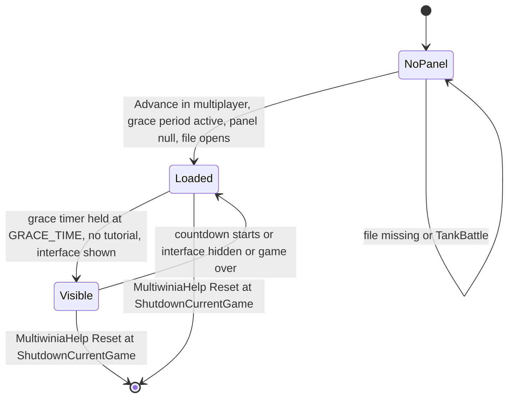

# 26 — Animation and VFX

> Part B · Baseline build: Release|Win32 (OpenGL) + TARGET_PC_FULLGAME ([B:FULL]); see _work/build_matrix.md.
> Evidence: [C] confirmed · [I] inferred · [U] unknown. Citations are `path:Symbol` relative to the multiwinia/ source root.
> Sources merged: P12_render_core, X1b_asset_formats, P09_control_taskmanager, P20_sequences_loaders_bench, P03_entity_core, P04_entities_military, P05_entities_creatures, P07_buildings_misc, P16_sound (effects.txt runtime), routed `_meta_*` notes, phase2_log; render-state context from [24_rendering](24_rendering.md) (linked, not duplicated).

## Contents

- [1 Scope, clocks and conventions](#1-scope-clocks-and-conventions)
- [2 VFX and animation inventory](#2-vfx-and-animation-inventory)
- [3 `.anim` format and AnimatedPanel playback](#3-anim-format-and-animatedpanel-playback)
- [4 Sprite and billboard animation conventions](#4-sprite-and-billboard-animation-conventions)
- [5 Legged, segmented and other procedurally animated creatures](#5-legged-segmented-and-other-procedurally-animated-creatures)
- [6 Particle system](#6-particle-system)
- [7 Beams, lasers, lightning, shockwaves, smoke, fire, spirits and weather](#7-beams-lasers-lightning-shockwaves-smoke-fire-spirits-and-weather)
- [8 Explosions — shape shattering](#8-explosions--shape-shattering)
- [9 effects.txt — what it actually configures](#9-effectstxt--what-it-actually-configures)
- [10 Gesture rendering](#10-gesture-rendering)
- [11 Camera shake and screen effects](#11-camera-shake-and-screen-effects)
- [12 VFX budgets, limits and determinism](#12-vfx-budgets-limits-and-determinism)
- [13 Re-implementation notes for a modern GPU VFX system](#13-re-implementation-notes-for-a-modern-gpu-vfx-system)
- [Open questions and unknowns](#open-questions-and-unknowns)
- [Docs-vs-code discrepancies](#docs-vs-code-discrepancies)
- [IP items](#ip-items)
- [Source map](#source-map)
- [Appendix — dead/legacy code](#appendix--deadlegacy-code)

## 1 Scope, clocks and conventions

### 1.1 What this document covers

The game has **no skeletal animation, no vertex skinning and no 3-D keyframe animation format** [C] (no bone/skin code anywhere in `code/`; the only animation data format is the 2-D `.anim` panel format; `.shp` meshes are rigid fragment hierarchies, [29](29_data_formats_reference.md)). Everything that moves on screen is one of:

1. **Simulation motion** (positions/orientations advanced by the lockstep sim, interpolated per frame with the prediction time — [24 §2.4](24_rendering.md#24-render-time-prediction-convention-c)).
2. **Procedural render-time animation** written per class in its `Render` function (sprite cards, sways, tumbles, trails, tails, cloth flags, pulsing glows, IK legs).
3. **Particles** (one global CPU billboard system, §6) and **shape shattering** (one global debris manager, §8).
4. **Effect objects** — `WorldObject`s in `Location::m_effects` (lasers, shockwaves, lightning, snow, …) that are advanced by the sim and draw their own geometry (§7).
5. **2-D keyframed panels** (`.anim`, §3) and **screen-space overlays** (flashes, fades, camera shake, gesture trail; §10–§11).

Render *state* (blend modes, depth, pass order) for every pass is owned by [24 §3.2](24_rendering.md#32-ordered-pass-table--one-multiwinia-match-frame-bfull); this document gives the *behaviour* (what is spawned, when, how it moves, how it fades) and cross-links to 24 for state. Entity behaviour that drives the effects lives in [02](02_units_and_entities.md), [03](03_buildings_and_world_objects.md) and [04](04_crates_powerups_and_weapons.md). File grammars are in [29](29_data_formats_reference.md).

### 1.2 The clocks used by animation and VFX

Mixing these clocks is the main source of determinism hazards (§12.3), so every formula below names its clock.

| Name in this doc | Symbol | Definition | Advances when paused? | Used by |
|---|---|---|---|---|
| **sim time** | `g_gameTimer.GetGameTime()` = `GetNetworkTime()` | accumulates `SERVER_ADVANCE_PERIOD` per server advance (`GameTimer::Tick`, skipped while paused) [C] `code/gametimer.cpp:GameTimer::Tick`, `code/gametimer.h:GetNetworkTime` | no | particle birth/death (§6), effect lifetimes, spider lift lock-out |
| **sim dt** | `SERVER_ADVANCE_PERIOD` | `0.1 × gameSpeed` s (10 Hz at normal speed; speed crates scale it) [C] `code/gametimer.h:SERVER_ADVANCE_PERIOD`, `code/gametimer.cpp:GameTimer::GetServerAdvancePeriod` | — | particle integration, effect advance |
| **wall time** | `g_gameTime` | set to `GetHighResTime()` every frame in `UpdateAdvanceTime` (not updated while paused) [C] `code/main.cpp:UpdateAdvanceTime` | no | explosion lifetimes (§8), EntityLeg swing (§5.1), flag wobble, glow pulses |
| **frame dt** | `g_advanceTime` | `realTime − g_gameTime`, clamped to ≤ 0.25 s; in demo-recording mode `1/DemoFrameRate` [C] `code/main.cpp:UpdateAdvanceTime` | not updated | explosion integration, camera-shake decay, flag relaxation |
| **raw clock** | `GetHighResTime()` | process high-resolution timer, seconds [C] `code/lib/hi_res_time.cpp` | yes | `.anim` playback (§3), gesture trail fade (§10), soul-destroyer eaten-soul fade, selection-circle rotation |
| **accurate time** | `g_gameTimer.GetAccurateTime()` | its own accumulator: each call adds `(GetHighResTime() − lastCall) × gameSpeed` — wall time scaled by game speed, smooth between ticks [C] `code/gametimer.cpp:GameTimer::GetAccurateTime` | stops when game speed is 0 | Darwinian tumble/sway (§4.2) |
| **prediction time** | `g_predictionTime` (passed as `_predictionTime`) | time since the last applied server advance, used to extrapolate `pos + vel·t` [C] `code/renderer.cpp:Renderer::RenderFrame`; semantics [24 §2.4](24_rendering.md#24-render-time-prediction-convention-c) | — | every `Render` |

### 1.3 Random-number sources used by VFX

| Source | Functions | Synchronised? | Rule |
|---|---|---|---|
| Mersenne-Twister stream | `syncrand`, `syncfrand(x)` ∈ [0,x), `syncsfrand(x)` ∈ [−x/2,x/2), `FRAND`, `SFRAND` wrappers | **yes** — identical on all peers, consumed in a fixed order | must only be called from the lockstep step; any change in how many are drawn shifts the whole stream ([22](22_determinism_and_networking.md)) |
| Application LCG | `AppRandom`, `frand(x)` ∈ [0,x], `sfrand(x)` ∈ (−x/2,x/2] (`state = state·214013 + 2531011`, 15-bit output) | no | cosmetic only; shared global state also used by audio and tree generation (which reseeds it) [C] `contrib/systemiv/lib/math/random_number.cpp` |
| CRT | `rand()` | no | cosmetic only (leaf drop, plague particles, randomiser colours) |

### 1.4 Shared easing function `RampUpAndDown`

Two copies with identical maths exist: `code/lib/math_utils.cpp:RampUpAndDown` (used by `EntityLeg`, returns **1.0001** after the duration so callers can test `> 1`) and `code/animatedpanel.cpp:CalculateRampUpAndDown` (returns **1.0** after the duration) [C]. With `f = (now − start)/duration`:

```
ease(f) = 2·f²            for f < 0.5
        = 1 − 2·(1 − f)²  for 0.5 ≤ f ≤ 1
```

A quadratic ease-in/ease-out (C¹-continuous at 0.5). [I] The same curve is depicted in `docs/ImplementationNotes/RampUpAndDown.gif`.

## 2 VFX and animation inventory

Every visual effect or animation kind in the code, with its owner, trigger, build tag and the section that specifies it. "Sim" in the trigger column means the emitter runs inside the lockstep `Advance`; "frame" means it runs in a `Render` function once per drawn frame.

| # | Effect / animation kind | Class / system | Trigger | Build | Section |
|---|---|---|---|---|---|
| 1 | Grace-period game-mode explainer cartoon | `AnimatedPanel`, `AnimatedPanelRenderer`, `MultiwiniaHelp::InitialiseAnimatedPanel` / `RenderAnimatedPanel` | match grace period while waiting for players to ready | [B:FULL] | §3 |
| 2 | Darwinian sprite card (terrain-aligned, distance scaling, card→billboard blend) | `Darwinian::Render` | frame | [B:FULL] | §4.2 |
| 3 | Darwinian airborne tumble and work-state sway | `Darwinian::Render` | frame, state-driven | [B:FULL] | §4.2 |
| 4 | Darwinian state textures (ouch 1–4, side view, Futurewinian) | `Darwinian::Render` | burning / airborne corpse / edge-on / Futurewinian team | [B:FULL] | §4.2 |
| 5 | Darwinian overlays: control glow, rage glow, plague bubble, booster bubble, Futurewinian glow, mind-control brainwaves, crate-capture beam, spectacle shadow, ground silhouette shadow, dead fragments | `Darwinian::Render` | state/power-up flags | [B:FULL] | §4.2 |
| 6 | Team-colour cross-fade after conversion | `Darwinian::Render` (`m_colourTimer`) | mind-control laser conversion | [B:FULL] | §4.2 |
| 7 | Santa hat, snow, winter terrain ramps, bare trees, light boost | Christmas mode (`App::UseChristmasMode`, `Location::ChristmasModEnabled`) | local date 24–26 Dec, propagated by network message | [B:FULL] | §4.3 |
| 8 | Damage flicker (non-uniform scale jitter + darkening blend) | `m_renderDamaged` in `Entity`; per-class `Render` | random per tick while damaged | [B:FULL] | §4.6 |
| 9 | Legged locomotion with 2-bone IK | `EntityLeg`, `EntityFoot` | owner's sim `Advance` | [B:FULL] (Spider), [B:LEGACY] (Tripod) | §5.1 |
| 10 | Spider 8-leg gait with 3 speed-dependent parameter sets, pounce leg pose | `Spider::UpdateLegs`, `Spider::UpdateLegsPouncing` | sim | [B:FULL] | §5.2 |
| 11 | Tripod 3-leg one-at-a-time gait with body topple | `Tripod::Advance`, `Tripod::DoFallForTwoLegs` | sim | [B:LEGACY] | §5.3 |
| 12 | Centipede follow-the-leader segment chain and size gradient | `Centipede::Advance`, `Centipede::Render` | sim + frame | [B:FULL] | §5.4 |
| 13 | SoulDestroyer serpent tail from position history; orbiting eaten souls | `SoulDestroyer::RenderShapes`, `SoulDestroyer::Render`, `SoulDestroyer::RenderSpirit` | frame | [B:FULL] | §5.5 |
| 14 | Virii glowing worm trail | `Virii::Render`, `Team::RenderVirii`, `ViriiUnit::Render` | frame (history recorded in sim) | [B:FULL] | §5.6 |
| 15 | SporeGenerator four procedural tentacle tails | `SporeGenerator::Render`, `SporeGenerator::RenderTail` | frame | [B:FULL] | §5.7 |
| 16 | Cloth flags (officer banner, armour flag, Blitzkrieg zone flag) | `Flag` (`code/worldobject/flag.cpp`) | frame | [B:FULL] | §5.8 |
| 17 | Officer orbiting shield souls | `Officer::RenderShield` | frame | [B:LEGACY] (shield never granted in MP, [02](02_units_and_entities.md)) | §5.9 |
| 18 | Tree breathing sway, regrowth, burning, corruption, magic pulse | `Tree::RenderAlphas` | frame | [B:FULL] | §5.9, [24 §4.7](24_rendering.md#47-tree-rendering-procedural-geometry-bfull-c-codeworldobjecttreecpp) |
| 19 | Misc. procedural motion (tank bob, harvester and spaceship beams, grenade flash, zombie wobble, nuke sub, officer orders) | per class | frame | see row | §5.9 |
| 20 | Particles — 19 types | `ParticleSystem`, `Particle`, `ParticleType` | 98 emitter sites (§6.8) | [B:FULL] | §6 |
| 21 | Shape shattering (per-triangle tumbling debris) | `ExplosionManager`, `Explosion`, `Tumbler`, `ExplodingTri` | 45 `AddExplosion` sites (§8.5) | [B:FULL] | §8 |
| 22 | Laser bolts (5× additive ribbon), mind-control bolts | `Laser::Render` | frame | [B:FULL] | §7.1 |
| 23 | Muzzle-flash effect object (5 nested quads) | `MuzzleFlash` | `Location::FireLaser`, `ThrowWeapon`, `FireRocket`, `FireTurretShell` | [B:FULL] | §7.1 |
| 24 | Shockwave ground ring, white screen flash, star/glow blast | `Shockwave::Render` | every `Location::Bang` | [B:FULL] | §7.2 |
| 25 | Pulse-wave cylinders and flash | `PulseWave::Render` | Assault pulse bomb | [B:FULL] | §7.2 |
| 26 | Lightning cloud glow and bolts | `Lightning::Render` | level `Effects lightning` | [B:FULL] | §7.3 |
| 27 | Rocket / missile flames and smoke | `Rocket::Render`, `Missile::Render`, `EscapeRocket::Advance` | frame / sim | [B:FULL] (Missile [B:DEBUG]) | §7.4 |
| 28 | Smoke columns, volcano eruptions | `SmokeMarker::Advance`, `EruptionMarker::Advance` | sim | [B:FULL] | §7.5 |
| 29 | Fire (Darwinian burning, hot feet, tree fire, napalm, fireball) | particles from the respective `Advance` | sim | [B:FULL] | §7.5 |
| 30 | Snow flakes, dust storm and vortex | `Snow`, `DustBall` | level `Effects snow` / `dustwind`, Christmas mode | [B:FULL] | §7.6 |
| 31 | Zombie ghosts | `Zombie::Render` | SoulDestroyer / evil-tree kills | [B:FULL] | §7.7 |
| 32 | Spirit (soul) glow quads | `Spirit::RenderWithoutGlBegin` | every death | [B:FULL] | §7.8, [24 §4.9](24_rendering.md#49-entities-sprites-and-billboards) |
| 33 | Laser-fence curtain scrolling UVs | `LaserFence::RenderAlphas` | frame | [B:FULL] | [24 §4.8](24_rendering.md#48-laser-fences-bfull-c-codeworldobjectlaserfencecpplaserfencerender-laserfencerenderalphas) |
| 34 | Building ownership lights, ports, blob shadows | `Building::RenderLights`, `RenderPorts`, `BeginRenderShadow` | frame | [B:FULL] | [24 §4.6](24_rendering.md#46-buildings-solid-pass-alpha-pass-depth-sort-lights-and-ports-c-codelocationcpp-codeworldobjectbuildingcpp), [24 §5.6](24_rendering.md#56-shadows-c) |
| 35 | Cursor highlight rings, selection-circle particles, formation dots, placement ghosts | `GameCursor` | frame | [B:FULL] | [06](06_player_control_and_input.md), §6.8 |
| 36 | Route highlight flashes | `RoutingSystem::HighlightRoute` | order issued | [B:FULL] | §6.8 |
| 37 | Camera shake | `Camera::CreateCameraShake`, `Camera::Advance` | lasers near camera, shockwave, pulse wave, rocket launch, portal | [B:FULL] | §11.1 |
| 38 | Full-screen white flashes | `Shockwave::Render`, `PulseWave::Render`, `Portal::Render` | explosion birth | [B:FULL] (Portal [B:DEBUG]) | §11.2 |
| 39 | Screen fades, pause banner, menu slide transition | `Renderer::RenderFadeOut`, `RenderMenuTransition` | UI | [B:FULL] | [24 §2.6](24_rendering.md#26-fade-pause-banner-logo-menu-transition-c-coderenderercpp) |
| 40 | Screen-space distortion (punch, tear, spirit diamonds) | `DeformEffect` | `Location::Bang`, SoulDestroyer, Spider pounce | [B:D3D], never started in MP | [24 §4.13](24_rendering.md#413-deform-effect-screen-space-distortion-bd3d-c-codedeformh-codedeformcpp) |
| 41 | Pixelated ghost overlay | `Renderer::ApplyPixelEffect` | single-player only | [B:LEGACY] | [24 §4.14](24_rendering.md#414-pixel-effect-screen-space-pixelation-ghosting-blegacy-c-coderenderercpp) |
| 42 | Gesture trail (blurred low-res glowing stroke) | `TaskManagerInterfaceGestures::RenderGestures` | SP gesture task manager | [B:LEGACY] | §10 |
| 43 | Gesture guide sheet, gesture icons | `TaskManagerInterfaceGestures` render helpers | SP | [B:LEGACY] | §10.3 |
| 44 | Gesture demo playback (tutorial hand) | `GestureDemo` | Sepulveda tutorial | [B:DEAD] | Appendix |
| 45 | DSP audio filters configured by `data/effects.txt` | `SoundSystem::LoadEffects`, `DspHandle` | sound events with `EFFECT` blocks, pref `SoundDSP` | [B:FULL] (audio, not visual) | §9 |
| 46 | `EffectProcessor` (POKEY sound-chip envelope sequencer) | `code/effect_processor.cpp` | constructed only, never advanced | [B:DEBUG] | §9.4 |

## 3 `.anim` format and AnimatedPanel playback

### 3.1 Purpose, selection and lifetime [B:FULL]

A `.anim` file is a short looping **2-D keyframed cartoon** (bitmap sprites that move, scale, rotate, fade and swap images) shown in a framed box at the bottom-centre of the screen during a Multiwinia match's **grace period**, with the localised game-mode name as title and a one-line rule summary as caption — a "how this mode works" explainer. It is the **only** keyframed animation format in the game [C] `code/multiwiniahelp.cpp:MultiwiniaHelp::InitialiseAnimatedPanel`, `code/animatedpanel.cpp`, `code/animatedpanel_renderer.cpp`.

| Game type (`Multiwinia::m_gameType`) | File loaded by `InitialiseAnimatedPanel` [C] |
|---|---|
| `GameTypeSkirmish` (Domination) | `animations/domination.anim` |
| `GameTypeKingOfTheHill` | `animations/koth.anim` |
| `GameTypeCaptureTheStatue` | `animations/cts.anim` |
| `GameTypeAssault` | `animations/assault_defend.anim` |
| `GameTypeRocketRiot` | `animations/rocket.anim` |
| `GameTypeBlitzkreig` | `animations/blitz.anim` |
| `GameTypeTankBattle` (compiled out, [B:DEBUG]) | none → no panel |

Lifecycle [C] `code/multiwiniahelp.cpp:MultiwiniaHelp::Advance`, `MultiwiniaHelp::Render`, `MultiwiniaHelp::Reset`, `code/multiwinia.cpp:Multiwinia::AdvanceGracePeriod`:



- Created lazily the first time `MultiwiniaHelp::Advance` runs with `g_app->Multiplayer()`, `m_animatedPanel == NULL` and `Multiwinia::GameInGracePeriod()`; deleted only by `MultiwiniaHelp::Reset` (from `App::ShutdownCurrentGame`) — **once per match** [C].
- Drawn by `MultiwiniaHelp::Render` only while `GameInGracePeriod()` **and** `g_app->m_multiwiniaTutorial == NULL` **and** `m_gracePeriodTimer >= GRACE_TIME` (3.0 s). Because the grace timer is held at exactly `GRACE_TIME` until every team is ready and only then counts down, the panel is visible **while waiting for all players to ready up** and disappears when the 3-2-1 countdown starts [C]. Also suppressed by `MultiwiniaHelp::Render`'s early-outs: no location, not multiplayer, `m_hideInterface`, game over, Assault with `m_victoryTimer > 0`, no local team [C] (P20).
- Layout is computed **once** at load from the screen size at that moment (a resolution change while the panel exists does not re-lay it out) [I] (no other writer of `m_screenX/Y/W/H`).

### 3.2 Grammar summary (formal grammar in [29](29_data_formats_reference.md))

Line-oriented, whitespace-separated tokens, keywords case-insensitive, unknown keywords ignored at every level, blank lines skipped [C] `code/animatedpanel.cpp:AnimatedPanel::Read`, `AnimatedPanelObject::Read`, `AnimatedPanelKeyframe::Read`:

```
file      = { header | object } ;
header    = ("WIDTH" INT | "HEIGHT" INT | "START" F | "STOP" F) ;           (anywhere outside objects; last wins)
object    = "BEGIN Object" { keyframe } "END" ;
keyframe  = "BEGIN Keyframe" { "TIMEINDEX" F | "IMAGENAME" NAME | "XPOS" F | "YPOS" F | "COLOUR" INT
                               | "SCALE" F | "ANGLE" F | "FLIPHORIZ" INT | "ALPHA" INT } "END" ;
```

Hazards [C]: a `BEGIN` line without a second token, or a field keyword without a value, dereferences NULL (`stricmp/atof(NULL)`); `IMAGENAME` is copied unchecked into a 256-byte buffer. The writer `AnimatedPanel::Write` exists but has no caller — the six files were authored with the external tool `animator.exe` (repository root; no source in the tree; its UI data `animator.dat` is a RAR containing `data/animations/*.bmp`, a font and dialog definitions) [C] (X1b RAR listing).

### 3.3 Data model and defaults [C] `code/animatedpanel.h`, `AnimatedPanelKeyframe::AnimatedPanelKeyframe`, `AnimatedPanel::AnimatedPanel`

| Owner | Field | Type | Default | Interpolation | Semantics |
|---|---|---|---|---|---|
| `AnimatedPanel` | `m_width`, `m_height` | int | 600, 300 | — | logical canvas size (shipped 800–1000 × 250) |
| `AnimatedPanel` | `m_start`, `m_stop` | float s | 0, 30 | — | loop window |
| `AnimatedPanel` | `m_time` | float s | 0 | — | playback position |
| `AnimatedPanel` | `m_objects` | `LList<AnimatedPanelObject*>` | empty | — | draw order = file order (later on top) |
| `AnimatedPanelObject` | `m_keyframes` | `LList<AnimatedPanelKeyframe*>` | empty | — | **unsorted**, file order |
| keyframe | `m_timeIndex` | float s | 0.0 | key | time of the key |
| keyframe | `m_imageName` | char[256] | `darwinian.bmp` | **step** (left key) | sprite `animations/<name>` |
| keyframe | `m_x`, `m_y` | float, canvas units | 100, 100 | **eased** (§1.4) | sprite **centre**; y grows downward |
| keyframe | `m_scale` | float × source pixels | 0.3 | **eased** | sprite size = bitmap size × scale |
| keyframe | `m_angle` | float degrees | 0 | **linear** | rotation about the centre; values beyond ±360 produce spins when interpolated |
| keyframe | `m_colour` | enum | 0 `ColourNone` | step | 0 white; 1 `ColourFriendly`; 2 `ColourEnemy`; 3 `ColourInvisible` |
| keyframe | `m_flipHoriz` | int bool | 0 | step | mirror horizontally (u from 1 to 0) |
| keyframe | `m_alpha` | int 0–255 | 255 | **linear** (truncated to int) | vertex alpha (ignored for `ColourInvisible`) |

Editing API present but uncalled by the game: `NewObject`, `DeleteObject`, `NewKeyframe(obj, t)` (samples current properties at *t*), `GetKeyframe(obj, t, maxDiff)`, `DeleteKeyframe` (unlinks **without freeing**), `Write` [C] (P20).

### 3.4 Sampling an object at time *t* [C] `code/animatedpanel.cpp:AnimatedPanel::CalculateObjectProperties`

1. Linear scan of the keyframes: `left` = key with the greatest `timeIndex ≤ t`, `right` = key with the smallest `timeIndex ≥ t` (ties → first found in file order).
2. Neither found → object not drawn. **Only `right` found → not drawn** (an object does not exist before its first key). Only `left` found → hold `left` (frozen after its last key). `left == right` or `|right.t − left.t| < 0.01` → `left`.
3. Otherwise `lin = (t − left.t)/(right.t − left.t)`, `ramp = CalculateRampUpAndDown(left.t, right.t − left.t, t)`; result = copy of `left` with `x, y, scale` lerped by **`ramp`** and `angle, alpha` lerped by **`lin`**. Image, colour role and flip are taken from `left` (step).

### 3.5 Playback clock and rendering [C] `code/animatedpanel_renderer.cpp:AnimatedPanelRenderer::RenderObjects`, `RenderBackground`, `RenderTitle`, `RenderCaption`, `Blit`

- **Clock** (raw clock, `GetHighResTime`): on the first `RenderObjects` call `m_time = 0` (**not** `START`) and `m_animTimer = now`. Each call: `m_time += now − m_animTimer`; if `m_time > m_stop` then `m_time = m_start` (loop; overshoot discarded); `m_animTimer = now`. It ignores pause and game speed, and it only advances while the panel is drawn (the timer delta accumulates across hidden periods because `m_animTimer` is only refreshed when drawn) [C]/[I].
- **Layout** (`MultiwiniaHelp::InitialiseAnimatedPanel`): `scale = ScreenH/1300`; `screenW = WIDTH·scale`, `screenH = HEIGHT·scale`; `screenX = ScreenW/2 − screenW/2`; `screenY = ScreenH − HEIGHT·1.15·scale`; `borderSize = 5`, `titleH = 25`, `captionH = 15` (pixels, **not** scaled) [C].
- **Background** (`RenderBackground(0.9)`): blend `SRC_ALPHA, ONE_MINUS_SRC_ALPHA`; black quad of alpha 0.9 over `[screenX − 5, screenY − 25 − 5] … [screenX + screenW + 5, screenY + screenH + 5 + 15]`; white line loop alpha 0.45 on the same rectangle; white line loop alpha 0.225 on `[screenX, screenY − 25] … [screenX + screenW, screenY + screenH + 15]` [C].
- **Objects**: scissor `Renderer::Clip(screenX + 1, screenY − titleH + 1, screenW − 1, screenH + titleH + captionH − 1)`; `s = screenW / WIDTH`; for each object with a valid sample: colour = white, local team colour (`Location::GetMyTeam()->m_colour`, role 1), the colour of the **first** team index whose type is not unused and that is not a friend of `g_globalWorld->m_myTeamId` (role 2; white if none), or RGBA (255,255,255,0) (role 3); alpha = keyframe alpha unless role 3. Image: `GetBitmap("animations/<name>")` for its pixel size and `GetTexture` (default flags → mip-mapped, pink-keyed) for the texture; `w = imgW·scale_kf·s`, `h = imgH·scale_kf·s`; centre `(screenX + x·s, screenY + y·s)`; the four corners are rotated about the centre by `2π·angle/360` (`Vector3::RotateAroundZ`); texture filters LINEAR / LINEAR_MIPMAP_LINEAR, wrap CLAMP; flip sets u from 1 to 0. Blend is the caller's `SRC_ALPHA, ONE_MINUS_SRC_ALPHA` [C]/[I].
- **Title**: `g_titleFont`, size 30, centred at `(screenX + screenW/2, screenY − titleH + 10)`; outline pass colour (1,1,1,0) then fill (1,1,1,1). Text = localised game-type name upper-cased [C].
- **Caption**: `g_editorFont`, size 18; `WordWrapText(caption, screenW, 18/1.7)`; bottom line at `y = screenY + screenH + captionH − 12`, earlier lines 18 px higher; outline then fill. Phrase key `multiwinia_animdesc_<blueprint name>` (6 keys in `data/language/english.txt`) [C].
- `BeginRender()` / `EndRender()` are declared but never defined or called [C].

### 3.6 The six shipped animations [C] `data/animations/*.anim`

Summary [C] (generated by `_work/scripts/S_26_anim_tracks.py`, cross-checked against X1b's survey):

| File | Canvas | Loop (s) | Objects | Keyframes | Images used | What it shows [I] (from the tracks below) |
|---|---|---|---|---|---|---|
| `domination.anim` | 800×250 | 0.00–15.01 | 28 | 169 | cloudyglow, darwinian, darwinian_ouch4, laser, muzzleflash, spawnpoint | three spawn points; friendly Darwinians stream right and shoot (laser + muzzle flash objects); enemy Darwinians die (swap to `darwinian_ouch4`, fade, spin); glows over captured spawn points change colour role (enemy → friendly) |
| `koth.anim` | 800×250 | 0.00–15.66 | 17 | 108 | cloudyglow, darwinian, darwinian_ouch4, laser, muzzleflash, plusone, spawnpoint, zone-back, zone-front | a king-of-the-hill zone (back/front halves pulsing alpha 100–200, role none → friendly) filled by friendly Darwinians; "+1" score sprites rise |
| `cts.anim` | 924×250 | 0.00–20.01 | 23 | 111 | cloudyglow, darwinian, darwinian_ouch4, laser, muzzleflash, plusone, spawnpoint, statue, zone-back, zone-front | Darwinians carry a statue to a zone; "+1" on delivery |
| `assault_defend.anim` | 900×250 | 0.00–12.02 | 14 | 135 | cloudyglow, darwinian, darwinian_ouch4, muzzleflash, trunkport, turretbarrel, turretbase, wmd | attackers arriving through a trunk port are shot by a defending turret (barrel rotates, muzzle flashes) before reaching the weapon (`wmd`) |
| `rocket.anim` | 1000×250 | 0.00–30.01 | 21 | 173 | armour, cloudyglow, darwinian, fuelpump, fuelpumper, island, laser, muzzleflash, rocket, solarpanel, trunkport, water | Darwinians operate solar panels and fuel pumps, fuel the rocket, board it, the rocket launches |
| `blitz.anim` | 900×250 | 0.00–24.01 | 28 | 180 | cloudyglow, darwinian, darwinian_ouch4, flag, flag_down, flag_locked, flag_up, fuelpumper, laser, muzzleflash, trunkport | Darwinians capture a chain of flags (flag image steps down → up → locked) towards the enemy base |

All 25 bitmaps in `data/animations/` are referenced by at least one `.anim` and no `.anim` references a missing image [C] (X1b survey). Several have the same names as files elsewhere (`darwinian.bmp`, `flag*.bmp`, `cloudyglow.bmp`, `muzzleflash.bmp`, `laser.bmp`) but are **different images**; only `darwinian_ouch4.bmp` is byte-identical to `sprites/darwinian_ouch4.bmp` [C] (X1b md5). Keys whose `TIMEINDEX` exceeds `STOP` are never reached (dead data) [C].

Per-object tracks follow (ranges are min..max over the object's keys; "→" is not used — ranges are unordered; "beyond STOP" counts unreachable keys). Colour roles: none / friendly / enemy / invisible.

##### `domination.anim` — canvas 800×250, loop 0.00–15.01 s, 28 objects, 169 keyframes

| # | Image(s) | Colour role(s) | Keys | First–last key (s) | X range | Y range | Scale range | Angle range (deg) | Alpha range | Flip |
|---|---|---|---|---|---|---|---|---|---|---|
| 0 | spawnpoint | none | 1 | 0.00–0.00 | 126 | 99 | 0.70 | 0 | 255 | 0 |
| 1 | spawnpoint | none | 1 | 0.00–0.00 | 411 | 100 | 0.70 | 0 | 255 | 0 |
| 2 | spawnpoint | none | 1 | 0.00–0.00 | 698 | 98 | 0.70 | 0 | 255 | 0 |
| 3 | darwinian | friendly | 2 | 0.00–0.68 | 28..36 | 140..210 | 0.30 | 0 | 255 | 0 |
| 4 | darwinian | friendly | 3 | 0.00–0.92 | 44..196 | 139..230 | 0.30 | 0 | 255 | 0 |
| 5 | cloudyglow | friendly | 2 | 0.92–30.00 (1 beyond STOP) | 120 | 53 | 0.80 | 0..1500 | 255 | 0 |
| 6 | darwinian, darwinian_ouch4 | enemy, invisible | 4 | 0.00–11.64 | 771..780 | 67..210 | 0.30 | 0..75 | 0..255 | 0 |
| 7 | darwinian, darwinian_ouch4 | enemy, invisible | 5 | 0.00–11.74 | 578..765 | 70..230 | 0.30 | -40..0 | 0..255 | 0 |
| 8 | cloudyglow | enemy, invisible, friendly | 4 | 0.92–30.00 (1 beyond STOP) | 692 | 51 | 0.80 | -560..1000 | 255 | 0 |
| 9 | darwinian | friendly | 6 | 2.33–6.72 | 84..356 | 99..201 | 0.30..0.40 | 0..200 | 255 | 0 |
| 10 | darwinian | friendly | 10 | 2.51–14.08 | 120..671 | 47..208 | 0.30..0.40 | -250..360 | 255 | 0 |
| 11 | darwinian | friendly | 7 | 2.69–6.82 | 97..488 | 100..219 | 0.30..0.40 | 0..764 | 255 | 0 |
| 12 | darwinian | friendly | 11 | 2.87–13.50 | 120..620 | 46..219 | 0.30..0.40 | -300..360 | 255 | 0 |
| 13 | darwinian, darwinian_ouch4 | enemy, invisible | 10 | 2.33–10.94 | 528..772 | 99..185 | 0.30..0.40 | 0..634 | 0..255 | 0 |
| 14 | darwinian, darwinian_ouch4 | enemy, invisible | 10 | 2.51–10.94 | 475..744 | 102..219 | 0.30..0.40 | -564..50 | 0..255 | 0 |
| 15 | darwinian, darwinian_ouch4 | enemy, invisible | 11 | 2.69–11.16 | 495..772 | 103..224 | 0.30..0.40 | -123..376 | 0..255 | 0 |
| 16 | darwinian, darwinian_ouch4 | enemy, invisible | 10 | 2.87–10.76 | 530..745 | 100..223 | 0.30..0.40 | 0..534 | 0..255 | 0 |
| 17 | laser | friendly, invisible | 8 | 4.87–10.49 | 272..734 | 182..230 | 0.30 | 0..5 | 255 | 0 |
| 18 | laser | friendly, invisible | 7 | 4.94–11.09 | 300..653 | 136..228 | 0.30 | -110..0 | 255 | 0 |
| 19 | laser | friendly, invisible | 6 | 5.10–11.02 | 294..770 | 138..223 | 0.30 | -80..5 | 255 | 0 |
| 20 | cloudyglow | friendly | 2 | 6.88–30.00 (1 beyond STOP) | 406 | 56 | 0.70 | 0..1000 | 255 | 0 |
| 21 | darwinian | friendly | 6 | 7.94–11.70 | 408..771 | 105..215 | 0.30..0.40 | 0..123 | 255 | 0 |
| 22 | darwinian | friendly | 6 | 8.13–11.70 | 356..643 | 104..212 | 0.30..0.40 | 0..32 | 255 | 0 |
| 23 | darwinian | friendly | 8 | 8.24–14.41 | 405..757 | 57..220 | 0.30..0.40 | -234..360 | 255 | 0 |
| 24 | darwinian | friendly | 8 | 8.38–13.84 | 391..717 | 69..222 | 0.30..0.40 | -360..0 | 255 | 0 |
| 25 | muzzleflash | none, invisible | 6 | 4.85–10.17 | 260..499 | 201..221 | 0.50 | 0 | 0..255 | 0 |
| 26 | muzzleflash | none, invisible | 8 | 4.94–10.92 | 292..752 | 182..228 | 0.50..0.70 | -70..0 | 0..255 | 0 |
| 27 | muzzleflash | none, invisible | 6 | 10.14–10.99 | 501..644 | 212..228 | 0.50 | -110..0 | 0..255 | 0 |

##### `koth.anim` — canvas 800×250, loop 0.00–15.66 s, 17 objects, 108 keyframes

| # | Image(s) | Colour role(s) | Keys | First–last key (s) | X range | Y range | Scale range | Angle range (deg) | Alpha range | Flip |
|---|---|---|---|---|---|---|---|---|---|---|
| 0 | zone-back | none, friendly | 18 | 0.00–16.00 (1 beyond STOP) | 476 | 133 | 0.70 | 0 | 100..200 | 0 |
| 1 | spawnpoint | none | 1 | 0.00–0.00 | 126 | 99 | 0.70 | 0 | 255 | 0 |
| 2 | darwinian | friendly | 2 | 0.00–0.68 | 28..36 | 140..210 | 0.30 | 0 | 255 | 0 |
| 3 | darwinian | friendly | 3 | 0.00–0.92 | 44..196 | 139..230 | 0.30 | 0 | 255 | 0 |
| 4 | cloudyglow | friendly | 2 | 0.92–30.00 (1 beyond STOP) | 120 | 53 | 0.80 | 0..1500 | 255 | 0 |
| 5 | darwinian | friendly | 7 | 2.33–14.36 | 84..461 | 29..177 | 0.30..0.40 | 0..360 | 255 | 0 |
| 6 | darwinian | friendly | 8 | 2.51–14.08 | 120..597 | 27..188 | 0.30..0.40 | -250..360 | 255 | 0 |
| 7 | darwinian | friendly | 9 | 2.69–14.97 | 97..486 | 41..214 | 0.30..0.40 | -360..764 | 255 | 0 |
| 8 | darwinian | friendly | 8 | 2.87–14.79 | 120..587 | 56..216 | 0.30..0.40 | -300..360 | 255 | 0 |
| 9 | darwinian, darwinian_ouch4 | enemy, invisible | 3 | 9.92–12.21 | 651..771 | 172..220 | 0.40 | 0..100 | 0..255 | 0 |
| 10 | laser | friendly, invisible | 4 | 10.59–11.89 | 468..664 | 67..173 | 0.30 | -30..20 | 255 | 0 |
| 11 | zone-front | none, friendly | 17 | 0.00–16.02 (1 beyond STOP) | 476 | 134 | 0.70 | 0 | 100..200 | 0 |
| 12 | plusone | friendly, invisible | 12 | 7.00–15.00 | 507..509 | 32..130 | 0.60 | 0 | 255 | 0 |
| 13 | darwinian, darwinian_ouch4 | enemy, invisible | 3 | 9.54–11.37 | 662..769 | 31..67 | 0.40 | 0..280 | 0..255 | 0 |
| 14 | muzzleflash | none, invisible | 6 | 9.89–11.66 | 449..487 | 112..169 | 0.60 | 0 | 0..255 | 0 |
| 15 | darwinian, darwinian_ouch4 | enemy, invisible | 3 | 8.32–10.81 | 644..772 | 124..134 | 0.40 | 0..150 | 0..255 | 0 |
| 16 | laser | friendly, invisible | 2 | 9.89–10.25 | 460..645 | 114..134 | 0.30 | 5 | 255 | 0 |

##### `cts.anim` — canvas 924×250, loop 0.00–20.01 s, 23 objects, 111 keyframes

| # | Image(s) | Colour role(s) | Keys | First–last key (s) | X range | Y range | Scale range | Angle range (deg) | Alpha range | Flip |
|---|---|---|---|---|---|---|---|---|---|---|
| 0 | zone-back | friendly | 1 | 0.00–0.00 | 404 | 163 | 0.50 | 0 | 100 | 0 |
| 1 | spawnpoint | none | 1 | 0.00–0.00 | 126 | 99 | 0.70 | 0 | 255 | 0 |
| 2 | darwinian | friendly | 2 | 0.00–0.68 | 28..36 | 140..210 | 0.30 | 0 | 255 | 0 |
| 3 | darwinian | friendly | 3 | 0.00–0.92 | 44..196 | 139..230 | 0.30 | 0 | 255 | 0 |
| 4 | cloudyglow | friendly | 2 | 0.92–30.00 (1 beyond STOP) | 120 | 53 | 0.80 | 0..1500 | 255 | 0 |
| 5 | darwinian | friendly | 7 | 7.98–17.72 | 93..700 | 88..192 | 0.30..0.40 | 0..300 | 255 | 0 |
| 6 | darwinian | friendly | 7 | 8.26–17.76 | 117..716 | 100..191 | 0.30..0.40 | -243..0 | 255 | 0 |
| 7 | statue | none, invisible | 5 | 0.00–18.03 | 409..784 | 56..104 | 1.00 | 0 | 255 | 0 |
| 8 | darwinian | friendly | 10 | 2.33–19.22 | 84..716 | 85..208 | 0.30..0.40 | 0..360 | 255 | 0 |
| 9 | darwinian | friendly | 10 | 2.51–19.43 | 120..753 | 28..214 | 0.30..0.40 | -250..360 | 255 | 0 |
| 10 | darwinian | friendly | 10 | 2.69–19.62 | 97..799 | 100..214 | 0.30..0.40 | -360..764 | 255 | 0 |
| 11 | darwinian | friendly | 10 | 2.87–19.87 | 120..841 | 38..216 | 0.30..0.40 | -300..360 | 255 | 0 |
| 12 | plusone | friendly | 2 | 18.03–18.50 | 407..411 | 55..140 | 0.80..1.00 | 0 | 255 | 0 |
| 13 | darwinian, darwinian_ouch4 | friendly, invisible | 8 | 8.48–13.58 | 117..728 | 104..210 | 0.30..0.40 | -120..765 | 0..255 | 0 |
| 14 | darwinian | friendly | 7 | 8.67–17.87 | 118..709 | 103..220 | 0.30..0.40 | 0..834 | 255 | 0 |
| 15 | zone-front | friendly | 1 | 0.00–0.00 | 404 | 164 | 0.50 | 0 | 200 | 0 |
| 16 | darwinian, darwinian_ouch4 | enemy, invisible | 3 | 12.25–13.93 | 811..909 | 196..218 | 0.40 | 0..40 | 0..255 | 0 |
| 17 | darwinian, darwinian_ouch4 | enemy, invisible | 3 | 12.55–14.32 | 822..893 | 27..68 | 0.40 | 0..100 | 0..255 | 0 |
| 18 | darwinian, darwinian_ouch4 | enemy, invisible | 3 | 12.67–14.24 | 807..902 | 128..154 | 0.40 | 0..140 | 0..255 | 0 |
| 19 | laser | friendly, invisible | 6 | 12.98–13.49 | 711..822 | 64..192 | 0.30 | -15..10 | 255 | 0 |
| 20 | laser | enemy, invisible | 2 | 13.15–13.26 | 726..829 | 135..177 | 0.30 | -20 | 255 | 0 |
| 21 | muzzleflash | none, invisible | 6 | 12.98–13.44 | 704..734 | 98..173 | 0.50 | 0 | 0..255 | 0 |
| 22 | muzzleflash | none, invisible | 2 | 13.15–13.25 | 833 | 131 | 0.50 | 180 | 0..255 | 0 |

##### `assault_defend.anim` — canvas 900×250, loop 0.00–12.02 s, 14 objects, 135 keyframes

| # | Image(s) | Colour role(s) | Keys | First–last key (s) | X range | Y range | Scale range | Angle range (deg) | Alpha range | Flip |
|---|---|---|---|---|---|---|---|---|---|---|
| 0 | wmd | none | 1 | 0.00–0.00 | 90 | 110 | 0.90 | 0 | 255 | 0 |
| 1 | turretbase | friendly | 1 | 0.00–0.00 | 291 | 150 | 1.00 | 10 | 255 | 1 |
| 2 | darwinian | friendly | 1 | 0.00–0.00 | 255 | 178 | 0.40 | 0 | 255 | 0 |
| 3 | turretbarrel | none | 8 | 0.00–11.62 | 285 | 141 | 0.90 | -10..20 | 255 | 1 |
| 4 | trunkport | none | 1 | 0.00–0.00 | 807 | 92 | 0.70 | 0 | 255 | 0 |
| 5 | darwinian | friendly | 5 | 0.00–12.02 | 40..47 | 69..215 | 0.40 | 0..360 | 255 | 0 |
| 6 | darwinian | friendly | 5 | 0.00–12.02 | 96..123 | 69..217 | 0.40 | -360..0 | 255 | 0 |
| 7 | darwinian | friendly | 5 | 0.00–12.02 | 165..188 | 69..204 | 0.40 | 0..360 | 255 | 0 |
| 8 | cloudyglow | enemy | 2 | 0.00–12.14 (1 beyond STOP) | 806 | 92 | 0.80 | 0..200 | 255 | 0 |
| 9 | darwinian, darwinian_ouch4 | enemy, invisible | 5 | 1.42–6.85 | 576..794 | 71..185 | 0.40 | 0..400 | 0..255 | 0 |
| 10 | darwinian, darwinian_ouch4 | enemy, invisible | 5 | 1.71–9.03 | 575..865 | 70..193 | 0.40 | -563..800 | 0..255 | 0 |
| 11 | darwinian, darwinian_ouch4 | enemy, invisible | 5 | 1.60–8.56 | 554..842 | 94..207 | 0.40 | 0..600 | 0..255 | 0 |
| 12 | darwinian, darwinian_ouch4 | enemy, invisible | 5 | 1.89–7.74 | 580..799 | 79..210 | 0.40 | -768..700 | 0..255 | 0 |
| 13 | muzzleflash | none, invisible | 86 | 4.70–8.95 | 388..402 | 147..171 | 2.00 | 11 | 0..250 | 0 |

##### `rocket.anim` — canvas 1000×250, loop 0.00–30.01 s, 21 objects, 173 keyframes

| # | Image(s) | Colour role(s) | Keys | First–last key (s) | X range | Y range | Scale range | Angle range (deg) | Alpha range | Flip |
|---|---|---|---|---|---|---|---|---|---|---|
| 0 | fuelpumper | none | 25 | 10.76–25.50 | 581 | 91..163 | 0.60 | 0 | 0..255 | 0 |
| 1 | fuelpumper | none | 4 | 15.51–26.02 | 442..457 | 111..205 | 0.90 | 50..100 | 0..255 | 1 |
| 2 | laser | friendly | 9 | 16.99–25.01 | 457 | 109 | 2.50 | 10 | 0..180 | 0 |
| 3 | laser | none | 2 | 10.61–11.12 | 679 | 124 | 1.50 | -5 | 0..128 | 0 |
| 4 | fuelpump | none | 3 | 10.63–13.14 | 581 | 167 | 0.60 | 0 | 0..255 | 0 |
| 5 | water | none | 9 | 0.00–30.66 (1 beyond STOP) | 553..588 | 226..233 | 1.20 | 0 | 200 | 0 |
| 6 | island | none | 1 | 0.00–0.00 | 227 | 163 | 1.90 | 0 | 255 | 0 |
| 7 | island | none | 1 | 0.00–0.00 | 869 | 179 | 1.50 | 0 | 255 | 1 |
| 8 | cloudyglow | friendly | 2 | 0.00–30.47 (1 beyond STOP) | 101 | 86 | 1.10 | 0..1000 | 255 | 0 |
| 9 | trunkport | none | 1 | 0.00–0.00 | 101 | 85 | 0.80 | 0 | 255 | 0 |
| 10 | rocket | none | 3 | 0.00–30.03 (1 beyond STOP) | 312 | -75..73 | 1.00 | 0 | 255 | 0 |
| 11 | darwinian | friendly, invisible | 11 | 1.98–29.64 | 80..882 | 43..190 | 0.40 | -360..360 | 255 | 0 |
| 12 | solarpanel | none | 1 | 0.00–0.00 | 766 | 146 | 0.75 | 0 | 255 | 0 |
| 13 | darwinian | friendly, invisible | 10 | 2.00–28.05 | 48..889 | 81..218 | 0.40 | -300..360 | 255 | 0 |
| 14 | darwinian | friendly, invisible | 10 | 2.09–29.14 | 114..881 | 48..213 | 0.40 | -400..0 | 255 | 0 |
| 15 | armour | none | 9 | 1.66–11.65 | 99..940 | 79..214 | 1.00 | -40..0 | 255 | 0 |
| 16 | cloudyglow | friendly, invisible | 52 | 12.00–24.75 | 582..766 | 121..132 | 0.30 | 0 | 255 | 0 |
| 17 | darwinian | friendly, invisible | 5 | 17.99–21.17 | 36..316 | 37..184 | 0.00..0.40 | -360..0 | 255 | 0 |
| 18 | darwinian | friendly, invisible | 5 | 18.07–20.89 | 110..316 | 40..190 | 0.00..0.40 | -400..0 | 255 | 0 |
| 19 | darwinian | friendly, invisible | 5 | 18.17–21.27 | 71..315 | 52..213 | 0.00..0.40 | -250..0 | 255 | 0 |
| 20 | muzzleflash | none | 5 | 22.00–30.03 (1 beyond STOP) | 308..314 | 82..222 | 0.50..2.50 | 90 | 0..200 | 0 |

##### `blitz.anim` — canvas 900×250, loop 0.00–24.01 s, 28 objects, 180 keyframes

| # | Image(s) | Colour role(s) | Keys | First–last key (s) | X range | Y range | Scale range | Angle range (deg) | Alpha range | Flip |
|---|---|---|---|---|---|---|---|---|---|---|
| 0 | cloudyglow | enemy, invisible | 2 | 0.00–20.26 | 808 | 100 | 0.90 | -1000..0 | 255 | 0 |
| 1 | cloudyglow | friendly | 2 | 0.00–24.25 (1 beyond STOP) | 100 | 100 | 0.90 | 0..1000 | 255 | 0 |
| 2 | trunkport | none | 1 | 0.00–0.00 | 98 | 96 | 0.70 | 0 | 255 | 0 |
| 3 | darwinian, darwinian_ouch4 | friendly, invisible | 8 | 0.06–8.95 | 118..482 | 70..201 | 0.40 | -400..0 | 0..255 | 0 |
| 4 | darwinian | friendly | 10 | 9.75–23.18 | 100..761 | 81..202 | 0.40 | -400..0 | 255 | 0 |
| 5 | fuelpumper | none | 1 | 0.00–0.00 | 216 | 149 | 0.60 | 0 | 255 | 0 |
| 6 | trunkport | none | 1 | 0.00–0.00 | 808 | 98 | 0.70 | 0 | 255 | 0 |
| 7 | darwinian, darwinian_ouch4 | enemy, invisible | 6 | 9.43–13.70 | 674..839 | 70..190 | 0.40 | 0..500 | 0..255 | 0 |
| 8 | darwinian, darwinian_ouch4 | enemy, invisible | 6 | 9.61–13.07 | 672..792 | 83..203 | 0.40 | 0..346 | 0..255 | 0 |
| 9 | fuelpumper | none | 1 | 0.00–0.00 | 702 | 156 | 0.60 | 0 | 255 | 0 |
| 10 | fuelpumper | none | 1 | 0.00–0.00 | 456 | 151 | 0.60 | 0 | 255 | 0 |
| 11 | flag_up, flag, flag_locked | friendly | 7 | 2.46–10.83 | 175 | 119..188 | 1.00 | 0 | 255 | 0 |
| 12 | flag_up, flag, flag_locked | friendly | 7 | 8.40–20.24 | 415 | 122..188 | 1.00 | 0 | 255 | 0 |
| 13 | darwinian, darwinian_ouch4 | friendly, invisible | 11 | 0.27–14.31 | 62..578 | 92..203 | 0.40 | -350..0 | 0..255 | 0 |
| 14 | darwinian, darwinian_ouch4 | friendly, invisible | 12 | 0.48–13.32 | 102..570 | 88..222 | 0.40 | -784..0 | 0..255 | 0 |
| 15 | flag_up, flag, flag_down, flag_locked | enemy, none, friendly | 18 | 2.69–20.24 | 662..663 | 126..196 | 1.00 | 0 | 255 | 0 |
| 16 | darwinian, darwinian_ouch4 | enemy, invisible | 8 | 0.08–7.93 | 573..782 | 82..202 | 0.40 | 0..435 | 0..255 | 0 |
| 17 | darwinian, darwinian_ouch4 | enemy, invisible | 8 | 0.21–8.98 | 603..845 | 77..205 | 0.40 | 0..367 | 0..255 | 0 |
| 18 | darwinian, darwinian_ouch4 | enemy, invisible | 8 | 0.42–8.52 | 578..822 | 84..223 | 0.40 | 0..543 | 0..255 | 0 |
| 19 | darwinian, darwinian_ouch4 | enemy, invisible | 6 | 9.82–15.45 | 702..831 | 81..215 | 0.40 | 0..456 | 255 | 0 |
| 20 | darwinian | friendly | 10 | 9.48–22.80 | 57..672 | 85..203 | 0.40 | -349..360 | 255 | 0 |
| 21 | darwinian | friendly | 10 | 9.92–23.28 | 98..725 | 90..220 | 0.40 | -250..360 | 255 | 0 |
| 22 | laser | friendly, invisible | 6 | 6.84–14.55 | 368..704 | 186..212 | 0.40 | 0..10 | 255 | 0 |
| 23 | laser | friendly, invisible | 4 | 7.32–12.70 | 362..672 | 181..220 | 0.40 | -5..5 | 255 | 0 |
| 24 | laser | friendly, invisible | 2 | 7.75–8.04 | 442..603 | 204..218 | 0.40 | -5 | 255 | 0 |
| 25 | laser | enemy, invisible | 6 | 7.79–13.18 | 483..680 | 185..214 | 0.40 | -10..5 | 255 | 0 |
| 26 | muzzleflash | none, invisible | 12 | 6.84–14.48 | 349..532 | 184..220 | 0.50 | 0 | 0..255 | 0 |
| 27 | muzzleflash | none, invisible | 6 | 7.79–13.14 | 614..692 | 181..213 | 0.50 | 0 | 0..255 | 1 |

### 3.7 Defects and re-implementation notes

| # | Finding | Ref |
|---|---|---|
| 1 | First pass starts at `t = 0` even if `START > 0`; later passes restart at `START` [C] | `RenderObjects` |
| 2 | Overshoot past `STOP` is discarded (no `fmod`), so loop length is frame-quantised [C] | `RenderObjects` |
| 3 | Only-right-key objects are hidden — authors must place a key at the start of the visible span; this is used deliberately (late-appearing objects) [C] | `CalculateObjectProperties` |
| 4 | Keys after `STOP` are unreachable (present in `cts`, `domination`, `koth`, `assault_defend`, `blitz`, `rocket`, see tables) [C] | data |
| 5 | Panel layout frozen at creation [I] | `InitialiseAnimatedPanel` |
| 6 | Parser crashes on malformed lines; image name buffer overflow [C] | `AnimatedPanelKeyframe::Read` |

A new engine can map this 1:1 onto a UI timeline (per-object property tracks, cubic/quadratic ease on transform, linear on rotation/alpha, step on sprite/role/flip). Colour roles must be resolved at draw time against the local player's team.

