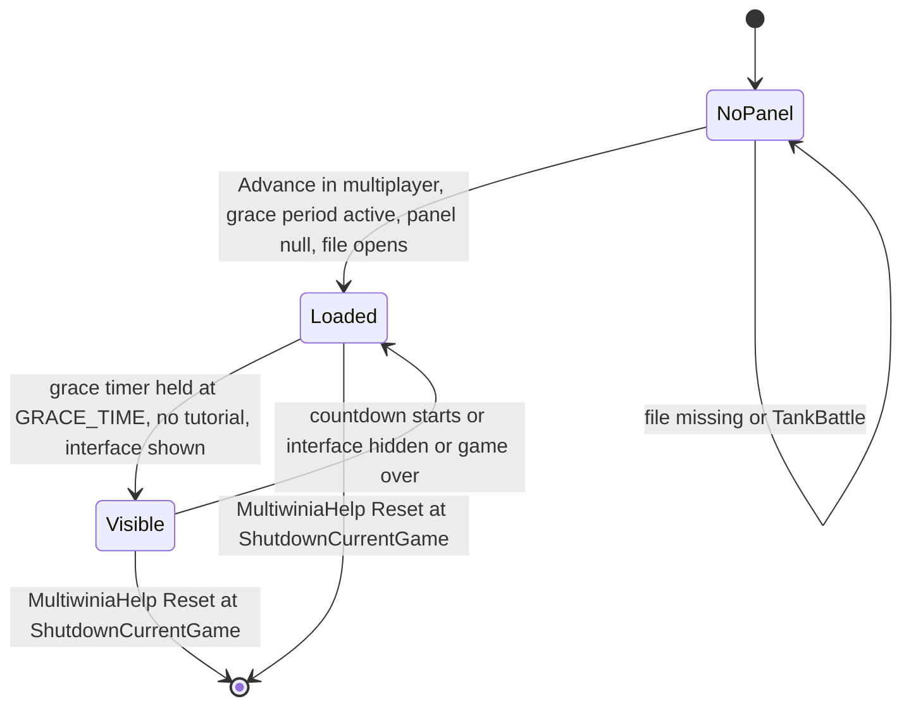
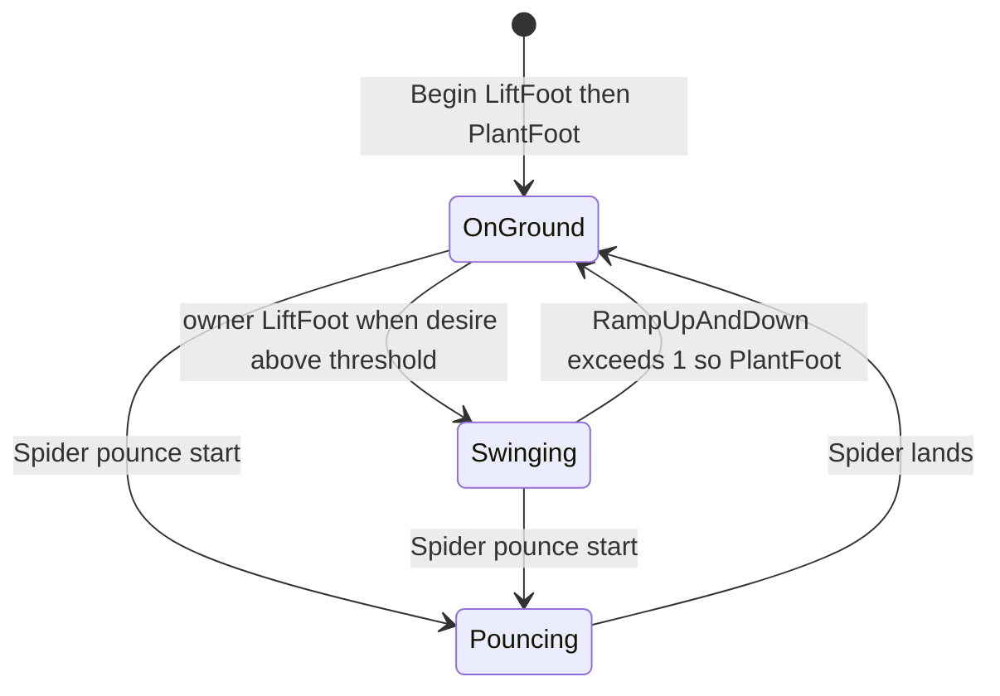

# 26 — Animation and VFX

> Part B · Baseline build: Release|Win32 (OpenGL) + TARGET_PC_FULLGAME ([B:FULL]); see _work/build_matrix.md.
> Evidence: [C] confirmed · [I] inferred · [U] unknown. Citations are `path:Symbol` relative to the multiwinia/ source root.
> Sources merged: P12_render_core, X1b_asset_formats, P09_control_taskmanager, P20_sequences_loaders_bench, P03_entity_core, P04_entities_military, P05_entities_creatures, P07_buildings_misc, P16_sound (effects.txt runtime), routed `_meta_*` notes, phase2_log; render-state context from [24_rendering](24_rendering.md) (linked, not duplicated).

## Contents

- [1 Scope, clocks and conventions](#1-scope-clocks-and-conventions)
- [2 VFX and animation inventory](#2-vfx-and-animation-inventory)
- [3 `.anim` format and AnimatedPanel playback](#3-anim-format-and-animatedpanel-playback)
- [4 Sprite and billboard animation conventions](#4-sprite-and-billboard-animation-conventions)
- [5 Legged, segmented and other procedurally animated creatures](#5-legged-segmented-and-other-procedurally-animated-creatures)
- [6 Particle system](#6-particle-system)
- [7 Beams, lasers, lightning, shockwaves, smoke, fire, spirits and weather](#7-beams-lasers-lightning-shockwaves-smoke-fire-spirits-and-weather)
- [8 Explosions — shape shattering](#8-explosions--shape-shattering)
- [9 effects.txt — what it actually configures](#9-effectstxt--what-it-actually-configures)
- [10 Gesture rendering](#10-gesture-rendering)
- [11 Camera shake and screen effects](#11-camera-shake-and-screen-effects)
- [12 VFX budgets, limits and determinism](#12-vfx-budgets-limits-and-determinism)
- [13 Re-implementation notes for a modern GPU VFX system](#13-re-implementation-notes-for-a-modern-gpu-vfx-system)
- [Open questions and unknowns](#open-questions-and-unknowns)
- [Docs-vs-code discrepancies](#docs-vs-code-discrepancies)
- [IP items](#ip-items)
- [Source map](#source-map)
- [Appendix — dead/legacy code](#appendix--deadlegacy-code)

## 1 Scope, clocks and conventions

### 1.1 What this document covers

The game has **no skeletal animation, no vertex skinning and no 3-D keyframe animation format** [C] (no bone/skin code anywhere in `code/`; the only animation data format is the 2-D `.anim` panel format; `.shp` meshes are rigid fragment hierarchies, [29](29_data_formats_reference.md)). Everything that moves on screen is one of:

1. **Simulation motion** (positions/orientations advanced by the lockstep sim, interpolated per frame with the prediction time — [24 §2.4](24_rendering.md#24-render-time-prediction-convention-c)).
2. **Procedural render-time animation** written per class in its `Render` function (sprite cards, sways, tumbles, trails, tails, cloth flags, pulsing glows, IK legs).
3. **Particles** (one global CPU billboard system, §6) and **shape shattering** (one global debris manager, §8).
4. **Effect objects** — `WorldObject`s in `Location::m_effects` (lasers, shockwaves, lightning, snow, …) that are advanced by the sim and draw their own geometry (§7).
5. **2-D keyframed panels** (`.anim`, §3) and **screen-space overlays** (flashes, fades, camera shake, gesture trail; §10–§11).

Render *state* (blend modes, depth, pass order) for every pass is owned by [24 §3.2](24_rendering.md#32-ordered-pass-table--one-multiwinia-match-frame-bfull); this document gives the *behaviour* (what is spawned, when, how it moves, how it fades) and cross-links to 24 for state. Entity behaviour that drives the effects lives in [02](02_units_and_entities.md), [03](03_buildings_and_world_objects.md) and [04](04_crates_powerups_and_weapons.md). File grammars are in [29](29_data_formats_reference.md).

### 1.2 The clocks used by animation and VFX

Mixing these clocks is the main source of determinism hazards (§12.3), so every formula below names its clock.

| Name in this doc | Symbol | Definition | Advances when paused? | Used by |
|---|---|---|---|---|
| **sim time** | `g_gameTimer.GetGameTime()` = `GetNetworkTime()` | accumulates `SERVER_ADVANCE_PERIOD` per server advance (`GameTimer::Tick`, skipped while paused) [C] `code/gametimer.cpp:GameTimer::Tick`, `code/gametimer.h:GetNetworkTime` | no | particle birth/death (§6), effect lifetimes, spider lift lock-out |
| **sim dt** | `SERVER_ADVANCE_PERIOD` | `0.1 × gameSpeed` s (10 Hz at normal speed; speed crates scale it) [C] `code/gametimer.h:SERVER_ADVANCE_PERIOD`, `code/gametimer.cpp:GameTimer::GetServerAdvancePeriod` | — | particle integration, effect advance |
| **wall time** | `g_gameTime` | set to `GetHighResTime()` every frame in `UpdateAdvanceTime` (not updated while paused) [C] `code/main.cpp:UpdateAdvanceTime` | no | explosion lifetimes (§8), EntityLeg swing (§5.1), flag wobble, glow pulses |
| **frame dt** | `g_advanceTime` | `realTime − g_gameTime`, clamped to ≤ 0.25 s; in demo-recording mode `1/DemoFrameRate` [C] `code/main.cpp:UpdateAdvanceTime` | not updated | explosion integration, camera-shake decay, flag relaxation |
| **raw clock** | `GetHighResTime()` | process high-resolution timer, seconds [C] `code/lib/hi_res_time.cpp` | yes | `.anim` playback (§3), gesture trail fade (§10), soul-destroyer eaten-soul fade, selection-circle rotation |
| **accurate time** | `g_gameTimer.GetAccurateTime()` | its own accumulator: each call adds `(GetHighResTime() − lastCall) × gameSpeed` — wall time scaled by game speed, smooth between ticks [C] `code/gametimer.cpp:GameTimer::GetAccurateTime` | stops when game speed is 0 | Darwinian tumble/sway (§4.2) |
| **prediction time** | `g_predictionTime` (passed as `_predictionTime`) | time since the last applied server advance, used to extrapolate `pos + vel·t` [C] `code/renderer.cpp:Renderer::RenderFrame`; semantics [24 §2.4](24_rendering.md#24-render-time-prediction-convention-c) | — | every `Render` |

### 1.3 Random-number sources used by VFX

| Source | Functions | Synchronised? | Rule |
|---|---|---|---|
| Mersenne-Twister stream | `syncrand`, `syncfrand(x)` ∈ [0,x), `syncsfrand(x)` ∈ [−x/2,x/2), `FRAND`, `SFRAND` wrappers | **yes** — identical on all peers, consumed in a fixed order | must only be called from the lockstep step; any change in how many are drawn shifts the whole stream ([22](22_determinism_and_networking.md)) |
| Application LCG | `AppRandom`, `frand(x)` ∈ [0,x], `sfrand(x)` ∈ (−x/2,x/2] (`state = state·214013 + 2531011`, 15-bit output) | no | cosmetic only; shared global state also used by audio and tree generation (which reseeds it) [C] `contrib/systemiv/lib/math/random_number.cpp` |
| CRT | `rand()` | no | cosmetic only (leaf drop, plague particles, randomiser colours) |

### 1.4 Shared easing function `RampUpAndDown`

Two copies with identical maths exist: `code/lib/math_utils.cpp:RampUpAndDown` (used by `EntityLeg`, returns **1.0001** after the duration so callers can test `> 1`) and `code/animatedpanel.cpp:CalculateRampUpAndDown` (returns **1.0** after the duration) [C]. With `f = (now − start)/duration`:

```
ease(f) = 2·f²            for f < 0.5
        = 1 − 2·(1 − f)²  for 0.5 ≤ f ≤ 1
```

A quadratic ease-in/ease-out (C¹-continuous at 0.5). [I] The same curve is depicted in `docs/ImplementationNotes/RampUpAndDown.gif`.

## 2 VFX and animation inventory

Every visual effect or animation kind in the code, with its owner, trigger, build tag and the section that specifies it. "Sim" in the trigger column means the emitter runs inside the lockstep `Advance`; "frame" means it runs in a `Render` function once per drawn frame.

| # | Effect / animation kind | Class / system | Trigger | Build | Section |
|---|---|---|---|---|---|
| 1 | Grace-period game-mode explainer cartoon | `AnimatedPanel`, `AnimatedPanelRenderer`, `MultiwiniaHelp::InitialiseAnimatedPanel` / `RenderAnimatedPanel` | match grace period while waiting for players to ready | [B:FULL] | §3 |
| 2 | Darwinian sprite card (terrain-aligned, distance scaling, card→billboard blend) | `Darwinian::Render` | frame | [B:FULL] | §4.2 |
| 3 | Darwinian airborne tumble and work-state sway | `Darwinian::Render` | frame, state-driven | [B:FULL] | §4.2 |
| 4 | Darwinian state textures (ouch 1–4, side view, Futurewinian) | `Darwinian::Render` | burning / airborne corpse / edge-on / Futurewinian team | [B:FULL] | §4.2 |
| 5 | Darwinian overlays: control glow, rage glow, plague bubble, booster bubble, Futurewinian glow, mind-control brainwaves, crate-capture beam, spectacle shadow, ground silhouette shadow, dead fragments | `Darwinian::Render` | state/power-up flags | [B:FULL] | §4.2 |
| 6 | Team-colour cross-fade after conversion | `Darwinian::Render` (`m_colourTimer`) | mind-control laser conversion | [B:FULL] | §4.2 |
| 7 | Santa hat, snow, winter terrain ramps, bare trees, light boost | Christmas mode (`App::UseChristmasMode`, `Location::ChristmasModEnabled`) | local date 24–26 Dec, propagated by network message | [B:FULL] | §4.3 |
| 8 | Damage flicker (non-uniform scale jitter + darkening blend) | `m_renderDamaged` in `Entity`; per-class `Render` | random per tick while damaged | [B:FULL] | §4.6 |
| 9 | Legged locomotion with 2-bone IK | `EntityLeg`, `EntityFoot` | owner's sim `Advance` | [B:FULL] (Spider), [B:LEGACY] (Tripod) | §5.1 |
| 10 | Spider 8-leg gait with 3 speed-dependent parameter sets, pounce leg pose | `Spider::UpdateLegs`, `Spider::UpdateLegsPouncing` | sim | [B:FULL] | §5.2 |
| 11 | Tripod 3-leg one-at-a-time gait with body topple | `Tripod::Advance`, `Tripod::DoFallForTwoLegs` | sim | [B:LEGACY] | §5.3 |
| 12 | Centipede follow-the-leader segment chain and size gradient | `Centipede::Advance`, `Centipede::Render` | sim + frame | [B:FULL] | §5.4 |
| 13 | SoulDestroyer serpent tail from position history; orbiting eaten souls | `SoulDestroyer::RenderShapes`, `SoulDestroyer::Render`, `SoulDestroyer::RenderSpirit` | frame | [B:FULL] | §5.5 |
| 14 | Virii glowing worm trail | `Virii::Render`, `Team::RenderVirii`, `ViriiUnit::Render` | frame (history recorded in sim) | [B:FULL] | §5.6 |
| 15 | SporeGenerator four procedural tentacle tails | `SporeGenerator::Render`, `SporeGenerator::RenderTail` | frame | [B:FULL] | §5.7 |
| 16 | Cloth flags (officer banner, armour flag, Blitzkrieg zone flag) | `Flag` (`code/worldobject/flag.cpp`) | frame | [B:FULL] | §5.8 |
| 17 | Officer orbiting shield souls | `Officer::RenderShield` | frame | [B:LEGACY] (shield never granted in MP, [02](02_units_and_entities.md)) | §5.9 |
| 18 | Tree breathing sway, regrowth, burning, corruption, magic pulse | `Tree::RenderAlphas` | frame | [B:FULL] | §5.9, [24 §4.7](24_rendering.md#47-tree-rendering-procedural-geometry-bfull-c-codeworldobjecttreecpp) |
| 19 | Misc. procedural motion (tank bob, harvester and spaceship beams, grenade flash, zombie wobble, nuke sub, officer orders) | per class | frame | see row | §5.9 |
| 20 | Particles — 19 types | `ParticleSystem`, `Particle`, `ParticleType` | 98 emitter sites (§6.8) | [B:FULL] | §6 |
| 21 | Shape shattering (per-triangle tumbling debris) | `ExplosionManager`, `Explosion`, `Tumbler`, `ExplodingTri` | 45 `AddExplosion` sites (§8.5) | [B:FULL] | §8 |
| 22 | Laser bolts (5× additive ribbon), mind-control bolts | `Laser::Render` | frame | [B:FULL] | §7.1 |
| 23 | Muzzle-flash effect object (5 nested quads) | `MuzzleFlash` | `Location::FireLaser`, `ThrowWeapon`, `FireRocket`, `FireTurretShell` | [B:FULL] | §7.1 |
| 24 | Shockwave ground ring, white screen flash, star/glow blast | `Shockwave::Render` | every `Location::Bang` | [B:FULL] | §7.2 |
| 25 | Pulse-wave cylinders and flash | `PulseWave::Render` | Assault pulse bomb | [B:FULL] | §7.2 |
| 26 | Lightning cloud glow and bolts | `Lightning::Render` | level `Effects lightning` | [B:FULL] | §7.3 |
| 27 | Rocket / missile flames and smoke | `Rocket::Render`, `Missile::Render`, `EscapeRocket::Advance` | frame / sim | [B:FULL] (Missile [B:DEBUG]) | §7.4 |
| 28 | Smoke columns, volcano eruptions | `SmokeMarker::Advance`, `EruptionMarker::Advance` | sim | [B:FULL] | §7.5 |
| 29 | Fire (Darwinian burning, hot feet, tree fire, napalm, fireball) | particles from the respective `Advance` | sim | [B:FULL] | §7.5 |
| 30 | Snow flakes, dust storm and vortex | `Snow`, `DustBall` | level `Effects snow` / `dustwind`, Christmas mode | [B:FULL] | §7.6 |
| 31 | Zombie ghosts | `Zombie::Render` | SoulDestroyer / evil-tree kills | [B:FULL] | §7.7 |
| 32 | Spirit (soul) glow quads | `Spirit::RenderWithoutGlBegin` | every death | [B:FULL] | §7.8, [24 §4.9](24_rendering.md#49-entities-sprites-and-billboards) |
| 33 | Laser-fence curtain scrolling UVs | `LaserFence::RenderAlphas` | frame | [B:FULL] | [24 §4.8](24_rendering.md#48-laser-fences-bfull-c-codeworldobjectlaserfencecpplaserfencerender-laserfencerenderalphas) |
| 34 | Building ownership lights, ports, blob shadows | `Building::RenderLights`, `RenderPorts`, `BeginRenderShadow` | frame | [B:FULL] | [24 §4.6](24_rendering.md#46-buildings-solid-pass-alpha-pass-depth-sort-lights-and-ports-c-codelocationcpp-codeworldobjectbuildingcpp), [24 §5.6](24_rendering.md#56-shadows-c) |
| 35 | Cursor highlight rings, selection-circle particles, formation dots, placement ghosts | `GameCursor` | frame | [B:FULL] | [06](06_player_control_and_input.md), §6.8 |
| 36 | Route highlight flashes | `RoutingSystem::HighlightRoute` | order issued | [B:FULL] | §6.8 |
| 37 | Camera shake | `Camera::CreateCameraShake`, `Camera::Advance` | lasers near camera, shockwave, pulse wave, rocket launch, portal | [B:FULL] | §11.1 |
| 38 | Full-screen white flashes | `Shockwave::Render`, `PulseWave::Render`, `Portal::Render` | explosion birth | [B:FULL] (Portal [B:DEBUG]) | §11.2 |
| 39 | Screen fades, pause banner, menu slide transition | `Renderer::RenderFadeOut`, `RenderMenuTransition` | UI | [B:FULL] | [24 §2.6](24_rendering.md#26-fade-pause-banner-logo-menu-transition-c-coderenderercpp) |
| 40 | Screen-space distortion (punch, tear, spirit diamonds) | `DeformEffect` | `Location::Bang`, SoulDestroyer, Spider pounce | [B:D3D], never started in MP | [24 §4.13](24_rendering.md#413-deform-effect-screen-space-distortion-bd3d-c-codedeformh-codedeformcpp) |
| 41 | Pixelated ghost overlay | `Renderer::ApplyPixelEffect` | single-player only | [B:LEGACY] | [24 §4.14](24_rendering.md#414-pixel-effect-screen-space-pixelation-ghosting-blegacy-c-coderenderercpp) |
| 42 | Gesture trail (blurred low-res glowing stroke) | `TaskManagerInterfaceGestures::RenderGestures` | SP gesture task manager | [B:LEGACY] | §10 |
| 43 | Gesture guide sheet, gesture icons | `TaskManagerInterfaceGestures` render helpers | SP | [B:LEGACY] | §10.3 |
| 44 | Gesture demo playback (tutorial hand) | `GestureDemo` | Sepulveda tutorial | [B:DEAD] | Appendix |
| 45 | DSP audio filters configured by `data/effects.txt` | `SoundSystem::LoadEffects`, `DspHandle` | sound events with `EFFECT` blocks, pref `SoundDSP` | [B:FULL] (audio, not visual) | §9 |
| 46 | `EffectProcessor` (POKEY sound-chip envelope sequencer) | `code/effect_processor.cpp` | constructed only, never advanced | [B:DEBUG] | §9.4 |

## 3 `.anim` format and AnimatedPanel playback

### 3.1 Purpose, selection and lifetime [B:FULL]

A `.anim` file is a short looping **2-D keyframed cartoon** (bitmap sprites that move, scale, rotate, fade and swap images) shown in a framed box at the bottom-centre of the screen during a Multiwinia match's **grace period**, with the localised game-mode name as title and a one-line rule summary as caption — a "how this mode works" explainer. It is the **only** keyframed animation format in the game [C] `code/multiwiniahelp.cpp:MultiwiniaHelp::InitialiseAnimatedPanel`, `code/animatedpanel.cpp`, `code/animatedpanel_renderer.cpp`.

| Game type (`Multiwinia::m_gameType`) | File loaded by `InitialiseAnimatedPanel` [C] |
|---|---|
| `GameTypeSkirmish` (Domination) | `animations/domination.anim` |
| `GameTypeKingOfTheHill` | `animations/koth.anim` |
| `GameTypeCaptureTheStatue` | `animations/cts.anim` |
| `GameTypeAssault` | `animations/assault_defend.anim` |
| `GameTypeRocketRiot` | `animations/rocket.anim` |
| `GameTypeBlitzkreig` | `animations/blitz.anim` |
| `GameTypeTankBattle` (compiled out, [B:DEBUG]) | none → no panel |

Lifecycle [C] `code/multiwiniahelp.cpp:MultiwiniaHelp::Advance`, `MultiwiniaHelp::Render`, `MultiwiniaHelp::Reset`, `code/multiwinia.cpp:Multiwinia::AdvanceGracePeriod`:



- Created lazily the first time `MultiwiniaHelp::Advance` runs with `g_app->Multiplayer()`, `m_animatedPanel == NULL` and `Multiwinia::GameInGracePeriod()`; deleted only by `MultiwiniaHelp::Reset` (from `App::ShutdownCurrentGame`) — **once per match** [C].
- Drawn by `MultiwiniaHelp::Render` only while `GameInGracePeriod()` **and** `g_app->m_multiwiniaTutorial == NULL` **and** `m_gracePeriodTimer >= GRACE_TIME` (3.0 s). Because the grace timer is held at exactly `GRACE_TIME` until every team is ready and only then counts down, the panel is visible **while waiting for all players to ready up** and disappears when the 3-2-1 countdown starts [C]. Also suppressed by `MultiwiniaHelp::Render`'s early-outs: no location, not multiplayer, `m_hideInterface`, game over, Assault with `m_victoryTimer > 0`, no local team [C] (P20).
- Layout is computed **once** at load from the screen size at that moment (a resolution change while the panel exists does not re-lay it out) [I] (no other writer of `m_screenX/Y/W/H`).

### 3.2 Grammar summary (formal grammar in [29](29_data_formats_reference.md))

Line-oriented, whitespace-separated tokens, keywords case-insensitive, unknown keywords ignored at every level, blank lines skipped [C] `code/animatedpanel.cpp:AnimatedPanel::Read`, `AnimatedPanelObject::Read`, `AnimatedPanelKeyframe::Read`:

```
file      = { header | object } ;
header    = ("WIDTH" INT | "HEIGHT" INT | "START" F | "STOP" F) ;           (anywhere outside objects; last wins)
object    = "BEGIN Object" { keyframe } "END" ;
keyframe  = "BEGIN Keyframe" { "TIMEINDEX" F | "IMAGENAME" NAME | "XPOS" F | "YPOS" F | "COLOUR" INT
                               | "SCALE" F | "ANGLE" F | "FLIPHORIZ" INT | "ALPHA" INT } "END" ;
```

Hazards [C]: a `BEGIN` line without a second token, or a field keyword without a value, dereferences NULL (`stricmp/atof(NULL)`); `IMAGENAME` is copied unchecked into a 256-byte buffer. The writer `AnimatedPanel::Write` exists but has no caller — the six files were authored with the external tool `animator.exe` (repository root; no source in the tree; its UI data `animator.dat` is a RAR containing `data/animations/*.bmp`, a font and dialog definitions) [C] (X1b RAR listing).

### 3.3 Data model and defaults [C] `code/animatedpanel.h`, `AnimatedPanelKeyframe::AnimatedPanelKeyframe`, `AnimatedPanel::AnimatedPanel`

| Owner | Field | Type | Default | Interpolation | Semantics |
|---|---|---|---|---|---|
| `AnimatedPanel` | `m_width`, `m_height` | int | 600, 300 | — | logical canvas size (shipped 800–1000 × 250) |
| `AnimatedPanel` | `m_start`, `m_stop` | float s | 0, 30 | — | loop window |
| `AnimatedPanel` | `m_time` | float s | 0 | — | playback position |
| `AnimatedPanel` | `m_objects` | `LList<AnimatedPanelObject*>` | empty | — | draw order = file order (later on top) |
| `AnimatedPanelObject` | `m_keyframes` | `LList<AnimatedPanelKeyframe*>` | empty | — | **unsorted**, file order |
| keyframe | `m_timeIndex` | float s | 0.0 | key | time of the key |
| keyframe | `m_imageName` | char[256] | `darwinian.bmp` | **step** (left key) | sprite `animations/<name>` |
| keyframe | `m_x`, `m_y` | float, canvas units | 100, 100 | **eased** (§1.4) | sprite **centre**; y grows downward |
| keyframe | `m_scale` | float × source pixels | 0.3 | **eased** | sprite size = bitmap size × scale |
| keyframe | `m_angle` | float degrees | 0 | **linear** | rotation about the centre; values beyond ±360 produce spins when interpolated |
| keyframe | `m_colour` | enum | 0 `ColourNone` | step | 0 white; 1 `ColourFriendly`; 2 `ColourEnemy`; 3 `ColourInvisible` |
| keyframe | `m_flipHoriz` | int bool | 0 | step | mirror horizontally (u from 1 to 0) |
| keyframe | `m_alpha` | int 0–255 | 255 | **linear** (truncated to int) | vertex alpha (ignored for `ColourInvisible`) |

Editing API present but uncalled by the game: `NewObject`, `DeleteObject`, `NewKeyframe(obj, t)` (samples current properties at *t*), `GetKeyframe(obj, t, maxDiff)`, `DeleteKeyframe` (unlinks **without freeing**), `Write` [C] (P20).

### 3.4 Sampling an object at time *t* [C] `code/animatedpanel.cpp:AnimatedPanel::CalculateObjectProperties`

1. Linear scan of the keyframes: `left` = key with the greatest `timeIndex ≤ t`, `right` = key with the smallest `timeIndex ≥ t` (ties → first found in file order).
2. Neither found → object not drawn. **Only `right` found → not drawn** (an object does not exist before its first key). Only `left` found → hold `left` (frozen after its last key). `left == right` or `|right.t − left.t| < 0.01` → `left`.
3. Otherwise `lin = (t − left.t)/(right.t − left.t)`, `ramp = CalculateRampUpAndDown(left.t, right.t − left.t, t)`; result = copy of `left` with `x, y, scale` lerped by **`ramp`** and `angle, alpha` lerped by **`lin`**. Image, colour role and flip are taken from `left` (step).

### 3.5 Playback clock and rendering [C] `code/animatedpanel_renderer.cpp:AnimatedPanelRenderer::RenderObjects`, `RenderBackground`, `RenderTitle`, `RenderCaption`, `Blit`

- **Clock** (raw clock, `GetHighResTime`): on the first `RenderObjects` call `m_time = 0` (**not** `START`) and `m_animTimer = now`. Each call: `m_time += now − m_animTimer`; if `m_time > m_stop` then `m_time = m_start` (loop; overshoot discarded); `m_animTimer = now`. It ignores pause and game speed, and it only advances while the panel is drawn (the timer delta accumulates across hidden periods because `m_animTimer` is only refreshed when drawn) [C]/[I].
- **Layout** (`MultiwiniaHelp::InitialiseAnimatedPanel`): `scale = ScreenH/1300`; `screenW = WIDTH·scale`, `screenH = HEIGHT·scale`; `screenX = ScreenW/2 − screenW/2`; `screenY = ScreenH − HEIGHT·1.15·scale`; `borderSize = 5`, `titleH = 25`, `captionH = 15` (pixels, **not** scaled) [C].
- **Background** (`RenderBackground(0.9)`): blend `SRC_ALPHA, ONE_MINUS_SRC_ALPHA`; black quad of alpha 0.9 over `[screenX − 5, screenY − 25 − 5] … [screenX + screenW + 5, screenY + screenH + 5 + 15]`; white line loop alpha 0.45 on the same rectangle; white line loop alpha 0.225 on `[screenX, screenY − 25] … [screenX + screenW, screenY + screenH + 15]` [C].
- **Objects**: scissor `Renderer::Clip(screenX + 1, screenY − titleH + 1, screenW − 1, screenH + titleH + captionH − 1)`; `s = screenW / WIDTH`; for each object with a valid sample: colour = white, local team colour (`Location::GetMyTeam()->m_colour`, role 1), the colour of the **first** team index whose type is not unused and that is not a friend of `g_globalWorld->m_myTeamId` (role 2; white if none), or RGBA (255,255,255,0) (role 3); alpha = keyframe alpha unless role 3. Image: `GetBitmap("animations/<name>")` for its pixel size and `GetTexture` (default flags → mip-mapped, pink-keyed) for the texture; `w = imgW·scale_kf·s`, `h = imgH·scale_kf·s`; centre `(screenX + x·s, screenY + y·s)`; the four corners are rotated about the centre by `2π·angle/360` (`Vector3::RotateAroundZ`); texture filters LINEAR / LINEAR_MIPMAP_LINEAR, wrap CLAMP; flip sets u from 1 to 0. Blend is the caller's `SRC_ALPHA, ONE_MINUS_SRC_ALPHA` [C]/[I].
- **Title**: `g_titleFont`, size 30, centred at `(screenX + screenW/2, screenY − titleH + 10)`; outline pass colour (1,1,1,0) then fill (1,1,1,1). Text = localised game-type name upper-cased [C].
- **Caption**: `g_editorFont`, size 18; `WordWrapText(caption, screenW, 18/1.7)`; bottom line at `y = screenY + screenH + captionH − 12`, earlier lines 18 px higher; outline then fill. Phrase key `multiwinia_animdesc_<blueprint name>` (6 keys in `data/language/english.txt`) [C].
- `BeginRender()` / `EndRender()` are declared but never defined or called [C].

### 3.6 The six shipped animations [C] `data/animations/*.anim`

Summary [C] (generated by `_work/scripts/S_26_anim_tracks.py`, cross-checked against X1b's survey):

| File | Canvas | Loop (s) | Objects | Keyframes | Images used | What it shows [I] (from the tracks below) |
|---|---|---|---|---|---|---|
| `domination.anim` | 800×250 | 0.00–15.01 | 28 | 169 | cloudyglow, darwinian, darwinian_ouch4, laser, muzzleflash, spawnpoint | three spawn points; friendly Darwinians stream right and shoot (laser + muzzle flash objects); enemy Darwinians die (swap to `darwinian_ouch4`, fade, spin); glows over captured spawn points change colour role (enemy → friendly) |
| `koth.anim` | 800×250 | 0.00–15.66 | 17 | 108 | cloudyglow, darwinian, darwinian_ouch4, laser, muzzleflash, plusone, spawnpoint, zone-back, zone-front | a king-of-the-hill zone (back/front halves pulsing alpha 100–200, role none → friendly) filled by friendly Darwinians; "+1" score sprites rise |
| `cts.anim` | 924×250 | 0.00–20.01 | 23 | 111 | cloudyglow, darwinian, darwinian_ouch4, laser, muzzleflash, plusone, spawnpoint, statue, zone-back, zone-front | Darwinians carry a statue to a zone; "+1" on delivery |
| `assault_defend.anim` | 900×250 | 0.00–12.02 | 14 | 135 | cloudyglow, darwinian, darwinian_ouch4, muzzleflash, trunkport, turretbarrel, turretbase, wmd | attackers arriving through a trunk port are shot by a defending turret (barrel rotates, muzzle flashes) before reaching the weapon (`wmd`) |
| `rocket.anim` | 1000×250 | 0.00–30.01 | 21 | 173 | armour, cloudyglow, darwinian, fuelpump, fuelpumper, island, laser, muzzleflash, rocket, solarpanel, trunkport, water | Darwinians operate solar panels and fuel pumps, fuel the rocket, board it, the rocket launches |
| `blitz.anim` | 900×250 | 0.00–24.01 | 28 | 180 | cloudyglow, darwinian, darwinian_ouch4, flag, flag_down, flag_locked, flag_up, fuelpumper, laser, muzzleflash, trunkport | Darwinians capture a chain of flags (flag image steps down → up → locked) towards the enemy base |

All 25 bitmaps in `data/animations/` are referenced by at least one `.anim` and no `.anim` references a missing image [C] (X1b survey). Several have the same names as files elsewhere (`darwinian.bmp`, `flag*.bmp`, `cloudyglow.bmp`, `muzzleflash.bmp`, `laser.bmp`) but are **different images**; only `darwinian_ouch4.bmp` is byte-identical to `sprites/darwinian_ouch4.bmp` [C] (X1b md5). Keys whose `TIMEINDEX` exceeds `STOP` are never reached (dead data) [C].

Per-object tracks follow (ranges are min..max over the object's keys; "→" is not used — ranges are unordered; "beyond STOP" counts unreachable keys). Colour roles: none / friendly / enemy / invisible.

##### `domination.anim` — canvas 800×250, loop 0.00–15.01 s, 28 objects, 169 keyframes

| # | Image(s) | Colour role(s) | Keys | First–last key (s) | X range | Y range | Scale range | Angle range (deg) | Alpha range | Flip |
|---|---|---|---|---|---|---|---|---|---|---|
| 0 | spawnpoint | none | 1 | 0.00–0.00 | 126 | 99 | 0.70 | 0 | 255 | 0 |
| 1 | spawnpoint | none | 1 | 0.00–0.00 | 411 | 100 | 0.70 | 0 | 255 | 0 |
| 2 | spawnpoint | none | 1 | 0.00–0.00 | 698 | 98 | 0.70 | 0 | 255 | 0 |
| 3 | darwinian | friendly | 2 | 0.00–0.68 | 28..36 | 140..210 | 0.30 | 0 | 255 | 0 |
| 4 | darwinian | friendly | 3 | 0.00–0.92 | 44..196 | 139..230 | 0.30 | 0 | 255 | 0 |
| 5 | cloudyglow | friendly | 2 | 0.92–30.00 (1 beyond STOP) | 120 | 53 | 0.80 | 0..1500 | 255 | 0 |
| 6 | darwinian, darwinian_ouch4 | enemy, invisible | 4 | 0.00–11.64 | 771..780 | 67..210 | 0.30 | 0..75 | 0..255 | 0 |
| 7 | darwinian, darwinian_ouch4 | enemy, invisible | 5 | 0.00–11.74 | 578..765 | 70..230 | 0.30 | -40..0 | 0..255 | 0 |
| 8 | cloudyglow | enemy, invisible, friendly | 4 | 0.92–30.00 (1 beyond STOP) | 692 | 51 | 0.80 | -560..1000 | 255 | 0 |
| 9 | darwinian | friendly | 6 | 2.33–6.72 | 84..356 | 99..201 | 0.30..0.40 | 0..200 | 255 | 0 |
| 10 | darwinian | friendly | 10 | 2.51–14.08 | 120..671 | 47..208 | 0.30..0.40 | -250..360 | 255 | 0 |
| 11 | darwinian | friendly | 7 | 2.69–6.82 | 97..488 | 100..219 | 0.30..0.40 | 0..764 | 255 | 0 |
| 12 | darwinian | friendly | 11 | 2.87–13.50 | 120..620 | 46..219 | 0.30..0.40 | -300..360 | 255 | 0 |
| 13 | darwinian, darwinian_ouch4 | enemy, invisible | 10 | 2.33–10.94 | 528..772 | 99..185 | 0.30..0.40 | 0..634 | 0..255 | 0 |
| 14 | darwinian, darwinian_ouch4 | enemy, invisible | 10 | 2.51–10.94 | 475..744 | 102..219 | 0.30..0.40 | -564..50 | 0..255 | 0 |
| 15 | darwinian, darwinian_ouch4 | enemy, invisible | 11 | 2.69–11.16 | 495..772 | 103..224 | 0.30..0.40 | -123..376 | 0..255 | 0 |
| 16 | darwinian, darwinian_ouch4 | enemy, invisible | 10 | 2.87–10.76 | 530..745 | 100..223 | 0.30..0.40 | 0..534 | 0..255 | 0 |
| 17 | laser | friendly, invisible | 8 | 4.87–10.49 | 272..734 | 182..230 | 0.30 | 0..5 | 255 | 0 |
| 18 | laser | friendly, invisible | 7 | 4.94–11.09 | 300..653 | 136..228 | 0.30 | -110..0 | 255 | 0 |
| 19 | laser | friendly, invisible | 6 | 5.10–11.02 | 294..770 | 138..223 | 0.30 | -80..5 | 255 | 0 |
| 20 | cloudyglow | friendly | 2 | 6.88–30.00 (1 beyond STOP) | 406 | 56 | 0.70 | 0..1000 | 255 | 0 |
| 21 | darwinian | friendly | 6 | 7.94–11.70 | 408..771 | 105..215 | 0.30..0.40 | 0..123 | 255 | 0 |
| 22 | darwinian | friendly | 6 | 8.13–11.70 | 356..643 | 104..212 | 0.30..0.40 | 0..32 | 255 | 0 |
| 23 | darwinian | friendly | 8 | 8.24–14.41 | 405..757 | 57..220 | 0.30..0.40 | -234..360 | 255 | 0 |
| 24 | darwinian | friendly | 8 | 8.38–13.84 | 391..717 | 69..222 | 0.30..0.40 | -360..0 | 255 | 0 |
| 25 | muzzleflash | none, invisible | 6 | 4.85–10.17 | 260..499 | 201..221 | 0.50 | 0 | 0..255 | 0 |
| 26 | muzzleflash | none, invisible | 8 | 4.94–10.92 | 292..752 | 182..228 | 0.50..0.70 | -70..0 | 0..255 | 0 |
| 27 | muzzleflash | none, invisible | 6 | 10.14–10.99 | 501..644 | 212..228 | 0.50 | -110..0 | 0..255 | 0 |

##### `koth.anim` — canvas 800×250, loop 0.00–15.66 s, 17 objects, 108 keyframes

| # | Image(s) | Colour role(s) | Keys | First–last key (s) | X range | Y range | Scale range | Angle range (deg) | Alpha range | Flip |
|---|---|---|---|---|---|---|---|---|---|---|
| 0 | zone-back | none, friendly | 18 | 0.00–16.00 (1 beyond STOP) | 476 | 133 | 0.70 | 0 | 100..200 | 0 |
| 1 | spawnpoint | none | 1 | 0.00–0.00 | 126 | 99 | 0.70 | 0 | 255 | 0 |
| 2 | darwinian | friendly | 2 | 0.00–0.68 | 28..36 | 140..210 | 0.30 | 0 | 255 | 0 |
| 3 | darwinian | friendly | 3 | 0.00–0.92 | 44..196 | 139..230 | 0.30 | 0 | 255 | 0 |
| 4 | cloudyglow | friendly | 2 | 0.92–30.00 (1 beyond STOP) | 120 | 53 | 0.80 | 0..1500 | 255 | 0 |
| 5 | darwinian | friendly | 7 | 2.33–14.36 | 84..461 | 29..177 | 0.30..0.40 | 0..360 | 255 | 0 |
| 6 | darwinian | friendly | 8 | 2.51–14.08 | 120..597 | 27..188 | 0.30..0.40 | -250..360 | 255 | 0 |
| 7 | darwinian | friendly | 9 | 2.69–14.97 | 97..486 | 41..214 | 0.30..0.40 | -360..764 | 255 | 0 |
| 8 | darwinian | friendly | 8 | 2.87–14.79 | 120..587 | 56..216 | 0.30..0.40 | -300..360 | 255 | 0 |
| 9 | darwinian, darwinian_ouch4 | enemy, invisible | 3 | 9.92–12.21 | 651..771 | 172..220 | 0.40 | 0..100 | 0..255 | 0 |
| 10 | laser | friendly, invisible | 4 | 10.59–11.89 | 468..664 | 67..173 | 0.30 | -30..20 | 255 | 0 |
| 11 | zone-front | none, friendly | 17 | 0.00–16.02 (1 beyond STOP) | 476 | 134 | 0.70 | 0 | 100..200 | 0 |
| 12 | plusone | friendly, invisible | 12 | 7.00–15.00 | 507..509 | 32..130 | 0.60 | 0 | 255 | 0 |
| 13 | darwinian, darwinian_ouch4 | enemy, invisible | 3 | 9.54–11.37 | 662..769 | 31..67 | 0.40 | 0..280 | 0..255 | 0 |
| 14 | muzzleflash | none, invisible | 6 | 9.89–11.66 | 449..487 | 112..169 | 0.60 | 0 | 0..255 | 0 |
| 15 | darwinian, darwinian_ouch4 | enemy, invisible | 3 | 8.32–10.81 | 644..772 | 124..134 | 0.40 | 0..150 | 0..255 | 0 |
| 16 | laser | friendly, invisible | 2 | 9.89–10.25 | 460..645 | 114..134 | 0.30 | 5 | 255 | 0 |

##### `cts.anim` — canvas 924×250, loop 0.00–20.01 s, 23 objects, 111 keyframes

| # | Image(s) | Colour role(s) | Keys | First–last key (s) | X range | Y range | Scale range | Angle range (deg) | Alpha range | Flip |
|---|---|---|---|---|---|---|---|---|---|---|
| 0 | zone-back | friendly | 1 | 0.00–0.00 | 404 | 163 | 0.50 | 0 | 100 | 0 |
| 1 | spawnpoint | none | 1 | 0.00–0.00 | 126 | 99 | 0.70 | 0 | 255 | 0 |
| 2 | darwinian | friendly | 2 | 0.00–0.68 | 28..36 | 140..210 | 0.30 | 0 | 255 | 0 |
| 3 | darwinian | friendly | 3 | 0.00–0.92 | 44..196 | 139..230 | 0.30 | 0 | 255 | 0 |
| 4 | cloudyglow | friendly | 2 | 0.92–30.00 (1 beyond STOP) | 120 | 53 | 0.80 | 0..1500 | 255 | 0 |
| 5 | darwinian | friendly | 7 | 7.98–17.72 | 93..700 | 88..192 | 0.30..0.40 | 0..300 | 255 | 0 |
| 6 | darwinian | friendly | 7 | 8.26–17.76 | 117..716 | 100..191 | 0.30..0.40 | -243..0 | 255 | 0 |
| 7 | statue | none, invisible | 5 | 0.00–18.03 | 409..784 | 56..104 | 1.00 | 0 | 255 | 0 |
| 8 | darwinian | friendly | 10 | 2.33–19.22 | 84..716 | 85..208 | 0.30..0.40 | 0..360 | 255 | 0 |
| 9 | darwinian | friendly | 10 | 2.51–19.43 | 120..753 | 28..214 | 0.30..0.40 | -250..360 | 255 | 0 |
| 10 | darwinian | friendly | 10 | 2.69–19.62 | 97..799 | 100..214 | 0.30..0.40 | -360..764 | 255 | 0 |
| 11 | darwinian | friendly | 10 | 2.87–19.87 | 120..841 | 38..216 | 0.30..0.40 | -300..360 | 255 | 0 |
| 12 | plusone | friendly | 2 | 18.03–18.50 | 407..411 | 55..140 | 0.80..1.00 | 0 | 255 | 0 |
| 13 | darwinian, darwinian_ouch4 | friendly, invisible | 8 | 8.48–13.58 | 117..728 | 104..210 | 0.30..0.40 | -120..765 | 0..255 | 0 |
| 14 | darwinian | friendly | 7 | 8.67–17.87 | 118..709 | 103..220 | 0.30..0.40 | 0..834 | 255 | 0 |
| 15 | zone-front | friendly | 1 | 0.00–0.00 | 404 | 164 | 0.50 | 0 | 200 | 0 |
| 16 | darwinian, darwinian_ouch4 | enemy, invisible | 3 | 12.25–13.93 | 811..909 | 196..218 | 0.40 | 0..40 | 0..255 | 0 |
| 17 | darwinian, darwinian_ouch4 | enemy, invisible | 3 | 12.55–14.32 | 822..893 | 27..68 | 0.40 | 0..100 | 0..255 | 0 |
| 18 | darwinian, darwinian_ouch4 | enemy, invisible | 3 | 12.67–14.24 | 807..902 | 128..154 | 0.40 | 0..140 | 0..255 | 0 |
| 19 | laser | friendly, invisible | 6 | 12.98–13.49 | 711..822 | 64..192 | 0.30 | -15..10 | 255 | 0 |
| 20 | laser | enemy, invisible | 2 | 13.15–13.26 | 726..829 | 135..177 | 0.30 | -20 | 255 | 0 |
| 21 | muzzleflash | none, invisible | 6 | 12.98–13.44 | 704..734 | 98..173 | 0.50 | 0 | 0..255 | 0 |
| 22 | muzzleflash | none, invisible | 2 | 13.15–13.25 | 833 | 131 | 0.50 | 180 | 0..255 | 0 |

##### `assault_defend.anim` — canvas 900×250, loop 0.00–12.02 s, 14 objects, 135 keyframes

| # | Image(s) | Colour role(s) | Keys | First–last key (s) | X range | Y range | Scale range | Angle range (deg) | Alpha range | Flip |
|---|---|---|---|---|---|---|---|---|---|---|
| 0 | wmd | none | 1 | 0.00–0.00 | 90 | 110 | 0.90 | 0 | 255 | 0 |
| 1 | turretbase | friendly | 1 | 0.00–0.00 | 291 | 150 | 1.00 | 10 | 255 | 1 |
| 2 | darwinian | friendly | 1 | 0.00–0.00 | 255 | 178 | 0.40 | 0 | 255 | 0 |
| 3 | turretbarrel | none | 8 | 0.00–11.62 | 285 | 141 | 0.90 | -10..20 | 255 | 1 |
| 4 | trunkport | none | 1 | 0.00–0.00 | 807 | 92 | 0.70 | 0 | 255 | 0 |
| 5 | darwinian | friendly | 5 | 0.00–12.02 | 40..47 | 69..215 | 0.40 | 0..360 | 255 | 0 |
| 6 | darwinian | friendly | 5 | 0.00–12.02 | 96..123 | 69..217 | 0.40 | -360..0 | 255 | 0 |
| 7 | darwinian | friendly | 5 | 0.00–12.02 | 165..188 | 69..204 | 0.40 | 0..360 | 255 | 0 |
| 8 | cloudyglow | enemy | 2 | 0.00–12.14 (1 beyond STOP) | 806 | 92 | 0.80 | 0..200 | 255 | 0 |
| 9 | darwinian, darwinian_ouch4 | enemy, invisible | 5 | 1.42–6.85 | 576..794 | 71..185 | 0.40 | 0..400 | 0..255 | 0 |
| 10 | darwinian, darwinian_ouch4 | enemy, invisible | 5 | 1.71–9.03 | 575..865 | 70..193 | 0.40 | -563..800 | 0..255 | 0 |
| 11 | darwinian, darwinian_ouch4 | enemy, invisible | 5 | 1.60–8.56 | 554..842 | 94..207 | 0.40 | 0..600 | 0..255 | 0 |
| 12 | darwinian, darwinian_ouch4 | enemy, invisible | 5 | 1.89–7.74 | 580..799 | 79..210 | 0.40 | -768..700 | 0..255 | 0 |
| 13 | muzzleflash | none, invisible | 86 | 4.70–8.95 | 388..402 | 147..171 | 2.00 | 11 | 0..250 | 0 |

##### `rocket.anim` — canvas 1000×250, loop 0.00–30.01 s, 21 objects, 173 keyframes

| # | Image(s) | Colour role(s) | Keys | First–last key (s) | X range | Y range | Scale range | Angle range (deg) | Alpha range | Flip |
|---|---|---|---|---|---|---|---|---|---|---|
| 0 | fuelpumper | none | 25 | 10.76–25.50 | 581 | 91..163 | 0.60 | 0 | 0..255 | 0 |
| 1 | fuelpumper | none | 4 | 15.51–26.02 | 442..457 | 111..205 | 0.90 | 50..100 | 0..255 | 1 |
| 2 | laser | friendly | 9 | 16.99–25.01 | 457 | 109 | 2.50 | 10 | 0..180 | 0 |
| 3 | laser | none | 2 | 10.61–11.12 | 679 | 124 | 1.50 | -5 | 0..128 | 0 |
| 4 | fuelpump | none | 3 | 10.63–13.14 | 581 | 167 | 0.60 | 0 | 0..255 | 0 |
| 5 | water | none | 9 | 0.00–30.66 (1 beyond STOP) | 553..588 | 226..233 | 1.20 | 0 | 200 | 0 |
| 6 | island | none | 1 | 0.00–0.00 | 227 | 163 | 1.90 | 0 | 255 | 0 |
| 7 | island | none | 1 | 0.00–0.00 | 869 | 179 | 1.50 | 0 | 255 | 1 |
| 8 | cloudyglow | friendly | 2 | 0.00–30.47 (1 beyond STOP) | 101 | 86 | 1.10 | 0..1000 | 255 | 0 |
| 9 | trunkport | none | 1 | 0.00–0.00 | 101 | 85 | 0.80 | 0 | 255 | 0 |
| 10 | rocket | none | 3 | 0.00–30.03 (1 beyond STOP) | 312 | -75..73 | 1.00 | 0 | 255 | 0 |
| 11 | darwinian | friendly, invisible | 11 | 1.98–29.64 | 80..882 | 43..190 | 0.40 | -360..360 | 255 | 0 |
| 12 | solarpanel | none | 1 | 0.00–0.00 | 766 | 146 | 0.75 | 0 | 255 | 0 |
| 13 | darwinian | friendly, invisible | 10 | 2.00–28.05 | 48..889 | 81..218 | 0.40 | -300..360 | 255 | 0 |
| 14 | darwinian | friendly, invisible | 10 | 2.09–29.14 | 114..881 | 48..213 | 0.40 | -400..0 | 255 | 0 |
| 15 | armour | none | 9 | 1.66–11.65 | 99..940 | 79..214 | 1.00 | -40..0 | 255 | 0 |
| 16 | cloudyglow | friendly, invisible | 52 | 12.00–24.75 | 582..766 | 121..132 | 0.30 | 0 | 255 | 0 |
| 17 | darwinian | friendly, invisible | 5 | 17.99–21.17 | 36..316 | 37..184 | 0.00..0.40 | -360..0 | 255 | 0 |
| 18 | darwinian | friendly, invisible | 5 | 18.07–20.89 | 110..316 | 40..190 | 0.00..0.40 | -400..0 | 255 | 0 |
| 19 | darwinian | friendly, invisible | 5 | 18.17–21.27 | 71..315 | 52..213 | 0.00..0.40 | -250..0 | 255 | 0 |
| 20 | muzzleflash | none | 5 | 22.00–30.03 (1 beyond STOP) | 308..314 | 82..222 | 0.50..2.50 | 90 | 0..200 | 0 |

##### `blitz.anim` — canvas 900×250, loop 0.00–24.01 s, 28 objects, 180 keyframes

| # | Image(s) | Colour role(s) | Keys | First–last key (s) | X range | Y range | Scale range | Angle range (deg) | Alpha range | Flip |
|---|---|---|---|---|---|---|---|---|---|---|
| 0 | cloudyglow | enemy, invisible | 2 | 0.00–20.26 | 808 | 100 | 0.90 | -1000..0 | 255 | 0 |
| 1 | cloudyglow | friendly | 2 | 0.00–24.25 (1 beyond STOP) | 100 | 100 | 0.90 | 0..1000 | 255 | 0 |
| 2 | trunkport | none | 1 | 0.00–0.00 | 98 | 96 | 0.70 | 0 | 255 | 0 |
| 3 | darwinian, darwinian_ouch4 | friendly, invisible | 8 | 0.06–8.95 | 118..482 | 70..201 | 0.40 | -400..0 | 0..255 | 0 |
| 4 | darwinian | friendly | 10 | 9.75–23.18 | 100..761 | 81..202 | 0.40 | -400..0 | 255 | 0 |
| 5 | fuelpumper | none | 1 | 0.00–0.00 | 216 | 149 | 0.60 | 0 | 255 | 0 |
| 6 | trunkport | none | 1 | 0.00–0.00 | 808 | 98 | 0.70 | 0 | 255 | 0 |
| 7 | darwinian, darwinian_ouch4 | enemy, invisible | 6 | 9.43–13.70 | 674..839 | 70..190 | 0.40 | 0..500 | 0..255 | 0 |
| 8 | darwinian, darwinian_ouch4 | enemy, invisible | 6 | 9.61–13.07 | 672..792 | 83..203 | 0.40 | 0..346 | 0..255 | 0 |
| 9 | fuelpumper | none | 1 | 0.00–0.00 | 702 | 156 | 0.60 | 0 | 255 | 0 |
| 10 | fuelpumper | none | 1 | 0.00–0.00 | 456 | 151 | 0.60 | 0 | 255 | 0 |
| 11 | flag_up, flag, flag_locked | friendly | 7 | 2.46–10.83 | 175 | 119..188 | 1.00 | 0 | 255 | 0 |
| 12 | flag_up, flag, flag_locked | friendly | 7 | 8.40–20.24 | 415 | 122..188 | 1.00 | 0 | 255 | 0 |
| 13 | darwinian, darwinian_ouch4 | friendly, invisible | 11 | 0.27–14.31 | 62..578 | 92..203 | 0.40 | -350..0 | 0..255 | 0 |
| 14 | darwinian, darwinian_ouch4 | friendly, invisible | 12 | 0.48–13.32 | 102..570 | 88..222 | 0.40 | -784..0 | 0..255 | 0 |
| 15 | flag_up, flag, flag_down, flag_locked | enemy, none, friendly | 18 | 2.69–20.24 | 662..663 | 126..196 | 1.00 | 0 | 255 | 0 |
| 16 | darwinian, darwinian_ouch4 | enemy, invisible | 8 | 0.08–7.93 | 573..782 | 82..202 | 0.40 | 0..435 | 0..255 | 0 |
| 17 | darwinian, darwinian_ouch4 | enemy, invisible | 8 | 0.21–8.98 | 603..845 | 77..205 | 0.40 | 0..367 | 0..255 | 0 |
| 18 | darwinian, darwinian_ouch4 | enemy, invisible | 8 | 0.42–8.52 | 578..822 | 84..223 | 0.40 | 0..543 | 0..255 | 0 |
| 19 | darwinian, darwinian_ouch4 | enemy, invisible | 6 | 9.82–15.45 | 702..831 | 81..215 | 0.40 | 0..456 | 255 | 0 |
| 20 | darwinian | friendly | 10 | 9.48–22.80 | 57..672 | 85..203 | 0.40 | -349..360 | 255 | 0 |
| 21 | darwinian | friendly | 10 | 9.92–23.28 | 98..725 | 90..220 | 0.40 | -250..360 | 255 | 0 |
| 22 | laser | friendly, invisible | 6 | 6.84–14.55 | 368..704 | 186..212 | 0.40 | 0..10 | 255 | 0 |
| 23 | laser | friendly, invisible | 4 | 7.32–12.70 | 362..672 | 181..220 | 0.40 | -5..5 | 255 | 0 |
| 24 | laser | friendly, invisible | 2 | 7.75–8.04 | 442..603 | 204..218 | 0.40 | -5 | 255 | 0 |
| 25 | laser | enemy, invisible | 6 | 7.79–13.18 | 483..680 | 185..214 | 0.40 | -10..5 | 255 | 0 |
| 26 | muzzleflash | none, invisible | 12 | 6.84–14.48 | 349..532 | 184..220 | 0.50 | 0 | 0..255 | 0 |
| 27 | muzzleflash | none, invisible | 6 | 7.79–13.14 | 614..692 | 181..213 | 0.50 | 0 | 0..255 | 1 |

### 3.7 Defects and re-implementation notes

| # | Finding | Ref |
|---|---|---|
| 1 | First pass starts at `t = 0` even if `START > 0`; later passes restart at `START` [C] | `RenderObjects` |
| 2 | Overshoot past `STOP` is discarded (no `fmod`), so loop length is frame-quantised [C] | `RenderObjects` |
| 3 | Only-right-key objects are hidden — authors must place a key at the start of the visible span; this is used deliberately (late-appearing objects) [C] | `CalculateObjectProperties` |
| 4 | Keys after `STOP` are unreachable (present in `cts`, `domination`, `koth`, `assault_defend`, `blitz`, `rocket`, see tables) [C] | data |
| 5 | Panel layout frozen at creation [I] | `InitialiseAnimatedPanel` |
| 6 | Parser crashes on malformed lines; image name buffer overflow [C] | `AnimatedPanelKeyframe::Read` |

A new engine can map this 1:1 onto a UI timeline (per-object property tracks, cubic/quadratic ease on transform, linear on rotation/alpha, step on sprite/role/flip). Colour roles must be resolved at draw time against the local player's team.

## 4 Sprite and billboard animation conventions

### 4.1 General rules [C]

- **No flip-book animation anywhere.** No sprite sheet is ever stepped through frames over time; every sprite is a single image whose quad is transformed procedurally. "Animation frames" are *state textures* chosen by condition (e.g. the four `darwinian_ouch*.bmp` images, §4.2) [C] (grep of `SetTexture`/`GetTexture` call sites; no frame-index arithmetic).
- **Keying**: sprites are pink-keyed (magenta → alpha 0) and mip-mapped by the default texture flags; additive sprites rely on black backgrounds instead ([25](25_textures_and_assets.md)).
- **Billboards** are built inline from `Camera::GetUp()` / `GetRight()` (a square or **diamond** — corners on the up/right axes — of half-extent *s*), or with `Render3DSprite(pos, w, h, tex)` (bottom-anchored camera-facing quad, horizontally mirrored UVs) [C] `code/lib/3d_sprite.cpp:Render3DSprite`; state per pass in [24 §4.9](24_rendering.md#49-entities-sprites-and-billboards).
- **Pulsing** is always `|sin(k·t)|` of wall time (`g_gameTime`) with a floor (typically 0.3); **blinking** uses `fmod(now, period)` thresholds.
- **Fades** are linear in remaining life unless stated.
- **Prediction**: sprites are drawn at `pos + vel·predictionTime` (some classes add or subtract one `SERVER_ADVANCE_PERIOD`, noted per class).

### 4.2 Darwinian sprite card [B:FULL] [C] `code/worldobject/darwinian.cpp:Darwinian::Render`, `code/team.cpp:Team::RenderDarwinians`

Pass state (texture `sprites/darwinian.bmp`, alpha test `GREATER 0.04`, cull off) is in [24 §3.2 pass 7d](24_rendering.md#32-ordered-pass-table--one-multiwinia-match-frame-bfull). Not drawn when `m_destroyed`, `!m_enabled` or `StateInsideArmour`.

**Orientation and size** (per frame):

| Step | Rule |
|---|---|
| Position | `p = m_pos + m_vel·t_pred`; with high detail and camera distance < 1300: on ground `p.y = terrain(p)`; airborne (not being sacrificed / in water / abducted) `p.y += 3` |
| Up vector | high detail and < 1300: terrain normal at `p` (world up while being sacrificed); else world up |
| Work sway | states `WorshipSpirit`, `OperatingPort`, `WatchingSpectacle`, `OpeningCrate`: `up` rotated about `m_front` by `sin(accurateTime)·0.3` rad |
| Airborne tumble | airborne, not sacrificed / in water, not Futurewinian: `up` rotated about `m_front` by `accurateTime·(uid % 10)·0.1` rad, sign + for even uid, − for odd |
| Right vector | `right = m_front × up` — the card faces the Darwinian's **own** heading, not the camera |
| Carrying a building | `right = normalise(building − p) × up`; `up` tilted about `right` by 0.3 rad (leans toward the load) |
| Captured by ant | `up = −normalise(m_vel)`, `right = old up`, `p += (0,4,0)` (carried sideways) |
| Base size | `size = 3.0`; quad corners `p ± right·size` and `p ± right·size + up·2·size` — width 2·size (6) by height 2·size (6), anchored at the feet |
| Distance scaling (pref `DarwinianScaleFactor` = `m_scaleFactor`, default 2.0, > 0) | `d > 100`: `size *= 1 + scale·(d − 100)/1000`; `d > 300`: `f = clamp((d − 300)/1000, 0, 1)`, `up = up·(1−f) + camUp·f`, `right = right·(1−f) ± camRight·f` (sign chosen so the card never mirrors: `+` when `m_front·camFront < 0`) — the card **turns into a camera billboard with distance** |
| Individual variation | `size *= 1 + 0.03·((index·uid) % 10)` (0–27 % larger) |
| Rage power-up | `size *= 1 + |sin(g_gameTime)|·0.5` |

Resolved: drafts disagreed ("camera-facing sprite" in P03/02 vs "facing-oriented card" in 24). Code shows the card is aligned to the Darwinian's heading and terrain and blends to a camera billboard between 300 and 1300 units [C] `Darwinian::Render`.

**Colour and state textures** (drawn in this order):

| Layer | Condition | Texture | Colour / blend | Geometry |
|---|---|---|---|---|
| Ground silhouette shadow | high detail, no spectacle shadow, alive, not abducted, `d < 2000` | current texture (Darwinian or Futurewinian silhouette) | black, alpha `150·highDetail` (×0.3 monster team, ≤ 255), depth write off | quad flat on the terrain (+0.3), spanning `right` and world **+Z** by `2·size` [C] |
| Body | always unless monster/Futurewinian, drawn when alive or airborne | `darwinian.bmp`; `darwinian_ouch4.bmp` when `StateOnFire` or `m_burning`; `darwinian_ouch1/2/3.bmp` for airborne corpses with `uid % 10 < 3` (index `1 + uid % 10`) | team colour (cross-faded, below) × `(0.3 + 0.7·health/maxHealth)`, alpha 255; dead: RGB ×0.2, alpha `2.5·health`; paralysed: (150,150,150) | card |
| Futurewinian body | `m_futurewinian` | `futurewinian.bmp` | (0.5,0.5,0.5)×health factor, size ×1.3; plus `textures/glow.bmp` camera bubble of size `2·size`, additive, depth test off, alpha `|sin(2t)|·0.3`, colour **team colour passed to `glColor4f` as 0–255 values** (saturates, see §4.4) | card + billboard |
| Control glow | local team, `m_controllerId != −1` or `m_underPlayerControl`, alive | current | (0.1,0.1,1.0), alpha `max(|sin(5t)|, 0.3)`, additive, depth test off, **10 stacked identical quads** (10× brightness) | card |
| Rage glow | `m_rageTaskId != −1`, alive | current (monster: `darwinian_ouch4`, ×1.5) | `glColor4f(200,200,200,·)` → white, alpha `max(|sin(2t)|, 0.3)`, additive, depth test off | card |
| Plague bubble | `InfectionStateInfected`, alive | `textures/glow.bmp` | (90,130,10), alpha `|sin(2t)|·0.8·255`, additive | camera billboard `2·size`, raised by `size` |
| Monster-team body | monster team | `darwinian_ouch4.bmp` ×1.5 | white, blend on, alpha test **off**, drawn **twice** | card |
| Booster bubble | `m_boosterTaskId != −1`, alive | `textures/bubble.bmp` | team colour via `glColor4f(0–255)` (saturates), alpha `|sin(2t)|·0.5`, additive | camera billboard `2·size` |
| Spectacle shadow | `m_shadowBuildingId` set (GodDish [B:LEGACY] or EscapeRocket launch) | current | black, alpha 1 in MP (SP: 1 within 400 of the rocket, linear to 0 at 700; GodDish `timer·0.1`); a back-shadow card offset 0.05 away from the building plus a ground quad stretched `10·size` away from the building, alpha fading to 10 % at the far edge (smooth shading) | card + ground quad |
| Side line | always: when `|horizontal(front) × horizontal(toCamera)| > 0.95` (edge-on) | `darwinian_side.bmp` | team colour, alpha `255·20·(cross − 0.95)` | thin camera-right ±0.25 strip of height `up` |
| Santa hat | Christmas mode (§4.3) and (team 0 or multiplayer) and `uid % 3 == 0` | `sprites/santahat.bmp` | white | card scaled 0.65, raised `0.95·up`, offset `0.01·front` |
| Mind-control brainwaves | `m_subversionTaskId != −1`, alive | `sprites/brainwaves.bmp` | team colour, alpha `255·(1 − frac(t))`, alpha test off, depth write off | card scaled `2.8 + frac(g_gameTime)` (expands each second), lowered `0.4·up` |
| Crate-capture beam | `StateOpeningCrate`, crate within `CRATE_SCAN_RANGE·1.1` | `textures/laser.bmp` | team colour, alpha `|sin(3·(t + uid))|·255`, additive | ribbon of half-width 0.5 from `p + 4·up` to the crate at a per-uid offset |
| Dead fragments | `m_dead` | current | black, alpha `health·2.55` | 3 half-size cards drifting apart by `10 − predictedHealth/10` along ±x/z and rising with height, predicted health falling 40/s on ground, 20/s airborne |

Team-colour cross-fade: while `m_colourTimer > 0` (set to 4.0 by a mind-control conversion, `code/worldobject/weapons.cpp:Laser::Advance`), colour = `lerp(previousTeam, team, 1 − m_colourTimer/4)`; the render path then does `m_colourTimer -= predictionTime` — a **render-side write whose decay rate depends on frame rate** (≈ frames × average prediction time per second, not real seconds) [C]. `m_colourTimer` is read nowhere else, so this is cosmetic [C] (grep).

### 4.3 Seasonal content — Christmas mode [B:FULL]

Activation [C] `code/app.cpp:App::UseChristmasMode`, `code/network/clienttoserver.cpp:ClientToServer::Advance`, `ClientToServer::RequestChristmasMode`, `ClientToServer::ProcessServerUpdates` (`NET_DARWINIA_CHRISTMASMODE` = `"dz"`), `code/location.cpp:Location::Init`, `Location::ChristmasModEnabled`:

1. Each client checks its **local date**: December 24, 25 or 26 (`tm_mon == 11`); never while editing; never under `DEMOBUILD`; a `CHRISTMAS_DEMO` variant (27 Nov–31 Dec) is not defined in any target [C].
2. While at the main menu and not yet in Christmas mode, the client sends `RequestChristmasMode`; when the command comes back through the server stream and the receiver is at the main menu, it sets `ClientToServer::m_christmasMode` [C].
3. `Location::Init` moves the flag into `Location::m_christmasMode` for the next match [C].

Because the flag travels through the shared command stream it is the same on every peer that is at the main menu when it arrives [I]; a peer joining from elsewhere could differ, and Christmas mode changes simulation state (snow effects consume the synchronised RNG) — a latent desync hazard [I] (§12.3).

Effects while enabled [C]:

| Effect | Ref |
|---|---|
| Santa hats on every third Darwinian (team 0 or multiplayer) | `Darwinian::Render` (§4.2) |
| Snow on every map (`AdvanceChristmas`, §7.6) | `code/location.cpp:Location::Advance` |
| Trees: branches (180,100,50), no leaves | `code/worldobject/tree.cpp:Tree::RenderAlphas` |
| Terrain ramps forced to `landscape_icecaps.bmp`, `waves_earth.bmp`, `water_icecaps.bmp` | `code/landscape_renderer.cpp:LandscapeRenderer::LandscapeRenderer`, `code/water.cpp:Water::Water` ([23](23_terrain_and_landscape.md)) |
| Light colours multiplied (1.3, 1.2, 1.2) | `code/location.cpp:Location::SetupLights` |

No other seasonal mode exists [C] (grep for date checks).

### 4.4 Team colour in VFX [C]

| Source | Used by |
|---|---|
| `Team::m_colour` (RGBA bytes) | sprites, lasers, spirits, rings, beams, flags, particles given an explicit colour |
| Per-team recoloured shape copies `<shape>_<colourId>_<coopGroupPosition>` (`Entity::SetupTeamShape`, `ConvertShapeColoursToTeam`) | shattering debris inherits these colours (§8) |
| Per-team recoloured bitmaps `<file>_<colourId>_<groupId>` via `BitmapRGBA::ConvertRedChannel` | cloth flags (§5.8) |
| Monster team (id 4, (10,10,10)) | rendered as **darkening** (blend `SRC_ALPHA, ONE_MINUS_SRC_COLOR`) or white/transparent instead of near-black additive (spirits, Virii, lasers white) |

Defect [C]: several overlays pass byte colours (0–255) to `glColor4f` (`Darwinian::Render` Futurewinian glow and booster bubble; rage glow `glColor4f(200,200,200,·)`); OpenGL clamps each channel to [0,1], so any non-zero channel becomes full intensity — the bubbles appear in a saturated "binary" version of the team colour [I] (GL clamping rule). A re-implementation should decide whether to keep that look.

### 4.5 Other billboards and sprites [C]

| Sprite | Class | Recipe |
|---|---|---|
| Spirit (soul) | `Spirit::RenderWithoutGlBegin` | §7.8 |
| Officer shield souls | `Officer::RenderSpirit` | inner 0.5 (alpha 255), outer 1.5 (alpha 40) untextured diamonds + 10-unit `glow.bmp` (alpha 20), colour (100,250,100) [B:LEGACY] |
| SoulDestroyer eaten souls | `SoulDestroyer::RenderSpirit` | §5.5 |
| Zombie ghost | `Zombie::Render` | §7.7 |
| Nuke warhead, submarine, shadow, ground symbol | `Nuke::Render`, `Nuke::RenderSub`, `Nuke::RenderGroundMarker` | warhead: additive `sprites/nuke.bmp`, size `10·(1 + 0.03·((index·uid) % 10))`, team colour (monster white/subtractive); sub: two camera-facing 100-unit billboards `sprites/subshadow.bmp` (subtractive) and `sprites/sub.bmp` (team colour), alpha `max(subPos.y,0)/30`; ground symbol `icons/nukesymbol.bmp` red (200,20,20), size `40 + 25·sin(realTime)`, plus a blurred `shadow_icons/nukesymbol.bmp` generated by `ApplyBlurFilter(10)` ([04](04_crates_powerups_and_weapons.md)) |
| Grenade / marker / bomb blink | `ThrowableWeapon::Render` | `textures/starburst.bmp` flash in `m_colour` during the last 20 % of every second of life; sound `Flash` once per second **from the render path** |
| Mine glow | `code/worldobject/mine.cpp` | `Render3DSprite`, `textures/glow.bmp` 50×50 [B:LEGACY] (Darwinia mine buildings) |
| Dust ball | `DustBall::Render` | §7.6 |
| Snow flake | `Snow::Render` | §7.6 |

### 4.6 Damage flicker convention [C]

`Entity::Advance` evaluates, every tick and **inside the sim step**, `m_renderDamaged = frand(0.75)·(1 − |sin(g_gameTime + uid·10)|·0.8) > health/maxHealth` — unsynchronised RNG and wall time, but the flag is read only by render code [C] `code/worldobject/entity.cpp:Entity::Advance`. A full-health entity never flickers; at low health it flickers on most ticks, modulated by a slow per-entity sine. When set, shape-based entities distort their render matrix each frame: one randomly chosen axis (unsynchronised `frand`) of the `Matrix34` is scaled by `1 ± sin(g_gameTime + uid·10)·0.5`, and the shape is drawn with a darkening (`SRC_ALPHA, ONE_MINUS_SRC_COLOR`; SporeGenerator `ONE, ONE`) blend [C] `code/worldobject/spider.cpp:Spider::Render`, `code/worldobject/sporegenerator.cpp:SporeGenerator::Render`; the same idiom appears in Officer, Squadie, Tank, Armour, Harvester and Engineer renders ([02](02_units_and_entities.md)).

## 5 Legged, segmented and other procedurally animated creatures

All creature animation is procedural code. Behaviour (states, targeting, damage) is specified in [02](02_units_and_entities.md); this section specifies only the motion and drawing recipes.

### 5.1 `EntityLeg` — legged locomotion with two-bone IK [C] `code/worldobject/entity_leg.h`, `code/worldobject/entity_leg.cpp`

Users: **`Spider`** (8 legs, [B:FULL], reachable through TriffidEgg and SpamInfection crate outcomes) and **`Tripod`** (3 legs, [B:LEGACY] — no live creator) [C] `code/worldobject/spider.cpp:Spider::Begin`, `code/worldobject/tripod.cpp:Tripod::Begin`. No other class uses it [C] (grep).

Resolved: P03 stated that only the Tripod uses `EntityLeg` and that `Spider` uses its own gait; the code shows `Spider::Begin` creates eight `EntityLeg(i, this, "spider_leg_upper.shp", "spider_leg_lower.shp", "MarkerLeg<i>")` and `Spider::UpdateLegs` drives them; `SpiderParameters` are only parameter sets copied into the legs (§5.2) [C]. ([02 §20](02_units_and_entities.md#20-entityleg) already carries this resolution.)

**Data.**

| Class | Field | Meaning |
|---|---|---|
| `EntityFoot` | `m_pos` | current foot position (world) |
| | `m_targetPos` | planned landing point |
| | `m_state` | `OnGround` (0), `Swinging` (1), `Pouncing` (2) |
| | `m_leftGroundTimeStamp` | wall time (`g_gameTime`) the swing began |
| | `m_lastGroundPos` | lift-off point |
| | `m_bodyToFoot` | body − foot offset captured at pounce start |
| `EntityLeg` | `m_legLift` | swing apex height (world units) |
| | `m_idealLegSlope` | outward splay per unit of hover height (0 = vertical, 1 = 45°) |
| | `m_legSwingDuration` | swing time (s) |
| | `m_lookAheadCoef` | seconds of body velocity added to the landing point |
| | `m_legNum`, `m_parent` | index, owning entity |
| | `m_rootMarker` | marker `MarkerLeg<n>` on the parent shape (hip) — fatal assert if missing |
| | `m_shapeUpper`, `m_shapeLower` | thigh and shin `.shp` (each must contain `MarkerEnd`) |
| | `m_thighLen`, `m_shinLen` | `|MarkerEnd|` of each shape in its own space |

**Algorithm** (all positions world space; `H` = owner's target hover height):

1. **Hip** `GetLegRootPos()`: `m_rootMarker->GetWorldMatrix(Matrix34(parent.front, worldUp, parent.pos)).pos` — hips ignore body pitch/roll.
2. **Foot home** `CalcFootHomePos(H)`: `d = horizontalNormalise(hip − body.pos) · groundNormal(body).y`; `home = hip + d·(idealLegSlope·H)`; `home.y −= H`. The foot rests outward from the hip, more so the higher the body hovers, less on slopes.
3. **Desire to move** `CalcFootsDesireToMove(H) = |foot − home|` (a direction-weighting term against the velocity is commented out, so the weight is 1).
4. **Step planning** is done by the owner (Spider §5.2, Tripod §5.3) using the desire score.
5. **Lift** `LiftFoot(H)`: `target = home + rotateY(parent.vel, 0.5·1.2·parent.angVel.y)·lookAheadCoef` (velocity rotated by half the yaw expected over 1.2 s), then `target.y = terrainHeight(target)`; `state = Swinging`; `m_leftGroundTimeStamp = g_gameTime`; `m_lastGroundPos = m_pos`.
6. **Swing** `Advance()` (called every sim tick by the owner): if Swinging, `f = RampUpAndDown(stamp, swingDuration, g_gameTime)` (§1.4). If `f > 1` → **plant** (`m_pos = m_targetPos`, `OnGround`) and return true ("planted this tick"); else `m_pos = lerp(lastGround, target, f) + (0, arc(f), 0)` with `arc = 3·f·lift` for `f < 0.33`, `3·(1 − f)·lift` for `f > 0.67`, `lift` otherwise (trapezoidal lift profile; reaches 0.99·lift at the knees of the trapezoid).
7. **Knee** `CalcKneePos(foot, hip, bodyCentre)`: `L = |hip − foot|`; `axis = normalise(horizontalNormalise(hip − centre) × worldUp)` (horizontal, perpendicular to the hip's outward direction); `cosθ = min(1, 0.4·L / thighLen)` (source FIXME: the ratio can exceed 1); `θ = −acos(cosθ)`; `knee = foot + rotate(setLength(hip − foot, shinLen), axis·θ)`. This is an **approximate** two-bone IK: the shin always has its true length and points toward the hip rotated outward/upward by θ; the thigh is then drawn from knee to hip **regardless of its length**, so it stretches or compresses visually.
8. **Pounce** `AdvanceSpiderPounce(f)`: `offset = bodyToFoot·(1 − f)` for `f < 0.5`, `bodyToFoot·f` otherwise; `foot = body.pos − offset + body.vel·f·0.05`; `lastGround = target = foot` (feet tuck in then extend during the leap). A D3D tearing-deform block in this function is commented out.
9. **Render** `Render(tPred, predictedMove)`: hip = predicted; foot = `m_pos` (OnGround), the swing formula re-evaluated with the current `g_gameTime` (Swinging, so swings are smooth between ticks), or `m_pos + predictedMove` (Pouncing); knee from step 7; shin drawn with `Matrix34(front = up × worldUp, up = normalise(knee − foot), pos = foot)`, thigh with `up = normalise(hip − knee)`, pos = knee; lit with the owner's `SetObjectLighting`. `RenderPixelEffect` marks the same two shapes into the legacy pixel-effect grid.



Determinism: swing timing uses **wall time** `g_gameTime`, so the tick on which a foot plants differs between peers; see §12.3 for why this stays cosmetic for the Spider but not for the Tripod.

### 5.2 Spider gait [B:FULL] [C] `code/worldobject/spider.cpp:Spider::Spider`, `Spider::Begin`, `Spider::CalcWhichFootToMove`, `Spider::UpdateLegs`, `Spider::UpdateLegsPouncing`, `Spider::AdvanceAttack`, `Spider::AdvancePouncing`, `Spider::Advance`, `Spider::Render`

Parameter sets (`SpiderParameters m_parameters[3]`):

| Stage | Ideal speed (u/s) | Leg lift | Ideal slope (stored) | Ideal slope (applied, ×2.5) | Swing duration (s) | Delay between lifts (s) | Look-ahead (s) |
|---|---|---|---|---|---|---|---|
| 0 | 10 | 3.0 | 2.6 | 6.5 | 0.40 | 0.11 | 0.75 |
| 1 | 30 | 3.0 | 2.6 | 6.5 | 0.25 | 0.06 | 0.30 |
| 2 | 50 | 3.0 | 2.6 | 6.5 | 0.25 | 0.04 | 0.20 |

Constants (`#define`): `FOOT_MOVE_THRESHOLD` 5.0, `FOOT_EMERGENCY_THRESHOLD` 12.0, `HOVER_HEIGHT` 3.0 (= `m_targetHoverHeight`), `FOOT_DAMAGE_RADIUS` 20.0 / `FOOT_DAMAGE_STRENGTH` 10.0 (used only by the uncalled `StompFoot`). A commented-out older block lists `TURN_RATE 0.18` [C].

- **Begin**: legs created with stage-2 values **without** the ×2.5 slope factor (slope 2.6); every foot is lifted and immediately planted at its home (feet start in place). From the first `UpdateLegs` onwards the ×2.5 factor applies [C].
- **Per tick when not pouncing** (`Spider::Advance` → body height then `UpdateLegs`): body `y` eases toward `terrain + 3.0` with factor `SERVER_ADVANCE_PERIOD` (10 % per tick); then:
  1. `CalcWhichFootToMove()` is called twice. Each call: returns −1 if `GetNetworkTime() < m_nextLegMoveTime`; scans planted feet; any foot with desire > 12 is **lifted immediately** (emergency — such lifts do not count as the call's chosen foot and do not set the lock-out; they are still blocked while the lock-out runs); among the remaining planted feet the highest desire wins; if it exceeds 5, `m_nextLegMoveTime = now + delayBetweenLifts` and that foot is lifted (so the second call in the same tick returns −1 whenever the first one lifted a foot). Net effect: **at most one regular lift per tick plus any number of emergency lifts**, with regular lifts at least `delayBetweenLifts` apart. Resolved: P05 described "up to two feet lifted per tick"; the lock-out set by the first call makes the second call a no-op unless the first found no candidate [C] `Spider::CalcWhichFootToMove`.
  2. Stage selection: the stage whose ideal speed is nearest `|m_vel|` (ties keep the lower stage).
  3. Copy the stage's lift, slope ×2.5, swing duration and look-ahead into every leg, call `Advance()`; each foot that plants triggers sound event `FootFall`.
  4. `m_delayBetweenLifts` = stage value.
- **Pounce start** (`AdvanceAttack`): for every leg `state = Pouncing`, `bodyToFoot = body − foot`, `lastGround = foot`, `target = foot + (pounceTarget − body)`; `m_pounceStartTime = GetNetworkTime()`.
- **During the pounce**: `UpdateLegsPouncing` calls `AdvanceSpiderPounce(2·(now − pounceStart))` on every leg (sim time; f reaches 1 after 0.5 s).
- **Landing** (`AdvancePouncing`, `y < terrain + 1`): every foot set to `OnGround` **where it is** (the next ticks' desire scores pull them back home) [C].
- **Body render**: `up = terrain normal`, `right = m_up × m_front`, `front = right × up`, position predicted; damage flicker §4.6; legs drawn after the body with the same prediction.

### 5.3 Tripod gait [B:LEGACY] [C] `code/worldobject/tripod.cpp`

Constants: `IDEAL_LEG_SLOPE` 0.2, `LEG_LIFT` 3.0, `LEG_SWING_DURATION` 0.5 s, `LOOK_AHEAD_COEF` 1.2, `FOOT_MOVE_THRESHOLD` 1.0, `STATIONARY_HOVER_HEIGHT` 30.0, `ATTACK_HOVER_HEIGHT` 18.0, `HOVER_LOWER_WITH_SPEED_FACTOR` 0.2 (`H = 30 − |speed|·0.2` while walking), initial `m_targetHoverHeight` 27.0; leg shapes `tripod_leg_part.shp` for both bones.

- **One foot at a time**: `CalcWhichFootToMove` returns −1 unless all three feet are planted; otherwise the highest desire if > 1.0.
- **Topple while a foot is up** (`DoFallForTwoLegs`): take the two planted feet; `RayRayDist` between the foot-to-foot line and the vertical through the body gives `pointBetweenFeet` and `pointUnderBody`; moment per unit mass `|pointBetweenFeet − pointUnderBody|·GRAVITY` (GRAVITY 10); force `= (m_up × footToFootDir)` with magnitude `moment / |body − pointBetweenFeet|`; `bodyVel += force·dt`; `m_up` rotates about `footToFootDir` by `−0.1·|bodyVel|/|feetToBody|`; `pos += bodyVel·dt` then re-projected to keep its distance from `pointBetweenFeet`. With all feet planted: `bodyVel = 0`, `m_front` flattened, `m_up = worldUp`.
- Death if the body sinks below the terrain (shape shattered, §8).
- Code-quality note: the "which foot is up" tests are written `!state == OnGround`; they work only because `OnGround == 0` [C].
- Because the body motion depends on foot state, and foot timing is wall-clock, the Tripod's **simulated** position would diverge between peers [C]/[I] — one reason it must not be revived as-is.

### 5.4 Centipede — follow-the-leader segment chain [B:FULL] [C] `code/worldobject/centipede.cpp:Centipede::Advance`, `Centipede::RecordHistoryPosition`, `Centipede::GetTrailPosition`, `Centipede::Render`

Each segment is a separate `Entity` in one `Unit` (behaviour: [02](02_units_and_entities.md)). Animation recipe:

- **History**: every segment records its position each tick at the front of a 3-entry list (`RecordHistoryPosition`).
- **Following** (sim): a non-head segment takes its leader's trail point: with the leader's history `h[0]` (newest), `h[1]`, `h[2]`, and `k = 0` if the leader has not yet advanced this tick (leader entity index > follower's) else `k = 1`: `pos = h[k+1] + (h[k] − h[k+1])·(1 − leaderSize)`, `vel = (h[k] − h[k+1]) / SERVER_ADVANCE_PERIOD`, `front = normalise(vel)`; requires ≥ 3 history samples. The spacing between segments therefore scales with the leader's size (a size-1.0 leader leaves its follower exactly one tick behind).
- **Size gradient**: tail target 0.2, every other segment `min(1.1 × size of the segment behind, 1.0)`; each tick size moves 10 % toward the target when off by > 0.01 — so the body tapers from head (≤ 1.0) to tail (0.2) and re-tapers smoothly after growth or splitting.
- **Render**: only when alive and `m_linked`; position predicted and snapped to terrain height; `up = terrain normal`, `right = up × front`, `front = right × up`; the matrix axes scaled by `m_size`; lit (`SetObjectLighting`) per-team `centipedehead.shp` / `centipede.shp` [C]. A commented-out D3D tearing deform would have followed the head.
- **Death**: a dying segment shatters (§8) and unlinks, so the chain splits visibly.

### 5.5 SoulDestroyer — serpent tail and eaten souls [B:FULL] [C] `code/worldobject/souldestroyer.cpp:SoulDestroyer::RecordHistoryPosition`, `SoulDestroyer::RenderShapes`, `SoulDestroyer::Render`, `SoulDestroyer::RenderSpirit`, `SoulDestroyer::Attack`

- **Tail history**: the sim records the tail-marker position each tick; history length `clamp(roamRange/30, 9, 25)` samples (9 when spawned from an egg) ([02](02_units_and_entities.md)).
- **Render** (`_predictionTime − SERVER_ADVANCE_PERIOD`, i.e. one tick behind): head `souldestroyerhead.shp` at the predicted position with `front`/`up` orthonormalised; for each history pair `i ≥ 1`: `pos = h[i−1] + (h[i−1] − h[i])/dt·t`, `front = normalise(h[i−1] − h[i])`, `right = front × worldUp`, `up = right × front`; scale `max(1.5·(1 − i/n), 0.5)`, last segment 0.8; draw `souldestroyertail.shp` with `GL_NORMALIZE`, lit. Blob shadows: 50 units under the head, `20·scale` under each segment.
- **Eaten souls**: each victim's soul is pushed into a 50-slot render list (`SOULDESTROYER_MAXSPIRITS`) with a raw-clock timestamp and a random offset (unsynchronised `AppRandom` picks the slot when full); each frame every entry younger than 60 s is drawn at `m_pos + offset` as two camera diamonds of colour (100,50,50): inner size `4·a / d^¼`, alpha `200·a`; outer `12·a / d^¼`, alpha `100·a`, with `a = 1 − age/60` and `d` = camera distance; additive, depth test off. Entries older than 60 s are **removed by the render function** (render-side list mutation, render-only list) [C].
- **Damage FX defect**: every hit (not only death) shatters every tail segment (`if (fractionDead)` is always true for hits ≥ 0.5 dead) [C] `SoulDestroyer::ChangeHealth`.

### 5.6 Virii — glowing worm trail [B:FULL] [C] `code/worldobject/virii.cpp:Virii::RecordHistoryPosition`, `Virii::Render`, `ViriiUnit::Render`, `code/team.cpp:Team::RenderVirii`, `Team::Initialise`

- **History** (sim): `ViriiHistory {m_pos, m_right, m_glowDiff, m_distance, m_required}`, newest first, sampled every 0.5 s while not idle plus extra *non-required* samples when the height changes by > 3; trimmed when the summed length exceeds **175** ([02](02_units_and_entities.md)).
- **Atlas** `sprites/viriifull.bmp` is **generated at start-up**, not shipped: a 160×512 black bitmap whose left 32-px column holds 32 successively smaller copies of `sprites/virii.bmp` (copy *i* is `32 − i/2` px, stacked downward while they fit) and whose right part holds `textures/glow.bmp` blitted 128×128 at (32,0) [C] `Team::Initialise`; registered with `Resource::AddBitmap`.
- **Strip construction** (`Render(t, team, detail)`, prediction `t + SERVER_ADVANCE_PERIOD`): start at the predicted head (snapped to terrain + hover at detail 1); for each history entry (skipping non-required entries, whose distance accumulates into the next) emit one **worm quad** of half-width 3.0 along `prev.m_right` (`−front × landNormal`, land normal only at detail 1) with u ∈ [0, 32/160] and v advancing `distance·6/512` per segment, and (detail < 4) one **glow quad** of half-width 12.0 extended ±`m_glowDiff` (10 units along the trail) with u ∈ [32/160, 1], v ∈ [0, 128/512].
- **Fade along the trail**: worm alpha starts at 200 and the glow at 150; each segment subtracts its length from the running alpha (clamped at 0) — the worm reaches 0 after 200 units and the glow after 150; with the 175-unit history the visible worm tail ends near alpha 25.
- **Colour**: worm = team colour × health fraction; glow = (200,100,100) in single-player, the worm colour in multiplayer; monster team: worm (255,255,255,0), glow (200,200,200,50) drawn in the darkening batch (dead monster Virii temporarily switch to additive); dead: RGB 250, worm alpha `health`, glow alpha `2.5·health`.
- **LOD** (`detail` from `RenderEntityDetail` and camera distance, thresholds in [24 §4.9](24_rendering.md#49-entities-sprites-and-billboards)): detail > 1 renders only the first `1 − 0.25·min(detail − 1, 2)` of the history (100 % / 75 % / 50 %); detail 4 also drops the glow.

### 5.7 SporeGenerator — four tentacle tails [B:FULL] [C] `code/worldobject/sporegenerator.cpp:SporeGenerator::Render`, `SporeGenerator::RenderTail`

- Body `sporegenerator.shp` at the predicted position with a **fixed** orientation (front (0,0,1), up world up) — it does not turn; damage flicker uses blend `ONE, ONE`.
- A function-static `s_vel = 0.95·s_vel + 0.05·m_vel` is updated once per generator drawn — **shared by all SporeGenerators** (render-only quirk) [C].
- For each of 4 tails (markers `MarkerTail01`–`04`), 3 segments built as one `GL_QUAD_STRIP`: start at the marker, direction = horizontal(marker − body); each segment: `next = prev + dir·15`; add `sin(g_gameTime + i + j + uid·10)·10` to x, y and z; add `s_vel` set to length `10·j/3`; `y −= 10·j/3`; while panicking add `cos(5·g_gameTime + i + j)·5` to x, y, z; half-width `2·(1 − j/3) + 0.3·sin(g_gameTime + i + j)`; quad oriented perpendicular to the camera ray; normal = `(seg × worldUp) × seg`. Colour = team colour via `GL_COLOR_MATERIAL`, lit.
- 20-unit blob shadow.

### 5.8 Cloth flags — `Flag` [B:FULL] [C] `code/worldobject/flag.h`, `code/worldobject/flag.cpp:Flag::Initialise`, `Flag::Render`, `Flag::RayHit`; owners `code/worldobject/officer.cpp:Officer::RenderFlag`, `code/worldobject/armour.cpp`, `code/worldobject/multiwiniazone.cpp`

A 6×6 vertex grid (`FLAG_RESOLUTION` 6) simulated **in the render function** with a lagged-follow scheme (not a mass-spring solver):

- `Initialise`: vertex `[x][z] = pos + (x/6)·front + (z/6)·up`.
- Per frame, for every column x and row z: `dt = g_advanceTime` (0.1 if game speed is 0); `k = dt·10·(6 − x)/6`, `k = 1` for x = 0, `k = 0.7` if `size > 40` or highlighted/selected; wind factor `w = 1` (0.3 when highlighted/selected); target = for x = 0: `pos + up·size/2 + (z/5)·up·size` (attached to the pole), else `vertex[x−1][z] + front·size/5`; target += `(w·cos(g_gameTime + 1.5x)·x/6, w·3·sin(g_gameTime + 1.1x)·x/6, w·cos(g_gameTime + 1.3x)·x/6)`; `vertex = vertex·(1 − k) + target·k`; then the link to the previous column is clamped to `size/2`.
- Bounding sphere (centre = mean of the 36 vertices, radius = max distance) is recomputed each frame and used by `RayHit` (sphere pre-test, then 2 triangles per cell) for **mouse picking** of officers/armour — UI only.
- Pole: white untextured quad of half-width 0.2 (perpendicular to `up × camFront`) and height `1.5·size`. Flag: 25 textured quads, alpha blend, LINEAR / LINEAR_MIPMAP_LINEAR.
- Multiplayer team recolouring: texture `<file>_<colourId>_<groupPos>` (team colour /2), `<file>_selected_<colourId>_<groupPos>` (full team colour) or `<file>_255` (grey 128) is generated once from the source bitmap with `BitmapRGBA::ConvertRedChannel(teamColour)` and cached via `Resource::AddBitmap`.
- Goto arrow: when a target is set, `icons/arrow.bmp` is drawn over the flag with polygon offset (−1, −5), its texture coordinates rotated so the arrow points from the flag toward the target's screen position (computed with `MarkerSystem::CalculateScreenPosition`).

| Owner | Size | Orientation and texture rules |
|---|---|---|
| Officer (`Officer::RenderFlag`) | 20; MP: `×(1 + DarwinianScaleFactor·(d − 100)/1500)` beyond 100 | front = −heading (flattened); while orders ≠ None `up` wobbles about `front` by `0.4·sin(2·(g_gameTime + uid·10))`; MP: blends toward the camera axes by `clamp(d/200, 0, 1)` (view-flip flag set when mirrored); texture `icons/banner_none.bmp` (None, Goto, PrepareGoto), `banner_follow.bmp`, `banner_formation.bmp`, `banner_absorb.bmp`; Goto target = order position (MP: route waypoint 1). The local team's officer flags are drawn by `code/markersystem.cpp`, others by the officer [C] |
| Armour (`m_flag`, `m_deployFlag`) | 20 | positioned at the `MarkerFlag` matrix each frame ([04](04_crates_powerups_and_weapons.md)) |
| Blitzkrieg zone (`m_blitzkriegFlag`) | 50 (so `k` fixed at 0.7 — stiffer) | created lazily; textures per zone state ([03 §8.2](03_buildings_and_world_objects.md#82-flag)) |

The flag uses wall time and frame time only, so it is purely presentational [C].

### 5.9 Other procedural motions [C]

| Motion | Class / function | Recipe | Build |
|---|---|---|---|
| Tree breathing sway | `Tree::RenderAlphas` | uniform scale `×(1 + sin((realTime + uid·2)·2)·0.003)` (evil 0.01) | [B:FULL] |
| Tree regrowth / burn-down | `Tree::GetActualHeight` | height `= m_height·(1 − |m_onFire'|)` (≥ 1 %), render-predicted; growth and fire colouring in [24 §4.7](24_rendering.md#47-tree-rendering-procedural-geometry-bfull-c-codeworldobjecttreecpp) and [03 §7.3](03_buildings_and_world_objects.md#73-tree) | [B:FULL] |
| Magic-tree leaf pulse | `Tree::RenderAlphas` | blue `B·f + 255·(1 − f)`, `f = |sin(realTime + uid·10)|` | [B:FULL] |
| Spirit hover | `Spirit::Advance` (sim) | `hover = sin(offset)·rates`, rates random-walk with **synced** `syncsfrand(1)` in [0,2] ([02](02_units_and_entities.md)) | [B:FULL] |
| Snow / zombie wobble | `Snow::Advance`, `Zombie::Advance` (sim) | same wobble idiom with synced RNG (§7.6, §7.7) | [B:FULL] |
| Harvester tractor beam | `Harvester::RenderBeam` | 5 team-coloured animated rings (radius `75·heightScale`) cycling from ground to hover height while harvesting; additive collector bubble `textures/bubble.bmp` (16, alpha 150) | [B:FULL] |
| SpaceShip beam and spin | `SpaceShip::RenderBeam`, `SpaceShip::Advance` | 30 stacked team-coloured rings scrolling up (abducting) or down (dropping) at 50 u/s; hull yaws 0.01 rad per tick (sim) | [B:FULL] |
| Officer order travellers | `OfficerOrders::Render`, `MultiwiniaOfficerOrders::Render`, `OfficerOrderTrail::Render` | travelling `textures/starburst.bmp` (15) that fades over 1 s; ground arrows `icons/widearrow.bmp` of size `max(5, 20·camDist/2000)`, alpha `0.6·(1 − age)`, 1 s life, dropped every 0.2 s ([02 §5.8](02_units_and_entities.md)) | [B:FULL] |
| Randomiser | `Randomiser::Render` | two `TypeMuzzleFlash` particles (size 60) per **frame** at opposite ends of a 100-unit radius spinning at 3 rad/s of game time, 5 above ground, random team colours (CRT `rand()`) | [B:FULL] |
| Tank hull bob | `Tank::Render` | `y += 2·sin(t + id)` | [B:DEBUG] |
| Turret empty shells | `TurretEmptyShell::Advance` (sim) | spin about `front + (frac(id·0.1), frac(id·0.3), frac(id·0.7))`, bounce with `m_force·0.5` until ≤ 0.2 | [B:FULL] |
| Grenade tumble | `ThrowableWeapon::Render` | tumbling `throwable.shp` plus 1-s blink (§4.5) | [B:FULL] |

## 6 Particle system

### 6.1 Ownership and lifecycle [C]

- One global `ParticleSystem` owned by `App` (`g_app->m_particleSystem`), created in `App::Initialise`, emptied (`ParticleSystem::Empty`) in `App::ShutdownCurrentGame` [C] `code/app.cpp`.
- Storage `SliceDArray<Particle>`: initial size **1500**, growth step **200**, `SetTotalNumSlices(NUM_SLICES_PER_FRAME = 10)` [C] `code/particle_system.cpp:ParticleSystem::ParticleSystem`, `code/globals.h`. There is **no maximum** — the array grows without bound (§12.1).
- `ParticleSystem::Advance(slice)` is called by the network client loop once per simulation slice right after `Location::Advance(slice)` (not while paused) [C] `code/network/clienttoserver.cpp:ClientToServer::ProcessAllServerLetters`; it does work **only for slice 0** (the per-slice variant is commented out), i.e. once per server advance with `dt = SERVER_ADVANCE_PERIOD` [C] `ParticleSystem::Advance`.
- `ParticleSystem::Render()` is called once per frame from `Renderer::RenderFrame` immediately after `g_explosionManager.Render()` (pass 15 in [24 §3.2](24_rendering.md#32-ordered-pass-table--one-multiwinia-match-frame-bfull)) [C] `code/renderer.cpp:Renderer::RenderFrame`.
- `CreateParticle(pos, vel, type, size = −1, colour = NULL)` returns immediately while `g_app->GamePaused()`; otherwise takes a free slot and calls `Particle::Initialise`; a non-NULL colour overrides the random type colour [C] `ParticleSystem::CreateParticle`. (Edge case: the "no colour" sentinel is `RGBAColour(int 0)` = (0,0,0,0) and the test is `col != NULL` (full RGBA compare), so an explicit transparent black (0,0,0,0) is treated as "no colour"; opaque black works [C] `code/lib/rgb_colour.cpp:RGBAColour::RGBAColour`, `RGBAColour::operator !=`.)
- **No simulation code can read particle state** — `m_particles` is private and the class exposes only `CreateParticle`, `Advance`, `Render`, `Empty` [C] `code/particle_system.h:ParticleSystem`. This resolves the earlier open question (P09 U2, `_meta_unknowns`) of whether sim-spawned particles can affect the simulation: they cannot; only the **RNG draws made to compute their arguments** can (§12.3).

### 6.2 Particle record [C] `code/particle_system.h:Particle`, `code/particle_system.cpp:Particle::Initialise`

| Field | Type | Meaning |
|---|---|---|
| `m_pos` | Vector3 | world position (world units) |
| `m_vel` | Vector3 | velocity (world units / s) |
| `m_birthTime` | **float** | sim time at creation (`g_gameTimer.GetGameTime()`) |
| `m_typeId` | int | `Particle::Type*` |
| `m_size` | float | size argument, or the type size when `size == −1` |
| `m_colour` | RGBAColour | `colour1·a + colour2·(1 − a)` with `a = frand()` (unsynchronised), unless overridden |

### 6.3 `ParticleType` fields and defaults [C] `code/particle_system.cpp:ParticleType::ParticleType`

`m_spin = 0`, `m_fadeInTime = 0`, `m_fadeOutTime = 0`, `m_life = 10.0`, `m_size = 1000.0`, `m_friction = 0`, `m_gravity = 0`, `m_colour1 = (0.5,0.5,0.5)`, `m_colour2 = (0.95,0.95,0.95)`. **`m_spin`, `m_fadeInTime` and `m_fadeOutTime` are never read** (header comments describe spin in rad/s; the render fade is hard-coded, §6.6) [C].

### 6.4 Every particle type — full parameter table [C] `code/particle_system.cpp:Particle::SetupParticles`, `Particle::Advance`, `Particle::Render`, `ParticleSystem::Render`

Common to all types: texture `textures/particle.bmp` (16×16, flat grey 156 with a lighter 237–255 rim, no magenta; MAG filter forced **NEAREST** during the pass), quad = camera-aligned **diamond** of half-extent `size/16`, no spin, alpha 90/255 until 75 % of life then linear to 0 at death (fade-out over the last 25 %, no fade-in), depth test on / depth write off, cull off. "Smoke" blend = `SRC_ALPHA, ONE_MINUS_SRC_COLOR` with vertex alpha 0 (darkens what is behind, §6.6); "Glow" = `SRC_ALPHA, ONE` (additive). Gravity is in world units/s² **scaled by `size / typeSize`**; positive falls, negative rises. Friction multiplies velocity by `1 − dt·friction` per tick.

| # | Enum | Life (s) | Type size | Half-extent at type size | Gravity | Friction | Colour1 → Colour2 (RGB) | Special rule | Blend | Principal emitters and rates (full list §6.8) |
|---|---|---|---|---|---|---|---|---|---|---|
| −1 | `TypeInvalid` | – | – | – | – | – | – | sentinel | – | – |
| 0 | `TypeRocketTrail` | 2.0 | 15 | 0.94 | 15.0 | 0.6 | 128,128,128 → 200,200,200 | — | glow | laser hitting a building (1), turret-shell terrain hits, walls, tentacle slams [B:DEBUG] |
| 1 | `TypeExplosionCore` | 2.0 | 150 | 9.4 | 10.0 | 0.2 | 200,100,100 → 255,120,120 | — | glow | `Location::Bang`: `n = int(R·D·0.01)`, plus `frand(n)` more (n…2n), size 120–240, vel `(±15, 10–20, ±15)`, at `pos + up·0.3R`; `Building::Destroy`: `int(intensity/4)` at size 100 with synced velocities ±50; rocket fireworks |
| 2 | `TypeExplosionDebris` | 6.0 | 40 | 2.5 | 20.0 | 0.2 | 200,128,128 → 250,200,200 | each tick spawns a `TypeMissileTrail` puff with probability `0.5·dt·10` (0.5 at normal speed) at its position, `vel/5`, size `m_size/1.5` | **smoke** | `Location::Bang`: `clamp(R·D·0.01, 2, 30)` evenly around a ring, speed 20–50, vel.y 2–4 (before normalisation), size 20–40, at `pos + up·0.2R`; lightning strikes (5, size 150–250); fireballs, triffid launches |
| 3 | `TypeMuzzleFlash` | 1.0 | 10 | 0.63 | 0 | 0.2 | 255,128,128 → 200,100,100 | — | glow | Virii bites (3), order confirmations (75 + 60 sizes in team colour), route highlight, task target-area markers per frame (60), randomiser (60), damage hits on Engineer / Harvester / SpaceInvader |
| 4 | `TypeFire` | 4.0 | 50 | 3.1 | −4.0 | 0 | 150,50,50 → 150,120,50 | rises | glow | tree fire `int(h/12)/RenderBuildingDetail` per tick (size `2h·(1±0.25)`); rocket trail (probability 0.8 per tick); airstrike marker smoke (1/tick, size 100); napalm (20 per bomb); lightning (10 per strike, 160–280); meteor trail; EscapeRocket explosion (3 windows/tick, 150–300); extinguisher (team-coloured) |
| 5 | `TypeControlFlash` | 1.0 | 30 | 1.9 | −2.0 | 0 | 50,50,150 → 50,50,250 | rises | glow | Darwinian take/lose control, promotion/demotion, selection circle (**30 per frame**, size = circle radius ≤ 100), spirit break (5, synced velocities), rocket boarding, incubator spawns |
| 6 | `TypeSpark` | 4.0 | 15 | 0.94 | 15.0 | 1.5 | 250,200,0 → 250,200,50 | bounces on terrain | glow | laser-fence contact: `5 + frand(5)` sparks, speed 40–60 along the fence normal, size 25–50 |
| 7 | `TypeBlueSpark` | 4.0 | 15 | 0.94 | 15.0 | 1.5 | 50,50,200 → 50,70,255 | bounces | glow | spaceship engines (1 per engine per tick, 80–160, (150,150,255)), abduction (synced 50 %/tick, size 30), crate capture, engineer research, control tower |
| 8 | `TypeBrass` | 2.0 | 4 | 0.25 | 30.0 | 0.5 | 250,200,0 → 250,200,50 | bounces | glow | squaddie laser fire (1 per shot) |
| 9 | `TypeMissileTrail` | 5.0 | 200 | 12.5 | 1.0 | 0 | 100,100,100 → 200,200,200 | — | **smoke** | grenade/bomb trail (probability `1 − 0.1/gameSpeed` per tick, size 60), smoke markers (3/tick, 200–300, speed 50 up), armour exhaust (`1 + int(speed/20)` per tick, 50–99), harvester engines (1 per engine per tick), EscapeRocket booster (4 of 15 per tick, size 500), burning Darwinians (`i > 4` of `AppRandom() % 8`), debris puffs |
| 10 | `TypeMissileFire` | 0.5 | 300 | 18.8 | 0 | 0 | 150,50,50 → 150,120,50 | — | glow | `Rocket::Render` and `Missile::Render` (5 per **frame**), harvester engines (5 per engine per tick, size 75, (50,50,250)), spaceship engines (11 per engine per tick, size 500, blue), EscapeRocket booster (11 of 15 per tick, size 500) |
| 11 | `TypeDarwinianFire` | 1.0 | 25 | 1.6 | −10.0 | 0 | 150,50,50 → 150,120,50 | rises fast | glow | burning Darwinian (`i ≤ 4` of `AppRandom() % 8` per tick, size 20–50); power-up grant bursts (×20, team colour) for booster / hot feet / mind control / rage; fuel generator |
| 12 | `TypeLeaf` | 60.0 | 25 | 1.6 | 5.0 | 1.5 | 50,150,50 → 50,200,50 | bounces | glow | healthy trees: 1 per tick with probability `1/(51 − leafDropRate)` (CRT `rand`), coloured with the tree's leaf colour |
| 13 | `TypePlague` | 2.0 | 25 | 1.6 | −0.5 | 0 | 40,200,40 → 50,200,50 | slow rise | glow | infected Darwinians, 50 % per tick (CRT `rand`), size 20–40, colour (140,200,5,150) |
| 14 | `TypeHotFeet` | 1.0 | 25 | 1.6 | 0 | 0 | 150,50,50 → 150,120,50 | — | glow | hot-feet Darwinians, `i ≤ 4` of `AppRandom() % 8` per tick at ground level, size 20–50; portal [B:DEBUG] |
| 15 | `TypeSelectionMarker` | 0.3 | 10 | 0.63 | 0 | 0.2 | 255,128,128 → 200,100,100 | — | glow | SP placement sparkles (10 or 30 per frame) [B:LEGACY]; jump-pad emitter commented out |
| 16 | `TypeFireball` | 1.0 | 25 | 1.6 | 0 | 0 | 150,50,50 → 150,120,50 | dies on terrain contact | glow | flame-turret fireball (80 on its first tick), napalm bomb (51 per bomb, 150–250) |
| 17 | `TypeVolcano` | 12.0 | 400 | 25.0 | 10.0 | 0 | 150,50,50 → 150,120,50 | dies on terrain contact | glow | eruption marker: 10 per tick while erupting, speed 100, size 300–500 |
| 18 | `TypePortalFire` | 2.0 | 50 | 3.1 | −4.0 | 0 | 100,50,50 → 120,100,50 | rises | glow | `Portal::RenderAlphas` (per frame) [B:DEBUG] |
| 19 | `TypeNumTypes` | – | – | – | – | – | – | count | – | – |

All colours are RGB with alpha replaced at render time; spawn counts quoted with `frand`/`AppRandom` are unsynchronised unless marked synced.

### 6.5 Advance — per server tick (`dt = SERVER_ADVANCE_PERIOD`) [C] `code/particle_system.cpp:Particle::Advance`

```
for each live particle p (slice 0 only):
    T = types[p.type]
    if simTime >= p.birth + T.life:            remove; continue
    p.pos += p.vel * dt
    p.vel *= (1 - dt * T.friction)             # no clamp
    if T.gravity != 0: p.vel.y -= dt * T.gravity * (p.size / T.size)
    if p.type in {Fireball, Volcano} and p.pos.y <= H(p.pos.xz): remove; continue
    spawned = false
    if p.type == ExplosionDebris and frand() < 0.5 * dt * 10:
        create(MissileTrail, pos = p.pos, vel = p.vel / 5, size = p.size / 1.5); spawned = true
    if not spawned and p.type in {Spark, Brass, BlueSpark, Leaf} and p.pos.y <= H(p.pos.xz):
        p.pos.y = H(p.pos.xz)                  # the intended mid-point uses lastPos = pos, so no back-off
        n = N(p.pos.xz)
        p.vel -= n * 2 * (n · p.vel) * 0.7     # normal component becomes -0.4x, tangential unchanged
```

Notes [C]: friction 1.5 at dt 0.1 → ×0.85 per tick; the debris puff is created *inside* the loop (the code copies the needed fields first because the array may reallocate); a debris particle that spawned a puff that tick skips the bounce test (irrelevant — debris does not bounce).

### 6.6 Render — once per frame [C] `code/particle_system.cpp:ParticleSystem::Render`, `Particle::Render`

- Prediction: particles with index ≤ `m_particles.GetLastUpdated()` use `g_predictionTime`, the rest `g_predictionTime + SERVER_ADVANCE_PERIOD` (slice-aware); position `pos + t·vel`; age uses `simTime + t`.
- Alpha: `90` while `age < 0.75·life`, then `90 − 90·(age − 0.75·life)/(0.25·life)`, floored at 0 (integer).
- Quad vertices (camera up `U`, right `R`, both scaled by `size/16`): `(p − U, uv 0,0)`, `(p + R, 0,1)`, `(p + U, 1,1)`, `(p − R, 1,0)` — a diamond.
- Batch 1, **smoke** (`TypeMissileTrail`, `TypeExplosionDebris`), only particles whose unpredicted position passes `Camera::PosInViewFrustum`: blend `SRC_ALPHA, ONE_MINUS_SRC_COLOR`, vertex colour `rgb·alpha/100`, **vertex alpha 0** → `dst = dst·(1 − src.rgb)`: dark, order-independent smoke.
- Batch 2, **glow** (all other types, **no frustum test**): blend `SRC_ALPHA, ONE`, colour `rgb`, computed alpha.
- Both batches in one texture bind, each one `glBegin(GL_QUADS)`. Full state entry/exit in [24 §4.11](24_rendering.md#411-particles-pass-15--26).

### 6.7 Emitter idioms

| Idiom | Where | Notes |
|---|---|---|
| Burst on event | `Location::Bang`, crate/power-up grants, promotion, spirit break | counts scale with blast size (`R·D·0.01`) |
| Continuous per sim tick | burning Darwinians, smoke markers, engines, trails, tree fire, leaves | rates in §6.4; tick-locked, so they scale with game speed |
| Per rendered frame | selection circle, target areas, randomiser, rocket and missile flames, portal | rate depends on frame rate (more particles at higher FPS) [C]/[I] |
| Particle-spawns-particle | `TypeExplosionDebris` → `TypeMissileTrail` | only chain in the system |

### 6.8 Emitter catalogue — every `CreateParticle` call site [C]

Generated by `_work/scripts/S_26_particle_emitters.py` (comments stripped, so commented-out emitters such as `JumpPad::RenderAlphas`, `SafeArea::Render`, `Wall::Advance` and `Nuke::Advance` are excluded). "Path": *sim/event* = inside an `Advance`/event function (runs on every peer), *per frame* = inside a `Render` function (local only). "RNG within 8 lines" flags synchronised (`syncfrand`, `syncsfrand`, `syncrand`, `FRAND`, `SFRAND`) and unsynchronised (`frand`, `sfrand`, `AppRandom`, `rand`) draws near the call — synced draws used for cosmetic particles are the §12.3 hazard. "(var)" = the type is chosen through a variable assigned just above the call.

| Site (`path:Symbol`) | Line | Build | Path | Particle type | Size arg | Colour arg | RNG within 8 lines |
|---|---|---|---|---|---|---|---|
| `code/gamecursor.cpp:GameCursor::RenderSelectionCircle` | L397 | [B:FULL] | per frame (render) | `TypeControlFlash` | `predictedCircleRadius` |  | – |
| `code/gamecursor.cpp:GameCursor::Render` | L1459 | [B:LEGACY] (SP cursor branch) | per frame (render) | `TypeSelectionMarker` | `size` |  | – |
| `code/gamecursor.cpp:GameCursor::Render` | L1846 | [B:LEGACY] (SP cursor branch) | per frame (render) | `TypeControlFlash` | `predictedCircleRadius` |  | – |
| `code/location.cpp:Location::IssueDarwinianOrders` | L3767 | [B:FULL] | sim/event | `TypeMuzzleFlash` | `75.0` | `colour` | – |
| `code/location.cpp:Location::IssueDarwinianOrders` | L3768 | [B:FULL] | sim/event | `TypeMuzzleFlash` | `60.0` | `colour` | – |
| `code/location.cpp:Location::PromoteDarwinian` | L4447 | [B:FULL] | sim/event | `TypeControlFlash` | `type default` |  | unsynced |
| `code/location.cpp:Location::DemoteOfficer` | L4489 | [B:FULL] | sim/event | `TypeControlFlash` | `type default` |  | unsynced |
| `code/location.cpp:Location::Bang` | L4532 | [B:FULL] | sim/event | `TypeExplosionCore` | `size` |  | unsynced |
| `code/location.cpp:Location::Bang` | L4549 | [B:FULL] | sim/event | `TypeExplosionDebris` | `size` |  | unsynced |
| `code/routing_system.cpp:RoutingSystem::HighlightRoute` | L368 | [B:FULL] | sim/event | `TypeMuzzleFlash` | `75.0` | `colour` | – |
| `code/routing_system.cpp:RoutingSystem::HighlightRoute` | L369 | [B:FULL] | sim/event | `TypeMuzzleFlash` | `60.0` | `colour` | – |
| `code/taskmanager.cpp:Task::Promote` | L298 | [B:FULL] | sim/event | `TypeControlFlash` | `type default` |  | unsynced |
| `code/taskmanager.cpp:Task::Demote` | L336 | [B:FULL] | sim/event | `TypeControlFlash` | `type default` |  | unsynced |
| `code/taskmanager_interface_gestures.cpp:TaskManagerInterfaceGestures::RenderTargetAreas` | L1050 | [B:LEGACY] | per frame (render) | `TypeMuzzleFlash` | `60.0f` |  | – |
| `code/taskmanager_interface_gestures.cpp:TaskManagerInterfaceGestures::RenderTargetAreas` | L1054 | [B:LEGACY] | per frame (render) | `TypeMuzzleFlash` | `60.0f` |  | – |
| `code/taskmanager_interface_icons.cpp:TaskManagerInterfaceIcons::RenderTargetAreas` | L1749 | [B:LEGACY] | per frame (render) | `TypeMuzzleFlash` | `60.0f` |  | – |
| `code/taskmanager_interface_icons.cpp:TaskManagerInterfaceIcons::RenderTargetAreas` | L1753 | [B:LEGACY] | per frame (render) | `TypeMuzzleFlash` | `60.0f` |  | – |
| `code/taskmanager_interface_multiwinia.cpp:TaskManagerInterfaceMultiwinia::RenderTargetAreas` | L1298 | [B:FULL] | per frame (render) | `TypeMuzzleFlash` | `60.0f` |  | – |
| `code/taskmanager_interface_multiwinia.cpp:TaskManagerInterfaceMultiwinia::RenderTargetAreas` | L1302 | [B:FULL] | per frame (render) | `TypeMuzzleFlash` | `60.0f` |  | – |
| `code/worldobject/airstrike.cpp:SpaceInvader::ChangeHealth` | L320 | [B:FULL] | sim/event | `TypeMuzzleFlash` | `type default` |  | – |
| `code/worldobject/armour.cpp:Armour::Advance` | L446 | [B:FULL] | sim/event | `TypeMissileTrail` | `size` |  | synced |
| `code/worldobject/armyant.cpp:ArmyAnt::AdvanceAttackEnemy` | L327 | [B:FULL] | sim/event | `TypeMuzzleFlash` | `type default` |  | synced |
| `code/worldobject/building.cpp:Building::Destroy` | L605 | [B:FULL] | sim/event | `TypeExplosionCore` | `100.0` |  | synced |
| `code/worldobject/controltower.cpp:ControlTower::Advance` | L150 | [B:FULL] (no shipped map) | sim/event | `TypeBlueSpark` | `type default` |  | unsynced |
| `code/worldobject/crate.cpp:Crate::RunExtinguisher` | L2047 | [B:FULL] | sim/event | `TypeFire` | `size` | `col` | unsynced |
| `code/worldobject/darwinian.cpp:Darwinian::AdvanceOpeningCrate` | L1539 | [B:FULL] | sim/event | `TypeBlueSpark` | `size` | `col` | unsynced |
| `code/worldobject/darwinian.cpp:Darwinian::TakeControl` | L3528 | [B:FULL] | sim/event | `TypeControlFlash` | `type default` |  | unsynced |
| `code/worldobject/darwinian.cpp:Darwinian::LoseControl` | L3545 | [B:FULL] | sim/event | `TypeControlFlash` | `type default` |  | unsynced |
| `code/worldobject/darwinian.cpp:Darwinian::AdvanceOnFire` | L3586 | [B:FULL] | sim/event | `TypeDarwinianFire (var)`, `TypeMissileTrail (var)` | `fireSize` |  | unsynced |
| `code/worldobject/darwinian.cpp:Darwinian::AdvanceSacraficing` | L3663 | [B:LEGACY] | sim/event | `TypeDarwinianFire (var)`, `TypeMissileTrail (var)` | `fireSize` |  | unsynced |
| `code/worldobject/darwinian.cpp:Darwinian::AdvanceBeingAbducted` | L3779 | [B:FULL] | sim/event | `TypeBlueSpark` | `30` | `RGBAColour(150,150,255,155)` | synced |
| `code/worldobject/darwinian.cpp:Darwinian::AdvanceHotFeet` | L3864 | [B:FULL] | sim/event | `TypeHotFeet (var)`, `TypeMissileTrail (var)` | `fireSize` |  | unsynced |
| `code/worldobject/darwinian.cpp:Darwinian::AdvanceInfection` | L3898 | [B:FULL] | sim/event | `TypePlague` | `size` | `RGBAColour(140, 200, 5, 150)` | unsynced |
| `code/worldobject/darwinian.cpp:Darwinian::SetBooster` | L4908 | [B:FULL] | sim/event | `TypeDarwinianFire (var)` | `size` | `g_app->m_location->m_teams[m_id.GetTeamId()]->m_colour` | unsynced |
| `code/worldobject/darwinian.cpp:Darwinian::GiveHotFeet` | L4931 | [B:FULL] | sim/event | `TypeDarwinianFire (var)` | `size` | `g_app->m_location->m_teams[m_id.GetTeamId()]->m_colour` | unsynced |
| `code/worldobject/darwinian.cpp:Darwinian::GiveMindControl` | L4960 | [B:FULL] | sim/event | `TypeDarwinianFire (var)` | `size` | `g_app->m_location->m_teams[m_id.GetTeamId()]->m_colour` | unsynced |
| `code/worldobject/darwinian.cpp:Darwinian::GiveRage` | L4983 | [B:FULL] | sim/event | `TypeDarwinianFire (var)` | `size` | `g_app->m_location->m_teams[m_id.GetTeamId()]->m_colour` | unsynced |
| `code/worldobject/engineer.cpp:Engineer::ChangeHealth` | L311 | [B:FULL] | sim/event | `TypeMuzzleFlash` | `type default` |  | – |
| `code/worldobject/engineer.cpp:Engineer::AdvanceResearching` | L900 | [B:FULL] | sim/event | `TypeBlueSpark` | `type default` |  | unsynced |
| `code/worldobject/eruptionmarker.cpp:EruptionMarker::Advance` | L41 | [B:FULL] | sim/event | `TypeVolcano` | `size` |  | unsynced |
| `code/worldobject/gunturret.cpp:GunTurret::Advance` | L882 | [B:FULL] | sim/event | `TypeMissileTrail` | `size` |  | synced |
| `code/worldobject/harvester.cpp:Harvester::ChangeHealth` | L181 | [B:FULL] | sim/event | `TypeMuzzleFlash` | `type default` |  | – |
| `code/worldobject/harvester.cpp:Harvester::AdvanceEngines` | L252 | [B:FULL] | sim/event | `TypeMissileFire` | `size` | `RGBAColour( 50, 50, 250 )` | unsynced |
| `code/worldobject/harvester.cpp:Harvester::AdvanceEngines` | L258 | [B:FULL] | sim/event | `TypeMissileTrail` | `size` |  | unsynced |
| `code/worldobject/incubator.cpp:Incubator::SpawnEntity` | L237 | [B:FULL] (no shipped map) | sim/event | `TypeControlFlash` | `type default` |  | unsynced |
| `code/worldobject/insertion_squad.cpp:Squadie::Attack` | L947 | [B:FULL] | sim/event | `TypeBrass` | `type default` |  | synced |
| `code/worldobject/lander.cpp:Lander::ChangeHealth` | L65 | [B:LEGACY] | sim/event | `TypeMuzzleFlash` | `type default` |  | – |
| `code/worldobject/laserfence.cpp:LaserFence::Spark` | L103 | [B:FULL] | sim/event | `TypeSpark` | `size` |  | unsynced |
| `code/worldobject/lightning.cpp:Lightning::Advance` | L61 | [B:FULL] | sim/event | `TypeExplosionDebris` | `size` |  | unsynced |
| `code/worldobject/lightning.cpp:Lightning::Advance` | L74 | [B:FULL] | sim/event | `TypeExplosionDebris (var)`, `TypeFire (var)` | `fireSize` |  | unsynced |
| `code/worldobject/meteor.cpp:Meteor::Advance` | L69 | [B:FULL] | sim/event | `TypeFire` | `size` |  | synced/unsynced |
| `code/worldobject/officer.cpp:Officer::SetOrders` | L1487 | [B:FULL] | sim/event | `TypeMuzzleFlash` | `75.0` | `colour` | – |
| `code/worldobject/officer.cpp:Officer::SetOrders` | L1488 | [B:FULL] | sim/event | `TypeMuzzleFlash` | `60.0` | `colour` | – |
| `code/worldobject/officer.cpp:Officer::SetFormation` | L1568 | [B:FULL] | sim/event | `TypeMuzzleFlash` | `40.0` | `myTeam->m_colour` | – |
| `code/worldobject/officer.cpp:Officer::SetFormation` | L1569 | [B:FULL] | sim/event | `TypeMuzzleFlash` | `40.0` | `myTeam->m_colour` | – |
| `code/worldobject/officer.cpp:OfficerOrders::Advance` | L1973 | [B:FULL] | sim/event | `TypeMuzzleFlash` | `30.0` | `colour` | – |
| `code/worldobject/portal.cpp:Portal::RenderAlphas` | L241 | [B:DEBUG] | per frame (render) | `TypePortalFire (var)`, `TypeMissileTrail (var)` | `size` |  | unsynced |
| `code/worldobject/portal.cpp:Portal::RenderAlphas` | L260 | [B:DEBUG] | per frame (render) | `TypeHotFeet (var)`, `TypeMissileTrail (var)` | `size` |  | unsynced |
| `code/worldobject/randomiser.cpp:Randomiser::Render` | L77 | [B:FULL] | per frame (render) | `TypeMuzzleFlash` | `60.0` | `col` | unsynced |
| `code/worldobject/randomiser.cpp:Randomiser::Render` | L84 | [B:FULL] | per frame (render) | `TypeMuzzleFlash` | `60.0` | `col` | unsynced |
| `code/worldobject/rocket.cpp:FuelGenerator::Advance` | L357 | [B:FULL] | sim/event | `TypeDarwinianFire` | `size` |  | unsynced |
| `code/worldobject/rocket.cpp:FuelStation::BoardRocket` | L615 | [B:FULL] | sim/event | `TypeControlFlash` | `type default` |  | unsynced |
| `code/worldobject/rocket.cpp:EscapeRocket::AdvanceExploding` | L1363 | [B:FULL] | sim/event | `TypeFire` | `fireSize` |  | synced |
| `code/worldobject/rocket.cpp:EscapeRocket::AdvanceExploding` | L1364 | [B:FULL] | sim/event | `TypeMissileTrail` | `smokeSize` |  | synced |
| `code/worldobject/rocket.cpp:EscapeRocket::Advance` | L1629 | [B:FULL] | sim/event | `TypeMissileTrail` | `size` |  | unsynced |
| `code/worldobject/rocket.cpp:EscapeRocket::Advance` | L1633 | [B:FULL] | sim/event | `TypeMissileFire` | `size` |  | – |
| `code/worldobject/shaman.cpp:Shaman::RenderTeleportTargets` | L354 | [B:LEGACY] | per frame (render) | `TypeMuzzleFlash` | `60.0` |  | – |
| `code/worldobject/shaman.cpp:Shaman::RenderTeleportTargets` | L358 | [B:LEGACY] | per frame (render) | `TypeMuzzleFlash` | `60.0` |  | – |
| `code/worldobject/shaman.cpp:Shaman::SacraficeDarwinians` | L487 | [B:LEGACY] | sim/event | `TypeFire` | `size` |  | unsynced |
| `code/worldobject/smokemarker.cpp:SmokeMarker::Advance` | L30 | [B:FULL] | sim/event | `TypeMissileTrail` | `size` |  | unsynced |
| `code/worldobject/spaceship.cpp:SpaceShip::AdvanceEngines` | L142 | [B:FULL] | sim/event | `TypeBlueSpark` | `size` | `RGBAColour(150,150,255,255)` | unsynced |
| `code/worldobject/spaceship.cpp:SpaceShip::AdvanceEngines` | L164 | [B:FULL] | sim/event | `TypeMissileFire` | `size` | `RGBAColour( 50, 50, 250 )` | – |
| `code/worldobject/spam.cpp:SpamInfection::AdvanceAttackingEntity` | L548 | [B:FULL] | sim/event | `TypeFire` | `size` |  | unsynced |
| `code/worldobject/spam.cpp:SpamInfection::AdvanceAttackingSpirit` | L612 | [B:FULL] | sim/event | `TypeFire` | `size` |  | unsynced |
| `code/worldobject/spirit.cpp:Spirit::BreakSpirit` | L463 | [B:FULL] | sim/event | `TypeControlFlash` | `-1.0` | `g_app->m_location->m_teams[ m_id.GetTeamId() ]->m_colour` | synced |
| `code/worldobject/tentacle.cpp:Tentacle::AdvanceSlam` | L285 | [B:DEBUG] | sim/event | `TypeRocketTrail` | `size` |  | unsynced |
| `code/worldobject/tentacle.cpp:Tentacle::HandleGroundCollision` | L353 | [B:DEBUG] | sim/event | `TypeRocketTrail` | `size` |  | unsynced |
| `code/worldobject/tree.cpp:Tree::Advance` | L169 | [B:FULL] | sim/event | `TypeFire` | `fireSize` |  | unsynced |
| `code/worldobject/tree.cpp:Tree::Advance` | L290 | [B:FULL] | sim/event | `TypeLeaf` | `-1.0` | `RGBAColour (m_leafColourArray[0], m_leafColourArray[1], m_leafColourArray[2] )` | unsynced |
| `code/worldobject/triffid.cpp:Triffid::Advance` | L384 | [B:FULL] | sim/event | `TypeFire` | `fireSize` |  | synced/unsynced |
| `code/worldobject/triffid.cpp:Triffid::Advance` | L389 | [B:FULL] | sim/event | `TypeFire` | `fireSize` |  | synced/unsynced |
| `code/worldobject/triffid.cpp:Triffid::Advance` | L393 | [B:FULL] | sim/event | `TypeExplosionDebris` | `type default` |  | unsynced |
| `code/worldobject/virii.cpp:Virii::AdvanceAttacking` | L445 | [B:FULL] | sim/event | `TypeMuzzleFlash` | `type default` |  | synced |
| `code/worldobject/weapons.cpp:ThrowableWeapon::Advance` | L106 | [B:FULL] | sim/event | `TypeMissileTrail` | `60.0` |  | synced |
| `code/worldobject/weapons.cpp:AirStrikeMarker::Advance` | L290 | [B:FULL] | sim/event | `TypeFire` | `100.0` |  | synced |
| `code/worldobject/weapons.cpp:ControllerGrenade::Advance` | L363 | [B:LEGACY] | sim/event | `TypeControlFlash` | `100.0` |  | unsynced |
| `code/worldobject/weapons.cpp:ControllerGrenade::Advance` | L371 | [B:LEGACY] | sim/event | `TypeControlFlash` | `100.0` |  | – |
| `code/worldobject/weapons.cpp:Rocket::Advance` | L459 | [B:FULL] | sim/event | `TypeFire` | `type default` |  | synced |
| `code/worldobject/weapons.cpp:Rocket::Explode` | L533 | [B:FULL] | sim/event | `TypeExplosionCore` | `size` | `colour` | unsynced |
| `code/worldobject/weapons.cpp:Rocket::Render` | L583 | [B:FULL] | per frame (render) | `TypeMissileFire` | `size` |  | unsynced |
| `code/worldobject/weapons.cpp:Laser::Advance` | L677 | [B:FULL] | sim/event | `TypeRocketTrail` | `type default` |  | unsynced |
| `code/worldobject/weapons.cpp:Missile::Advance` | L1275 | [B:DEBUG] (Tank only) | sim/event | `TypeMissileTrail` | `size` |  | synced |
| `code/worldobject/weapons.cpp:Missile::Advance` | L1276 | [B:DEBUG] (Tank only) | sim/event | `TypeMissileTrail` | `size` |  | synced |
| `code/worldobject/weapons.cpp:Missile::Render` | L1326 | [B:DEBUG] (Tank only) | per frame (render) | `TypeMissileFire` | `size` |  | unsynced |
| `code/worldobject/weapons.cpp:TurretShell::Advance` | L1486 | [B:FULL] | sim/event | `TypeMissileTrail` | `size` |  | unsynced |
| `code/worldobject/weapons.cpp:TurretShell::Advance` | L1519 | [B:FULL] | sim/event | `TypeRocketTrail` | `size` |  | unsynced |
| `code/worldobject/weapons.cpp:Fireball::Advance` | L1626 | [B:FULL] | sim/event | `TypeFireball (var)` | `size` |  | unsynced |
| `code/worldobject/weapons.cpp:FlameGrenade::Advance` | L2049 | [B:FULL] | sim/event | `TypeFireball (var)`, `TypeFire (var)`, `TypeMissileTrail (var)` | `size` |  | unsynced |

98 call sites.

## 7 Beams, lasers, lightning, shockwaves, smoke, fire, spirits and weather

Effect objects live in `Location::m_effects` (lasers in the pooled `Location::m_lasers`), are advanced once per sim tick and removed when `Advance()` returns true; they are drawn in pass 10 (additive, depth write off, cull off; frustum-culled except `EffectPulseWave`, `EffectSpamInfection`, `EffectLightning`) [C] `code/location.cpp:Location::RenderWeapons`; full GL state in [24 §4.10](24_rendering.md#410-lasers-beams-lightning-and-blasts-pass-10). Gameplay effects of each weapon are in [04](04_crates_powerups_and_weapons.md).

### 7.1 Lasers and muzzle flashes [B:FULL] [C] `code/worldobject/weapons.cpp:Laser::Render`, `MuzzleFlash::Advance`, `MuzzleFlash::Render`, `code/location.cpp:Location::FireLaser`

| Item | Recipe |
|---|---|
| Laser bolt | ribbon from `pos` to `pos + normalise(vel)·10`, half-width 0.8 perpendicular to the camera ray (`(camToMid × (mid − to)).Normalise()·0.8`), textured `textures/laser.bmp` (requested without mip-maps), team colour (monster team white), drawn **5 times** in one `GL_QUADS` batch (5× additive brightness); projection near plane ×1.2 for the batch |
| Mind-control bolt | double width, `textures/subversion.bmp`, lifetime ×2 |
| Life | Multiwinia laser research 2 → 0.6 s (mind control 1.2 s); a first terrain contact ricochets, the second removes it; a building hit spawns one `TypeRocketTrail` particle |
| Camera shake | a bolt whose squared distance to the camera is < 200 (≈ 14 units) calls `CreateCameraShake(0.5)` from the render path, unless game over or paused (§11.1) |
| Muzzle flash object | spawned by `FireLaser` (size `25·lifetime`, life 1.5), `ThrowWeapon` (20, 3), `FireTurretShell` (60, 2), `FireRocket`; `life` counts down `10·dt` per tick (life 3 → 0.3 s), moves `front·10·dt`; drawn as 5 nested quads of `textures/muzzleflash.bmp` with alpha `clamp(life·0.75, 0, 1)`; depth test disabled when size < 50 |

### 7.2 Shockwaves, blasts and pulse waves [B:FULL] [C] `code/worldobject/weapons.cpp:Shockwave::Shockwave`, `Shockwave::Advance`, `Shockwave::Render`, `PulseWave::Advance`, `PulseWave::Render`, `code/location.cpp:Location::Bang`, `Location::CreateShockwave`

Every `Location::Bang(pos, R, D)` spawns, in order: the explosion-core and debris particle bursts (§6.4), then a `Shockwave` of `size = R/20` (always — the visibility test that would gate it is commented out and `isVisible` is constant true), then (D3D only) a deform punch, then building damage [C] `Location::Bang`. The shockwave is a **simulation object** (its ring damages entities, [04](04_crates_powerups_and_weapons.md)); its visuals are:

| Layer | Timing | Recipe |
|---|---|---|
| Ground ring | whole life (`m_life = size` s) | smooth-shaded triangle fan at `y + 5`, radius `35 + 40·(size − life)`, centre colour (1,1,0,0) → rim (1,0.5,0.5, `0.6·life/size`), depth test off |
| Screen flash | first 0.1 s, if the centre is in the view frustum, not game over, not paused | full-screen white 2-D quad, alpha `(1 − age/0.1)·max(0, 1 − dist/500)`, plus `CreateCameraShake(same alpha)` (§11) |
| Big blast | first 1 s | 5 stacked camera billboards `textures/starburst.bmp` of size `size·500/√dist` growing ×1.2 each, colour (1,0.5,0.2, 1 − age); then 5 of `textures/glow.bmp` at `size·1000/√dist` |

Shockwave durations by source (Multiwinia values, [04](04_crates_powerups_and_weapons.md)): grenade R 12.5 → 0.625 s (ring 35→60); airstrike bomb R 25 → 1.25 s (35→85); rocket R 15 → 0.75 s; missile and land mine R 20 → 1.0 s; nuke R 50 → 2.5 s (35→135).

**Pulse wave** (Assault pulse bomb): radius grows 3 % per tick until it exceeds the world width; first 0.3 s of wall time: full-screen white flash (alpha 1) and `CreateCameraShake(alpha)` with distance factor `max(0, 1 − dist/500)` computed but the flash alpha fixed at 1; three team-coloured animated quad-strip cylinders (ground outline height 200; `textures/laser-long.bmp` glow tube height 400; faint sky tube height 1000), alpha `×(1 − r/worldSizeX)`; segment count `2π·3` steps, start angle animated by `g_gameTime` [C].

### 7.3 Lightning [B:FULL] [C] `code/worldobject/lightning.cpp:Lightning::Advance`, `Lightning::Render`, `code/location.cpp:Location::AdvanceLightning`

- Spawned over land at y = 1200 every `syncfrand(15)` s when the level enables `Effects lightning` (`mp_blitzkrieg_3P_2`, `mp_cts_4P_2`) ([02](02_units_and_entities.md)).
- Strike chance `syncfrand(1) < 0.01` per tick; each strike sets `m_life = 1.2` s and spawns 5 `TypeExplosionDebris` (150–250) and 10 `TypeFire` (160–280) at ground level; ignites Darwinians within 30 and damages trees (sim effects).
- Render — idle: 200-unit cloud glow `textures/glow.bmp`, alpha `|sin(2·g_gameTime)|`, oriented `right = camera right`, `up = worldUp × right` (stays vertical); striking: 3 bolt quads `textures/lightning.bmp` from the cloud down to the terrain (height `pos.y − terrain`), width 30 ×1.2 per layer, alpha `|sin(life − t)|` halving per layer.

### 7.4 Rocket, missile and escape-rocket flames [C]

| Effect | Recipe | Build |
|---|---|---|
| `Rocket` (squad, Darwinian, turret rockets) | sim: `TypeFire` trail with probability 0.8 per tick (synced roll); render: 5 `TypeMissileFire` per **frame** (unsynced); firework rockets curl and explode into random-colour `TypeExplosionCore` | [B:FULL] |
| `Missile` (tank) | sim: 2 `TypeMissileTrail` per tick at `MarkerBooster` (synced size `50 + syncfrand(150)`); render: embedded `MuzzleFlash` booster flame (size 30–50) and 5 `TypeMissileFire` per frame | [B:DEBUG] (Tank only) |
| `EscapeRocket` (Rocket Riot) | each tick while Ready/Countdown/Flight: 15 particles at the booster marker + (±10, 10, ±10), vel `(±25, −frand(150), ±25)`, size 500: 11 `TypeMissileFire`, 4 `TypeMissileTrail` (x/z velocity ×0.75); while exploding: per window marker (3) `TypeFire` (only with fuel) and `TypeMissileTrail` of size 150–300 using **synced** RNG; on launch readiness `m_cameraShake = 5` (§11.1) | [B:FULL] |

### 7.5 Smoke and fire [C]

| Effect | Owner | Recipe | Build |
|---|---|---|---|
| Smoke column | `SmokeMarker::Advance` | 3 `TypeMissileTrail` per tick, velocity `(sfrand(0.4), 1, sfrand(0.4))` set to length 50, size 200–300 (6 markers, all in `mp_assault_3p_1`) | [B:FULL] |
| Volcano | `EruptionMarker::Advance` | idle → erupting with `syncrand() % 1000 == 0` per tick; erupts `3 + syncfrand(4)` s emitting 10 `TypeVolcano` per tick, velocity `(sfrand(1), 1, sfrand(1))`·100, size 300–500 (1 marker, `mp_blitzkrieg_3P_2`) | [B:FULL] |
| Burning Darwinian | `Darwinian::AdvanceOnFire` | `AppRandom() % 8` particles per tick: first 5 `TypeDarwinianFire`, rest `TypeMissileTrail`; at `pos + up·frand(5)`, size 20–50, vel `vel·0.3 + up·(3–6)`; sprite switches to `darwinian_ouch4` (§4.2) | [B:FULL] |
| Hot feet | `Darwinian::AdvanceHotFeet` | same count rule at ground level with `TypeHotFeet`, vel `vel·0.3` | [B:FULL] |
| Tree fire | `Tree::Advance`, `Tree::RenderAlphas` | `int(actualHeight/12) / RenderBuildingDetail` `TypeFire` per tick at radius `frand(0.6h)`, height `0.7h + 0.3·frand(h)`, size `2h·(1 + sfrand(0.5))`; plus 4 starburst billboards with depth test off ([24 §4.7](24_rendering.md#47-tree-rendering-procedural-geometry-bfull-c-codeworldobjecttreecpp)) | [B:FULL] |
| Napalm bomb | `FlameGrenade::Advance` | 80 particles on detonation: 51 `TypeFireball`, 20 `TypeFire`, 9 `TypeMissileTrail`, sizes 150–250 | [B:FULL] |
| Flame-turret fireball | `Fireball::Advance` | 80 `TypeFireball` on the first tick; fire/debris on contact | [B:FULL] |

### 7.6 Weather: snow and dust [B:FULL] [C] `code/location.cpp:Location::AdvanceChristmas`, `Location::AdvanceDustWind`, `code/worldobject/snow.cpp:Snow::Advance`, `Snow::Render`, `code/worldobject/dustball.cpp:DustBall::Advance`, `DustBall::Render`

Both are simulation objects (synced RNG) with purely visual output except the dust **vortex**, which lifts Darwinians (gameplay, [02](02_units_and_entities.md)). All ambient generators share one timer `Location::m_christmasTimer` (initial −99.9).

| Item | Snow | DustBall |
|---|---|---|
| Enabled by | level `Effects snow` or Christmas mode | level `Effects dustwind` (`mp_cts_3p_1`) |
| Initial burst | 150 flakes at y `syncfrand(1000)` | 300 balls at y `syncfrand(1000)`, size `20 + syncfrand(20)` |
| Continuous | 1 flake every 0.1 s at y `700 + syncfrand(300)` | 2 balls every 0.1 s |
| Motion | `vel *= 0.9` per tick; wobble `hover.xz = sin(offset)·rate` (rates random-walk `syncsfrand(1)` in [0,2]); fall `−(20 + syncfrand(20))·clamp(heightAboveGround/100, 0.2, 1)` | speed 500 toward `pos + wind·2000` (turn blend `3·dt`), or orbit the vortex at radius `300·y/1000` |
| Removal | 10 below the terrain | leaves the map |
| Render | 20-unit white `Render3DSprite` of `textures/starburst.bmp` | `textures/cloudyglow.bmp` sprite, RGBA (0.6,0.46,0.12,0.2), size `m_size` |

### 7.7 Zombies [B:FULL] [C] `code/worldobject/souldestroyer.cpp:Zombie::Advance`, `Zombie::Render`

Ghosts left by SoulDestroyer and evil-tree kills: life 600 s; `vel *= 0.9` per tick plus the synced wobble; drawn as 5-unit (inner) and 10-unit (outer) `sprites/ghost.bmp` quads, colour (0.9,0.9,1.0), inner alpha `clamp(1 − life/10, 0.1, 0.7)`, outer `(0.7 − alpha)·0.1`, fading over the final 100 s ([02](02_units_and_entities.md)).

### 7.8 Spirit (soul) glow [B:FULL] [C] `code/worldobject/spirit.cpp:Spirit::Render`, `Spirit::RenderWithoutGlBegin`, `code/location.cpp:Location::RenderSpirits`

Two untextured camera-facing quads per spirit — inner size 1.0 alpha 255, outer size 3.0 alpha 100, **both halved in multiplayer** — in team colour (white for team 255); birth scales sizes by `min(1, 1.2 − timeSync/6)`; the death phase scales size and alpha by `timeSync/totalLife` (180 s, 90 s in multiplayer); monster-team spirits are drawn first with the darkening blend and alpha 0 (invisible); a broken spirit hides its inner core while its shell sinks `m_broken` units/s and fades 10 alpha/s; drawn one tick behind (`predictionTime − SERVER_ADVANCE_PERIOD`) plus hover. Motion (hover wobble, states) is simulation ([02](02_units_and_entities.md)); a D3D spirit-diamond deform would distort the scene behind non-attached spirits in single-player only ([24 §4.13](24_rendering.md#413-deform-effect-screen-space-distortion-bd3d-c-codedeformh-codedeformcpp)).

## 8 Explosions — shape shattering

### 8.1 Model and ownership [C] `code/explosion.h`, `code/explosion.cpp`

A global `ExplosionManager g_explosionManager` holds an `LList<Explosion*>`; each `Explosion` is the shattered triangle soup of **one** `ShapeFragment`, sharing 5 `Tumbler` rotation matrices. Explosions are **render-side only**: they use wall time `g_gameTime` and frame dt `g_advanceTime`, the unsynchronised `frand`/`sfrand`/`AppRandom`, and nothing in the simulation reads them (the read accessor `GetExplosionList` exists for the D3D deform effect) [C]. `ExplosionManager::Advance` is called once per rendered frame from `code/main.cpp:LocationGameLoop` (after the script advance) and returns immediately while paused; `Reset()` is called by `App::ShutdownCurrentGame` [C].

### 8.2 Constants (`#define`, `code/explosion.cpp`) [C]

| Name | Value | Meaning |
|---|---|---|
| `EXPLOSION_LIFETIME` | 5.0 s | every triangle and the explosion die together |
| `MAX_INITIAL_SPEED` | 3.0 | multiplier on (triangle centre − fragment centre) |
| `MAX_ANG_VEL` | 4.0 | tumbler angular velocity per axis `sfrand(4)` → ±2 rad/s |
| `ACCEL_DUE_TO_GRAV` | `−GRAVITY` = −10.0 u/s² | `code/globals.h:GRAVITY` |
| `INITIAL_VERTICAL_SPEED` | 10.0 u/s | added to every triangle's vel.y |
| `MIN_FRAG_LIFE` | 0.0 | per-triangle random life is commented out |
| `FRICTION_COEF` | 0.05 | speed-proportional linear drag |
| `ROT_FRICTION_COEF` | 0.2 | angular drag per second |
| `NUM_TUMBLERS` | 5 | shared rotation matrices per explosion |
| small-triangle cut-off | perimeter < 6.0 | literal |
| triangle cap | loop breaks after a kept triangle with index `j > 500` | literal → at most **502** kept triangles per fragment |

Resolved: P12 and [24 §4.12](24_rendering.md#412-explosions--shape-shattering-pass-14--26) give "≤ 501 source triangles"; the code breaks only *after* storing a triangle with `j > 500`, so up to 501 kept triangles with indices 0–500 plus one more (the first kept index > 500) = 502 [C] `Explosion::Explosion`. Note also: `sfrand(4)` spans ±2 (the drafts' "±4" read `sfrand(x)` as ±x; the application `sfrand(x)` returns (−x/2, x/2]) [C] `contrib/systemiv/lib/math/random_number.cpp`.

A commented-out Darwinia-era set (lifetime 50, speed 0.01, angular 0.01, no gravity, no vertical speed, min life 0.9) is dead [C].

### 8.3 Algorithm [C] `ExplosionManager::AddExplosion`, `Explosion::Explosion`, `Explosion::Advance`, `Tumbler::Tumbler`, `Tumbler::Advance`

```
AddExplosion(shape, transform, fraction = 1.0):
    if fraction <= 0: return
    AddFragment(shape.root, transform, fraction)

AddFragment(frag, parentT, fraction):
    if frag.numTriangles > 0: explosions.add(Explosion(frag, parentT, fraction))
    for child in frag.children: AddFragment(child, frag.transform * parentT, fraction)

Explosion(frag, T, fraction):
    tumblers[5] = { rot = I, angVel = (sfrand(4), sfrand(4), sfrand(4)) }
    timeToDie = wallTime + 5
    total = frag.transform * T; fragCentre = total * frag.centre
    for j in 0 .. frag.numTriangles-1:
        if fraction < 1 and frand(1) > fraction: continue          # keep with probability = fraction
        v1,v2,v3 = positions of the triangle * total; colour = colour of vertex 1
        if any two vertices equal: continue
        if |v1-v2| + |v2-v3| + |v3-v1| < 6: continue
        c = (v1+v2+v3) * 0.3333; store v - c
        n = normalise((v1-v2) x (v2-v3)); if j odd: n = -n        # undo strip winding alternation
        vel = (c - fragCentre) * 3; vel.y += 10; pos = c
        tumbler = tumblers[AppRandom() % 5]; tri.timeToDie = timeToDie
        keep; if j > 500: break

Advance (per frame, dt = g_advanceTime):
    for each tumbler: rot *= Matrix33(angVel * dt); angVel *= 1 - 0.2*dt
    for each live triangle: pos += vel*dt; f = min(1, |vel|*0.05*dt); vel *= 1 - f; vel.y += -10*dt
    finished when wallTime > timeToDie
```

No ground collision: debris falls through the terrain [C]. A `fraction` > 1 (walls use 3.0, portal tentacles 3.0) keeps every triangle; damage-scaled callers pass the fraction of health lost, so a lightly damaged unit sheds a few shards and a dead one shatters fully.

### 8.4 Render [C] `ExplosionManager::Render`, `Explosion::Render`

- Pass 14 (before particles): `textures/shapewireframe.bmp` (128×128, magenta background + white lines; pink-masked so lines are opaque, background alpha 0), MAG LINEAR / MIN LINEAR_MIPMAP_LINEAR, tex env **`GL_DECAL`**; `Renderer::SetObjectLighting` + `GL_COLOR_MATERIAL`; cull off; blend on with `SRC_ALPHA, ONE_MINUS_SRC_ALPHA`; depth test and write on. Skipped entirely when there are no explosions.
- Per triangle: `age = (5 + now − timeToDie)/5` (0→1); colour `(r, g, b, (1 − age)·255)`; normal `rot·n`; vertices `rot·v + pos`; UVs (0,0), (0,1), (1,1) — the decal texture's diagonal/edge lines land on the triangle edges, so every shard shows its lit facet colour with white edge lines and fades out linearly over 5 s.
- Exit: env MODULATE, lighting and colour material off, cull on, blend off. [B:D3D]: textured draws are unlit and DECAL becomes MODULATE, so debris looks different ([24 §4.12](24_rendering.md#412-explosions--shape-shattering-pass-14--26)).
- Explosions with zero kept triangles are skipped in `Render` (comment: happens with "kill all enemies") [C].

### 8.5 Shatter call sites [C] (`_work/scripts/S_26_enclosing_fn.py`)

| Caller | Fraction | When | Build |
|---|---|---|---|
| `Building::Destroy` | 1.0 | building destroyed | [B:FULL] |
| `Wall::Damage` | 3.0 (all) | wall destroyed | [B:FULL] |
| `WallBuster::ExplodeShape`, `Statue::ExplodeShape`, `PulseBomb::ExplodeShape`, `ChessPiece::ExplodeShape` | argument | object-specific | [B:FULL] (ChessPiece [B:LEGACY]) |
| `GunTurret::ExplodeBody` | 1.0 for turret and barrel shapes | turret destroyed | [B:FULL] |
| `TurretShell::ExplodeShape` | 0.1–0.2 | shell expiry / impact | [B:FULL] |
| `LandMine::Advance` | 1.0 | mine detonates | [B:DEBUG] (Tank only) |
| `Crate::AdvanceOnGround` | 1.0 | crate opened | [B:FULL] |
| `Crate::RunAntNest` | 1.0 (ant hill shape) | ant-nest outcome | [B:FULL] |
| `AntHill::Damage` | `1 − health/100`, then 1.0 on death | damage / death | [B:FULL] |
| `Armour::ChangeHealth` | fraction dead (per 50-band hits and death) | hit | [B:FULL] |
| `Armour::ConvertToGunTurret` | 1.0 | armour deploys as a turret | [B:FULL] |
| `Engineer::ChangeHealth`, `Harvester::ChangeHealth`, `SpaceInvader::ChangeHealth` | fraction dead (Harvester and SpaceInvader scale against the **Engineer**'s max health — copy-paste defect, visual only) | hit | [B:FULL] |
| `Spider::ChangeHealth`, `SporeGenerator::ChangeHealth`, `SoulDestroyer::ChangeHealth` (+ every tail segment at 1.0) | fraction dead | hit | [B:FULL] |
| `Centipede::ChangeHealth` | 1.0 (two sites: health-band drop in SP, death) | hit / death | [B:FULL] |
| `Officer::ChangeHealth`, `Squadie::ChangeHealth`, `ArmyAnt::ChangeHealth` | 1.0 | death | [B:FULL] |
| `Triffid::Advance` | 1.0 (head shape) | launch | [B:FULL] |
| `TriffidEgg::ChangeHealth`, `TriffidEgg::Advance` | 1.0 | destroyed / hatches | [B:FULL] |
| `Tank::ChangeHealth` | body 1.0, turret fraction / 1.0 | hit / death | [B:DEBUG] |
| `FuelBuilding::Destroy` | 1.0 (fuel pipe shape) | pipe destroyed | [B:FULL] |
| `EscapeRocket::AdvanceExploding` | 0.01 per tick | rocket exploding | [B:FULL] |
| `Portal::AdvanceStateExpanding` | 3.0 (tentacle shapes) | portal | [B:DEBUG] |
| `Spam::Damage`, `Cave::Damage`, `ResearchItem::Advance`, `Shaman::ChangeHealth`, `Tripod::ChangeHealth`, `Tripod::Advance` | various | legacy objects | [B:LEGACY] |

## 9 `effects.txt` — what it actually configures

### 9.1 Verdict [C]

`data/effects.txt` is **not a visual-effects file**. It declares the 14 real-time **audio DSP filter** blueprints (chorus, compressor, distortion, echo, flanger, gargle, I3DL2 reverb, parametric EQ, waves reverb, resonant low-pass, bit-crusher, software gargle, software echo, simple reverb) and their parameters, referenced by `EFFECT` blocks inside `data/sounds.txt` events [C] `code/sound/soundsystem.cpp:SoundSystem::LoadEffects` (the only loader in the live build; `contrib/systemiv/lib/sound/sound_blueprint_manager.cpp` has a second loader but that directory is not compiled, [31](31_platform_build_and_tools.md)). The file is mandatory (`AppReleaseAssert("Couldn't load effects.txt")`). No particle, explosion, shader or render code reads it [C] (grep for `effects.txt`). The original specification's placement of "effect definitions (effects.txt)" under animation/VFX therefore reflects the file *name*, not its content; the runtime semantics belong to [10](10_audio_design.md) and [27](27_audio_engine.md), the grammar to [29](29_data_formats_reference.md).

Visual effect parameters are all **hard-coded**: particle types in `Particle::SetupParticles` (§6.4), shattering in `#define`s (§8.2), per-effect constants in each class (§5, §7). A new game that wants data-driven VFX must introduce its own format.

### 9.2 Grammar summary (full grammar and the per-parameter table in [29](29_data_formats_reference.md))

```
file        = { blank | effect } ;
effect      = "EFFECT" NAME EOL , { param_line } , "END" EOL ;   (no blank line allowed inside a block)
param_line  = NAME min max default dataType EOL ;                (dataType 0 = float, 1 = long)
```

| Index | `EFFECT` name in the shipped file | Bound enum (`code/sound/sound_library_3d.h:SoundLibrary3d`) | Params | Used in `data/sounds.txt` |
|---|---|---|---|---|
| 0 | DSound_Chorus | `DSP_DSOUND_CHORUS` | 7 | 0 |
| 1 | DSound_Compressor | `DSP_DSOUND_COMPRESSOR` | 6 | 0 |
| 2 | DSound_Distortion | `DSP_DSOUND_DISTORTION` | 5 | 0 |
| 3 | DSound_Echo | `DSP_DSOUND_ECHO` | 5 | 5 |
| 4 | DSound_Flanger | `DSP_DSOUND_FLANGER` | 7 | 0 |
| 5 | DSound_Gargle | `DSP_DSOUND_GARGLE` | 2 | 0 |
| 6 | DSound_I3DL2Reverb | `DSP_DSOUND_I3DL2REVERB` | 13 | 1 |
| 7 | DSound_ParamEQ | `DSP_DSOUND_PARAMEQ` | 3 | 0 |
| 8 | DSound_WavesReverb | `DSP_DSOUND_WAVESREVERB` | 4 | 1 |
| 9 | ResonantLowPass | `DSP_RESONANTLOWPASS` | 3 | 0 |
| 10 | BitCrusher | `DSP_BITCRUSHER` | 1 | 0 |
| 11 | Gargle | `DSP_GARGLE` | 3 | 3 |
| 12 | Echo | `DSP_ECHO` | 3 | 12 |
| 13 | SimpleReverb | `DSP_SIMPLE_REVERB` | 1 | 0 |

(Usage counts [C] grep of `EFFECT` lines in `data/sounds.txt`: 22 blocks.)

### 9.3 The row-position binding hazard [C]

`LoadEffects` sizes the blueprint array to `SoundLibrary3d::NUM_FILTERS` (14) and fills it with `PutData` in file order, so **the n-th `EFFECT` block becomes DSP type n regardless of its name**; within a block the n-th parameter line becomes parameter n regardless of its label [C] `SoundSystem::LoadEffects`, `DspBlueprint::GetParameter`. The name is used only for the case-insensitive lookup from `sounds.txt` and for editor display. Consequences:

1. Re-ordering, inserting or deleting a block silently re-binds every later DSP type (e.g. moving `Echo` first would make every `EFFECT Echo` in `sounds.txt` instantiate a DirectSound chorus with echo's parameter values).
2. A block with a different parameter count shifts nothing else but leaves trailing parameters at 0.
3. The **`default` column is never applied at runtime**: parameters omitted from a `sounds.txt` EFFECT block stay at `SoundParameter()` = fixed 0.0; the sound editor's "add effect" seeds new effects with the *minimum* because `GetParameter(i, &defaultVal)` fills the min slot (argument-order bug) [C] `code/interface/soundeditor_window.cpp:DspEffectButton::MouseUp` (P16/X1b).
4. `DspHandle::Advance` queries all 13 parameter slots and may read an uninitialised `dataType` for slots beyond the blueprint's count → possible spurious "Unknown datatype" assert [C] `code/sound/sound_instance.cpp:DspHandle::Advance`.

### 9.4 Is any of it live? [C]

DSP effects are attached to sound instances only when preference **`SoundDSP` ≠ 0** (`GetInt("SoundDSP", 0)`) [C] `code/sound/sound_instance.cpp:SoundInstance::Copy`. The key is absent from `data/default_preferences.txt` and the options-screen toggle that would write it is compiled out (`USE_SOUND_DSPEFFECTS` undefined) [C] `code/interface/prefs_sound_window.cpp`. So in the shipped build `effects.txt` is **parsed (and must be valid) but inert** unless a user hand-edits `preferences.txt` [C]/[I].

### 9.5 `EffectProcessor` is unrelated [C] `code/effect_processor.h`, `code/effect_processor.cpp`, `code/app.cpp:App::Initialise`

Despite the name, `EffectProcessor` neither reads `effects.txt` nor produces visuals: it is an Atari **POKEY sound-chip envelope sequencer** compiled only under `SOUND_EDITOR` (defined for `TARGET_DEBUG`), [B:DEBUG]. `App::Initialise` constructs it (`m_effectProcessor = new EffectProcessor()`), and **nothing ever calls `EffectProcessor::Advance`** [C] (grep of `m_effectProcessor`). Model, for the record:

| Item | Definition |
|---|---|
| `TimeValue` | `{unsigned char m_value; unsigned short m_time}`; type enum `TypeNone = −1, TypeFreq = 0, TypeCtrl = 1, TypeVol = 2, TypeNumParametersInAChannel = 3, TypeTime = 4` |
| `Channel` | three sorted point lists (freq, ctrl, vol), `m_duration` (= largest time inserted), `m_currentTime`, `m_looping` (true), `m_currentPoint[3]`. `Advance()` increments time and at `≥ duration` resets time and cursors, returning `m_looping`. `GetValue`: ctrl = step (latest point ≤ time); freq and vol = linear interpolation between current and next point. `CreateTimeValue` inserts sorted (overwrites equal time); `DeleteTimeValue` refuses index 0; `SetTimeValue` re-sorts and extends the duration |
| Demo channel built by the constructor | vol 255@0, 255@60; freq 10@0, 40@15, 10@45, 40@60; ctrl 1@0, 2@10, 7@50 |
| `Advance()` (intended 60 Hz) | writes POKEY registers `0xD200 + ch·2` (frequency) and `0xD201 + ch·2` (`ctrl << 5 | vol >> 4`) via `Update_pokey_sound(addr, value, chip 0, gain 4)` — a function **defined nowhere** in the tree, so it could only link against an external POKEY emulator [C] grep → dead even in debug [I] |

Resolved: phase-2 notes called EffectProcessor "a sound-chip envelope tool, debug-only" and asked what `effects.txt` actually drives — the two are independent; `effects.txt` drives the DirectSound/software DSP filter blueprints (§9.1), `EffectProcessor` drives nothing [C].

## 10 Gesture rendering

### 10.1 Liveness [C]

Gesture *recognition* ([06](06_player_control_and_input.md)) is constructed at start-up (`App::App` → `new Gesture("gestures.txt")`) but driven only by `TaskManagerInterfaceGestures` (single-player Prologue/Campaign task manager, keyboard/mouse, `ControlMethod = 0`) and the `GESTURE_EDITOR` window. Multiwinia (FULLGAME) has no Prologue/Campaign entry, so **all gesture rendering is [B:LEGACY]**; gesture-demo playback (Sepulveda tutorial) is [B:DEAD] (Appendix). In a Multiwinia match the only gesture call is `EndGesture()` from `HideTaskManager()` on a stale buffer [C] (P09).

### 10.2 Live trail — `TaskManagerInterfaceGestures::RenderGestures` [B:LEGACY] [C] `code/taskmanager_interface_gestures.cpp:TaskManagerInterfaceGestures::RenderGestures`

Called from `TaskManagerInterfaceGestures::Render` after the screen zones while the overlay is visible. An identical, uncalled copy exists in `code/taskmanager_interface_icons.cpp:TaskManagerInterfaceIcons::RenderGestures`.

1. Lazily create a static `BitmapRGBA s_gestures(64, 64)` (`BITMAPW` = 64; note `BITMAPH` = 48 but the bitmap is allocated square) and a texture via `ConvertToTexture(false)` (no mip-maps).
2. Each frame: clear to black; for every stored mouse sample *i* (screen pixels, `Gesture::GetMouseSample`), map to bitmap space `x·64/ScreenW`, `y·48/ScreenH`; draw a line from the previous sample with grey level `α = 255·(1 − age/3)` (0 when `age ≥ 3`), where `age = GetHighResTime() − T_i` and `T_i` is the sample time **truncated to whole seconds** (the integer accessor returns `ms/1000` as an int).
3. `BitmapRGBA::ApplyBlurFilter(1.4)` (CPU blur, kernel in [24 §4.15](24_rendering.md#415-glow-starburst-god-rays-and-blur)).
4. Upload the whole bitmap every frame with `glTexImage2D(…, 4, 64, 64, …, GL_RGBA, GL_UNSIGNED_BYTE, pixels)`.
5. Draw a full-screen 2-D quad with texture coordinates (0,0)–(1,0.75) (the 64×48 region) **twice**, blend `SRC_ALPHA, ONE` (additive): pass 1 MAG/MIN `NEAREST`, colour (0.2,0.2,0.9,1) — blocky blue; pass 2 MAG `LINEAR`, MIN `NEAREST`, colour (0.7,0.7,1.0,1) — soft glow. Restores `SRC_ALPHA, ONE_MINUS_SRC_ALPHA`, texture off.

Result: a low-resolution (≈ 1/10–1/20 of the screen resolution), blurred, glowing blue stroke over the whole screen that fades over about 2–3 s.

Resolved: P09 described the trail as "fading in 1-s steps". Because the current time is continuous and only the sample times are truncated, every segment's alpha falls **continuously**; what is quantised is the age *offset* — all samples recorded within the same wall-clock second share one alpha, so the trail shows **bands one second long**, and each sample appears 0–1 s "older" than it is (effective fade 2–3 s) [C] `RenderGestures`, `code/gesture.cpp:Gesture::GetMouseSample`.

### 10.3 Symbol display [B:LEGACY] [C] (P09; `code/taskmanager_interface_gestures.cpp` render helpers)

| Element | Recipe |
|---|---|
| Gesture guide | `icons/gestureguide.bmp` 320×320 centred at (W/2, H/2 − 10), additive, alpha 0.7 — a static sheet of all 8 symbols |
| Panel mask | central red panel `textures/interface_red.bmp` multiplied by `icons/gesture_alpha.bmp` (red channel → alpha) in two texture units with `GL_COMBINE` |
| Research rows | `icons/gesture_<Name>.bmp` for every researchable task except Darwinian, Laser and TaskManager |
| Success / failure feedback | no visual effect beyond the trail and a failure message; sounds `GestureBegin`, `GestureEnd`, `GestureSuccess`, `GestureFail` ([10](10_audio_design.md)) |

There is no symbol morph, no recognised-shape overlay and no stroke beautification [C].

## 11 Camera shake and screen effects

### 11.1 Camera shake [B:FULL] [C] `code/camera.cpp:Camera::CreateCameraShake`, `Camera::Advance`

- State: one float `m_cameraShake` (initial 0). `CreateCameraShake(i)` sets `m_cameraShake = max(m_cameraShake, i)` — requests do not accumulate.
- Applied at the end of `Camera::Advance` (after the mode-specific update, every frame): if `m_cameraShake > 0`: `m_front.RotateAroundY(sfrand(shake·0.05))` (yaw jitter in [−0.025·shake, +0.025·shake] rad); `up = worldUp` rotated about `m_front` by `sfrand(shake)·0.3` (roll jitter in [−0.15·shake, +0.15·shake] rad); `right = normalise(front × up)`, `m_up = right × front`; then `m_cameraShake −= g_advanceTime` (linear decay, 1 unit per second of frame time). Unsynchronised RNG; camera state is local, so shake is cosmetic. An older FOV-jitter variant in the zoom code is commented out [C].

| Caller | Intensity | Condition | Path | Build |
|---|---|---|---|---|
| `Laser::Render` | 0.5 | squared camera distance < 200, not game over, not paused | render (per frame, per bolt) | [B:FULL] |
| `Shockwave::Render` | `(1 − age/0.1)·max(0, 1 − dist/500)` | first 0.1 s, in view, not game over, not paused | render | [B:FULL] |
| `PulseWave::Render` | the flash alpha (1.0) | first 0.3 s of wall time, not game over | render | [B:FULL] |
| `EscapeRocket::Advance` | `m_cameraShake/5`, where the rocket's own `m_cameraShake` is set to 5 when ignition completes and decays 0.1 per tick (5 → 0 over 50 ticks) | every tick while > 0 | **sim** — every peer shakes regardless of where its camera is | [B:FULL] |
| `Portal::Render` | 1.0 | summon cool-down state | render | [B:DEBUG] |

### 11.2 Full-screen flashes [C]

| Source | Duration | Alpha | Build |
|---|---|---|---|
| `Shockwave::Render` | first 0.1 s of the shockwave's life (prediction-aware) | `(1 − age/0.1)·max(0, 1 − dist/500)`, only if the centre is in the view frustum | [B:FULL] |
| `PulseWave::Render` | first 0.3 s of wall time | 1.0 (a distance factor is computed but not applied to the flash) | [B:FULL] |
| `Portal::Render` | summon cool-down | 1.0 | [B:DEBUG] |

All are untextured white quads covering `(0,0)–(ScreenW,ScreenH)` drawn in 2-D inside the additive effects pass, cull disabled for the draw [C].

### 11.3 Other screen-space effects (owned by 24)

Fade-to-black, pause banner, menu slide transition ([24 §2.6](24_rendering.md#26-fade-pause-banner-logo-menu-transition-c-coderenderercpp)); D3D deform punch/tear/spirit diamonds, never started in Multiwinia ([24 §4.13](24_rendering.md#413-deform-effect-screen-space-distortion-bd3d-c-codedeformh-codedeformcpp)); legacy pixel-effect ghosting ([24 §4.14](24_rendering.md#414-pixel-effect-screen-space-pixelation-ghosting-blegacy-c-coderenderercpp)). There is **no** bloom, blur, motion-blur or colour-grading post-process in the shipped build [C] ([24 §4.15](24_rendering.md#415-glow-starburst-god-rays-and-blur)).

## 12 VFX budgets, limits and determinism

### 12.1 Budgets and limits as coded [C]

| System | Limit | Ref |
|---|---|---|
| Particles | initial capacity 1500, grows by 200, **no maximum**, no per-type cap, no distance culling at spawn; smoke batch frustum-culled at render, glow batch not culled | `ParticleSystem::ParticleSystem`, `ParticleSystem::Render` |
| Particle LOD | only at the emitter: tree fire `÷ RenderBuildingDetail`; nothing else scales with quality prefs | `Tree::Advance` |
| Explosions | unbounded list; ≤ 502 triangles per fragment; triangles with perimeter < 6 dropped; every explosion lives exactly 5 s | §8.2 |
| Virii trail | 175 units of history; LOD 1–4 by `RenderEntityDetail` and distance; population cap 250 per team (gameplay) | §5.6 |
| SoulDestroyer eaten-soul sprites | 50 slots, 60 s each | §5.5 |
| Darwinian detail | `highDetail = clamp(1 − d²/D², 0, 1)` with D = 99999.9 / 1000 / 500 for `RenderEntityDetail` ≤ 1 / 2 / ≥ 3 (terrain alignment and shadows need high detail; shadows only within 2000) | [24 §4.9](24_rendering.md#49-entities-sprites-and-billboards) |
| Cloth flag | 6×6 vertices per flag | §5.8 |
| Gesture trail | 64×64 CPU texture, re-uploaded every frame; ≤ 1024 samples | §10.2 |
| Animated panel | ≤ 28 objects in shipped files, one draw call per object | §3.6 |
| Camera shake | single scalar, max of requests | §11.1 |

Quality preferences affecting VFX (`RenderEntityDetail`, `RenderBuildingDetail`, `RenderTreeDetail`, `DarwinianScaleFactor`) are catalogued with defaults in [24 §8](24_rendering.md#8-graphics-options-quality-presets-and-performance-budgets). No frame-time budget or particle budget is encoded anywhere [C]; real costs are 26-U3.

### 12.2 Principle

VFX must be cosmetic: nothing visual may feed the lockstep simulation, and visual code must not consume the synchronised RNG or read local state from inside the sim step. The original mostly respects this — particle and explosion state is unreachable from sim code (§6.1, §8.1) — but the cases below break or bend the rule and must be fixed (or reproduced deliberately) in a re-implementation.

### 12.3 VFX that touch the simulation [C] unless marked

| # | Case | Direction | Consequence | Ref |
|---|---|---|---|---|
| 1 | **Tree hit volume** (crown centre and radius) is produced as a by-product of compiling the tree's render display lists; `Tree::SetDetail` asserts detail 1 because other detail levels change the geometry and "cause a sync error" | render → sim | sim-critical; must become data | [24 §4.7](24_rendering.md#47-tree-rendering-procedural-geometry-bfull-c-codeworldobjecttreecpp), `code/worldobject/tree.cpp:Tree::Generate` |
| 2 | **Tripod body motion** depends on `EntityLeg` foot states whose swing timing is wall-clock | wall clock → sim | desync if revived | §5.3 [B:LEGACY] |
| 3 | **Spider feet** use wall-clock swing timing; foot state feeds only rendering, `FootFall` sounds and the next lift decision (which uses sim-time lock-out but wall-clock-dependent foot positions) — body position, damage and RNG do not depend on it | wall clock → cosmetic | cosmetic divergence only [I] (no sim read of foot positions found) | §5.2, `Spider::Advance` |
| 4 | **Synchronised RNG consumed for cosmetic particles** inside sim code: `ThrowableWeapon::Advance` (trail roll + velocity), `AirStrikeMarker::Advance`, `Rocket::Advance` (fire roll), `Missile::Advance` (sizes), `Armour::Advance` (exhaust), `GunTurret::Advance` (smoke), `Squadie::Attack` (brass), `Virii::AdvanceAttacking` (flash velocities), `ArmyAnt::AdvanceAttackEnemy`, `Building::Destroy` (core velocities), `EscapeRocket::AdvanceExploding` (fire/smoke), `Spirit::BreakSpirit` (`FRAND` velocities), `Darwinian::AdvanceBeingAbducted` (spark roll), `Meteor::Advance`, `Triffid::Advance` | cosmetic → RNG stream | deterministic today, but changing a particle count or removing an effect shifts the whole stream | §6.8 (RNG column), [22](22_determinism_and_networking.md) |
| 5 | **Synchronised RNG consumed by purely visual sim objects**: `EruptionMarker::Advance` (eruption roll every idle tick), `Snow`, `DustBall` (except the vortex), `Zombie`, spirit wobble | cosmetic → RNG stream | same as 4 | §7.5–§7.7 |
| 6 | **Unsynchronised RNG inside sim code** (`frand`, `sfrand`, `AppRandom`, `rand`) for particle counts and velocities (`Location::Bang`, burning Darwinians, napalm, fireballs, lightning, harvester and spaceship engines, laser sparks, tree leaves and fire, promotion/demotion) | local RNG in sim | safe only while `AppRandom` never drives gameplay; it is a shared global also used by audio and tree generation | §6.8, [27](27_audio_engine.md) |
| 7 | **Render-side writes to simulated objects**: `Darwinian::m_colourTimer` and `m_shadowBuildingId` (render-only readers, frame-rate-dependent), `LaserFence::RenderAlphas` resets `m_nextLaserFenceId` when the link no longer resolves (a sim field), `GameCursor::RenderCrosshair` assigns `building->m_type = TypeRadarDish` (typo for `==`; no-op in MP today), `SoulDestroyer::Render` prunes its eaten-soul list (render-only) | render → object state | latent desync for the fence and cursor cases | §4.2, §5.5, [24 §4.8](24_rendering.md#48-laser-fences-bfull-c-codeworldobjectlaserfencecpplaserfencerender-laserfencerenderalphas), [06](06_player_control_and_input.md) |
| 8 | `m_renderDamaged` computed in `Entity::Advance` from unsynced `frand` and wall time | local state stored in sim object | must be excluded from any state hash | §4.6 |
| 9 | `EscapeRocket` camera shake and `ThrowableWeapon` `Flash` sound are triggered from sim and render paths respectively | presentation side effects | harmless; route through an event queue | §11.1, §4.5 |
| 10 | Christmas mode changes sim-side spawning (snow consumes synced RNG) and is enabled by a per-client date check relayed through the command stream | local clock → sim | latent desync if peers disagree [I] | §4.3, 26-U2 |
| 11 | `CreateParticle` is a no-op while paused, but its arguments (including synced draws) are evaluated before the call | — | stream consumption unaffected by pause [I] (C++ evaluates arguments before the call) | `ParticleSystem::CreateParticle` |

## 13 Re-implementation notes for a modern GPU VFX system (DirectX 12)

1. **Separate VFX from the lockstep step.** Sim code emits *events* (`Explosion{pos, R, D}`, `UnitBurning{id}`, `ShapeShatter{shape, transform, fraction, colours}`, `CameraShake{i}`) into a per-tick queue; a client-side VFX system consumes them with its own non-synchronised RNG. This removes §12.3 items 4–9 by construction; keep a compatibility mode only if bit-exact replay of the original RNG stream is required.
2. **Particles**: GPU-simulated pool (append/consume buffers or a ring buffer) with per-type parameter structs taken from §6.4; integrate at a fixed sub-step tied to the presentation clock rather than the 10 Hz sim tick (the original's 10 Hz update + linear extrapolation causes visible stepping for fast particles). Keep the two blend classes: additive "glow" and order-independent "darkening smoke" (`dst·(1 − src)` — achievable with a multiplicative blend state, `SrcBlend = ZERO, DestBlend = INV_SRC_COLOR`). Bounce/terrain-death rules need a height-field SRV of the terrain. Add a hard cap and distance/LOD culling (absent in the original, §12.1).
3. **Shape shattering**: one instanced draw per explosion using a per-triangle structured buffer (centre, velocity, tumbler index, colour, death time) and 5 tumbler matrices updated on the CPU or in a compute pass; reproduce the GL_DECAL "lit facet + white edges" look with barycentric edge distance in the pixel shader instead of `shapewireframe.bmp`.
4. **Billboards and trails**: build camera-facing quads, Virii worm strips, SoulDestroyer/Centipede segment transforms and cloth-flag vertices in a vertex/compute shader from history buffers; drive all procedural motion from an explicit presentation clock (pausable, speed-aware) rather than mixing `g_gameTime`, `GetHighResTime` and frame dt.
5. **Legged locomotion**: keep `EntityLeg`'s planner (home position, desire = distance, threshold + lock-out, eased swing with trapezoidal lift, look-ahead with yaw prediction) but evaluate it **on the client** from the authoritative body transform; replace the approximate knee rule with a proper two-bone IK (law of cosines) so the thigh keeps its length.
6. **2-D panels**: implement `.anim` playback as a UI timeline component (§3.7); colour roles resolved against the local team at draw time.
7. **Screen effects**: camera shake as an additive rotation offset on the view matrix with linear decay; flashes as a full-screen additive pass; no dependence on frame rate (the original's per-frame emitters and render-path shake requests scale with FPS).
8. **Data-driven VFX**: the original has none (§9.1) — introduce an effect-definition format for particle types and emitter bursts rather than hard-coding them.

## Open questions and unknowns

| Id | Item | Kind | What would resolve it |
|---|---|---|---|
| 26-U1 | What each `.anim` file visually depicts (§3.6 "What it shows" column is inferred from track data) | [I] | run the shipped build and capture the grace-period panel for each mode |
| 26-U2 | Whether Christmas mode can be enabled on some peers and not others (date checked per client; command applied only by receivers at the main menu), causing a snow-RNG desync | [U] | test a lobby with mismatched clocks on 24 Dec; inspect server relay of `NET_DARWINIA_CHRISTMASMODE` in [22](22_determinism_and_networking.md) |
| 26-U3 | Real particle and explosion counts and render cost in heavy matches (no caps exist) | [U] | profile the shipped build (`g_profiler` "Render Particles", "Advance Explosions") on a 4-player Domination map |
| 26-U4 | `animator.exe` behaviour and any fields it writes beyond `AnimatedPanel::Write` | [U] | run the tool on Windows |
| 26-U5 | Whether anything reads Spider foot positions in the simulation (only rendering, sounds and gait planning found) | [I] (§12.3 #3) | exhaustive grep of `m_legs`/`m_foot` readers in a full-project index; none found in `code/worldobject/spider.cpp` |
| 26-U6 | Exact on-screen look of the D3D build's debris (unlit, MODULATE instead of DECAL) and deform effects | [U] | build `ReleaseDirect3D` (may not compile, [24 §1.2](24_rendering.md#12-is-the-d3d-configuration-buildable-at-this-commit-i)) and capture |
| 26-U7 | Precise semantics of `g_predictionTime` used by every render extrapolation | [U] (owned by 24-U3) | trace `code/gametimer.h` and `code/main.cpp` in the architecture owner's document [20](20_architecture.md) |
| 26-U8 | Whether the "binary saturated" team colours of the booster and Futurewinian bubbles (byte values passed to `glColor4f`) were intended | [I] (§4.4) | compare with shipped screenshots |
| 26-U9 | Whether `SoundDSP` was ever enabled for players (effects.txt inert otherwise) | [I] (§9.4) | check retail `preferences.txt` defaults or patch notes |

Design-critical inferred items: §12.3 #1 (tree hit volume from render), #4–#6 (cosmetic RNG coupling), §5.1 wall-clock leg timing.

## Docs-vs-code discrepancies

| Doc / comment | Claim | Code | Ref |
|---|---|---|---|
| Original specification §5 for this document | "effect definitions (`effects.txt`)" under animation/VFX | `effects.txt` holds audio DSP filter blueprints; no VFX reads it | `code/sound/soundsystem.cpp:SoundSystem::LoadEffects` |
| `data/effects.txt` header comment | "Default: the starting value" | defaults are never applied at runtime; editor seeds the minimum | `code/sound/soundsystem.cpp:DspBlueprint::GetParameter`, `code/interface/soundeditor_window.cpp:DspEffectButton::MouseUp` |
| `code/particle_system.h:ParticleType` comments | `m_spin` "rate of spin in radians per second", fade-in/out times | never read; fade is hard-coded 75 %/25 % and particles never spin | `code/particle_system.cpp` |
| `code/gesture_demo.h:GestureDemo::GetCoords` comment | "mouse pos scaled for the current screen resolution" | scales both axes by screen height; interpolation weights swapped | [B:DEAD], Appendix |
| `code/worldobject/entity_leg.h` comment | `m_legLift` "in metres" | world units (the game has no metre scale) | `EntityLeg` |
| `code/worldobject/entity_leg.cpp:EntityLeg::CalcKneePos` FIXME | "cosTheta should never be greater than one, yet sometimes it is" | clamped to 1 — the IK is approximate (§5.1 step 7) | — |
| `docs/game objects.txt` | power-ups "triggered by a gesture of some kind" | Multiwinia power-ups are placed by click; gestures are SP-only | P09 |
| `docs/donelist.txt` | "made it possible to add new gestures from editor" | gesture editor compiled out (`GESTURE_EDITOR` debug-only, window under `USE_SEPULVEDA_HELP_TUTORIAL`) | `code/interface/gesture_window.cpp` |

## IP items

| Item | Kind | Ref | Neutral placeholder |
|---|---|---|---|
| Six `.anim` choreographies (domination, koth, cts, assault_defend, rocket, blitz) | animation/art | `data/animations/*.anim` | new explainer animations per mode |
| 25 panel sprites (`darwinian.bmp`, `darwinian_ouch4.bmp`, `flag*.bmp`, `wmd.bmp`, `statue.bmp`, `rocket.bmp`, `island.bmp`, …) | art | `data/animations/*.bmp` | new 2-D icons |
| "Darwinian" sprite family incl. ouch frames, side view, Futurewinian, santa hat, brainwaves, ghost | art / character | `data/sprites/darwinian*.bmp`, `futurewinian.bmp`, `santahat.bmp`, `brainwaves.bmp`, `ghost.bmp` | "Unit" sprite set (`unit_*.png`) |
| Particle, glow, starburst, laser, lightning, muzzle-flash, shape-wireframe textures | art | `data/textures/particle.bmp`, `glow.bmp`, `starburst.bmp`, `laser.bmp`, `lightning.bmp`, `muzzleflash.bmp`, `shapewireframe.bmp`, `cloudyglow.bmp`, `bubble.bmp`, `subversion.bmp`, `laser-long.bmp` | procedurally generated sprites |
| Officer banners and goto arrow | art | `data/icons/banner_none.bmp`, `banner_follow.bmp`, `banner_formation.bmp`, `banner_absorb.bmp`, `arrow.bmp` | new order-state icons |
| Gesture guide and gesture icons | art | `data/icons/gestureguide.bmp`, `gesture_*.bmp`, `gesture_alpha.bmp` | drop (feature unused) |
| Creature names used in effect descriptions (Virii, SoulDestroyer, SporeGenerator, Triffid, Centipede, Spider, Tripod, Futurewinian, Zombie) | name | [02](02_units_and_entities.md) | Swarm, Reaper, Spawner, Launcher-plant, Segment-crawler, Strider, Tri-walker, Abductee, Ghost |
| Mode panel captions `multiwinia_animdesc_*`, mode titles | text | `data/language/english.txt` | new copy |
| `animator.exe` / `animator.dat` | software/tool | repository root | own panel editor |

## Source map

| File | Role |
|---|---|
| `code/particle_system.h` | `ParticleType`, `Particle` (19-type enum), `ParticleSystem` declarations |
| `code/particle_system.cpp` | type table, advance, render, emitter entry point |
| `code/explosion.h` | `Tumbler`, `ExplodingTri`, `Explosion`, `ExplosionManager` |
| `code/explosion.cpp` | shattering constants, generation, advance, render |
| `code/animatedpanel.h` | `.anim` data model |
| `code/animatedpanel.cpp` | `.anim` parser, writer, interpolation, ease function |
| `code/animatedpanel_renderer.h` | panel renderer declaration |
| `code/animatedpanel_renderer.cpp` | panel clock, background, sprites, title, caption |
| `code/multiwiniahelp.cpp` | panel selection, layout, visibility gate |
| `code/worldobject/entity_leg.h` | `EntityFoot`, `EntityLeg` |
| `code/worldobject/entity_leg.cpp` | leg planning, swing, knee IK, pounce, render |
| `code/worldobject/spider.cpp` | spider gait parameter sets, foot selection, pounce leg pose |
| `code/worldobject/tripod.cpp` | tripod gait and topple [B:LEGACY] |
| `code/worldobject/centipede.cpp` | segment following, size gradient, render |
| `code/worldobject/souldestroyer.cpp` | serpent tail, eaten souls, zombies |
| `code/worldobject/virii.cpp` | worm trail strips and LOD |
| `code/worldobject/sporegenerator.cpp` | procedural tails |
| `code/worldobject/flag.h` | cloth flag declaration |
| `code/worldobject/flag.cpp` | cloth flag simulation, recolouring, picking |
| `code/worldobject/officer.cpp` | officer flag, shield souls, order travellers |
| `code/worldobject/armour.cpp` | armour flags, exhaust smoke |
| `code/worldobject/multiwiniazone.cpp` | Blitzkrieg zone flag |
| `code/worldobject/darwinian.cpp` | Darwinian sprite card, state textures, overlays, fire/plague/hot-feet emitters |
| `code/team.cpp` | Darwinian and Virii render batches, runtime Virii atlas |
| `code/worldobject/spirit.cpp` | spirit glow and wobble |
| `code/worldobject/weapons.cpp` | laser, muzzle flash, shockwave, pulse wave, rocket, missile, fireball, napalm, grenade VFX |
| `code/worldobject/lightning.cpp` | lightning VFX |
| `code/worldobject/snow.cpp` | snow flakes |
| `code/worldobject/dustball.cpp` | dust balls |
| `code/worldobject/smokemarker.cpp` | smoke columns |
| `code/worldobject/eruptionmarker.cpp` | volcano emitter |
| `code/worldobject/tree.cpp` | tree fire and leaf emitters, sway |
| `code/worldobject/rocket.cpp` | escape-rocket flames, explosion, camera shake |
| `code/worldobject/spaceship.cpp` | engine particles, beam rings |
| `code/worldobject/harvester.cpp` | engine particles, tractor beam |
| `code/worldobject/nuke.cpp` | warhead, submarine and ground-marker sprites |
| `code/worldobject/randomiser.cpp` | rotating flash particles |
| `code/worldobject/laserfence.cpp` | spark emitter |
| `code/worldobject/portal.cpp` | portal fire, flash, shake [B:DEBUG] |
| `code/worldobject/pulsebomb.cpp` | pulse-bomb shatter |
| `code/worldobject/tank.cpp` | tank bob, shatter [B:DEBUG] |
| `code/worldobject/engineer.cpp` | research sparks, beam |
| `code/worldobject/airstrike.cpp` | bomber damage flashes |
| `code/worldobject/spam.cpp` | infection fire particles |
| `code/worldobject/triffid.cpp` | launch fire/debris |
| `code/worldobject/meteor.cpp` | meteor fire trail |
| `code/worldobject/entity.cpp` | `m_renderDamaged` flag |
| `code/gamecursor.cpp` | selection-circle and placement particles |
| `code/location.cpp` | `Bang` bursts, shockwave creation, weather generators, Christmas flag |
| `code/camera.cpp` | camera shake |
| `code/renderer.cpp` | pass order for explosions and particles |
| `code/main.cpp` | wall-clock and frame-dt update, explosion advance |
| `code/gametimer.h` | sim-time macros |
| `code/gametimer.cpp` | sim time, accurate time |
| `code/globals.h` | `GRAVITY`, `NUM_SLICES_PER_FRAME` |
| `code/network/clienttoserver.cpp` | particle advance call site, Christmas-mode command |
| `code/app.cpp` | system ownership, `UseChristmasMode`, EffectProcessor construction |
| `code/lib/math_utils.cpp` | `RampUpAndDown` |
| `code/lib/3d_sprite.cpp` | `Render3DSprite` |
| `code/lib/bitmap.cpp` | `ApplyBlurFilter`, `ConvertRedChannel` |
| `code/lib/rgb_colour.cpp` | colour sentinel semantics |
| `code/lib/resource.cpp` | runtime bitmaps and textures |
| `contrib/systemiv/lib/math/random_number.cpp` | synced and unsynced RNG |
| `code/taskmanager_interface_gestures.cpp` | gesture trail and symbol display [B:LEGACY] |
| `code/taskmanager_interface_icons.cpp` | uncalled trail copy [B:LEGACY] |
| `code/gesture.cpp` | mouse sample storage and time accessor |
| `code/gesture_demo.cpp` | demo playback [B:DEAD] |
| `code/effect_processor.h` | POKEY envelope sequencer declaration [B:DEBUG] |
| `code/effect_processor.cpp` | POKEY envelope sequencer [B:DEBUG] |
| `code/sound/soundsystem.cpp` | `effects.txt` loader, DSP blueprints |
| `code/sound/sound_instance.cpp` | `SoundDSP` gate, `DspHandle::Advance` |
| `code/deform.cpp` | D3D distortion triggers [B:D3D] |
| `data/effects.txt` | audio DSP filter blueprints |
| `data/animations/domination.anim` | Domination panel |
| `data/animations/koth.anim` | King of the Hill panel |
| `data/animations/cts.anim` | Capture the Statue panel |
| `data/animations/assault_defend.anim` | Assault panel |
| `data/animations/rocket.anim` | Rocket Riot panel |
| `data/animations/blitz.anim` | Blitzkrieg panel |
| `data/textures/particle.bmp` | the single particle texture |
| `data/textures/shapewireframe.bmp` | debris decal |
| `data/sprites/virii.bmp` | source for the runtime Virii atlas |
| `docs/ImplementationNotes/RampUpAndDown.gif` | illustration of the ease curve |

## Appendix — dead/legacy code

- **Gesture demo playback** [B:DEAD] (`USE_SEPULVEDA_HELP_TUTORIAL`): `code/gesture_demo.cpp:GestureDemo` replays `data/gesture_demos/*.txt` at 40 ms/sample, scaling both axes by screen **height** and with swapped interpolation weights (motion runs backwards within each 40 ms step); files excluded from packaging ([29](29_data_formats_reference.md)).
- **Gesture trail copy** in `code/taskmanager_interface_icons.cpp:TaskManagerInterfaceIcons::RenderGestures` — never called [C].
- **Tripod** gait [B:LEGACY] (§5.3); **Officer shield souls** [B:LEGACY]; SP cursor placement sparkles `TypeSelectionMarker` [B:LEGACY].
- **D3D tearing deform** hooks in `EntityLeg::AdvanceSpiderPounce` and `Centipede::Advance` are commented out; the live ones (Spider pounce, SoulDestroyer) are [B:D3D] and never started in Multiwinia ([24 §4.13](24_rendering.md#413-deform-effect-screen-space-distortion-bd3d-c-codedeformh-codedeformcpp)).
- **Particle fields** `m_spin`, `m_fadeInTime`, `m_fadeOutTime`, the per-slice particle advance and the per-triangle random explosion life — commented out or never read [C].
- **Darwinia-era explosion constants** (lifetime 50, …) commented out [C].
- **Commented-out emitters**: `JumpPad::RenderAlphas`, `SafeArea::Render` (also [B:LEGACY]), `Wall::Advance`, `Nuke::Advance`, `SpaceShip::AdvanceEngines` smoke [C].
- `Virii::RenderLowDetail`, `Virii::RenderGlow` — inside a block comment [C]; `Virii::AdvanceDead` (trail scatter) never called ([02](02_units_and_entities.md)).
- `AnimatedPanel::Write`, editing API, `BeginRender/EndRender` (undefined) — no caller [C].
- `EffectProcessor` [B:DEBUG], never advanced; `Update_pokey_sound` undefined (§9.5).
- Camera FOV-jitter shake variant commented out in `code/camera.cpp` [C].
