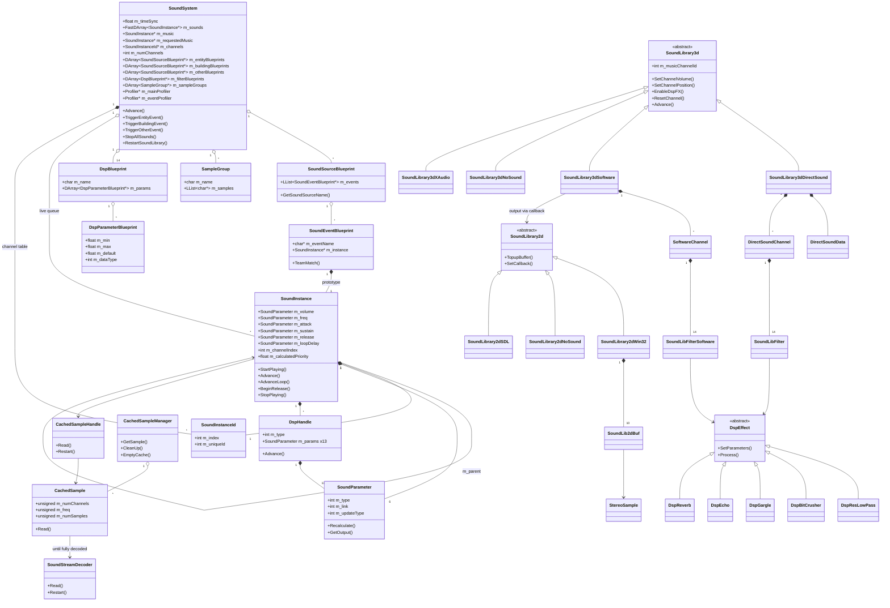
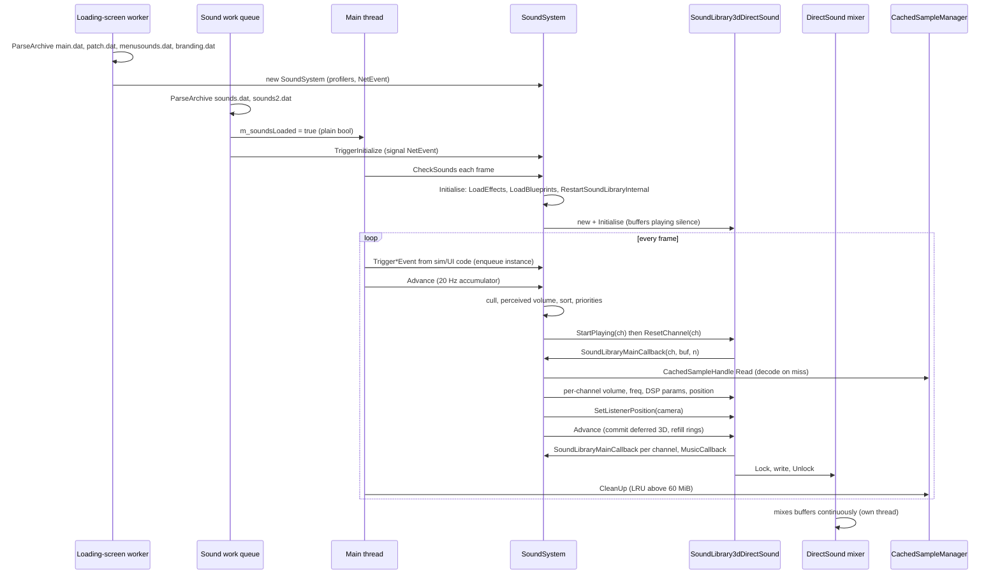
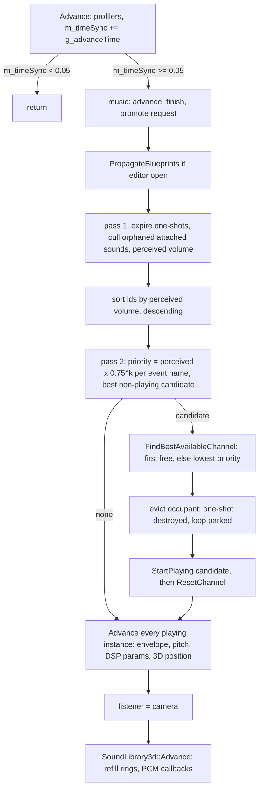
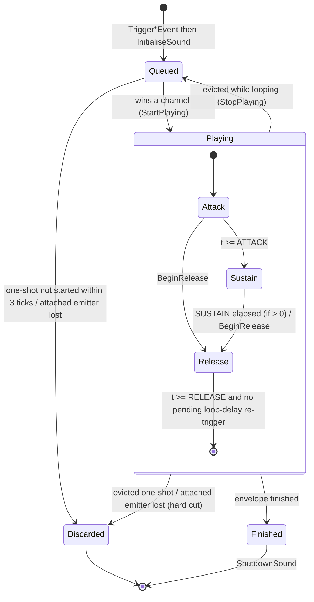
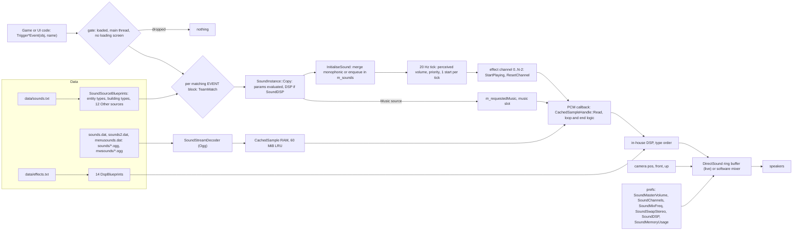

# 27 — Audio engine

> Part B · Baseline build: Release|Win32 (OpenGL) + TARGET_PC_FULLGAME ([B:FULL]); see _work/build_matrix.md.
> Evidence: [C] confirmed · [I] inferred · [U] unknown. Citations are `path:Symbol` relative to the multiwinia/ source root.
> Sources merged: P16_sound (primary: routed §27.1–27.15, plus the engine-level parts of its §10.4–10.7, §09.1, determinism notes and appendix), P01_app_core (main-loop pump sites, sound work queue, shutdown), P14_platform_lib (sound archives, audio-device detection, DirectX version check), P17a_ui_framework_editor and P17b_menus_options (debug-menu / cheat-window entry points, preference defaults), P19_help_tutorial_script (music script op-codes), P12_render_core (`EffectProcessor` note). Every [C] below was re-read in `code/sound/*` and its callers at commit `f909630`; numeric constants were spot-verified one by one.

Conventions used throughout:

- **vol units**: the engine's 0.0–10.0 logarithmic volume scale used by data (`VOLUME`), the envelope and every `SetChannelVolume` call.
- **mB**: millibels (1/100 dB), the unit of DirectSound volume and of `SoundLibrary3d::m_masterVolume`.
- **wu**: world units; the code calls them metres (`code/sound/sound_instance.h:SoundInstance::m_minDistance` comment "Distance (m)").
- **tick**: one pass of the 20 Hz sound update (`SOUNDSYSTEM_UPDATEPERIOD` = 0.05 s, §3).
- **channel** = **voice**: one hardware/software playback slot owned by the device layer.
- Gameplay-facing audio design (what each event means, the `sounds.txt` content model, the per-event catalogue, positional design rules, music and ambience design, mix philosophy) is in [10_audio_design](10_audio_design.md). This document is the **engine**: how a triggered event becomes samples at the speakers.

## Contents

1. [Architecture, layering and build reality](#1-architecture-layering-and-build-reality)
2. [Lifecycle, loading and threading/callback model](#2-lifecycle-loading-and-threadingcallback-model)
3. [Update rate: the 20 Hz tick](#3-update-rate-the-20-hz-tick)
4. [Triggering: from game event to queued instance](#4-triggering-from-game-event-to-queued-instance)
5. [Voice (channel) management](#5-voice-channel-management)
6. [Sound instances and parameters](#6-sound-instances-and-parameters)
7. [Pitch handling and the game-speed modifier](#7-pitch-handling-and-the-game-speed-modifier)
8. [Music channel](#8-music-channel)
9. [Sample cache](#9-sample-cache)
10. [Streaming decoder (Ogg Vorbis / WAV)](#10-streaming-decoder-ogg-vorbis--wav)
11. [Device back-ends (2D/3D library abstraction)](#11-device-back-ends-2d3d-library-abstraction)
12. [DSP filter chain](#12-dsp-filter-chain)
13. [Profiles, statistics, debug and editor tooling](#13-profiles-statistics-debug-and-editor-tooling)
14. [Data flow: game event to audible output](#14-data-flow-game-event-to-audible-output)
15. [Determinism boundary](#15-determinism-boundary)
16. [Constants](#16-constants)
17. [Mapping to a modern engine (XAudio2 / WASAPI)](#17-mapping-to-a-modern-engine-xaudio2--wasapi)
- [Open questions and unknowns](#open-questions-and-unknowns)
- [Docs-vs-code discrepancies](#docs-vs-code-discrepancies)
- [IP items](#ip-items)
- [Source map](#source-map)
- [Appendix — dead/legacy code](#appendix--deadlegacy-code)

## 1 Architecture, layering and build reality

### 1.1 Layers

The audio stack is five layers plus a DSP side-branch [C] (`code/sound/*`):

| Layer | Class(es) | File(s) | Role |
|---|---|---|---|
| L4 Game binding | `SoundSystem`, `SoundSourceBlueprint`, `SoundEventBlueprint`, `SampleGroup`, `DspBlueprint`, `DspParameterBlueprint` | `code/sound/soundsystem.h`, `code/sound/soundsystem.cpp` | Loads `data/effects.txt` and `data/sounds.txt`; turns `Trigger*Event(object, eventName)` calls into queued `SoundInstance`s; runs the 20 Hz voice-allocation tick; owns the channel table and the single music slot; hosts the two always-on profilers |
| L3 Instance (voice logic) | `SoundInstance`, `SoundInstanceId`, `SoundParameter`, `DspHandle` | `code/sound/sound_instance.*`, `code/sound/sound_parameter.*` | Per-sound state: envelope, loop / loop-delay, pitch, 3D position tracking, parameter evaluation, DSP parameter feeding |
| L2 Sample data | `CachedSampleManager` (global `g_cachedSampleManager`), `CachedSample`, `CachedSampleHandle`, `SoundStreamDecoder` | `code/sound/sample_cache.*`, `code/sound/sound_stream_decoder.*` | Lazy, incremental decode-to-RAM cache of mono signed 16-bit PCM with 60 MiB LRU eviction; Ogg Vorbis (and unreachable WAV) decoding |
| L1 Device "3D library" | abstract `SoundLibrary3d` (global `g_soundLibrary3d`); `SoundLibrary3dDirectSound`, `SoundLibrary3dSoftware`, `SoundLibrary3dNoSound`, `SoundLibrary3dXAudio` | `code/sound/sound_library_3d*` | N−1 mono streaming effect channels + 1 music channel; per-channel volume / frequency / 3D position / min-distance / DSP; **pulls** PCM from L4 through two callbacks |
| L0 Device "2D library" | abstract `SoundLibrary2d` (global `g_soundLibrary2d`); `SoundLibrary2dWin32`, `SoundLibrary2dNoSound`, `SoundLibrary2dSDL` | `code/sound/sound_library_2d*` | Stereo 16-bit output stream; carries audio only for the software 3D library |
| DSP | abstract `DspEffect`; `DspResLowPass`, `DspBitCrusher`, `DspGargle`, `DspEcho`, `DspReverb` | `code/sound/sound_filter.*` | In-house per-channel filters on mono 16-bit blocks (DirectX FX types are created inside the DirectSound library) |

### 1.2 Back-end selection and what is live

Selection happens in `code/sound/soundsystem.cpp:SoundSystem::RestartSoundLibraryInternal` [C]:

| Build / condition | 2D library | 3D library | Tag |
|---|---|---|---|
| Win32 (`TARGET_MSVC`), pref `SoundLibrary` = `"dsound"` (default written by `code/lib/preferences.cpp:GetDefaultSoundLibrary` under `HAVE_DSOUND`) and an audio device present | `SoundLibrary2dWin32` (waveOut opened, idle) | `SoundLibrary3dDirectSound` | **[B:FULL] [B:D3D] — the shipped path** |
| Win32, pref `SoundLibrary` = any other string except `"none"` (the options screen writes `"software"` for option 0, but under `HAVE_DSOUND` it only offers option 1 = DirectSound) | `SoundLibrary2dWin32` | `SoundLibrary3dSoftware` | [B:FULL], reachable only by hand-editing `preferences.txt`; see 27-U3 (probable crash) |
| Win32, `g_systemInfo->m_audioInfo.m_preferredDevice == -1` (no waveOut device) **or** pref `SoundLibrary` = `"none"` | `SoundLibrary2dNoSound` | `SoundLibrary3dNoSound` | [B:FULL] |
| Non-MSVC (Mac/Linux) | `SoundLibrary2dSDL` | `SoundLibrary3dSoftware` | [B:DEAD] on PC |
| Xbox 360 (`HAVE_XAUDIO`) | — | `SoundLibrary3dXAudio` (whole translation unit inside `#ifdef HAVE_XAUDIO`; never instantiated by `RestartSoundLibraryInternal`) | [B:DEAD] |

Details [C]:

- `SoundLibrary2dWin32` is constructed **before** the 3D choice and therefore also under DirectSound. Its waveOut device is opened and the first four buffers ever created are queued full of silence (`code/sound/sound_library_2d_win32.cpp:SoundLib2dBuf::SoundLib2dBuf`, function-static counter `count < 4`). Its callback pointer is installed only by `SoundLibrary3dSoftware`'s constructor, so under DirectSound `WaveOutProc` never counts a refill request and `TopupBuffer()` does nothing.
- `m_preferredDevice` is only a presence flag. The device index it holds is never used to open anything: DirectSound opens the default device (`DirectSoundCreate8(NULL, …)`) and waveOut opens `WAVE_MAPPER` [C] `code/sound/sound_library_3d_dsound.cpp:SoundLibrary3dDirectSound::Initialise`, `code/sound/sound_library_2d_win32.cpp:SoundLibrary2dWin32::SoundLibrary2dWin32`. (Its scoring loop in `code/lib/system_info.cpp` is P14's; see [31](31_platform_build_and_tools.md).)
- `SoundLibrary3dNoSound::Initialise` returns true without setting `m_numChannels`, so `GetNumMainChannels()` returns the base-class value 0. If a device exists but `SoundLibrary = none` was hand-written, `RestartSoundLibraryInternal` release-asserts "Too few channels" [C/I: the assert is unconditional when `m_preferredDevice != -1`].
- DirectSound requires DirectX ≥ 9 (`AppReleaseAssert(g_systemInfo->m_directXVersion >= 9.0f, APP_NAME " requires DirectX9 or Greater")`) [C] `code/sound/sound_library_3d_dsound.cpp:SoundLibrary3dDirectSound::Initialise`.
- Linked libraries: `dsound.lib` (`targets/vs2005/Common.vsprops`), and the `vorbis_static`, `vorbisfile_static`, `ogg_static` sub-projects of `targets/vs2005/Darwinia.sln` (libvorbis 1.1.2, libogg 1.1.3 under `contrib/`) [C] build_matrix §1.

Compile-time switches that touch the engine [C] `code/lib/universal_include.h`:

| Macro | Baseline | Effect on the engine |
|---|---|---|
| `HAVE_DSOUND` | **on** (TARGET_MSVC block) | Compiles `SoundLibrary3dDirectSound`; options screen offers only DirectSound; default `SoundLibrary` = `dsound` |
| `USE_SOUND_DSPEFFECTS` | off (commented out) | Only the options-screen DSP check box and its write of pref `SoundDSP`; the runtime DSP switch is the preference itself (§12.1) |
| `USE_SOUND_HW3D` | off | Only the options-screen HW3D check box; pref `SoundHW3D` is still read |
| `USE_SOUND_MEMORY` | off | Only the options-screen memory drop-down and its `EmptyCache()` + stream-reopen on change; pref `SoundMemoryUsage` is still read (§6.6) |
| `SOUND_EDITOR` | off (TARGET_DEBUG only; force-undefined on Mac) | All sound tooling windows, `EffectProcessor` (§13) — [B:DEBUG] |
| `INVOKE_CALLBACK_FROM_SOUND_THREAD` | off (Mac only) | Mutex-protected variant where mixing runs on the SDL audio thread — [B:DEAD] on PC |
| `HAVE_XAUDIO` | off | Xbox 360 back-end — [B:DEAD] |
| `PROFILER_ENABLED` | off | `SoundLibrary3d::m_profiler` is never allocated (affects the software mixer, 27-U3) |
| `SOUNDSYSTEM_VERIFY` | off (commented `#define` in `code/sound/soundsystem.cpp`) | Per-tick `RuntimeVerify()` — [B:DEAD] |
| `TESTBED_ENABLED` | off | Extra mute in `NotReadyForGameSoundsYet` — [B:DEAD] |

### 1.3 Class diagram (every engine class)



The editor/tooling and options classes are drawn in a second class diagram in §13.3 (none of the tooling is on the runtime path) and listed in the catalogue below.

### 1.4 Class catalogue

| Class | Build | Role | Key members / behaviour | Ref |
|---|---|---|---|---|
| `SoundSystem` | [B:FULL] | Singleton `g_app->m_soundSystem`: blueprint store, live-instance queue, channel allocator, music slot, profiler host | §3–§8 | [C] `code/sound/soundsystem.h:SoundSystem` |
| `SoundSourceBlueprint` | [B:FULL] | All event bindings for one sound *source*: an Entity type, a Building type, or one of 12 "Other" sources (`Laser`, `Grenade`, `Rocket`, `AirStrikeBomb`, `Spirit`, `Sepulveda`, `Gesture`, `Ambience`, `Music`, `Interface`, `CratePowerup`, `MultiwiniaInterface`, enum order 0–11) | `m_events`; `GetSoundSourceName`/`GetSoundSoundType` (case-insensitive name ↔ index); `ListSoundEvents` (editor lists, content in 10) | [C] `code/sound/soundsystem.cpp:SoundSourceBlueprint::GetSoundSourceName` |
| `SoundEventBlueprint` | [B:FULL] | One `EVENT` block: event name + a prototype `SoundInstance` | `TeamMatch(teamId)` (§4) | [C] `code/sound/soundsystem.cpp:SoundEventBlueprint::TeamMatch` |
| `SampleGroup` | [B:FULL] | Named list of sample names (lower-cased, extension stripped) for random choice | `m_name[256]`, `m_samples` | [C] `code/sound/soundsystem.cpp:SoundSystem::ParseSampleGroup` |
| `DspBlueprint` | [B:FULL] | One filter type from `data/effects.txt`; its **index** in `m_filterBlueprints` is the filter type id and must equal the `SoundLibrary3d` FX enum order | `GetParameter(i, &min, &max, &default, &dataType)` | [C] `code/sound/soundsystem.cpp:SoundSystem::LoadEffects` |
| `DspParameterBlueprint` | [B:FULL] | Parameter descriptor: name, min, max, default, data type (0 = float, 1 = long) | drives packing in `DspHandle::Advance` and editor slider ranges | [C] `code/sound/soundsystem.h:DspParameterBlueprint` |
| `SoundInstanceId` | [B:FULL] | Weak handle `{m_index, m_uniqueId}`; equal iff both equal; invalid = (−1, −1). `m_uniqueId` from static `m_nextUniqueId` pre-incremented (first id = 1) | `GenerateUniqueId`, `SetInvalid` | [C] `code/sound/sound_instance.cpp:SoundInstanceId::GenerateUniqueId` |
| `SoundInstance` | [B:FULL] | Both the blueprint prototype (owned by a `SoundEventBlueprint`) and every live voice (a copy; `m_parent` points back to the prototype) | §6 | [C] `code/sound/sound_instance.h:SoundInstance` |
| `SoundParameter` | [B:FULL] | Scalar control: fixed, ranged-random or linked to a world quantity, with smoothing and update policy | §6.7 | [C] `code/sound/sound_parameter.h:SoundParameter` |
| `DspHandle` | [B:FULL] | One DSP effect on an instance: type id + `MAX_PARAMS` = 13 `SoundParameter`s | `Advance()` evaluates and packs params, calls `UpdateDspFX` | [C] `code/sound/sound_instance.cpp:DspHandle::Advance` |
| `CachedSampleManager` | [B:FULL] | Global sample cache keyed by sample name (`stdext::hash_map<std::string, CachedSample*>`), guarded by `NetMutex m_lock` | §9 | [C] `code/sound/sample_cache.h:CachedSampleManager` |
| `CachedSample` | [B:FULL] | Full-size PCM buffer for one file, filled incrementally from a decoder; lock count + last-used time | §9 | [C] `code/sound/sample_cache.cpp:CachedSample::Read` |
| `CachedSampleHandle` | [B:FULL] | Read cursor into a `CachedSample` (one per instance); ctor locks, dtor unlocks | `Read`, `Restart` | [C] `code/sound/sample_cache.cpp:CachedSampleHandle::Read` |
| `SoundStreamDecoder` | [B:FULL] | Ogg Vorbis (live) and WAV (unreachable) decoder to signed 16-bit | §10 | [C] `code/sound/sound_stream_decoder.cpp:SoundStreamDecoder::Read` |
| `SoundLibrary3d` | [B:FULL] | Abstract device: `m_numChannels` (incl. music), `m_sampleRate`, `m_masterVolume` (mB), `m_listenerPos`, two callbacks, FX enum, `m_musicChannelId`, `m_hw3dDesired`, `m_forceVolumeUpdate`, `m_profiler` | `SetMasterVolume`, `WriteSilence` (memset 0) | [C] `code/sound/sound_library_3d.cpp:SoundLibrary3d::SetMasterVolume` |
| `SoundLibrary3dDirectSound` | **[B:FULL] live** | DirectSound 8: one looping mono secondary buffer per channel + one music buffer, streamed by polling play cursors | §11.2 | [C] `code/sound/sound_library_3d_dsound.cpp` |
| `DirectSoundData` | [B:FULL] | Device, primary buffer, cached `DSCAPS`, static device-description text | | [C] `code/sound/sound_library_3d_dsound.cpp:DirectSoundData` |
| `DirectSoundChannel` | [B:FULL] | Per-channel buffer interfaces, ring state (`m_lastSampleWritten`, `m_simulatedPlayCursor`, `m_lastUpdate`, `m_silenceRemaining`, `m_channelHealth`), cached last-sent freq/volume/min-dist/pos/3D-mode, 14 filter slots | | [C] `code/sound/sound_library_3d_dsound.cpp:DirectSoundChannel` |
| `SoundLibFilter` | [B:FULL] | DirectSound filter slot `{DspEffect* m_userFilter, bool m_dxFilter}` | | [C] same file |
| `SoundLibrary3dSoftware` | [B:FULL], non-default | In-house mixer: pulls each channel into a mono buffer, applies in-house DSP, pans/attenuates into float L/R, block-normalises, outputs through `SoundLibrary2d` | §11.4 | [C] `code/sound/sound_library_3d_software.cpp` |
| `SoftwareChannel` | [B:FULL] | Per-channel mono buffer (`samplesPerBuffer × 48000/outRate × 3.1` samples), cached params, `m_oldVolLeft/Right`, `m_forceVolumeJump`, 14 filter slots | | [C] `code/sound/sound_library_3d_software.cpp:SoftwareChannel::SoftwareChannel` |
| `SoundLibFilterSoftware` | [B:FULL] | Software filter slot `{int m_chainIndex, DspEffect* m_userFilter}` | | [C] same file |
| `SoundLibrary3dNoSound`, `SoundLibrary2dNoSound` | [B:FULL] | Null devices: every call a no-op, `Initialise` returns true, `GetMaxChannels()` 0, `GetChannelHealth()` 1.0 | | [C] `code/sound/sound_library_3d.h:SoundLibrary3dNoSound`, `code/sound/sound_library_2d.cpp` |
| `SoundLibrary2d` | [B:FULL] | Abstract stereo output: `m_freq`, `m_samplesPerBuffer`, `SetCallback`, `TopupBuffer`, `Stop`, record-to-file hooks | | [C] `code/sound/sound_library_2d.h:SoundLibrary2d` |
| `SoundLibrary2dWin32` | [B:FULL] | waveOut stereo 16-bit: 10 × `SoundLib2dBuf`; `WOM_DONE` increments `m_fillsRequested`; `TopupBuffer()` (main thread) refills | §11.4 | [C] `code/sound/sound_library_2d_win32.cpp` |
| `SoundLib2dBuf` | [B:FULL] | One waveOut buffer of `SoundBufferSize` `StereoSample`s + `WAVEHDR` | | [C] `code/sound/sound_library_2d_win32.h:SoundLib2dBuf` |
| `StereoSample` | [B:FULL] | `{int16 m_left, m_right}` | | [C] `code/sound/sound_library_2d.h:StereoSample` |
| `DspEffect` and `DspResLowPass`, `DspBitCrusher`, `DspGargle`, `DspEcho`, `DspReverb` | [B:FULL] (inactive by default) | In-house DSP | §12.4 | [C] `code/sound/sound_filter.h` |
| `SoundLibrary2dSDL` | [B:DEAD] | SDL ring-buffer output (Mac/Linux) | Appendix | [C] `code/sound/sound_library_2d_sdl.cpp` |
| `SoundLibrary3dXAudio` | [B:DEAD] | Xbox 360 XAudio + X3DAudio 5.1 | Appendix | [C] `code/sound/sound_library_3d_xaudio.cpp` |
| `SoundEditorWindow`, `DspEffectEditor`, `SampleGroupEditor`, `RenameSampleGroupWindow`, `PurgeSoundsWindow` and their 30 button/menu classes; `SoundParameterEditor` family; `SoundStatsWindow`; `SoundProfileWindow`; `EffectProcessor` | [B:DEBUG] | Tooling | §13 | [C] `code/interface/soundeditor_window.cpp`, `code/interface/soundparameter_window.cpp`, `code/interface/soundstats_window.cpp`, `code/interface/sound_profile_window.cpp`, `code/effect_processor.cpp` |
| `PrefsSoundWindow`, `RestartSoundButton`, `VolumeControl` | [B:FULL] | Player-facing sound options (design in [09](09_meta_systems.md)); engine effects in §2.5 and §11.3 | | [C] `code/interface/prefs_sound_window.cpp`, `code/UI/soundsliderbutton.h:VolumeControl` |

Resolved: P17b/P18 drafts called `code/UI/soundsliderbutton.h` "never included → dead", while P16 documented its `VolumeControl` as the live master-volume slider. Code shows `code/interface/prefs_sound_window.h` includes `"UI/SoundSliderButton.h"` (case-insensitive on Windows) and `PrefsSoundWindow::Create` instantiates `VolumeControl` → **live** [C].

## 2 Lifecycle, loading and threading/callback model

### 2.1 Construction, archive loading and initialisation

[C] `code/app.cpp:App::App`, `App::Initialise`, `App::LoadSounds`, `App::CheckSounds`; `code/main.cpp:HandleCommonConditions`; `code/sound/soundsystem.cpp:SoundSystem::Initialise`:

1. **Archives, loading-screen worker thread.** `App::Initialise` (queued on `g_loadingScreen->m_workQueue`) parses `language.dat`, `main.dat`, `patch.dat`, `menusounds.dat`, `branding.dat`, then constructs `new SoundSystem()` — this allocates `m_mainProfiler`, `m_eventProfiler` and a `NetEvent m_initializedEvent`; no device yet.
2. **Sample archives, sound work queue.** Only after the loading-screen job finishes (the `App` constructor blocks in `g_loadingScreen->Render()`) does the PC build queue `SetWorkingThreadProcessor` and `App::LoadSounds` on the dedicated `App::m_soundsWorkQueue` thread — serialised because "unrar not thread safe". `App::LoadSounds` parses `sounds.dat` then `sounds2.dat`, sets the plain `bool App::m_soundsLoaded = true` (no memory barrier) and calls `SoundSystem::TriggerInitialize()` (signals `m_initializedEvent`). Archive contents and precedence (later archives override earlier ones; `sounds2 > sounds > branding > menusounds > patch > main`) are documented in [29](29_data_formats_reference.md) and [31](31_platform_build_and_tools.md).
3. **Device bring-up, main thread, first frame.** `HandleCommonConditions()` calls `App::CheckSounds()` every frame. While `!SoundSystem::IsInitialized()` it calls `SoundSystem::Initialise()` = `LoadEffects()` (`data/effects.txt` → 14 `DspBlueprint`s) + `LoadBlueprints()` (`data/sounds.txt` → source blueprints and sample groups; missing sources filled with empty blueprints) + `RestartSoundLibraryInternal()` (devices, channel table, callbacks; sets `m_isInitialized = true`). **This does not wait for `m_soundsLoaded`**: devices exist from the first frame, but every trigger is dropped until the sample archives are parsed (§2.2). Once initialised, every `CheckSounds()` also runs `g_cachedSampleManager.CleanUp()` (LRU, §9).
4. **Game-start barrier.** `SoundSystem::WaitIsInitialized()` loops `m_initializedEvent->Wait(1000 ms)` + `App::CheckSounds()` until `m_isInitialized`; called before launching a game from `code/UI/GameMenuWindow.cpp` (two sites), `code/UI/PlayGameButton.h` and `code/UI/RollingDemoButton.h` [C]. The loading screen additionally waits for `m_soundsLoaded` when `App::m_requireSoundsLoaded` is set (set at the end of `MainMenuLoop`) [C] `code/loading_screen.cpp`, `code/main.cpp:MainMenuLoop`.
5. **Shutdown.** `Finalise()` (if initialised): `g_soundLibrary2d->Stop()` (empty on Win32), delete `g_soundLibrary3d`, delete `g_soundLibrary2d` [C] `code/main.cpp:Finalise`. `~SoundSystem` deletes profilers, channel table, live instances, blueprints, groups and any remaining libraries; the global `g_cachedSampleManager`'s destructor calls `EmptyCache()` at static destruction [C] `code/sound/soundsystem.cpp:SoundSystem::~SoundSystem`, `code/sound/sample_cache.cpp:CachedSampleManager::~CachedSampleManager`.

Parsing notes relevant to the engine (the grammar itself is in [29](29_data_formats_reference.md)) [C] `code/sound/soundsystem.cpp:SoundSystem::ParseSoundEvent`, `ParseSoundEffect`, `ParseSampleGroup`:

- `SOUNDNAME` and group members are lower-cased and their extension removed at load; cache keys are therefore lower-case stems.
- `PRIORITY` is read and discarded ("backwards compatability, no longer used").
- `EFFECT <name>` resolves the name case-insensitively against `m_filterBlueprints` (debug-assert if unknown → type −1 in release, which would index `m_filterBlueprints[-1]` at runtime [I]). Its parameter lines are taken **in order** into `m_params[0..]`; the parameter name token on each line is not checked, and there is no bound check against `MAX_PARAMS` = 13 [C].
- Unknown ENTITY/BUILDING/OTHER names and unknown fields are only debug-asserted.
- `LoadtimeVerify()` exists (writes `sounderrors.txt`, release-asserts) but its call is commented out [C].

### 2.2 The game-sound gate

Every `Trigger*Event` returns immediately when `m_channels == NULL` or `SoundSystem::NotReadyForGameSoundsYet()` is true [C] `code/sound/soundsystem.cpp:SoundSystem::NotReadyForGameSoundsYet`:

| Condition | Consequence |
|---|---|
| `!g_app->m_soundsLoaded` | Nothing — not even menu sounds from the early `menusounds.dat` — can be triggered until `sounds.dat` + `sounds2.dat` are parsed |
| `g_loadingScreen->IsRendering()` | Triggers during loading screens are dropped |
| `NetGetCurrentThreadId() != g_app->m_mainThreadId` | Triggers from worker threads are dropped (the engine is single-threaded by contract) |
| `TESTBED_ENABLED` and testbed rendering off | [B:DEAD] |

Design consequence: requests are **dropped, not queued**. The lobby ambience polls this gate each frame and starts on the first frame it opens (`code/UI/GameMenuWindow.cpp:GameMenuWindow::Update`, `m_soundsStarted`) [C].

### 2.3 Threading and callback model

Baseline Win32 (`INVOKE_CALLBACK_FROM_SOUND_THREAD` undefined) [C]:

| Thread | What audio work it does | Synchronisation |
|---|---|---|
| Main thread | **Everything at runtime**: triggers, the 20 Hz tick, every `SoundLibrary3d` call, the DirectSound ring-buffer refills and therefore **every PCM callback** (`SoundLibraryMainCallback`, `SoundLibraryMusicCallback`), Ogg decoding on cache misses, in-house DSP, the software mixer (pulled by `SoundLibrary2d::TopupBuffer()` from the main loop and from `SoundLibrary3dSoftware::Advance`) | none needed |
| Sound work queue (`App::m_soundsWorkQueue`, affinity mask 0x55 via `SetWorkingThreadProcessor`, per [20](20_architecture.md)) | Parses `sounds.dat`, `sounds2.dat`; sets `m_soundsLoaded`; signals `m_initializedEvent` | plain bool; `NetEvent` |
| Loading-screen worker | Parses `menusounds.dat` (with `main.dat`); constructs `SoundSystem` | — |
| waveOut driver callback (`WaveOutProc`) | Increments `SoundLibrary2dWin32::m_fillsRequested` on `WOM_DONE` (only when a callback is installed, i.e. software mixer) | none — unsynchronised `unsigned int` shared with the main thread's decrement [I: benign race in practice, still a defect] (27-U13) |
| DirectSound internal mixer thread | Reads the secondary buffers the main thread fills | DirectSound `Lock`/`Unlock` |

`CachedSampleManager` holds a `NetMutex m_lock` around its hash map (taken in `GetSample`, `CleanUp`, `EmptyCache`, `GetMemoryUsage`; `CleanUp` re-enters it through `GetMemoryUsage`, relying on a recursive Win32 critical section) because the Mac build preloads on a worker [C] `code/sound/sample_cache.cpp`. Under `INVOKE_CALLBACK_FROM_SOUND_THREAD` (Mac) every public `SoundSystem` mutator and the software mixer callback lock `SoundSystem::m_mutex` [B:DEAD].



Consequences [C/I]:

- There is **no audio thread** of the engine's own. An underrun occurs only if the main loop stalls longer than a whole channel ring (DirectSound: 20000 samples ≈ 0.45 s at a 44.1 kHz playback rate; software path: 4 waveOut buffers in flight, ≈ 93 ms at 512 samples / 22050 Hz) [I from the sizes in §11].
- Decoding happens synchronously inside the fill on the first play of a sample (cache miss), so a burst of new long samples costs main-thread time [C] `code/sound/sample_cache.cpp:CachedSample::Read`.
- `MAIN_THREAD_ONLY` in the profiler is a no-op on Win32 [C] `contrib/systemiv/lib/profiler.cpp`.

### 2.4 Pump call sites (who calls `SoundSystem::Advance`)

[C] `code/main.cpp`, `code/loading_screen.cpp`, `code/loaders/loader.cpp`, `code/startsequence.cpp`:

| Loop | Calls | Build |
|---|---|---|
| `LocationGameLoop` (every Multiwinia match) | per rendered frame: `g_soundLibrary2d->TopupBuffer()` (early in the frame) and `SoundSystem::Advance()` (after explosions, before help/markers), each only if initialised; **after** `Renderer::Render`, a second `SoundSystem::Advance()` if `m_renderer->m_fps < 15` | [B:FULL] |
| `MainMenuLoop` (front end, lobby) | `SoundSystem::Advance()` once per frame (no direct `TopupBuffer`; the software library tops up inside its own `Advance`) | [B:FULL] |
| `LoadingScreen::Render` loop | `SoundSystem::Advance()` per loading-screen frame (`code/loading_screen.cpp:LoadingScreen::Render`) | [B:FULL] |
| `GlobalWorldGameLoop` | `SoundSystem::Advance()` per frame | [B:LEGACY] |
| `GlobalWorldEditorLoop` | `SoundSystem::Advance()` per frame | [B:LEGACY] |
| `LocationEditorLoop` | `SoundSystem::Advance()` per frame | [B:EDITOR] |
| `Loader::AdvanceSound` (`code/loaders/loader.cpp`), `code/startsequence.cpp` (start sequence update) | `Advance` (+ `TopupBuffer` in `Loader::AdvanceSound`) | [B:DEAD] (`USE_LOADERS`) |

### 2.5 Library restart

`SoundSystem::RestartSoundLibrary()` (options screen Apply; ignored if not yet initialised) → `RestartSoundLibraryInternal()` [C] `code/sound/soundsystem.cpp`:

1. Delete the channel table, `g_soundLibrary3d`, `g_soundLibrary2d`.
2. Read prefs `SoundMixFreq` (fallback 22050), `SoundMasterVolume` (255), `SoundChannels` (32), `SoundHW3D` (0), `SoundLibrary` (`"dsound"`); `bufSize = 20000`.
3. Create the libraries (§1.2); `SetMasterVolume(volume)`; `Initialise(mixrate, SoundChannels, hw3d, bufSize, bufSize × 10)`.
4. On failure **with** `hw3d`: debug-log and show a `MessageDialog` "Error" / "Failed to set requested sound settings" at (100, 100), set pref `SoundHW3D = 0`, recurse. On failure without `hw3d`: release-assert "Couldn't start the sound library".
5. `m_numChannels = GetNumMainChannels()`; release-assert `> 0` when a device exists; allocate `SoundInstanceId[m_numChannels]` (all invalid); install the two callbacks; `m_isInitialized = true`.

Effect on live sounds [C/I]: `SoundInstance`s survive in `m_sounds` but every channel slot is now invalid, so `IsPlaying()` is false for all of them. Looping sounds re-queue and restart from the start of their sample (or a fresh group member); one-shots keep whatever patience they had left when they first started (0–3 ticks; the counter only decrements while not playing) and, if they win a channel within it, replay from the beginning; the music instance keeps its `CachedSampleHandle` position and continues on the new music buffer (its `m_channelIndex` is not refreshed: correct for DirectSound where the id is always −1, stale for the software mixer if the channel count changed [I]). The options-screen Apply additionally calls `PropagateBlueprints()` or `StopAllDSPEffects()` depending on pref `SoundDSP` (§12.1) [C] `code/interface/prefs_sound_window.cpp:RestartSoundButton::MouseUp`.

## 3 Update rate: the 20 Hz tick

### 3.1 Accumulator

`#define SOUNDSYSTEM_UPDATEPERIOD 0.05f` (seconds) [C] `code/sound/soundsystem.cpp:SoundSystem::Advance`:

1. If `g_app->m_requestQuit && !m_quitWithoutSave` and `AreBlueprintsModified()` → cancel the quit. `AreBlueprintsModified()` returns `false` unconditionally ("Currently broken due to mod support"), so this never fires [C].
2. Return if `!m_channels` or `g_systemInfo->m_audioInfo.m_preferredDevice == -1` (null device: no tick at all).
3. `m_mainProfiler->Advance()`, `m_eventProfiler->Advance()` (every call, before the accumulator).
4. `m_timeSync += g_advanceTime`; if `m_timeSync >= 0.05` run **exactly one** tick and `m_timeSync -= 0.05`. There is no catch-up loop; surplus carries over.

Clock inputs [C] `code/main.cpp:UpdateAdvanceTime`: `g_advanceTime` is the real frame delta, capped at 0.25 s; while the game is paused it is not recomputed (the last value keeps being added); with pref `RecordDemo` 1 or 2 it is fixed at `1/DemoFrameRate` (default 25). The tick uses neither the simulation tick nor `g_gameTimer`.

Effective rate [C/I]: one tick per call while frames are shorter than 50 ms; at ≤ 20 fps one tick per frame and the backlog grows; below 15 fps `LocationGameLoop` calls `Advance()` twice per frame and each call adds `g_advanceTime` again, so up to two ticks per frame run (the accumulated time is double-counted). Envelopes and loop delays use the wall clock (`GetHighResTime()`), so tick rate changes only granularity and the voice-start rate, not durations.

### 3.2 Tick steps, in order

[C] `code/sound/soundsystem.cpp:SoundSystem::Advance` (profile section names in quotes):

| # | Step | Detail |
|---|---|---|
| 1 | Music ("Shutdown Music") | If `m_music`: `m_music->Advance()`; if it returns done → `ShutdownSound(m_music)`, `m_music = NULL`. Then if `m_music == NULL && m_requestedMusic` → promote: `m_music = m_requestedMusic`, `OpenStream(false)`, `m_channelIndex = g_soundLibrary3d->m_musicChannelId`, `ResetChannel(musicId)`, `SetChannelFrequency(musicId, sample native rate)` (§8) |
| 2 | "Propagate Blueprints" | If `m_propagateBlueprints` (true only while the Sound Editor window exists, [B:DEBUG]) → `PropagateBlueprints()` (§13) |
| 3 | "Allocate Sorted Array" | Function-static `SoundInstanceId` array, initial 128, doubled until ≥ `m_sounds.NumUsed()` |
| 4 | "Perceived Volumes" (pass 1) | For each live instance: if not playing and `m_loopType == SinglePlay` → `m_restartAttempts--`; if `m_restartAttempts < 0` → `ShutdownSound`; else if `Type3DAttachedToObject` and `GetAttachedObject() == NULL` → `ShutdownSound` (hard stop, no release); else `CalculatePerceivedVolume()` and append its id |
| 5 | "Sort Samples" | `qsort` ids by `m_perceivedVolume` descending (`SoundInstanceCompare`; ties unordered) |
| 6 | "Recalculate Priorities" (pass 2) | `m_calculatedPriority = m_perceivedVolume × M[eventName]`, per-event decay 0.75 (§5.3); remember the **non-playing** instance with the highest priority strictly > 0 |
| 7 | "Find best Channel", "Stop Old Sound", "Start New Sound", "Reset Channel" | If a candidate exists: `ch = FindBestAvailableChannel()`; evict the occupant (one-shot → `ShutdownSound`; looping → `StopPlaying()`); `StartPlaying(ch)`; on success `m_channels[ch] = id`, else `ShutdownSound(candidate)`; always `ResetChannel(ch)` |
| 8 | "Advance All Channels" ("Shutdown Sound") | For each channel with a live instance: `instance->Advance()`; if it returns done → `ShutdownSound` |
| 9 | — | `g_soundLibrary3d->m_forceVolumeUpdate = false` (set by `SetMasterVolume`, so each channel re-sends its volume once) |
| 10 | "UpdateListener" | Listener = camera: position `GetPos()`, front `GetFront()`, up `GetUp()` **negated unless** pref `SoundSwapStereo` = 1 (read every tick), velocity `GetVel() × 0.2` → `SetListenerPosition` |
| 11 | "SoundLibrary3d Advance" | Device pump: DirectSound commits deferred 3D settings and refills every ring (this is where most PCM callbacks run); the software library calls `TopupBuffer()` |



## 4 Triggering: from game event to queued instance

The design-level binding model (which events exist, layering several `EVENT` blocks, team-specific variants, the `sounds.txt` content) is in [10_audio_design](10_audio_design.md). Engine mechanics [C] `code/sound/soundsystem.cpp:SoundSystem::TriggerEntityEvent`, `TriggerBuildingEvent`, `TriggerOtherEvent` (two overloads), `InitialiseSound`:

| Entry point | Blueprint array (index) | Instance initial state | Team passed to `TeamMatch` |
|---|---|---|---|
| `TriggerEntityEvent(Entity*, name)` | `m_entityBlueprints[entity->m_type]` | `m_pos = entity->m_pos`, `m_vel = entity->m_vel`, `m_objIds += entity->m_id` | `entity->m_id.GetTeamId()` |
| `TriggerBuildingEvent(Building*, name)` | `m_buildingBlueprints[building->m_type]` | `m_pos = building->m_pos`, `m_objIds += building->m_id` (velocity 0) | building team |
| `TriggerOtherEvent(WorldObject* or NULL, name, type)` | `m_otherBlueprints[type]` | object `m_pos` and id if given; else origin, no id. **Music type** is diverted to the music slot (§8) | object team, or 255 when NULL |
| `TriggerOtherEvent(Vector3 pos, name, type, teamId)` | `m_otherBlueprints[type]` | `m_pos = pos`, no id (music is **not** diverted here) | `teamId` |

Per call, for **every** `EVENT` block of that source whose name matches case-insensitively (`stricmp`) and whose `TeamMatch` passes, a new `SoundInstance` is `Copy`'d from the block's prototype and passed to `InitialiseSound` [C]. `TeamMatch(team)`: false if the block has no prototype; true if `team == 255`; else `AllTeams` → true, `MyTeamOnly` → `team == g_app->m_globalWorld->m_myTeamId`, `EnemyTeamOnly` → `team != m_myTeamId` (both false when `m_globalWorld` is NULL) [C] `code/sound/soundsystem.cpp:SoundEventBlueprint::TeamMatch`.

`InitialiseSound(instance)` [C]:

- **Monophonic merge**: if the instance's `m_instanceType` is not `Polyphonic`, search `m_sounds` for any non-polyphonic instance with the same event name (`stricmp`); if found, append copies of the new instance's object ids to that instance and return false (the caller then deletes the new instance via `ShutdownSound`).
- Otherwise: `m_id.m_index = m_sounds.PutData(instance)`, `m_id.m_uniqueId = GenerateUniqueId()`, `m_restartAttempts = 3`, return true. The instance is now **queued** (not playing).
- There is no cap on queued instances (`FastDArray`); the only bound is the 3-tick patience of one-shots (§5.4).

`SoundInstance::Copy(prototype)` [C] `code/sound/sound_instance.cpp:SoundInstance::Copy`: copies name, position/instance/loop/source/team-match types, min distance, `strdup` of the full event name (`"<SourceName> <EventName>"`, built at load by `SetEventName`), the six parameters (each followed by one evaluation, §6.7), and — **only if pref `SoundDSP` ≠ 0 at copy time** — a copy of every `DspHandle`; sets `m_parent = prototype`. The envelope timer `m_adsrTimer` was already set to `GetHighResTime()` by the constructor, i.e. at trigger time.

Other public operations [C] `code/sound/soundsystem.cpp`:

| Operation | Semantics |
|---|---|
| `StopAllSounds(objId, partialName)` | If `partialName` contains `"Music"` → `m_music->BeginRelease(true)` (whatever music is playing) and nothing else. Otherwise for every instance whose **selected emitter** `m_objId == objId` and whose event name **contains** `partialName` (`strstr`; or all when NULL): playing → `BeginRelease(true)`, queued → `ShutdownSound`. An invalid `objId` matches instances whose `m_objId` was never set (2D and stationary sounds) |
| `TriggerDuplicateSound(instance)` | New instance `Copy`'d from the live instance (not the prototype), `m_parent` = original prototype, same pos/vel/object ids, normal `InitialiseSound`; if it is a `TypeInEditor` sound its id becomes `m_editorInstanceId` |
| `ShutdownSound(instance)` | Remove from `m_sounds` (if indexed), `StopPlaying()`, delete (releases its `CachedSampleHandle` → cache unlock) |
| `IsSoundPlaying(id)` | Index of the channel holding `id`, else −1 |
| `NumInstancesPlaying(objId, name)` | Count of channel occupants with exact (`stricmp`) event name and matching emitter (any if `objId` invalid). Latent defect: with a **valid** `objId` an empty channel dereferences NULL; every shipped caller passes an invalid id (`code/script.cpp`) [C] |
| `NumInstances(objId, name)` | Same over all queued + playing instances; used by `code/worldobject/rocket.cpp` to keep loops alive |
| `StopAllDSPEffects()` | Deletes every `DspHandle` of every live instance but never calls `DisableDspFX`; because `StopPlaying` disables channel DSP only when the instance still has handles, the device-side filters stay on those channels and keep processing later, unrelated sounds until a sound with DSP is started there (§12.1) [C] |
| `NumSoundInstances()`, `NumChannelsUsed()`, `NumSoundsDiscarded()` | live count; occupied channels; live − occupied (editor statistics) |

Caveat for game code [C]: `m_objId` (used by `StopAllSounds`, `NumInstances`, `NumInstancesPlaying`) is filled only by `GetAttachedObject()` during a tick, and never for 2D or stationary sounds. A "keep this loop alive" poll made before the next tick, or for a non-attached sound, sees 0 and may re-trigger (possible duplicate loops) [I] (27-U14). A new engine should record the emitter id at trigger time.

## 5 Voice (channel) management

### 5.1 Channel counts

| Rule | Value / formula | Ref |
|---|---|---|
| Requested channels | pref `SoundChannels` (generated default 32 by `GetDefaultSoundChannels`; code fallback 32; options 8 / 16 / 32 / 64; a 48 option is commented out because the software mixer needs powers of two) | [C] `code/sound/soundsystem.cpp:SoundSystem::RestartSoundLibraryInternal`, `code/lib/preferences.cpp:GetDefaultSoundChannels`, `code/interface/prefs_sound_window.cpp:PrefsSoundWindow::Create` |
| DirectSound effect channels | `min(SoundChannels, GetMaxChannels()) − 1`; `GetMaxChannels()` = 64, or `dwMaxHw3DStreamingBuffers − 2` when HW3D is desired **and** `Hardware3DSupport()` (`dwMaxHw3DStreamingBuffers > 3`). The music buffer is created in addition, so DirectSound owns `min(SoundChannels, max)` buffers in total | [C] `code/sound/sound_library_3d_dsound.cpp:SoundLibrary3dDirectSound::Initialise`, `GetMaxChannels`, `Hardware3DSupport` |
| Software effect channels | `SoundChannels` must be a power of two (release-assert "Num channels must be a power of 2"); channel N−1 is music; `GetNumMainChannels()` = N−1 | [C] `code/sound/sound_library_3d_software.cpp:SoundLibrary3dSoftware::Initialise`, `GetNumMainChannels` |
| Result at defaults | **31 effect voices + 1 music voice** (7/15/31/63 + 1 for the four options) | [C] from the two rows above |
| `SoundSystem::m_numChannels` | `g_soundLibrary3d->GetNumMainChannels()` — effect channels only; indices 0..N−2 | [C] `RestartSoundLibraryInternal` |

### 5.2 Perceived volume

[C] `code/sound/sound_instance.cpp:SoundInstance::CalculatePerceivedVolume`:

- `Type2D` and `TypeInEditor`: `perceived = 10.0` (the maximum), regardless of `VOLUME`.
- 3D (`Type3DStationary`, `Type3DAttachedToObject`): `d = |m_pos − cameraPos|`; `f = 1` if `d ≤ m_minDistance`, else `m_minDistance / d`; `base = m_channelVolume` (current envelope output) **if playing**, else `m_volume.GetOutput()` (peak target); `perceived = base × f`.

The units mix a logarithmic volume with a linear distance factor; the comparison is only used for ordering. Using the envelope output for playing sounds means a voice in a long release tail loses priority as it fades (the code comment explains this was added because long `RELEASE` values for echo tails were filling channels) [C].

### 5.3 Priority and the start rule

[C] `code/sound/soundsystem.cpp:SoundSystem::Advance`, `FindBestAvailableChannel`:

```
sort live instances by perceived volume, descending
M := empty map  eventName -> multiplier
for inst in sorted order:
    k := M.get(inst.eventName)              // full name, e.g. "Darwinian Attack"
    if k missing: inst.priority := inst.perceived ; M[name] := 0.75
    else:         inst.priority := inst.perceived * k ; M[name] := k * 0.75
    if not inst.playing and inst.priority > best: best := inst.priority ; candidate := inst   // best starts at 0.0
```

i.e. `priority = perceived × 0.75^k`, where k = number of louder instances of the same full event name this tick (1, 0.75, 0.5625, 0.421875, …). The decay map uses the event name exactly as stored (`BTree` keyed by string) [C].

| Rule | Value | Ref |
|---|---|---|
| Starts per tick | **at most 1** → ≤ 20 voice starts per second system-wide (more only when `Advance` runs twice per frame, §3.1) | [C] `SoundSystem::Advance` |
| Candidate | Highest-priority **non-playing** instance with priority **strictly > 0** (an instance whose volume evaluates to 0 never starts; a one-shot then expires) | [C] |
| Channel choice | First channel whose id does not resolve to a live instance; otherwise the channel whose occupant has the **lowest** `m_calculatedPriority` (strict `<`, so ties → lowest index; search seed 999999.9) | [C] `FindBestAvailableChannel` |
| Steal test | **None.** Verified: `Advance` never compares the candidate's priority with the victim's. When all channels are busy the candidate *always* replaces the lowest-priority occupant, even if the candidate's priority is lower. "Lowest priority" is perceived volume × same-event decay, so the victim is the quietest-*ranked* voice, not necessarily the quietest | [C] |
| Victim handling | One-shot (`SinglePlay`) victim → `ShutdownSound` (destroyed). Looping victim (`Looped`, `LoopedADSR`) → `StopPlaying()` (DSP disabled, channel slot cleared) and stays queued; when it next wins a channel, `OpenStream(false)` rewinds a single sample or picks a new random group member | [C] `SoundSystem::Advance`; `code/sound/sound_instance.cpp:SoundInstance::OpenStream` |
| Failed start | `StartPlaying` returns false only for an unset editor name containing `"???"`; the candidate is then destroyed. `ResetChannel(ch)` runs in every case | [C] `SoundInstance::StartPlaying` |

Design notes [I]:

- In a dense battle the lowest-ranked voice is replaced by the best queued sound every 50 ms regardless of relative loudness. The per-event 0.75 decay is the only "voice limit per sound type"; there is no hard per-event cap, no category budget and no authored priority (`PRIORITY` is ignored, §2.1).
- A parked loop and a queued candidate can alternate on a channel: the evicted loop is itself the best candidate on a later tick and steals back the lowest channel — nothing prevents this ping-pong, and each restart rewinds the loop.
- 2D sounds (perceived 10) outrank every 3D sound below volume 10 at any distance.

### 5.4 One-shot patience, orphans and monophonic emitters

| Rule | Behaviour | Ref |
|---|---|---|
| One-shot patience | `m_restartAttempts = 3` at `InitialiseSound`; pass 1 decrements it on every tick the one-shot is **not playing** (before the start attempt of that tick) and destroys it when it goes below 0. A one-shot therefore gets the start attempts of 3 ticks (it is first eligible on the first tick after triggering, 0–50 ms later) and is discarded on the 4th, i.e. 0.15–0.20 s after triggering. Looping sounds never expire while queued | [C] `SoundSystem::InitialiseSound`, `SoundSystem::Advance` |
| Orphans | A `Type3DAttachedToObject` instance whose `GetAttachedObject()` returns NULL (all emitters gone, or no emitter selectable, or `g_app->m_locationId == -1`) is destroyed in pass 1 **without release** (a hard cut). The graceful path in `Update3DPosition` (convert to stationary, final release) is therefore reached only if the emitter disappears between pass 1 and step 8 of the same tick (27-U5) | [C] `SoundSystem::Advance`; `SoundInstance::GetAttachedObject`, `Update3DPosition` |
| Monophonic merge | §4: one shared instance per event name; new triggers add emitter ids | [C] `SoundSystem::InitialiseSound` |
| Emitter selection | Re-selected when the current `m_objId` no longer resolves, or every tick for `MonophonicNearest`, or right after a (re)start for `MonophonicRandom`. Dead ids are pruned first. `Polyphonic` → first id; `MonophonicRandom` → `AppRandom() % n`; `MonophonicNearest` → id with the smallest squared camera distance, **seeded at 99999.9**, so only emitters closer than √99999.9 ≈ 316.2 wu can be chosen | [C] `SoundInstance::GetAttachedObject` |
| Consequence of the 316 wu seed | If the instance has no valid current emitter (always true on its first tick) and no emitter is within 316.2 wu of the camera, `m_objId` stays invalid → `GetAttachedObject()` returns NULL → the instance is culled in the same pass 1. With the shipped data this affects the three `MonophonicNearest` blocks (`Darwinian Create`, `Darwinian Attack`, `EscapeRocket Unhappy`): they are audible only while the camera is within ≈ 316 wu of an emitting object (27-U8) | [C] mechanism; [I] audible effect |

### 5.5 Worked example

31 effect channels are busy; the occupants' priorities range 0.40–9.0. During one tick three instances are queued (generic event names): `Explosion` (one-shot, perceived 6.0), a second copy of the polyphonic one-shot `Gunfire` (perceived 4.0; a louder copy is already playing, so its priority is 4.0 × 0.75 = 3.0) and an ambient loop that was evicted last tick (perceived 0.30).

- Tick 1: pass 2 picks `Explosion` (6.0). `FindBestAvailableChannel` returns the channel of the 0.40 occupant; it is a one-shot, so it is destroyed; `Explosion` starts there and `ResetChannel` starts its audio at the DirectSound write cursor.
- Tick 2: the `Gunfire` copy (3.0) is the best candidate. The lowest occupant is now a loop ranked 0.45; it is parked (stopped, still queued) and `Gunfire` takes its channel.
- Tick 3: the parked loop (0.45) outranks the ambient loop (0.30) and steals the lowest occupant's channel — say a one-shot ranked 0.50, which is destroyed although it was louder than the loop (the no-compare rule).
- Tick 4: the ambient loop (0.30) is the only candidate and again steals the lowest occupant.
- Had the `Gunfire` copy lost on three consecutive ticks, it would have been discarded on the fourth.

## 6 Sound instances and parameters

### 6.1 Enumerations (engine values)

[C] `code/sound/sound_instance.h:SoundInstance`, `code/sound/sound_parameter.h:SoundParameter`; names as printed by the `Get*TypeName` functions (and written to `sounds.txt`):

| Enum | Values |
|---|---|
| Position type | 0 `Type2D`, 1 `Type3DStationary`, 2 `Type3DAttachedToObject` (constructor default), 3 `TypeInEditor` |
| Instance type | 0 `Polyphonic` (default), 1 `MonophonicRandom`, 2 `MonophonicNearest` |
| Loop type | 0 `SinglePlay` ("PlayOnce", default), 1 `Looped` ("Loop"), 2 `LoopedADSR` ("LoopADSR") |
| Source type | 0 `Sample` (default), 1 `SampleGroupRandom` |
| ADSR state | 0 `StateAttack` (initial), 1 `StateDecay` (never entered), 2 `StateSustain`, 3 `StateRelease` |
| Team match type | 0 `AllTeams` (default), 1 `MyTeamOnly`, 2 `EnemyTeamOnly` |
| Parameter type | 0 `TypeFixedValue`, 1 `TypeRangedRandom`, 2 `TypeLinked` |
| Parameter link | 0 `Nothing`, 1 `HeightAboveGround`, 2 `Xpos`, 3 `Ypos`, 4 `Zpos`, 5 `Velocity`, 6 `CameraDistance` |
| Parameter update type | 0 `UpdateConstantly`, 1 `UpdateOnceEveryRestart` (written `UpdateOncePerLoop`) |

Constructor defaults [C] `code/sound/sound_instance.cpp:SoundInstance::SoundInstance`: sound name `"[???]"` (never plays), min distance 100.0 wu, VOLUME fixed 7.0, FREQUENCY fixed 1.0, ATTACK/SUSTAIN/RELEASE/LOOPDELAY fixed 0, `m_calculatedPriority` 128.0, `m_channelIndex` −1, `m_restartOccured` true, `m_restartAttempts` 0 (set to 3 by `InitialiseSound`), `m_adsrTimer = GetHighResTime()`.

### 6.2 Instance state machine

The code stores only `m_adsrState`, `m_channelIndex` and `m_loopDelayTimer`; the outer states below are derived [C] `code/sound/sound_instance.cpp`, `code/sound/soundsystem.cpp`:



`StopPlaying()` disables channel DSP if the instance has DSP handles, sets `m_channelIndex = −1` and invalidates every channel slot holding this id. `IsPlaying()` ≡ `GetChannelIndex() != −1`, where `GetChannelIndex()` returns the index only if `0 ≤ idx < m_numChannels` **and** `m_channels[idx] == m_id` — so eviction by another instance silently makes the old one "not playing" [C] `SoundInstance::StopPlaying`, `GetChannelIndex`.

### 6.3 Envelope (ADSR) — exact

Evaluated in `UpdateChannelVolume()` at `StartPlaying` and on every tick while playing; all times from `GetHighResTime()` (wall clock) [C] `code/sound/sound_instance.cpp:SoundInstance::UpdateChannelVolume`:

| State | Output `vol` | Transition |
|---|---|---|
| Attack | `frac = ATTACK > 0 ? min(t / ATTACK, 1) : 1`; `vol = VOLUME × frac` | when `NearlyEquals(frac, 1)` (difference < 1e-6) → timer := now, state Sustain |
| Sustain | `vol = VOLUME` | if `SUSTAIN > 0` and `now ≥ timer + SUSTAIN` → `BeginRelease(false)` (SUSTAIN is a **hold duration**; 0 = hold until stopped or the sample ends) |
| Release | `frac = RELEASE > 0 ? min(t / RELEASE, 1) : 1`; `vol = VOLUME × (1 − frac)` | finished when `frac ≈ 1` **and** `m_loopDelayTimer ≈ 0` |

- `t = now − m_adsrTimer`. The timer starts in the **constructor** (trigger time), so time spent queued eats into the attack.
- `m_channelVolume = clamp(vol, 0, 10)` → `SetChannelVolume(channel, m_channelVolume)`.
- `NearlyEquals(a, b)` ≡ `|a − b| < 1e-6` [C] `code/lib/math_utils.h`.
- Because the device maps vol units logarithmically (§11.3), linear-in-vol ramps are **linear in dB** (exponential in amplitude), and they are quantised to the 20 Hz tick. A release ends at vol 0 = −50 dB on DirectSound and the voice is then cut.
- VOLUME, ATTACK, SUSTAIN and RELEASE are re-evaluated on each call (subject to their update type), so linked or random values move the envelope live.

`BeginRelease(final)` [C] `SoundInstance::BeginRelease`: if not already in Release → state Release, timer := now, and for `LoopedADSR` with `final == false`: if `LOOPDELAY ≈ 0` → `SoundSystem::TriggerDuplicateSound(this)` immediately, else arm `m_loopDelayTimer = now`. Independently, `final == true` on a `LoopedADSR` instance already in Release clears `m_loopDelayTimer` (cancels the pending re-trigger). Callers: sustain timeout (non-final); end of a one-shot's silence tail (non-final); `StopAllSounds` (final); music replacement (final); emitter lost in `Update3DPosition` (final, loops only); editor Stop (final).

### 6.4 Loop logic and end-of-sample handling (inside the PCM callback)

`SoundSystem::SoundLibraryMainCallback(channel, buf, capacity, n, &silenceRemaining)` [C] `code/sound/soundsystem.cpp`:

1. Look up the instance on `m_channels[channel]`; if none or no sample handle → write silence, return false.
2. `written = handle->Read(buf, n)`. If `written < n`, by loop type:

| LOOPTYPE | End-of-sample behaviour |
|---|---|
| 0 `SinglePlay` | First short read: write silence for the rest and set `silenceRemaining = GetChannelBufSize(channel) − remainder`. Later fills (read returns 0): write silence and `silenceRemaining −= n`; when ≤ 0 → `BeginRelease(false)`; the instance finishes after RELEASE. On DirectSound the voice therefore keeps its channel for ≈ one ring of silence (20000 samples) so the already-buffered tail plays out. On the software mixer `GetChannelBufSize()` returns 0 and the counter is a per-call local initialised to −1, so release starts on the **next** fill after the end (≈ one waveOut block) |
| 1 `Looped` | Repeatedly call `AdvanceLoop()`: if `LOOPDELAY ≈ 0` → `OpenStream(false)` and keep filling (a `Sample` rewinds; a `SampleGroupRandom` source **picks a new random member**). Else arm `m_loopDelayTimer = now` and write silence; on later fills, once `now ≥ timer + LOOPDELAY` → `OpenStream(false)`, timer := 0, continue. Runs until stopped |
| 2 `LoopedADSR` | Each pass: if a loop-delay re-trigger is armed and due → `TriggerDuplicateSound(this)`, timer := 0. Then `OpenStream(true)` (rewind the **same** sample) and keep filling |

3. Return true (audio written). The per-event profiler brackets the work.

Notes [C/I]:

- `LoopedADSR` + `SUSTAIN > 0` produces overlapping "notes": at the start of each Release a duplicate is spawned (immediately, or at the first sample wrap after `LOOPDELAY` has elapsed — the due check runs only inside the fill), so notes cross-fade; with a sample group each duplicate picks a new random member. The releasing original stays alive (silently) until its re-trigger has fired.
- On DirectSound the fill runs up to ≈ 0.45 s ahead of playback (§11.2), so loop and end decisions are made that far ahead, while volume changes take effect at the next tick.
- A zero-length sample in a `Looped` block with `LOOPDELAY = 0` would spin forever in the fill loop [I] (no shipped instance).
- `SoundLibraryMusicCallback` applies the identical logic to `m_music` (§8).

`OpenStream(keepCurrent)` [C] `SoundInstance::OpenStream`: sets `m_restartOccured = true`; if a handle exists and (`keepCurrent` or source is `Sample`) → `Restart()` (rewind cursor) and return. Otherwise delete the handle; for `SampleGroupRandom` look up the group (release-assert if missing), `n = groupSize`, `n × 0.5` if pref `SoundMemoryUsage` = 2, `n × 0.25` if 3 (truncated), `n = max(n, 1)`, choose member `AppRandom() % n` — lower memory settings only ever use the **first** ½ or ¼ of each group; then `g_cachedSampleManager.GetSample(name)`.

### 6.5 StartPlaying, per-tick Advance and 3D position

`StartPlaying(ch)` [C] `SoundInstance::StartPlaying`:

1. Refuse (return false) if the sound name contains `"???"`.
2. `OpenStream(false)`; `m_channelIndex = ch`.
3. `SetChannel3DMode(ch, 1)` (head-relative) for `Type2D` / `TypeInEditor`, else `SetChannel3DMode(ch, 0)` (world).
4. `SetChannelMinDistance(ch, m_minDistance)`.
5. Evaluate FREQUENCY; `SetChannelFrequency(ch, nativeRate × FREQUENCY × GetFrequencyModifier(positionType))` (§7).
6. `UpdateChannelVolume()`; `Update3DPosition()`; `SetChannelPosition(ch, m_pos, m_vel)`.
7. If the instance has DSP handles: `Initialise` each and `EnableDspFX(ch, n, types[])` (local array of 16 ints, no bound check).

`Advance()` per tick while playing [C] `SoundInstance::Advance`: envelope (return true = finished, stop here); recompute frequency the same way — values `< 0` or `> 144000` (3 × 48000) are skipped with a debug log; `DspHandle::Advance()` for each effect (§12.3); `Update3DPosition()`; clear `m_restartOccured`.

`Update3DPosition()` [C] `SoundInstance::Update3DPosition`:

| Position type | Behaviour |
|---|---|
| `Type2D` | `m_pos = m_vel = 0`; no device call (head-relative at the listener) |
| `Type3DStationary` | Unchanged (position captured at trigger time) |
| `Type3DAttachedToObject` | Follow the selected emitter's `m_pos` / `m_vel`; buildings use `Building::m_centrePos`; `SetChannelPosition` every tick. If the emitter is gone: become `Type3DStationary`, velocity 0, send position, and loops get `BeginRelease(true)` (normally pre-empted by the pass-1 hard cull, §5.4) |
| `TypeInEditor` | `(m_editorPos.x, 0, m_editorPos.z)`, velocity 0, head-relative |

### 6.6 Memory-usage preference

Pref `SoundMemoryUsage` (1 high = default, 2 medium, 3 low) is read at every `OpenStream` in the baseline even though its options-screen control is compiled out (`USE_SOUND_MEMORY`) [C] `code/sound/sound_instance.cpp:SoundInstance::OpenStream`, `code/interface/prefs_sound_window.cpp`. It does not change the cache limit; it only restricts group variety (§6.4).

### 6.7 `SoundParameter` evaluation (engine semantics)

The design meaning of each parameter and the shipped usages are in [10_audio_design](10_audio_design.md). Engine rules [C] `code/sound/sound_parameter.cpp:SoundParameter::Recalculate`, `code/sound/sound_instance.cpp:SoundInstance::UpdateParameter`:

| Type | Stored fields | Output per evaluation |
|---|---|---|
| `TypeFixedValue` | `m_outputLower` | `out = m_outputLower` |
| `TypeRangedRandom` | `lo, hi, smooth` | `target = lo + frand(hi − lo)` with `frand(r) = r × AppRandom() / 32767` (can equal `hi`); `out = target × (1 − √smooth) + out_prev × √smooth` |
| `TypeLinked` | `inLo, outLo, inHi, outHi, smooth, link` | `x` from the link; if `x ≤ inLo` and `x ≤ inHi` → `target = (inLo < inHi) ? outLo : outHi`; if `x ≥ inHi` and `x ≥ inLo` → `target = (inLo < inHi) ? outHi : outLo`; else `target = outLo + (x − inLo)/(inHi − inLo) × (outHi − outLo)`; smoothed as above |

Link inputs, evaluated at the instance position — or at the **camera** position/velocity for `Type2D` sounds: `Nothing` → 0; `HeightAboveGround` → `pos.y − landscape height(pos.x, pos.z)` (0 height without a location); `Xpos`, `Ypos`, `Zpos` → coordinates; `Velocity` → `|vel|`; `CameraDistance` → `|camera − pos|` [C] `SoundInstance::UpdateParameter`.

Evaluation schedule [C]:

| When | Parameters evaluated |
|---|---|
| `SoundInstance::Copy` (trigger) | all six, once each (`m_restartOccured` is still true from the constructor) |
| `StartPlaying` | FREQUENCY, then ATTACK, SUSTAIN, RELEASE, VOLUME (via `UpdateChannelVolume`) |
| Every tick while playing (`Advance`) | ATTACK, SUSTAIN, RELEASE, VOLUME, FREQUENCY, then all 13 parameters of every DSP handle |
| Inside the fill on sample end (`AdvanceLoop`) | LOOPDELAY |
| While queued | none (perceived volume uses the VOLUME output from `Copy`) |

`UpdateOnceEveryRestart` parameters are evaluated only when `m_restartOccured` is set — at trigger, at start and on the first tick after each `OpenStream` (start or loop restart); the flag is cleared at the end of `Advance` [C].

Smoothing state (resolved — the P16 draft said every smoothed parameter starts from 0): `SoundParameter::Copy` copies type, link, update type, ranges and smooth but **not** `m_output`. The previous output used by the first evaluation of a fresh instance is therefore: FREQUENCY **1.0** (the constructor's own evaluation of fixed 1.0), ATTACK / SUSTAIN / RELEASE / LOOPDELAY **0**, VOLUME **the prototype's last output** (`SoundInstance::Copy` first assigns the whole struct `m_volume = prototype.m_volume`), DSP parameters **the prototype's last output** (whole-struct copy in `DspHandle::Copy`) [C] `code/sound/sound_parameter.cpp:SoundParameter::Copy`, `code/sound/sound_instance.cpp:SoundInstance::Copy`, `DspHandle::Copy`. Consequence [I]: a smoothed `UpdateOncePerLoop` FREQUENCY gets three evaluations before the first tick ends and then one per loop; e.g. the shipped ambience pitch `TypeRangedRandom 0.75 1.35 0.66 UpdateOncePerLoop` (√0.66 ≈ 0.812) starts each note at ≈ 0.54 × 1.0 + 0.46 × target, i.e. 0.88–1.16 instead of 0.75–1.35 (27-U10). Ten shipped parameter definitions use smoothing > 0 [C] `data/sounds.txt` (counted from the P16 parsed event table).

## 7 Pitch handling and the game-speed modifier

Channel playback frequency (Hz) = `sample native rate × FREQUENCY.GetOutput() × GetFrequencyModifier(positionType)`, sent at `StartPlaying` and every tick [C] `code/sound/sound_instance.cpp:SoundInstance::StartPlaying`, `SoundInstance::Advance`. Samples are never resampled by the engine on DirectSound: data is written at the native rate and the buffer's `SetFrequency` sets the playback rate (DirectSound's own resampler) [C] `code/sound/sound_library_3d_dsound.cpp:SoundLibrary3dDirectSound::SetChannelFrequency`. The software mixer resamples itself (nearest-lower sample, §11.4).

`GetFrequencyModifier(positionType)` [C] `code/sound/sound_instance.cpp:GetFrequencyModifier`:

- Returns 1.0 if not `App::Multiplayer()` (≡ `m_gameMode == GameModeMultiwinia`, i.e. any Multiwinia match including vs-CPU), or during the pre-game grace period (`Multiwinia::GameInGracePeriod()`), or for `Type2D` sounds.
- Otherwise updates a function-static smoother `s := 0.99 × s + 0.01 × g_gameTimer.GetGameSpeed()` (initial 1.0) **on every call** and returns `iv_sqrt(max(s, 0.01))`. It is called once per playing non-2D instance per tick plus once per start, so the effective smoothing time constant shrinks as the number of active 3D voices grows (with 30 voices ≈ 600 updates/s, τ ≈ 0.17 s; with 1 voice ≈ 20 updates/s, τ ≈ 5 s) [C/I].
- Effect [I]: world sounds pitch-bend with game speed. The game-over slow-down to speed 0 (`code/multiwinia.cpp`, game-over block) yields a "tape stop" down to √0.01 = 0.1× pitch; slow/fast game-speed effects bend proportionally to √speed. 2D/UI sounds and music are unaffected.
- Interactions [C]: `TypeInEditor` is not exempt (only `Type2D` is). The smoother state is global and never reset between matches.

Limits [C]: instance code skips frequencies outside 0–144000 Hz (3 × 48000) with a debug log; the software mixer clamps to 144000 Hz; DirectSound itself accepts `DSBFREQUENCY_MIN`..`DSBFREQUENCY_MAX` (100–200000 Hz per the DirectSound documentation [I]); the editor range for FREQUENCY is 0.0–3.0 [C] `code/interface/soundeditor_window.cpp:SoundEditorWindow::CreateInstanceEditor`.

## 8 Music channel

[C] `code/sound/soundsystem.cpp:SoundSystem::TriggerOtherEvent`, `SoundSystem::Advance`, `SoundSystem::SoundLibraryMusicCallback`, `SoundSystem::StopAllSounds`; `code/sound/sound_library_3d_dsound.cpp:SoundLibrary3dDirectSound::Initialise`; `code/sound/sound_library_3d_software.cpp:SoundLibrary3dSoftware::Initialise`:

| Aspect | Behaviour |
|---|---|
| Slots | Exactly one playing music instance (`m_music`) plus one pending request (`m_requestedMusic`). Music = any block of the `OTHER Music` source triggered through `TriggerOtherEvent(WorldObject*, …)` |
| Separation | Music instances never enter `m_sounds`, never compete for effect channels and never pass through `StartPlaying` (so no 3D mode change, no min-distance, no DSP enable) |
| Trigger | If the current music has the **same sound file name** → ignore (keeps playing; the freshly copied instance is leaked [C]). Else store as `m_requestedMusic` (a previous pending request is overwritten and leaked [C]) and `BeginRelease(true)` the current music |
| Swap | At the first tick after the old music reports finished (`m_music->Advance()` true): promote the request, `OpenStream(false)`, `m_channelIndex = m_musicChannelId`, `ResetChannel`, `SetChannelFrequency(native rate)`. No cross-fade: the old track fades by its own RELEASE (the shipped music blocks all have RELEASE 0 → immediate cut), the new one fades in by its ATTACK (timer started at trigger time) |
| Per-tick | `m_music->Advance()` — the full instance advance: envelope → `SetChannelVolume(musicId)`, FREQUENCY → `SetChannelFrequency(musicId)` (modifier 1.0 because music is `Type2D`), DSP parameter updates if any, position (2D no-op) |
| Fill | `SoundLibraryMusicCallback` with the same loop / one-shot logic as effect channels (§6.4), using `GetChannelBufSize(m_musicChannelId)` for the silence tail |
| Stop | `StopAllSounds(id, name)` with `strstr(name, "Music")` → `m_music->BeginRelease(true)` regardless of which track; `StopAllSounds(…, NULL)` does **not** stop music |
| Device | DirectSound: separate looping buffer of `bufSize × 10` = 200000 samples (≈ 4.5 s at 44.1 kHz), `m_musicChannelId = −1`, 3D disabled (mode 2), initial volume 10, initial frequency 44100 Hz. Software mixer: channel N−1, mode 2, volume 10 |
| Volume | Same 0–10 VOLUME/envelope and the global master volume; **no separate music volume** exists |

Reachability [C/I]: every `TypeMusic` trigger site is either Darwinia script content (`code/script.cpp:Script::RunCommand_TriggerSound`, scripts classified [B:LEGACY] in [30](30_scripting_tutorial_and_cutscenes.md)) or loader / start-sequence code compiled out by `USE_LOADERS` (`code/loaders/*_loader.cpp`, `code/startsequence.cpp`, [B:DEAD]). In a Multiwinia session the music channel therefore stays silent; what players hear as front-end "music" is the 2D lobby-ambience bed on effect channels ([10_audio_design](10_audio_design.md)). See 27-U2.

## 9 Sample cache

[C] `code/sound/sample_cache.cpp`, `code/sound/sample_cache.h`, `code/lib/resource.cpp:Resource::GetSoundStreamDecoder`:

| Aspect | Behaviour |
|---|---|
| Key | The sample name as passed (lower-case stem from the blueprint parser), `std::string` in `stdext::hash_map`; `m_cache[name]` creates the entry on first use |
| Lookup path | `"sounds/<name>"` first, then `"mwsounds/<name>"`. `Resource::GetSoundStreamDecoder` appends **`.ogg`** and opens a `BinaryReader` (a loose file under `data/` first, then the archive table). Failure on both → release-assert "Failed to open sound stream decoder". Resolved: the P16 draft said the resource layer resolves `.ogg` or `.wav`; code only ever requests `.ogg`, so the WAV decoder is unreachable from the cache |
| Case | Blueprint names are lower case while files on disk are mixed case (e.g. `data/mwsounds/CrateFall1.ogg`); lookups rely on the case-insensitive Windows file system for loose files and on the archive lookup for packed files [I] (27-U12; archive name matching is documented in [31](31_platform_build_and_tools.md)) |
| Construction | `CachedSample(name)` opens a decoder, reads channels / frames / rate and **allocates the full PCM buffer immediately** (`channels × frames × 2` bytes) but decodes nothing. Release-asserts: `0 < channels ≤ 8`, `0 < frames ≤ 268435456`, `0 < rate ≤ 192000`, `channels × frames ≤ 536870912` (1 GiB of 16-bit samples) — "probably a corrupted file" |
| Decode policy | **Incremental, on demand**: `CachedSample::Read(start, n)` decodes forward until `start + n − 1` is cached; once the whole file is decoded the decoder is deleted. First playback streams from the archive; later playbacks (and simultaneous handles) share the RAM copy |
| Mono only | `Read` release-asserts `m_numChannels == 1` ("%s is not mono audio") on every read — music included. All 1332 shipped Ogg files are mono; 1330 are 44.1 kHz and two are 22.05 kHz (`data/sounds/fodder.ogg`, `data/mwsounds/chat.ogg`) [C] Ogg header scan of `data/sounds/` and `data/mwsounds/` (helper S_27_ogg_scan.py in _work/scripts) |
| Handle | `CachedSampleHandle` = read cursor; ctor `Lock()`s the sample, dtor `Unlock()`s it and, when the lock count reaches 0, stamps `m_lastUsedTime = GetHighResTime()`. `Read(dst, n)` clamps to the remaining frames; `Restart()` rewinds to 0. Each `SoundInstance` owns at most one handle; switching sample or deleting the instance releases it |
| Eviction | `CachedSampleManager::CleanUp()`, called every frame from `App::CheckSounds`: `maxSize = 60 × 1024 × 1024` bytes (comment "Largest song takes 13 MB"); while total > max, evict the **unlocked** sample with the oldest `m_lastUsedTime` strictly older than now; stop when none is evictable. Locked (in-use) samples are never evicted, so the cache can exceed 60 MiB. Accounting counts the full allocation, decoded or not |
| Empty | `EmptyCache()` deletes everything (static destruction; and on a `SoundMemoryUsage` change under `USE_SOUND_MEMORY` [B:DEAD]) |
| Statistics | `GetMemoryUsage(total, unused)` → debug log every 60 s from `code/main.cpp:PrintAvailableMemory`; the options-screen readout that would show it is unreachable code |
| Mac | `Preload()` (2048- or 512-sample chunks on a low-priority thread) and LRU disabled (`maxSize = 0`) — [B:DEAD] |

Sizing facts [C] (same header scan, decoded size = frames × channels × 2 bytes): fully decoded, `data/sounds/` = 350.1 MiB and `data/mwsounds/` = 123.7 MiB, so the 60 MiB budget holds about one eighth of the library; the largest single file, `data/sounds/tresk_-_excuses.ogg` (344.6 s), decodes to 29.0 MiB — more than twice the "13 MB" in the comment.

## 10 Streaming decoder (Ogg Vorbis / WAV)

[C] `code/sound/sound_stream_decoder.cpp:SoundStreamDecoder`:

| Aspect | Behaviour |
|---|---|
| Format choice | By the `BinaryReader` file type (extension): `wav` → RIFF/WAVE parser; `ogg` → libvorbisfile; anything else → release-assert "Unknown sound file format" |
| Ogg open | `ov_open_callbacks(reader, …)` with read / seek / tell callbacks over the engine's `BinaryReader` (archive-backed memory or file) and a no-op close; non-zero result → release-assert "Ogg file corrupt"; `frames = ov_pcm_total(-1)` (release-assert > 0, "Ogg file contains no data"), `rate = vi->rate`, `channels = vi->channels` |
| Ogg read | Loop `ov_read(buf, bytes, host endianness, 16-bit, signed)` until the request is satisfied or a 0-byte read (EOF); `OV_HOLE` / `OV_EBADLINK` → release-assert "Ogg file corrupt". Other negative returns are not handled [I] |
| WAV (unreachable, §9) | Accepts only PCM (`fmt` tag 1), 1 or 2 channels, 8 or 16 bits (header fields otherwise leave the decoder half-initialised); 8-bit converted `(u8 − 128) << 8`; other chunks skipped; `frames = dataBytes / (channels × bits/8)`; the 16-bit path divides bytes by 2 regardless of channel count (correct only for mono) |
| Restart | WAV: seek to the data chunk; Ogg: `ov_raw_seek(0)`. Not used by the cache (handles rewind the RAM copy instead) |
| Output | Always signed 16-bit host-endian |
| Libraries | `vorbis_static`, `vorbisfile_static`, `ogg_static` sub-projects (libvorbis 1.1.2, libogg 1.1.3) [C] `targets/vs2005/Darwinia.sln`, `contrib/libvorbis-1.1.2/lib/vorbisfile.c` |

Pipeline: archive or loose file → `BinaryReader` → `SoundStreamDecoder` → `CachedSample` PCM buffer (filled on demand) → `CachedSampleHandle::Read` inside the PCM callback → device buffer. There is no separate streaming path for long files: the 344.6 s music track is "streamed" only in the sense that its decode is spread over the fills that first reach each region, while its whole 29 MiB buffer is allocated at open.

## 11 Device back-ends (2D/3D library abstraction)

### 11.1 The `SoundLibrary3d` contract

[C] `code/sound/sound_library_3d.h:SoundLibrary3d`. Channel index `m_musicChannelId` addresses the music channel; all other indices are effect channels `0..GetNumMainChannels()−1`.

| Method | Contract | DirectSound | Software | Null |
|---|---|---|---|---|
| `Initialise(mixFreq, numChannels, hw3d, mainBufSamples, musicBufSamples)` | Create device and channels; false on failure | §11.2 | power-of-two check, allocate channels | true |
| `SetMainCallback`, `SetMusicCallback` (base) | Install the PCM pull callbacks `bool(*)(channel, int16* buf, capacity, numSamples, int* silenceRemaining)` / music variant without channel | stored | stored | stored |
| `SetMasterVolume(0..255)` (base) | `m_masterVolume = (255 − v) × −32` mB; sets `m_forceVolumeUpdate` | — | — | — |
| `Hardware3DSupport()` | HW 3D streaming buffers available | `dwMaxHw3DStreamingBuffers > 3` | false | false |
| `GetMaxChannels()` | Upper bound on channels | 64 or HW count − 2 | 64 | 0 |
| `GetCPUOverhead()` | Stats only | `DSCAPS.dwPlayCpuOverheadSwBuffers` + Σ per-buffer `dwPlayCpuOverhead` | 1 | 0 |
| `GetChannelHealth(ch)` | 0 = bad, 1 = good | `h ≥ 0.5 → 1, else 2h` with `h = 1 − written/bufferSize` of the last refill | 1.0 | 1.0 |
| `GetChannelBufSize(ch)` | Ring size in samples (drives the one-shot silence tail) | 20000 (music 200000) | **0** | 0 |
| `GetNumMainChannels()` | Effect channel count | `m_numChannels` | `m_numChannels − 1` | 0 |
| `ResetChannel(ch)` | Refill immediately (new sound) | §11.2 | sets `m_forceVolumeJump` | no-op |
| `SetChannel3DMode(ch, mode)` | 0 = world 3D, 1 = head-relative, 2 = disabled | `DS3DMODE_NORMAL` / `HEADRELATIVE` / `DISABLE` | 0 → pan+distance; 1, 2 → centred | no-op |
| `SetChannelPosition(ch, pos, vel)` | World position and velocity | deferred, 5 % threshold | stored | no-op |
| `SetChannelFrequency(ch, hz)` | Playback rate | `SetFrequency` on change | clamp ≤ 144000, stored | no-op |
| `SetChannelMinDistance(ch, d)` | Full-volume radius | deferred, asserts 1 ≤ d ≤ 1e9 | stored | no-op |
| `SetChannelVolume(ch, 0..10)` | Logarithmic volume | §11.3 | stored | no-op |
| `EnableDspFX`, `UpdateDspFX`, `DisableDspFX` | Per-channel DSP | §12 | §12 | no-op |
| `SetListenerPosition(pos, front, up, vel)` | Listener | deferred | stored; `right = up × front` | no-op |
| `Advance()` | Device pump | commit + refill all rings | `g_soundLibrary2d->TopupBuffer()` | no-op |
| `WriteSilence(buf, n)` (base) | memset 0 | — | — | — |
| `StartRecordToFile`, `EndRecordToFile` | Record output | no-op | forwards to 2D library | no-op |

### 11.2 DirectSound (`SoundLibrary3dDirectSound`) — the live back-end [B:FULL]

[C] `code/sound/sound_library_3d_dsound.cpp`:

**Initialisation**

1. Release-assert DirectX ≥ 9 and `numChannels > 0`. `CoInitialize(NULL)` (needed for DirectX FX). `DirectSoundCreate8(NULL)` (default device). `SetCooperativeLevel(game window, DSSCL_PRIORITY)`. Cache `DSCAPS`.
2. `m_sampleRate = mixFreq` (pref `SoundMixFreq`, default 22050), `m_hw3dDesired = hw3d`, `m_numChannels = min(numChannels, GetMaxChannels()) − 1`, `m_musicChannelId = −1`.
3. Primary buffer `DSBCAPS_PRIMARYBUFFER | DSBCAPS_CTRL3D` (+ `LOCHARDWARE` if HW3D desired and available, else `LOCSOFTWARE`), format stereo 16-bit at `mixFreq`.
4. One **mono 16-bit looping secondary buffer per effect channel**: `DSBCAPS_CTRL3D | CTRLFX | CTRLFREQUENCY | CTRLVOLUME | GETCURRENTPOSITION2` (+ `LOCHARDWARE` or `LOCSOFTWARE`), nominal rate `mixFreq`, size 20000 samples (40000 bytes), 3D algorithm `DS3DALG_DEFAULT`; zero-filled and started (`Play(…, DSBPLAY_LOOPING)`) at creation; `m_lastSampleWritten = size − 1`; simulated cursor −1; cached freq = `mixFreq`; `IDirectSound3DBuffer` queried. A creation failure returns false (→ restart logic, §2.5).
5. Music buffer: same flags, 200000 samples; `SetChannel3DMode(music, 2)`, `SetChannelVolume(music, 10)`, `SetChannelFrequency(music, 44100)`.
6. Listener: `SetDopplerFactor(0, DS3D_IMMEDIATE)` — velocities have no audible effect. Rolloff factor and max distance are left at DirectSound defaults (1.0 and 1e9) [I from the absence of calls].

**Streaming (per tick, `Advance`)**

```
CommitDeferredSettings()                       // listener + all DS3D_DEFERRED channel changes
frame := (frame + 1) mod 4                     // function-static
for ch in effect channels, then music:
    if ch.simCursor == -1 or (ch & 1) == (frame & 1):
        playCursor := GetCurrentPosition()     // real cursor, every other tick per channel
        ch.simCursor := playCursor
    else:
        ch.simCursor := (ch.simCursor + elapsed * ch.freq * 2) mod bufBytes, even-aligned
        playCursor := (ch.simCursor - 1000 bytes) mod bufBytes          // 500-sample safety margin
        if playCursor is behind lastWritten: playCursor := lastWritten*2 + 2   // write nothing
    first := lastWritten + 1 ; count := playCursorAhead - first - 1      // samples [last+1, play-2]
    if count > 0: PopulateBuffer(ch, first mod size, count)
```

`PopulateBuffer` locks the region (two parts on wrap), calls the main or music callback for each part (`capacity = numSamples = part/2`), applies the channel's in-house filters in type order (§12.2), unlocks, sets `m_lastSampleWritten` and `m_channelHealth = 1 − count/size`. The ring is therefore kept almost **full ahead of the play cursor**: ≈ 20000 samples ≈ 0.45 s at a 44.1 kHz playback rate of look-ahead per channel, refilled by ≈ 0.05 s × rate samples per tick [C/I].

**New sound (`ResetChannel`)**: reads the real play and write cursors and refills from the **write cursor** up to the play cursor, overwriting the previous occupant's buffered audio, so a new sound starts after only the driver's play-to-write gap (27-U9) instead of 0.45 s. `m_channelHealth := 1` [C].

**Parameter calls** (values cached per channel; device calls only on change, volume also when `m_forceVolumeUpdate`):

| Call | DirectSound mapping |
|---|---|
| `SetChannelVolume` | `IDirectSoundBuffer::SetVolume(mB)` (§11.3), `DSERR_BUFFERLOST` → `Restore()` |
| `SetChannelFrequency` | `SetFrequency(hz)` |
| `SetChannelMinDistance` | `SetMinDistance(d, DS3D_DEFERRED)`; release-assert `DS3D_DEFAULTMINDISTANCE (1.0) ≤ d ≤ DS3D_DEFAULTMAXDISTANCE (1e9)` |
| `SetChannelPosition` | Skipped unless `dist²(new, lastSent) > 0.0025 × dist²(new, listener)` (moved > 5 % of the listener distance); then `SetPosition` + `SetVelocity` deferred |
| `SetChannel3DMode` | `SetMode(…, DS3D_IMMEDIATE)` |
| `SetListenerPosition` | `SetPosition`, `SetOrientation(front, up)` (skipped when either vector is zero — "Find the reason why sometime _up equals (0,0,0)"), `SetVelocity`, all deferred. The listener interface is obtained with `QueryInterface` on every call and never released (COM reference leak per tick) [C] |

Distance model [I from DirectSound's documented model with rolloff 1.0]: amplitude ∝ `minDist / d` beyond `minDist`, flat inside, no maximum distance in practice — the same law the software mixer and the priority calculation use. Panning/HRTF of `DS3DALG_DEFAULT` on software buffers is the driver's default (27-U1).

Errors: in Release `SOUNDASSERT` only logs (`AppDebugOut` with `DXGetErrorString9`); in `_DEBUG` it release-asserts. Lost buffers are restored. `DSEnumProc` / `m_hwDescription` exist but nothing calls `DirectSoundEnumerate` [C].

The 5 % position threshold has an edge case for head-relative (2D) sounds, whose position is (0,0,0): if the channel's last sent world position happened to lie within 5 % of the listener distance of the world origin, the update is skipped and the 2D sound plays at that stale offset [I] (not observed).

### 11.3 Volume curves (verified)

Input: channel volume `v` ∈ 0..10 vol units, master `m` ∈ 0..255 (pref `SoundMasterVolume`, default 255) [C] `code/sound/sound_library_3d.cpp:SoundLibrary3d::SetMasterVolume`, `code/sound/sound_library_3d_dsound.cpp:SoundLibrary3dDirectSound::SetChannelVolume`, `code/sound/sound_library_3d_software.cpp:SoundLibrary3dSoftware::CalcChannelVolumes`:

| Back-end | Formula | Per vol unit | v = 10 | v = 5 | v = 0 | Master step | m = 0 (with v = 10) | Floor |
|---|---|---|---|---|---|---|---|---|
| DirectSound | `mB = clamp(−(5 − v/2) × 1000 + M, −10000, 0)`, `M = (255 − m) × −32` | **500 mB = 5.00 dB** | 0 dB | −25 dB | −50 dB | 0.32 dB | −81.6 dB | −100 dB (`DSBVOLUME_MIN`, silence) |
| Software | `amp = exp(clamp(−(5 − v/2) + M/1000, −10, 0))` | **e^0.5 = 4.343 dB** | 1.0 (0 dB) | e^−2.5 (−21.7 dB) | e^−5 (−43.4 dB) | 0.278 dB | e^−8.16 (−70.9 dB) | e^−10 (−86.9 dB) |
| XAudio [B:DEAD] | same mB formula as DirectSound | 5 dB | | | | | | |

Verification: DirectSound `Δv = 1 → ΔmB = 0.5 × 1000 = 500 mB = 5 dB`; software `Δv = 1 → Δln(amp) = 0.5 → 20·log10(e^0.5) = 4.343 dB`; the master offset is added in mB (DirectSound) or as `M/1000` natural-log units (software, i.e. 0.032 neper ≈ 0.278 dB per step). The two curves therefore differ by 13 % in slope and the software mixer's master range is shallower. Additionally the software mixer's linear pan law gives each side 0.5 (−6.02 dB) for a centred 3D source but 1.0 for 2D/head-relative sources, so on that back-end 3D sounds sit 6 dB below 2D sounds of equal volume [C]. Recommendation for a new engine: adopt the DirectSound curve (what shipped) — 5 dB per unit, −50 dB at 0 — and treat 0 as "−50 dB", not silence (the header comment's "silence" is wrong, see Docs-vs-code discrepancies).

Master-volume changes apply immediately from the options slider (`VolumeControl::MouseDown` → `SetMasterVolume`, every channel re-sends its volume on the next tick via `m_forceVolumeUpdate`); the pref is written and saved on mouse-up [C] `code/UI/soundsliderbutton.h:VolumeControl`.

### 11.4 Software mixer (`SoundLibrary3dSoftware` + `SoundLibrary2dWin32`) [B:FULL, non-default]

[C] `code/sound/sound_library_3d_software.cpp`, `code/sound/sound_library_2d_win32.cpp`:

**Output device (`SoundLibrary2dWin32`)**: `waveOutOpen(WAVE_MAPPER, stereo 16-bit, SoundMixFreq — fallback 44100 here, CALLBACK_FUNCTION)`; release-asserts with a decoded error string when a device exists. 10 `SoundLib2dBuf` buffers of `SoundBufferSize` stereo samples (generated default 512, code fallback 2000), each `waveOutPrepareHeader`'d; only the first 4 ever created are queued with silence (function-static counter, never reset — so after a library restart nothing is primed and the new device may stay silent, 27-U4). `WaveOutProc` (driver thread) increments `m_fillsRequested` on `WOM_DONE`. `TopupBuffer()` (main thread) loops while `m_fillsRequested`: call the mixer callback for `m_buffers[m_nextBuffer]`, `waveOutWrite`, advance `m_nextBuffer` mod 10, decrement. Steady state: 4 buffers in flight ≈ 93 ms at 512 / 22050 (363 ms at the 2000 fallback). `Stop()` is empty. Record mode (`StartRecordToFile`): instead of waveOut, mixes `SoundMixFreq/20` samples 20 times per second (wall clock) into a raw headerless PCM file; nothing in the tree calls it (resolved: P16 attributed it to `AVI_GENERATOR`; no caller exists) [C].

**Mixer (`Callback(buf, n)`)**, invoked per waveOut buffer:

1. `duration = n / outputRate`.
2. `GetChannelData`: for every channel (music = N−1 uses the music callback), request `ceil(freq × duration + 0.5)` source samples if `freq < outputRate`, else `ceil(freq × duration − 0.5)`, into the channel's mono buffer (`samplesPerBuffer × 48000/outputRate × 3.1` samples); `m_containsSilence = !callbackResult`. The one-shot silence-tail counter is a per-call local (§6.4).
3. `ApplyDspFX`: for each channel, for each filter **type index** 0..13 with an in-house filter, `Process(buffer, samplesNeeded)`.
4. Zero float `m_left`, `m_right`; for each channel compute `(volL, volR)` with `CalcChannelVolumes`:
   - `amp` from §11.3;
   - mode 0 (world): `to = normalise(pos − listener)` (skip normalise at distance 0), `right = (to · listenerRight + 1)/2`, `left = 1 − right`; if `dist > minDist` both × `minDist/dist`; modes 1, 2: `left = right = 1`;
   - × `amp`.
5. Mix non-silent channels: if the channel was just reset (`m_forceVolumeJump`) **and** the gain changed by ≥ 0.003 on either side → linear ramp from the previous gains to the new ones across the block; otherwise constant gain. The member comment says the flag is meant to *prevent* ramping on a new sound — the logic is inverted, so ordinary volume changes step at block boundaries (zipper) while new sounds ramp in from the previous occupant's gain [C]. Resampling: `src[(int)(j × freq/outRate)]` (nearest-lower, no interpolation); a separate fast path when `freq == outRate`.
6. Block peak normalisation: if the block's largest |sample| > 32766 the **whole block** is scaled by `32766/peak` (acts as a block-rate limiter), then rounded to int16.

Probable crash [I]: `GetChannelData`, `ApplyDspFX` and `Callback` call `m_profiler->StartProfile/EndProfile`, but `SoundLibrary3d::m_profiler` is allocated only under `PROFILER_ENABLED`, which no baseline target defines — the pointer is uninitialised, so selecting the software library by hand-editing `SoundLibrary` almost certainly crashes in the first mix (27-U3).

### 11.5 Null device

`SoundLibrary3dNoSound` / `SoundLibrary2dNoSound` are used when no waveOut device exists (`m_preferredDevice == −1`) or pref `SoundLibrary = none` (the latter release-asserts "Too few channels" when a device does exist, §1.2). With no device, `RestartSoundLibraryInternal` allocates a zero-length (but non-NULL) channel table, so `Trigger*Event` still passes its `m_channels` check and queues instances, while `SoundSystem::Advance` returns before the tick (§3.1) — no pass ever runs, so **queued instances are never expired or freed** and `m_sounds` grows with every trigger for the whole session [C] `code/sound/soundsystem.cpp:SoundSystem::Advance`, `RestartSoundLibraryInternal`, `TriggerEntityEvent`. A new engine's null device must still retire requests.

### 11.6 Back-end comparison

| Property | DirectSound (live) | Software mixer | Null |
|---|---|---|---|
| Effect channels at default prefs | 31 | 31 | 0 |
| Data look-ahead per channel | ≈ 0.45 s (20000 samples @ 44.1 kHz) | 1 waveOut block per fill; 4 blocks in flight (≈ 93 ms) | — |
| New-sound latency | ≤ 1 tick (50 ms) + queue wait + DirectSound write-cursor gap | ≤ 1 tick + ≈ 4 blocks | — |
| Volume law | 5 dB / unit | 4.343 dB / unit | — |
| 3D | DirectSound 3D (inverse distance, driver pan, Doppler off) | inverse distance + linear pan | — |
| Resampling | DirectSound | nearest-lower sample | — |
| DirectX FX (types 0–8) | yes | no (ignored) | — |
| In-house DSP (types 9–13) | yes | yes | — |
| Output limiter | none (DirectSound mixer) | block peak normalisation | — |

## 12 DSP filter chain

### 12.1 Gating — DSP is off in the shipped configuration

[C] `code/sound/sound_instance.cpp:SoundInstance::Copy`, `code/lib/preferences.cpp:GetDefaultSoundDSP`, `code/interface/prefs_sound_window.cpp:RestartSoundButton::MouseUp`:

- The runtime switch is the preference `SoundDSP`, read in `SoundInstance::Copy`: only when it is non-zero are the prototype's `DspHandle`s copied into a new instance. Default `SoundDSP = 0` on PC (`GetDefaultSoundDSP`: 0 unless Mac on a fast CPU).
- `USE_SOUND_DSPEFFECTS` (commented out in every target) compiles only the options-screen check box `dialog_realtimeeffects` and its write of `SoundDSP`. In the baseline the Apply button still reads `SoundDSP` and calls `SoundSystem::PropagateBlueprints()` when it is non-zero (re-copies every live instance's DSP list from its prototype, restarting instances whose effect list changed) or `SoundSystem::StopAllDSPEffects()` when zero (deletes every instance's `DspHandle`s but leaves the device-side filters attached to their channels, where they keep processing subsequent sounds until a DSP-carrying sound re-enables that channel — a defect) [C] `code/sound/sound_instance.cpp:SoundInstance::StopPlaying`.
- Net effect: **no DSP runs in the shipped game** unless `preferences.txt` is edited to `SoundDSP = 1` [C]. The shipped data nevertheless contains 22 effect uses in 21 blocks (Echo ×12, DSound_Echo ×5, Gargle ×3, DSound_I3DL2Reverb ×1, DSound_WavesReverb ×1); the per-event list is in [10_audio_design](10_audio_design.md).

### 12.2 Chain structure

[C] `code/sound/sound_library_3d_dsound.cpp:SoundLibrary3dDirectSound::EnableDspFX`, `PopulateBuffer`; `code/sound/sound_library_3d_software.cpp:SoundLibrary3dSoftware::EnableDspFX`, `ApplyDspFX`:

| Aspect | Behaviour |
|---|---|
| Per instance | Any number of `DspHandle`s in data (the editor shows 3 slots); `StartPlaying` packs their types into a local `int[16]` and calls `EnableDspFX(ch, n, types)` |
| Per channel | One slot per filter **type** (`NUM_FILTERS` = 14). Two effects of the same type on one sound share the slot: the second `new` overwrites (and leaks) the first filter object, and both handles feed parameters to the same slot each tick (last writer wins) |
| Order | In-house filters (types 9–13) run in **type-index order** on each freshly written block, not in data order. On DirectSound the DirectX FX (types 0–8) are attached to the buffer with `SetFX` in data order and process the audio at playback, i.e. **after** the in-house filters |
| Back-end support | DirectSound: types 0–13. Software mixer: types 9–13 only (0–8 are silently ignored). XAudio [B:DEAD]: DSP functions empty |
| Disable | `StopPlaying` → `DisableDspFX(ch)`: delete in-house filters, `SetFX(0)` if any DX filter was flagged; on DirectSound the buffer is **stopped and restarted** even if only in-house filters were present (audible glitch risk) |
| Enable on DirectSound | If the channel already has filters → `DisableDspFX` first. DX types: buffer `Stop()`, `SetFX(n, desc[], results[])` with `DSFX_LOCSOFTWARE`, `Play(LOOPING)`; release-assert each result is `DSFXR_LOCSOFTWARE` |

### 12.3 Parameter feeding

`DspHandle::Advance()` (every tick while playing) [C] `code/sound/sound_instance.cpp:DspHandle::Advance`: for `i = 0..12` evaluate `m_params[i]` like any `SoundParameter` (fixed, random or linked, §6.7), look up `dataType` from `m_filterBlueprints[type]->GetParameter(i)` and store the output into a 13-slot array **as a float (type 0) or as the bits of a `long` (type 1)**; then `g_soundLibrary3d->UpdateDspFX(ch, type, 13, params)`.

- DirectX types: `GetObjectInPath(GUID_DSFX_…, 0, IID_…)` and `SetAllParameters((DSFX<Type>*) params)` — the 13-slot array is **reinterpreted as the DirectX parameter struct**, so the order and data types in `data/effects.txt` must match the struct layout field by field (they do, table §12.4). `I3DL2Reverb` additionally calls `SetQuality(params[12])`.
- In-house types: `m_userFilter->SetParameters(params)`.
- Defect: for `i` ≥ the type's parameter count, `GetParameter` returns NULL without writing `dataType`, which is an uninitialised local → undefined behaviour; in practice the previous iteration's value persists and a zero is packed [I]. A type id of −1 (unknown effect name in data) would index `m_filterBlueprints[-1]` [I].

### 12.4 The 14 filter types

Enum order = `data/effects.txt` order = type id [C] `code/sound/sound_library_3d.h:SoundLibrary3d`, `data/effects.txt` (every value below re-read from the file):

| Id | Enum | `effects.txt` name | Implementation | Parameters: name min..max default (L = long, else float) | DirectX struct |
|---|---|---|---|---|---|
| 0 | `DSP_DSOUND_CHORUS` | DSound_Chorus | DirectX FX | WetDryMix 0..100 50; Depth 0..100 10; Feedback −99..99 25; Frequency 0..10 1.1; Waveform 0..1 1 L; Delay 0..20 16; Phase 0..4 3 L | `DSFXChorus` |
| 1 | `DSP_DSOUND_COMPRESSOR` | DSound_Compressor | DirectX FX | Gain −60..60 0; Attack 0.01..500 10; Release 50..3000 200; Threshold −60..0 −20; Ratio 1..100 3; PreDelay 0..4 4 | `DSFXCompressor` |
| 2 | `DSP_DSOUND_DISTORTION` | DSound_Distortion | DirectX FX | Gain −60..0 −18; Edge 0..100 15; PostEQCentreFreq 100..8000 2400; PostEQBandwidth 100..8000 2400; PreLowpassCutoff 100..8000 8000 | `DSFXDistortion` |
| 3 | `DSP_DSOUND_ECHO` | DSound_Echo | DirectX FX | WetDryMix 0..100 50; Feedback 0..100 50; LeftDelay 1..2000 500; RightDelay 1..2000 500; PanDelay 0..1 0 L | `DSFXEcho` |
| 4 | `DSP_DSOUND_FLANGER` | DSound_Flanger | DirectX FX | WetDryMix 0..100 50; Depth 0..100 100; Feedback −99..99 −50; Frequency 0..10 0.25; Waveform 0..1 1 L; Delay 0..4 2; Phase 0..4 2 L | `DSFXFlanger` |
| 5 | `DSP_DSOUND_GARGLE` | DSound_Gargle | DirectX FX | RateHz 1..100 20 L; WaveShape 0..1 0 L | `DSFXGargle` |
| 6 | `DSP_DSOUND_I3DL2REVERB` | DSound_I3DL2Reverb | DirectX FX + `SetQuality` | Room −10000..0 −1000 L; RoomHF −10000..0 −100 L; RoomRolloffFactor 0..10 0; DecayTime 0.1..20 1.49; DecayHFRatio 0.1..2 0.83; Reflections −10000..1000 −2602 L; ReflectionsDelay 0..0.3 0.01; Reverb −10000..2000 200 L; ReverbDelay 0..0.1 0.01; Diffusion 0..100 100; Density 0..100 100; HFReference 20..20000 5000; Quality 0..3 2 L | `DSFXI3DL2Reverb` (first 12) |
| 7 | `DSP_DSOUND_PARAMEQ` | DSound_ParamEQ | DirectX FX | Centre 80..16000 8000; Bandwidth 1..36 12; Gain −15..15 0 | `DSFXParamEq` |
| 8 | `DSP_DSOUND_WAVESREVERB` | DSound_WavesReverb | DirectX FX | InGain −96..0 0; ReverbMix −96..0 0; ReverbTime 0.01..3000 1000; HighFreqRTRatio 0.01..0.99 0.01 | `DSFXWavesReverb` |
| 9 | `DSP_RESONANTLOWPASS` | ResonantLowPass | `DspResLowPass` | CutoffFrequency 100..20000 2500; Resonance 0.1..20 7; Gain 0..10 1 | — |
| 10 | `DSP_BITCRUSHER` | BitCrusher | `DspBitCrusher` | BitRate 1..16 16 | — |
| 11 | `DSP_GARGLE` | Gargle | `DspGargle` | WetDryMix 0..100 50; RateHz 0.01..100 20; WaveShape 0..1 0 L | — |
| 12 | `DSP_ECHO` | Echo | `DspEcho` | WetDryMix 0..100 50; Delay 1..3000 (ms) 200; Attenuation 0..100 50 | — |
| 13 | `DSP_SIMPLE_REVERB` | SimpleReverb | `DspReverb` | WetDryMix 0..100 50 (ignored by the code) | — |

`docs/ThoughtsOnSoundSystem.txt` records why: Distortion and ParamEq were judged too expensive and Compressor pointless to re-implement in software; the DirectX Gargle lacks a wet/dry mix and fractional rates and the DirectX Echo is needlessly stereo, hence the in-house Gargle and Echo [C].

### 12.5 In-house algorithms

All process mono signed 16-bit in place, per channel block; `sampleRate` is the library's `m_sampleRate` = pref `SoundMixFreq` [C] `code/sound/sound_filter.cpp`:

| Filter | Algorithm |
|---|---|
| `DspResLowPass` | RBJ biquad low-pass. `SetParameters`: `f = exp(p0/3850 + 4.7)` Hz (p0 = 100 → 113 Hz, 2500 → 210 Hz, 20000 → 19.9 kHz), `Q = exp(p1/4) − 1` (floor 1e-5), `gain = p2`. `CalcCoefs`: `ratio = min(f / 44100, 0.499)` — **44100 hard-coded**; `ω = 2π·ratio`; `α = sin ω / (2Q)`; `a0 = a2 = (1 − cos ω)/2/(1 + α)`, `a1 = (1 − cos ω)/(1 + α)`, `b1 = −2 cos ω/(1 + α)`, `b2 = (1 − α)/(1 + α)`. Per sample `y = a0·x + a1·x₁ + a2·x₂ − b1·y₁ − b2·y₂`, output `Round(clamp(y·gain, ±32765))` (two-sample unrolled with variable permutation); after each block `y₁ += 1e-26` (denormal guard). Constructor coefficients: 1000 Hz, Q 1, gain 1 |
| `DspBitCrusher` | `step = 65536 / 2^bits` (`iv_pow`); `out = step × trunc(x / step)`, clamped ±32767. Default 16 bits |
| `DspGargle` | Amplitude modulation, phase 0..2 advancing `2·rate/sampleRate` per sample. Triangle (WaveShape 0): `x·(1 − w) + x·tri·w` with `w = mix/100`, `tri` rising 0→1 then falling 1→0. Square (1): zero the second half of each period (wet/dry ignored). WaveShape is read as the bits of a `long`. Defaults mix 50, 20 Hz, triangle |
| `DspEcho` | Float delay line of `3 × sampleRate` samples; `D = delay_ms × sampleRate / 1000`; per sample `out = x·(1 − w) + buf[j]·w` (clamp ±32766, `w = mix/100`), `buf[j] = buf[j]·(att/100) + x` (attenuation = feedback); the circular index wraps at `D`, not at the buffer length; growing the delay zeroes the newly exposed region. Defaults 200 ms, 50 % wet, 50 % feedback |
| `DspReverb` | 6 parallel taps on a shared int16 history of `3 × sampleRate` samples: delays {1.1, 3, 11, 19, 29, 46} ms, gains {0.36, 0.25, 0.34, 0.23, 0.32, 0.21}; `y = 0.23·x + 0.67·Σ gainᵢ·hist[n − delayᵢ]` (sum accumulated in an `int`, truncating each product), clamped ±32766, written back to the history (feedback). `SetParameters` is empty: WetDryMix is ignored |

Sample-rate mismatch [C/I]: on both back-ends the channel data the filters see is at the **source** rate × pitch (44.1 kHz assets, written unresampled), while the filters' time constants are computed from `SoundMixFreq` (default 22050). With defaults, Echo delays and Reverb tap times therefore play at half their nominal length and the Gargle rate at twice its nominal value; the low-pass is correct for 44.1 kHz material only because 44100 is hard-coded [I: perceptual consequence derived from the rates] (27-U11).

### 12.6 DSP defects (do not copy)

[C] `code/sound/sound_library_3d_dsound.cpp:SoundLibrary3dDirectSound::EnableDspFX`, `UpdateDspFX`:

1. `EnableDspFX` flags DX filters in slot `i` (the loop index) instead of slot `type`, so `GetNumFilters`/`DisableDspFX` bookkeeping can mark the wrong slot.
2. `DSEFFECTDESC desc[DSP_DSOUND_WAVESREVERB]` has 8 entries for up to 9 DX types (overflow if all nine are used on one sound).
3. `results[i]` is read with the index of the full type list while `SetFX` filled it only for the compacted DX entries — with a mixed list (in-house type before a DX type) an uninitialised value is tested and the release-assert can fire [I] (27-U7).
4. `SetQuality(params[12])` passes a float whose bits encode a `long` (Quality has data type 1) and converts it to `LONG` — a tiny denormal → 0, so the I3DL2 quality is always 0 [I] (27-U6).
5. Same-type duplicates share a slot and leak the first filter (§12.2).
6. `DspEcho` / `DspReverb` destructors use scalar `delete` on arrays (undefined behaviour) [C] `code/sound/sound_filter.cpp`.

## 13 Profiles, statistics, debug and editor tooling

### 13.1 Always-compiled profiling [B:FULL]

[C] `code/sound/soundsystem.cpp:SoundSystem::SoundSystem`, `SoundSystem::Advance`, `SoundLibraryMainCallback`; `contrib/systemiv/lib/profiler.h`:

| Profiler | Contents | Advanced |
|---|---|---|
| `SoundSystem::m_mainProfiler` | Sections `TriggerEntityEvent`, `TriggerBuildingEvent`, `TriggerOtherEvent` | every `SoundSystem::Advance` call |
| `SoundSystem::m_eventProfiler` | One entry per full event name, measured **inside the PCM callback** (fill cost per event) | every `SoundSystem::Advance` call |
| Global `g_profiler` | "Advance SoundSystem" with children "Shutdown Music", "Propagate Blueprints", "Allocate Sorted Array", "Perceived Volumes", "Sort Samples", "Recalculate Priorities", "Find best Channel", "Stop Old Sound", "Start New Sound", "Reset Channel", "Advance All Channels", "Shutdown Sound", "UpdateListener", "SoundLibrary3d Advance"; inside `StartPlaying`: "StartPlaying", "OpenStream", "Set Parameters", "Set freq/vol/pos", "Setup DSP Effects"; DirectSound: "Commit", "GetPlayCursor", "PopulateBuf", "LockBuf", "FillBuf", "UnlockBuf"; filters: "DspResLowPass", "DspGargle", "DspEcho" | by the main loop |
| `SoundLibrary3d::m_profiler` | Software mixer "GetChannelData", "ApplyDspFX", "Mix" | only allocated under `PROFILER_ENABLED` (off) — see 27-U3 |

The options screen contains code to print the audio device name, the sound CPU share of "Advance SoundSystem" (red above 15 %) and sample-cache memory "Mb (unused …)", but it sits after an unconditional `return` in `PrefsSoundWindow::Render` and never runs [C] `code/interface/prefs_sound_window.cpp`. A memory log including `GetMemoryUsage` is printed every 60 s (`code/main.cpp:PrintAvailableMemory`) [C].

### 13.2 Reachability of the tools [B:DEBUG]

All windows below compile only with `SOUND_EDITOR`, defined by `TARGET_DEBUG` [C] `code/lib/universal_include.h`. Entry points [C]:

| Entry point | Opens | Reachable in TARGET_DEBUG? |
|---|---|---|
| Cheat window (`CHEATMENU_ENABLED`, toggled by the `ControlToggleCheatMenu` binding when no window is open): "Sound Editor", "Sound Stats" | `SoundEditorWindow`, `SoundStatsWindow` | **yes** (`code/interface/cheat_window.cpp`, `code/user_input.cpp:UserInput::Advance`) |
| Debug menu: "Pokey Playground", "Sound Stats (F7)", "Sound Editor (F8)", "Sound Profile (F9)" (caption string "Sound Profile (F8)") | `PokeyWindow`, `SoundStatsWindow`, `SoundEditorWindow`, `SoundProfileWindow` | **no** — each is inside `if( modsEnabled )`, and `modsEnabled` is `false` unless `USE_DARWINIA_MOD_SYSTEM` (never defined) (`code/interface/debugmenu.cpp`) |
| Hot-keys F7 / F9 / F11 | stats / profile / editor | **no** — commented out in `code/user_input.cpp:UserInput::Advance` |
| `PokeyWindow` | — | the class is not defined anywhere in the tree, so a debug build that compiled this path would fail [C: grep] |

Resolved: the P16 draft said the windows "are opened from the debug menu"; P17a said "DebugMenu (if modsEnabled — never)". Code confirms P17a — only the cheat window reaches the Sound Editor and Sound Stats; Sound Profile is unreachable even in debug builds [C].

### 13.3 Tool windows

| Window (name) | Class(es) | Function | Ref |
|---|---|---|---|
| Sound Editor (`"Sound Editor"`) | `SoundEditorWindow`; buttons/menus `SoundEventButton`, `ObjectGroupMenu`, `ObjectTypeMenu`, `NewSoundEventMenu`, `PlayButton`, `StopButton`, `SelectObjectButton`, `SaveAllButton`, `DeleteEventButton`, `SoundSelector` (file dialog on `sounds/`), `SoundSelectorButton`, `DspEffectButton`, `DeleteDspEffectButton`; compiled but not registered: `SoundPositionButton`, `PlayRepeatButton`, `PurgeSoundsButton`, `ConvertVolumesButton` | Choose Entity / Building / Other → type → event, or click an entity/building in the world while both menus are unset; add events from the type's `ListSoundEvents`; edit PositionType, LoopType, InstanceType, TeamMatchType, SourceType, sound name or sample group, MinDistance (value control, step 0.5, range 1.0–10000), and the six parameters with output ranges VOLUME 0–10, FREQUENCY 0–3, ATTACK 0–60, SUSTAIN 0–300, RELEASE 0–60, LOOPDELAY 0–60; up to 3 DSP effects. **Play** spawns a copy as `TypeInEditor` with the loop type forced to PlayOnce (the unused Loop button would force Loop), at `m_editorPos` (never set because `SoundPositionButton` is not registered → head-relative at the listener); **Stop** = final release. **Save** → `SaveBlueprints("sounds.txt")` (canonical rewrite). While the window exists `m_propagateBlueprints = true` (§13.4). Its `Render` draws every playing 3D voice as a camera-facing `sprites/sound.bmp` billboard of size `0.5 × √distance × √channelVolume`, alpha `0.5 + 0.05 × priority` (max 0.9), and shows the current editor instance (sample, volume, ADSR state, frequency) | [C] `code/interface/soundeditor_window.cpp` |
| Effect Editor (`"Effect Editor"`) | `DspEffectEditor`, `DspEffectTypeMenu` | Choose a filter type from `m_filterBlueprints`; one `SoundParameterButton` per parameter with min/max from `effects.txt`; changing type resets the params to the type defaults | same |
| Sample-group editor | `SampleGroupEditor`, `SampleGroupSelector`, `NewSampleGroupButton` (auto-name `newsamplegroup<N>`), `RenameSampleGroupButton`, `RenameSampleGroupWindow`, `RenameSampleGroupCommit` (unique-name check; renames every blueprint that uses the group), `SampleGroupAddSample`, `SampleGroupFileDialog`, `SampleGroupSampleName`, `SampleGroupSampleDelete` | Create, rename and edit groups; file adds validated by `IsSoundSourceOK` (checks spaces, existence, mono — only in `_DEBUG`) | same; `code/sound/soundsystem.cpp:SoundSystem::RenameSampleGroup`, `IsSoundSourceOK` |
| Purge Sounds (`"Purge Sounds"`) | `PurgeSoundsWindow`, `DeleteSoundButton`, `RefreshFileListButton`, `DeleteAllButton` | Lists files in `data/sounds/` not referenced by any blueprint or group (`IsSampleUsed`) and deletes them (two-click confirm); its opening button is commented out | same |
| Parameter editor | `SoundParameterButton`, `SoundParameterEditor`, `SoundParameterGraph`, `LinkTypeMenu`, `UpdateTypeMenu`; `SoundParameterGraphScaleToggle` compiled but not registered | Edit one `SoundParameter`: type, link, smooth (0–0.99, step 0.05), update type; a graph where LMB / RMB set the lower / upper points (output axis drawn with a √ scale); clicking left of the axis forces the linked input on the playing editor instance (`SoundInstance::ForceParameter`). Input axis ranges: HeightAboveGround / Ypos 0–1000, Xpos / Zpos / CameraDistance 0–5000, Velocity 0–100, fixed / random 0–1; stored values are clamped to these ranges and to the output range | [C] `code/interface/soundparameter_window.cpp` |
| Sound Stats (`"Sound Stats"`) | `SoundStatsWindow` (400 × 550, scroll bar) | CPU overhead, max channels, channels used, sounds total, discarded, "Hardware 3D Sound: Enabled / Disabled / Unavailable", device name, one row per channel with a health swatch and `SoundInstance::GetDescriptor()` (`name pri vol fxN looptype editor`). Defect: the swatch reads `GetChannelHealth(i)` (screen row) instead of `channelIndex` when scrolled | [C] `code/interface/soundstats_window.cpp` |
| Sound Profile (`"Sound Profile"`) | `SoundProfileWindow`, `ResetHistoryButton` | Per-section and per-event timings (calls × ms/call = ms, history average), "Other" remainder vs the global "Advance SoundSystem", library profiler section, reset buttons | [C] `code/interface/sound_profile_window.cpp` |
| Pokey Playground / `EffectProcessor` | `EffectProcessor` (POKEY-chip envelope sequencer, instance created in `App::Initialise` under `SOUND_EDITOR`) | Not part of the PCM pipeline; documented in [26](26_animation_and_vfx.md) §2 | [C] `code/effect_processor.cpp` |

Class diagram of the tooling and options classes (bases are the UI framework classes of [28](28_ui_framework.md); tags: all [B:DEBUG] except `PrefsSoundWindow`, `RestartSoundButton`, `VolumeControl` [B:FULL] and `HW3DDropDownMenu` [B:DEAD], `USE_SOUND_HW3D`) [C] `code/interface/soundeditor_window.h`, `code/interface/soundeditor_window.cpp`, `code/interface/soundparameter_window.h`, `code/interface/soundparameter_window.cpp`, `code/interface/soundstats_window.h`, `code/interface/sound_profile_window.cpp`, `code/interface/prefs_sound_window.cpp`, `code/effect_processor.h`:

```mermaid
classDiagram
    class DarwiniaWindow
    class DarwiniaButton
    class DropDownMenu
    class FileDialog
    class BorderlessButton
    class InvertedBox
    class GameOptionsWindow
    class GameMenuButton
    class GameMenuCheckBox
    DarwiniaWindow <|-- SoundEditorWindow
    DarwiniaWindow <|-- DspEffectEditor
    DarwiniaWindow <|-- SampleGroupEditor
    DarwiniaWindow <|-- RenameSampleGroupWindow
    DarwiniaWindow <|-- PurgeSoundsWindow
    DarwiniaWindow <|-- SoundParameterEditor
    DarwiniaWindow <|-- SoundStatsWindow
    DarwiniaWindow <|-- SoundProfileWindow
    GameOptionsWindow <|-- PrefsSoundWindow
    DarwiniaButton <|-- SoundEventButton
    DarwiniaButton <|-- SoundPositionButton
    DarwiniaButton <|-- PlayButton
    DarwiniaButton <|-- PlayRepeatButton
    DarwiniaButton <|-- StopButton
    DarwiniaButton <|-- SelectObjectButton
    DarwiniaButton <|-- SaveAllButton
    DarwiniaButton <|-- DeleteEventButton
    DarwiniaButton <|-- SoundSelectorButton
    DarwiniaButton <|-- DspEffectButton
    DarwiniaButton <|-- DeleteDspEffectButton
    DarwiniaButton <|-- PurgeSoundsButton
    DarwiniaButton <|-- ConvertVolumesButton
    DarwiniaButton <|-- SampleGroupSampleName
    DarwiniaButton <|-- SampleGroupSampleDelete
    DarwiniaButton <|-- SampleGroupAddSample
    DarwiniaButton <|-- NewSampleGroupButton
    DarwiniaButton <|-- RenameSampleGroupCommit
    DarwiniaButton <|-- RenameSampleGroupButton
    DarwiniaButton <|-- DeleteSoundButton
    DarwiniaButton <|-- RefreshFileListButton
    DarwiniaButton <|-- DeleteAllButton
    DarwiniaButton <|-- SoundParameterGraphScaleToggle
    DarwiniaButton <|-- ResetHistoryButton
    DarwiniaButton <|-- VolumeControl
    DropDownMenu <|-- ObjectTypeMenu
    DropDownMenu <|-- ObjectGroupMenu
    DropDownMenu <|-- NewSoundEventMenu
    DropDownMenu <|-- DspEffectTypeMenu
    DropDownMenu <|-- SampleGroupSelector
    DropDownMenu <|-- LinkTypeMenu
    DropDownMenu <|-- UpdateTypeMenu
    FileDialog <|-- SoundSelector
    FileDialog <|-- SampleGroupFileDialog
    BorderlessButton <|-- SoundParameterButton
    InvertedBox <|-- SoundParameterGraph
    GameMenuButton <|-- RestartSoundButton
    GameMenuCheckBox <|-- HW3DDropDownMenu
    class EffectProcessor
    class Channel
    class TimeValue
    EffectProcessor "1" o-- "*" Channel
    Channel "1" o-- "*" TimeValue
```



### 13.4 Live blueprint propagation and save/verify tooling

[C] `code/sound/soundsystem.cpp:SoundSystem::PropagateBlueprints`, `code/sound/sound_instance.cpp:SoundInstance::PropagateBlueprints`:

- While `m_propagateBlueprints` is set, each tick every live instance re-syncs from `m_parent`: if the DSP list length or any type differs, or the sound name changed, the instance is stopped and its sample handle dropped (it re-queues and restarts); min distance is re-sent if playing; loop / source / instance / team-match types and the six parameters are re-copied and re-evaluated; the DSP handle list is resized and re-copied.
- `SaveBlueprints(file)` writes ENTITY, BUILDING, OTHER (only sources with ≥ 1 event) and SAMPLEGROUP blocks in canonical form; it silently does nothing when the file cannot be opened for writing (packed release data).
- `AreBlueprintsModified()` returns false unconditionally ("Currently broken due to mod support"), so the save-on-quit prompt `SaveOnQuitWindow` never appears [C] `code/sound/soundsystem.cpp:SoundSystem::AreBlueprintsModified`, `code/interface/save_on_quit_window.cpp`.
- `LoadtimeVerify()` (call commented out), `RuntimeVerify()` (only under `SOUNDSYSTEM_VERIFY`), `IsSoundSourceOK` (checks only in `_DEBUG`).
- Editor defects worth not copying [C]: new events get a doubled event name (`"<Type> <Event> <Event>"`) until reload (`NewSoundEventMenu::SelectOption` builds the full name then passes it again as the entity part); a new DSP effect is always `DSound_Chorus` initialised from each parameter's **minimum** (`DspEffectButton::MouseUp` passes `&defaultVal` as the `_min` out-parameter); the stats-window health index bug above.
- `ConvertVolume` (legacy migration from an older 0–3 volume scale: ≤1 → 0, ≤1.25 → 0.5, ≤1.5 → 1.8, ≤1.75 → 3.6, ≤2.0 → 5.0, ≤2.25 → 6.1, ≤2.5 → 7.0, ≤2.75 → 7.65, ≤3.0 → 8.5, else 10) exists behind the unregistered `ConvertVolumesButton` [C] `code/interface/soundeditor_window.cpp`.

## 14 Data flow: game event to audible output



Walk-through for one 3D one-shot on the live DirectSound path, with the delays each step adds [C/I]:

| # | Step | Where | Added delay |
|---|---|---|---|
| 1 | Simulation or UI code calls e.g. `TriggerBuildingEvent(building, "Explode")` on the main thread | caller | — |
| 2 | Gate (§2.2), source lookup, `TeamMatch`, `Copy`, `InitialiseSound` → queued with `m_restartAttempts = 3` | `code/sound/soundsystem.cpp` | 0 |
| 3 | Next 20 Hz tick: pass 1 computes perceived volume; pass 2 ranks it | `SoundSystem::Advance` | 0–50 ms (tick phase) |
| 4 | If it is the best non-playing candidate: channel chosen (free or lowest-ranked victim), `StartPlaying` sets 3D mode, min distance, frequency, volume, position | `SoundInstance::StartPlaying` | 0, or +50 ms per tick it loses (max 3 ticks, then discarded) |
| 5 | `ResetChannel`: the main callback decodes (first use) and writes from the DirectSound write cursor to the play cursor | `SoundLibrary3dDirectSound::ResetChannel` → `SoundLibraryMainCallback` → `CachedSample::Read` | decode time (main thread) |
| 6 | Same tick: `Advance` sends envelope volume / pitch / position; listener updated; `CommitDeferredSettings`; ring refills | `SoundSystem::Advance` steps 8–11 | — |
| 7 | DirectSound mixes the buffer (3D attenuation, pan, master already folded into each buffer's volume) | DirectSound | driver play-to-write gap (27-U9) |
| 8 | Each later tick: envelope and pitch updates (volume takes effect immediately), ring refill ≈ 0.45 s ahead | §11.2 | — |
| 9 | Sample data ends inside a fill → one ring of silence → `BeginRelease(false)` → RELEASE → `ShutdownSound` → handle unlocked → sample becomes evictable | §6.4, §9 | ≈ 0.45 s + RELEASE after the data ends |

Total start latency ≈ 0–50 ms tick phase + queue wait (0–150 ms) + driver gap; a 2D UI sound is never out-ranked by 3D sounds below volume 10, so under load it typically starts on the next tick [I].

## 15 Determinism boundary

[C] `code/sound/sound_instance.cpp`, `code/sound/soundsystem.cpp`, `contrib/systemiv/lib/math/random_number.cpp:AppRandom`; full treatment in [22](22_determinism_and_networking.md):

- **Write direction**: the sound system never writes simulation state. It reads world objects (`Location::GetWorldObject`), positions, velocities, team ids, `GlobalWorld::m_myTeamId`, landscape height, `g_gameTimer.GetGameSpeed()`, grace-period state and the camera.
- **Randomness**: sample-group choice, `MonophonicRandom` emitter choice and `TypeRangedRandom` parameters use `AppRandom()` / `frand()` — the non-synchronised LCG `holdrand = holdrand × 214013 + 2531011`, output `(holdrand >> 16) & 0x7fff` — separate from the network-synchronised `syncrand`. The LCG is a shared global, so audio perturbs every other non-synced consumer's sequence [I]; give audio its own RNG.
- **Per-peer divergence by design**: team-matched sounds depend on the local team; camera-relative priority, monophonic-nearest selection, `CameraDistance` links, discarded voices and gate drops all differ between peers. Game code queries sound state only to decide whether to (re)trigger sounds (`code/worldobject/rocket.cpp`, `code/script.cpp`); nothing in the simulation may branch on it.
- **Clocks**: wall clock (`GetHighResTime`) for envelopes, loop delays and LRU stamps; frame delta (`g_advanceTime`) for the tick accumulator; never the simulation tick. Triggers raised inside simulation `Advance` calls only enqueue.

## 16 Constants

| Constant | Value | Kind | Ref |
|---|---|---|---|
| Sound tick period | 0.05 s (20 Hz), one tick per call, no catch-up | `#define SOUNDSYSTEM_UPDATEPERIOD` | `code/sound/soundsystem.cpp:SoundSystem::Advance` |
| Frame delta cap | 0.25 s | literal | `code/main.cpp:UpdateAdvanceTime` |
| Low-fps double pump | `m_renderer->m_fps < 15` → second `Advance` per frame | literal | `code/main.cpp:LocationGameLoop` |
| New voices per tick | 1 | code structure | `SoundSystem::Advance` |
| Same-event priority decay | × 0.75 per louder instance of the same full event name | literal | `SoundSystem::Advance` |
| Candidate threshold | priority > 0.0 | literal | `SoundSystem::Advance` |
| Channel search seed | 999999.9 | literal | `SoundSystem::FindBestAvailableChannel` |
| Sort array initial size | 128 (doubles) | function-static | `SoundSystem::Advance` |
| One-shot restart attempts | 3 ticks | literal | `SoundSystem::InitialiseSound` |
| Monophonic-nearest seed | 99999.9 (squared wu) → 316.2 wu selection radius | literal | `SoundInstance::GetAttachedObject` |
| Default min distance | 100.0 wu | constructor | `SoundInstance::SoundInstance` |
| Default VOLUME / FREQUENCY | 7.0 vol units / 1.0 | constructor | same |
| Initial calculated priority | 128.0 | constructor | same |
| Volume scale | 0.0–10.0 (clamped) | code | `SoundInstance::UpdateChannelVolume` |
| Perceived volume of 2D / editor sounds | 10.0 | literal | `SoundInstance::CalculatePerceivedVolume` |
| Float equality epsilon | 1e-6 | `NearlyEquals` | `code/lib/math_utils.h` |
| Max DSP params per effect | 13 (`MAX_PARAMS`) | `#define` | `code/sound/sound_instance.h` |
| Max DSP types per instance at start | 16 (local array) | literal | `SoundInstance::StartPlaying` |
| DSP filter types | 14 (`NUM_FILTERS`) | enum | `code/sound/sound_library_3d.h` |
| Frequency sanity window | 0–144000 Hz (3 × 48000) | literal | `SoundInstance::Advance`; `SoundLibrary3dSoftware::SetChannelFrequency` |
| Game-speed pitch smoothing | `s = 0.99 s + 0.01 speed` per call; floor 0.01; pitch × √s | literals | `GetFrequencyModifier` |
| DirectSound effect buffer | 20000 samples / channel (`bufSize`) | literal | `SoundSystem::RestartSoundLibraryInternal` |
| DirectSound music buffer | 200000 samples (`bufSize × 10`) | literal | same |
| DirectSound max channels (software buffers) | 64 | literal | `SoundLibrary3dDirectSound::GetMaxChannels` |
| HW3D threshold | `dwMaxHw3DStreamingBuffers > 3`; usable = that − 2 | literal | `Hardware3DSupport`, `GetMaxChannels` |
| Music channel initial state | mode 2 (no 3D), volume 10, 44100 Hz | literals | `SoundLibrary3dDirectSound::Initialise` |
| Position update threshold | moved > 5 % of listener distance (`0.0025` on squares) | literal | `SoundLibrary3dDirectSound::SetChannelPosition` |
| Simulated play-cursor margin | 1000 bytes (500 samples) | literal | `SoundLibrary3dDirectSound::AdvanceChannel` |
| Real play-cursor polling | every other tick per channel (frame counter 0..3, parity) | literal | `AdvanceChannel`, `Advance` |
| Channel health | `1 − written/size`; reported `h ≥ 0.5 → 1 else 2h` | formula | `PopulateBuffer`, `GetChannelHealth` |
| Volume → mB (DirectSound) | `−(5 − v/2) × 1000 + master`, clamp [−10000, 0] | formula | `SoundLibrary3dDirectSound::SetChannelVolume` |
| Volume → amplitude (software) | `exp(clamp(−(5 − v/2) + master/1000, −10, 0))` | formula | `SoundLibrary3dSoftware::CalcChannelVolumes` |
| Master volume → mB | `(255 − m) × −32` | formula | `SoundLibrary3d::SetMasterVolume` |
| Listener velocity scale | 0.2 | literal | `SoundSystem::Advance` |
| Doppler factor | 0.0 | literal | `SoundLibrary3dDirectSound::Initialise` |
| Min-distance legal range (DirectSound) | 1.0–1e9 (`DS3D_DEFAULTMINDISTANCE`..`DS3D_DEFAULTMAXDISTANCE`) | release-assert | `SoundLibrary3dDirectSound::SetChannelMinDistance` |
| Sample cache limit | 60 MiB (62914560 bytes), LRU, unlocked only | `const` | `CachedSampleManager::CleanUp` |
| Sample sanity limits | ≤ 8 channels, ≤ 268435456 frames, ≤ 192000 Hz, ≤ 536870912 samples | literals | `CachedSample::CachedSample` |
| waveOut buffers | 10 × `SoundBufferSize` stereo samples, first 4 ever created primed | literals | `SoundLibrary2dWin32`, `SoundLib2dBuf` |
| Software channel buffer | `samplesPerBuffer × 48000/outRate × 3.1` samples | formula | `SoftwareChannel::SoftwareChannel` |
| Software ramp threshold | 0.003 gain | literal | `SoundLibrary3dSoftware::Callback` |
| Software output limiter | block peak > 32766 → scale whole block | literal | `SoundLibrary3dSoftware::Callback` |
| Record-to-file rate | 20 blocks/s of `SoundMixFreq/20` samples | literal | `SoundLibrary2dWin32::TopupBuffer` |
| Low-pass mapping | `f = e^(p/3850 + 4.7)`, `Q = e^(r/4) − 1` (≥ 1e-5), reference 44100, ratio ≤ 0.499, clamp ±32765, denormal 1e-26 | literals | `DspResLowPass` |
| Echo | buffer 3 s; defaults 200 ms, 50 % wet, 50 % feedback; clamp ±32766 | literals | `DspEcho` |
| Reverb | taps 1.1 / 3 / 11 / 19 / 29 / 46 ms × 0.36 / 0.25 / 0.34 / 0.23 / 0.32 / 0.21; dry 0.23, wet 0.67; history 3 s | literals | `DspReverb` |
| Gargle | defaults 50 % wet, 20 Hz, triangle | literals | `DspGargle` |
| BitCrusher | default 16 bits | literal | `DspBitCrusher` |
| Preference defaults (generated file / code fallback) | `SoundLibrary` dsound / dsound; `SoundMixFreq` 22050 / 22050 (44100 in the waveOut library); `SoundMasterVolume` 255 / 255; `SoundChannels` 32 / 32 (16 in the options window); `SoundHW3D` 0 / 0; `SoundSwapStereo` 0 / 0; `SoundMemoryUsage` 1 / 1; `SoundBufferSize` 512 / 2000; `SoundDSP` 0 / 0 | prefs | `code/lib/preferences.cpp:PrefsManager::CreateDefaultValues` and the readers cited in §2.5, §11 |

## 17 Mapping to a modern engine (XAudio2 / WASAPI)

Brief per-component notes for a Windows / C++23 / DirectX 12 target; the keep/adapt/replace decision and risk analysis belong to [40_carry_forward_assessment](40_carry_forward_assessment.md).

| Component (here) | Modern equivalent | Notes |
|---|---|---|
| `SoundSystem` 20 Hz tick on the main thread | Game-thread "audio update" at frame rate (or fixed 60 Hz) that only edits a command queue; a dedicated audio thread or the XAudio2 engine thread applies it | Keep the event → blueprint → instance model; remove the "1 start per tick" throttle (or make it per-frame and configurable); timestamp triggers so start latency is not tick-quantised |
| Voice allocation (perceived volume × 0.75^k, steal lowest without compare) | Virtual-voice system: unlimited virtual instances, N real `IXAudio2SourceVoice`s, steal only when the candidate outranks the victim by a margin; per-event and per-bus voice caps; authored priority | Keep the per-event decay idea; add hysteresis to avoid loop ping-pong; keep the one-shot patience window |
| `SoundLibrary3dDirectSound` (polled ring buffers, `SetFX`) | XAudio2 2.9: one source voice per playing sound (submitting decoded buffers or streaming packets via `OnBufferEnd`), submix voices for categories, one mastering voice | Removes the 0.45 s look-ahead; per-voice `SetVolume`/`SetFrequencyRatio` are sample-accurate with `OperationSet` |
| DirectSound 3D (`DS3DALG_DEFAULT`, inverse distance, Doppler 0) | X3DAudio `X3DAudioCalculate` → output matrix + Doppler + LPF per voice; or HRTF via Windows Sonic / Spatial Audio (`ISpatialAudioClient`) | Reproduce the shipped law: flat to `minDistance`, then `minDistance/d`, no max distance (add one) |
| `SoundLibrary3dSoftware` + waveOut | Own mixer on WASAPI shared-mode event-driven `IAudioClient3` (low-latency periods), float pipeline | Only if a custom mixer is wanted; fix nearest-sample resampling (use polyphase/cubic), ramp every gain change, replace block normalisation by a true limiter on the master bus |
| Volume law (5 dB per unit, master −32 mB/step) | dB-native parameters on voices/buses (`XAudio2DecibelsToAmplitudeRatio`) | Keep 0–10 authoring scale if data compatibility matters: `dB = 5 × (v − 10)` |
| Music slot | Dedicated streaming music voice on a music submix with its own volume and cross-fade | Add the missing music/SFX/UI bus volumes |
| `CachedSampleManager` (full-buffer alloc, lazy decode, 60 MiB LRU) | Asset-system-owned PCM/ADPCM/xWMA/Opus banks; short sounds fully resident (pre-decoded PCM, or ADPCM / xWMA decoded by XAudio2 itself), long sounds streamed in fixed-size packets from disk | Do not allocate the whole PCM buffer for streamed music; budget per category |
| `SoundStreamDecoder` (libvorbisfile on main thread) | Streaming decode on a worker (libvorbis/Opus) feeding packets; or Media Foundation / XAudio2 native formats | Decode off the game thread; support stereo |
| `SoundParameter` (fixed / random / linked + smoothing) | Same concept as RTPCs / modulators bound to game parameters, evaluated at a fixed control rate with time-based (not tick-count) smoothing | Fix the smoothing-start state and the per-call game-speed smoother |
| DSP chain (`SetFX` DirectX FX, in-house filters on int16) | XAPO effects (`IXAPO`) on source/submix voices, built-in `FXReverb`, `FXEQ`, `FXEcho`, `FXMasteringLimiter`; float processing at the voice rate | Bind filter time constants to the actual voice sample rate; per-voice reverb sends instead of per-voice reverbs |
| Profilers / Sound Stats / Sound Editor | Runtime debug overlay (voices, virtual voices, budget), live-tuning tool over a network link, data hot-reload | Keep the billboard visualisation; make tools reachable in development builds |
| Threading (`NetMutex` around the cache, main-thread callbacks) | Lock-free SPSC command queue game → audio; XAudio2 callbacks must not block | — |

## Open questions and unknowns

| Id | Item | Class | What would resolve it |
|---|---|---|---|
| 27-U1 | Exact panning / HRTF and distance roll-off applied by DirectSound for `DS3DALG_DEFAULT` software buffers on shipping drivers (rolloff and max distance are left at defaults: 1.0 and 1e9 [I]) | [U] | Measure the shipped game (sweep a test source around the listener) or confirm with DirectSound documentation per driver; a new engine can use equal-power pan + `minDistance/d` and add a max distance |
| 27-U2 | Is the music channel reachable at all in Multiwinia? Every `TypeMusic` trigger is Darwinia script content ([B:LEGACY]) or `USE_LOADERS` code ([B:DEAD]); if so the music system, music buffer and music callback are idle in every match and in the front end | [I], design-critical | Confirm in [30](30_scripting_tutorial_and_cutscenes.md) that no Multiwinia path runs `RunScript` on a `TriggerSound` script; runtime trace of `SoundSystem::m_music` |
| 27-U3 | Selecting the software mixer (hand-edited `SoundLibrary`) dereferences the uninitialised `SoundLibrary3d::m_profiler` in `GetChannelData` / `ApplyDspFX` / `Callback` (`PROFILER_ENABLED` is off) → probable crash; the Sound Profile window reads the same pointer | [I] | Run the baseline binary with `SoundLibrary = software` |
| 27-U4 | After a software-mixer library restart the new waveOut device gets no primed buffers (function-static counter in `SoundLib2dBuf`), so it may stay silent | [I] | Runtime test (Apply in the options screen with the software library) |
| 27-U5 | Attached (`Type3DAttachedToObject`) sounds are hard-cut, without release, on the first tick after their emitter leaves the location, although `Update3DPosition` contains a graceful "become stationary + final release" path that is almost never reached. Which behaviour was intended? | [I], design-critical | Designer intent / listening test; recommendation: graceful release |
| 27-U6 | `DSound_I3DL2Reverb` quality is passed as a type-punned float and probably always becomes 0 | [I] | Run with `SoundDSP = 1` and query `IDirectSoundFXI3DL2Reverb8::GetQuality`; moot while DSP is off |
| 27-U7 | `EnableDspFX` reads `results[i]` with the full-list index while `SetFX` filled only the compacted DirectX entries; a sound mixing an in-house type before a DirectX type may trip the release-assert | [I] | Run with `SoundDSP = 1` on a block with mixed effects; moot while DSP is off |
| 27-U8 | `MonophonicNearest` emitter selection is seeded with 99999.9 on **squared** distance, so a fresh instance with no emitter within ≈ 316.2 wu of the camera is culled on its first tick: `Darwinian Create`, `Darwinian Attack` and `EscapeRocket Unhappy` would be inaudible at typical RTS camera distances | [C] mechanism, [I] audible effect, design-critical | Play-test at several camera heights and log culls; decide the intended audible radius for crowd sounds |
| 27-U9 | Start latency on the live path depends on the DirectSound play-to-write cursor gap of each driver (`ResetChannel` writes from the write cursor) | [U] | Measure `GetCurrentPosition` play/write gap on representative hardware |
| 27-U10 | Smoothed `UpdateOncePerLoop` parameters start from the constructor value (FREQUENCY 1.0) and get only 2–3 evaluations before playback, compressing authored random pitch ranges toward 1.0 (e.g. 0.75–1.35 becomes ≈ 0.88–1.16 at note start). Intended? | [I] | Listening comparison against the authoring intent; designers' notes |
| 27-U11 | In-house DSP time constants use `SoundMixFreq` (default 22050) while channel data runs at the source rate (44.1 kHz): Echo/Reverb times halved, Gargle rate doubled | [I] | Run with `SoundDSP = 1` and measure an echo; moot while DSP is off |
| 27-U12 | Case-insensitive resolution of lower-case sample stems against mixed-case names inside the `.dat` archives | [I] | Verify archive name matching in `code/lib/resource.cpp` ([31](31_platform_build_and_tools.md)) |
| 27-U13 | `SoundLibrary2dWin32::m_fillsRequested` is incremented on the driver thread and decremented on the main thread without synchronisation | [I] | Code review / stress test of the software path; atomic counter in any re-implementation |
| 27-U14 | Loop keep-alive polling by game code (`NumInstances(m_id, …)` in `code/worldobject/rocket.cpp`) cannot see an instance's emitter until a sound tick has run `GetAttachedObject`, and never sees 2D/stationary instances, so loops may be re-triggered in duplicate (§4) | [I], design-critical for Rocket Riot audio | Runtime trace of `m_sounds` during a Rocket Riot match; a new engine should record the emitter id at trigger time |

## Docs-vs-code discrepancies

| Doc / comment | Says | Code / data does | Ref |
|---|---|---|---|
| `docs/adsr.gif` | Classic ADSR: Attack → **Decay** → Sustain **level** → Release on key-off | No decay stage (`StateDecay` never entered); SUSTAIN is a hold **duration**; peak = sustain level = VOLUME | `code/sound/sound_instance.cpp:SoundInstance::UpdateChannelVolume` |
| `docs/ThoughtsOnSoundSystem.txt` | 2D buffer fixed at 2000 samples "probably needs to be adjustable"; wants a linear/log toggle on the parameter graph; "Sort out SetChannelVolume / SetChannel3dMode for software mixer" | Buffer is pref `SoundBufferSize` (512 generated / 2000 fallback); the graph draws output on a √ scale but the toggle button is commented out; both software-mixer functions are implemented | `code/sound/sound_library_2d_win32.cpp`; `code/interface/soundparameter_window.cpp:SoundParameterGraph::GetPosition`; `code/sound/sound_library_3d_software.cpp` |
| `docs/ImplementationNotes/SoundSystemSamplePath.jpg` | Ogg **and WAV** files reach the sample cache from both the file system and RAR archives | `Resource::GetSoundStreamDecoder` only appends `.ogg`; WAV decoding is unreachable | `code/lib/resource.cpp:Resource::GetSoundStreamDecoder` |
| `docs/ImplementationNotes/SoundSystemData.jpg` | Sound params include min **and max** distance, pan (non-3D), loop points; properties include angular velocity, health, time; source is a WAV file | No max distance, pan or loop points; link inputs are only Nothing, HeightAboveGround, X/Y/Z position, Velocity, CameraDistance; assets are Ogg | `code/sound/sound_parameter.h`, `code/sound/sound_instance.h` |
| `docs/ImplementationNotes/SoundSystemData2.jpg` | `SoundFilterBlueprint` array indexed 0..12 (13 filters); class names `SoundFilterBlueprint` / `SoundFilterParamBlueprint`, `SoundChannel` | 14 filters (`NUM_FILTERS`, 0..13); classes `DspBlueprint` / `DspParameterBlueprint`; channel table is `SoundInstanceId[]` | `code/sound/sound_library_3d.h`, `code/sound/soundsystem.h` |
| `docs/ImplementationNotes/Sounds_DiskToSpeaker.gif` | One `SoundSystem::SoundLibraryCallback()`; instance holds `SoundFilterHandle *m_filters` | Two callbacks (`SoundLibraryMainCallback`, `SoundLibraryMusicCallback`); filters are `DspHandle`s; otherwise the CachedSample → handle → instance → SoundSystem → DirectSound chain matches | `code/sound/soundsystem.h` |
| `docs/ImplementationNotes/SoundEffectBlueprint2.jpg` | Linked parameter graph flat outside the input range, linear between | Consistent | `code/sound/sound_parameter.cpp:SoundParameter::Recalculate` |
| `docs/MinDistAndVolume.jpg` | Flat to min distance, then fall-off | Consistent (inverse distance) | `code/sound/sound_instance.cpp:SoundInstance::CalculatePerceivedVolume` |
| "sound changes.txt" in `docs/` (Requested section) | Microphone positioning; "drop all volumes to highlight a single sound event" | Not implemented (listener = camera; no ducking or buses) | `code/sound/soundsystem.cpp:SoundSystem::Advance` |
| `code/sound/sample_cache.cpp` comment | "Largest song takes 13 MB" | Largest shipped track decodes to 29.0 MiB (`data/sounds/tresk_-_excuses.ogg`, 344.6 s mono 44.1 kHz) and its whole buffer is allocated on open | `code/sound/sample_cache.cpp:CachedSampleManager::CleanUp` |
| `code/sound/sound_instance.h` comment | VOLUME 0.0 = "silence" | 0.0 = −50 dB on DirectSound (−43.4 dB software); only master 0 + volume 0 approaches the −100 dB floor | `code/sound/sound_library_3d_dsound.cpp:SoundLibrary3dDirectSound::SetChannelVolume` |
| `code/sound/sound_library_3d.h` header comment | "Currently two implementations" | Three plus a null device: DirectSound, software, XAudio (dead on PC), NoSound | `code/sound/` |
| `code/sound/soundsystem.h` comment on `StopAllSounds` | "Full event name required" | Substring match (`strstr`) | `code/sound/soundsystem.cpp:SoundSystem::StopAllSounds` |
| `code/sound/sound_library_3d_software.cpp` comment on `m_forceVolumeJump` | "prevents the volume ramping code from being used when a new sound first starts" | Ramping happens **only** when the flag is set (new sound) | `SoundLibrary3dSoftware::Callback` |
| `contrib/systemiv/lib/math/random_number.h` comment | `frand`: 0 ≤ result < range | Can return exactly `range` (`AppRandom` max 32767 / 32767) | `contrib/systemiv/lib/math/random_number.cpp:frand` |
| `code/interface/debugmenu.cpp` captions | "Sound Stats (F7)", "Sound Editor (F8)", "Sound Profile (F9)" (button text "Sound Profile (F8)") | Hot-keys commented out; buttons never created (`modsEnabled` false) | `code/user_input.cpp:UserInput::Advance` |

## IP items

| Item | Kind | Ref | Neutral placeholder |
|---|---|---|---|
| All 1332 audio samples (954 in `data/sounds/`, 378 in `data/mwsounds/`, e.g. `darwiniandie`, `CrateFall1`, `MultiLobbyAmb1`..`MultiLobbyAmb10`, `countdownbeep3`, `koh_zone_captured`) and the archives that carry them (`sounds.dat`, `sounds2.dat`, `menusounds.dat`) | audio | `data/sounds/`, `data/mwsounds/`, `tools/sounds.txt`, `tools/menu_sounds.txt` | Commission new assets named by function (`unit_die_01`, `crate_fall_01`, `lobby_pad_01`) |
| Licensed third-party music `tresk_-_excuses`, `tresk_-_faces-of-a-fashion`, `tresk_-_impact-of-silence`, `tresk_-weeklies-_schroeders-failure`, `trash80_-_pain-fade-down`, `dma_sc-visitors_from_dreams` | audio (third party) | `data/sounds/*.ogg`, `OTHER Music` blocks in `data/sounds.txt` | `music_track_01`… (new licence) |
| Retro-homage loader tunes `fodder`, `speccyloader`, `pang`, `matrix`, `twoataris` | audio (possibly third-party game music) | `data/sounds/*.ogg` | Drop or original chiptunes |
| Sound-source names hard-coded in the engine: "Sepulveda", "MultiwiniaInterface" (others in the 12-name table are generic) | name / brand | `code/sound/soundsystem.cpp:SoundSourceBlueprint::GetSoundSourceName` | `Narrator`, `MatchUI` |
| Entity/building source and event names in `data/sounds.txt` ("Darwinian", "Officer", "Squadie", "SoulDestroyer", "Virii", …) and sample-group names embedding them | name | `data/sounds.txt` (catalogue in [10](10_audio_design.md)) | Functional names |
| Application name in the DirectX check message (`APP_NAME " requires DirectX9 or Greater"`) | brand / text | `code/sound/sound_library_3d_dsound.cpp:SoundLibrary3dDirectSound::Initialise` | Product name placeholder |
| UI strings in the engine path: "Master Volume" (hard-coded English), "Error" / "Failed to set requested sound settings", "Couldn't start the sound library", "Too few channels" | text | `code/interface/prefs_sound_window.cpp`, `code/sound/soundsystem.cpp:SoundSystem::RestartSoundLibraryInternal` | New string table entries |
| Tool names "Sound Editor", "Sound Stats", "Sound Profile", "Purge Sounds", "Effect Editor", "Pokey Playground" | text | `code/interface/debugmenu.cpp`, `code/interface/soundeditor_window.cpp` | Generic tool names ("Audio editor", "Synth sandbox") |
| "Pokey" (Atari POKEY sound chip) | third-party trademark | `code/effect_processor.cpp` [B:DEBUG] | Drop |
| Editor billboard `sprites/sound.bmp` | art | `code/interface/soundeditor_window.cpp:SoundEditorWindow::Render` | Any speaker icon |
| `docs/MinDistAndVolume.jpg` (airplane / bee / waterfall chart, apparently from DirectX documentation) | art (third party) | `docs/MinDistAndVolume.jpg` | Redraw |

## Source map

| File | Role |
|---|---|
| `code/sound/soundsystem.h` | `SoundSystem`, blueprint classes, source enum |
| `code/sound/soundsystem.cpp` | Loading, triggering, 20 Hz tick, channel allocation, music, PCM callbacks, editor support |
| `code/sound/sound_instance.h` | `SoundInstance`, `SoundInstanceId`, `DspHandle`, enums, `MAX_PARAMS` |
| `code/sound/sound_instance.cpp` | Envelope, loop logic, start/advance, 3D tracking, parameter evaluation, emitter selection, pitch modifier |
| `code/sound/sound_parameter.h` | `SoundParameter` declaration and enums |
| `code/sound/sound_parameter.cpp` | Parameter evaluation, smoothing, file read/write |
| `code/sound/sample_cache.h` | Cache class declarations |
| `code/sound/sample_cache.cpp` | `CachedSample`, `CachedSampleHandle`, `CachedSampleManager` (LRU) |
| `code/sound/sound_stream_decoder.h` | Decoder declaration |
| `code/sound/sound_stream_decoder.cpp` | Ogg Vorbis / WAV decoding |
| `code/sound/sound_library_3d.h` | Abstract device, FX enum, `SoundLibrary3dNoSound` |
| `code/sound/sound_library_3d.cpp` | Base class, master volume, silence |
| `code/sound/sound_library_3d_dsound.h` | DirectSound back-end declaration |
| `code/sound/sound_library_3d_dsound.cpp` | DirectSound back-end (live) |
| `code/sound/sound_library_3d_software.h` | Software mixer declaration |
| `code/sound/sound_library_3d_software.cpp` | Software mixer |
| `code/sound/sound_library_3d_xaudio.h` | Xbox 360 back-end declaration [B:DEAD] |
| `code/sound/sound_library_3d_xaudio.cpp` | Xbox 360 back-end [B:DEAD] |
| `code/sound/sound_library_2d.h` | Abstract 2D output, `StereoSample`, `SoundLibrary2dNoSound` |
| `code/sound/sound_library_2d.cpp` | 2D base and null device |
| `code/sound/sound_library_2d_win32.h` | waveOut output declaration |
| `code/sound/sound_library_2d_win32.cpp` | waveOut output |
| `code/sound/sound_library_2d_sdl.h` | SDL output declaration [B:DEAD] |
| `code/sound/sound_library_2d_sdl.cpp` | SDL output [B:DEAD] |
| `code/sound/sound_filter.h` | `DspEffect` and five in-house filters |
| `code/sound/sound_filter.cpp` | In-house filter algorithms |
| `code/interface/soundeditor_window.h` | Sound editor declarations [B:DEBUG] |
| `code/interface/soundeditor_window.cpp` | Sound, effect, sample-group and purge editors [B:DEBUG] |
| `code/interface/soundparameter_window.h` | Parameter editor declarations [B:DEBUG] |
| `code/interface/soundparameter_window.cpp` | Parameter graph editor [B:DEBUG] |
| `code/interface/soundstats_window.h` | Stats window declaration [B:DEBUG] |
| `code/interface/soundstats_window.cpp` | Channel statistics window [B:DEBUG] |
| `code/interface/sound_profile_window.h` | Profile window declaration [B:DEBUG] |
| `code/interface/sound_profile_window.cpp` | Sound profiler window [B:DEBUG] |
| `code/interface/prefs_sound_window.h` | Options window declaration; includes the master-volume slider header |
| `code/interface/prefs_sound_window.cpp` | Options window: library restart, DSP propagate/stop, unreachable stats readout |
| `code/UI/soundsliderbutton.h` | `VolumeControl` master-volume slider (live) |
| `code/interface/debugmenu.cpp` | Debug-menu tool buttons (unreachable) |
| `code/interface/cheat_window.cpp` | Cheat-window entries for Sound Editor / Stats [B:DEBUG] |
| `code/interface/save_on_quit_window.cpp` | Save-blueprints prompt (unreachable) |
| `code/interface/message_dialog.cpp` | Dialog used for the HW3D failure message |
| `code/effect_processor.h` | POKEY envelope sequencer declaration [B:DEBUG] |
| `code/effect_processor.cpp` | POKEY envelope sequencer [B:DEBUG] |
| `code/app.cpp` | `App::Initialise` (archives, `new SoundSystem`), `App::LoadSounds`, `App::CheckSounds` |
| `code/main.cpp` | Pump sites in every loop, low-fps double pump, `UpdateAdvanceTime`, `Finalise` teardown, memory log |
| `code/loading_screen.cpp` | Pumps `SoundSystem::Advance` during loading; waits for `m_soundsLoaded` |
| `code/user_input.cpp` | Commented-out sound tool hot-keys |
| `code/UI/GameMenuWindow.cpp` | Lobby-ambience start on gate open; `WaitIsInitialized` before game start |
| `code/UI/PlayGameButton.h` | `WaitIsInitialized` before game start |
| `code/UI/RollingDemoButton.h` | `WaitIsInitialized` before demo start |
| `code/script.cpp` | Music trigger/stop script commands ([B:LEGACY] content) |
| `code/worldobject/rocket.cpp` | Uses `NumInstances` to keep loops alive |
| `code/loaders/loader.cpp` | Loader sound pump [B:DEAD] |
| `code/startsequence.cpp` | Start-sequence music and pump [B:DEAD] |
| `code/multiwinia.cpp` | Grace period and game-over slow-down read by the pitch modifier |
| `code/gametimer.cpp` | `GetGameSpeed` read by the pitch modifier |
| `code/camera.cpp` | Listener position, front, up, velocity |
| `code/lib/resource.cpp` | `GetSoundStreamDecoder` (`.ogg` path resolution, archives), `SoundExists` |
| `code/lib/system_info.h` | `m_audioInfo` and `m_directXVersion` declarations |
| `code/lib/system_info.cpp` | Audio-device presence and DirectX version detection |
| `code/lib/preferences.cpp` | Sound preference defaults |
| `code/lib/universal_include.h` | `HAVE_DSOUND`, `SOUND_EDITOR`, `USE_SOUND_*`, `INVOKE_CALLBACK_FROM_SOUND_THREAD` |
| `code/lib/math_utils.h` | `NearlyEquals` epsilon |
| `code/lib/hi_res_time.cpp` | `GetHighResTime` wall clock |
| `contrib/systemiv/lib/math/random_number.cpp` | `AppRandom` / `frand` used for audio randomness |
| `contrib/systemiv/lib/profiler.h` | Profiler macros and class |
| `contrib/systemiv/lib/profiler.cpp` | Profiler implementation |
| `contrib/systemiv/lib/filesys/binary_stream_readers.h` | `BinaryReader` used by the decoder callbacks |
| `contrib/systemiv/lib/filesys/binary_stream_readers.cpp` | `BinaryReader` implementation |
| `contrib/systemiv/lib/netlib/net_mutex.h` | `NetMutex` guarding the sample cache |
| `contrib/libvorbis-1.1.2/include/vorbis/vorbisfile.h` | Vorbisfile API used by the decoder |
| `contrib/libvorbis-1.1.2/lib/vorbisfile.c` | Vorbisfile implementation (`vorbisfile_static`) |
| `contrib/libogg-1.1.3/src/framing.c` | Ogg framing (`ogg_static`) |
| `targets/vs2005/Darwinia.sln` | Links the vorbis / ogg static sub-projects |
| `targets/vs2005/Darwinia.vcproj` | Compiles `code/sound/*` (except the SDL library) |
| `targets/vs2005/Common.vsprops` | Links `dsound.lib` |
| `data/effects.txt` | 14 DSP type definitions |
| `data/sounds.txt` | Sound-event blueprints and sample groups |
| `data/sprites/sound.bmp` | Editor voice billboard [B:DEBUG] |
| `tools/sounds.txt` | Ogg list packed into `sounds.dat` |
| `tools/menu_sounds.txt` | Ogg list packed into `menusounds.dat` |
| `tools/build_multiwinia_data.bat` | Builds `menusounds.dat`, `sounds.dat`, `sounds2.dat` |
| `docs/ThoughtsOnSoundSystem.txt` | Design notes on DSP choices |
| `docs/adsr.gif` | ADSR reference (differs from code) |
| `docs/MinDistAndVolume.jpg` | Distance-model reference |
| `docs/ImplementationNotes/Sounds_DiskToSpeaker.gif` | Pipeline sketch |
| `docs/ImplementationNotes/SoundSystemSamplePath.jpg` | Sample-path sketch |
| `docs/ImplementationNotes/SoundSystemData.jpg` | Early data-model sketch |
| `docs/ImplementationNotes/SoundSystemData2.jpg` | Blueprint data-model sketch |
| `docs/ImplementationNotes/SoundEffectBlueprint.jpg` | Blueprint relationship sketch |
| `docs/ImplementationNotes/SoundEffectBlueprint2.jpg` | Linked-parameter sketch |

The 1332 sample files under `data/sounds/` and `data/mwsounds/` feed this engine through the archives above; they are catalogued per event in [10_audio_design](10_audio_design.md) and are not repeated here.

## Appendix — dead/legacy code

- **[B:DEAD] `SoundLibrary3dXAudio`** (`code/sound/sound_library_3d_xaudio.*`, Xbox 360): whole translation unit under `HAVE_XAUDIO`; `CHANNELCOUNT` 6 (5.1) X3DAudio emitters with `CurveDistanceScaler` 10000; 3 packets per channel sized for an assumed 15 Hz update (`1/15/3` s each); music voice at 44100 Hz with 3 packets of 10/15 s; `GetMaxChannels()` 32; same mB volume formula as DirectSound; pitch via `XAudioSampleRateToPitch`; DSP functions empty.
- **[B:DEAD] `SoundLibrary2dSDL`** (`code/sound/sound_library_2d_sdl.*`, not in the `.vcproj`; needs `sound/macosx/ASWSDLRingBuffer.h`): SDL audio at `min(SoundMixFreq, 44100)`, 512-sample device buffer, ring of 1/15 s pre-filled with 1/10 s of silence, filled from `TopupBuffer` by elapsed wall time; under `INVOKE_CALLBACK_FROM_SOUND_THREAD` the mixer runs in the SDL callback under `SoundSystem::m_mutex`; pref `Sound` (default 1) un-pauses.
- **[B:DEAD] `INVOKE_CALLBACK_FROM_SOUND_THREAD`** locking variant and **Mac preloading** (`SoundSystem::PreloadSounds`, `BackgroundSoundLoad`, `LoadSound`, `CachedSample::Preload`, `SampleLoadState`): preload every blueprint sample except Music / Gesture / Sepulveda / Interface / MultiwiniaInterface, first group member on the main thread, the rest on a low-priority thread; fall back to the first group member while loading; LRU disabled.
- **[B:DEAD] `code/unicode/sound_library_2d.*`, `sound_library_2d_sdl.*`, `sound_library_3d.*`**: older copies, not in the `.vcproj` (build_matrix §6).
- **[B:DEAD] `contrib/systemiv/lib/sound/*`** (`soundsystem`, `sound_blueprint_manager`, `sound_sample_bank`, `sound_sample_decoder`, `soundsystem_interface`, libraries and filters) and **`contrib/systemiv/interface/soundsystem/*`** (editor, parameter and stats windows): SystemIV's later generalisation of this engine, not compiled into Multiwinia (build_matrix §6) [I from file names; not analysed].
- **[B:DEAD]** `SOUNDSYSTEM_VERIFY` / `RuntimeVerify`; `LoadtimeVerify` (call commented out); `TESTBED_ENABLED` mute; `DSEnumProc` / `DirectSoundData::m_hwDescription` (never called); `SoundLibrary2dWin32` record-to-file (no caller); options-screen controls for `USE_SOUND_MEMORY`, `USE_SOUND_HW3D`, `USE_SOUND_DSPEFFECTS`, and the unreachable tail of `PrefsSoundWindow::Render`.
- **[B:DEAD] Loader / start-sequence music and pumps** (`USE_LOADERS`): LoaderSpeccy, LoaderAmiga, LoaderMatrix, LoaderRaytrace, LoaderGameOfLife, LoaderFodder, LoaderSoul, Credits, StartSequence.
- **[B:DEBUG]** Sound tooling (§13), `EffectProcessor`, `ConvertVolume` migration, Purge Sounds, `SaveOnQuitWindow` (also unreachable through `AreBlueprintsModified`).
- **[B:LEGACY]** Music cutscene scripts (`TriggerSound` / `StopSound` op-codes), `Ambience EnterGlobalWorld`, the `Sepulveda` source and blueprints for Darwinia-only building types blocked by `BLOCK_OLD_DARWINIA_OBJECTS` — loaded by the engine, never triggered in Multiwinia (details in [10](10_audio_design.md) and [30](30_scripting_tutorial_and_cutscenes.md)).
