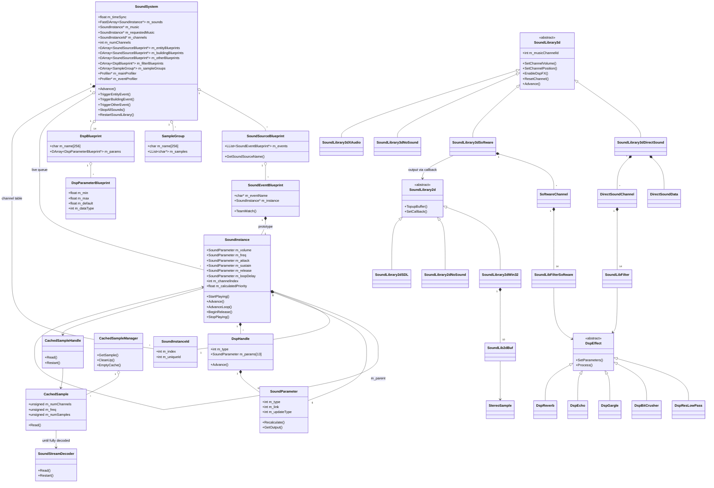
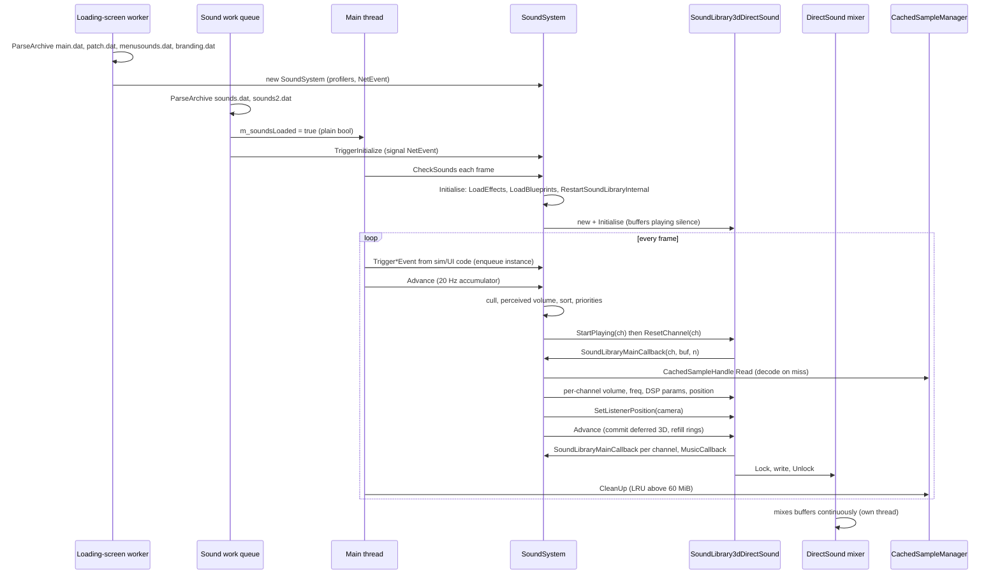

# 27 — Audio engine

> Part B · Baseline build: Release|Win32 (OpenGL) + TARGET_PC_FULLGAME ([B:FULL]); see _work/build_matrix.md.
> Evidence: [C] confirmed · [I] inferred · [U] unknown. Citations are `path:Symbol` relative to the multiwinia/ source root.
> Sources merged: P16_sound (primary: routed §27.1–27.15, plus the engine-level parts of its §10.4–10.7, §09.1, determinism notes and appendix), P01_app_core (main-loop pump sites, sound work queue, shutdown), P14_platform_lib (sound archives, audio-device detection, DirectX version check), P17a_ui_framework_editor and P17b_menus_options (debug-menu / cheat-window entry points, preference defaults), P19_help_tutorial_script (music script op-codes), P12_render_core (`EffectProcessor` note). Every [C] below was re-read in `code/sound/*` and its callers at commit `f909630`; numeric constants were spot-verified one by one.

Conventions used throughout:

- **vol units**: the engine's 0.0–10.0 logarithmic volume scale used by data (`VOLUME`), the envelope and every `SetChannelVolume` call.
- **mB**: millibels (1/100 dB), the unit of DirectSound volume and of `SoundLibrary3d::m_masterVolume`.
- **wu**: world units; the code calls them metres (`code/sound/sound_instance.h:SoundInstance::m_minDistance` comment "Distance (m)").
- **tick**: one pass of the 20 Hz sound update (`SOUNDSYSTEM_UPDATEPERIOD` = 0.05 s, §3).
- **channel** = **voice**: one hardware/software playback slot owned by the device layer.
- Gameplay-facing audio design (what each event means, the `sounds.txt` content model, the per-event catalogue, positional design rules, music and ambience design, mix philosophy) is in [10_audio_design](10_audio_design.md). This document is the **engine**: how a triggered event becomes samples at the speakers.

## Contents

1. [Architecture, layering and build reality](#1-architecture-layering-and-build-reality)
2. [Lifecycle, loading and threading/callback model](#2-lifecycle-loading-and-threadingcallback-model)
3. [Update rate: the 20 Hz tick](#3-update-rate-the-20-hz-tick)
4. [Triggering: from game event to queued instance](#4-triggering-from-game-event-to-queued-instance)
5. [Voice (channel) management](#5-voice-channel-management)
6. [Sound instances and parameters](#6-sound-instances-and-parameters)
7. [Pitch handling and the game-speed modifier](#7-pitch-handling-and-the-game-speed-modifier)
8. [Music channel](#8-music-channel)
9. [Sample cache](#9-sample-cache)
10. [Streaming decoder (Ogg Vorbis / WAV)](#10-streaming-decoder-ogg-vorbis--wav)
11. [Device back-ends (2D/3D library abstraction)](#11-device-back-ends-2d3d-library-abstraction)
12. [DSP filter chain](#12-dsp-filter-chain)
13. [Profiles, statistics, debug and editor tooling](#13-profiles-statistics-debug-and-editor-tooling)
14. [Data flow: game event to audible output](#14-data-flow-game-event-to-audible-output)
15. [Determinism boundary](#15-determinism-boundary)
16. [Constants](#16-constants)
17. [Mapping to a modern engine (XAudio2 / WASAPI)](#17-mapping-to-a-modern-engine-xaudio2--wasapi)
- [Open questions and unknowns](#open-questions-and-unknowns)
- [Docs-vs-code discrepancies](#docs-vs-code-discrepancies)
- [IP items](#ip-items)
- [Source map](#source-map)
- [Appendix — dead/legacy code](#appendix--deadlegacy-code)

## 1 Architecture, layering and build reality

### 1.1 Layers

The audio stack is five layers plus a DSP side-branch [C] (`code/sound/*`):

| Layer | Class(es) | File(s) | Role |
|---|---|---|---|
| L4 Game binding | `SoundSystem`, `SoundSourceBlueprint`, `SoundEventBlueprint`, `SampleGroup`, `DspBlueprint`, `DspParameterBlueprint` | `code/sound/soundsystem.h`, `code/sound/soundsystem.cpp` | Loads `data/effects.txt` and `data/sounds.txt`; turns `Trigger*Event(object, eventName)` calls into queued `SoundInstance`s; runs the 20 Hz voice-allocation tick; owns the channel table and the single music slot; hosts the two always-on profilers |
| L3 Instance (voice logic) | `SoundInstance`, `SoundInstanceId`, `SoundParameter`, `DspHandle` | `code/sound/sound_instance.*`, `code/sound/sound_parameter.*` | Per-sound state: envelope, loop / loop-delay, pitch, 3D position tracking, parameter evaluation, DSP parameter feeding |
| L2 Sample data | `CachedSampleManager` (global `g_cachedSampleManager`), `CachedSample`, `CachedSampleHandle`, `SoundStreamDecoder` | `code/sound/sample_cache.*`, `code/sound/sound_stream_decoder.*` | Lazy, incremental decode-to-RAM cache of mono signed 16-bit PCM with 60 MiB LRU eviction; Ogg Vorbis (and unreachable WAV) decoding |
| L1 Device "3D library" | abstract `SoundLibrary3d` (global `g_soundLibrary3d`); `SoundLibrary3dDirectSound`, `SoundLibrary3dSoftware`, `SoundLibrary3dNoSound`, `SoundLibrary3dXAudio` | `code/sound/sound_library_3d*.{h,cpp}` | N−1 mono streaming effect channels + 1 music channel; per-channel volume / frequency / 3D position / min-distance / DSP; **pulls** PCM from L4 through two callbacks |
| L0 Device "2D library" | abstract `SoundLibrary2d` (global `g_soundLibrary2d`); `SoundLibrary2dWin32`, `SoundLibrary2dNoSound`, `SoundLibrary2dSDL` | `code/sound/sound_library_2d*.{h,cpp}` | Stereo 16-bit output stream; carries audio only for the software 3D library |
| DSP | abstract `DspEffect`; `DspResLowPass`, `DspBitCrusher`, `DspGargle`, `DspEcho`, `DspReverb` | `code/sound/sound_filter.*` | In-house per-channel filters on mono 16-bit blocks (DirectX FX types are created inside the DirectSound library) |

### 1.2 Back-end selection and what is live

Selection happens in `code/sound/soundsystem.cpp:SoundSystem::RestartSoundLibraryInternal` [C]:

| Build / condition | 2D library | 3D library | Tag |
|---|---|---|---|
| Win32 (`TARGET_MSVC`), pref `SoundLibrary` = `"dsound"` (default written by `code/lib/preferences.cpp:GetDefaultSoundLibrary` under `HAVE_DSOUND`) and an audio device present | `SoundLibrary2dWin32` (waveOut opened, idle) | `SoundLibrary3dDirectSound` | **[B:FULL] [B:D3D] — the shipped path** |
| Win32, pref `SoundLibrary` = any other string except `"none"` (the options screen writes `"software"` for option 0, but under `HAVE_DSOUND` it only offers option 1 = DirectSound) | `SoundLibrary2dWin32` | `SoundLibrary3dSoftware` | [B:FULL], reachable only by hand-editing `preferences.txt`; see 27-U3 (probable crash) |
| Win32, `g_systemInfo->m_audioInfo.m_preferredDevice == -1` (no waveOut device) **or** pref `SoundLibrary` = `"none"` | `SoundLibrary2dNoSound` | `SoundLibrary3dNoSound` | [B:FULL] |
| Non-MSVC (Mac/Linux) | `SoundLibrary2dSDL` | `SoundLibrary3dSoftware` | [B:DEAD] on PC |
| Xbox 360 (`HAVE_XAUDIO`) | — | `SoundLibrary3dXAudio` (whole translation unit inside `#ifdef HAVE_XAUDIO`; never instantiated by `RestartSoundLibraryInternal`) | [B:DEAD] |

Details [C]:

- `SoundLibrary2dWin32` is constructed **before** the 3D choice and therefore also under DirectSound. Its waveOut device is opened and the first four buffers ever created are queued full of silence (`code/sound/sound_library_2d_win32.cpp:SoundLib2dBuf::SoundLib2dBuf`, function-static counter `count < 4`). Its callback pointer is installed only by `SoundLibrary3dSoftware`'s constructor, so under DirectSound `WaveOutProc` never counts a refill request and `TopupBuffer()` does nothing.
- `m_preferredDevice` is only a presence flag. The device index it holds is never used to open anything: DirectSound opens the default device (`DirectSoundCreate8(NULL, …)`) and waveOut opens `WAVE_MAPPER` [C] `code/sound/sound_library_3d_dsound.cpp:SoundLibrary3dDirectSound::Initialise`, `code/sound/sound_library_2d_win32.cpp:SoundLibrary2dWin32::SoundLibrary2dWin32`. (Its scoring loop in `code/lib/system_info.cpp` is P14's; see [31](31_platform_build_and_tools.md).)
- `SoundLibrary3dNoSound::Initialise` returns true without setting `m_numChannels`, so `GetNumMainChannels()` returns the base-class value 0. If a device exists but `SoundLibrary = none` was hand-written, `RestartSoundLibraryInternal` release-asserts "Too few channels" [C/I: the assert is unconditional when `m_preferredDevice != -1`].
- DirectSound requires DirectX ≥ 9 (`AppReleaseAssert(g_systemInfo->m_directXVersion >= 9.0f, APP_NAME " requires DirectX9 or Greater")`) [C] `code/sound/sound_library_3d_dsound.cpp:SoundLibrary3dDirectSound::Initialise`.
- Linked libraries: `dsound.lib` (`targets/vs2005/Common.vsprops`), and the `vorbis_static`, `vorbisfile_static`, `ogg_static` sub-projects of `targets/vs2005/Darwinia.sln` (libvorbis 1.1.2, libogg 1.1.3 under `contrib/`) [C] build_matrix §1.

Compile-time switches that touch the engine [C] `code/lib/universal_include.h`:

| Macro | Baseline | Effect on the engine |
|---|---|---|
| `HAVE_DSOUND` | **on** (TARGET_MSVC block) | Compiles `SoundLibrary3dDirectSound`; options screen offers only DirectSound; default `SoundLibrary` = `dsound` |
| `USE_SOUND_DSPEFFECTS` | off (commented out) | Only the options-screen DSP check box and its write of pref `SoundDSP`; the runtime DSP switch is the preference itself (§12.1) |
| `USE_SOUND_HW3D` | off | Only the options-screen HW3D check box; pref `SoundHW3D` is still read |
| `USE_SOUND_MEMORY` | off | Only the options-screen memory drop-down and its `EmptyCache()` + stream-reopen on change; pref `SoundMemoryUsage` is still read (§6.6) |
| `SOUND_EDITOR` | off (TARGET_DEBUG only; force-undefined on Mac) | All sound tooling windows, `EffectProcessor` (§13) — [B:DEBUG] |
| `INVOKE_CALLBACK_FROM_SOUND_THREAD` | off (Mac only) | Mutex-protected variant where mixing runs on the SDL audio thread — [B:DEAD] on PC |
| `HAVE_XAUDIO` | off | Xbox 360 back-end — [B:DEAD] |
| `PROFILER_ENABLED` | off | `SoundLibrary3d::m_profiler` is never allocated (affects the software mixer, 27-U3) |
| `SOUNDSYSTEM_VERIFY` | off (commented `#define` in `code/sound/soundsystem.cpp`) | Per-tick `RuntimeVerify()` — [B:DEAD] |
| `TESTBED_ENABLED` | off | Extra mute in `NotReadyForGameSoundsYet` — [B:DEAD] |

### 1.3 Class diagram (every engine class)

The editor/tooling classes (all [B:DEBUG]) are listed in §13 and in the class catalogue below; they are omitted from the diagram because none of them is part of the runtime path.

### 1.4 Class catalogue

| Class | Build | Role | Key members / behaviour | Ref |
|---|---|---|---|---|
| `SoundSystem` | [B:FULL] | Singleton `g_app->m_soundSystem`: blueprint store, live-instance queue, channel allocator, music slot, profiler host | §3–§8 | [C] `code/sound/soundsystem.h:SoundSystem` |
| `SoundSourceBlueprint` | [B:FULL] | All event bindings for one sound *source*: an Entity type, a Building type, or one of 12 "Other" sources (`Laser`, `Grenade`, `Rocket`, `AirStrikeBomb`, `Spirit`, `Sepulveda`, `Gesture`, `Ambience`, `Music`, `Interface`, `CratePowerup`, `MultiwiniaInterface`, enum order 0–11) | `m_events`; `GetSoundSourceName`/`GetSoundSoundType` (case-insensitive name ↔ index); `ListSoundEvents` (editor lists, content in 10) | [C] `code/sound/soundsystem.cpp:SoundSourceBlueprint::GetSoundSourceName` |
| `SoundEventBlueprint` | [B:FULL] | One `EVENT` block: event name + a prototype `SoundInstance` | `TeamMatch(teamId)` (§4) | [C] `code/sound/soundsystem.cpp:SoundEventBlueprint::TeamMatch` |
| `SampleGroup` | [B:FULL] | Named list of sample names (lower-cased, extension stripped) for random choice | `m_name[256]`, `m_samples` | [C] `code/sound/soundsystem.cpp:SoundSystem::ParseSampleGroup` |
| `DspBlueprint` | [B:FULL] | One filter type from `data/effects.txt`; its **index** in `m_filterBlueprints` is the filter type id and must equal the `SoundLibrary3d` FX enum order | `GetParameter(i, &min, &max, &default, &dataType)` | [C] `code/sound/soundsystem.cpp:SoundSystem::LoadEffects` |
| `DspParameterBlueprint` | [B:FULL] | Parameter descriptor: name, min, max, default, data type (0 = float, 1 = long) | drives packing in `DspHandle::Advance` and editor slider ranges | [C] `code/sound/soundsystem.h:DspParameterBlueprint` |
| `SoundInstanceId` | [B:FULL] | Weak handle `{m_index, m_uniqueId}`; equal iff both equal; invalid = (−1, −1). `m_uniqueId` from static `m_nextUniqueId` pre-incremented (first id = 1) | `GenerateUniqueId`, `SetInvalid` | [C] `code/sound/sound_instance.cpp:SoundInstanceId::GenerateUniqueId` |
| `SoundInstance` | [B:FULL] | Both the blueprint prototype (owned by a `SoundEventBlueprint`) and every live voice (a copy; `m_parent` points back to the prototype) | §6 | [C] `code/sound/sound_instance.h:SoundInstance` |
| `SoundParameter` | [B:FULL] | Scalar control: fixed, ranged-random or linked to a world quantity, with smoothing and update policy | §6.7 | [C] `code/sound/sound_parameter.h:SoundParameter` |
| `DspHandle` | [B:FULL] | One DSP effect on an instance: type id + `MAX_PARAMS` = 13 `SoundParameter`s | `Advance()` evaluates and packs params, calls `UpdateDspFX` | [C] `code/sound/sound_instance.cpp:DspHandle::Advance` |
| `CachedSampleManager` | [B:FULL] | Global sample cache keyed by sample name (`stdext::hash_map<std::string, CachedSample*>`), guarded by `NetMutex m_lock` | §9 | [C] `code/sound/sample_cache.h:CachedSampleManager` |
| `CachedSample` | [B:FULL] | Full-size PCM buffer for one file, filled incrementally from a decoder; lock count + last-used time | §9 | [C] `code/sound/sample_cache.cpp:CachedSample::Read` |
| `CachedSampleHandle` | [B:FULL] | Read cursor into a `CachedSample` (one per instance); ctor locks, dtor unlocks | `Read`, `Restart` | [C] `code/sound/sample_cache.cpp:CachedSampleHandle::Read` |
| `SoundStreamDecoder` | [B:FULL] | Ogg Vorbis (live) and WAV (unreachable) decoder to signed 16-bit | §10 | [C] `code/sound/sound_stream_decoder.cpp:SoundStreamDecoder::Read` |
| `SoundLibrary3d` | [B:FULL] | Abstract device: `m_numChannels` (incl. music), `m_sampleRate`, `m_masterVolume` (mB), `m_listenerPos`, two callbacks, FX enum, `m_musicChannelId`, `m_hw3dDesired`, `m_forceVolumeUpdate`, `m_profiler` | `SetMasterVolume`, `WriteSilence` (memset 0) | [C] `code/sound/sound_library_3d.cpp:SoundLibrary3d::SetMasterVolume` |
| `SoundLibrary3dDirectSound` | **[B:FULL] live** | DirectSound 8: one looping mono secondary buffer per channel + one music buffer, streamed by polling play cursors | §11.2 | [C] `code/sound/sound_library_3d_dsound.cpp` |
| `DirectSoundData` | [B:FULL] | Device, primary buffer, cached `DSCAPS`, static device-description text | | [C] `code/sound/sound_library_3d_dsound.cpp:DirectSoundData` |
| `DirectSoundChannel` | [B:FULL] | Per-channel buffer interfaces, ring state (`m_lastSampleWritten`, `m_simulatedPlayCursor`, `m_lastUpdate`, `m_silenceRemaining`, `m_channelHealth`), cached last-sent freq/volume/min-dist/pos/3D-mode, 14 filter slots | | [C] `code/sound/sound_library_3d_dsound.cpp:DirectSoundChannel` |
| `SoundLibFilter` | [B:FULL] | DirectSound filter slot `{DspEffect* m_userFilter, bool m_dxFilter}` | | [C] same file |
| `SoundLibrary3dSoftware` | [B:FULL], non-default | In-house mixer: pulls each channel into a mono buffer, applies in-house DSP, pans/attenuates into float L/R, block-normalises, outputs through `SoundLibrary2d` | §11.4 | [C] `code/sound/sound_library_3d_software.cpp` |
| `SoftwareChannel` | [B:FULL] | Per-channel mono buffer (`samplesPerBuffer × 48000/outRate × 3.1` samples), cached params, `m_oldVolLeft/Right`, `m_forceVolumeJump`, 14 filter slots | | [C] `code/sound/sound_library_3d_software.cpp:SoftwareChannel::SoftwareChannel` |
| `SoundLibFilterSoftware` | [B:FULL] | Software filter slot `{int m_chainIndex, DspEffect* m_userFilter}` | | [C] same file |
| `SoundLibrary3dNoSound`, `SoundLibrary2dNoSound` | [B:FULL] | Null devices: every call a no-op, `Initialise` returns true, `GetMaxChannels()` 0, `GetChannelHealth()` 1.0 | | [C] `code/sound/sound_library_3d.h:SoundLibrary3dNoSound`, `code/sound/sound_library_2d.cpp` |
| `SoundLibrary2d` | [B:FULL] | Abstract stereo output: `m_freq`, `m_samplesPerBuffer`, `SetCallback`, `TopupBuffer`, `Stop`, record-to-file hooks | | [C] `code/sound/sound_library_2d.h:SoundLibrary2d` |
| `SoundLibrary2dWin32` | [B:FULL] | waveOut stereo 16-bit: 10 × `SoundLib2dBuf`; `WOM_DONE` increments `m_fillsRequested`; `TopupBuffer()` (main thread) refills | §11.4 | [C] `code/sound/sound_library_2d_win32.cpp` |
| `SoundLib2dBuf` | [B:FULL] | One waveOut buffer of `SoundBufferSize` `StereoSample`s + `WAVEHDR` | | [C] `code/sound/sound_library_2d_win32.h:SoundLib2dBuf` |
| `StereoSample` | [B:FULL] | `{int16 m_left, m_right}` | | [C] `code/sound/sound_library_2d.h:StereoSample` |
| `DspEffect` and `DspResLowPass`, `DspBitCrusher`, `DspGargle`, `DspEcho`, `DspReverb` | [B:FULL] (inactive by default) | In-house DSP | §12.4 | [C] `code/sound/sound_filter.h` |
| `SoundLibrary2dSDL` | [B:DEAD] | SDL ring-buffer output (Mac/Linux) | Appendix | [C] `code/sound/sound_library_2d_sdl.cpp` |
| `SoundLibrary3dXAudio` | [B:DEAD] | Xbox 360 XAudio + X3DAudio 5.1 | Appendix | [C] `code/sound/sound_library_3d_xaudio.cpp` |
| `SoundEditorWindow`, `DspEffectEditor`, `SampleGroupEditor`, `RenameSampleGroupWindow`, `PurgeSoundsWindow` and their 30 button/menu classes; `SoundParameterEditor` family; `SoundStatsWindow`; `SoundProfileWindow`; `EffectProcessor` | [B:DEBUG] | Tooling | §13 | [C] `code/interface/soundeditor_window.cpp`, `code/interface/soundparameter_window.cpp`, `code/interface/soundstats_window.cpp`, `code/interface/sound_profile_window.cpp`, `code/effect_processor.cpp` |
| `PrefsSoundWindow`, `RestartSoundButton`, `VolumeControl` | [B:FULL] | Player-facing sound options (design in [09](09_meta_systems.md)); engine effects in §2.5 and §11.3 | | [C] `code/interface/prefs_sound_window.cpp`, `code/UI/soundsliderbutton.h:VolumeControl` |

Resolved: P17b/P18 drafts called `code/UI/soundsliderbutton.h` "never included → dead", while P16 documented its `VolumeControl` as the live master-volume slider. Code shows `code/interface/prefs_sound_window.h` includes `"UI/SoundSliderButton.h"` (case-insensitive on Windows) and `PrefsSoundWindow::Create` instantiates `VolumeControl` → **live** [C].

## 2 Lifecycle, loading and threading/callback model

### 2.1 Construction, archive loading and initialisation

[C] `code/app.cpp:App::App`, `App::Initialise`, `App::LoadSounds`, `App::CheckSounds`; `code/main.cpp:HandleCommonConditions`; `code/sound/soundsystem.cpp:SoundSystem::Initialise`:

1. **Archives, loading-screen worker thread.** `App::Initialise` (queued on `g_loadingScreen->m_workQueue`) parses `language.dat`, `main.dat`, `patch.dat`, `menusounds.dat`, `branding.dat`, then constructs `new SoundSystem()` — this allocates `m_mainProfiler`, `m_eventProfiler` and a `NetEvent m_initializedEvent`; no device yet.
2. **Sample archives, sound work queue.** Only after the loading-screen job finishes (the `App` constructor blocks in `g_loadingScreen->Render()`) does the PC build queue `SetWorkingThreadProcessor` and `App::LoadSounds` on the dedicated `App::m_soundsWorkQueue` thread — serialised because "unrar not thread safe". `App::LoadSounds` parses `sounds.dat` then `sounds2.dat`, sets the plain `bool App::m_soundsLoaded = true` (no memory barrier) and calls `SoundSystem::TriggerInitialize()` (signals `m_initializedEvent`). Archive contents and precedence (later archives override earlier ones; `sounds2 > sounds > branding > menusounds > patch > main`) are documented in [29](29_data_formats_reference.md) and [31](31_platform_build_and_tools.md).
3. **Device bring-up, main thread, first frame.** `HandleCommonConditions()` calls `App::CheckSounds()` every frame. While `!SoundSystem::IsInitialized()` it calls `SoundSystem::Initialise()` = `LoadEffects()` (`data/effects.txt` → 14 `DspBlueprint`s) + `LoadBlueprints()` (`data/sounds.txt` → source blueprints and sample groups; missing sources filled with empty blueprints) + `RestartSoundLibraryInternal()` (devices, channel table, callbacks; sets `m_isInitialized = true`). **This does not wait for `m_soundsLoaded`**: devices exist from the first frame, but every trigger is dropped until the sample archives are parsed (§2.2). Once initialised, every `CheckSounds()` also runs `g_cachedSampleManager.CleanUp()` (LRU, §9).
4. **Game-start barrier.** `SoundSystem::WaitIsInitialized()` loops `m_initializedEvent->Wait(1000 ms)` + `App::CheckSounds()` until `m_isInitialized`; called before launching a game from `code/UI/GameMenuWindow.cpp` (two sites), `code/UI/PlayGameButton.h` and `code/UI/RollingDemoButton.h` [C]. The loading screen additionally waits for `m_soundsLoaded` when `App::m_requireSoundsLoaded` is set (set at the end of `MainMenuLoop`) [C] `code/loading_screen.cpp`, `code/main.cpp:MainMenuLoop`.
5. **Shutdown.** `Finalise()` (if initialised): `g_soundLibrary2d->Stop()` (empty on Win32), delete `g_soundLibrary3d`, delete `g_soundLibrary2d` [C] `code/main.cpp:Finalise`. `~SoundSystem` deletes profilers, channel table, live instances, blueprints, groups and any remaining libraries; the global `g_cachedSampleManager`'s destructor calls `EmptyCache()` at static destruction [C] `code/sound/soundsystem.cpp:SoundSystem::~SoundSystem`, `code/sound/sample_cache.cpp:CachedSampleManager::~CachedSampleManager`.

Parsing notes relevant to the engine (the grammar itself is in [29](29_data_formats_reference.md)) [C] `code/sound/soundsystem.cpp:SoundSystem::ParseSoundEvent`, `ParseSoundEffect`, `ParseSampleGroup`:

- `SOUNDNAME` and group members are lower-cased and their extension removed at load; cache keys are therefore lower-case stems.
- `PRIORITY` is read and discarded ("backwards compatability, no longer used").
- `EFFECT <name>` resolves the name case-insensitively against `m_filterBlueprints` (debug-assert if unknown → type −1 in release, which would index `m_filterBlueprints[-1]` at runtime [I]). Its parameter lines are taken **in order** into `m_params[0..]`; the parameter name token on each line is not checked, and there is no bound check against `MAX_PARAMS` = 13 [C].
- Unknown ENTITY/BUILDING/OTHER names and unknown fields are only debug-asserted.
- `LoadtimeVerify()` exists (writes `sounderrors.txt`, release-asserts) but its call is commented out [C].

### 2.2 The game-sound gate

Every `Trigger*Event` returns immediately when `m_channels == NULL` or `SoundSystem::NotReadyForGameSoundsYet()` is true [C] `code/sound/soundsystem.cpp:SoundSystem::NotReadyForGameSoundsYet`:

| Condition | Consequence |
|---|---|
| `!g_app->m_soundsLoaded` | Nothing — not even menu sounds from the early `menusounds.dat` — can be triggered until `sounds.dat` + `sounds2.dat` are parsed |
| `g_loadingScreen->IsRendering()` | Triggers during loading screens are dropped |
| `NetGetCurrentThreadId() != g_app->m_mainThreadId` | Triggers from worker threads are dropped (the engine is single-threaded by contract) |
| `TESTBED_ENABLED` and testbed rendering off | [B:DEAD] |

Design consequence: requests are **dropped, not queued**. The lobby ambience polls this gate each frame and starts on the first frame it opens (`code/UI/GameMenuWindow.cpp:GameMenuWindow::Update`, `m_soundsStarted`) [C].

### 2.3 Threading and callback model

Baseline Win32 (`INVOKE_CALLBACK_FROM_SOUND_THREAD` undefined) [C]:

| Thread | What audio work it does | Synchronisation |
|---|---|---|
| Main thread | **Everything at runtime**: triggers, the 20 Hz tick, every `SoundLibrary3d` call, the DirectSound ring-buffer refills and therefore **every PCM callback** (`SoundLibraryMainCallback`, `SoundLibraryMusicCallback`), Ogg decoding on cache misses, in-house DSP, the software mixer (pulled by `SoundLibrary2d::TopupBuffer()` from the main loop and from `SoundLibrary3dSoftware::Advance`) | none needed |
| Sound work queue (`App::m_soundsWorkQueue`, affinity mask 0x55 via `SetWorkingThreadProcessor`, per [20](20_architecture.md)) | Parses `sounds.dat`, `sounds2.dat`; sets `m_soundsLoaded`; signals `m_initializedEvent` | plain bool; `NetEvent` |
| Loading-screen worker | Parses `menusounds.dat` (with `main.dat`); constructs `SoundSystem` | — |
| waveOut driver callback (`WaveOutProc`) | Increments `SoundLibrary2dWin32::m_fillsRequested` on `WOM_DONE` (only when a callback is installed, i.e. software mixer) | none — unsynchronised `unsigned int` shared with the main thread's decrement [I: benign race in practice, still a defect] |
| DirectSound internal mixer thread | Reads the secondary buffers the main thread fills | DirectSound `Lock`/`Unlock` |

`CachedSampleManager` holds a `NetMutex m_lock` around its hash map (taken in `GetSample`, `CleanUp`, `EmptyCache`, `GetMemoryUsage`; `CleanUp` re-enters it through `GetMemoryUsage`, relying on a recursive Win32 critical section) because the Mac build preloads on a worker [C] `code/sound/sample_cache.cpp`. Under `INVOKE_CALLBACK_FROM_SOUND_THREAD` (Mac) every public `SoundSystem` mutator and the software mixer callback lock `SoundSystem::m_mutex` [B:DEAD].

Consequences [C/I]:

- There is **no audio thread** of the engine's own. An underrun occurs only if the main loop stalls longer than a whole channel ring (DirectSound: 20000 samples ≈ 0.45 s at a 44.1 kHz playback rate; software path: 4 waveOut buffers in flight, ≈ 93 ms at 512 samples / 22050 Hz) [I from the sizes in §11].
- Decoding happens synchronously inside the fill on the first play of a sample (cache miss), so a burst of new long samples costs main-thread time [C] `code/sound/sample_cache.cpp:CachedSample::Read`.
- `MAIN_THREAD_ONLY` in the profiler is a no-op on Win32 [C] `contrib/systemiv/lib/profiler.cpp`.

### 2.4 Pump call sites (who calls `SoundSystem::Advance`)

[C] `code/main.cpp`, `code/loading_screen.cpp`, `code/loaders/loader.cpp`, `code/startsequence.cpp`:

| Loop | Calls | Build |
|---|---|---|
| `LocationGameLoop` (every Multiwinia match) | per rendered frame: `g_soundLibrary2d->TopupBuffer()` (early in the frame) and `SoundSystem::Advance()` (after explosions, before help/markers), each only if initialised; **after** `Renderer::Render`, a second `SoundSystem::Advance()` if `m_renderer->m_fps < 15` | [B:FULL] |
| `MainMenuLoop` (front end, lobby) | `SoundSystem::Advance()` once per frame (no direct `TopupBuffer`; the software library tops up inside its own `Advance`) | [B:FULL] |
| `LoadingScreen::Render` loop | `SoundSystem::Advance()` per loading-screen frame (`code/loading_screen.cpp:LoadingScreen::Render`) | [B:FULL] |
| `GlobalWorldGameLoop` | `SoundSystem::Advance()` per frame | [B:LEGACY] |
| `GlobalWorldEditorLoop` | `SoundSystem::Advance()` per frame | [B:LEGACY] |
| `LocationEditorLoop` | `SoundSystem::Advance()` per frame | [B:EDITOR] |
| `Loader::AdvanceSound` (`code/loaders/loader.cpp`), `code/startsequence.cpp` (start sequence update) | `Advance` (+ `TopupBuffer` in `Loader::AdvanceSound`) | [B:DEAD] (`USE_LOADERS`) |

### 2.5 Library restart

`SoundSystem::RestartSoundLibrary()` (options screen Apply; ignored if not yet initialised) → `RestartSoundLibraryInternal()` [C] `code/sound/soundsystem.cpp`:

1. Delete the channel table, `g_soundLibrary3d`, `g_soundLibrary2d`.
2. Read prefs `SoundMixFreq` (fallback 22050), `SoundMasterVolume` (255), `SoundChannels` (32), `SoundHW3D` (0), `SoundLibrary` (`"dsound"`); `bufSize = 20000`.
3. Create the libraries (§1.2); `SetMasterVolume(volume)`; `Initialise(mixrate, SoundChannels, hw3d, bufSize, bufSize × 10)`.
4. On failure **with** `hw3d`: debug-log and show a `MessageDialog` "Error" / "Failed to set requested sound settings" at (100, 100), set pref `SoundHW3D = 0`, recurse. On failure without `hw3d`: release-assert "Couldn't start the sound library".
5. `m_numChannels = GetNumMainChannels()`; release-assert `> 0` when a device exists; allocate `SoundInstanceId[m_numChannels]` (all invalid); install the two callbacks; `m_isInitialized = true`.

Effect on live sounds [C/I]: `SoundInstance`s survive in `m_sounds` but every channel slot is now invalid, so `IsPlaying()` is false for all of them. Looping sounds re-queue and restart from the start of their sample (or a fresh group member); one-shots enter the 3-tick patience window and, if they win a channel, replay from the beginning; the music instance keeps its `CachedSampleHandle` position and continues on the new music buffer (its `m_channelIndex` is not refreshed: correct for DirectSound where the id is always −1, stale for the software mixer if the channel count changed [I]). The options-screen Apply additionally calls `PropagateBlueprints()` or `StopAllDSPEffects()` depending on pref `SoundDSP` (§12.1) [C] `code/interface/prefs_sound_window.cpp:RestartSoundButton::MouseUp`.

## 3 Update rate: the 20 Hz tick

### 3.1 Accumulator

`#define SOUNDSYSTEM_UPDATEPERIOD 0.05f` (seconds) [C] `code/sound/soundsystem.cpp:SoundSystem::Advance`:

1. If `g_app->m_requestQuit && !m_quitWithoutSave` and `AreBlueprintsModified()` → cancel the quit. `AreBlueprintsModified()` returns `false` unconditionally ("Currently broken due to mod support"), so this never fires [C].
2. Return if `!m_channels` or `g_systemInfo->m_audioInfo.m_preferredDevice == -1` (null device: no tick at all).
3. `m_mainProfiler->Advance()`, `m_eventProfiler->Advance()` (every call, before the accumulator).
4. `m_timeSync += g_advanceTime`; if `m_timeSync >= 0.05` run **exactly one** tick and `m_timeSync -= 0.05`. There is no catch-up loop; surplus carries over.

Clock inputs [C] `code/main.cpp:UpdateAdvanceTime`: `g_advanceTime` is the real frame delta, capped at 0.25 s; while the game is paused it is not recomputed (the last value keeps being added); with pref `RecordDemo` 1 or 2 it is fixed at `1/DemoFrameRate` (default 25). The tick uses neither the simulation tick nor `g_gameTimer`.

Effective rate [C/I]: one tick per call while frames are shorter than 50 ms; at ≤ 20 fps one tick per frame and the backlog grows; below 15 fps `LocationGameLoop` calls `Advance()` twice per frame and each call adds `g_advanceTime` again, so up to two ticks per frame run (the accumulated time is double-counted). Envelopes and loop delays use the wall clock (`GetHighResTime()`), so tick rate changes only granularity and the voice-start rate, not durations.

### 3.2 Tick steps, in order

[C] `code/sound/soundsystem.cpp:SoundSystem::Advance` (profile section names in quotes):

| # | Step | Detail |
|---|---|---|
| 1 | Music ("Shutdown Music") | If `m_music`: `m_music->Advance()`; if it returns done → `ShutdownSound(m_music)`, `m_music = NULL`. Then if `m_music == NULL && m_requestedMusic` → promote: `m_music = m_requestedMusic`, `OpenStream(false)`, `m_channelIndex = g_soundLibrary3d->m_musicChannelId`, `ResetChannel(musicId)`, `SetChannelFrequency(musicId, sample native rate)` (§8) |
| 2 | "Propagate Blueprints" | If `m_propagateBlueprints` (true only while the Sound Editor window exists, [B:DEBUG]) → `PropagateBlueprints()` (§13) |
| 3 | "Allocate Sorted Array" | Function-static `SoundInstanceId` array, initial 128, doubled until ≥ `m_sounds.NumUsed()` |
| 4 | "Perceived Volumes" (pass 1) | For each live instance: if not playing and `m_loopType == SinglePlay` → `m_restartAttempts--`; if `m_restartAttempts < 0` → `ShutdownSound`; else if `Type3DAttachedToObject` and `GetAttachedObject() == NULL` → `ShutdownSound` (hard stop, no release); else `CalculatePerceivedVolume()` and append its id |
| 5 | "Sort Samples" | `qsort` ids by `m_perceivedVolume` descending (`SoundInstanceCompare`; ties unordered) |
| 6 | "Recalculate Priorities" (pass 2) | `m_calculatedPriority = m_perceivedVolume × M[eventName]`, per-event decay 0.75 (§5.3); remember the **non-playing** instance with the highest priority strictly > 0 |
| 7 | "Find best Channel", "Stop Old Sound", "Start New Sound", "Reset Channel" | If a candidate exists: `ch = FindBestAvailableChannel()`; evict the occupant (one-shot → `ShutdownSound`; looping → `StopPlaying()`); `StartPlaying(ch)`; on success `m_channels[ch] = id`, else `ShutdownSound(candidate)`; always `ResetChannel(ch)` |
| 8 | "Advance All Channels" ("Shutdown Sound") | For each channel with a live instance: `instance->Advance()`; if it returns done → `ShutdownSound` |
| 9 | — | `g_soundLibrary3d->m_forceVolumeUpdate = false` (set by `SetMasterVolume`, so each channel re-sends its volume once) |
| 10 | "UpdateListener" | Listener = camera: position `GetPos()`, front `GetFront()`, up `GetUp()` **negated unless** pref `SoundSwapStereo` = 1 (read every tick), velocity `GetVel() × 0.2` → `SetListenerPosition` |
| 11 | "SoundLibrary3d Advance" | Device pump: DirectSound commits deferred 3D settings and refills every ring (this is where most PCM callbacks run); the software library calls `TopupBuffer()` |

## 4 Triggering: from game event to queued instance

The design-level binding model (which events exist, layering several `EVENT` blocks, team-specific variants, the `sounds.txt` content) is in [10_audio_design](10_audio_design.md). Engine mechanics [C] `code/sound/soundsystem.cpp:SoundSystem::TriggerEntityEvent`, `TriggerBuildingEvent`, `TriggerOtherEvent` (two overloads), `InitialiseSound`:

| Entry point | Blueprint array (index) | Instance initial state | Team passed to `TeamMatch` |
|---|---|---|---|
| `TriggerEntityEvent(Entity*, name)` | `m_entityBlueprints[entity->m_type]` | `m_pos = entity->m_pos`, `m_vel = entity->m_vel`, `m_objIds += entity->m_id` | `entity->m_id.GetTeamId()` |
| `TriggerBuildingEvent(Building*, name)` | `m_buildingBlueprints[building->m_type]` | `m_pos = building->m_pos`, `m_objIds += building->m_id` (velocity 0) | building team |
| `TriggerOtherEvent(WorldObject* or NULL, name, type)` | `m_otherBlueprints[type]` | object `m_pos` and id if given; else origin, no id. **Music type** is diverted to the music slot (§8) | object team, or 255 when NULL |
| `TriggerOtherEvent(Vector3 pos, name, type, teamId)` | `m_otherBlueprints[type]` | `m_pos = pos`, no id (music is **not** diverted here) | `teamId` |

Per call, for **every** `EVENT` block of that source whose name matches case-insensitively (`stricmp`) and whose `TeamMatch` passes, a new `SoundInstance` is `Copy`'d from the block's prototype and passed to `InitialiseSound` [C]. `TeamMatch(team)`: false if the block has no prototype; true if `team == 255`; else `AllTeams` → true, `MyTeamOnly` → `team == g_app->m_globalWorld->m_myTeamId`, `EnemyTeamOnly` → `team != m_myTeamId` (both false when `m_globalWorld` is NULL) [C] `code/sound/soundsystem.cpp:SoundEventBlueprint::TeamMatch`.

`InitialiseSound(instance)` [C]:

- **Monophonic merge**: if the instance's `m_instanceType` is not `Polyphonic`, search `m_sounds` for any non-polyphonic instance with the same event name (`stricmp`); if found, append copies of the new instance's object ids to that instance and return false (the caller then deletes the new instance via `ShutdownSound`).
- Otherwise: `m_id.m_index = m_sounds.PutData(instance)`, `m_id.m_uniqueId = GenerateUniqueId()`, `m_restartAttempts = 3`, return true. The instance is now **queued** (not playing).
- There is no cap on queued instances (`FastDArray`); the only bound is the 3-tick patience of one-shots (§5.4).

`SoundInstance::Copy(prototype)` [C] `code/sound/sound_instance.cpp:SoundInstance::Copy`: copies name, position/instance/loop/source/team-match types, min distance, `strdup` of the full event name (`"<SourceName> <EventName>"`, built at load by `SetEventName`), the six parameters (each followed by one evaluation, §6.7), and — **only if pref `SoundDSP` ≠ 0 at copy time** — a copy of every `DspHandle`; sets `m_parent = prototype`. The envelope timer `m_adsrTimer` was already set to `GetHighResTime()` by the constructor, i.e. at trigger time.

Other public operations [C] `code/sound/soundsystem.cpp`:

| Operation | Semantics |
|---|---|
| `StopAllSounds(objId, partialName)` | If `partialName` contains `"Music"` → `m_music->BeginRelease(true)` (whatever music is playing) and nothing else. Otherwise for every instance whose **selected emitter** `m_objId == objId` and whose event name **contains** `partialName` (`strstr`; or all when NULL): playing → `BeginRelease(true)`, queued → `ShutdownSound`. An invalid `objId` matches instances whose `m_objId` was never set (2D and stationary sounds) |
| `TriggerDuplicateSound(instance)` | New instance `Copy`'d from the live instance (not the prototype), `m_parent` = original prototype, same pos/vel/object ids, normal `InitialiseSound`; if it is a `TypeInEditor` sound its id becomes `m_editorInstanceId` |
| `ShutdownSound(instance)` | Remove from `m_sounds` (if indexed), `StopPlaying()`, delete (releases its `CachedSampleHandle` → cache unlock) |
| `IsSoundPlaying(id)` | Index of the channel holding `id`, else −1 |
| `NumInstancesPlaying(objId, name)` | Count of channel occupants with exact (`stricmp`) event name and matching emitter (any if `objId` invalid). Latent defect: with a **valid** `objId` an empty channel dereferences NULL; every shipped caller passes an invalid id (`code/script.cpp`) [C] |
| `NumInstances(objId, name)` | Same over all queued + playing instances; used by `code/worldobject/rocket.cpp` to keep loops alive |
| `StopAllDSPEffects()` | Deletes every `DspHandle` of every live instance (channel DSP is not disabled until the instance stops) |
| `NumSoundInstances()`, `NumChannelsUsed()`, `NumSoundsDiscarded()` | live count; occupied channels; live − occupied (editor statistics) |

Caveat for game code [C]: `m_objId` (used by `StopAllSounds`, `NumInstances`, `NumInstancesPlaying`) is filled only by `GetAttachedObject()` during a tick, and never for 2D or stationary sounds. A "keep this loop alive" poll made before the next tick, or for a non-attached sound, sees 0 and may re-trigger (possible duplicate loops) [I]. A new engine should record the emitter id at trigger time.

<!-- BODY -->

## Open questions and unknowns

## Docs-vs-code discrepancies

## IP items

## Source map

## Appendix — dead/legacy code
