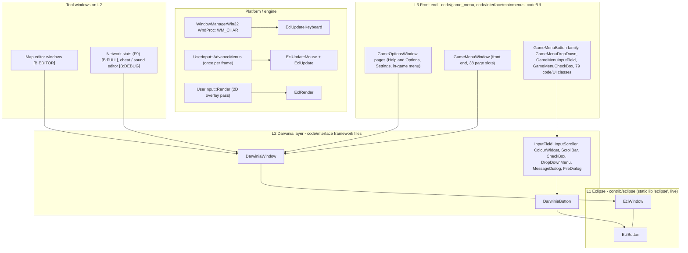
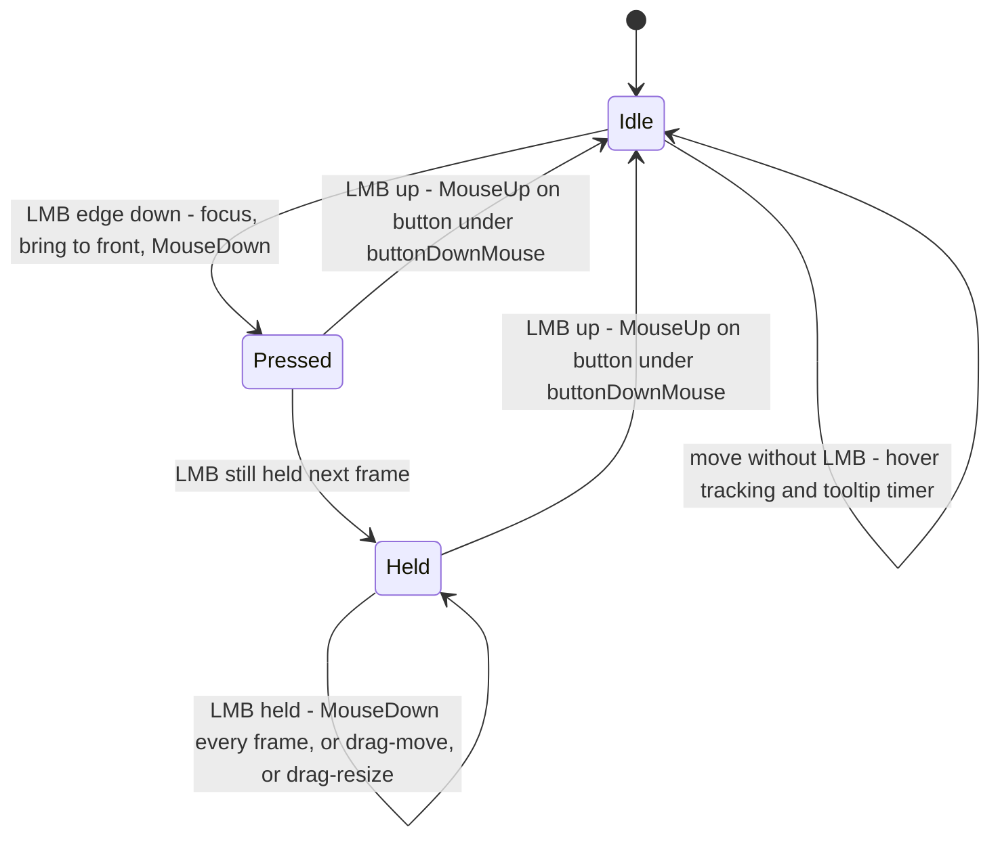
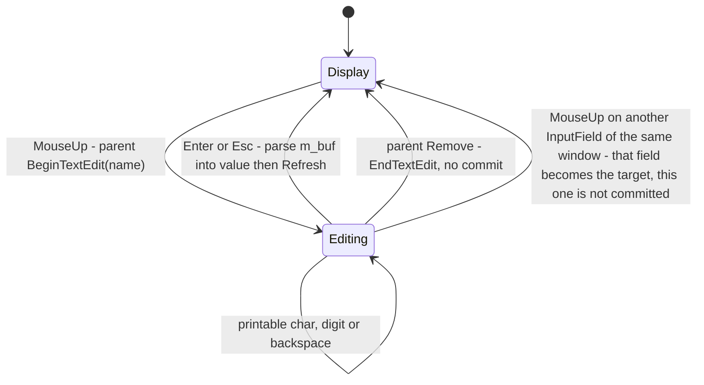

# 28 — UI framework

> Part B · Baseline build: Release|Win32 (OpenGL) + TARGET_PC_FULLGAME ([B:FULL]); see _work/build_matrix.md.
> Evidence: [C] confirmed · [I] inferred · [U] unknown. Citations are `path:Symbol` relative to the multiwinia/ source root.
> Sources merged: P17a_ui_framework_editor (§1–§10), P17b_menus_options (§11), P18_ui_gamemenu (§12–§13, plus page table §2 and layout §1.3–§1.4 for context), P12_render_core (24.7 text rendering), P14_platform_lib (29.L language table, 31.11 localisation build), P10_input_camera (input modes), `_meta_*` cross-partition notes. Every numeric constant and state transition below was re-read in the code by the synthesis agent (S28); corrections are flagged "Resolved:".

## Contents

1. [Architecture, layering and build reality](#1-architecture-layering-and-build-reality)
2. [Eclipse core (`contrib/eclipse`)](#2-eclipse-core-contribeclipse)
3. [Darwinia layer: `DarwiniaWindow` and `DarwiniaButton`](#3-darwinia-layer-darwiniawindow-and-darwiniabutton)
4. [Widgets (inputs, scroll bars, check boxes, drop-downs, dialogs)](#4-widgets-inputs-scroll-bars-check-boxes-drop-downs-dialogs)
5. [Front-end layer: `GameOptionsWindow` and the `GameMenu*` widget family](#5-front-end-layer-gameoptionswindow-and-the-gamemenu-widget-family)
6. [`GameMenuWindow` page framework](#6-gamemenuwindow-page-framework)
7. [Layout conventions and formulas](#7-layout-conventions-and-formulas)
8. [Rendering of windows (palette, textures, blend states, fonts)](#8-rendering-of-windows-palette-textures-blend-states-fonts)
9. [Keyboard, controller and mouse navigation rules](#9-keyboard-controller-and-mouse-navigation-rules)
10. [Localisation integration](#10-localisation-integration)
11. [How a new screen is built (recipes) and re-implementation guidance](#11-how-a-new-screen-is-built-recipes-and-re-implementation-guidance)
12. [Class diagram and complete UI class inventory](#12-class-diagram-and-complete-ui-class-inventory)
13. [Framework defects and edge cases (do not carry forward)](#13-framework-defects-and-edge-cases-do-not-carry-forward)
14. [Constants table](#14-constants-table)
- [Open questions and unknowns](#open-questions-and-unknowns)
- [Docs-vs-code discrepancies](#docs-vs-code-discrepancies)
- [IP items](#ip-items)
- [Source map](#source-map)
- [Appendix — dead/legacy code](#appendix--deadlegacy-code)

Related documents: functional description of every menu page, option and lobby rule — [09 Meta systems](09_meta_systems.md); text/font rendering and the menu-transition pass — [24 Rendering](24_rendering.md); UI textures — [25 Textures and assets](25_textures_and_assets.md); input bindings and the input-mode model — [06 Player control and input](06_player_control_and_input.md); language-file grammar — [29 Data formats reference](29_data_formats_reference.md); language build/packaging — [31 Platform, build and tools](31_platform_build_and_tools.md); map-editor windows — [08 Levels and level design](08_levels_and_level_design.md); debug/cheat/network windows — [32 Debug, test and performance](32_debug_test_and_performance.md); UI sounds — [10 Audio design](10_audio_design.md).

---

## 1 Architecture, layering and build reality

### 1.1 The layers

The Multiwinia UI is a retained-hierarchy, immediate-mode-rendered window manager in **two framework layers**, on top of which a **third, front-end layer** builds the styled full-screen menus [C]:

| Layer | What it is | Files | Responsibility |
|---|---|---|---|
| **L1 Eclipse core** | Introversion's generic interface library, "ECLIPSE version 2.0, Generic Interface Library" (author credit in `eclbutton.h`) | `contrib/eclipse/*` | Window list and z-order, name registry, focus, mouse state machine (press/drag/release, window move/resize), keyboard routing to the focused window and its text-edit target, dirty rectangles, tooltip timer, popups, maximise. Knows nothing about drawing styles. [C] `contrib/eclipse/eclipse.h` |
| **L2 Darwinia layer** | Concrete look and behaviour inherited from Darwinia | `code/interface/darwinia_window.*`, `input_field.*`, `scrollbar.*`, `checkbox.*`, `drop_down_menu.*`, `message_dialog.*`, `filedialog.*` | `DarwiniaWindow` (chrome, controller/keyboard navigation list `m_buttonOrder`, large-menu scaling, value-control factory), `DarwiniaButton` (highlight model, captions) and the widget set (input fields, scrollers, colour picker, scroll bar, check box, drop-down, message box, file picker). [C] |
| **L3 Front-end layer** | Multiwinia's full-screen menu style | `code/game_menu.*`, `code/interface/mainmenus.*`, `code/UI/*` | `GameOptionsWindow` (full-screen page with title bar/left/right boxes, error dialogue), the `GameMenu*` widgets (animated buttons, cycle drop-downs, styled inputs/check boxes), `GameMenuWindow` (the whole front end as one window with a 38-slot page state machine) and 79 button/panel classes. [C] |



### 1.2 Build reality — what is compiled

**`contrib/eclipse` is the live window framework; `contrib/systemiv/interface` and `contrib/systemiv/lib/eclipse` are not compiled.** Evidence [C]:

1. `targets/vs2005/Darwinia.sln` contains a project `"eclipse"` whose file is `..\..\contrib\eclipse\eclipse.vcproj`; it is a static-library project (`_LIB`) compiled with `PreprocessorDefinitions="WIN32;NDEBUG;_LIB;_CRT_SECURE_NO_DEPRECATE;TARGET_MSVC"` and `AdditionalIncludeDirectories="..\..\code;..\..\contrib\SystemIV"` [C] `contrib/eclipse/eclipse.vcproj`. Its file list is exactly `eclbutton.cpp/.h`, `eclipse.cpp/.h`, `eclwindow.cpp/.h` (`contrib/eclipse/eclipse.dsp` is the VC6 predecessor and is not used by the VS2005 solution).
2. `targets/vs2005/Darwinia.vcproj` (803 `RelativePath` entries) references SystemIV files only under `contrib\systemIV\lib\{debug_utils, memory_leak, network_stream, profiler, string_utils, filesys\*, netlib\*, metaserver\{authentication, matchmaker, metaserver}, math\{filecrc, hash, math_stubs, random_number}, tosser\*, unicode\*}`. No path under `contrib\systemiv\interface\` or `contrib\systemiv\lib\eclipse\` appears in any project file [C] grep of `targets/vs2005/*.vcproj`, `*.sln`, `*.vsprops`.
3. Include resolution: game code writes `#include <eclipse.h>` / `"eclipse.h"`. The game project's include path is `…;..\..\code;..\..\contrib;…;..\..\contrib\SystemIV;..\..\contrib\SystemIV\lib\netlib;..\..\contrib\eclipse;…` [C] `targets/vs2005/Darwinia.vcproj` (VCCLCompilerTool). There is no `eclipse.h` in `code/`, `contrib/` or `contrib/systemiv/` (the SystemIV copy lives one level deeper at `contrib/systemiv/lib/eclipse/eclipse.h` and would need `"lib/eclipse/eclipse.h"`), so `eclipse.h` resolves to `contrib/eclipse/eclipse.h` [C] directory listing; no `code/` file includes `lib/eclipse/…` or `interface/components/…` [C] grep.
4. Consequently the SystemIV UI components (`contrib/systemiv/interface/components/{checkbox, core, drop_down_menu, filedialog, inputfield, message_dialog, scrollbar}`, `interface/options/{screenoptions_window, soundoptions_window}`, `interface/soundsystem/{soundeditor_window, soundparameter_window, soundstats_window}`, `interface/styleeditor_window`) and the SystemIV Eclipse copy are **[B:DEAD]**; their Multiwinia counterparts are the `code/interface` files [C] `_work/build_matrix.md` §6, `_work/manifest.csv` (empty `vcproj_build`).

**`contrib/systemiv` usage by the live UI** [C] (header shadowing rule: `code` precedes `contrib/SystemIV` on the include path, so `lib/X.h` resolves to `code/lib/X.h` when it exists — `_work/drafts/P14_platform_lib.md` "Header shadowing rule"):

| SystemIV module | Used by the UI for | Ref |
|---|---|---|
| `contrib/systemiv/lib/tosser/llist.*` | `LList<T>` — every window list, button list, `m_buttonOrder`; `GetData(i)`/`operator[]` return NULL for an invalid index (relied upon by `m_buttonOrder[m_currentButton]` on an empty list) | [C] `contrib/eclipse/eclwindow.h:EclWindow`, `contrib/systemiv/lib/tosser/llist.cpp:LList::GetItem` |
| `contrib/systemiv/lib/unicode/unicode_string.*` | `UnicodeString` captions, tooltips, titles, input buffers | [C] `contrib/eclipse/eclbutton.h:EclButton` |
| `contrib/systemiv/lib/math/random_number.*` | `AppRandom()` (non-synchronised RNG, `APP_RAND_MAX = 32767`) for automatic child-window placement — does not touch the lock-step RNG | [C] `contrib/eclipse/eclipse.cpp:EclRegisterWindow`, `contrib/systemiv/lib/math/random_number.h` |
| `contrib/systemiv/lib/debug_utils.*` | included by `eclipse.cpp` (assertions are commented out) | [C] `contrib/eclipse/eclipse.cpp` |
| `contrib/systemiv/lib/metaserver/authentication.*` | `AUTHENTICATION_KEYLEN`, key check/status phrases in the auth-key page | [C] `code/UI/AuthInputField.h:AuthInputField` |
| (shadowed, **not** used) `contrib/systemiv/lib/language_table.*`, `preferences.*`, `hi_res_time.*` | Multiwinia uses `code/lib/language_table.*` etc. | [C] `_work/drafts/P14_platform_lib.md` |

### 1.3 Component status

| Component | Files | Compiled in FULL? | Reachable in FULL? | Tag |
|---|---|---|---|---|
| Eclipse core | `contrib/eclipse/*` | Yes (static lib `eclipse`) | Yes — every window | [B:FULL] |
| `DarwiniaWindow` / `DarwiniaButton` family | `code/interface/darwinia_window.*` | Yes | Yes | [B:FULL] |
| `InputField`, `InputScroller` | `code/interface/input_field.*` | Yes | Yes (`GameMenuInputField`, `ChatInputField`, `AuthInputField` subclass `InputField`; `GameMenuInputScroller` subclasses `InputScroller`) | [B:FULL] |
| `ColourWidget`, `ColourWindow` | `code/interface/input_field.*` | Yes | Only via `CreateColourControl`, whose callers are editor windows | compiled, tool-only |
| `ScrollBar` | `code/interface/scrollbar.*` | Yes | Yes — only on the `GameMenuWindow` server browser (`SetupJoinGamePage`) in FULL; also `SetupAchievementsPage` (unreachable), `CrateHelpWindow` ([B:DEBUG]), `SoundStatsWindow` and the sound editor ([B:DEBUG], `SOUND_EDITOR`), `FileDialog`/`MultiwiniaFileDialog` (editor) [C] grep `new ScrollBar`. Resolved: P17a listed `HelpAndOptions` and `SoundStatsWindow` as FULL users; the help-window user is `CrateHelpWindow::Create` (inside `INCLUDE_CRATE_HELP_WINDOW`, TARGET_DEBUG) and `soundstats_window.cpp` is wrapped in `#ifdef SOUND_EDITOR`. | [B:FULL] |
| `CheckBox` | `code/interface/checkbox.*` | Yes | Yes (`GameMenuCheckBox`) | [B:FULL] |
| `DropDownMenu` | `code/interface/drop_down_menu.*` | Yes | Yes (`GameMenuDropDown`; `ControlMethodDropDownMenu` is in the unreachable key-bindings window) | [B:FULL] |
| `MessageDialog` | `code/interface/message_dialog.*` | Yes | Yes — screen-mode failure (`code/renderer.cpp:Renderer::Initialise`) and hardware-3D-sound failure (`code/sound/soundsystem.cpp`) [C]. Resolved: P17a also listed the "Restart Required" dialog of `code/interface/prefs_screen_window.cpp:RestartWindowManagerAndRenderer`; that call is inside `#ifdef TARGET_OS_LINUX` → [B:DEAD] on PC [C]. Other callers are editor/sound-editor windows. | [B:FULL] |
| `FileDialog` | `code/interface/filedialog.*` | Yes | Only from editor landscape window and sound editor | compiled, tool-only |
| `MultiwiniaFileDialog`, `MultiwiniaWindow`, `NewMapWindow` | `multiwinia_filedialog.*`, `multiwinia_window.*` | Yes (no `#ifdef`) | No (opened by `MultiwiniaEditorButton` under `LOCATION_EDITOR` and by the dead Darwinia `MainMenuWindow`) | [B:EDITOR] |
| Map-editor windows | `location_editor.*`, `editor_window.*`, `buildings_window.*`, `camera_anim_window.*`, `camera_mount_window.*`, `landscape_window.*`, `lights_window.*`, `instant_unit_window.*`, `tree_window.*` | Bodies inside `#ifdef LOCATION_EDITOR` | No | [B:EDITOR] |
| `InvalidCratesWindow` | `invalidcrates_window.*` | Yes | No (created only by `LocationEditor::CreateEditWindowForMode`) | [B:EDITOR] |
| `GlobalWorldEditorWindow` | `globalworldeditor_window.*` | Yes | No (`GlobalWorldEditorLoop`) | [B:LEGACY] |
| `DebugMenu` | `debugmenu.*` | Yes | No (F1 opener commented out in `code/user_input.cpp:UserInput::AdvanceMenus`) | [B:LEGACY] |
| `DebugKeyBindings::NetworkButton` → `NetworkWindow` | `debugmenu.cpp`, `network_window.*` | Yes | **Yes** — `ControlToggleNetworkStats` (F9) under `NETWORK_STATS_ENABLED` [C] `code/user_input.cpp:UserInput::Advance` | [B:FULL] |
| `CheatWindow` | `cheat_window.*` | `Create()` empty unless `CHEATMENU_ENABLED` | `TARGET_DEBUG` (F11, only when no window is open) | [B:DEBUG] |
| Sound editor/stats/profile/parameter windows | `soundeditor_window.*`, `soundstats_window.*`, `sound_profile_window.*`, `soundparameter_window.*` | Bodies inside `#ifdef SOUND_EDITOR` | `TARGET_DEBUG` only | [B:DEBUG] |
| `GrabberWindow` | `grabber_window.*` | `#ifdef AVI_GENERATOR` | Not even in DEBUG (no caller of `DebugKeyBindings::GrabberButton`) | [B:DEBUG] |
| `GestureWindow` | `gesture_window.*` | `#if defined(GESTURE_EDITOR) && defined(USE_SEPULVEDA_HELP_TUTORIAL)` | No | [B:DEAD] |
| Front-end layer | `code/game_menu.*`, `code/interface/mainmenus.*`, `code/UI/*` | Yes | Yes (details §5, §6, §12) | [B:FULL] |

### 1.4 Integration into the frame

| Call | Where | Behaviour |
|---|---|---|
| `EclInitialise(screenW, screenH)` | `code/user_input.cpp:UserInput::UserInput` (constructed in `code/app.cpp:App::Initialise`); again in `code/interface/prefs_screen_window.cpp:AdjustWindowPositions` after a resolution change | Stores screen size, dirties the full screen [C] |
| `EclUpdateMouse(x, y, lmb, rmb)` then `EclUpdate()` | `code/user_input.cpp:UserInput::AdvanceMenus`, called from `UserInput::Advance` once per main-loop iteration in every loop (main menu, location, editor) [C] `code/main.cpp` | `x,y` = `g_target->X()/Y()` (the game cursor, which follows the mouse or the controller-emulated cursor); `lmb = controlEvent(ControlEclipseLMousePressed)` (level: "mouse left pressed"); `rmb = controlEvent(ControlEclipseRMousePressed)` (bound to "mouse right **down**", an edge) [C] `data/input/input_preferences.txt`. After pumping, if `ControlEclipseLMouseDown` fired over any window the event is suppressed (`InputManager::suppressEvent`) so the game world does not also receive the click [C] |
| `EclUpdateKeyboard(keyCode, shift, ctrl, alt, ascii)` | `code/lib/input/inputdriver_win32.cpp` `WM_CHAR` case | `keyCode = wParam` (a UTF-16 code unit: the window class is registered with `RegisterClassW`/`CreateWindowW` [C] `code/lib/window_manager_win32.cpp`), `ascii = (unsigned char) wParam`, modifiers from `g_keys[KEY_SHIFT/KEY_CONTROL/KEY_ALT] == 1` [C]. Consequence: widgets receive **characters, not virtual keys** (§4.1). There is no `WM_KEYDOWN` path into Eclipse and no IME handling (`WM_IME_*` never handled) [C] grep |
| `EclRender()` | `code/user_input.cpp:UserInput::Render`, inside `g_editorFont.BeginText2D()/EndText2D()` with `GL_BLEND` on, culling off, depth test off, depth writes off; restored afterwards | 2D orthographic projection matching the viewport, shifted −0.325 px [C] `code/lib/text_renderer.cpp:TextRenderer::BeginText2D`. Position in the frame: after `MarkerSystem`, `MultiwiniaHelp`, `ShamanInterface`; before the game cursor, in-game chat lines, `Camera::Render`, `TaskManagerInterface::Render`, debug renderer, control help, fade, the Multiwinia HUD (`Multiwinia::Render`) and the FPS counter; the menu-transition overlay is drawn after everything, just before `Flip` [C] `code/renderer.cpp:Renderer::RenderFrame`, `Renderer::Render` |
| `EclShutdown()` | `code/main.cpp:Finalise` | Deletes every window (and through `~EclWindow` every button) and every dirty rect [C] |
| `WindowsOnScreen()` / `RemoveAllWindows()` | `code/main.cpp` | `WindowsOnScreen` = window list non-empty. `RemoveAllWindows` = if in a location warp the cursor to screen centre, then remove `windows[0]` until the list is empty [C] |

Controller mouse emulation [C] `data/input/input_preferences.txt`: `EclipseLMouseDown = alias ShowMouseCursor && XInput a down`, `EclipseLMousePressed = alias ShowMouseCursor && XInput a pressed`, `ShowMouseCursor = XInput leftbumper pressed` — holding LB turns A into the left mouse button.

---
## 2 Eclipse core (`contrib/eclipse`)

Exactly two levels: windows contain buttons; button coordinates are relative to their window [C] `contrib/eclipse/eclwindow.h` header comment. All identity is by **name string**; the sentinel `"None"` means "no window/button" everywhere [C] `contrib/eclipse/eclipse.cpp`.

### 2.1 Data model

**`EclWindow`** [C] `contrib/eclipse/eclwindow.h:EclWindow`, `contrib/eclipse/eclwindow.cpp:EclWindow::EclWindow`

| Field | Type | Default (ctor) | Meaning |
|---|---|---|---|
| `m_x, m_y, m_w, m_h` | int | 0, 0, 0, 0 | Screen-space rectangle in pixels, origin top-left |
| `m_name` | `char[256]` (`SIZE_ECLWINDOW_NAME`) | ctor argument (`SetName`: names with `strlen > 256` are silently not copied, leaving the buffer uninitialised) | Unique key for every lookup |
| `m_title` | `UnicodeString` (`SetTitle` rejects `Length() > 256`, `SIZE_ECLWINDOW_TITLE`) | `"New Window"` | Title |
| `m_movable` | bool | true (`SetMovable(true)`) | Drag-to-move allowed |
| `m_resizable` | bool | true | Drag-edge-to-resize allowed |
| `m_dirty` | bool | false | Needs redraw (§2.10) |
| `m_buttons` | `LList<EclButton*>` | empty | Owned children; **index 0 = most recently registered** (`PutDataAtStart`) |
| `m_currentTextEdit` | `char[256]` | `"None"` | Name of the button receiving keystrokes |

Destructor deletes every button in `m_buttons` [C] `EclWindow::~EclWindow`.

**`EclButton`** [C] `contrib/eclipse/eclbutton.h:EclButton`, `contrib/eclipse/eclbutton.cpp`

| Field | Type | Default | Meaning |
|---|---|---|---|
| `m_name` | `char[256]` (`SIZE_ECLBUTTON_NAME`) | `"New Button"` (names with `strlen > 256` are ignored by `SetProperties`) | Key within the window |
| `m_x, m_y, m_w, m_h` | int | 0 | Window-relative rectangle |
| `m_caption` | `UnicodeString` | empty | Caption |
| `m_tooltip` | `UnicodeString` | `" "` | Tooltip text (never displayed, §2.11) |
| `m_inactive` | bool | false | Eclipse-level "inactive" flag: skipped by Darwinia navigation (§3.3), greyed and click-ignored by most front-end widgets (§5) |
| `m_parent` (protected) | `EclWindow*` | NULL | Set by `RegisterButton` |

**`DirtyRect`** `{int m_x, m_y, m_width, m_height}` [C] `contrib/eclipse/eclipse.h:DirtyRect`.

**Module state** (file statics) [C] `contrib/eclipse/eclipse.cpp`

| Static | Initial | Role |
|---|---|---|
| `windows` (`LList<EclWindow*>`) | empty | Z-ordered window list, **index 0 = front-most** |
| `dirtyrects` (`LList<DirtyRect*>`) | empty | Accumulated dirty rectangles |
| `clearDraw` (fn ptr `(x,y,w,h)`) | NULL | Optional background-clear callback — never registered by Multiwinia |
| `tooltipCallback` (fn ptr `(EclWindow*, EclButton*)`) | NULL | Optional tooltip callback — never registered by Multiwinia |
| `mouseX, mouseY, lmb, rmb` | 0, 0, false, false | Last mouse state |
| `buttonDownMouseX/Y` | 0 | Position used to resolve the release target (updated every held frame) |
| `mouseDownWindowX/Y` | 0 | Grab offset for window dragging |
| `tooltipTimer` | 0 | Millisecond timestamp when the tooltip becomes due |
| `maximiseOldX/Y/W/H` | 0 | Saved rectangle for un-maximise |
| `mouseDownWindow`, `windowFocus`, `popupWindow`, `maximisedWindow` | `"None"` | Window-name state slots (`char[256]`) |
| `currentButton` | `"None"` | Highlighted/pressed button name |
| `screenW, screenH` | 0 | From `EclInitialise` |

### 2.2 Registration, removal and z-order [C] `contrib/eclipse/eclipse.cpp`

`EclRegisterWindow(window, parent = NULL)`:
1. Duplicate check is a no-op (`if (EclGetWindow(name)) {}` has an empty body): duplicate names are accepted, and only the front-most of them is findable.
2. If `parent` is given **and** the window is at (0,0): automatic placement with `r1, r2 = AppRandom()/APP_RAND_MAX`:
   - `left = screenW/2 − parent.x`; `above = screenH/2 − parent.y`
   - `x = (left > w/2) ? parent.x + parent.w·r1 : parent.x − w·r1`
   - `y = (above > h/2) ? parent.y + parent.h·r2 : parent.y − (h/2)·r2`
3. `MakeAllOnScreen()`: `x = max(x, 0)`, `y = max(y, 0)`, then `if x + w > screenW: x = screenW − w`, `if y + h > screenH: y = screenH − h` — a window larger than the screen ends with a negative origin.
4. `windows.PutDataAtStart(window)` → **a new window is always front-most**.
5. `window->Create()` — subclasses build their buttons here.
6. `EclDirtyWindow(window)`.

Registration does **not** give focus; `DarwiniaWindow`'s constructor does (§3.1).

`EclRemoveWindow(name)`: find by name; dirty its rectangle; unlink it; if `mouseDownWindow` or `windowFocus` named it, reset that slot to `"None"`; `delete window`. Unknown names are a silent no-op.

`EclBringWindowToFront(name)`: move to index 0 and dirty — called on every left press that lands on a window (§2.4).

`EclSetWindowPosition(name, x, y)`: dirty, move, dirty the new rectangle (no clamping). `EclSetWindowSize(name, w, h)`: `window->Remove()`, dirty, set size, **`window->Create()` again** (every button rebuilt), dirty. Contrast `EclWindow::SetPosition/SetSize`, which only assign and dirty (no rebuild).

`EclWindow::RegisterButton(b)`: `b->SetParent(this)`; `m_buttons.PutDataAtStart(b)`; **auto-grow**: if `b.y + b.h + 10 > m_h` then `SetSize(m_w, b.y + b.h + 10)` and `MakeAllOnScreen()`; dirty [C] `contrib/eclipse/eclwindow.cpp:EclWindow::RegisterButton`. Windows therefore grow downwards to fit content and are pushed up to stay on-screen.

`EclWindow::RemoveButton(name)`: iterates from the **back** of `m_buttons` (oldest registration first), deletes the first match and stops. **Resolved:** P17a said "deletes the first match", P18 §12.3 said "removes all matches"; the code removes exactly one button — the *oldest*-registered button with that name — despite its comment "we're removing ALL buttons with this name" [C]. `EclWindow::GetButton(name)` returns the first match from index 0, i.e. the *newest* registration. With duplicate names, lookup and removal therefore address different buttons.

`EclGenerateUniqueWindowName(name)` returns `name`, `name2`, `name3`, … (first unused) in a static buffer [C]; unused by `code/`.

### 2.3 Hit testing

- `EclGetWindow(x, y)`: first window from index 0 (front) with `x ∈ [m_x, m_x+m_w]` and `y ∈ [m_y, m_y+m_h]` — **inclusive** of the far edges [C].
- `EclWindow::GetButton(x, y)` (window-relative): first button from index 0 with inclusive bounds [C]. Overlapping buttons: the later-registered one receives input and is drawn on top (rendering is back-to-front, §2.10).
- `EclMouseInButton(window, button)`: the window must be the top window under the cursor **and** the cursor inside the button's inclusive rectangle [C].
- `EclMouseInWindow(window)` ≡ `EclGetWindow(mouseX, mouseY) == window` [C].

### 2.4 Mouse state machine and capture semantics [C] `contrib/eclipse/eclipse.cpp:EclUpdateMouse`

Every call first stores the new position and dirties the window under the cursor. Exactly one LMB branch runs (comparing the new `_lmb` with the stored `lmb`); all three RMB branches are empty stubs — **Eclipse ignores the right button**.



| Branch | Condition | Actions |
|---|---|---|
| **Move / hover** | `!_lmb && !lmb && !_rmb && !rmb` | Only the *focused* window is examined. Button under cursor: if its name ≠ `currentButton` → `currentButton = name`, dirty the window, `tooltipTimer = now + 1000 ms`; else if `now > tooltipTimer` → `tooltipCallback(window, button)` (every frame while hovering). No button under cursor: if `currentButton ≠ "None"` → reset to `"None"`, dirty, `tooltipCallback(NULL, NULL)`. No focused window: same reset without the dirty. Un-focused windows still show hover visually because rendering uses `EclMouseInButton` (§2.10). |
| **LMB down** (edge) | `_lmb && !lmb` | `buttonDownMouse = mouse`. If a window is under the cursor: dirty the old focus; **focus = this window**; **bring to front**; `mouseDownWindow = this`. Button under cursor → `currentButton = name`, `button->MouseDown()`. No button → `currentButton = "None"`, `window->MouseEvent(lmb=true, rmb=false, up=false, down=true)`, and if movable record the grab offset `mouse − window.xy`. No window under cursor → dirty the old focus and set focus `"None"`. Then `lmb = true`. |
| **LMB held** | `_lmb && lmb` | `buttonDownMouse = mouse` (**updated every frame**). If `mouseDownWindow` is a live window: button under cursor → `button->MouseDown()` **again, every frame** (whatever the press started on). Else if `currentButton == "None"` (press began on the background): resize test on the *previous* cursor position — within ±4 px (exclusive) of the bottom edge → `newH = mouseY − y`; within ±4 px of the right edge → `newW = mouseX − x`; if either and the window is resizable → clamp `newW ≥ 60`, `newH ≥ 40`, `EclSetWindowSize` (Remove/Create rebuild every frame of the drag). Otherwise, if movable → `EclSetWindowPosition(mouse − grabOffset)` (no clamping while dragging). A frame in which the cursor passes over a button during a window drag calls that button's `MouseDown` instead of moving the window. |
| **LMB up** (edge) | `!_lmb && lmb` | `mouseDownWindow = "None"`, `lmb = false`. Window under the **last `buttonDownMouse`**: a button there → dirty, `button->MouseUp()`; no button → `window->MouseEvent(lmb=true, rmb=false, up=true, down=false)` then `EclRemovePopup()`. No window → `EclRemovePopup()`. |

Design-relevant consequences [C-derived]:
- **`MouseUp` is the "click" event** and fires on whichever button lies under the release point; the press need not have started on it. There is **no mouse capture and no click cancellation** (press on A, release on B clicks B).
- **`MouseDown` is a held/repeat event**: called on the press frame and on every held frame while the cursor is over a button. Widgets wanting an edge test `ControlEclipseLMouseDown` themselves (`InputScroller::MouseDown`, §4.2).
- Dragging a widget (e.g. a scroll thumb) only continues while the cursor stays over that widget.
- Window dragging and resizing only start when the press lands on the window background.
- `MouseEvent` is the only window-level mouse hook; no live window overrides it [C] grep.

### 2.5 Focus rules

| Event | Focus result | Ref |
|---|---|---|
| LMB press on a window | that window (and it goes to the front) | [C] `EclUpdateMouse` |
| LMB press on empty screen | `"None"` | [C] |
| `DarwiniaWindow` constructed | `EclSetCurrentFocus(m_name)` — Darwinia windows take focus at construction, before registration | [C] `code/interface/darwinia_window.cpp:DarwiniaWindow::DarwiniaWindow` |
| `DarwiniaWindow` destroyed | focus = name of `windows[0]` if any (the window has already been unlinked by `EclRemoveWindow`, so this is the new front window) | [C] `DarwiniaWindow::~DarwiniaWindow` |
| `EclRemoveWindow` of the focused window | `"None"` (then the Darwinia destructor re-assigns as above) | [C] |
| `EclMaximiseWindow(name)` | that window | [C] |
| `EclSetCurrentFocus(name)` | `name` if `strlen < 256`; no existence check | [C] |

Only the focused window receives keyboard input (§2.6), hover/tooltip tracking (§2.4) and Darwinia controller navigation (§3.3). `EclRender` passes `hasFocus = (name == windowFocus)`; both full-screen front-end window classes draw **only while focused** (§5.1, §6.7), so at most one full-screen page is visible at a time.

### 2.6 Keyboard routing

`EclUpdateKeyboard(...)` → focused window's virtual `Keypress(...)` → default `EclWindow::Keypress` forwards to the button named `m_currentTextEdit` (if it exists) [C] `contrib/eclipse/eclwindow.cpp:EclWindow::Keypress`. `BeginTextEdit(name)` / `EndTextEdit()` set/reset that name. `EclIsTextEditing()` ≡ a focused window exists and its `m_currentTextEdit ≠ "None"` — used by the lobby chat to avoid re-opening the chat box while typing and by `ChatInputField` to switch between the prompt and the typed text [C] `code/UI/GameMenuWindow.cpp:GameMenuWindow::UpdateMultiplayerPage`, `code/interface/chatinput_window.cpp:ChatInputField::Render`. There is no tab order and no focus traversal at the Eclipse level; navigation between buttons is a Darwinia-layer feature driven by controller bindings (§3.3, §9).

### 2.7 Popups and maximise

- `EclRegisterPopup(w)`: remove the existing popup, record the name, register. `EclRemovePopup()` is called on every LMB release that does not land on a button (including clicks on any window background) and on clicks outside all windows → a popup closes on any non-button click [C]. No Multiwinia code registers popups [C] grep (drop-downs use their own singleton, §4.6).
- `EclMaximiseWindow(name)`: un-maximise any previous window; save the rectangle; set `maximisedWindow`, `mouseDownWindow` and focus to it; `SetPosition(0,0)`, `SetSize(screenW, screenH)` (no rebuild). While a window is maximised `EclRender` calls `clearDraw(rect)` and renders only that window — **`clearDraw` is NULL in Multiwinia, so maximising would dereference a null function pointer** [C code; I consequence]; unused by `code/` [C] grep. `EclUnMaximise()` restores the rectangle and dirties the full screen.

### 2.8 Dirty rectangles and render order

- `EclDirtyRectangle(x, y, w, h)` allocates a `DirtyRect`, appends it, and marks every overlapping window dirty (`EclRectangleOverlap` treats touching edges as overlapping: `maxtop ≤ minbottom && maxleft ≤ minright`).
- `EclDirtyWindow(w)`: if not already dirty → set dirty and add its rectangle.
- `EclRender()` (non-maximised): calls `clearDraw` for every dirty rectangle if registered (never in Multiwinia), then **for i = Size−1 down to 0** renders every window whose `m_dirty` is set → back-most first, front-most last (painter's order). The line that would clear `m_dirty` after rendering is commented out [C].
- `EclResetDirtyRectangles()` (frees rectangles, clears flags) is never called from `code/` [C] grep.

Net effect [C-derived]: every window is dirty from registration onwards and is **re-rendered every frame**; the dirty-rectangle list grows by one entry per `EclSetWindowPosition` / `EclSetWindowSize` / `EclRemoveWindow` / `EclDirtyRectangle` / first-time `EclDirtyWindow` and is only freed at `EclShutdown` (unbounded but small leak, e.g. while dragging a window). A re-implementation should treat the UI as a full immediate-mode redraw each frame and drop dirty rectangles.

### 2.9 Updates

`EclUpdate()` calls `Update()` on every window from index 0 (front) to the back [C] `contrib/eclipse/eclipse.cpp:EclUpdate`. A window removed during iteration shifts the indices (a window can be skipped for that frame) [I]. `EclWindow::Update` is empty; the Darwinia layer puts navigation there (§3.3).

### 2.10 Window and button rendering at L1

`EclWindow::Render(hasFocus)` renders buttons **from the back of `m_buttons` to index 0** (oldest first, newest on top) calling `button->Render(m_x + b.x, m_y + b.y, highlighted, clicked)` with `highlighted = EclMouseInButton(this, b) || m_currentTextEdit == b.name` and `clicked = hasFocus && EclGetCurrentClickedButton() == b.name` [C] `contrib/eclipse/eclwindow.cpp:EclWindow::Render`. `EclGetCurrentClickedButton()` = `currentButton` while LMB is held, else `"None"` [C]. `EclButton::Render` is empty.

### 2.11 Tooltips

Tooltip delay **1000 ms** of hovering the same button in the focused window, timed with `EclGetAccurateTime()` = Win32 `GetTickCount()` (ms) [C]. `EclRegisterTooltipCallback` is never called in `code/` → **no tooltips are ever shown**; every `m_tooltip` string ("Close this window", "Value left", "Value right", " ") is dead data [C] grep.

### 2.12 Complete public API reference

Every function declared in `contrib/eclipse/eclipse.h`, `eclwindow.h`, `eclbutton.h` [C]:

| Function | Semantics | Used by `code/` |
|---|---|---|
| `EclInitialise(screenW, screenH)` | store screen size; `EclDirtyRectangle(0,0,W,H)` | yes (§1.4) |
| `EclUpdateMouse(x, y, lmb, rmb)` | §2.4 | yes |
| `EclUpdateKeyboard(keyCode, shift, ctrl, alt, ascii)` | §2.6 | yes |
| `EclRender()` | §2.8, §2.7 | yes |
| `EclUpdate()` | §2.9 | yes |
| `EclShutdown()` | `EmptyAndDelete` windows and dirty rects | yes |
| `EclRegisterWindow(window, parent=NULL)` | §2.2 | yes |
| `EclRemoveWindow(name)` | §2.2 | yes |
| `EclRegisterPopup(window)` / `EclRemovePopup()` | §2.7 | no (internal call of `EclRemovePopup` only) |
| `EclBringWindowToFront(name)` | §2.2 | internal |
| `EclSetWindowPosition(name, x, y)` / `EclSetWindowSize(name, w, h)` | §2.2 | internal (drag) |
| `EclGetWindowIndex(name)` | index in z-order, −1 if absent | internal |
| `EclGetWindow(name)` / `EclGetWindow(x, y)` | §2.2, §2.3; NULL if none | yes (everywhere: "toggle" openers check `EclGetWindow(name)` first) |
| `EclMouseInWindow(window)` / `EclMouseInButton(window, button)` | §2.3 | yes (`DarwiniaButton::UpdateButtonHighlight`, `GameMenuWindow::Render`) |
| `EclIsTextEditing()` | §2.6 | yes |
| `EclRegisterTooltipCallback(cb)` | §2.11 | no |
| `EclMaximiseWindow(name)` / `EclUnMaximise()` | §2.7 | no |
| `EclGetCurrentButton()` | `currentButton` | no |
| `EclGetCurrentClickedButton()` | §2.10 | yes (`EclWindow::Render`, `GameMenuWindow::Render`) |
| `EclGetCurrentFocus()` / `EclSetCurrentFocus(name)` | §2.5 | yes |
| `EclGenerateUniqueWindowName(name)` | §2.2 | no |
| `EclGetWindows()` | pointer to the z-ordered list | yes (`RemoveAllWindows`, `WindowsOnScreen`, cheat hot-key guard, `DarwiniaWindow` destructor, `AdjustWindowPositions`) |
| `EclRegisterClearFunction(fn)` | §2.8 | no |
| `EclDirtyWindow(name)` / `EclDirtyWindow(window)` / `EclDirtyRectangle(x,y,w,h)` | §2.8 | yes (`ScrollBar::SetCurrentValue` etc.) |
| `EclRectangleOverlap(...)` | inclusive overlap test | internal |
| `EclResetDirtyRectangles()` / `EclGetDirtyRects()` | §2.8 | no |
| `EclGetAccurateTime()` | Win32 `GetTickCount()`; other platforms `gettimeofday` ms since first call | internal |
| `EclGetScreenW()` / `EclGetScreenH()` | stored size | internal (`MakeAllOnScreen`) |
| `EclWindow::SetName / SetTitle / SetPosition / SetSize / SetMovable / MakeAllOnScreen` | §2.1, §2.2 | yes |
| `EclWindow::RegisterButton / RemoveButton / GetButton(name) / GetButton(x,y)` | §2.2, §2.3 | yes |
| `EclWindow::BeginTextEdit / EndTextEdit` | §2.6 | yes |
| `EclWindow::Create / Remove / Update / Render / Keypress / MouseEvent` (virtual) | defaults: empty / empty / empty / §2.10 / forward to text-edit target / empty | overridden by L2 |
| `EclButton::SetProperties(name, x, y, w, h, caption, tooltip)` | copy fields; the "caption defaults to name" fallback tests `!&_caption` (address of a reference, always false) so it never triggers | yes |
| `EclButton::SetCaption / SetTooltip / SetParent` | assign | yes |
| `EclButton::Render / MouseUp / MouseDown / MouseMove / Keypress` (virtual) | empty defaults; `MouseMove` is never called by Eclipse | overridden by L2 |

### 2.13 Eclipse quirks not to replicate

| # | Quirk | Ref |
|---|---|---|
| Q1 | Click fires on the release target, not the press target; no capture | `EclUpdateMouse` |
| Q2 | `MouseDown` fires every held frame | `EclUpdateMouse` held branch |
| Q3 | Dirty flags never cleared; dirty-rect list leaks until shutdown | `EclRender`, `EclDirtyRectangle` |
| Q4 | Resize rebuilds all buttons every drag frame (`Remove`+`Create`) — widget state not stored outside the window is lost | `EclSetWindowSize` |
| Q5 | `RemoveButton` removes only the oldest of several same-named buttons while `GetButton` returns the newest | `EclWindow::RemoveButton`, `EclWindow::GetButton` |
| Q6 | Name-keyed lookup everywhere; duplicate names silently shadow; over-long names leave fields uninitialised | `EclRegisterWindow`, `EclWindow::SetName` |
| Q7 | `EclButton::SetProperties` caption fallback is dead (`!&_caption`) | `contrib/eclipse/eclbutton.cpp:EclButton::SetProperties` |
| Q8 | Tooltip machinery present but never registered | §2.11 |
| Q9 | Maximise path dereferences the NULL `clearDraw` | `EclRender` |
| Q10 | Right mouse button ignored entirely | `EclUpdateMouse` RMB branches |

---
## 3 Darwinia layer: `DarwiniaWindow` and `DarwiniaButton`

[B:FULL] `code/interface/darwinia_window.*`. Every Multiwinia window derives from `DarwiniaWindow`, every widget from `DarwiniaButton` (exceptions: `ScrollBarButton`, editor `FileButton` and `GuideGrid` derive directly from `EclButton`) [C] §12.

### 3.1 `DarwiniaWindow` fields, constructor, destructor [C] `code/interface/darwinia_window.h:DarwiniaWindow`

| Field | Type | Default | Meaning |
|---|---|---|---|
| `m_buttonOrder` | `LList<EclButton*>` | empty | Ordered list for controller/keyboard navigation; **opt-in** — a screen must `PutData` each navigable widget (editor windows never do) |
| `m_currentButton` | int | 0 | Index into `m_buttonOrder` of the navigation cursor |
| `m_buttonChangedThisUpdate` | bool | false | Set when navigation moved this update (cancels mouse-hover highlight mode) |
| `m_skipUpdate` | bool | false | One-shot: skip the next `Update` (auto-clears) |
| `m_closeable` | bool | true | Whether `MenuClose` triggers `m_backButton` |
| `m_lockMenu` | bool | false | When true `Update` returns immediately (navigation frozen) |
| `m_details` | `InputDetails` | default | Details of the last activate event (re-initialised each update) |
| `m_backButton` | `EclButton*` | NULL | Button whose `MouseUp` is invoked by `MenuClose` |

Constructor [C] `DarwiniaWindow::DarwiniaWindow`: title = `LANGUAGEPHRASE(name)` if the language table exists, else the raw name; then `StrUpr()` (upper-cased, locale-dependent, `setlocale(LC_CTYPE, language)` is set in `App::SetLanguage`); then `EclSetCurrentFocus(m_name)` (**new windows take focus at construction**). Because `LangTable::LookupPhrase` returns the key itself for a missing phrase [C] `code/lib/language_table.cpp:LangTable::LookupPhrase`, window names double as phrase keys with a readable fallback. The title is, however, **not drawn** when a language table exists (§3.4).

Destructor: if any window remains, `EclSetCurrentFocus(windows[0]->m_name)` [C] `DarwiniaWindow::~DarwiniaWindow`.

### 3.2 Create / Remove / client rectangle / large-menu scaling

- `Create()`: registers a `CloseButton` named `"Close"` at `(m_w − 12, 2, 10, 10)`, caption `"Close"`, tooltip `"Close this window"`, `m_iconised = true` [C] `DarwiniaWindow::Create`. Subclasses that do not call the base `Create` (`MessageDialog`, `GameOptionsWindow` and all its subclasses, `GameMenuWindow`, `MainEditWindow`) have no close box; `LandscapeGuideGridWindow` calls it last. A subclass that registers before `m_w` is final gets a mis-placed close box (e.g. `DropDownWindow` is registered at `m_w = 0`, so its inherited close box sits at x = −12) [C] `code/interface/drop_down_menu.cpp:DropDownMenu::CreateMenu`.
- `Remove()`: repeatedly takes `m_buttons[0]` and calls `RemoveButton(name)` until no buttons remain; empties `m_buttonOrder`; `m_currentButton = 0`; `EndTextEdit()` [C] `DarwiniaWindow::Remove`.
- Client rectangle: `X1 = 2`, `X2 = m_w − 2`, `Y1 = GetMenuSize(15) + 1`, `Y2 = m_h − 2` [C] `GetClientRectX1/Y1/X2/Y2`.
- **Large-menu scaling** [C] `DarwiniaWindow::GetMenuSize`, `DarwiniaWindow::SetMenuSize`: when `g_app->m_largeMenus` is true, `scale = 0.96 × screenH / 460`; `GetMenuSize(v) = (int)(v × scale)`; `SetMenuSize(w, h)` multiplies both by `scale` before `SetSize`. Otherwise identity. `m_largeMenus = (pref LargeMenus == 2)` read in `code/app.cpp:App::Initialise`; the Other Options Apply re-applies the stored value but the shipped Other Options page has **no** Large-Menus control (the member round-trips the value read at construction) [C] `code/interface/prefs_other_window.cpp:ApplyOtherButton::MouseUp`, `PrefsOtherWindow::PrefsOtherWindow`. Resolved: P17a said the flag is "also toggled from Other Options"; it can only change through the preferences file. Examples: scale 1.2522 at H = 600, 1.6028 at H = 768, 2.2539 at H = 1080.

### 3.3 `Update`: controller/keyboard navigation [C] `DarwiniaWindow::Update`

Executed every frame by `EclUpdate` for every window; navigation acts only on the focused window:

```text
Update():
  if m_lockMenu: return
  m_buttonChangedThisUpdate = false
  if m_skipUpdate: m_skipUpdate = false; return
  if EclGetCurrentFocus() != m_name: return
  if m_buttonOrder.Size() > 0:
    if controlEvent(MenuDown):
      b = dynamic_cast<DarwiniaButton*>(m_buttons[m_currentButton])   # BUG: indexes m_buttons, not m_buttonOrder
      if b == NULL or not b.SpecialScroll(+1):
        m_buttonChangedThisUpdate = true
        repeat at most Size+1 times: m_currentButton += 1; wrap to 0 at Size; stop at first entry with !m_inactive
    if controlEvent(MenuUp):
      same lookup with SpecialScroll(-1)
      if not consumed:
        m_buttonChangedThisUpdate = true
        loop "while num <= Size" whose counter is never incremented: m_currentButton -= 1, wrap to Size-1,
          stop at first entry with !m_inactive  -> infinite loop if every entry is m_inactive (BUG)
  m_details = InputDetails()
  if (g_app->m_atMainMenu and controlEvent(MainMenuActivate, m_details)) or controlEvent(MenuActivate, m_details):
    m_buttonOrder.GetData(m_currentButton)?.MouseUp()
  if m_closeable and controlEvent(MenuClose) and m_backButton: m_backButton.MouseUp()
```

`SpecialScroll(direction)` is a hook (default returns false) that lets a widget consume up/down (e.g. `GameServerButton` scrolls the browser list when the cursor is on the first/last visible row) [C] `DarwiniaButton::SpecialScroll`, `code/UI/GameServerButton.h:GameServerButton::SpecialScroll`. Because of the index bug the widget consulted is `m_buttons[m_currentButton]` — the registration list (newest first), unrelated to the navigation cursor [C].

`SetCurrentButton(b)`: set `m_currentButton` to `b`'s index in `m_buttonOrder` if present, else unchanged [C].

### 3.4 Window chrome rendering [C] `DarwiniaWindow::Render`

Order and exact parameters (screen pixels):

| Step | Primitive | Colour / state |
|---|---|---|
| 1 Body | Textured quad over the whole rectangle, `textures/interface_red.bmp` (on-disk asset 64×510, 8-bit, [C] file header), min filter `GL_LINEAR_MIPMAP_LINEAR`, mag `GL_LINEAR`, wrap `GL_REPEAT` both axes; tex-coords s ∈ [0, 8], t ∈ [0, 1] (code assumes 512×64: `texW = 1.0 × 512/64`) | `glColor4f(1,1,1,0.96)`; blend func inherited (normally `SRC_ALPHA, ONE_MINUS_SRC_ALPHA`, restored by the text renderer after each string) |
| 2 Title bar | Quad from `m_y` to `m_y + GetClientRectY1() − 1` = `GetMenuSize(15)` px high, smooth-shaded | top `(199,214,220,255)` → bottom `(112,141,168,255)` |
| 3 Border | Four 2 px lines on the rectangle edges | `(199,214,220,255)` |
| 4 Outer frame | 1 px line loop `(x−2, y−2)…(x+w+1, y+h+1)` | `(42,56,82,255)` |
| 5 Title text | `g_gameFont` ("speccy"), shadow mode, centred at `x + w/2`, baseline `y + 9` (large menus: `y + fontSize/2`), size `GetMenuSize(12)`, drawn **twice** | `glColor4ub(255,255,150,30)`; text = `LANGUAGEPHRASE("multiwinia_mainmenu_title")` whenever a language table exists, **ignoring `m_title`** (the original title lines are commented out); `m_title` only when no table exists |
| 6 Buttons | `EclWindow::Render` (§2.10) | — |

### 3.5 `DarwiniaButton` [C] `DarwiniaButton::*`

Fields: `m_fontSize` 11.0, `m_centered` false, `m_disabled` false, `m_highlightedThisFrame` false, `m_mouseHighlightMode` false.

`SetShortProperties(name, x, y, w, h, caption, tooltip)`: caption defaults to `UnicodeString(name)` if empty; `w == −1` → `caption.Length() × 7 + 9` (or `strlen(name) × 7 + 9` if the caption argument is empty); `h == −1` → 15; then `SetProperties`.

`UpdateButtonHighlight()` (called from `Render`): if the parent moved its navigation cursor this update → `m_mouseHighlightMode = false`. If the cursor is in the button **and** the input mode is `INPUT_MODE_KEYBOARD`: on the first such frame → `parent->SetCurrentButton(this)`, `m_highlightedThisFrame = m_mouseHighlightMode = true`; when the cursor leaves → `m_highlightedThisFrame = false` [C].

Highlight decision in `Render`: the Eclipse `highlighted` flag is discarded unless `m_mouseHighlightMode`; it is forced true if this button is `parent->m_buttonOrder[parent->m_currentButton]`. Mouse hover and the controller cursor therefore share one visual state. (The cast `(DarwiniaWindow*)m_parent` is unconditional — every `DarwiniaButton` must live in a `DarwiniaWindow`.)

| State | Background | Edges | Caption |
|---|---|---|---|
| normal | quad `(107,37,39,64)` | 1 px: left + top `(100,34,34,200)`, right + bottom `glColor4f(0.1,0,0,1)` | white `(1,1,1,1)` additive; disabled `(0.5,0.5,0.5,1)` |
| highlighted | smooth vertical gradient `(199,214,220,255)` → `(112,141,168,255)` | none | shadow ("ink") mode, `(255,255,150,30)`, drawn twice; disabled `(128,128,75,30)` |
| clicked | gradient `(255,255,255,255)` → `(162,191,208,255)` | none | as highlighted |

Caption font `g_editorFont`, size `m_fontSize` (not menu-scaled), baseline `y = 7.5 + realY + (m_h − m_fontSize)/2`, x = `realX + 5`, or centred at `realX + m_w/2` when `m_centered`. `SetDisabled(b)` only changes colours — **disabled buttons still receive `MouseUp`**; each subclass must check `m_disabled` itself (only `DropDownMenu::MouseUp` does) [C].

### 3.6 `DarwiniaButton` subclasses in `darwinia_window.*` [C]

| Class | Behaviour | Render | Live users |
|---|---|---|---|
| `BorderlessButton` | `SetShortProperties`: width from the **name** length only (`strlen(name)×7+9`), height 15, no caption fallback | Forced "clicked" when it is the navigation cursor. Clicked: gradient as the DarwiniaButton highlight, shadow caption `(255,255,150,30)` ×2. Otherwise: no fill; if `highlighted` → **calls `parent->SetCurrentButton(this)` from inside `Render`** and draws 1 px edges left/top `(100,34,34,250)`, right/bottom black; caption white, plus an extra 50 %-alpha white pass when highlighted. Caption size `GetMenuSize(m_fontSize)`, baseline `realY + 10` | base of `InputField`, `DropDownMenuOption` |
| `CloseButton` | `MouseUp` → `EclRemoveWindow(parent)` | iconised: quad `(60,37,39,64)` (`(160,137,139,64)` when highlighted/clicked), edges left/top `(0,0,150,100)`, right/bottom `(0.1,0,0,1)`; non-iconised → DarwiniaButton look | Darwinia-style windows (NetworkWindow) |
| `GameExitButton` | `MouseUp` → `g_app->m_atMainMenu = true; renderer->StartFadeOut()` | DarwiniaButton | only `ReallyQuitWindow` ([B:LEGACY]) |
| `InvertedBox` | none (decorative inset panel) | quad `glColor4f(0.05,0,0,0.4)`; top/left black, right/bottom `(100,34,34,150)` | `NetworkWindow` and legacy windows |
| `LabelButton` | none | caption only, `g_editorFont` size 11.0 at `(realX+5, realY+10)`, white / grey if disabled | `LightsEditWindow` ([B:EDITOR]) |

### 3.7 Value-control factory [C] `DarwiniaWindow::CreateValueControl`, `RemoveValueControl`, `CreateColourControl`

`CreateValueControl(name, T *value, y, change, low, high, callback = NULL, x = −1, w = −1)` overloads map the pointer type to an `InputField` type:

| Pointer type | InputField type requested | Value adaptor |
|---|---|---|
| `bool*` | `TypeBool` (but `RegisterBool` stores `m_type = TypeChar`, defect F1) | `LocalBool` |
| `unsigned char*` | `TypeChar` | `LocalChar` |
| `int*` | `TypeInt` | `LocalInt` |
| `float*` | `TypeFloat` | `LocalFloat` |
| `double*` | `TypeDouble` | `LocalDouble` |
| `char*` (buffer) | `TypeString` — `high` is reused as the **buffer size** | `LocalString(buf, size)` |

Layout: `x` default 10; `w` default `m_w − 2x`; field height `GetMenuSize(15)`. Label = `LANGUAGEPHRASE(name)` if the language table exists and `ISLANGUAGEPHRASE(name)`, else the raw name. String types span `w`; numeric types span `w − 37` and add two `InputScroller` buttons: `"<name> left"` at `(field.x + field.w + 5, y, 15, 15)` caption `"<"`, tooltip `"Value left"`, `m_change = −change`; `"<name> right"` at `(field.x + field.w + 22, y, 15, 15)` caption `">"`, `m_change = +change`. `callback` (any `DarwiniaButton`) is "clicked" (`MouseUp`) on every value refresh (§4.1). `RemoveValueControl(name)` removes the field and both scrollers.

`CreateColourControl(name, int *rgba, y, callback, x = 10, w = m_w − x)`: a `ColourWidget` of width `w − 13`, height 15 (§4.3).

---
## 4 Widgets (inputs, scroll bars, check boxes, drop-downs, dialogs)

### 4.1 `InputField` — text input and validation [B:FULL] `code/interface/input_field.*`

`class InputField : BorderlessButton` [C] `code/interface/input_field.h:InputField`. Fields: `m_buf` (`UnicodeString` display/edit buffer), `m_type` ∈ {`TypeNowt` = 0, `TypeChar` = 1, `TypeBool` = 2, `TypeInt` = 3, `TypeFloat` = 4, `TypeDouble` = 5, `TypeString` = 6, `TypeUnicodeString` = 7}, `m_value` (`NetworkValue*`), `m_ownsValue`, `m_inputBoxWidth` (px), `m_callback` (`DarwiniaButton*`).

**Binding** [C] `InputField::Register*`: each `Register*` debug-asserts the field is still `TypeNowt`, wraps the caller's storage in a `Local*` adaptor that the field owns and deletes (`LocalChar/LocalBool/LocalInt/LocalFloat/LocalDouble` with `SetBounds(low, high)`; `LocalString(buf, size)`; `LocalUnicodeString(ref)`), or `RegisterNetworkValue(type, v)` (not owned — used by front-end fields bound to networked lobby options or window-owned adaptors, §4.12). Default bounds `[0, 1.0e4]`. Text conversions [C] `code/network/networkvalue.cpp`: int/bool/char → `"%d"`; float/double → `"%.2f"`; parsing with `swscanf("%d" | "%lf")`, float/double results passed through `iv_trunc_low_nibble`; string `Set` = `snprintf(buf, size, "%s")` with forced terminator.

**Editing state machine** [C] `InputField::MouseUp`, `InputField::Keypress`, `DarwiniaWindow::Remove`:



**Keypress** (`keyCode` = the `WM_CHAR` character, §1.4) [C] `InputField::Keypress`:

| Input | Effect |
|---|---|
| parent has no active text edit (`m_currentTextEdit == "None"`) | ignored |
| `ascii == '%'` | ignored (protects printf-style text drawing; note `ascii` is the low byte, so any UTF-16 unit ending in 0x25 is also rejected) |
| Backspace (8) | if non-empty, drop the last character (`UnicodeString::Truncate(Length())` shrinks by one because `Length()` = buffer size − 1 [C] `contrib/systemiv/lib/unicode/unicode_string.cpp:UnicodeString::Truncate`); string types write through (`FromUnicodeString`) and `Refresh()` |
| Enter (13) **or** Esc (27) | `EndTextEdit()`; `m_value->FromUnicodeString(m_buf)`; `Refresh()` — **Esc commits, it does not cancel** |
| `KEY_STOP` (190) | append `"."` — only reachable for character U+00BE "¾" under `WM_CHAR` (dead in practice [I]) |
| '0'–'9' (48–57) | append the digit; string types write through + `Refresh()` |
| 'A'–'Z' (65–90) on `TypeString` | append, lower-cased unless Shift is held (so Caps-Lock letters become lower-case); **no write-through** in this branch (the trailing write-through block below still runs) |
| anything else, Ctrl not held | append the raw UTF-16 unit (this is how '.', '-', lower-case and non-Latin letters arrive) |
| anything else with Ctrl held | ignored |
| (after the A–Z / other branches) | string types (`TypeString`, `TypeUnicodeString`) write through + `Refresh()` |

After every key `m_inputBoxWidth = len × 7 + 7` (`PIXELS_PER_CHAR = 7`) [C].

**Validation** [C]: numeric fields accept any characters while typing; on commit the buffer is parsed with `swscanf`; on a parse failure the stored value is unchanged and `Refresh` re-displays it. **Typed values are not clamped to the bounds** — only the scroller buttons apply `Bound()` (`NetworkValue::FromUnicodeString` vs `InputScroller::CheckInput`); networked option adaptors bound inside `Set` (§4.12). String fields write through on every keystroke, so the callback fires every keystroke. No maximum-length check beyond the target buffer's `snprintf` truncation.

`Refresh()`: `m_buf = value text`; if `m_callback` → `m_callback->MouseUp()` [C].

**Render** [C] `InputField::Render`:
- Edit well = right 40 % of the field (`m_w × 0.4`): quad `glColor4f(0.1,0,0,0.5)`, top/left black lines, right/bottom `(100,34,34,150)`.
- Label via `BorderlessButton::Render` (forced highlighted while editing).
- Caret while editing: 1 px vertical line at `fieldX + WcsLen × 7 + 2` from `y + 2` to `y + h − 2`, visible when `fmod(time, 1.0) < 0.5` (1 Hz, 50 % duty).
- When not highlighted and in the first half of each second, `m_buf` is re-read from the value (external changes appear within ≤ 1 s; typed text in a non-committed field is discarded at that point).
- Value text: `g_editorFont` at `x = realX + m_w − GetMenuSize(m_inputBoxWidth) + 2`, `y = realY + 10`, size `GetMenuSize(DEF_FONT_SIZE = 12.0)` — right-aligned by estimated width.

### 4.2 `InputScroller` (hold-to-repeat increment buttons) [C] `InputScroller::*`

- `MouseDown` (called every held frame): only when `ControlEclipseLMouseDown` (edge) fires → `m_mouseDownStartTime = now − INTEGER_INCREMENT_PERIOD` (0.1 s), so the first step happens immediately.
- `CheckInput` (called from `Render` every frame): active when `start > 0`, LMB still held (`ControlEclipseLMousePressed`) and the cursor inside the scroller (half-open rectangle). `change = m_change × 5` while `ControlScrollSpeedup` (Shift) is held. `elapsed = now − start`.
  - `TypeChar`: if `elapsed > 0.1` → `v += change` (**no bound**), `start += 0.1` (10 steps/s).
  - `TypeInt`, `TypeBool`: same cadence with `Bound()` clamp.
  - `TypeFloat`, `TypeDouble`: every frame `v = Bound(v + change × elapsed × 0.2)` — continuous and *accelerating* (rate grows linearly with hold time; frame-rate dependent).
  - Then `m_inputField->Refresh()` every active frame (callback fires every frame).
- `MouseUp` → `start = −1`. Releasing outside the scroller leaves `start > 0`, so a later held press that drags back over it resumes stepping (quirk).

### 4.3 `ColourWidget` / `ColourWindow` [C] `code/interface/input_field.cpp` (compiled; used by editor windows only)

- `ColourWidget : DarwiniaButton` renders normally plus a swatch `[w−30, w−5] × [4, h−3]` in the bound `int` reinterpreted as 4 bytes RGBA. `MouseUp` → `new ColourWindow("editor_coloureditor")`, `SetSize(200, 100)`, registered with the widget's window as parent (random placement, §2.2).
- `ColourWindow::Create`: base close box, then four value controls on the bytes: `editor_red` (y 25), `editor_green` (43), `editor_blue` (61), `editor_alpha` (79); step 1, range [0, 255], width `m_w − 80`, sharing the widget's callback. Render adds a swatch `[w−60, w−10] × [25, h−10]`.

### 4.4 `ScrollBar` [B:FULL] `code/interface/scrollbar.*`

`ScrollBar` is a plain controller object (not a widget) that remembers its parent window **by name** (copied at construction) and registers three buttons in that window [C] `ScrollBar::ScrollBar`, `ScrollBar::Create` — so it must be created after the window is registered and has its final name.

| Button | Name | Rect (window-relative) | Class |
|---|---|---|---|
| up | `"<name> up"` | `(x, y, w, 18)` | `ScrollChangeButton(−stepSize)` |
| track/thumb | `"<name> bar"` | `(x, y+18, w, h−36)` | `ScrollBarButton` |
| down | `"<name> down"` | `(x, y+h−18, w, 18)` | `ScrollChangeButton(+stepSize)` |

Model: `m_numRows` (content rows), `m_winSize` (visible rows), `m_currentValue` (first visible row). `SetCurrentValue(v)`: if `numRows ≤ winSize` → 0; else clamp to `[0, numRows − winSize]`; dirty the parent. `ChangeCurrentValue(d) = SetCurrentValue(cur + d)`. `SetNumRows`/`SetWinSize` re-clamp [C]. (`GameServerButton::SpecialScroll` writes `m_currentValue` directly, bypassing the clamp, §6.11.)

`ScrollBarButton::Render`: track quad `(85,93,78)`, outline `(187,187,187)`; thumb `barTop = h × cur/numRows`, `barEnd = min(h × (cur+win)/numRows, h−1)`; thumb colour `(50,55,120)` clicked, `(55,60,120)` highlighted, `(65,71,120)` normal, inset 1 px left/top. Division by `numRows = 0` (empty list) yields an inf/NaN rectangle [I].

Interaction [C]:
- `ScrollBarButton::MouseDown` (every held frame): if not grabbing and the cursor is within the thumb → `grabOffset = int(winSize × (mouseY − barTop)/(barEnd − barTop))` rows. If grabbing → `value = int((mouseY − trackTop)/h × numRows) − grabOffset`, then `SetCurrentValue` clamps.
- `ScrollBarButton::MouseUp`: if not grabbing → page: cursor above the thumb → `−winSize`; below → `+winSize` (the `barEnd` clamp compares an absolute screen y against `m_h`, so effectively any click not above the thumb pages down — benign because thumb clicks set a grab first). If grabbing → stop the grab.
- `ScrollChangeButton::MouseDown` → `ChangeCurrentValue(amount)` **every held frame** (frame-rate-dependent auto-repeat, no initial delay). Render: DarwiniaButton look plus `icons/selectionarrow.bmp` (64×64) quad inset 5 %, flipped vertically for the up arrow, white, with `glBlendFunc(SRC_ALPHA, ONE)` and `glDepthMask(false)`; it ends with `glDepthMask(true)` and **leaves the blend function additive** (two state leaks, §8.6) [C] `ScrollChangeButton::Render`.
- `Remove()` unregisters the three buttons; the `ScrollBar` object is owned (and deleted) by the window class that created it.

### 4.5 `CheckBox` [B:FULL] `code/interface/checkbox.*`

Binds a `NetworkBool*` through `RegisterBool(bool*)` (owned `LocalBool`), `RegisterInt(int*)` (owned `LocalIntAsBool`), `RegisterNetworkInt(NetworkInt*)` (owned `NetworkIntAsBool` adaptor), `RegisterNetworkBool(NetworkBool*)` (not owned); the first registration wins, later calls are ignored [C]. `MouseUp` → `Toggle()` (`v = !v`) **without checking `m_disabled` or `m_inactive`**; `Set(int|bool)`; `IsChecked()` (false if unbound).

Render [C] `CheckBox::Render`: highlighted → full-rect quad `(199,214,220,255)` with `SRC_ALPHA, ONE_MINUS_SRC_ALPHA`, caption in shadow mode with colour alpha 0 (glyphs darken the highlight); normal → white additive caption. Caption at `(x+5, y + h/2 − fontSize/2 + 7)`. Box side `s = 0.75h` at `x = right − 2s` (= right − 1.5h), `y = top + (h − s)/2`, grey `(0.3,0.3,0.3,1)` fill, white 1 px outline; when checked, tick texture `icons/tick.bmp` (50×50, 32-bit) tinted `(0.6,1.0,0.4,1)`, inset `0.05h`, size `0.65h`.

### 4.6 `DropDownMenu` [B:FULL] `code/interface/drop_down_menu.*`

Classes [C]: `DropDownOptionData {char *m_word; int m_value}`; `DropDownMenu : DarwiniaButton`; `DropDownWindow : DarwiniaWindow` (the open list; **process-wide singleton** `DropDownWindow::s_window`); `DropDownMenuOption : BorderlessButton` (one per row).

Option list: `AddOption(word, value = INT_MIN)` — `INT_MIN` means "auto": `value = m_nextValue++` (the counter advances in *call order*, independent of sorting). With `_sortItems = true` the option is inserted before the first existing option that compares greater under `stricmp` (case-insensitive, stable for ties); otherwise appended. `Empty()` clears the list and resets the counter. A sorted menu therefore displays alphabetically while values still follow insertion order.

Selection: `SelectOption(value)`: `m_currentOption = FindValue(value)` (index or −1); caption = `LANGUAGEPHRASE(m_name)` if not found, else `LANGUAGEPHRASE(word)` if `word` is a phrase key, else the raw word; **always** writes `*m_int = value` (even if not found) [C] `DropDownMenu::SelectOption`. `SelectOption2(word)` selects by case-insensitive word. `GetSelectionValue()` (−1 if none), `GetSelectionName()` (LANGUAGEPHRASE of the word; its bounds check uses `>` instead of `>=` — off by one). `RegisterInt(int*)` (owned `LocalInt`) / `RegisterNetworkInt(NetworkInt*)` bind storage and immediately `SelectOption(current)` — callers that register before adding options get the "not found" caption until re-selected.

Open/close [C] `DropDownMenu::CreateMenu`, `MouseUp`, `IsMenuVisible`:
- `MouseUp` (ignored if `m_disabled`): toggle; "visible" ≡ a window named exactly the menu button's `m_name` exists.
- `CreateMenu`: `DropDownWindow::CreateDropDownWindow(menu name, owning window name)` removes any previous drop-down first (one open list at a time); position `(parent.x + m_x + m_w, parent.y + m_y)` (to the right of the button); registered **before** any option is added (so `MakeAllOnScreen` runs with `w = h = 0` and the list can extend past the right/bottom edge [I]); takes focus.
  - Columns: `numCols = 1 + int((m_h × N) / (screenH × 0.8))`; `perCol = ceil(N / numCols)`.
  - Option `index` at `(col × m_w + 2, (row + 1) × m_h)`, size `(m_w − 4, m_h)`, named `"<menu> <index>"`, caption = **raw `m_word`** (keys are not translated inside the open list — only in the closed caption); added to the window's `m_buttonOrder`; the option whose value equals the current selection becomes the navigation cursor.
  - Window size `(m_w × numCols, (perCol + 1) × m_h)` (row 0 is under the title bar).
- `DropDownWindow::Update`: base navigation, then self-removes if the owning window no longer exists.
- `DropDownMenuOption::MouseUp` → `menu->SelectOption(m_value)`, `menu->RemoveMenu()`. Render: BorderlessButton look, "clicked" when it is the drop-down window's navigation cursor. (Resolved detail: `DropDownMenuOption::Render`'s own cursor test looks at the *owning* window's `m_buttonOrder` and never matches; the effect comes from `BorderlessButton::Render`'s test against the drop-down window [C].)
- Closed-button render: DarwiniaButton (forced highlighted while open) + white triangle `(w−12,5), (w−3,5), (w−7,9)`.

### 4.7 `MessageDialog` [B:FULL] `code/interface/message_dialog.*`

`MessageDialog(name, message)` [C]: splits `message` on `'\n'` into at most **20** lines (fixed array `m_messageLines[20]`, no bound check → overflow on more lines); `m_w = g_editorFont.GetTextWidth(longestLineChars) + 10` where `GetTextWidth(n, size = 13) = n × 13 × horizScale` (0.6 for Latin/Cyrillic languages → 7.8 px/char; 1.0 for CJK → 13 px/char), minimum 100; `m_h = 65 + lines × DEF_FONT_SIZE(12)`, minimum 85; `SetMenuSize(w, h)`; centred on screen. `Create()` does **not** call the base (no close box): one `OKButton` named `"dialog_close"` captioned `LANGUAGEPHRASE("dialog_close")` (or literal `"Close"` without a table), `w = GetMenuSize(40)`, `h = GetMenuSize(18)`, at `((m_w − w)/2, m_h − GetMenuSize(30))`, font `GetMenuSize(11)`; `MouseUp` removes the dialog. Render: base chrome + each line with `g_editorFont` at `(x+10, y + GetMenuSize(32) + i × GetMenuSize(12))`, size `GetMenuSize(12)`, through the **printf-style** `char*` overload (a `%` in the message is interpreted as a format directive). The button is not in `m_buttonOrder` and `m_backButton` is unset → **a controller cannot dismiss it**. Live callers set `m_x = m_y = 100` directly after registering (no clamp) and pass literal English text (`"Failed to set requested screen resolution of …"`, `"Failed to set requested sound settings"`) [C] `code/renderer.cpp:Renderer::Initialise`, `code/sound/soundsystem.cpp`.

### 4.8 `FileDialog` [C] `code/interface/filedialog.*` (compiled; editor / sound-editor use only)

`FileDialog(name, parentName, path = "c:\\", filter = "*", multiSelect = false)`: `SetDirectory(path)` sets the (undrawn) title to the path and lists files via `g_app->m_resource->ListResources(path, filter, false)` (archives + data directory). `Create()`:

| Element | Name | Rect | Behaviour |
|---|---|---|---|
| close box | `Close` | base | — |
| rows ×`numRows = (m_h − 60)/13` | `"File <i>"` | `(5, 25 + 13i, m_w − 25, 12)` | shows `files[i + scroll]` at `(+30, +8)` size 11; selected → fill `(0.3,0.3,1.0,0.5)`; hover/click → white outline; `MouseUp` → `FileClicked`; a second `MouseUp` on the same row-button within **0.2 s** acts as OK (double-click) |
| selection label | `Selected` | `(10, h−30, w−140, 20)` | caption = file name, `LANGUAGEPHRASE("dialog_multiplefiles")` for > 1, `" "` for none |
| Cancel | `dialog_cancel` | `(w−60, h−30, 55, 20)` | close |
| OK | `dialog_ok` | `(w−120, h−30, 55, 20)` | call virtual `FileSelected(filename)` for each selected index in selection order, then close |
| scroll bar | `FileScroll` | `(w−20, 25, 15, numRows × 13)`, rows = file count, window = numRows | §4.4 |

`FileClicked(index)`: if not multi-select or `ControlFileMultiSelect` (Ctrl) not held → clear the selection; if already selected and multi-select → deselect; else append. Subclasses override `FileSelected` (editor: `TerrainSelectorFileDialog`, `WaterSelectorFileDialog`, `WavesSelectorFileDialog`; sound editor: `SoundSelector`, `SampleGroupFileDialog`). The double-click timer is per row-button, not per file.

### 4.9 `MultiwiniaFileDialog`, `MultiwiniaWindow`, `NewMapWindow` — the front-end styling of editor pages [B:EDITOR, compiled in]

These are the only places where the editor uses the front-end look; they show how a `GameOptionsWindow` page is styled (§5.1) [C] `code/interface/multiwinia_window.cpp`, `code/interface/multiwinia_filedialog.cpp`:
- `MultiwiniaWindow` (`"dialog_multiwinia"`, map-editor hub) and `NewMapWindow` derive from `GameOptionsWindow`; constructor `SetMenuSize(screenW, screenH)`, `SetPosition(0, 0)`, `SetMovable(false)`; `Create()` calls the base, `SetTitle(LANGUAGEPHRASE("multiwinia_mainmenu_title"))`, uses `GetPosition_LeftBox`/`GetFontSizes`/`GetButtonSizes`, puts a `GameMenuTitleButton` at `(leftX+10, leftY+10, leftW−20, 1.5 × buttonH)`, stacks `GameMenuButton`s at `y += buttonH + gap` with `m_fontSize = fontMed`, adds each to `m_buttonOrder`, and assigns a `MenuCloseButton("dialog_back")` at `leftY + leftH − 2 × buttonH` to `m_backButton`.
- `NewMapWindow` text entry uses `CreateMenuControl("multiwinia_editor_mapfilename", InputField::TypeString, &m_mapFilename, …)`; success/failure feedback through `CreateErrorDialogue(text, success)` with the `*F` placeholder replaced by the file name (`UnicodeString::ReplaceStringFlag('F', …)`).
- `MultiwiniaFileDialog` = the `FileDialog` model on a `GameOptionsWindow`: title button `LANGUAGEPHRASE("multiwinia_editor_selectmap")`; 10 fixed rows (`MultiwiniaFileButton`, height `0.65 × buttonH`, `g_titleFont`, outline + fill passes, selected fill `(191,191,255,127)`) **not** added to `m_buttonOrder` (line commented) so a controller cannot pick a file; a scroll bar at the left box's right edge (width `0.5 × rowH`); OK (`MultiwiniaFileOKButton`, `dialog_ok`) and Back (`MenuCloseButton("dialog_back")`, `m_backButton`) are navigable. `RefreshFileList`: resource listing first, if empty `ListDirectory(path, filter)` on disk. `FileSelected(f)` writes `((MultiwiniaWindow*)EclGetWindow(m_parent))->m_mapFilename`. The constructor creates a `ScrollBar` that `Create` replaces with a new one (the first leaks).

### 4.10 `ChatInputWindow` / `ChatInputField` — free-text entry [B:FULL] `code/interface/chatinput_window.*`

- `ChatInputWindow` (`"location_chat"`, `DarwiniaWindow`, no chrome — `Render` = `EclWindow::Render`, `Create` does not call the base). In game (`!m_atMainMenu`): font `0.015 H`; reference scale `W/1280`, or `W/1024` when `W ≤ 800`, or `0.75` when `W ≤ 640`; position `(10·scale, H − 10·scale − 1.5·font)`, size `(0.25 W, 1.5·font)`. `Create()` registers one `ChatInputField` `"chat_input"` filling the window, bound with `RegisterString(m_currentChatMessage, 255)`, and begins text edit immediately when not in the lobby. `Update()` (not in the lobby): the window removes itself as soon as it loses focus. `IsChatVisible()` ≡ `EclGetWindow("location_chat")` exists [C].
- The lobby embeds a `ChatInputField` directly in the `GameMenuWindow` page (§6.5); `ControlLobbyChat` (Enter) begins editing when `!EclIsTextEditing()` and not toggled this frame [C] `code/UI/GameMenuWindow.cpp:GameMenuWindow::UpdateMultiplayerPage`.
- `ChatInputField::Render`: black 50 % box, 2 px white outline, clipped (`Renderer::Clip`); text size `0.75 h`; when not editing it shows `LANGUAGEPHRASE("multiwinia_presstotalk")` in grey `(0.4,0.4,0.4)`; text longer than the box is right-aligned so the tail stays visible; caret = 1 px line after the text, 1 Hz blink.
- `ChatInputField::Keypress`: base `InputField::Keypress`, then on Enter (if chat was not toggled this frame): a message starting with `/rename ` or `/name ` (and not containing `//`) renames the player (≤ 15 characters, buffer 16) — in the lobby through `GameMenuWindow::m_teamName.Set` + `SetTeamNameAndColour`, in game through `ClientToServer::ReliableSetTeamName`; any other non-empty message is sent with `ClientToServer::SendChatMessage`; the buffer is cleared; in the lobby editing restarts, in game the window closes; the `m_chatToggledThisUpdate` flag of the owner is set [C].

### 4.11 `AuthInputField` — validated key entry [B:FULL] `code/UI/AuthInputField.h`

A specialised `InputField` for the 31-character authentication key (`AUTHENTICATION_KEYLEN = 32` incl. terminator) [C]:
- `Keypress`: accepted only while `len < 31` or the key is Backspace; after the base `Keypress` the buffer is upper-cased, written to the value, and the key is immediately set and saved to `<profile>authkey` (`Authentication_SetKey`, `Authentication_SaveKey`); after a non-Backspace key, when the length reaches 6, 13, 20 or 27 a `"-"` is appended automatically (format `XXXXXX-XXXXXX-XXXXXX-XXXXXX-XXX`). Enter → if `GameMenuWindow::CheckNewAuthKeyStatus()` → page Main. (macOS only: Cmd-V pastes.)
- `Render`: black box `(10,10,10)` drawn at **window-relative** `m_x, m_y` (correct only because `GameMenuWindow` sits at (0,0)), 1 px border `(200,200,200)`; 31 fixed cells of width `fontSize`, one `g_titleFont` glyph per cell, separator lines alpha 100 (alpha 255 after every 7th cell group: `i % 7 ≥ 5`); block caret `0.8 × fontSize` wide while editing (1 Hz); below, the localised result line `authentication_result` with `*S` replaced by the status phrase (or `dialog_auth_status_demo_user`) at `y + 6 h`, size `1.5 × fontSize`, outline + green fill `(0.6,1.0,0.4)`.
- `MouseUp`: clears the placeholder value `"authkey not found"` before editing.

### 4.12 Value-binding model (`code/network/networkvalue.*`)

All editable widgets talk to a `NetworkValue` (abstract `ToUnicodeString` / `FromUnicodeString`), which lets the same widget edit a local variable or a lobby option that must round-trip through the server [C] `code/network/networkvalue.h`:

| Adaptor | Backing store | `Set` semantics | Used by |
|---|---|---|---|
| `LocalInt`, `LocalFloat`, `LocalDouble`, `LocalChar`, `LocalBool` (`LocalType<Type, Storage, Super>`) | reference to a caller variable | direct assignment, **no clamping** (`Bound` must be called explicitly) | `CreateValueControl`, `CheckBox::RegisterBool`, `DropDownMenu::RegisterInt`, options windows |
| `LocalIntAsBool` | `int&` viewed as bool | direct | `CheckBox::RegisterInt` |
| `NetworkIntAsBool` | wraps a `NetworkInt*` | forwards | `CheckBox::RegisterNetworkInt` |
| `NetworkIntAsString` | wraps a `NetworkInt*`, string I/O | forwards | Other Options port fields |
| `LocalString(buf, size)`, `LocalUnicodeString(ref)` | caller buffer / string | `snprintf`/assign | text fields, chat |
| `NetworkGameOptionInt(option, int &data)`, `NetworkGameOptionBool`, `NetworkGameOptionMapId` | `Get` = the local echo of the server state; `Set` = `ClientToServer::RequestSetGameOptionInt(option, Bound(v))` | **request only** — the visible value changes when the server echoes it | lobby drop-downs/check boxes (`GameMenuWindow::m_gameType`, `m_aiMode`, `m_coopMode`, `m_basicCrates`, `m_singleAssaultRound`, `m_requestedMapId`) |
| `NetworkGameParam` (elements of `NetworkIntArray m_params`, 64) | `Set` = `RequestSetGameOptionArrayElementInt(GAMEOPTION_GAME_PARAM, index, Bound(v))` | request only, bounded | Advanced Options page |
| `PlayerNameString` (16), `ServerPasswordString` (16) | `NetworkUnicodeString` subclasses with truncation | name: also saved to pref `PlayerName` and sent to the server when connected; password: proxied to `Server::Get/SetPassword` on the host | player options, password field |

Consequence for the UI [C-derived]: a widget bound to a networked option shows the *echoed* value, so a host's click appears one network round trip later; a client that is not the host can still issue requests (the UI hides the controls; whether the server rejects them is open, [09](09_meta_systems.md)/[22](22_determinism_and_networking.md)).

---
