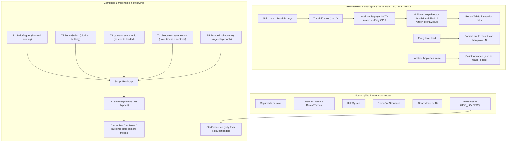
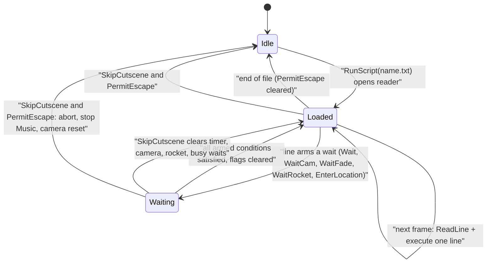

# 30 — Scripting, tutorials and cutscenes

> Part B · Baseline build: Release|Win32 (OpenGL) + TARGET_PC_FULLGAME ([B:FULL]); see _work/build_matrix.md.
> Evidence: [C] confirmed · [I] inferred · [U] unknown. Citations are `path:Symbol` relative to the multiwinia/ source root.
> Sources merged: P19_help_tutorial_script (§1, §2, §4, §5, §7 and closing sections), P20_sequences_loaders_bench (§6, §7, §8 benchmark, closing sections), P10_input_camera (§3 camera modes, §3.8 scripted camera, constants), P11_terrain_world (level-file `CameraMounts`/`CameraAnimations` blocks, map CRC script), X1a_text_formats (§2.10–2.11 camera blocks, tokeniser), P15_network (§12.6 command-history record/replay, late join), routed/_meta_* (appendix, contradictions, unknowns, IP, discrepancies). Every numeric constant and state transition in §2–§7 was re-read in the source for this document; corrections are marked "Resolved:".

## Contents

- [1 Reachability summary](#1-reachability-summary)
- [2 Script language (`Script`)](#2-script-language-script)
  - [2.1 Ownership, lifetime and tick](#21-ownership-lifetime-and-tick)
  - [2.2 Lexical and syntactic grammar](#22-lexical-and-syntactic-grammar)
  - [2.3 Command reference — all 43 opcodes](#23-command-reference--all-43-opcodes)
  - [2.4 Execution model](#24-execution-model)
  - [2.5 Start paths (triggers)](#25-start-paths-triggers)
  - [2.6 Script file register — one row per `data/scripts/*` file](#26-script-file-register--one-row-per-datascripts-file)
  - [2.7 Script-engine constants](#27-script-engine-constants)
  - [2.8 Determinism and safety notes](#28-determinism-and-safety-notes)
- [3 Live Multiwinia tutorials [B:FULL]](#3-live-multiwinia-tutorials-bfull)
  - [3.1 Overview and setup](#31-overview-and-setup)
  - [3.2 Start and end flow](#32-start-and-end-flow)
  - [3.3 Director mechanics (shared)](#33-director-mechanics-shared)
  - [3.4 Gameplay overrides while a tutorial runs](#34-gameplay-overrides-while-a-tutorial-runs)
  - [3.5 Tutorial 1 — "The Basics" (`mp_koth_2P_1`)](#35-tutorial-1--the-basics-mp_koth_2p_1)
  - [3.6 Tutorial 2 — "Advanced Concepts" (`mp_koth_3P_1`)](#36-tutorial-2--advanced-concepts-mp_koth_3p_1)
  - [3.7 Instruction tabs and phrase ids](#37-instruction-tabs-and-phrase-ids)
  - [3.8 Failure, skip and restart paths](#38-failure-skip-and-restart-paths)
  - [3.9 Uncertainties and their resolution status](#39-uncertainties-and-their-resolution-status)
  - [3.10 Determinism caveat](#310-determinism-caveat)
  - [3.11 Tutorial constants](#311-tutorial-constants)
- [4 Camera animation and camera mounts](#4-camera-animation-and-camera-mounts)
- [5 Start sequence, logo splash and demo end sequence](#5-start-sequence-logo-splash-and-demo-end-sequence)
- [6 Dr Sepulveda dialogue system [B:DEAD]](#6-dr-sepulveda-dialogue-system-bdead)
- [7 Demo recording, playback and replay](#7-demo-recording-playback-and-replay)
- [8 What the new game needs](#8-what-the-new-game-needs)
- [9 Darwinia demo tutorials (`tutorial*.cpp`) [B:DEAD] — reference tables](#9-darwinia-demo-tutorials-tutorialcpp-bdead--reference-tables)
- [Open questions and unknowns](#open-questions-and-unknowns)
- [Docs-vs-code discrepancies](#docs-vs-code-discrepancies)
- [IP items](#ip-items)
- [Source map](#source-map)
- [Appendix — dead/legacy code](#appendix--deadlegacy-code)

---

## 1 Reachability summary

Multiwinia inherited Darwinia's whole cinematic stack — a line-oriented cutscene script interpreter, a scripted camera with mounts and animations, a narrator character ("Dr Sepulveda"), chapter-based demo tutorials, a first-time intro and a demo-end sequence. In the shipped PC build almost none of it is reachable. The only live "tutorial / cutscene" content in [B:FULL] is the **pair of Multiwinia tutorials**, which are not scripts at all but a per-frame *help-tab director* inside `MultiwiniaHelp` running on top of ordinary King-of-the-Hill matches.

| # | Component | Files | Body compiled in [B:FULL]? | Reachable by a player in [B:FULL]? | Tag | Evidence |
|---|---|---|---|---|---|---|
| R1 | Script interpreter `Script` | `code/script.{h,cpp}` | Yes, except bodies of `Say`, `ShutUp`, `Highlight`, `ClearHighlights`, `DemoGesture`, `SetCutsceneMode`, the busy/speech wait checks and `ShowDemoEndSequence`, which are hollowed out by `USE_SEPULVEDA_HELP_TUTORIAL` | Ticked every frame (`Script::Advance` in the location loop), but **no Multiwinia path ever opens a script** (§2.5) and `scripts/*` is excluded from the PC data archive | **[B:FULL] engine / [B:LEGACY] content** | [C] `code/main.cpp` location loop; `code/script.cpp:Script::RunScript`; `tools/multiwinia_exclusions.txt` L36 |
| R2 | 42 cutscene scripts | `data/scripts/*.txt` | data | No (37 only via Darwinia triggers T1–T5, 5 via dead attract mode or nothing) | [B:LEGACY] ×37, [B:DEAD] ×5 | §2.6 |
| R3 | Script triggers T1–T6 | `code/worldobject/scripttrigger.cpp`, `code/worldobject/switch.cpp`, `code/global_world.cpp`, `code/taskmanager_interface_*.cpp`, `code/worldobject/rocket.cpp`, `code/attract.cpp` | Yes | No (blocked buildings, no global events, no cutscene objectives, multiplayer guard, attract mode never constructed) | [B:LEGACY] (T1–T5), [B:DEAD] (T6) | §2.5 |
| R4 | Multiwinia tutorials 1 and 2 (help-tab director) | `code/multiwiniahelp.{h,cpp}` (`AttachTutorialTo3d`, `AttachTutorial2To3d`, `RunTutorialHelp`, `RenderTab3d`), `code/UI/GameMenuWindow.cpp`, `code/UI/TutorialButton.h` | Yes (`INCLUDE_TUTORIAL` is defined for `TARGET_PC_FULLGAME`) | **Yes** — Main menu → Tutorials | **[B:FULL]** | [C] `code/lib/universal_include.h` FULLGAME block L97; `code/multiwiniahelp.cpp:MultiwiniaHelp::Advance` |
| R5 | Scripted camera: mounts | `code/camera.cpp:Camera::SetTarget(char const*)`, `code/level_file.cpp:LevelFile::ParseCameraMounts` | Yes | **Yes** — every Multiwinia level start cuts to mount `start`, then to `player<N>` | **[B:FULL]** | [C] `code/main.cpp:DoEnterLocation`, location loop |
| R6 | Scripted camera: animations, MoveToTarget, BuildingFocus, sphere-world scripted/intro/outro/focus modes | `code/camera.cpp` | Yes | No — every shipped `CameraAnimations` block is empty and only scripts/editor/intro request these modes | [B:LEGACY] | §4 |
| R7 | First-time intro `StartSequence` | `code/startsequence.{h,cpp}` | Yes | No — constructed only in `RunBootloader`, which is `#ifdef USE_LOADERS` (off) | [B:LEGACY] (compiled, never constructed) | [C] `code/main.cpp:RunBootloader` |
| R8 | "Darwin logo" splash (`ShowDarwinLogo`) | `code/script.cpp`, `code/renderer.cpp:Renderer::Render` | Yes | No (script-only) | [B:LEGACY] | §5.2 |
| R9 | `DemoEndSequence` | `code/demoendsequence.{h,cpp}` | No (whole file under `USE_SEPULVEDA_HELP_TUTORIAL`) | No | [B:DEAD] | [C] `code/demoendsequence.cpp` L2 |
| R10 | Dr Sepulveda narrator | `code/sepulveda.{h,cpp}`, `code/sepulveda_strings.cpp` | No (whole files under `USE_SEPULVEDA_HELP_TUTORIAL`) | No | [B:DEAD] | [C] `code/sepulveda.cpp` L3/L1494; `code/app.h` member gated |
| R11 | Darwinia demo tutorials | `code/tutorial.{h,cpp}`, `code/tutorial_demo1.cpp`, `code/tutorial_demo2.cpp` | No (whole files under `USE_SEPULVEDA_HELP_TUTORIAL`) | No | [B:DEAD] | [C] `code/tutorial.h` L5–L88 |
| R12 | Darwinia context help `HelpSystem` | `code/helpsystem.{h,cpp}` | No | No | [B:DEAD] (owned by [09](09_meta_systems.md)) | [C] `code/helpsystem.cpp` |
| R13 | Attract mode (idle fly-through) | `code/attract.{h,cpp}` | Yes (no file gate) | No — object constructed and advanced only under `ATTRACTMODE_ENABLED` (defined nowhere) | [B:DEAD] (feature) | [C] `code/main.cpp` L583–588, L752–754 |
| R14 | Gesture demos (recorded mouse paths replayed by the narrator) | `code/gesture_demo.{h,cpp}`, `data/gesture_demos/*` | No | No | [B:DEAD] | [C] `code/gesture_demo.cpp`; `tools/multiwinia_exclusions.txt` L34 |
| R15 | Network command-history record/replay (`RecordDemo` preference) | `code/main.cpp:UpdateAdvanceTime`, `code/app.cpp:App::ShutdownCurrentGame`, `code/network/server.cpp:Server::SaveHistory`/`LoadHistory` | Yes | Hidden preference only (not in `data/default_preferences.txt`, no UI) | [B:FULL] (developer feature) | §7 |
| R16 | Late-join replay of the lockstep stream from sequence 0 | `code/network/clienttoserver.cpp`, `code/network/server.cpp` | Yes | Yes (implicit in joining) | [B:FULL] (owned by [22](22_determinism_and_networking.md)) | §7.3 |
| R17 | AVI capture with fake time (`GrabberWindow`, `AVIGenerator`) | `code/interface/grabber_window.cpp`, `code/lib/avi_generator.cpp` | Only under `AVI_GENERATOR` (`TARGET_DEBUG`) | Debug menu only | [B:DEBUG] | [C] `code/lib/universal_include.h` L125 |
| R18 | Benchmark telemetry recorder + FTP upload | `code/benchmark.{h,cpp}` | No (`BENCHMARK_AND_FTP` commented out) | No | [B:DEAD] (owned by [32](32_debug_test_and_performance.md)) | §7.4 |



Design consequences:

1. **The Multiwinia tutorial has no narrator, no voice, no script file and no cutscene.** It is a context-sensitive director that re-evaluates world state every frame and shows at most one floating instruction tab (§3). [C] `code/multiwiniahelp.cpp:MultiwiniaHelp::Advance` (L1232–1244).
2. **The script engine is a reference design only.** The 43-command language (§2.3), its six trigger types (§2.5) and the camera animation player (§4) are complete and precise enough to re-implement, but they ship unused. [C]
3. **The Darwinia campaign that would use scripts is only reachable from a `TARGET_DEBUG` build** (main-menu entries `PageDarwinia` → Prologue / Campaign exist only behind the debug single-player page) and even then the level and script data are excluded from the PC archives (`levels/map_*`, `levels/mission_*`, `scripts/*`). [C] `code/UI/GameMenuWindow.cpp` (`PageDarwinia` entered only from `PageDemoSinglePlayer`, see [09](09_meta_systems.md)); `tools/multiwinia_exclusions.txt` L24–25, L36. Trigger T1 (`ScriptTrigger`) is dead even in debug builds because `BLOCK_OLD_DARWINIA_OBJECTS` (defined in FULL and DEBUG) makes `Building::CreateBuilding(char*)` skip blocked types. [C] `code/worldobject/building.cpp:Building::CreateBuilding`, `Building::BuildingIsBlocked`.

---

## 2 Script language (`Script`)

### 2.1 Ownership, lifetime and tick

- One global instance `g_app->m_script`, created in `App::App` (`m_script = new Script()`), deleted in `App::~App`. [C] `code/app.cpp:App::App`, `App::~App`.
- Constructor state: `m_in = NULL`, `m_waitUntil = −1.0`, all wait flags false, `m_requestedLocationId = −1`, `m_permitEscape = false`. `m_darwinianResearchLevel`, `m_rocketId`, `m_rocketState`, `m_rocketData` are **not initialised** (set before use by the commands that read them). [C] `code/script.cpp:Script::Script`.
- `Script::Advance()` is called **once per rendered frame**:
  - in the location game loop, after `TaskManagerInterface::Advance` and before the (dead) `Sepulveda::Advance`; the camera has already been advanced earlier in the same frame, so a camera command issued by a script takes effect on the next frame's `Camera::Advance`. [C] `code/main.cpp` location loop (L553 camera, L568 script).
  - in `GlobalWorldGameLoop` (Darwinia world map) after `ClientToServer::AdvanceAndCatchUp`. [C] `code/main.cpp` (L742). That loop exits immediately when `m_atMainMenu` is set, which is always the case in Multiwinia. [I] (Multiwinia returns to `MainMenuLoop`.)
- The interpreter is **client-local and not networked**: it never sends network messages; its timers use wall-clock time. [C] `code/script.cpp` (no network calls). Several commands mutate simulation state directly (§2.8).
- `IsRunningScript()` = `m_in != NULL`, forced `false` whenever `g_app->m_testHarness` exists (always `NULL` in FULL). [C] `Script::IsRunningScript`. Consumers: ESC routing in the location loop, `ControlHelpSystem` hint suppression, `ScriptTrigger` (no new trigger while a script runs), `GlobalWorld::EvaluateEvents` (suspended while a script runs), `EnterGlobalWorld` (Prologue), `Tutorial` (dead), `AttractMode` (dead). [C] `code/main.cpp` L469, L1412; `code/control_help.cpp` L943; `code/worldobject/scripttrigger.cpp:ScriptTrigger::Advance`; `code/global_world.cpp` L2275.

### 2.2 Lexical and syntactic grammar

Location and loading [C] `code/script.cpp:Script::RunScript`:
- File `data/scripts/<name>` opened with `g_app->m_resource->GetTextReader("scripts/" + name)` (archive or loose file).
- `RunScript(name)` only takes the `.txt` branch when `strstr(name, ".txt")` is non-NULL. A name **without** `.txt` is the "phrase-dump" form: push language phrases `<name>_1`, `<name>_2`, … (until the first missing id) into the narrator queue — compiled only under `USE_SEPULVEDA_HELP_TUTORIAL`, so in FULL a non-`.txt` name is silently ignored. [C]
- Demo gate: when `!g_app->IsFullVersion()` and the name starts with `launchpad_purpose` (17-character `strnicmp`), `RunScript` returns without running. [C] [B:DEMO runtime gate on legacy content].

Lexical rules — the shared `TextReader` tokeniser (full rules: [29 — text-file tokeniser](29_data_formats_reference.md)) [C] `contrib/systemiv/lib/filesys/text_stream_readers.cpp:TextReader::CleanLine`, `TextReader::GetNextToken`, `TextReader::TokenAvailable`:
- One physical line = one statement. `\n`/`\r` are stripped.
- `#` starts a comment to end of line, also mid-line (e.g. `GodDishSpawnResearch  # Research comes through`).
- Three or more adjacent `<`/`>` characters trigger `AppDebugAssert` (merge-conflict guard; no effect in release).
- Optional "redshirt2" line-obfuscation header is supported by the reader; no script uses it.
- Token separators: any run of the characters space, TAB, `\n`, `\r`, `:`, `,` (`DEFAULT_SEPERATOR_CHARS " \t\n\r:,"`). Leading separators are skipped (indented lines are fine). Tokens cannot contain separators, so mount names, phrase ids and file names are single words.
- `GetNextToken()` returns `NULL` when the line has no further token.

Syntax [C] `code/script.cpp:Script::AdvanceScript`, `Script::GetOpCode`:
- The first token is the command keyword, matched **case-insensitively** (`stricmp`) against the 43 names of `g_opCodeNames` (so `CamFOV` in `launchpad_purpose.txt` resolves to `CamFov`). Unknown keyword → opcode −1 → `AppDebugAssert(false)` (no-op in release; the line is skipped).
- The second token (if present) is read once as a string (`nextWord`) and as a number (`nextFloat = iv_atof(nextWord)`, 0.0 if absent). Commands that need more arguments pull further tokens with `GetNextToken()` **without** checking availability: a missing mandatory 2nd–4th argument passes `NULL` to `iv_atof`/`atoi`/`stricmp` → undefined behaviour (likely crash). [I] (`iv_atof(NULL)` is not guarded in `contrib/systemiv/lib/math/math_stubs.cpp:iv_atof`.) `Wait` with no argument is `Wait 0` (uses `nextFloat`). Extra trailing tokens are ignored (`CamCut booster1 1`).
- Building ids are parsed as `(int)nextFloat`.

EBNF (over physical lines after cleaning):
```
script      = { line } ;
line        = [ sep ] [ statement ] EOL ;            (* comments already removed *)
statement   = keyword { sep arg } [ sep ] ;
sep         = sepchar { sepchar } ;
sepchar     = " " | TAB | ":" | "," ;
keyword     = (* one of the 43 opcode names of §2.3, case-insensitive *) ;
arg         = token ;                                (* typed per command, §2.3 *)
token       = tokchar { tokchar } ;
tokchar     = (* any character except sepchar, CR, LF, NUL and "#" *) ;
```

Minimal example (written for this document, not from the game):
```
# fly to two mounts, then hand the camera back
PermitEscape
CamMove      overview   4
WaitCam
CamFov       40  0
Wait         2
CamReset
```

### 2.3 Command reference — all 43 opcodes

`g_opCodeNames` has 43 entries and `GetOpCode` asserts `sizeof(g_opCodeNames)/sizeof(char*) == OpNumOps`. [C] `code/script.cpp:Script::GetOpCode`; `code/script.h:Script` enum. "Blocking" = the command sets a condition that stops `Advance` from reading further lines until it holds (§2.4); every other command executes and the interpreter proceeds to the next line on the **next frame**. "Sim" = mutates simulation state on the local peer only. "Build" = where the command has an effect.

| # | Keyword | Arguments (types) | Semantics | Blocking | Effects / side effects | Build | Ref |
|---|---|---|---|---|---|---|---|
| 0 | `CamCut` | `mount` (word) | Requires a location (else no-op). `Camera::SetTarget(mount)` — level-file camera mount by name, case-insensitive; magic name `CamPosBefore` = pose recorded before the last animation/`RecordCameraPosition` — then `CutToTarget()` (instant pose change, `m_height = target.y`). `AppDebugAssert` if the mount is missing (release: camera cuts to the previous target). | No | camera pose | FULL (legacy content) | [C] `Script::RunCommand_CamCut`; `code/camera.cpp:Camera::SetTarget(char const*)`, `Camera::CutToTarget`; `code/level_file.h` `MAGIC_MOUNT_NAME_START_POS` |
| 1 | `CamMove` | `mount` (word), `duration` (float, s) | Requires a location. If the mount exists: `SetTarget(mount)`, `RequestMode(ModeMoveToTarget)` (records start pose/time), `SetMoveDuration(duration)`; silently ignored if the mount is missing. Motion profile §4.4. `CamMove m 0` followed by `CamCut m` is the scripts' idiom for a hard cut that also resets orientation. | No (pair with `WaitCam`) | camera mode | FULL | [C] `Script::RunCommand_CamMove`; `Camera::AdvanceMoveToTargetMode` |
| 2 | `CamAnim` | `animName` (word) | Requires a location. `LevelFile::GetCameraAnimId(name)` (case-insensitive); `AppReleaseAssert` (fatal) if missing; `Camera::PlayAnimation(anim)` (§4.3). | No (pair with `WaitCam`) | camera mode | FULL (no script uses it) | [C] `Script::RunCommand_CamAnim`; `Camera::PlayAnimation` |
| 3 | `CamFov` | `fov` (float, degrees, vertical), optional `immediate` (int, default **true**) | `immediate ≠ 0` → `Camera::SetFOV(fov)` (fov and target); `0` → `SetTargetFOV(fov)` (eased, §4.4). Works in or out of a location. | No | camera FOV | FULL | [C] `Script::AdvanceScript` case `OpCamFov`; `Script::RunCommand_CamFov` |
| 4 | `CamBuildingFocus` | `buildingId` (int), `range` (float, wu), `height` (float, wu) | Requires a location. `Camera::RequestBuildingFocusMode(b, range, height)` (orbit, §4.4). Building missing → `AppDebugOut("SCRIPT ERROR : Tried to target non-existent building %d")`. | No (never completes on its own) | camera mode; target FOV reset to 60° | FULL | [C] `Script::RunCommand_CamBuildingFocus`; `Camera::RequestBuildingFocusMode`, `Camera::AdvanceBuildingFocusMode` |
| 5 | `CamBuildingApproach` | `buildingId` (int), `range`, `height` (float, wu), `duration` (float, s) | Requires a location. `Camera::SetTarget(b->m_centrePos, range, height)` (point at `range` from the building along the current camera→building bearing, raised `height` above the building centre, looking at it), `SetMoveDuration(duration)`, `RequestMode(ModeMoveToTarget)`. | No (pair with `WaitCam`) | camera mode | FULL | [C] `Script::RunCommand_CamBuildingApproach`; `Camera::SetTarget(Vector3 const&, float, float)` |
| 6 | `CamLocationFocus` | `locationName` (word; `heaven` = world origin), `fov` (float) | **Only outside a location** (Darwinia world map). Enter `ModeSphereWorldScripted` if not already; `SetTargetFOV(fov)`; `SetTarget(locationPos, (0,0,1), up)`. Unknown location → no-op. | No | camera | FULL code, world map unreachable in MW | [C] `Script::RunCommand_LocationFocus` |
| 7 | `CamGlobalWorldFocus` | — | `Camera::RequestSphereFocusMode()`. | No | camera | FULL (legacy) | [C] `Script::RunCommand_CamGlobalWorldFocus` |
| 8 | `CamReset` | — | Stop any camera animation (`StopAnimation`); in a location → `ModeFreeMovement` and `g_app->m_hideInterface = false`; else `ModeSphereWorld`. | No | camera; interface shown | FULL | [C] `Script::RunCommand_CamReset` |
| 9 | `EnterLocation` | `locationName` (word) | `g_app->m_requestedLocationId = GlobalWorld::GetLocationId(name)`; record it in `m_requestedLocationId`; `m_loadingNewProfile = false`; **`App::LoadProfile()`** (rebuilds `GlobalWorld` from the profile's `game.txt`); copy that location's mission/map file names into `m_requestedMission` / `m_requestedMap`. The main loop then loads the level. | **Yes** — until `g_app->m_locationId == m_requestedLocationId` | level load; profile reload | FULL code; MW never has global locations | [C] `Script::RunCommand_EnterLocation`; `Script::Advance` |
| 10 | `ExitLocation` | — | Clear requested location/mission/map (the main loop leaves the location); `m_requestedLocationId = −1`. | No (scripts follow it with `WaitFade`) | level unload | FULL (legacy) | [C] `Script::RunCommand_ExitLocation` |
| 11 | `Say` | `phraseId` (word) | `Sepulveda::Say(id)` — queue a narrator line (§6.3). | No (pair with `WaitSay`) | — | **no-op in FULL** → [B:DEAD] | [C] `Script::RunCommand_Say` |
| 12 | `ShutUp` | — | `Sepulveda::ShutUp()` — clear caption, queue, highlights, gesture demo. | No | — | no-op in FULL → [B:DEAD] | [C] `Script::RunCommand_ShutUp` |
| 13 | `Wait` | `seconds` (float) | `m_waitUntil = max(m_waitUntil, GetHighResTime() + seconds)` — consecutive waits take the max, they do not add. Compared against `g_gameTime` in `Advance`. | **Yes** — until `g_gameTime ≥ m_waitUntil` | — | FULL | [C] `Script::RunCommand_Wait` |
| 14 | `WaitSay` | — | Set `m_waitForSpeech`; `Advance` would block while `Sepulveda::IsTalking()`. | Flag set, but the check is compiled out → **does not block** in FULL | — | [B:DEAD] effect | [C] `Script::Advance` (`#ifdef USE_SEPULVEDA_HELP_TUTORIAL`) |
| 15 | `WaitCam` | — | Set `m_waitForCamera`; block while `Camera::IsAnimPlaying()` (= an animation is active **or** mode is `ModeMoveToTarget`). Does **not** wait for `ModeBuildingFocus` (which never ends). | **Yes** | — | FULL | [C] `Script::Advance`; `Camera::IsAnimPlaying` |
| 16 | `WaitFade` | — | Set `m_waitForFade`; block while `!Renderer::IsFadeComplete()`. | **Yes** | — | FULL | [C] `Script::Advance` |
| 17 | `WaitRocket` | `buildingId` (int), `state` (word: `Refueling`, `Loading`, `Ignition`, `Ready`, `Countdown`, `Exploding`, `Flight`, case-insensitive), `data` (int) | Block until the EscapeRocket's `m_state ≥ state`; when `m_state == state == Countdown`, additionally until `(int)m_countdown ≤ data`. Building missing or not an EscapeRocket → the wait is cancelled (that frame returns, next frame proceeds). Unknown state word → `GetStateId` −1 → passes at once. | **Yes** | — | FULL | [C] `Script::RunCommand_WaitRocket`, `Script::Advance`; `code/worldobject/rocket.cpp:EscapeRocket::GetStateId` |
| 18 | `WaitPlayerNotBusy` | — | Would call `Demo2Tutorial::BeginPlayerBusyCheck()` and block while `Demo2Tutorial::IsPlayerBusy()` (§9.3). | Flag set but both calls compiled out → **does not block** in FULL | — | [B:DEAD] effect | [C] `Script::RunCommand_WaitPlayerNotBusy`; `Script::Advance` |
| 19 | `Highlight` | `buildingId` (int) | `Sepulveda::HighlightBuilding(id, "ScriptHighlight")` — god-ray beam (§6.5). | No | — | no-op in FULL → [B:DEAD] | [C] `Script::RunCommand_Highlight` |
| 20 | `ClearHighlights` | — | `Sepulveda::ClearHighlights("ScriptHighlight")`. | No | — | no-op in FULL → [B:DEAD] | [C] `Script::RunCommand_ClearHighlights` |
| 21 | `TriggerSound` | `event` (word) | **Music start.** If no instance of `"Music <event>"` is playing, `SoundSystem::TriggerOtherEvent(NULL, event, SoundSourceBlueprint::TypeMusic)` (idempotent start). Event names match case-insensitively. | No | audio | FULL | [C] `Script::RunCommand_TriggerSound`; `code/sound/soundsystem.cpp:SoundSystem::TriggerOtherEvent` (`stricmp`) |
| 22 | `StopSound` | `event` (word) | **Music stop.** `SoundSystem::StopAllSounds(WorldObjectId(), "Music <event>")`. | No | audio | FULL | [C] `Script::RunCommand_StopSound` |
| 23 | `DemoGesture` | `gestureFile` (word, e.g. `officer.txt`) | `Sepulveda::DemoGesture(name, 2.0)` — loop-replay a recorded mouse gesture starting 2.0 s later (§6.5). | No | — | no-op in FULL → [B:DEAD] | [C] `Script::RunCommand_DemoGesture` |
| 24 | `GiveResearch` | `name` (word) | `modsystem` → set pref `ModSystemEnabled = 1` (only under `USE_DARWINIA_MOD_SYSTEM`), save prefs, task-manager research message id 999 for 4.0 s; `accessallareas` → create `<profileDir>users/` and `<profileDir>users/AccessAllAreas/`, message id 998 for 4.0 s; otherwise `GlobalResearch::GetType(name)` → `AddResearch(type)` + message for 4.0 s (unknown name → nothing). | No | **Sim** (research), prefs, file system | FULL (legacy) | [C] `Script::RunCommand_GiveResearch` |
| 25 | `SetMission` | `locationName`, `missionFile` (words) | Set a global location's mission file; `m_missionCompleted = false`. `AppDebugAssert` if the location is missing (release: NULL dereference) [I]. | No | global world | FULL (legacy) | [C] `Script::RunCommand_SetMission` |
| 26 | `GameOver` | — | Camera → `ModeSphereWorldOutro` (after 70 s it runs the credits loader, see [09](09_meta_systems.md)); stop `"Ambience EnterGlobalWorld"`. | No | camera, audio | FULL (legacy) | [C] `Script::RunCommand_GameOver`; `Camera::AdvanceSphereWorldOutroMode` |
| 27 | `ResetResearch` | — | Save the Darwinian research level into `m_darwinianResearchLevel`, set it to 1. | No | **Sim** | FULL (legacy) | [C] `Script::RunCommand_ResetResearch` |
| 28 | `RestoreResearch` | — | Restore the saved Darwinian research level (garbage if `ResetResearch` never ran). | No | **Sim** | FULL (legacy) | [C] `Script::RunCommand_RestoreResearch` |
| 29 | `RunCredits` | — | `Loader::GetLoaderIndex("credits")` (in FULL the only loader, index 0) → `CreateLoader` → synchronous `Run()` (own render loop) → delete. | Synchronous (blocks the whole application until the credits finish or are skipped) | full-screen takeover | FULL (no script uses it) | [C] `Script::RunCommand_RunCredits`; `code/loaders/loader.cpp:Loader::GetLoaderIndex` |
| 30 | `SetCutsceneMode` | `mode` (int) | `Sepulveda::SetCutsceneMode(mode)` (big-face layout). | No | — | no-op in FULL → [B:DEAD] | [C] `Script::AdvanceScript` case `OpSetCutsceneMode` |
| 31 | `GodDishActivate` | — | First `GodDish` building in the location → `Activate()`. | No | **Sim** | [B:LEGACY] (GodDish blocked) | [C] `Script::RunCommand_GodDishActivate`, `GetGodDish` |
| 32 | `GodDishDeactivate` | — | `GodDish::DeActivate()`. | No | **Sim** | [B:LEGACY] | [C] `Script::RunCommand_GodDishDeactivate` |
| 33 | `GodDishSpawnSpam` | — | `GodDish::SpawnSpam(false)`. | No | **Sim** | [B:LEGACY] | [C] `Script::RunCommand_GodDishSpawnSpam` |
| 34 | `GodDishSpawnResearch` | — | `GodDish::SpawnSpam(true)`. | No | **Sim** | [B:LEGACY] | [C] `Script::RunCommand_GodDishSpawnResearch` |
| 35 | `TriggerSpam` | — | `GodDish::TriggerSpam()`. | No | **Sim** | [B:LEGACY] | [C] `Script::RunCommand_SpamTrigger` |
| 36 | `PurityControl` | — | Delete every file in `users/<profile>/`, open the buy-now URL, `exit(0)` (anti-piracy / demo kill switch). | Terminates the process | file system, process | FULL code (no script uses it) | [C] `Script::RunCommand_PurityControl` |
| 37 | `ShowDarwinLogo` | — | `Renderer::m_renderDarwinLogo = GetHighResTime()`; interface sound `ShowLogo` (§5.2). | No | overlay, audio | FULL (legacy) | [C] `Script::RunCommand_ShowDarwinLogo`; `code/renderer.cpp:Renderer::Render` |
| 38 | `ShowDemoEndSequence` | — | `g_app->m_demoEndSequence = new DemoEndSequence()` (§5.3). | No | — | empty body in FULL → [B:DEAD] | [C] `Script::RunCommand_ShowDemoEndSequence` |
| 39 | `PermitEscape` | — | `m_permitEscape = true`: from now until the script ends, `SkipCutscene` aborts the whole script (§2.4). | No | — | FULL | [C] `Script::RunCommand_PermitEscape` |
| 40 | `DestroyBuilding` | `buildingId` (int), `intensity` (float) | `Building::Destroy(intensity)` if the building exists. | No | **Sim** | FULL (no script uses it) | [C] `Script::RunCommand_DestroyBuilding` |
| 41 | `ActivateTrunkPort` | `buildingId` (int) | If a TrunkPort: its `GlobalBuilding::m_online = true` (partial activation, no reprogram effect). | No | **Sim** (global) | FULL (no script uses it) | [C] `Script::RunCommand_ActivateTrunkPort` |
| 42 | `ActivateTrunkPortFull` | `buildingId` (int) | If a TrunkPort: `ReprogramComplete()` (opens the port). | No | **Sim** | FULL (no script uses it) | [C] `Script::RunCommand_ActivateTrunkPort` (shared, `_fullActivation = true`) |

### 2.4 Execution model

State (public members of `Script`) [C] `code/script.h:Script`: `m_in` (open `TextReader` or NULL), `m_waitUntil` (double), `m_waitForSpeech`, `m_waitForCamera`, `m_waitForFade`, `m_waitForPlayerNotBusy`, `m_waitForRocket` (+ `m_rocketId`, `m_rocketState`, `m_rocketData`), `m_requestedLocationId`, `m_darwinianResearchLevel`, `m_permitEscape`.

`RunScript(name)` only opens the reader and returns; the first line runs on the next `Advance`. It **replaces** any running script's reader pointer without deleting the old reader (leak) and without resetting wait flags or `m_permitEscape`. [C] `Script::RunScript`.

Per-frame algorithm [C] `code/script.cpp:Script::Advance`:
```
if controlEvent(SkipCutscene):                       # key Enter, XInput B
    m_waitUntil = g_gameTime
    clear waitForCamera, waitForRocket, waitForPlayerNotBusy
    renderer.m_renderDarwinLogo = -1                 # hide logo splash
    if m_permitEscape:                               # abort the whole script
        delete m_in; m_in = NULL; (Sepulveda.ShutUp — dead)
        StopAllSounds("Music"); m_permitEscape = false
        camera.RequestMode(FreeMovement if in location else SphereWorld)
        return
if waitForFade and not renderer.IsFadeComplete(): return
if m_waitUntil > g_gameTime: return
(if waitForSpeech and sepulveda.IsTalking(): return)                 # compiled out in FULL
if waitForCamera and camera.IsAnimPlaying(): return
(if waitForPlayerNotBusy and Demo2Tutorial.IsPlayerBusy(): return)   # compiled out in FULL
if waitForRocket:
    rocket = building(m_rocketId)
    if rocket missing or not EscapeRocket: waitForRocket = false; return
    if rocket.m_state < m_rocketState: return
    if rocket.m_state == m_rocketState == Countdown and int(rocket.m_countdown) > m_rocketData: return
if m_requestedLocationId != -1:
    if app.m_locationId != m_requestedLocationId: return
    m_requestedLocationId = -1
clear waitForSpeech, waitForCamera, waitForFade, waitForRocket, waitForPlayerNotBusy
if m_in:
    if m_in.ReadLine(): AdvanceScript()              # execute exactly ONE physical line
    else: delete m_in; m_in = NULL; m_permitEscape = false
```

Consequences (all [C] from the code above):
- **One physical line per frame.** Blank and comment-only lines also consume a frame (`AdvanceScript` returns when no token is available). A run of non-blocking commands therefore executes over consecutive frames, never atomically; at 60 fps a 109-line script costs at least 109 frames (1.8 s) on top of its waits. §2.6 gives each file's physical line count.
- Wait conditions are evaluated in the fixed order fade → timer → speech → camera → player-busy → rocket → location, and all flags are cleared together once every condition passes. Several waits can therefore be armed by consecutive lines and are satisfied jointly.
- `SkipCutscene` without `PermitEscape` fast-forwards only the current `Wait`, `WaitCam`, `WaitRocket` and `WaitPlayerNotBusy` — not `WaitFade`, `WaitSay` or `EnterLocation`. It does not stop camera motion: after a skipped `WaitCam` the camera keeps flying while the next lines execute. Bindings `SkipCutscene = key enter down`, `XInput b down`. [C] `data/input/input_preferences.txt` L39–40.
- The skip check runs every frame even when no script is open (it is harmless then: it only rewrites `m_waitUntil` and the logo timer). [C]
- `ESC` (`ControlMenuEscape`) while a script runs is routed to `Sepulveda::PlayerSkipsMessage` (dead in FULL) instead of opening the in-game menu — in FULL, ESC does nothing during a script. [C] `code/main.cpp` location loop (L467–474).
- `Wait` stores `GetHighResTime() + t` but `Advance` compares with `g_gameTime`. In normal play `g_gameTime` is the wall clock sampled at `UpdateAdvanceTime` (frozen while `App::GamePaused()`); in `RecordDemo` mode it is still the real clock (§7.2). So a pause holds a pending `Wait` (the comparison value stops) and the wait ends as soon as the game resumes if real time has passed. [C] `code/main.cpp:UpdateAdvanceTime`; [I] behavioural reading.



### 2.5 Start paths (triggers)

Every call site of `Script::RunScript` [C] (grep of `code/`):

| # | Trigger | Call site | Script source | Reachable in MW FULL? | Evidence |
|---|---|---|---|---|---|
| T1 | `ScriptTrigger` building (one-shot volume trigger placed in a level) | `code/worldobject/scripttrigger.cpp:ScriptTrigger::Trigger` | building field `m_scriptFilename` | No — `TypeScriptTrigger` is in `Building::BuildingIsBlocked`, so `CreateBuilding(char*)` returns NULL for it in FULL **and** DEBUG; no `mp_*` map contains one | [C] `code/worldobject/building.cpp:Building::CreateBuilding`, `Building::BuildingIsBlocked`; grep `data/levels/mp_*.txt` |
| T2 | `FenceSwitch` toggled, `m_script` containing `.txt` | `code/worldobject/switch.cpp` (L227–229; a second call site at L415–418 is commented out) | per-building `m_script` | No — `TypeFenceSwitch` blocked | [C] same |
| T3 | Global-world event action `RunScript <file>` | `code/global_world.cpp:GlobalEventAction::Execute` (L361–363) | `data/game.txt`, `data/game_unlockall.txt`, `data/game_demo2.txt`, `data/purity/game.txt` lines `Action RunScript …` | No — Multiwinia creates a bare `new GlobalWorld` at start-up (`// bool profileLoaded = LoadProfile();` is commented out), so no `game.txt` events are loaded; only the debug Campaign/Prologue entries load a profile | [C] `code/app.cpp:App::App` (L452–453) |
| T4 | Player clicks an objective in the task manager whose `GlobalEventCondition::m_cutScene` is set (third column of a `PrimaryObjectives` line) | `code/taskmanager_interface_multiwinia.cpp` (L929), `code/taskmanager_interface_icons.cpp` (L1415), `code/taskmanager_interface_gestures.cpp` (L771) | level `PrimaryObjectives` block | No — of 57 `mp_*.txt` maps, 45 contain only `NeverTrue`, 2 (`mp_sandbox`, `mp_sandbox_all`) contain two `BuildingOnline :sandbox,2` lines, 10 have no objectives block; none has a cutscene column | [C] census of `data/levels/mp_*.txt` |
| T5 | EscapeRocket ends `StateIgnition` (countdown ≤ 0) in **single-player** with `m_spawnCompleted` → `launchpad_victory.txt` | `code/worldobject/rocket.cpp` (L1196–1198) | hard-coded | No — the branch is the `else` of `if (g_app->Multiplayer())`; Multiwinia is always "multiplayer" | [C] `code/worldobject/rocket.cpp` (`EscapeRocket` ignition advance) |
| T6 | Attract mode start/stop → `attractmode.txt`, `endattract.txt` | `code/attract.cpp:AttractMode::StartAttractMode` (L45), `AttractMode::EndAttractMode` (L61) | hard-coded | No — `AttractMode` is only constructed and advanced under `#ifdef ATTRACTMODE_ENABLED` (never defined); its start binding is commented out too | [C] `code/main.cpp` L583–588, L752–754; `data/input/input_preferences.txt` L280–287 |

Conclusion [C]: in [B:FULL] the interpreter is ticked but has **no reachable entry point**. T3, T4 and T5 become reachable only in a `TARGET_DEBUG` build through the debug-only Prologue/Campaign menu entries, and only with loose Darwinia data, because `levels/map_*`, `levels/mission_*` and `scripts/*` are excluded from the PC archives. [C] `tools/multiwinia_exclusions.txt` L24–25, L36.

**`ScriptTrigger` as the reference trigger design** [C] `code/worldobject/scripttrigger.cpp:ScriptTrigger::Read`, `ScriptTrigger::Advance`, `ScriptTrigger::Trigger`; `code/worldobject/scripttrigger.h`:
- Level line: standard building columns, then `linkId` (int), `range` (float, default 100.0), `scriptFilename` (word), `entityType` (word). Full column grammar: [29](29_data_formats_reference.md).
- `entityType` keywords: `always` (`SCRIPTRIGGER_RUNALWAYS` 999), `never` (998), `camenter` (997), `camview` (996); any other word is an entity type name (`Entity::GetTypeId`, e.g. `Darwinian`, `Squadie`, `Engineer`).
- Polling: a countdown `m_timer` is decreased by `SERVER_ADVANCE_PERIOD` (0.1 s) per building advance and re-armed to 1.0 s, so the condition is tested once per second of simulation time, and only while **no script is running and the camera is interactive**.
- Conditions: `always` → fire; `camenter` → camera within `range`, camera speed < 5 wu/s, camera interactive; `camview` → (within `range + 300`, speed < 5, interactive, view ray hits the sphere of radius `range`) or the `camenter` condition; entity type → at least one entity of that type **owned by the trigger's team** within `range` (entity grid).
- On fire: a `.txt` name runs the script and the trigger deletes itself next advance (`m_triggered = −1`); any other name enters the dead phrase-sequencing mode (with `USE_SEPULVEDA_HELP_TUTORIAL`: say `<name>_1`, `<name>_2`, … one per silence, highlighting `linkId`; without it the trigger simply deletes itself). `never` triggers never fire.
- Determinism hazard: the trigger runs inside the simulation tick but tests the **local camera** (position, velocity, interactivity) and the local script state. [C] — a new game must evaluate camera triggers client-side only and never let them mutate shared state.

### 2.6 Script file register — one row per `data/scripts/*` file

Generated by `OUT/_work/scripts/S_30_script_census.py` (run `python3 -I S_30_script_census.py <multiwinia root>`). *Lines phys/exec* = physical lines (= minimum frames consumed) / executable lines; *Say ids* = narrator phrase ids (all dead in FULL); *ΣWait / ΣCamMove* = sum of explicit `Wait` arguments and of `CamMove` durations (a lower bound on run time ignoring `WaitSay`, fades and level loads); *Live references* = uncommented references with the trigger class of §2.5; tag rule: [B:LEGACY] = started only by triggers T1–T5 (compiled into FULL but unreachable in Multiwinia), [B:DEAD] = started only by the dead attract mode (T6) or by nothing (orphan). The PC data build excludes all 42 files (`tools/multiwinia_exclusions.txt` L36). [C]

Resolved: P19 tagged `launchpad_purpose.txt` [B:LEGACY] but the orphan `gamestart.txt` [B:DEAD], and listed `music4.txt` as "still referenced by `game_unlockall.txt`". The data show both `music4.txt` references (`data/game.txt` L107, `data/game_unlockall.txt` L85) are commented out, so `music4.txt` is an orphan too; all three orphans are tagged [B:DEAD] here. Totals: **42 files = 37 [B:LEGACY] + 5 [B:DEAD]** (`attractmode.txt`, `endattract.txt`, `gamestart.txt`, `launchpad_purpose.txt`, `music4.txt`), superseding the "39 + 3" of the Phase-2 log.

| Script | Lines phys/exec | Commands (opcode×count) | Say ids (n: first..last) | ΣWait / ΣCamMove s | Live references | Commented-out references | Tag |
|---|---|---|---|---|---|---|---|
| `attractmode.txt` | 53/44 | CamMove×17, CamReset×1, EnterLocation×3, ExitLocation×3, SetMission×3, Wait×3, WaitCam×14 | 0 | 21 / 180 | T6 attract mode `code/attract.cpp:L45` | none | [B:DEAD] |
| `biosphere_intro.txt` | 43/25 | CamBuildingFocus×2, CamMove×3, CamReset×1, Say×10, StopSound×1, TriggerSound×1, Wait×1, WaitCam×1, WaitFade×1, WaitSay×4 | 10: `biosphere_primary_1`..`biosphere_primary_10` | 2 / 58 | T4 objective cutscene `data/levels/mission_biosphere_attract.txt:L52`; T1 ScriptTrigger `data/levels/mission_biosphere_recapture.txt:L18`; T4 objective cutscene `data/levels/mission_biosphere_recapture.txt:L47` | none | [B:LEGACY] |
| `biospherealpha_primary.txt` | 26/17 | CamBuildingFocus×3, CamMove×2, CamReset×1, Say×5, WaitCam×1, WaitFade×1, WaitSay×4 | 5: `biospherealpha_primary1`..`biospherealpha_primary5` | 0 / 25 | T1 ScriptTrigger `data/levels/mission_escort_escort.txt:L15`; T4 objective cutscene `data/levels/mission_escort_escort.txt:L45` | none | [B:LEGACY] |
| `containment_end.txt` | 108/71 | CamBuildingFocus×3, CamLocationFocus×5, CamMove×2, CamReset×1, ClearHighlights×4, EnterLocation×2, ExitLocation×2, Highlight×7, Say×26, StopSound×1, TriggerSound×1, WaitFade×5, WaitSay×12 | 26: `containmentend_1`..`containmentend_8` | 0 / 50 | T3 global event `data/game.txt:L76`; T3 global event `data/game_unlockall.txt:L58` | none | [B:LEGACY] |
| `containment_intro.txt` | 40/27 | CamBuildingFocus×3, CamMove×1, CamReset×1, ClearHighlights×1, Highlight×3, Say×11, StopSound×1, TriggerSound×1, WaitFade×1, WaitSay×4 | 11: `containment_intro1`..`containment_rescuedw4` | 0 / 5 | T1 ScriptTrigger `data/levels/mission_containment_enable.txt:L17` | none | [B:LEGACY] |
| `containment_officer.txt` | 13/8 | DemoGesture×2, Highlight×1, Say×3, WaitSay×2 | 3: `containment_officer_1`..`containment_officer_3` | 0 / 0 | T3 global event `data/game.txt:L62`; T3 global event `data/purity/game.txt:L60` | none | [B:LEGACY] |
| `containment_primary1.txt` | 24/16 | CamBuildingFocus×2, CamMove×1, CamReset×1, ClearHighlights×1, Highlight×3, Say×5, WaitSay×3 | 5: `containment_primary_1`..`containment_primary_5` | 0 / 13 | T4 objective cutscene `data/levels/mission_containment_enable.txt:L51` | none | [B:LEGACY] |
| `endattract.txt` | 3/2 | CamReset×1, ExitLocation×1 | 0 | 0 / 0 | T6 attract mode `code/attract.cpp:L61` | none | [B:DEAD] |
| `gameover.txt` | 108/55 | CamCut×3, CamMove×3, EnterLocation×3, ExitLocation×4, GameOver×1, GiveResearch×2, Say×19, TriggerSound×1, Wait×9, WaitCam×2, WaitFade×1, WaitSay×7 | 19: `outro_biosphere_1`..`outro_4` | 46 / 180 | T3 global event `data/game.txt:L155`; T3 global event `data/game_unlockall.txt:L129` | none | [B:LEGACY] |
| `gamestart.txt` | 2/1 | EnterLocation×1 | 0 | 0 / 0 | orphan (no live reference) | none | [B:DEAD] |
| `garden_intro.txt` | 16/11 | Say×5, Wait×2, WaitFade×1, WaitSay×3 | 5: `garden_intro_1`..`garden_intro_5` | 7 / 0 | T1 ScriptTrigger `data/levels/mission_garden_liberate.txt:L15` | none | [B:LEGACY] |
| `garden_opentrunkport.txt` | 14/10 | ClearHighlights×1, Highlight×2, Say×4, WaitSay×3 | 4: `garden_souls_1`..`garden_opentrunkport_2` | 0 / 0 | T1 ScriptTrigger `data/levels/mission_garden_liberate.txt:L14` | none | [B:LEGACY] |
| `generator_primary1.txt` | 44/26 | CamBuildingFocus×5, CamReset×1, ClearHighlights×5, Highlight×1, Say×9, WaitSay×5 | 9: `generator_primary_1`..`generator_panels_7` | 0 / 0 | T4 objective cutscene `data/levels/mission_generator_enable.txt:L44` | none | [B:LEGACY] |
| `launchpad_finalisland.txt` | 39/29 | CamBuildingFocus×4, CamCut×1, CamFov×3, CamMove×2, CamReset×1, PermitEscape×1, Say×9, ShutUp×1, Wait×1, WaitPlayerNotBusy×1, WaitSay×5 | 9: `launchpad_finalisland_1`..`launchpad_finalisland_9` | 1 / 8 | T3 global event `data/game_demo2.txt:L46` | none | [B:LEGACY] |
| `launchpad_intro.txt` | 109/69 | CamBuildingFocus×1, CamCut×8, CamFov×11, CamMove×11, CamReset×1, PermitEscape×1, Say×15, ShowDarwinLogo×1, ShutUp×1, StopSound×1, TriggerSound×1, Wait×13, WaitCam×1, WaitFade×1, WaitRocket×1, WaitSay×1 | 15: `launchpad_intro_1`..`launchpad_intro_15` | 127 / 163 | T1 ScriptTrigger `data/levels/mission_launchpad.txt:L54` | none | [B:LEGACY] |
| `launchpad_primary1.txt` | 22/14 | CamBuildingFocus×3, CamReset×1, PermitEscape×1, Say×6, WaitSay×3 | 6: `launchpad_primary_1`..`launchpad_primary_7` | 0 / 0 | T4 objective cutscene `data/levels/mission_launchpad.txt:L88` | none | [B:LEGACY] |
| `launchpad_primary2.txt` | 22/14 | CamBuildingFocus×3, CamReset×1, PermitEscape×1, Say×6, WaitSay×3 | 6: `launchpad_primary_1`..`launchpad_primary_7` | 0 / 0 | T4 objective cutscene `data/levels/mission_launchpad.txt:L89` | none | [B:LEGACY] |
| `launchpad_primary3.txt` | 22/14 | CamBuildingFocus×3, CamReset×1, PermitEscape×1, Say×6, WaitSay×3 | 6: `launchpad_primary_1`..`launchpad_primary_7` | 0 / 0 | T4 objective cutscene `data/levels/mission_launchpad.txt:L90` | none | [B:LEGACY] |
| `launchpad_primary_rocket.txt` | 18/13 | CamBuildingFocus×1, CamReset×1, ClearHighlights×1, Highlight×3, PermitEscape×1, Say×5, WaitSay×1 | 5: `launchpad_primary_rocket_1`..`launchpad_primary_rocket_5` | 0 / 0 | T4 objective cutscene `data/levels/mission_launchpad.txt:L91` | none | [B:LEGACY] |
| `launchpad_purpose.txt` | 56/36 | CamCut×1, CamFOV×1, CamGlobalWorldFocus×1, CamLocationFocus×2, CamMove×2, CamReset×1, EnterLocation×1, ExitLocation×1, PermitEscape×1, Say×13, ShutUp×1, StopSound×1, TriggerSound×1, Wait×3, WaitFade×2, WaitPlayerNotBusy×1, WaitSay×3 | 13: `launchpad_middemo_1`..`launchpad_middemo_14` | 22 / 60 | orphan (no live reference) | `data/levels/mission_launchpad.txt:L55` | [B:DEAD] |
| `launchpad_victory.txt` | 42/33 | CamBuildingApproach×1, CamBuildingFocus×1, CamCut×4, CamFov×5, CamMove×8, Say×4, ShowDemoEndSequence×1, ShutUp×1, Wait×7, WaitRocket×1 | 4: `launchpad_success_1`..`launchpad_success_4` | 49 / 50 | T5 EscapeRocket victory `code/worldobject/rocket.cpp:L1198` | none | [B:LEGACY] |
| `mine_demo_intro.txt` | 30/21 | CamBuildingFocus×1, CamMove×3, CamReset×1, Say×10, Wait×1, WaitCam×1, WaitFade×1, WaitSay×3 | 10: `tutorial_intro_1`..`tutorial_intro_10` | 6 / 65 | T1 ScriptTrigger `data/levels/mission_mine_demo.txt:L31` | none | [B:LEGACY] |
| `mine_minehelp.txt` | 15/11 | ClearHighlights×1, Highlight×4, Say×4, WaitSay×2 | 4: `pixelmines_progress_1`..`pixelmines_mines_3` | 0 / 0 | T1 ScriptTrigger `data/levels/mission_mine_demo.txt:L27`; T1 ScriptTrigger `data/levels/mission_mine_enable.txt:L19` | none | [B:LEGACY] |
| `mine_primary1.txt` | 31/21 | CamBuildingFocus×1, CamMove×2, CamReset×1, ClearHighlights×1, Highlight×5, Say×8, WaitCam×1, WaitSay×2 | 8: `pixelmines_intro_1`..`pixelmines_mines_3` | 0 / 43 | T4 objective cutscene `data/levels/mission_mine_attract.txt:L58`; T4 objective cutscene `data/levels/mission_mine_demo.txt:L57`; T4 objective cutscene `data/levels/mission_mine_enable.txt:L52` | none | [B:LEGACY] |
| `mine_primary2.txt` | 10/7 | CamBuildingFocus×1, CamReset×1, ClearHighlights×1, Highlight×1, Say×2, WaitSay×1 | 2: `pixelmines_yardport_1`..`pixelmines_yardport_2` | 0 / 0 | T4 objective cutscene `data/levels/mission_mine_attract.txt:L59`; T4 objective cutscene `data/levels/mission_mine_demo.txt:L58`; T4 objective cutscene `data/levels/mission_mine_enable.txt:L53` | none | [B:LEGACY] |
| `music1.txt` | 1/1 | TriggerSound×1 | 0 | 0 / 0 | T3 global event `data/game.txt:L48`; T3 global event `data/purity/game.txt:L46` | none | [B:LEGACY] |
| `music2.txt` | 1/1 | TriggerSound×1 | 0 | 0 / 0 | T3 global event `data/game.txt:L70`; T3 global event `data/game_unlockall.txt:L52`; T3 global event `data/purity/game.txt:L68` | none | [B:LEGACY] |
| `music3.txt` | 1/1 | TriggerSound×1 | 0 | 0 / 0 | T3 global event `data/game.txt:L85`; T3 global event `data/game_unlockall.txt:L67` | none | [B:LEGACY] |
| `music4.txt` | 1/1 | TriggerSound×1 | 0 | 0 / 0 | orphan (no live reference) | `data/game.txt:L107`; `data/game_unlockall.txt:L85` | [B:DEAD] |
| `music5.txt` | 1/1 | TriggerSound×1 | 0 | 0 / 0 | T3 global event `data/game.txt:L123` | none | [B:LEGACY] |
| `patternbuffer_primary1.txt` | 32/20 | CamBuildingFocus×1, CamMove×2, CamReset×1, ClearHighlights×2, Highlight×4, Say×7, WaitCam×1, WaitSay×2 | 7: `yardend_11`..`patternbuffer_primary_5` | 0 / 33 | T4 objective cutscene `data/levels/mission_pattern_buffer_attract.txt:L66`; T4 objective cutscene `data/levels/mission_pattern_buffer_recapture.txt:L58` | none | [B:LEGACY] |
| `patternbuffer_primary2.txt` | 10/7 | CamBuildingFocus×1, CamReset×1, ClearHighlights×1, Highlight×1, Say×2, WaitSay×1 | 2: `patternbuffer_trunk_1`..`patternbuffer_trunk_2` | 0 / 0 | T4 objective cutscene `data/levels/mission_pattern_buffer_attract.txt:L67`; T4 objective cutscene `data/levels/mission_pattern_buffer_recapture.txt:L59` | none | [B:LEGACY] |
| `receiver_primary1.txt` | 16/10 | CamBuildingFocus×2, CamReset×1, Say×5, WaitSay×2 | 5: `yardend_5`..`receiver_primary_3` | 0 / 0 | T4 objective cutscene `data/levels/mission_receiver_recapture.txt:L69` | none | [B:LEGACY] |
| `receiver_primary2.txt` | 10/7 | CamBuildingFocus×1, CamReset×1, ClearHighlights×1, Highlight×1, Say×2, WaitSay×1 | 2: `receiver_trunk_1`..`receiver_trunk_2` | 0 / 0 | T4 objective cutscene `data/levels/mission_receiver_recapture.txt:L70` | none | [B:LEGACY] |
| `temple_intro.txt` | 127/89 | CamBuildingFocus×3, CamCut×3, CamMove×7, CamReset×1, ClearHighlights×2, EnterLocation×1, ExitLocation×1, GodDishActivate×1, GodDishDeactivate×1, GodDishSpawnResearch×5, GodDishSpawnSpam×3, Highlight×3, ResetResearch×1, RestoreResearch×1, Say×21, SetMission×1, TriggerSpam×4, Wait×13, WaitCam×4, WaitFade×3, WaitSay×10 | 21: `temple_intro_1`..`temple_primary_3` | 27 / 145 | T1 ScriptTrigger `data/levels/mission_temple_cutscene.txt:L21` | none | [B:LEGACY] |
| `temple_primary.txt` | 18/13 | CamMove×2, CamReset×1, ClearHighlights×1, Highlight×3, Say×4, WaitCam×1, WaitSay×1 | 4: `temple_primary_1`..`temple_primary_3` | 0 / 33 | T4 objective cutscene `data/levels/mission_temple_recapture.txt:L51`; T4 objective cutscene `data/levels/mission_temple_recapture.txt:L52`; T4 objective cutscene `data/levels/mission_temple_recapture.txt:L53` | none | [B:LEGACY] |
| `yard_armour.txt` | 10/7 | DemoGesture×2, GiveResearch×1, Say×2, WaitSay×2 | 2: `yard_finished_1`..`yard_finished_2` | 0 / 0 | T3 global event `data/game.txt:L108`; T3 global event `data/game_unlockall.txt:L86` | none | [B:LEGACY] |
| `yard_end.txt` | 86/53 | CamBuildingFocus×1, CamLocationFocus×8, CamMove×1, CamReset×1, EnterLocation×2, ExitLocation×2, Say×21, StopSound×1, TriggerSound×1, WaitFade×5, WaitSay×10 | 21: `yardend_1`..`yardend_17` | 0 / 60 | T3 global event `data/game.txt:L114`; T3 global event `data/game_unlockall.txt:L92` | none | [B:LEGACY] |
| `yard_intro.txt` | 49/30 | CamBuildingFocus×3, CamMove×2, CamReset×1, ClearHighlights×2, Highlight×1, Say×11, StopSound×1, TriggerSound×1, Wait×1, WaitCam×1, WaitFade×1, WaitSay×5 | 11: `yard_intro_1`..`yard_intro_7` | 2 / 40 | T1 ScriptTrigger `data/levels/mission_yard_enable.txt:L14` | none | [B:LEGACY] |
| `yard_primary1.txt` | 9/7 | CamBuildingFocus×1, CamReset×1, ClearHighlights×1, Highlight×1, Say×2, WaitSay×1 | 2: `yard_genport_1`..`yard_genport_2` | 0 / 0 | T4 objective cutscene `data/levels/mission_yard_enable.txt:L69` | none | [B:LEGACY] |
| `yard_primary2.txt` | 10/6 | CamBuildingFocus×1, CamReset×1, Say×3, WaitSay×1 | 3: `yard_intro_1`..`yard_intro_5` | 0 / 0 | T4 objective cutscene `data/levels/mission_yard_enable.txt:L70` | none | [B:LEGACY] |
| `yard_primary3.txt` | 8/5 | CamBuildingFocus×1, CamReset×1, Say×2, WaitSay×1 | 2: `yard_safearea_1`..`yard_safearea_2` | 0 / 0 | T4 objective cutscene `data/levels/mission_yard_enable.txt:L71` | none | [B:LEGACY] |

Notes on the register:
- `ScriptTrigger` entries whose script name has no `.txt` (`launchpad_tutorial_defend`, `launchpad_finalintro`, `launchpad_dgupgrade`, `launchpad_reprogram`, `launchpad_reprogram2` in `data/levels/mission_launchpad.txt`; `pixelmines_yardport`, `pixelmines_refinery` in `data/levels/mission_mine_*.txt`) and `Action RunScript` entries without `.txt` in `data/game*.txt` (`gardenfinished`, `containment_finished`, `yard_available`, `yard_progress`, `yard_progressarmour`, `prebiosphere`, `biosphere_reddead`, `biosphere_end`, `gameover`) use the phrase-dump form of `RunScript` — dead twice over in FULL. [C] P19 census; `data/game.txt` L53–151.
- Music events used by scripts: `cutscene1`…`cutscene5`, `endsequence`, `Demo2Intro`, `Demo2Mid`, all defined in the `OTHER Music` block of `data/sounds.txt` (`Cutscene1`–`Cutscene5`, `EndSequence`, `Demo2Intro`, `Demo2Mid`; matching is case-insensitive). The narrator sounds `Appear`/`Disappear`/`TextAppear` are in `OTHER Sepulveda`. [C] `data/sounds.txt` (L2758–2790, L2951–3141); `code/sound/soundsystem.cpp:SoundSystem::TriggerOtherEvent`. Music in Multiwinia is therefore only reachable through scripts and loaders — see [10](10_audio_design.md) / [27](27_audio_engine.md).
- No shipped script uses `CamAnim`, `RunCredits`, `PurityControl`, `DestroyBuilding`, `ActivateTrunkPort`, `ActivateTrunkPortFull`, `SetCutsceneMode`. [C] census.

### 2.7 Script-engine constants

| Constant | Value | Kind | Ref |
|---|---|---|---|
| Script folder | `scripts/` | literal | [C] `Script::RunScript` |
| Token separators | `" \t\n\r:,"` | `#define DEFAULT_SEPERATOR_CHARS` | [C] `contrib/systemiv/lib/filesys/text_stream_readers.cpp` |
| Comment character | `#` | literal | [C] `TextReader::CleanLine` |
| Opcode count | 43 (`OpNumOps`) | enum | [C] `code/script.h` |
| Lines executed per frame | 1 | algorithm | [C] `Script::Advance` |
| `CamFov` default `immediate` | true (1) | literal | [C] `Script::AdvanceScript` |
| `DemoGesture` start delay | 2.0 s | literal | [C] `Script::RunCommand_DemoGesture` |
| `GiveResearch` message duration | 4.0 s | literal | [C] `Script::RunCommand_GiveResearch` |
| `GiveResearch` special message ids | 999 (`modsystem`), 998 (`accessallareas`) | literal | [C] same |
| Demo-gated script prefix | `launchpad_purpose` (17 characters) | literal | [C] `Script::RunScript` |
| `ScriptTrigger` default range / poll period | 100.0 wu / 1.0 s of sim time | literal | [C] `ScriptTrigger::ScriptTrigger`, `ScriptTrigger::Advance` |
| `ScriptTrigger` camera conditions | speed < 5.0 wu/s; `camview` extra distance +300 wu | literal | [C] `ScriptTrigger::Advance` |
| `ScriptTrigger` mode codes | always 999, never 998, camenter 997, camview 996 | `#define` | [C] `code/worldobject/scripttrigger.h` |
| `SCRIPT_TEST_ENABLED` validation ranges (dead) | `CamMove` duration 0.01–20.0 s; `Wait` 0.01–20.0 s | literal | [C] `Script::TestScript` |
| Building-focus orbit | −0.15 rad/s; range ±30 % and height ±50 % at ω = 0.3 rad/s; lift-in 2.0 s, factor 0.75, cap y ≤ 1000; target FOV 60° | literal | [C] `Camera::AdvanceBuildingFocusMode`, `Camera::RequestBuildingFocusMode` |
| Move-to-target minimum time fraction | 0.2 | literal | [C] `Camera::AdvanceMoveToTargetMode` |
| Animation node duration range | 0 ≤ d < 60 s (release-assert) | literal | [C] `LevelFile::ParseCameraAnims` |

### 2.8 Determinism and safety notes

- The interpreter is per-peer and wall-clock driven; eleven commands mutate simulation state on the local peer only (`GiveResearch`, `ResetResearch`, `RestoreResearch`, `GodDishActivate`, `GodDishDeactivate`, `GodDishSpawnSpam`, `GodDishSpawnResearch`, `TriggerSpam`, `DestroyBuilding`, `ActivateTrunkPort`, `ActivateTrunkPortFull`), and three more change global-world or level state (`EnterLocation`, `ExitLocation`, `SetMission`). In a lockstep multiplayer game any of these would desync. [C] §2.3; [I] consequence.
- `ScriptTrigger` decides inside the simulation tick from local camera state (§2.5). [C]
- `PurityControl` deletes user files and exits; `GiveResearch accessallareas` creates a profile folder that unlocks content. Neither belongs in a new game. [C]
- Re-implementation rule for the new game: scripts may drive **presentation** (camera, captions, music, UI focus) locally, but every gameplay effect must be issued as a sequenced, authoritative simulation command. [I]

---
## 3 Live Multiwinia tutorials [B:FULL]

### 3.1 Overview and setup

Two tutorials exist. Both are a **help-tab director** inside `MultiwiniaHelp` that runs on top of an ordinary single-player King-of-the-Hill match against an Easy CPU. Each frame the director re-evaluates the world and requests **at most one** context-sensitive instruction tab, anchored to a world position. Tutorial 1 has no chapter counter at all (pure function of world state plus two score-help latches); Tutorial 2 keeps four latched phase flags plus an end flag. All tutorial code is under `#ifdef INCLUDE_TUTORIAL` (defined in FULLGAME). [C] `code/multiwiniahelp.cpp:MultiwiniaHelp::Advance` (L1232–1244), `MultiwiniaHelp::Render` (L2304–2315); `code/lib/universal_include.h` L97.

| Item | Tutorial 1 "Part 1: The Basics" | Tutorial 2 "Part 2: Advanced Concepts" | Ref |
|---|---|---|---|
| Enum value | `App::MultiwiniaTutorial1` | `App::MultiwiniaTutorial2` | [C] `code/app.h` (L256–257) |
| Menu button (phrase id) | `multiwinia_menu_tutorial1` | `multiwinia_menu_tutorial2` | [C] `code/UI/GameMenuWindow.cpp:GameMenuWindow::SetupTutorialPage` |
| Game type | KingOfTheHill | KingOfTheHill | [C] `GameMenuWindow::SetupTutorial`, `SetupTutorial2` |
| Map | `MAPID_MP_KOTH_2P_1` = CRC `0xfa61f648` = `data/levels/mp_koth_2P_1.txt` (`NumPlayers 2`, `PopulationCap 2000`) | `MAPID_MP_KOTH_3P_1` = CRC `0xc5dbe61e` = `data/levels/mp_koth_3P_1.txt` (`NumPlayers 3`, `PopulationCap 1800`, `DefenderPopulationCap −1`) | [C] `code/mapcrc.h`; level headers; CRC reproduced by `OUT/_work/scripts/P11_mapcrc.py` (§3.9) |
| Teams | local player (team 0) + 1 CPU | local player (team 0) + 2 CPUs | [C] `GameMenuWindow::UpdateGameOptions` (requests `numPlayers − 1` CPU teams) |
| AI | `m_aiMode = AITypeEasy`; the single-player server start does **not** override it to Standard when `m_multiwiniaTutorial` is set | Easy; switched to `AITypeStandard` at the End step | [C] `code/app.cpp:App::StartSinglePlayerServer`, `App::StartMultiPlayerServer` (L1089, L1100) |
| Game options | every KOTH blueprint parameter reset to its default from `data/multiwinia.txt` `GAMETYPE KingOfTheHill`: ScoreMode 0, TimeLimit 5 (min), Handicap 90, CrateDropRate 40, StartingPowerups 0, RetributionMode 1, SuddenDeath 1, CrateDropMode 1 | same; plus team colour ids forced to 0, 1, 2 | [C] `SetupTutorial*`; `data/multiwinia.txt`; `code/multiwinia.cpp:Multiwinia::LoadBlueprints` (columns min, max, default, step) |
| Option index changed at runtime | — | 7 = CrateDropMode → 0 (random placement) at End | [C] `MultiwiniaHelp::AttachTutorial2To3d`; `Multiwinia::SetGameOption` |
| Team positions | fixed: position = team id | same | [C] `code/location.cpp:Location::GetTeamPosition` |
| Start camera | mount `player0` of the map (local team position 0) | `player0` | [C] `code/main.cpp` location loop (`sprintf(camname, "player%d", …)`) |
| Button disabled when | `App::GetMapID(KOTH, MAPID_MP_KOTH_2P_1) == −1` or `!IsMapPermitted(KOTH, map)`; always under `TARGET_PC_HARDWARECOMPAT` | same with `MAPID_MP_KOTH_3P_1` | [C] `SetupTutorialPage` |
| Menu path | Main menu → "Tutorials" (`TutorialPageButton`, phrase `multiwinia_menu_tutorial_short`; placed *above* "single player" for demo/unauthenticated users, *below* "multiplayer" for the full version) → `PageTutorials` → button | same | [C] `GameMenuWindow` main-page setup (L3026–3066) |

### 3.2 Start and end flow

[C] `code/UI/TutorialButton.h:TutorialButton::MouseUp`; `code/UI/GameMenuWindow.cpp:GameMenuWindow::UpdateGameOptions` (L1639–1665), `SetupTutorial`, `SetupTutorial2`, `SetupTutorialPage`; `code/game_menu.cpp:GameMenu::CreateMenu` (L596–604); `code/app.cpp` (L1131 `MultiwiniaHelp::Reset`).

```mermaid
sequenceDiagram
    participant P as Player
    participant M as GameMenuWindow
    participant S as Local server and client
    participant H as MultiwiniaHelp
    P->>M: "click Tutorial 1 or 2 (TutorialButton::MouseUp)"
    Note over M: "ignored if button inactive or a quick start is pending"
    M->>M: "m_singlePlayer = m_quickStart = true, m_lockMenu = true"
    M->>M: "g_app.m_multiwiniaTutorial = true, m_multiwiniaTutorialType = 1 or 2"
    M->>S: "UpdateMainPage: StartMultiPlayerServer (local)"
    M->>M: "server exists and not m_startingTutorial: SetupTutorial or SetupTutorial2"
    Note over M: "KOTH, Easy AI, map id, default params, colour 0, fade out"
    M->>S: "local team id assigned: RequestTeam(CPU) x (numPlayers - 1), RequestStartGame"
    S->>H: "match runs; every frame Advance calls AttachTutorialTo3d or AttachTutorial2To3d"
    H->>P: "instruction tabs (after grace period)"
    S->>M: "match ends normally (time limit or score)"
    M->>M: "GameMenu::CreateMenu: page = PageTutorials, m_multiwiniaTutorial = false"
    M->>H: "SetupTutorialPage: m_currentTutorialHelp = -1"
```

- There is **no "tutorial complete" event** in either tutorial. Tutorial 1 ends when the KOTH match ends by its 5-minute time limit or score; Tutorial 2's director stops 20 s after its End tab and a normal 3-player KOTH continues (time limit active again from that moment). [C] `code/game_menu.cpp`; `AttachTutorial2To3d`.
- `MultiwiniaHelp::Reset()` (location shutdown) clears `m_tutorialCrateId`, the five `m_tutorial2*` flags, tab accomplishment/anchor state and the animated panel, but **not** `m_showingScoreHelpTime`, `m_showingScoreCheck`, `m_setScoreHelpTime`. A second run of Tutorial 1 in the same session therefore never shows the Scores tab. [C] `MultiwiniaHelp::Reset`; [I] consequence.

### 3.3 Director mechanics (shared)

Per frame, `MultiwiniaHelp::Advance` (returns immediately unless `g_app->Multiplayer()`, i.e. Multiwinia mode) [C] `code/multiwiniahelp.cpp:MultiwiniaHelp::Advance`:
1. Clears `m_appropriate` for every tab id ≥ 18 (tutorial tabs) except `HelpTutorialScores` and `HelpTutorial2End`, which stay set while they are the current tab. [C] switch L1190–1218.
2. Calls `AttachTutorialTo3d()` (T1) or `AttachTutorial2To3d()` (T2), which call `RunTutorialHelp(helpId, worldPos, offset)` for the chosen instruction.
3. `MultiwiniaHelp::Render` draws, **after the grace period only**, every tab with `m_appropriate` via `RenderTutorialHelp` → `RenderTab3d(worldPos + up·offset, 8, title, message)`. Non-tutorial tabs are never drawn in any build (their renderer is under a never-defined macro, see [09](09_meta_systems.md)). [C] `MultiwiniaHelp::Render`, `MultiwiniaHelp::RenderTutorialHelp`.

`RunTutorialHelp` rate limiter [C] `MultiwiniaHelp::RunTutorialHelp`:
```
RunTutorialHelp(helpId, pos, offset):
    if helpId != m_currentTutorialHelp:
        if now < m_tutorialTimer + 0.5: return                          # min gap between different tabs
        if current in {MoveToSpawnPoint, MoveToMainZone, SendToZone, CaptureZone}
           and now < m_tutorialTimer + 10.0: return                     # "breather" after a movement step
        if current == UseAirstrike and now < m_tutorialTimer + 20.0: return
    tab[helpId].worldPos = pos; tab[helpId].worldOffset = offset; tab[helpId].appropriate = true
    m_currentTutorialHelp = helpId; m_tutorialTimer = now               # refreshed every frame the same tab is requested
```
`now` = `GetHighResTime()` (wall clock). Because step 1 cleared every tab, a rate-limited switch shows **nothing** during the cool-down: the player gets a 10 s (20 s after the airstrike) pause after completing a movement objective. When one frame requests two different tabs (T1 rules B and C loop over two spawns), the first call refreshes `m_tutorialTimer`, so the second is rejected by the 0.5 s gap; a second call for the *same* tab only moves its anchor. [C]

Instruction-tab rendering — `RenderTab3d(pos, width, title, message)` [C] `code/multiwiniahelp.cpp:MultiwiniaHelp::RenderTab3d` (title/message overload, L1558–1841; the by-value overload at L1844 is commented out):
- Anchor: `MarkerSystem::CalculateScreenPosition(pos)`; if off-screen, `screenY` is mirrored (`H − y`). Overrides: current tab `HelpTutorialSelectTask` or `HelpTutorial2SelectArmour` → screen (0.5·W, 0.85·H); `HelpTutorialDismissInfoBox` → (0.5·W, 0.65·H). Callers pass `Vector3(500,500,500)` for these.
- Size: `width = 8 × 35 × (1 + 0.02·sin(8t))` px (≈ 280 px, ±2 % pulse at 8 rad/s); title font height `0.12·width` (`g_titleFont`, word-wrapped at `0.6·size` per character), body `0.06·width` (`g_editorFont`, wrapped at `0.55·size`).
- Box height = `titleSize·titleLines + helpSize·bodyLines + 25`; `tabW = width/2`, `tabH = height/2`; arrow size `tabH/2`; title-bar height `titleSize·titleLines + 10`.
- Clamping: left edge (`x ≤ tabW + arrow`) → arrow points left; right edge → arrow right; top (`y ≤ 2·tabH`) → arrow up and only the title bar is drawn (body hidden); bottom (`y ≥ H`) → arrow down. Then the box centre is moved to `y − 1.5·tabH`, so the downward arrow tip touches the anchor.
- Colours (`alpha = 0.9`): fill black at α 0.72; 2-px border in the **local team colour** at α `0.9×128/255 ≈ 0.45`, or `0.9×255/255 ≈ 0.9` while `sin(8t) > 0` (flash ≈ 1.27 Hz); arrow triangle in the border colour; title bar team colour at α `0.9×64/255 ≈ 0.23`, flashing to ≈ 0.9; text white with an outline pass then a fill pass, inset 13 px.
- Resolved: P19 gave the border α as 128/255 and the flash as "≈ 4 Hz"; the code multiplies by `alpha = 0.9` and the flash period is `2π/8 ≈ 0.785 s`.
- The "scores" layout branch (`pos == g_zeroVector`) is unreachable because callers always add `up·offset`; its only zero-vector caller is commented out. [C]

Grace period (pre-game countdown) during a tutorial: instead of the game-mode animated panel, `RenderGracePeriodHelp` draws the camera-controls picture [C] `MultiwiniaHelp::RenderGracePeriodHelp`, `MultiwiniaHelp::Render` (L2390–2399):
- Texture `mwhelp/control_camera.bmp`, or `mwhelp/control_camera_french.bmp` when `InputPrefs::IsKeyboardFrenchLocale()`; not drawn in gamepad mode.
- Width `w = 0.2·H × 1.5` (tutorial), height `h = w·128/304`; horizontally centred, **top edge at 0.70·H**; texture u-range centred, width 304/512.
- Background black α 0.6, switching to grey (0.4, 0.4, 0.4, α 0.8) while `fmod(now, 1) < 0.3` (0.3 s of every second); 1-px white outline α 0.2.
- Resolved: P19 described the picture as "centred at 0.70·H"; `screenY = 0.70·H` is the top-left corner.

### 3.4 Gameplay overrides while a tutorial runs

The tutorial changes simulation rules through `g_app->m_multiwiniaTutorial` checks scattered in simulation code (owned by [02](02_units_and_entities.md), [03](03_buildings_and_world_objects.md), [04](04_crates_powerups_and_weapons.md), [05](05_economy_and_population.md), [07](07_ai.md); listed here so the tutorial can be re-implemented). "T2 before End" = `!m_tutorial2AICanSpawn`. [C] each reference.

| Effect | T1 | T2 before End | T2 after End | Ref |
|---|---|---|---|---|
| Random crate drops | off | off | on (and `m_basicCratesOnly = true`, CrateDropMode 0) | `code/location.cpp:Location::AdvanceCrates` |
| Uncaptured crates decay | no | no | yes | `code/worldobject/crate.cpp` (crate advance L698–702) |
| Airstrike marker count | 10 (normal: 3 + rand % 5) | 10 | 10 | `code/worldobject/crate.cpp:Crate::RunAirStrike` (L1443) |
| Player may terminate tasks | no | no | yes | `code/taskmanager.cpp:TaskManager::TerminateTask` (L1339–1345) |
| Armour task `Stop` | blocked | blocked | blocked | `code/taskmanager.cpp:Task::Stop` (TypeArmour case, L1004) |
| Officer formations | disabled (`FormationFull` true, `IsFormationToggle` false, `SetFormation` no-op) | enabled | enabled | `code/worldobject/officer.cpp` (L589, L1513, L1529) |
| Darwinian grenades | normal | disabled | normal | `code/worldobject/darwinian.cpp` (L1211–1212) |
| Spawn points | normal | locked when its own counter `m_numSpawned ≥ 100`, or owner ∉ {255, 0}, or owner = 0 and team 0 has > 200 `m_others` | normal | `code/worldobject/spawnpoint.cpp:SpawnPoint::PopulationLocked`; counter increment (L1006) |
| CPU movement (Easy AI always uses its random-neighbour path in a tutorial) | random move to any neighbour AITarget, except: avoid targets scoring for zone 9 while zone 9 is neutral (latch `m_tutorialCentreZoneCaptured`), important targets owned by a team, AITarget 41, crate targets | until `AICanAct`: **no move at all**; afterwards team 1 frozen, team 2 may only move to radar targets | normal | `code/worldobject/ai.cpp` (L120–212) |
| CPU radar use | — | after `AICanAct`: only to dishes {7, 9, 10, 12, 13, 15} whose nearest AITarget has non-zero priority | same | `code/worldobject/ai.cpp:AI::AdvanceRadarDishAI` (L1039) |
| AITarget 92 team-2 priority | — | forced 1.0 | 0.0 once team 2 owns exactly 1 spawn point | `code/worldobject/ai.cpp:AITarget::RecalculatePriority` |
| CPU creates officers | never | never | never | `code/worldobject/ai.cpp` (L1136) |
| Radar dish 11 as a receiver | invalid | invalid | invalid | `code/worldobject/radardish.cpp:RadarDish::ValidReceiverDish` (L876) |
| CPU team colours | colour id = team index | same | same | `code/location.cpp` (L259–263) |
| Team start positions | position = team id | same | same | `code/location.cpp:Location::GetTeamPosition` |
| Score box | hidden until somebody scores | same | same | `code/multiwinia.cpp:Multiwinia::Render` (L3208) |
| Time limit | normal (5 min) | not displayed; `m_timeRemaining` forced to 300 s every frame | normal, counting from 300 s | `code/multiwinia.cpp` (L3632–3637); `AttachTutorial2To3d` |

### 3.5 Tutorial 1 — "The Basics" (`mp_koth_2P_1`)

Fixed building ids [C] `MultiwiniaHelp::AttachTutorialTo3d`; positions [C] `data/levels/mp_koth_2P_1.txt` `Buildings` block:

| Role in code | Id | Type / owner at start / (x, z) |
|---|---|---|
| `spawns[0]` (player home) | 3 | SpawnPoint, team 0, (652.31, 858.62) |
| `spawns[1]` | 4 | SpawnPoint, neutral (255), (1157.24, 845.36) |
| `spawns[2]` | 8 | SpawnPoint, neutral, (1570.37, 686.83) |
| `aiTargets[0]` (gathering point near spawn 3) | 30 | AITarget, (699.05, 906.38) |
| `aiTargets[1]` (near spawn 4) | 25 | AITarget, (1163.51, 912.70) |
| `aiTargets[2]` (near spawn 8) | 40 | AITarget, (1599.06, 724.60) |
| `zones[0]` main score zone | 9 | MultiwiniaZone, radius 150, (1208.74, 1400.50) |
| `zones[1]` final score zone | 23 | MultiwiniaZone, radius 150, (1844.11, 749.73) |
| Crate drop reference | 43 | AITarget, (1466.79, 1083.31) |
| Airstrike target | 0 | SpawnPoint, team 1 (CPU home), (629.54, 2014.80) |

Helper counts [C] `MultiwiniaHelp::CountIdleDarwinians`, `CountDarwiniansGoingHere`, `CountOfficersWithGotoHere`:
- `idle(pos, r)` = local-team Darwinians within `r` (entity grid `GetFriends`) that are alive, on the ground and in `StateIdle`.
- `heading(pos)` = local-team Darwinians whose current order target `m_orders` lies within 80 of `pos` (includes ones that already arrived while the order stands). [C] / [I] for the arrival reading.
- `gotoOfficers(pos, target)` = local-team officers within 100 of `pos` with `OrderGoto` whose order position lies within 100 of `target`.
- `selected` = `Team::m_numDarwiniansSelected`; `entity` = `Team::GetMyEntity()` (selected officer/armour/other unit).

Evaluation order each frame (first rule that requests a tab wins; "owned" = owned by the local team) [C] `AttachTutorialTo3d`:

| # | Condition | Tab (anchor, up-offset) | Player action required |
|---|---|---|---|
| S | Scores window: if `m_showingScoreHelpTime > 0` and now ≤ that time + 10 s → latch `m_showingScoreCheck`; while latched and now < time + 40 s request the tab, then clear it and the latch. **Returns early** — nothing else is evaluated while latched. | `HelpTutorialScores` (zone 9 position + 50 up, 20) | Read the scoring explanation |
| — | Abort the frame if spawn 3, 4 or 8 is missing | — | — |
| A | `firstSpawnTaken` (spawn 4 owned **or** `heading(spawn4) ≥ 10`) **and** `heading(zone 9) < 10`: if `selected == 0` and `idle(AITarget 30, 100) > 15` → | `HelpTutorialGroupSelect` (AITarget 30, 40) | Hold LMB to drag a group-selection |
| | … else if `selected > 0` → | `HelpTutorialMoveToMainZone` (zone 9, 40) | RMB inside zone 9 |
| B | (no rule set yet and no entity selected) for i = 0, 1: spawn[i] owned and spawn[i+1] not owned: if `selected == 0`, `idle(AITarget[i], 100) ≥ 20` and `heading(spawn[i+1]) < 10` → | `HelpTutorialGroupSelect` (AITarget[i], 40) | Group-select |
| | … else if `selected > 0` → | `HelpTutorialMoveToSpawnPoint` (spawn[i+1], 40) | RMB on the next spawn point |
| C | zone 9 owned **or** zone 9 `m_teamCount[local] > 5`; for i = 0, 1 with spawn[i] owned and spawn[i+1] "dealt with" (owned or `heading > 10`) and `gotoOfficers(AITarget[i], zone 9) == 0`: if `selected == 0`, `idle(AITarget[i], 100) ≥ 10`, no entity selected → | `HelpTutorialPromote` (i = 0) / `HelpTutorialPromoteAdvanced` (i = 1) (AITarget[i], 40) | RMB a Darwinian to promote it to an officer |
| | … else if the selected entity is an Officer → | `HelpTutorialSendToZone` (zone 9, 20) | RMB in zone 9 to give the officer a goto order |
| D | all 3 spawns owned **and** at least 2 of AITargets 30/25/40 have a goto-officer towards zone 9: | | |
| D1 | final zone not "taken" (taken = zone 23 owned or `heading(zone 23) ≥ 10`) and `idle(AITarget 40, 100) > 10` → | `HelpTutorialCaptureZone` (zone 23, 20) | Send Darwinians into zone 23 |
| D2 | else, crate help not done (`doneCrateHelp` = tutorial crate created **and** gone **and** local airstrike task count = 0): (a) no crate yet and now > `m_tutorialTimer` + 10 s → spawn the crate (below); (b) crate exists and `m_onGround` → | `HelpTutorialCrateCollect` (crate pos + vel·`SERVER_ADVANCE_PERIOD`, 80) | Move Darwinians onto the crate |
| | … crate exists, still falling → | `HelpTutorialCrateFalling` (crate pos, 80) | Watch it land |
| | … crate gone, no power-up info box (`TaskManager::m_mostRecentTaskId == −1`) and no current task → | `HelpTutorialSelectTask` (screen 0.5·W, 0.85·H) | Press TAB / right bumper to select the airstrike |
| | … current task selected → | `HelpTutorialUseAirstrike` (spawn 0, 20) | LMB on the enemy spawn point |
| D3 | else if the final zone is taken and the scores latch has not been set → `m_showingScoreHelpTime = now`, `m_setScoreHelpTime = true` (starts rule S next frame) | — | — |

Tutorial crate spawn [C] `AttachTutorialTo3d`: a `Crate` is created **client-side** with `Building::CreateBuilding(TypeCrate)` (the by-id factory bypasses the block list), template position = building 43 position + (−100, +800, −200) (x, y, z), id `(team 255, UNIT_BUILDINGS, −1, GlobalWorld::GenerateBuildingId())`, inserted into `Location::m_buildings`, `SetDetail(1)`, reward forced to `Crate::CrateRewardAirstrike`, crate marker registered (`MarkerSystem::RegisterMarker_Crate`), location message `crate_drop`.

Typical path (the director is stateless and can move backwards, e.g. rule B fires again if spawn 4 is lost) [I from the rule table]:

```mermaid
stateDiagram-v2
    direction LR
    [*] --> Grace: "match loads (camera-controls picture)"
    Grace --> CaptureSpawn4: "countdown ends"
    state "Capture spawn 4: GroupSelect at AITarget 30, then MoveToSpawnPoint at spawn 4" as CaptureSpawn4
    state "Take zone 9: GroupSelect at AITarget 30, then MoveToMainZone" as MainZone
    state "Capture spawn 8: GroupSelect at AITarget 25, then MoveToSpawnPoint at spawn 8" as CaptureSpawn8
    state "Officers at AITarget 30 and 25: Promote or PromoteAdvanced, then SendToZone" as Officers
    state "Capture zone 23: CaptureZone" as FinalZone
    state "Crate and airstrike: CrateFalling, CrateCollect, SelectTask, UseAirstrike at spawn 0" as Crate
    state "Scores tab for 40 s" as Scores
    CaptureSpawn4 --> MainZone: "spawn 4 owned or 10 heading"
    MainZone --> CaptureSpawn8: "10 heading to zone 9"
    CaptureSpawn8 --> Officers: "zone 9 owned or more than 5 inside, next spawn dealt with"
    Officers --> FinalZone: "3 spawns owned and 2 goto officers"
    FinalZone --> Crate: "zone 23 taken or at most 10 idle at AITarget 40"
    Crate --> Scores: "crate used, zone 23 taken"
    Scores --> [*]: "40 s elapsed, match continues to its normal end"
```



### 3.6 Tutorial 2 — "Advanced Concepts" (`mp_koth_3P_1`)

State: `m_tutorial2RadarHelpDone`, `m_tutorial2FormationHelpDone`, `m_tutorial2AICanAct`, `m_tutorial2ArmourHelpDone`, `m_tutorial2AICanSpawn` (End reached), plus the shared `m_tutorialCrateId`, `m_currentTutorialHelp`, `m_tutorialTimer`. [C] `code/multiwiniahelp.h:MultiwiniaHelp`. Unlike Tutorial 1, Tutorial 2 tests ownership against the literal **team 0**, not `m_myTeamId` (the local player is team 0 because positions are fixed to team ids and the local client requests its team before the CPUs). [C] `AttachTutorial2To3d`; [I] for why the local team is 0.

Fixed building ids [C] `MultiwiniaHelp::AttachTutorial2To3d`; positions [C] `data/levels/mp_koth_3P_1.txt`:

| Id | Type / owner / (x, z) | Role |
|---|---|---|
| 3 | SpawnPoint, team 0, (2744.23, 1627.55) | player home |
| 1 | SpawnPoint, team 2, (545.70, 2528.04) | CPU team 2 home (not referenced by the director) |
| 2 | SpawnPoint, team 1, (1228.58, 325.25) | CPU team 1 home (not referenced) |
| 51 | ControlStation linked to dish 4, (2520.41, 1646.10) | captures dish 4 (not referenced; see §3.9) |
| 4 | RadarDish, neutral, (2469.69, 1702.33), level links 9, 11, 8 | first radar ("b") |
| 9 | RadarDish, neutral, (2007.97, 1819.35) | its target dish |
| 0 | MultiwiniaZone r 160, (1594.59, 1595.19) | central score zone |
| 83 | SpawnPoint, neutral, (1262.11, 1643.24) | formation-attack target ("enemySpawn") |
| 92 | AITarget, (1309.43, 1645.08) | CPU team 2 lure next to spawn 83 (47.4 wu away) |
| 66 | AITarget, (1806.21, 1758.78) | armour-crate drop reference |
| 20 | SpawnPoint, neutral, (1938.30, 2824.31) | armour destination ("freeSpawn") |
| 84 | SpawnPoint, neutral, (1846.76, 1927.39) | where to place the armour |
| 52 | ControlStation linked to dish 11, (1892.22, 2507.58) | final capture |
| 11 | RadarDish, (1809.98, 2558.16), links 12, 4, 5 | final radar |
| 12 | RadarDish, (1669.89, 1877.06) | final radar's target |

Pre-amble each frame: if `AICanSpawn && m_currentTutorialHelp == −1` → return (tutorial over). Abort if building 4 or 9 is missing. While `!AICanSpawn`: `Multiwinia::m_timeRemaining = 300`. Each phase that is not done forces "help set", so later phases are skipped until it completes. [C]

**Phase R — Radar** (while `!RadarHelpDone`, and only if building 4 is a RadarDish). First, if dish 4 has more than one valid link, its links are reset to dish 9 only (`ClearLinks`, `AddValidLink(9)`). No tab is shown until dish 4 is owned by team 0. [C]

| Condition (dish 4 owned by team 0) | Tab (anchor, offset) / effect |
|---|---|
| not connected to 9, dish 4 not the selected building (`Team::m_currentBuildingId`) | `HelpTutorial2SelectRadar` (dish 4, 40) |
| not connected to 9, dish 4 selected | `HelpTutorial2AimRadar` (dish 9, 60) |
| connected; `idle(dish 9, 50) > 10` | `RadarHelpDone = true` |
| connected; Darwinians in transit (`m_inTransit.Size() > 0`) | `HelpTutorial2RadarTransit` (dish 9, 60) |
| connected; any Darwinian ordered to dish 4 (`heading > 0`) | no tab (wait) |
| connected; a building is still selected | `HelpTutorial2Deselect` (dish 4, 40) |
| connected; no Darwinians selected | `HelpTutorialGroupSelect` (spawn 3 + front·100, 20) |
| connected; Darwinians selected | `HelpTutorial2UseRadar` (dish 4, 40) |

**Phase F — Officer and formation** (while `!FormationHelpDone`; later phases blocked until `AICanAct`). `numOfficers = gotoOfficers(spawn 3, dish 4)`; `formationPos` = first local officer in formation: `pos + front·30` (zero vector if none). [C] `GetFormationOfficerPosition`, `CountFormationOfficersGoingHere` (formation officers whose waypoint lies within 150 of the point).

| Condition | Tab (anchor, offset) / effect |
|---|---|
| no entity selected, `numOfficers == 0`, `idle(spawn 3, 100) > 10` | `HelpTutorialPromote` (spawn 3 + front·100, 20) |
| entity selected, `numOfficers == 0` | `HelpTutorial2OrderInRadar` (dish 4, 40) |
| `numOfficers > 0`, zone 0 owned by team 0 and a formation exists | `AICanAct = true`, `FormationHelpDone = true` (fail-safe); the sub-rules below still run this frame |
| `numOfficers > 0`, a formation officer's waypoint within 150 of zone 0 | `HelpTutorial2FormationInfo` (formationPos, 30); `AICanAct = true` |
| … selected Officer not in formation | `HelpTutorial2FormationSetup` (officer, 40) |
| … no formation exists | `HelpTutorialPromote` (dish 9 + front·30, 20) |
| … selected Officer (in formation) | `HelpTutorial2FormationMove` (zone 0 + (0, 0, 100), 20) |

**Phase A — Armour** (after `AICanAct`, while `!ArmourHelpDone`). Abort if building 83 is missing. `numEnemies` = enemies of team 0 within 100 of spawn 83 (`EntityGrid::GetNumEnemies`). [C]

| Condition | Tab (anchor, offset) / effect |
|---|---|
| formation within 200 of spawn 83, `numEnemies < 10`, formation exists, spawn 83 not owned by team 0 | `HelpTutorial2BreakFormation` (formationPos, 40) |
| spawn 83 owned by a CPU (not 255, not 0) and a formation exists | `HelpTutorial2FormationAttack` (spawn 83, 40) |
| spawn 83 neutral (or no formation) | no tab |
| spawn 83 owned by team 0: spawn the armour crate once (no tutorial crate yet and now > `m_tutorialTimer` + 10 s) | crate at building 66 + (+100, +300, 0), reward `CrateRewardArmour`, marker, message `crate_drop` |
| … crate exists and on the ground | `HelpTutorialCrateCollect` (crate pos, 80) (falling: no tab) |
| … crate gone; spawn 20 owned by team 0 | `ArmourHelpDone = true` |
| … Armour selected, ≥ 20 passengers, speed 0, and (armour > 150 from spawn 20 **or** its waypoint > 150 from it) | `HelpTutorial2MoveArmour` (spawn 20, 40) |
| … Armour selected within 200 of spawn 20 | `HelpTutorial2UnloadArmour` (armour waypoint, 80) |
| … Armour selected, `StateIdle`, speed 0, 0 passengers | `HelpTutorial2LoadArmour` (armour, 80) |
| … none of the above, local armour task count ≥ 1, no info box (`m_mostRecentTaskId == −1`), no current task | `HelpTutorial2SelectArmour` (screen 0.5·W, 0.85·H) |
| … same, current task selected and no live Armour entity (`CountActiveArmour() == 0`) | `HelpTutorial2PlaceArmour` (spawn 84, 20) |

**Phase E — Final** (after `ArmourHelpDone`). Abort if station 52 is missing or building 11 is not a RadarDish. [C]

| Condition | Tab / effect |
|---|---|
| station 52 not owned by team 0 | `HelpTutorial2CaptureStation` (station 52, 40) |
| dish 11 not selected, aligned (`!NotAligned()`), not connected | `HelpTutorial2SelectRadar` (dish 11, 40) |
| dish 11 not connected | `HelpTutorial2AimRadar` (dish 12, 40) |
| connected and the current tab is not End | `HelpTutorial2End` (zone 0, 60); `m_basicCratesOnly = true`; `SetGameOption(7, 0)` (KOTH option 7 = CrateDropMode → 0); `m_aiType = AITypeStandard`; `AICanSpawn = true` (the side effects execute every frame until the End tab is accepted by the rate limiter; they are idempotent) |
| now > `m_tutorialTimer` + 20 s (20 s after End was accepted) | `m_currentTutorialHelp = −1` → director stops; normal 3-player KOTH continues |

```mermaid
stateDiagram-v2
    [*] --> Radar
    state Radar {
        [*] --> WaitOwn: "dish 4 not owned (no tab)"
        WaitOwn --> SelectRadar: "station 51 captured, dish 4 owned by team 0"
        SelectRadar --> AimRadar: "dish 4 selected"
        AimRadar --> Deselect: "connected to dish 9"
        Deselect --> GroupSelect: "nothing selected"
        GroupSelect --> UseRadar: "Darwinians selected"
        UseRadar --> RadarTransit: "in transit"
        RadarTransit --> [*]: "more than 10 idle at dish 9"
    }
    Radar --> Formation
    state Formation {
        [*] --> Promote
        Promote --> OrderInRadar: "officer selected"
        OrderInRadar --> FormationSetup: "officer has goto to dish 4"
        FormationSetup --> FormationMove: "formation exists"
        FormationMove --> FormationInfo: "formation heading to zone 0 (AICanAct)"
        FormationInfo --> [*]: "zone 0 owned and formation exists"
    }
    Formation --> Armour
    state Armour {
        [*] --> FormationAttack: "spawn 83 owned by a CPU"
        [*] --> CrateDrop: "player took spawn 83 directly"
        FormationAttack --> BreakFormation: "formation near 83, fewer than 10 enemies"
        BreakFormation --> CrateDrop: "spawn 83 owned by team 0"
        CrateDrop --> CrateCollect: "crate landed"
        CrateCollect --> SelectArmour: "crate collected"
        SelectArmour --> PlaceArmour: "task selected"
        PlaceArmour --> LoadArmour: "armour idle and empty"
        LoadArmour --> MoveArmour: "20 or more aboard"
        MoveArmour --> UnloadArmour: "within 200 of spawn 20"
        UnloadArmour --> [*]: "spawn 20 owned"
    }
    Armour --> Final
    state Final {
        [*] --> CaptureStation
        CaptureStation --> SelectRadar11: "station 52 owned"
        SelectRadar11 --> AimRadar12: "dish 11 selected"
        AimRadar12 --> End: "dish 11 connected"
    }
    Final --> [*]: "End tab shown 20 s, then AI spawns and crates on"
```



### 3.7 Instruction tabs and phrase ids

`MultiwiniaHelp` help ids 0–17 are the (never drawn) objective cards ([09](09_meta_systems.md)); ids 18–48 are the tutorial tabs; `NumHelpItems` = 49. [C] `code/multiwiniahelp.h`. Title and body come from `MultiwiniaHelp::GetTitleString` / `GetHelpString` via `LANGUAGEPHRASE`; the code itself picks the `…_xbox` body when `InputManager::getInputMode() == INPUT_MODE_GAMEPAD` (and `…_mac` on `TARGET_OS_MACOSX` for one id). On top of that, the language table resolves `_kbd`/`_xin` suffixed keys by input mode ([29](29_data_formats_reference.md) language-table section). English text from [C] `data/language/english.txt`, quoted only at the start (IP — see IP items); every listed id, keyboard and `_xbox` variant exists in that file [C] (`OUT/_work/scripts/P19_phrases.py`).

| Enum (value) | Used in | Title phrase → English | Body phrase (keyboard / gamepad) → English (start) |
|---|---|---|---|
| `HelpTutorialGroupSelect` (18) | T1, T2 | `multiwinia_help_title_groupselect` → "SELECT SOME MULTIWINIANS" | `multiwinia_help_groupselect` / `_xbox` → "Click and Hold the Left Mouse Button here to group select a batch of Multiwinians" |
| `HelpTutorialMoveToSpawnPoint` (19) | T1 | `multiwinia_help_title_movetospawnpoint` → "CAPTURE SPAWN POINT" | `multiwinia_help_movetospawnpoint` / `_xbox` (Mac `_mac`) → "Right Click here to capture this Spawn Point with your selected Multiwinians" |
| `HelpTutorialMoveToMainZone` (20) | T1 | `multiwinia_help_title_movetomainzone` → "MOVE TO SCORE ZONE" | `multiwinia_help_movetomainzone` / `_xbox` → "This game is 'King Of The Hill' - score points by occupying these score zones. Right Click in the Score Zone…" |
| `HelpTutorialPromote` (21) | T1, T2 | `multiwinia_help_title_promote` → "PROMOTE AN OFFICER" | `multiwinia_help_promote` / `_xbox` → "Instead of ordering Darwinians around directly, you can use Officers to give standing orders…" |
| `HelpTutorialPromoteAdvanced` (22) | T1 | `multiwinia_help_title_promote` | `multiwinia_help_promote_advanced` / `_xbox` → "Officers take away the micromanagement by automatically giving standing orders…" |
| `HelpTutorialSendToZone` (23) | T1 | `multiwinia_help_title_sendtozone` → "CAPTURE SCORE ZONE" | `multiwinia_help_sendtozone` / `_xbox` → "Right Click here to make your Officer send Multiwinians into this Score Zone" |
| `HelpTutorialCaptureZone` (24) | T1 | `multiwinia_help_title_capturezone` → "CAPTURE SCORE ZONE" | `multiwinia_help_capturezone` → "Send some Multiwinians into this Score Zone to score more points" |
| `HelpTutorialScores` (25) | T1 | `multiwinia_help_title_scores` → "SCORES" | `multiwinia_help_scores` → "You will score 1 point per second for every zone you control…" |
| `HelpTutorialCrateFalling` (26) | T1 | `multiwinia_help_title_crates` → "CRATES" | `multiwinia_help_cratefalling` → "Crates will randomly fall to the ground during the game…" |
| `HelpTutorialCrateCollect` (27) | T1, T2 | `multiwinia_help_title_cratecapture` → "CAPTURE CRATE" | `multiwinia_help_cratecollect` → "To collect the crate, move a group of Multiwinians close to its location…" |
| `HelpTutorialSelectTask` (28) | T1 | `multiwinia_help_title_taskselect` → "SELECT AIRSTRIKE" | `multiwinia_help_selecttask` / `_xbox` → "Press the TAB key to select your new Airstrike power-up." |
| `HelpTutorialUseAirstrike` (29) | T1 | `multiwinia_help_title_airstrike` → "LAUNCH AIRSTRIKE" | `multiwinia_help_useairstrike` / `_xbox` → "Left Click here to launch a devestating Airstrike against the enemy Spawn Point!" |
| `HelpTutorial2SelectRadar` (30) | T2 | `multiwinia_help_title_radardish` → "RADAR DISH" | `multiwinia_help_radardish` / `_xbox` → "This is a Radar Dish. You can use it to move Multiwinians between islands…" |
| `HelpTutorial2AimRadar` (31) | T2 | `multiwinia_help_title_aimdish` → "AIM DISH" | `multiwinia_help_aimdish` / `_xbox` → "This is the target dish. Left Click on it to connect the two…" |
| `HelpTutorial2Deselect` (32) | T2 | `multiwinia_help_title_deselect` → "DESELECT" | `multiwinia_help_deselect` / `_xbox` → "The Dishes are now connected. Press Space Bar to deselect…" |
| `HelpTutorial2UseRadar` (33) | T2 | `multiwinia_help_title_useradar` → "USE RADAR" | `multiwinia_help_useradar` / `_xbox` → "Right Click the Radar Dish to order your Multiwinians inside." |
| `HelpTutorial2RadarTransit` (34) | T2 | `multiwinia_help_title_radartransit` → "RADAR" | `multiwinia_help_radartransit` → "Your Multiwinians will now travel across the connection…" |
| `HelpTutorial2OrderInRadar` (35) | T2 | `multiwinia_help_title_useradar` | `multiwinia_help_orderradar` / `_xbox` → "Right Click the Radar to make your Officer automatically order Multiwinians inside." |
| `HelpTutorial2FormationSetup` (36) | T2 | `multiwinia_help_title_makeformation` → "CREATE FORMATION" | `multiwinia_help_makeformation` / `_xbox` → "Right Click the ground close to the Officer to set up a Formation…" |
| `HelpTutorial2FormationMove` (37) | T2 | `multiwinia_help_title_moveformation` → "MOVE FORMATION" | `multiwinia_help_moveformation` / `_xbox` → "Right Click here to move your Formation into the Score Zone." |
| `HelpTutorial2FormationInfo` (38) | T2 | `multiwinia_help_title_formations` → "FORMATIONS" | `multiwinia_help_formationsinfo` → "Formations have a lot of firepower when facing forwards…" |
| `HelpTutorial2FormationAttack` (39) | T2 | `multiwinia_help_title_fattack` → "ATTACK" | `multiwinia_help_fattack` → "Use your Formation to attack the enemy Spawn Point…" |
| `HelpTutorial2SelectArmour` (40) | T2 | `multiwinia_help_title_selectarmour` → "SELECT ARMOUR" | `multiwinia_help_selectarmour` / `_xbox` → "Press the TAB key to select your new Armour unit." |
| `HelpTutorial2PlaceArmour` (41) | T2 | `multiwinia_help_title_placearmour` → "PLACE ARMOUR" | `multiwinia_help_placearmour` / `_xbox` → "Units must be placed next to a building you already own…" |
| `HelpTutorial2LoadArmour` (42) | T2 | `multiwinia_help_title_loadarmour` → "LOAD ARMOUR" | `multiwinia_help_loadarmour` / `_xbox` → "Armour units can carry groups of Multiwinians quickly over any terrain…" |
| `HelpTutorial2MoveArmour` (43) | T2 | `multiwinia_help_title_movearmour` → "MOVE ARMOUR" | `multiwinia_help_movearmour` / `_xbox` → "Right Click near this Spawn Point to move your Armour here…" |
| `HelpTutorial2UnloadArmour` (44) | T2 | `multiwinia_help_title_unloadarmour` → "UNLOAD ARMOUR" | `multiwinia_help_unloadarmour` / `_xbox` → "Right Click on the Armour or its Marker to tell it to Unload…" |
| `HelpTutorial2CaptureStation` (45) | T2 | `multiwinia_help_title_station` → "CAPTURE RADAR" | `multiwinia_help_station` → "Move Multiwinians to this Control Station to capture the Radar Dish…" |
| `HelpTutorial2End` (46) | T2 | `multiwinia_help_title_win` → "WIN THE GAME" | `multiwinia_help_win` → "Now, use your Officers, Armour and the Radar Dishes to capture as many Score Zones as you can…" |
| `HelpTutorial2BreakFormation` (47) | T2 | `multiwinia_help_title_breakformation` → "CANCEL FORMATION" | `multiwinia_help_breakformation` / `_xbox` → "To release your Multiwinians from the Formation, Right Click on the Officer or its Flag…" |
| `HelpTutorialDismissInfoBox` (48) | none (callers commented out) | `multiwinia_help_title_clearinfo` → "PRESS SPACE" | `multiwinia_help_clearinfo` / `_xbox` → "Press the Space Bar or Left Click to dismiss the Power-up info box." |

Other strings shown during tutorials: location message `crate_drop` ("Crate Drop!") on each tutorial crate; menu ids `multiwinia_menu_tutorial_short`, `multiwinia_menu_tutorial1`, `multiwinia_menu_tutorial2`. [C]

### 3.8 Failure, skip and restart paths

| Situation | What happens | Ref |
|---|---|---|
| Player ignores an instruction | The tab stays (re-requested every frame, pulsing border); no timeout, no nag, no penalty | [C] `RunTutorialHelp` |
| T1: a captured spawn is lost / units die | The stateless rule table re-selects an earlier instruction (e.g. rule B "capture spawn 4" again) | [C] `AttachTutorialTo3d`; [I] behaviour |
| T1: Darwinians not idle near the expected AITarget (moved away, fighting) | No tab until enough are idle there (thresholds 15 / 20 / 10) — the tutorial can appear "stuck" | [C] thresholds; [I] consequence |
| T1: airstrike used elsewhere or lost | `doneCrateHelp` only needs the crate gone and no airstrike task left, so any use completes the step | [C] |
| T2: formation dissolved during Phase A | `formationPos` becomes zero → BreakFormation / FormationAttack cannot fire; the "go back" branch is commented out; only capturing spawn 83 by other means advances | [C] `AttachTutorial2To3d` (commented block) |
| T2: player captures spawn 83 before CPU team 2 | Phase A jumps straight to the armour crate (FormationAttack / BreakFormation skipped) | [C] rule order |
| T2: tutorial crate never collected / armour lost | Armour cannot be terminated (Task::Stop blocked); if the armour dies, PlaceArmour reappears only while an armour task remains | [C] §3.4; [I] |
| Skip / quit | No skip control; ESC opens the normal in-game menu (no script runs); leaving the match returns to `PageTutorials` | [C] `code/main.cpp` ESC branch; `code/game_menu.cpp` |
| Replay the tutorial | Allowed; T1 Scores tab lost on a second run in the same session (§3.2) | [C] |

### 3.9 Uncertainties and their resolution status

| # | Question | Status | Evidence |
|---|---|---|---|
| a | How radar dish 4 becomes player-owned at Tutorial 2 start (no tab is shown until then) | **Mechanism resolved [C]:** dish 4 is the `m_controlBuildingId` of ControlStation 51, 224.6 wu from the player's home spawn 3. `ControlStation::RecalculateOwnership` counts port occupants per team every advance; a team with **more than 2** occupants (the most if several) becomes owner of the station **and** of the linked dish; when nobody qualifies only the station reverts to 255 (the dish keeps its owner — the dish reset is commented out). Idle Darwinians enter ports within `DARWINIAN_SEARCHRANGE_PORTS` (100 wu minus building radius) automatically. **Still [I]:** whether newly spawned idle Darwinians wander into range of station 51 without instruction (no tab tells the player to go there). | `code/worldobject/controlstation.cpp:ControlStation::RecalculateOwnership`; `code/worldobject/darwinian.cpp:Darwinian::SearchForPorts`; `code/worldobject/darwinian.h` `DARWINIAN_SEARCHRANGE_PORTS`; `data/levels/mp_koth_3P_1.txt` (station 51 → dish 4). Resolved: P19 U3. |
| b | Whether CPU team 2 reliably takes spawn 83 first | **[I] / runtime:** before `AICanAct` no CPU moves at all; after it team 1 is frozen and team 2 may only follow radar-target moves; AITarget 92 (47.4 wu from spawn 83) has team-2 priority 1.0; team 2's home dish 5 links to dish 10 (≈ 212 wu from spawn 83). Spawn 83 is 1138 wu from team 2's home and 1482 wu from the player's. If the player gets there first the attack/break steps are skipped (§3.8). | `code/worldobject/ai.cpp` (L120–212, L1039, `AITarget::RecalculatePriority`); `data/levels/mp_koth_3P_1.txt`. Remains 30-U2. |
| c | Whether `mapcrc.h` CRCs match the current KOTH maps (else the tutorial buttons are inactive) | **Resolved [C]:** the P11 CRC model (CRC-32 reflected `0xEDB88320`, init 0, no final xor, over file bytes + one `0xFF`, capped at 100 001 bytes) reproduces all 87 `MAPID_*` values, including `mp_koth_2P_1.txt` → `0xfa61f648` and `mp_koth_3P_1.txt` → `0xc5dbe61e`. | `OUT/_work/scripts/P11_mapcrc.py` run for this document; `code/mapcrc.h`. Resolved: P19 U2. |
| d | `_kbd` / `_xin` phrase-suffix resolution | **Resolved [C]** by the language-table analysis: two final tables (keyboard, gamepad) are built; a `foo_<mode>` key overrides `foo` for that mode. | [29](29_data_formats_reference.md) language table; `code/lib/language_table.cpp:LangTable::RebuildTables`. Resolved: P19 U4. |
| e | Case-sensitivity of script music event names | **Resolved [C]:** `stricmp`. | `code/sound/soundsystem.cpp:SoundSystem::TriggerOtherEvent`. Resolved: P19 U1. |

### 3.10 Determinism caveat

The tutorial director runs in the *client* frame loop, uses wall-clock timers and directly mutates simulation state: it inserts `Crate` buildings with a fresh `GlobalWorld::GenerateBuildingId()`, rewrites `RadarDish` links, sets `Multiwinia::m_timeRemaining`, `m_basicCratesOnly`, `m_aiType` and a game option — none through the network layer. Simulation code also branches on the client-side `MultiwiniaHelp` flags (`m_tutorial2AICanAct`, `m_tutorial2AICanSpawn`). This is only safe because a tutorial is a local single-player server. [C] §3.5–§3.6; [I] safety argument. A new implementation should run the tutorial director on the authoritative simulation (as scripted, sequenced events) and keep only tab presentation on the client. [I]

### 3.11 Tutorial constants

All literals in code unless stated; times are wall-clock seconds (`GetHighResTime`), distances world units, screen sizes pixels (H = screen height, W = width).

| Constant | Value | Kind | Ref |
|---|---|---|---|
| Minimum gap between different tabs | 0.5 s | literal | [C] `MultiwiniaHelp::RunTutorialHelp` |
| Breather after MoveToSpawnPoint / MoveToMainZone / SendToZone / CaptureZone | 10.0 s | literal | [C] same |
| Breather after UseAirstrike | 20.0 s | literal | [C] same |
| Crate-drop delay after the last tab change (T1 and T2) | 10.0 s | literal | [C] `AttachTutorialTo3d`, `AttachTutorial2To3d` |
| T1 crate offset from building 43 | (−100, +800, −200) | literal | [C] `AttachTutorialTo3d` |
| T2 crate offset from building 66 | (+100, +300, 0) | literal | [C] `AttachTutorial2To3d` |
| T1 Scores window / latch window | 40 s / 10 s | literal | [C] `AttachTutorialTo3d` |
| T1 Scores anchor | zone 9 + 50 up, offset 20 | literal | [C] same |
| T2 End tab lifetime | 20 s | literal | [C] `AttachTutorial2To3d` |
| T2 frozen time remaining | 300 s | literal | [C] same |
| Idle-Darwinian search radius | 100 (T1 all rules, T2 spawn 3); 50 (T2 dish 9) | literal | [C] same |
| "Heading here" order tolerance | 80 | literal | [C] `CountDarwiniansGoingHere` |
| Officer position / order-target tolerance | 100 / 100 | literal | [C] `CountOfficersWithGotoHere` |
| Formation waypoint tolerance | 150 | literal | [C] `CountFormationOfficersGoingHere` |
| Formation anchor | officer pos + front·30 | literal | [C] `GetFormationOfficerPosition` |
| T1 thresholds | A: > 15 idle, < 10 heading to zone 9, spawn taken = owned or ≥ 10 heading; B: ≥ 20 idle, < 10 heading; C: zone count > 5, next spawn > 10 heading, ≥ 10 idle; D: 3 spawns, ≥ 2 goto-officers, final zone ≥ 10 heading, > 10 idle | literal | [C] `AttachTutorialTo3d` |
| T2 thresholds | > 10 idle within 50 of dish 9; > 10 idle within 100 of spawn 3; formation < 200 from spawn 83 with < 10 enemies within 100; armour ≥ 20 passengers; armour or waypoint > 150 from spawn 20 (move) / armour < 200 from it (unload) | literal | [C] `AttachTutorial2To3d` |
| Tab anchor up-offsets | 20, 30, 40, 60, 80 (per tab, §3.5/§3.6) | literal | [C] same |
| Tab width | 8 × 35 = 280 px × (1 + 0.02·sin(8t)) | literal | [C] `RenderTutorialHelp`, `RenderTab3d` |
| Tab fonts | title 0.12·w, body 0.06·w; wrap factors 0.6 / 0.55 | literal | [C] `RenderTab3d` |
| Tab padding | +25 px height; title bar +10; text inset 13 | literal | [C] `RenderTab3d` |
| Tab alpha | base 0.9; fill 0.72; border 0.9·128/255, flash 0.9·255/255; title bar 0.9·64/255 | literal | [C] `RenderTab3d` |
| Select-task / dismiss-info screen anchors | (0.5·W, 0.85·H) / (0.5·W, 0.65·H) | literal | [C] `RenderTab3d` |
| Grace picture | w = 0.2·H × 1.5, h = w·128/304, top at 0.70·H, u-width 304/512, flash 0.3 s of every 1 s | literal | [C] `RenderGracePeriodHelp` |
| Tutorial airstrike markers | 10 (normal 3 + rand % 5) | literal | [C] `code/worldobject/crate.cpp:Crate::RunAirStrike` |
| T2 spawn lock | ≥ 100 spirits requested per spawn; team 0 > 200 `m_others` | literal | [C] `SpawnPoint::PopulationLocked` |
| Control-station capture | > 2 occupants of one team | literal | [C] `ControlStation::RecalculateOwnership` |
| Grace period length | `GRACE_TIME` 3.0 s (20.0 s under `TESTBED_ENABLED`) | `#define` | [C] `code/lib/universal_include.h` |

---
