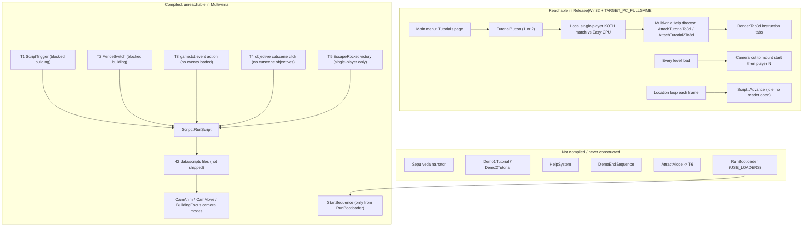
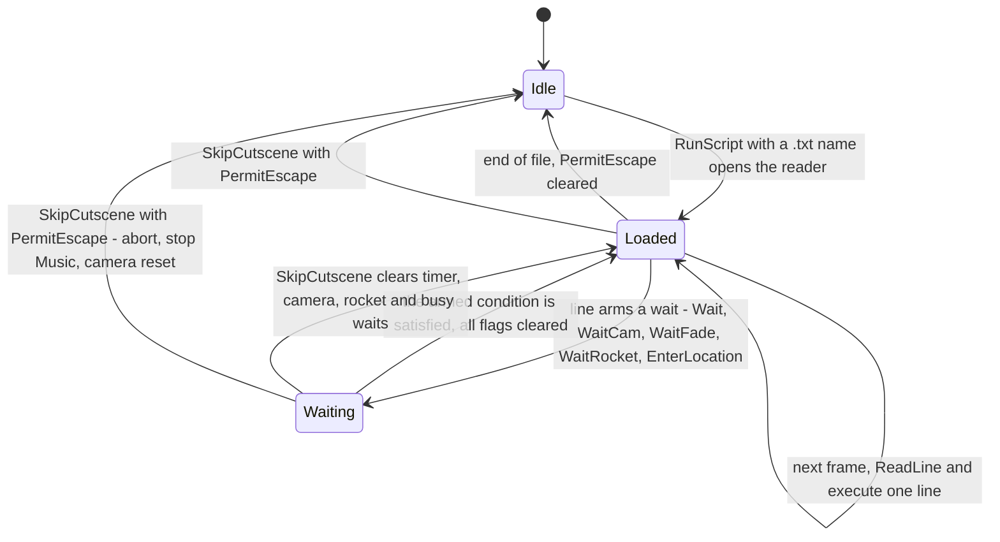
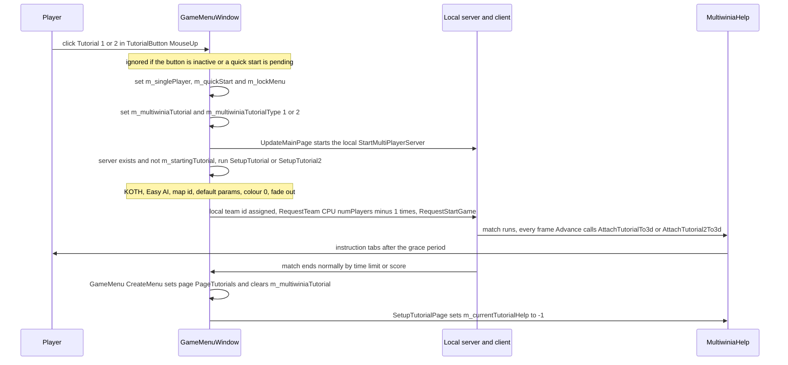
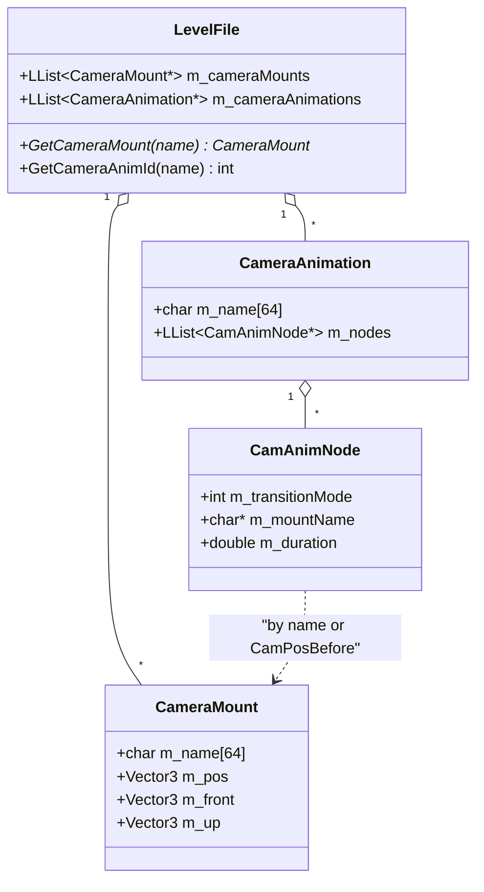
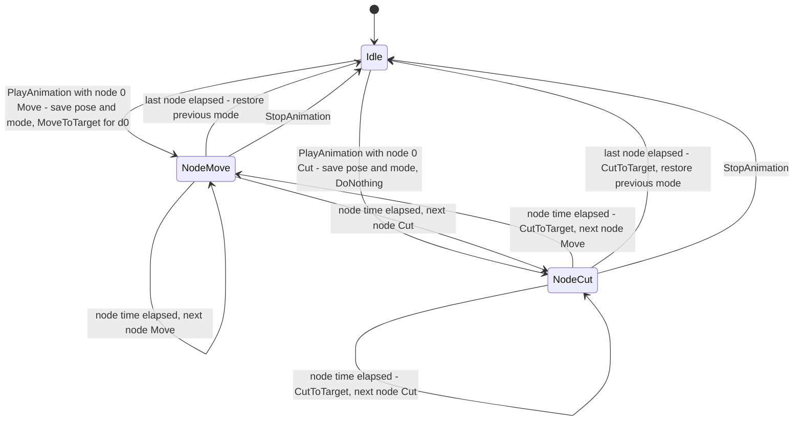

# 30 — Scripting, tutorials and cutscenes

> Part B · Baseline build: Release|Win32 (OpenGL) + TARGET_PC_FULLGAME ([B:FULL]); build tags as defined in [README](README.md#how-to-read-the-evidence) (full matrix: `_work/build_matrix.md`).
> Evidence: [C] confirmed · [I] inferred · [U] unknown. Citations are `path:Symbol` relative to the multiwinia/ source root.
> Sources merged: P19_help_tutorial_script (§1, §2, §4, §5, §7 and closing sections), P20_sequences_loaders_bench (§6, §7, §8 benchmark, closing sections), P10_input_camera (§3 camera modes, §3.8 scripted camera, constants), P11_terrain_world (level-file `CameraMounts`/`CameraAnimations` blocks, map CRC script), X1a_text_formats (§2.10–2.11 camera blocks, tokeniser), P15_network (§12.6 command-history record/replay, late join), routed/_meta_* (appendix, contradictions, unknowns, IP, discrepancies). Every numeric constant and state transition in §2–§7 was re-read in the source for this document; corrections are marked "Resolved:".

## Contents

- [1 Reachability summary](#1-reachability-summary)
- [2 Script language (`Script`)](#2-script-language-script)
  - [2.1 Ownership, lifetime and tick](#21-ownership-lifetime-and-tick)
  - [2.2 Lexical and syntactic grammar](#22-lexical-and-syntactic-grammar)
  - [2.3 Command reference — all 43 opcodes](#23-command-reference--all-43-opcodes)
  - [2.4 Execution model](#24-execution-model)
  - [2.5 Start paths (triggers)](#25-start-paths-triggers)
  - [2.6 Script file register — one row per `data/scripts/*` file](#26-script-file-register--one-row-per-datascripts-file)
  - [2.7 Script-engine constants](#27-script-engine-constants)
  - [2.8 Determinism and safety notes](#28-determinism-and-safety-notes)
- [3 Live Multiwinia tutorials [B:FULL]](#3-live-multiwinia-tutorials-bfull)
  - [3.1 Overview and setup](#31-overview-and-setup)
  - [3.2 Start and end flow](#32-start-and-end-flow)
  - [3.3 Director mechanics (shared)](#33-director-mechanics-shared)
  - [3.4 Gameplay overrides while a tutorial runs](#34-gameplay-overrides-while-a-tutorial-runs)
  - [3.5 Tutorial 1 — "The Basics" (`mp_koth_2P_1`)](#35-tutorial-1--the-basics-mp_koth_2p_1)
  - [3.6 Tutorial 2 — "Advanced Concepts" (`mp_koth_3P_1`)](#36-tutorial-2--advanced-concepts-mp_koth_3p_1)
  - [3.7 Instruction tabs and phrase ids](#37-instruction-tabs-and-phrase-ids)
  - [3.8 Failure, skip and restart paths](#38-failure-skip-and-restart-paths)
  - [3.9 Uncertainties and their resolution status](#39-uncertainties-and-their-resolution-status)
  - [3.10 Determinism caveat](#310-determinism-caveat)
  - [3.11 Tutorial constants](#311-tutorial-constants)
- [4 Camera animation and camera mounts](#4-camera-animation-and-camera-mounts)
- [5 Start sequence, logo splash and demo end sequence](#5-start-sequence-logo-splash-and-demo-end-sequence)
- [6 Dr Sepulveda dialogue system [B:DEAD]](#6-dr-sepulveda-dialogue-system-bdead)
- [7 Demo recording, playback and replay](#7-demo-recording-playback-and-replay)
- [8 What the new game needs](#8-what-the-new-game-needs)
- [9 Darwinia demo tutorials (`tutorial*.cpp`) [B:DEAD] — reference tables](#9-darwinia-demo-tutorials-tutorialcpp-bdead--reference-tables)
- [Open questions and unknowns](#open-questions-and-unknowns)
- [Docs-vs-code discrepancies](#docs-vs-code-discrepancies)
- [IP items](#ip-items)
- [Source map](#source-map)
- [Appendix — dead/legacy code](#appendix--deadlegacy-code)

---

## 1 Reachability summary

Multiwinia inherited Darwinia's whole cinematic stack — a line-oriented cutscene script interpreter, a scripted camera with mounts and animations, a narrator character ("Dr Sepulveda"), chapter-based demo tutorials, a first-time intro and a demo-end sequence. In the shipped PC build almost none of it is reachable. The only live "tutorial / cutscene" content in [B:FULL] is the **pair of Multiwinia tutorials**, which are not scripts at all but a per-frame *help-tab director* inside `MultiwiniaHelp` running on top of ordinary King-of-the-Hill matches.

| # | Component | Files | Body compiled in [B:FULL]? | Reachable by a player in [B:FULL]? | Tag | Evidence |
|---|---|---|---|---|---|---|
| R1 | Script interpreter `Script` | `code/script.h`, `code/script.cpp` | Yes, except bodies of `Say`, `ShutUp`, `Highlight`, `ClearHighlights`, `DemoGesture`, `SetCutsceneMode`, the busy/speech wait checks and `ShowDemoEndSequence`, which are hollowed out by `USE_SEPULVEDA_HELP_TUTORIAL` | Ticked every frame (`Script::Advance` in the location loop), but **no Multiwinia path ever opens a script** (§2.5) and `scripts/*` is excluded from the PC data archive | **[B:FULL] engine / [B:LEGACY] content** | [C] `code/main.cpp` location loop; `code/script.cpp:Script::RunScript`; `tools/multiwinia_exclusions.txt` L36 |
| R2 | 42 cutscene scripts | `data/scripts/*.txt` | data | No (37 only via Darwinia triggers T1–T5, 5 via dead attract mode or nothing) | [B:LEGACY] ×37, [B:DEAD] ×5 | §2.6 |
| R3 | Script triggers T1–T6 | `code/worldobject/scripttrigger.cpp`, `code/worldobject/switch.cpp`, `code/global_world.cpp`, `code/taskmanager_interface_multiwinia.cpp`, `code/taskmanager_interface_icons.cpp`, `code/taskmanager_interface_gestures.cpp`, `code/worldobject/rocket.cpp`, `code/attract.cpp` | Yes | No (blocked buildings, no global events, no cutscene objectives, multiplayer guard, attract mode never constructed) | [B:LEGACY] (T1–T5), [B:DEAD] (T6) | §2.5 |
| R4 | Multiwinia tutorials 1 and 2 (help-tab director) | `code/multiwiniahelp.h`, `code/multiwiniahelp.cpp` (`AttachTutorialTo3d`, `AttachTutorial2To3d`, `RunTutorialHelp`, `RenderTab3d`), `code/UI/GameMenuWindow.cpp`, `code/UI/TutorialButton.h` | Yes (`INCLUDE_TUTORIAL` is defined for `TARGET_PC_FULLGAME`) | **Yes** — Main menu → Tutorials | **[B:FULL]** | [C] `code/lib/universal_include.h` FULLGAME block L97; `code/multiwiniahelp.cpp:MultiwiniaHelp::Advance` |
| R5 | Scripted camera: mounts | `code/camera.cpp:Camera::SetTarget(char const*)`, `code/level_file.cpp:LevelFile::ParseCameraMounts` | Yes | **Yes** — every Multiwinia level start cuts to mount `start`, then to `player<N>` | **[B:FULL]** | [C] `code/main.cpp:DoEnterLocation`, location loop |
| R6 | Scripted camera: animations, MoveToTarget, BuildingFocus, sphere-world scripted/intro/outro/focus modes | `code/camera.cpp` | Yes | No — every shipped `CameraAnimations` block is empty and only scripts/editor/intro request these modes | [B:LEGACY] | §4 |
| R7 | First-time intro `StartSequence` | `code/startsequence.h`, `code/startsequence.cpp` | Yes | No — constructed only in `RunBootloader`, which is `#ifdef USE_LOADERS` (off) | [B:LEGACY] (compiled, never constructed) | [C] `code/main.cpp:RunBootloader` |
| R8 | "Darwin logo" splash (`ShowDarwinLogo`) | `code/script.cpp`, `code/renderer.cpp:Renderer::Render` | Yes | No (script-only) | [B:LEGACY] | §5.2 |
| R9 | `DemoEndSequence` | `code/demoendsequence.h`, `code/demoendsequence.cpp` | No (whole file under `USE_SEPULVEDA_HELP_TUTORIAL`) | No | [B:DEAD] | [C] `code/demoendsequence.cpp` L2 |
| R10 | Dr Sepulveda narrator | `code/sepulveda.h`, `code/sepulveda.cpp`, `code/sepulveda_strings.cpp` | No (whole files under `USE_SEPULVEDA_HELP_TUTORIAL`) | No | [B:DEAD] | [C] `code/sepulveda.cpp` L3/L1494; `code/app.h` member gated |
| R11 | Darwinia demo tutorials | `code/tutorial.h`, `code/tutorial.cpp`, `code/tutorial_demo1.cpp`, `code/tutorial_demo2.cpp` | No (whole files under `USE_SEPULVEDA_HELP_TUTORIAL`) | No | [B:DEAD] | [C] `code/tutorial.h` L5–L88 |
| R12 | Darwinia context help `HelpSystem` | `code/helpsystem.h`, `code/helpsystem.cpp` | No | No | [B:DEAD] (owned by [09](09_meta_systems.md)) | [C] `code/helpsystem.cpp` |
| R13 | Attract mode (idle fly-through) | `code/attract.h`, `code/attract.cpp` | Yes (no file gate) | No — object constructed and advanced only under `ATTRACTMODE_ENABLED` (defined nowhere) | [B:DEAD] (feature) | [C] `code/main.cpp` L583–588, L752–754 |
| R14 | Gesture demos (recorded mouse paths replayed by the narrator) | `code/gesture_demo.h`, `code/gesture_demo.cpp`, `data/gesture_demos/*` | No | No | [B:DEAD] | [C] `code/gesture_demo.cpp`; `tools/multiwinia_exclusions.txt` L34 |
| R15 | Network command-history record/replay (`RecordDemo` preference) | `code/main.cpp:UpdateAdvanceTime`, `code/app.cpp:App::ShutdownCurrentGame`, `code/network/server.cpp:Server::SaveHistory`/`LoadHistory` | Yes | Hidden preference only (not in `data/default_preferences.txt`, no UI) | [B:FULL] (developer feature) | §7 |
| R16 | Late-join replay of the lockstep stream from sequence 0 | `code/network/clienttoserver.cpp`, `code/network/server.cpp` | Yes | Yes (implicit in joining) | [B:FULL] (owned by [22](22_determinism_and_networking.md)) | §7.3 |
| R17 | AVI capture with fake time (`GrabberWindow`, `AVIGenerator`) | `code/interface/grabber_window.cpp`, `code/lib/avi_generator.cpp` | Only under `AVI_GENERATOR` (`TARGET_DEBUG`) | No, not even in a debug build: the only code that creates a `GrabberWindow` is `DebugKeyBindings::GrabberButton`, and nothing calls it | [B:DEAD] (compiled in DEBUG, never reachable) | [C] `code/lib/universal_include.h` L125; `code/interface/debugmenu.cpp:DebugKeyBindings::GrabberButton` (no caller in the tree) |
| R18 | Benchmark telemetry recorder + FTP upload | `code/benchmark.h`, `code/benchmark.cpp` | No (`BENCHMARK_AND_FTP` commented out) | No | [B:DEAD] (owned by [32](32_debug_test_and_performance.md)) | §7.4 |



Design consequences:

1. **The Multiwinia tutorial has no narrator, no voice, no script file and no cutscene.** It is a context-sensitive director that re-evaluates world state every frame and shows at most one floating instruction tab (§3). [C] `code/multiwiniahelp.cpp:MultiwiniaHelp::Advance` (L1232–1244).
2. **The script engine is a reference design only.** The 43-command language (§2.3), its six trigger types (§2.5) and the camera animation player (§4) are complete and precise enough to re-implement, but they ship unused. [C]
3. **The Darwinia campaign that would use scripts is only reachable from a `TARGET_DEBUG` build** (main-menu entries `PageDarwinia` → Prologue / Campaign exist only behind the debug single-player page) and even then the level and script data are excluded from the PC archives (`levels/map_*`, `levels/mission_*`, `scripts/*`). [C] `code/UI/GameMenuWindow.cpp` (`PageDarwinia` entered only from `PageDemoSinglePlayer`, see [09](09_meta_systems.md)); `tools/multiwinia_exclusions.txt` L24–25, L36. Trigger T1 (`ScriptTrigger`) is dead even in debug builds because `BLOCK_OLD_DARWINIA_OBJECTS` (defined in FULL and DEBUG) makes `Building::CreateBuilding(char*)` skip blocked types. [C] `code/worldobject/building.cpp:Building::CreateBuilding`, `Building::BuildingIsBlocked`.

---

## 2 Script language (`Script`)

### 2.1 Ownership, lifetime and tick

- One global instance `g_app->m_script`, created in `App::App` (`m_script = new Script()`), deleted in `App::~App`. [C] `code/app.cpp:App::App`, `App::~App`.
- Constructor state: `m_in = NULL`, `m_waitUntil = −1.0`, all wait flags false, `m_requestedLocationId = −1`, `m_permitEscape = false`. `m_darwinianResearchLevel`, `m_rocketId`, `m_rocketState`, `m_rocketData` are **not initialised** (set before use by the commands that read them). [C] `code/script.cpp:Script::Script`.
- `Script::Advance()` is called **once per rendered frame**:
  - in the location game loop, after `TaskManagerInterface::Advance` and before the (dead) `Sepulveda::Advance`. The camera has already been advanced earlier in the same frame (only while the window has focus). Commands that write the pose or FOV directly — `CamCut` (`CutToTarget`) and `CamFov` with `immediate ≠ 0` (`SetFOV`) — are therefore visible in the same frame's render. Mode requests (`CamMove`, `CamBuildingApproach`, `CamBuildingFocus`, `CamAnim`, `CamReset`, eased `CamFov`) move the camera from the next frame's `Camera::Advance`. [C] `code/main.cpp` location loop (L559–560 camera, under `WindowHasFocus`; L568 script); `code/camera.cpp:Camera::CutToTarget`, `Camera::SetFOV`.
  - in `GlobalWorldGameLoop` (Darwinia world map) after `ClientToServer::AdvanceAndCatchUp` (L742). This call never executes: `GlobalWorldGameLoop` itself sets `m_atMainMenu = true` (L708) just before its loop and breaks on the first check (`if( g_app->m_atMainMenu ) break;`, L711). The loop body therefore never runs in any game mode, and control returns to `MainMenuLoop`. [C] `code/main.cpp:GlobalWorldGameLoop`. (Resolved: was 30-U6.)
- The interpreter is **client-local and not networked**: it never sends network messages; its timers use wall-clock time. [C] `code/script.cpp` (no network calls). Several commands mutate simulation state directly (§2.8).
- `IsRunningScript()` = `m_in != NULL`, forced `false` whenever `g_app->m_testHarness` exists (always `NULL` in FULL). [C] `Script::IsRunningScript`. Consumers: ESC routing in the location loop, `ControlHelpSystem` hint suppression, `ScriptTrigger` (no new trigger while a script runs), `GlobalWorld::EvaluateEvents` (suspended while a script runs), `EnterGlobalWorld` (Prologue), `Tutorial` (dead), `AttractMode` (dead). [C] `code/main.cpp` L469, L1412; `code/control_help.cpp` L943; `code/worldobject/scripttrigger.cpp:ScriptTrigger::Advance`; `code/global_world.cpp` L2275.

### 2.2 Lexical and syntactic grammar

Location and loading [C] `code/script.cpp:Script::RunScript`:
- File `<name>` in `data/scripts/` opened with `g_app->m_resource->GetTextReader("scripts/" + name)` (archive or loose file).
- `RunScript(name)` only takes the `.txt` branch when `strstr(name, ".txt")` is non-NULL. A name **without** `.txt` is the "phrase-dump" form: push language phrases `<name>_1`, `<name>_2`, … (until the first missing id) into the narrator queue — compiled only under `USE_SEPULVEDA_HELP_TUTORIAL`, so in FULL a non-`.txt` name is silently ignored. [C]
- Demo gate: when `!g_app->IsFullVersion()` and the name starts with `launchpad_purpose` (17-character `strnicmp`), `RunScript` returns without running. [C] [B:DEMO runtime gate on legacy content].

Lexical rules — the shared `TextReader` tokeniser (full rules: [29 — text-file tokeniser](29_data_formats_reference.md)) [C] `contrib/systemiv/lib/filesys/text_stream_readers.cpp:TextReader::CleanLine`, `TextReader::GetNextToken`, `TextReader::TokenAvailable`:
- One physical line = one statement. `\n`/`\r` are stripped.
- `#` starts a comment to end of line, also mid-line (e.g. `GodDishSpawnResearch  # Research comes through`).
- Three or more adjacent `<`/`>` characters trigger `AppDebugAssert` (merge-conflict guard; no effect in release).
- Optional "redshirt2" line-obfuscation header is supported by the reader; no script uses it.
- Token separators: any run of the characters space, TAB, `\n`, `\r`, `:`, `,` (`DEFAULT_SEPERATOR_CHARS " \t\n\r:,"`). Leading separators are skipped (indented lines are fine). Tokens cannot contain separators, so mount names, phrase ids and file names are single words.
- `GetNextToken()` returns `NULL` when the line has no further token.

Syntax [C] `code/script.cpp:Script::AdvanceScript`, `Script::GetOpCode`:
- The first token is the command keyword, matched **case-insensitively** (`stricmp`) against the 43 names of `g_opCodeNames` (so `CamFOV` in `launchpad_purpose.txt` resolves to `CamFov`). Unknown keyword → opcode −1 → `AppDebugAssert(false)` (no-op in release; the line is skipped).
- The second token (if present) is read once as a string (`nextWord`) and as a number (`nextFloat = iv_atof(nextWord)`, 0.0 if absent). Commands that need more arguments pull further tokens with `GetNextToken()` **without** checking availability: a missing mandatory 2nd–4th argument passes `NULL` to `iv_atof`/`atoi`/`stricmp` → undefined behaviour (likely crash). [I] (`iv_atof(NULL)` is not guarded in `contrib/systemiv/lib/math/math_stubs.cpp:iv_atof`.) `Wait` with no argument is `Wait 0` (uses `nextFloat`). Extra trailing tokens are ignored (`CamCut booster1 1`).
- Building ids are parsed as `(int)nextFloat`.

EBNF (over physical lines after cleaning):
```
script      = { line } ;
line        = [ sep ] [ statement ] EOL ;            (* comments already removed *)
statement   = keyword { sep arg } [ sep ] ;
sep         = sepchar { sepchar } ;
sepchar     = " " | TAB | ":" | "," ;
keyword     = (* one of the 43 opcode names of §2.3, case-insensitive *) ;
arg         = token ;                                (* typed per command, §2.3 *)
token       = tokchar { tokchar } ;
tokchar     = (* any character except sepchar, CR, LF, NUL and "#" *) ;
```

Minimal example (written for this document, not from the game):
```
# fly to two mounts, then hand the camera back
PermitEscape
CamMove      overview   4
WaitCam
CamFov       40  0
Wait         2
CamReset
```

### 2.3 Command reference — all 43 opcodes

`g_opCodeNames` has 43 entries and `GetOpCode` asserts `sizeof(g_opCodeNames)/sizeof(char*) == OpNumOps`. [C] `code/script.cpp:Script::GetOpCode`; `code/script.h:Script` enum. "Blocking" = the command sets a condition that stops `Advance` from reading further lines until it holds (§2.4); every other command executes and the interpreter proceeds to the next line on the **next frame**. "Sim" = mutates simulation state on the local peer only. "Build" = where the command has an effect.

| # | Keyword | Arguments (types) | Semantics | Blocking | Effects / side effects | Build | Ref |
|---|---|---|---|---|---|---|---|
| 0 | `CamCut` | `mount` (word) | Requires a location (else no-op). `Camera::SetTarget(mount)` — level-file camera mount by name, case-insensitive; magic name `CamPosBefore` = pose recorded before the last animation/`RecordCameraPosition` — then `CutToTarget()` (instant pose change, `m_height = target.y`). `AppDebugAssert` if the mount is missing (release: camera cuts to the previous target). | No | camera pose | FULL (legacy content) | [C] `Script::RunCommand_CamCut`; `code/camera.cpp:Camera::SetTarget(char const*)`, `Camera::CutToTarget`; `code/level_file.h` `MAGIC_MOUNT_NAME_START_POS` |
| 1 | `CamMove` | `mount` (word), `duration` (float, s) | Requires a location. If the mount exists: `SetTarget(mount)`, `SetMoveDuration(duration)`, `RequestMode(ModeMoveToTarget)` (records start pose/time), in that order (the order does not matter: `RequestMode` does not read the duration); silently ignored if the mount is missing. Motion profile §4.4. `CamMove m 0` followed by `CamCut m` is the scripts' idiom for a hard cut that also resets orientation. | No (pair with `WaitCam`) | camera mode | FULL | [C] `Script::RunCommand_CamMove`; `Camera::AdvanceMoveToTargetMode` |
| 2 | `CamAnim` | `animName` (word) | Requires a location. `LevelFile::GetCameraAnimId(name)` (case-insensitive); `AppReleaseAssert` (fatal) if missing; `Camera::PlayAnimation(anim)` (§4.3). | No (pair with `WaitCam`) | camera mode | FULL (no script uses it) | [C] `Script::RunCommand_CamAnim`; `Camera::PlayAnimation` |
| 3 | `CamFov` | `fov` (float, degrees, vertical), optional `immediate` (int, default **true**) | `immediate ≠ 0` → `Camera::SetFOV(fov)` (fov and target); `0` → `SetTargetFOV(fov)` (eased, §4.4). Works in or out of a location. | No | camera FOV | FULL | [C] `Script::AdvanceScript` case `OpCamFov`; `Script::RunCommand_CamFov` |
| 4 | `CamBuildingFocus` | `buildingId` (int), `range` (float, wu), `height` (float, wu) | Requires a location. `Camera::RequestBuildingFocusMode(b, range, height)` (orbit, §4.4). Building missing → `AppDebugOut("SCRIPT ERROR : Tried to target non-existent building %d")`. | No (never completes on its own) | camera mode; target FOV reset to 60° | FULL | [C] `Script::RunCommand_CamBuildingFocus`; `Camera::RequestBuildingFocusMode`, `Camera::AdvanceBuildingFocusMode` |
| 5 | `CamBuildingApproach` | `buildingId` (int), `range`, `height` (float, wu), `duration` (float, s) | Requires a location. `Camera::SetTarget(b->m_centrePos, range, height)` (point at `range` from the building along the current camera→building bearing, raised `height` above the building centre, looking at it), `SetMoveDuration(duration)`, `RequestMode(ModeMoveToTarget)`. | No (pair with `WaitCam`) | camera mode | FULL | [C] `Script::RunCommand_CamBuildingApproach`; `Camera::SetTarget(Vector3 const&, float, float)` |
| 6 | `CamLocationFocus` | `locationName` (word; `heaven` = world origin), `fov` (float) | **Only outside a location** (Darwinia world map). Enter `ModeSphereWorldScripted` if not already; `SetTargetFOV(fov)`; `SetTarget(locationPos, (0,0,1), up)`. Unknown location → no-op. | No | camera | FULL code, world map unreachable in MW | [C] `Script::RunCommand_LocationFocus` |
| 7 | `CamGlobalWorldFocus` | — | `Camera::RequestSphereFocusMode()`. | No | camera | FULL (legacy) | [C] `Script::RunCommand_CamGlobalWorldFocus` |
| 8 | `CamReset` | — | Stop any camera animation (`StopAnimation`); in a location → `ModeFreeMovement` and `g_app->m_hideInterface = false`; else `ModeSphereWorld`. | No | camera; interface shown | FULL | [C] `Script::RunCommand_CamReset` |
| 9 | `EnterLocation` | `locationName` (word) | `g_app->m_requestedLocationId = GlobalWorld::GetLocationId(name)`; record it in `m_requestedLocationId`; `m_loadingNewProfile = false`; **`App::LoadProfile()`** (rebuilds `GlobalWorld` from the profile's `game.txt`); copy that location's mission/map file names into `m_requestedMission` / `m_requestedMap`. The main loop then loads the level. | **Yes** — until `g_app->m_locationId == m_requestedLocationId` | level load; profile reload | FULL code; MW never has global locations | [C] `Script::RunCommand_EnterLocation`; `Script::Advance` |
| 10 | `ExitLocation` | — | Clear requested location/mission/map (the main loop leaves the location); `m_requestedLocationId = −1`. | No (scripts follow it with `WaitFade`) | level unload | FULL (legacy) | [C] `Script::RunCommand_ExitLocation` |
| 11 | `Say` | `phraseId` (word) | `Sepulveda::Say(id)` — queue a narrator line (§6.3). | No (pair with `WaitSay`) | — | **no-op in FULL** → [B:DEAD] | [C] `Script::RunCommand_Say` |
| 12 | `ShutUp` | — | `Sepulveda::ShutUp()` — clear caption, queue, highlights, gesture demo. | No | — | no-op in FULL → [B:DEAD] | [C] `Script::RunCommand_ShutUp` |
| 13 | `Wait` | `seconds` (float) | `m_waitUntil = max(m_waitUntil, GetHighResTime() + seconds)`, compared against `g_gameTime` in `Advance`. Consecutive waits **add**: the next line is read only after this wait has passed (§2.4). By then the old `m_waitUntil` is ≤ `g_gameTime` ≤ `GetHighResTime()`, so the `max` keeps the new value unless `seconds` is negative. `Wait 3` followed by `Wait 2` lasts ≈ 5 s plus one frame. | **Yes** — until `g_gameTime ≥ m_waitUntil` | — | FULL | [C] `Script::RunCommand_Wait` |
| 14 | `WaitSay` | — | Set `m_waitForSpeech`; `Advance` would block while `Sepulveda::IsTalking()`. | Flag set, but the check is compiled out → **does not block** in FULL | — | [B:DEAD] effect | [C] `Script::Advance` (`#ifdef USE_SEPULVEDA_HELP_TUTORIAL`) |
| 15 | `WaitCam` | — | Set `m_waitForCamera`; block while `Camera::IsAnimPlaying()` (= an animation is active **or** mode is `ModeMoveToTarget`). Does **not** wait for `ModeBuildingFocus` (which never ends). | **Yes** | — | FULL | [C] `Script::Advance`; `Camera::IsAnimPlaying` |
| 16 | `WaitFade` | — | Set `m_waitForFade`; block while `!Renderer::IsFadeComplete()`. | **Yes** | — | FULL | [C] `Script::Advance` |
| 17 | `WaitRocket` | `buildingId` (int), `state` (word: `Refueling`, `Loading`, `Ignition`, `Ready`, `Countdown`, `Exploding`, `Flight`, case-insensitive), `data` (int) | Block until the EscapeRocket's `m_state ≥ state`; when `m_state == state == Countdown`, additionally until `(int)m_countdown ≤ data`. Building missing or not an EscapeRocket → the wait is cancelled (that frame returns, next frame proceeds). Unknown state word → `GetStateId` −1 → passes at once. | **Yes** | — | FULL | [C] `Script::RunCommand_WaitRocket`, `Script::Advance`; `code/worldobject/rocket.cpp:EscapeRocket::GetStateId` |
| 18 | `WaitPlayerNotBusy` | — | Would call `Demo2Tutorial::BeginPlayerBusyCheck()` and block while `Demo2Tutorial::IsPlayerBusy()` (§9.3). | Flag set but both calls compiled out → **does not block** in FULL | — | [B:DEAD] effect | [C] `Script::RunCommand_WaitPlayerNotBusy`; `Script::Advance` |
| 19 | `Highlight` | `buildingId` (int) | `Sepulveda::HighlightBuilding(id, "ScriptHighlight")` — god-ray beam (§6.5). | No | — | no-op in FULL → [B:DEAD] | [C] `Script::RunCommand_Highlight` |
| 20 | `ClearHighlights` | — | `Sepulveda::ClearHighlights("ScriptHighlight")`. | No | — | no-op in FULL → [B:DEAD] | [C] `Script::RunCommand_ClearHighlights` |
| 21 | `TriggerSound` | `event` (word) | **Music start.** If no instance of `"Music <event>"` is playing, `SoundSystem::TriggerOtherEvent(NULL, event, SoundSourceBlueprint::TypeMusic)` (idempotent start). Event names match case-insensitively. | No | audio | FULL | [C] `Script::RunCommand_TriggerSound`; `code/sound/soundsystem.cpp:SoundSystem::TriggerOtherEvent` (`stricmp`) |
| 22 | `StopSound` | `event` (word) | **Music stop.** `SoundSystem::StopAllSounds(WorldObjectId(), "Music <event>")`. | No | audio | FULL | [C] `Script::RunCommand_StopSound` |
| 23 | `DemoGesture` | `gestureFile` (word, e.g. `officer.txt`) | `Sepulveda::DemoGesture(name, 2.0)` — loop-replay a recorded mouse gesture starting 2.0 s later (§6.5). | No | — | no-op in FULL → [B:DEAD] | [C] `Script::RunCommand_DemoGesture` |
| 24 | `GiveResearch` | `name` (word) | `modsystem` → set pref `ModSystemEnabled = 1` (only under `USE_DARWINIA_MOD_SYSTEM`), save prefs, task-manager research message id 999 for 4.0 s; `accessallareas` → create `<profileDir>users/` and `<profileDir>users/AccessAllAreas/`, message id 998 for 4.0 s; otherwise `GlobalResearch::GetType(name)` → `AddResearch(type)` + message for 4.0 s (unknown name → nothing). | No | **Sim** (research), prefs, file system | FULL (legacy) | [C] `Script::RunCommand_GiveResearch` |
| 25 | `SetMission` | `locationName`, `missionFile` (words) | Set a global location's mission file; `m_missionCompleted = false`. `AppDebugAssert` if the location is missing (release: NULL dereference) [I]. | No | global world | FULL (legacy) | [C] `Script::RunCommand_SetMission` |
| 26 | `GameOver` | — | Camera → `ModeSphereWorldOutro` (after 70 s it runs the credits loader, see [09](09_meta_systems.md)); stop `"Ambience EnterGlobalWorld"`. | No | camera, audio | FULL (legacy) | [C] `Script::RunCommand_GameOver`; `Camera::AdvanceSphereWorldOutroMode` |
| 27 | `ResetResearch` | — | Save the Darwinian research level into `m_darwinianResearchLevel`, set it to 1. | No | **Sim** | FULL (legacy) | [C] `Script::RunCommand_ResetResearch` |
| 28 | `RestoreResearch` | — | Restore the saved Darwinian research level (garbage if `ResetResearch` never ran). | No | **Sim** | FULL (legacy) | [C] `Script::RunCommand_RestoreResearch` |
| 29 | `RunCredits` | — | `Loader::GetLoaderIndex("credits")` (in FULL the only loader, index 0) → `CreateLoader` → synchronous `Run()` (own render loop) → delete. | Synchronous (blocks the whole application until the credits finish or are skipped) | full-screen takeover | FULL (no script uses it) | [C] `Script::RunCommand_RunCredits`; `code/loaders/loader.cpp:Loader::GetLoaderIndex` |
| 30 | `SetCutsceneMode` | `mode` (int) | `Sepulveda::SetCutsceneMode(mode)` (big-face layout). | No | — | no-op in FULL → [B:DEAD] | [C] `Script::AdvanceScript` case `OpSetCutsceneMode` |
| 31 | `GodDishActivate` | — | First `GodDish` building in the location → `Activate()`. | No | **Sim** | [B:LEGACY] (GodDish blocked) | [C] `Script::RunCommand_GodDishActivate`, `GetGodDish` |
| 32 | `GodDishDeactivate` | — | `GodDish::DeActivate()`. | No | **Sim** | [B:LEGACY] | [C] `Script::RunCommand_GodDishDeactivate` |
| 33 | `GodDishSpawnSpam` | — | `GodDish::SpawnSpam(false)`. | No | **Sim** | [B:LEGACY] | [C] `Script::RunCommand_GodDishSpawnSpam` |
| 34 | `GodDishSpawnResearch` | — | `GodDish::SpawnSpam(true)`. | No | **Sim** | [B:LEGACY] | [C] `Script::RunCommand_GodDishSpawnResearch` |
| 35 | `TriggerSpam` | — | `GodDish::TriggerSpam()`. | No | **Sim** | [B:LEGACY] | [C] `Script::RunCommand_SpamTrigger` |
| 36 | `PurityControl` | — | Delete every file in `users/<profile>/`, open the buy-now URL, `exit(0)` (anti-piracy / demo kill switch). | Terminates the process | file system, process | FULL code. No `data/scripts/*` file uses it. Its only use is the last line of the Darwinia anti-piracy script `data/purity/buyme.txt`, started by `Action RunScript buyme.txt` in `data/purity/game.txt` L73; that data is excluded from the PC archive and no Multiwinia path loads it | [C] `Script::RunCommand_PurityControl`; `data/purity/buyme.txt`; `tools/multiwinia_exclusions.txt` L5 |
| 37 | `ShowDarwinLogo` | — | `Renderer::m_renderDarwinLogo = GetHighResTime()`; interface sound `ShowLogo` (§5.2). | No | overlay, audio | FULL (legacy) | [C] `Script::RunCommand_ShowDarwinLogo`; `code/renderer.cpp:Renderer::Render` |
| 38 | `ShowDemoEndSequence` | — | `g_app->m_demoEndSequence = new DemoEndSequence()` (§5.3). | No | — | empty body in FULL → [B:DEAD] | [C] `Script::RunCommand_ShowDemoEndSequence` |
| 39 | `PermitEscape` | — | `m_permitEscape = true`: from now until the script ends, `SkipCutscene` aborts the whole script (§2.4). | No | — | FULL | [C] `Script::RunCommand_PermitEscape` |
| 40 | `DestroyBuilding` | `buildingId` (int), `intensity` (float) | `Building::Destroy(intensity)` if the building exists. | No | **Sim** | FULL (no script uses it) | [C] `Script::RunCommand_DestroyBuilding` |
| 41 | `ActivateTrunkPort` | `buildingId` (int) | If a TrunkPort: its `GlobalBuilding::m_online = true` (partial activation, no reprogram effect). | No | **Sim** (global) | FULL (no script uses it) | [C] `Script::RunCommand_ActivateTrunkPort` |
| 42 | `ActivateTrunkPortFull` | `buildingId` (int) | If a TrunkPort: `ReprogramComplete()` (opens the port). | No | **Sim** | FULL (no script uses it) | [C] `Script::RunCommand_ActivateTrunkPort` (shared, `_fullActivation = true`) |

### 2.4 Execution model

State (public members of `Script`) [C] `code/script.h:Script`: `m_in` (open `TextReader` or NULL), `m_waitUntil` (double), `m_waitForSpeech`, `m_waitForCamera`, `m_waitForFade`, `m_waitForPlayerNotBusy`, `m_waitForRocket` (+ `m_rocketId`, `m_rocketState`, `m_rocketData`), `m_requestedLocationId`, `m_darwinianResearchLevel`, `m_permitEscape`.

`RunScript(name)` only opens the reader and returns; the first line runs on the next `Advance`. It **replaces** any running script's reader pointer without deleting the old reader (leak) and without resetting wait flags or `m_permitEscape`. [C] `Script::RunScript`.

Per-frame algorithm [C] `code/script.cpp:Script::Advance`:
```
if controlEvent(SkipCutscene):                       # key Enter, XInput B
    m_waitUntil = g_gameTime
    clear waitForCamera, waitForRocket, waitForPlayerNotBusy
    renderer.m_renderDarwinLogo = -1                 # hide logo splash
    if m_permitEscape:                               # abort the whole script
        delete m_in; m_in = NULL; (Sepulveda.ShutUp — dead)
        StopAllSounds("Music"); m_permitEscape = false
        camera.RequestMode(FreeMovement if in location else SphereWorld)
        return
if waitForFade and not renderer.IsFadeComplete(): return
if m_waitUntil > g_gameTime: return
(if waitForSpeech and sepulveda.IsTalking(): return)                 # compiled out in FULL
if waitForCamera and camera.IsAnimPlaying(): return
(if waitForPlayerNotBusy and Demo2Tutorial.IsPlayerBusy(): return)   # compiled out in FULL
if waitForRocket:
    rocket = building(m_rocketId)
    if rocket missing or not EscapeRocket: waitForRocket = false; return
    if rocket.m_state < m_rocketState: return
    if rocket.m_state == m_rocketState == Countdown and int(rocket.m_countdown) > m_rocketData: return
if m_requestedLocationId != -1:
    if app.m_locationId != m_requestedLocationId: return
    m_requestedLocationId = -1
clear waitForSpeech, waitForCamera, waitForFade, waitForRocket, waitForPlayerNotBusy
if m_in:
    if m_in.ReadLine(): AdvanceScript()              # execute exactly ONE physical line
    else: delete m_in; m_in = NULL; m_permitEscape = false
```

Consequences (all [C] from the code above):
- **One physical line per frame.** Blank and comment-only lines also consume a frame (`AdvanceScript` returns when no token is available). A run of non-blocking commands therefore executes over consecutive frames, never atomically; at 60 fps a 109-line script costs at least 109 frames (1.8 s) on top of its waits. §2.6 gives each file's physical line count.
- Wait conditions are evaluated in the fixed order fade → timer → speech → camera → player-busy → rocket → location. All flags are cleared together once every condition passes, before the next line is read. Any armed wait returns before `ReadLine`, so **at most one blocking wait is pending at a time**. Waits on consecutive lines are satisfied one after another, in line order, and their durations add: `Wait 3` + `Wait 2` ≈ 5 s; `CamMove m 4` + `WaitCam` + `Wait 2` ≈ 6 s.
- `SkipCutscene` without `PermitEscape` fast-forwards only the current `Wait`, `WaitCam`, `WaitRocket` and `WaitPlayerNotBusy` — not `WaitFade`, `WaitSay` or `EnterLocation`. It does not stop camera motion: after a skipped `WaitCam` the camera keeps flying while the next lines execute. Bindings `SkipCutscene = key enter down`, `XInput b down`. [C] `data/input/input_preferences.txt` L39–40.
- The skip check runs every frame even when no script is open (it is harmless then: it only rewrites `m_waitUntil` and the logo timer). [C]
- `ESC` (`ControlMenuEscape`) while a script runs is routed to `Sepulveda::PlayerSkipsMessage` (dead in FULL) instead of opening the in-game menu — in FULL, ESC does nothing during a script. [C] `code/main.cpp` location loop (L467–474).
- `Wait` stores `GetHighResTime() + t` but `Advance` compares with `g_gameTime`. In normal play `g_gameTime` is the wall clock sampled at `UpdateAdvanceTime` (frozen while `App::GamePaused()`); in `RecordDemo` mode it is still the real clock (§7.2). So a pause holds a pending `Wait` (the comparison value stops) and the wait ends as soon as the game resumes if real time has passed. [C] `code/main.cpp:UpdateAdvanceTime`; [I] behavioural reading.



### 2.5 Start paths (triggers)

Every call site of `Script::RunScript` [C] (grep of `code/`):

| # | Trigger | Call site | Script source | Reachable in MW FULL? | Evidence |
|---|---|---|---|---|---|
| T1 | `ScriptTrigger` building (one-shot volume trigger placed in a level) | `code/worldobject/scripttrigger.cpp:ScriptTrigger::Trigger` | building field `m_scriptFilename` | No — `TypeScriptTrigger` is in `Building::BuildingIsBlocked`, so `CreateBuilding(char*)` returns NULL for it in FULL **and** DEBUG; no `mp_*` map contains one | [C] `code/worldobject/building.cpp:Building::CreateBuilding`, `Building::BuildingIsBlocked`; grep the `mp_*` maps in `data/levels/` |
| T2 | `FenceSwitch` toggled, `m_script` containing `.txt` | `code/worldobject/switch.cpp` (L227–229; a second call site at L415–418 is commented out) | per-building `m_script` | No — `TypeFenceSwitch` blocked | [C] same |
| T3 | Global-world event action `RunScript <file>` | `code/global_world.cpp:GlobalEventAction::Execute` (L361–363) | `data/game.txt`, `data/game_unlockall.txt`, `data/game_demo2.txt`, `data/purity/game.txt` lines `Action RunScript …` | No — Multiwinia creates a bare `new GlobalWorld` at start-up (`// bool profileLoaded = LoadProfile();` is commented out), so no `game.txt` events are loaded; only the debug Campaign/Prologue entries load a profile | [C] `code/app.cpp:App::App` (L452–453) |
| T4 | Player clicks an objective in the task manager whose `GlobalEventCondition::m_cutScene` is set (third column of a `PrimaryObjectives` line) | `code/taskmanager_interface_multiwinia.cpp` (L929), `code/taskmanager_interface_icons.cpp` (L1415), `code/taskmanager_interface_gestures.cpp` (L771) | level `PrimaryObjectives` block | No — of 57 `mp_*.txt` maps, 45 contain only `NeverTrue`, 2 (`mp_sandbox`, `mp_sandbox_all`) contain two `BuildingOnline :sandbox,2` lines, 10 have no objectives block; none has a cutscene column | [C] census of the `mp_*` maps in `data/levels/` |
| T5 | EscapeRocket ends `StateIgnition` (countdown ≤ 0) in **single-player** with `m_spawnCompleted` → `launchpad_victory.txt` | `code/worldobject/rocket.cpp` (L1196–1198) | hard-coded | No — the branch is the `else` of `if (g_app->Multiplayer())`; Multiwinia is always "multiplayer" | [C] `code/worldobject/rocket.cpp` (`EscapeRocket` ignition advance) |
| T6 | Attract mode start/stop → `attractmode.txt`, `endattract.txt` | `code/attract.cpp:AttractMode::StartAttractMode` (L45), `AttractMode::EndAttractMode` (L61) | hard-coded | No — `AttractMode` is only constructed and advanced under `#ifdef ATTRACTMODE_ENABLED` (never defined); its start binding is commented out too | [C] `code/main.cpp` L583–588, L752–754; `data/input/input_preferences.txt` L280–287 |

Conclusion [C]: in [B:FULL] the interpreter is ticked but has **no reachable entry point**. T3, T4 and T5 become reachable only in a `TARGET_DEBUG` build through the debug-only Prologue/Campaign menu entries, and only with loose Darwinia data, because `levels/map_*`, `levels/mission_*` and `scripts/*` are excluded from the PC archives. [C] `tools/multiwinia_exclusions.txt` L24–25, L36.

**`ScriptTrigger` as the reference trigger design** [C] `code/worldobject/scripttrigger.cpp:ScriptTrigger::Read`, `ScriptTrigger::Advance`, `ScriptTrigger::Trigger`; `code/worldobject/scripttrigger.h`:
- Level line: standard building columns, then `linkId` (int), `range` (float, default 100.0), `scriptFilename` (word), `entityType` (word). Full column grammar: [29](29_data_formats_reference.md).
- `entityType` keywords: `always` (`SCRIPTRIGGER_RUNALWAYS` 999), `never` (998), `camenter` (997), `camview` (996); any other word is an entity type name (`Entity::GetTypeId`, e.g. `Darwinian`, `Squadie`, `Engineer`).
- Polling: a countdown `m_timer` is decreased by `SERVER_ADVANCE_PERIOD` (0.1 s) per building advance and re-armed to 1.0 s, so the condition is tested once per second of simulation time, and only while **no script is running and the camera is interactive**.
- Conditions: `always` → fire; `camenter` → camera within `range`, camera speed < 5 wu/s, camera interactive; `camview` → (within `range + 300`, speed < 5, interactive, view ray hits the sphere of radius `range`) or the `camenter` condition; entity type → at least one entity of that type **owned by the trigger's team** within `range` (entity grid).
- On fire: a `.txt` name runs the script and the trigger deletes itself next advance (`m_triggered = −1`); any other name enters the dead phrase-sequencing mode (with `USE_SEPULVEDA_HELP_TUTORIAL`: say `<name>_1`, `<name>_2`, … one per silence, highlighting `linkId`; without it the trigger simply deletes itself). `never` triggers never fire.
- Determinism hazard: the trigger runs inside the simulation tick but tests the **local camera** (position, velocity, interactivity) and the local script state. [C] — a new game must evaluate camera triggers client-side only and never let them mutate shared state.

### 2.6 Script file register — one row per `data/scripts/*` file

Generated by `_work/scripts/S_30_script_census.py` (provenance; every reference in the table is a `path:Lline` in the source tree) (run `python3 -I S_30_script_census.py <multiwinia root>`). *Lines phys/exec* = physical lines (= minimum frames consumed) / executable lines; *Say ids* = narrator phrase ids (all dead in FULL); *ΣWait / ΣCamMove* = sum of explicit `Wait` arguments and of `CamMove` durations (a lower bound on run time ignoring `WaitSay`, fades and level loads); *Live references* = uncommented references with the trigger class of §2.5; tag rule: [B:LEGACY] = started only by triggers T1–T5 (compiled into FULL but unreachable in Multiwinia), [B:DEAD] = started only by the dead attract mode (T6) or by nothing (orphan). The PC data build excludes all 42 files (`tools/multiwinia_exclusions.txt` L36). [C]

Resolved: P19 tagged `launchpad_purpose.txt` [B:LEGACY] but the orphan `gamestart.txt` [B:DEAD], and listed `music4.txt` as "still referenced by `game_unlockall.txt`". The data show both `music4.txt` references (`data/game.txt` L107, `data/game_unlockall.txt` L85) are commented out, so `music4.txt` is an orphan too; all three orphans are tagged [B:DEAD] here. Totals: **42 files = 37 [B:LEGACY] + 5 [B:DEAD]** (`attractmode.txt`, `endattract.txt`, `gamestart.txt`, `launchpad_purpose.txt`, `music4.txt`), superseding the "39 + 3" of the Phase-2 log.

| Script | Lines phys/exec | Commands (opcode×count) | Say ids (n: first..last) | ΣWait / ΣCamMove s | Live references | Commented-out references | Tag |
|---|---|---|---|---|---|---|---|
| `attractmode.txt` | 53/44 | CamMove×17, CamReset×1, EnterLocation×3, ExitLocation×3, SetMission×3, Wait×3, WaitCam×14 | 0 | 21 / 180 | T6 attract mode `code/attract.cpp:L45` | none | [B:DEAD] |
| `biosphere_intro.txt` | 43/25 | CamBuildingFocus×2, CamMove×3, CamReset×1, Say×10, StopSound×1, TriggerSound×1, Wait×1, WaitCam×1, WaitFade×1, WaitSay×4 | 10: `biosphere_primary_1`..`biosphere_primary_10` | 2 / 58 | T4 objective cutscene `data/levels/mission_biosphere_attract.txt:L52`; T1 ScriptTrigger `data/levels/mission_biosphere_recapture.txt:L18`; T4 objective cutscene `data/levels/mission_biosphere_recapture.txt:L47` | none | [B:LEGACY] |
| `biospherealpha_primary.txt` | 26/17 | CamBuildingFocus×3, CamMove×2, CamReset×1, Say×5, WaitCam×1, WaitFade×1, WaitSay×4 | 5: `biospherealpha_primary1`..`biospherealpha_primary5` | 0 / 25 | T1 ScriptTrigger `data/levels/mission_escort_escort.txt:L15`; T4 objective cutscene `data/levels/mission_escort_escort.txt:L45` | none | [B:LEGACY] |
| `containment_end.txt` | 108/71 | CamBuildingFocus×3, CamLocationFocus×5, CamMove×2, CamReset×1, ClearHighlights×4, EnterLocation×2, ExitLocation×2, Highlight×7, Say×26, StopSound×1, TriggerSound×1, WaitFade×5, WaitSay×12 | 26: `containmentend_1`..`containmentend_8` | 0 / 50 | T3 global event `data/game.txt:L76`; T3 global event `data/game_unlockall.txt:L58` | none | [B:LEGACY] |
| `containment_intro.txt` | 40/27 | CamBuildingFocus×3, CamMove×1, CamReset×1, ClearHighlights×1, Highlight×3, Say×11, StopSound×1, TriggerSound×1, WaitFade×1, WaitSay×4 | 11: `containment_intro1`..`containment_rescuedw4` | 0 / 5 | T1 ScriptTrigger `data/levels/mission_containment_enable.txt:L17` | none | [B:LEGACY] |
| `containment_officer.txt` | 13/8 | DemoGesture×2, Highlight×1, Say×3, WaitSay×2 | 3: `containment_officer_1`..`containment_officer_3` | 0 / 0 | T3 global event `data/game.txt:L62`; T3 global event `data/purity/game.txt:L60` | none | [B:LEGACY] |
| `containment_primary1.txt` | 24/16 | CamBuildingFocus×2, CamMove×1, CamReset×1, ClearHighlights×1, Highlight×3, Say×5, WaitSay×3 | 5: `containment_primary_1`..`containment_primary_5` | 0 / 13 | T4 objective cutscene `data/levels/mission_containment_enable.txt:L51` | none | [B:LEGACY] |
| `endattract.txt` | 3/2 | CamReset×1, ExitLocation×1 | 0 | 0 / 0 | T6 attract mode `code/attract.cpp:L61` | none | [B:DEAD] |
| `gameover.txt` | 108/55 | CamCut×3, CamMove×3, EnterLocation×3, ExitLocation×4, GameOver×1, GiveResearch×2, Say×19, TriggerSound×1, Wait×9, WaitCam×2, WaitFade×1, WaitSay×7 | 19: `outro_biosphere_1`..`outro_4` | 46 / 180 | T3 global event `data/game.txt:L155`; T3 global event `data/game_unlockall.txt:L129` | none | [B:LEGACY] |
| `gamestart.txt` | 2/1 | EnterLocation×1 | 0 | 0 / 0 | orphan (no live reference) | none | [B:DEAD] |
| `garden_intro.txt` | 16/11 | Say×5, Wait×2, WaitFade×1, WaitSay×3 | 5: `garden_intro_1`..`garden_intro_5` | 7 / 0 | T1 ScriptTrigger `data/levels/mission_garden_liberate.txt:L15` | none | [B:LEGACY] |
| `garden_opentrunkport.txt` | 14/10 | ClearHighlights×1, Highlight×2, Say×4, WaitSay×3 | 4: `garden_souls_1`..`garden_opentrunkport_2` | 0 / 0 | T1 ScriptTrigger `data/levels/mission_garden_liberate.txt:L14` | none | [B:LEGACY] |
| `generator_primary1.txt` | 44/26 | CamBuildingFocus×5, CamReset×1, ClearHighlights×5, Highlight×1, Say×9, WaitSay×5 | 9: `generator_primary_1`..`generator_panels_7` | 0 / 0 | T4 objective cutscene `data/levels/mission_generator_enable.txt:L44` | none | [B:LEGACY] |
| `launchpad_finalisland.txt` | 39/29 | CamBuildingFocus×4, CamCut×1, CamFov×3, CamMove×2, CamReset×1, PermitEscape×1, Say×9, ShutUp×1, Wait×1, WaitPlayerNotBusy×1, WaitSay×5 | 9: `launchpad_finalisland_1`..`launchpad_finalisland_9` | 1 / 8 | T3 global event `data/game_demo2.txt:L46` | none | [B:LEGACY] |
| `launchpad_intro.txt` | 109/69 | CamBuildingFocus×1, CamCut×8, CamFov×11, CamMove×11, CamReset×1, PermitEscape×1, Say×15, ShowDarwinLogo×1, ShutUp×1, StopSound×1, TriggerSound×1, Wait×13, WaitCam×1, WaitFade×1, WaitRocket×1, WaitSay×1 | 15: `launchpad_intro_1`..`launchpad_intro_15` | 127 / 163 | T1 ScriptTrigger `data/levels/mission_launchpad.txt:L54` | none | [B:LEGACY] |
| `launchpad_primary1.txt` | 22/14 | CamBuildingFocus×3, CamReset×1, PermitEscape×1, Say×6, WaitSay×3 | 6: `launchpad_primary_1`..`launchpad_primary_7` | 0 / 0 | T4 objective cutscene `data/levels/mission_launchpad.txt:L88` | none | [B:LEGACY] |
| `launchpad_primary2.txt` | 22/14 | CamBuildingFocus×3, CamReset×1, PermitEscape×1, Say×6, WaitSay×3 | 6: `launchpad_primary_1`..`launchpad_primary_7` | 0 / 0 | T4 objective cutscene `data/levels/mission_launchpad.txt:L89` | none | [B:LEGACY] |
| `launchpad_primary3.txt` | 22/14 | CamBuildingFocus×3, CamReset×1, PermitEscape×1, Say×6, WaitSay×3 | 6: `launchpad_primary_1`..`launchpad_primary_7` | 0 / 0 | T4 objective cutscene `data/levels/mission_launchpad.txt:L90` | none | [B:LEGACY] |
| `launchpad_primary_rocket.txt` | 18/13 | CamBuildingFocus×1, CamReset×1, ClearHighlights×1, Highlight×3, PermitEscape×1, Say×5, WaitSay×1 | 5: `launchpad_primary_rocket_1`..`launchpad_primary_rocket_5` | 0 / 0 | T4 objective cutscene `data/levels/mission_launchpad.txt:L91` | none | [B:LEGACY] |
| `launchpad_purpose.txt` | 56/36 | CamCut×1, CamFOV×1, CamGlobalWorldFocus×1, CamLocationFocus×2, CamMove×2, CamReset×1, EnterLocation×1, ExitLocation×1, PermitEscape×1, Say×13, ShutUp×1, StopSound×1, TriggerSound×1, Wait×3, WaitFade×2, WaitPlayerNotBusy×1, WaitSay×3 | 13: `launchpad_middemo_1`..`launchpad_middemo_14` | 22 / 60 | orphan (no live reference) | `data/levels/mission_launchpad.txt:L55` | [B:DEAD] |
| `launchpad_victory.txt` | 42/33 | CamBuildingApproach×1, CamBuildingFocus×1, CamCut×4, CamFov×5, CamMove×8, Say×4, ShowDemoEndSequence×1, ShutUp×1, Wait×7, WaitRocket×1 | 4: `launchpad_success_1`..`launchpad_success_4` | 49 / 50 | T5 EscapeRocket victory `code/worldobject/rocket.cpp:L1198` | none | [B:LEGACY] |
| `mine_demo_intro.txt` | 30/21 | CamBuildingFocus×1, CamMove×3, CamReset×1, Say×10, Wait×1, WaitCam×1, WaitFade×1, WaitSay×3 | 10: `tutorial_intro_1`..`tutorial_intro_10` | 6 / 65 | T1 ScriptTrigger `data/levels/mission_mine_demo.txt:L31` | none | [B:LEGACY] |
| `mine_minehelp.txt` | 15/11 | ClearHighlights×1, Highlight×4, Say×4, WaitSay×2 | 4: `pixelmines_progress_1`..`pixelmines_mines_3` | 0 / 0 | T1 ScriptTrigger `data/levels/mission_mine_demo.txt:L27`; T1 ScriptTrigger `data/levels/mission_mine_enable.txt:L19` | none | [B:LEGACY] |
| `mine_primary1.txt` | 31/21 | CamBuildingFocus×1, CamMove×2, CamReset×1, ClearHighlights×1, Highlight×5, Say×8, WaitCam×1, WaitSay×2 | 8: `pixelmines_intro_1`..`pixelmines_mines_3` | 0 / 43 | T4 objective cutscene `data/levels/mission_mine_attract.txt:L58`; T4 objective cutscene `data/levels/mission_mine_demo.txt:L57`; T4 objective cutscene `data/levels/mission_mine_enable.txt:L52` | none | [B:LEGACY] |
| `mine_primary2.txt` | 10/7 | CamBuildingFocus×1, CamReset×1, ClearHighlights×1, Highlight×1, Say×2, WaitSay×1 | 2: `pixelmines_yardport_1`..`pixelmines_yardport_2` | 0 / 0 | T4 objective cutscene `data/levels/mission_mine_attract.txt:L59`; T4 objective cutscene `data/levels/mission_mine_demo.txt:L58`; T4 objective cutscene `data/levels/mission_mine_enable.txt:L53` | none | [B:LEGACY] |
| `music1.txt` | 1/1 | TriggerSound×1 | 0 | 0 / 0 | T3 global event `data/game.txt:L48`; T3 global event `data/purity/game.txt:L46` | none | [B:LEGACY] |
| `music2.txt` | 1/1 | TriggerSound×1 | 0 | 0 / 0 | T3 global event `data/game.txt:L70`; T3 global event `data/game_unlockall.txt:L52`; T3 global event `data/purity/game.txt:L68` | none | [B:LEGACY] |
| `music3.txt` | 1/1 | TriggerSound×1 | 0 | 0 / 0 | T3 global event `data/game.txt:L85`; T3 global event `data/game_unlockall.txt:L67` | none | [B:LEGACY] |
| `music4.txt` | 1/1 | TriggerSound×1 | 0 | 0 / 0 | orphan (no live reference) | `data/game.txt:L107`; `data/game_unlockall.txt:L85` | [B:DEAD] |
| `music5.txt` | 1/1 | TriggerSound×1 | 0 | 0 / 0 | T3 global event `data/game.txt:L123` | none | [B:LEGACY] |
| `patternbuffer_primary1.txt` | 32/20 | CamBuildingFocus×1, CamMove×2, CamReset×1, ClearHighlights×2, Highlight×4, Say×7, WaitCam×1, WaitSay×2 | 7: `yardend_11`..`patternbuffer_primary_5` | 0 / 33 | T4 objective cutscene `data/levels/mission_pattern_buffer_attract.txt:L66`; T4 objective cutscene `data/levels/mission_pattern_buffer_recapture.txt:L58` | none | [B:LEGACY] |
| `patternbuffer_primary2.txt` | 10/7 | CamBuildingFocus×1, CamReset×1, ClearHighlights×1, Highlight×1, Say×2, WaitSay×1 | 2: `patternbuffer_trunk_1`..`patternbuffer_trunk_2` | 0 / 0 | T4 objective cutscene `data/levels/mission_pattern_buffer_attract.txt:L67`; T4 objective cutscene `data/levels/mission_pattern_buffer_recapture.txt:L59` | none | [B:LEGACY] |
| `receiver_primary1.txt` | 16/10 | CamBuildingFocus×2, CamReset×1, Say×5, WaitSay×2 | 5: `yardend_5`..`receiver_primary_3` | 0 / 0 | T4 objective cutscene `data/levels/mission_receiver_recapture.txt:L69` | none | [B:LEGACY] |
| `receiver_primary2.txt` | 10/7 | CamBuildingFocus×1, CamReset×1, ClearHighlights×1, Highlight×1, Say×2, WaitSay×1 | 2: `receiver_trunk_1`..`receiver_trunk_2` | 0 / 0 | T4 objective cutscene `data/levels/mission_receiver_recapture.txt:L70` | none | [B:LEGACY] |
| `temple_intro.txt` | 127/89 | CamBuildingFocus×3, CamCut×3, CamMove×7, CamReset×1, ClearHighlights×2, EnterLocation×1, ExitLocation×1, GodDishActivate×1, GodDishDeactivate×1, GodDishSpawnResearch×5, GodDishSpawnSpam×3, Highlight×3, ResetResearch×1, RestoreResearch×1, Say×21, SetMission×1, TriggerSpam×4, Wait×13, WaitCam×4, WaitFade×3, WaitSay×10 | 21: `temple_intro_1`..`temple_primary_3` | 27 / 145 | T1 ScriptTrigger `data/levels/mission_temple_cutscene.txt:L21` | none | [B:LEGACY] |
| `temple_primary.txt` | 18/13 | CamMove×2, CamReset×1, ClearHighlights×1, Highlight×3, Say×4, WaitCam×1, WaitSay×1 | 4: `temple_primary_1`..`temple_primary_3` | 0 / 33 | T4 objective cutscene `data/levels/mission_temple_recapture.txt:L51`; T4 objective cutscene `data/levels/mission_temple_recapture.txt:L52`; T4 objective cutscene `data/levels/mission_temple_recapture.txt:L53` | none | [B:LEGACY] |
| `yard_armour.txt` | 10/7 | DemoGesture×2, GiveResearch×1, Say×2, WaitSay×2 | 2: `yard_finished_1`..`yard_finished_2` | 0 / 0 | T3 global event `data/game.txt:L108`; T3 global event `data/game_unlockall.txt:L86` | none | [B:LEGACY] |
| `yard_end.txt` | 86/53 | CamBuildingFocus×1, CamLocationFocus×8, CamMove×1, CamReset×1, EnterLocation×2, ExitLocation×2, Say×21, StopSound×1, TriggerSound×1, WaitFade×5, WaitSay×10 | 21: `yardend_1`..`yardend_17` | 0 / 60 | T3 global event `data/game.txt:L114`; T3 global event `data/game_unlockall.txt:L92` | none | [B:LEGACY] |
| `yard_intro.txt` | 49/30 | CamBuildingFocus×3, CamMove×2, CamReset×1, ClearHighlights×2, Highlight×1, Say×11, StopSound×1, TriggerSound×1, Wait×1, WaitCam×1, WaitFade×1, WaitSay×5 | 11: `yard_intro_1`..`yard_intro_7` | 2 / 40 | T1 ScriptTrigger `data/levels/mission_yard_enable.txt:L14` | none | [B:LEGACY] |
| `yard_primary1.txt` | 9/7 | CamBuildingFocus×1, CamReset×1, ClearHighlights×1, Highlight×1, Say×2, WaitSay×1 | 2: `yard_genport_1`..`yard_genport_2` | 0 / 0 | T4 objective cutscene `data/levels/mission_yard_enable.txt:L69` | none | [B:LEGACY] |
| `yard_primary2.txt` | 10/6 | CamBuildingFocus×1, CamReset×1, Say×3, WaitSay×1 | 3: `yard_intro_1`..`yard_intro_5` | 0 / 0 | T4 objective cutscene `data/levels/mission_yard_enable.txt:L70` | none | [B:LEGACY] |
| `yard_primary3.txt` | 8/5 | CamBuildingFocus×1, CamReset×1, Say×2, WaitSay×1 | 2: `yard_safearea_1`..`yard_safearea_2` | 0 / 0 | T4 objective cutscene `data/levels/mission_yard_enable.txt:L71` | none | [B:LEGACY] |

Notes on the register:
- `ScriptTrigger` entries whose script name has no `.txt` (`launchpad_tutorial_defend`, `launchpad_finalintro`, `launchpad_dgupgrade`, `launchpad_reprogram`, `launchpad_reprogram2` in `data/levels/mission_launchpad.txt`; `pixelmines_yardport`, `pixelmines_refinery` in `data/levels/mission_mine_demo.txt`, `data/levels/mission_mine_enable.txt`) and `Action RunScript` entries without `.txt` in `data/game*.txt` (`gardenfinished`, `containment_finished`, `yard_available`, `yard_progress`, `yard_progressarmour`, `prebiosphere`, `biosphere_reddead`, `biosphere_end`, `gameover`) use the phrase-dump form of `RunScript` — dead twice over in FULL. [C] `ScriptTrigger` lines of `data/levels/mission_launchpad.txt`, `data/levels/mission_mine_demo.txt`, `data/levels/mission_mine_enable.txt`; `data/game.txt` L53–151.
- Music events used by scripts: `cutscene1`…`cutscene5`, `endsequence`, `Demo2Intro`, `Demo2Mid`, all defined in the `OTHER Music` block of `data/sounds.txt` (`Cutscene1`–`Cutscene5`, `EndSequence`, `Demo2Intro`, `Demo2Mid`; matching is case-insensitive). The narrator sounds `Appear`/`Disappear`/`TextAppear` are in `OTHER Sepulveda`. [C] `data/sounds.txt` (L2758–2790, L2951–3141); `code/sound/soundsystem.cpp:SoundSystem::TriggerOtherEvent`. Music in Multiwinia is therefore only reachable through scripts and loaders — see [10](10_audio_design.md) / [27](27_audio_engine.md).
- No `data/scripts/*` file uses `CamAnim`, `RunCredits`, `PurityControl`, `DestroyBuilding`, `ActivateTrunkPort`, `ActivateTrunkPortFull` or `SetCutsceneMode` (36 of the 43 opcodes are used). [C] census of `data/scripts/*.txt`. The only other script file in the tree is `data/purity/buyme.txt`. It is Darwinia anti-piracy data, excluded from the PC archive by `tools/multiwinia_exclusions.txt` L5 and not counted in the 42 files above, and it ends with `PurityControl`. Counting it, 37 of the 43 opcodes are used by 43 files, as in [29](29_data_formats_reference.md). [C] `data/purity/buyme.txt`, `data/purity/game.txt` L73.

### 2.7 Script-engine constants

| Constant | Value | Kind | Ref |
|---|---|---|---|
| Script folder | `scripts/` | literal | [C] `Script::RunScript` |
| Token separators | `" \t\n\r:,"` | `#define DEFAULT_SEPERATOR_CHARS` | [C] `contrib/systemiv/lib/filesys/text_stream_readers.cpp` |
| Comment character | `#` | literal | [C] `TextReader::CleanLine` |
| Opcode count | 43 (`OpNumOps`) | enum | [C] `code/script.h` |
| Lines executed per frame | 1 | algorithm | [C] `Script::Advance` |
| `CamFov` default `immediate` | true (1) | literal | [C] `Script::AdvanceScript` |
| `DemoGesture` start delay | 2.0 s | literal | [C] `Script::RunCommand_DemoGesture` |
| `GiveResearch` message duration | 4.0 s | literal | [C] `Script::RunCommand_GiveResearch` |
| `GiveResearch` special message ids | 999 (`modsystem`), 998 (`accessallareas`) | literal | [C] same |
| Demo-gated script prefix | `launchpad_purpose` (17 characters) | literal | [C] `Script::RunScript` |
| `ScriptTrigger` default range / poll period | 100.0 wu / 1.0 s of sim time | literal | [C] `ScriptTrigger::ScriptTrigger`, `ScriptTrigger::Advance` |
| `ScriptTrigger` camera conditions | speed < 5.0 wu/s; `camview` extra distance +300 wu | literal | [C] `ScriptTrigger::Advance` |
| `ScriptTrigger` mode codes | always 999, never 998, camenter 997, camview 996 | `#define` | [C] `code/worldobject/scripttrigger.h` |
| `SCRIPT_TEST_ENABLED` validation ranges (dead) | `CamMove` duration 0.01–20.0 s; `Wait` 0.01–20.0 s | literal | [C] `Script::TestScript` |
| Building-focus orbit | −0.15 rad/s; range ±30 % and height ±50 % at ω = 0.3 rad/s; lift-in 2.0 s, factor 0.75, cap y ≤ 1000; target FOV 60° | literal | [C] `Camera::AdvanceBuildingFocusMode`, `Camera::RequestBuildingFocusMode` |
| Move-to-target minimum time fraction | 0.2 | literal | [C] `Camera::AdvanceMoveToTargetMode` |
| Animation node duration range | 0 ≤ d < 60 s (release-assert) | literal | [C] `LevelFile::ParseCameraAnims` |

### 2.8 Determinism and safety notes

- The interpreter is per-peer and wall-clock driven; eleven commands mutate simulation state on the local peer only (`GiveResearch`, `ResetResearch`, `RestoreResearch`, `GodDishActivate`, `GodDishDeactivate`, `GodDishSpawnSpam`, `GodDishSpawnResearch`, `TriggerSpam`, `DestroyBuilding`, `ActivateTrunkPort`, `ActivateTrunkPortFull`), and three more change global-world or level state (`EnterLocation`, `ExitLocation`, `SetMission`). In a lockstep multiplayer game any of these would desync. [C] §2.3; [I] consequence.
- `ScriptTrigger` decides inside the simulation tick from local camera state (§2.5). [C]
- `PurityControl` deletes user files and exits; `GiveResearch accessallareas` creates a profile folder that unlocks content. Neither belongs in a new game. [C]
- Re-implementation rule for the new game: scripts may drive **presentation** (camera, captions, music, UI focus) locally, but every gameplay effect must be issued as a sequenced, authoritative simulation command. [I]

---
## 3 Live Multiwinia tutorials [B:FULL]

### 3.1 Overview and setup

Two tutorials exist. Both are a **help-tab director** inside `MultiwiniaHelp` that runs on top of an ordinary single-player King-of-the-Hill match against an Easy CPU. Each frame the director re-evaluates the world and requests **at most one** context-sensitive instruction tab, anchored to a world position. Tutorial 1 has no chapter counter at all (pure function of world state plus two score-help latches); Tutorial 2 keeps four latched phase flags plus an end flag. All tutorial code is under `#ifdef INCLUDE_TUTORIAL` (defined in FULLGAME). [C] `code/multiwiniahelp.cpp:MultiwiniaHelp::Advance` (L1232–1244), `MultiwiniaHelp::Render` (L2304–2315); `code/lib/universal_include.h` L97.

| Item | Tutorial 1 "Part 1: The Basics" | Tutorial 2 "Part 2: Advanced Concepts" | Ref |
|---|---|---|---|
| Enum value | `App::MultiwiniaTutorial1` | `App::MultiwiniaTutorial2` | [C] `code/app.h` (L256–257) |
| Menu button (phrase id) | `multiwinia_menu_tutorial1` | `multiwinia_menu_tutorial2` | [C] `code/UI/GameMenuWindow.cpp:GameMenuWindow::SetupTutorialPage` |
| Game type | KingOfTheHill | KingOfTheHill | [C] `GameMenuWindow::SetupTutorial`, `SetupTutorial2` |
| Map | `MAPID_MP_KOTH_2P_1` = CRC `0xfa61f648` = `data/levels/mp_koth_2P_1.txt` (`NumPlayers 2`, `PopulationCap 2000`) | `MAPID_MP_KOTH_3P_1` = CRC `0xc5dbe61e` = `data/levels/mp_koth_3P_1.txt` (`NumPlayers 3`, `PopulationCap 1800`, `DefenderPopulationCap −1`) | [C] `code/mapcrc.h`; level headers; CRC of the shipped files re-computed with the algorithm of `code/level_file.cpp:LevelFile::CalculeCRC` → `contrib/systemiv/lib/math/filecrc.cpp:FileCRC` (§3.9 c) |
| Teams | local player (team 0) + 1 CPU | local player (team 0) + 2 CPUs | [C] `GameMenuWindow::UpdateGameOptions` (requests `numPlayers − 1` CPU teams) |
| AI | `m_aiMode = AITypeEasy`; the single-player server start does **not** override it to Standard when `m_multiwiniaTutorial` is set | Easy; switched to `AITypeStandard` at the End step | [C] `code/app.cpp:App::StartSinglePlayerServer`, `App::StartMultiPlayerServer` (L1089, L1100) |
| Game options | every KOTH blueprint parameter reset to its default from `data/multiwinia.txt` `GAMETYPE KingOfTheHill`: ScoreMode 0, TimeLimit 5 (min), Handicap 90, CrateDropRate 40, StartingPowerups 0, RetributionMode 1, SuddenDeath 1, CrateDropMode 1 | same; plus team colour ids forced to 0, 1, 2 | [C] `SetupTutorial*`; `data/multiwinia.txt`; `code/multiwinia.cpp:Multiwinia::LoadBlueprints` (columns min, max, default, step) |
| Option index changed at runtime | — | 7 = CrateDropMode → 0 (random placement) at End | [C] `MultiwiniaHelp::AttachTutorial2To3d`; `Multiwinia::SetGameOption` |
| Team positions | fixed: position = team id | same | [C] `code/location.cpp:Location::GetTeamPosition` |
| Start camera | mount `player0` of the map (local team position 0) | `player0` | [C] `code/main.cpp` location loop (`sprintf(camname, "player%d", …)`) |
| Button disabled when | `App::GetMapID(KOTH, MAPID_MP_KOTH_2P_1) == −1` or `!IsMapPermitted(KOTH, map)`; always under `TARGET_PC_HARDWARECOMPAT` | same with `MAPID_MP_KOTH_3P_1` | [C] `SetupTutorialPage` |
| Menu path | Main menu → "Tutorials" (`TutorialPageButton`, phrase `multiwinia_menu_tutorial_short`; placed *above* "single player" for demo/unauthenticated users, *below* "multiplayer" for the full version) → `PageTutorials` → button | same | [C] `GameMenuWindow` main-page setup (L3026–3066) |

### 3.2 Start and end flow

[C] `code/UI/TutorialButton.h:TutorialButton::MouseUp`; `code/UI/GameMenuWindow.cpp:GameMenuWindow::UpdateGameOptions` (L1639–1665), `SetupTutorial`, `SetupTutorial2`, `SetupTutorialPage`; `code/game_menu.cpp:GameMenu::CreateMenu` (L596–604); `code/app.cpp` (L1131 `MultiwiniaHelp::Reset`).



- There is **no "tutorial complete" event** in either tutorial. Tutorial 1 ends when the KOTH match ends by its 5-minute time limit or score; Tutorial 2's director stops 20 s after its End tab and a normal 3-player KOTH continues (time limit active again from that moment). [C] `code/game_menu.cpp`; `AttachTutorial2To3d`.
- `MultiwiniaHelp::Reset()` (location shutdown) clears `m_tutorialCrateId`, the five `m_tutorial2*` flags, tab accomplishment/anchor state and the animated panel, but **not** `m_showingScoreHelpTime`, `m_showingScoreCheck`, `m_setScoreHelpTime`. A second run of Tutorial 1 in the same session therefore never shows the Scores tab. [C] `MultiwiniaHelp::Reset`; [I] consequence.

### 3.3 Director mechanics (shared)

Per frame, `MultiwiniaHelp::Advance` (returns immediately unless `g_app->Multiplayer()`, i.e. Multiwinia mode) [C] `code/multiwiniahelp.cpp:MultiwiniaHelp::Advance`:
1. Clears `m_appropriate` for every tab id ≥ 18 (tutorial tabs) except `HelpTutorialScores` and `HelpTutorial2End`, which stay set while they are the current tab. [C] switch L1190–1218.
2. Calls `AttachTutorialTo3d()` (T1) or `AttachTutorial2To3d()` (T2), which call `RunTutorialHelp(helpId, worldPos, offset)` for the chosen instruction.
3. `MultiwiniaHelp::Render` draws, **after the grace period only**, every tab with `m_appropriate` via `RenderTutorialHelp` → `RenderTab3d(worldPos + up·offset, 8, title, message)`. Non-tutorial tabs are never drawn in any build (their renderer is under a never-defined macro, see [09](09_meta_systems.md)). [C] `MultiwiniaHelp::Render`, `MultiwiniaHelp::RenderTutorialHelp`.

`RunTutorialHelp` rate limiter [C] `MultiwiniaHelp::RunTutorialHelp`:
```
RunTutorialHelp(helpId, pos, offset):
    if helpId != m_currentTutorialHelp:
        if now < m_tutorialTimer + 0.5: return                          # min gap between different tabs
        if current in {MoveToSpawnPoint, MoveToMainZone, SendToZone, CaptureZone}
           and now < m_tutorialTimer + 10.0: return                     # "breather" after a movement step
        if current == UseAirstrike and now < m_tutorialTimer + 20.0: return
    tab[helpId].worldPos = pos; tab[helpId].worldOffset = offset; tab[helpId].appropriate = true
    m_currentTutorialHelp = helpId; m_tutorialTimer = now               # refreshed every frame the same tab is requested
```
`now` = `GetHighResTime()` (wall clock). Because step 1 cleared every tab, a rate-limited switch shows **nothing** during the cool-down: the player gets a 10 s (20 s after the airstrike) pause after completing a movement objective. When one frame requests two different tabs (T1 rules B and C loop over two spawns), the first call refreshes `m_tutorialTimer`, so the second is rejected by the 0.5 s gap; a second call for the *same* tab only moves its anchor. [C]

Instruction-tab rendering — `RenderTab3d(pos, width, title, message)` [C] `code/multiwiniahelp.cpp:MultiwiniaHelp::RenderTab3d` (title/message overload, L1558–1841; the by-value overload at L1844 is commented out):
- Anchor: `MarkerSystem::CalculateScreenPosition(pos)`; if off-screen, `screenY` is mirrored (`H − y`). Overrides: current tab `HelpTutorialSelectTask` or `HelpTutorial2SelectArmour` → screen (0.5·W, 0.85·H); `HelpTutorialDismissInfoBox` → (0.5·W, 0.65·H). Callers pass `Vector3(500,500,500)` for these.
- Size: `width = 8 × 35 × (1 + 0.02·sin(8t))` px (≈ 280 px, ±2 % pulse at 8 rad/s); title font height `0.12·width` (`g_titleFont`, word-wrapped at `0.6·size` per character), body `0.06·width` (`g_editorFont`, wrapped at `0.55·size`).
- Box height = `titleSize·titleLines + helpSize·bodyLines + 25`; `tabW = width/2`, `tabH = height/2`; arrow size `tabH/2`; title-bar height `titleSize·titleLines + 10`.
- Clamping: left edge (`x ≤ tabW + arrow`) → arrow points left; right edge → arrow right; top (`y ≤ 2·tabH`) → arrow up and only the title bar is drawn (body hidden); bottom (`y ≥ H`) → arrow down. Then the box centre is moved to `y − 1.5·tabH`, so the downward arrow tip touches the anchor.
- Colours (`alpha = 0.9`): fill black at α 0.72; 2-px border in the **local team colour** at α `0.9×128/255 ≈ 0.45`, or `0.9×255/255 ≈ 0.9` while `sin(8t) > 0` (flash ≈ 1.27 Hz); arrow triangle in the border colour; title bar team colour at α `0.9×64/255 ≈ 0.23`, flashing to ≈ 0.9; text white with an outline pass then a fill pass, inset 13 px.
- Resolved: P19 gave the border α as 128/255 and the flash as "≈ 4 Hz"; the code multiplies by `alpha = 0.9` and the flash period is `2π/8 ≈ 0.785 s`.
- The "scores" layout branch (`pos == g_zeroVector`) is unreachable because callers always add `up·offset`; its only zero-vector caller is commented out. [C]

Grace period (pre-game countdown) during a tutorial: instead of the game-mode animated panel, `RenderGracePeriodHelp` draws the camera-controls picture [C] `MultiwiniaHelp::RenderGracePeriodHelp`, `MultiwiniaHelp::Render` (L2390–2399):
- Texture `mwhelp/control_camera.bmp`, or `mwhelp/control_camera_french.bmp` when `InputPrefs::IsKeyboardFrenchLocale()`; not drawn in gamepad mode.
- Width `w = 0.2·H × 1.5` (tutorial), height `h = w·128/304`; horizontally centred, **top edge at 0.70·H**; texture u-range centred, width 304/512.
- Background black α 0.6, switching to grey (0.4, 0.4, 0.4, α 0.8) while `fmod(now, 1) < 0.3` (0.3 s of every second); 1-px white outline α 0.2.
- Resolved: P19 described the picture as "centred at 0.70·H"; `screenY = 0.70·H` is the top-left corner.

### 3.4 Gameplay overrides while a tutorial runs

The tutorial changes simulation rules through `g_app->m_multiwiniaTutorial` checks scattered in simulation code (owned by [02](02_units_and_entities.md), [03](03_buildings_and_world_objects.md), [04](04_crates_powerups_and_weapons.md), [05](05_economy_and_population.md), [07](07_ai.md); listed here so the tutorial can be re-implemented). "T2 before End" = `!m_tutorial2AICanSpawn`. [C] each reference.

| Effect | T1 | T2 before End | T2 after End | Ref |
|---|---|---|---|---|
| Random crate drops | off | off | on (and `m_basicCratesOnly = true`, CrateDropMode 0) | `code/location.cpp:Location::AdvanceCrates` |
| Uncaptured crates decay | no | no | yes | `code/worldobject/crate.cpp` (crate advance L698–702) |
| Airstrike marker count | 10 (normal: 3 + rand % 5) | 10 | 10 | `code/worldobject/crate.cpp:Crate::RunAirStrike` (L1443) |
| Player may terminate tasks | no | no | yes | `code/taskmanager.cpp:TaskManager::TerminateTask` (L1339–1345) |
| Armour task `Stop` | blocked | blocked | blocked | `code/taskmanager.cpp:Task::Stop` (TypeArmour case, L1004) |
| Officer formations | disabled (`FormationFull` true, `IsFormationToggle` false, `SetFormation` no-op) | enabled | enabled | `code/worldobject/officer.cpp` (L589, L1513, L1529) |
| Darwinian grenades | normal | disabled | normal | `code/worldobject/darwinian.cpp` (L1211–1212) |
| Spawn points | normal | locked when its own counter `m_numSpawned ≥ 100`, or owner ∉ {255, 0}, or owner = 0 and team 0 has > 200 `m_others` | normal | `code/worldobject/spawnpoint.cpp:SpawnPoint::PopulationLocked`; counter increment (L1006) |
| CPU movement (Easy AI always uses its random-neighbour path in a tutorial) | random move to any neighbour AITarget (`syncrand() % neighbours`, at most 100 re-draws, else no move). **Only while this CPU's latch `m_tutorialCentreZoneCaptured` is false** is a draw rejected and re-drawn: when the target scores for zone 9 while zone 9 is neutral, or is an important target owned by a team, or is AITarget 41, or is a crate target. The latch (one per AI entity) is set the first time the CPU draws a zone-9 target while zone 9 is **not** neutral. From then on every neighbour is accepted | until `AICanAct`: **no move at all**; afterwards team 1 frozen, team 2 may only move to radar targets | normal | `code/worldobject/ai.cpp` (L120–212) |
| CPU radar use | — | after `AICanAct`, a candidate target dish is skipped when the AITarget nearest to it has priority 0 for this CPU. A dish **outside** {7, 9, 10, 12, 13, 15} is also skipped when that nearest AITarget is owned (≠ 255) by another team, or by this CPU while it has more than 30 friends there | same | `code/worldobject/ai.cpp:AI::AdvanceRadarDishAI` (L1039–1064); agrees with [07 §17](07_ai.md#17-tutorial-specific-ai-behaviour) |
| AITarget 92 team-2 priority | — | forced 1.0 | 0.0 once team 2 owns exactly 1 spawn point | `code/worldobject/ai.cpp:AITarget::RecalculatePriority` |
| CPU defensive officers (`AI::AdvanceOfficerAI`: promote an officer at a friendly AITarget that needs defending, has ≥ 70 friends and no non-goto officer within 300 wu; the "formation officers" row of [07 §17](07_ai.md#17-tutorial-specific-ai-behaviour)) | off | off | off | `code/worldobject/ai.cpp:AI::AdvanceOfficerAI` (returns at L1136 in any tutorial) |
| CPU goto officers at its own spawn points (`AI::AdvanceMultiwiniaAI`). An AITarget the CPU sends troops from, nearest to a spawn point the CPU owns within 200 wu, with no goto officer of the CPU within 200 wu, gets an officer: the CPU promotes an idle Darwinian there and gives it a goto order to the chosen target, with waypoint spawn + front·60 | active whenever `FindTargetBuilding` returns a target | only team 2, only after `AICanAct`, and only when its random neighbour draw is a radar target; otherwise `FindTargetBuilding` returns −1 and nothing is sent | normal | `code/worldobject/ai.cpp:AI::AdvanceMultiwiniaAI` (L638–713, no tutorial check), `AI::FindTargetBuilding` (L196–228); agrees with [07 §17](07_ai.md#17-tutorial-specific-ai-behaviour) |
| Radar dish 11 as a receiver | invalid | invalid | invalid | `code/worldobject/radardish.cpp:RadarDish::ValidReceiverDish` (L876) |
| CPU team colours | colour id = team index | same | same | `code/location.cpp` (L259–263) |
| Team start positions | position = team id | same | same | `code/location.cpp:Location::GetTeamPosition` |
| Score box | hidden until somebody scores | same | same | `code/multiwinia.cpp:Multiwinia::Render` (L3208) |
| Time limit | normal (5 min) | not displayed; `m_timeRemaining` forced to 300 s every frame | normal, counting from 300 s | `code/multiwinia.cpp` (L3632–3637); `AttachTutorial2To3d` |

### 3.5 Tutorial 1 — "The Basics" (`mp_koth_2P_1`)

Fixed building ids [C] `MultiwiniaHelp::AttachTutorialTo3d`; positions [C] `data/levels/mp_koth_2P_1.txt` `Buildings` block:

| Role in code | Id | Type / owner at start / (x, z) |
|---|---|---|
| `spawns[0]` (player home) | 3 | SpawnPoint, team 0, (652.31, 858.62) |
| `spawns[1]` | 4 | SpawnPoint, neutral (255), (1157.24, 845.36) |
| `spawns[2]` | 8 | SpawnPoint, neutral, (1570.37, 686.83) |
| `aiTargets[0]` (gathering point near spawn 3) | 30 | AITarget, (699.05, 906.38) |
| `aiTargets[1]` (near spawn 4) | 25 | AITarget, (1163.51, 912.70) |
| `aiTargets[2]` (near spawn 8) | 40 | AITarget, (1599.06, 724.60) |
| `zones[0]` main score zone | 9 | MultiwiniaZone, radius 150, (1208.74, 1400.50) |
| `zones[1]` final score zone | 23 | MultiwiniaZone, radius 150, (1844.11, 749.73) |
| Crate drop reference | 43 | AITarget, (1466.79, 1083.31) |
| Airstrike target | 0 | SpawnPoint, team 1 (CPU home), (629.54, 2014.80) |

Helper counts [C] `MultiwiniaHelp::CountIdleDarwinians`, `CountDarwiniansGoingHere`, `CountOfficersWithGotoHere`:
- `idle(pos, r)` = local-team Darwinians within `r` (entity grid `GetFriends`) that are alive, on the ground and in `StateIdle`.
- `heading(pos)` = local-team Darwinians whose order target `m_orders` lies within 80 of `pos`. `m_orders` is not cleared when a Darwinian arrives (`AdvanceFollowingOrders` only sets `StateIdle` and `m_ordersSet = false`), so Darwinians that already arrived still count as "heading here". [C] `code/worldobject/darwinian.cpp:Darwinian::AdvanceFollowingOrders`.
- `gotoOfficers(pos, target)` = local-team officers within 100 of `pos` with `OrderGoto` whose order position lies within 100 of `target`.
- `selected` = `Team::m_numDarwiniansSelected`; `entity` = `Team::GetMyEntity()` (selected officer/armour/other unit).

Evaluation order each frame (first rule that requests a tab wins; "owned" = owned by the local team) [C] `AttachTutorialTo3d`:

| # | Condition | Tab (anchor, up-offset) | Player action required |
|---|---|---|---|
| S | Scores window: if `m_showingScoreHelpTime > 0` and now ≤ that time + 10 s → latch `m_showingScoreCheck`; while latched and now < time + 40 s request the tab, then clear it and the latch. **Returns early** — nothing else is evaluated while latched. | `HelpTutorialScores` (zone 9 position + 50 up, 20) | Read the scoring explanation |
| — | Abort the frame if spawn 3, 4 or 8 is missing | — | — |
| A | `firstSpawnTaken` (spawn 4 owned **or** `heading(spawn4) ≥ 10`) **and** `heading(zone 9) < 10`: if `selected == 0` and `idle(AITarget 30, 100) > 15` → | `HelpTutorialGroupSelect` (AITarget 30, 40) | Hold LMB to drag a group-selection |
| | … else if `selected > 0` → | `HelpTutorialMoveToMainZone` (zone 9, 40) | RMB inside zone 9 |
| B | (no rule set yet and no entity selected) for i = 0, 1: spawn[i] owned and spawn[i+1] not owned: if `selected == 0`, `idle(AITarget[i], 100) ≥ 20` and `heading(spawn[i+1]) < 10` → | `HelpTutorialGroupSelect` (AITarget[i], 40) | Group-select |
| | … else if `selected > 0` → | `HelpTutorialMoveToSpawnPoint` (spawn[i+1], 40) | RMB on the next spawn point |
| C | zone 9 owned **or** zone 9 `m_teamCount[local] > 5`; for i = 0, 1 with spawn[i] owned and spawn[i+1] "dealt with" (owned or `heading > 10`) and `gotoOfficers(AITarget[i], zone 9) == 0`: if `selected == 0`, `idle(AITarget[i], 100) ≥ 10`, no entity selected → | `HelpTutorialPromote` (i = 0) / `HelpTutorialPromoteAdvanced` (i = 1) (AITarget[i], 40) | RMB a Darwinian to promote it to an officer |
| | … else if the selected entity is an Officer → | `HelpTutorialSendToZone` (zone 9, 20) | RMB in zone 9 to give the officer a goto order |
| D | all 3 spawns owned **and** at least 2 of AITargets 30/25/40 have a goto-officer towards zone 9: | | |
| D1 | final zone not "taken" (taken = zone 23 owned or `heading(zone 23) ≥ 10`) and `idle(AITarget 40, 100) > 10` → | `HelpTutorialCaptureZone` (zone 23, 20) | Send Darwinians into zone 23 |
| D2 | else, crate help not done (`doneCrateHelp` = tutorial crate created **and** gone **and** local airstrike task count = 0): (a) no crate yet and now > `m_tutorialTimer` + 10 s → spawn the crate (below). `m_tutorialTimer` is refreshed by every accepted tab request, so the crate drops once 10 s have passed with no tab requested (D2 requests none before the crate exists); (b) crate exists and `m_onGround` → | `HelpTutorialCrateCollect` (crate pos + vel·`SERVER_ADVANCE_PERIOD`, 80) | Move Darwinians onto the crate |
| | … crate exists, still falling → | `HelpTutorialCrateFalling` (crate pos, 80) | Watch it land |
| | … crate gone, no power-up info box (`TaskManager::m_mostRecentTaskId == −1`) and no current task → | `HelpTutorialSelectTask` (screen 0.5·W, 0.85·H) | Press TAB / right bumper to select the airstrike |
| | … current task selected → | `HelpTutorialUseAirstrike` (spawn 0, 20) | LMB on the enemy spawn point |
| D3 | else if the final zone is taken and the scores latch has not been set → `m_showingScoreHelpTime = now`, `m_setScoreHelpTime = true` (starts rule S next frame) | — | — |

Tutorial crate spawn [C] `AttachTutorialTo3d`: a `Crate` is created **client-side** with `Building::CreateBuilding(TypeCrate)` (the by-id factory bypasses the block list), template position = building 43 position + (−100, +800, −200) (x, y, z), id `(team 255, UNIT_BUILDINGS, −1, GlobalWorld::GenerateBuildingId())`, inserted into `Location::m_buildings`, `SetDetail(1)`, reward forced to `Crate::CrateRewardAirstrike`, crate marker registered (`MarkerSystem::RegisterMarker_Crate`), location message `crate_drop`.

Typical path (the director is stateless and can move backwards, e.g. rule B fires again if spawn 4 is lost) [I from the rule table]:

```mermaid
stateDiagram-v2
    direction LR
    [*] --> Grace: "match loads (camera-controls picture)"
    Grace --> CaptureSpawn4: "countdown ends"
    state "Capture spawn 4: GroupSelect at AITarget 30, then MoveToSpawnPoint at spawn 4" as CaptureSpawn4
    state "Take zone 9: GroupSelect at AITarget 30, then MoveToMainZone" as MainZone
    state "Capture spawn 8: GroupSelect at AITarget 25, then MoveToSpawnPoint at spawn 8" as CaptureSpawn8
    state "Officers at AITarget 30 and 25: Promote or PromoteAdvanced, then SendToZone" as Officers
    state "Capture zone 23: CaptureZone" as FinalZone
    state "Crate and airstrike: CrateFalling, CrateCollect, SelectTask, UseAirstrike at spawn 0" as Crate
    state "Scores tab for 40 s" as Scores
    CaptureSpawn4 --> MainZone: "spawn 4 owned or 10 heading"
    MainZone --> CaptureSpawn8: "10 heading to zone 9"
    CaptureSpawn8 --> Officers: "zone 9 owned or more than 5 inside, next spawn dealt with"
    Officers --> FinalZone: "3 spawns owned and 2 goto officers"
    FinalZone --> Crate: "zone 23 taken or at most 10 idle at AITarget 40"
    Crate --> Scores: "crate used, zone 23 taken"
    Scores --> [*]: "40 s elapsed, match continues to its normal end"
```



### 3.6 Tutorial 2 — "Advanced Concepts" (`mp_koth_3P_1`)

State: `m_tutorial2RadarHelpDone`, `m_tutorial2FormationHelpDone`, `m_tutorial2AICanAct`, `m_tutorial2ArmourHelpDone`, `m_tutorial2AICanSpawn` (End reached), plus the shared `m_tutorialCrateId`, `m_currentTutorialHelp`, `m_tutorialTimer`. [C] `code/multiwiniahelp.h:MultiwiniaHelp`. Unlike Tutorial 1, Tutorial 2 tests ownership against the literal **team 0**, not `m_myTeamId` (the local player is team 0 because positions are fixed to team ids and the local client requests its team before the CPUs). [C] `AttachTutorial2To3d`; [I] for why the local team is 0.

Fixed building ids [C] `MultiwiniaHelp::AttachTutorial2To3d`; positions [C] `data/levels/mp_koth_3P_1.txt`:

| Id | Type / owner / (x, z) | Role |
|---|---|---|
| 3 | SpawnPoint, team 0, (2744.23, 1627.55) | player home |
| 1 | SpawnPoint, team 2, (545.70, 2528.04) | CPU team 2 home (not referenced by the director) |
| 2 | SpawnPoint, team 1, (1228.58, 325.25) | CPU team 1 home (not referenced) |
| 51 | ControlStation linked to dish 4, (2520.41, 1646.10) | captures dish 4 (not referenced; see §3.9) |
| 4 | RadarDish, neutral, (2469.69, 1702.33), level links 9, 11, 8 | first radar ("b") |
| 9 | RadarDish, neutral, (2007.97, 1819.35) | its target dish |
| 0 | MultiwiniaZone r 160, (1594.59, 1595.19) | central score zone |
| 83 | SpawnPoint, neutral, (1262.11, 1643.24) | formation-attack target ("enemySpawn") |
| 92 | AITarget, (1309.43, 1645.08) | CPU team 2 lure next to spawn 83 (47.4 wu away) |
| 66 | AITarget, (1806.21, 1758.78) | armour-crate drop reference |
| 20 | SpawnPoint, neutral, (1938.30, 2824.31) | armour destination ("freeSpawn") |
| 84 | SpawnPoint, neutral, (1846.76, 1927.39) | where to place the armour |
| 52 | ControlStation linked to dish 11, (1892.22, 2507.58) | final capture |
| 11 | RadarDish, (1809.98, 2558.16), links 12, 4, 5 | final radar |
| 12 | RadarDish, (1669.89, 1877.06) | final radar's target |

Pre-amble each frame: if `AICanSpawn && m_currentTutorialHelp == −1` → return (tutorial over). Abort if building 4 or 9 is missing. While `!AICanSpawn`: `Multiwinia::m_timeRemaining = 300`. Each phase that is not done forces "help set", so later phases are skipped until it completes. [C]

**Phase R — Radar** (while `!RadarHelpDone`, and only if building 4 is a RadarDish). First, if dish 4 has more than one valid link, its links are reset to dish 9 only (`ClearLinks`, `AddValidLink(9)`). No tab is shown until dish 4 is owned by team 0. [C]

| Condition (dish 4 owned by team 0) | Tab (anchor, offset) / effect |
|---|---|
| not connected to 9, dish 4 not the selected building (`Team::m_currentBuildingId`) | `HelpTutorial2SelectRadar` (dish 4, 40) |
| not connected to 9, dish 4 selected | `HelpTutorial2AimRadar` (dish 9, 60) |
| connected; `idle(dish 9, 50) > 10` | `RadarHelpDone = true` |
| connected; Darwinians in transit (`m_inTransit.Size() > 0`) | `HelpTutorial2RadarTransit` (dish 9, 60) |
| connected; any Darwinian ordered to dish 4 (`heading > 0`) | no tab (wait) |
| connected; a building is still selected | `HelpTutorial2Deselect` (dish 4, 40) |
| connected; no Darwinians selected | `HelpTutorialGroupSelect` (spawn 3 + front·100, 20) |
| connected; Darwinians selected | `HelpTutorial2UseRadar` (dish 4, 40) |

**Phase F — Officer and formation** (while `!FormationHelpDone`; later phases blocked until `AICanAct`). `numOfficers = gotoOfficers(spawn 3, dish 4)`; `formationPos` = first local officer in formation: `pos + front·30` (zero vector if none). [C] `GetFormationOfficerPosition`, `CountFormationOfficersGoingHere` (formation officers whose waypoint lies within 150 of the point).

| Condition | Tab (anchor, offset) / effect |
|---|---|
| no entity selected, `numOfficers == 0`, `idle(spawn 3, 100) > 10` | `HelpTutorialPromote` (spawn 3 + front·100, 20) |
| entity selected, `numOfficers == 0` | `HelpTutorial2OrderInRadar` (dish 4, 40) |
| `numOfficers > 0`, zone 0 owned by team 0 and a formation exists | `AICanAct = true`, `FormationHelpDone = true` (fail-safe); the sub-rules below still run this frame |
| `numOfficers > 0`, a formation officer's waypoint within 150 of zone 0 | `HelpTutorial2FormationInfo` (formationPos, 30); `AICanAct = true` |
| … selected Officer not in formation | `HelpTutorial2FormationSetup` (officer, 40) |
| … no formation exists | `HelpTutorialPromote` (dish 9 + front·30, 20) |
| … selected Officer (in formation) | `HelpTutorial2FormationMove` (zone 0 + (0, 0, 100), 20) |

**Phase A — Armour** (after `AICanAct`, while `!ArmourHelpDone`). Abort if building 83 is missing. `numEnemies` = enemies of team 0 within 100 of spawn 83 (`EntityGrid::GetNumEnemies`). [C]

| Condition | Tab (anchor, offset) / effect |
|---|---|
| formation within 200 of spawn 83, `numEnemies < 10`, formation exists, spawn 83 not owned by team 0 | `HelpTutorial2BreakFormation` (formationPos, 40) |
| spawn 83 owned by a CPU (not 255, not 0) and a formation exists | `HelpTutorial2FormationAttack` (spawn 83, 40) |
| spawn 83 neutral (or no formation) | no tab |
| spawn 83 owned by team 0: spawn the armour crate once (no tutorial crate yet and now > `m_tutorialTimer` + 10 s) | crate at building 66 + (+100, +300, 0), reward `CrateRewardArmour`, marker, message `crate_drop` |
| … crate exists and on the ground | `HelpTutorialCrateCollect` (crate pos, 80) (falling: no tab) |
| … crate gone; spawn 20 owned by team 0 | `ArmourHelpDone = true` |
| … Armour selected, ≥ 20 passengers, speed 0, and (armour > 150 from spawn 20 **or** its waypoint > 150 from it) | `HelpTutorial2MoveArmour` (spawn 20, 40) |
| … Armour selected within 200 of spawn 20 | `HelpTutorial2UnloadArmour` (armour waypoint, 80) |
| … Armour selected, `StateIdle`, speed 0, 0 passengers | `HelpTutorial2LoadArmour` (armour, 80) |
| … none of the above, local armour task count ≥ 1, no info box (`m_mostRecentTaskId == −1`), no current task | `HelpTutorial2SelectArmour` (screen 0.5·W, 0.85·H) |
| … same, current task selected and no live Armour entity (`CountActiveArmour() == 0`) | `HelpTutorial2PlaceArmour` (spawn 84, 20) |

**Phase E — Final** (after `ArmourHelpDone`). Abort if station 52 is missing or building 11 is not a RadarDish. [C]

| Condition | Tab / effect |
|---|---|
| station 52 not owned by team 0 | `HelpTutorial2CaptureStation` (station 52, 40) |
| dish 11 not selected, aligned (`!NotAligned()`), not connected | `HelpTutorial2SelectRadar` (dish 11, 40) |
| dish 11 not connected | `HelpTutorial2AimRadar` (dish 12, 40) |
| connected and the current tab is not End | `HelpTutorial2End` (zone 0, 60); `m_basicCratesOnly = true`; `SetGameOption(7, 0)` (KOTH option 7 = CrateDropMode → 0); `m_aiType = AITypeStandard`; `AICanSpawn = true` (the side effects execute every frame until the End tab is accepted by the rate limiter; they are idempotent) |
| now > `m_tutorialTimer` + 20 s (20 s after End was accepted) | `m_currentTutorialHelp = −1` → director stops; normal 3-player KOTH continues |

```mermaid
stateDiagram-v2
    [*] --> Radar
    state Radar {
        [*] --> WaitOwn: "dish 4 not owned (no tab)"
        WaitOwn --> SelectRadar: "station 51 captured, dish 4 owned by team 0"
        SelectRadar --> AimRadar: "dish 4 selected"
        AimRadar --> Deselect: "connected to dish 9"
        Deselect --> GroupSelect: "nothing selected"
        GroupSelect --> UseRadar: "Darwinians selected"
        UseRadar --> RadarTransit: "in transit"
        RadarTransit --> [*]: "more than 10 idle at dish 9"
    }
    Radar --> Formation
    state Formation {
        state "Promote at dish 9" as PromoteAtDish9
        [*] --> Promote
        Promote --> OrderInRadar: "officer selected"
        OrderInRadar --> FormationSetup: "officer has goto to dish 4, still selected"
        OrderInRadar --> PromoteAtDish9: "officer has goto to dish 4, deselected, no formation"
        FormationSetup --> PromoteAtDish9: "nothing selected, no formation"
        PromoteAtDish9 --> FormationSetup: "new officer selected"
        FormationSetup --> FormationMove: "formation exists"
        FormationMove --> FormationInfo: "formation heading to zone 0 (AICanAct)"
        FormationInfo --> [*]: "zone 0 owned and formation exists"
        FormationMove --> [*]: "fail-safe, zone 0 owned and formation exists"
    }
    Formation --> Armour
    state Armour {
        [*] --> FormationAttack: "spawn 83 owned by a CPU"
        [*] --> CrateDrop: "player took spawn 83 directly"
        FormationAttack --> BreakFormation: "formation near 83, fewer than 10 enemies"
        BreakFormation --> CrateDrop: "spawn 83 owned by team 0"
        CrateDrop --> CrateCollect: "crate landed"
        CrateCollect --> SelectArmour: "crate collected"
        SelectArmour --> PlaceArmour: "task selected"
        PlaceArmour --> LoadArmour: "armour idle and empty"
        LoadArmour --> MoveArmour: "20 or more aboard"
        MoveArmour --> UnloadArmour: "within 200 of spawn 20"
        UnloadArmour --> [*]: "spawn 20 owned"
    }
    Armour --> Final
    state Final {
        [*] --> CaptureStation
        CaptureStation --> SelectRadar11: "station 52 owned"
        SelectRadar11 --> AimRadar12: "dish 11 selected"
        AimRadar12 --> End: "dish 11 connected"
    }
    Final --> [*]: "End tab shown 20 s, then AI spawns and crates on"
```



The diagram shows the typical path. The phase tables above are normative: a sub-state can be re-entered whenever its row matches again, and the Phase F fail-safe (zone 0 owned by team 0 and a formation exists) ends the phase from any sub-state. [C] `AttachTutorial2To3d`.

### 3.7 Instruction tabs and phrase ids

`MultiwiniaHelp` help ids 0–17 are the (never drawn) objective cards ([09](09_meta_systems.md)); ids 18–48 are the tutorial tabs; `NumHelpItems` = 49. [C] `code/multiwiniahelp.h`. Title and body come from `MultiwiniaHelp::GetTitleString` / `GetHelpString` via `LANGUAGEPHRASE`; the code itself picks the `…_xbox` body when `InputManager::getInputMode() == INPUT_MODE_GAMEPAD` (and `…_mac` on `TARGET_OS_MACOSX` for one id). On top of that, the language table resolves `_kbd`/`_xin` suffixed keys by input mode ([29](29_data_formats_reference.md) language-table section). English text from [C] `data/language/english.txt`, quoted only at the start (IP — see IP items); every listed id, keyboard and `_xbox` variant exists in that file [C] `data/language/english.txt` (every id looked up; check script `_work/scripts/P19_phrases.py`).

| Enum (value) | Used in | Title phrase → English | Body phrase (keyboard / gamepad) → English (start) |
|---|---|---|---|
| `HelpTutorialGroupSelect` (18) | T1, T2 | `multiwinia_help_title_groupselect` → "SELECT SOME MULTIWINIANS" | `multiwinia_help_groupselect` / `_xbox` → "Click and Hold the Left Mouse Button here to group select a batch of Multiwinians" |
| `HelpTutorialMoveToSpawnPoint` (19) | T1 | `multiwinia_help_title_movetospawnpoint` → "CAPTURE SPAWN POINT" | `multiwinia_help_movetospawnpoint` / `_xbox` (Mac `_mac`) → "Right Click here to capture this Spawn Point with your selected Multiwinians" |
| `HelpTutorialMoveToMainZone` (20) | T1 | `multiwinia_help_title_movetomainzone` → "MOVE TO SCORE ZONE" | `multiwinia_help_movetomainzone` / `_xbox` → "This game is 'King Of The Hill' - score points by occupying these score zones. Right Click in the Score Zone…" |
| `HelpTutorialPromote` (21) | T1, T2 | `multiwinia_help_title_promote` → "PROMOTE AN OFFICER" | `multiwinia_help_promote` / `_xbox` → "Instead of ordering Darwinians around directly, you can use Officers to give standing orders…" |
| `HelpTutorialPromoteAdvanced` (22) | T1 | `multiwinia_help_title_promote` | `multiwinia_help_promote_advanced` / `_xbox` → "Officers take away the micromanagement by automatically giving standing orders…" |
| `HelpTutorialSendToZone` (23) | T1 | `multiwinia_help_title_sendtozone` → "CAPTURE SCORE ZONE" | `multiwinia_help_sendtozone` / `_xbox` → "Right Click here to make your Officer send Multiwinians into this Score Zone" |
| `HelpTutorialCaptureZone` (24) | T1 | `multiwinia_help_title_capturezone` → "CAPTURE SCORE ZONE" | `multiwinia_help_capturezone` → "Send some Multiwinians into this Score Zone to score more points" |
| `HelpTutorialScores` (25) | T1 | `multiwinia_help_title_scores` → "SCORES" | `multiwinia_help_scores` → "You will score 1 point per second for every zone you control…" |
| `HelpTutorialCrateFalling` (26) | T1 | `multiwinia_help_title_crates` → "CRATES" | `multiwinia_help_cratefalling` → "Crates will randomly fall to the ground during the game…" |
| `HelpTutorialCrateCollect` (27) | T1, T2 | `multiwinia_help_title_cratecapture` → "CAPTURE CRATE" | `multiwinia_help_cratecollect` → "To collect the crate, move a group of Multiwinians close to its location…" |
| `HelpTutorialSelectTask` (28) | T1 | `multiwinia_help_title_taskselect` → "SELECT AIRSTRIKE" | `multiwinia_help_selecttask` / `_xbox` → "Press the TAB key to select your new Airstrike power-up." |
| `HelpTutorialUseAirstrike` (29) | T1 | `multiwinia_help_title_airstrike` → "LAUNCH AIRSTRIKE" | `multiwinia_help_useairstrike` / `_xbox` → "Left Click here to launch a devestating Airstrike against the enemy Spawn Point!" |
| `HelpTutorial2SelectRadar` (30) | T2 | `multiwinia_help_title_radardish` → "RADAR DISH" | `multiwinia_help_radardish` / `_xbox` → "This is a Radar Dish. You can use it to move Multiwinians between islands…" |
| `HelpTutorial2AimRadar` (31) | T2 | `multiwinia_help_title_aimdish` → "AIM DISH" | `multiwinia_help_aimdish` / `_xbox` → "This is the target dish. Left Click on it to connect the two…" |
| `HelpTutorial2Deselect` (32) | T2 | `multiwinia_help_title_deselect` → "DESELECT" | `multiwinia_help_deselect` / `_xbox` → "The Dishes are now connected. Press Space Bar to deselect…" |
| `HelpTutorial2UseRadar` (33) | T2 | `multiwinia_help_title_useradar` → "USE RADAR" | `multiwinia_help_useradar` / `_xbox` → "Right Click the Radar Dish to order your Multiwinians inside." |
| `HelpTutorial2RadarTransit` (34) | T2 | `multiwinia_help_title_radartransit` → "RADAR" | `multiwinia_help_radartransit` → "Your Multiwinians will now travel across the connection…" |
| `HelpTutorial2OrderInRadar` (35) | T2 | `multiwinia_help_title_useradar` | `multiwinia_help_orderradar` / `_xbox` → "Right Click the Radar to make your Officer automatically order Multiwinians inside." |
| `HelpTutorial2FormationSetup` (36) | T2 | `multiwinia_help_title_makeformation` → "CREATE FORMATION" | `multiwinia_help_makeformation` / `_xbox` → "Right Click the ground close to the Officer to set up a Formation…" |
| `HelpTutorial2FormationMove` (37) | T2 | `multiwinia_help_title_moveformation` → "MOVE FORMATION" | `multiwinia_help_moveformation` / `_xbox` → "Right Click here to move your Formation into the Score Zone." |
| `HelpTutorial2FormationInfo` (38) | T2 | `multiwinia_help_title_formations` → "FORMATIONS" | `multiwinia_help_formationsinfo` → "Formations have a lot of firepower when facing forwards…" |
| `HelpTutorial2FormationAttack` (39) | T2 | `multiwinia_help_title_fattack` → "ATTACK" | `multiwinia_help_fattack` → "Use your Formation to attack the enemy Spawn Point…" |
| `HelpTutorial2SelectArmour` (40) | T2 | `multiwinia_help_title_selectarmour` → "SELECT ARMOUR" | `multiwinia_help_selectarmour` / `_xbox` → "Press the TAB key to select your new Armour unit." |
| `HelpTutorial2PlaceArmour` (41) | T2 | `multiwinia_help_title_placearmour` → "PLACE ARMOUR" | `multiwinia_help_placearmour` / `_xbox` → "Units must be placed next to a building you already own…" |
| `HelpTutorial2LoadArmour` (42) | T2 | `multiwinia_help_title_loadarmour` → "LOAD ARMOUR" | `multiwinia_help_loadarmour` / `_xbox` → "Armour units can carry groups of Multiwinians quickly over any terrain…" |
| `HelpTutorial2MoveArmour` (43) | T2 | `multiwinia_help_title_movearmour` → "MOVE ARMOUR" | `multiwinia_help_movearmour` / `_xbox` → "Right Click near this Spawn Point to move your Armour here…" |
| `HelpTutorial2UnloadArmour` (44) | T2 | `multiwinia_help_title_unloadarmour` → "UNLOAD ARMOUR" | `multiwinia_help_unloadarmour` / `_xbox` → "Right Click on the Armour or its Marker to tell it to Unload…" |
| `HelpTutorial2CaptureStation` (45) | T2 | `multiwinia_help_title_station` → "CAPTURE RADAR" | `multiwinia_help_station` → "Move Multiwinians to this Control Station to capture the Radar Dish…" |
| `HelpTutorial2End` (46) | T2 | `multiwinia_help_title_win` → "WIN THE GAME" | `multiwinia_help_win` → "Now, use your Officers, Armour and the Radar Dishes to capture as many Score Zones as you can…" |
| `HelpTutorial2BreakFormation` (47) | T2 | `multiwinia_help_title_breakformation` → "CANCEL FORMATION" | `multiwinia_help_breakformation` / `_xbox` → "To release your Multiwinians from the Formation, Right Click on the Officer or its Flag…" |
| `HelpTutorialDismissInfoBox` (48) | none (callers commented out) | `multiwinia_help_title_clearinfo` → "PRESS SPACE" | `multiwinia_help_clearinfo` / `_xbox` → "Press the Space Bar or Left Click to dismiss the Power-up info box." |

Other strings shown during tutorials: location message `crate_drop` ("Crate Drop!") on each tutorial crate; menu ids `multiwinia_menu_tutorial_short`, `multiwinia_menu_tutorial1`, `multiwinia_menu_tutorial2`. [C]

### 3.8 Failure, skip and restart paths

| Situation | What happens | Ref |
|---|---|---|
| Player ignores an instruction | The tab stays (re-requested every frame, pulsing border); no timeout, no nag, no penalty | [C] `RunTutorialHelp` |
| T1: a captured spawn is lost / units die | The stateless rule table re-selects an earlier instruction (e.g. rule B "capture spawn 4" again) | [C] `AttachTutorialTo3d`; [I] behaviour |
| T1: Darwinians not idle near the expected AITarget (moved away, fighting) | No tab until enough are idle there (thresholds 15 / 20 / 10) — the tutorial can appear "stuck" | [C] thresholds; [I] consequence |
| T1: airstrike used elsewhere or lost | `doneCrateHelp` only needs the crate gone and no airstrike task left, so any use completes the step | [C] |
| T2: formation dissolved during Phase A | `formationPos` becomes zero → BreakFormation / FormationAttack cannot fire; the "go back" branch is commented out; only capturing spawn 83 by other means advances | [C] `AttachTutorial2To3d` (commented block) |
| T2: player captures spawn 83 before CPU team 2 | Phase A jumps straight to the armour crate (FormationAttack / BreakFormation skipped) | [C] rule order |
| T2: tutorial crate never collected / armour lost | Armour cannot be terminated (Task::Stop blocked); if the armour dies, PlaceArmour reappears only while an armour task remains | [C] §3.4; [I] |
| Skip / quit | No skip control; ESC opens the normal in-game menu (no script runs); leaving the match returns to `PageTutorials` | [C] `code/main.cpp` ESC branch; `code/game_menu.cpp` |
| Replay the tutorial | Allowed; T1 Scores tab lost on a second run in the same session (§3.2) | [C] |

### 3.9 Uncertainties and their resolution status

| # | Question | Status | Evidence |
|---|---|---|---|
| a | How radar dish 4 becomes player-owned at Tutorial 2 start (no tab is shown until then) | **Mechanism resolved [C]:** dish 4 is the `m_controlBuildingId` of ControlStation 51, 224.6 wu from the player's home spawn 3. `ControlStation::RecalculateOwnership` counts port occupants per team every advance; a team with **more than 2** occupants (more than 1 while the station carries a pulse bomb, `m_pulseBombId ≠ −1`; the tutorial maps have none) (the most if several; on a tie the lower team id) becomes owner of the station **and** of the linked dish; when nobody qualifies only the station reverts to 255 (the dish keeps its owner — the dish reset is commented out). Idle Darwinians enter ports within `DARWINIAN_SEARCHRANGE_PORTS` (100 wu minus building radius) automatically. **Still [I]:** whether newly spawned idle Darwinians wander into range of station 51 without instruction (no tab tells the player to go there). | `code/worldobject/controlstation.cpp:ControlStation::RecalculateOwnership`; `code/worldobject/darwinian.cpp:Darwinian::SearchForPorts`; `code/worldobject/darwinian.h` `DARWINIAN_SEARCHRANGE_PORTS`; `data/levels/mp_koth_3P_1.txt` (station 51 → dish 4). Resolved: P19 U3. |
| b | Whether CPU team 2 reliably takes spawn 83 first | **[I] / runtime:** before `AICanAct` no CPU moves at all; after it team 1 is frozen and team 2 may only follow radar-target moves; AITarget 92 (47.4 wu from spawn 83) has team-2 priority 1.0; team 2's home dish 5 links to dish 10 (≈ 212 wu from spawn 83). Spawn 83 is 1138 wu from team 2's home and 1482 wu from the player's. If the player gets there first the attack/break steps are skipped (§3.8). | `code/worldobject/ai.cpp` (L120–212, L1039, `AITarget::RecalculatePriority`); `data/levels/mp_koth_3P_1.txt`. Remains 30-U2. |
| c | Whether `mapcrc.h` CRCs match the current KOTH maps (else the tutorial buttons are inactive) | **Resolved [C]:** the `FileCRC` algorithm (CRC-32 reflected `0xEDB88320`, init 0, no final xor, over file bytes + one `0xFF`, capped at 100 001 bytes) re-computed over the shipped level files reproduces all 87 `MAPID_*` values, including `mp_koth_2P_1.txt` → `0xfa61f648` and `mp_koth_3P_1.txt` → `0xc5dbe61e`. | `contrib/systemiv/lib/math/filecrc.cpp:FileCRC` (called by `code/level_file.cpp:LevelFile::CalculeCRC`); `data/levels/*.txt`; `code/mapcrc.h` (check script `_work/scripts/P11_mapcrc.py`). Resolved: P19 U2. |
| d | `_kbd` / `_xin` phrase-suffix resolution | **Resolved [C]** by the language-table analysis: two final tables (keyboard, gamepad) are built; a `foo_<mode>` key overrides `foo` for that mode. | [29](29_data_formats_reference.md) language table; `code/lib/language_table.cpp:LangTable::RebuildTables`. Resolved: P19 U4. |
| e | Case-sensitivity of script music event names | **Resolved [C]:** `stricmp`. | `code/sound/soundsystem.cpp:SoundSystem::TriggerOtherEvent`. Resolved: P19 U1. |

### 3.10 Determinism caveat

The tutorial director runs in the *client* frame loop, uses wall-clock timers and directly mutates simulation state: it inserts `Crate` buildings with a fresh `GlobalWorld::GenerateBuildingId()`, rewrites `RadarDish` links, sets `Multiwinia::m_timeRemaining`, `m_basicCratesOnly`, `m_aiType` and a game option — none through the network layer. Simulation code also branches on the client-side `MultiwiniaHelp` flags (`m_tutorial2AICanAct`, `m_tutorial2AICanSpawn`). This is only safe because a tutorial is a local single-player server. [C] §3.5–§3.6; [I] safety argument. A new implementation should run the tutorial director on the authoritative simulation (as scripted, sequenced events) and keep only tab presentation on the client. [I]

### 3.11 Tutorial constants

All literals in code unless stated; times are wall-clock seconds (`GetHighResTime`), distances world units, screen sizes pixels (H = screen height, W = width).

| Constant | Value | Kind | Ref |
|---|---|---|---|
| Minimum gap between different tabs | 0.5 s | literal | [C] `MultiwiniaHelp::RunTutorialHelp` |
| Breather after MoveToSpawnPoint / MoveToMainZone / SendToZone / CaptureZone | 10.0 s | literal | [C] same |
| Breather after UseAirstrike | 20.0 s | literal | [C] same |
| Crate-drop delay: time with no tab request (`m_tutorialTimer` is refreshed by every accepted request, not only by a tab change) (T1 and T2) | 10.0 s | literal | [C] `AttachTutorialTo3d`, `AttachTutorial2To3d` |
| T1 crate offset from building 43 | (−100, +800, −200) | literal | [C] `AttachTutorialTo3d` |
| T2 crate offset from building 66 | (+100, +300, 0) | literal | [C] `AttachTutorial2To3d` |
| T1 Scores window / latch window | 40 s / 10 s | literal | [C] `AttachTutorialTo3d` |
| T1 Scores anchor | zone 9 + 50 up, offset 20 | literal | [C] same |
| T2 End tab lifetime | 20 s | literal | [C] `AttachTutorial2To3d` |
| T2 frozen time remaining | 300 s | literal | [C] same |
| Idle-Darwinian search radius | 100 (T1 all rules, T2 spawn 3); 50 (T2 dish 9) | literal | [C] same |
| "Heading here" order tolerance | 80 | literal | [C] `CountDarwiniansGoingHere` |
| Officer position / order-target tolerance | 100 / 100 | literal | [C] `CountOfficersWithGotoHere` |
| Formation waypoint tolerance | 150 | literal | [C] `CountFormationOfficersGoingHere` |
| Formation anchor | officer pos + front·30 | literal | [C] `GetFormationOfficerPosition` |
| T1 thresholds | A: > 15 idle, < 10 heading to zone 9, spawn taken = owned or ≥ 10 heading; B: ≥ 20 idle, < 10 heading; C: zone count > 5, next spawn > 10 heading, ≥ 10 idle; D: 3 spawns, ≥ 2 goto-officers, final zone ≥ 10 heading, > 10 idle | literal | [C] `AttachTutorialTo3d` |
| T2 thresholds | > 10 idle within 50 of dish 9; > 10 idle within 100 of spawn 3; formation < 200 from spawn 83 with < 10 enemies within 100; armour ≥ 20 passengers; armour or waypoint > 150 from spawn 20 (move) / armour < 200 from it (unload) | literal | [C] `AttachTutorial2To3d` |
| Tab anchor up-offsets | 20, 30, 40, 60, 80 (per tab, §3.5/§3.6) | literal | [C] same |
| Tab width | 8 × 35 = 280 px × (1 + 0.02·sin(8t)) | literal | [C] `RenderTutorialHelp`, `RenderTab3d` |
| Tab fonts | title 0.12·w, body 0.06·w; wrap factors 0.6 / 0.55 | literal | [C] `RenderTab3d` |
| Tab padding | +25 px height; title bar +10; text inset 13 | literal | [C] `RenderTab3d` |
| Tab alpha | base 0.9; fill 0.72; border 0.9·128/255, flash 0.9·255/255; title bar 0.9·64/255 | literal | [C] `RenderTab3d` |
| Select-task / dismiss-info screen anchors | (0.5·W, 0.85·H) / (0.5·W, 0.65·H) | literal | [C] `RenderTab3d` |
| Grace picture | w = 0.2·H × 1.5, h = w·128/304, top at 0.70·H, u-width 304/512, flash 0.3 s of every 1 s | literal | [C] `RenderGracePeriodHelp` |
| Tutorial airstrike markers | 10 (normal 3 + rand % 5) | literal | [C] `code/worldobject/crate.cpp:Crate::RunAirStrike` |
| T2 spawn lock | ≥ 100 spirits requested per spawn; team 0 > 200 `m_others` | literal | [C] `SpawnPoint::PopulationLocked` |
| Control-station capture | > 2 occupants of one team (> 1 while the station carries a pulse bomb; none on the tutorial maps) | literal | [C] `ControlStation::RecalculateOwnership` |
| Grace period length | `GRACE_TIME` 3.0 s (20.0 s under `TESTBED_ENABLED`) | `#define` | [C] `code/lib/universal_include.h` |

---
## 4 Camera animation and camera mounts

The scripted camera is part of the single `Camera` class (all modes, free movement and per-frame order: [06](06_player_control_and_input.md) §camera; projection: [24](24_rendering.md)). This section specifies only what scripts, animations and level start-up use. The camera is local to each machine and never networked. [C] `code/camera.h:Camera`.

### 4.1 Data model

[C] `code/level_file.h:CameraMount`, `CamAnimNode`, `CameraAnimation`, `LevelFile`; `code/level_file.cpp:LevelFile::ParseCameraMounts`, `LevelFile::ParseCameraAnims`, `LevelFile::GetCameraMount`, `LevelFile::GetCameraAnimId`, `CamAnimNode::GetTransitModeId`.



| Element | Field / rule | Value | Ref |
|---|---|---|---|
| `CameraMount` | `m_name` | ≤ 63 characters (`CAMERA_MOUNT_MAX_NAME_LEN`), `strncpy` into `char[64]` | [C] `code/level_file.h` |
| | `m_pos`, `m_front`, `m_up` | world units; `m_front` and `m_up` normalised on load (not orthogonalised) | [C] `ParseCameraMounts` |
| `CamAnimNode` | `m_transitionMode` | `TransitionMove` = 0 (`Move`), `TransitionCut` = 1 (`Cut`); default Move | [C] `code/level_file.cpp` `g_transitionModeNames` |
| | `m_mountName` | `strdup`; must name a mount defined **earlier** (same file or the mission file parsed before) unless it is `CamPosBefore`, else fatal `AppReleaseAssert` | [C] `ParseCameraAnims` |
| | `m_duration` | double seconds, 0 ≤ d < 60, else fatal; default 1.0 | [C] same |
| | unknown transition word | `GetTransitModeId` → −1 → fatal (the assert compares against `Camera::ModeNumModes` instead of `TransitionNumModes`; harmless) | [C] same |
| `CameraAnimation` | `m_name` | ≤ 63 characters; looked up case-insensitively | [C] `GetCameraAnimId` |
| Magic mount | `CamPosBefore` (`MAGIC_MOUNT_NAME_START_POS`) | the pose stored in `m_posBeforeAnim/m_frontBeforeAnim/m_upBeforeAnim` (by `PlayAnimation` or `RecordCameraPosition`); need not exist in the file | [C] `code/camera.cpp:Camera::SetTarget(char const*)` |

Level-file blocks (formal grammar: [29](29_data_formats_reference.md) camera-block sections; level design use: [08](08_levels_and_level_design.md)) [C] `LevelFile::ParseCameraMounts`, `ParseCameraAnims`, `WriteCameraMounts`, `WriteCameraAnims`:
```
camera_mounts := "CameraMounts_StartDefinition" EOL
                 { name px py pz fx fy fz ux uy uz EOL }
                 "CameraMounts_EndDefinition" EOL ;
camera_anims  := "CameraAnimations_StartDefinition" EOL
                 { animName EOL
                   { ("Move" | "Cut") mountName seconds EOL }
                   "End" EOL }
                 "CameraAnimations_EndDefinition" EOL ;
```
Writer formats: mounts `\t%-15s %7.2f %7.2f %7.2f %4.2f %4.2f %4.2f %4.2f %4.2f %4.2f` (front and up keep only 2 decimals), animations `\t%s`, nodes `\t\t%-8s %-15s %.2f`, terminator `\t\tEnd`. `LevelFile::SaveMapFile` (the Multiwinia map writer) writes `CameraMounts` but **not** `CameraAnimations` (`//WriteCameraAnims(_out);`), so an editor round-trip of a map drops its animations; `SaveMissionFile` writes both. [C] `code/level_file.cpp:LevelFile::SaveMapFile`.

Census [C] (count over the `CameraMounts` / `CameraAnimations` blocks of `data/levels/*.txt`): mounts `player0` 51 files, `player1` 51, `player2` 31, `player3` 13, `start` 7; every `CameraAnimations` block in all `data/levels/*.txt` (including the Darwinia `map_*`/`mission_*` files) is empty; no script uses `CamAnim`. Six `mp_*` maps define no player mounts (`mp_assault_3p_3`, `mp_assault_stress`, `mp_sandbox`, `mp_sandbox_all`, `mp_tankbattle_3P`, `mp_tankbattle_4P`). [C] same census.

### 4.2 Live use in Multiwinia: start-of-match mounts [B:FULL]

[C] `code/main.cpp:DoEnterLocation` (L1338–1345), location loop (L452–461):
1. On level load: `SetBounds(−200, sizeX + 200, −200, sizeX + 200)` (X size reused for Z; the clamp code itself is commented out), fallback `SetTarget((maxX, 1000, maxX), (−1, −0.7, −1))`, then `SetTarget("start")` (ignored if absent), `CutToTarget()`.
2. As soon as the local team exists (first loop iteration where `GetMyTeam()` is non-NULL, repeated after a level reset): `SetTarget("player<N>")` with `N = Location::GetTeamPosition(myTeamId)`, `CutToTarget()`. A map without that mount keeps the `start`/fallback pose.
3. Level designers therefore author one `player<N>` mount per player position, plus optionally `start` (the view during loading/lobby).

### 4.3 Animation playback state machine [B:LEGACY]

[C] `code/camera.cpp:Camera::PlayAnimation`, `Camera::AdvanceAnim`, `Camera::StopAnimation`, `Camera::IsAnimPlaying`, `Camera::Advance`.

- `PlayAnimation(anim)`: ignored when the animation has 0 nodes. Stores `m_anim`, node index 0, `m_animNodeStartTime = g_gameTime`, `m_modeBeforeAnim = m_mode` and the current pose into the `…BeforeAnim` fields (this is what `CamPosBefore` returns). `SetTarget(node0.mount)`; Move → `RequestMode(ModeMoveToTarget)` (captures start pose/time) then `SetMoveDuration(d0)`; Cut → `RequestMode(ModeDoNothing)` (camera holds still).
- `AdvanceAnim()` runs first in `Camera::Advance` while `m_anim` is set: when `g_gameTime > nodeStart + node.duration`: if the **ending** node is a Cut → `CutToTarget()` (so a Cut node *holds the previous pose for its duration, then jumps*); advance the index; if another node exists: `SetTarget(next.mount)`, restart the node timer, Move → MoveToTarget with `SetMoveDuration(d)`, Cut → DoNothing; otherwise `RequestMode(m_modeBeforeAnim)` and `m_anim = NULL`.
- `StopAnimation()`: if playing, `RequestMode(m_modeBeforeAnim)`, `m_anim = NULL` (used by `CamReset`).
- `IsAnimPlaying()` = `m_anim != NULL` or mode == `ModeMoveToTarget` (what `WaitCam` waits on).
- While an animation is active, the debug-camera advancer is suppressed; without an animation, the first two frames after any `RequestMode` run the debug advancer instead of the mode advancer (`m_framesInThisMode < 2`). [C] `Camera::Advance`.
- A missing mount at play time (`SetTarget` returns false) leaves the previous target in place — no error. [C]



### 4.4 Interpolation and scripted camera modes

| Mode / operation | Requested by | Motion law (per rendered frame, `dt` = `g_advanceTime`, capped 0.25 s) | Ends | Ref |
|---|---|---|---|---|
| `CutToTarget` | `CamCut`, Cut nodes, level start | pose := target pose, `m_height = target.y`, re-orthonormalise | instantly | [C] `Camera::CutToTarget`, `Camera::Normalise` |
| `ModeMoveToTarget` | `CamMove`, `CamBuildingApproach`, Move nodes, `RestoreCameraPosition(false)` (3 s) | `f = max(0.2, (g_gameTime − start)/duration)`; `dir`, `dist` = start→target; `vmax = 2·dist/duration`; position `+= dir·vmax·2·f·dt` for f < 0.5, `+= dir·vmax·2·(1−f)·dt` for 0.5 ≤ f < 1 (triangular speed profile peaking at `2·dist/T`); orientation: `mid` = start front rotated about `start × target` by `0.5·|start × target|` rad (½·sin θ, an approximation of half the angle); `front` = normalise(lerp(start, mid, a)) then normalise(lerp(mid, target, a)) with `a` from `RampUpAndDown` (quadratic ease-in/out: `2·(2f)²/2` in the first half, `1 − (2(1−f))²` remapped in the second); `up` forced to world up every frame | at f ≥ 1: `RequestMode(ModeDoNothing)`, `front = targetFront`; **position is not snapped** | [C] `Camera::AdvanceMoveToTargetMode`; `code/lib/math_utils.cpp:RampUpAndDown` |
| (consequence) | | The 0.2 floor makes the first 20 % of the move faster than the ideal ramp: the camera travels 1.04–1.08 × the start→mount distance along the straight line (simulated from `code/camera.cpp:Camera::AdvanceMoveToTargetMode` for T = 0.5–30 s at 20–144 fps, script `_work/scripts/S_30_movetotarget_sim.py`; analytic limit 1.08), i.e. it overshoots the mount and is never snapped back. `CamMove m 0` gives `f = +∞` on its first advance (the request is made after that frame's camera advance), so only the orientation snaps — hence the scripts' `CamMove m 0` + `CamCut m` idiom. | | [I] simulation of the [C] formula |
| `ModeBuildingFocus` | `CamBuildingFocus` | `m_trackVector` (horizontal unit vector building→camera at request) rotated about Y by `−0.15·dt` rad; height `h·(1 + 0.5·sin(0.3·g_gameTime))`, radius `|r|·(1 + 0.3·sin(0.3·g_gameTime))`; target point = building centre + trackVector·radius, y = centre.y + height; ramp `mf = min(1, t_since_request)`; for the first 2 s target y `+= 0.75·|pos − target|·(2 − t)` capped at y 1000; `pos = lerp(pos, target, 0.5·mf·dt)`; `front = lerp(front, normalise(centre − pos), mf·dt)` (x and z negated when `r < 0`, i.e. look away); up rebuilt from (0,−1,0); `pos.y ≥ land + 10`; target FOV 60° at request | never (needs `CamReset` / another mode) | [C] `Camera::RequestBuildingFocusMode`, `Camera::AdvanceBuildingFocusMode` |
| `SetTarget(focus, distance, height)` | `CamBuildingApproach` | target pos = focus + normalise(camPos − focus)·distance, y = focus.y + height; front = normalise(focus − targetPos); up = (front × worldUp) × front | — | [C] `Camera::SetTarget(Vector3 const&, float, float)` |
| FOV easing | `CamFov … 0`, every mode | `k = dt·change·0.1`; `fov = fov·(1−k) + targetFov·k`; `change` = 30 default, 100 while the zoom key is held (target ÷ 4), 10 in `ModeSphereWorldScripted`, **1** in MoveToTarget / DoNothing / BuildingFocus (time constant 10 s — script FOV changes during moves are deliberately slow); skipped while the task manager is visible and in EntityTrack | — | [C] `Camera::AdvanceComponentZoom` |
| `RecordCameraPosition` / `RestoreCameraPosition(cut)` | (Darwinia tutorial 2) | save pose into `…BeforeAnim`; restore by cut or by a 3 s MoveToTarget | — | [C] `Camera::RecordCameraPosition`, `Camera::RestoreCameraPosition` |
| `ModeSphereWorldScripted` | `CamLocationFocus` | world-map orbit: height 50, focus wobble ±4000 x / ±2000 y / ±4000 z at 0.5 / 0.4 / 0.3 rad/s, front eased to `m_targetPos` | — | [C] `Camera::AdvanceSphereWorldScriptedMode` |
| `ModeSphereWorldFocus` | `CamGlobalWorldFocus`; main menu | FOV 100; orbit radius 100 000·(1 + 0.4·sin 0.3t) at y −110 000 + 50 000·sin 0.2t, looking at (0, 10 000, 0) | — | [C] `Camera::RequestSphereFocusMode`, `Camera::AdvanceSphereWorldFocusMode` |
| `ModeSphereWorldIntro` | `StartSequence` | §5.1 | sequence end | [C] `Camera::AdvanceSphereWorldIntroMode` |
| `ModeSphereWorldOutro` | `GameOver` | FOV 70; reverse flight from the origin: speed `clamp(4·√|pos|, 1000, 2000)·62` wu/s, velocity eased toward the away-from-target direction at `dt·4000/30000`, roll `sin(0.1t + 0.4)·0.6`; target (−1 000 000, 4 000 000, 397 000), after 30 s (−965 852, 1 720 000, 2 600 000); after 70 s runs the credits loader, then `ModeSphereWorld` at (0, 0, 100) | 70 s | [C] `Camera::AdvanceSphereWorldOutroMode` |

### 4.5 Script ↔ camera API mapping

| Script command | Camera API | Mode after |
|---|---|---|
| `CamCut m` | `SetTarget(m)`, `CutToTarget()` | unchanged |
| `CamMove m d` | `SetTarget(m)`, `SetMoveDuration(d)`, `RequestMode(ModeMoveToTarget)` | MoveToTarget → DoNothing |
| `CamAnim a` | `PlayAnimation(anim)` | per node, then previous mode |
| `CamFov f [i]` | `SetFOV(f)` / `SetTargetFOV(f)` | unchanged |
| `CamBuildingFocus b r h` | `RequestBuildingFocusMode(b, r, h)` | BuildingFocus |
| `CamBuildingApproach b r h d` | `SetTarget(centre, r, h)`, `SetMoveDuration(d)`, `RequestMode(ModeMoveToTarget)` | MoveToTarget → DoNothing |
| `CamLocationFocus l f` | `RequestMode(ModeSphereWorldScripted)`, `SetTargetFOV(f)`, `SetTarget(locPos, (0,0,1), up)` | SphereWorldScripted |
| `CamGlobalWorldFocus` | `RequestSphereFocusMode()` | SphereWorldFocus |
| `CamReset` | `StopAnimation()`, `RequestMode(ModeFreeMovement or ModeSphereWorld)` | FreeMovement / SphereWorld |
| `GameOver` | `RequestMode(ModeSphereWorldOutro)` | SphereWorldOutro |
| `WaitCam` | polls `IsAnimPlaying()` | — |
| abort via `PermitEscape` + `SkipCutscene` | `RequestMode(ModeFreeMovement or ModeSphereWorld)` (animation pointer not cleared) | FreeMovement / SphereWorld |

Note: the escape path requests free movement without calling `StopAnimation`, so an active `CamAnim` would keep driving the camera on the next frames until its nodes end. [C] `Script::Advance`; [I] consequence.

### 4.6 Authoring tools [B:EDITOR]

`code/interface/camera_mount_window.cpp` and `code/interface/camera_anim_window.cpp` (both `#ifdef LOCATION_EDITOR`, which no shipped target defines): create/delete/select animations (new name `CamAnim<AppRandom() & 0x3ff>`), arm "new node" then click a mount or the `CamPosBefore` button to append a node, delete nodes by mount name, Start/Stop Preview (`PlayAnimation`/`StopAnimation`). Defect: the `CamPosBefore` button stores the string literal `MAGIC_MOUNT_NAME_START_POS` in `m_mountName`, which `~CamAnimNode` later `free()`s. [C] `code/interface/camera_anim_window.cpp:CamBeforeMountButton::MouseUp`; `code/level_file.h:CamAnimNode::~CamAnimNode`. Editor overview: [08](08_levels_and_level_design.md).

---

## 5 Start sequence, logo splash and demo end sequence

### 5.1 First-time intro `StartSequence` [B:LEGACY] (compiled, never constructed)

**Trigger.** Only `RunBootloader()` constructs it, when preference `BootLoader` equals `firsttime` (case-insensitive) — i.e. (with `USE_LOADERS`) the first launch of the **Darwinia campaign** from the front end (`CampaignButton::LoadCampaign` → `RequestBootloaderSequence`). `RunBootloader` and its call in the main loop are inside `#ifdef USE_LOADERS`, which is commented out, so `g_app->m_startSequence` is always NULL in every PC build. Afterwards the preference becomes `random` and is saved (the intro plays once). `PrefsManager::CreateDefaultValues` writes `BootLoader = firsttime` for a fresh install. There is no Multiwinia-mode intro in this tree. [C] `code/main.cpp:RunBootloader`; `code/lib/preferences.cpp` (L377); `code/lib/universal_include.h` (`//#define USE_LOADERS`).

**Driver loop** — `RunBootloader` loops `{ UpdateAdvanceTime(); if (StartSequence::Advance()) break; }` [C] `code/startsequence.cpp:StartSequence::Advance`:
1. First call per process (function-static `started`, once `now > m_startTime`): trigger music event `StartSequence` (`TypeMusic`); camera `SetDebugMode(DebugModeAuto)`, `RequestMode(ModeSphereWorldIntro)`.
2. `PollForEvents`. If the window lacks focus: `Sleep(1)`, `UserInput::Advance()`, return false — the sequence clock (`now − m_startTime`) keeps running, so unfocused time is lost, not paused.
3. Finish (stop `"Music StartSequence"`, return true) on `ControlSkipMessage` (Enter, Esc, XInput Start/A/B/Y — `data/input/input_preferences.txt` L32–37), on `g_app->m_requestQuit`, or when elapsed > **90 s**.
4. Else: `UserInput::Advance`, `Camera::Advance`, `SoundSystem::Advance` (if initialised), profiler advance; blend `SRC_ALPHA, ONE`; `Renderer::Render()` (the full sphere-world render), which calls `StartSequence::Render()` as an overlay (`if (g_app->m_startSequence)` hook). Islands are not drawn in intro/outro camera modes and the promotional logo is suppressed. [C] `code/renderer.cpp:Renderer::Render` (L796); `code/global_world.cpp` (SphereWorld island early-out).
5. After the loop `RunBootloader` deletes the sequence, cuts the camera to (1000, 500, 1000) with front (0, −0.5, −1), and saves `BootLoader = random`. [C] `RunBootloader`.

**Camera flight** [C] `code/camera.cpp:Camera::AdvanceSphereWorldIntroMode` (the live definition at L369; an earlier implementation above it is commented out): target FOV 70. Own static clock. First frame (static `fixMeUp`, once per process; `ControlDebugCameraFixUp` resets it under `_DEBUG`): pos (−965 852, 1 720 000, 2 600 000), front (−1, 0, 0), up normalise(0.15, 0.93, 0.31). Look-at target (−1 000 000, 4 000 000, 397 000) for the first 30 s, then (1000, 500, 1000). `forwardSpeed = 3000`, reduced to `3000·distance/1 070 000` when distance < 2 000 000 and t > 30 s. Each frame: `front = front·(1−k) + targetDir·k` with `k = frameTime·4000/30000`; `up` rotated about `front` by `frameTime·(4000/30000)·sin(0.1t + 0.4)·1.6` rad; `pos += front·forwardSpeed·frameTime·62`.

**Overlay** [C] `StartSequence::StartSequence`, `StartSequence::RegisterCaption`, `StartSequence::Render`: virtual canvas 800 × `screenH` with `screenH = 800·ScreenH/ScreenW` (600 at 4:3, 450 at 16:9), y down (`gluOrtho2D(0, 800, screenH, 0)`), cull/depth/lighting off. Caption origin x = 150, `y0 = screenH·4/5`.

| Key | Content category (text is IP — not reproduced) | x | y | size | visible from (s) | to (s) |
|---|---|---|---|---|---|---|
| `intro_1` | publisher "presents" credit | 150 | y0 | 10 | 3 | 15 |
| `intro_2` | game title | 150 | y0 + 15 | 20 | 8 | 15 |
| `intro_3` | fictional "connecting to project server…" log line | 150 | y0 + 40 | 10 | 30 | 45 |
| `intro_4` | "data stream established" log line | 150 | y0 + 50 | 10 | 42 | 45 |
| `intro_5` | in-fiction welcome line | 150 | y0 | 10 | 54 | 65 |
| `intro_6` | in-fiction advice about the native creatures | 150 | y0 | 10 | 66 | 74 |
| `intro_7` | "errors detected in data stream" warning | 150 | y0 + 15 | 10 | 72 | 74 |
| `intro_8` | in-fiction farewell naming the scientist character | 150 | y0 | 10 | 74 | 90 |
| `intro_9` | repeat of the error warning | 150 | y0 + 15 | 15 | 82 | 90 |
| `intro_10` | the same warning with deliberately corrupted spelling | 150 | y0 + 30 | 15 | 86 | 90 |

- **Typewriter:** a caption active at time `t` (start ≤ t ≤ end) shows its first `floor((t − start)·20)` characters (20 chars/s) via `g_gameFont.DrawText2D`, colour (1, 1, 1, 0.8).
- **Cursor:** the *last* active caption in registration order owns a block cursor at `(x + width(visibleChars, size), y − 7.25)`, size `0.7·size × 0.88·size`, same colour. Solid while typing; once the whole string is shown (`visibleCount > length`) it blinks (drawn while `fmod(t, 1) < 0.5`). No cursor when no caption is active (detected as `cursorPos == (0, 0)`).
- **Fades:** t < 3 s black full-canvas quad α `1 − t/3` (fade in); t > 87 s white quad α `(t − 87)/2` (opaque at 89 s; the sequence ends at 90 s).
- **Grid:** from t > 50 s, after `SetupMatricesFor3D`, a line grid in world space under `glScalef(1000)`: height −400, spacing 100, both axes from −8000 to `xEnd = 4000 − 8000·p` with `p = max(1 − (t − 50)/10, 0)` — grows from a 4000-wide to a 12 000-wide square over 10 s (final world extent −8 000 000 … +4 000 000 on X and Z at y = −400 000). Lines colour (0.5, 0.5, 1.0, 0.5), additive, `GL_LINE_SMOOTH`, depth-tested, linear fog 0 … 5 810 000 to black; afterwards `GlobalWorld::SetupFog()` and fog disabled.

```mermaid
gantt
    dateFormat s
    axisFormat %S
    title StartSequence overlay (seconds)
    section Fades
    Fade from black      :0, 3s
    Fade to white        :87, 3s
    section Captions
    intro_1              :3, 12s
    intro_2              :8, 7s
    intro_3              :30, 15s
    intro_4              :42, 3s
    intro_5              :54, 11s
    intro_6              :66, 8s
    intro_7              :72, 2s
    intro_8              :74, 16s
    intro_9              :82, 8s
    intro_10             :86, 4s
    section 3D
    Grid grows then stays :50, 40s
    Camera target switch  :milestone, 30, 0s
```



Design note: a fake boot/connection log typed onto the screen while the camera dives from deep space into the world, with escalating "data corruption" foreshadowing. Keep the *mechanism* (timed typewriter captions, cursor, fades, camera spline) data-driven; replace all text, title and character names. [I]

### 5.2 Logo splash (`ShowDarwinLogo`) [B:LEGACY]

Script op `ShowDarwinLogo` sets `Renderer::m_renderDarwinLogo = now` and triggers interface sound `ShowLogo`. Each frame while ≥ 0, `Renderer::Render` draws texture `icons/darwin_research_associates.bmp` as a centred square of side `0.7·H` at y = `0.05·H`: α ramps 0→1 over 3 s, holds to 8 s, ramps down to 10 s, then the timer resets to −1. Drawn first as a 3 × 3 "shadow" (offsets −4, 0, +4 px; blend `SRC_ALPHA, ONE_MINUS_SRC_COLOR`, colour (α, α, α, 0) — a darkening halo), then additively (`SRC_ALPHA, ONE`, white α). `SkipCutscene` hides it (`m_renderDarwinLogo = −1`). Used only by `launchpad_intro.txt`. [C] `code/script.cpp:Script::RunCommand_ShowDarwinLogo`; `code/renderer.cpp:Renderer::Render` (L798–860).

### 5.3 Demo end sequence `DemoEndSequence` [B:DEAD]

Compiled only with `USE_SEPULVEDA_HELP_TUTORIAL` (defined nowhere); `App::m_demoEndSequence` and its deletion in `GameMenu::CreateMenu` are gated too. Trigger (if compiled): script op `ShowDemoEndSequence`, used by `data/scripts/launchpad_victory.txt` (end of the Darwinia Prologue level). [C] `code/demoendsequence.cpp`; `code/app.h`; `code/game_menu.cpp`.

Behaviour as written [C] `code/demoendsequence.cpp:DemoEndSequence::DemoEndSequence`, `DemoEndSequence::Render`:
- Constructor: `m_timer = now`; first sprite after 20 s (0 s if not single-player); in single-player delete the profile's saved mission file (`<profileDir>users/<profile>/<missionFile>`) and `game_demo2.txt` (the Prologue restarts fresh next time); `g_app->m_levelReset = true`.
- `Render()` each frame on the 800-wide canvas: full-screen white quad, α `min(0.2·t, 1)` in single-player (`min(…, 0.8)` otherwise) — fades to white over 5 s.
- Every 3 s (first after 20 s; timer driven by `g_advanceTime` inside `Render`): a "ghost" sprite at (850, frand(screenH)) moving left at 10–20 px/s (`−10 − frand(10)`) with vertical drift `sfrand(10)` (= ±5 px/s, since `sfrand(r)` returns ±r/2), spinning at ±(0.3–0.6) rad/s, size `50 + sfrand(25)` = 50 ± 12.5; drawn as `sprites/ghost.bmp` with colour (0.8, 0.3, 0.8, 0) and blend `SRC_ALPHA, ONE_MINUS_SRC_COLOR` (a darkening silhouette on the white field) plus a 70 %-size `sprites/darwinian.bmp` in (0.3, 1, 0.3, 0.1); removed when x < −100.
- After 20 s (single-player, narrator silent): centred prompt `multiwinia_spacetoexit` (keyboard) or `multiwinia_atoexit` (gamepad) at (ScreenW/2, 0.9·ScreenH), `g_titleFont` height `0.05·ScreenH`, outline then fill; `ControlToggleReady` → `m_requestedLocationId = −1`, `m_atMainMenu = true`.
- A separate `DemoEndWindow` UI (buy online / exit demo / return to game buttons, 4 s exit delay, fade α cap 0.9) is compiled but instantiated only under `DEMO2` → [B:DEAD]; see [09](09_meta_systems.md). [C] `code/interface/demoend_window.cpp`.

### 5.4 Attract mode as a script consumer [B:DEAD]

`AttractMode` (owned by [09](09_meta_systems.md)) would save the profile, switch to the special profile `AttractMode` (loads `game_unlockall.txt`, never saved), lock the task manager and run `attractmode.txt` (three Darwinia levels, mounts `attract1`…`attract6`, ≈ 171 s plus load times [I]); any input or script end runs `endattract.txt`, restores the profile and unlocks the task manager. It cannot start in any PC build (`ATTRACTMODE_ENABLED` undefined; both `StartAttractMode` bindings commented out). [C] `code/attract.cpp:AttractMode::Advance`, `StartAttractMode`, `EndAttractMode`; `data/input/input_preferences.txt` L280–287.

---

## 6 Dr Sepulveda dialogue system [B:DEAD]

### 6.1 Build gating

The whole of `code/sepulveda.h`, `code/sepulveda.cpp` and `code/sepulveda_strings.cpp` is inside `#ifdef USE_SEPULVEDA_HELP_TUTORIAL` (defined nowhere); `g_app->m_sepulveda` exists and is constructed only under that macro (`code/app.cpp` L458–460, `code/app.h` member gated), and every live call site is wrapped too (`code/script.cpp`, `code/main.cpp`, `code/taskmanager_interface_multiwinia.cpp`, `code/renderer.cpp` L662–665). Even if compiled, `Say()` returns immediately when `g_app->Multiplayer()`. [C] `code/sepulveda.cpp:Sepulveda::Say`. It is documented in full as the reference design for a narrator/advisor.

`sepulveda_strings.cpp` contains only debug-trace macros (`JAL_DEBUG 0`), key-length limits `MAX_READ_KEY_LENGTH 64`, `MAX_FINAL_KEY_LENGTH 96` and a `CaptionParserMode` stream printer; the caption parser it once served is gone (`BuildCaption` copies ≤ 1023 wide characters). [C] `code/sepulveda_strings.cpp`; `Sepulveda::BuildCaption`.

### 6.2 Data model

| Member | Meaning | Ref |
|---|---|---|
| `m_caption` (UnicodeString) | line currently being "spoken" (empty = silent) | [C] `code/sepulveda.h` |
| `m_msgQueue` (LList<char*>) | FIFO of pending phrase ids | [C] |
| `m_timeSync` | time the current caption started (s, `GetHighResTime`) | [C] |
| `m_fade` | text-box / face fade 0..1 | [C] |
| `m_previousNumChars` | for the per-character typing sound | [C] |
| `m_cutsceneMode` | cutscene layout (bigger face/text, history hidden) | [C] |
| `m_scrollbarOffset` | history scroll (chat-log mode) | [C] |
| `m_gestureDemo`, `m_gestureStartTime`, `m_mouseCursor` (`icons/mouse_main.bmp`) | mouse-gesture replay | [C] |
| `m_highlights` (LList<SepulvedaHighlight*>) | named building/position light beams | [C] |
| `m_history` (LList<SepulvedaCaption*>, newest first) | spoken lines `{stringId, timeSync}` | [C] |
| `m_langDefines` (BTree) | OS-specific substitutions `part_leftclick` = "Left click"/"Click" (Mac), `part_rightclick`, `part_leftmousebutton`, `part_leftclicking` (unused by the current `BuildCaption`) | [C] `Sepulveda::Sepulveda` |
| `SEPULVEDA_MAX_PHRASE_LENGTH` | 1024 | [C] `#define` |

The constructor pre-caches `sepulveda/sepulveda1..5.bmp` (no mipmaps). With preference `TextLanguageTest == 1` it validates every language phrase and writes `language_errors.txt` (phrases empty after build are errors; phrases containing "gesture"/"Gesture"/"[TAB]" without an `<id>_icons` variant are warnings). [C] `Sepulveda::Sepulveda`.

### 6.3 Text queue — `Say(id)` [C] `Sepulveda::Say`

1. Ignored entirely in multiplayer.
2. Variant selection (later rules override earlier): `<id>_1mb` if preference `ControlMouseButtons == 1` and that phrase exists; `<id>_icons` if `ControlMethod == 1` and it exists; `<id>_demogame` if `!IsFullVersion()` and it exists; else `<id>`.
3. Empty id → ignored. Same id as `m_history[0]` while still talking → ignored. Already in the queue → ignored.
4. Appended to the queue tail.

`ShutUp()`: clear the caption, fade out all highlights, drop the gesture demo, empty the queue. `PlayerSkipsMessage()` (ESC during a script): clear the current caption only. [C]

### 6.4 Timing (per frame `Advance`) [C] `Sepulveda::Advance`, `Sepulveda::CalculateTextTime`, `Sepulveda::CalculatePauseTime`

- `speed` = preference `TextSpeed` (default **15** chars/s; `data/default_preferences.txt` L10); `len` = caption length in wide characters.
- Typing time `T = 0.6·len/speed`; pause `P = len/speed`, halved when not in cutscene mode.
- The caption is removed when `now ≥ timeSync + T + P` **or** `ControlSkipMessage` fires (Enter, Esc, XInput Start/A/B/Y). Total on screen: normal 1.1·len/speed s, cutscene 1.6·len/speed s (a 100-character line: 7.33 s / 10.67 s).
- While a caption shows, `m_history[0].timeSync` is refreshed every frame (its 20 s fade starts when it ends).
- When silent the next queued id is popped. Sound events (`SoundSourceBlueprint::TypeSepulveda`): `Appear` when speech starts from silence, `Disappear` when the last caption ends, `TextAppear` each time the number of revealed characters changes.
- `IsTalking()` = caption non-empty **or** queue non-empty (what `WaitSay` waits on). `IsVisible()` = talking or newest history `alpha·0.8 > 0.1`.
- History fade `alpha = clamp(1 − (now − timeSync)/20, 0, 1)`. Opening the chat log (`Camera::ChatLogVisible`, key L) bumps every history item to ≥ now − 3 s. Cutscene mode subtracts 30 s from every history item each frame (instant hide).
- Cutscene mode is entered automatically when the camera is in BuildingFocus, MoveToTarget, DoNothing, SphereWorldScripted, SphereWorldOutro or SphereWorldFocus and the task manager is hidden; it is left once `m_fade ≤ 0.01` outside those modes. [C] `Sepulveda::Render` (L1300–1312).
- Highlights fade in/out by 0.02 α **per frame** (frame-rate dependent) and are deleted when fully faded.

### 6.5 Portrait, text box, highlights and gesture demos [C] `Sepulveda::Render`, `RenderTextBox*`, `RenderFace`, `SepulvedaHighlight::Render`, `RenderGestureDemo`

All 2D layouts use a virtual screen 600 units high and `600·aspect` wide (`gluOrtho2D`).

| Layout | Selected when | Face rect (x, y, w, h) | Text | Background / extras |
|---|---|---|---|---|
| Normal | task manager hidden, not cutscene | (X − 90, 490, 80, 100), X = W/2 − 300 + 20 | 15-unit lines, newest at y = 580 drawn upwards; only lines with 450 < y < 585 visible; ">" marker on the first line of each item; history items below the current one, α −0.2 per rendered item | vertical gradient quad rgba(0.1, 0.1, 0.5, 0.8·α) from y = 590 to the smoothed top − 10 (top smoothed `0.95·old + 0.05·new` when growing, instant when shrinking; drawn only if top < 579); queue indicator "`sepulveda_pressreturn` (n)" at (X + 600, 590) size 7 right-aligned; scroll bar in chat-log mode |
| Cutscene | cutscene mode (§6.4), task manager hidden | (X − 90, 430, 80, 100) | 18-unit lines from y = 440 downward; fade snaps 0/1 | prompt `sepulveda_pressreturn_skipall` if the script set `PermitEscape`, else "`sepulveda_pressreturn` (n)" or plain |
| Task manager | task manager visible | (X′ − 48, 514, 48, 60), X′ = W/2 − 300 | 15-unit lines from y = 524; typing 1.5× slower | box 600 × 60 rgba(0.1, 0.1, 0.5, 0.75·fade); border rgb(199, 214, 220) |

- Typing: characters revealed = `len·clamp((now − timeSync)/T, 0, 1)` (task-manager layout uses 1.5·T); text drawn twice (outline, then fill). Fade (normal/task layouts): `fade = 0.95·fade + 0.05` while talking, `·0.95` otherwise (per frame).
- Portrait (`RenderFace`, static state): every 0.4 s while α > 0.9: with probability 1/6 a new zoom ∈ [0, 0.1); with 1/6 a new x-offset ∈ [−0.1, 0.1); image `sepulveda5.bmp` (mouth open) with p = 0.1, else `sepulveda4.bmp` (eyes shut) with p = 0.1 (overall 0.09), else uniformly `sepulveda1..3.bmp`. Zoom and offset smoothed by `4·dt`, offset clamped to ±zoom; UV rect [zoom + offset, zoom] … [1 − zoom + offset, 1 − zoom]. For 0.4 s after a change the previous image is cross-faded on top with α `α·(1 − Δt/0.4)·0.75` (if α > 0.75). 1-px white border. Uses the non-synced `frand`/`AppRandom`.
- Highlights (`SepulvedaHighlight`): additive "god-ray" beam with `textures/godray.bmp` from `pos + (0, 1500, 1000)` to `pos − (0, 200, 133)`; 3 quads whose bottom ends orbit a 10-unit circle (`sin/cos(t + i)`), width `radius·0.5` perpendicular to the view, colour (1, 1, 0.5 + 0.5·|sin(t·i)|, 0.5·α); depth writes off; near plane ×1.5; not drawn in multiplayer. Highlights are named (`ScriptHighlight`, `HelpSystem`, `research`, `Tutorial`) so each caller clears only its own.
- Gesture demo: replays a recorded mouse path (`Resource::GetGestureDemo(name)`, files `data/gesture_demos/*.txt` — one "x y" pair per line normalised by screen height, 40 ms per sample; excluded from the Multiwinia data build) after a start delay: line segments every 0.04 s of path time, 40 px wide, colour fading with segment age over 2 s, mouse-cursor sprite at the head; loops with a 2 s pause; suppressed when `ControlMethod == 1`. [C] `RenderGestureDemo`, `Sepulveda::DemoGesture`; `code/gesture_demo.cpp:GestureDemo` (dead, see appendix).

### 6.6 Phrase ids

Phrase families spoken (all present in `data/language/english.txt`; Darwinia content): the script lines of §2.6 (267 `Say` lines across 34 scripts), `tutorial_*` (Demo 1), `launchpad_tutorial_*` (Demo 2), `help_*` (HelpSystem), `research_explanation_1..4`, `task_manager_full`, `tutorial_skipped`, `dialog_skiptutorial`, `sepulveda_pressreturn`, `sepulveda_pressreturn_skipall`, `help_pressh`. Input-specific `_kbd`/`_xin` suffixes are resolved by the language table. [C] grep `english.txt`; [29](29_data_formats_reference.md).

### 6.7 Consumers

`Script` (`Say`, `ShutUp`, `Highlight`, `ClearHighlights`, `DemoGesture`, `SetCutsceneMode`, `WaitSay`), `ScriptTrigger` phrase sequencing, `Tutorial`/`Demo1Tutorial`/`Demo2Tutorial` (§9), `HelpSystem` (context help with 20 action items, H key, 90 s quiet interval — specified in [09](09_meta_systems.md)), `Officer::SetOrders` / task-manager messages (dead lines such as `officer_notwalkable`, `task_manager_full`). [C] call sites listed in §6.1.

---

## 7 Demo recording, playback and replay

There is **no player-facing replay or demo-recording feature** in [B:FULL]. What exists:

| # | Mechanism | What it records / plays | Build | Ref |
|---|---|---|---|---|
| D1 | Server command-history record/replay (preference `RecordDemo`) | `1`: on game shutdown the server writes its whole sequenced command history to `serverHistory.dat` (cwd); `2`: after a level loads, the server replaces its history with `ServerHistory.dat` | [B:FULL] hidden developer preference (absent from `data/default_preferences.txt`, no UI) | §7.1 |
| D2 | Fixed-step "demo" timing | While `RecordDemo` is 1 or 2, every frame uses `g_advanceTime = 1/DemoFrameRate` (preference, default 25) and advances the fake clock | [B:FULL] (same preference) | §7.1 |
| D3 | Late-join / reconnect catch-up | A joining client receives the full lockstep stream from sequence 0 and re-simulates it | [B:FULL] | §7.2; [22](22_determinism_and_networking.md) |
| D4 | AVI capture (`GrabberWindow` Start/Stop Record, `AVIGenerator`) with fake time | renders frames to an AVI at a fixed step | [B:DEAD] (`AVI_GENERATOR` = `TARGET_DEBUG` only, and even there `DebugKeyBindings::GrabberButton`, the only way to open the window, has no caller) | §7.3 |
| D5 | SDL input/camera event log and replay (`InputManager` `m_logging`/`m_replaying`, camera mode `ModeReplay`) | raw window messages + camera poses per frame, replayed into an AVI | [B:DEAD] (`code/lib/input_sdl.cpp` not built on PC; body also under `AVI_GENERATOR`) | §7.3 |
| D6 | Gesture demos | recorded mouse paths for the narrator | [B:DEAD] | §6.5 |
| D7 | Benchmark telemetry recorder | per-second fps / bandwidth / latency / entity count per match, uploaded by FTP | [B:DEAD] (`BENCHMARK_AND_FTP`) | §7.4; [32](32_debug_test_and_performance.md) |

### 7.1 `RecordDemo` — command-history record and replay [B:FULL, hidden]

[C] `code/main.cpp:UpdateAdvanceTime`; `code/app.cpp:App::ShutdownCurrentGame` (L1109–1113); `code/main.cpp:DoEnterLocation` (L1330–1336) and the editor loop (L691–694, [B:EDITOR]); `code/network/server.cpp:Server::SaveHistory`, `Server::LoadHistory`; `code/lib/hi_res_time.cpp:IncrementFakeTime`, `SetFakeTimeMode`.
- **Save** (`RecordDemo == 1`, in `ShutdownCurrentGame`, only when this machine hosts the server): binary file = `int32 historySize`, then each history letter's `Directory` written with `Directory::Write` (format: [29](29_data_formats_reference.md) `Directory`). The commented-out `g_inputManager->StopLogging("inputLog.dat")` shows a former input log.
- **Load** (`RecordDemo == 2`, after `Location` init, not editing, server present): `m_history.EmptyAndDelete()`, read the count and each `Directory` into a new `ServerToClientLetter`; for each letter with `SEQID > m_sequenceId`, `m_sequenceId = SEQID + 1` (so an equal id does not advance it — quirk). The normal `Server::UpdateClients` path then streams the loaded letters to clients. [C] / [I] streaming consequence.
- **Timing:** `UpdateAdvanceTime` sets `g_advanceTime = 1/DemoFrameRate` and calls `IncrementFakeTime(1/DemoFrameRate)` each frame; but `g_gameTime` is still taken from `GetHighResTime()`, which returns the fake clock only after `SetFakeTimeMode()` (called only by the grabber window, which is never opened, and by the SDL input driver, which is not built on PC). In FULL the fake clock therefore advances unused, frame-based systems step at the fixed rate, and `GamePaused()` is ignored in this mode. [C] / [I] consequence.
- **Validity as a replay:** the replayed history includes the lobby (options, team assignments, START_GAME) and later commands; whether a replay reproduces a match depends on identical code and data, the same team/client layout and sync seed, and on the live clients not adding conflicting commands — not verified. [U] → 30-U3.

### 7.2 Late-join replay from sequence 0 [B:FULL]

The lobby and the game run in one lockstep channel; a client that connects (or reconnects as a new client id) is sent every sequenced letter from id 0 and re-simulates the whole match before it is "caught up", at a bounded catch-up rate (+20 frames per second per P15), so joining a 20-minute match would take on the order of 10 minutes [I]. Full specification: [22](22_determinism_and_networking.md). [C] `code/network/clienttoserver.cpp:ClientToServer::ProcessServerUpdates`; `code/network/server.cpp:Server::UpdateClients` (P15 §9.5, §12.6). This is the only replay-like mechanism a player experiences.

### 7.3 Fake-time frame capture and SDL input replay [B:DEAD]

- `GrabberWindow` (`#ifdef AVI_GENERATOR`, i.e. `TARGET_DEBUG` only; [B:DEAD] because even there the window is never opened: its only creator, `DebugKeyBindings::GrabberButton`, has no caller [C] `code/interface/debugmenu.cpp`): Start Record → `SetFakeTimeMode()` (freeze `GetHighResTime` at the current value; from then on it returns `g_fakeTime`), create an `AVIGenerator` sized to the screen (24-bit RGB, `Untitled.avi`); Stop Record → `SetRealTimeMode()` (resume real time with a shift so time does not jump), release. Combined with `RecordDemo`'s fixed `IncrementFakeTime` step this yields deterministic-step video capture. [C] `code/interface/grabber_window.cpp`; `code/lib/avi_generator.cpp`; `code/lib/hi_res_time.cpp`.
- `code/lib/input_sdl.cpp` (SDL input driver; not in the PC project): logs window messages with frame numbers and per-frame camera poses, and in replay feeds them back through `EventHandler`, cuts the camera to each logged pose, and ends the AVI when the log is exhausted; window focus changes switch fake/real time. [C] `code/lib/input_sdl.cpp:InputManager::Advance`, `InputManager::ChangeWindowHasFocus`.

### 7.4 Benchmark recorder [B:DEAD]

`BenchMark` (`#ifdef BENCHMARK_AND_FTP`, commented out in every target): at each Multiwinia match start writes a header (auth key, build, game type, map, screen mode, filtered `dxdiag` lines) to `<profileDir>benchmarks/game <authKey> <time>.txt`, appends one line per second `time, fps, bandwidth in, bandwidth out, latency ms, entity count` (`"%s,%5d,%6d,%6d,%5d,%5d"`), appends `@` at match end and uploads the file with an external FTP client (credentials hard-coded in the source; not reproduced). Full specification: [32](32_debug_test_and_performance.md). [C] `code/benchmark.cpp:BenchMark::Begin`, `BenchMark::Advance`, `BenchMark::End`, `BenchMark::Upload`.

---

## 8 What the new game needs

1. **A data-driven presentation script, not a gameplay script.** Keep the proven core: one statement per line, typed commands, explicit blocking waits (`Wait`, `WaitCam`, `WaitFade`, `WaitCondition`), skip-to-next-wait and abort-if-permitted semantics (§2.4). Execute all non-blocking statements of a step in one frame (not one line per frame), parse and validate the whole file at load (the original only validated under `SCRIPT_TEST_ENABLED`), and report errors with file/line.
2. **Network-safe effects.** Script/tutorial side effects that change the world (spawning crates, AI permissions, timers, game options) must be authoritative sequenced simulation events; camera, captions, music and UI remain client-local (§2.8, §3.10).
3. **Triggers as first-class level objects** modelled on `ScriptTrigger` (always / camera-enter / camera-view / unit-type-in-volume, one-shot, 1 s polling) plus objective and game-state triggers (§2.5) — but evaluate camera-based triggers client-side only.
4. **Camera timeline**: mounts and Move/Cut node lists are sufficient; replace the triangular-speed MoveToTarget with an exact spline/ease that lands on the mount (the original overshoots by 4–8 % and never snaps, §4.4), slerp orientations, and write animations when saving maps (§4.1).
5. **Tutorial = declarative step graph.** Re-express the two Multiwinia tutorials (§3.5–§3.6) as explicit steps with entry conditions, anchors, completion conditions, timeouts and fallbacks, keyed to object tags rather than hard-coded building ids and team 0; add a skip control, progress persistence and analytics; reset all state per run (§3.2 bug).
6. **Narrator system (optional)** from §6: queue with de-duplication, input-device-specific text variants, typing time `0.6·len/speed` + pause, portrait animation — with new character, art, text and audio.
7. **Intro/outro sequences** as timelines (captions with typewriter/cursor, fades, grid/overlay effects, camera path) authored in data (§5).
8. **Replays**: the lockstep design makes command-stream replays cheap (§7.1–§7.2); a new game should formalise a replay file (version, map hash, seed, team layout, command stream) and fast-forward/seek, and use the same mechanism for reconnect.
9. **Drop**: `PurityControl`, `GiveResearch accessallareas/modsystem`, the logo splash, all Darwinia scripts, phrase ids, portraits, gesture demos and the benchmark FTP uploader.

---

## 9 Darwinia demo tutorials (`tutorial*.cpp`) [B:DEAD] — reference tables

Compiled only with `USE_SEPULVEDA_HELP_TUTORIAL`; instantiated only under `DEMOBUILD` (`Demo2Tutorial` if `DEMO2`, else `Demo1Tutorial`) — none of these macros is defined. [C] `code/app.cpp` (L401–407). Demo 1 = Darwinia demo level "mine" (`data/game_demo.txt` → `map_mine.txt` + `mission_mine_demo.txt`, intro script `mine_demo_intro.txt`); Demo 2 = "launchpad" (`data/game_demo2.txt` → `map_launchpad.txt` + `mission_launchpad.txt`, intro `launchpad_intro.txt`). Both levels are excluded from the Multiwinia data build. The player is team 2 (Darwinia convention). Chapter counts: Demo 1 **38** `TriggerChapter` cases, Demo 2 **50** (chapter 12 of Demo 2 is an empty case never entered). [C] `code/tutorial_demo1.cpp:Demo1Tutorial::TriggerChapter`, `code/tutorial_demo2.cpp:Demo2Tutorial::TriggerChapter` (case counts re-counted for this document); `tools/multiwinia_exclusions.txt` L24–25.

### 9.1 Base class mechanics [C] `code/tutorial.cpp:Tutorial`

- `Advance()`: nothing during a level reset, without location/teams, or while team 2 is unused. `ControlSkipTutorial` (key `t` pressed; XInput Back commented out — `data/input/input_preferences.txt` L293–294) → narrator `tutorial_skipped`, delete the tutorial, camera free movement. Chapter 0 → `TriggerChapter(1)` once the fade is complete and no script runs. While a script runs nothing advances. When `AdvanceCurrentChapter()` returns true the tutorial deletes itself.
- `AdvanceCurrentChapter()` (base): if `m_nextChapterTimer > 0` → when reached, `TriggerChapter(m_chapter + 1)`; return false (subclass logic skipped while a timer is pending). Else, if a repeat message is set, the narrator is not visible and `now ≥ m_repeatMessageTimer` → re-say it (and replay its gesture with 2.0 s delay), re-arm; return true (subclass runs).
- `TriggerChapter(n)`: `m_chapter = n`, clear the timer and repeat message, `ShutUp()`; the subclass then performs the chapter's actions.
- `RepeatMessage(id, period = 20.0 s, gesture = NULL)`.
- `SetChapter(n)` (from the saved game's `Tutorial_StartDefinition` block, `GlobalWorld::ParseTutorial`): 0 → 0; n > 0 → `m_chapter = n − 1`, timer now + 3 s (chapter n triggers in 3 s); n < 0 → −1 (deletes the tutorial).
- `Render()`: blinking (`int(gameTime) % 2 == 0`) `dialog_skiptutorial` at top centre (y 15, size 15).
- "Set `m_chapter = k` and the timer" is used as a *goto k + 1 after a delay* idiom by the death handlers.

### 9.2 Demo 1 chapter table [C] `code/tutorial_demo1.cpp`

Buildings (`map_mine.txt` / `mission_mine_demo.txt`): 52 ControlTower, 55 ControlTower, 97 Incubator, 12 Incubator, 90 Refinery. Camera mounts: `gamestart`, `tutorial1`…`tutorial7`. "Say" = narrator line; "rep" = `RepeatMessage` (20 s unless stated); HSD/HSD2/HED/HED2 = recovery handlers below.

| Ch | On enter | Advance rule → next |
|---|---|---|
| 1 | Say + rep `tutorial_1` | camera > 100 from mount `gamestart` → +5 s → 2 |
| 2 | Say + rep `tutorial_2` | camera height differs > 100 from `gamestart` → +10 s → 3 |
| 3 | BuildingFocus(52, 200, 200); Say `tutorial_3`, `_3b` | not talking → 4 |
| 4 | FreeMovement; Say `tutorial_4`, `_4b`; rep `_4b` | task manager visible → 5 |
| 5 | Say `tutorial_5`; gesture `squad.txt`; rep 30 s + gesture | current task Squad → 6; other task type → terminate it, Say `tutorial_5_error` |
| 6 | MoveToTarget `tutorial1` 3 s | camera idle → 7 |
| 7 | FreeMovement; Say + rep `tutorial_7` | HSD; squad task Running → 8 |
| 8 | Say + rep `tutorial_8` | team-2 unit waypoint > 50 from its centre → +5 s → 9 |
| 9 | Say + rep `tutorial_9` | HSD; > 3 lasers in flight → +5 s → 10 |
| 10 | Say + rep `tutorial_10` | HSD; a ThrowableGrenade effect exists → +5 s → 11 |
| 11 | Say `tutorial_11`; rep 60 s | HSD; enemies of team 2 within 300 of 52 ≤ 20 → 12 |
| 12 | Say `tutorial_12` | HSD; ≤ 5 → 13 |
| 13 | Say `tutorial_13` | HSD; = 0 → 20 |
| 20 | BuildingFocus(97, 120, 120); Say `tutorial_20`, `_20b`, `_20c` | not talking → 21 |
| 21 | FreeMovement; Say `tutorial_21`; gesture `engineer.txt`; rep 30 s + gesture | current task Engineer → 22 |
| 22 | Say + rep `tutorial_22` | HED; an Engineer within 150 of 52 → 23 |
| 23 | BuildingFocus(52, 70, 70); Say `tutorial_23` | HED; tower 52 team 2 and ownership > 98 → 24 |
| 24 | FreeMovement; Say `tutorial_24`, `_24b`, `_24c` | HED; a team-2 Darwinian within 100 of 97 → 25 |
| 25 | MoveToTarget `tutorial2` 3 s; Say `tutorial_25` | not talking → 26 |
| 26 | MoveToTarget `tutorial3` 15 s; Say `tutorial_26` | not talking → 30 |
| 27 | FreeMovement (only ever a *timer base* for → 28) | — |
| 28 | MoveToTarget `tutorial6` 3 s; Say `tutorial_28`; gesture `squad.txt`; rep 30 s + gesture | current task Squad → 29 |
| 29 | FreeMovement; Say + rep `tutorial_29` | squad task Running → 32 |
| 30 | MoveToTarget `tutorial4` 3 s; Say `tutorial_30` | always → +5 s → 31 |
| 31 | MoveToTarget `tutorial5` 15 s; Say `tutorial_31`, `_31b` | not talking → 32 |
| 32 | Say `tutorial_32` | HSD2; enemies within 400 of incubator 12 = 0 → 33 |
| 33 | MoveToTarget `tutorial7` 4 s; Say `tutorial_33`, `_33b` | not talking → 34 |
| 34 | FreeMovement; Say `tutorial_34`; rep 40 s | HED2; tower 55 team 2 and ownership > 98 → 35 |
| 35 | MoveToTarget `tutorial2` 30 s; Say `tutorial_35`, `_35b`, `_35c` | not talking → 351 |
| 351 | FreeMovement; Say `tutorial_351`; gesture `officer.txt`; rep 30 s + gesture | current task Officer → 36 |
| 36 | FreeMovement; Say + rep `tutorial_36` | team 2 has ≥ 1 special (officer) → 37 |
| 37 | Say `tutorial_37`, `_37b`; rep `_37b` | an officer has `OrderGoto` → +10 s → 38 |
| 38 | BuildingFocus(90, 400, 100); Say `tutorial_38`, `_38b` … `_38e` | not talking → 39 |
| 39 | FreeMovement; Say `tutorial_39` | **end** (returns true next frame) |
| 40 | FreeMovement; Say `tutorial_40`, `_40b`; rep `_40b` | squad task Running → 32 |
| 41 | Say `tutorial_41`; gesture `engineer.txt`; rep 30 s + gesture | current task Engineer → 42 |
| 42 | Say + rep `tutorial_42` | engineer task Running → 34 |
| 43 | Say `tutorial_43`, `_43b`; rep `_43b` | engineer task Running → 34 |

Recovery handlers: **HSD** (ch 7, 9–13): if the current task is not a squad, reselect any running squad task; if none, Say `tutorial_squaddeath`, goto 5 after 10 s. **HSD2** (ch 32): squad exists but deselected → goto 40 now; none → Say `tutorial_squaddeath`, goto 28 after 10 s. **HED** (ch 22–24): reselect the engineer; none → Say `tutorial_engineerdeath`, goto 21 after 10 s. **HED2** (ch 34): engineer exists but deselected → goto 43 now; none → Say `tutorial_engineerdeath`, goto 41 after 10 s.

```mermaid
flowchart LR
    C1["1 camera move"] --> C2["2 camera height"] --> C3["3 show tower 52"] --> C4["4 open task manager"] --> C5["5 squad task"] --> C6["6 camera to tutorial1"] --> C7["7 place squad"] --> C8["8 move squad"] --> C9["9 lasers"] --> C10["10 grenade"] --> C11["11 enemies 20 or fewer"] --> C12["12 5 or fewer"] --> C13["13 none"]
    C13 --> C20["20 show incubator 97"] --> C21["21 engineer task"] --> C22["22 engineer at 52"] --> C23["23 reprogram 52"] --> C24["24 darwinians born"] --> C25["25 camera tutorial2"] --> C26["26 camera tutorial3"] --> C30["30 camera tutorial4"] --> C31["31 camera tutorial5"] --> C32["32 clear incubator 12"] --> C33["33 camera tutorial7"] --> C34["34 reprogram 55"] --> C35["35 camera tutorial2"] --> C351["351 officer task"] --> C36["36 promote"] --> C37["37 goto order"] --> C38["38 refinery 90"] --> C39(("39 end"))
    C7 & C9 & C10 & C11 & C12 & C13 -. "squad lost" .-> C5
    C32 -. "squad deselected" .-> C40["40 reselect squad"] --> C32
    C32 -. "squad lost" .-> C28["28 new squad"] --> C29["29 place"] --> C32
    C22 & C23 & C24 -. "engineer lost" .-> C21
    C34 -. "engineer deselected" .-> C43["43 reselect"] --> C34
    C34 -. "engineer lost" .-> C41["41 new engineer"] --> C42["42 place"] --> C34
```



### 9.3 Demo 2 chapter table [C] `code/tutorial_demo2.cpp`

Buildings (`map_launchpad.txt` / `mission_launchpad.txt`): 0 EscapeRocket, 1 FuelGenerator, 25 SolarPanel, 66 and 67 RadarDish, 75 and 85 ControlTower, 86 Incubator, 129 ResearchItem, 6 ScriptTrigger. Mounts: `start`, `incubator1..3`, `attack6`, `wherenext1`. "Aid" = `ControlHelpSystem::AddOnScreenAid(icon, shadow, phrase, control[, checker])` (`code/control_help.cpp`, see [06](06_player_control_and_input.md)).

| Ch | On enter | Advance rule → next |
|---|---|---|
| 1 | Say `launchpad_tutorial_1`, `_2`; rep `_2`; clear aids; aids LA `control_help_cameramove` (ControlCameraMove), RA `control_help_cameraturn` (ControlTargetMoveSecondary) | camera > 200 from mount `start` → +5 s → 2 |
| 2 | Say + rep `_3`; aids RT `control_help_cameraup`, LT `control_help_cameradown` | height differs > 100 → +10 s → 3 |
| 3 | Say + rep `_4`; aid X `control_help_quickunitstart` | task manager visible → 4 |
| 4 | Say + rep `_5`; aid A `control_help_quickunitcreate` (checker `HasSquadRunning`) | current task Squad → 5; other → terminate, Say `_5_error`, aids X `darwinia_tutorial_taskmanager`, A `darwinia_tutorial_createunit` |
| 5 | camera to (building 85 pos − front·50) at range 400, height 300, 2 s | camera idle → 6 |
| 6 | FreeMovement; Say + rep `_6`; aid A `control_help_quickunitplace` | HSD; squad Running → 7 |
| 7 | Say + rep `_7`; aids LA `control_help_move`, LT `control_help_camerarotateleft`, RT `…right` | HSD; team-2 unit waypoint > 20 from centre → +5 s → 8 |
| 8 | Say + rep `_8` | HSD; any laser from team 2 → +5 s → 9 |
| 9 | — | → 10 immediately |
| 10 | Say `_9` | HSD; ResearchItem 129 gone → +5 s → 11; no enemies within 200 of 129 → +5 s → 11 |
| 11 | Highlight 129 ("research"); Say `_10`, `_11`; rep `_11`; aids X quickunitstart, LA `darwinia_tutorial_engineer` (ControlMenuDown), A quickunitcreate | 129 exists and current task Engineer → 13 |
| 12 | empty case (no actions; never entered — 11 goes to 13) | — |
| 13 | ClearHighlights; Say + rep `_12`; aid A quickunitplace | 129 exists and an Engineer within 150 → 14 |
| 14 | record camera; BuildingFocus(129, 150, 20); FOV 30; Say `_12b`, `_12c`, `_12d` | not talking → 141 |
| 141 | BuildingFocus(129, 250, 150); FOV 60; Say `_12e` | player has Grenade research → 15 |
| 15 | FreeMovement; Say `_13`, `_13b`; rep `_13b` | squad Running → 16 |
| 16 | Say + rep `_14`; aid RT `darwinia_tutorial_grenade` | team-2 grenade effect exists → +5 s → 17 |
| 17 | — | `TriggerChapter(18)` then falls through into chapter 18's test in the same frame |
| 18 | Say `_15`, `_16` | no enemies within 200 of tower 75 → +5 s → 19 |
| 19 | record camera; BuildingFocus(66, 150, 50); Say `_17` … `_20` | not talking → 191 |
| 191 | — (restore commented out) | camera idle → 20 |
| 20 | FreeMovement; Say `_21`; rep 60 s | an Engineer within 150 of dish 66 → 21 |
| 21 | Say `_22` | dish 66 owned by team 2 → +2 s → 22 |
| 22 | Say + rep `_23` | dish 66 selected → 23 |
| 23 | Highlight 67 ("Tutorial"); Say + rep `_24` | dish 66 connected to 67 → 24 |
| 24 | ClearHighlights("Tutorial"); Say + rep `_25` | misalignment check (selected dish not linked to 67 → 22, or → 23 if 67 itself selected); squad Running → 25 |
| 25 | Say + rep `_26` | selected squad has no enabled live member (all in transit) → +3 s → 26 |
| 26 | — | no enemies within 250 of incubator 86 → set 39, +2 s → 40; nag `launchpad_tutorial_clearincubator` if squad > 500 from 86, ScriptTrigger 6 consumed and not talking |
| 40 | BuildingFocus(86, 200, 150); Say `_40`, `_41`, `_42` | not talking → +2 s → 41 |
| 41 | FreeMovement; Say `_43`; rep 60 s | incubator 86 owned by team 2 → +5 s → 42 |
| 42 | Say `_44` … `_48` | any team-0 Darwinian within 300 of 86 → +1 s → 43 |
| 43 | `BeginPlayerBusyCheck` | `!IsPlayerBusy` → +1 s → 44 |
| 44 | cut to `incubator1`, move to `incubator2` 30 s, FOV 40; Say `_49`, `_50`, `_51` | not talking → +1 s → 45 |
| 45 | move to `incubator3` 15 s, FOV 40; Say `_52`, `_53` | not talking → +1 s → 46 |
| 46 | FreeMovement | player has Officer research → 461 |
| 461 | `BeginPlayerBusyCheck` | `!IsPlayerBusy` → 47 |
| 47 | BuildingFocus(0, 600, 100); Say `_54`, `_54b`, `_55` | not talking → 48 |
| 48 | BuildingFocus(1, 400, 300); Say `_56` … `_58` | not talking → 49 |
| 49 | BuildingFocus(25, 400, 200); Say `_59` … `_61` | not talking → 50 |
| 50 | move to `incubator2` 5 s; Say `_62` | not talking → 51 |
| 51 | rep `_62`; FreeMovement | current task Officer → 52 |
| 52 | Say + rep `_63` | Officer selected → 53 |
| 53 | Say + rep `_64` | selected officer `OrderFollow` → 54 |
| 54 | Say `_65`, `_66`; rep `_66` | selected officer `OrderGoto` → 55 |
| 55 | Say `_67`, `_68`; rep `_68` 60 s | primary objective 0 `Evaluate()` true → +5 s → 56 |
| 56 | BuildingFocus(25, 400, 250); Say `_69`, `_70` | not talking → 57 |
| 57 | BuildingFocus(1, 400, 300); Say `_71` … `_73` | not talking → 58 |
| 58 | move to `attack6` 10 s; Say `_74` | not talking → 59 |
| 59 | move to `wherenext1` 8 s; Say `_75` … `_77` | not talking → 60 |
| 60 | FreeMovement | **end** |
| other ids | Say `launchpad_tutorial_done` | — |

HSD (Demo 2, ch 6, 7, 8, 10): reselect a running squad; none → Say `launchpad_tutorial_9_error`, goto 3 after 5 s. `IsPlayerBusy()` = true if the selected insertion squad is firing (`ControlUnitPrimaryFireTarget`) or enemies are within 100 of its waypoint (both reset the 3 s busy timer), or `now < busyTimer + 3.0`; used by chapters 43/461 and the `WaitPlayerNotBusy` script command. [C] `Demo2Tutorial::IsPlayerBusy`, `Demo2Tutorial::BeginPlayerBusyCheck`.

```mermaid
flowchart LR
    D1["1 camera"] --> D2["2 height"] --> D3["3 task manager"] --> D4["4 squad task"] --> D5["5 camera to 85"] --> D6["6 place"] --> D7["7 move"] --> D8["8 lasers"] --> D9["9"] --> D10["10 clear research 129"] --> D11["11 engineer task"] --> D13["13 engineer at 129"] --> D14["14 focus 129"] --> D141["141 grenade research"] --> D15["15 reselect squad"] --> D16["16 grenade"] --> D17["17"] --> D18["18 clear tower 75"] --> D19["19 show dish 66"] --> D191["191"] --> D20["20 engineer to 66"] --> D21["21 reprogram 66"] --> D22["22 select 66"] --> D23["23 aim at 67"] --> D24["24 squad into dish"] --> D25["25 transit"] --> D26["26 clear incubator 86"] --> D40["40 show 86"] --> D41["41 reprogram 86"] --> D42["42 darwinians born"] --> D43["43 not busy"] --> D44["44 incubator flyby"] --> D45["45"] --> D46["46 officer research"] --> D461["461 not busy"] --> D47["47 rocket"] --> D48["48 fuel generator"] --> D49["49 solar panel"] --> D50["50"] --> D51["51 officer task"] --> D52["52 select officer"] --> D53["53 follow"] --> D54["54 goto"] --> D55["55 objective 0"] --> D56["56"] --> D57["57"] --> D58["58"] --> D59["59"] --> D60(("60 end"))
    D6 & D7 & D8 & D10 -. "squad lost" .-> D3
    D24 -. "dish misaligned" .-> D22
```



### 9.4 Darwinia tutorial constants

| Constant | Value | Kind | Ref |
|---|---|---|---|
| Repeat period default | 20.0 s | default argument | [C] `Tutorial::RepeatMessage` |
| `SetChapter` resume delay | 3 s | literal | [C] `Tutorial::SetChapter` |
| Gesture replay delay on repeat | 2.0 s | literal | [C] `Tutorial::AdvanceCurrentChapter` |
| Player-busy hold / enemy radius | 3.0 s / 100 | literal | [C] `Demo2Tutorial::IsPlayerBusy` |
| Skip key | `SkipTutorial = key t pressed` | binding | [C] `data/input/input_preferences.txt` L293 |

---
## Open questions and unknowns

| Id | Item | Class | Why it matters | What would resolve it |
|---|---|---|---|---|
| 30-U1 | Whether newly spawned, uninstructed player Darwinians wander into port range of ControlStation 51 (224.6 wu from spawn 3) so that radar dish 4 becomes player-owned and Tutorial 2 can start showing tabs (§3.9 a) | [I] design-critical | If they do not, Tutorial 2 shows nothing at the start and the player must discover the station unaided | Runtime observation of Tutorial 2, or a simulation of Darwinian idle wandering (`Darwinian::SearchForRandomPosition`, `SearchForPorts`) from spawn 3 |
| 30-U2 | Whether CPU team 2 reliably captures spawn 83 before the player in Tutorial 2 (§3.9 b) | [I] design-critical | Decides whether the formation-attack and break-formation lessons are ever shown | Repeated runtime observation of Tutorial 2 |
| 30-U3 | Whether `RecordDemo = 1` / `2` reproduces a Multiwinia match (history includes the lobby; team/client layout, sync seed and live client commands must match) (§7.1) | [U] | Determines whether a replay feature can be built on the existing history format unchanged | Record a local match with `RecordDemo 1`, replay with `RecordDemo 2`, compare per-frame sync bytes and final scores |
| 30-U4 | Behaviour when a script omits a mandatory 2nd–4th argument: `GetNextToken()` returns NULL and is passed to `iv_atof`/`atoi`/`stricmp` (§2.2) | [I] (likely access violation) | Robustness of authored scripts | Run a script with a truncated `CamMove` line under the original build |
| 30-U5 | The local player is team 0 in both tutorials (Tutorial 2 hard-codes team 0) (§3.6) | [I] strong (the local client requests its team before any CPU team; the server assigns the first free slot) | A different assignment would make Tutorial 2 test the wrong team | Trace `Server` team-slot assignment ([22](22_determinism_and_networking.md)) during a tutorial start |
| 30-U6 | **Resolved [C]:** `GlobalWorldGameLoop` (where `Script::Advance` is also called) sets `m_atMainMenu = true` itself before its loop and breaks on the first check, so its body never runs in any mode (§2.1) | [C] (closed) | The second tick site is inert | `code/main.cpp:GlobalWorldGameLoop` (L708, L711) |
| 30-U7 | Duration of a late-join catch-up replay (≈ 10 min for a 20-min match at +20 frames/s) (§7.2) | [I] | Join-in-progress UX | [22](22_determinism_and_networking.md) measurement |
| 30-U8 | Whether `GL_BLEND` is enabled when the credits loader (script op `RunCredits`, outro camera) draws its fading clear quad | [U] | Visual only, legacy path | GL state trace at `Script::RunCommand_RunCredits` ([09](09_meta_systems.md)) |

Resolved during synthesis (not counted): P19 U1 (music event names are matched with `stricmp`), U2 (map CRCs reproduce), U3 (dish 4 is captured through ControlStation 51 — mechanism; the residual question is 30-U1), U4 (`_kbd`/`_xin` resolution, see [29](29_data_formats_reference.md)).

## Docs-vs-code discrepancies

| Doc | Claim | Code | Ref |
|---|---|---|---|
| `docs/help system.txt` | A Sepulveda context-help design with F1 to request help, "fixed messages" (BuildingCaptured, BuildingOnline, NewGestureAvailable, objective complete…), "failure help" (SquadCreationOutOfBounds…) and action items GestureBasics, ThrowAirstrike, FireRocket, Persuadatron, EngineerBuildBridge, EngineerHarvestSpirits, EngineerCaptureBuilding, AimRadarDish, PopulateWithDarwinians | Key is `SepulvedaHelp = key h`; the enum has the 20 items listed in [09](09_meta_systems.md); no fixed-message or failure-help classes exist; the whole system is compiled out of Multiwinia | [C] `code/helpsystem.h`; `data/input/input_preferences.txt` L255 |
| `docs/changes.txt` L82–84 | "Show First Time Intro" makes the intro play "the next time you start Darwinia" | The intro runs only from `RunBootloader` when the Campaign is launched (and only with `USE_LOADERS`); the option row is not built in the Multiwinia options UI | [C] `code/main.cpp:RunBootloader`; `code/interface/prefs_other_window.cpp` (see [09](09_meta_systems.md)) |
| `docs/detailed schedule.txt` (CUTSCENES) | "Intro cutscene should always play when a new profile is created" | The trigger is the `BootLoader = firsttime` preference written for a fresh preferences file, not per profile; never reachable in Multiwinia | [C] `code/lib/preferences.cpp` (L377); `RunBootloader` |
| `docs/detailed schedule.txt` L19 | "(OPTIONAL) Intro bootloaders" planned | Implemented, then compiled out (`//#define USE_LOADERS`) | [C] `code/lib/universal_include.h` |
| `docs/multiwinia-changes.txt` L53, `docs/multiwiniachanges-beta.txt` L16 | "Power-ups in the Advanced Tutorial will now terminate correctly upon use" | Consistent only after Tutorial 2's End step: `TaskManager::TerminateTask` is refused while `!m_tutorial2AICanSpawn`, and armour can never be stopped in a tutorial | [C] `code/taskmanager.cpp:TaskManager::TerminateTask`, `Task::Stop` |
| `docs/multiwiniachanges-beta.txt` L111, L330; `docs/multiwiniareleasenotes-beta.txt` L87, L346 | A "quick tutorial" and an "Advanced Concepts tutorial" | Match Tutorial 1 and Tutorial 2 — no discrepancy | [C] §3 |
| `docs/betachanges.txt` L34 | "The final Fence Switch has been made Once Only, preventing constant cutscene triggering" | Darwinia content: `FenceSwitch` (trigger T2) is a blocked building in Multiwinia; the `lockable` field implements "once only" | [C] `code/worldobject/switch.cpp`; `code/worldobject/building.cpp:Building::BuildingIsBlocked` |
| `docs/possible removals.txt` | "Cutscene 5" listed as a possible removal | `music5.txt` and the `Cutscene5` music event still exist (Darwinia campaign) | [C] `data/scripts/music5.txt`; `data/sounds.txt` |
| `contrib/systemiv/lib/math/random_number.h` comment | `sfrand(range)` returns −range < x < range | Implementation returns `(0.5 − U)·range`, i.e. ±range/2 (affects the demo-end sprite spreads in §5.3) | [C] `contrib/systemiv/lib/math/random_number.cpp:sfrand` |
| `docs/multiwiniareleasenotes-beta.txt` L35 | The beta records benchmarks and uploads them by FTP "when you exit" | Compiled out in every target here; when enabled, upload happens at the end of each match | [C] `code/benchmark.cpp`; `code/main.cpp:EnterLocation` (see [32](32_debug_test_and_performance.md)) |

## IP items

| Item | Kind | Ref | Neutral placeholder |
|---|---|---|---|
| Dr Sepulveda (narrator name, persona, `sepulveda_*` phrase ids, `SepulvedaHelp` control) | name / character | `code/sepulveda.*`; `data/input/input_preferences.txt` L255 | "Advisor"; `AdvisorHelp` |
| Sepulveda portraits `sepulveda1..5.bmp` (256 × 256, 8-bit) | art | `data/sepulveda/` | placeholder advisor portrait set (3 neutral, eyes shut, mouth open) |
| All narrator/cutscene dialogue: 267 script `Say` lines, `tutorial_*`, `launchpad_tutorial_*`, `help_*`, `research_explanation_*`, `outro_*`, `yardend_*`, `temple_*`, `containment*`, `pixelmines_*`, `launchpad_success_*`, `launchpad_middemo_*`, `tutorial_skipped`, `dialog_skiptutorial`, `sepulveda_pressreturn*`, `help_pressh` | text | `data/language/english.txt`; `data/scripts/*` | rewrite all narration |
| The 42 cutscene scripts and their camera choreography | text / data | `data/scripts/*` | author new scripts |
| Darwinia location names used by scripts: biosphere, containment, generator, mine, yard, receiver, pattern_buffer, temple, launchpad, garden, escort, labs, "heaven" | name | `data/scripts/*`; `data/game*.txt` | generic sector names |
| Darwinia camera mount names (`gamestart`, `tutorial1..7`, `incubator1..3`, `attack6`, `attack7`, `attack7b`, `wherenext1`, `booster1`, `booster2`, `launch1`, `launch2`, `lastshot`, `lastshot2`, `attract1..6`) and the conventions `player0..3`, `start`, `CamPosBefore` | level data / names | `data/levels/*.txt`; `code/level_file.h` | `spawn_view_<n>`, `default_view`, `previous_view` |
| Multiwinia tutorial and help text: `multiwinia_help_*`, `multiwinia_help_title_*`, `crate_drop`, `multiwinia_menu_tutorial_short`, `multiwinia_menu_tutorial1/2` ("Part 1: The Basics", "Part 2: Advanced Concepts") | text | `data/language/english.txt` | rewrite; own titles |
| "Darwinian", "Multiwinian", "Multiwinia", "Darwinia" inside help strings | brand / name | `multiwinia_help_*` phrases | "unit" / product placeholder |
| Tutorial camera-controls picture `control_camera.bmp`, `control_camera_french.bmp` | art | `data/mwhelp/` | new control diagram |
| Tutorial map layouts `mp_koth_2P_1`, `mp_koth_3P_1` and their hard-coded building ids | level / name | `data/levels/`; `code/multiwiniahelp.cpp` | new tutorial maps with tagged objects |
| Intro captions `intro_1..10` (publisher credit, title, fictional server log, scientist character name) | text / character | `data/language/english.txt` L1412–1421 | new intro text |
| Logo splash texture `icons/darwin_research_associates.bmp` and sound `ShowLogo` | brand / art / audio | `code/renderer.cpp`; `code/script.cpp` | product logo placeholder |
| Demo-end prompts `multiwinia_spacetoexit`, `multiwinia_atoexit`; ghost and creature sprites `sprites/ghost.bmp`, `sprites/darwinian.bmp` | text / art | `code/demoendsequence.cpp` | new text and sprites |
| Music cues `Cutscene1..5`, `EndSequence`, `Demo2Intro`, `Demo2Mid`, `StartSequence` and their samples (third-party chiptune artists for `StartSequence`) | audio | `data/sounds.txt`; `data/sounds/*.ogg` | licensed/commissioned score; events `cue_<n>`, `intro` |
| Narrator UI sounds `Appear`, `Disappear`, `TextAppear` | audio | `code/sepulveda.cpp` | new SFX |
| God-ray beam texture `textures/godray.bmp` | art | `SepulvedaHighlight::Render` | generic beam |
| Gesture demos `squad.txt`, `engineer.txt`, `officer.txt`, `armour.txt`, `airstrike.txt`, `controller.txt`, `grenade.txt`, `rocket.txt` | data | `data/gesture_demos/` | not needed |
| Profile / cheat names `AccessAllAreas`, `AttractMode`, `game_unlockall.txt`; `PurityControl` kill switch and buy-now URL | name / behaviour | `code/script.cpp`; `code/app.cpp` | drop |

## Source map

One row per source or data file that implements or feeds this document's subject.

| File | Role |
|---|---|
| `code/script.h` | `Script` class: 43-opcode enum, wait-state members |
| `code/script.cpp` | Interpreter: `RunScript`, `Advance`, `AdvanceScript`, every `RunCommand_*`, `g_opCodeNames`, dead `TestScript` |
| `code/multiwiniahelp.h` | Help-tab enum (49 ids), tutorial state members |
| `code/multiwiniahelp.cpp` | Live tutorials: `AttachTutorialTo3d`, `AttachTutorial2To3d`, `RunTutorialHelp`, `RenderTab3d`, `RenderTutorialHelp`, `RenderGracePeriodHelp`, helper counters, `Reset` |
| `code/UI/GameMenuWindow.cpp` | Tutorials page, `SetupTutorial`, `SetupTutorial2`, quick-start flow |
| `code/UI/TutorialButton.h` | `TutorialPageButton`, `TutorialButton` |
| `code/game_menu.cpp` | Return to the Tutorials page after a tutorial match |
| `code/app.h` | Tutorial enums/flags, gated narrator/tutorial/demo-end members, `m_startSequence` |
| `code/app.cpp` | Construction of `Script`; bare `GlobalWorld` (no events); AI override skip; `RecordDemo` save; dead tutorial construction |
| `code/main.cpp` | Script tick sites, ESC routing, `UpdateAdvanceTime` (RecordDemo timing), level-start mounts, `RunBootloader`, `LoadHistory` |
| `code/camera.h` | Camera modes, animation cursor members |
| `code/camera.cpp` | `PlayAnimation`, `AdvanceAnim`, `StopAnimation`, `IsAnimPlaying`, `SetTarget` (3 forms), `CutToTarget`, `AdvanceMoveToTargetMode`, `AdvanceBuildingFocusMode`, `AdvanceComponentZoom`, sphere-world scripted/intro/outro/focus modes |
| `code/level_file.h` | `CameraMount`, `CamAnimNode`, `CameraAnimation`, name limits, `CamPosBefore` |
| `code/level_file.cpp` | `ParseCameraMounts`, `ParseCameraAnims`, writers, `SaveMapFile` (animations not written), lookups |
| `code/lib/math_utils.cpp` | `RampUpAndDown` easing |
| `code/renderer.cpp` | Start-sequence overlay hook, logo splash, dead narrator render hook |
| `code/startsequence.h` | `StartSequence`, `StartSequenceCaption` |
| `code/startsequence.cpp` | Intro driver, captions, typewriter, cursor, fades, grid |
| `code/demoendsequence.h` | `DemoEndSequence` [B:DEAD] |
| `code/demoendsequence.cpp` | Demo-end fade, ghost sprites, exit prompt [B:DEAD] |
| `code/interface/demoend_window.cpp` | Demo-end UI window [B:DEAD] |
| `code/sepulveda.h` | Narrator data model [B:DEAD] |
| `code/sepulveda.cpp` | Narrator queue, timing, layouts, portrait, highlights, gesture replay [B:DEAD] |
| `code/sepulveda_strings.cpp` | Caption-parser remnants [B:DEAD] |
| `code/tutorial.h` | `Tutorial` base [B:DEAD] |
| `code/tutorial.cpp` | Chapter/timer/repeat mechanics [B:DEAD] |
| `code/tutorial_demo1.cpp` | Demo 1 chapters [B:DEAD] |
| `code/tutorial_demo2.cpp` | Demo 2 chapters, `IsPlayerBusy` [B:DEAD] |
| `code/helpsystem.h` | Darwinia context help (narrator consumer) [B:DEAD] |
| `code/helpsystem.cpp` | same [B:DEAD] |
| `code/gesture_demo.h` | Recorded mouse-path replay [B:DEAD] |
| `code/gesture_demo.cpp` | same [B:DEAD] |
| `code/attract.h` | Attract mode (script consumer) [B:DEAD] |
| `code/attract.cpp` | Trigger T6 [B:DEAD] |
| `code/global_world.cpp` | Trigger T3 (`GlobalEventAction::Execute`), events suspended during scripts |
| `code/worldobject/scripttrigger.h` | Trigger mode codes |
| `code/worldobject/scripttrigger.cpp` | Trigger T1 reference design |
| `code/worldobject/switch.cpp` | Trigger T2 |
| `code/worldobject/rocket.cpp` | Trigger T5; `EscapeRocket::GetStateId` for `WaitRocket` |
| `code/worldobject/building.cpp` | Block list that disables T1/T2; `CreateBuilding` by name vs by id |
| `code/worldobject/goddish.cpp` | Targets of the five GodDish script ops [B:LEGACY] |
| `code/worldobject/controlstation.cpp` | Station → linked dish ownership (Tutorial 2 dish 4) |
| `code/worldobject/radardish.cpp` | Link list parsing; dish 11 receiver block in tutorials |
| `code/worldobject/ai.cpp` | Tutorial AI restrictions, AITarget 92 priority |
| `code/worldobject/spawnpoint.cpp` | Tutorial 2 spawn lock |
| `code/worldobject/crate.cpp` | Tutorial crate decay and 10 airstrike markers |
| `code/worldobject/officer.cpp` | Formations disabled in Tutorial 1 |
| `code/worldobject/darwinian.cpp` | Grenades disabled in Tutorial 2; port search; order persistence |
| `code/worldobject/darwinian.h` | `DARWINIAN_SEARCHRANGE_PORTS` |
| `code/taskmanager.cpp` | Task termination and armour stop blocked in tutorials |
| `code/taskmanager_interface_multiwinia.cpp` | Trigger T4 (objective click) |
| `code/taskmanager_interface_icons.cpp` | Trigger T4 (icons interface) |
| `code/taskmanager_interface_gestures.cpp` | Trigger T4 (gestures interface) |
| `code/control_help.cpp` | Control hints suppressed while a script runs; Demo 2 on-screen aids |
| `code/location.cpp` | Tutorial crates off, fixed team positions, CPU colours |
| `code/multiwinia.cpp` | Score box and time display in tutorials; `SetGameOption`; blueprint loading |
| `code/mapcrc.h` | Tutorial map ids |
| `code/sound/soundsystem.cpp` | Case-insensitive music event lookup for `TriggerSound`/`StopSound` |
| `code/loaders/loader.cpp` | `GetLoaderIndex("credits")` for `RunCredits` |
| `code/loaders/credits_loader.cpp` | Credits run by `RunCredits` / outro [B:LEGACY] |
| `code/lib/hi_res_time.cpp` | Fake-time mode for demo/AVI capture |
| `code/lib/preferences.cpp` | `BootLoader = firsttime`, `TextSpeed` defaults |
| `code/lib/language_table.cpp` | Phrase lookup and input-mode suffixes |
| `code/lib/universal_include.h` | `INCLUDE_TUTORIAL`, `USE_LOADERS`, `AVI_GENERATOR`, `GRACE_TIME` |
| `code/lib/avi_generator.cpp` | AVI capture [B:DEAD] (compiled in DEBUG, never reached) |
| `code/interface/grabber_window.cpp` | Record start/stop with fake time [B:DEAD] (window never opened: `DebugKeyBindings::GrabberButton` in `code/interface/debugmenu.cpp` has no caller) |
| `code/interface/camera_anim_window.cpp` | Animation editor [B:EDITOR] |
| `code/interface/camera_mount_window.cpp` | Mount editor [B:EDITOR] |
| `code/lib/input_sdl.cpp` | Input/camera log and replay [B:DEAD] |
| `code/network/server.cpp` | `SaveHistory`, `LoadHistory`, history streaming |
| `code/network/clienttoserver.cpp` | Late-join replay processing |
| `code/benchmark.cpp` | Benchmark telemetry recorder [B:DEAD] |
| `contrib/systemiv/lib/filesys/text_stream_readers.cpp` | Script tokeniser (`CleanLine`, `GetNextToken`) |
| `contrib/systemiv/lib/math/math_stubs.cpp` | `iv_atof` used for script numbers |
| `data/levels/mp_koth_2P_1.txt` | Tutorial 1 map |
| `data/levels/mp_koth_3P_1.txt` | Tutorial 2 map |
| `data/multiwinia.txt` | KOTH defaults applied to tutorials |
| `data/input/input_preferences.txt` | `SkipCutscene`, `SkipMessage`, `SkipTutorial`, attract bindings |
| `data/language/english.txt` | Tutorial tab, intro, narrator and demo-end phrases |
| `data/default_preferences.txt` | `TextSpeed` default |
| `data/sounds.txt` | Script music events, narrator sounds, `StartSequence` music |
| `data/mwhelp/control_camera.bmp` | Tutorial grace-period picture |
| `data/mwhelp/control_camera_french.bmp` | same, French keyboard |
| `data/icons/darwin_research_associates.bmp` | Logo splash texture [B:LEGACY] |
| `data/icons/mouse_main.bmp` | Narrator gesture-demo cursor [B:DEAD] |
| `data/textures/godray.bmp` | Narrator highlight beam [B:DEAD] |
| `data/sprites/ghost.bmp` | Demo-end sprite [B:DEAD] |
| `data/sprites/darwinian.bmp` | Demo-end sprite [B:DEAD] |
| `data/sepulveda/sepulveda1.bmp` | Narrator portrait frame (neutral) [B:DEAD] |
| `data/sepulveda/sepulveda2.bmp` | Narrator portrait frame (neutral) [B:DEAD] |
| `data/sepulveda/sepulveda3.bmp` | Narrator portrait frame (neutral) [B:DEAD] |
| `data/sepulveda/sepulveda4.bmp` | Narrator portrait frame (eyes shut) [B:DEAD] |
| `data/sepulveda/sepulveda5.bmp` | Narrator portrait frame (mouth open) [B:DEAD] |
| `data/gesture_demos/airstrike.txt` | Gesture demo path [B:DEAD] |
| `data/gesture_demos/armour.txt` | Gesture demo path (`yard_armour.txt`) [B:DEAD] |
| `data/gesture_demos/controller.txt` | Gesture demo path [B:DEAD] |
| `data/gesture_demos/engineer.txt` | Gesture demo path (Demo 1) [B:DEAD] |
| `data/gesture_demos/grenade.txt` | Gesture demo path [B:DEAD] |
| `data/gesture_demos/officer.txt` | Gesture demo path (`containment_officer.txt`, Demo 1) [B:DEAD] |
| `data/gesture_demos/rocket.txt` | Gesture demo path [B:DEAD] |
| `data/gesture_demos/squad.txt` | Gesture demo path (Demo 1) [B:DEAD] |
| `data/game.txt` | Trigger T3 events (Darwinia campaign) |
| `data/game_demo.txt` | Demo 1 world (mine) [B:DEAD] |
| `data/game_demo2.txt` | Demo 2 / Prologue world; T3 `launchpad_finalisland.txt` |
| `data/game_unlockall.txt` | T3 events for the attract/unlock-all profile |
| `data/purity/game.txt` | T3 events (purity build data, excluded from the archive) |
| `data/levels/mission_biosphere_attract.txt` | T4 objective cutscene |
| `data/levels/mission_biosphere_recapture.txt` | T1 trigger, T4 objective |
| `data/levels/mission_containment_enable.txt` | T1, T4 |
| `data/levels/mission_escort_escort.txt` | T1, T4 |
| `data/levels/mission_garden_liberate.txt` | T1 ×2 |
| `data/levels/mission_generator_enable.txt` | T4 |
| `data/levels/mission_launchpad.txt` | T1, T4 ×4, commented `launchpad_purpose` trigger; Demo 2 level |
| `data/levels/mission_mine_attract.txt` | T4; attract mounts |
| `data/levels/mission_mine_demo.txt` | T1 ×2, T4; Demo 1 level |
| `data/levels/mission_mine_enable.txt` | T1, T4 |
| `data/levels/mission_pattern_buffer_attract.txt` | T4; attract mounts |
| `data/levels/mission_pattern_buffer_recapture.txt` | T4 |
| `data/levels/mission_receiver_recapture.txt` | T4 |
| `data/levels/mission_temple_cutscene.txt` | T1 (`temple_intro.txt`) |
| `data/levels/mission_temple_recapture.txt` | T4 ×3 |
| `data/levels/mission_yard_enable.txt` | T1, T4 ×3 |
| `data/levels/map_mine.txt` | Demo 1 map, mounts `gamestart`, `tutorial1..7` [B:DEAD] |
| `data/levels/map_launchpad.txt` | Demo 2 map, mounts [B:DEAD] |
| `data/scripts/attractmode.txt` | Cutscene script [B:DEAD] (§2.6) |
| `data/scripts/biosphere_intro.txt` | Cutscene script [B:LEGACY] (§2.6) |
| `data/scripts/biospherealpha_primary.txt` | Cutscene script [B:LEGACY] (§2.6) |
| `data/scripts/containment_end.txt` | Cutscene script [B:LEGACY] (§2.6) |
| `data/scripts/containment_intro.txt` | Cutscene script [B:LEGACY] (§2.6) |
| `data/scripts/containment_officer.txt` | Cutscene script [B:LEGACY] (§2.6) |
| `data/scripts/containment_primary1.txt` | Cutscene script [B:LEGACY] (§2.6) |
| `data/scripts/endattract.txt` | Cutscene script [B:DEAD] (§2.6) |
| `data/scripts/gameover.txt` | Cutscene script [B:LEGACY] (§2.6) |
| `data/scripts/gamestart.txt` | Cutscene script [B:DEAD] (§2.6) |
| `data/scripts/garden_intro.txt` | Cutscene script [B:LEGACY] (§2.6) |
| `data/scripts/garden_opentrunkport.txt` | Cutscene script [B:LEGACY] (§2.6) |
| `data/scripts/generator_primary1.txt` | Cutscene script [B:LEGACY] (§2.6) |
| `data/scripts/launchpad_finalisland.txt` | Cutscene script [B:LEGACY] (§2.6) |
| `data/scripts/launchpad_intro.txt` | Cutscene script [B:LEGACY] (§2.6) |
| `data/scripts/launchpad_primary1.txt` | Cutscene script [B:LEGACY] (§2.6) |
| `data/scripts/launchpad_primary2.txt` | Cutscene script [B:LEGACY] (§2.6) |
| `data/scripts/launchpad_primary3.txt` | Cutscene script [B:LEGACY] (§2.6) |
| `data/scripts/launchpad_primary_rocket.txt` | Cutscene script [B:LEGACY] (§2.6) |
| `data/scripts/launchpad_purpose.txt` | Cutscene script [B:DEAD] (§2.6) |
| `data/scripts/launchpad_victory.txt` | Cutscene script [B:LEGACY] (§2.6) |
| `data/scripts/mine_demo_intro.txt` | Cutscene script [B:LEGACY] (§2.6) |
| `data/scripts/mine_minehelp.txt` | Cutscene script [B:LEGACY] (§2.6) |
| `data/scripts/mine_primary1.txt` | Cutscene script [B:LEGACY] (§2.6) |
| `data/scripts/mine_primary2.txt` | Cutscene script [B:LEGACY] (§2.6) |
| `data/scripts/music1.txt` | Cutscene script [B:LEGACY] (§2.6) |
| `data/scripts/music2.txt` | Cutscene script [B:LEGACY] (§2.6) |
| `data/scripts/music3.txt` | Cutscene script [B:LEGACY] (§2.6) |
| `data/scripts/music4.txt` | Cutscene script [B:DEAD] (§2.6) |
| `data/scripts/music5.txt` | Cutscene script [B:LEGACY] (§2.6) |
| `data/scripts/patternbuffer_primary1.txt` | Cutscene script [B:LEGACY] (§2.6) |
| `data/scripts/patternbuffer_primary2.txt` | Cutscene script [B:LEGACY] (§2.6) |
| `data/scripts/receiver_primary1.txt` | Cutscene script [B:LEGACY] (§2.6) |
| `data/scripts/receiver_primary2.txt` | Cutscene script [B:LEGACY] (§2.6) |
| `data/scripts/temple_intro.txt` | Cutscene script [B:LEGACY] (§2.6) |
| `data/scripts/temple_primary.txt` | Cutscene script [B:LEGACY] (§2.6) |
| `data/scripts/yard_armour.txt` | Cutscene script [B:LEGACY] (§2.6) |
| `data/scripts/yard_end.txt` | Cutscene script [B:LEGACY] (§2.6) |
| `data/scripts/yard_intro.txt` | Cutscene script [B:LEGACY] (§2.6) |
| `data/scripts/yard_primary1.txt` | Cutscene script [B:LEGACY] (§2.6) |
| `data/scripts/yard_primary2.txt` | Cutscene script [B:LEGACY] (§2.6) |
| `data/scripts/yard_primary3.txt` | Cutscene script [B:LEGACY] (§2.6) |
| `tools/multiwinia_exclusions.txt` | Excludes `scripts/*`, `levels/map_*`, `levels/mission_*`, `gesture_demos/*` from the PC archive |
| `docs/help system.txt` | Stale narrator help design (discrepancy) |
| `docs/changes.txt` | First-time intro option note (discrepancy) |
| `docs/detailed schedule.txt` | Intro / bootloader plans (discrepancy) |
| `docs/multiwinia-changes.txt` | Advanced tutorial power-up note |
| `docs/multiwiniachanges-beta.txt` | Tutorial history notes |
| `docs/multiwiniareleasenotes-beta.txt` | Tutorial and benchmark notes |
| `docs/betachanges.txt` | Fence-switch cutscene note |
| `docs/possible removals.txt` | "Cutscene 5" note |

## Appendix — dead/legacy code

- **[B:DEAD] `USE_SEPULVEDA_HELP_TUTORIAL` family:** `code/sepulveda.*`, `code/sepulveda_strings.cpp` (§6), `code/tutorial.*`, `code/tutorial_demo1.cpp`, `code/tutorial_demo2.cpp` (§9), `code/helpsystem.*` ([09](09_meta_systems.md)), `code/demoendsequence.*` (§5.3), `code/gesture_demo.*` and the Win32 gesture recorder `code/gesture_demo_win32.cpp` (also needs `GESTURE_EDITOR`); the script ops `Say`, `ShutUp`, `Highlight`, `ClearHighlights`, `DemoGesture`, `SetCutsceneMode`, `ShowDemoEndSequence` and the `WaitSay`/`WaitPlayerNotBusy` checks; `ScriptTrigger` phrase sequencing; `RunScript` phrase-dump form; `GlobalWorld::WriteTutorial` body. [C]
- **[B:DEAD] `SCRIPT_TEST_ENABLED`:** `Script::TestScript`, `Script::ReportError` — offline validator for mount names, location names, phrase ids, building ids, `CamMove`/`Wait` durations 0.01–20 s, routing errors to `TestHarness::PrintError` when a harness exists. [C] `code/script.cpp`.
- **[B:DEAD] `USE_LOADERS`:** `RunBootloader` (the only constructor of `StartSequence`, which is therefore [B:LEGACY] compiled-but-unreachable). [C] `code/main.cpp`.
- **[B:DEAD] `ATTRACTMODE_ENABLED`:** attract mode and trigger T6 (`attractmode.txt`, `endattract.txt`). [C] `code/attract.cpp`, `code/main.cpp`.
- **[B:DEAD] `DEMOBUILD` / `DEMO2`:** tutorial instantiation, `DemoEndWindow` and its buttons. [C] `code/app.cpp`; `code/interface/demoend_window.cpp`.
- **[B:DEAD] `BENCHMARK_AND_FTP`:** `BenchMark` (§7.4). [C] `code/benchmark.cpp`.
- **[B:DEAD] SDL input/camera logging and replay** (`code/lib/input_sdl.cpp`, not in the PC project) and camera mode `ModeReplay` (no advancer). [C]
- **[B:DEAD] `AVI_GENERATOR` capture:** `GrabberWindow`, `AVIGenerator` fake-time capture (§7.3). Compiled only under `TARGET_DEBUG`, and even there `DebugKeyBindings::GrabberButton`, its only entry point, is never called. [C] `code/interface/debugmenu.cpp`.
- **[B:EDITOR] `LOCATION_EDITOR`:** camera mount and animation editor windows (§4.6) and the editor loop's `RecordDemo` history save. [C]
- **[B:LEGACY] (compiled into FULL, unreachable in Multiwinia):** all script content (§2.6) and triggers T1–T5 (§2.5); GodDish ops; `CamLocationFocus`, `CamGlobalWorldFocus`, `EnterLocation`, `ExitLocation`, `SetMission`, `GameOver`, `GiveResearch`, `ResetResearch`, `RestoreResearch`, `RunCredits`, `PurityControl`, `ShowDarwinLogo`; camera modes BuildingFocus, MoveToTarget (outside animations), SphereWorldScripted/Intro/Outro/Focus and the animation player (§4.3–§4.4); `StartSequence` (§5.1); the logo splash (§5.2); the Darwinia Prologue/Campaign menu entries that could reach T3–T5 are [B:DEBUG]. [C]
- **Compiled in FULL but dead in effect:** `HelpTutorialDismissInfoBox` (callers commented out), the "scores" layout branch of `RenderTab3d` (only zero-vector caller commented out), the commented "draw his attention to the scores" rule at the end of `AttachTutorialTo3d`, the commented "formation terminated → go back" branch of Tutorial 2. [C] `code/multiwiniahelp.cpp`.
- **Platform:** `_mac` phrase variants (`multiwinia_help_movetospawnpoint_mac`) and Mac `part_leftclick` narrator defines — `TARGET_OS_MACOSX` only. [C]
