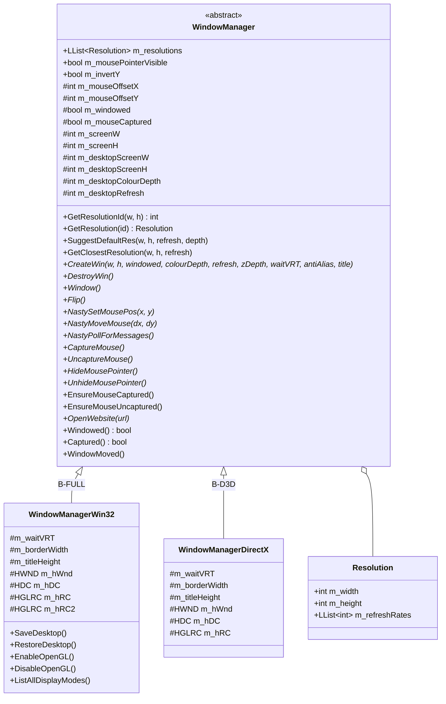
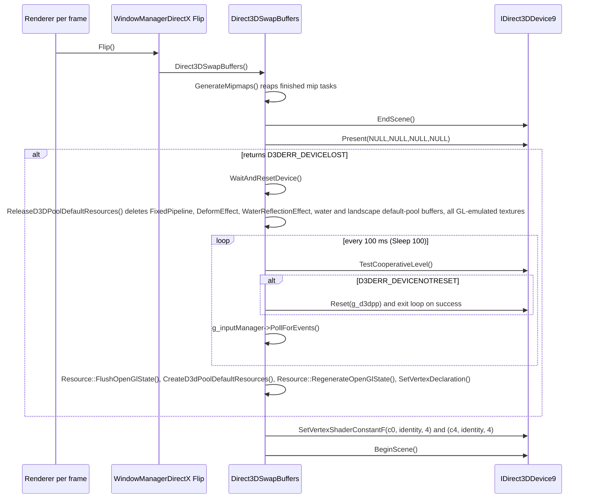
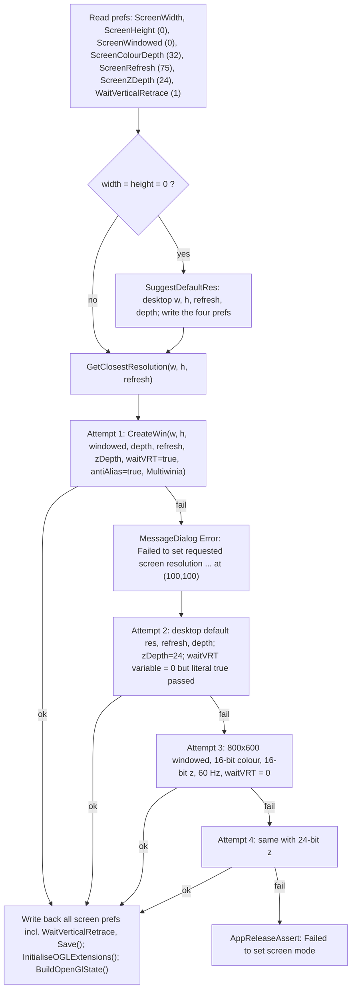
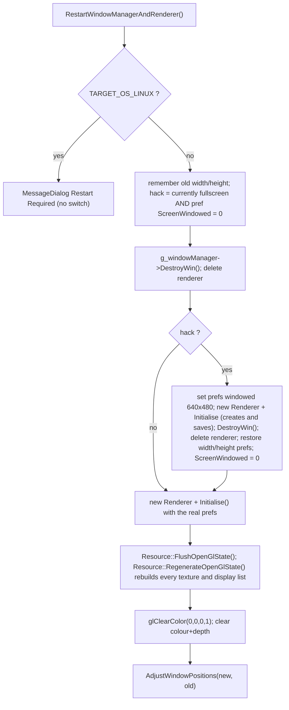
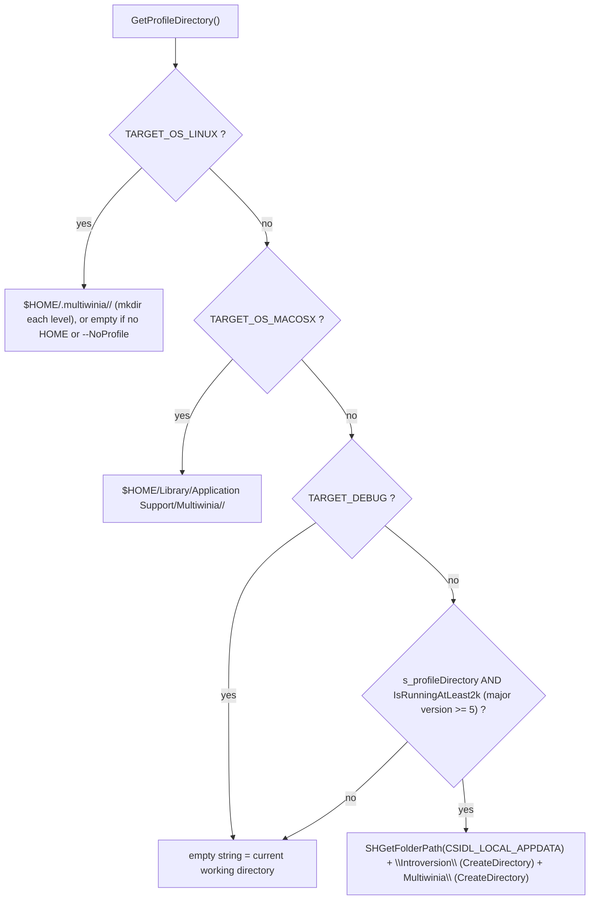
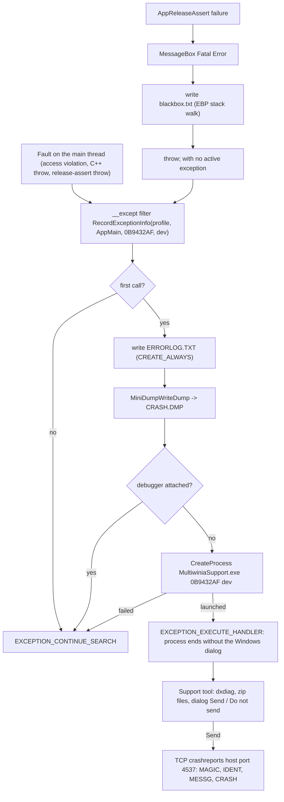
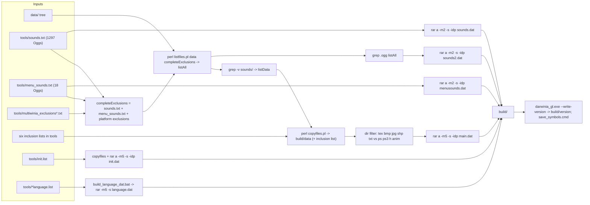

# 31 — Platform, build and tools

> Part B · Baseline build: Release|Win32 (OpenGL) + TARGET_PC_FULLGAME ([B:FULL]); see _work/build_matrix.md.
> Evidence: [C] confirmed · [I] inferred · [U] unknown. Citations are `path:Symbol` relative to the multiwinia/ source root.
> Sources merged: P14_platform_lib (build system, platform map, timing, file locations, archives, data pipeline, packaging, installers, MapCRC, ShapeExporter, localisation, audit scripts, crash handling, system info, root/targets/tools/docs inventories), P13_gfx_backend_math (window managers, D3D device creation/reset, display modes, vsync/MSAA/gamma, AVI capture/playback), P11_terrain_world (map CRC definition and the 87/87 reproduction script `_work/scripts/P11_mapcrc.py`, third D3D compile breakage), P12_render_core (fourth D3D compile breakage in `code/deform.cpp`), `_work/build_matrix.md` (superseded here for build facts), `_work/routed/_meta_*.md`, `_work/phase2_log.md`. New S31 scripts: `_work/scripts/S_31_archive_contents.py` (emulates the data build and lists every `.dat` archive's content), `_work/scripts/S_31_inventory.py` (one-row-per-file inventories), `_work/scripts/S_31_source_map.py` (source map, manifest-checked), `_work/scripts/S_31_citation_fixes.py` (writes paths of files absent from the tree as name + existing folder, so they are not read as citations). These scripts and the draft labels (P11–P14, S31) are provenance only; every claim cites the code or data it rests on.

## Contents

- [1 Summary for the new team](#1-summary-for-the-new-team)
- [2 Platform abstraction](#2-platform-abstraction)
- [3 Window management](#3-window-management)
- [4 Timing](#4-timing)
- [5 File paths and command line](#5-file-paths-and-command-line)
- [6 Crash handling and system information](#6-crash-handling-and-system-information)
- [7 Build configurations and flags](#7-build-configurations-and-flags)
- [8 Data build pipeline and the .dat archives](#8-data-build-pipeline-and-the-dat-archives)
- [9 Packaging scripts and installers](#9-packaging-scripts-and-installers)
- [10 Map CRC tool and runtime map identity](#10-map-crc-tool-and-runtime-map-identity)
- [11 ShapeExporter and 3DGeometry](#11-shapeexporter-and-3dgeometry)
- [12 Localisation build](#12-localisation-build)
- [13 Analysis and audit scripts](#13-analysis-and-audit-scripts)
- [14 File inventories (root, targets, tools, docs)](#14-file-inventories-root-targets-tools-docs)
- [15 Carry-forward notes](#15-carry-forward-notes)
- [Open questions and unknowns](#open-questions-and-unknowns)
- [Docs-vs-code discrepancies](#docs-vs-code-discrepancies)
- [IP items](#ip-items)
- [Source map](#source-map)
- [Appendix — dead/legacy code](#appendix--deadlegacy-code)

---

## 1 Summary for the new team

The shipped Multiwinia PC game is one Win32 executable built by Visual Studio 2008 from `targets/vs2005/Darwinia.vcproj` in configuration `Release|Win32` (OpenGL renderer, static CRT, `/fp:precise`), output `darwinia_gl.exe`, renamed `multiwinia.exe` by every packaging script, plus RAR archives: the code mounts eight archive names (`init.dat`, `language.dat`, `main.dat`, `patch.dat`, `menusounds.dat`, `branding.dat`, `sounds.dat`, `sounds2.dat`), six of which are produced by `tools/build_multiwinia_data.bat`; a ninth, `ambx.dat`, is shipped by three installers but is never opened by the code. The ten most design-relevant facts recovered here:

| # | Fact | Tag | Section |
|---|---|---|---|
| 1 | Product variants are selected by editing one `#define` in `code/lib/universal_include.h` (`TARGET_PC_FULLGAME` is the only uncommented one); VS configurations only select the renderer (OpenGL vs Direct3D 9) and debug/release | [C] | §7.6 |
| 2 | `ReleaseDirect3D` very probably does **not compile** at this commit: four independent breakages (abstract `WindowManagerDirectX`, `D3DRS_LINEWIDTH`, Xbox-360 `Resolve()` in `code/deform.cpp`, `bmp.GetPixel` on a pointer in `code/water.cpp`) | [C] for the two provable from the tree alone, [I] (strong) for the two that depend on PC DirectX SDK headers | §7.9 |
| 3 | GL and D3D builds differ in floating-point code generation (`/fp:precise` vs `/fp:fast`; D3D device created without `D3DCREATE_FPU_PRESERVE`), yet the lobby compatibility check is only the version string `"dev"` — mixing them in one lockstep game is a desync risk | [C] flags, [I] consequence | §7.10 |
| 4 | A loose file under `data/` always overrides the archive entry of the same name; later archives override earlier ones; archives are unencrypted solid RARs decompressed wholly into memory | [C] | §8.7–§8.8 |
| 5 | `default_preferences.txt` is looked up **before** `main.dat` is mounted, so in a packaged install (no loose `data/`) first-run defaults come only from code | [C] order, [I] packaged effect | §8.9 |
| 6 | Map identity is a CRC-32 (init 0, no final XOR) of the level file bytes plus one `0xFF`; `tools/MapCRC` regenerates `code/mapcrc.h` as a pre-build step; all 87 `MAPID_*` reproduce exactly | [C] | §10 |
| 7 | Crash handling = SEH filter around the whole main thread → `ERRORLOG.TXT` + minidump → user-confirmed TCP upload by `MultiwiniaSupport.exe` (built from `contrib/XCrashReport`), plus a release-assert "black box" | [C] | §6 |
| 8 | User data lives in `%LOCALAPPDATA%\Introversion\Multiwinia\` (`--NoProfile` → working directory); the authentication key is **read** from `authkey.dev` but a typed key is **written** to `authkey` | [C] | §5 |
| 9 | Timing is a process-relative `QueryPerformanceCounter` clock with an injectable fake-time mode; the main loop has no frame cap, so pacing is the driver's swap interval (the GL path never sets vsync) | [C] | §3.11, §4 |
| 10 | A maintained Multiwinia 1.3.1 Mac target exists (`targets/macosx/Multiwinia`, SDL + Cocoa, Ambrosia port) but cannot be built from this tree (26 referenced files absent); the Linux makefile is Darwinia-era | [C] | §2.4, §7.8 |

Resolved in this document (drafts or earlier notes disagreed, code re-read): number of `.cpp` references in the Mac project; whether `build_multiwinia.bat` builds all languages (it builds English only); which installers ship `ambx.dat`; order of operations in the fullscreen resolution switch; the `authkey`/`authkey.dev` split (which code path writes which file); whether the support tool uploads without consent (it does not) and its wire protocol; whether `ERRORLOG.TXT` is appended (it is overwritten); whether sound archives are parsed concurrently with `main.dat` (they are not); whether `targets/macosx/Multiwinia/data` is a symlink (it is a Subversion link stub); the role of `tools/SlashSort.exe` (now [I]).

---

## 2 Platform abstraction

### 2.1 Mechanism

There is no runtime platform layer. Platform selection is entirely compile-time, by two means [C]:

1. **Which files a project compiles.** `targets/vs2005/Darwinia.vcproj` lists the Win32 implementations; `targets/macosx/Multiwinia/Multiwinia.xcodeproj/project.pbxproj` lists the SDL/Cocoa ones; `targets/linux/Makefile` lists a Darwinia-era SDL set.
2. **Whole-file and in-file `#ifdef`s** on `TARGET_MSVC` (defined by `targets/vs2005/Common.vsprops`), `TARGET_OS_MACOSX` (Xcode), `TARGET_OS_LINUX` (makefile), `TARGET_MINGW` (no project defines it), `USE_DIRECT3D` (`targets/vs2005/Direct3D.vsprops`), `HAVE_DSOUND` (set by the `TARGET_MSVC`/`TARGET_MINGW` blocks of `code/lib/universal_include.h`), `HAVE_XAUDIO` (never defined on PC) and `_XBOX` (never defined on PC).

Platform identity strings [C] `code/lib/universal_include.h`: `APP_SYSTEM` = `"PC"` (`TARGET_MSVC`), `"Mac (PPC)"` / `"Mac (Intel)"` (`TARGET_OS_MACOSX` with/without `__ppc__`), `"Linux"`; `DARWINIA_PLATFORM` = `"win32"` / `"macosx"` / `"linux"`; `DARWINIA_VERSION_STRING` = `DARWINIA_PLATFORM "-" DARWINIA_GAMETYPE "-" DARWINIA_VERSION` → baseline `"win32-multiwinia-dev"`.

### 2.2 Platform map — every platform-specific file

"Live in baseline" = compiled and reachable in `Release|Win32` + `TARGET_PC_FULLGAME`. "Mac target" = referenced by the Multiwinia Xcode project [C scripted reference check]. Files whose body is wrapped in `#ifdef USE_DIRECT3D` are listed in the vcproj but compile to nothing in the baseline.

| File(s) | Platform / API | In vcproj | Live in baseline? | Mac target | Notes / evidence |
|---|---|---|---|---|---|
| `code/lib/window_manager_win32.cpp`, `code/lib/window_manager_win32.h` | Win32 + WGL/OpenGL | yes | **yes** [B:FULL] | no | body `#if !defined USE_DIRECT3D`; defines `WinMain` |
| `code/lib/window_manager_directx.cpp`, `code/lib/window_manager_directx.h` | Win32 + Direct3D 9 | yes | no [B:D3D] | no | body `#ifdef USE_DIRECT3D`; defines `WinMain`; see §7.9 breakage 1 |
| `code/lib/window_manager_sdl.cpp`, `code/lib/window_manager_sdl.h` | SDL 1.2 + OpenGL | no | no [B:DEAD] (the header is `#include`d by `code/main.cpp` only inside `#ifdef TARGET_OS_MACOSX`) | yes | MSAA via `SDL_GL_MULTISAMPLEBUFFERS`, vsync via `SDL_GL_SWAP_CONTROL` |
| `code/lib/window_manager.cpp`, `code/lib/window_manager.h` | portable base | yes | yes | yes | abstract `WindowManager`, `g_windowManager` |
| `code/lib/ogl_extensions.cpp`, `code/lib/ogl_extensions.h` | WGL extension loading | yes | **yes** | no | body `#if !defined USE_DIRECT3D` ([24](24_rendering.md)) |
| `code/lib/ogl_extensions_directx.cpp` | D3D stand-ins | yes | no [B:D3D] | no | `#ifdef USE_DIRECT3D` |
| `code/lib/ogl_extensions_sdl.cpp` | SDL GL extensions | no | no [B:DEAD] | yes | `SDL_GL_GetProcAddress` |
| `code/lib/opengl_directx.cpp`, `.h`, `code/lib/opengl_directx_inline.h`, `code/lib/opengl_directx_internals.h`, `code/lib/opengl_directx_dlist.cpp`, `.h`, `code/lib/opengl_directx_dlist_dev.cpp`, `.h`, `code/lib/opengl_directx_matrix_stack.cpp`, `.h`, `code/lib/opengl_directx_stubs.cpp` | D3D9 implementing the GL API | yes | no [B:D3D] | no | all `#ifdef USE_DIRECT3D` ([24](24_rendering.md)) |
| `code/lib/safegl.cpp`, `code/lib/safegl.h` | GL display-list mutex wrapper | yes | compiled, inactive (header only included for D3D/Mac) | yes | [24](24_rendering.md) |
| `code/lib/hi_res_time.cpp` | Win32 QPC (+ dead RDTSC path) | yes | **yes** | no | §4 |
| `code/lib/hi_res_time_sdl.cpp` | POSIX `gettimeofday` | no | no [B:DEAD] | yes | §4.3 |
| `code/lib/hi_res_time_gcc.cpp` | Win32 QPC for GCC/MinGW | no | no [B:DEAD] | no | §4.3 |
| `code/lib/exception_handler.cpp`, `code/lib/exception_handler.h` | Win32 SEH, `dbghelp` minidump | yes | **yes** | no | §6.2 |
| `code/lib/GetWinVer.cpp`, `code/lib/GetWinVer.h`, `code/lib/MiniVersion.cpp`, `code/lib/MiniVersion.h` | Win32 version APIs | yes | **yes** (crash report only) | no | §6.7 |
| `code/lib/system_info.cpp`, `code/lib/system_info.h` | Win32 locale, `waveOut`, DirectX registry | yes | **yes** | no | §6.7 |
| `code/lib/system_info_macosx.cpp`, `code/lib/macosx_hardware_detect.cpp`, `code/lib/macosx_hardware_detect.h` | Mac | no | no [B:DEAD] (the header is included by `code/lib/preferences.cpp` only inside `#ifdef TARGET_OS_MACOSX`) | yes | |
| `code/lib/input/inputdriver_win32.cpp`, `.h`, `code/lib/input/win32_eventhandler.cpp`, `.h`, `code/lib/input/win32_eventproc.h` | Win32 messages, keyboard/mouse | yes | **yes** | no | [06](06_player_control_and_input.md); §3.10 |
| `code/lib/input/inputdriver_xinput.cpp`, `code/lib/input/inputdriver_xinput.h` | XInput 1.3 (delay-loaded `xinput1_3.dll`) | yes | **yes** | no | [06](06_player_control_and_input.md) |
| `code/lib/input/xbox_eventhandler.cpp`, `code/lib/input/xbox_eventhandler.h` | Xbox 360 | yes, `ExcludedFromBuild` ×4 | no [B:DEAD] | no | §7.4 |
| `code/lib/input/inputdriver_sdl_key.cpp`, `.h`, `code/lib/input/inputdriver_sdl_mouse.cpp`, `.h`, `code/lib/input/sdl_eventhandler.cpp`, `.h`, `code/lib/input/sdl_eventproc.h` | SDL input | no | no [B:DEAD] (the three headers are included by `code/main.cpp` only inside `#ifdef TARGET_OS_MACOSX`) | yes | |
| `code/lib/input_sdl.cpp` | Darwinia-era SDL input | no | no [B:DEAD] | no | |
| `code/lib/input/inputfilterspec.cpp` | portable | no | no [B:DEAD] | yes | |
| `code/sound/sound_library_2d_win32.cpp`, `code/sound/sound_library_2d_win32.h` | Win32 `waveOut` 2D mixer output | yes | **yes** | no | [27](27_audio_engine.md) |
| `code/sound/sound_library_3d_dsound.cpp`, `.h` | DirectSound 3D (`HAVE_DSOUND`) | yes | **yes** | no | requires DirectX ≥ 9 (§6.7) |
| `code/sound/sound_library_3d_xaudio.cpp`, `.h` | XAudio (`HAVE_XAUDIO`) | yes | no [B:DEAD] | no | |
| `code/sound/sound_library_2d_sdl.cpp`, `code/sound/sound_library_2d_sdl.h` | SDL audio | no | no [B:DEAD] (the header is included by `code/sound/soundsystem.cpp` only in the `#if !defined(WIN32)` branch) | yes | needs the absent `ASWSDLRingBuffer` sources (a `macosx/` sub-folder of `code/sound/` that is not in the tree) |
| `code/sound/sound_library_3d_software.cpp`, `.h` | portable software mixer | yes | yes | yes | `INVOKE_CALLBACK_FROM_SOUND_THREAD` variant is Mac-only |
| `code/unicode/sound_library_2d.cpp`, `.h`, `code/unicode/sound_library_2d_sdl.cpp`, `.h`, `code/unicode/sound_library_3d.cpp`, `.h` | stale copies | no | no [B:DEAD] | no | live files include `"sound/sound_library_2d.h"` / `"sound/sound_library_3d.h"`, which resolve through the include path to `code/sound/`, not `code/unicode/` (no include directory points at `code/unicode/`, and the only same-directory includer, `code/unicode/sound_library_2d.cpp`, is not compiled) — resolved: an earlier file inventory's "included by a live file" marks for `code/unicode/sound_library_2d.h`, `code/unicode/sound_library_3d.h`, `code/unicode/sound_library_2d_sdl.h` are base-name matches, not real inclusions [C include paths] |
| `code/gesture_demo_win32.cpp` | Win32 thread | yes | no (needs `GESTURE_EDITOR` + `USE_SEPULVEDA_HELP_TUTORIAL`) [B:DEAD] | no | |
| `code/gesture_demo_sdl.cpp` | SDL | no | no [B:DEAD] | yes | |
| `code/interface/buynow_window.cpp`, `.h`, `code/interface/updateavailable_window.cpp`, `.h` | Mac upsell / update windows | no | no [B:DEAD] — but `code/interface/updateavailable_window.h` is `#include`d **unconditionally** by `code/main.cpp`, so its `UpdateAvailableWindow` declaration is compiled into the baseline; the class is never instantiated there and its `.cpp` is not compiled [C] | yes | |
| `code/lib/mouse_cursor.cpp`, `code/lib/mouse_cursor.h`, `code/lib/tri_tri.cpp`, `code/lib/debug_logging.cpp`, `code/lib/debug_logging.h` | portable helpers used only by the Mac project | no | no [B:DEAD] — `code/lib/mouse_cursor.h` is included by live `code/app.cpp`, `code/renderer.cpp` (and `code/sepulveda.cpp`) but in this tree is an empty stub (it only includes `lib/rgb_colour.h`) | yes | |
| `contrib/systemiv/lib/netlib/net_lib_win32.h`, `net_mutex_win32.cpp`, `net_thread_win32.cpp` | Winsock, `CRITICAL_SECTION`, `CreateThread` | yes | **yes** | no | [20](20_architecture.md), [22](22_determinism_and_networking.md) |
| `contrib/systemiv/lib/netlib/net_lib_linux.h`, `net_mutex_linux.cpp`, `net_thread_linux.cpp` | pthreads/BSD sockets | no | no [B:DEAD] | yes | |
| `contrib/systemiv/lib/filesys/filesys_utils.cpp` | `FindCaseInsensitive` (identity on Win32; per-component directory scan on Linux) | yes | yes | yes | §2.3 |
| `contrib/systemiv/lib/tosser/hash_map_darwin.h` | GNU `hash_map` shim | no | no [B:DEAD] | yes | |
| `contrib/unrar/win32acl.cpp`, `contrib/unrar/win32stm.cpp` | NTFS ACL / stream extraction | not listed; `#include`d by `contrib/unrar/extinfo.cpp` under `_WIN_32` | compiled into `unrar.lib`, unused by the game [I] | no | |
| `contrib/systemiv/lib/gucci/window_manager_win32.*`, `window_manager_sdl.*`, `input_win32.*`, `input_sdl.*`, `contrib/systemiv/lib/sound/sound_library_2d_win32.*`, `sound_library_2d_sdl.*` | SystemIV equivalents | no | no [B:DEAD] (SystemIV `gucci`/`sound` not compiled) | no | build_matrix §6 |
| `targets/macosx/Multiwinia/SDLMain.mm`, `SDLMain.h`, `MultiwiniaCocoaBridge.cpp`, `MultiwiniaCocoaBridge.h`, `SDLApp_Prefix.pch` | Cocoa shell | – | no | yes | §2.4 |
| `contrib/XCrashReport/*` | MFC crash-report tool | separate solution | shipped as `MultiwiniaSupport.exe` | no | §6.4 |

### 2.3 Cross-platform service matrix

| Service | Win32 baseline implementation | Other platforms (not in baseline) | Notes |
|---|---|---|---|
| High-resolution timer | `code/lib/hi_res_time.cpp` (QPC, process-relative) [B:FULL] | `code/lib/hi_res_time_sdl.cpp` (`gettimeofday`), `code/lib/hi_res_time_gcc.cpp` (QPC, absolute) [B:DEAD] | §4 |
| Window / GL context | `code/lib/window_manager_win32.cpp`; `code/lib/window_manager_directx.cpp` [B:D3D] | `code/lib/window_manager_sdl.cpp` | §3 |
| Input event source | `W32EventHandler` + input drivers | `SDLEventHandler` | chosen in `code/main.cpp:Initialise` by `TARGET_MSVC` [C] |
| Threads / mutex / event | `contrib/systemiv/lib/netlib/net_thread_win32.cpp` (`CreateThread`), `net_mutex_win32.cpp` (`CRITICAL_SECTION`, auto-reset `CreateEvent`) | `*_linux.cpp` (pthreads) | [20](20_architecture.md) |
| Debug output | `OutputDebugString` or redirect file `debug.txt` in the profile directory | `fputs(stderr)`; Mac log dir `~/Library/Logs/<app>/`, Linux `/tmp/` [C] `contrib/systemiv/lib/debug_utils.cpp:AppDebugLogPath` | [32](32_debug_test_and_performance.md) |
| Crash handling | SEH `__try/__except(RecordExceptionInfo…)` + minidump + `MultiwiniaSupport.exe` | Mac: black box without stack walk (comment suggests Smart Crash Reports) | §6 |
| User data directory | `%LOCALAPPDATA%\Introversion\Multiwinia\` | Linux `~/.multiwinia/<DARWINIA_GAMETYPE>/`; Mac `~/Library/Application Support/Multiwinia/<DARWINIA_GAMETYPE>/`, prefs `~/Library/Preferences/uk.co.introversion.Multiwinia.txt` | §5 |
| Case-insensitive file lookup | identity (`FindCaseInsensitive` returns its input) | Linux: walks each path component with `ListDirectory`, taking the first case-insensitive match | [C] `contrib/systemiv/lib/filesys/filesys_utils.cpp:FindCaseInsensitive` |
| System info | `code/lib/system_info.cpp` | `code/lib/system_info_macosx.cpp` | §6.7 |
| x87 precision | `_control87(_PC_53, _MCW_PC)` (53-bit mantissa) | Mac i386: `fnstenv`/`fldenv` clearing bit 8 | [C] `code/main.cpp:StandardiseCPUPrecision`; called in `Initialise` and at the start of every `WorkQueue` thread ([22](22_determinism_and_networking.md)) |
| `wchar_t` | UTF-16 (2 bytes) | UTF-32 (4 bytes); conversion via CoreFoundation/iconv | [C] `contrib/systemiv/lib/network_stream.cpp:WriteUnicodeString`, `code/unicode/unicode_text_file_writer.cpp` |
| Open URL | `ShellExecute(NULL,"open",url,…,SW_SHOWNORMAL)` | Mac/Linux variants in `window_manager_sdl.cpp`; Linux helper `tools/open-www.sh` | [C] `code/lib/window_manager_win32.cpp:OpenWebsite` |
| Clipboard (auth-key paste) | Win32 `OpenClipboard`/`GetClipboardData(CF_TEXT)`, at most `AUTHENTICATION_KEYLEN-1` chars | Mac `PasteboardCopyItemFlavorData("public.utf16-plain-text")` | [C] `code/UI/GameMenuWindow.cpp:GameMenuWindow::PasteFromClipboard` |

### 2.4 The Mac Multiwinia target [B:DEAD on PC]

[C] `targets/macosx/Multiwinia/Multiwinia.xcodeproj/project.pbxproj`, `targets/macosx/Multiwinia/Info.plist`, `targets/macosx/Multiwinia/SDLMain.mm`, `targets/macosx/Multiwinia/MultiwiniaCocoaBridge.cpp`.

| Aspect | Value |
|---|---|
| Product | Multiwinia 1.3.1 (`CFBundleVersion`), bundle id `uk.co.introversion.multiwinia`, principal class `SDLApplication`, main nib `SDLMain`; About/credits rtf files name the Ambrosia Software port |
| Xcode targets | `Multiwinia` (application), `Generate Map CRCs` (builds `tools/MapCRC/main.cpp` with `tools/MapCRC/lib/universal_include.h`; a shell build phase runs `GenerateMapCRCs ../../../data/levels/ ../../../code/mapcrc.h`), `OggVorbis` (static library, `__MACOSX__`) |
| Architectures | `ppc i386` (`ARCHS_STANDARD_32_BIT_PRE_XCODE_3_1`); Debug tuned G5, Release G3 |
| Defines | Debug: `TARGET_OS_MACOSX`, `GUI`, `SILENT`, `PROFILER_ENABLED` (+ project-level `_DEBUG=1`); Release: `NO_DEBUG_OUTPUT`, `TARGET_OS_MACOSX`, `GUI`, `SILENT`, `PROFILER_ENABLED` |
| Compiler flags | `-fno-builtin`; Release adds `-mfpmath=387` (i386) and `-mno-fused-madd` (ppc) — chosen to keep floating point bit-compatible with the x87 Windows build [I: purpose; C: flags] |
| Frameworks | SDL (`contrib/macosx/SDL.framework`), Ambrosia `ASWAboutBox`, `ASWAppKit`, `ASWDebug`, `ASWFoundation`, `AmbrosiaTools`, `Sparkle` (all six absent from the tree), AppKit, Carbon, Cocoa, CoreFoundation, Foundation, IOKit, OpenGL |
| Build phases | strip `PrivateHeaders` from embedded frameworks (Ruby); create a `data` symlink in the bundle Resources (`ln -sf "$SRCROOT/../../../data" .`); run the Ruby scripts `add-appcast-url.rb` and `add-svn-revision.rb` from a `macosx/` sub-folder of `tools/` (both absent from the tree) |
| Cocoa shell | `SDLMain.mm`: change directory to `Contents/Resources`, set `SDL_ENABLEAPPEVENTS=1` and `SDL_HAS3BUTTONMOUSE=1`, Sparkle update checks, sleep/wake notifications — on wake `Server::SkipToTime(GetHighResTime())` only when clients are connected (`MultiwiniaCocoaBridge.cpp:WindowManagerSDLAwakeFromSleep`), pause/fullscreen menu items |
| Buildability from this tree | 936 file references resolve (case-insensitively, as on HFS+), **26 do not**: the six Ambrosia frameworks; `ASWSDLRingBuffer.cpp`, `ASWSDLRingBuffer.h`, `CARingBuffer.cpp`, `CARingBuffer.h`, `CABitOperations.h` (a missing `macosx/` folder under `code/sound/`); `pokey.cpp`, `pokey.h` (under `code/sound/`); `pokey_window.cpp`, `pokey_window.h` (under `code/interface/`); `command_buffer.cpp`, `command_buffer.h`, `debug_xbox.cpp`, `debug_xbox.h` (under `code/lib/`); `CCrypticon.cpp`, `CCrypticon.h` (a missing `Crypticon/` folder under `contrib/systemiv/lib/`); five absent XBLA/PDLC headers under `code/UI/` [C scripted check] ⇒ not buildable as checked in [I] |

Resolved: P14's note "1158 `.cpp` references" — the project has 384 distinct `.cpp` `PBXFileReference` entries; the higher number counted every occurrence (file reference + build-file + group lines) [C] grep of the project file.

### 2.5 Linux and Darwinia Mac targets [B:DEAD]

* `targets/linux/Makefile` — Darwinia-era (`CXX=apg++` autopackage wrapper, `CXXFLAGS=-g -Os`, `-DTARGET_OS_LINUX -DHAVE_SOCKET -DHAVE_SELECT -DHAVE_GETHOSTBYNAME -DHAVE_INET_NTOA`, links SDL, GL, GLU, vorbisfile, vorbis, ogg; `DEMO_CPPFLAGS=-DTARGET_DEMOGAME=1`, `FULL_CPPFLAGS=-DTARGET_FULLGAME=1`). It lists 247 `code/`+`contrib/` sources of which 23 are absent (17 under `code/`, e.g. `text_stream_readers.cpp` (under `code/lib/`) and `networkupdate.cpp` (under `code/network/`); 6 in the absent `netclass/` and `binreloc/` folders of `contrib/`) [C scripted]. Note that `TARGET_FULLGAME` is not one of the product macros summed by the `#error` check in `code/lib/universal_include.h`, so it would silently build `TARGET_PC_FULLGAME` [C]. Linux-only runtime paths in code: profile `~/.multiwinia/<gametype>/`, debug log `/tmp/`, `RestartWindowManagerAndRenderer` shows "Restart Required" instead of switching mode [C] `code/interface/prefs_screen_window.cpp:RestartWindowManagerAndRenderer`.
* `targets/linux/Makefile.keygen-1` — builds a Darwinia `keygen-1` from `code/keygen.cpp` + an absent `PasswordGenerator/main.cpp` under `tools/` and copies it to an Introversion server (Darwinia beta registration) [C].
* `targets/macosx/Darwinia/*` — Darwinia Xcode 2 project and menu callbacks (debug menu, FPS, profiler, fullscreen, quit) [C] `targets/macosx/Darwinia/MainMenuCallbacks.cpp`.
* `docs/sdl_problems.txt` records SDL limitations of the time (no mouse wheel, low-resolution timer) [C].

---

## 3 Window management

### 3.1 Class hierarchy [C] `code/lib/window_manager.h`, `code/lib/window_manager_win32.h`, `code/lib/window_manager_directx.h`



One global `WindowManager *g_windowManager` (constructed in `WinMain`; the Win32 constructor asserts it is still NULL) [C] `code/lib/window_manager.cpp`, `code/lib/window_manager_win32.cpp:WindowManagerWin32::WindowManagerWin32`. `PlatformWindow` is `typedef void*`; `Window()` returns the `HWND` cast to `PlatformWindow*` [C].

**Process entry** [C] `code/lib/window_manager_win32.cpp:WinMain`: store `g_hInstance`; `g_windowManager = new WindowManagerWin32()`; `AppMain(cmdLine)` (`code/main.cpp`); return `WM_QUIT`. The process never changes its working directory, so it relies on being started with the install folder as current directory (installer shortcuts set `WorkingDir: "{app}"`, §9.2) [C].

Base-class behaviour [C] `code/lib/window_manager.cpp`:

| Member | Behaviour |
|---|---|
| ctor | `m_mousePointerVisible=true`, `m_mouseOffsetX=INT_MAX` (sentinel = "recompute offset"), `m_mouseCaptured=false`; calls `AbstractListAllDisplayModes()` → `ListAllDisplayModes()`, which during base construction dispatches to the **empty base version**; derived constructors therefore call their own `ListAllDisplayModes()` again |
| `SuggestDefaultRes(&w,&h,&refresh,&depth)` | returns the desktop width/height/refresh/bit depth captured by `SaveDesktop` |
| `GetResolutionId(w,h)` | index in `m_resolutions` with exact w,h, else −1 |
| `GetResolution(id)` | pointer, or NULL for an invalid index |
| `GetClosestResolution(&w,&h,&refresh)` | exact (w,h) match → only snap refresh; else the resolution minimising `|Δw|+|Δh|` (first wins ties), then snap refresh. Refresh snapping: exact match, else the entry minimising `|Δrefresh|`; if the resolution lists no rates the requested value is kept |
| `EnsureMouseCaptured/Uncaptured` | capture/uncapture only if the state differs (called from `Camera::Advance`, [06](06_player_control_and_input.md)) |
| `WindowMoved` | resets `m_mouseOffsetX=INT_MAX` |
| `m_invertY` | never initialised or read [C grep] |

### 3.2 Display modes and the screen-options dialog

**Enumeration** [C] `WindowManagerWin32::ListAllDisplayModes` (the DirectX variant is identical): loop `EnumDisplaySettings(NULL, i, &devMode)` for i = 0,1,… until it fails; keep modes with `dmBitsPerPel ≥ 15 && dmPelsWidth ≥ 640 && dmPelsHeight ≥ 480`; de-duplicate by (width, height) regardless of bit depth; per resolution collect the unique `dmDisplayFrequency` values. Order = driver enumeration order (not sorted). `devMode.dmSize` is not initialised before the call (works in practice; Win32 formally requires it). Colour depth is not stored per resolution.

**Desktop capture** [C] `WindowManagerWin32::SaveDesktop`: `EnumDisplaySettings(ENUM_CURRENT_SETTINGS)` → `m_desktopScreenW/H`, `m_desktopColourDepth`, `m_desktopRefresh`. `RestoreDesktop` calls `ChangeDisplaySettings(desktop, CDS_FULLSCREEN)` only when the current mode differs from the saved one.

**Screen options dialog** [C] `code/interface/prefs_screen_window.cpp` ([09](09_meta_systems.md), [28](28_ui_framework.md)):

| Control | Values | Pref written on Apply | Note |
|---|---|---|---|
| Resolution drop-down (`dialog_resolution`) | every `m_resolutions` entry | `ScreenWidth`, `ScreenHeight` | selecting a resolution repopulates the refresh list |
| Windowed check box (`dialog_windowed`) | 0/1 | `ScreenWindowed` | |
| Refresh rate (`dialog_refreshrate`) | that resolution's rates | `ScreenRefresh` | `HAVE_REFRESH_RATES` (defined for `TARGET_MSVC`); fullscreen-only control |
| Colour depth (`dialog_colourdepth`) | 16 / 24 / 32 | `ScreenColourDepth` | fullscreen-only control |
| Z-buffer depth (`dialog_zbufferdepth`) | 16 / 24 | `ScreenZDepth` | |
| Apply (`dialog_apply`) | – | all of the above, then `RestartWindowManagerAndRenderer()` (§3.9) | |

Dialog-side fallbacks when a pref is missing differ from the renderer's (`ScreenColourDepth` 16 vs 32, `ScreenRefresh` 60 vs 75); they never apply after the first run because `Renderer::Initialise` saves every screen pref [C].

### 3.3 `WindowManagerWin32` — OpenGL window [B:FULL] [C] `code/lib/window_manager_win32.cpp`

**`CreateWin(w, h, windowed, colourDepth, refreshRate, zDepth, waitVRT, antiAlias, title)`**:

1. Store `m_screenW/H`, `m_windowed`. Register `WNDCLASSW{style=CS_OWNDC, WndProc, hIcon=LoadIcon(NULL, IDI_APPLICATION), hCursor=LoadCursor(NULL, IDC_ARROW), background=BLACK_BRUSH, class name = title}` (title = `APP_NAME_W` = `L"Multiwinia"`).
2. **Windowed**: `RestoreDesktop()`; style `WS_VISIBLE|WS_POPUPWINDOW|WS_CAPTION|WS_MINIMIZEBOX|WS_MAXIMIZEBOX`; `AdjustWindowRect` → `m_borderWidth = (Δwidth)/2`, `m_titleHeight = Δheight − 2·border`; **returns false if the client size exceeds the desktop**; window centred on the desktop.
3. **Fullscreen**: style `WS_VISIBLE|WS_POPUP`; `ChangeDisplaySettings({bpp=colourDepth, w, h, freq=refreshRate}, CDS_FULLSCREEN)`; returns false unless `DISP_CHANGE_SUCCESSFUL`; position (0,0); `m_borderWidth=1`, `m_titleHeight=0`.
4. `CreateWindowW(class, title, style, x, y, w(+2·border), h(+2·border+title))`; false on failure; reset mouse offset.
5. `EnableOpenGL(colourDepth, zDepth)` (return value ignored).

`waitVRT` and `antiAlias` are **ignored** (`m_waitVRT` is never assigned in this class) [C].

**`EnableOpenGL`**: `GetDC`; `PIXELFORMATDESCRIPTOR{PFD_DRAW_TO_WINDOW|PFD_SUPPORT_OPENGL|PFD_DOUBLEBUFFER, PFD_TYPE_RGBA, cColorBits=colourDepth, cDepthBits=zDepth, PFD_MAIN_PLANE}` → `ChoosePixelFormat` + `SetPixelFormat` (results unchecked; no alpha, stencil or multisample bits requested); `wglCreateContext` twice — primary `m_hRC` and secondary `m_hRC2` ("for loading thread") joined with `wglShareLists` (failure only logged via `FormatMessage`); `wglMakeCurrent(m_hDC, m_hRC)`; `glClear(GL_COLOR_BUFFER_BIT)`. `m_hRC2` is **never made current and never deleted**; `UseSecondaryContext/ReleaseSecondaryContext/DestroySecondaryContext` are declared but not defined [C]. All GL work from worker threads is instead marshalled to the main thread as `Job`s ([20](20_architecture.md)).

**`DisableOpenGL`**: `wglMakeCurrent(NULL,NULL)`, delete `m_hRC`, `ReleaseDC`. **`DestroyWin`**: `DisableOpenGL` + `DestroyWindow`. **`Flip`**: `SwapBuffers(m_hDC)`. **`NastyPollForMessages`**: `PeekMessage/TranslateMessage/DispatchMessageW` loop (called by `W32InputDriver`, [06](06_player_control_and_input.md)). `WndProc` forwards to `W32EventHandler::WndProc`, falling back to `DefWindowProcW` when the handler returns −1 or is absent.

**Mouse**: `NastySetMousePos(x,y)` lazily computes the client-origin offset (`GetWindowRect` + border + title when windowed, 0 when fullscreen), `SetCursorPos(x+off, y+off)` and calls `W32InputDriver::SetMousePosNoVelocity(x,y)`; `NastyMoveMouse(dx,dy)` = relative `SetCursorPos` + `SetMousePosNoVelocity(dx,dy)` (passes the *delta* as a position) [C]; `CaptureMouse`=`SetCapture`; `UncaptureMouse`=`ReleaseCapture`; `Hide/UnhideMousePointer`=`ShowCursor(false/true)` (the game draws its own cursor, [24](24_rendering.md)). `OpenWebsite(url)` = `ShellExecute(NULL,"open",url,NULL,NULL,SW_SHOWNORMAL)`.

### 3.4 `WindowManagerDirectX` — Direct3D window [B:D3D] [C] `code/lib/window_manager_directx.cpp`

Same structure as Win32 with these differences: ANSI `WNDCLASS/RegisterClass/CreateWindow/DefWindowProc/DispatchMessage`; icon = resource `MAKEINTRESOURCE(101)` (`IDI_ICON1` in `targets/vs2005/resource.h`), `hCursor = NULL`; `m_waitVRT = waitVRT` is stored; **`RestoreDesktop` body is commented out** and the fullscreen branch does **not** call `ChangeDisplaySettings` (D3D performs the mode switch); `EnableOpenGL` = `Direct3DInit(m_hWnd, m_windowed, m_screenW, m_screenH, colourDepth, zDepth, m_waitVRT)` + `glClear(GL_COLOR_BUFFER_BIT)`; on failure the window is destroyed and `CreateWin` returns false; `DisableOpenGL` = `Direct3DShutdown()`; `Flip` = `Direct3DSwapBuffers()`; `EnsureMouseCaptured/Uncaptured` overridden as no-ops; `Hide/UnhideMousePointer` only toggle the flag (no `ShowCursor`); destructor also `m_resolutions.EmptyAndDelete()`. Its `WinMain` additionally handles `TARGET_OS_VISTA` (`-mediacenter` → `g_mediaCenter=true` + `Sleep(7500)`; otherwise a save-file path argument → `g_saveFile`, `SetCurrentDirectory(exe dir)`) — `TARGET_OS_VISTA` is never defined [B:DEAD]. `CreateWin` takes `const char *_title` while the base declares `const wchar_t *_title` — see §7.9 breakage 1.

### 3.5 Direct3D device creation [B:D3D] [C] `code/lib/opengl_directx.cpp:Direct3DInit`

| Step | Value |
|---|---|
| D3D object | `Direct3DCreate9(D3D_SDK_VERSION)` once; failure → `AppReleaseAssert("Direct3D 9 not available.")` |
| Vertex processing | `GetDeviceCaps(DEFAULT, HAL)`: `D3DDEVCAPS_HWTRANSFORMANDLIGHT` ⇒ `D3DCREATE_HARDWARE_VERTEXPROCESSING`, else `SOFTWARE` (and vertex buffers get `D3DUSAGE_SOFTWAREPROCESSING`) |
| Adapter / type | `D3DADAPTER_DEFAULT`, `D3DDEVTYPE_HAL` (NVPerfHUD variant commented out) |
| Behaviour flags | only the vertex-processing flag — **no `D3DCREATE_FPU_PRESERVE`, no `D3DCREATE_MULTITHREADED`** (§7.10, [22](22_determinism_and_networking.md)) |
| Windowed | `Windowed=TRUE`, back-buffer size 0 (= client area), `BackBufferFormat=D3DFMT_UNKNOWN` (desktop format) |
| Fullscreen | `Windowed=FALSE`, `BackBufferWidth/Height = w/h`; colour 24/32 → `X8R8G8B8`; 15/16 → `X1R5G5B5`; other → `AppReleaseAssert("Unexpected colourDepth.")`. `FullScreen_RefreshRateInHz` not set (0 = adapter default) ⇒ **refresh-rate preference ignored** |
| Format fallback (fullscreen) | `CheckDeviceType` fails → 15/16-bit: try `R5G6B5` ("Fixes 16bit modes on Radeon X300"), then `A1R5G5B5` (display `X1R5G5B5`); 24/32-bit: `A8R8G8B8` (display `X8R8G8B8`). If the final check still fails: revert to `X8R8G8B8` (≥ 24) or `X1R5G5B5` and proceed |
| Depth buffer | if zDepth ≠ 0: `EnableAutoDepthStencil`; 16 → `D3DFMT_D16`; 24 → `D3DFMT_D24X8`; 32 → `D3DFMT_D32`; other → `AppReleaseAssert("Unexpected zDepth.")`. No stencil |
| Swap | `SwapEffect=DISCARD`, `BackBufferCount` default (1); a triple-buffering block is commented out |
| Vsync | `PresentationInterval = waitVRT ? D3DPRESENT_INTERVAL_ONE : D3DPRESENT_INTERVAL_IMMEDIATE` |
| Multisampling | `MultiSampleType` left 0 = `D3DMULTISAMPLE_NONE` |
| `CreateDevice` failure | returns false ("non fatal end, res change can help") → the retry chain of §3.7 continues |
| After creation | `g_pd3dDeviceActual = g_pd3dDevice`; `InitialiseData()` (matrix stacks, vertex declaration, 1024-entry vertex array, texture table cleared, cull/hints/attributes reset, mip-map work queue created once); `BeginScene()`; `SetVertexDeclaration`; `CreateD3DResources()` → `DeformEffect::Create`, `WaterReflectionEffect::Create`, `new FixedPipeline` ([24](24_rendering.md)) |

`Direct3DShutdown`: `ReleaseD3DResources()` (default-pool resources, water/landscape managed resources, `TaskManagerInterfaceGestures::ReleaseD3dResources`), release the device and the D3D object.

### 3.6 Frame present and lost-device handling [B:D3D] [C] `code/lib/opengl_directx.cpp:Direct3DSwapBuffers`, `WaitAndResetDevice`



Notes: the loop exits **only** after a successful `Reset`; if `TestCooperativeLevel` returned `D3D_OK` without a reset being needed the loop would spin forever [C structure; I likelihood]. Other `Present` failures are ignored. Managed-pool textures are released too and rebuilt through `Resource::RegenerateOpenGlState` ([25](25_textures_and_assets.md)), which allocates new texture ids because the emulated `glDeleteTextures` does not recycle ids ⇒ the id table grows on each reset [I]. A 5-second FPS counter (`FRAMES_PER_SECOND_COUNTER`) is computed but its output line is commented out.

### 3.7 Window-creation retry chain [C] `code/renderer.cpp:Renderer::Initialise`



Consequences [C]: attempts 1–2 pass the literal `true` for `waitVRT`, so the `WaitVerticalRetrace` preference only matters in attempts 3–4, and only in the D3D build. After **any** first-attempt failure the local `waitVRT` is 0 and is persisted as `WaitVerticalRetrace = 0`. Attempt 2 keeps the user's `windowed` choice. The error dialog is an in-game Eclipse window, so it is shown only once the renderer exists.

### 3.8 Preferences consumed by window/renderer creation [C] `code/renderer.cpp:Renderer::Initialise`, `code/lib/preference_names.h`

| Key | Default in code | Used by |
|---|---|---|
| `ScreenWidth` / `ScreenHeight` | 0 / 0 (→ desktop) | `CreateWin` |
| `ScreenWindowed` | 0 | `CreateWin` |
| `ScreenColourDepth` | 32 | GL: `ChangeDisplaySettings` bpp + PFD colour bits; D3D: back-buffer format |
| `ScreenRefresh` | 75 | GL fullscreen `dmDisplayFrequency`; ignored by D3D |
| `ScreenZDepth` | 24 | PFD depth bits / D3D depth format |
| `WaitVerticalRetrace` | 1 | D3D `PresentationInterval` (see §3.7 caveat); no effect in GL |
| `ScreenOverscan` | forced 0 | written only |
| `RenderLandscapeMode` | −1 (auto) | VBO vs display list (GL) ([23](23_terrain_and_landscape.md)) |
| `ManuallyScaleTextures` | 0 | power-of-two rescale ([25](25_textures_and_assets.md)) |

### 3.9 Fullscreen/windowed switching and resolution change [C] `code/interface/prefs_screen_window.cpp:RestartWindowManagerAndRenderer`, `SetWindowed`



Resolved: the P13 draft described the temporary 640×480 window as created *before* destroying the old one; the code destroys the old window and renderer first, then creates and destroys the temporary windowed renderer ("necessary for resolution change in fullscreen"), then the final one. The temporary `Renderer::Initialise` saves `ScreenWindowed=1` and 640×480 to `preferences.txt`; the final `Initialise` overwrites them [C]. `SetWindowed(isWindowed, isPermanent, &switching)` sets the pref, restarts only if the actual mode changes, and restores the old pref value afterwards when not permanent (else saves) [C].

### 3.10 Window messages, focus and Alt-Tab [C] `code/lib/input/win32_eventhandler.cpp:W32EventHandler::WndProc`

| Message | Handling |
|---|---|
| every message | `g_windowHasFocus = (GetForegroundWindow() == game HWND)`; on focus loss/regain a held Alt key is force-released |
| `WM_CREATE`, `WM_DESTROY`, `WM_SIZING`, `WM_WINDOWPOSCHANGING`, `WM_WINDOWPOSCHANGED`, `WM_COMMAND`, `WM_NCHITTEST` | return −1 (→ `DefWindowProcW`) |
| `WM_SETCURSOR` | in the client area `SetCursor(NULL)`; **falls through** into `WM_MOVE` (no `return`), so every client-area cursor message also resets the mouse offset; outside the client area −1 |
| `WM_MOVE` | `g_windowManager->WindowMoved()`, return −1 |
| `WM_CANCELMODE` | return 0 |
| `WM_CLOSE` | `g_app->m_requestQuit = true`, return 0 (the main loop then calls `Finalise()` and `exit(0)`, `code/main.cpp:HandleCommonConditions`) |
| `WM_INPUTLANGCHANGE` | logged only |
| others | offered to every registered `W32EventProcessor` (keyboard/mouse drivers, [06](06_player_control_and_input.md)) |

Alt-Tab: `BindAltTab` registers `MOD_ALT+VK_TAB` as a hot key (swallowing Alt-Tab); both call sites (`code/main.cpp:Initialise` and the key-bindings window's apply button in `code/interface/prefs_keybindings_window.cpp`) are commented out, and `ResetWindowHandle` re-binds only if `g_altTabBound` is already true, so Alt-Tab works normally in the baseline [C]. Focus loss sets `App::m_lostFocusPause`, which pauses the game **only in single-player** (`App::GamePaused`), and suppresses camera advance; the "paused" overlay is drawn only for non-Multiwinia game modes [C] `code/main.cpp:HandleCommonConditions`, `code/app.cpp:App::GamePaused`, `code/renderer.cpp`. There is no single-instance check (no `CreateMutex`/`FindWindow`) [C grep].

### 3.11 Vsync, multisampling and gamma — summary

| Feature | GL baseline [B:FULL] | D3D [B:D3D] | SDL (Mac) [B:DEAD] |
|---|---|---|---|
| Vsync | **never set**: no `wglSwapIntervalEXT` call anywhere ⇒ driver/control-panel default [C grep] | `PresentationInterval` ONE/IMMEDIATE from `waitVRT` (effectively always ONE, §3.7) | `SDL_GL_SWAP_CONTROL 1` |
| Multisampling | none; `wglChoosePixelFormatARB` is loaded but unused; `antiAlias` ignored | none (`D3DMULTISAMPLE_NONE`) | `SDL_GL_MULTISAMPLEBUFFERS 2`/`SAMPLES 4`, retried without AA |
| Gamma | no gamma code [C grep `SetDeviceGammaRamp`/`SetGammaRamp`] | `Renderer::SetScreenGamma(g)`: exponent `e = 2.0 − g`; ramp `r[i]=g[i]=b[i] = iv_pow(i/255, e)·65535`, i = 0…255; `SetGammaRamp(0,0,&ramp)` — **no caller** | – |
| Frame cap | none in the game loops (no `Sleep`); only the loading screen sleeps to a 1/60 s frame budget [C] `code/loading_screen.cpp:LoadingScreen::Render` | same | same |

The options UI exposes none of vsync, MSAA or gamma ([09](09_meta_systems.md)).

### 3.12 Video capture — `AVIGenerator` [B:DEAD] [C] `code/lib/avi_generator.cpp`, `code/lib/avi_generator.h`

Compiled only with `AVI_GENERATOR`, defined only by `TARGET_DEBUG` (and `#undef`'d on Linux/Mac) [C] `code/lib/universal_include.h`. Based on a published "AVIGenerator" sample (header comment) using Video for Windows (`vfw.h`, `vfw32.lib`).

| Member | Behaviour |
|---|---|
| ctor | `m_motionBlurFactor = pref AVIMotionBlurFactor (1)`; `m_frameRate = pref DemoFrameRate (25) / m_motionBlurFactor`; `BITMAPINFOHEADER{w=ScreenW, h=ScreenH, planes 1, 24 bpp, BI_RGB, biSizeImage 0, 1000 ppm ×2}`; output file `"Untitled.avi"` |
| `InitEngine()` | requires VfW ≥ 1.10 (`VideoForWindowsVersion`), `AVIFileInit`, `AVIFileOpen(OF_WRITE|OF_CREATE)`, stream header (`dwScale=1`, `dwRate=frameRate`), `AVIFileCreateStream`, `Setup()` = **interactive `AVISaveOptions` codec dialog**, `AVIMakeCompressedStream`, `AVIStreamSetFormat`; allocates `m_pixels` and `m_accumBuffer` of `w·h·(biBitCount / sizeof(unsigned char))` = `w·h·24` bytes (8× larger than needed) |
| `AddFrame()` | `glReadPixels(0,0,w,h,GL_RGB)`; motion-blur accumulation: on frame `k % factor == 0` the accumulator is overwritten with `pixel·(1/factor)` (BGR swizzle), otherwise added; on `k % factor == factor−1` writes the accumulator via `AddFrame(bits)` |
| `AddFrame(bits)` | `CheckSanity()` (file name ends in "avi", w and h multiples of 4 — debug asserts), `AVIStreamWrite(compressed, outFrame++, 1, bits, biSizeImage (=0), AVIIF_KEYFRAME)` |
| `ReleaseEngine()` | release streams/file, free buffers, `AVIFileExit` |
| dtor | if pref `RecordDemo == 2` → `ReleaseEngine()` |
| `GetRecordingFrameRate()` | `m_frameRate` |

Integration [C]: created only by the Grabber window (`code/interface/grabber_window.cpp`): *Start* sets fake-time mode (§4.2) and calls `InitEngine`; *Stop* restores real time and releases. That window is created only by `code/interface/debugmenu.cpp:DebugKeyBindings::GrabberButton`, which **has no caller in any build** (grep finds only its declaration in `code/interface/debugmenu.h` and its definition; it is not an entry of the never-constructed `DebugMenu` either, [32 §3.2](32_debug_test_and_performance.md#32-debugkeybindings--the-18-static-entry-points-c-codeinterfacedebugmenuhdebugkeybindings-codeinterfacedebugmenucpp)), so the whole AVI path is unreachable even in `TARGET_DEBUG` → [B:DEAD]. In addition **no code calls `AVIGenerator::AddFrame()`** [C grep] — even if opened, a recording would produce an AVI with no frames. Playback (`AviPlayer`) is in the appendix.

---

## 4 Timing

### 4.1 `hi_res_time` API and baseline implementation [C] `code/lib/hi_res_time.h`, `code/lib/hi_res_time.cpp`

API: `InitialiseHighResTime()`, `double GetHighResTime()` (seconds), `SetFakeTimeMode()`, `SetRealTimeMode()`, `IncrementFakeTime(double)`.

| Step | Behaviour |
|---|---|
| `InitialiseHighResTime` | `QueryPerformanceFrequency` → `g_tickInterval = 1/freq` (seconds per tick). Called once from `code/main.cpp:Initialise`, after `new SystemInfo` and before any timing use. Before the call `g_tickInterval = 1.0`, so a `GetHighResTime` issued earlier would return raw counts (none is issued) [C] |
| `GetLowLevelTime` (QPC path, `#define USE_PENTIUM_COUNTER 0`) | on first call latches `startTime = QPC`; returns `(QPC − startTime) × g_tickInterval` ⇒ time starts at **0.0 s on the first query** (process-relative) |
| `GetHighResTime` | fake mode → `g_fakeTime`; else `GetLowLevelTime() − g_timeShift`; a commented-out block once clamped forward jumps > 1 s. No monotonicity guard: cross-core QPC skew on 2008-era hardware would surface directly [I] |
| Resolution | 1 / QPC frequency (hardware-dependent; typically ≤ 1 µs on the target hardware [I]); 64-bit counter, no wrap handling needed |
| Precision of the value | `double` seconds; after ~2.5 × 10⁸ s of uptime resolution would degrade below 1 µs — irrelevant in practice [I] |

The game clock and simulation tick are layered on top of this in `GameTimer` (`code/gametimer.cpp`) and `UpdateAdvanceTime` — documented in [20](20_architecture.md). The relevant platform facts [C] `code/main.cpp:UpdateAdvanceTime`: real-time frame delta `g_advanceTime = now − g_gameTime`, **clamped to 0.25 s**; not advanced while `App::GamePaused()`. There is no `timeBeginPeriod` call anywhere, so `Sleep` granularity is the OS default (≈ 15.6 ms) — only the loading screen sleeps (§3.11) [C grep].

### 4.2 Fake time (offline capture) [C] `code/lib/hi_res_time.cpp`, `code/main.cpp:UpdateAdvanceTime`, `code/interface/grabber_window.cpp`

* `SetFakeTimeMode()` freezes `g_fakeTime = GetHighResTime()` and switches to fake mode; `IncrementFakeTime(dt)` advances it; `SetRealTimeMode()` sets `g_timeShift = realTime − g_fakeTime`, so real time resumes continuously from the fake value.
* Callers: the Grabber window (Start → fake, Stop → real), which nothing opens [B:DEAD] (§3.12); `UpdateAdvanceTime` when pref `RecordDemo` ∈ {1, 2}: `g_advanceTime = 1/DemoFrameRate` (default 25) and `IncrementFakeTime(1/DemoFrameRate)` every frame (only effective if fake mode was enabled).
* `RecordDemo == 1` additionally makes `App::ShutdownCurrentGame` save the server's command history to `serverHistory.dat` in the working directory ([22](22_determinism_and_networking.md), [32](32_debug_test_and_performance.md)) [C] `code/app.cpp:App::ShutdownCurrentGame`.

### 4.3 Variants [B:DEAD]

| File | Clock | Differences |
|---|---|---|
| `code/lib/hi_res_time.cpp` RDTSC path (`GetPentiumCounter`, inline `_emit 0x0F, 0x31`) | TSC bits 6…37 (`eax>>6 | edx<<26`) | calibrated against QPC with a `Sleep(1000)` in `InitialiseHighResTime`; wrap counter; compiled out by `USE_PENTIUM_COUNTER 0` |
| `code/lib/hi_res_time_gcc.cpp` | QPC | absolute counter (no first-call latch) |
| `code/lib/hi_res_time_sdl.cpp` (Mac target) | `gettimeofday`, µs resolution | elapsed = `(sec − firstSec) + usec/10⁶` — the first call's microsecond fraction is not subtracted, so the clock starts between 0 and 1 s; not monotonic against wall-clock changes [C] |

### 4.4 Design notes for the new engine

Keep one monotonic process-relative clock (`QueryPerformanceCounter` or `std::chrono::steady_clock`) with an injectable fake clock for capture and replay; never derive simulation time from it directly (simulation advances by network ticks, [22](22_determinism_and_networking.md)); expose an explicit frame-pacing policy (present interval, optional frame cap) instead of relying on driver defaults.

---

## 5 File paths and command line

### 5.1 Working directory and data directory [C]

* All game data are opened **relative to the current working directory**: archives by bare name (`init.dat` …) in `code/lib/resource.cpp:Resource::ParseArchive` (`DoesFileExist(_dataFile)`), loose files under `data/` in `GetTextReader`/`GetBinaryReader`, `origin` and `version` in the cwd.
* Development: README instructs setting the debugger working directory to `..\..` (the repository root, where the exe is also written, §7.3) [C] `README.TXT`.
* Install: the exe sits next to the `.dat` files and every installer shortcut sets `WorkingDir: "{app}"` (§9.2). Shortcuts start `autopatch.exe`, which then starts the game [I] — the launcher is absent from the tree.

### 5.2 Profile (user-data) directory resolution [C] `code/app.cpp:App::GetProfileDirectory`, `code/main.cpp:Initialise`, `code/main.cpp:AppMain`



* `s_profileDirectory` defaults to `true`; the command-line switch **`--NoProfile`** calls `App::UseProfileDirectory(false)` → all user files go to the working directory [C] `code/main.cpp:Initialise`. The folder name `Multiwinia\` is a literal, not `APP_NAME` [C].
* `Initialise` then calls `CreateDirectoryRecursively(profileDir)` and `AppDebugLogPathPrefix(profileDir)` so `debug.txt`/`blackbox.txt` land in the profile directory; with `--NoProfile` the prefix is "" [C].
* `Initialise` calls the static `App::UseProfileDirectory`/`GetProfileDirectory` through `g_app` **before** `g_app = new App()` — legal only because they are static members (no `this` access) [C].
* **Crash-log location quirk** [C] `code/main.cpp:AppMain`: the profile path passed to the crash handler is captured in `AppMain` **before** `RunTheGame` → `Initialise` processes `--NoProfile`, so with `--NoProfile` the game writes its logs to the working directory but `ERRORLOG.TXT`/`CRASH.DMP` and the support-tool zip still go to `%LOCALAPPDATA%\Introversion\Multiwinia\`.
* `App::GetPreferencesPath` = `<P>preferences.txt` (Mac: `~/Library/Preferences/uk.co.introversion.Multiwinia.txt`) [C].

### 5.3 Files and folders (baseline Win32; `<P>` = profile directory, `./` = working directory)

| Path | Written/read by | Purpose | Evidence |
|---|---|---|---|
| `<P>preferences.txt` | `PrefsManager` | user preferences (UTF-16LE on save; grammar in [29](29_data_formats_reference.md)) | [C] `code/app.cpp:App::GetPreferencesPath` |
| `<P>debug.txt` | `AppDebugOut` | full debug log, truncated at start (`DUMP_DEBUG_LOG` is defined in FULL); opened/closed on every call under a mutex | [C] `code/main.cpp:Initialise`, `contrib/systemiv/lib/debug_utils.cpp:AppDebugOutRedirect` |
| `<P>blackbox.txt` | `AppGenerateBlackBox` | release-assert / `AppReleaseExit` report with EBP stack walk | [C] `contrib/systemiv/lib/debug_utils.cpp:AppGenerateBlackBox` |
| `<P>ERRORLOG.TXT`, `<P>CRASH.DMP` | `RecordExceptionInfo` | SEH crash log (overwritten each crash) and minidump (`MiniDumpWithIndirectlyReferencedMemory`) | [C] `code/lib/exception_handler.cpp:RecordExceptionInfo`, `contrib/XCrashReport/CrashFileNames.h` |
| `<P>dxdiag_info.txt`, `<P>multiwinia.zip` (+ backups) | `MultiwiniaSupport.exe` | `dxdiag /t` output and the zipped crash bundle | [C] `contrib/XCrashReport/SystemInfoGatering.cpp`, `contrib/XCrashReport/Dlg.cpp:CDlg::ZipFiles` |
| `<P>authkey.dev` | `App::InitMetaServer` (read at start-up), `GameMenuWindow::PasteFromClipboard` (write), `PlayDemoAuthkeyButton` (write) | authentication key | [C] `code/app.cpp:App::InitMetaServer`, `code/UI/GameMenuWindow.cpp:GameMenuWindow::PasteFromClipboard`, `code/UI/PlayDemoAuthkeyButton.h` |
| `<P>authkey` | `AuthInputField::Keypress` (write, every keystroke) | key typed by hand | [C] `code/UI/AuthInputField.h` |
| `<P>users/<profile>/…`, `<P>users/<profile>.dsg` | `App`/`LevelFile` | Darwinia-era user profiles and saves [B:LEGACY] | [C] `code/app.cpp` |
| `<P>mods/<mod>/…` | `Resource` | mod search path, only with `USE_DARWINIA_MOD_SYSTEM` [B:DEAD] | [C] `code/lib/resource.cpp:Resource::GetTextReader` |
| `<P>maps/` | `App::GetMapDirectory` | custom maps (`.mwm`, [08](08_levels_and_level_design.md)) | [C] `code/app.cpp:App::GetMapDirectory` |
| `<P>screenshots/` | `App::GetScreenshotDirectory` (Desktop under `TARGET_OS_VISTA`; `~/Pictures/Multiwinia/` on Mac) | screenshots / posters | [C] `code/app.cpp:App::GetScreenshotDirectory`, `code/lib/poster_maker.cpp` |
| `<P>dxdiag.txt`, `<P>benchmarks/` | benchmark | `dxdiag.exe /t <P>dxdiag.txt` launched via `ShellExecute`, then parsed for system specs | [C] `code/benchmark.cpp` ([32](32_debug_test_and_performance.md)) |
| `<P><prefix>-YYYY-MM-DD--HH-MM-SS-client<id>-team<id>.txt` (prefix `syncerror`) | `ClientToServer::GetSyncFileName` | desync dumps | [C] `code/network/clienttoserver.cpp:ClientToServer::GetSyncFileName` ([22](22_determinism_and_networking.md)) |
| `<P>inputprefs_debug.txt` | input system | binding dump | [C] `code/lib/input/input.cpp` |
| `<P>user_input_preferences.txt` | `InputPrefs::GetUserPrefsPath` | user key bindings; the shipped defaults are `data/input/input_preferences.txt` (`input_preferences_mac.txt` on Mac) | [C] `code/lib/input/file_paths.cpp` ([06](06_player_control_and_input.md)) |
| `./language_errors.txt` | `LangTable::TestAgainstEnglish` (pref `TextLanguageTest`) | translation QA (§12.6) | [C] `code/lib/language_table.cpp:LangTable::TestAgainstEnglish` |
| `./version` | `--write-version` | writes `DARWINIA_VERSION` ("dev") and exits; used by packaging (§8.3 step 10) | [C] `code/main.cpp:AppMain` |
| `./origin` | `App::Initialise` | first line → `App::m_originVersion` (distributor tag, e.g. `buka`), sent to the metaserver | [C] `code/app.cpp:App::Initialise` ([22](22_determinism_and_networking.md)) |
| `./serverHistory.dat` | `App::ShutdownCurrentGame` when `RecordDemo == 1` | server command history | [C] `code/app.cpp:App::ShutdownCurrentGame` |

Resolved (authentication key): P14 reported "read `authkey.dev`, written `authkey`"; `_meta_contradictions` reported "typed keys → `authkey`, pasted and demo keys → `authkey.dev`". Both are right: the code reads only `authkey.dev` at start-up; a hand-typed key is saved to `authkey` (so it is lost at the next launch [I]), whereas a pasted or generated demo key is saved to `authkey.dev` [C]. Installers' `[UninstallDelete]` and `MultiwiniaSupport.ini` know only `authkey`. The metaserver host in the same function is `metaserver-mwdev.introversion.co.uk`, which together with `DARWINIA_VERSION "dev"` suggests this tree is a development configuration of the game rather than the exact retail binary [I]. What the retail build read is 31-U5.

### 5.4 Command-line switches [C]

| Switch | Effect | Evidence |
|---|---|---|
| `--write-version` | write `./version` = `DARWINIA_VERSION`, return before any initialisation | `code/main.cpp:AppMain` |
| `--NoProfile` | user files in the working directory (see the crash-log quirk above) | `code/main.cpp:Initialise` |
| `-mediacenter`, `<save file path>` | Vista Media Center / rich-saved-game launch [B:DEAD] (`TARGET_OS_VISTA`, D3D `WinMain` only) | `code/lib/window_manager_directx.cpp:WinMain` |

Matching is by `strstr` on the raw command line (so the switch may appear anywhere, in any combination) [C]. The installers' `--repair`/`--revert` and the beta installer's `--NoDirectXCheck` are switches of `autopatch.exe`/the installer, not of the game.

---

## 6 Crash handling and system information

### 6.1 Overview



All three mechanisms are [B:FULL] (`USE_CRASHREPORTING` is defined globally; the SEH wrapper needs `TARGET_MSVC`) [C] `code/lib/universal_include.h`, `code/main.cpp:AppMain`.

### 6.2 SEH crash report — `RecordExceptionInfo` [C] `code/main.cpp:AppMain`, `code/lib/exception_handler.cpp:RecordExceptionInfo`

`AppMain` wraps `RunTheGame` in `__try { … } __except( RecordExceptionInfo( GetExceptionInformation(), profile, "AppMain", "0B9432AF", DARWINIA_VERSION ) ) {}`. Only the main thread is covered; worker threads (`WorkQueue`, network listeners) have no SEH wrapper [C: no `__try` in `code/lib/work_queue.cpp`, `contrib/systemiv/lib/netlib/net_thread_win32.cpp`] — a fault there goes to the default Windows handler [I]. The implementation is derived from a public-domain crash-report sample (author headers kept in the file).

1. Re-entrancy guard (`static bool bFirstTime`) → a second call returns `EXCEPTION_CONTINUE_SEARCH`.
2. Log path = `<profile>ERRORLOG.TXT` (exe directory if the profile is empty); opened with `CREATE_ALWAYS | FILE_FLAG_WRITE_THROUGH`, then `SetFilePointer(FILE_END)` — `CREATE_ALWAYS` truncates, so each crash **overwrites** the previous log. Resolved: P14 described it as "appended ([I])"; the open mode makes the seek a no-op [C].
3. Output (no CRT allocation: `wvsprintf` into an 8192-character buffer flushed by `hprintf`):
   * header `"<exe> caused <description> (0x%08x) in module <module> at %04x:%08x"` and `"Exception handler called in AppMain."`;
   * system information: **crash reference code** = low 32 bits of the current `FILETIME` in hex, local time, exe path and Windows user name, `GetWinVer` OS name and `major.minor.build`, processor count/type, memory load %, physical/page/virtual totals and free (MB, rounded up);
   * for access violations `"Read from"` / `"Write to location %08x"`;
   * registers EDI ESI EAX EBX ECX EDX EIP EBP SegCs EFlags ESP SegSs;
   * `NumCodeBytes = 16` code bytes at EIP (`??` if unreadable);
   * stack dump from ESP to the TIB stack top (`fs:[4]`), at most `MaxStackDump = 3072` DWORDs, 4 per row with ASCII;
   * module list by walking the address space with `VirtualQuery`, for each image: path, base/size, checksum, timestamp, file size/time, version resource (company, product, description, file/product version via `CMiniVersion`);
   * trailer `===== [end of ERRORLOG.TXT] =====`.
4. Minidump `<profile>CRASH.DMP` via `MiniDumpWriteDump(…, MiniDumpWithIndirectlyReferencedMemory, …)` (`XCRASHREPORT_WRITE_MINIDUMP 1`; `dbghelp.lib`, and `dbghelp.dll` is shipped next to the exe, §9.1).
5. If `IsDebuggerPresent()` → `EXCEPTION_CONTINUE_SEARCH`. Else launch `<exe dir>\MultiwiniaSupport.exe "<exe file name>" <crashID> 0B9432AF dev "<profile dir with every \ doubled>"` via `CreateProcess(NULL, cmdline, …)` — the tool's own path is **not quoted**, so an install path containing spaces relies on `CreateProcess`'s heuristic path resolution [C]; success → `EXCEPTION_EXECUTE_HANDLER` (no Windows error dialog; the process ends), failure → `EXCEPTION_CONTINUE_SEARCH`.

### 6.3 Exception descriptions (24 codes) [C] `code/lib/exception_handler.cpp:GetExceptionDescription`

| Code | Text | Code | Text |
|---|---|---|---|
| 0x40010005 | Control-C | 0xC000008E | Float Divide by Zero |
| 0x40010008 | Control-Break | 0xC000008F | Float Inexact Result |
| 0x80000002 | Datatype Misalignment | 0xC0000090 | Float Invalid Operation |
| 0x80000003 | Breakpoint | 0xC0000091 | Float Overflow |
| 0xC0000005 | Access Violation | 0xC0000092 | Float Stack Check |
| 0xC0000006 | In Page Error | 0xC0000093 | Float Underflow |
| 0xC0000017 | No Memory | 0xC0000094 | Integer Divide by Zero |
| 0xC000001D | Illegal Instruction | 0xC0000095 | Integer Overflow |
| 0xC0000025 | Noncontinuable Exception | 0xC0000096 | Privileged Instruction |
| 0xC0000026 | Invalid Disposition | 0xC00000FD | Stack Overflow |
| 0xC000008C | Array Bounds Exceeded | 0xC0000142 | DLL Initialization Failed |
| 0xC000008D | Float Denormal Operand | 0xE06D7363 | Microsoft C++ Exception |

Any other code: "an Unknown exception type".

### 6.4 Support tool — `MultiwiniaSupport.exe` [C] `contrib/XCrashReport/XCrashReport.cpp:CApp::InitInstance`, `contrib/XCrashReport/Dlg.cpp`, `contrib/XCrashReport/SendEmail.cpp:SendEmail`, `contrib/XCrashReport/SystemInfoGatering.cpp`, `MultiwiniaSupport.ini`

Resolved: P14 listed the tool as binary-only with an unknown upload policy (its U6). The tool's source is in the tree: `contrib/XCrashReport` (an MFC application; `CrashFileNames.h` names the executable `MultiwiniaSupport.exe`), and the prebuilt `tools/multiwiniasupport/MultiwiniaSupport.exe` contains the same dialog and protocol strings ("You have been assigned the crash reference: [%s].", `MESSG %d`, `CRASH %d`) [C string match]. Behaviour:

| Stage | Behaviour |
|---|---|
| Arguments | `argv[1]` module name, `argv[2]` crash id, `argv[3]` magic prefix (`0B9432AF`), `argv[4]` app version (`dev`), optional `argv[5]` profile directory with doubled backslashes (decoded); fewer than 5 arguments → exit |
| Start-up | create the profile directory; run `dxdiag.exe /t <profile>dxdiag_info.txt` (`ShellExecuteEx`, hidden, inside a modal "gathering system information" dialog); read `MultiwiniaSupport.ini` **from the tool's own directory**: up to 999 entries `FileNNN=<path>,<description>,<type>` in `[FilesToAdd]` (and `RegistryNNN` in `[RegistryToAdd]`); a path without both `\` and `:` is resolved against the profile directory (else the exe directory); missing files are skipped [C] `contrib/XCrashReport/Dlg.cpp:CDlg::GetFileDetails`, `contrib/XCrashReport/IniDefines.h` |
| Zip | `<profile><module name without extension>.zip` (e.g. `multiwinia.zip`); an existing zip is first backed up (`BackupFile`, giving the `multiwinia.zip.0001…` names the installers delete) |
| User choice | dialog with a comment box, an e-mail box, the file list, **Send** and **Do not send** — nothing is uploaded unless the user presses Send |
| Upload | TCP connect to `crashreports.introversion.co.uk` port **4537**; text lines `MAGIC <prefix><version>\n`, `IDENT <crashID>\n` (if any), `MESSG <len>\n` + comment text with `"\n\nEmail: <address>"` appended, `CRASH <size>\n` + raw zip bytes in 2048-byte chunks; then `shutdown(SD_SEND)`. No encryption, no authentication, no server reply parsed |
| Result | success: message "You have been assigned the crash reference: [<id>] … recorded in errorlog.txt"; failure: "The error report was not sent. Please send the file '<zip>' to <address>" (a fallback e-mail address defined in `contrib/XCrashReport/EmailDefines.h`) |

`MultiwiniaSupport.ini` (root, copied into `build\` by the crash-reporter packaging scripts) [C]:

| Key | File | Description | Type |
|---|---|---|---|
| `File001` | `CRASH.DMP` | Crash Dump | DMP File |
| `File002` | `ERRORLOG.TXT` | Crash log | Text Document |
| `File003` | `DXDIAG.TXT` | System Information | Text Document |
| `File004` | `DXDIAG_INFO.TXT` | System Information | Text Document |
| `File005` | `BLACKBOX.TXT` | Blackbox Information | Text Document |
| `File006` | `PREFERENCES.TXT` | User Preferences | Text Document |
| `File007` | `userprefs.txt` | User Preferences | Text Document |
| `File008` | `authkey` | User authkey | Text Document |
| `File009` | `debug.txt` | Debug Information | Text Document |

`[RegistryToAdd]` is empty. **Privacy note for the new game:** the bundle includes the user's authentication key (`authkey`) and an e-mail address typed by the user, sent in clear text.

### 6.5 Asserts and the black box [C] `contrib/systemiv/lib/debug_utils.h`, `contrib/systemiv/lib/debug_utils.cpp`

| Facility | Release baseline behaviour |
|---|---|
| `AppReleaseAssert(cond, fmt, …)` (also `AppAssert`, `AppAssertArgs`, `AppAbort` — every `DArray`/`BoundedArray` bounds check uses these) | format into 512 chars, `ShowCursor(true)`, `MessageBox(NULL, msg, "Fatal Error", MB_OK)`; then (not `_DEBUG`) `AppGenerateBlackBox("blackbox.txt", msg)` and `throw;` with no active exception. [I] On MSVC this raises an SEH C++ exception (0xE06D7363) that reaches `RecordExceptionInfo`; whether it instead calls `terminate()` first is 31-U4 |
| `AppReleaseExit(fmt, …)` | log, `MessageBox "Exit"`, black box, `exit(-1)` |
| `AppDebugAssert(cond)` | on failure `ShowCursor(true); _ASSERT(cond)` — `_ASSERT` is empty without `_DEBUG`, so in Release a failed debug assert only **shows the OS cursor** and continues |
| `_DEBUG` builds | `AppReleaseAssert` → `_ASSERT(false)`; no black box. `_DEBUG` comes from `/MTd` (Debug configs); the compiler gets no explicit `NDEBUG` in Release (only MIDL/RC do, §7.3), so standard `assert()` stays enabled in Release [I: MSVC defines `_DEBUG` for `/MTd` only; 9 raw `assert(` uses exist] |
| `AppGenerateBlackBox(file, msg)` | writes `=   BLACK BOX REPORT    =`, `"<APP_NAME> <APP_VERSION> built <__DATE__>"`, `Date H:M, D/M/YYYY`, `ERROR : '<msg>'`, then `STACKTRACE`: follow the saved-EBP chain printing `retAddress = %p` per frame; stop on a misaligned, non-increasing or unreadable frame pointer (`IsBadReadPtr`/`IsBadWritePtr`). Not on Mac |

Black-box stack quality: Release is built `/O2`, which on x86 implies frame-pointer omission (`/Oy`) [I: MSVC `/O2` definition], so the EBP chain is usually truncated after the first non-framed function. `tools/trace.pl` + `tools/traceblackbox.bat` symbolise `retAddress = …` lines against a linker `.map` file; `tools/save_symbols.cmd` archives `Darwinia.pdb` + `darwinia_gl.exe` per version and date for later symbolisation (§9.1) [C].

### 6.6 System information collection [C] `code/lib/system_info.cpp:SystemInfo`

`g_systemInfo = new SystemInfo` is created early in `Initialise` (before the timer):

| Field | Source | Notes |
|---|---|---|
| `m_localeInfo.m_language` | `GetLocaleInfo(LOCALE_USER_DEFAULT, LOCALE_SENGLANGUAGE)` (English name, e.g. "German") | fatal assert on failure; second choice of the language selector (§12.1) |
| `m_localeInfo.m_country` | `LOCALE_SENGCOUNTRY` | fatal assert on failure; no consumer in `code/` [C grep] |
| `m_audioInfo.m_deviceNames[]`, `m_numDevices` | `waveOutGetNumDevs`, `waveOutGetDevCaps.szPname` | |
| `m_audioInfo.m_preferredDevice` | score = +1 per supported `WAVE_FORMAT_{1,2,4}{M,S}{08,16}` (12 flags), −10 if `WAVECAPS_SYNC`, +1 each for `LRVOLUME`, `PITCH`, `PLAYBACKRATE`, `VOLUME`, `SAMPLEACCURATE`; chosen if `score > bestScore` | **bug**: `bestScore` (−1000) is never updated, so the **last** device wins; −1 if there are no devices → sound system disabled ([27](27_audio_engine.md)) |
| `m_directXVersion` | registry `HKLM\SOFTWARE\Microsoft\DirectX` value `InstalledVersion` (binary) byte 3, fallback value `Version` | fatal assert if the key is missing; the DirectSound 3D library asserts version ≥ 9 ("Multiwinia requires DirectX9 or Greater") [C] `code/sound/sound_library_3d_dsound.cpp` |

Crash-report helpers [C]: `code/lib/GetWinVer.cpp:GetWinVer` maps `GetVersionEx` platform/major/minor/build to names Windows 95 … Windows Server 2003 and CE (codes `W95=1 … WME=7`, `WNT351=101 … W2003SERVER=105`, `WCE=201`); Vista and later report "unknown Windows version". `code/lib/MiniVersion.cpp:CMiniVersion` reads version resources. `code/lib/user_info.cpp:GetUserInfoData(file, &username, &email)` parses a two-line `Username …`/`Email …` file and is never called [B:LEGACY].

OS checks [C] `code/main.cpp`: `IsRunningAtLeast2k` (major version ≥ 5) gates the profile directory; `IsRunningVista` (major ≥ 6 and workstation) is used only by the dead `DoVistaChecks` (Vista-only check, then a Windows Parental Controls `IsBlocked` check for game GUID `F58175C7-E99C-4151-800D-7BB5E89E4960` — which differs from the `gameID` `{15763826-11C0-4AF7-93FB-011CC32D38A4}` of the Game Explorer GDF compiled into the exe) [B:DEAD].

---

## 7 Build configurations and flags

This section incorporates and supersedes `_work/build_matrix.md` (which was corrected twice during Phase 2: `INCLUDE_THEBEAST` is debug-only; `targets/macosx/Multiwinia` is a maintained Multiwinia Mac project).

### 7.1 Solution and projects [C] `targets/vs2005/Darwinia.sln`

`targets/vs2005/Darwinia.sln` is a **Visual Studio 2008** solution (`Format Version 10.00`, `# Visual Studio 2008`) despite the folder name; `Darwinia.vcproj` is `Version="9.00"`. The property sheets say `Version="8.00"`.

| Project | File | Kind | Configurations used | Depends on |
|---|---|---|---|---|
| `darwinia` | `targets/vs2005/Darwinia.vcproj` | application (`ConfigurationType=1`), MBCS (`CharacterSet=2`), no MFC | `Debug`, `Release`, `DebugDirect3D`, `ReleaseDirect3D` | all seven below |
| `unrar` | `contrib/unrar/Unrar.vcproj` | static lib (`WIN32;_LIB;_CRT_SECURE_NO_DEPRECATE`) | Debug `/MTd /Od`, Release `/MT /O2` | – |
| `eclipse` | `contrib/eclipse/eclipse.vcproj` | static lib (UI window framework, live — [28](28_ui_framework.md)); adds `TARGET_MSVC` | Debug `/MTd`, Release `/MT /O2` | – |
| `vorbis_static` | `contrib/libvorbis-1.1.2/win32/vorbis_static.vcproj` | static lib | Debug `/MTd`, Release `/MT /Ox` | – |
| `vorbisfile_static` | `contrib/libvorbis-1.1.2/win32/vorbisfile_static.vcproj` | static lib | Debug `/MTd`, Release `/MT /O2` | – |
| `ogg_static` | `contrib/libogg-1.1.3/win32/ogg_static.vcproj` | static lib | Debug `/MTd`, Release `/MT /O2` | – |
| `libpng` | `contrib/lpng1215/projects/visualc71/libpng.vcproj` | static lib (`libpngd.lib` in Debug, `PNG_DEBUG=1`) | Debug `/MTd`, Release `/MT` | `zlib` |
| `zlib` | `contrib/lpng1215/projects/visualc71/zlib.vcproj` | static lib (`zlibd.lib` in Debug) | Debug `/MTd`, Release `/MT` | – |

Solution configurations [C]: `Debug`, `DebugDirect3D`, `PC OpenGL (Debug)` (→ project `Debug`), `PC OpenGL (Release)` (→ project `Release`), `Release`, `ReleaseDirect3D`. Sub-projects always build their own `Debug` or `Release` configuration (the two D3D solution configurations map them to Debug/Release), so only the game project itself is ever compiled with the D3D-specific flags [C]. None of the sub-projects sets a floating-point model (default `/fp:precise`) [C].

### 7.2 Property sheets (applied to every configuration) [C]

| Sheet | Contents | Evidence |
|---|---|---|
| `Common.vsprops` | Include path **in this order**: `contrib/libogg-1.1.3/include`, `contrib/libvorbis-1.1.2/include`, `steam/` under `contrib/` (absent from the tree), **`code`**, `contrib`, `contrib/unrar`, `.\`, **`contrib/SystemIV`**, `contrib/SystemIV/lib/netlib`, `contrib/eclipse`, four Windows SDK v6.0 locations, DirectX SDK include directories (June 2008, February 2007, December 2006 ×3, November 2007, unversioned), `contrib/lpng1215`, `contrib/zlib`, and last the DirectX SDK April 2007 include directory. Defines `WIN32;TARGET_MSVC;_CRT_SECURE_NO_DEPRECATE`. Links `vfw32.lib winmm.lib dxguid.lib dxerr9.lib dsound.lib wsock32.lib dbghelp.lib xinput.lib`; library paths include an `oggvorbis/lib` folder under `contrib/` (absent; the Mac project uses `contrib/systemiv/contrib/oggvorbis`), `contrib/unrar`, `contrib/eclipse` and the same SDK roots; **delay-loads `xinput1_3.dll`**. Resource compiler include adds `code` | `targets/vs2005/Common.vsprops` |
| `OpenGL.vsprops` | links `opengl32.lib glu32.lib`; user macro `GraphicsLibrary=OpenGL` | `targets/vs2005/OpenGL.vsprops` |
| `Direct3D.vsprops` | defines `USE_DIRECT3D`; links `d3dxof.lib d3dx9.lib d3d9.lib`; `GraphicsLibrary=Direct3D` | `targets/vs2005/Direct3D.vsprops` |

**Header shadowing rule (design-relevant).** Because `code` precedes `contrib/SystemIV` in the include path, every `#include "lib/<name>.h"` resolves to the file of that name under `code/lib/` when it exists and under `contrib/systemiv/lib/` otherwise [C] `targets/vs2005/Common.vsprops`. Hence the SystemIV duplicates `contrib/systemiv/lib/preferences.cpp`, `contrib/systemiv/lib/preferences.h`, `contrib/systemiv/lib/language_table.cpp`, `contrib/systemiv/lib/language_table.h`, `contrib/systemiv/lib/hi_res_time.cpp`, `contrib/systemiv/lib/hi_res_time.h` are **not used** (not in the vcproj); Multiwinia uses `code/lib/preferences.cpp`, `code/lib/language_table.cpp` and `code/lib/hi_res_time.cpp`. Exception: files inside `contrib/systemiv/lib` that use a same-directory quoted include (e.g. `contrib/systemiv/lib/profiler.cpp` includes `"hi_res_time.h"`) pick up the SystemIV header first (MSVC searches the includer's directory first); that header declares the same `InitialiseHighResTime()`/`GetHighResTime()` prototypes, so it links against `code/lib/hi_res_time.cpp` [I: MSVC quoted-include order + identical prototypes]. Two classes named `Vector3` (`code/lib/vector3.h`, `contrib/systemiv/lib/math/vector3.h`) therefore coexist in one program with identical `double x, y, z` layouts (latent ODR hazard, [24](24_rendering.md)).

### 7.3 The four project configurations — complete compiler and linker settings [C] `targets/vs2005/Darwinia.vcproj` (Configurations block)

Switch names in parentheses are the MSVC 2008 meanings of the stored enum values [I: VS2008 project-file enum mapping].

| Setting | `Debug` | `Release` (**baseline**) | `DebugDirect3D` | `ReleaseDirect3D` |
|---|---|---|---|---|
| Property sheets | Common + OpenGL | Common + OpenGL | Common + Direct3D | Common + Direct3D |
| Character set / MFC | MBCS / none | MBCS / none | MBCS / none | MBCS / none |
| Pre-build event | `"../../tools/MapCRC/MapCRC.exe" ../../data/levels/ ../../code/mapcrc.h` ("Generating Map CRCs...") | same | same | same |
| `Optimization` | 0 (`/Od`) | 2 (`/O2`; on x86 implies `/Oy` frame-pointer omission [I]) | 0 (`/Od`) | 2 (`/O2`) |
| `InlineFunctionExpansion` | – | 2 (`/Ob2`) | – | 2 (`/Ob2`) |
| `OmitFramePointers` | – | – | – | true (`/Oy`) |
| `FloatingPointModel` | default (`/fp:precise`) | default (`/fp:precise`) | default (`/fp:precise`) | **2 (`/fp:fast`)** |
| `BufferSecurityCheck` | default (`/GS`) | default (`/GS`) | default (`/GS`) | **false (`/GS-`)** |
| `StringPooling` | – | false | – | true (`/GF`) |
| `EnableFunctionLevelLinking` | – | true (`/Gy`) | – | true (`/Gy`) |
| `OpenMP` | – | – | – | false |
| `RuntimeLibrary` | 1 (`/MTd`, defines `_DEBUG`) | 0 (`/MT`, static CRT) | 1 (`/MTd`) | 0 (`/MT`) |
| `BasicRuntimeChecks` | 3 (`/RTC1`) | – | 3 (`/RTC1`) | – |
| `MinimalRebuild` | false | – | true (`/Gm`) | – |
| `TreatWChar_tAsBuiltInType` | **false** (`/Zc:wchar_t-`, `wchar_t` = `unsigned short`) | **false** | default (native `wchar_t`) | default (native) |
| Extra compiler `PreprocessorDefinitions` | – | – | `_CRT_NON_CONFORMING_SWPRINTFS` | `_CRT_NON_CONFORMING_SWPRINTFS` |
| Compiler `NDEBUG` | not defined | **not defined** (only MIDL/RC get `NDEBUG`) | not defined | not defined |
| MIDL / RC defines | `_DEBUG` / `_DEBUG` (RC culture 1033) | `NDEBUG` / `NDEBUG` (1033) | `_DEBUG` / `_DEBUG` (culture 0) | `NDEBUG` / `NDEBUG` (1033) |
| Precompiled header | `/Yu` through `lib/universal_include.h`, file `$(IntDir)\darwinia_d_gl.pch` | `/Yu`, `$(IntDir)\Darwinia.pch` | `/Yu`, `Darwinia.pch` | `/Yu`, `Darwinia.pch` |
| Warning level | 3 | **2** | 3 | 3 |
| Debug information | 4 (`/ZI`, edit-and-continue) | 3 (`/Zi`) | 3 (`/Zi`) | 3 (`/Zi`) |
| Browse information | 1 (`/FR`) | 1 | 1 | 1 |
| Extra include dirs | DX SDK March 2008, Windows SDK v6.0, `contrib/XCrashReport`, DX SDK April 2007 | DX SDK March 2008, Windows SDK v6.0, `contrib/XCrashReport` | same as Release | same as Release |
| Linker output (`$(OutDir)\..\..\..` = repository root) | `darwinia_d_gl.exe`, `darwinia_d_gl.pdb`, map `darwinia_d_gl.map` | `darwinia_gl.exe`, PDB `Darwinia.pdb`, map file generated (default name) | `darwinia_d.exe`, `Darwinia.pdb`, map `Darwinia.map` | `darwinia.exe`, `darwinia.pdb`, no map, manifest `darwinia.exe.intermediate.manifest` |
| Incremental link | 2 (yes) | 1 (no) | 2 (yes) | 1 (no) |
| `OptimizeReferences` | – | 2 (`/OPT:REF`) | – | 2 (`/OPT:REF`) |
| `RandomizedBaseAddress` | 1 (`/DYNAMICBASE:NO`) | 1 | 1 | 1 |
| `DataExecutionPrevention` | 0 (default) | 0 | 0 | 0 |
| SubSystem / machine | Windows / X86 | Windows / X86 | Windows / X86 | Windows / X86 |
| Linker `/PROFILE` | – | – | – | **true** |
| Status | developer | **ships as `multiwinia.exe`** | developer | secondary; probably does not compile (§7.9) |

The output directory `$(OutDir)\..\..\..` resolves to the repository root, which is why the packaging scripts copy `darwinia_gl.exe` and `save_symbols.cmd` copies `Darwinia.pdb` from the root [C] `tools/build_multiwinia.bat`, `tools/save_symbols.cmd`.

### 7.4 Per-file overrides in the vcproj [C]

Source: the `FileConfiguration` blocks and file list of `targets/vs2005/Darwinia.vcproj`.

| File | Override |
|---|---|
| `code/lib/universal_include.cpp` | `UsePrecompiledHeader=1` (creates the PCH; the file is a single `#include`) in all four configurations |
| `code/lib/input/xbox_eventhandler.cpp` | `ExcludedFromBuild` in all four configurations |
| `x360_qnet.cpp` (under `code/network/`) | `ExcludedFromBuild` in all four configurations (file absent from the tree) |
| `contrib/systemiv/lib/unicode/unicode_string.cpp`, `contrib/systemiv/lib/unicode/unicode_text_stream_reader.cpp` | object file renamed `$(InputName)1.obj` (avoids a clash with same-named objects) |

Files referenced by the vcproj but absent from the tree (14) [C scripted]: `window_manager_xbox.h` (under `code/lib/`); `preferences.txt` (repository root); `Multiwinia.spa.h`, `x360_qnet.cpp`, `x360_qnet.h` (under `code/network/`); `CustomGameTypeSelection.h`, `DownloadPDLCButton.h`, `InvitePlayersButton.h`, `PDLCOptionsButton.h`, `XBLASelectSessionType.h` (under `code/UI/`); `invisible.cur`, `GDF\resource`, `resource1.h`, `version_resource.h` (under `targets/vs2005/`) — Xbox Live Arcade / PDLC remnants and resource-editor leftovers; headers and non-source items do not break the build. 47 source files under `code/` exist but are not listed in the vcproj (§2.2 describes the platform ones). Not being listed does **not** mean not compiled: 15 of them are `#include`d by compiled files — 9 unconditionally (so they are compiled into the baseline) and 6 only under non-PC guards — and 3 `code/unicode/` headers merely share a base name with included `code/sound/` headers. The complete list, each checked against its include sites and guards [C] grep of `#include` over `code/` and `contrib/`:

| # | File | Included by (in the baseline sources) | Effective state in the baseline |
|---|---|---|---|
| 1 | `code/UI/ErrorDialog.cpp` | – | not compiled [B:DEAD] |
| 2 | `code/UI/ErrorDialog.h` | only `code/UI/ErrorDialog.cpp` | not compiled [B:DEAD] |
| 3 | `code/UI/soundsliderbutton.h` | `code/interface/prefs_sound_window.h` (as `UI/SoundSliderButton.h`, unconditional) | **compiled** |
| 4 | `code/gesture_demo_sdl.cpp` | – | not compiled [B:DEAD] (SDL; Mac target) |
| 5 | `code/interface/buynow_window.cpp` | – | not compiled [B:DEAD] (Mac upsell window) |
| 6 | `code/interface/buynow_window.h` | only `code/interface/buynow_window.cpp` | not compiled [B:DEAD] |
| 7 | `code/interface/updateavailable_window.cpp` | – | not compiled [B:DEAD] |
| 8 | `code/interface/updateavailable_window.h` | `code/main.cpp` (unconditional) | **compiled** (declaration of `UpdateAvailableWindow` only; never instantiated) |
| 9 | `code/lib/2d_array.cpp` | `code/lib/2d_array.h` (template body) | **compiled** (live) |
| 10 | `code/lib/2d_surface_map.cpp` | `code/lib/2d_surface_map.h` (template body) | **compiled** (live) |
| 11 | `code/lib/debug_fog_logging.cpp` | – | not compiled [B:DEAD] |
| 12 | `code/lib/debug_logging.cpp` | – | not compiled [B:DEAD] |
| 13 | `code/lib/debug_logging.h` | only the two unlisted files above | not compiled [B:DEAD] |
| 14 | `code/lib/float_vector3.h` | `code/landscape_renderer.h`, `code/water.h` (unconditional) | **compiled** |
| 15 | `code/lib/hi_res_time_gcc.cpp` | – | not compiled [B:DEAD] (§4.3) |
| 16 | `code/lib/hi_res_time_sdl.cpp` | – | not compiled [B:DEAD] (§4.3) |
| 17 | `code/lib/input/inputdriver_sdl_key.cpp` | – | not compiled [B:DEAD] |
| 18 | `code/lib/input/inputdriver_sdl_key.h` | `code/main.cpp` inside `#ifdef TARGET_OS_MACOSX` | not compiled on PC [B:DEAD] |
| 19 | `code/lib/input/inputdriver_sdl_mouse.cpp` | – | not compiled [B:DEAD] |
| 20 | `code/lib/input/inputdriver_sdl_mouse.h` | `code/main.cpp` inside `#ifdef TARGET_OS_MACOSX` (also the unlisted SDL window manager) | not compiled on PC [B:DEAD] |
| 21 | `code/lib/input/inputfilterspec.cpp` | – | not compiled [B:DEAD] (its header `inputfilterspec.h` is listed and compiled) |
| 22 | `code/lib/input/sdl_eventhandler.cpp` | – | not compiled [B:DEAD] |
| 23 | `code/lib/input/sdl_eventhandler.h` | `code/main.cpp` inside `#ifdef TARGET_OS_MACOSX` | not compiled on PC [B:DEAD] |
| 24 | `code/lib/input/sdl_eventproc.h` | only the SDL input/window headers above | not compiled on PC [B:DEAD] |
| 25 | `code/lib/input_sdl.cpp` | – | not compiled [B:DEAD] (Darwinia-era SDL input; listed by `targets/linux/Makefile`) |
| 26 | `code/lib/macosx_hardware_detect.cpp` | – | not compiled [B:DEAD] |
| 27 | `code/lib/macosx_hardware_detect.h` | `code/lib/preferences.cpp` inside `#ifdef TARGET_OS_MACOSX` | not compiled on PC [B:DEAD] |
| 28 | `code/lib/matrix_cache.h` | `code/routing_system.cpp` (unconditional) | **compiled** |
| 29 | `code/lib/mouse_cursor.cpp` | – | not compiled [B:DEAD] |
| 30 | `code/lib/mouse_cursor.h` | `code/app.cpp`, `code/renderer.cpp`, `code/sepulveda.cpp` (unconditional) | **compiled** (an empty stub that only includes `lib/rgb_colour.h`) |
| 31 | `code/lib/ogl_extensions_sdl.cpp` | – | not compiled [B:DEAD] |
| 32 | `code/lib/preference_names.h` | `code/benchmark.cpp`, `code/global_world.cpp`, `code/interface/prefs_screen_window.cpp` (unconditional) | **compiled** |
| 33 | `code/lib/slice_darray.cpp` | `code/lib/slice_darray.h` (template body) | **compiled** (live) |
| 34 | `code/lib/system_info_macosx.cpp` | – | not compiled [B:DEAD] |
| 35 | `code/lib/tri_tri.cpp` | – | not compiled [B:DEAD] (Möller triangle–triangle test; listed by `targets/linux/Makefile`) |
| 36 | `code/lib/window_manager_sdl.cpp` | – | not compiled [B:DEAD] |
| 37 | `code/lib/window_manager_sdl.h` | `code/main.cpp` inside `#ifdef TARGET_OS_MACOSX` | not compiled on PC [B:DEAD] |
| 38 | `code/network/network_defines_debug.h` | – (no includer anywhere) | never compiled [B:DEAD] |
| 39 | `code/network/networkupdate.inc` | – (no includer anywhere) | never compiled [B:DEAD] |
| 40 | `code/sound/sound_library_2d_sdl.cpp` | – | not compiled [B:DEAD] |
| 41 | `code/sound/sound_library_2d_sdl.h` | `code/sound/soundsystem.cpp` in the `#if !defined(WIN32)` branch | not compiled on PC [B:DEAD] |
| 42 | `code/unicode/sound_library_2d.cpp` | – | not compiled [B:DEAD] (stale copy) |
| 43 | `code/unicode/sound_library_2d.h` | only `code/unicode/sound_library_2d.cpp` and `code/unicode/sound_library_2d_sdl.h` (same-directory includes); every live include resolves to `code/sound/sound_library_2d.h` (§2.2) | not compiled [B:DEAD] |
| 44 | `code/unicode/sound_library_2d_sdl.cpp` | – | not compiled [B:DEAD] (stale copy) |
| 45 | `code/unicode/sound_library_2d_sdl.h` | none (the live `#include "sound/sound_library_2d_sdl.h"` resolves to `code/sound/`) | not compiled [B:DEAD] |
| 46 | `code/unicode/sound_library_3d.cpp` | – | not compiled [B:DEAD] (stale copy) |
| 47 | `code/unicode/sound_library_3d.h` | none (the live `#include "sound/sound_library_3d.h"` resolves to `code/sound/`) | not compiled [B:DEAD] |

Totals: 9 compiled (rows 3, 8, 9, 10, 14, 28, 30, 32, 33), 6 included only under non-PC guards (rows 18, 20, 23, 27, 37, 41; row 24 is included only by those headers), 32 neither listed nor included by any compiled file.

### 7.5 Resource scripts compiled into the exe [C]

| File | Content | Evidence |
|---|---|---|
| `targets/vs2005/version.rc` | `VS_VERSION_INFO`: `FILEVERSION`/`PRODUCTVERSION` `DARWINIA_EXE_VERSION` = **6,0,0,0**; strings `CompanyName "Introversion Software"`, `FileDescription`/`InternalName`/`ProductName` = `APP_NAME` ("Multiwinia"), `FileVersion "6, 0, 0, 0"`, `LegalCopyright "Copyright (C) 2008"`, `OriginalFilename "Multiwinia.exe"`, translation 0x409 / 1200. Includes `lib/universal_include.h` and `afxres.h` | `targets/vs2005/version.rc`, `code/lib/universal_include.h` |
| `targets/vs2005/GDF/Darwinia.rc` | Windows **Game Explorer** resources: `ID_GDF_XML DATA` and `ID_GDF_THUMBNAIL DATA` per language (NEU, DEU, ENU, ESP, FRA, ITA) pointing at `<LANG>\Darwinia.gdf.xml` / `boxart_<LANG>.png`; `ID_ICON ICON "NEU\gameicon_NEU.ico"`. These are **Darwinia: Vista Edition** definitions (name "Darwinia", version 1.5.4.0, executable `darwinia.exe`, saved games `Darwinia\users`) still compiled into Multiwinia | `targets/vs2005/GDF/Darwinia.rc`, `targets/vs2005/GDF/NEU/Darwinia.gdf.xml` |
| `targets/vs2005/resource.h` | 622 `#define`s: an accidental resource-editor dump of CRT and OpenGL constants plus `IDI_ICON1 101` ("Used by icon_resource.rc", file absent). Functionally only `IDI_ICON1=101` matters (the D3D window class loads icon 101) | `targets/vs2005/resource.h`, `code/lib/window_manager_directx.cpp:WindowManagerDirectX::CreateWin` |
| `targets/vs2005/darwinia.ico` | 32×32 and 16×16 16-colour icon (also the installers' `SetupIconFile`) | file inspection |
| `version_resource.h` (in `targets/vs2005/`) | referenced by the vcproj, **absent** | vcproj file list |

The Win32 OpenGL window class uses `LoadIcon(NULL, IDI_APPLICATION)` (generic icon) [C] `code/lib/window_manager_win32.cpp:WindowManagerWin32::CreateWin`; the Explorer file icon comes from the only `ICON` resource, `ID_ICON` = `NEU\gameicon_NEU.ico` [I: Explorer uses the first icon resource].

### 7.6 Product targets and the feature macros each sets [C] `code/lib/universal_include.h` (verified line by line)

`TARGET_PC_FULLGAME` is the only uncommented target. The header sums `TARGET_DEBUG + TARGET_PC_HARDWARECOMPAT + TARGET_MULTIWINIA_DEMOONLY + TARGET_BETATEST_GROUP_ALL + TARGET_BETATEST_GROUP_A + TARGET_BETATEST_GROUP_B + TARGET_BETATEST_GROUP_C + TARGET_PC_PREVIEW + TARGET_PC_FULLGAME + TARGET_ASSAULT_STRESSTEST` and `#error`s ("One and only one target should be defined.") unless it equals 1. Each `TARGET_BETATEST_GROUP_*` also defines `TARGET_BETATEST_GROUP`, whose block adds the "group" column entries below.

| Macro | FULLGAME (baseline) | DEBUG | PC_PREVIEW | MULTIWINIA_DEMOONLY | PC_HARDWARECOMPAT | ASSAULT_STRESSTEST | BETATEST_GROUP_ALL | GROUP_A | GROUP_B | GROUP_C |
|---|---|---|---|---|---|---|---|---|---|---|
| `DARWINIA_GAMETYPE` | "multiwinia" | "debug" | "pc-preview" | "multiwinia-demo" | "hwcompat" | "assault-stress" | "beta-group-all" (defined twice, identically) | "beta-group-a" | "beta-group-b" | "beta-group-c" |
| `TARGET_BETATEST_GROUP` | – | – | – | – | – | – | Y | Y | Y | Y |
| `LAN_PLAY_ENABLED` | Y | Y | – | – | – | – | Y | – | – | – |
| `LAN_PLAY_IF_NOT_ENABLED_NO_MESSAGE` | – | – | – | – | Y | Y | Y (group) | Y | Y | Y |
| `WAN_PLAY_ENABLED` | Y | Y | – | – | – | – | Y | Y | Y | Y |
| `WAN_PLAY_IF_NOT_ENABLED_NO_MESSAGE` | – | Y | – | – | Y | Y | Y (group) | Y (group) | Y (group) | Y (group) |
| `MULTIPLAYER_DISABLED` | – | – | Y | Y | Y | Y | – | – | – | – |
| `NETWORK_STATS_ENABLED` | Y | Y | – | – | – | – | Y | – | – | – |
| `INCLUDEGAMEMODE_DOMINATION` | Y | Y | – | – | – | – | Y | – | – | – |
| `INCLUDEGAMEMODE_KOTH` | Y | Y | Y | Y | Y | – | Y | – | – | – |
| `INCLUDEGAMEMODE_CTS` | Y | Y | Y | Y | – | – | Y | Y | – | – |
| `INCLUDEGAMEMODE_ROCKET` | Y | Y | – | – | – | – | Y | – | – | Y |
| `INCLUDEGAMEMODE_ASSAULT` | Y | Y | – | – | – | Y | Y | – | – | – |
| `INCLUDEGAMEMODE_BLITZ` | Y | Y | – | – | – | – | Y | – | Y | – |
| `INCLUDEGAMEMODE_TANKBATTLE` | – (commented out) | Y | – | – | – | – | – (commented) | – | – | – |
| `INCLUDEGAMEMODE_PROLOGUE`, `INCLUDEGAMEMODE_CAMPAIGN` | – | Y | – | – | – | – | – | – | – | – |
| `INCLUDE_CRATES_BASIC` | Y | Y | Y | Y | Y | Y | Y | Y (group) | Y (group) | Y (group) |
| `INCLUDE_CRATES_ADVANCED` | Y | Y | – | – | – | – | Y | Y | – | – |
| `INCLUDE_TUTORIAL` | Y | Y | Y | – | – | – | Y | – | – | – |
| `AUTHENTICATION_LEVEL` | 1 | 1 | – | – | – | – | 1 | 1 (group) | 1 (group) | 1 (group) |
| `BLOCK_OLD_DARWINIA_OBJECTS` | Y | Y | – | – | – | – | Y | – | – | – |
| `DUMP_DEBUG_LOG` | Y | – (commented out) | – | Y | Y | Y | Y | Y (group) | Y (group) | Y (group) |
| `PERMITTED_MAPS` | – (all maps) | – | `MAPID_MP_KOTH_2P_1, MAPID_MP_KOTH_4P_1, MAPID_MP_CTS_2P_1` | – | `MAPID_MP_KOTH_2P_1, MAPID_MP_BENCHMARK_1, MAPID_MP_KOTH_4P_1` | `MAPID_MP_ASSAULT_STRESS` | – (a 13-map list is commented out) | `MAPID_MP_CTS_2P_1, MAPID_MP_CTS_3P_1, MAPID_MP_CTS_4P_3` | `MAPID_MP_BLITZKRIEG_2P_2, _3P_2, _4P_2` | `MAPID_MP_ROCKETRIOT_2P_4, _2P_3, _3P_1` |
| `SPECTATOR_ONLY` | – | – (commented) | – | – | Y | Y | – | – | – | – |
| `HIDE_INVALID_GAMETYPES` | – | – | – | – | Y | Y | – | Y | Y | Y |
| `MULTIWINIA_DEMOONLY` | – | – | – | Y | – | – | – | – | – | – |
| `CHEATMENU_ENABLED`, `SOUND_EDITOR`, `GESTURE_EDITOR`, `AVI_GENERATOR`, `TRACK_SYNC_RAND`, `INCLUDE_CRATE_HELP_WINDOW` | – | Y | – | – | – | – | – | – | – | – |
| `LOCATION_EDITOR` | – (commented) | – (commented) | – | – | – | – | – (commented twice) | – | – | – |
| Other commented-out lines | `CHRISTMAS_DEMO` | `TRACK_MEMORY_LEAKS`, `TESTBED_ENABLED`, `RENDER_CURSOR_3D` | `LAN_PLAY_ENABLED`, `WAN_PLAY_ENABLED` | `DEMOBUILD` | `LAN/WAN_PLAY_ENABLED`, all other game modes, `INCLUDE_CRATES_ADVANCED` | same | `TRACK_SYNC_RAND` | `INCLUDE_TUTORIAL` | `INCLUDE_TUTORIAL` | `INCLUDE_TUTORIAL` |

The group block also contains commented `PERMITTED_MAPS {0}` ("Beta now allows all maps"), `INCLUDE_CRATES_ADVANCED` and `BENCHMARK_AND_FTP`. `PERMITTED_MAPS` lists must end with `0` (comment "Must ends with 0") [C]. `INCLUDE_THEBEAST` (crate outcome) is defined in `code/worldobject/crate.h` inside `#ifdef TARGET_DEBUG` ⇒ off in FULL [C] ([04](04_crates_powerups_and_weapons.md)). Resolved: the build matrix §3 omitted `LAN_PLAY_IF_NOT_ENABLED_NO_MESSAGE`, `WAN_PLAY_IF_NOT_ENABLED_NO_MESSAGE` and `TARGET_BETATEST_GROUP`, and did not note that `TARGET_BETATEST_GROUP_ALL` also pulls in the group block; all other cells were confirmed.

### 7.7 Other global compile-time configuration [C] `code/lib/universal_include.h`

| Item | Value / behaviour |
|---|---|
| `DARWINIA_VERSION` / `APP_VERSION` | `"dev"` — used as the network protocol/version string in lobby compatibility checks and crash reports ([22](22_determinism_and_networking.md)) |
| `DARWINIA_EXE_VERSION` | `6,0,0,0` ("Gold Master"); `STR_DARWINIA_EXE_VERSION "6, 0, 0, 0\0"` |
| `APP_NAME` / `APP_NAME_W` | `"Multiwinia"` / `L"Multiwinia"` (window title and window-class name) |
| `APP_SYSTEM`, `DARWINIA_PLATFORM`, `DARWINIA_VERSION_STRING` | §2.1 |
| Always-on | `DEBUG_RENDER_ENABLED`, `FLOAT_NUMERICS`, `USE_CRASHREPORTING` |
| Commented out globally | `USE_SOUND_DSPEFFECTS`, `USE_SOUND_HW3D`, `USE_SOUND_MEMORY`, `USE_LOADERS` |
| `TEXTURE_EXTENSION` | `"bmp"` |
| `GRACE_TIME` | `3.0f` s (`20.0f` under `TESTBED_ENABLED`) ([01](01_game_modes.md)) |
| Deterministic math wrappers | `iv_sin, iv_cos, iv_tan, iv_sqrt, iv_pow, iv_exp, iv_log, iv_asin, iv_acos, iv_atan` = `iv_trunc_low_nibble(<crt fn>(double(x)))`; `iv_abs` inline; `iv_atof` declared ([22](22_determinism_and_networking.md)) |
| `TARGET_MSVC` block | disables warnings 4244 4305 4800 4018 4996; **`#define for if (0) ; else for`** (VC6 for-scope emulation); `MESSAGE()` pragma helper; includes `crtdbg.h`; `snprintf→_snprintf`, `stricmp/strupr/strnicmp/strlwr/strdup/itoa` → underscored CRT names; `DARWINIA_PLATFORM "win32"`; `WIN32_LEAN_AND_MEAN`; `_WIN32_WINDOWS 0x0500` (for `IsDebuggerPresent`); `_WIN32_WINNT 0x500` (for `TryEnterCriticalSection`); `TRACK_MEMORY_LEAKS` → `lib/memory_leak.h`; `NOMINMAX` + `using std::min/max`; `windows.h`; `HAVE_DSOUND` |
| `TARGET_MINGW` block (no project defines it) | `WIN32_LEAN_AND_MEAN`, `windows.h`, `HAVE_INET_NTOA`, `HAVE_DSOUND` |
| `TARGET_OS_LINUX` block | `stricmp/strnicmp` → POSIX, template `min/max`, inline `strlwr/strupr`, `Sleep` → `sleep` (seconds!), `DARWINIA_PLATFORM "linux"`, `#undef AVI_GENERATOR`, `#undef SOUND_EDITOR` |
| `TARGET_OS_MACOSX` block | `Sleep(t)` → `sleep(t/1000.0)`, `HRESULT` typedef, `HAVE_INET_NTOA`, `acosf/asinf` → double versions, `#undef AVI_GENERATOR/SOUND_EDITOR`, `INVOKE_CALLBACK_FROM_SOUND_THREAD`, `SINGLE_THREADED_PROFILER`, `OPENGL_DEBUG_ASSERTS` |
| Graphics headers | Mac: `OpenGL/gl.h`, `OpenGL/glu.h`, `lib/safegl.h` (`GL_GLEXT_LEGACY`); `USE_DIRECT3D`: `d3d9.h`, `d3dx9.h`, `lib/opengl_directx.h`, `lib/safegl.h`; else `GL/gl.h`, `GL/glu.h` |
| Helpers | `SAFE_FREE`, `SAFE_DELETE`, `SAFE_DELETE_ARRAY`, `SAFE_RELEASE`, `GL_DEBUG()` (prints every pending `glGetError`; the macro body has an unbalanced `do{` and would not compile if used — it is unused [C grep]) |

Other conditional-compilation families (state in the baseline; file counts are the Phase-1 scan of `code/`, `contrib/systemiv/lib`, `contrib/eclipse`):

| Macro | Defined where | Baseline state | Files | Meaning / consequence |
|---|---|---|---|---|
| `USE_SEPULVEDA_HELP_TUTORIAL` | nowhere | **off** | 49 | Darwinia help/tutorial paths — dead in every Multiwinia build ([30](30_scripting_tutorial_and_cutscenes.md)) |
| `LOCATION_EDITOR` | commented out in every target | **off** | 39 | in-game level editor compiled out of the shipped exe ([08](08_levels_and_level_design.md)) |
| `TESTBED_ENABLED` | nowhere | off | 16 | automated test bed ([32](32_debug_test_and_performance.md)) |
| `TRACK_SYNC_RAND` | `TARGET_DEBUG` | off | 9 | per-call synced-RNG log ([22](22_determinism_and_networking.md)) |
| `SOUND_EDITOR` | `TARGET_DEBUG` | off | 16 | sound editor windows ([27](27_audio_engine.md)) |
| `TARGET_OS_VISTA` | nowhere | off | 10 | Vista Game Explorer, parental controls, Media Center |
| `TARGET_OS_MACOSX`, `TARGET_OS_LINUX` | Xcode / makefile | off | many | §2 |
| `USE_DIRECT3D` | `Direct3D.vsprops` | off (on in the secondary configs) | ~50 | D3D9 GL emulation ([24](24_rendering.md)) |
| `USE_DIRECT3D_TRILIST` | `code/landscape_renderer.cpp`, `code/water.cpp` (inside the D3D path) | secondary only | 2 | strip→list conversion |
| `USE_DISPLAY_LISTS` | `code/global_internet.cpp`, `code/worldobject/tree.cpp`, `code/lib/shape.cpp` | on | 3+ | GL display lists |
| `INVOKE_CALLBACK_FROM_SOUND_THREAD` | `TARGET_OS_MACOSX` | off | 7 | sound threading variant |
| `DEBUG_RENDER_ENABLED` | global | **on** | 17 | debug overlay renderers in the shipping exe ([32](32_debug_test_and_performance.md)) |
| `USE_LOADERS` | commented out | **off** | 17 | loading-screen mini-programs ([09](09_meta_systems.md)) |
| `INCLUDE_THEBEAST` | `code/worldobject/crate.h` inside `#ifdef TARGET_DEBUG` | **off** | 3 | crate outcome [B:DEBUG] |
| `USE_FIXED`, `FIXED64_NUMERICS` | nowhere | off | 3 / – | fixed-point numerics alternative |
| `DEMOBUILD`, `DEMO2`, `EGAMESBUILD`, `OBERONBUILD`, `AMBROSIA_REGISTRATION` | nowhere / Darwinia era | off | 7/7/8/4/2 | Darwinia demo and distributor variants |
| `BENCHMARK_AND_FTP` | commented out | off | 4 | benchmark upload |
| `USE_DARWINIA_MOD_SYSTEM` | nowhere | off | 7 | mods |
| `HAVE_XAUDIO`, `_XBOX` | nowhere on PC | off | 3 / 2 | Xbox 360 remnants |
| `USE_SOUND_DSPEFFECTS`, `USE_SOUND_HW3D`, `USE_SOUND_MEMORY` | commented out | off | 2 each | sound variants |
| `TEST_HARNESS_ENABLED`, `ATTRACTMODE_ENABLED`, `PURITY_CONTROL`, `SCRIPT_TEST_ENABLED`, `PROFILER_ENABLED` | nowhere on PC (`PROFILER_ENABLED` is set by the Mac project) | off | 4/2/2/3/3 | developer features |
| `HAVE_REFRESH_RATES` | `code/interface/prefs_screen_window.cpp` (`TARGET_MSVC`) | on | 1 | refresh-rate option (§3.2) |
| `USE_PIXEL_EFFECT_GRID_OPTIMISATION` | `code/renderer.cpp` | on | 1 | pixel-effect optimisation |
| `STRETCH_RECT` | `code/deform.cpp` | D3D only | 1 | deform copy via StretchRect |
| `USE_PENTIUM_COUNTER` | `code/lib/hi_res_time.cpp` (= 0) | off | 1 | RDTSC timer (§4.3) |
| `XCRASHREPORT_WRITE_MINIDUMP` | `code/lib/exception_handler.cpp` (= 1) | on | 1 | minidump (§6.2) |

Runtime gates inside the baseline binary (compiled in ≠ reachable) [C]: `App::m_gameMode` ∈ {`GameModeNone`, `GameModePrologue`, `GameModeCampaign`, `GameModeMultiwinia`} with the Prologue/Campaign buttons of the single-player demo page compiled only under their `INCLUDEGAMEMODE_*` macros, while those of `PageDarwinia` are compiled unconditionally but unreachable (`code/app.h`, `code/UI/GameMenuWindow.cpp:GameMenuWindow::SetupSPDemoPage`, `SetupDarwiniaPage`); Multiwinia game types Skirmish(=Domination), KingOfTheHill, CaptureTheStatue, Assault, RocketRiot, Blitzkreig, TankBattle (`code/multiwinia.h`) — TankBattle is **compiled in but not permitted**: with `INCLUDEGAMEMODE_TANKBATTLE` undefined, `code/app.cpp:App::IsGameModePermitted` returns false for it and `code/multiwinia.cpp:Multiwinia::AdvanceTankBattle` has an empty body, while the blueprint, the `Multiwinia::Advance` dispatch case and the game-type button (made inactive in `code/UI/GameMenuWindow.cpp:GameMenuWindow::SetupGameSelectPage`) remain; `Building::BuildingIsBlocked` / `Entity::EntityIsBlocked` for Darwinia-only types under `BLOCK_OLD_DARWINIA_OBJECTS`; `IS_DEMO` ≡ `!g_app->IsFullVersion()` (runtime authentication gate, `code/game_menu.h`) — see [01](01_game_modes.md), [09](09_meta_systems.md).

### 7.8 Non-Windows targets

| Target | What it builds | Status | Evidence |
|---|---|---|---|
| `targets/macosx/Multiwinia/Multiwinia.xcodeproj` | Multiwinia 1.3.1 for Mac OS X (Ambrosia port; SDL + Cocoa + Sparkle); details §2.4 | maintained Mac port, not buildable from this tree (26 missing references) [B:DEAD on PC] | [C] `targets/macosx/Multiwinia/Multiwinia.xcodeproj/project.pbxproj` |
| `targets/macosx/Darwinia/Darwinia.xcode/project.pbxproj` | Darwinia Mac (Xcode 2) | [B:LEGACY/DEAD] | [C] |
| `targets/linux/Makefile` | Darwinia-era Linux (§2.5) | cannot build this tree (23 absent sources) [B:DEAD] | [C] |
| `targets/linux/Makefile.keygen-1` | Darwinia `keygen-1` registration tool | [B:DEAD] | [C] |

### 7.9 Evidence that `ReleaseDirect3D` does not compile at this commit

Resolved: P13, P12 and P11 each found breakages independently; `phase2_log.md` counted three, there are four. None is behind a further `#ifdef`; all four files are compiled only with `USE_DIRECT3D`.

| # | Location | Defect | Why it breaks | Tag |
|---|---|---|---|---|
| 1 | `code/lib/window_manager.h:WindowManager::CreateWin` vs `code/lib/window_manager_directx.h:WindowManagerDirectX::CreateWin` | base pure virtual takes `const wchar_t *_title`; the D3D class declares `const char *_title` | the derived function hides instead of overriding, so `WindowManagerDirectX` stays abstract and `new WindowManagerDirectX()` in `code/lib/window_manager_directx.cpp:WinMain` is ill-formed (MSVC C2259). `WindowManagerWin32` was updated to `wchar_t` (`RegisterClassW`/`CreateWindowW`); the D3D variant was not | [C] (pure C++) |
| 2 | `code/lib/opengl_directx.cpp:glLineWidth` | `SetRenderState( D3DRS_LINEWIDTH, *(DWORD*)&width )` | `D3DRS_LINEWIDTH` is defined nowhere in the tree and is not a member of the PC D3D9 `D3DRENDERSTATETYPE` (it is an Xbox-family render state); comment `// autogenmipmap ignored by xbox` in the same layer corroborates Xbox 360 heritage | [I] (needs the SDK header to confirm) |
| 3 | `code/deform.cpp:DeformEffect::Stop` | `OpenGLD3D::g_pd3dDevice->Resolve( D3DRESOLVE_RENDERTARGET0, … )` on an `LPDIRECT3DDEVICE9` | `Resolve` and `D3DRESOLVE_RENDERTARGET0` are Xbox 360 D3D APIs; PC `IDirect3DDevice9` has no such method and no shim exists in the tree | [C] call and type; [I] SDK content |
| 4 | `code/water.cpp:Water::Water` (L119, `#else` branch of `#ifndef USE_DIRECT3D`) | `RGBAColour col = bmp.GetPixel( x, 1 );` where `bmp` is `const BitmapRGBA *` | member access with `.` on a pointer — a hard compile error | [C] (pure C++) |

Consequence for this design set: the D3D path is documented in [24](24_rendering.md) as the intended secondary renderer, but nothing in this tree proves it was shipped from this commit; it may have been last built on an Xbox 360 branch or with uncommitted fixes [I]. 31-U1/31-U2.

### 7.10 Determinism consequences of the build flags

| Difference | GL baseline | D3D secondary | Consequence |
|---|---|---|---|
| Floating-point model | `/fp:precise` | `/fp:fast` (game code only; libraries stay precise) | different instruction selection/reassociation of float expressions [I] |
| x87 precision | `_control87(_PC_53, _MCW_PC)` per thread (`StandardiseCPUPrecision`) | same at start-up, but `CreateDevice` without `D3DCREATE_FPU_PRESERVE` switches the creating thread to 24-bit precision (documented D3D9 behaviour) and resets it on every device reset [I] | simulation arithmetic on the main thread runs at different precision [I] |
| Frame pointers / security | `/O2` (implicit `/Oy`), `/GS` | explicit `/Oy`, `/GS-`, `/PROFILE` | no semantic effect; affects crash stack quality |
| Version check | `DARWINIA_VERSION "dev"` | identical | the lobby cannot tell the binaries apart, so GL and D3D clients can join one lockstep game and desync [I] ([22](22_determinism_and_networking.md)) |

The Mac target compensates explicitly (`-mfpmath=387` on i386, `-mno-fused-madd` on PPC, x87 precision bit cleared at start-up) [C] §2.4, §2.3 — evidence that Introversion relied on cross-platform x87 bit-compatibility for lockstep [I].

---

## 8 Data build pipeline and the .dat archives

### 8.1 Pipeline overview



### 8.2 Invocation and SKU arguments [C] `tools/build_multiwinia_data.bat`, `tools/build_language_dat.bat`

`build_multiwinia_data.bat [platform] [language]`, run from `tools\` (it `CD`s to the repository root); `%BUILD%` defaults to `build`; `PLATFORM=plat%1`, `LANGUAGE=lang%2` → language defaults to `all` (and is forced to `all` for xbox).

| `%1` | Exclusion list appended | Extra inclusion list for `main.dat` | `language.dat` contents | Used by |
|---|---|---|---|---|
| *(none)* | `multiwinia_exclusions.txt` | – | **English only** (`build_language_dat` honours the language only for `platretail`) | `build_multiwinia.bat`, `build_multiwinia_crashreporter.bat`, `build_multiwinia_gold.bat` |
| `retail` | `multiwinia_exclusions.txt` | – | per `%2`: `all` → `language.list`; `efigs` → English + French + German + Italian + Spanish lists; `english`, `french`, `german`, `italian`, `spanish`, `korean`, `russian`, `portuguese`, `japanese` → that list (case-insensitive); anything else → nothing | `build_multiwinia_retail.bat` (default `English`), `_efigs`, `_russian` |
| `pchwcompat` | `multiwinia_exclusions_hwcompat.txt` | `multiwinia_inclusions_hwcompat.txt` | English | `build_multiwinia_hwcompat*.bat` |
| `pcassaultstress` | `multiwinia_exclusions_hwcompat.txt` | `multiwinia_inclusions_assaultstresstest.txt` | English | no script in tree |
| `pcbetatest` | `multiwinia_exclusions_beta_test.txt` | `multiwinia_inclusions_beta_test_%2.txt` (the raw second argument, e.g. `group_a`) | English | no script in tree |
| `pcpreview` | `multiwinia_exclusions_beta_test.txt` | `multiwinia_inclusions_previewcopy.txt` | English | `build_multiwinia_pc_preview.bat` |
| `ambx` | `multiwinia_exclusions_beta_test.txt` (the echo says "hwcompat") | `multiwinia_inclusions_ambx.txt` (absent) | English | no script in tree |
| `xbox` | `multiwinia_exclusions_xbox.txt` (absent) | – (DXT conversions instead) | all languages, fonts converted to `.tex` [B:DEAD] | no script in tree |

Resolved: P14's packaging table said a no-argument build packs "all languages"; the `ELSE` branch of `build_language_dat.bat` packs only `englishlanguage.list` for every platform other than `retail`/`xbox` [C].

### 8.3 Step sequence [C] `tools/build_multiwinia_data.bat`

1. `copy /b tools\sounds.txt+tools\menu_sounds.txt completeExclusions`, then `type <platform exclusion file> >> completeExclusions` (all three list files end in CRLF, so lines do not merge).
2. Delete stale `main.dat`, `sounds.dat`, `sounds2.dat` in the root; delete and recreate `%BUILD%`.
3. `call build_language_dat %PLATFORM% %LANGUAGE% %BUILD% %TOOLS%` → `%BUILD%\language.dat` (§12.2).
4. `call build_ambx_dat %BUILD% %TOOLS%` — script absent; the error is ignored and the batch continues.
5. **init.dat**: `perl tools\copyfiles.pl data %BUILD%\data < tools\init.list`; (xbox: convert `xboxlivearcade.bmp`/`ivlogo.bmp` to DXT1 `.tex`); delete `textures\xboxlivearcade.bmp`; `dir *.* /s/b/a-d`, rewrite paths with `sed "s_.*data\\_data\\_"` (greedy: keeps the text after the **last** `data\` in the absolute path), `rar a -m5 -s -idp init.dat @data\list2`.
6. **main.dat**: `perl tools\listfiles.pl data completeExclusions > listAll`; `grep -v sounds/ < listAll > listData` (also removes `mwsounds/`); copy; apply the platform inclusion list; (xbox: convert `mwhelp/*.bmp` and `thumbnails/*.bmp` to DXT1, `360_controller.bmp` to DXT3); `dir *.tex *.bmp *.jpg *.shp *.txt *.vs *.ps *.ps3 *.h *.anim /s/b` (+ `*.wmv` on xbox); same path rewrite; `rar a -m5 -s -idp main.dat`.
7. **menusounds.dat**: prefix `data/` to each line of `tools\menu_sounds.txt` (`sed s/^mwsounds/data\/mwsounds/`, `s/^sounds/data\/sounds/`); `rar a -m2 -s -idp`.
8. **sounds.dat**: `sed s/^/data\//` over `tools\sounds.txt`; `rar a -m2 -s -idp`.
9. **sounds2.dat** (step echoes "Making sounds.dat" — cosmetic): `grep .ogg < listAll` — i.e. every Ogg not removed by `completeExclusions`, which already contains every `sounds.txt`/`menu_sounds.txt` entry; prefix `data/`; `rar a -m2 -s -idp`.
10. Non-xbox: in `%BUILD%`, `..\darwinia_gl.exe --write-version` (writes `build\version` = "dev"), then `call tools\save_symbols.cmd "%BUILD%" "tools\"` (archives `Darwinia.pdb` + `darwinia_gl.exe` to `symbols\<version>\<yyyy.mm.dd>\<n>\` and `symbols\<version>\latest\` when the PDB's timestamp/size changed; date from `tools/EnglishDate.exe`).

RAR switches [C scripts; I meanings from the RAR command-line conventions]: `a` add, `-m5` best / `-m2` fast compression (Ogg is already compressed), `-s` **solid** archive, `-idp` no percentage output, `@file` list file. No `-p` password switch is ever used and the game passes `NULL` as the password to every `ParseArchive` call ⇒ **archives are not encrypted** [C]. (Text files may still be individually obfuscated with the "redshirt2" scheme, [29](29_data_formats_reference.md).)

### 8.4 Exclusion / inclusion list grammar [C] `tools/listfiles.pl`, `tools/copyfiles.pl`

```
exclusion_file := { line EOL }                  ; CRLF and LF accepted (\r\n -> \n, chomp)
line           := short_excl | glob_excl
short_excl     := "**/" name                    ; prune any file or directory whose basename == name
                                                ; (exact, case-sensitive; File::Find $_ comparison)
glob_excl      := bsd_glob_pattern               ; '\' normalised to '/'; expanded with File::Glob::bsd_glob
                                                ; after chdir(data/); a pattern without wildcards is kept
                                                ; verbatim (GLOB_NOMAGIC); a visited path equal, ignoring
                                                ; case, to any expanded entry is pruned (a directory prunes
                                                ; its whole subtree)
inclusion_file := { relpath EOL }               ; exact file paths relative to data/, no globs;
                                                ; copyfiles.pl dies ("<path> <errno>") if one is missing
```

`listfiles.pl` prints every surviving **file** (directories are traversed, not printed) as a `/`-separated path relative to `data/`, in `File::Find` traversal order [C]. All list entries resolve to existing `data/` files when compared case-insensitively (e.g. `mp_koth_2p_1.txt` vs on-disk `mp_koth_2P_1.txt`); on a case-sensitive file system 30 entries would fail [C scripted]. `Marketing/LogitechG15/landrotate.bmp` in the exclusion lists matches nothing in `data/` [C].

### 8.5 Per-SKU exclusion lists — every entry [C]

* `tools/multiwinia_exclusions.txt` (retail, 49 lines): `**/.svn`, `**/.DS_Store`, `shapes/source`, `language`, `purity`, `english_demo.txt`, `egames.txt`, `textures/editor_font*`, `textures/speccy_font*`, `textures/unicode`, `shaders/FixedFunc0.vs`, `shaders/FixedFunc0Maps.ps`, `shaders/FixedFunc1.vs`, `shaders/FixedFunc1Maps.ps`, `shaders/FixedFunc2.vs`, `shaders/FixedFunc2Maps.ps`, `sprites/darwinian.bmp`, `textures/xboxlivearcade.bmp`, `textures/ivlogo.bmp`, `textures/ambrosia_logo.bmp`, `levels/old/*`, `levels/pdlc/*`, `levels/level_enum.txt`, `levels/map_*`, `levels/mission_*`, `sounds/tresk*`, `sounds/trash80*`, `sounds/dma_sc*`, `sounds/twoataris*`, `sounds/pang*`, `sounds/speccyloader.ogg`, `sounds/matrix.ogg`, `sounds/fodder.ogg`, `gesture_demos/*`, `Marketing/LogitechG15/landrotate.bmp`, `scripts/*`, `textures/plusmenu/*`, `textures/msn_oberon_combosplash.bmp`, `textures/dmacrew.bmp`, `textures/speccy_screen.bmp`, `mwhelp/360_controller.bmp`, `levels/mp_assault_stress.txt`, `levels/mp_benchmark_*`, `levels/mp_sandbox*`, `levels/mp_tankbattle_*`, `thumbnails/mp_benchmark_*`, `thumbnails/mp_tankbattle_*`, `levels/mp_cts_3p_3.txt`, `thumbnails/mp_cts_3p_3.bmp`.
* `tools/multiwinia_exclusions_beta_test.txt` (42 lines): identical to the retail list from `**/.svn` through `mwhelp/360_controller.bmp` except that it lacks `textures/ambrosia_logo.bmp`, and it ends with `levels/mp_*`, `thumbnails/mp_*` (every multiplayer map excluded; inclusion lists add the permitted ones back).
* `tools/multiwinia_exclusions_hwcompat.txt` (30 lines): `**/.svn`, `**/.DS_Store`, `shapes/source`, `language`, `purity`, `english_demo.txt`, `egames.txt`, `textures/editor_font*`, `textures/speccy_font*`, `textures/unicode`, the six `shaders/FixedFunc*` files, `sprites/darwinian.bmp`, `textures/xboxlivearcade.bmp`, `textures/ivlogo.bmp`, `levels/old/*`, `levels/level_enum.txt`, `levels/map_*`, `levels/mission_*`, `levels/mp_*`, `thumbnails/mp_*`, `sounds/tresk*`, `sounds/trash80*`, `sounds/dma_sc*`, `sounds/twoataris*`, `sounds/pang*`. Unlike retail it does **not** exclude `scripts/*`, `gesture_demos/*`, `levels/pdlc/*`, `textures/plusmenu/*` or the speccy/matrix/fodder loader sounds, so the hardware-compatibility `main.dat` carries the 42 Darwinia scripts and 8 gesture demos.

Why these exclusions matter for the design set: the retail `main.dat` contains no `scripts/*`, no `levels/map_*` / `levels/mission_*` (Darwinia campaign) and none of the licensed retro music — corroborating that scripts and the campaign are unreachable in Multiwinia ([30](30_scripting_tutorial_and_cutscenes.md), [08](08_levels_and_level_design.md), [10](10_audio_design.md)).

### 8.6 Inclusion lists and `PERMITTED_MAPS` [C] the six inclusion lists in `tools/` (table), `code/lib/universal_include.h`

| List | Adds (level + thumbnail for each) | Matches the target's `PERMITTED_MAPS`? |
|---|---|---|
| `multiwinia_inclusions_hwcompat.txt` | `mp_koth_2P_1`, `mp_benchmark_1`, `mp_koth_4P_1` | yes (`TARGET_PC_HARDWARECOMPAT`) |
| `multiwinia_inclusions_previewcopy.txt` | `mp_koth_2P_1`, `mp_koth_4P_1`, `mp_cts_2P_1` | yes (`TARGET_PC_PREVIEW`) |
| `multiwinia_inclusions_assaultstresstest.txt` | `levels/mp_assault_stress.txt` only (no thumbnail) | yes (`TARGET_ASSAULT_STRESSTEST`) |
| `multiwinia_inclusions_beta_test_group_a.txt` | `mp_koth_2p_1`, `mp_koth_3P_1`, `mp_assault_2p_3`, `mp_assault_3p_2`, `mp_assault_3p_3`, `mp_assault_4p_2`, `mp_rocketriot_2p_3`, `mp_rocketriot_3p_2`, `mp_rocketriot_4p_1`, `mp_cts_2p_2`, `mp_cts_2p_4`, `mp_cts_3p_1`, `mp_cts_4p_1` (13) | **no** — `TARGET_BETATEST_GROUP_A` permits `CTS_2P_1`, `CTS_3P_1`, `CTS_4P_3`; the list equals the commented-out 13-map list under `TARGET_BETATEST_GROUP_ALL` |
| `multiwinia_inclusions_beta_test_group_b.txt` | `mp_blitzkrieg_2p_2`, `mp_blitzkrieg_3P_2`, `mp_blitzkrieg_4P_2` | yes (`GROUP_B`) |
| `multiwinia_inclusions_beta_test_group_c.txt` | `mp_rocketriot_2P_4`, `mp_rocketriot_2p_3`, `mp_rocketriot_3p_1` | yes (`GROUP_C`) |

### 8.7 The archives — names, contents, load order, override rules

Contents below are computed by re-applying the batch/Perl rules of §8.2–§8.4 (`tools/build_multiwinia_data.bat`, `tools/listfiles.pl`, `tools/build_language_dat.bat`) to the checked-in `data/` tree with Windows case-insensitive globbing [C scripted; provenance `_work/scripts/S_31_archive_contents.py`].

| Load order | Archive | Parsed in (thread) | Built by | Retail content (`retail all`) | RAR options |
|---|---|---|---|---|---|
| 1 | `init.dat` | `App::App` before `PrefsManager` (main thread) | step 5 from `tools/init.list` | 16 files: 14 shaders (`deform.vs`, `deformDiamond.ps`, `deformFullscreen.ps`, `deformSphere.ps`, `FixedFunc0.vs`, `FixedFunc0Maps.ps`, `FixedFunc1.vs`, `FixedFunc1Maps.ps`, `FixedFunc2.vs`, `FixedFunc2Maps.ps`, `globals.h`, `water-meshwaves.ps`, `water-meshwaves.ps3`, `water-meshwaves.vs`), `sprites/darwinian.bmp` (loading spinner), `textures/ivlogo.bmp` | `a -m5 -s -idp` |
| 2 | `language.dat` | `App::Initialise` before `InitLanguage` (loading-screen worker) | `tools/build_language_dat.bat` | 140 files: 9 language texts + 131 font pages (`all`); 8 for `efigs`; 10 for `russian`; 4 for English-only | `a -m5 -s -idp` |
| 3 | `main.dat` | `App::Initialise` (worker) | step 6 | 565 files: data root 14 (`betatesters.txt`, `default_preferences.txt`, `effects.txt`, `game.txt`, `game_demo.txt`, `game_demo2.txt`, `game_unlockall.txt`, `gestures.txt`, `locations.txt`, `multiwinia-testbed.txt`, `multiwinia.txt`, `multiwinia_betatesters.txt`, `sounds.txt`, `stats.txt`), animations 31, icons 121, input 6, levels 49 (all shipped `mp_*` maps), mwhelp 50, sepulveda 5, shaders 8, shapes 139, sprites 16, terrain 36, textures 38, thumbnails 52 | `a -m5 -s -idp` |
| 4 | `patch.dat` | `App::Initialise` (worker) | none in tree (`tools/patch.full.list` is Darwinia-era) | patch overrides [I] | – |
| 5 | `menusounds.dat` | `App::Initialise` (worker) | step 7 | 18 Oggs (10 `mwsounds/multilobbyamb*.ogg`; `sounds/shipheartbeat1`, `mouse2`, `mouse3`, `menuscroll2`, `menuscroll1`, `alien_lands3`, `evil`, `rumble1`) | `a -m2 -s -idp` |
| 6 | `branding.dat` | `App::Initialise` (worker) | none in tree; the euro installer's line is commented out | distributor branding overrides [I: name] | – |
| 7 | `sounds.dat` | `App::LoadSounds` on `App::m_soundsWorkQueue` | step 8 | 1297 Oggs (362 `mwsounds/`, 935 `sounds/`) | `a -m2 -s -idp` |
| 8 | `sounds2.dat` | `App::LoadSounds` | step 9 | 6 Oggs in retail: `mwsounds/beep_harsh_malfunction.ogg`, `chat.ogg`, `mouseclick1.ogg`, `rollover1a.ogg`, `rollover1b.ogg`, `rollover1c.ogg` (9 for hwcompat, which keeps the speccy/matrix/fodder loader sounds) | `a -m2 -s -idp` |
| – | `ambx.dat` | **never opened** by the code [C grep] | `build_ambx_dat` (absent) | amBX ambient-lighting data [I] | – |

[C] `code/app.cpp:App::App`, `App::Initialise`, `App::LoadSounds`. Further facts from the emulation [C scripted]: 8 shader files (`deform*`, `globals.h`, `water-meshwaves.*`) are packed into **both** `init.dat` and `main.dat` (only `FixedFunc*` are excluded from `main.dat`), so `main.dat` overrides them with identical bytes; in the retail build 298 `data/` files are packed in no archive (levels 68 — Darwinia maps, test maps and `levels/old/`; shapes 133 — the `.max` sources; scripts 42; textures 24 — editor/speccy font sheets, the 7 unicode pages in no language list, plusmenu, marketing images; sounds 11 — licensed/loader music; gesture_demos 8; purity 4; thumbnails 5; mwhelp 1; icons 1 — `banner_template.psp`; data root 1 — `Untitled Gradients.grd`). Packing other SKUs: `pcpreview` main.dat 472 files (3 levels), `pcbetatest group_a` 492 (13 levels), `pchwcompat` 528 (3 levels + 42 scripts + 8 gesture demos), `pcassaultstress` 523.

Extension filter check: outside `sounds/`/`mwsounds/`, `data/` holds 506 `.bmp`, 200 `.txt`, 139 `.shp`, 133 `.max`, 7 `.ps`, 6 `.anim`, 5 `.vs`, 1 `.ps3`, 1 `.h`, 1 `.psp`, 1 `.grd`; every type the game loads is covered by the filter; the unmatched types are authoring files never packed [C scripted].

**Load-order guarantee**: `App::App` blocks in `LoadingScreen::Render` until the loading worker queue (which runs `App::Initialise`) is empty, and only then queues `App::LoadSounds` on the separate sound queue, so no two archives are ever decompressed concurrently — required because unrar is not thread-safe ("Can't unrar too files at once") [C] `code/app.cpp:App::App`, `code/loading_screen.cpp:LoadingScreen::Render`. Resolved: earlier notes implied sound archives load "in parallel"; they load after `main.dat` completes. On Mac `LoadSounds` runs on the loading worker itself.

### 8.8 Runtime archive semantics and lookup precedence [C] `code/lib/resource.cpp:Resource::ParseArchive`, `GetTextReader`, `GetBinaryReader`, `GetUncompressedFile`, `ListResources`, `contrib/unrar/unrar.cpp:UncompressedArchive::UncompressedArchive`, `MemMappedFile::MemMappedFile`, `contrib/unrar/unrar.h`, `contrib/systemiv/lib/tosser/hash_table.cpp:HashTable::GetIndex`

* A missing archive is silently skipped (`DoesFileExist`). Any exception during decompression → the archive is ignored.
* The **whole archive is decompressed into memory** at mount time (`UncompressedArchive` runs the unrar `x` command into `MemMappedFile` buffers); at most `MAX_FILES = 16384` entries per archive. The `UncompressedArchive` object is deleted but its files are kept (ownership moves to the resource table).
* Entry names: `\` → `/`, then `strlwr`. **Zero-byte entries are dropped** (`m_size > 0` test).
* **Later archives override earlier ones** for the same name (the old `MemMappedFile` is deleted). Effective precedence: `sounds2 > sounds > branding > menusounds > patch > main > language > init`.
* The table is a `HashTable<MemMappedFile*>` with a case-folding hash (`& 0xDF`) and `stricmp` comparison, and every access is under the resource `NetMutex` ⇒ archive lookups are **case-insensitive** and thread-safe. Resolved: P14 stated that callers must pass lower-case names; the hash table makes the case irrelevant [C].
* Lookup for a resource name `N`:
  1. (`USE_DARWINIA_MOD_SYSTEM` only [B:DEAD]) `<P>mods/<mod>/N`, then (Vista) `mods/<mod>/N`;
  2. **loose file** `data/` + N relative to the working directory — text: UTF-16 BOM → `UnicodeTextFileReader`, else `TextFileReader`; binary → `BinaryFileReader`;
  3. archive entry `data/` + N — text: BOM → `UnicodeTextDataReader`, else `TextDataReader`; binary → `BinaryDataReader`;
  4. not found → `NULL` (text lookups log "Failed to find text resource: data/<N>").
* `Resource::FileExists(N)` = `GetBinaryReader(N) != NULL`. `ListResources(dir, filter)` lists loose files under `data/` + dir and then merges matching archive entries (the language selector's fallback uses it, §12.1).
* Consequence: loose `data/` always beats archives — the development tree runs with no archives at all, and users or patches can override any file by placing it under `data/` [C].

### 8.9 First-run defaults ordering [C] `code/app.cpp:App::App`, `code/lib/preferences.cpp:PrefsManager::CreateDefaultValues`

`App::App` parses `init.dat` and immediately constructs `PrefsManager(<P>preferences.txt)`. If that file is absent (first run) or its first line looks corrupted, `CreateDefaultValues()` adds the hard-coded defaults and then overlays `default_preferences.txt` via `g_app->m_resource->GetTextReader(...)` with overwrite enabled. At that moment only `init.dat` is mounted and `default_preferences.txt` is not in `tools/init.list`; it lives in `main.dat` (mounted later in `App::Initialise`). In the development tree the loose `data/default_preferences.txt` is found; in a packaged install, whose installers copy only the `.dat` files and executables (no loose `data\`, §9.2), it is not [C], so **first-run defaults come only from code** and `Renderer::Initialise` immediately saves them to `preferences.txt` — after which `default_preferences.txt` is never consulted again [C for a pure-`.dat` install: `tools/init.list`, `code/app.cpp:App::App`, `code/lib/preferences.cpp:PrefsManager::CreateDefaultValues`]. Whether any SKU or patch shipped a loose copy is 31-U8. The 10 active items (plus one commented `#TextLanguage` line) of `data/default_preferences.txt` are listed in [29 §5.1](29_data_formats_reference.md#51-preferences-preferencestxt-default_preferencestxt).

### 8.10 SystemIV `FileSystem` (compiled, unused) [C] `contrib/systemiv/lib/filesys/file_system.cpp`

`FileSystem` implements the same idea (search paths → raw path → archive BTree) but `g_fileSystem` is never instantiated by Multiwinia; only non-compiled SystemIV modules (`lib/sound`, `lib/resource`) use it [C grep: no `new FileSystem` in `code/`]. Quirks if re-used: archive lookup is case-sensitive on the requested name; `ListArchive` ignores `fullFilename` for archive results; `OrderedInsert` never compares against the last element (duplicates possible) [C] `FileSystem::ListArchive`, `OrderedInsert` — note that `Resource::ListResources` calls this same `OrderedInsert`.

---

## 9 Packaging scripts and installers

### 9.1 Packaging scripts (build → `build\`) [C] each script

| Script | Data build call | Copies into `build\` | Post-processing |
|---|---|---|---|
| `tools/build_multiwinia.bat` | `build_multiwinia_data.bat` (no args → retail exclusions, **English-only** `language.dat`) | `darwinia_gl.exe` → `multiwinia.exe`, `contrib\systemIV\contrib\XCrashReport\dbghelp.dll` | `upx --best build\multiwinia.exe` (using `tools/upx.exe`) |
| `tools/build_multiwinia_crashreporter.bat` | (no args) | exe, dbghelp, `MultiwiniaSupport.ini`, `MultiwiniaSupport.exe` (from the repository root — absent there) | none (UPX "causes problems with debugging tools") |
| `tools/build_multiwinia_gold.bat` | (no args) | exe, dbghelp, `MultiwiniaSupport.ini`, `tools\multiwiniasupport\MultiwiniaSupport.exe`, `autopatch.exe` and `copy_assist.exe` from an `autopatcher` folder of `tools\` and `profilelocator.exe` from a `profilelocatorwin32` folder of `tools\` (both folders absent), `docs\multiwinia_manual.pdf` → `manual.pdf` | none |
| `tools/build_multiwinia_retail.bat` [lang] | `retail <lang>` (default `English`) | as gold, except `autopatch.exe` chosen per language: `autopatch_fr.exe` (french), `autopatch_it.exe` (italian), `autopatch_de.exe` (german), `autopatch_es.exe` (spanish), `autopatch.exe` for english/all/efigs/russian ("Use english autopatcher for now") | none |
| `tools/build_multiwinia_retail_efigs.bat` | → `build_multiwinia_retail efigs` | | |
| `tools/build_multiwinia_retail_russian.bat` | → `build_multiwinia_retail russian` | | first `perl subst.pl ..\darwinia_gl.exe retail\... retail.ru` (binary regex patch of the exe; no `retail.` string exists in this tree, so a no-op here [C grep]); afterwards `echo buka > ..\build\origin` (distributor tag) |
| `tools/build_multiwinia_hwcompat.bat` | `pchwcompat` | exe, `ncftpput.exe` (absent) | UPX |
| `tools/build_multiwinia_hwcompat_crashreporter.bat` | `pchwcompat` | exe, `ncftpput.exe`, `MultiwiniaSupport.ini/.exe` (root), dbghelp | none |
| `tools/build_multiwinia_pc_preview.bat` [lang] | `pcpreview %1` (English-only `language.dat`) | exe only | none |
| `tools/build_figs_languages.bat` | – | four standalone `language.dat` files under `build\french`, `build\italian`, `build\german`, `build\spanish` | – |

Every Multiwinia script expects the baseline `Release|Win32` output `darwinia_gl.exe` in the repository root [C]. Inputs referenced but absent from the tree: the `autopatcher` and `profilelocatorwin32` folders of `tools/`, root `MultiwiniaSupport.exe`, `ncftpput.exe`, and in `tools/` the files `build_ambx_dat.bat`, `convert_bmp_to_tex.cmd`, `multiwinia_exclusions_xbox.txt`, `multiwinia_inclusions_ambx.txt` [C absence]. The scripts `cd` relative to `%~dp0`; `build_multiwinia_retail_russian.bat` uses relative `..\` paths and must be run from `tools\` [C].

Darwinia-era scripts `tools/build_demo.bat`, `tools/build_demo2.bat`, `tools/build_final.bat`, `tools/build_vista.bat`, `tools/build_tools.bat` use `rsx rar32`, `grep_dos`, `sed_dos`, `sort_dos` (absent) and package `darwinia.exe` (the `ReleaseDirect3D` output) [B:LEGACY] (§14.3).

### 9.2 Inno Setup scripts (Multiwinia) [C] `tools/InstallerScript*.iss`

Common skeleton (all nine Multiwinia scripts): `AppPublisher=Introversion Software Ltd`, `Compression=zip/5`, `DefaultDirName={pf}\<AppName>`, `DefaultGroupName=<AppName>`, `LicenseFile=..\docs\IntroversionEULA.txt` (Russian: `..\docs\Multiwinia-Buka-Russian-EULA.txt`), `OutputBaseFilename=setup`, `SetupIconFile=..\targets\vs2005\darwinia.ico`; optional desktop icon task; files from `..\build\` to `{app}` with `ignoreversion`; `origin` with `onlyifdoesntexist` (euro: also `nocompression dontverifychecksum` — presumably so a distributor can patch the stored `origin` bytes inside the finished installer [I: purpose]); **shortcuts launch `autopatch.exe`** with `WorkingDir: "{app}"` (the auto-patcher starts the game), plus "Repair Multiwinia" (`autopatch.exe --repair`), website/support URLs, "Open Multiwinia Profile" (`ProfileLocator.exe`), uninstall.

| Script | AppName / version | Archives installed | Other differences |
|---|---|---|---|
| `tools/InstallerScript.iss` | Multiwinia v1.9.20 | init, language, main, menusounds, sounds, sounds2, **ambx** | no crash reporter; no manual |
| `tools/InstallerScript_crashreporter.iss` | Multiwinia v1.9.20 | the six built archives | + `MultiwiniaSupport.exe/.ini`; uninstall also deletes `dxdiag_info.txt`, `multiwinia.zip`, `multiwinia.zip.*` |
| `tools/InstallerScript_gold_crashreporter.iss` | Multiwinia v1.0.3 | six | + `manual.pdf` + "Manual (PDF)" shortcut |
| `tools/InstallerScript_retail_crashreporter.iss` | Multiwinia v1.0.4 | six | = gold |
| `tools/InstallerScript_retail_crashreporter_euro.iss` | Multiwinia v1.2.3 | six + **ambx**; `branding.dat` line commented out | `[Languages]` en/fr/it/de/es, `[CustomMessages]` for shortcut names, `ShowLanguageDialog=no` |
| `tools/InstallerScript_retail_crashreporter_euro_preload.iss` | Multiwinia (PRELOAD) | init, language, menusounds, sounds, sounds2 (**`multiwinia.exe` and `main.dat` commented out**) | pre-load installer distributed before release without playable content |
| `tools/InstallerScript_retail_crashreporter_russian.iss` | Multiwinia v1.0.0 | six | languages ru/en, `LanguageDetectionMethod=none`, Buka Russian EULA, CP1251 custom messages |
| `tools/InstallerScript_multiwinia_beta_test_crashreporter.iss` | Multiwinia Beta Test v1.9.33 | six + **ambx** | own folder; "Revert to previous Multiwinia" (`autopatch.exe --revert`); forum support link; commented-out `[Code]` DirectX check (`d3dx9_32.dll` and `xinput1_3.dll` in System32, skippable with `--NoDirectXCheck`); `ncftpput.exe` line commented |
| `tools/InstallerScript_multiwinia_hwcompat_crashreporter.iss` | Multiwinia Hardware Compatibility v1.9.7 | six | shortcuts launch `multiwinia.exe` directly (no auto-patcher); ships `ncftpput.exe`; uninstall deletes `multiwinia.zip.0001` … `.0032` individually |

Resolved: P14 listed only `InstallerScript.iss` and the beta installer as needing `ambx.dat`; the euro retail installer does too [C]. No script in the tree builds `ambx.dat`.

`[UninstallDelete]` (gold, the superset) [C]: directories `{app}\users`, `{app}\benchmarks`, `{app}\screenshots`, `{app}\backup_*`, `{app}\revert_*`; files `preferences.txt`, `authkey`, `debug.txt`, `syncerror-*.txt`, `inputprefs_debug.txt`, `userprefs.txt`, `game-history.txt`, `blackbox.txt`, `dxdiag.txt`, `stdout.txt`, `autopatch_debug.txt`, `copier_stdout.txt`, `copier_debug.txt`, `CRASH.DMP`, `ERRORLOG.TXT`, `dxdiag_info.txt`, `multiwinia.zip`, `multiwinia.zip.*`. `InstallerScript.iss` lacks the last three; the hardware-compatibility script lacks `syncerror-*.txt` and the autopatcher/copier logs. These target `{app}` although the game writes them to `%LOCALAPPDATA%\Introversion\Multiwinia\` on Windows 2000+ (only `--NoProfile` installs write to `{app}`); `authkey.dev` is never deleted; `userprefs.txt`, `game-history.txt`, `stdout.txt` are written by no code in `code/` or `contrib/systemiv/lib` (probably the auto-patcher or older builds) [C grep] → docs-vs-code discrepancies.

### 9.3 Darwinia-era installers [B:LEGACY] [C]

| Installer | Product | Notes |
|---|---|---|
| `tools/DemoInstallerScript.iss` | Darwinia Demo 2 | `darwinia.exe`, `main.dat`, `sounds.dat`, `ambx.dat` |
| `tools/InstallerScriptEGames.iss` | Darwinia v1.42 for the eGames / Cinemaware Marquee distributor | installs `cinemaware.avi` (consumer `AviPlayer`, `EGAMESBUILD`) |
| `tools/NSIS Installer/darwiniainstall.nsi` | Darwinia: Vista Edition | Vista-only check; DirectX redistributable (`DXSETUP.exe /silent`) when `d3dx9_32.dll`/`xinput1_3.dll` are missing; `GESetup` plugin for Game Explorer, rich saved games (`.dsg`) and a Media Center shortcut (root `darwinia.mcl`/`darwinia.png`); Perdition mod; per-user/all-users registry uninstall keys |
| `tools/loki/*` | Darwinia Linux (demo and full) | Loki Setup (GTK and console installers, CD-ROM data copy) |

### 9.4 Version metadata (inconsistent across artefacts) [C]

| Artefact | Version |
|---|---|
| `code/lib/universal_include.h` `DARWINIA_VERSION` (network/protocol string, `build\version`) | "dev" |
| `targets/vs2005/version.rc` (`DARWINIA_EXE_VERSION`) | 6.0.0.0 |
| Installers | 1.0.0 (Russian), 1.0.3 (gold), 1.0.4 (retail), 1.2.3 (euro), 1.9.7 (hwcompat), 1.9.20, 1.9.33 (beta) |
| Game Explorer GDF compiled into the exe | Darwinia 1.5.4.0 |
| Mac `Info.plist` | 1.3.1 |

The new game should derive every one of these from a single version source in the build.

---

## 10 Map CRC tool and runtime map identity

### 10.1 The tool — `tools/MapCRC/main.cpp:GenerateMapCRCs(targetDir, outputFile)` [C]

1. Build an output line list: `#ifndef _included_mapcrc_h`, `#define _included_mapcrc_h`, two blank lines, `// Auto-generated IDs for each map.`, `// DO NOT MODIFY`, two blank lines.
2. `ListDirectory(targetDir, "*.txt", false)` (SystemIV `contrib/systemiv/lib/filesys/filesys_utils.cpp`; Win32 `_findfirst` order) — only the top level of `data/levels/`, so `levels/old/` is ignored.
3. For each file: `FileCRC(BinaryFileReader(targetDir + name))` (§10.3).
4. Name sanitising (`SanitiseFilename`): drop the last 4 characters (`.txt`), replace `.`, `-` and space with `_`, upper-case (`strupr`; a local `strupr` is supplied on Mac).
5. Emit `"#define   MAPID_%-40s 0x%08x\n"` per file, then two blank lines and `#endif`.
6. Compare line by line (`fgets`, 1024 chars) with the existing output file, including "no extra trailing lines"; if identical print `No map changes found.` and return 0 without touching the file (so incremental builds are not invalidated); else rewrite it.
7. Entry points: Win32 `WinMain` splits the raw command line at the **first space** into `<dir> <outfile>` (paths with spaces are impossible); POSIX `main(argc==3)`.

Build integration [C]: Visual Studio pre-build event in all four configurations, `"../../tools/MapCRC/MapCRC.exe" ../../data/levels/ ../../code/mapcrc.h` (`targets/vs2005/Darwinia.vcproj`), using the prebuilt `tools/MapCRC/MapCRC.exe` (project `tools/MapCRC/MapCRC.vcproj`: `main.cpp` + `contrib/unrar/crc.cpp` + SystemIV `filecrc`, `binary_stream_readers`, `filesys_utils`, `debug_utils`, `string_utils`; stub `tools/MapCRC/lib/universal_include.h` with `APP_NAME "MapCRC"`, `APP_VERSION "1.0"`); Xcode target `Generate Map CRCs` with the same arguments (§2.4). The checked-in `code/mapcrc.h` holds **87** `MAPID_*` defines — one per top-level `data/levels/*.txt` file (Darwinia `map_*`/`mission_*` levels included).

### 10.2 CRC definition [C] `contrib/systemiv/lib/math/filecrc.cpp:FileCRC`, `ReadFileData`, `contrib/unrar/crc.cpp:CRC`

| Aspect | Value |
|---|---|
| Bytes covered | the raw file bytes as read by `BinaryReader::ReadU8` until EOF, **plus one trailing `0xFF`** (the EOF read is stored before the loop sees `m_eof`) |
| Size cap | static buffer `MAXSIZE = 100000`; the loop stores up to index `maxSize` inclusive before breaking, so up to 100 001 bytes are written — a file ≥ 100 000 bytes overflows the buffer by one byte [C structure]; the largest shipped level is 46 085 bytes |
| Polynomial | CRC-32, reflected `0xEDB88320` (unrar's table) |
| Initial value / final XOR | **0** / **none** (`CRC(0, buf, len)`) — not the standard CRC-32 (which uses `0xFFFFFFFF` both ways) |
| Result type | `int` (printed `0x%08x`); `LevelFile::CalculeCRC` returns −1 if the file cannot be opened |
| Line endings | bytes are hashed as stored, so a CRLF ↔ LF conversion of a level file changes its ID |

**Verification** [C scripted]: an independent re-implementation of this definition, run over all 87 top-level `data/levels/*.txt` for this document, reproduces every `MAPID_*` constant in `code/mapcrc.h` exactly (87 OK, 0 mismatches) (provenance: `_work/scripts/P11_mapcrc.py`).

### 10.3 Runtime use [C]

At run time `LevelFile::CalculeCRC(file)` (`code/level_file.cpp`) computes the same CRC over resource `levels/<file>` through `Resource::GetBinaryReader` — i.e. over the loose file or the archive entry, whichever wins (§8.8) — so map identity = content CRC.

| Consumer | Use | Evidence |
|---|---|---|
| `MapData::m_mapId` (front-end map list) | `LevelFile::CalculeCRC(m_fileName)`; −1 ⇒ `m_customMap = true` | `code/UI/MapData.cpp`, `code/game_menu.cpp` |
| `App::GetMapID(gameMode, crc)` | map CRC → index in `m_gameMenu->m_maps[gameMode]` (−1 if absent) | `code/app.cpp:App::GetMapID` |
| `App::IsMapPermitted(mapId)` | `PERMITTED_MAPS` whitelist (zero-terminated) when defined; else, for non-full (demo) versions, `DemoLimitations::MapPermitted` | `code/app.cpp:App::IsMapPermitted` |
| `DoEnterLocation` | refuses to start a map whose CRC is not permitted | `code/main.cpp:DoEnterLocation` |
| `DemoLimitations::m_allowedMapCRCs` | default `{MAPID_MP_KOTH_2P_1, MAPID_MP_KOTH_4P_1, MAPID_MP_CTS_2P_1, MAPID_MP_KOTH_3P_1, MAPID_MP_ROCKETRIOT_3P_1}` or a list from the metaserver | `code/network/demo_limitations.cpp` ([09](09_meta_systems.md)) |
| Metaserver game listing | host advertises `NET_METASERVER_MAPCRC`; browsers resolve the name by CRC | `code/network/server.cpp`, `code/UI/GameMenuWindow.cpp` ([22](22_determinism_and_networking.md)) |
| Tutorials / quick start | hard-coded `MAPID_MP_KOTH_2P_1`, `MAPID_MP_KOTH_3P_1`; the tutorial buttons are disabled if `GetMapID` returns −1 | `code/UI/GameMenuWindow.cpp` ([30](30_scripting_tutorial_and_cutscenes.md)) |

Risks [I]: the game itself is started by **file name** (`GAMEOPTION_MAPNAME`) and no map CRC is compared between peers before the simulation starts, so a locally modified map desyncs instead of being rejected ([22](22_determinism_and_networking.md), [23](23_terrain_and_landscape.md)); any edit to a shipped level changes its ID and therefore silently breaks `PERMITTED_MAPS`, the demo map list and the tutorial buttons unless the exe is rebuilt (the pre-build step only runs when the exe is built).

---

## 11 ShapeExporter and 3DGeometry

### 11.1 ShapeExporter (3ds Max → `.shp`) [C] `tools/ShapeExporter/ShapeExporter.cpp`, `tools/ShapeExporter/ShapeExporter.h`, `tools/ShapeExporter/DllEntry.cpp`

A 3ds Max 5 SDK `SceneExport` plug-in (`ShapeExporter.dle`; extension `shp`; long description "Futurewar Shape Format v1.0"; `Class_ID(0x3288038e, 0x40eff553)`; string-table class name "Exporter1"; `.def` `LIBRARY exporter1`).

| Step | Behaviour (`DoExport`, `ExportNode`, `ExportMesh`, `ExportMarker`, `LookupPosition`) |
|---|---|
| Root | `ShapeFragment("scene root")`; for each child of the Max root node, `ExportNode(node, root, depth=1)`; a failing subtree aborts its recursion |
| Node filter | only `GEOMOBJECT_CLASS_ID` objects; target objects (`TARGET_CLASS_ID`) skipped |
| Markers | nodes whose name starts with `marker` (case-insensitive `strnicmp`) → `ShapeMarker(name, parentName, depth, localTM)` added to the parent's `m_childMarkers` |
| Fragments | other geometry → converted to a `TriObject` (empty meshes skipped) → `ShapeFragment`; children recursed with `depth+1`; at most 256 fragments (`m_fragments[256]`) |
| Transform | local = `nodeTM × inverse(parentTM)` at time 0. **Axis conversion Max (x, y, z) → game (x, z, −y)** for positions and the right/up rows; the front row is converted as `(−f.x, −f.z, f.y)` for fragments but `(f.x, f.z, −f.y)` for markers (sign inconsistency); matrices normalised |
| Vertex data | positions de-duplicated with squared-distance threshold `0.001² = 1e-6`; colours de-duplicated exactly on RGB (per-vertex colours ×255, else material diffuse, else node wire colour); vertices = unique (position id, colour id) pairs; triangles copied from Max faces (no stripping, although NvTriStrip is included) |
| Output | `fopen(name, "w")` then the engine's own `Shape::WriteToFile` (text `.shp`, grammar in [29](29_data_formats_reference.md); exporter-only constructors under `EXPORTER_BUILD`, [25](25_textures_and_assets.md)) |
| Buildability | the VC6 projects (`ShapeExporter.dsp`, `ShapeExporterDLL.dsp`) reference library sources under `code/lib/` (for example `debug_utils.cpp` and `text_stream_readers.cpp`) that have since moved to SystemIV ⇒ cannot be rebuilt from this tree [C absence]; the prebuilt `tools/binaries/ShapeExporter.dle` remains |

The 133 `.max` scenes in `data/shapes/source/` are its inputs and are excluded from every archive (§8.5).

### 11.2 3DGeometry [C] `tools/3DGeometry/main.cpp`, `tools/3DGeometry/3DGeometry.dsp`

An Allegro/AllegroGL OpenGL sandbox (VC6 project with Allegro and fmod paths) linking `code/lib/math_utils.cpp`, `code/lib/matrix33.cpp` and other library sources (some, such as `debug_utils.cpp`, since moved to SystemIV) to visualise ray/sphere/triangle intersection maths (`SphereTriangleIntersection` and related helpers of `code/lib/math_utils.cpp`); stale (references moved files), developer-only.

---

## 12 Localisation build

### 12.1 Runtime language selection [C] `code/app.cpp:App::InitLanguage`, `App::TrySetLanguage`, `App::SetLanguage`, `App::GetFirstAvailableLanguage`

1. Candidate list, in order: pref `TextLanguage` (default `"unknown"`; skipped on Mac, which always follows the OS), the OS locale's English language name (`SystemInfo::m_localeInfo.m_language`, e.g. "French"), `"english"`, and the first file found by `ListResources("language/", "*.*")` minus its extension.
2. `TrySetLanguage(name)`: lower-case `language/<name>.txt`; require `Resource::FileExists`; store pref `TextLanguage = name`; `SetLanguage(name, pref TextLanguageTest)`.
3. All four fail → `AppReleaseAssert("Failed to load language file")`.
4. `SetLanguage`: load `language/<name>.txt` into a new `LangTable`; if `TextLanguageTest` run `TestAgainstEnglish` (§12.6); `setlocale(LC_CTYPE, name)` (for upper-casing); overlay `strings_<name>.txt` or else `strings_default.txt` if present (mod strings); the previous table is deleted 5 main-loop iterations later (`DelayedJob`, [20](20_architecture.md)).
5. Because `language/` is excluded from `main.dat` (§8.5), only the languages packed in `language.dat` are selectable: an English-only `language.dat` (no-argument and non-retail builds) forces English regardless of the OS locale [C].

### 12.2 `language.dat` build [C] `tools/build_language_dat.bat`, `tools/*language.list`

`build_language_dat.bat <platform> <language> <build> <tools>` copies the files named by the selected list(s) into `<build>\data` (`copyfiles.pl`), then packs `*.bmp *.dds *.tex *.txt` with `rar a -m5 -s -idp language.dat`. Selection: §8.2. `tools/build_figs_languages.bat` builds four standalone single-language archives (`platretail` with `french`, `italian`, `german`, `spanish`) into `build\<language>\`.

| List | Language file | Font pages | Total |
|---|---|---|---|
| `tools/englishlanguage.list` | `language/english.txt` | Latin-1 `0020.00ff` of `editor`, `speccy`, `square` | 4 |
| `tools/frenchlanguage.list`, `germanlanguage.list`, `italianlanguage.list`, `spanishlanguage.list`, `portugueselanguage.list` | that language's `.txt` | the same 3 Latin-1 pages | 4 each |
| `tools/russianlanguage.list` | `language/russian.txt` | Latin-1 + Cyrillic `0410.042f`, `0430.044f` for all three fonts (9 pages) | 10 |
| `tools/japaneselanguage.list` | `language/japanese.txt` | 3 Latin-1 + `square.3000.30ff` and `square.4e00.4eff` … `square.9e00.9eff` (85 pages) | 86 |
| `tools/koreanlanguage.list` | `language/korean.txt` | 3 Latin-1 + Hangul `square.ac00.acff` … `square.d700.d7ff` incl. the odd range `square.bb00.bfff` (47 pages) | 48 (+1 blank line) |
| `tools/language.list` (`all`) | all 9 language files | 131 pages: `editor` Latin-1; `speccy` Latin-1 + Cyrillic; `square` Latin-1 + CJK + Hangul | 140 |

Gaps found [C scripted]: `language.list` (the "all languages" build) omits the `editor` and `square` Cyrillic pages that `russianlanguage.list` includes, so Russian text in an all-languages build has Cyrillic glyphs only in the `speccy` font (matching the stale `docs/RussianFontRequest.txt`); the Euro-sign pages `editor.20a0.20af`, `speccy.20a0.20af`, `square.20a0.20af` exist in `data/textures/unicode/` but are in no list and therefore never shipped. Font page naming `textures/unicode/<font>.<first>.<last>.bmp` and glyph layout: [24](24_rendering.md), [25](25_textures_and_assets.md).

### 12.3 Text encodings shipped [C] file inspection of `data/language/*`, `contrib/systemiv/lib/unicode/unicode_text_stream_reader.cpp`

| File | Encoding |
|---|---|
| `data/language/english.txt` | 8-bit ASCII (starts `# `) |
| `data/language/french.txt`, `german.txt`, `italian.txt`, `korean.txt`, `portuguese.txt`, `spanish.txt` | UTF-16 **BE** (BOM `FE FF`) |
| `data/language/japanese.txt`, `russian.txt` | UTF-16 **LE** (BOM `FF FE`) |

The reader accepts both byte orders; the translation tooling (`tools/language/report.pl`) accepts only UCS-2 BE (docs-vs-code discrepancy). Language-file grammar and caption markup: [29](29_data_formats_reference.md).

### 12.4 Translation tooling [C] `tools/language/*`, `tools/copystrings.pl`, `tools/build-data-english.mk`

| Tool | Role |
|---|---|
| `tools/language/report.pl` | change tracker for translators: reads old English, new English and the old translation (UCS-2 BE); applies key/markup substitutions; expands `[part]`/`[ part]` references into `_kbd`/`_xin` variants and drops `part_` keys; detects renames; classifies inserted/deleted/changed strings, ignoring typo-level edits (same word count, same first/last letters, Levenshtein ≤ 2); writes `<lang>-strings.txt`, `<lang>-report.txt` and a summary |
| `tools/language/make_reports.bat`, `make_reports_russian.bat` | run `report.pl -a` per language (French also emits `english-strings.txt`), then zip per-language packs with `tools/language/7za.exe` |
| `tools/language/README.txt` | inputs must be UCS-2 BE; required files `english.old.txt`, `english.txt`, `french/german/italian/spanish.txt` |
| `tools/language/test_translation.tcl` (+ wrapped `test_translation.exe`) | Tcl emulator of the in-game caption markup (`[key]`, `[ key]`, `[KEYx]`, `[IFMODE x]…[ELSE]…[ENDIF]`) that prints/compares/reports expanded strings per input mode (`_kbd`/`_xin`) and flags errors as ANSI or HTML |
| `tools/copystrings.pl` + `tools/build-data-english.mk` | Darwinia demo string subset: copy a language file up to the `demo_endoffile` marker (the key still exists in `data/language/english.txt`) [B:LEGACY] |

### 12.5 In-game QA [C] `code/lib/language_table.cpp:LangTable::TestAgainstEnglish`

Pref `TextLanguageTest = 1` → on language load, write `./language_errors.txt` (working directory, mode `"wt"`) listing missing translations, untranslated strings (identical to English) and keys absent from English. (A Darwinia-era variant in `code/sepulveda.cpp` appends to the same file [B:DEAD].)

---

## 13 Analysis and audit scripts

### 13.1 `tools/FindUnusedResources.sh` [C]

1. Refuses to run unless the current directory is named `Darwinia` or `darwinia` (stale guard — the repository folder is `multiwinia`).
2. In `code/`: for each of `shape`, `sound`, `texture`, collect lines matching case-insensitive `get<kind>[ \t]*(` from all `*.cpp`/`*.h`; keep only lines containing `"`; strip everything up to the call's opening quote; strip any directory prefix (`.*[/\\]`); strip from the closing quote; sort/uniq case-insensitively → list A (names referenced by code).
3. In `data/`: `find` all `*.BMP *.SHP *.OGG *.JPG *.WAV` (both cases), strip paths, sort/uniq case-insensitively → list B.
4. `diff -i A B`: lines only in A → `Missing:`, only in B → `Reduntant:` (sic); drop lines matching any regex in `tools/FindUnusedResourcesExceptions.txt` (`editor_font.bmp`, `landscape.bmp`, `viriifull.bmp`).

Limitations [I: from the regex pipeline]: names built at run time (`sprintf`, concatenation) and names referenced from data files (`sounds.txt`, level files, `effects.txt`, shape names inside `.shp` hierarchies, sprite names in `.anim`) are reported as "Reduntant"; calls split across lines are missed; only basenames are compared, so same-named files in different directories collapse. Use the asset catalogue in [25](25_textures_and_assets.md) instead.

### 13.2 Other audit and crash-forensics scripts [C]

| Script | What it does |
|---|---|
| `tools/findAllOpts.sh` | `grep g_prefsManager` over every `*.cpp`, extract the first string literal per line, sort/uniq → preference-key inventory (the maintained register of keys and defaults is in [09](09_meta_systems.md)) |
| `tools/unused_samples.sh` | compares `SOUNDNAME`/`SAMPLE` entries in `data/sounds.txt` against files in `data/sounds` (Darwinia layout; ignores `data/mwsounds`) |
| `tools/unused_sample_groups.sh` | compares `SAMPLEGROUP` definitions with `SOUNDNAME` references in `sounds.txt` |
| `tools/FindErrors.sh` | `grep -i ERROR test_log.txt`, strip up to `ERROR: `, sort/uniq (test-harness output, [32](32_debug_test_and_performance.md)) |
| `tools/trace.pl` | parses a linker `.map` file (two line formats: `<seg:off> <symbol> <rva+base> <f> <object>` and `<addr> <flag> <symbol>`), then maps every `retAddress = 0x…` line of a stack file to the nearest preceding symbol |
| `tools/traceblackbox.bat` | `perl trace.pl blackbox.txt darwinia.map > traceblackbox.txt` (hard-coded developer Perl path; the baseline Release map is written under the linker's default name, not `darwinia.map` [I]) |
| `tools/rarcmp.pl` | compares two RAR archives by `rar v` listing (name, size, CRC of every entry); exit 0 if identical |
| `tools/copy-same-dats.pl` | for each `*.dat` in a from-dir: if `rarcmp` says content-identical but the bytes differ, copy it over the to-dir copy (keeps auto-patcher diffs minimal) |
| `tools/SlashSort.exe` | [I] groups memory-log lines by source file (`slashsort memory.log > output`, banner `Filename groupings:`) — likely for `TRACK_MEMORY_LEAKS` output; unreferenced |

---

## 14 File inventories (root, targets, tools, docs)

One row per file, generated by `_work/scripts/S_31_inventory.py` from the P14 inventory tables with the S31 corrections applied (rows for `tools/build_multiwinia.bat`, `tools/build_multiwinia_crashreporter.bat`, `tools/build_multiwinia_gold.bat`, `tools/build_multiwinia_pc_preview.bat`, `tools/InstallerScript_retail_crashreporter_euro.iss`, `tools/multiwiniasupport/MultiwiniaSupport.exe`, `tools/SlashSort.exe`, `tools/traceblackbox.bat`, `tools/MapCRC/MapCRC.exe`, `targets/linux/Makefile`, `targets/macosx/Multiwinia/Multiwinia.xcodeproj/project.pbxproj`, `targets/macosx/Multiwinia/data`, `docs/Network.txt`) and checked for completeness against a `find` listing of the tree (10 root + 64 `targets/` + 174 `tools/` + 70 `docs/` files, 0 missing). Roles of binaries come from `file`/`strings` inspection and script references. These tables are part of this document's source map.

### 14.1 Repository root (10 files)

| # | File | Role | Evidence |
|---|---|---|---|
| 1 | `EULA.txt` | Source-code licence (copying/distribution terms of the Darwinia/Multiwinia source; derivative works must require a purchased copy; no non-English or non-PC/Mac/Linux versions without permission) | [C] |
| 2 | `README.TXT` | Development readme: VS2008, solution in `targets\vs2005`, configuration→exe list, DirectX SDK requirement, optional Vista SDK for `TARGET_OS_VISTA`, set working dir to `..\..` | [C] |
| 3 | `MultiwiniaSupport.ini` | Support-tool file list (§6.4) | [C] |
| 4 | `animator.exe` | Introversion sprite-animation tool (PE32 GUI) [I: name + data] | [C] file type |
| 5 | `animator.dat` | Solid RAR v4 data for animator.exe: 15 entries (paths inside the archive, below its own `data\` root, not files of this tree): animations `cloudyglow`, `darwinian`, `laser`, `plusone`, `spawnpoint`, `zone-back`, `zone-front`, `zone` (`.bmp`); font `verdana-bold.bmp`; dialogs `animator-controlpanel`, `animator-mainmenu`, `animator-panel`, `file-dialog`, `mainmenu` (`.txt`); `english.txt` | [C] RAR v4 header walk of the file |
| 6 | `darwinia.gdf` | Darwinia Vista Game Definition File (UTF-16; v1.5.4.0, release 2005-03-04, executable `darwinia.exe`) | [C] |
| 7 | `darwinia.mcl` | Windows Media Center application descriptor for Darwinia (installed by the NSIS Vista installer) | [C] |
| 8 | `darwinia.png` | 256×256 Media Center/box image (listed in the vcproj as a non-built file) | [C] |
| 9 | `testbedconfig.txt` | Example test-bed script: `SetProgression RANDOM`, `SetTestBedName TESTBED_GodOfCode`, `AddSequenceItem <gameIndex> <randSeed>` ×2 (`TESTBED_ENABLED` only; grammar owned by [29](29_data_formats_reference.md)/[09](09_meta_systems.md)) | [C] [B:DEAD] |
| 10 | `.emacs-dirvars` | Emacs settings (`tab-width: 4`, `c-file-style: "stroustrup"`) | [C] |

### 14.2 `targets/` (64 files)

| # | File | Role | Build tag |
|---|---|---|---|
| 1 | `targets/linux/Makefile` | Darwinia-era Linux makefile (`CXX=apg++`, `-g -Os`, `-DTARGET_OS_LINUX -DHAVE_SOCKET -DHAVE_SELECT -DHAVE_GETHOSTBYNAME -DHAVE_INET_NTOA`, SDL/GL/GLU/vorbisfile/vorbis/ogg, `TARGET_DEMOGAME`/`TARGET_FULLGAME` variants); 247 `code/`+`contrib/` sources listed, 23 absent (17 under `code/`, 6 in the absent `netclass`/`binreloc` folders of `contrib/`) | [B:DEAD] |
| 2 | `targets/linux/Makefile.keygen-1` | Builds Darwinia `keygen-1` registration tool | [B:DEAD] |
| 3 | `targets/macosx/Darwinia/Darwinia.xcode/project.pbxproj` | Darwinia Xcode 2 project | [B:DEAD] |
| 4 | `targets/macosx/Darwinia/English.lproj/InfoPlist.strings` | Darwinia bundle strings | [B:DEAD] |
| 5 | `targets/macosx/Darwinia/MainMenu.nib/classes.nib` | Darwinia menu nib | [B:DEAD] |
| 6 | `targets/macosx/Darwinia/MainMenu.nib/info.nib` | Darwinia menu nib | [B:DEAD] |
| 7 | `targets/macosx/Darwinia/MainMenu.nib/objects.nib` | Darwinia menu nib | [B:DEAD] |
| 8 | `targets/macosx/Darwinia/MainMenuCallbacks.cpp` | Mac menu → debug menu/FPS/profiler/fullscreen/quit | [B:DEAD] |
| 9 | `targets/macosx/Darwinia/MainMenuCallbacks.h` | prototypes | [B:DEAD] |
| 10 | `targets/macosx/Darwinia/SDLMain.h` | SDL Cocoa main (Darwinia) | [B:DEAD] |
| 11 | `targets/macosx/Darwinia/SDLMain.m` | SDL Cocoa main (Darwinia) | [B:DEAD] |
| 12 | `targets/macosx/Multiwinia/English.lproj/AboutCredits1.rtf` | Mac About box credits (Introversion / Ambrosia port developers) | [B:DEAD] |
| 13 | `targets/macosx/Multiwinia/English.lproj/AboutCredits2.rtf` | Mac About box credits page 2 | [B:DEAD] |
| 14 | `targets/macosx/Multiwinia/English.lproj/Acknowledgements.rtf` | Third-party notices (SDL LGPL, …) | [B:DEAD] |
| 15 | `targets/macosx/Multiwinia/English.lproj/InfoPlist.strings` | "Multiwinia 1.3.1", ©2009-2010 Introversion & Ambrosia | [B:DEAD] |
| 16 | `targets/macosx/Multiwinia/English.lproj/Release Notes.rtf` | Mac release notes 1.3.0 (3/5/2009), 1.3.1 (2/18/2010) | [B:DEAD] |
| 17 | `targets/macosx/Multiwinia/English.lproj/SDLMain.nib/classes.nib` | Mac main nib | [B:DEAD] |
| 18 | `targets/macosx/Multiwinia/English.lproj/SDLMain.nib/info.nib` | Mac main nib | [B:DEAD] |
| 19 | `targets/macosx/Multiwinia/English.lproj/SDLMain.nib/keyedobjects.nib` | Mac main nib | [B:DEAD] |
| 20 | `targets/macosx/Multiwinia/English.lproj/UserManual.pdf` | Mac user manual (same structure as docs/multiwinia_manual.pdf) | [B:DEAD] |
| 21 | `targets/macosx/Multiwinia/Info.plist` | bundle plist (`uk.co.introversion.multiwinia`, 1.3.1, principal class SDLApplication) | [B:DEAD] |
| 22 | `targets/macosx/Multiwinia/MainMenu.nib/classes.nib` | legacy menu nib | [B:DEAD] |
| 23 | `targets/macosx/Multiwinia/MainMenu.nib/info.nib` | legacy menu nib | [B:DEAD] |
| 24 | `targets/macosx/Multiwinia/MainMenu.nib/objects.nib` | legacy menu nib | [B:DEAD] |
| 25 | `targets/macosx/Multiwinia/Multiwinia.icns` | Mac icon (IP art) | [B:DEAD] |
| 26 | `targets/macosx/Multiwinia/Multiwinia.xcodeproj/project.pbxproj` | Multiwinia 1.3.1 Mac Xcode project: targets `Multiwinia` (app), `Generate Map CRCs` (builds `tools/MapCRC/main.cpp`, run as a build phase on `data/levels/` -> `code/mapcrc.h`) and `OggVorbis`; ppc+i386; defines in §7.8; 936 file references resolve, 26 do not (Ambrosia frameworks, Mac sound ring buffers, `pokey`, `command_buffer`, `debug_xbox`, `Crypticon`; §2.4) | [B:DEAD] on PC |
| 27 | `targets/macosx/Multiwinia/MultiwiniaCocoaBridge.cpp` | Cocoa→game bridge (fullscreen, pause, wake skip) | [B:DEAD] |
| 28 | `targets/macosx/Multiwinia/MultiwiniaCocoaBridge.h` | bridge prototypes | [B:DEAD] |
| 29 | `targets/macosx/Multiwinia/SDLApp_Prefix.pch` | prefix header (SDL.h, Cocoa) | [B:DEAD] |
| 30 | `targets/macosx/Multiwinia/SDLMain.h` | SDL Cocoa app delegate interface | [B:DEAD] |
| 31 | `targets/macosx/Multiwinia/SDLMain.mm` | SDL Cocoa app delegate (Sparkle, sleep/wake, working dir) | [B:DEAD] |
| 32 | `targets/macosx/Multiwinia/data` | 80-byte Subversion "special" link file (`link <absolute developer-machine path>/data`) — **not** a working symlink in this checkout; the Xcode build phase instead runs `ln -sf "$SRCROOT/../../../data"` inside the bundle Resources | [B:DEAD] |
| 33 | `targets/vs2005/Common.vsprops` | common compiler/linker settings (§7.2) | [B:FULL] |
| 34 | `targets/vs2005/Darwinia.sln` | VS2008 solution | [B:FULL] |
| 35 | `targets/vs2005/Darwinia.vcproj` | game project, 4 configs | [B:FULL] |
| 36 | `targets/vs2005/DarwiniaVista.ico` | Darwinia Vista 256×256 icon (used by build_vista.bat) | [B:LEGACY] |
| 37 | `targets/vs2005/Direct3D.vsprops` | `USE_DIRECT3D` sheet | [B:D3D] |
| 38 | `targets/vs2005/GDF/DEU/Darwinia.gdf.xml` | German Game Explorer GDF (Darwinia) | [B:FULL resource, LEGACY content] |
| 39 | `targets/vs2005/GDF/DEU/boxart_DEU.png` | GDF thumbnail 256×256 | same |
| 40 | `targets/vs2005/GDF/DEU/gameicon_DEU.ico` | GDF icon | not referenced by .rc [C] |
| 41 | `targets/vs2005/GDF/Darwinia.aps` | VS resource-editor binary cache | n/a |
| 42 | `targets/vs2005/GDF/Darwinia.h` | `ID_ICON 101` | n/a (rc includes `..\resource.h`) |
| 43 | `targets/vs2005/GDF/Darwinia.rc` | Game Explorer resource script (§7.5) | [B:FULL] |
| 44 | `targets/vs2005/GDF/ENU/Darwinia.gdf.xml` | English GDF | [B:FULL resource] |
| 45 | `targets/vs2005/GDF/ENU/boxart_ENU.png` | thumbnail | [B:FULL resource] |
| 46 | `targets/vs2005/GDF/ENU/gameicon_ENU.ico` | icon | not referenced |
| 47 | `targets/vs2005/GDF/ESP/Darwinia.gdf.xml` | Spanish GDF | [B:FULL resource] |
| 48 | `targets/vs2005/GDF/ESP/boxart_ESP.png` | thumbnail | [B:FULL resource] |
| 49 | `targets/vs2005/GDF/ESP/gameicon_ESP.ico` | icon | not referenced |
| 50 | `targets/vs2005/GDF/FRA/Darwinia.gdf.xml` | French GDF | [B:FULL resource] |
| 51 | `targets/vs2005/GDF/FRA/boxart_FRA.png` | thumbnail | [B:FULL resource] |
| 52 | `targets/vs2005/GDF/FRA/gameicon_FRA.ico` | icon | not referenced |
| 53 | `targets/vs2005/GDF/ITA/Darwinia.gdf.xml` | Italian GDF | [B:FULL resource] |
| 54 | `targets/vs2005/GDF/ITA/boxart_ITA.png` | thumbnail | [B:FULL resource] |
| 55 | `targets/vs2005/GDF/ITA/gameicon_ITA.ico` | icon | not referenced |
| 56 | `targets/vs2005/GDF/NEU/Darwinia.gdf.xml` | neutral GDF | [B:FULL resource] |
| 57 | `targets/vs2005/GDF/NEU/boxart_NEU.png` | thumbnail | [B:FULL resource] |
| 58 | `targets/vs2005/GDF/NEU/gameicon_NEU.ico` | only ICON resource in the exe (`ID_ICON`), hence the Explorer icon [I] | [B:FULL resource] |
| 59 | `targets/vs2005/GDF/darwinia.GDFMakerProject` | GDF Maker project (UTF-16) mapping languages to GDF files | n/a |
| 60 | `targets/vs2005/OpenGL.vsprops` | OpenGL sheet | [B:FULL] |
| 61 | `targets/vs2005/darwinia.exe.intermediate.manifest` | empty assembly manifest (ReleaseDirect3D) | [B:D3D] |
| 62 | `targets/vs2005/darwinia.ico` | installer/setup icon; listed in vcproj | [B:FULL file] |
| 63 | `targets/vs2005/resource.h` | resource-editor constant dump (§7.5) | [B:FULL] |
| 64 | `targets/vs2005/version.rc` | VERSIONINFO 6.0.0.0 | [B:FULL] |

### 14.3 `tools/` (174 files)

Status column: *live* = used for the Multiwinia PC build or release; *variant* = non-baseline SKU; *legacy* = Darwinia-era; *third-party*; *authoring* = content tool; *dev audit*; *unreferenced*; *stale*.

| # | File | Category | Role | Status |
|---|---|---|---|---|
| 1 | `tools/3DGeometry/.cvsignore` | 3DGeometry | CVS ignore list | n/a |
| 2 | `tools/3DGeometry/3DGeometry.dsp` | 3DGeometry | VC6 project (Allegro, fmod paths) | dev sandbox |
| 3 | `tools/3DGeometry/3DGeometry.dsw` | 3DGeometry | VC6 workspace | dev sandbox |
| 4 | `tools/3DGeometry/main.cpp` | 3DGeometry | Allegro/AllegroGL OpenGL sandbox to visualise ray/sphere/triangle maths (debugging math_utils intersection code) | dev sandbox (stale) |
| 5 | `tools/DemoInstallerScript.iss` | installer | Darwinia Demo2 Inno script (darwinia.exe, main/sounds/ambx.dat) | legacy |
| 6 | `tools/EnglishDate.exe` | binary | Prints the date as dd/mm/yyyy regardless of locale (consumed by save_symbols.cmd) | live helper |
| 7 | `tools/FindErrors.sh` | audit script | Lists unique ERROR lines from test_log.txt (test harness output) | dev audit |
| 8 | `tools/FindUnusedResources.sh` | audit script | Cross-checks Get(Shape/Sound/Texture)("...") literals in code against bmp/shp/ogg/jpg/wav basenames in data (case-insensitive) and prints Missing:/Reduntant: lines, filtered by FindUnusedResourcesExceptions.txt | dev audit |
| 9 | `tools/FindUnusedResourcesExceptions.txt` | audit script | Regex exceptions for FindUnusedResources.sh: editor_font.bmp, landscape.bmp, viriifull.bmp | dev audit |
| 10 | `tools/InstallerScript.iss` | installer | Inno Setup: Multiwinia v1.9.20 (no crash reporter) - installs exe, 7 .dat (incl. ambx.dat), dbghelp, autopatch, copy_assist, version, origin (onlyifdoesntexist), ProfileLocator; shortcuts launch autopatch.exe; long UninstallDelete list | live (beta era) |
| 11 | `tools/InstallerScriptEGames.iss` | installer | Darwinia v1.42 for distributor eGames/Cinemaware Marquee (cinemaware.avi) | legacy |
| 12 | `tools/InstallerScript_crashreporter.iss` | installer | As InstallerScript.iss (no ambx.dat) + MultiwiniaSupport.exe/.ini; extra uninstall deletes (dxdiag_info.txt, multiwinia.zip*) | live (beta era) |
| 13 | `tools/InstallerScript_gold_crashreporter.iss` | installer | Gold master v1.0.3 with manual.pdf and Manual shortcut | live (release) |
| 14 | `tools/InstallerScript_multiwinia_beta_test_crashreporter.iss` | installer | Beta test v1.9.33 into "Multiwinia Beta Test": adds ambx.dat, Revert shortcut (`autopatch --revert`), forum support link; commented-out DirectX check [Code] (d3dx9_32.dll + xinput1_3.dll, --NoDirectXCheck) | variant |
| 15 | `tools/InstallerScript_multiwinia_hwcompat_crashreporter.iss` | installer | HW-compat v1.9.7: runs multiwinia.exe directly, ships ncftpput.exe, deletes multiwinia.zip.0001-0032 | variant |
| 16 | `tools/InstallerScript_retail_crashreporter.iss` | installer | Retail v1.0.4 (otherwise = gold) | live (release) |
| 17 | `tools/InstallerScript_retail_crashreporter_euro.iss` | installer | Retail v1.2.3 EFIGS: `[Languages]` en/fr/it/de/es with localised `[CustomMessages]` shortcut names, `ShowLanguageDialog=no`; **ships `ambx.dat`**; `branding.dat` line commented out; `origin` installed `onlyifdoesntexist nocompression dontverifychecksum` | live (release) |
| 18 | `tools/InstallerScript_retail_crashreporter_euro_preload.iss` | installer | EFIGS preload installer: same but multiwinia.exe and main.dat commented out (pre-release download without playable content) | live (release) |
| 19 | `tools/InstallerScript_retail_crashreporter_russian.iss` | installer | Russian (Buka) v1.0.0: Russian+English languages, Buka EULA, CP1251 custom messages | live (release) |
| 20 | `tools/MapCRC/MapCRC.exe` | binary | Prebuilt MapCRC (Win32 GUI-subsystem exe, entry `WinMain`) invoked by the `Darwinia.vcproj` pre-build event `"../../tools/MapCRC/MapCRC.exe" ../../data/levels/ ../../code/mapcrc.h` in all four configurations | live |
| 21 | `tools/MapCRC/MapCRC.sln` | MapCRC | VS2005 solution for MapCRC | live |
| 22 | `tools/MapCRC/MapCRC.vcproj` | MapCRC | VS project: main.cpp + contrib unrar crc.cpp + systemIV filecrc/binary_stream_readers/filesys_utils/debug_utils/string_utils | live |
| 23 | `tools/MapCRC/lib/universal_include.h` | MapCRC | Stub universal include (APP_NAME "MapCRC", APP_VERSION "1.0") | live |
| 24 | `tools/MapCRC/main.cpp` | MapCRC | Generates code/mapcrc.h: for every *.txt in the levels dir emits `#define MAPID_<NAME> 0x<crc>` (name = filename minus .txt, `.`/`-`/space -> `_`, uppercased); rewrites only if content changed | live (pre-build step) |
| 25 | `tools/NSIS Installer/Contrib/ExDLL/exdll.c` | installer | NSIS SDK sample plugin source | third-party |
| 26 | `tools/NSIS Installer/Contrib/ExDLL/exdll.dpr` | installer | NSIS SDK Delphi sample | third-party |
| 27 | `tools/NSIS Installer/Contrib/ExDLL/exdll.dsp` | installer | NSIS SDK sample project | third-party |
| 28 | `tools/NSIS Installer/Contrib/ExDLL/exdll.dsw` | installer | NSIS SDK sample workspace | third-party |
| 29 | `tools/NSIS Installer/Contrib/ExDLL/exdll.h` | installer | NSIS plugin API header (stack/variables) | third-party |
| 30 | `tools/NSIS Installer/Contrib/ExDLL/exdll_with_unit.dpr` | installer | NSIS SDK Delphi sample | third-party |
| 31 | `tools/NSIS Installer/Contrib/ExDLL/extdll.inc` | installer | NSIS plugin API header variant | third-party |
| 32 | `tools/NSIS Installer/Contrib/ExDLL/nsis.pas` | installer | NSIS SDK Delphi unit | third-party |
| 33 | `tools/NSIS Installer/DXInstall/DEC2006_d3dx9_32_x64.cab` | binary | DirectX redistributable component (Dec 2006 D3DX9_32 / Oct 2006 XInput 1.3) installed silently by darwiniainstall.nsi `DXSETUP.exe /silent` | third-party redist |
| 34 | `tools/NSIS Installer/DXInstall/DEC2006_d3dx9_32_x86.cab` | binary | DirectX redistributable component (Dec 2006 D3DX9_32 / Oct 2006 XInput 1.3) installed silently by darwiniainstall.nsi `DXSETUP.exe /silent` | third-party redist |
| 35 | `tools/NSIS Installer/DXInstall/DSETUP.dll` | binary | DirectX redistributable component (Dec 2006 D3DX9_32 / Oct 2006 XInput 1.3) installed silently by darwiniainstall.nsi `DXSETUP.exe /silent` | third-party redist |
| 36 | `tools/NSIS Installer/DXInstall/DXSETUP.exe` | binary | DirectX redistributable component (Dec 2006 D3DX9_32 / Oct 2006 XInput 1.3) installed silently by darwiniainstall.nsi `DXSETUP.exe /silent` | third-party redist |
| 37 | `tools/NSIS Installer/DXInstall/OCT2006_xinput_x64.cab` | binary | DirectX redistributable component (Dec 2006 D3DX9_32 / Oct 2006 XInput 1.3) installed silently by darwiniainstall.nsi `DXSETUP.exe /silent` | third-party redist |
| 38 | `tools/NSIS Installer/DXInstall/OCT2006_xinput_x86.cab` | binary | DirectX redistributable component (Dec 2006 D3DX9_32 / Oct 2006 XInput 1.3) installed silently by darwiniainstall.nsi `DXSETUP.exe /silent` | third-party redist |
| 39 | `tools/NSIS Installer/DXInstall/dsetup32.dll` | binary | DirectX redistributable component (Dec 2006 D3DX9_32 / Oct 2006 XInput 1.3) installed silently by darwiniainstall.nsi `DXSETUP.exe /silent` | third-party redist |
| 40 | `tools/NSIS Installer/DXInstall/dxdllreg_x86.cab` | binary | DirectX redistributable component (Dec 2006 D3DX9_32 / Oct 2006 XInput 1.3) installed silently by darwiniainstall.nsi `DXSETUP.exe /silent` | third-party redist |
| 41 | `tools/NSIS Installer/DXInstall/dxupdate.cab` | binary | DirectX redistributable component (Dec 2006 D3DX9_32 / Oct 2006 XInput 1.3) installed silently by darwiniainstall.nsi `DXSETUP.exe /silent` | third-party redist |
| 42 | `tools/NSIS Installer/GESetup.dll` | binary | Prebuilt GESetup NSIS plugin | legacy |
| 43 | `tools/NSIS Installer/GESetup/GESetup.sln` | installer | Solution for GESetup | legacy |
| 44 | `tools/NSIS Installer/GESetup/GESetup/GESetup.cpp` | installer | NSIS plugin DLL: IsUserAdmin, CheckForVista, SetupGameExplorerRequirements (IGameExplorer::AddGame + PlayTasks shortcut + rich saved games .dsg), RemoveFromGameExplorer, CreateMediaCenterShortcut, GetMediaCenterPath | legacy |
| 45 | `tools/NSIS Installer/GESetup/GESetup/GESetup.vcproj` | installer | VS project for GESetup.dll | legacy |
| 46 | `tools/NSIS Installer/GESetup/GESetup/ReadMe.txt` | installer | VS AppWizard boilerplate readme | legacy |
| 47 | `tools/NSIS Installer/GESetup/GESetup/stdafx.cpp` | installer | PCH source | legacy |
| 48 | `tools/NSIS Installer/GESetup/GESetup/stdafx.h` | installer | PCH header (WINVER 0x0501) | legacy |
| 49 | `tools/NSIS Installer/darwinia.bmp` | installer | NSIS welcome/finish page bitmap 164x314 (Darwinia art) | legacy (IP) |
| 50 | `tools/NSIS Installer/darwiniainstall.nsi` | installer | NSIS installer for Darwinia: Vista Edition (Vista-only check, DirectX redist if d3dx9_32/xinput1_3 missing, Games Explorer registration, Media Center shortcut, Perdition mod, per-user/all-users) | legacy |
| 51 | `tools/NSIS Installer/header.bmp` | installer | NSIS header bitmap 150x57 | legacy (IP) |
| 52 | `tools/NSIS Installer/licence.txt` | installer | Introversion EULA text shown by NSIS | legacy (IP text) |
| 53 | `tools/Rar.exe` | binary | RARLAB command-line archiver used to create all .dat archives (`a -m5/-m2 -s -idp @list`) | live |
| 54 | `tools/ReplaceVistaIcon.exe` | binary | Replaces the exe icon with targets/vs2005/DarwiniaVista.ico (build_vista.bat) | legacy |
| 55 | `tools/ShapeExporter/.cvsignore` | ShapeExporter | CVS ignore list | n/a |
| 56 | `tools/ShapeExporter/DllEntry.cpp` | ShapeExporter | Max plugin DLL entry points (LibDescription, LibNumberClasses, LibClassDesc, LibVersion) | authoring |
| 57 | `tools/ShapeExporter/ShapeExporter.cpp` | ShapeExporter | 3ds Max 5 scene exporter to .shp: walks node tree; nodes named marker* become ShapeMarkers, other geometry becomes ShapeFragments (local TM, unique positions/colours, vertices, triangles); writes via Shape::WriteToFile | authoring (stale build refs) |
| 58 | `tools/ShapeExporter/ShapeExporter.def` | ShapeExporter | DLL export definitions (LIBRARY exporter1) | authoring |
| 59 | `tools/ShapeExporter/ShapeExporter.dsp` | ShapeExporter | VC6 project (Max SDK 5 paths; references code/lib files that have since moved to SystemIV) | authoring (stale) |
| 60 | `tools/ShapeExporter/ShapeExporter.dsw` | ShapeExporter | VC6 workspace | authoring |
| 61 | `tools/ShapeExporter/ShapeExporter.h` | ShapeExporter | SceneExport subclass declaration (max 256 fragments) | authoring |
| 62 | `tools/ShapeExporter/ShapeExporter.rc` | ShapeExporter | Plugin resources (string table IDS_CLASS_NAME "Exporter1", dialog) | authoring |
| 63 | `tools/ShapeExporter/ShapeExporterDLL.dsp` | ShapeExporter | Alternate VC6 DLL project | authoring (stale) |
| 64 | `tools/ShapeExporter/resource.h` | ShapeExporter | Resource IDs for the plugin | authoring |
| 65 | `tools/SlashSort.exe` | binary | [I] Console filter that groups the lines of a memory log by source file name: its only readable strings are the usage line `slashsort memory.log > output` and the banner `Filename groupings:` — most likely post-processing for `TRACK_MEMORY_LEAKS` output; referenced by no script | unreferenced |
| 66 | `tools/binaries/ShapeExporter.dle` | binary | Prebuilt 3ds Max exporter plugin | authoring |
| 67 | `tools/build-data-english.mk` | Darwinia localisation | Make rule producing `english_demo.txt` (a `data/` file absent from this tree) via copystrings.pl | legacy |
| 68 | `tools/build_demo.bat` | Darwinia packaging | Darwinia demo 1 build (mine level only, english.txt truncated by copystrings.pl), rar32 via rsx | legacy |
| 69 | `tools/build_demo2.bat` | Darwinia packaging | Darwinia demo 2 build (launchpad + purity placeholder maps) | legacy |
| 70 | `tools/build_figs_languages.bat` | MW localisation | Builds four separate language.dat files (French, Italian, German, Spanish) into build\<lang>\ | live helper |
| 71 | `tools/build_final.bat` | Darwinia packaging | Darwinia final: language.dat, sounds.dat, main.dat, darwinia.exe (ReleaseDirect3D output), UPX | legacy |
| 72 | `tools/build_language_dat.bat` | MW data build | Builds language.dat: copies the language file + font bitmaps selected by a *language.list for the requested language (all/efigs/english/french/german/italian/spanish/korean/russian/portuguese/japanese; xbox converts fonts to .tex), RAR -m5 solid | live |
| 73 | `tools/build_multiwinia.bat` | MW packaging | Calls `build_multiwinia_data.bat` with **no arguments** (platform `plat`, retail exclusion list, and an **English-only** `language.dat`, because `build_language_dat.bat` honours the language only for platform `retail`); copies `darwinia_gl.exe` -> `build\multiwinia.exe` and `contrib\systemIV\contrib\XCrashReport\dbghelp.dll`; `upx --best` on the exe | live (plain) |
| 74 | `tools/build_multiwinia_crashreporter.bat` | MW packaging | As `build_multiwinia.bat` (no-argument data build, English-only `language.dat`) plus `MultiwiniaSupport.ini` and `MultiwiniaSupport.exe` copied from the repository root (the exe is absent there); UPX lines commented out ("Cause problems with debugging tools") | live (refs absent file) |
| 75 | `tools/build_multiwinia_data.bat` | MW data build | Master data build: assembles exclusion list (sounds.txt+menu_sounds.txt+per-target exclusions), builds language.dat (via build_language_dat), init.dat, main.dat, menusounds.dat, sounds.dat, sounds2.dat into %BUILD%; runs `darwinia_gl.exe --write-version`; saves symbols. Args: %1 platform (retail/pchwcompat/pcbetatest/pcpreview/pcassaultstress/ambx/xbox), %2 language | live (Multiwinia) |
| 76 | `tools/build_multiwinia_gold.bat` | MW packaging | Gold-master package: no-argument data build (English-only `language.dat`) + exe + dbghelp + `MultiwiniaSupport.ini` + `tools\multiwiniasupport\MultiwiniaSupport.exe` + `autopatch.exe` + `copy_assist.exe` (from an absent `autopatcher` folder of `tools\`) + `profilelocator.exe` (from an absent `profilelocatorwin32` folder) + `docs\multiwinia_manual.pdf` as `manual.pdf`; no UPX | live (autopatcher/profilelocator dirs absent) |
| 77 | `tools/build_multiwinia_hwcompat.bat` | MW packaging | Hardware-compatibility test SKU: data build `pchwcompat`, exe + ncftpput.exe (benchmark upload), UPX | variant (TARGET_PC_HARDWARECOMPAT) |
| 78 | `tools/build_multiwinia_hwcompat_crashreporter.bat` | MW packaging | As hwcompat + MultiwiniaSupport + dbghelp, no UPX | variant |
| 79 | `tools/build_multiwinia_pc_preview.bat` | MW packaging | PC preview SKU: data build `pcpreview %1` (beta-test exclusions + `multiwinia_inclusions_previewcopy.txt`; English-only `language.dat` because the platform is not `retail`), exe only, UPX commented out | variant (TARGET_PC_PREVIEW) |
| 80 | `tools/build_multiwinia_retail.bat` | MW packaging | Retail package per language (%1, default English): data build `retail <lang>`, exe + support tools, language-specific autopatch_<fr/it/de/es>.exe, manual | live (autopatcher absent) |
| 81 | `tools/build_multiwinia_retail_efigs.bat` | MW packaging | One-liner: `build_multiwinia_retail efigs` (English+French+Italian+German+Spanish) | live |
| 82 | `tools/build_multiwinia_retail_russian.bat` | MW packaging | Binary-patches darwinia_gl.exe via subst.pl (regex `retail\...` -> `retail.ru`), builds Russian retail, writes `buka` into build\origin (distributor tag read by App::Initialise); no `retail.` string exists in this source tree, so the patch is a no-op here [C grep] | live (Russian/Buka SKU) |
| 83 | `tools/build_tools.bat` | Darwinia packaging | Very early Darwinia build (all data into main.dat, ogg into sounds.dat, userid.txt) | legacy |
| 84 | `tools/build_vista.bat` | Darwinia packaging | Darwinia Vista edition build: dats, icon replace, Authenticode sign, archive exe+pdb | legacy |
| 85 | `tools/copy-same-dats.pl` | pipeline helper | For each *.dat in from-dir: if rarcmp says content-identical but bytes differ, copies it over to-dir (keeps patcher diffs minimal) | live helper |
| 86 | `tools/copyfiles.pl` | pipeline helper | Copies every relative path read from stdin from <srcdir> to <destdir>, creating directories; dies if a source is missing | live |
| 87 | `tools/copystrings.pl` | Darwinia localisation | Copies a language file up to the `demo_endoffile` marker (demo string subset) | legacy (marker still in data/language/english.txt) |
| 88 | `tools/demo2_exclusions.txt` | list | Darwinia demo 2 exclusions (build_demo2.bat) | legacy |
| 89 | `tools/demo_exclusions.txt` | list | Darwinia demo 1 exclusions (build_demo.bat) | legacy |
| 90 | `tools/englishlanguage.list` | list | english.txt + Latin-1 pages of editor/speccy/square fonts | live |
| 91 | `tools/findAllOpts.sh` | audit script | Extracts every string literal used with g_prefsManager (preference key inventory) | dev audit |
| 92 | `tools/frenchlanguage.list` | list | french.txt + Latin-1 font pages | live |
| 93 | `tools/full_exclusions.txt` | list | Darwinia full-game exclusions (build_final.bat) | legacy |
| 94 | `tools/germanlanguage.list` | list | german.txt + Latin-1 font pages | live |
| 95 | `tools/grep.exe` | binary | GNU grep for Win32 (pipeline filtering) | live helper |
| 96 | `tools/init.list` | list | Files packed into init.dat (loaded first, before preferences): 14 shaders (deform*, FixedFunc0-2 vs/Maps.ps, globals.h, water-meshwaves.*), sprites/darwinian.bmp, textures/xboxlivearcade.bmp (deleted on PC), textures/ivlogo.bmp | live |
| 97 | `tools/italianlanguage.list` | list | italian.txt + Latin-1 font pages | live |
| 98 | `tools/japaneselanguage.list` | list | japanese.txt + Latin-1 pages + square font pages 3000-30ff and 4e00-9eff (CJK) | live |
| 99 | `tools/koreanlanguage.list` | list | korean.txt + Latin-1 pages + square font Hangul pages ac00-d7ff | live |
| 100 | `tools/language.list` | list | All-languages language.dat contents: 9 language files + 130 font pages (Latin-1, Cyrillic speccy, CJK square pages) | live |
| 101 | `tools/language/7za.exe` | binary | 7-Zip command line used by make_reports*.bat | live helper |
| 102 | `tools/language/README.txt` | MW localisation | Says inputs to make_reports must be UCS-2 BE; required files english.old.txt, english.txt, french/german/italian/spanish.txt | live helper |
| 103 | `tools/language/make_reports.bat` | MW localisation | Runs report.pl -a for French (also emits english-strings.txt), Italian, German, Spanish; zips per-language packs with 7za | live helper |
| 104 | `tools/language/make_reports_russian.bat` | MW localisation | Same for Russian | live helper |
| 105 | `tools/language/report.pl` | MW localisation | Translation change tracker: reads old English, new English, old translation (UCS-2 BE); applies key/markup substitutions, expands [part]/[ part] references into _kbd/_xin variants, drops part_ keys, detects renames, classifies inserted/deleted/changed (ignoring typo-level edits: same word count, same first/last letters, Levenshtein <=2), writes <lang>-strings.txt, <lang>-report.txt, summary | live helper |
| 106 | `tools/language/test_translation.exe` | binary | Self-contained (zip-wrapped Tcl) build of test_translation.tcl | live helper |
| 107 | `tools/language/test_translation.tcl` | MW localisation | Tcl emulator of the in-game caption markup ([key], [ key], [KEYx], [IFMODE x]..[ELSE]..[ENDIF]) to print/compare/report expanded strings per input mode (_kbd/_xin) and flag errors as ANSI or HTML | live helper |
| 108 | `tools/libiconv2.dll` | binary | Runtime DLL for GnuWin32 grep/sed | live helper |
| 109 | `tools/libintl3.dll` | binary | Runtime DLL for GnuWin32 grep/sed | live helper |
| 110 | `tools/listfiles.pl` | pipeline helper | Recursively lists files under <dir> excluding entries of an exclusion file: lines `**/X` prune any path component named X; other lines are bsd_glob patterns (relative to dir) matched case-insensitively against the full relative path and pruned (directories pruned recursively) | live |
| 111 | `tools/loki/common/setup.data/bin/Linux/x86/glibc-2.1/setup.gtk` | binary | Loki Setup GTK installer (ELF x86) | third-party |
| 112 | `tools/loki/common/setup.data/bin/Linux/x86/glibc-2.1/xsu` | binary | Loki xsu graphical su helper (ELF x86) | third-party |
| 113 | `tools/loki/common/setup.data/bin/Linux/x86/setup` | binary | Loki Setup console installer (ELF x86) | third-party |
| 114 | `tools/loki/common/setup.data/bin/Linux/x86/uninstall` | binary | Loki uninstaller (ELF x86) | third-party |
| 115 | `tools/loki/common/setup.data/config.sh` | Linux installer | Loki bootstrap overrides (all commented) | third-party |
| 116 | `tools/loki/common/setup.data/locale/de/LC_MESSAGES/loki-uninstall.mo` | Linux installer | Loki Setup gettext catalogue (de) for loki-uninstall.mo | third-party |
| 117 | `tools/loki/common/setup.data/locale/de/LC_MESSAGES/setup.mo` | Linux installer | Loki Setup gettext catalogue (de) for setup.mo | third-party |
| 118 | `tools/loki/common/setup.data/locale/en_GB/LC_MESSAGES/loki-uninstall.mo` | Linux installer | Loki Setup gettext catalogue (en_GB) for loki-uninstall.mo | third-party |
| 119 | `tools/loki/common/setup.data/locale/en_GB/LC_MESSAGES/setup.mo` | Linux installer | Loki Setup gettext catalogue (en_GB) for setup.mo | third-party |
| 120 | `tools/loki/common/setup.data/locale/es/LC_MESSAGES/loki-uninstall.mo` | Linux installer | Loki Setup gettext catalogue (es) for loki-uninstall.mo | third-party |
| 121 | `tools/loki/common/setup.data/locale/es/LC_MESSAGES/setup.mo` | Linux installer | Loki Setup gettext catalogue (es) for setup.mo | third-party |
| 122 | `tools/loki/common/setup.data/locale/fr/LC_MESSAGES/loki-uninstall.mo` | Linux installer | Loki Setup gettext catalogue (fr) for loki-uninstall.mo | third-party |
| 123 | `tools/loki/common/setup.data/locale/fr/LC_MESSAGES/setup.mo` | Linux installer | Loki Setup gettext catalogue (fr) for setup.mo | third-party |
| 124 | `tools/loki/common/setup.data/locale/it/LC_MESSAGES/loki-uninstall.mo` | Linux installer | Loki Setup gettext catalogue (it) for loki-uninstall.mo | third-party |
| 125 | `tools/loki/common/setup.data/locale/it/LC_MESSAGES/setup.mo` | Linux installer | Loki Setup gettext catalogue (it) for setup.mo | third-party |
| 126 | `tools/loki/common/setup.data/locale/nl/LC_MESSAGES/loki-uninstall.mo` | Linux installer | Loki Setup gettext catalogue (nl) for loki-uninstall.mo | third-party |
| 127 | `tools/loki/common/setup.data/locale/nl/LC_MESSAGES/setup.mo` | Linux installer | Loki Setup gettext catalogue (nl) for setup.mo | third-party |
| 128 | `tools/loki/common/setup.data/locale/ru/LC_MESSAGES/loki-uninstall.mo` | Linux installer | Loki Setup gettext catalogue (ru) for loki-uninstall.mo | third-party |
| 129 | `tools/loki/common/setup.data/locale/ru/LC_MESSAGES/setup.mo` | Linux installer | Loki Setup gettext catalogue (ru) for setup.mo | third-party |
| 130 | `tools/loki/common/setup.data/locale/sv/LC_MESSAGES/loki-uninstall.mo` | Linux installer | Loki Setup gettext catalogue (sv) for loki-uninstall.mo | third-party |
| 131 | `tools/loki/common/setup.data/locale/sv/LC_MESSAGES/setup.mo` | Linux installer | Loki Setup gettext catalogue (sv) for setup.mo | third-party |
| 132 | `tools/loki/common/setup.data/setup.glade` | Linux installer | Loki Setup GTK UI definition | third-party |
| 133 | `tools/loki/common/setup.data/splash.xpm` | Linux installer | Installer splash image 653x189 | legacy (IP art) |
| 134 | `tools/loki/common/setup.sh` | Linux installer | Loki Setup bootstrap shell script (arch/libc detection, optional root) | third-party |
| 135 | `tools/loki/setup.demo.xml` | Linux installer | Loki Setup product description for Darwinia demo (darwinia.bin.x86, main/sounds.dat, SDL/ogg/vorbis libs) | legacy (Linux Darwinia) |
| 136 | `tools/loki/setup.full.xml` | Linux installer | Loki Setup for Darwinia full (patch.dat + main/sounds.dat copied from CD) | legacy |
| 137 | `tools/menu_sounds.txt` | list | List of 18 Ogg files (lobby ambience + menu clicks) packed into menusounds.dat (loaded early so menus have sound before sounds.dat) | live |
| 138 | `tools/mkdmg` | Mac packaging | Shell script creating a compressed (UDZO, encrypted) Mac OS X .dmg from a folder via hdiutil/newfs_hfs | legacy (Mac) |
| 139 | `tools/multiwinia_exclusions.txt` | list | Retail main.dat exclusions (Darwinia campaign maps/scripts, language, fonts, init.dat shaders, test maps: mp_assault_stress, mp_benchmark_*, mp_sandbox*, mp_tankbattle_*, mp_cts_3p_3, Darwinia music) | live |
| 140 | `tools/multiwinia_exclusions_beta_test.txt` | list | Beta/preview exclusions: as retail but excludes ALL levels/mp_* and thumbnails/mp_* (maps re-added from inclusion lists) | variant |
| 141 | `tools/multiwinia_exclusions_hwcompat.txt` | list | HW-compat/assault-stress exclusions (all mp_* maps excluded, re-added by inclusion lists) | variant |
| 142 | `tools/multiwinia_inclusions_assaultstresstest.txt` | list | Adds levels/mp_assault_stress.txt | variant |
| 143 | `tools/multiwinia_inclusions_beta_test_group_a.txt` | list | Adds 13 maps + thumbnails for beta group A (KOTH/Assault/RocketRiot/CTS) | variant |
| 144 | `tools/multiwinia_inclusions_beta_test_group_b.txt` | list | Adds 3 Blitzkrieg maps + thumbnails for beta group B | variant |
| 145 | `tools/multiwinia_inclusions_beta_test_group_c.txt` | list | Adds 3 Rocket Riot maps + thumbnails for beta group C | variant |
| 146 | `tools/multiwinia_inclusions_hwcompat.txt` | list | Adds mp_koth_2P_1, mp_benchmark_1, mp_koth_4P_1 (+ thumbnails) - matches PERMITTED_MAPS of TARGET_PC_HARDWARECOMPAT | variant |
| 147 | `tools/multiwinia_inclusions_previewcopy.txt` | list | Adds mp_koth_2P_1, mp_koth_4P_1, mp_cts_2P_1 (+ thumbnails) - matches TARGET_PC_PREVIEW PERMITTED_MAPS | variant |
| 148 | `tools/multiwiniasupport/MultiwiniaSupport.exe` | binary | Crash/support reporter launched by `RecordExceptionInfo`; built from `contrib/XCrashReport` (identical dialog/protocol strings): runs `dxdiag /t <profile>dxdiag_info.txt`, zips the files listed in `MultiwiniaSupport.ini` into `<profile>multiwinia.zip`, and **only when the user presses Send** uploads over TCP to `crashreports.introversion.co.uk:4537` (§6.4) | live |
| 149 | `tools/oggdec.exe` | binary | Ogg Vorbis decoder (audio authoring; not referenced by scripts) | authoring |
| 150 | `tools/oggenc.exe` | binary | Ogg Vorbis encoder (audio authoring; not referenced by scripts) | authoring |
| 151 | `tools/open-www.sh` | Linux runtime | Launches a browser (kfmclient/firefox/mozilla/galeon/opera) with a URL; shipped with Linux builds | legacy (Linux) |
| 152 | `tools/patch.full.list` | list | Darwinia-era patch.dat content list (sounds.txt, icons, map_containment/temple, mp_*.txt, chesspiece.shp...) - no script in tree consumes it [I] | legacy |
| 153 | `tools/pcre.dll` | binary | Runtime DLL for GnuWin32 grep | live helper |
| 154 | `tools/pdlc_exclusions.txt` | list | Only .svn/.DS_Store exclusions (premium DLC map packaging; no consuming script in tree) | unreferenced |
| 155 | `tools/portugueselanguage.list` | list | portuguese.txt + Latin-1 font pages | live |
| 156 | `tools/pscp.exe` | binary | PuTTY scp client (uploads; not referenced by scripts) | unreferenced |
| 157 | `tools/rarcmp.pl` | pipeline helper | Compares two RAR archives by listing (`rar v`) name+size+CRC of every entry; exit 0 if identical | live helper |
| 158 | `tools/readme-linux.txt` | Linux docs | Darwinia Linux readme: requirements, ~/.darwinia/{demo,full}/preferences.txt, RenderLandscapeMode, ManuallyScaleTextures, XineramaHack, SDL_AUDIODRIVER | legacy |
| 159 | `tools/rsx.exe` | binary | RSX DPMI DOS extender used to run 32-bit DOS tools (rar32) in Darwinia-era scripts | legacy |
| 160 | `tools/russianlanguage.list` | list | russian.txt + Latin-1 and Cyrillic (0410-042f, 0430-044f) pages for all three fonts | live |
| 161 | `tools/save_symbols.cmd` | pipeline helper | Archives Darwinia.pdb + darwinia_gl.exe to build\..\symbols\<version>\<yyyy.mm.dd>\<n>\ and \latest\ when the PDB timestamp/size changed (uses EnglishDate.exe and build\version) | live |
| 162 | `tools/sed.exe` | binary | GNU sed for Win32 (path rewriting `s_.*data\\_data\\_`) | live helper |
| 163 | `tools/set-origin.pl` | pipeline helper | Replaces the 24-byte placeholder `MWORIGINMWORIGINMWORIGIN` in a binary with a NUL-padded origin string (placeholder not present in this source tree) | stale |
| 164 | `tools/signtool.exe` | binary | Microsoft Authenticode signing tool (build_vista.bat) | legacy (Darwinia Vista) |
| 165 | `tools/sounds.txt` | list | List of 1297 Ogg files (362 mwsounds/*, 935 sounds/*) packed into sounds.dat; also part of the main.dat exclusion list | live |
| 166 | `tools/spanishlanguage.list` | list | spanish.txt + Latin-1 font pages | live |
| 167 | `tools/subst.pl` | pipeline helper | Generic in-place binary regex substitution (used by Russian build) | live helper |
| 168 | `tools/trace.pl` | crash tooling | Symbolises `retAddress = 0x...` lines of blackbox.txt against a linker .map file | live helper |
| 169 | `tools/traceblackbox.bat` | crash tooling | Adds a developer-local Perl path, runs `perl trace.pl blackbox.txt darwinia.map > traceblackbox.txt` (the baseline Release link writes its map under the default name, not `darwinia.map` [I]) | live helper |
| 170 | `tools/uniq_dos.exe` | binary | DJGPP uniq (Darwinia-era build_tools.bat) | legacy |
| 171 | `tools/unused_sample_groups.sh` | audit script | Compares SAMPLEGROUP definitions with SOUNDNAME references in sounds.txt | dev audit |
| 172 | `tools/unused_samples.sh` | audit script | Compares SOUNDNAME/SAMPLE entries in data/sounds.txt against files in data/sounds | dev audit (Darwinia layout) |
| 173 | `tools/upx.exe` | binary | UPX executable packer (`--best`) used by some packaging scripts | live (optional) |
| 174 | `tools/vista_exclusions.txt` | list | Darwinia Vista exclusions (build_vista.bat) | legacy |

### 14.4 `docs/` (70 files, supporting evidence only)

| # | File | Content (summary) | Relevance / discrepancy note |
|---|---|---|---|
| 1 | `docs/.cvsignore` | ignores `diary.txt` | none |
| 2 | `docs/ChrisTodo.txt` | one Darwinia todo (objectives counters) | Darwinia-era |
| 3 | `docs/DarwiniaInput.rtf` | Darwinia input system guide (InputManager, InputDrivers, InputSpec lists, `control_types.inc`, `DEF_CONTROL_TYPE`) | [06](06_player_control_and_input.md) evidence |
| 4 | `docs/HardwareComplianceIssues.txt` | 2 lines (Linux box lacks ARB multitexture, cursor transparency) | [24](24_rendering.md) |
| 5 | `docs/ImplementationNotes/LandscapeCoastLine.jpg` | scanned diagram (coastline) | [23](23_terrain_and_landscape.md) |
| 6 | `docs/ImplementationNotes/LandscapeTriangleStripDetails.jpg` | scanned diagram (landscape strips) | [23](23_terrain_and_landscape.md)/[24](24_rendering.md) |
| 7 | `docs/ImplementationNotes/LandscapeTriangleStripVertices.jpg` | scanned diagram | [23](23_terrain_and_landscape.md)/[24](24_rendering.md) |
| 8 | `docs/ImplementationNotes/ObjectGrid.txt` | sizing assumptions for an object grid (100,000 objects, 632×632 cells, 10 Hz updates) | design intent; [21](21_simulation_and_entity_model.md) |
| 9 | `docs/ImplementationNotes/RampUpAndDown.gif` | 400×478 diagram (sound ramp) | [27](27_audio_engine.md) |
| 10 | `docs/ImplementationNotes/SortingHashtable.jpg` | diagram of `SortingHashTable` ordered index chain | matches [21](21_simulation_and_entity_model.md) |
| 11 | `docs/ImplementationNotes/SoundEffectBlueprint.jpg` | sound blueprint diagram | [27](27_audio_engine.md) |
| 12 | `docs/ImplementationNotes/SoundEffectBlueprint2.jpg` | sound blueprint diagram | [27](27_audio_engine.md) |
| 13 | `docs/ImplementationNotes/SoundSystemData.jpg` | sound data diagram | [27](27_audio_engine.md) |
| 14 | `docs/ImplementationNotes/SoundSystemData2.jpg` | sound data diagram | [27](27_audio_engine.md) |
| 15 | `docs/ImplementationNotes/SoundSystemSamplePath.jpg` | sample path diagram | [27](27_audio_engine.md) |
| 16 | `docs/ImplementationNotes/Sounds_DiskToSpeaker.gif` | 1233×2925 sound pipeline diagram | [27](27_audio_engine.md) |
| 17 | `docs/ImplementationNotes/TripodLegs1.jpg` | tripod leg IK sketch | [02](02_units_and_entities.md) |
| 18 | `docs/ImplementationNotes/TripodLegs2.jpg` | tripod leg IK sketch | [02](02_units_and_entities.md) |
| 19 | `docs/IntroversionEULA.txt` | end-user licence used by installers | IP text |
| 20 | `docs/MacPlan.txt` | 2005 Darwinia Mac port plan (SDL/GCC, endian, sound mixer) | Darwinia-era |
| 21 | `docs/MinDistAndVolume.jpg` | sound attenuation sketch | [27](27_audio_engine.md) |
| 22 | `docs/Multiwinia-Buka-Russian-EULA.txt` | Russian EULA (CP1251) for the Buka SKU | used by Russian installer |
| 23 | `docs/Network.txt` | early design: server ticks 25 FPS, sends last 3 frames' updates via UDP, 1 s watchdog | stale: code ticks the server at 10 Hz (`SERVER_ADVANCE_PERIOD`, see [22](22_determinism_and_networking.md)) |
| 24 | `docs/NetworkThreads.txt` | early design of send/receive threads and main loop | compare [20](20_architecture.md) (actual: dedicated listen threads, sends from main thread — [22](22_determinism_and_networking.md)) |
| 25 | `docs/OpenGLState.txt` | assumed default GL state | [24](24_rendering.md)/[24](24_rendering.md) |
| 26 | `docs/RussianFontRequest.txt` | says only Speccy has Cyrillic glyphs | data now has Cyrillic pages for editor/square too (`data/textures/unicode/editor.0410.042f.bmp`, `data/textures/unicode/square.0410.042f.bmp`) — discrepancy (stale) |
| 27 | `docs/ThoughtsOnSoundSystem.txt` | DirectSound filter notes | [27](27_audio_engine.md) |
| 28 | `docs/World.jpg` | world sketch | Darwinia-era |
| 29 | `docs/adsr.gif` | ADSR envelope diagram | [27](27_audio_engine.md) |
| 30 | `docs/bad guys.txt` | enemy behaviour brainstorm | Darwinia-era |
| 31 | `docs/betachanges.txt` | Darwinia 1.5.x beta changelog | Darwinia-era |
| 32 | `docs/betatesters.txt` | beta-tester handles and e-mail addresses | **personal data — do not reproduce** |
| 33 | `docs/buglist.txt` | Darwinia bug notes (ids, research strings) | Darwinia-era |
| 34 | `docs/changes.txt` | Darwinia 1.4x changelog | Darwinia-era |
| 35 | `docs/cpu cycles.txt` | Darwinia "CPU cycles"/task-manager/gesture design | [06](06_player_control_and_input.md) background; brief requested cross-check of "known hotspots" — the file is a gameplay design, not a performance note |
| 36 | `docs/darwin digital life.txt` | story brainstorm ("Future War") | IP |
| 37 | `docs/detailed schedule.txt` | Darwinia coding schedule | Darwinia-era |
| 38 | `docs/donelist.txt` | done list (trees burn, walls, gestures) | Darwinia-era |
| 39 | `docs/engineers.txt` | engineer task ideas | Darwinia-era |
| 40 | `docs/game objects.txt` | object brainstorm | Darwinia-era |
| 41 | `docs/help system.txt` | Sepulveda help system design | [30](30_scripting_tutorial_and_cutscenes.md) (`USE_SEPULVEDA_HELP_TUTORIAL` dead) |
| 42 | `docs/input_preferences_syntax.txt` | grammar of `input_preferences.txt` incl. `pref [not] <boolean_preference_name>` ("positive non-zero is true") | [06](06_player_control_and_input.md); note: such prefs must be **int-typed** (`GetInt` returns the default for float/string items, [29](29_data_formats_reference.md)) |
| 43 | `docs/integrating virtual players into network system.txt` | plan: separate Teams and Clients arrays in the server | [22](22_determinism_and_networking.md) |
| 44 | `docs/landscape lightmap.txt` | code sketch `Landscape::ApplyLightmap` | [23](23_terrain_and_landscape.md) (verify) |
| 45 | `docs/mission progression.doc` | Word doc, Darwinia mission list (sandbox, labs, containment, yard, generator, mines, biosphere, receiver) | Darwinia-era |
| 46 | `docs/multiwinia audio.docx` | audio todo (crate sound events, crate reward enum list) | [27](27_audio_engine.md)/[04](04_crates_powerups_and_weapons.md) evidence |
| 47 | `docs/multiwinia names.txt` | candidate titles | IP/brand |
| 48 | `docs/multiwinia-changes.txt` | Multiwinia 1.1.0–1.2.0 release notes (demo limits, lobby chat, `/name`) | [22](22_determinism_and_networking.md)/[09](09_meta_systems.md) |
| 49 | `docs/multiwinia_manual.pdf` | 28-page player manual; system requirements 2.0 GHz CPU, 512 MB RAM, Windows XP/Vista, GeForce 6200/Radeon 9600 | packaged as `manual.pdf` by gold/retail scripts |
| 50 | `docs/multiwinia_todo.txt` | early MP plan (netlib, lobby, determinism "fix determinism", master server) | [22](22_determinism_and_networking.md) background |
| 51 | `docs/multiwiniachanges-beta.txt` | beta changelog to 1.9.35 (sync fixes, Virii limits) | [22](22_determinism_and_networking.md)/[22](22_determinism_and_networking.md) evidence |
| 52 | `docs/multiwiniareleasenotes-beta.txt` | beta release notes to 1.9.31; asks users to send `syncerror-*.txt`, `debug.txt`, `dxdiag.txt`, `preferences.txt` | consistent with §5.3 |
| 53 | `docs/network overview.txt` | lobby design (TCP lobby, UDP 4000/4001, broadcast discovery) | [22](22_determinism_and_networking.md) (ports match prefs defaults 4000/4001) |
| 54 | `docs/new building docs.txt` | Darwinia building notes (FenceSwitch linking order and behaviour, other Darwinia buildings) | Darwinia-era |
| 55 | `docs/newdemo.txt` | 2005 demo schedule | Darwinia-era |
| 56 | `docs/possible removals.txt` | Darwinia scope cuts | Darwinia-era |
| 57 | `docs/research and development.txt` | Darwinia research list | Darwinia-era |
| 58 | `docs/retro music.txt` | licensed retro music shortlist (artist/track ratings) | IP (third-party music) |
| 59 | `docs/schedule.txt` | Darwinia task list | Darwinia-era |
| 60 | `docs/sdl_problems.txt` | SDL limitations (no wheel, low-res timer) | platform appendix |
| 61 | `docs/sepulveda_interview.txt` | in-fiction interview with Dr Sepulveda (Protologic 68000) | IP (story) |
| 62 | `docs/sepulvedas themepark.txt` | Darwinia world design | IP |
| 63 | `docs/sound changes.txt` | sound requests/changes (Nov 2007) | [27](27_audio_engine.md) |
| 64 | `docs/sphere world.txt` | Darwinia global world sphere design | [23](23_terrain_and_landscape.md) legacy |
| 65 | `docs/spirit resource system.txt` | spirit economy design | [02](02_units_and_entities.md)/[03](03_buildings_and_world_objects.md) background |
| 66 | `docs/start seqs.txt` | retro start-sequence inspirations | [09](09_meta_systems.md) |
| 67 | `docs/story material.txt` | Dr Sepulveda / Protologic backstory | IP (story) |
| 68 | `docs/todo.txt` | late todo (D3D leaks, ATI issues, Steam upsell) | [24](24_rendering.md) |
| 69 | `docs/top level map.txt` | map/mission file separation design | [23](23_terrain_and_landscape.md) |
| 70 | `docs/vista installer check list.txt` | Darwinia Vista release checklist (`TARGET_VISTA`, `ReleaseD3D`, `DarwiniaSupport.*`) | names differ from code (`TARGET_OS_VISTA`, `ReleaseDirect3D`, `MultiwiniaSupport`) |

---

## 15 Carry-forward notes

Detailed keep/adapt/replace verdicts are in [40](40_carry_forward_assessment.md); the platform-and-build specifics recovered here translate as follows for a Windows / C++23 / DirectX 12 / multiplayer successor:

| Area | Original | Recommendation |
|---|---|---|
| Product variants | one hand-edited `#define TARGET_*` in a header; VS configs only pick the renderer | build presets (CMake/MSBuild) per SKU + data-driven runtime feature flags; refuse to build with zero or two SKUs (keep the `#error` idea) |
| Version identity | five unrelated version numbers (§9.4); network compatibility = `"dev"` string | one generated version header (semantic version + commit + content hash) used by the exe resource, installer, network handshake and crash reports |
| Floating point | `/fp:precise` + x87 53-bit control word per thread; D3D build `/fp:fast` and FPU-clobbering device | x64/SSE2 only, `/fp:precise` (or `/fp:strict` for simulation translation units), no FP-environment changes by graphics APIs (D3D12 does not alter it), lockstep-sensitive maths in an isolated, tested deterministic library ([22](22_determinism_and_networking.md)) |
| Window / swap chain | Win32 window + WGL or D3D9, vsync ignored on GL, no MSAA, no gamma, 4-step mode-switch retry | DXGI flip-model swap chain, borderless-windowed by default, explicit present interval and frame-rate cap, `DXGI_ERROR_DEVICE_REMOVED` recovery instead of D3D9 lost-device polling |
| Timing | QPC, process-relative, fake mode | keep the design (§4.4) |
| User data | `%LOCALAPPDATA%\Introversion\Multiwinia\`, `--NoProfile` | `SHGetKnownFolderPath` (LocalAppData or Saved Games) under the new studio/game name; logs and dumps in a `logs/` and `crashes/` sub-folder; never in the install folder |
| Crash handling | SEH on the main thread only, overwrite-in-place log, unquoted support-tool path, clear-text TCP upload including the auth key | `SetUnhandledExceptionFilter` + `std::set_terminate` + per-thread coverage, minidumps with thread lists, consented HTTPS upload, never attach credentials |
| Archives | solid RAR via linked unrar, decompressed wholly into RAM, loose `data/` overrides everything, case-insensitive table | own pack format with per-file compression and hashes, memory-mapped/streamed reads, explicit mount order and an opt-in loose-file override for development builds only |
| Data build | Windows batch + Perl + GnuWin32 tools, exclusion lists, map/thumbnail inclusion lists per SKU | a content build tool with declarative per-SKU manifests and validation (missing files, case mismatches, unreferenced assets) |
| Map identity | CRC-32 (init 0) of the level text, compile-time `mapcrc.h`, no lobby exchange | content hash computed by the content build, shipped in a manifest, exchanged and compared in the lobby before start |
| Localisation | UTF-16 BE/LE text tables, per-language bitmap font pages chosen by lists | UTF-8 string tables, generated font atlases, per-SKU language manifests |
| Authoring tools | 3ds Max 5 exporter (unbuildable), Allegro maths sandbox | glTF/FBX import pipeline; unit-tested geometry library |

---

## Open questions and unknowns

| Id | Question | Tag | What would resolve it |
|---|---|---|---|
| 31-U1 | Does `ReleaseDirect3D` compile at this commit, or was it built from another branch/with uncommitted fixes? Four breakages found (§7.9) | [I] strong "no" | build `ReleaseDirect3D` with VS2008 + DirectX SDK March 2008 |
| 31-U2 | Are `D3DRS_LINEWIDTH` and `IDirect3DDevice9::Resolve`/`D3DRESOLVE_RENDERTARGET0` absent from every PC DirectX 9 SDK referenced by `Common.vsprops`? | [I] | inspect `d3d9.h`/`d3d9types.h` of the SDK versions listed in §7.2 |
| 31-U3 | Exact x87 control word on the main thread after D3D9 `CreateDevice`/`Reset` in `[B:D3D]` (expected 24-bit precision) | [I] | read `_control87(0,0)` after device creation at run time |
| 31-U4 | Behaviour of `throw;` with no active exception under the VS2008 static CRT inside `AppMain`'s `__try` (SEH 0xE06D7363 reaching `RecordExceptionInfo`, or `terminate()` → `abort()` bypassing it) | [U] | trigger an `AppReleaseAssert` in a Release build |
| 31-U5 | Which authentication-key file the retail build read (`authkey.dev` here; installers and the support INI know only `authkey`), and whether retail used `metaserver-mwdev` or a production host | [U] | inspect a retail executable/install |
| 31-U6 | Behaviour of the absent tools: `autopatch.exe`, `copy_assist.exe`, `ProfileLocator.exe`, `ncftpput.exe` and, under `tools/`, `build_ambx_dat.bat`, `convert_bmp_to_tex.cmd`, `macosx/add-appcast-url.rb`, `macosx/add-svn-revision.rb`, `PasswordGenerator/main.cpp`; in particular whether the auto-patcher writes `userprefs.txt`, `game-history.txt`, `stdout.txt` and the `backup_*`/`revert_*` folders | [U] | obtain the release-branch `tools/` |
| 31-U7 | Contents and producers of `ambx.dat`, `branding.dat`, `patch.dat` | [U] | retail media / patch archives |
| 31-U8 | Was `default_preferences.txt` ever shipped loose (or by a patch) so that first-run defaults applied in packaged installs (§8.9)? | [U] | retail install tree |
| 31-U9 | Exact role of `tools/SlashSort.exe` | [I] | run it on a `TRACK_MEMORY_LEAKS` log |
| 31-U10 | Which string the Russian build's `subst.pl … retail\... retail.ru` patch targeted (absent from this tree) | [U] | diff a Russian retail exe against an English one |
| 31-U11 | ~~Is the debug menu (hence the Grabber window and profiler) reachable from the shipped FULL build's input bindings?~~ **Resolved [C]:** no. `DebugMenu` is never constructed in any build (its only opener, the F1 call in `code/user_input.cpp:UserInput::AdvanceMenus`, is commented out, and there is no `new DebugMenu`); `DebugKeyBindings::GrabberButton` has no caller at all, so the Grabber/AVI path is [B:DEAD] (§3.12); the profiler window is reachable only from the cheat window in `TARGET_DEBUG` builds (`code/interface/cheat_window.cpp` calls `DebugKeyBindings::ProfileButton`; [32 §3.2](32_debug_test_and_performance.md#32-debugkeybindings--the-18-static-entry-points-c-codeinterfacedebugmenuhdebugkeybindings-codeinterfacedebugmenucpp)) | closed | — |
| 31-U12 | Name of the map file the baseline `Release` link produces (linker default) — `tools/traceblackbox.bat` expects `darwinia.map` | [I] | link the Release configuration |
| 31-U13 | Is QPC monotonic across the main (0xAA) and worker (0x55) affinity sets on the 2008 target hardware? Cross-core skew would surface directly in `GetHighResTime` (§4.1) | [I] | measure on period hardware; irrelevant for the new engine |
| 31-U14 | Was the shipped Windows binary built from this commit? (`DARWINIA_VERSION "dev"`, development metaserver host, versionless `.rc`) — design-critical because every [B:FULL] claim assumes it | [I] probably a development snapshot close to release | compare behaviour/strings with a retail `multiwinia.exe` |
| 31-U15 | Did the Mac 1.3.1 port play lockstep games with Windows clients bit-exactly (its `-mfpmath=387`/`-mno-fused-madd` flags suggest the intent)? | [U] | cross-platform network test with period binaries |

Design-critical inferences (not unknowns, but [I]): GL and D3D clients in one game are a desync risk (§7.10); no map-content check between peers (§10.3); worker-thread crashes bypass the crash reporter (§6.2); a hand-typed authentication key is not reloaded at the next start (§5.3); first-run defaults ignore `default_preferences.txt` in packaged installs (§8.9).

## Docs-vs-code discrepancies

| Doc / artefact | Claim | Code reality |
|---|---|---|
| `README.TXT` | "There are four possible build configurations" — then lists six, including "PC OpenGL (Release) produces darwinia_gl.exe" and "PC OpenGL (ReleaseDirect3D) produces darwinia.exe" | the vcproj has four configurations; the solution adds `PC OpenGL (Debug)`/`(Release)` solution configurations mapped to `Debug`/`Release`; no "PC OpenGL (ReleaseDirect3D)" exists [C] `targets/vs2005/Darwinia.sln` |
| `README.TXT` | "Debug and Release build Darwinia…" | the product built is Multiwinia (`APP_NAME`) |
| `tools/readme-linux.txt` | preferences in `~/.darwinia/demo` or `~/.darwinia/full` | Multiwinia Linux path is `~/.multiwinia/<DARWINIA_GAMETYPE>/` [C] `code/app.cpp:App::GetProfileDirectory` |
| Installers' `[UninstallDelete]`, `MultiwiniaSupport.ini` | user files live in `{app}` | written to `%LOCALAPPDATA%\Introversion\Multiwinia\` on Windows 2000+ unless `--NoProfile` [C] |
| Installers, `MultiwiniaSupport.ini` | files `userprefs.txt`, `game-history.txt`, `stdout.txt`; key file `authkey` | no code in `code/` or `contrib/systemiv/lib` writes the first three; the game reads `authkey.dev` [C grep] |
| Support-tool success message | "This reference is also recorded in errorlog.txt in your Multiwinia directory" | `ERRORLOG.TXT` is written to the profile directory, not the install directory [C] |
| `docs/vista installer check list.txt` | `TARGET_VISTA`, `ReleaseD3D`, `DarwiniaSupport.ini/.exe` | `TARGET_OS_VISTA`, `ReleaseDirect3D`, `MultiwiniaSupport.*` |
| `docs/RussianFontRequest.txt` | only Speccy has Cyrillic glyphs | `data/textures/unicode/` has Cyrillic pages for `editor`, `speccy` and `square`; but the all-languages `tools/language.list` packs only the `speccy` ones (§12.2) |
| `tools/language/README.txt` | translation inputs must be UCS-2 BE | `data/language/japanese.txt` and `russian.txt` are UTF-16 LE; the game accepts both, `report.pl` only BE |
| `tools/FindUnusedResources.sh` | must run from a folder named `Darwinia` | repository folder is `multiwinia` |
| `docs/cpu cycles.txt` | (requested by the specification as performance notes) | a gameplay design note (task manager/gestures); no performance data |
| `docs/Network.txt` | server ticks at 25 FPS | 10 Hz in code ([22](22_determinism_and_networking.md)) |
| `targets/vs2005/GDF/*.gdf.xml` (compiled into the exe) | "Darwinia" 1.5.4.0, `darwinia.exe`, saved games `Darwinia\users` | the product is Multiwinia / `multiwinia.exe`; Game Explorer metadata is stale |
| `targets/vs2005/version.rc` vs installers vs `DARWINIA_VERSION` | 6.0.0.0 vs 1.0.x–1.9.x vs "dev" | no single version source (§9.4) |
| `code/lib/window_manager_win32.cpp` comment | secondary GL context "for loading thread" | never made current; worker GL work is marshalled to the main thread |
| `code/app.cpp` comments | affinity `0x02|0x8|0x20|0x80` "Even processors", `0x01|0x4|0x10|0x40` "Processor Number % 3 == 2" / "Odd processors" | the masks select CPUs 1,3,5,7 and 0,2,4,6 (0-based) respectively |
| `tools/build_multiwinia_data.bat` echoes | sounds2 step prints "Making sounds.dat"; `ambx` platform prints "…hwcompat.txt" | builds `sounds2.dat`; appends the beta-test exclusion list |
| `targets/vs2005/Common.vsprops` | include path `steam/` under `contrib/` | directory absent from the tree |

## IP items

| Item | Kind | Ref | Neutral placeholder |
|---|---|---|---|
| "Multiwinia", "Darwinia" product names; `APP_NAME`/`APP_NAME_W` window title and class name; `DARWINIA_*` macro names; `darwinia*.exe`, `multiwinia.exe` | brand | `code/lib/universal_include.h`, `targets/vs2005/*`, `tools/*.bat` | `GAME_NAME`, `game.exe` |
| "Introversion Software" (version resource, installers' `AppPublisher`), profile folder `Introversion\Multiwinia\`, Mac bundle id `uk.co.introversion.multiwinia` | brand | `targets/vs2005/version.rc`, `tools/InstallerScript*.iss`, `code/app.cpp:App::GetProfileDirectory`, `targets/macosx/Multiwinia/Info.plist` | own studio name / bundle id / folder |
| Host names and endpoints: `metaserver-mwdev.introversion.co.uk`, `crashreports.introversion.co.uk:4537`, `multiwinia.co.uk`, `forums.introversion.co.uk`, `darwinia.co.uk`, fallback crash e-mail address | brand / service | `code/app.cpp:App::InitMetaServer`, `contrib/XCrashReport/SendEmail.cpp`, `contrib/XCrashReport/EmailDefines.h`, installers | `example.com` services of the new studio |
| Crash-report magic `0B9432AF`; Vista Game Explorer GUID `F58175C7-E99C-4151-800D-7BB5E89E4960` | identifiers | `code/main.cpp:AppMain`, `code/main.cpp:DoVistaChecks` | new ids |
| Distributors and partners: Ambrosia Software, Buka (`origin` tag `buka`), eGames/Cinemaware Marquee, Logitech G15, amBX, Sparkle | brand (third party) | `targets/macosx/Multiwinia/*`, `tools/build_multiwinia_retail_russian.bat`, `tools/InstallerScriptEGames.iss`, exclusion lists | omit |
| "Futurewar Shape Format" exporter description; Dr Sepulveda / Protologic story documents | name / text | `tools/ShapeExporter/ShapeExporter.cpp`, `docs/sepulveda_interview.txt`, `docs/story material.txt` | "Shape format v1"; omit |
| Icons and box art: `targets/vs2005/darwinia.ico`, `targets/vs2005/DarwiniaVista.ico`, `targets/vs2005/GDF/*/boxart_*.png`, `targets/vs2005/GDF/*/gameicon_*.ico`, `targets/macosx/Multiwinia/Multiwinia.icns`, root `darwinia.png`, `tools/NSIS Installer/darwinia.bmp`, `tools/NSIS Installer/header.bmp`, `tools/loki/common/setup.data/splash.xpm` | art | listed | new art |
| Fonts packed into `language.dat` (`editor`, `speccy`, `square` pages); `verdana-bold.bmp` inside root `animator.dat` | art | `data/textures/unicode/*`, `animator.dat` | licensed/open fonts |
| Sound lists naming every audio asset; licensed retro music excluded from retail (`tresk*`, `trash80*`, `dma_sc*`, `twoataris*`, `pang*`) | audio (own and third-party) | `tools/sounds.txt`, `tools/menu_sounds.txt`, `tools/multiwinia_exclusions.txt` | new audio set; never reuse the licensed tracks |
| Language/UI text tables | text | `data/language/*.txt` | new string table |
| EULAs | text | `EULA.txt`, `docs/IntroversionEULA.txt`, `docs/Multiwinia-Buka-Russian-EULA.txt`, `tools/NSIS Installer/licence.txt` | own licence |
| Personal data: beta-tester credit lists packed into retail `main.dat` (`data/betatesters.txt`, `data/multiwinia_betatesters.txt`), `docs/betatesters.txt` (handles and e-mail addresses), developer machine path in `targets/macosx/Multiwinia/data`, developer names in Mac credits and code headers | personal data / names | listed | never reproduce |
| Map names in `MAPID_*` (87, e.g. `MAPID_MP_KOTH_2P_1`) and in inclusion lists | name (level names) | `code/mapcrc.h`, the six inclusion lists in `tools/` (§8.6) | new map names |
| Third-party code: crash-report sample code (XCrashReport, public domain), `GetWinVer`/`MiniVersion` (public domain), unrar (RARLAB licence), `Rar.exe`, UPX, GnuWin32 grep/sed, 7-Zip, PuTTY `pscp`, NSIS SDK samples, Loki Setup, DirectX redistributable cabinets, AVIGenerator sample | third-party | `contrib/XCrashReport/*`, `code/lib/GetWinVer.cpp`, `contrib/unrar/*`, `tools/*.exe`, `tools/NSIS Installer/*`, `tools/loki/*`, `code/lib/avi_generator.cpp` | use the platform/standard equivalents named in §15; respect their licences |

## Source map

Code, contrib and data files that implement or feed this document's subject (provenance: `_work/scripts/S_31_source_map.py`; every path verified present in the source tree). Every file under `tools/`, `targets/`, `docs/` and the repository root is listed with its role in §14.1–§14.4, which are part of this source map. Audio files named by `tools/sounds.txt`/`tools/menu_sounds.txt` are catalogued in [10](10_audio_design.md)/[27](27_audio_engine.md) and are not repeated.

| File | Role in this document |
|---|---|
| `code/lib/window_manager.h` | abstract `WindowManager`, `Resolution`, `PlatformWindow` (§3.1) |
| `code/lib/window_manager.cpp` | base class: display-mode helpers, closest resolution, mouse-capture helpers, `g_windowManager` (§3.1) |
| `code/lib/window_manager_win32.h` | OpenGL window manager declaration (§3.3) |
| `code/lib/window_manager_win32.cpp` | baseline `WinMain`, `CreateWin`, `EnableOpenGL`, display modes, mouse, `OpenWebsite` (§3.3) |
| `code/lib/window_manager_directx.h` | D3D window manager declaration; `const char*` title (§3.4, §7.9) |
| `code/lib/window_manager_directx.cpp` | D3D `WinMain`, `CreateWin`, Vista command line [B:D3D] (§3.4) |
| `code/lib/window_manager_sdl.h` | SDL window manager declaration [B:DEAD] (§2.2) |
| `code/lib/window_manager_sdl.cpp` | SDL window manager (Mac target) [B:DEAD] (§2.2, §3.11) |
| `code/lib/opengl_directx.cpp` | `Direct3DInit`, `Direct3DSwapBuffers`, `WaitAndResetDevice`, `glLineWidth` breakage [B:D3D] (§3.5, §3.6, §7.9) |
| `code/lib/opengl_directx.h` | D3D emulation API [B:D3D] (§2.2) |
| `code/lib/opengl_directx_internals.h` | `LPDIRECT3DDEVICE9 g_pd3dDevice` declaration (§7.9) |
| `code/lib/ogl_extensions.cpp` | WGL extension loading, `wglChoosePixelFormatARB` loaded but unused (§3.11) |
| `code/lib/ogl_extensions_directx.cpp` | D3D extension stand-ins [B:D3D] (§2.2) |
| `code/lib/ogl_extensions_sdl.cpp` | SDL extension loading [B:DEAD] (§2.2) |
| `code/lib/safegl.cpp` | display-list mutex wrapper, inactive in baseline (§2.2) |
| `code/lib/safegl.h` | display-list macro redirection (D3D/Mac only) (§2.2) |
| `code/renderer.cpp` | `Renderer::Initialise` retry chain, prefs write-back, `SetScreenGamma` (§3.7, §3.11) |
| `code/lib/preference_names.h` | screen preference key names (§3.8) |
| `code/interface/prefs_screen_window.cpp` | screen options dialog, `RestartWindowManagerAndRenderer`, `SetWindowed`, `HAVE_REFRESH_RATES` (§3.2, §3.9) |
| `code/lib/input/win32_eventhandler.cpp` | window message handling, focus, Alt-Tab hot key (§3.10) |
| `code/lib/input/win32_eventhandler.h` | Win32 event handler declaration (§3.10) |
| `code/interface/prefs_keybindings_window.cpp` | commented-out Alt-Tab binding (§3.10) |
| `code/interface/mainmenus.cpp` | `ResetWindowHandle` call (§3.10) |
| `code/lib/avi_generator.cpp` | AVI capture [B:DEAD] (DEBUG-only, never created) (§3.12) |
| `code/lib/avi_generator.h` | AVI capture declaration (§3.12) |
| `code/lib/avi_player.cpp` | AVI playback for the eGames loader [B:DEAD] (appendix) |
| `code/lib/avi_player.h` | AVI playback declaration [B:DEAD] (appendix) |
| `code/interface/grabber_window.cpp` | Grabber window: fake time + AVI generator, never opened [B:DEAD] (§3.12, §4.2) |
| `code/interface/debugmenu.cpp` | `DebugKeyBindings::GrabberButton` would open the Grabber window; it has no caller (§3.12) |
| `code/lib/hi_res_time.h` | timer API (§4.1) |
| `code/lib/hi_res_time.cpp` | QPC clock, fake time, dead RDTSC path (§4) |
| `code/lib/hi_res_time_gcc.cpp` | QPC variant for GCC [B:DEAD] (§4.3) |
| `code/lib/hi_res_time_sdl.cpp` | `gettimeofday` variant (Mac target) [B:DEAD] (§4.3) |
| `code/main.cpp` | `AppMain` SEH wrapper, `--write-version`, `Initialise` (`--NoProfile`, log redirect, `StandardiseCPUPrecision`), `UpdateAdvanceTime`, OS checks, `HandleCommonConditions` (§3.10, §4, §5, §6) |
| `code/loading_screen.cpp` | loading-screen frame pacing (1/60 s) and archive-load serialisation (§3.11, §8.7) |
| `code/app.cpp` | `App::App` (init.dat, prefs, renderer), `Initialise` (origin, archives, language), `LoadSounds`, `GetProfileDirectory`, `GetPreferencesPath`, `GetScreenshotDirectory`, `GetMapDirectory`, `InitMetaServer` (`authkey.dev`), `InitLanguage`, `IsMapPermitted`, `GetMapID`, `GamePaused` (§5, §8, §10, §12) |
| `code/app.h` | `App` members referenced (`m_lostFocusPause`, `m_originVersion`) (§3.10, §5.3) |
| `code/UI/AuthInputField.h` | typed authentication key saved to `<P>authkey` (§5.3) |
| `code/UI/PlayDemoAuthkeyButton.h` | generated demo key saved to `<P>authkey.dev` (§5.3) |
| `code/UI/GameMenuWindow.cpp` | `PasteFromClipboard` (`authkey.dev`), map-ID uses in tutorials/lobby (§2.3, §5.3, §10.3) |
| `code/lib/input/file_paths.cpp` | input-preference file names and user path (§5.3) |
| `code/lib/input/input.cpp` | `inputprefs_debug.txt` (§5.3) |
| `code/network/clienttoserver.cpp` | `GetSyncFileName` desync dump naming (§5.3) |
| `code/benchmark.cpp` | `dxdiag.txt` generation and parsing (§5.3) |
| `code/lib/poster_maker.cpp` | screenshot directory consumer (§5.3) |
| `code/lib/preferences.cpp` | `PrefsManager` load, `CreateDefaultValues` + `default_preferences.txt` overlay (§8.9) |
| `code/lib/exception_handler.cpp` | `RecordExceptionInfo`, `GetExceptionDescription`, minidump, support-tool launch (§6.2, §6.3) |
| `code/lib/exception_handler.h` | crash handler declaration (§6.2) |
| `code/lib/GetWinVer.cpp` | Windows version naming for crash logs (§6.6) |
| `code/lib/GetWinVer.h` | version codes (§6.6) |
| `code/lib/MiniVersion.cpp` | version-resource reader for crash logs (§6.6) |
| `code/lib/MiniVersion.h` | `CMiniVersion` declaration (§6.6) |
| `code/lib/system_info.cpp` | locale, audio devices, DirectX version (§6.6) |
| `code/lib/system_info.h` | `SystemInfo` declaration (§6.6) |
| `code/lib/system_info_macosx.cpp` | Mac system info [B:DEAD] (§2.2) |
| `code/lib/macosx_hardware_detect.cpp` | Mac hardware detection [B:DEAD] (§2.2) |
| `code/lib/user_info.cpp` | unused user-info file parser [B:LEGACY] (§6.6) |
| `code/lib/user_info.h` | user-info declaration [B:LEGACY] (§6.6) |
| `code/sound/sound_library_3d_dsound.cpp` | DirectX ≥ 9 assertion (§6.6) |
| `contrib/systemiv/lib/debug_utils.cpp` | `AppDebugOut`, redirect, `AppReleaseAssertFailed`, `AppReleaseExit`, `AppGenerateBlackBox`, log paths (§5.3, §6.5) |
| `contrib/systemiv/lib/debug_utils.h` | assert macros (§6.5) |
| `contrib/XCrashReport/CrashFileNames.h` | crash file names and support-tool exe name (§6.2, §6.4) |
| `contrib/XCrashReport/XCrashReport.cpp` | support tool argument parsing (§6.4) |
| `contrib/XCrashReport/Dlg.cpp` | support tool dialog, INI file list, zip, Send (§6.4) |
| `contrib/XCrashReport/SendEmail.cpp` | TCP upload protocol to port 4537 (§6.4) |
| `contrib/XCrashReport/SystemInfoGatering.cpp` | `dxdiag /t` collection (§6.4) |
| `contrib/XCrashReport/IniDefines.h` | INI name and section names (§6.4) |
| `contrib/XCrashReport/EmailDefines.h` | fallback e-mail address (§6.4) |
| `contrib/XCrashReport/BackupFile.cpp` | backs up an existing zip (`.zip.0001`…) (§6.4) |
| `contrib/XCrashReport/XZip.cpp` | zip writer (§6.4) |
| `contrib/XCrashReport/XCrashReport.ini` | sample INI (§6.4) |
| `contrib/XCrashReport/XCrashReport.vcproj` | support tool project (§6.4) |
| `contrib/XCrashReport/XCrashReport.sln` | support tool solution (§6.4) |
| `contrib/systemiv/contrib/XCrashReport/dbghelp.dll` | `dbghelp.dll` shipped next to the exe (§9.1) |
| `contrib/systemiv/contrib/XCrashReport/client/exception_handler.cpp` | SystemIV copy of the crash handler, not compiled (appendix) |
| `code/lib/universal_include.h` | product targets, feature macros, platform blocks, version strings (§7.6, §7.7) |
| `code/lib/universal_include.cpp` | precompiled-header creator (§7.4) |
| `code/deform.cpp` | D3D breakage 3 (`Resolve`) [B:D3D] (§7.9) |
| `code/water.cpp` | D3D breakage 4 (`bmp.GetPixel`) (§7.9) |
| `code/worldobject/crate.h` | `INCLUDE_THEBEAST` under `TARGET_DEBUG` (§7.6) |
| `contrib/unrar/Unrar.vcproj` | unrar sub-project (§7.1) |
| `contrib/eclipse/eclipse.vcproj` | Eclipse UI sub-project (§7.1) |
| `contrib/libvorbis-1.1.2/win32/vorbis_static.vcproj` | vorbis sub-project (§7.1) |
| `contrib/libvorbis-1.1.2/win32/vorbisfile_static.vcproj` | vorbisfile sub-project (§7.1) |
| `contrib/libogg-1.1.3/win32/ogg_static.vcproj` | ogg sub-project (§7.1) |
| `contrib/lpng1215/projects/visualc71/libpng.vcproj` | libpng sub-project (§7.1) |
| `contrib/lpng1215/projects/visualc71/zlib.vcproj` | zlib sub-project (§7.1) |
| `code/lib/resource.cpp` | `ParseArchive`, `GetTextReader`, `GetBinaryReader`, `GetUncompressedFile`, `FileExists`, `ListResources` (§8.8) |
| `code/lib/resource.h` | `HashTable<MemMappedFile*> m_resourceFiles` (§8.8) |
| `contrib/unrar/unrar.cpp` | `UncompressedArchive`, `MemMappedFile` (§8.8) |
| `contrib/unrar/unrar.h` | `MAX_FILES = 16384` (§8.8) |
| `contrib/unrar/extinfo.cpp` | includes `win32acl.cpp`/`win32stm.cpp` (§2.2) |
| `contrib/unrar/win32acl.cpp` | NTFS ACL extraction (compiled via include) (§2.2) |
| `contrib/unrar/win32stm.cpp` | NTFS stream extraction (compiled via include) (§2.2) |
| `contrib/unrar/crc.cpp` | CRC-32 table and `CRC()` used by `FileCRC` (§10.2) |
| `contrib/unrar/crc.h` | CRC declaration (§10.2) |
| `contrib/systemiv/lib/tosser/hash_table.cpp` | case-insensitive hash table used for archive entries (§8.8) |
| `contrib/systemiv/lib/filesys/file_system.cpp` | unused SystemIV `FileSystem`, `OrderedInsert` (§8.10) |
| `contrib/systemiv/lib/filesys/filesys_utils.cpp` | `ListDirectory`, `FindCaseInsensitive`, `CreateDirectoryRecursively` (§2.3, §10.1) |
| `contrib/systemiv/lib/filesys/binary_stream_readers.cpp` | `BinaryReader::ReadU8` EOF behaviour for `FileCRC` (§10.2) |
| `contrib/systemiv/lib/math/filecrc.cpp` | `FileCRC`, `ReadFileData` (§10.2) |
| `contrib/systemiv/lib/math/filecrc.h` | `FileCRC` declaration (§10.2) |
| `contrib/systemiv/lib/netlib/net_thread_win32.cpp` | `CreateThread` wrapper, no SEH (§2.3, §6.2) |
| `contrib/systemiv/lib/netlib/net_mutex_win32.cpp` | Win32 mutex/event (§2.3) |
| `contrib/systemiv/lib/netlib/net_lib_win32.h` | Winsock platform header (§2.2) |
| `contrib/systemiv/lib/netlib/net_thread_linux.cpp` | pthreads variant [B:DEAD] (§2.2) |
| `contrib/systemiv/lib/netlib/net_mutex_linux.cpp` | pthreads variant [B:DEAD] (§2.2) |
| `contrib/systemiv/lib/network_stream.cpp` | `wchar_t` size handling on the wire (§2.3) |
| `code/unicode/unicode_text_file_writer.cpp` | UTF-16/UTF-32 conversion per platform (§2.3) |
| `code/lib/work_queue.cpp` | worker threads call `StandardiseCPUPrecision`; no SEH (§2.3, §6.2) |
| `code/mapcrc.h` | generated 87 `MAPID_*` defines (§10) |
| `code/level_file.cpp` | `LevelFile::CalculeCRC` (§10.3) |
| `code/UI/MapData.cpp` | `m_mapId` from CRC (§10.3) |
| `code/game_menu.cpp` | custom-map flag when CRC = −1 (§10.3) |
| `code/network/demo_limitations.cpp` | default demo map CRC list (§10.3) |
| `code/network/server.cpp` | metaserver map CRC advertisement (§10.3) |
| `code/lib/language_table.cpp` | `LangTable`, `TestAgainstEnglish` → `language_errors.txt` (§12.5) |
| `contrib/systemiv/lib/unicode/unicode_text_stream_reader.cpp` | UTF-16 BE/LE detection (§12.3) |
| `code/sepulveda.cpp` | Darwinia `language_errors.txt` append path [B:DEAD] (§12.5) |
| `code/lib/shape.cpp` | `Shape::WriteToFile` used by the exporter (§11.1) |
| `code/lib/math_utils.cpp` | intersection maths visualised by 3DGeometry (§11.2) |
| `data/default_preferences.txt` | first-run default overlay, not reachable before `main.dat` (§8.9) |
| `data/shaders/deform.vs` | `init.dat` member (`tools/init.list`); also packed in `main.dat` (§8.7) |
| `data/shaders/deformDiamond.ps` | `init.dat` member (`tools/init.list`); also packed in `main.dat` (§8.7) |
| `data/shaders/deformFullscreen.ps` | `init.dat` member (`tools/init.list`); also packed in `main.dat` (§8.7) |
| `data/shaders/deformSphere.ps` | `init.dat` member (`tools/init.list`); also packed in `main.dat` (§8.7) |
| `data/shaders/FixedFunc0.vs` | `init.dat` member (`tools/init.list`) (§8.7) |
| `data/shaders/FixedFunc0Maps.ps` | `init.dat` member (`tools/init.list`) (§8.7) |
| `data/shaders/FixedFunc1.vs` | `init.dat` member (`tools/init.list`) (§8.7) |
| `data/shaders/FixedFunc1Maps.ps` | `init.dat` member (`tools/init.list`) (§8.7) |
| `data/shaders/FixedFunc2.vs` | `init.dat` member (`tools/init.list`) (§8.7) |
| `data/shaders/FixedFunc2Maps.ps` | `init.dat` member (`tools/init.list`) (§8.7) |
| `data/shaders/globals.h` | `init.dat` member (`tools/init.list`); also packed in `main.dat` (§8.7) |
| `data/shaders/water-meshwaves.ps` | `init.dat` member (`tools/init.list`); also packed in `main.dat` (§8.7) |
| `data/shaders/water-meshwaves.ps3` | `init.dat` member (`tools/init.list`); also packed in `main.dat` (§8.7) |
| `data/shaders/water-meshwaves.vs` | `init.dat` member (`tools/init.list`); also packed in `main.dat` (§8.7) |
| `data/sprites/darwinian.bmp` | `init.dat` member (`tools/init.list`) (§8.7) |
| `data/textures/xboxlivearcade.bmp` | listed in `tools/init.list`, deleted before packing on PC (§8.7) |
| `data/textures/ivlogo.bmp` | `init.dat` member (`tools/init.list`) (§8.7) |
| `data/levels/level_enum.txt` | MapCRC input; `MAPID_*` source (§10) |
| `data/levels/map_biosphere.txt` | MapCRC input; `MAPID_*` source (§10) |
| `data/levels/map_containment.txt` | MapCRC input; `MAPID_*` source (§10) |
| `data/levels/map_escort.txt` | MapCRC input; `MAPID_*` source (§10) |
| `data/levels/map_garden.txt` | MapCRC input; `MAPID_*` source (§10) |
| `data/levels/map_generator.txt` | MapCRC input; `MAPID_*` source (§10) |
| `data/levels/map_launchpad.txt` | MapCRC input; `MAPID_*` source (§10) |
| `data/levels/map_mine.txt` | MapCRC input; `MAPID_*` source (§10) |
| `data/levels/map_pattern_buffer.txt` | MapCRC input; `MAPID_*` source (§10) |
| `data/levels/map_receiver.txt` | MapCRC input; `MAPID_*` source (§10) |
| `data/levels/map_sandbox.txt` | MapCRC input; `MAPID_*` source (§10) |
| `data/levels/map_temple.txt` | MapCRC input; `MAPID_*` source (§10) |
| `data/levels/map_yard.txt` | MapCRC input; `MAPID_*` source (§10) |
| `data/levels/mission_biosphere_attract.txt` | MapCRC input; `MAPID_*` source (§10) |
| `data/levels/mission_biosphere_recapture.txt` | MapCRC input; `MAPID_*` source (§10) |
| `data/levels/mission_containment_enable.txt` | MapCRC input; `MAPID_*` source (§10) |
| `data/levels/mission_escort_escort.txt` | MapCRC input; `MAPID_*` source (§10) |
| `data/levels/mission_garden_liberate.txt` | MapCRC input; `MAPID_*` source (§10) |
| `data/levels/mission_generator_enable.txt` | MapCRC input; `MAPID_*` source (§10) |
| `data/levels/mission_launchpad.txt` | MapCRC input; `MAPID_*` source (§10) |
| `data/levels/mission_mine_attract.txt` | MapCRC input; `MAPID_*` source (§10) |
| `data/levels/mission_mine_demo.txt` | MapCRC input; `MAPID_*` source (§10) |
| `data/levels/mission_mine_enable.txt` | MapCRC input; `MAPID_*` source (§10) |
| `data/levels/mission_pattern_buffer_attract.txt` | MapCRC input; `MAPID_*` source (§10) |
| `data/levels/mission_pattern_buffer_recapture.txt` | MapCRC input; `MAPID_*` source (§10) |
| `data/levels/mission_receiver_recapture.txt` | MapCRC input; `MAPID_*` source (§10) |
| `data/levels/mission_sandbox_tutorial.txt` | MapCRC input; `MAPID_*` source (§10) |
| `data/levels/mission_temple_cutscene.txt` | MapCRC input; `MAPID_*` source (§10) |
| `data/levels/mission_temple_recapture.txt` | MapCRC input; `MAPID_*` source (§10) |
| `data/levels/mission_yard_enable.txt` | MapCRC input; `MAPID_*` source (§10) |
| `data/levels/mp_assault_2P_1.txt` | MapCRC input; `MAPID_*` source (§10) |
| `data/levels/mp_assault_2P_2.txt` | MapCRC input; `MAPID_*` source (§10) |
| `data/levels/mp_assault_2p_3.txt` | MapCRC input; `MAPID_*` source (§10) |
| `data/levels/mp_assault_3P_2.txt` | MapCRC input; `MAPID_*` source (§10) |
| `data/levels/mp_assault_3p_1.txt` | MapCRC input; `MAPID_*` source (§10) |
| `data/levels/mp_assault_3p_3.txt` | MapCRC input; `MAPID_*` source (§10) |
| `data/levels/mp_assault_4P_1.txt` | MapCRC input; `MAPID_*` source (§10) |
| `data/levels/mp_assault_4P_2.txt` | MapCRC input; `MAPID_*` source (§10) |
| `data/levels/mp_assault_stress.txt` | MapCRC input; `MAPID_*` source (§10) |
| `data/levels/mp_benchmark_1.txt` | MapCRC input; `MAPID_*` source (§10) |
| `data/levels/mp_blitzkrieg_2P_3.txt` | MapCRC input; `MAPID_*` source (§10) |
| `data/levels/mp_blitzkrieg_2P_4.txt` | MapCRC input; `MAPID_*` source (§10) |
| `data/levels/mp_blitzkrieg_2p_1.txt` | MapCRC input; `MAPID_*` source (§10) |
| `data/levels/mp_blitzkrieg_2p_2.txt` | MapCRC input; `MAPID_*` source (§10) |
| `data/levels/mp_blitzkrieg_3P_1.txt` | MapCRC input; `MAPID_*` source (§10) |
| `data/levels/mp_blitzkrieg_3P_2.txt` | MapCRC input; `MAPID_*` source (§10) |
| `data/levels/mp_blitzkrieg_4P_2.txt` | MapCRC input; `MAPID_*` source (§10) |
| `data/levels/mp_cts_2p_1.txt` | MapCRC input; `MAPID_*` source (§10) |
| `data/levels/mp_cts_2p_2.txt` | MapCRC input; `MAPID_*` source (§10) |
| `data/levels/mp_cts_2p_3.txt` | MapCRC input; `MAPID_*` source (§10) |
| `data/levels/mp_cts_2p_4.txt` | MapCRC input; `MAPID_*` source (§10) |
| `data/levels/mp_cts_3P_2.txt` | MapCRC input; `MAPID_*` source (§10) |
| `data/levels/mp_cts_3p_1.txt` | MapCRC input; `MAPID_*` source (§10) |
| `data/levels/mp_cts_3p_3.txt` | MapCRC input; `MAPID_*` source (§10) |
| `data/levels/mp_cts_4P_1.txt` | MapCRC input; `MAPID_*` source (§10) |
| `data/levels/mp_cts_4P_2.txt` | MapCRC input; `MAPID_*` source (§10) |
| `data/levels/mp_cts_4p_3.txt` | MapCRC input; `MAPID_*` source (§10) |
| `data/levels/mp_domination_2P_1.txt` | MapCRC input; `MAPID_*` source (§10) |
| `data/levels/mp_domination_2P_2.txt` | MapCRC input; `MAPID_*` source (§10) |
| `data/levels/mp_domination_3P_1.txt` | MapCRC input; `MAPID_*` source (§10) |
| `data/levels/mp_domination_4P_1.txt` | MapCRC input; `MAPID_*` source (§10) |
| `data/levels/mp_domination_4P_2.txt` | MapCRC input; `MAPID_*` source (§10) |
| `data/levels/mp_koth_2P_1.txt` | MapCRC input; `MAPID_*` source (§10) |
| `data/levels/mp_koth_2P_2.txt` | MapCRC input; `MAPID_*` source (§10) |
| `data/levels/mp_koth_2P_3.txt` | MapCRC input; `MAPID_*` source (§10) |
| `data/levels/mp_koth_2P_3b.txt` | MapCRC input; `MAPID_*` source (§10) |
| `data/levels/mp_koth_3P_1.txt` | MapCRC input; `MAPID_*` source (§10) |
| `data/levels/mp_koth_3P_2.txt` | MapCRC input; `MAPID_*` source (§10) |
| `data/levels/mp_koth_3P_3.txt` | MapCRC input; `MAPID_*` source (§10) |
| `data/levels/mp_koth_3P_4.txt` | MapCRC input; `MAPID_*` source (§10) |
| `data/levels/mp_koth_4P_1.txt` | MapCRC input; `MAPID_*` source (§10) |
| `data/levels/mp_koth_4P_3.txt` | MapCRC input; `MAPID_*` source (§10) |
| `data/levels/mp_koth_4P_4.txt` | MapCRC input; `MAPID_*` source (§10) |
| `data/levels/mp_rocketriot_2P_2.txt` | MapCRC input; `MAPID_*` source (§10) |
| `data/levels/mp_rocketriot_2P_4.txt` | MapCRC input; `MAPID_*` source (§10) |
| `data/levels/mp_rocketriot_2p_3.txt` | MapCRC input; `MAPID_*` source (§10) |
| `data/levels/mp_rocketriot_3P_2.txt` | MapCRC input; `MAPID_*` source (§10) |
| `data/levels/mp_rocketriot_3P_3.txt` | MapCRC input; `MAPID_*` source (§10) |
| `data/levels/mp_rocketriot_3p_1.txt` | MapCRC input; `MAPID_*` source (§10) |
| `data/levels/mp_rocketriot_4P_1.txt` | MapCRC input; `MAPID_*` source (§10) |
| `data/levels/mp_sandbox.txt` | MapCRC input; `MAPID_*` source (§10) |
| `data/levels/mp_sandbox_all.txt` | MapCRC input; `MAPID_*` source (§10) |
| `data/levels/mp_skirmish_2p_4.txt` | MapCRC input; `MAPID_*` source (§10) |
| `data/levels/mp_skirmish_3P_1.txt` | MapCRC input; `MAPID_*` source (§10) |
| `data/levels/mp_tankbattle_2P.txt` | MapCRC input; `MAPID_*` source (§10) |
| `data/levels/mp_tankbattle_3P.txt` | MapCRC input; `MAPID_*` source (§10) |
| `data/levels/mp_tankbattle_4P.txt` | MapCRC input; `MAPID_*` source (§10) |
| `data/language/english.txt` | `language.dat` member; encoding in §12.3 |
| `data/language/french.txt` | `language.dat` member; encoding in §12.3 |
| `data/language/german.txt` | `language.dat` member; encoding in §12.3 |
| `data/language/italian.txt` | `language.dat` member; encoding in §12.3 |
| `data/language/japanese.txt` | `language.dat` member; encoding in §12.3 |
| `data/language/korean.txt` | `language.dat` member; encoding in §12.3 |
| `data/language/portuguese.txt` | `language.dat` member; encoding in §12.3 |
| `data/language/russian.txt` | `language.dat` member; encoding in §12.3 |
| `data/language/spanish.txt` | `language.dat` member; encoding in §12.3 |
| `data/textures/unicode/editor.0020.00ff.bmp` | font page named by `tools/*language.list` (§12.2) |
| `data/textures/unicode/editor.0410.042f.bmp` | font page named by `tools/*language.list` (§12.2) |
| `data/textures/unicode/editor.0430.044f.bmp` | font page named by `tools/*language.list` (§12.2) |
| `data/textures/unicode/editor.20a0.20af.bmp` | Euro-sign font page in no `tools/*language.list` — never shipped (§12.2) |
| `data/textures/unicode/speccy.0020.00ff.bmp` | font page named by `tools/*language.list` (§12.2) |
| `data/textures/unicode/speccy.0410.042f.bmp` | font page named by `tools/*language.list` (§12.2) |
| `data/textures/unicode/speccy.0430.044f.bmp` | font page named by `tools/*language.list` (§12.2) |
| `data/textures/unicode/speccy.20a0.20af.bmp` | Euro-sign font page in no `tools/*language.list` — never shipped (§12.2) |
| `data/textures/unicode/square.0020.00ff.bmp` | font page named by `tools/*language.list` (§12.2) |
| `data/textures/unicode/square.0410.042f.bmp` | font page named by `tools/*language.list` (§12.2) |
| `data/textures/unicode/square.0430.044f.bmp` | font page named by `tools/*language.list` (§12.2) |
| `data/textures/unicode/square.20a0.20af.bmp` | Euro-sign font page in no `tools/*language.list` — never shipped (§12.2) |
| `data/textures/unicode/square.3000.30ff.bmp` | font page named by `tools/*language.list` (§12.2) |
| `data/textures/unicode/square.4e00.4eff.bmp` | font page named by `tools/*language.list` (§12.2) |
| `data/textures/unicode/square.4f00.4fff.bmp` | font page named by `tools/*language.list` (§12.2) |
| `data/textures/unicode/square.5000.50ff.bmp` | font page named by `tools/*language.list` (§12.2) |
| `data/textures/unicode/square.5100.51ff.bmp` | font page named by `tools/*language.list` (§12.2) |
| `data/textures/unicode/square.5200.52ff.bmp` | font page named by `tools/*language.list` (§12.2) |
| `data/textures/unicode/square.5300.53ff.bmp` | font page named by `tools/*language.list` (§12.2) |
| `data/textures/unicode/square.5400.54ff.bmp` | font page named by `tools/*language.list` (§12.2) |
| `data/textures/unicode/square.5500.55ff.bmp` | font page named by `tools/*language.list` (§12.2) |
| `data/textures/unicode/square.5600.56ff.bmp` | font page named by `tools/*language.list` (§12.2) |
| `data/textures/unicode/square.5700.57ff.bmp` | font page named by `tools/*language.list` (§12.2) |
| `data/textures/unicode/square.5800.58ff.bmp` | font page named by `tools/*language.list` (§12.2) |
| `data/textures/unicode/square.5900.59ff.bmp` | font page named by `tools/*language.list` (§12.2) |
| `data/textures/unicode/square.5a00.5aff.bmp` | font page named by `tools/*language.list` (§12.2) |
| `data/textures/unicode/square.5b00.5bff.bmp` | font page named by `tools/*language.list` (§12.2) |
| `data/textures/unicode/square.5c00.5cff.bmp` | font page named by `tools/*language.list` (§12.2) |
| `data/textures/unicode/square.5d00.5dff.bmp` | font page named by `tools/*language.list` (§12.2) |
| `data/textures/unicode/square.5e00.5eff.bmp` | font page named by `tools/*language.list` (§12.2) |
| `data/textures/unicode/square.5f00.5fff.bmp` | font page named by `tools/*language.list` (§12.2) |
| `data/textures/unicode/square.6000.60ff.bmp` | font page named by `tools/*language.list` (§12.2) |
| `data/textures/unicode/square.6100.61ff.bmp` | font page named by `tools/*language.list` (§12.2) |
| `data/textures/unicode/square.6200.62ff.bmp` | font page named by `tools/*language.list` (§12.2) |
| `data/textures/unicode/square.6300.63ff.bmp` | font page named by `tools/*language.list` (§12.2) |
| `data/textures/unicode/square.6400.64ff.bmp` | font page named by `tools/*language.list` (§12.2) |
| `data/textures/unicode/square.6500.65ff.bmp` | font page named by `tools/*language.list` (§12.2) |
| `data/textures/unicode/square.6600.66ff.bmp` | font page named by `tools/*language.list` (§12.2) |
| `data/textures/unicode/square.6700.67ff.bmp` | font page named by `tools/*language.list` (§12.2) |
| `data/textures/unicode/square.6800.68ff.bmp` | font page named by `tools/*language.list` (§12.2) |
| `data/textures/unicode/square.6900.69ff.bmp` | font page named by `tools/*language.list` (§12.2) |
| `data/textures/unicode/square.6a00.6aff.bmp` | font page named by `tools/*language.list` (§12.2) |
| `data/textures/unicode/square.6b00.6bff.bmp` | font page named by `tools/*language.list` (§12.2) |
| `data/textures/unicode/square.6c00.6cff.bmp` | font page named by `tools/*language.list` (§12.2) |
| `data/textures/unicode/square.6d00.6dff.bmp` | font page named by `tools/*language.list` (§12.2) |
| `data/textures/unicode/square.6e00.6eff.bmp` | font page named by `tools/*language.list` (§12.2) |
| `data/textures/unicode/square.6f00.6fff.bmp` | font page named by `tools/*language.list` (§12.2) |
| `data/textures/unicode/square.7000.70ff.bmp` | font page named by `tools/*language.list` (§12.2) |
| `data/textures/unicode/square.7100.71ff.bmp` | font page named by `tools/*language.list` (§12.2) |
| `data/textures/unicode/square.7200.72ff.bmp` | font page named by `tools/*language.list` (§12.2) |
| `data/textures/unicode/square.7300.73ff.bmp` | font page named by `tools/*language.list` (§12.2) |
| `data/textures/unicode/square.7400.74ff.bmp` | font page named by `tools/*language.list` (§12.2) |
| `data/textures/unicode/square.7500.75ff.bmp` | font page named by `tools/*language.list` (§12.2) |
| `data/textures/unicode/square.7600.76ff.bmp` | font page named by `tools/*language.list` (§12.2) |
| `data/textures/unicode/square.7700.77ff.bmp` | font page named by `tools/*language.list` (§12.2) |
| `data/textures/unicode/square.7800.78ff.bmp` | font page named by `tools/*language.list` (§12.2) |
| `data/textures/unicode/square.7900.79ff.bmp` | font page named by `tools/*language.list` (§12.2) |
| `data/textures/unicode/square.7a00.7aff.bmp` | font page named by `tools/*language.list` (§12.2) |
| `data/textures/unicode/square.7b00.7bff.bmp` | font page named by `tools/*language.list` (§12.2) |
| `data/textures/unicode/square.7c00.7cff.bmp` | font page named by `tools/*language.list` (§12.2) |
| `data/textures/unicode/square.7d00.7dff.bmp` | font page named by `tools/*language.list` (§12.2) |
| `data/textures/unicode/square.7e00.7eff.bmp` | font page named by `tools/*language.list` (§12.2) |
| `data/textures/unicode/square.7f00.7fff.bmp` | font page named by `tools/*language.list` (§12.2) |
| `data/textures/unicode/square.8000.80ff.bmp` | font page named by `tools/*language.list` (§12.2) |
| `data/textures/unicode/square.8100.81ff.bmp` | font page named by `tools/*language.list` (§12.2) |
| `data/textures/unicode/square.8200.82ff.bmp` | font page named by `tools/*language.list` (§12.2) |
| `data/textures/unicode/square.8300.83ff.bmp` | font page named by `tools/*language.list` (§12.2) |
| `data/textures/unicode/square.8400.84ff.bmp` | font page named by `tools/*language.list` (§12.2) |
| `data/textures/unicode/square.8500.85ff.bmp` | font page named by `tools/*language.list` (§12.2) |
| `data/textures/unicode/square.8600.86ff.bmp` | font page named by `tools/*language.list` (§12.2) |
| `data/textures/unicode/square.8700.87ff.bmp` | font page named by `tools/*language.list` (§12.2) |
| `data/textures/unicode/square.8800.88ff.bmp` | font page named by `tools/*language.list` (§12.2) |
| `data/textures/unicode/square.8900.89ff.bmp` | font page named by `tools/*language.list` (§12.2) |
| `data/textures/unicode/square.8a00.8aff.bmp` | font page named by `tools/*language.list` (§12.2) |
| `data/textures/unicode/square.8b00.8bff.bmp` | font page named by `tools/*language.list` (§12.2) |
| `data/textures/unicode/square.8c00.8cff.bmp` | font page named by `tools/*language.list` (§12.2) |
| `data/textures/unicode/square.8d00.8dff.bmp` | font page named by `tools/*language.list` (§12.2) |
| `data/textures/unicode/square.8e00.8eff.bmp` | font page named by `tools/*language.list` (§12.2) |
| `data/textures/unicode/square.8f00.8fff.bmp` | font page named by `tools/*language.list` (§12.2) |
| `data/textures/unicode/square.9000.90ff.bmp` | font page named by `tools/*language.list` (§12.2) |
| `data/textures/unicode/square.9100.91ff.bmp` | font page named by `tools/*language.list` (§12.2) |
| `data/textures/unicode/square.9200.92ff.bmp` | font page named by `tools/*language.list` (§12.2) |
| `data/textures/unicode/square.9300.93ff.bmp` | font page named by `tools/*language.list` (§12.2) |
| `data/textures/unicode/square.9400.94ff.bmp` | font page named by `tools/*language.list` (§12.2) |
| `data/textures/unicode/square.9500.95ff.bmp` | font page named by `tools/*language.list` (§12.2) |
| `data/textures/unicode/square.9600.96ff.bmp` | font page named by `tools/*language.list` (§12.2) |
| `data/textures/unicode/square.9700.97ff.bmp` | font page named by `tools/*language.list` (§12.2) |
| `data/textures/unicode/square.9800.98ff.bmp` | font page named by `tools/*language.list` (§12.2) |
| `data/textures/unicode/square.9900.99ff.bmp` | font page named by `tools/*language.list` (§12.2) |
| `data/textures/unicode/square.9a00.9aff.bmp` | font page named by `tools/*language.list` (§12.2) |
| `data/textures/unicode/square.9b00.9bff.bmp` | font page named by `tools/*language.list` (§12.2) |
| `data/textures/unicode/square.9c00.9cff.bmp` | font page named by `tools/*language.list` (§12.2) |
| `data/textures/unicode/square.9d00.9dff.bmp` | font page named by `tools/*language.list` (§12.2) |
| `data/textures/unicode/square.9e00.9eff.bmp` | font page named by `tools/*language.list` (§12.2) |
| `data/textures/unicode/square.ac00.acff.bmp` | font page named by `tools/*language.list` (§12.2) |
| `data/textures/unicode/square.ad00.adff.bmp` | font page named by `tools/*language.list` (§12.2) |
| `data/textures/unicode/square.ae00.aeff.bmp` | font page named by `tools/*language.list` (§12.2) |
| `data/textures/unicode/square.af00.afff.bmp` | font page named by `tools/*language.list` (§12.2) |
| `data/textures/unicode/square.b000.b0ff.bmp` | font page named by `tools/*language.list` (§12.2) |
| `data/textures/unicode/square.b100.b1ff.bmp` | font page named by `tools/*language.list` (§12.2) |
| `data/textures/unicode/square.b200.b2ff.bmp` | font page named by `tools/*language.list` (§12.2) |
| `data/textures/unicode/square.b300.b3ff.bmp` | font page named by `tools/*language.list` (§12.2) |
| `data/textures/unicode/square.b400.b4ff.bmp` | font page named by `tools/*language.list` (§12.2) |
| `data/textures/unicode/square.b500.b5ff.bmp` | font page named by `tools/*language.list` (§12.2) |
| `data/textures/unicode/square.b600.b6ff.bmp` | font page named by `tools/*language.list` (§12.2) |
| `data/textures/unicode/square.b700.b7ff.bmp` | font page named by `tools/*language.list` (§12.2) |
| `data/textures/unicode/square.b800.b8ff.bmp` | font page named by `tools/*language.list` (§12.2) |
| `data/textures/unicode/square.b900.b9ff.bmp` | font page named by `tools/*language.list` (§12.2) |
| `data/textures/unicode/square.ba00.baff.bmp` | font page named by `tools/*language.list` (§12.2) |
| `data/textures/unicode/square.bb00.bfff.bmp` | font page named by `tools/*language.list` (§12.2) |
| `data/textures/unicode/square.bc00.bcff.bmp` | font page named by `tools/*language.list` (§12.2) |
| `data/textures/unicode/square.bd00.bdff.bmp` | font page named by `tools/*language.list` (§12.2) |
| `data/textures/unicode/square.be00.beff.bmp` | font page named by `tools/*language.list` (§12.2) |
| `data/textures/unicode/square.bf00.bfff.bmp` | font page named by `tools/*language.list` (§12.2) |
| `data/textures/unicode/square.c000.c0ff.bmp` | font page named by `tools/*language.list` (§12.2) |
| `data/textures/unicode/square.c100.c1ff.bmp` | font page named by `tools/*language.list` (§12.2) |
| `data/textures/unicode/square.c200.c2ff.bmp` | font page named by `tools/*language.list` (§12.2) |
| `data/textures/unicode/square.c300.c3ff.bmp` | font page named by `tools/*language.list` (§12.2) |
| `data/textures/unicode/square.c400.c4ff.bmp` | font page named by `tools/*language.list` (§12.2) |
| `data/textures/unicode/square.c500.c5ff.bmp` | font page named by `tools/*language.list` (§12.2) |
| `data/textures/unicode/square.c600.c6ff.bmp` | font page named by `tools/*language.list` (§12.2) |
| `data/textures/unicode/square.c700.c7ff.bmp` | font page named by `tools/*language.list` (§12.2) |
| `data/textures/unicode/square.c800.c8ff.bmp` | font page named by `tools/*language.list` (§12.2) |
| `data/textures/unicode/square.c900.c9ff.bmp` | font page named by `tools/*language.list` (§12.2) |
| `data/textures/unicode/square.ca00.caff.bmp` | font page named by `tools/*language.list` (§12.2) |
| `data/textures/unicode/square.cb00.cbff.bmp` | font page named by `tools/*language.list` (§12.2) |
| `data/textures/unicode/square.cc00.ccff.bmp` | font page named by `tools/*language.list` (§12.2) |
| `data/textures/unicode/square.cd00.cdff.bmp` | font page named by `tools/*language.list` (§12.2) |
| `data/textures/unicode/square.ce00.ceff.bmp` | font page named by `tools/*language.list` (§12.2) |
| `data/textures/unicode/square.cf00.cfff.bmp` | font page named by `tools/*language.list` (§12.2) |
| `data/textures/unicode/square.d000.d0ff.bmp` | font page named by `tools/*language.list` (§12.2) |
| `data/textures/unicode/square.d100.d1ff.bmp` | font page named by `tools/*language.list` (§12.2) |
| `data/textures/unicode/square.d200.d2ff.bmp` | font page named by `tools/*language.list` (§12.2) |
| `data/textures/unicode/square.d300.d3ff.bmp` | font page named by `tools/*language.list` (§12.2) |
| `data/textures/unicode/square.d400.d4ff.bmp` | font page named by `tools/*language.list` (§12.2) |
| `data/textures/unicode/square.d500.d5ff.bmp` | font page named by `tools/*language.list` (§12.2) |
| `data/textures/unicode/square.d600.d6ff.bmp` | font page named by `tools/*language.list` (§12.2) |
| `data/textures/unicode/square.d700.d7ff.bmp` | font page named by `tools/*language.list` (§12.2) |

## Appendix — dead/legacy code

| Item | Build tag | Note |
|---|---|---|
| `AviPlayer` (`code/lib/avi_player.cpp`, `code/lib/avi_player.h`) | [B:DEAD] (`EGAMESBUILD`) | VfW playback for the eGames distributor loader (`code/loaders/egames_loader.cpp`): `OpenAvi` opens video stream 0 and audio stream 0, begins streaming at speed 2000, allocates a fixed 512×256×3 RGB frame; `DecodeVideoFrame(int)` copies the DIB from `AVIStreamGetFrame` into the power-of-two buffer with BGR→RGB swizzle (row stride 512·3; returns 1 at end) and counts displayed/missed frames; `DecodeVideoFrame(float t)` → `AVIStreamTimeToSample(t·1000)`; `GetAudioData(n, short*)` reads n PCM samples sequentially; `CloseAvi` releases everything |
| `AVIGenerator` and the Grabber window (§3.12) | [B:DEAD] (compiled only in `TARGET_DEBUG`, never created) | `DebugKeyBindings::GrabberButton` has no caller; `AddFrame()` is never called either |
| `WindowManagerDirectX` `TARGET_OS_VISTA` command line (`-mediacenter`, save-file argument), `DoVistaChecks`, Vista screenshot folder, Vista mod paths | [B:DEAD] | `TARGET_OS_VISTA` never defined |
| `WindowManagerWin32::m_hRC2` secondary context; declared-but-undefined `UseSecondaryContext/ReleaseSecondaryContext/DestroySecondaryContext`; `gglChoosePixelFormatARB` | compiled, unused | §3.3 |
| `Renderer::SetScreenGamma` | [B:D3D], no callers | §3.11 |
| RDTSC timer path (`USE_PENTIUM_COUNTER 0`), `code/lib/hi_res_time_gcc.cpp`, `code/lib/hi_res_time_sdl.cpp` | [B:DEAD] | §4.3 |
| `code/lib/window_manager_sdl.*`, `code/lib/ogl_extensions_sdl.cpp`, SDL input drivers, `code/sound/sound_library_2d_sdl.*`, `code/lib/system_info_macosx.cpp`, `code/lib/macosx_hardware_detect.*`, `code/interface/buynow_window.*`, `code/interface/updateavailable_window.*`, `code/gesture_demo_sdl.cpp`, Mac branches of `StandardiseCPUPrecision`, `debug_utils`, `unicode_string`, `network_stream`, `unicode_text_file_writer`, `contrib/systemiv/lib/tosser/hash_map_darwin.h` | [B:DEAD] on PC (Mac target only) | §2.2, §2.4 |
| `code/lib/input_sdl.cpp`, `code/lib/debug_logging.*`, `code/lib/debug_fog_logging.cpp`, `code/lib/tri_tri.cpp`, `code/lib/mouse_cursor.cpp` (its header is an empty stub that is compiled), `code/lib/input/inputfilterspec.cpp`, `code/network/network_defines_debug.h`, `code/network/networkupdate.inc`, `code/UI/ErrorDialog.*`, `code/unicode/sound_library_2d.cpp` and its five siblings in `code/unicode/` (§2.2) | [B:DEAD] (not in the vcproj) | §2.2, §7.4 |
| Xbox 360 remnants: `code/lib/input/xbox_eventhandler.*` (excluded), `code/sound/sound_library_3d_xaudio.*` (`HAVE_XAUDIO`), absent `x360_qnet.*`, `Multiwinia.spa.h`, `window_manager_xbox.h`, XBLA/PDLC UI headers; `platxbox` branches of the data build, `convert_bmp_to_tex.cmd`, DXT conversions, `textures/xboxlivearcade.bmp` in `tools/init.list`, `D3DRS_LINEWIDTH`, `Resolve()` | [B:DEAD] | §7.4, §7.9, §8.3 |
| `code/gesture_demo_win32.cpp` | [B:DEAD] (`GESTURE_EDITOR && USE_SEPULVEDA_HELP_TUTORIAL`) | §2.2 |
| `contrib/systemiv/lib/filesys/file_system.cpp:FileSystem` | compiled, never instantiated | §8.10 |
| `contrib/systemiv/lib/preferences.cpp`, `contrib/systemiv/lib/preferences.h`, `contrib/systemiv/lib/language_table.cpp`, `contrib/systemiv/lib/language_table.h`, `contrib/systemiv/lib/hi_res_time.cpp`, `contrib/systemiv/lib/hi_res_time.h` | [B:DEAD] (shadowed by `code/lib`) | §7.2 |
| `contrib/systemiv/lib/gucci/*` window managers and input, `contrib/systemiv/lib/sound/*` | [B:DEAD] (not compiled) | §2.2 |
| `contrib/systemiv/contrib/XCrashReport/client/exception_handler.cpp`, `contrib/systemiv/contrib/XCrashReport/client/exception_handler.h`, `contrib/systemiv/contrib/XCrashReport/client/GetWinVer.cpp`, `contrib/systemiv/contrib/XCrashReport/client/GetWinVer.h`, `contrib/systemiv/contrib/XCrashReport/client/MiniVersion.cpp`, `contrib/systemiv/contrib/XCrashReport/client/MiniVersion.h` | [B:DEAD] (SystemIV copies; `code/lib` versions are compiled) | §6 |
| `code/keygen.cpp` (Darwinia registration key generator), `code/lib/user_info.cpp:GetUserInfoData` | [B:LEGACY] compiled, never called | [29](29_data_formats_reference.md), §6.6 |
| `contrib/systemiv/lib/memory_leak.cpp` (`TRACK_MEMORY_LEAKS`), `tools/SlashSort.exe` | [B:DEAD] | [32](32_debug_test_and_performance.md) |
| `TRACK_SYNC_RAND` log, `SINGLE_THREADED_PROFILER` | [B:DEBUG] / Mac only | [22](22_determinism_and_networking.md), [32](32_debug_test_and_performance.md) |
| `targets/linux/*`, `targets/macosx/Darwinia/*` | [B:DEAD]/[B:LEGACY] | §2.5 |
| Darwinia-era tools: `tools/build_demo.bat`, `tools/build_demo2.bat`, `tools/build_final.bat`, `tools/build_vista.bat`, `tools/build_tools.bat`, `tools/DemoInstallerScript.iss`, `tools/InstallerScriptEGames.iss`, `tools/NSIS Installer/*`, `tools/loki/*`, `tools/3DGeometry/*`, `tools/patch.full.list`, `tools/full_exclusions.txt`, `tools/demo_exclusions.txt`, `tools/demo2_exclusions.txt`, `tools/vista_exclusions.txt`, `tools/copystrings.pl`, `tools/build-data-english.mk`, `tools/rsx.exe`, `tools/uniq_dos.exe`, `tools/ReplaceVistaIcon.exe`, `tools/signtool.exe`, `tools/mkdmg`, `tools/open-www.sh`, `tools/readme-linux.txt`, root `darwinia.gdf`, `darwinia.mcl`, `darwinia.png` | [B:LEGACY] | §9.3, §14 |
| `tools/set-origin.pl` (placeholder `MWORIGINMWORIGINMWORIGIN` absent from this tree), `tools/pdlc_exclusions.txt`, `tools/pscp.exe`, `tools/oggenc.exe`, `tools/oggdec.exe` | stale / unreferenced | §14.3 |
