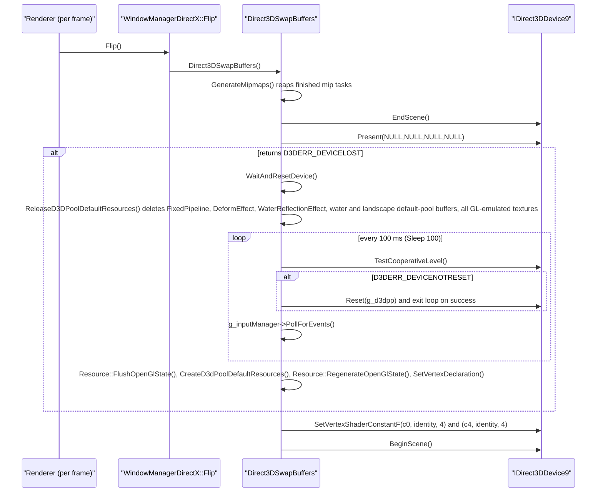
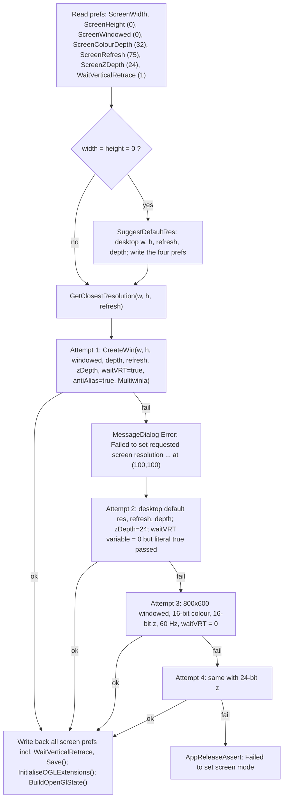
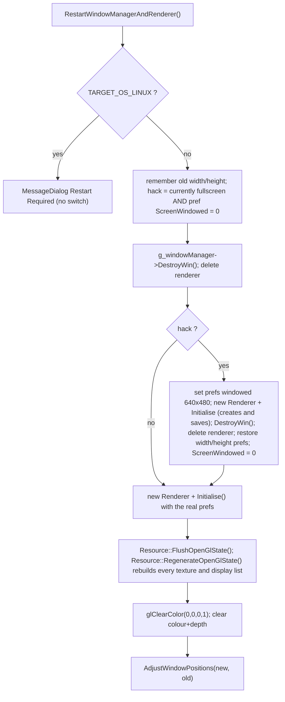

# 31 — Platform, build and tools

> Part B · Baseline build: Release|Win32 (OpenGL) + TARGET_PC_FULLGAME ([B:FULL]); see _work/build_matrix.md.
> Evidence: [C] confirmed · [I] inferred · [U] unknown. Citations are `path:Symbol` relative to the multiwinia/ source root.
> Sources merged: P14_platform_lib (build system, platform map, timing, file locations, archives, data pipeline, packaging, installers, MapCRC, ShapeExporter, localisation, audit scripts, crash handling, system info, root/targets/tools/docs inventories), P13_gfx_backend_math (window managers, D3D device creation/reset, display modes, vsync/MSAA/gamma, AVI capture/playback), P11_terrain_world (map CRC definition and the 87/87 reproduction script `_work/scripts/P11_mapcrc.py`, third D3D compile breakage), P12_render_core (fourth D3D compile breakage in `code/deform.cpp`), `_work/build_matrix.md` (superseded here for build facts), `_work/routed/_meta_*.md`, `_work/phase2_log.md`. New S31 scripts: `_work/scripts/S_31_archive_contents.py` (emulates the data build and lists every `.dat` archive's content), `_work/scripts/S_31_inventory.py` (one-row-per-file inventories), `_work/scripts/S_31_source_map.py` (source map, manifest-checked).

## Contents

- [1 Summary for the new team](#1-summary-for-the-new-team)
- [2 Platform abstraction](#2-platform-abstraction)
- [3 Window management](#3-window-management)
- [4 Timing](#4-timing)
- [5 File paths and command line](#5-file-paths-and-command-line)
- [6 Crash handling and system information](#6-crash-handling-and-system-information)
- [7 Build configurations and flags](#7-build-configurations-and-flags)
- [8 Data build pipeline and the .dat archives](#8-data-build-pipeline-and-the-dat-archives)
- [9 Packaging scripts and installers](#9-packaging-scripts-and-installers)
- [10 Map CRC tool and runtime map identity](#10-map-crc-tool-and-runtime-map-identity)
- [11 ShapeExporter and 3DGeometry](#11-shapeexporter-and-3dgeometry)
- [12 Localisation build](#12-localisation-build)
- [13 Analysis and audit scripts](#13-analysis-and-audit-scripts)
- [14 File inventories (root, targets, tools, docs)](#14-file-inventories-root-targets-tools-docs)
- [15 Carry-forward notes](#15-carry-forward-notes)
- [Open questions and unknowns](#open-questions-and-unknowns)
- [Docs-vs-code discrepancies](#docs-vs-code-discrepancies)
- [IP items](#ip-items)
- [Source map](#source-map)
- [Appendix — dead/legacy code](#appendix--deadlegacy-code)

---

## 1 Summary for the new team

The shipped Multiwinia PC game is one Win32 executable built by Visual Studio 2008 from `targets/vs2005/Darwinia.vcproj` in configuration `Release|Win32` (OpenGL renderer, static CRT, `/fp:precise`), output `darwinia_gl.exe`, renamed `multiwinia.exe` by every packaging script, plus RAR archives: the code mounts eight archive names (`init.dat`, `language.dat`, `main.dat`, `patch.dat`, `menusounds.dat`, `branding.dat`, `sounds.dat`, `sounds2.dat`), six of which are produced by `tools/build_multiwinia_data.bat`; a ninth, `ambx.dat`, is shipped by three installers but is never opened by the code. The ten most design-relevant facts recovered here:

| # | Fact | Tag | Section |
|---|---|---|---|
| 1 | Product variants are selected by editing one `#define` in `code/lib/universal_include.h` (`TARGET_PC_FULLGAME` is the only uncommented one); VS configurations only select the renderer (OpenGL vs Direct3D 9) and debug/release | [C] | §7.6 |
| 2 | `ReleaseDirect3D` very probably does **not compile** at this commit: four independent breakages (abstract `WindowManagerDirectX`, `D3DRS_LINEWIDTH`, Xbox-360 `Resolve()` in `code/deform.cpp`, `bmp.GetPixel` on a pointer in `code/water.cpp`) | [C] for three, [I] for one | §7.9 |
| 3 | GL and D3D builds differ in floating-point code generation (`/fp:precise` vs `/fp:fast`; D3D device created without `D3DCREATE_FPU_PRESERVE`), yet the lobby compatibility check is only the version string `"dev"` — mixing them in one lockstep game is a desync risk | [C] flags, [I] consequence | §7.10 |
| 4 | Loose `data/<name>` always overrides archive entries; later archives override earlier ones; archives are unencrypted solid RARs decompressed wholly into memory | [C] | §8.7–§8.8 |
| 5 | `default_preferences.txt` is looked up **before** `main.dat` is mounted, so in a packaged install (no loose `data/`) first-run defaults come only from code | [C] order, [I] packaged effect | §8.9 |
| 6 | Map identity is a CRC-32 (init 0, no final XOR) of the level file bytes plus one `0xFF`; `tools/MapCRC` regenerates `code/mapcrc.h` as a pre-build step; all 87 `MAPID_*` reproduce exactly | [C] | §10 |
| 7 | Crash handling = SEH filter around the whole main thread → `ERRORLOG.TXT` + minidump → user-confirmed TCP upload by `MultiwiniaSupport.exe` (built from `contrib/XCrashReport`), plus a release-assert "black box" | [C] | §6 |
| 8 | User data lives in `%LOCALAPPDATA%\Introversion\Multiwinia\` (`--NoProfile` → working directory); the authentication key is **read** from `authkey.dev` but a typed key is **written** to `authkey` | [C] | §5 |
| 9 | Timing is a process-relative `QueryPerformanceCounter` clock with an injectable fake-time mode; the main loop has no frame cap, so pacing is the driver's swap interval (the GL path never sets vsync) | [C] | §3.11, §4 |
| 10 | A maintained Multiwinia 1.3.1 Mac target exists (`targets/macosx/Multiwinia`, SDL + Cocoa, Ambrosia port) but cannot be built from this tree (26 referenced files absent); the Linux makefile is Darwinia-era | [C] | §2.4, §7.8 |

Resolved in this document (drafts or earlier notes disagreed, code re-read): number of `.cpp` references in the Mac project; whether `build_multiwinia.bat` builds all languages (it builds English only); which installers ship `ambx.dat`; order of operations in the fullscreen resolution switch; the `authkey`/`authkey.dev` split (which code path writes which file); whether the support tool uploads without consent (it does not) and its wire protocol; whether `ERRORLOG.TXT` is appended (it is overwritten); whether sound archives are parsed concurrently with `main.dat` (they are not); whether `targets/macosx/Multiwinia/data` is a symlink (it is a Subversion link stub); the role of `tools/SlashSort.exe` (now [I]).

---

## 2 Platform abstraction

### 2.1 Mechanism

There is no runtime platform layer. Platform selection is entirely compile-time, by two means [C]:

1. **Which files a project compiles.** `targets/vs2005/Darwinia.vcproj` lists the Win32 implementations; `targets/macosx/Multiwinia/Multiwinia.xcodeproj/project.pbxproj` lists the SDL/Cocoa ones; `targets/linux/Makefile` lists a Darwinia-era SDL set.
2. **Whole-file and in-file `#ifdef`s** on `TARGET_MSVC` (defined by `targets/vs2005/Common.vsprops`), `TARGET_OS_MACOSX` (Xcode), `TARGET_OS_LINUX` (makefile), `TARGET_MINGW` (no project defines it), `USE_DIRECT3D` (`targets/vs2005/Direct3D.vsprops`), `HAVE_DSOUND` (set by the `TARGET_MSVC`/`TARGET_MINGW` blocks of `code/lib/universal_include.h`), `HAVE_XAUDIO` (never defined on PC) and `_XBOX` (never defined on PC).

Platform identity strings [C] `code/lib/universal_include.h`: `APP_SYSTEM` = `"PC"` (`TARGET_MSVC`), `"Mac (PPC)"` / `"Mac (Intel)"` (`TARGET_OS_MACOSX` with/without `__ppc__`), `"Linux"`; `DARWINIA_PLATFORM` = `"win32"` / `"macosx"` / `"linux"`; `DARWINIA_VERSION_STRING` = `DARWINIA_PLATFORM "-" DARWINIA_GAMETYPE "-" DARWINIA_VERSION` → baseline `"win32-multiwinia-dev"`.

### 2.2 Platform map — every platform-specific file

"Live in baseline" = compiled and reachable in `Release|Win32` + `TARGET_PC_FULLGAME`. "Mac target" = referenced by the Multiwinia Xcode project [C scripted reference check]. Files whose body is wrapped in `#ifdef USE_DIRECT3D` are listed in the vcproj but compile to nothing in the baseline.

| File(s) | Platform / API | In vcproj | Live in baseline? | Mac target | Notes / evidence |
|---|---|---|---|---|---|
| `code/lib/window_manager_win32.cpp`, `code/lib/window_manager_win32.h` | Win32 + WGL/OpenGL | yes | **yes** [B:FULL] | no | body `#if !defined USE_DIRECT3D`; defines `WinMain` |
| `code/lib/window_manager_directx.cpp`, `code/lib/window_manager_directx.h` | Win32 + Direct3D 9 | yes | no [B:D3D] | no | body `#ifdef USE_DIRECT3D`; defines `WinMain`; see §7.9 breakage 1 |
| `code/lib/window_manager_sdl.cpp`, `code/lib/window_manager_sdl.h` | SDL 1.2 + OpenGL | no | no [B:DEAD] | yes | MSAA via `SDL_GL_MULTISAMPLEBUFFERS`, vsync via `SDL_GL_SWAP_CONTROL` |
| `code/lib/window_manager.cpp`, `code/lib/window_manager.h` | portable base | yes | yes | yes | abstract `WindowManager`, `g_windowManager` |
| `code/lib/ogl_extensions.cpp`, `code/lib/ogl_extensions.h` | WGL extension loading | yes | **yes** | no | body `#if !defined USE_DIRECT3D` ([24](24_rendering.md)) |
| `code/lib/ogl_extensions_directx.cpp` | D3D stand-ins | yes | no [B:D3D] | no | `#ifdef USE_DIRECT3D` |
| `code/lib/ogl_extensions_sdl.cpp` | SDL GL extensions | no | no [B:DEAD] | yes | `SDL_GL_GetProcAddress` |
| `code/lib/opengl_directx.cpp`, `.h`, `code/lib/opengl_directx_inline.h`, `code/lib/opengl_directx_internals.h`, `code/lib/opengl_directx_dlist.cpp`, `.h`, `code/lib/opengl_directx_dlist_dev.cpp`, `.h`, `code/lib/opengl_directx_matrix_stack.cpp`, `.h`, `code/lib/opengl_directx_stubs.cpp` | D3D9 implementing the GL API | yes | no [B:D3D] | no | all `#ifdef USE_DIRECT3D` ([24](24_rendering.md)) |
| `code/lib/safegl.cpp`, `code/lib/safegl.h` | GL display-list mutex wrapper | yes | compiled, inactive (header only included for D3D/Mac) | yes | [24](24_rendering.md) |
| `code/lib/hi_res_time.cpp` | Win32 QPC (+ dead RDTSC path) | yes | **yes** | no | §4 |
| `code/lib/hi_res_time_sdl.cpp` | POSIX `gettimeofday` | no | no [B:DEAD] | yes | §4.3 |
| `code/lib/hi_res_time_gcc.cpp` | Win32 QPC for GCC/MinGW | no | no [B:DEAD] | no | §4.3 |
| `code/lib/exception_handler.cpp`, `code/lib/exception_handler.h` | Win32 SEH, `dbghelp` minidump | yes | **yes** | no | §6.2 |
| `code/lib/GetWinVer.cpp`, `code/lib/GetWinVer.h`, `code/lib/MiniVersion.cpp`, `code/lib/MiniVersion.h` | Win32 version APIs | yes | **yes** (crash report only) | no | §6.7 |
| `code/lib/system_info.cpp`, `code/lib/system_info.h` | Win32 locale, `waveOut`, DirectX registry | yes | **yes** | no | §6.7 |
| `code/lib/system_info_macosx.cpp`, `code/lib/macosx_hardware_detect.cpp`, `code/lib/macosx_hardware_detect.h` | Mac | no | no [B:DEAD] | yes | |
| `code/lib/input/inputdriver_win32.cpp`, `.h`, `code/lib/input/win32_eventhandler.cpp`, `.h`, `code/lib/input/win32_eventproc.h` | Win32 messages, keyboard/mouse | yes | **yes** | no | [06](06_player_control_and_input.md); §3.10 |
| `code/lib/input/inputdriver_xinput.cpp`, `code/lib/input/inputdriver_xinput.h` | XInput 1.3 (delay-loaded `xinput1_3.dll`) | yes | **yes** | no | [06](06_player_control_and_input.md) |
| `code/lib/input/xbox_eventhandler.cpp`, `code/lib/input/xbox_eventhandler.h` | Xbox 360 | yes, `ExcludedFromBuild` ×4 | no [B:DEAD] | no | §7.4 |
| `code/lib/input/inputdriver_sdl_key.cpp`, `.h`, `code/lib/input/inputdriver_sdl_mouse.cpp`, `.h`, `code/lib/input/sdl_eventhandler.cpp`, `.h`, `code/lib/input/sdl_eventproc.h` | SDL input | no | no [B:DEAD] | yes | |
| `code/lib/input_sdl.cpp` | Darwinia-era SDL input | no | no [B:DEAD] | no | |
| `code/lib/input/inputfilterspec.cpp` | portable | no | no [B:DEAD] | yes | |
| `code/sound/sound_library_2d_win32.cpp`, `code/sound/sound_library_2d_win32.h` | Win32 `waveOut` 2D mixer output | yes | **yes** | no | [27](27_audio_engine.md) |
| `code/sound/sound_library_3d_dsound.cpp`, `.h` | DirectSound 3D (`HAVE_DSOUND`) | yes | **yes** | no | requires DirectX ≥ 9 (§6.7) |
| `code/sound/sound_library_3d_xaudio.cpp`, `.h` | XAudio (`HAVE_XAUDIO`) | yes | no [B:DEAD] | no | |
| `code/sound/sound_library_2d_sdl.cpp`, `code/sound/sound_library_2d_sdl.h` | SDL audio | no | no [B:DEAD] | yes | needs absent `code/sound/macosx/ASWSDLRingBuffer.*` |
| `code/sound/sound_library_3d_software.cpp`, `.h` | portable software mixer | yes | yes | yes | `INVOKE_CALLBACK_FROM_SOUND_THREAD` variant is Mac-only |
| `code/unicode/sound_library_2d.cpp`, `.h`, `code/unicode/sound_library_2d_sdl.cpp`, `.h`, `code/unicode/sound_library_3d.cpp`, `.h` | stale copies | no | no [B:DEAD] | no | |
| `code/gesture_demo_win32.cpp` | Win32 thread | yes | no (needs `GESTURE_EDITOR` + `USE_SEPULVEDA_HELP_TUTORIAL`) [B:DEAD] | no | |
| `code/gesture_demo_sdl.cpp` | SDL | no | no [B:DEAD] | yes | |
| `code/interface/buynow_window.cpp`, `.h`, `code/interface/updateavailable_window.cpp`, `.h` | Mac upsell / update windows | no | no [B:DEAD] | yes | |
| `code/lib/mouse_cursor.cpp`, `code/lib/mouse_cursor.h`, `code/lib/tri_tri.cpp`, `code/lib/debug_logging.cpp`, `code/lib/debug_logging.h` | portable helpers used only by the Mac project | no | no [B:DEAD] | yes | |
| `contrib/systemiv/lib/netlib/net_lib_win32.h`, `net_mutex_win32.cpp`, `net_thread_win32.cpp` | Winsock, `CRITICAL_SECTION`, `CreateThread` | yes | **yes** | no | [20](20_architecture.md), [22](22_determinism_and_networking.md) |
| `contrib/systemiv/lib/netlib/net_lib_linux.h`, `net_mutex_linux.cpp`, `net_thread_linux.cpp` | pthreads/BSD sockets | no | no [B:DEAD] | yes | |
| `contrib/systemiv/lib/filesys/filesys_utils.cpp` | `FindCaseInsensitive` (identity on Win32; per-component directory scan on Linux) | yes | yes | yes | §2.3 |
| `contrib/systemiv/lib/tosser/hash_map_darwin.h` | GNU `hash_map` shim | no | no [B:DEAD] | yes | |
| `contrib/unrar/win32acl.cpp`, `contrib/unrar/win32stm.cpp` | NTFS ACL / stream extraction | not listed; `#include`d by `contrib/unrar/extinfo.cpp` under `_WIN_32` | compiled into `unrar.lib`, unused by the game [I] | no | |
| `contrib/systemiv/lib/gucci/window_manager_win32.*`, `window_manager_sdl.*`, `input_win32.*`, `input_sdl.*`, `contrib/systemiv/lib/sound/sound_library_2d_win32.*`, `sound_library_2d_sdl.*` | SystemIV equivalents | no | no [B:DEAD] (SystemIV `gucci`/`sound` not compiled) | no | build_matrix §6 |
| `targets/macosx/Multiwinia/SDLMain.mm`, `SDLMain.h`, `MultiwiniaCocoaBridge.cpp`, `MultiwiniaCocoaBridge.h`, `SDLApp_Prefix.pch` | Cocoa shell | – | no | yes | §2.4 |
| `contrib/XCrashReport/*` | MFC crash-report tool | separate solution | shipped as `MultiwiniaSupport.exe` | no | §6.4 |

### 2.3 Cross-platform service matrix

| Service | Win32 baseline implementation | Other platforms (not in baseline) | Notes |
|---|---|---|---|
| High-resolution timer | `code/lib/hi_res_time.cpp` (QPC, process-relative) [B:FULL] | `code/lib/hi_res_time_sdl.cpp` (`gettimeofday`), `code/lib/hi_res_time_gcc.cpp` (QPC, absolute) [B:DEAD] | §4 |
| Window / GL context | `code/lib/window_manager_win32.cpp`; `code/lib/window_manager_directx.cpp` [B:D3D] | `code/lib/window_manager_sdl.cpp` | §3 |
| Input event source | `W32EventHandler` + input drivers | `SDLEventHandler` | chosen in `code/main.cpp:Initialise` by `TARGET_MSVC` [C] |
| Threads / mutex / event | `contrib/systemiv/lib/netlib/net_thread_win32.cpp` (`CreateThread`), `net_mutex_win32.cpp` (`CRITICAL_SECTION`, auto-reset `CreateEvent`) | `*_linux.cpp` (pthreads) | [20](20_architecture.md) |
| Debug output | `OutputDebugString` or redirect file `debug.txt` in the profile directory | `fputs(stderr)`; Mac log dir `~/Library/Logs/<app>/`, Linux `/tmp/` [C] `contrib/systemiv/lib/debug_utils.cpp:AppDebugLogPath` | [32](32_debug_test_and_performance.md) |
| Crash handling | SEH `__try/__except(RecordExceptionInfo…)` + minidump + `MultiwiniaSupport.exe` | Mac: black box without stack walk (comment suggests Smart Crash Reports) | §6 |
| User data directory | `%LOCALAPPDATA%\Introversion\Multiwinia\` | Linux `~/.multiwinia/<DARWINIA_GAMETYPE>/`; Mac `~/Library/Application Support/Multiwinia/<DARWINIA_GAMETYPE>/`, prefs `~/Library/Preferences/uk.co.introversion.Multiwinia.txt` | §5 |
| Case-insensitive file lookup | identity (`FindCaseInsensitive` returns its input) | Linux: walks each path component with `ListDirectory`, taking the first case-insensitive match | [C] `contrib/systemiv/lib/filesys/filesys_utils.cpp:FindCaseInsensitive` |
| System info | `code/lib/system_info.cpp` | `code/lib/system_info_macosx.cpp` | §6.7 |
| x87 precision | `_control87(_PC_53, _MCW_PC)` (53-bit mantissa) | Mac i386: `fnstenv`/`fldenv` clearing bit 8 | [C] `code/main.cpp:StandardiseCPUPrecision`; called in `Initialise` and at the start of every `WorkQueue` thread ([22](22_determinism_and_networking.md)) |
| `wchar_t` | UTF-16 (2 bytes) | UTF-32 (4 bytes); conversion via CoreFoundation/iconv | [C] `contrib/systemiv/lib/network_stream.cpp:WriteUnicodeString`, `code/unicode/unicode_text_file_writer.cpp` |
| Open URL | `ShellExecute(NULL,"open",url,…,SW_SHOWNORMAL)` | Mac/Linux variants in `window_manager_sdl.cpp`; Linux helper `tools/open-www.sh` | [C] `code/lib/window_manager_win32.cpp:OpenWebsite` |
| Clipboard (auth-key paste) | Win32 `OpenClipboard`/`GetClipboardData(CF_TEXT)`, at most `AUTHENTICATION_KEYLEN-1` chars | Mac `PasteboardCopyItemFlavorData("public.utf16-plain-text")` | [C] `code/UI/GameMenuWindow.cpp:GameMenuWindow::PasteFromClipboard` |

### 2.4 The Mac Multiwinia target [B:DEAD on PC]

[C] `targets/macosx/Multiwinia/Multiwinia.xcodeproj/project.pbxproj`, `targets/macosx/Multiwinia/Info.plist`, `targets/macosx/Multiwinia/SDLMain.mm`, `targets/macosx/Multiwinia/MultiwiniaCocoaBridge.cpp`.

| Aspect | Value |
|---|---|
| Product | Multiwinia 1.3.1 (`CFBundleVersion`), bundle id `uk.co.introversion.multiwinia`, principal class `SDLApplication`, main nib `SDLMain`; About/credits rtf files name the Ambrosia Software port |
| Xcode targets | `Multiwinia` (application), `Generate Map CRCs` (builds `tools/MapCRC/main.cpp` with `tools/MapCRC/lib/universal_include.h`; a shell build phase runs `GenerateMapCRCs ../../../data/levels/ ../../../code/mapcrc.h`), `OggVorbis` (static library, `__MACOSX__`) |
| Architectures | `ppc i386` (`ARCHS_STANDARD_32_BIT_PRE_XCODE_3_1`); Debug tuned G5, Release G3 |
| Defines | Debug: `TARGET_OS_MACOSX`, `GUI`, `SILENT`, `PROFILER_ENABLED` (+ project-level `_DEBUG=1`); Release: `NO_DEBUG_OUTPUT`, `TARGET_OS_MACOSX`, `GUI`, `SILENT`, `PROFILER_ENABLED` |
| Compiler flags | `-fno-builtin`; Release adds `-mfpmath=387` (i386) and `-mno-fused-madd` (ppc) — chosen to keep floating point bit-compatible with the x87 Windows build [I: purpose; C: flags] |
| Frameworks | SDL (`contrib/macosx/SDL.framework`), Ambrosia `ASWAboutBox`, `ASWAppKit`, `ASWDebug`, `ASWFoundation`, `AmbrosiaTools`, `Sparkle` (all six absent from the tree), AppKit, Carbon, Cocoa, CoreFoundation, Foundation, IOKit, OpenGL |
| Build phases | strip `PrivateHeaders` from embedded frameworks (Ruby); create a `data` symlink in the bundle Resources (`ln -sf "$SRCROOT/../../../data" .`); run `$SVNROOT/tools/macosx/add-appcast-url.rb` and `add-svn-revision.rb` (both absent) |
| Cocoa shell | `SDLMain.mm`: change directory to `Contents/Resources`, set `SDL_ENABLEAPPEVENTS=1` and `SDL_HAS3BUTTONMOUSE=1`, Sparkle update checks, sleep/wake notifications — on wake `Server::SkipToTime(GetHighResTime())` only when clients are connected (`MultiwiniaCocoaBridge.cpp:WindowManagerSDLAwakeFromSleep`), pause/fullscreen menu items |
| Buildability from this tree | 936 file references resolve (case-insensitively, as on HFS+), **26 do not**: the six Ambrosia frameworks, `code/sound/macosx/{ASWSDLRingBuffer,CARingBuffer}.{cpp,h}`, `code/sound/macosx/CABitOperations.h`, `code/sound/pokey.{cpp,h}`, `code/interface/pokey_window.{cpp,h}`, `code/lib/command_buffer.{cpp,h}`, `code/lib/debug_xbox.{cpp,h}`, `contrib/systemIV/lib/Crypticon/CCrypticon.{cpp,h}`, five absent `code/UI/*.h` XBLA/PDLC headers [C scripted check] ⇒ not buildable as checked in [I] |

Resolved: P14's note "1158 `.cpp` references" — the project has 384 distinct `.cpp` `PBXFileReference` entries; the higher number counted every occurrence (file reference + build-file + group lines) [C] grep of the project file.

### 2.5 Linux and Darwinia Mac targets [B:DEAD]

* `targets/linux/Makefile` — Darwinia-era (`CXX=apg++` autopackage wrapper, `CXXFLAGS=-g -Os`, `-DTARGET_OS_LINUX -DHAVE_SOCKET -DHAVE_SELECT -DHAVE_GETHOSTBYNAME -DHAVE_INET_NTOA`, links SDL, GL, GLU, vorbisfile, vorbis, ogg; `DEMO_CPPFLAGS=-DTARGET_DEMOGAME=1`, `FULL_CPPFLAGS=-DTARGET_FULLGAME=1`). It lists 247 `code/`+`contrib/` sources of which 23 are absent (17 under `code/`, e.g. `code/lib/text_stream_readers.cpp`, `code/network/networkupdate.cpp`; 6 under `contrib/netclass/` and `contrib/binreloc/`) [C scripted]. Note that `TARGET_FULLGAME` is not one of the product macros summed by the `#error` check in `code/lib/universal_include.h`, so it would silently build `TARGET_PC_FULLGAME` [C]. Linux-only runtime paths in code: profile `~/.multiwinia/<gametype>/`, debug log `/tmp/`, `RestartWindowManagerAndRenderer` shows "Restart Required" instead of switching mode [C] `code/interface/prefs_screen_window.cpp:RestartWindowManagerAndRenderer`.
* `targets/linux/Makefile.keygen-1` — builds a Darwinia `keygen-1` from `code/keygen.cpp` + absent `tools/PasswordGenerator/main.cpp` and copies it to an Introversion server (Darwinia beta registration) [C].
* `targets/macosx/Darwinia/*` — Darwinia Xcode 2 project and menu callbacks (debug menu, FPS, profiler, fullscreen, quit) [C] `targets/macosx/Darwinia/MainMenuCallbacks.cpp`.
* `docs/sdl_problems.txt` records SDL limitations of the time (no mouse wheel, low-resolution timer) [C].

---

## 3 Window management

### 3.1 Class hierarchy [C] `code/lib/window_manager.h`, `code/lib/window_manager_win32.h`, `code/lib/window_manager_directx.h`

One global `WindowManager *g_windowManager` (constructed in `WinMain`; the Win32 constructor asserts it is still NULL) [C] `code/lib/window_manager.cpp`, `code/lib/window_manager_win32.cpp:WindowManagerWin32::WindowManagerWin32`. `PlatformWindow` is `typedef void*`; `Window()` returns the `HWND` cast to `PlatformWindow*` [C].

**Process entry** [C] `code/lib/window_manager_win32.cpp:WinMain`: store `g_hInstance`; `g_windowManager = new WindowManagerWin32()`; `AppMain(cmdLine)` (`code/main.cpp`); return `WM_QUIT`. The process never changes its working directory, so it relies on being started with the install folder as current directory (installer shortcuts set `WorkingDir: "{app}"`, §9.2) [C].

Base-class behaviour [C] `code/lib/window_manager.cpp`:

| Member | Behaviour |
|---|---|
| ctor | `m_mousePointerVisible=true`, `m_mouseOffsetX=INT_MAX` (sentinel = "recompute offset"), `m_mouseCaptured=false`; calls `AbstractListAllDisplayModes()` → `ListAllDisplayModes()`, which during base construction dispatches to the **empty base version**; derived constructors therefore call their own `ListAllDisplayModes()` again |
| `SuggestDefaultRes(&w,&h,&refresh,&depth)` | returns the desktop width/height/refresh/bit depth captured by `SaveDesktop` |
| `GetResolutionId(w,h)` | index in `m_resolutions` with exact w,h, else −1 |
| `GetResolution(id)` | pointer, or NULL for an invalid index |
| `GetClosestResolution(&w,&h,&refresh)` | exact (w,h) match → only snap refresh; else the resolution minimising `|Δw|+|Δh|` (first wins ties), then snap refresh. Refresh snapping: exact match, else the entry minimising `|Δrefresh|`; if the resolution lists no rates the requested value is kept |
| `EnsureMouseCaptured/Uncaptured` | capture/uncapture only if the state differs (called from `Camera::Advance`, [06](06_player_control_and_input.md)) |
| `WindowMoved` | resets `m_mouseOffsetX=INT_MAX` |
| `m_invertY` | never initialised or read [C grep] |

### 3.2 Display modes and the screen-options dialog

**Enumeration** [C] `WindowManagerWin32::ListAllDisplayModes` (the DirectX variant is identical): loop `EnumDisplaySettings(NULL, i, &devMode)` for i = 0,1,… until it fails; keep modes with `dmBitsPerPel ≥ 15 && dmPelsWidth ≥ 640 && dmPelsHeight ≥ 480`; de-duplicate by (width, height) regardless of bit depth; per resolution collect the unique `dmDisplayFrequency` values. Order = driver enumeration order (not sorted). `devMode.dmSize` is not initialised before the call (works in practice; Win32 formally requires it). Colour depth is not stored per resolution.

**Desktop capture** [C] `WindowManagerWin32::SaveDesktop`: `EnumDisplaySettings(ENUM_CURRENT_SETTINGS)` → `m_desktopScreenW/H`, `m_desktopColourDepth`, `m_desktopRefresh`. `RestoreDesktop` calls `ChangeDisplaySettings(desktop, CDS_FULLSCREEN)` only when the current mode differs from the saved one.

**Screen options dialog** [C] `code/interface/prefs_screen_window.cpp` ([09](09_meta_systems.md), [28](28_ui_framework.md)):

| Control | Values | Pref written on Apply | Note |
|---|---|---|---|
| Resolution drop-down (`dialog_resolution`) | every `m_resolutions` entry | `ScreenWidth`, `ScreenHeight` | selecting a resolution repopulates the refresh list |
| Windowed check box (`dialog_windowed`) | 0/1 | `ScreenWindowed` | |
| Refresh rate (`dialog_refreshrate`) | that resolution's rates | `ScreenRefresh` | `HAVE_REFRESH_RATES` (defined for `TARGET_MSVC`); fullscreen-only control |
| Colour depth (`dialog_colourdepth`) | 16 / 24 / 32 | `ScreenColourDepth` | fullscreen-only control |
| Z-buffer depth (`dialog_zbufferdepth`) | 16 / 24 | `ScreenZDepth` | |
| Apply (`dialog_apply`) | – | all of the above, then `RestartWindowManagerAndRenderer()` (§3.9) | |

Dialog-side fallbacks when a pref is missing differ from the renderer's (`ScreenColourDepth` 16 vs 32, `ScreenRefresh` 60 vs 75); they never apply after the first run because `Renderer::Initialise` saves every screen pref [C].

### 3.3 `WindowManagerWin32` — OpenGL window [B:FULL] [C] `code/lib/window_manager_win32.cpp`

**`CreateWin(w, h, windowed, colourDepth, refreshRate, zDepth, waitVRT, antiAlias, title)`**:

1. Store `m_screenW/H`, `m_windowed`. Register `WNDCLASSW{style=CS_OWNDC, WndProc, hIcon=LoadIcon(NULL, IDI_APPLICATION), hCursor=LoadCursor(NULL, IDC_ARROW), background=BLACK_BRUSH, class name = title}` (title = `APP_NAME_W` = `L"Multiwinia"`).
2. **Windowed**: `RestoreDesktop()`; style `WS_VISIBLE|WS_POPUPWINDOW|WS_CAPTION|WS_MINIMIZEBOX|WS_MAXIMIZEBOX`; `AdjustWindowRect` → `m_borderWidth = (Δwidth)/2`, `m_titleHeight = Δheight − 2·border`; **returns false if the client size exceeds the desktop**; window centred on the desktop.
3. **Fullscreen**: style `WS_VISIBLE|WS_POPUP`; `ChangeDisplaySettings({bpp=colourDepth, w, h, freq=refreshRate}, CDS_FULLSCREEN)`; returns false unless `DISP_CHANGE_SUCCESSFUL`; position (0,0); `m_borderWidth=1`, `m_titleHeight=0`.
4. `CreateWindowW(class, title, style, x, y, w(+2·border), h(+2·border+title))`; false on failure; reset mouse offset.
5. `EnableOpenGL(colourDepth, zDepth)` (return value ignored).

`waitVRT` and `antiAlias` are **ignored** (`m_waitVRT` is never assigned in this class) [C].

**`EnableOpenGL`**: `GetDC`; `PIXELFORMATDESCRIPTOR{PFD_DRAW_TO_WINDOW|PFD_SUPPORT_OPENGL|PFD_DOUBLEBUFFER, PFD_TYPE_RGBA, cColorBits=colourDepth, cDepthBits=zDepth, PFD_MAIN_PLANE}` → `ChoosePixelFormat` + `SetPixelFormat` (results unchecked; no alpha, stencil or multisample bits requested); `wglCreateContext` twice — primary `m_hRC` and secondary `m_hRC2` ("for loading thread") joined with `wglShareLists` (failure only logged via `FormatMessage`); `wglMakeCurrent(m_hDC, m_hRC)`; `glClear(GL_COLOR_BUFFER_BIT)`. `m_hRC2` is **never made current and never deleted**; `UseSecondaryContext/ReleaseSecondaryContext/DestroySecondaryContext` are declared but not defined [C]. All GL work from worker threads is instead marshalled to the main thread as `Job`s ([20](20_architecture.md)).

**`DisableOpenGL`**: `wglMakeCurrent(NULL,NULL)`, delete `m_hRC`, `ReleaseDC`. **`DestroyWin`**: `DisableOpenGL` + `DestroyWindow`. **`Flip`**: `SwapBuffers(m_hDC)`. **`NastyPollForMessages`**: `PeekMessage/TranslateMessage/DispatchMessageW` loop (called by `W32InputDriver`, [06](06_player_control_and_input.md)). `WndProc` forwards to `W32EventHandler::WndProc`, falling back to `DefWindowProcW` when the handler returns −1 or is absent.

**Mouse**: `NastySetMousePos(x,y)` lazily computes the client-origin offset (`GetWindowRect` + border + title when windowed, 0 when fullscreen), `SetCursorPos(x+off, y+off)` and calls `W32InputDriver::SetMousePosNoVelocity(x,y)`; `NastyMoveMouse(dx,dy)` = relative `SetCursorPos` + `SetMousePosNoVelocity(dx,dy)` (passes the *delta* as a position) [C]; `CaptureMouse`=`SetCapture`; `UncaptureMouse`=`ReleaseCapture`; `Hide/UnhideMousePointer`=`ShowCursor(false/true)` (the game draws its own cursor, [24](24_rendering.md)). `OpenWebsite(url)` = `ShellExecute(NULL,"open",url,NULL,NULL,SW_SHOWNORMAL)`.

### 3.4 `WindowManagerDirectX` — Direct3D window [B:D3D] [C] `code/lib/window_manager_directx.cpp`

Same structure as Win32 with these differences: ANSI `WNDCLASS/RegisterClass/CreateWindow/DefWindowProc/DispatchMessage`; icon = resource `MAKEINTRESOURCE(101)` (`IDI_ICON1` in `targets/vs2005/resource.h`), `hCursor = NULL`; `m_waitVRT = waitVRT` is stored; **`RestoreDesktop` body is commented out** and the fullscreen branch does **not** call `ChangeDisplaySettings` (D3D performs the mode switch); `EnableOpenGL` = `Direct3DInit(m_hWnd, m_windowed, m_screenW, m_screenH, colourDepth, zDepth, m_waitVRT)` + `glClear(GL_COLOR_BUFFER_BIT)`; on failure the window is destroyed and `CreateWin` returns false; `DisableOpenGL` = `Direct3DShutdown()`; `Flip` = `Direct3DSwapBuffers()`; `EnsureMouseCaptured/Uncaptured` overridden as no-ops; `Hide/UnhideMousePointer` only toggle the flag (no `ShowCursor`); destructor also `m_resolutions.EmptyAndDelete()`. Its `WinMain` additionally handles `TARGET_OS_VISTA` (`-mediacenter` → `g_mediaCenter=true` + `Sleep(7500)`; otherwise a save-file path argument → `g_saveFile`, `SetCurrentDirectory(exe dir)`) — `TARGET_OS_VISTA` is never defined [B:DEAD]. `CreateWin` takes `const char *_title` while the base declares `const wchar_t *_title` — see §7.9 breakage 1.

### 3.5 Direct3D device creation [B:D3D] [C] `code/lib/opengl_directx.cpp:Direct3DInit`

| Step | Value |
|---|---|
| D3D object | `Direct3DCreate9(D3D_SDK_VERSION)` once; failure → `AppReleaseAssert("Direct3D 9 not available.")` |
| Vertex processing | `GetDeviceCaps(DEFAULT, HAL)`: `D3DDEVCAPS_HWTRANSFORMANDLIGHT` ⇒ `D3DCREATE_HARDWARE_VERTEXPROCESSING`, else `SOFTWARE` (and vertex buffers get `D3DUSAGE_SOFTWAREPROCESSING`) |
| Adapter / type | `D3DADAPTER_DEFAULT`, `D3DDEVTYPE_HAL` (NVPerfHUD variant commented out) |
| Behaviour flags | only the vertex-processing flag — **no `D3DCREATE_FPU_PRESERVE`, no `D3DCREATE_MULTITHREADED`** (§7.10, [22](22_determinism_and_networking.md)) |
| Windowed | `Windowed=TRUE`, back-buffer size 0 (= client area), `BackBufferFormat=D3DFMT_UNKNOWN` (desktop format) |
| Fullscreen | `Windowed=FALSE`, `BackBufferWidth/Height = w/h`; colour 24/32 → `X8R8G8B8`; 15/16 → `X1R5G5B5`; other → `AppReleaseAssert("Unexpected colourDepth.")`. `FullScreen_RefreshRateInHz` not set (0 = adapter default) ⇒ **refresh-rate preference ignored** |
| Format fallback (fullscreen) | `CheckDeviceType` fails → 15/16-bit: try `R5G6B5` ("Fixes 16bit modes on Radeon X300"), then `A1R5G5B5` (display `X1R5G5B5`); 24/32-bit: `A8R8G8B8` (display `X8R8G8B8`). If the final check still fails: revert to `X8R8G8B8` (≥ 24) or `X1R5G5B5` and proceed |
| Depth buffer | if zDepth ≠ 0: `EnableAutoDepthStencil`; 16 → `D3DFMT_D16`; 24 → `D3DFMT_D24X8`; 32 → `D3DFMT_D32`; other → `AppReleaseAssert("Unexpected zDepth.")`. No stencil |
| Swap | `SwapEffect=DISCARD`, `BackBufferCount` default (1); a triple-buffering block is commented out |
| Vsync | `PresentationInterval = waitVRT ? D3DPRESENT_INTERVAL_ONE : D3DPRESENT_INTERVAL_IMMEDIATE` |
| Multisampling | `MultiSampleType` left 0 = `D3DMULTISAMPLE_NONE` |
| `CreateDevice` failure | returns false ("non fatal end, res change can help") → the retry chain of §3.7 continues |
| After creation | `g_pd3dDeviceActual = g_pd3dDevice`; `InitialiseData()` (matrix stacks, vertex declaration, 1024-entry vertex array, texture table cleared, cull/hints/attributes reset, mip-map work queue created once); `BeginScene()`; `SetVertexDeclaration`; `CreateD3DResources()` → `DeformEffect::Create`, `WaterReflectionEffect::Create`, `new FixedPipeline` ([24](24_rendering.md)) |

`Direct3DShutdown`: `ReleaseD3DResources()` (default-pool resources, water/landscape managed resources, `TaskManagerInterfaceGestures::ReleaseD3dResources`), release the device and the D3D object.

### 3.6 Frame present and lost-device handling [B:D3D] [C] `code/lib/opengl_directx.cpp:Direct3DSwapBuffers`, `WaitAndResetDevice`

Notes: the loop exits **only** after a successful `Reset`; if `TestCooperativeLevel` returned `D3D_OK` without a reset being needed the loop would spin forever [C structure; I likelihood]. Other `Present` failures are ignored. Managed-pool textures are released too and rebuilt through `Resource::RegenerateOpenGlState` ([25](25_textures_and_assets.md)), which allocates new texture ids because the emulated `glDeleteTextures` does not recycle ids ⇒ the id table grows on each reset [I]. A 5-second FPS counter (`FRAMES_PER_SECOND_COUNTER`) is computed but its output line is commented out.

### 3.7 Window-creation retry chain [C] `code/renderer.cpp:Renderer::Initialise`

Consequences [C]: attempts 1–2 pass the literal `true` for `waitVRT`, so the `WaitVerticalRetrace` preference only matters in attempts 3–4, and only in the D3D build. After **any** first-attempt failure the local `waitVRT` is 0 and is persisted as `WaitVerticalRetrace = 0`. Attempt 2 keeps the user's `windowed` choice. The error dialog is an in-game Eclipse window, so it is shown only once the renderer exists.

### 3.8 Preferences consumed by window/renderer creation [C] `code/renderer.cpp:Renderer::Initialise`, `code/lib/preference_names.h`

| Key | Default in code | Used by |
|---|---|---|
| `ScreenWidth` / `ScreenHeight` | 0 / 0 (→ desktop) | `CreateWin` |
| `ScreenWindowed` | 0 | `CreateWin` |
| `ScreenColourDepth` | 32 | GL: `ChangeDisplaySettings` bpp + PFD colour bits; D3D: back-buffer format |
| `ScreenRefresh` | 75 | GL fullscreen `dmDisplayFrequency`; ignored by D3D |
| `ScreenZDepth` | 24 | PFD depth bits / D3D depth format |
| `WaitVerticalRetrace` | 1 | D3D `PresentationInterval` (see §3.7 caveat); no effect in GL |
| `ScreenOverscan` | forced 0 | written only |
| `RenderLandscapeMode` | −1 (auto) | VBO vs display list (GL) ([23](23_terrain_and_landscape.md)) |
| `ManuallyScaleTextures` | 0 | power-of-two rescale ([25](25_textures_and_assets.md)) |

### 3.9 Fullscreen/windowed switching and resolution change [C] `code/interface/prefs_screen_window.cpp:RestartWindowManagerAndRenderer`, `SetWindowed`

Resolved: the P13 draft described the temporary 640×480 window as created *before* destroying the old one; the code destroys the old window and renderer first, then creates and destroys the temporary windowed renderer ("necessary for resolution change in fullscreen"), then the final one. The temporary `Renderer::Initialise` saves `ScreenWindowed=1` and 640×480 to `preferences.txt`; the final `Initialise` overwrites them [C]. `SetWindowed(isWindowed, isPermanent, &switching)` sets the pref, restarts only if the actual mode changes, and restores the old pref value afterwards when not permanent (else saves) [C].

### 3.10 Window messages, focus and Alt-Tab [C] `code/lib/input/win32_eventhandler.cpp:W32EventHandler::WndProc`

| Message | Handling |
|---|---|
| every message | `g_windowHasFocus = (GetForegroundWindow() == game HWND)`; on focus loss/regain a held Alt key is force-released |
| `WM_CREATE`, `WM_DESTROY`, `WM_SIZING`, `WM_WINDOWPOSCHANGING`, `WM_WINDOWPOSCHANGED`, `WM_COMMAND`, `WM_NCHITTEST` | return −1 (→ `DefWindowProcW`) |
| `WM_SETCURSOR` | in the client area `SetCursor(NULL)`; **falls through** into `WM_MOVE` (no `return`), so every client-area cursor message also resets the mouse offset; outside the client area −1 |
| `WM_MOVE` | `g_windowManager->WindowMoved()`, return −1 |
| `WM_CANCELMODE` | return 0 |
| `WM_CLOSE` | `g_app->m_requestQuit = true`, return 0 (the main loop then calls `Finalise()` and `exit(0)`, `code/main.cpp:HandleCommonConditions`) |
| `WM_INPUTLANGCHANGE` | logged only |
| others | offered to every registered `W32EventProcessor` (keyboard/mouse drivers, [06](06_player_control_and_input.md)) |

Alt-Tab: `BindAltTab` registers `MOD_ALT+VK_TAB` as a hot key (swallowing Alt-Tab); the only call site is commented out in `code/main.cpp:Initialise`, so Alt-Tab works normally in the baseline [C]. Focus loss sets `App::m_lostFocusPause`, which pauses the game **only in single-player** (`App::GamePaused`), and suppresses camera advance; the "paused" overlay is drawn only for non-Multiwinia game modes [C] `code/main.cpp:HandleCommonConditions`, `code/app.cpp:App::GamePaused`, `code/renderer.cpp`. There is no single-instance check (no `CreateMutex`/`FindWindow`) [C grep].

### 3.11 Vsync, multisampling and gamma — summary

| Feature | GL baseline [B:FULL] | D3D [B:D3D] | SDL (Mac) [B:DEAD] |
|---|---|---|---|
| Vsync | **never set**: no `wglSwapIntervalEXT` call anywhere ⇒ driver/control-panel default [C grep] | `PresentationInterval` ONE/IMMEDIATE from `waitVRT` (effectively always ONE, §3.7) | `SDL_GL_SWAP_CONTROL 1` |
| Multisampling | none; `wglChoosePixelFormatARB` is loaded but unused; `antiAlias` ignored | none (`D3DMULTISAMPLE_NONE`) | `SDL_GL_MULTISAMPLEBUFFERS 2`/`SAMPLES 4`, retried without AA |
| Gamma | no gamma code [C grep `SetDeviceGammaRamp`/`SetGammaRamp`] | `Renderer::SetScreenGamma(g)`: exponent `e = 2.0 − g`; ramp `r[i]=g[i]=b[i] = iv_pow(i/255, e)·65535`, i = 0…255; `SetGammaRamp(0,0,&ramp)` — **no caller** | – |
| Frame cap | none in the game loops (no `Sleep`); only the loading screen sleeps to a 1/60 s frame budget [C] `code/loading_screen.cpp:LoadingScreen::Render` | same | same |

The options UI exposes none of vsync, MSAA or gamma ([09](09_meta_systems.md)).

### 3.12 Video capture — `AVIGenerator` [B:DEBUG] [C] `code/lib/avi_generator.cpp`, `code/lib/avi_generator.h`

Compiled only with `AVI_GENERATOR`, defined only by `TARGET_DEBUG` (and `#undef`'d on Linux/Mac) [C] `code/lib/universal_include.h`. Based on a published "AVIGenerator" sample (header comment) using Video for Windows (`vfw.h`, `vfw32.lib`).

| Member | Behaviour |
|---|---|
| ctor | `m_motionBlurFactor = pref AVIMotionBlurFactor (1)`; `m_frameRate = pref DemoFrameRate (25) / m_motionBlurFactor`; `BITMAPINFOHEADER{w=ScreenW, h=ScreenH, planes 1, 24 bpp, BI_RGB, biSizeImage 0, 1000 ppm ×2}`; output file `"Untitled.avi"` |
| `InitEngine()` | requires VfW ≥ 1.10 (`VideoForWindowsVersion`), `AVIFileInit`, `AVIFileOpen(OF_WRITE|OF_CREATE)`, stream header (`dwScale=1`, `dwRate=frameRate`), `AVIFileCreateStream`, `Setup()` = **interactive `AVISaveOptions` codec dialog**, `AVIMakeCompressedStream`, `AVIStreamSetFormat`; allocates `m_pixels` and `m_accumBuffer` of `w·h·(biBitCount / sizeof(unsigned char))` = `w·h·24` bytes (8× larger than needed) |
| `AddFrame()` | `glReadPixels(0,0,w,h,GL_RGB)`; motion-blur accumulation: on frame `k % factor == 0` the accumulator is overwritten with `pixel·(1/factor)` (BGR swizzle), otherwise added; on `k % factor == factor−1` writes the accumulator via `AddFrame(bits)` |
| `AddFrame(bits)` | `CheckSanity()` (file name ends in "avi", w and h multiples of 4 — debug asserts), `AVIStreamWrite(compressed, outFrame++, 1, bits, biSizeImage (=0), AVIIF_KEYFRAME)` |
| `ReleaseEngine()` | release streams/file, free buffers, `AVIFileExit` |
| dtor | if pref `RecordDemo == 2` → `ReleaseEngine()` |
| `GetRecordingFrameRate()` | `m_frameRate` |

Integration [C]: created by the debug Grabber window (`code/interface/grabber_window.cpp`, opened from the debug menu): *Start* sets fake-time mode (§4.2) and calls `InitEngine`; *Stop* restores real time and releases. **No code calls `AVIGenerator::AddFrame()`** [C grep] — a recording in this tree produces an AVI with no frames. Playback (`AviPlayer`) is in the appendix.

