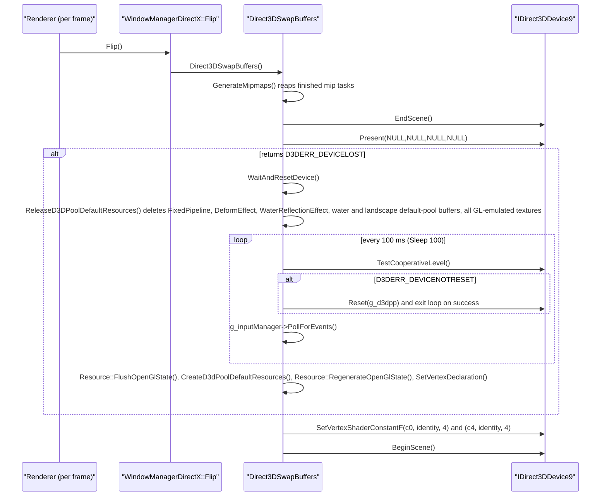
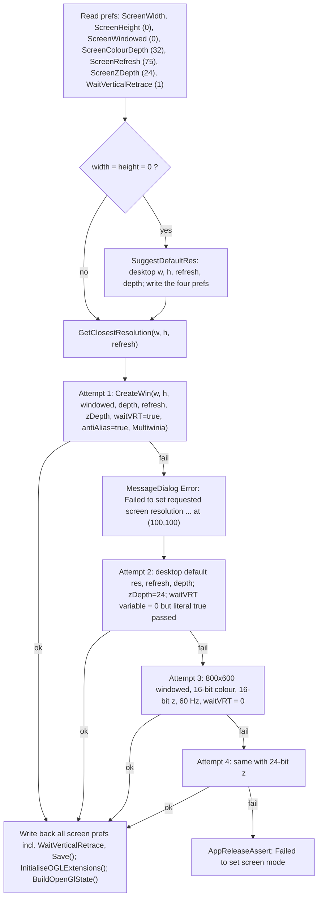
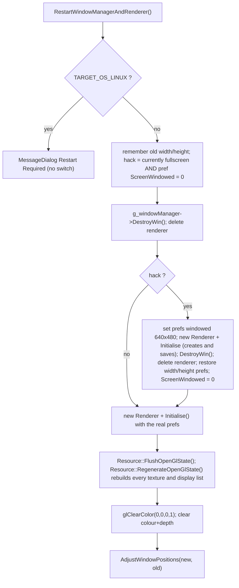
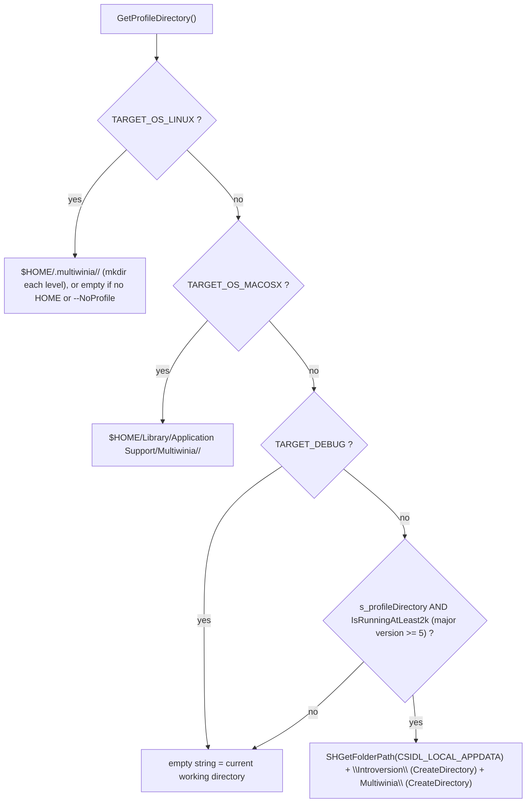
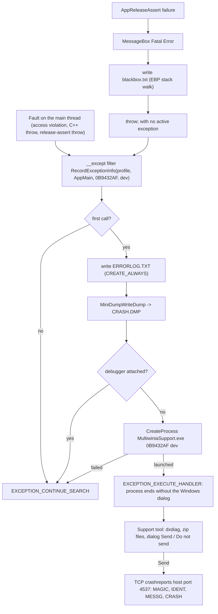
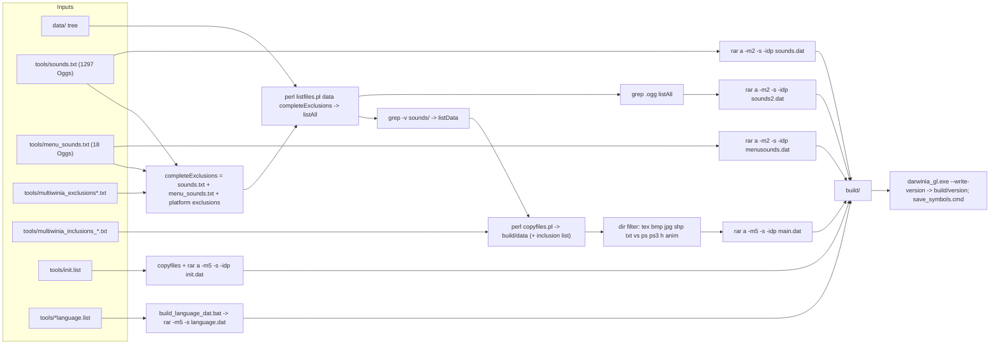

# 31 — Platform, build and tools

> Part B · Baseline build: Release|Win32 (OpenGL) + TARGET_PC_FULLGAME ([B:FULL]); see _work/build_matrix.md.
> Evidence: [C] confirmed · [I] inferred · [U] unknown. Citations are `path:Symbol` relative to the multiwinia/ source root.
> Sources merged: P14_platform_lib (build system, platform map, timing, file locations, archives, data pipeline, packaging, installers, MapCRC, ShapeExporter, localisation, audit scripts, crash handling, system info, root/targets/tools/docs inventories), P13_gfx_backend_math (window managers, D3D device creation/reset, display modes, vsync/MSAA/gamma, AVI capture/playback), P11_terrain_world (map CRC definition and the 87/87 reproduction script `_work/scripts/P11_mapcrc.py`, third D3D compile breakage), P12_render_core (fourth D3D compile breakage in `code/deform.cpp`), `_work/build_matrix.md` (superseded here for build facts), `_work/routed/_meta_*.md`, `_work/phase2_log.md`. New S31 scripts: `_work/scripts/S_31_archive_contents.py` (emulates the data build and lists every `.dat` archive's content), `_work/scripts/S_31_inventory.py` (one-row-per-file inventories), `_work/scripts/S_31_source_map.py` (source map, manifest-checked).

## Contents

- [1 Summary for the new team](#1-summary-for-the-new-team)
- [2 Platform abstraction](#2-platform-abstraction)
- [3 Window management](#3-window-management)
- [4 Timing](#4-timing)
- [5 File paths and command line](#5-file-paths-and-command-line)
- [6 Crash handling and system information](#6-crash-handling-and-system-information)
- [7 Build configurations and flags](#7-build-configurations-and-flags)
- [8 Data build pipeline and the .dat archives](#8-data-build-pipeline-and-the-dat-archives)
- [9 Packaging scripts and installers](#9-packaging-scripts-and-installers)
- [10 Map CRC tool and runtime map identity](#10-map-crc-tool-and-runtime-map-identity)
- [11 ShapeExporter and 3DGeometry](#11-shapeexporter-and-3dgeometry)
- [12 Localisation build](#12-localisation-build)
- [13 Analysis and audit scripts](#13-analysis-and-audit-scripts)
- [14 File inventories (root, targets, tools, docs)](#14-file-inventories-root-targets-tools-docs)
- [15 Carry-forward notes](#15-carry-forward-notes)
- [Open questions and unknowns](#open-questions-and-unknowns)
- [Docs-vs-code discrepancies](#docs-vs-code-discrepancies)
- [IP items](#ip-items)
- [Source map](#source-map)
- [Appendix — dead/legacy code](#appendix--deadlegacy-code)

---

## 1 Summary for the new team

The shipped Multiwinia PC game is one Win32 executable built by Visual Studio 2008 from `targets/vs2005/Darwinia.vcproj` in configuration `Release|Win32` (OpenGL renderer, static CRT, `/fp:precise`), output `darwinia_gl.exe`, renamed `multiwinia.exe` by every packaging script, plus RAR archives: the code mounts eight archive names (`init.dat`, `language.dat`, `main.dat`, `patch.dat`, `menusounds.dat`, `branding.dat`, `sounds.dat`, `sounds2.dat`), six of which are produced by `tools/build_multiwinia_data.bat`; a ninth, `ambx.dat`, is shipped by three installers but is never opened by the code. The ten most design-relevant facts recovered here:

| # | Fact | Tag | Section |
|---|---|---|---|
| 1 | Product variants are selected by editing one `#define` in `code/lib/universal_include.h` (`TARGET_PC_FULLGAME` is the only uncommented one); VS configurations only select the renderer (OpenGL vs Direct3D 9) and debug/release | [C] | §7.6 |
| 2 | `ReleaseDirect3D` very probably does **not compile** at this commit: four independent breakages (abstract `WindowManagerDirectX`, `D3DRS_LINEWIDTH`, Xbox-360 `Resolve()` in `code/deform.cpp`, `bmp.GetPixel` on a pointer in `code/water.cpp`) | [C] for the two provable from the tree alone, [I] (strong) for the two that depend on PC DirectX SDK headers | §7.9 |
| 3 | GL and D3D builds differ in floating-point code generation (`/fp:precise` vs `/fp:fast`; D3D device created without `D3DCREATE_FPU_PRESERVE`), yet the lobby compatibility check is only the version string `"dev"` — mixing them in one lockstep game is a desync risk | [C] flags, [I] consequence | §7.10 |
| 4 | Loose `data/<name>` always overrides archive entries; later archives override earlier ones; archives are unencrypted solid RARs decompressed wholly into memory | [C] | §8.7–§8.8 |
| 5 | `default_preferences.txt` is looked up **before** `main.dat` is mounted, so in a packaged install (no loose `data/`) first-run defaults come only from code | [C] order, [I] packaged effect | §8.9 |
| 6 | Map identity is a CRC-32 (init 0, no final XOR) of the level file bytes plus one `0xFF`; `tools/MapCRC` regenerates `code/mapcrc.h` as a pre-build step; all 87 `MAPID_*` reproduce exactly | [C] | §10 |
| 7 | Crash handling = SEH filter around the whole main thread → `ERRORLOG.TXT` + minidump → user-confirmed TCP upload by `MultiwiniaSupport.exe` (built from `contrib/XCrashReport`), plus a release-assert "black box" | [C] | §6 |
| 8 | User data lives in `%LOCALAPPDATA%\Introversion\Multiwinia\` (`--NoProfile` → working directory); the authentication key is **read** from `authkey.dev` but a typed key is **written** to `authkey` | [C] | §5 |
| 9 | Timing is a process-relative `QueryPerformanceCounter` clock with an injectable fake-time mode; the main loop has no frame cap, so pacing is the driver's swap interval (the GL path never sets vsync) | [C] | §3.11, §4 |
| 10 | A maintained Multiwinia 1.3.1 Mac target exists (`targets/macosx/Multiwinia`, SDL + Cocoa, Ambrosia port) but cannot be built from this tree (26 referenced files absent); the Linux makefile is Darwinia-era | [C] | §2.4, §7.8 |

Resolved in this document (drafts or earlier notes disagreed, code re-read): number of `.cpp` references in the Mac project; whether `build_multiwinia.bat` builds all languages (it builds English only); which installers ship `ambx.dat`; order of operations in the fullscreen resolution switch; the `authkey`/`authkey.dev` split (which code path writes which file); whether the support tool uploads without consent (it does not) and its wire protocol; whether `ERRORLOG.TXT` is appended (it is overwritten); whether sound archives are parsed concurrently with `main.dat` (they are not); whether `targets/macosx/Multiwinia/data` is a symlink (it is a Subversion link stub); the role of `tools/SlashSort.exe` (now [I]).

---

## 2 Platform abstraction

### 2.1 Mechanism

There is no runtime platform layer. Platform selection is entirely compile-time, by two means [C]:

1. **Which files a project compiles.** `targets/vs2005/Darwinia.vcproj` lists the Win32 implementations; `targets/macosx/Multiwinia/Multiwinia.xcodeproj/project.pbxproj` lists the SDL/Cocoa ones; `targets/linux/Makefile` lists a Darwinia-era SDL set.
2. **Whole-file and in-file `#ifdef`s** on `TARGET_MSVC` (defined by `targets/vs2005/Common.vsprops`), `TARGET_OS_MACOSX` (Xcode), `TARGET_OS_LINUX` (makefile), `TARGET_MINGW` (no project defines it), `USE_DIRECT3D` (`targets/vs2005/Direct3D.vsprops`), `HAVE_DSOUND` (set by the `TARGET_MSVC`/`TARGET_MINGW` blocks of `code/lib/universal_include.h`), `HAVE_XAUDIO` (never defined on PC) and `_XBOX` (never defined on PC).

Platform identity strings [C] `code/lib/universal_include.h`: `APP_SYSTEM` = `"PC"` (`TARGET_MSVC`), `"Mac (PPC)"` / `"Mac (Intel)"` (`TARGET_OS_MACOSX` with/without `__ppc__`), `"Linux"`; `DARWINIA_PLATFORM` = `"win32"` / `"macosx"` / `"linux"`; `DARWINIA_VERSION_STRING` = `DARWINIA_PLATFORM "-" DARWINIA_GAMETYPE "-" DARWINIA_VERSION` → baseline `"win32-multiwinia-dev"`.

### 2.2 Platform map — every platform-specific file

"Live in baseline" = compiled and reachable in `Release|Win32` + `TARGET_PC_FULLGAME`. "Mac target" = referenced by the Multiwinia Xcode project [C scripted reference check]. Files whose body is wrapped in `#ifdef USE_DIRECT3D` are listed in the vcproj but compile to nothing in the baseline.

| File(s) | Platform / API | In vcproj | Live in baseline? | Mac target | Notes / evidence |
|---|---|---|---|---|---|
| `code/lib/window_manager_win32.cpp`, `code/lib/window_manager_win32.h` | Win32 + WGL/OpenGL | yes | **yes** [B:FULL] | no | body `#if !defined USE_DIRECT3D`; defines `WinMain` |
| `code/lib/window_manager_directx.cpp`, `code/lib/window_manager_directx.h` | Win32 + Direct3D 9 | yes | no [B:D3D] | no | body `#ifdef USE_DIRECT3D`; defines `WinMain`; see §7.9 breakage 1 |
| `code/lib/window_manager_sdl.cpp`, `code/lib/window_manager_sdl.h` | SDL 1.2 + OpenGL | no | no [B:DEAD] | yes | MSAA via `SDL_GL_MULTISAMPLEBUFFERS`, vsync via `SDL_GL_SWAP_CONTROL` |
| `code/lib/window_manager.cpp`, `code/lib/window_manager.h` | portable base | yes | yes | yes | abstract `WindowManager`, `g_windowManager` |
| `code/lib/ogl_extensions.cpp`, `code/lib/ogl_extensions.h` | WGL extension loading | yes | **yes** | no | body `#if !defined USE_DIRECT3D` ([24](24_rendering.md)) |
| `code/lib/ogl_extensions_directx.cpp` | D3D stand-ins | yes | no [B:D3D] | no | `#ifdef USE_DIRECT3D` |
| `code/lib/ogl_extensions_sdl.cpp` | SDL GL extensions | no | no [B:DEAD] | yes | `SDL_GL_GetProcAddress` |
| `code/lib/opengl_directx.cpp`, `.h`, `code/lib/opengl_directx_inline.h`, `code/lib/opengl_directx_internals.h`, `code/lib/opengl_directx_dlist.cpp`, `.h`, `code/lib/opengl_directx_dlist_dev.cpp`, `.h`, `code/lib/opengl_directx_matrix_stack.cpp`, `.h`, `code/lib/opengl_directx_stubs.cpp` | D3D9 implementing the GL API | yes | no [B:D3D] | no | all `#ifdef USE_DIRECT3D` ([24](24_rendering.md)) |
| `code/lib/safegl.cpp`, `code/lib/safegl.h` | GL display-list mutex wrapper | yes | compiled, inactive (header only included for D3D/Mac) | yes | [24](24_rendering.md) |
| `code/lib/hi_res_time.cpp` | Win32 QPC (+ dead RDTSC path) | yes | **yes** | no | §4 |
| `code/lib/hi_res_time_sdl.cpp` | POSIX `gettimeofday` | no | no [B:DEAD] | yes | §4.3 |
| `code/lib/hi_res_time_gcc.cpp` | Win32 QPC for GCC/MinGW | no | no [B:DEAD] | no | §4.3 |
| `code/lib/exception_handler.cpp`, `code/lib/exception_handler.h` | Win32 SEH, `dbghelp` minidump | yes | **yes** | no | §6.2 |
| `code/lib/GetWinVer.cpp`, `code/lib/GetWinVer.h`, `code/lib/MiniVersion.cpp`, `code/lib/MiniVersion.h` | Win32 version APIs | yes | **yes** (crash report only) | no | §6.7 |
| `code/lib/system_info.cpp`, `code/lib/system_info.h` | Win32 locale, `waveOut`, DirectX registry | yes | **yes** | no | §6.7 |
| `code/lib/system_info_macosx.cpp`, `code/lib/macosx_hardware_detect.cpp`, `code/lib/macosx_hardware_detect.h` | Mac | no | no [B:DEAD] | yes | |
| `code/lib/input/inputdriver_win32.cpp`, `.h`, `code/lib/input/win32_eventhandler.cpp`, `.h`, `code/lib/input/win32_eventproc.h` | Win32 messages, keyboard/mouse | yes | **yes** | no | [06](06_player_control_and_input.md); §3.10 |
| `code/lib/input/inputdriver_xinput.cpp`, `code/lib/input/inputdriver_xinput.h` | XInput 1.3 (delay-loaded `xinput1_3.dll`) | yes | **yes** | no | [06](06_player_control_and_input.md) |
| `code/lib/input/xbox_eventhandler.cpp`, `code/lib/input/xbox_eventhandler.h` | Xbox 360 | yes, `ExcludedFromBuild` ×4 | no [B:DEAD] | no | §7.4 |
| `code/lib/input/inputdriver_sdl_key.cpp`, `.h`, `code/lib/input/inputdriver_sdl_mouse.cpp`, `.h`, `code/lib/input/sdl_eventhandler.cpp`, `.h`, `code/lib/input/sdl_eventproc.h` | SDL input | no | no [B:DEAD] | yes | |
| `code/lib/input_sdl.cpp` | Darwinia-era SDL input | no | no [B:DEAD] | no | |
| `code/lib/input/inputfilterspec.cpp` | portable | no | no [B:DEAD] | yes | |
| `code/sound/sound_library_2d_win32.cpp`, `code/sound/sound_library_2d_win32.h` | Win32 `waveOut` 2D mixer output | yes | **yes** | no | [27](27_audio_engine.md) |
| `code/sound/sound_library_3d_dsound.cpp`, `.h` | DirectSound 3D (`HAVE_DSOUND`) | yes | **yes** | no | requires DirectX ≥ 9 (§6.7) |
| `code/sound/sound_library_3d_xaudio.cpp`, `.h` | XAudio (`HAVE_XAUDIO`) | yes | no [B:DEAD] | no | |
| `code/sound/sound_library_2d_sdl.cpp`, `code/sound/sound_library_2d_sdl.h` | SDL audio | no | no [B:DEAD] | yes | needs absent `code/sound/macosx/ASWSDLRingBuffer.*` |
| `code/sound/sound_library_3d_software.cpp`, `.h` | portable software mixer | yes | yes | yes | `INVOKE_CALLBACK_FROM_SOUND_THREAD` variant is Mac-only |
| `code/unicode/sound_library_2d.cpp`, `.h`, `code/unicode/sound_library_2d_sdl.cpp`, `.h`, `code/unicode/sound_library_3d.cpp`, `.h` | stale copies | no | no [B:DEAD] | no | |
| `code/gesture_demo_win32.cpp` | Win32 thread | yes | no (needs `GESTURE_EDITOR` + `USE_SEPULVEDA_HELP_TUTORIAL`) [B:DEAD] | no | |
| `code/gesture_demo_sdl.cpp` | SDL | no | no [B:DEAD] | yes | |
| `code/interface/buynow_window.cpp`, `.h`, `code/interface/updateavailable_window.cpp`, `.h` | Mac upsell / update windows | no | no [B:DEAD] | yes | |
| `code/lib/mouse_cursor.cpp`, `code/lib/mouse_cursor.h`, `code/lib/tri_tri.cpp`, `code/lib/debug_logging.cpp`, `code/lib/debug_logging.h` | portable helpers used only by the Mac project | no | no [B:DEAD] | yes | |
| `contrib/systemiv/lib/netlib/net_lib_win32.h`, `net_mutex_win32.cpp`, `net_thread_win32.cpp` | Winsock, `CRITICAL_SECTION`, `CreateThread` | yes | **yes** | no | [20](20_architecture.md), [22](22_determinism_and_networking.md) |
| `contrib/systemiv/lib/netlib/net_lib_linux.h`, `net_mutex_linux.cpp`, `net_thread_linux.cpp` | pthreads/BSD sockets | no | no [B:DEAD] | yes | |
| `contrib/systemiv/lib/filesys/filesys_utils.cpp` | `FindCaseInsensitive` (identity on Win32; per-component directory scan on Linux) | yes | yes | yes | §2.3 |
| `contrib/systemiv/lib/tosser/hash_map_darwin.h` | GNU `hash_map` shim | no | no [B:DEAD] | yes | |
| `contrib/unrar/win32acl.cpp`, `contrib/unrar/win32stm.cpp` | NTFS ACL / stream extraction | not listed; `#include`d by `contrib/unrar/extinfo.cpp` under `_WIN_32` | compiled into `unrar.lib`, unused by the game [I] | no | |
| `contrib/systemiv/lib/gucci/window_manager_win32.*`, `window_manager_sdl.*`, `input_win32.*`, `input_sdl.*`, `contrib/systemiv/lib/sound/sound_library_2d_win32.*`, `sound_library_2d_sdl.*` | SystemIV equivalents | no | no [B:DEAD] (SystemIV `gucci`/`sound` not compiled) | no | build_matrix §6 |
| `targets/macosx/Multiwinia/SDLMain.mm`, `SDLMain.h`, `MultiwiniaCocoaBridge.cpp`, `MultiwiniaCocoaBridge.h`, `SDLApp_Prefix.pch` | Cocoa shell | – | no | yes | §2.4 |
| `contrib/XCrashReport/*` | MFC crash-report tool | separate solution | shipped as `MultiwiniaSupport.exe` | no | §6.4 |

### 2.3 Cross-platform service matrix

| Service | Win32 baseline implementation | Other platforms (not in baseline) | Notes |
|---|---|---|---|
| High-resolution timer | `code/lib/hi_res_time.cpp` (QPC, process-relative) [B:FULL] | `code/lib/hi_res_time_sdl.cpp` (`gettimeofday`), `code/lib/hi_res_time_gcc.cpp` (QPC, absolute) [B:DEAD] | §4 |
| Window / GL context | `code/lib/window_manager_win32.cpp`; `code/lib/window_manager_directx.cpp` [B:D3D] | `code/lib/window_manager_sdl.cpp` | §3 |
| Input event source | `W32EventHandler` + input drivers | `SDLEventHandler` | chosen in `code/main.cpp:Initialise` by `TARGET_MSVC` [C] |
| Threads / mutex / event | `contrib/systemiv/lib/netlib/net_thread_win32.cpp` (`CreateThread`), `net_mutex_win32.cpp` (`CRITICAL_SECTION`, auto-reset `CreateEvent`) | `*_linux.cpp` (pthreads) | [20](20_architecture.md) |
| Debug output | `OutputDebugString` or redirect file `debug.txt` in the profile directory | `fputs(stderr)`; Mac log dir `~/Library/Logs/<app>/`, Linux `/tmp/` [C] `contrib/systemiv/lib/debug_utils.cpp:AppDebugLogPath` | [32](32_debug_test_and_performance.md) |
| Crash handling | SEH `__try/__except(RecordExceptionInfo…)` + minidump + `MultiwiniaSupport.exe` | Mac: black box without stack walk (comment suggests Smart Crash Reports) | §6 |
| User data directory | `%LOCALAPPDATA%\Introversion\Multiwinia\` | Linux `~/.multiwinia/<DARWINIA_GAMETYPE>/`; Mac `~/Library/Application Support/Multiwinia/<DARWINIA_GAMETYPE>/`, prefs `~/Library/Preferences/uk.co.introversion.Multiwinia.txt` | §5 |
| Case-insensitive file lookup | identity (`FindCaseInsensitive` returns its input) | Linux: walks each path component with `ListDirectory`, taking the first case-insensitive match | [C] `contrib/systemiv/lib/filesys/filesys_utils.cpp:FindCaseInsensitive` |
| System info | `code/lib/system_info.cpp` | `code/lib/system_info_macosx.cpp` | §6.7 |
| x87 precision | `_control87(_PC_53, _MCW_PC)` (53-bit mantissa) | Mac i386: `fnstenv`/`fldenv` clearing bit 8 | [C] `code/main.cpp:StandardiseCPUPrecision`; called in `Initialise` and at the start of every `WorkQueue` thread ([22](22_determinism_and_networking.md)) |
| `wchar_t` | UTF-16 (2 bytes) | UTF-32 (4 bytes); conversion via CoreFoundation/iconv | [C] `contrib/systemiv/lib/network_stream.cpp:WriteUnicodeString`, `code/unicode/unicode_text_file_writer.cpp` |
| Open URL | `ShellExecute(NULL,"open",url,…,SW_SHOWNORMAL)` | Mac/Linux variants in `window_manager_sdl.cpp`; Linux helper `tools/open-www.sh` | [C] `code/lib/window_manager_win32.cpp:OpenWebsite` |
| Clipboard (auth-key paste) | Win32 `OpenClipboard`/`GetClipboardData(CF_TEXT)`, at most `AUTHENTICATION_KEYLEN-1` chars | Mac `PasteboardCopyItemFlavorData("public.utf16-plain-text")` | [C] `code/UI/GameMenuWindow.cpp:GameMenuWindow::PasteFromClipboard` |

### 2.4 The Mac Multiwinia target [B:DEAD on PC]

[C] `targets/macosx/Multiwinia/Multiwinia.xcodeproj/project.pbxproj`, `targets/macosx/Multiwinia/Info.plist`, `targets/macosx/Multiwinia/SDLMain.mm`, `targets/macosx/Multiwinia/MultiwiniaCocoaBridge.cpp`.

| Aspect | Value |
|---|---|
| Product | Multiwinia 1.3.1 (`CFBundleVersion`), bundle id `uk.co.introversion.multiwinia`, principal class `SDLApplication`, main nib `SDLMain`; About/credits rtf files name the Ambrosia Software port |
| Xcode targets | `Multiwinia` (application), `Generate Map CRCs` (builds `tools/MapCRC/main.cpp` with `tools/MapCRC/lib/universal_include.h`; a shell build phase runs `GenerateMapCRCs ../../../data/levels/ ../../../code/mapcrc.h`), `OggVorbis` (static library, `__MACOSX__`) |
| Architectures | `ppc i386` (`ARCHS_STANDARD_32_BIT_PRE_XCODE_3_1`); Debug tuned G5, Release G3 |
| Defines | Debug: `TARGET_OS_MACOSX`, `GUI`, `SILENT`, `PROFILER_ENABLED` (+ project-level `_DEBUG=1`); Release: `NO_DEBUG_OUTPUT`, `TARGET_OS_MACOSX`, `GUI`, `SILENT`, `PROFILER_ENABLED` |
| Compiler flags | `-fno-builtin`; Release adds `-mfpmath=387` (i386) and `-mno-fused-madd` (ppc) — chosen to keep floating point bit-compatible with the x87 Windows build [I: purpose; C: flags] |
| Frameworks | SDL (`contrib/macosx/SDL.framework`), Ambrosia `ASWAboutBox`, `ASWAppKit`, `ASWDebug`, `ASWFoundation`, `AmbrosiaTools`, `Sparkle` (all six absent from the tree), AppKit, Carbon, Cocoa, CoreFoundation, Foundation, IOKit, OpenGL |
| Build phases | strip `PrivateHeaders` from embedded frameworks (Ruby); create a `data` symlink in the bundle Resources (`ln -sf "$SRCROOT/../../../data" .`); run `$SVNROOT/tools/macosx/add-appcast-url.rb` and `add-svn-revision.rb` (both absent) |
| Cocoa shell | `SDLMain.mm`: change directory to `Contents/Resources`, set `SDL_ENABLEAPPEVENTS=1` and `SDL_HAS3BUTTONMOUSE=1`, Sparkle update checks, sleep/wake notifications — on wake `Server::SkipToTime(GetHighResTime())` only when clients are connected (`MultiwiniaCocoaBridge.cpp:WindowManagerSDLAwakeFromSleep`), pause/fullscreen menu items |
| Buildability from this tree | 936 file references resolve (case-insensitively, as on HFS+), **26 do not**: the six Ambrosia frameworks, `code/sound/macosx/{ASWSDLRingBuffer,CARingBuffer}.{cpp,h}`, `code/sound/macosx/CABitOperations.h`, `code/sound/pokey.{cpp,h}`, `code/interface/pokey_window.{cpp,h}`, `code/lib/command_buffer.{cpp,h}`, `code/lib/debug_xbox.{cpp,h}`, `contrib/systemIV/lib/Crypticon/CCrypticon.{cpp,h}`, five absent `code/UI/*.h` XBLA/PDLC headers [C scripted check] ⇒ not buildable as checked in [I] |

Resolved: P14's note "1158 `.cpp` references" — the project has 384 distinct `.cpp` `PBXFileReference` entries; the higher number counted every occurrence (file reference + build-file + group lines) [C] grep of the project file.

### 2.5 Linux and Darwinia Mac targets [B:DEAD]

* `targets/linux/Makefile` — Darwinia-era (`CXX=apg++` autopackage wrapper, `CXXFLAGS=-g -Os`, `-DTARGET_OS_LINUX -DHAVE_SOCKET -DHAVE_SELECT -DHAVE_GETHOSTBYNAME -DHAVE_INET_NTOA`, links SDL, GL, GLU, vorbisfile, vorbis, ogg; `DEMO_CPPFLAGS=-DTARGET_DEMOGAME=1`, `FULL_CPPFLAGS=-DTARGET_FULLGAME=1`). It lists 247 `code/`+`contrib/` sources of which 23 are absent (17 under `code/`, e.g. `code/lib/text_stream_readers.cpp`, `code/network/networkupdate.cpp`; 6 under `contrib/netclass/` and `contrib/binreloc/`) [C scripted]. Note that `TARGET_FULLGAME` is not one of the product macros summed by the `#error` check in `code/lib/universal_include.h`, so it would silently build `TARGET_PC_FULLGAME` [C]. Linux-only runtime paths in code: profile `~/.multiwinia/<gametype>/`, debug log `/tmp/`, `RestartWindowManagerAndRenderer` shows "Restart Required" instead of switching mode [C] `code/interface/prefs_screen_window.cpp:RestartWindowManagerAndRenderer`.
* `targets/linux/Makefile.keygen-1` — builds a Darwinia `keygen-1` from `code/keygen.cpp` + absent `tools/PasswordGenerator/main.cpp` and copies it to an Introversion server (Darwinia beta registration) [C].
* `targets/macosx/Darwinia/*` — Darwinia Xcode 2 project and menu callbacks (debug menu, FPS, profiler, fullscreen, quit) [C] `targets/macosx/Darwinia/MainMenuCallbacks.cpp`.
* `docs/sdl_problems.txt` records SDL limitations of the time (no mouse wheel, low-resolution timer) [C].

---

## 3 Window management

### 3.1 Class hierarchy [C] `code/lib/window_manager.h`, `code/lib/window_manager_win32.h`, `code/lib/window_manager_directx.h`


One global `WindowManager *g_windowManager` (constructed in `WinMain`; the Win32 constructor asserts it is still NULL) [C] `code/lib/window_manager.cpp`, `code/lib/window_manager_win32.cpp:WindowManagerWin32::WindowManagerWin32`. `PlatformWindow` is `typedef void*`; `Window()` returns the `HWND` cast to `PlatformWindow*` [C].

**Process entry** [C] `code/lib/window_manager_win32.cpp:WinMain`: store `g_hInstance`; `g_windowManager = new WindowManagerWin32()`; `AppMain(cmdLine)` (`code/main.cpp`); return `WM_QUIT`. The process never changes its working directory, so it relies on being started with the install folder as current directory (installer shortcuts set `WorkingDir: "{app}"`, §9.2) [C].

Base-class behaviour [C] `code/lib/window_manager.cpp`:

| Member | Behaviour |
|---|---|
| ctor | `m_mousePointerVisible=true`, `m_mouseOffsetX=INT_MAX` (sentinel = "recompute offset"), `m_mouseCaptured=false`; calls `AbstractListAllDisplayModes()` → `ListAllDisplayModes()`, which during base construction dispatches to the **empty base version**; derived constructors therefore call their own `ListAllDisplayModes()` again |
| `SuggestDefaultRes(&w,&h,&refresh,&depth)` | returns the desktop width/height/refresh/bit depth captured by `SaveDesktop` |
| `GetResolutionId(w,h)` | index in `m_resolutions` with exact w,h, else −1 |
| `GetResolution(id)` | pointer, or NULL for an invalid index |
| `GetClosestResolution(&w,&h,&refresh)` | exact (w,h) match → only snap refresh; else the resolution minimising `|Δw|+|Δh|` (first wins ties), then snap refresh. Refresh snapping: exact match, else the entry minimising `|Δrefresh|`; if the resolution lists no rates the requested value is kept |
| `EnsureMouseCaptured/Uncaptured` | capture/uncapture only if the state differs (called from `Camera::Advance`, [06](06_player_control_and_input.md)) |
| `WindowMoved` | resets `m_mouseOffsetX=INT_MAX` |
| `m_invertY` | never initialised or read [C grep] |

### 3.2 Display modes and the screen-options dialog

**Enumeration** [C] `WindowManagerWin32::ListAllDisplayModes` (the DirectX variant is identical): loop `EnumDisplaySettings(NULL, i, &devMode)` for i = 0,1,… until it fails; keep modes with `dmBitsPerPel ≥ 15 && dmPelsWidth ≥ 640 && dmPelsHeight ≥ 480`; de-duplicate by (width, height) regardless of bit depth; per resolution collect the unique `dmDisplayFrequency` values. Order = driver enumeration order (not sorted). `devMode.dmSize` is not initialised before the call (works in practice; Win32 formally requires it). Colour depth is not stored per resolution.

**Desktop capture** [C] `WindowManagerWin32::SaveDesktop`: `EnumDisplaySettings(ENUM_CURRENT_SETTINGS)` → `m_desktopScreenW/H`, `m_desktopColourDepth`, `m_desktopRefresh`. `RestoreDesktop` calls `ChangeDisplaySettings(desktop, CDS_FULLSCREEN)` only when the current mode differs from the saved one.

**Screen options dialog** [C] `code/interface/prefs_screen_window.cpp` ([09](09_meta_systems.md), [28](28_ui_framework.md)):

| Control | Values | Pref written on Apply | Note |
|---|---|---|---|
| Resolution drop-down (`dialog_resolution`) | every `m_resolutions` entry | `ScreenWidth`, `ScreenHeight` | selecting a resolution repopulates the refresh list |
| Windowed check box (`dialog_windowed`) | 0/1 | `ScreenWindowed` | |
| Refresh rate (`dialog_refreshrate`) | that resolution's rates | `ScreenRefresh` | `HAVE_REFRESH_RATES` (defined for `TARGET_MSVC`); fullscreen-only control |
| Colour depth (`dialog_colourdepth`) | 16 / 24 / 32 | `ScreenColourDepth` | fullscreen-only control |
| Z-buffer depth (`dialog_zbufferdepth`) | 16 / 24 | `ScreenZDepth` | |
| Apply (`dialog_apply`) | – | all of the above, then `RestartWindowManagerAndRenderer()` (§3.9) | |

Dialog-side fallbacks when a pref is missing differ from the renderer's (`ScreenColourDepth` 16 vs 32, `ScreenRefresh` 60 vs 75); they never apply after the first run because `Renderer::Initialise` saves every screen pref [C].

### 3.3 `WindowManagerWin32` — OpenGL window [B:FULL] [C] `code/lib/window_manager_win32.cpp`

**`CreateWin(w, h, windowed, colourDepth, refreshRate, zDepth, waitVRT, antiAlias, title)`**:

1. Store `m_screenW/H`, `m_windowed`. Register `WNDCLASSW{style=CS_OWNDC, WndProc, hIcon=LoadIcon(NULL, IDI_APPLICATION), hCursor=LoadCursor(NULL, IDC_ARROW), background=BLACK_BRUSH, class name = title}` (title = `APP_NAME_W` = `L"Multiwinia"`).
2. **Windowed**: `RestoreDesktop()`; style `WS_VISIBLE|WS_POPUPWINDOW|WS_CAPTION|WS_MINIMIZEBOX|WS_MAXIMIZEBOX`; `AdjustWindowRect` → `m_borderWidth = (Δwidth)/2`, `m_titleHeight = Δheight − 2·border`; **returns false if the client size exceeds the desktop**; window centred on the desktop.
3. **Fullscreen**: style `WS_VISIBLE|WS_POPUP`; `ChangeDisplaySettings({bpp=colourDepth, w, h, freq=refreshRate}, CDS_FULLSCREEN)`; returns false unless `DISP_CHANGE_SUCCESSFUL`; position (0,0); `m_borderWidth=1`, `m_titleHeight=0`.
4. `CreateWindowW(class, title, style, x, y, w(+2·border), h(+2·border+title))`; false on failure; reset mouse offset.
5. `EnableOpenGL(colourDepth, zDepth)` (return value ignored).

`waitVRT` and `antiAlias` are **ignored** (`m_waitVRT` is never assigned in this class) [C].

**`EnableOpenGL`**: `GetDC`; `PIXELFORMATDESCRIPTOR{PFD_DRAW_TO_WINDOW|PFD_SUPPORT_OPENGL|PFD_DOUBLEBUFFER, PFD_TYPE_RGBA, cColorBits=colourDepth, cDepthBits=zDepth, PFD_MAIN_PLANE}` → `ChoosePixelFormat` + `SetPixelFormat` (results unchecked; no alpha, stencil or multisample bits requested); `wglCreateContext` twice — primary `m_hRC` and secondary `m_hRC2` ("for loading thread") joined with `wglShareLists` (failure only logged via `FormatMessage`); `wglMakeCurrent(m_hDC, m_hRC)`; `glClear(GL_COLOR_BUFFER_BIT)`. `m_hRC2` is **never made current and never deleted**; `UseSecondaryContext/ReleaseSecondaryContext/DestroySecondaryContext` are declared but not defined [C]. All GL work from worker threads is instead marshalled to the main thread as `Job`s ([20](20_architecture.md)).

**`DisableOpenGL`**: `wglMakeCurrent(NULL,NULL)`, delete `m_hRC`, `ReleaseDC`. **`DestroyWin`**: `DisableOpenGL` + `DestroyWindow`. **`Flip`**: `SwapBuffers(m_hDC)`. **`NastyPollForMessages`**: `PeekMessage/TranslateMessage/DispatchMessageW` loop (called by `W32InputDriver`, [06](06_player_control_and_input.md)). `WndProc` forwards to `W32EventHandler::WndProc`, falling back to `DefWindowProcW` when the handler returns −1 or is absent.

**Mouse**: `NastySetMousePos(x,y)` lazily computes the client-origin offset (`GetWindowRect` + border + title when windowed, 0 when fullscreen), `SetCursorPos(x+off, y+off)` and calls `W32InputDriver::SetMousePosNoVelocity(x,y)`; `NastyMoveMouse(dx,dy)` = relative `SetCursorPos` + `SetMousePosNoVelocity(dx,dy)` (passes the *delta* as a position) [C]; `CaptureMouse`=`SetCapture`; `UncaptureMouse`=`ReleaseCapture`; `Hide/UnhideMousePointer`=`ShowCursor(false/true)` (the game draws its own cursor, [24](24_rendering.md)). `OpenWebsite(url)` = `ShellExecute(NULL,"open",url,NULL,NULL,SW_SHOWNORMAL)`.

### 3.4 `WindowManagerDirectX` — Direct3D window [B:D3D] [C] `code/lib/window_manager_directx.cpp`

Same structure as Win32 with these differences: ANSI `WNDCLASS/RegisterClass/CreateWindow/DefWindowProc/DispatchMessage`; icon = resource `MAKEINTRESOURCE(101)` (`IDI_ICON1` in `targets/vs2005/resource.h`), `hCursor = NULL`; `m_waitVRT = waitVRT` is stored; **`RestoreDesktop` body is commented out** and the fullscreen branch does **not** call `ChangeDisplaySettings` (D3D performs the mode switch); `EnableOpenGL` = `Direct3DInit(m_hWnd, m_windowed, m_screenW, m_screenH, colourDepth, zDepth, m_waitVRT)` + `glClear(GL_COLOR_BUFFER_BIT)`; on failure the window is destroyed and `CreateWin` returns false; `DisableOpenGL` = `Direct3DShutdown()`; `Flip` = `Direct3DSwapBuffers()`; `EnsureMouseCaptured/Uncaptured` overridden as no-ops; `Hide/UnhideMousePointer` only toggle the flag (no `ShowCursor`); destructor also `m_resolutions.EmptyAndDelete()`. Its `WinMain` additionally handles `TARGET_OS_VISTA` (`-mediacenter` → `g_mediaCenter=true` + `Sleep(7500)`; otherwise a save-file path argument → `g_saveFile`, `SetCurrentDirectory(exe dir)`) — `TARGET_OS_VISTA` is never defined [B:DEAD]. `CreateWin` takes `const char *_title` while the base declares `const wchar_t *_title` — see §7.9 breakage 1.

### 3.5 Direct3D device creation [B:D3D] [C] `code/lib/opengl_directx.cpp:Direct3DInit`

| Step | Value |
|---|---|
| D3D object | `Direct3DCreate9(D3D_SDK_VERSION)` once; failure → `AppReleaseAssert("Direct3D 9 not available.")` |
| Vertex processing | `GetDeviceCaps(DEFAULT, HAL)`: `D3DDEVCAPS_HWTRANSFORMANDLIGHT` ⇒ `D3DCREATE_HARDWARE_VERTEXPROCESSING`, else `SOFTWARE` (and vertex buffers get `D3DUSAGE_SOFTWAREPROCESSING`) |
| Adapter / type | `D3DADAPTER_DEFAULT`, `D3DDEVTYPE_HAL` (NVPerfHUD variant commented out) |
| Behaviour flags | only the vertex-processing flag — **no `D3DCREATE_FPU_PRESERVE`, no `D3DCREATE_MULTITHREADED`** (§7.10, [22](22_determinism_and_networking.md)) |
| Windowed | `Windowed=TRUE`, back-buffer size 0 (= client area), `BackBufferFormat=D3DFMT_UNKNOWN` (desktop format) |
| Fullscreen | `Windowed=FALSE`, `BackBufferWidth/Height = w/h`; colour 24/32 → `X8R8G8B8`; 15/16 → `X1R5G5B5`; other → `AppReleaseAssert("Unexpected colourDepth.")`. `FullScreen_RefreshRateInHz` not set (0 = adapter default) ⇒ **refresh-rate preference ignored** |
| Format fallback (fullscreen) | `CheckDeviceType` fails → 15/16-bit: try `R5G6B5` ("Fixes 16bit modes on Radeon X300"), then `A1R5G5B5` (display `X1R5G5B5`); 24/32-bit: `A8R8G8B8` (display `X8R8G8B8`). If the final check still fails: revert to `X8R8G8B8` (≥ 24) or `X1R5G5B5` and proceed |
| Depth buffer | if zDepth ≠ 0: `EnableAutoDepthStencil`; 16 → `D3DFMT_D16`; 24 → `D3DFMT_D24X8`; 32 → `D3DFMT_D32`; other → `AppReleaseAssert("Unexpected zDepth.")`. No stencil |
| Swap | `SwapEffect=DISCARD`, `BackBufferCount` default (1); a triple-buffering block is commented out |
| Vsync | `PresentationInterval = waitVRT ? D3DPRESENT_INTERVAL_ONE : D3DPRESENT_INTERVAL_IMMEDIATE` |
| Multisampling | `MultiSampleType` left 0 = `D3DMULTISAMPLE_NONE` |
| `CreateDevice` failure | returns false ("non fatal end, res change can help") → the retry chain of §3.7 continues |
| After creation | `g_pd3dDeviceActual = g_pd3dDevice`; `InitialiseData()` (matrix stacks, vertex declaration, 1024-entry vertex array, texture table cleared, cull/hints/attributes reset, mip-map work queue created once); `BeginScene()`; `SetVertexDeclaration`; `CreateD3DResources()` → `DeformEffect::Create`, `WaterReflectionEffect::Create`, `new FixedPipeline` ([24](24_rendering.md)) |

`Direct3DShutdown`: `ReleaseD3DResources()` (default-pool resources, water/landscape managed resources, `TaskManagerInterfaceGestures::ReleaseD3dResources`), release the device and the D3D object.

### 3.6 Frame present and lost-device handling [B:D3D] [C] `code/lib/opengl_directx.cpp:Direct3DSwapBuffers`, `WaitAndResetDevice`



Notes: the loop exits **only** after a successful `Reset`; if `TestCooperativeLevel` returned `D3D_OK` without a reset being needed the loop would spin forever [C structure; I likelihood]. Other `Present` failures are ignored. Managed-pool textures are released too and rebuilt through `Resource::RegenerateOpenGlState` ([25](25_textures_and_assets.md)), which allocates new texture ids because the emulated `glDeleteTextures` does not recycle ids ⇒ the id table grows on each reset [I]. A 5-second FPS counter (`FRAMES_PER_SECOND_COUNTER`) is computed but its output line is commented out.

### 3.7 Window-creation retry chain [C] `code/renderer.cpp:Renderer::Initialise`



Consequences [C]: attempts 1–2 pass the literal `true` for `waitVRT`, so the `WaitVerticalRetrace` preference only matters in attempts 3–4, and only in the D3D build. After **any** first-attempt failure the local `waitVRT` is 0 and is persisted as `WaitVerticalRetrace = 0`. Attempt 2 keeps the user's `windowed` choice. The error dialog is an in-game Eclipse window, so it is shown only once the renderer exists.

### 3.8 Preferences consumed by window/renderer creation [C] `code/renderer.cpp:Renderer::Initialise`, `code/lib/preference_names.h`

| Key | Default in code | Used by |
|---|---|---|
| `ScreenWidth` / `ScreenHeight` | 0 / 0 (→ desktop) | `CreateWin` |
| `ScreenWindowed` | 0 | `CreateWin` |
| `ScreenColourDepth` | 32 | GL: `ChangeDisplaySettings` bpp + PFD colour bits; D3D: back-buffer format |
| `ScreenRefresh` | 75 | GL fullscreen `dmDisplayFrequency`; ignored by D3D |
| `ScreenZDepth` | 24 | PFD depth bits / D3D depth format |
| `WaitVerticalRetrace` | 1 | D3D `PresentationInterval` (see §3.7 caveat); no effect in GL |
| `ScreenOverscan` | forced 0 | written only |
| `RenderLandscapeMode` | −1 (auto) | VBO vs display list (GL) ([23](23_terrain_and_landscape.md)) |
| `ManuallyScaleTextures` | 0 | power-of-two rescale ([25](25_textures_and_assets.md)) |

### 3.9 Fullscreen/windowed switching and resolution change [C] `code/interface/prefs_screen_window.cpp:RestartWindowManagerAndRenderer`, `SetWindowed`



Resolved: the P13 draft described the temporary 640×480 window as created *before* destroying the old one; the code destroys the old window and renderer first, then creates and destroys the temporary windowed renderer ("necessary for resolution change in fullscreen"), then the final one. The temporary `Renderer::Initialise` saves `ScreenWindowed=1` and 640×480 to `preferences.txt`; the final `Initialise` overwrites them [C]. `SetWindowed(isWindowed, isPermanent, &switching)` sets the pref, restarts only if the actual mode changes, and restores the old pref value afterwards when not permanent (else saves) [C].

### 3.10 Window messages, focus and Alt-Tab [C] `code/lib/input/win32_eventhandler.cpp:W32EventHandler::WndProc`

| Message | Handling |
|---|---|
| every message | `g_windowHasFocus = (GetForegroundWindow() == game HWND)`; on focus loss/regain a held Alt key is force-released |
| `WM_CREATE`, `WM_DESTROY`, `WM_SIZING`, `WM_WINDOWPOSCHANGING`, `WM_WINDOWPOSCHANGED`, `WM_COMMAND`, `WM_NCHITTEST` | return −1 (→ `DefWindowProcW`) |
| `WM_SETCURSOR` | in the client area `SetCursor(NULL)`; **falls through** into `WM_MOVE` (no `return`), so every client-area cursor message also resets the mouse offset; outside the client area −1 |
| `WM_MOVE` | `g_windowManager->WindowMoved()`, return −1 |
| `WM_CANCELMODE` | return 0 |
| `WM_CLOSE` | `g_app->m_requestQuit = true`, return 0 (the main loop then calls `Finalise()` and `exit(0)`, `code/main.cpp:HandleCommonConditions`) |
| `WM_INPUTLANGCHANGE` | logged only |
| others | offered to every registered `W32EventProcessor` (keyboard/mouse drivers, [06](06_player_control_and_input.md)) |

Alt-Tab: `BindAltTab` registers `MOD_ALT+VK_TAB` as a hot key (swallowing Alt-Tab); both call sites (`code/main.cpp:Initialise` and the key-bindings window's apply button in `code/interface/prefs_keybindings_window.cpp`) are commented out, and `ResetWindowHandle` re-binds only if `g_altTabBound` is already true, so Alt-Tab works normally in the baseline [C]. Focus loss sets `App::m_lostFocusPause`, which pauses the game **only in single-player** (`App::GamePaused`), and suppresses camera advance; the "paused" overlay is drawn only for non-Multiwinia game modes [C] `code/main.cpp:HandleCommonConditions`, `code/app.cpp:App::GamePaused`, `code/renderer.cpp`. There is no single-instance check (no `CreateMutex`/`FindWindow`) [C grep].

### 3.11 Vsync, multisampling and gamma — summary

| Feature | GL baseline [B:FULL] | D3D [B:D3D] | SDL (Mac) [B:DEAD] |
|---|---|---|---|
| Vsync | **never set**: no `wglSwapIntervalEXT` call anywhere ⇒ driver/control-panel default [C grep] | `PresentationInterval` ONE/IMMEDIATE from `waitVRT` (effectively always ONE, §3.7) | `SDL_GL_SWAP_CONTROL 1` |
| Multisampling | none; `wglChoosePixelFormatARB` is loaded but unused; `antiAlias` ignored | none (`D3DMULTISAMPLE_NONE`) | `SDL_GL_MULTISAMPLEBUFFERS 2`/`SAMPLES 4`, retried without AA |
| Gamma | no gamma code [C grep `SetDeviceGammaRamp`/`SetGammaRamp`] | `Renderer::SetScreenGamma(g)`: exponent `e = 2.0 − g`; ramp `r[i]=g[i]=b[i] = iv_pow(i/255, e)·65535`, i = 0…255; `SetGammaRamp(0,0,&ramp)` — **no caller** | – |
| Frame cap | none in the game loops (no `Sleep`); only the loading screen sleeps to a 1/60 s frame budget [C] `code/loading_screen.cpp:LoadingScreen::Render` | same | same |

The options UI exposes none of vsync, MSAA or gamma ([09](09_meta_systems.md)).

### 3.12 Video capture — `AVIGenerator` [B:DEBUG] [C] `code/lib/avi_generator.cpp`, `code/lib/avi_generator.h`

Compiled only with `AVI_GENERATOR`, defined only by `TARGET_DEBUG` (and `#undef`'d on Linux/Mac) [C] `code/lib/universal_include.h`. Based on a published "AVIGenerator" sample (header comment) using Video for Windows (`vfw.h`, `vfw32.lib`).

| Member | Behaviour |
|---|---|
| ctor | `m_motionBlurFactor = pref AVIMotionBlurFactor (1)`; `m_frameRate = pref DemoFrameRate (25) / m_motionBlurFactor`; `BITMAPINFOHEADER{w=ScreenW, h=ScreenH, planes 1, 24 bpp, BI_RGB, biSizeImage 0, 1000 ppm ×2}`; output file `"Untitled.avi"` |
| `InitEngine()` | requires VfW ≥ 1.10 (`VideoForWindowsVersion`), `AVIFileInit`, `AVIFileOpen(OF_WRITE|OF_CREATE)`, stream header (`dwScale=1`, `dwRate=frameRate`), `AVIFileCreateStream`, `Setup()` = **interactive `AVISaveOptions` codec dialog**, `AVIMakeCompressedStream`, `AVIStreamSetFormat`; allocates `m_pixels` and `m_accumBuffer` of `w·h·(biBitCount / sizeof(unsigned char))` = `w·h·24` bytes (8× larger than needed) |
| `AddFrame()` | `glReadPixels(0,0,w,h,GL_RGB)`; motion-blur accumulation: on frame `k % factor == 0` the accumulator is overwritten with `pixel·(1/factor)` (BGR swizzle), otherwise added; on `k % factor == factor−1` writes the accumulator via `AddFrame(bits)` |
| `AddFrame(bits)` | `CheckSanity()` (file name ends in "avi", w and h multiples of 4 — debug asserts), `AVIStreamWrite(compressed, outFrame++, 1, bits, biSizeImage (=0), AVIIF_KEYFRAME)` |
| `ReleaseEngine()` | release streams/file, free buffers, `AVIFileExit` |
| dtor | if pref `RecordDemo == 2` → `ReleaseEngine()` |
| `GetRecordingFrameRate()` | `m_frameRate` |

Integration [C]: created by the debug Grabber window (`code/interface/grabber_window.cpp`, opened from the debug menu): *Start* sets fake-time mode (§4.2) and calls `InitEngine`; *Stop* restores real time and releases. **No code calls `AVIGenerator::AddFrame()`** [C grep] — a recording in this tree produces an AVI with no frames. Playback (`AviPlayer`) is in the appendix.

---

## 4 Timing

### 4.1 `hi_res_time` API and baseline implementation [C] `code/lib/hi_res_time.h`, `code/lib/hi_res_time.cpp`

API: `InitialiseHighResTime()`, `double GetHighResTime()` (seconds), `SetFakeTimeMode()`, `SetRealTimeMode()`, `IncrementFakeTime(double)`.

| Step | Behaviour |
|---|---|
| `InitialiseHighResTime` | `QueryPerformanceFrequency` → `g_tickInterval = 1/freq` (seconds per tick). Called once from `code/main.cpp:Initialise`, after `new SystemInfo` and before any timing use. Before the call `g_tickInterval = 1.0`, so a `GetHighResTime` issued earlier would return raw counts (none is issued) [C] |
| `GetLowLevelTime` (QPC path, `#define USE_PENTIUM_COUNTER 0`) | on first call latches `startTime = QPC`; returns `(QPC − startTime) × g_tickInterval` ⇒ time starts at **0.0 s on the first query** (process-relative) |
| `GetHighResTime` | fake mode → `g_fakeTime`; else `GetLowLevelTime() − g_timeShift`; a commented-out block once clamped forward jumps > 1 s. No monotonicity guard: cross-core QPC skew on 2008-era hardware would surface directly [I] |
| Resolution | 1 / QPC frequency (hardware-dependent; typically ≤ 1 µs on the target hardware [I]); 64-bit counter, no wrap handling needed |
| Precision of the value | `double` seconds; after ~2.5 × 10⁸ s of uptime resolution would degrade below 1 µs — irrelevant in practice [I] |

The game clock and simulation tick are layered on top of this in `GameTimer` (`code/gametimer.cpp`) and `UpdateAdvanceTime` — documented in [20](20_architecture.md). The relevant platform facts [C] `code/main.cpp:UpdateAdvanceTime`: real-time frame delta `g_advanceTime = now − g_gameTime`, **clamped to 0.25 s**; not advanced while `App::GamePaused()`. There is no `timeBeginPeriod` call anywhere, so `Sleep` granularity is the OS default (≈ 15.6 ms) — only the loading screen sleeps (§3.11) [C grep].

### 4.2 Fake time (offline capture) [C] `code/lib/hi_res_time.cpp`, `code/main.cpp:UpdateAdvanceTime`, `code/interface/grabber_window.cpp`

* `SetFakeTimeMode()` freezes `g_fakeTime = GetHighResTime()` and switches to fake mode; `IncrementFakeTime(dt)` advances it; `SetRealTimeMode()` sets `g_timeShift = realTime − g_fakeTime`, so real time resumes continuously from the fake value.
* Callers: the debug Grabber window (Start → fake, Stop → real) [B:DEBUG]; `UpdateAdvanceTime` when pref `RecordDemo` ∈ {1, 2}: `g_advanceTime = 1/DemoFrameRate` (default 25) and `IncrementFakeTime(1/DemoFrameRate)` every frame (only effective if fake mode was enabled).
* `RecordDemo == 1` additionally makes `App::ShutdownCurrentGame` save the server's command history to `serverHistory.dat` in the working directory ([22](22_determinism_and_networking.md), [32](32_debug_test_and_performance.md)) [C] `code/app.cpp:App::ShutdownCurrentGame`.

### 4.3 Variants [B:DEAD]

| File | Clock | Differences |
|---|---|---|
| `code/lib/hi_res_time.cpp` RDTSC path (`GetPentiumCounter`, inline `_emit 0x0F, 0x31`) | TSC bits 6…37 (`eax>>6 | edx<<26`) | calibrated against QPC with a `Sleep(1000)` in `InitialiseHighResTime`; wrap counter; compiled out by `USE_PENTIUM_COUNTER 0` |
| `code/lib/hi_res_time_gcc.cpp` | QPC | absolute counter (no first-call latch) |
| `code/lib/hi_res_time_sdl.cpp` (Mac target) | `gettimeofday`, µs resolution | elapsed = `(sec − firstSec) + usec/10⁶` — the first call's microsecond fraction is not subtracted, so the clock starts between 0 and 1 s; not monotonic against wall-clock changes [C] |

### 4.4 Design notes for the new engine

Keep one monotonic process-relative clock (`QueryPerformanceCounter` or `std::chrono::steady_clock`) with an injectable fake clock for capture and replay; never derive simulation time from it directly (simulation advances by network ticks, [22](22_determinism_and_networking.md)); expose an explicit frame-pacing policy (present interval, optional frame cap) instead of relying on driver defaults.

---

## 5 File paths and command line

### 5.1 Working directory and data directory [C]

* All game data are opened **relative to the current working directory**: archives by bare name (`init.dat` …) in `code/lib/resource.cpp:Resource::ParseArchive` (`DoesFileExist(_dataFile)`), loose files as `data/<name>` in `GetTextReader`/`GetBinaryReader`, `origin` and `version` in the cwd.
* Development: README instructs setting the debugger working directory to `..\..` (the repository root, where the exe is also written, §7.3) [C] `README.TXT`.
* Install: the exe sits next to the `.dat` files and every installer shortcut sets `WorkingDir: "{app}"` (§9.2). Shortcuts start `autopatch.exe`, which then starts the game [I] — the launcher is absent from the tree.

### 5.2 Profile (user-data) directory resolution [C] `code/app.cpp:App::GetProfileDirectory`, `code/main.cpp:Initialise`, `code/main.cpp:AppMain`



* `s_profileDirectory` defaults to `true`; the command-line switch **`--NoProfile`** calls `App::UseProfileDirectory(false)` → all user files go to the working directory [C] `code/main.cpp:Initialise`. The folder name `Multiwinia\` is a literal, not `APP_NAME` [C].
* `Initialise` then calls `CreateDirectoryRecursively(profileDir)` and `AppDebugLogPathPrefix(profileDir)` so `debug.txt`/`blackbox.txt` land in the profile directory; with `--NoProfile` the prefix is "" [C].
* `Initialise` calls the static `App::UseProfileDirectory`/`GetProfileDirectory` through `g_app` **before** `g_app = new App()` — legal only because they are static members (no `this` access) [C].
* **Crash-log location quirk** [C] `code/main.cpp:AppMain`: the profile path passed to the crash handler is captured in `AppMain` **before** `RunTheGame` → `Initialise` processes `--NoProfile`, so with `--NoProfile` the game writes its logs to the working directory but `ERRORLOG.TXT`/`CRASH.DMP` and the support-tool zip still go to `%LOCALAPPDATA%\Introversion\Multiwinia\`.
* `App::GetPreferencesPath` = `<P>preferences.txt` (Mac: `~/Library/Preferences/uk.co.introversion.Multiwinia.txt`) [C].

### 5.3 Files and folders (baseline Win32; `<P>` = profile directory, `./` = working directory)

| Path | Written/read by | Purpose | Evidence |
|---|---|---|---|
| `<P>preferences.txt` | `PrefsManager` | user preferences (UTF-16LE on save; grammar in [29](29_data_formats_reference.md)) | [C] `code/app.cpp:App::GetPreferencesPath` |
| `<P>debug.txt` | `AppDebugOut` | full debug log, truncated at start (`DUMP_DEBUG_LOG` is defined in FULL); opened/closed on every call under a mutex | [C] `code/main.cpp:Initialise`, `contrib/systemiv/lib/debug_utils.cpp:AppDebugOutRedirect` |
| `<P>blackbox.txt` | `AppGenerateBlackBox` | release-assert / `AppReleaseExit` report with EBP stack walk | [C] `contrib/systemiv/lib/debug_utils.cpp:AppGenerateBlackBox` |
| `<P>ERRORLOG.TXT`, `<P>CRASH.DMP` | `RecordExceptionInfo` | SEH crash log (overwritten each crash) and minidump (`MiniDumpWithIndirectlyReferencedMemory`) | [C] `code/lib/exception_handler.cpp:RecordExceptionInfo`, `contrib/XCrashReport/CrashFileNames.h` |
| `<P>dxdiag_info.txt`, `<P>multiwinia.zip` (+ backups) | `MultiwiniaSupport.exe` | `dxdiag /t` output and the zipped crash bundle | [C] `contrib/XCrashReport/SystemInfoGatering.cpp`, `contrib/XCrashReport/Dlg.cpp:CDlg::ZipFiles` |
| `<P>authkey.dev` | `App::InitMetaServer` (read at start-up), `GameMenuWindow::PasteFromClipboard` (write), `PlayDemoAuthkeyButton` (write) | authentication key | [C] `code/app.cpp:App::InitMetaServer`, `code/UI/GameMenuWindow.cpp:GameMenuWindow::PasteFromClipboard`, `code/UI/PlayDemoAuthkeyButton.h` |
| `<P>authkey` | `AuthInputField::Keypress` (write, every keystroke) | key typed by hand | [C] `code/UI/AuthInputField.h` |
| `<P>users/<profile>/…`, `<P>users/<profile>.dsg` | `App`/`LevelFile` | Darwinia-era user profiles and saves [B:LEGACY] | [C] `code/app.cpp` |
| `<P>mods/<mod>/…` | `Resource` | mod search path, only with `USE_DARWINIA_MOD_SYSTEM` [B:DEAD] | [C] `code/lib/resource.cpp:Resource::GetTextReader` |
| `<P>maps/` | `App::GetMapDirectory` | custom maps (`.mwm`, [08](08_levels_and_level_design.md)) | [C] `code/app.cpp:App::GetMapDirectory` |
| `<P>screenshots/` | `App::GetScreenshotDirectory` (Desktop under `TARGET_OS_VISTA`; `~/Pictures/Multiwinia/` on Mac) | screenshots / posters | [C] `code/app.cpp:App::GetScreenshotDirectory`, `code/lib/poster_maker.cpp` |
| `<P>dxdiag.txt`, `<P>benchmarks/` | benchmark | `dxdiag.exe /t <P>dxdiag.txt` launched via `ShellExecute`, then parsed for system specs | [C] `code/benchmark.cpp` ([32](32_debug_test_and_performance.md)) |
| `<P><prefix>-YYYY-MM-DD--HH-MM-SS-client<id>-team<id>.txt` (prefix `syncerror`) | `ClientToServer::GetSyncFileName` | desync dumps | [C] `code/network/clienttoserver.cpp:ClientToServer::GetSyncFileName` ([22](22_determinism_and_networking.md)) |
| `<P>inputprefs_debug.txt` | input system | binding dump | [C] `code/lib/input/input.cpp` |
| `<P>user_input_preferences.txt` | `InputPrefs::GetUserPrefsPath` | user key bindings; the shipped defaults are `data/input/input_preferences.txt` (`input_preferences_mac.txt` on Mac) | [C] `code/lib/input/file_paths.cpp` ([06](06_player_control_and_input.md)) |
| `./language_errors.txt` | `LangTable::TestAgainstEnglish` (pref `TextLanguageTest`) | translation QA (§12.6) | [C] `code/lib/language_table.cpp:LangTable::TestAgainstEnglish` |
| `./version` | `--write-version` | writes `DARWINIA_VERSION` ("dev") and exits; used by packaging (§8.3 step 10) | [C] `code/main.cpp:AppMain` |
| `./origin` | `App::Initialise` | first line → `App::m_originVersion` (distributor tag, e.g. `buka`), sent to the metaserver | [C] `code/app.cpp:App::Initialise` ([22](22_determinism_and_networking.md)) |
| `./serverHistory.dat` | `App::ShutdownCurrentGame` when `RecordDemo == 1` | server command history | [C] `code/app.cpp:App::ShutdownCurrentGame` |

Resolved (authentication key): P14 reported "read `authkey.dev`, written `authkey`"; `_meta_contradictions` reported "typed keys → `authkey`, pasted and demo keys → `authkey.dev`". Both are right: the code reads only `authkey.dev` at start-up; a hand-typed key is saved to `authkey` (so it is lost at the next launch [I]), whereas a pasted or generated demo key is saved to `authkey.dev` [C]. Installers' `[UninstallDelete]` and `MultiwiniaSupport.ini` know only `authkey`. The metaserver host in the same function is `metaserver-mwdev.introversion.co.uk`, which together with `DARWINIA_VERSION "dev"` suggests this tree is a development configuration of the game rather than the exact retail binary [I]. What the retail build read is 31-U5.

### 5.4 Command-line switches [C]

| Switch | Effect | Evidence |
|---|---|---|
| `--write-version` | write `./version` = `DARWINIA_VERSION`, return before any initialisation | `code/main.cpp:AppMain` |
| `--NoProfile` | user files in the working directory (see the crash-log quirk above) | `code/main.cpp:Initialise` |
| `-mediacenter`, `<save file path>` | Vista Media Center / rich-saved-game launch [B:DEAD] (`TARGET_OS_VISTA`, D3D `WinMain` only) | `code/lib/window_manager_directx.cpp:WinMain` |

Matching is by `strstr` on the raw command line (so the switch may appear anywhere, in any combination) [C]. The installers' `--repair`/`--revert` and the beta installer's `--NoDirectXCheck` are switches of `autopatch.exe`/the installer, not of the game.

---

## 6 Crash handling and system information

### 6.1 Overview



All three mechanisms are [B:FULL] (`USE_CRASHREPORTING` is defined globally; the SEH wrapper needs `TARGET_MSVC`) [C] `code/lib/universal_include.h`, `code/main.cpp:AppMain`.

### 6.2 SEH crash report — `RecordExceptionInfo` [C] `code/main.cpp:AppMain`, `code/lib/exception_handler.cpp:RecordExceptionInfo`

`AppMain` wraps `RunTheGame` in `__try { … } __except( RecordExceptionInfo( GetExceptionInformation(), profile, "AppMain", "0B9432AF", DARWINIA_VERSION ) ) {}`. Only the main thread is covered; worker threads (`WorkQueue`, network listeners) have no SEH wrapper [C: no `__try` in `code/lib/work_queue.cpp`, `contrib/systemiv/lib/netlib/net_thread_win32.cpp`] — a fault there goes to the default Windows handler [I]. The implementation is derived from a public-domain crash-report sample (author headers kept in the file).

1. Re-entrancy guard (`static bool bFirstTime`) → a second call returns `EXCEPTION_CONTINUE_SEARCH`.
2. Log path = `<profile>ERRORLOG.TXT` (exe directory if the profile is empty); opened with `CREATE_ALWAYS | FILE_FLAG_WRITE_THROUGH`, then `SetFilePointer(FILE_END)` — `CREATE_ALWAYS` truncates, so each crash **overwrites** the previous log. Resolved: P14 described it as "appended ([I])"; the open mode makes the seek a no-op [C].
3. Output (no CRT allocation: `wvsprintf` into an 8192-character buffer flushed by `hprintf`):
   * header `"<exe> caused <description> (0x%08x) in module <module> at %04x:%08x"` and `"Exception handler called in AppMain."`;
   * system information: **crash reference code** = low 32 bits of the current `FILETIME` in hex, local time, exe path and Windows user name, `GetWinVer` OS name and `major.minor.build`, processor count/type, memory load %, physical/page/virtual totals and free (MB, rounded up);
   * for access violations `"Read from"` / `"Write to location %08x"`;
   * registers EDI ESI EAX EBX ECX EDX EIP EBP SegCs EFlags ESP SegSs;
   * `NumCodeBytes = 16` code bytes at EIP (`??` if unreadable);
   * stack dump from ESP to the TIB stack top (`fs:[4]`), at most `MaxStackDump = 3072` DWORDs, 4 per row with ASCII;
   * module list by walking the address space with `VirtualQuery`, for each image: path, base/size, checksum, timestamp, file size/time, version resource (company, product, description, file/product version via `CMiniVersion`);
   * trailer `===== [end of ERRORLOG.TXT] =====`.
4. Minidump `<profile>CRASH.DMP` via `MiniDumpWriteDump(…, MiniDumpWithIndirectlyReferencedMemory, …)` (`XCRASHREPORT_WRITE_MINIDUMP 1`; `dbghelp.lib`, and `dbghelp.dll` is shipped next to the exe, §9.1).
5. If `IsDebuggerPresent()` → `EXCEPTION_CONTINUE_SEARCH`. Else launch `<exe dir>\MultiwiniaSupport.exe "<exe file name>" <crashID> 0B9432AF dev "<profile dir with every \ doubled>"` via `CreateProcess(NULL, cmdline, …)` — the tool's own path is **not quoted**, so an install path containing spaces relies on `CreateProcess`'s heuristic path resolution [C]; success → `EXCEPTION_EXECUTE_HANDLER` (no Windows error dialog; the process ends), failure → `EXCEPTION_CONTINUE_SEARCH`.

### 6.3 Exception descriptions (24 codes) [C] `code/lib/exception_handler.cpp:GetExceptionDescription`

| Code | Text | Code | Text |
|---|---|---|---|
| 0x40010005 | Control-C | 0xC000008E | Float Divide by Zero |
| 0x40010008 | Control-Break | 0xC000008F | Float Inexact Result |
| 0x80000002 | Datatype Misalignment | 0xC0000090 | Float Invalid Operation |
| 0x80000003 | Breakpoint | 0xC0000091 | Float Overflow |
| 0xC0000005 | Access Violation | 0xC0000092 | Float Stack Check |
| 0xC0000006 | In Page Error | 0xC0000093 | Float Underflow |
| 0xC0000017 | No Memory | 0xC0000094 | Integer Divide by Zero |
| 0xC000001D | Illegal Instruction | 0xC0000095 | Integer Overflow |
| 0xC0000025 | Noncontinuable Exception | 0xC0000096 | Privileged Instruction |
| 0xC0000026 | Invalid Disposition | 0xC00000FD | Stack Overflow |
| 0xC000008C | Array Bounds Exceeded | 0xC0000142 | DLL Initialization Failed |
| 0xC000008D | Float Denormal Operand | 0xE06D7363 | Microsoft C++ Exception |

Any other code: "an Unknown exception type".

### 6.4 Support tool — `MultiwiniaSupport.exe` [C] `contrib/XCrashReport/XCrashReport.cpp:CApp::InitInstance`, `contrib/XCrashReport/Dlg.cpp`, `contrib/XCrashReport/SendEmail.cpp:SendEmail`, `contrib/XCrashReport/SystemInfoGatering.cpp`, `MultiwiniaSupport.ini`

Resolved: P14 listed the tool as binary-only with an unknown upload policy (its U6). The tool's source is in the tree: `contrib/XCrashReport` (an MFC application; `CrashFileNames.h` names the executable `MultiwiniaSupport.exe`), and the prebuilt `tools/multiwiniasupport/MultiwiniaSupport.exe` contains the same dialog and protocol strings ("You have been assigned the crash reference: [%s].", `MESSG %d`, `CRASH %d`) [C string match]. Behaviour:

| Stage | Behaviour |
|---|---|
| Arguments | `argv[1]` module name, `argv[2]` crash id, `argv[3]` magic prefix (`0B9432AF`), `argv[4]` app version (`dev`), optional `argv[5]` profile directory with doubled backslashes (decoded); fewer than 5 arguments → exit |
| Start-up | create the profile directory; run `dxdiag.exe /t <profile>dxdiag_info.txt` (`ShellExecuteEx`, hidden, inside a modal "gathering system information" dialog); read `MultiwiniaSupport.ini` **from the tool's own directory**: up to 999 entries `FileNNN=<path>,<description>,<type>` in `[FilesToAdd]` (and `RegistryNNN` in `[RegistryToAdd]`); a path without both `\` and `:` is resolved against the profile directory (else the exe directory); missing files are skipped [C] `contrib/XCrashReport/Dlg.cpp:CDlg::GetFileDetails`, `contrib/XCrashReport/IniDefines.h` |
| Zip | `<profile><module name without extension>.zip` (e.g. `multiwinia.zip`); an existing zip is first backed up (`BackupFile`, giving the `multiwinia.zip.0001…` names the installers delete) |
| User choice | dialog with a comment box, an e-mail box, the file list, **Send** and **Do not send** — nothing is uploaded unless the user presses Send |
| Upload | TCP connect to `crashreports.introversion.co.uk` port **4537**; text lines `MAGIC <prefix><version>\n`, `IDENT <crashID>\n` (if any), `MESSG <len>\n` + comment text with `"\n\nEmail: <address>"` appended, `CRASH <size>\n` + raw zip bytes in 2048-byte chunks; then `shutdown(SD_SEND)`. No encryption, no authentication, no server reply parsed |
| Result | success: message "You have been assigned the crash reference: [<id>] … recorded in errorlog.txt"; failure: "The error report was not sent. Please send the file '<zip>' to <address>" (a fallback e-mail address defined in `contrib/XCrashReport/EmailDefines.h`) |

`MultiwiniaSupport.ini` (root, copied into `build\` by the crash-reporter packaging scripts) [C]:

| Key | File | Description | Type |
|---|---|---|---|
| `File001` | `CRASH.DMP` | Crash Dump | DMP File |
| `File002` | `ERRORLOG.TXT` | Crash log | Text Document |
| `File003` | `DXDIAG.TXT` | System Information | Text Document |
| `File004` | `DXDIAG_INFO.TXT` | System Information | Text Document |
| `File005` | `BLACKBOX.TXT` | Blackbox Information | Text Document |
| `File006` | `PREFERENCES.TXT` | User Preferences | Text Document |
| `File007` | `userprefs.txt` | User Preferences | Text Document |
| `File008` | `authkey` | User authkey | Text Document |
| `File009` | `debug.txt` | Debug Information | Text Document |

`[RegistryToAdd]` is empty. **Privacy note for the new game:** the bundle includes the user's authentication key (`authkey`) and an e-mail address typed by the user, sent in clear text.

### 6.5 Asserts and the black box [C] `contrib/systemiv/lib/debug_utils.h`, `contrib/systemiv/lib/debug_utils.cpp`

| Facility | Release baseline behaviour |
|---|---|
| `AppReleaseAssert(cond, fmt, …)` (also `AppAssert`, `AppAssertArgs`, `AppAbort` — every `DArray`/`BoundedArray` bounds check uses these) | format into 512 chars, `ShowCursor(true)`, `MessageBox(NULL, msg, "Fatal Error", MB_OK)`; then (not `_DEBUG`) `AppGenerateBlackBox("blackbox.txt", msg)` and `throw;` with no active exception. [I] On MSVC this raises an SEH C++ exception (0xE06D7363) that reaches `RecordExceptionInfo`; whether it instead calls `terminate()` first is 31-U4 |
| `AppReleaseExit(fmt, …)` | log, `MessageBox "Exit"`, black box, `exit(-1)` |
| `AppDebugAssert(cond)` | on failure `ShowCursor(true); _ASSERT(cond)` — `_ASSERT` is empty without `_DEBUG`, so in Release a failed debug assert only **shows the OS cursor** and continues |
| `_DEBUG` builds | `AppReleaseAssert` → `_ASSERT(false)`; no black box. `_DEBUG` comes from `/MTd` (Debug configs); the compiler gets no explicit `NDEBUG` in Release (only MIDL/RC do, §7.3), so standard `assert()` stays enabled in Release [I: MSVC defines `_DEBUG` for `/MTd` only; 9 raw `assert(` uses exist] |
| `AppGenerateBlackBox(file, msg)` | writes `=   BLACK BOX REPORT    =`, `"<APP_NAME> <APP_VERSION> built <__DATE__>"`, `Date H:M, D/M/YYYY`, `ERROR : '<msg>'`, then `STACKTRACE`: follow the saved-EBP chain printing `retAddress = %p` per frame; stop on a misaligned, non-increasing or unreadable frame pointer (`IsBadReadPtr`/`IsBadWritePtr`). Not on Mac |

Black-box stack quality: Release is built `/O2`, which on x86 implies frame-pointer omission (`/Oy`) [I: MSVC `/O2` definition], so the EBP chain is usually truncated after the first non-framed function. `tools/trace.pl` + `tools/traceblackbox.bat` symbolise `retAddress = …` lines against a linker `.map` file; `tools/save_symbols.cmd` archives `Darwinia.pdb` + `darwinia_gl.exe` per version and date for later symbolisation (§9.1) [C].

### 6.6 System information collection [C] `code/lib/system_info.cpp:SystemInfo`

`g_systemInfo = new SystemInfo` is created early in `Initialise` (before the timer):

| Field | Source | Notes |
|---|---|---|
| `m_localeInfo.m_language` | `GetLocaleInfo(LOCALE_USER_DEFAULT, LOCALE_SENGLANGUAGE)` (English name, e.g. "German") | fatal assert on failure; second choice of the language selector (§12.1) |
| `m_localeInfo.m_country` | `LOCALE_SENGCOUNTRY` | fatal assert on failure; no consumer in `code/` [C grep] |
| `m_audioInfo.m_deviceNames[]`, `m_numDevices` | `waveOutGetNumDevs`, `waveOutGetDevCaps.szPname` | |
| `m_audioInfo.m_preferredDevice` | score = +1 per supported `WAVE_FORMAT_{1,2,4}{M,S}{08,16}` (12 flags), −10 if `WAVECAPS_SYNC`, +1 each for `LRVOLUME`, `PITCH`, `PLAYBACKRATE`, `VOLUME`, `SAMPLEACCURATE`; chosen if `score > bestScore` | **bug**: `bestScore` (−1000) is never updated, so the **last** device wins; −1 if there are no devices → sound system disabled ([27](27_audio_engine.md)) |
| `m_directXVersion` | registry `HKLM\SOFTWARE\Microsoft\DirectX` value `InstalledVersion` (binary) byte 3, fallback value `Version` | fatal assert if the key is missing; the DirectSound 3D library asserts version ≥ 9 ("Multiwinia requires DirectX9 or Greater") [C] `code/sound/sound_library_3d_dsound.cpp` |

Crash-report helpers [C]: `code/lib/GetWinVer.cpp:GetWinVer` maps `GetVersionEx` platform/major/minor/build to names Windows 95 … Windows Server 2003 and CE (codes `W95=1 … WME=7`, `WNT351=101 … W2003SERVER=105`, `WCE=201`); Vista and later report "unknown Windows version". `code/lib/MiniVersion.cpp:CMiniVersion` reads version resources. `code/lib/user_info.cpp:GetUserInfoData(file, &username, &email)` parses a two-line `Username …`/`Email …` file and is never called [B:LEGACY].

OS checks [C] `code/main.cpp`: `IsRunningAtLeast2k` (major version ≥ 5) gates the profile directory; `IsRunningVista` (major ≥ 6 and workstation) is used only by the dead `DoVistaChecks` (Vista-only check and parental-controls check with the Darwinia Game Explorer GUID) [B:DEAD].

---

## 7 Build configurations and flags

This section incorporates and supersedes `_work/build_matrix.md` (which was corrected twice during Phase 2: `INCLUDE_THEBEAST` is debug-only; `targets/macosx/Multiwinia` is a maintained Multiwinia Mac project).

### 7.1 Solution and projects [C] `targets/vs2005/Darwinia.sln`

`targets/vs2005/Darwinia.sln` is a **Visual Studio 2008** solution (`Format Version 10.00`, `# Visual Studio 2008`) despite the folder name; `Darwinia.vcproj` is `Version="9.00"`. The property sheets say `Version="8.00"`.

| Project | File | Kind | Configurations used | Depends on |
|---|---|---|---|---|
| `darwinia` | `targets/vs2005/Darwinia.vcproj` | application (`ConfigurationType=1`), MBCS (`CharacterSet=2`), no MFC | `Debug`, `Release`, `DebugDirect3D`, `ReleaseDirect3D` | all seven below |
| `unrar` | `contrib/unrar/Unrar.vcproj` | static lib (`WIN32;_LIB;_CRT_SECURE_NO_DEPRECATE`) | Debug `/MTd /Od`, Release `/MT /O2` | – |
| `eclipse` | `contrib/eclipse/eclipse.vcproj` | static lib (UI window framework, live — [28](28_ui_framework.md)); adds `TARGET_MSVC` | Debug `/MTd`, Release `/MT /O2` | – |
| `vorbis_static` | `contrib/libvorbis-1.1.2/win32/vorbis_static.vcproj` | static lib | Debug `/MTd`, Release `/MT /Ox` | – |
| `vorbisfile_static` | `contrib/libvorbis-1.1.2/win32/vorbisfile_static.vcproj` | static lib | Debug `/MTd`, Release `/MT /O2` | – |
| `ogg_static` | `contrib/libogg-1.1.3/win32/ogg_static.vcproj` | static lib | Debug `/MTd`, Release `/MT /O2` | – |
| `libpng` | `contrib/lpng1215/projects/visualc71/libpng.vcproj` | static lib (`libpngd.lib` in Debug, `PNG_DEBUG=1`) | Debug `/MTd`, Release `/MT` | `zlib` |
| `zlib` | `contrib/lpng1215/projects/visualc71/zlib.vcproj` | static lib (`zlibd.lib` in Debug) | Debug `/MTd`, Release `/MT` | – |

Solution configurations [C]: `Debug`, `DebugDirect3D`, `PC OpenGL (Debug)` (→ project `Debug`), `PC OpenGL (Release)` (→ project `Release`), `Release`, `ReleaseDirect3D`. Sub-projects always build their own `Debug` or `Release` configuration (the two D3D solution configurations map them to Debug/Release), so only the game project itself is ever compiled with the D3D-specific flags [C]. None of the sub-projects sets a floating-point model (default `/fp:precise`) [C].

### 7.2 Property sheets (applied to every configuration) [C]

| Sheet | Contents | Evidence |
|---|---|---|
| `Common.vsprops` | Include path **in this order**: `contrib/libogg-1.1.3/include`, `contrib/libvorbis-1.1.2/include`, `contrib/steam/` (absent from the tree), **`code`**, `contrib`, `contrib/unrar`, `.\`, **`contrib/SystemIV`**, `contrib/SystemIV/lib/netlib`, `contrib/eclipse`, four Windows SDK v6.0 locations, DirectX SDK include directories (June 2008, February 2007, December 2006 ×3, November 2007, unversioned, April 2007), `contrib/lpng1215`, `contrib/zlib`. Defines `WIN32;TARGET_MSVC;_CRT_SECURE_NO_DEPRECATE`. Links `vfw32.lib winmm.lib dxguid.lib dxerr9.lib dsound.lib wsock32.lib dbghelp.lib xinput.lib`; library paths include `contrib/oggvorbis/lib`, `contrib/unrar`, `contrib/eclipse` and the same SDK roots; **delay-loads `xinput1_3.dll`**. Resource compiler include adds `code` | `targets/vs2005/Common.vsprops` |
| `OpenGL.vsprops` | links `opengl32.lib glu32.lib`; user macro `GraphicsLibrary=OpenGL` | `targets/vs2005/OpenGL.vsprops` |
| `Direct3D.vsprops` | defines `USE_DIRECT3D`; links `d3dxof.lib d3dx9.lib d3d9.lib`; `GraphicsLibrary=Direct3D` | `targets/vs2005/Direct3D.vsprops` |

**Header shadowing rule (design-relevant).** Because `code` precedes `contrib/SystemIV` in the include path, every `#include "lib/X.h"` resolves to `code/lib/X.h` when it exists and to `contrib/systemiv/lib/X.h` otherwise [C] `targets/vs2005/Common.vsprops`. Hence the SystemIV duplicates `contrib/systemiv/lib/{preferences,language_table,hi_res_time}.{h,cpp}` are **not used** (not in the vcproj); Multiwinia uses `code/lib/{preferences,language_table,hi_res_time}`. Exception: files inside `contrib/systemiv/lib` that use a same-directory quoted include (e.g. `contrib/systemiv/lib/profiler.cpp` includes `"hi_res_time.h"`) pick up the SystemIV header first (MSVC searches the includer's directory first); that header declares the same `InitialiseHighResTime()`/`GetHighResTime()` prototypes, so it links against `code/lib/hi_res_time.cpp` [I: MSVC quoted-include order + identical prototypes]. Two classes named `Vector3` (`code/lib/vector3.h`, `contrib/systemiv/lib/math/vector3.h`) therefore coexist in one program with identical `double x, y, z` layouts (latent ODR hazard, [24](24_rendering.md)).

### 7.3 The four project configurations — complete compiler and linker settings [C] `targets/vs2005/Darwinia.vcproj` (Configurations block)

Switch names in parentheses are the MSVC 2008 meanings of the stored enum values [I: VS2008 project-file enum mapping].

| Setting | `Debug` | `Release` (**baseline**) | `DebugDirect3D` | `ReleaseDirect3D` |
|---|---|---|---|---|
| Property sheets | Common + OpenGL | Common + OpenGL | Common + Direct3D | Common + Direct3D |
| Character set / MFC | MBCS / none | MBCS / none | MBCS / none | MBCS / none |
| Pre-build event | `"../../tools/MapCRC/MapCRC.exe" ../../data/levels/ ../../code/mapcrc.h` ("Generating Map CRCs...") | same | same | same |
| `Optimization` | 0 (`/Od`) | 2 (`/O2`; on x86 implies `/Oy` frame-pointer omission [I]) | 0 (`/Od`) | 2 (`/O2`) |
| `InlineFunctionExpansion` | – | 2 (`/Ob2`) | – | 2 (`/Ob2`) |
| `OmitFramePointers` | – | – | – | true (`/Oy`) |
| `FloatingPointModel` | default (`/fp:precise`) | default (`/fp:precise`) | default (`/fp:precise`) | **2 (`/fp:fast`)** |
| `BufferSecurityCheck` | default (`/GS`) | default (`/GS`) | default (`/GS`) | **false (`/GS-`)** |
| `StringPooling` | – | false | – | true (`/GF`) |
| `EnableFunctionLevelLinking` | – | true (`/Gy`) | – | true (`/Gy`) |
| `OpenMP` | – | – | – | false |
| `RuntimeLibrary` | 1 (`/MTd`, defines `_DEBUG`) | 0 (`/MT`, static CRT) | 1 (`/MTd`) | 0 (`/MT`) |
| `BasicRuntimeChecks` | 3 (`/RTC1`) | – | 3 (`/RTC1`) | – |
| `MinimalRebuild` | false | – | true (`/Gm`) | – |
| `TreatWChar_tAsBuiltInType` | **false** (`/Zc:wchar_t-`, `wchar_t` = `unsigned short`) | **false** | default (native `wchar_t`) | default (native) |
| Extra compiler `PreprocessorDefinitions` | – | – | `_CRT_NON_CONFORMING_SWPRINTFS` | `_CRT_NON_CONFORMING_SWPRINTFS` |
| Compiler `NDEBUG` | not defined | **not defined** (only MIDL/RC get `NDEBUG`) | not defined | not defined |
| MIDL / RC defines | `_DEBUG` / `_DEBUG` (RC culture 1033) | `NDEBUG` / `NDEBUG` (1033) | `_DEBUG` / `_DEBUG` (culture 0) | `NDEBUG` / `NDEBUG` (1033) |
| Precompiled header | `/Yu` through `lib/universal_include.h`, file `$(IntDir)\darwinia_d_gl.pch` | `/Yu`, `$(IntDir)\Darwinia.pch` | `/Yu`, `Darwinia.pch` | `/Yu`, `Darwinia.pch` |
| Warning level | 3 | **2** | 3 | 3 |
| Debug information | 4 (`/ZI`, edit-and-continue) | 3 (`/Zi`) | 3 (`/Zi`) | 3 (`/Zi`) |
| Browse information | 1 (`/FR`) | 1 | 1 | 1 |
| Extra include dirs | DX SDK March 2008, Windows SDK v6.0, `contrib/XCrashReport`, DX SDK April 2007 | DX SDK March 2008, Windows SDK v6.0, `contrib/XCrashReport` | same as Release | same as Release |
| Linker output (`$(OutDir)\..\..\..` = repository root) | `darwinia_d_gl.exe`, `darwinia_d_gl.pdb`, map `darwinia_d_gl.map` | `darwinia_gl.exe`, PDB `Darwinia.pdb`, map file generated (default name) | `darwinia_d.exe`, `Darwinia.pdb`, map `Darwinia.map` | `darwinia.exe`, `darwinia.pdb`, no map, manifest `darwinia.exe.intermediate.manifest` |
| Incremental link | 2 (yes) | 1 (no) | 2 (yes) | 1 (no) |
| `OptimizeReferences` | – | 2 (`/OPT:REF`) | – | 2 (`/OPT:REF`) |
| `RandomizedBaseAddress` | 1 (`/DYNAMICBASE:NO`) | 1 | 1 | 1 |
| `DataExecutionPrevention` | 0 (default) | 0 | 0 | 0 |
| SubSystem / machine | Windows / X86 | Windows / X86 | Windows / X86 | Windows / X86 |
| Linker `/PROFILE` | – | – | – | **true** |
| Status | developer | **ships as `multiwinia.exe`** | developer | secondary; probably does not compile (§7.9) |

The output directory `$(OutDir)\..\..\..` resolves to the repository root, which is why the packaging scripts copy `darwinia_gl.exe` and `save_symbols.cmd` copies `Darwinia.pdb` from the root [C] `tools/build_multiwinia.bat`, `tools/save_symbols.cmd`.

### 7.4 Per-file overrides in the vcproj [C] (`_work/scripts/P14_vcproj_overrides.py`)

| File | Override |
|---|---|
| `code/lib/universal_include.cpp` | `UsePrecompiledHeader=1` (creates the PCH; the file is a single `#include`) in all four configurations |
| `code/lib/input/xbox_eventhandler.cpp` | `ExcludedFromBuild` in all four configurations |
| `code/network/x360_qnet.cpp` | `ExcludedFromBuild` in all four configurations (file absent from the tree) |
| `contrib/systemiv/lib/unicode/unicode_string.cpp`, `contrib/systemiv/lib/unicode/unicode_text_stream_reader.cpp` | object file renamed `$(InputName)1.obj` (avoids a clash with same-named objects) |

Files referenced by the vcproj but absent from the tree (14) [C scripted]: `code/lib/window_manager_xbox.h`, `preferences.txt` (repository root), `code/network/Multiwinia.spa.h`, `code/network/x360_qnet.cpp`, `code/network/x360_qnet.h`, `code/UI/CustomGameTypeSelection.h`, `code/UI/DownloadPDLCButton.h`, `code/UI/InvitePlayersButton.h`, `code/UI/PDLCOptionsButton.h`, `code/UI/XBLASelectSessionType.h`, `targets/vs2005/invisible.cur`, `targets/vs2005/GDF/resource`, `targets/vs2005/resource1.h`, `targets/vs2005/version_resource.h` — Xbox Live Arcade / PDLC remnants and resource-editor leftovers; headers and non-source items do not break the build. 47 source files under `code/` exist but are not in the vcproj (§2.2 lists the platform ones; the full list is in `_work/manifest.csv`, rows with empty `vcproj_build`).

### 7.5 Resource scripts compiled into the exe [C]

| File | Content | Evidence |
|---|---|---|
| `targets/vs2005/version.rc` | `VS_VERSION_INFO`: `FILEVERSION`/`PRODUCTVERSION` `DARWINIA_EXE_VERSION` = **6,0,0,0**; strings `CompanyName "Introversion Software"`, `FileDescription`/`InternalName`/`ProductName` = `APP_NAME` ("Multiwinia"), `FileVersion "6, 0, 0, 0"`, `LegalCopyright "Copyright (C) 2008"`, `OriginalFilename "Multiwinia.exe"`, translation 0x409 / 1200. Includes `lib/universal_include.h` and `afxres.h` | `targets/vs2005/version.rc`, `code/lib/universal_include.h` |
| `targets/vs2005/GDF/Darwinia.rc` | Windows **Game Explorer** resources: `ID_GDF_XML DATA` and `ID_GDF_THUMBNAIL DATA` per language (NEU, DEU, ENU, ESP, FRA, ITA) pointing at `<LANG>\Darwinia.gdf.xml` / `boxart_<LANG>.png`; `ID_ICON ICON "NEU\gameicon_NEU.ico"`. These are **Darwinia: Vista Edition** definitions (name "Darwinia", version 1.5.4.0, executable `darwinia.exe`, saved games `Darwinia\users`) still compiled into Multiwinia | `targets/vs2005/GDF/Darwinia.rc`, `targets/vs2005/GDF/NEU/Darwinia.gdf.xml` |
| `targets/vs2005/resource.h` | 622 `#define`s: an accidental resource-editor dump of CRT and OpenGL constants plus `IDI_ICON1 101` ("Used by icon_resource.rc", file absent). Functionally only `IDI_ICON1=101` matters (the D3D window class loads icon 101) | `targets/vs2005/resource.h`, `code/lib/window_manager_directx.cpp:WindowManagerDirectX::CreateWin` |
| `targets/vs2005/darwinia.ico` | 32×32 and 16×16 16-colour icon (also the installers' `SetupIconFile`) | file inspection |
| `targets/vs2005/version_resource.h` | referenced by the vcproj, **absent** | vcproj file list |

The Win32 OpenGL window class uses `LoadIcon(NULL, IDI_APPLICATION)` (generic icon) [C] `code/lib/window_manager_win32.cpp:WindowManagerWin32::CreateWin`; the Explorer file icon comes from the only `ICON` resource, `ID_ICON` = `NEU\gameicon_NEU.ico` [I: Explorer uses the first icon resource].

### 7.6 Product targets and the feature macros each sets [C] `code/lib/universal_include.h` (verified line by line)

`TARGET_PC_FULLGAME` is the only uncommented target. The header sums `TARGET_DEBUG + TARGET_PC_HARDWARECOMPAT + TARGET_MULTIWINIA_DEMOONLY + TARGET_BETATEST_GROUP_ALL + TARGET_BETATEST_GROUP_A + TARGET_BETATEST_GROUP_B + TARGET_BETATEST_GROUP_C + TARGET_PC_PREVIEW + TARGET_PC_FULLGAME + TARGET_ASSAULT_STRESSTEST` and `#error`s ("One and only one target should be defined.") unless it equals 1. Each `TARGET_BETATEST_GROUP_*` also defines `TARGET_BETATEST_GROUP`, whose block adds the "group" column entries below.

| Macro | FULLGAME (baseline) | DEBUG | PC_PREVIEW | MULTIWINIA_DEMOONLY | PC_HARDWARECOMPAT | ASSAULT_STRESSTEST | BETATEST_GROUP_ALL | GROUP_A | GROUP_B | GROUP_C |
|---|---|---|---|---|---|---|---|---|---|---|
| `DARWINIA_GAMETYPE` | "multiwinia" | "debug" | "pc-preview" | "multiwinia-demo" | "hwcompat" | "assault-stress" | "beta-group-all" (defined twice, identically) | "beta-group-a" | "beta-group-b" | "beta-group-c" |
| `TARGET_BETATEST_GROUP` | – | – | – | – | – | – | Y | Y | Y | Y |
| `LAN_PLAY_ENABLED` | Y | Y | – | – | – | – | Y | – | – | – |
| `LAN_PLAY_IF_NOT_ENABLED_NO_MESSAGE` | – | – | – | – | Y | Y | Y (group) | Y | Y | Y |
| `WAN_PLAY_ENABLED` | Y | Y | – | – | – | – | Y | Y | Y | Y |
| `WAN_PLAY_IF_NOT_ENABLED_NO_MESSAGE` | – | Y | – | – | Y | Y | Y (group) | Y (group) | Y (group) | Y (group) |
| `MULTIPLAYER_DISABLED` | – | – | Y | Y | Y | Y | – | – | – | – |
| `NETWORK_STATS_ENABLED` | Y | Y | – | – | – | – | Y | – | – | – |
| `INCLUDEGAMEMODE_DOMINATION` | Y | Y | – | – | – | – | Y | – | – | – |
| `INCLUDEGAMEMODE_KOTH` | Y | Y | Y | Y | Y | – | Y | – | – | – |
| `INCLUDEGAMEMODE_CTS` | Y | Y | Y | Y | – | – | Y | Y | – | – |
| `INCLUDEGAMEMODE_ROCKET` | Y | Y | – | – | – | – | Y | – | – | Y |
| `INCLUDEGAMEMODE_ASSAULT` | Y | Y | – | – | – | Y | Y | – | – | – |
| `INCLUDEGAMEMODE_BLITZ` | Y | Y | – | – | – | – | Y | – | Y | – |
| `INCLUDEGAMEMODE_TANKBATTLE` | – (commented out) | Y | – | – | – | – | – (commented) | – | – | – |
| `INCLUDEGAMEMODE_PROLOGUE`, `INCLUDEGAMEMODE_CAMPAIGN` | – | Y | – | – | – | – | – | – | – | – |
| `INCLUDE_CRATES_BASIC` | Y | Y | Y | Y | Y | Y | Y | Y (group) | Y (group) | Y (group) |
| `INCLUDE_CRATES_ADVANCED` | Y | Y | – | – | – | – | Y | Y | – | – |
| `INCLUDE_TUTORIAL` | Y | Y | Y | – | – | – | Y | – | – | – |
| `AUTHENTICATION_LEVEL` | 1 | 1 | – | – | – | – | 1 | 1 (group) | 1 (group) | 1 (group) |
| `BLOCK_OLD_DARWINIA_OBJECTS` | Y | Y | – | – | – | – | Y | – | – | – |
| `DUMP_DEBUG_LOG` | Y | – (commented out) | – | Y | Y | Y | Y | Y (group) | Y (group) | Y (group) |
| `PERMITTED_MAPS` | – (all maps) | – | `MAPID_MP_KOTH_2P_1, MAPID_MP_KOTH_4P_1, MAPID_MP_CTS_2P_1` | – | `MAPID_MP_KOTH_2P_1, MAPID_MP_BENCHMARK_1, MAPID_MP_KOTH_4P_1` | `MAPID_MP_ASSAULT_STRESS` | – (a 13-map list is commented out) | `MAPID_MP_CTS_2P_1, MAPID_MP_CTS_3P_1, MAPID_MP_CTS_4P_3` | `MAPID_MP_BLITZKRIEG_2P_2, _3P_2, _4P_2` | `MAPID_MP_ROCKETRIOT_2P_4, _2P_3, _3P_1` |
| `SPECTATOR_ONLY` | – | – (commented) | – | – | Y | Y | – | – | – | – |
| `HIDE_INVALID_GAMETYPES` | – | – | – | – | Y | Y | – | Y | Y | Y |
| `MULTIWINIA_DEMOONLY` | – | – | – | Y | – | – | – | – | – | – |
| `CHEATMENU_ENABLED`, `SOUND_EDITOR`, `GESTURE_EDITOR`, `AVI_GENERATOR`, `TRACK_SYNC_RAND`, `INCLUDE_CRATE_HELP_WINDOW` | – | Y | – | – | – | – | – | – | – | – |
| `LOCATION_EDITOR` | – (commented) | – (commented) | – | – | – | – | – (commented twice) | – | – | – |
| Other commented-out lines | `CHRISTMAS_DEMO` | `TRACK_MEMORY_LEAKS`, `TESTBED_ENABLED`, `RENDER_CURSOR_3D` | `LAN_PLAY_ENABLED`, `WAN_PLAY_ENABLED` | `DEMOBUILD` | `LAN/WAN_PLAY_ENABLED`, all other game modes, `INCLUDE_CRATES_ADVANCED` | same | `TRACK_SYNC_RAND` | `INCLUDE_TUTORIAL` | `INCLUDE_TUTORIAL` | `INCLUDE_TUTORIAL` |

The group block also contains commented `PERMITTED_MAPS {0}` ("Beta now allows all maps"), `INCLUDE_CRATES_ADVANCED` and `BENCHMARK_AND_FTP`. `PERMITTED_MAPS` lists must end with `0` (comment "Must ends with 0") [C]. `INCLUDE_THEBEAST` (crate outcome) is defined in `code/worldobject/crate.h` inside `#ifdef TARGET_DEBUG` ⇒ off in FULL [C] ([04](04_crates_powerups_and_weapons.md)). Resolved: the build matrix §3 omitted `LAN_PLAY_IF_NOT_ENABLED_NO_MESSAGE`, `WAN_PLAY_IF_NOT_ENABLED_NO_MESSAGE` and `TARGET_BETATEST_GROUP`, and did not note that `TARGET_BETATEST_GROUP_ALL` also pulls in the group block; all other cells were confirmed.

### 7.7 Other global compile-time configuration [C] `code/lib/universal_include.h`

| Item | Value / behaviour |
|---|---|
| `DARWINIA_VERSION` / `APP_VERSION` | `"dev"` — used as the network protocol/version string in lobby compatibility checks and crash reports ([22](22_determinism_and_networking.md)) |
| `DARWINIA_EXE_VERSION` | `6,0,0,0` ("Gold Master"); `STR_DARWINIA_EXE_VERSION "6, 0, 0, 0\0"` |
| `APP_NAME` / `APP_NAME_W` | `"Multiwinia"` / `L"Multiwinia"` (window title and window-class name) |
| `APP_SYSTEM`, `DARWINIA_PLATFORM`, `DARWINIA_VERSION_STRING` | §2.1 |
| Always-on | `DEBUG_RENDER_ENABLED`, `FLOAT_NUMERICS`, `USE_CRASHREPORTING` |
| Commented out globally | `USE_SOUND_DSPEFFECTS`, `USE_SOUND_HW3D`, `USE_SOUND_MEMORY`, `USE_LOADERS` |
| `TEXTURE_EXTENSION` | `"bmp"` |
| `GRACE_TIME` | `3.0f` s (`20.0f` under `TESTBED_ENABLED`) ([01](01_game_modes.md)) |
| Deterministic math wrappers | `iv_sin, iv_cos, iv_tan, iv_sqrt, iv_pow, iv_exp, iv_log, iv_asin, iv_acos, iv_atan` = `iv_trunc_low_nibble(<crt fn>(double(x)))`; `iv_abs` inline; `iv_atof` declared ([22](22_determinism_and_networking.md)) |
| `TARGET_MSVC` block | disables warnings 4244 4305 4800 4018 4996; **`#define for if (0) ; else for`** (VC6 for-scope emulation); `MESSAGE()` pragma helper; includes `crtdbg.h`; `snprintf→_snprintf`, `stricmp/strupr/strnicmp/strlwr/strdup/itoa` → underscored CRT names; `DARWINIA_PLATFORM "win32"`; `WIN32_LEAN_AND_MEAN`; `_WIN32_WINDOWS 0x0500` (for `IsDebuggerPresent`); `_WIN32_WINNT 0x500` (for `TryEnterCriticalSection`); `TRACK_MEMORY_LEAKS` → `lib/memory_leak.h`; `NOMINMAX` + `using std::min/max`; `windows.h`; `HAVE_DSOUND` |
| `TARGET_MINGW` block (no project defines it) | `WIN32_LEAN_AND_MEAN`, `windows.h`, `HAVE_INET_NTOA`, `HAVE_DSOUND` |
| `TARGET_OS_LINUX` block | `stricmp/strnicmp` → POSIX, template `min/max`, inline `strlwr/strupr`, `Sleep` → `sleep` (seconds!), `DARWINIA_PLATFORM "linux"`, `#undef AVI_GENERATOR`, `#undef SOUND_EDITOR` |
| `TARGET_OS_MACOSX` block | `Sleep(t)` → `sleep(t/1000.0)`, `HRESULT` typedef, `HAVE_INET_NTOA`, `acosf/asinf` → double versions, `#undef AVI_GENERATOR/SOUND_EDITOR`, `INVOKE_CALLBACK_FROM_SOUND_THREAD`, `SINGLE_THREADED_PROFILER`, `OPENGL_DEBUG_ASSERTS` |
| Graphics headers | Mac: `OpenGL/gl.h`, `OpenGL/glu.h`, `lib/safegl.h` (`GL_GLEXT_LEGACY`); `USE_DIRECT3D`: `d3d9.h`, `d3dx9.h`, `lib/opengl_directx.h`, `lib/safegl.h`; else `GL/gl.h`, `GL/glu.h` |
| Helpers | `SAFE_FREE`, `SAFE_DELETE`, `SAFE_DELETE_ARRAY`, `SAFE_RELEASE`, `GL_DEBUG()` (prints every pending `glGetError`; the macro body has an unbalanced `do{` and would not compile if used — it is unused [C grep]) |

Other conditional-compilation families (state in the baseline; file counts are the Phase-1 scan of `code/`, `contrib/systemiv/lib`, `contrib/eclipse`):

| Macro | Defined where | Baseline state | Files | Meaning / consequence |
|---|---|---|---|---|
| `USE_SEPULVEDA_HELP_TUTORIAL` | nowhere | **off** | 49 | Darwinia help/tutorial paths — dead in every Multiwinia build ([30](30_scripting_tutorial_and_cutscenes.md)) |
| `LOCATION_EDITOR` | commented out in every target | **off** | 39 | in-game level editor compiled out of the shipped exe ([08](08_levels_and_level_design.md)) |
| `TESTBED_ENABLED` | nowhere | off | 16 | automated test bed ([32](32_debug_test_and_performance.md)) |
| `TRACK_SYNC_RAND` | `TARGET_DEBUG` | off | 9 | per-call synced-RNG log ([22](22_determinism_and_networking.md)) |
| `SOUND_EDITOR` | `TARGET_DEBUG` | off | 16 | sound editor windows ([27](27_audio_engine.md)) |
| `TARGET_OS_VISTA` | nowhere | off | 10 | Vista Game Explorer, parental controls, Media Center |
| `TARGET_OS_MACOSX`, `TARGET_OS_LINUX` | Xcode / makefile | off | many | §2 |
| `USE_DIRECT3D` | `Direct3D.vsprops` | off (on in the secondary configs) | ~50 | D3D9 GL emulation ([24](24_rendering.md)) |
| `USE_DIRECT3D_TRILIST` | `code/landscape_renderer.cpp`, `code/water.cpp` (inside the D3D path) | secondary only | 2 | strip→list conversion |
| `USE_DISPLAY_LISTS` | `code/global_internet.cpp`, `code/worldobject/tree.cpp`, `code/lib/shape.cpp` | on | 3+ | GL display lists |
| `INVOKE_CALLBACK_FROM_SOUND_THREAD` | `TARGET_OS_MACOSX` | off | 7 | sound threading variant |
| `DEBUG_RENDER_ENABLED` | global | **on** | 17 | debug overlay renderers in the shipping exe ([32](32_debug_test_and_performance.md)) |
| `USE_LOADERS` | commented out | **off** | 17 | loading-screen mini-programs ([09](09_meta_systems.md)) |
| `INCLUDE_THEBEAST` | `code/worldobject/crate.h` inside `#ifdef TARGET_DEBUG` | **off** | 3 | crate outcome [B:DEBUG] |
| `USE_FIXED`, `FIXED64_NUMERICS` | nowhere | off | 3 / – | fixed-point numerics alternative |
| `DEMOBUILD`, `DEMO2`, `EGAMESBUILD`, `OBERONBUILD`, `AMBROSIA_REGISTRATION` | nowhere / Darwinia era | off | 7/7/8/4/2 | Darwinia demo and distributor variants |
| `BENCHMARK_AND_FTP` | commented out | off | 4 | benchmark upload |
| `USE_DARWINIA_MOD_SYSTEM` | nowhere | off | 7 | mods |
| `HAVE_XAUDIO`, `_XBOX` | nowhere on PC | off | 3 / 2 | Xbox 360 remnants |
| `USE_SOUND_DSPEFFECTS`, `USE_SOUND_HW3D`, `USE_SOUND_MEMORY` | commented out | off | 2 each | sound variants |
| `TEST_HARNESS_ENABLED`, `ATTRACTMODE_ENABLED`, `PURITY_CONTROL`, `SCRIPT_TEST_ENABLED`, `PROFILER_ENABLED` | nowhere on PC (`PROFILER_ENABLED` is set by the Mac project) | off | 4/2/2/3/3 | developer features |
| `HAVE_REFRESH_RATES` | `code/interface/prefs_screen_window.cpp` (`TARGET_MSVC`) | on | 1 | refresh-rate option (§3.2) |
| `USE_PIXEL_EFFECT_GRID_OPTIMISATION` | `code/renderer.cpp` | on | 1 | pixel-effect optimisation |
| `STRETCH_RECT` | `code/deform.cpp` | D3D only | 1 | deform copy via StretchRect |
| `USE_PENTIUM_COUNTER` | `code/lib/hi_res_time.cpp` (= 0) | off | 1 | RDTSC timer (§4.3) |
| `XCRASHREPORT_WRITE_MINIDUMP` | `code/lib/exception_handler.cpp` (= 1) | on | 1 | minidump (§6.2) |

Runtime gates inside the baseline binary (compiled in ≠ reachable) [C]: `App::m_gameMode` ∈ {`GameModeNone`, `GameModePrologue`, `GameModeCampaign`, `GameModeMultiwinia`} with Prologue/Campaign menu entries compiled only under their `INCLUDEGAMEMODE_*` macros (`code/app.h`, `code/UI/GameMenuWindow.cpp`); Multiwinia game types Skirmish(=Domination), KingOfTheHill, CaptureTheStatue, Assault, RocketRiot, Blitzkreig, TankBattle (TankBattle compiled out) (`code/multiwinia.h`); `Building::BuildingIsBlocked` / `Entity::EntityIsBlocked` for Darwinia-only types under `BLOCK_OLD_DARWINIA_OBJECTS`; `IS_DEMO` ≡ `!g_app->IsFullVersion()` (runtime authentication gate, `code/game_menu.h`) — see [01](01_game_modes.md), [09](09_meta_systems.md).

### 7.8 Non-Windows targets

| Target | What it builds | Status | Evidence |
|---|---|---|---|
| `targets/macosx/Multiwinia/Multiwinia.xcodeproj` | Multiwinia 1.3.1 for Mac OS X (Ambrosia port; SDL + Cocoa + Sparkle); details §2.4 | maintained Mac port, not buildable from this tree (26 missing references) [B:DEAD on PC] | [C] `targets/macosx/Multiwinia/Multiwinia.xcodeproj/project.pbxproj` |
| `targets/macosx/Darwinia/Darwinia.xcode/project.pbxproj` | Darwinia Mac (Xcode 2) | [B:LEGACY/DEAD] | [C] |
| `targets/linux/Makefile` | Darwinia-era Linux (§2.5) | cannot build this tree (23 absent sources) [B:DEAD] | [C] |
| `targets/linux/Makefile.keygen-1` | Darwinia `keygen-1` registration tool | [B:DEAD] | [C] |

### 7.9 Evidence that `ReleaseDirect3D` does not compile at this commit

Resolved: P13, P12 and P11 each found breakages independently; `phase2_log.md` counted three, there are four. None is behind a further `#ifdef`; all four files are compiled only with `USE_DIRECT3D`.

| # | Location | Defect | Why it breaks | Tag |
|---|---|---|---|---|
| 1 | `code/lib/window_manager.h:WindowManager::CreateWin` vs `code/lib/window_manager_directx.h:WindowManagerDirectX::CreateWin` | base pure virtual takes `const wchar_t *_title`; the D3D class declares `const char *_title` | the derived function hides instead of overriding, so `WindowManagerDirectX` stays abstract and `new WindowManagerDirectX()` in `code/lib/window_manager_directx.cpp:WinMain` is ill-formed (MSVC C2259). `WindowManagerWin32` was updated to `wchar_t` (`RegisterClassW`/`CreateWindowW`); the D3D variant was not | [C] (pure C++) |
| 2 | `code/lib/opengl_directx.cpp:glLineWidth` | `SetRenderState( D3DRS_LINEWIDTH, *(DWORD*)&width )` | `D3DRS_LINEWIDTH` is defined nowhere in the tree and is not a member of the PC D3D9 `D3DRENDERSTATETYPE` (it is an Xbox-family render state); comment `// autogenmipmap ignored by xbox` in the same layer corroborates Xbox 360 heritage | [I] (needs the SDK header to confirm) |
| 3 | `code/deform.cpp:DeformEffect::Stop` | `OpenGLD3D::g_pd3dDevice->Resolve( D3DRESOLVE_RENDERTARGET0, … )` on an `LPDIRECT3DDEVICE9` | `Resolve` and `D3DRESOLVE_RENDERTARGET0` are Xbox 360 D3D APIs; PC `IDirect3DDevice9` has no such method and no shim exists in the tree | [C] call and type; [I] SDK content |
| 4 | `code/water.cpp:Water::Water` (L119, `#else` branch of `#ifndef USE_DIRECT3D`) | `RGBAColour col = bmp.GetPixel( x, 1 );` where `bmp` is `const BitmapRGBA *` | member access with `.` on a pointer — a hard compile error | [C] (pure C++) |

Consequence for this design set: the D3D path is documented in [24](24_rendering.md) as the intended secondary renderer, but nothing in this tree proves it was shipped from this commit; it may have been last built on an Xbox 360 branch or with uncommitted fixes [I]. 31-U1/31-U2.

### 7.10 Determinism consequences of the build flags

| Difference | GL baseline | D3D secondary | Consequence |
|---|---|---|---|
| Floating-point model | `/fp:precise` | `/fp:fast` (game code only; libraries stay precise) | different instruction selection/reassociation of float expressions [I] |
| x87 precision | `_control87(_PC_53, _MCW_PC)` per thread (`StandardiseCPUPrecision`) | same at start-up, but `CreateDevice` without `D3DCREATE_FPU_PRESERVE` switches the creating thread to 24-bit precision (documented D3D9 behaviour) and resets it on every device reset [I] | simulation arithmetic on the main thread runs at different precision [I] |
| Frame pointers / security | `/O2` (implicit `/Oy`), `/GS` | explicit `/Oy`, `/GS-`, `/PROFILE` | no semantic effect; affects crash stack quality |
| Version check | `DARWINIA_VERSION "dev"` | identical | the lobby cannot tell the binaries apart, so GL and D3D clients can join one lockstep game and desync [I] ([22](22_determinism_and_networking.md)) |

The Mac target compensates explicitly (`-mfpmath=387` on i386, `-mno-fused-madd` on PPC, x87 precision bit cleared at start-up) [C] §2.4, §2.3 — evidence that Introversion relied on cross-platform x87 bit-compatibility for lockstep [I].

---

## 8 Data build pipeline and the .dat archives

### 8.1 Pipeline overview



### 8.2 Invocation and SKU arguments [C] `tools/build_multiwinia_data.bat`, `tools/build_language_dat.bat`

`build_multiwinia_data.bat [platform] [language]`, run from `tools\` (it `CD`s to the repository root); `%BUILD%` defaults to `build`; `PLATFORM=plat%1`, `LANGUAGE=lang%2` → language defaults to `all` (and is forced to `all` for xbox).

| `%1` | Exclusion list appended | Extra inclusion list for `main.dat` | `language.dat` contents | Used by |
|---|---|---|---|---|
| *(none)* | `multiwinia_exclusions.txt` | – | **English only** (`build_language_dat` honours the language only for `platretail`) | `build_multiwinia.bat`, `build_multiwinia_crashreporter.bat`, `build_multiwinia_gold.bat` |
| `retail` | `multiwinia_exclusions.txt` | – | per `%2`: `all` → `language.list`; `efigs` → English + French + German + Italian + Spanish lists; `english`, `french`, `german`, `italian`, `spanish`, `korean`, `russian`, `portuguese`, `japanese` → that list (case-insensitive); anything else → nothing | `build_multiwinia_retail.bat` (default `English`), `_efigs`, `_russian` |
| `pchwcompat` | `multiwinia_exclusions_hwcompat.txt` | `multiwinia_inclusions_hwcompat.txt` | English | `build_multiwinia_hwcompat*.bat` |
| `pcassaultstress` | `multiwinia_exclusions_hwcompat.txt` | `multiwinia_inclusions_assaultstresstest.txt` | English | no script in tree |
| `pcbetatest` | `multiwinia_exclusions_beta_test.txt` | `multiwinia_inclusions_beta_test_%2.txt` (the raw second argument, e.g. `group_a`) | English | no script in tree |
| `pcpreview` | `multiwinia_exclusions_beta_test.txt` | `multiwinia_inclusions_previewcopy.txt` | English | `build_multiwinia_pc_preview.bat` |
| `ambx` | `multiwinia_exclusions_beta_test.txt` (the echo says "hwcompat") | `multiwinia_inclusions_ambx.txt` (absent) | English | no script in tree |
| `xbox` | `multiwinia_exclusions_xbox.txt` (absent) | – (DXT conversions instead) | all languages, fonts converted to `.tex` [B:DEAD] | no script in tree |

Resolved: P14's packaging table said a no-argument build packs "all languages"; the `ELSE` branch of `build_language_dat.bat` packs only `englishlanguage.list` for every platform other than `retail`/`xbox` [C].

### 8.3 Step sequence [C] `tools/build_multiwinia_data.bat`

1. `copy /b tools\sounds.txt+tools\menu_sounds.txt completeExclusions`, then `type <platform exclusion file> >> completeExclusions` (all three list files end in CRLF, so lines do not merge).
2. Delete stale `main.dat`, `sounds.dat`, `sounds2.dat` in the root; delete and recreate `%BUILD%`.
3. `call build_language_dat %PLATFORM% %LANGUAGE% %BUILD% %TOOLS%` → `%BUILD%\language.dat` (§12.2).
4. `call build_ambx_dat %BUILD% %TOOLS%` — script absent; the error is ignored and the batch continues.
5. **init.dat**: `perl tools\copyfiles.pl data %BUILD%\data < tools\init.list`; (xbox: convert `xboxlivearcade.bmp`/`ivlogo.bmp` to DXT1 `.tex`); delete `textures\xboxlivearcade.bmp`; `dir *.* /s/b/a-d`, rewrite paths with `sed "s_.*data\\_data\\_"` (greedy: keeps the text after the **last** `data\` in the absolute path), `rar a -m5 -s -idp init.dat @data\list2`.
6. **main.dat**: `perl tools\listfiles.pl data completeExclusions > listAll`; `grep -v sounds/ < listAll > listData` (also removes `mwsounds/`); copy; apply the platform inclusion list; (xbox: convert `mwhelp/*.bmp` and `thumbnails/*.bmp` to DXT1, `360_controller.bmp` to DXT3); `dir *.tex *.bmp *.jpg *.shp *.txt *.vs *.ps *.ps3 *.h *.anim /s/b` (+ `*.wmv` on xbox); same path rewrite; `rar a -m5 -s -idp main.dat`.
7. **menusounds.dat**: prefix `data/` to each line of `tools\menu_sounds.txt` (`sed s/^mwsounds/data\/mwsounds/`, `s/^sounds/data\/sounds/`); `rar a -m2 -s -idp`.
8. **sounds.dat**: `sed s/^/data\//` over `tools\sounds.txt`; `rar a -m2 -s -idp`.
9. **sounds2.dat** (step echoes "Making sounds.dat" — cosmetic): `grep .ogg < listAll` — i.e. every Ogg not removed by `completeExclusions`, which already contains every `sounds.txt`/`menu_sounds.txt` entry; prefix `data/`; `rar a -m2 -s -idp`.
10. Non-xbox: in `%BUILD%`, `..\darwinia_gl.exe --write-version` (writes `build\version` = "dev"), then `call tools\save_symbols.cmd "%BUILD%" "tools\"` (archives `Darwinia.pdb` + `darwinia_gl.exe` to `symbols\<version>\<yyyy.mm.dd>\<n>\` and `symbols\<version>\latest\` when the PDB's timestamp/size changed; date from `tools/EnglishDate.exe`).

RAR switches [C scripts; I meanings from the RAR command-line conventions]: `a` add, `-m5` best / `-m2` fast compression (Ogg is already compressed), `-s` **solid** archive, `-idp` no percentage output, `@file` list file. No `-p` password switch is ever used and the game passes `NULL` as the password to every `ParseArchive` call ⇒ **archives are not encrypted** [C]. (Text files may still be individually obfuscated with the "redshirt2" scheme, [29](29_data_formats_reference.md).)

### 8.4 Exclusion / inclusion list grammar [C] `tools/listfiles.pl`, `tools/copyfiles.pl`

```
exclusion_file := { line EOL }                  ; CRLF and LF accepted (\r\n -> \n, chomp)
line           := short_excl | glob_excl
short_excl     := "**/" name                    ; prune any file or directory whose basename == name
                                                ; (exact, case-sensitive; File::Find $_ comparison)
glob_excl      := bsd_glob_pattern               ; '\' normalised to '/'; expanded with File::Glob::bsd_glob
                                                ; after chdir(data/); a pattern without wildcards is kept
                                                ; verbatim (GLOB_NOMAGIC); a visited path equal, ignoring
                                                ; case, to any expanded entry is pruned (a directory prunes
                                                ; its whole subtree)
inclusion_file := { relpath EOL }               ; exact file paths relative to data/, no globs;
                                                ; copyfiles.pl dies ("<path> <errno>") if one is missing
```

`listfiles.pl` prints every surviving **file** (directories are traversed, not printed) as a `/`-separated path relative to `data/`, in `File::Find` traversal order [C]. All list entries resolve to existing `data/` files when compared case-insensitively (e.g. `mp_koth_2p_1.txt` vs on-disk `mp_koth_2P_1.txt`); on a case-sensitive file system 30 entries would fail [C scripted, P14]. `Marketing/LogitechG15/landrotate.bmp` in the exclusion lists matches nothing in `data/` [C].

### 8.5 Per-SKU exclusion lists — every entry [C]

* `tools/multiwinia_exclusions.txt` (retail, 49 lines): `**/.svn`, `**/.DS_Store`, `shapes/source`, `language`, `purity`, `english_demo.txt`, `egames.txt`, `textures/editor_font*`, `textures/speccy_font*`, `textures/unicode`, `shaders/FixedFunc0.vs`, `shaders/FixedFunc0Maps.ps`, `shaders/FixedFunc1.vs`, `shaders/FixedFunc1Maps.ps`, `shaders/FixedFunc2.vs`, `shaders/FixedFunc2Maps.ps`, `sprites/darwinian.bmp`, `textures/xboxlivearcade.bmp`, `textures/ivlogo.bmp`, `textures/ambrosia_logo.bmp`, `levels/old/*`, `levels/pdlc/*`, `levels/level_enum.txt`, `levels/map_*`, `levels/mission_*`, `sounds/tresk*`, `sounds/trash80*`, `sounds/dma_sc*`, `sounds/twoataris*`, `sounds/pang*`, `sounds/speccyloader.ogg`, `sounds/matrix.ogg`, `sounds/fodder.ogg`, `gesture_demos/*`, `Marketing/LogitechG15/landrotate.bmp`, `scripts/*`, `textures/plusmenu/*`, `textures/msn_oberon_combosplash.bmp`, `textures/dmacrew.bmp`, `textures/speccy_screen.bmp`, `mwhelp/360_controller.bmp`, `levels/mp_assault_stress.txt`, `levels/mp_benchmark_*`, `levels/mp_sandbox*`, `levels/mp_tankbattle_*`, `thumbnails/mp_benchmark_*`, `thumbnails/mp_tankbattle_*`, `levels/mp_cts_3p_3.txt`, `thumbnails/mp_cts_3p_3.bmp`.
* `tools/multiwinia_exclusions_beta_test.txt` (42 lines): identical to the retail list from `**/.svn` through `mwhelp/360_controller.bmp` except that it lacks `textures/ambrosia_logo.bmp`, and it ends with `levels/mp_*`, `thumbnails/mp_*` (every multiplayer map excluded; inclusion lists add the permitted ones back).
* `tools/multiwinia_exclusions_hwcompat.txt` (30 lines): `**/.svn`, `**/.DS_Store`, `shapes/source`, `language`, `purity`, `english_demo.txt`, `egames.txt`, `textures/editor_font*`, `textures/speccy_font*`, `textures/unicode`, the six `shaders/FixedFunc*` files, `sprites/darwinian.bmp`, `textures/xboxlivearcade.bmp`, `textures/ivlogo.bmp`, `levels/old/*`, `levels/level_enum.txt`, `levels/map_*`, `levels/mission_*`, `levels/mp_*`, `thumbnails/mp_*`, `sounds/tresk*`, `sounds/trash80*`, `sounds/dma_sc*`, `sounds/twoataris*`, `sounds/pang*`. Unlike retail it does **not** exclude `scripts/*`, `gesture_demos/*`, `levels/pdlc/*`, `textures/plusmenu/*` or the speccy/matrix/fodder loader sounds, so the hardware-compatibility `main.dat` carries the 42 Darwinia scripts and 8 gesture demos.

Why these exclusions matter for the design set: the retail `main.dat` contains no `scripts/*`, no `levels/map_*` / `levels/mission_*` (Darwinia campaign) and none of the licensed retro music — corroborating that scripts and the campaign are unreachable in Multiwinia ([30](30_scripting_tutorial_and_cutscenes.md), [08](08_levels_and_level_design.md), [10](10_audio_design.md)).

### 8.6 Inclusion lists and `PERMITTED_MAPS` [C] `tools/multiwinia_inclusions_*.txt`, `code/lib/universal_include.h`

| List | Adds (level + thumbnail for each) | Matches the target's `PERMITTED_MAPS`? |
|---|---|---|
| `multiwinia_inclusions_hwcompat.txt` | `mp_koth_2P_1`, `mp_benchmark_1`, `mp_koth_4P_1` | yes (`TARGET_PC_HARDWARECOMPAT`) |
| `multiwinia_inclusions_previewcopy.txt` | `mp_koth_2P_1`, `mp_koth_4P_1`, `mp_cts_2P_1` | yes (`TARGET_PC_PREVIEW`) |
| `multiwinia_inclusions_assaultstresstest.txt` | `levels/mp_assault_stress.txt` only (no thumbnail) | yes (`TARGET_ASSAULT_STRESSTEST`) |
| `multiwinia_inclusions_beta_test_group_a.txt` | `mp_koth_2p_1`, `mp_koth_3P_1`, `mp_assault_2p_3`, `mp_assault_3p_2`, `mp_assault_3p_3`, `mp_assault_4p_2`, `mp_rocketriot_2p_3`, `mp_rocketriot_3p_2`, `mp_rocketriot_4p_1`, `mp_cts_2p_2`, `mp_cts_2p_4`, `mp_cts_3p_1`, `mp_cts_4p_1` (13) | **no** — `TARGET_BETATEST_GROUP_A` permits `CTS_2P_1`, `CTS_3P_1`, `CTS_4P_3`; the list equals the commented-out 13-map list under `TARGET_BETATEST_GROUP_ALL` |
| `multiwinia_inclusions_beta_test_group_b.txt` | `mp_blitzkrieg_2p_2`, `mp_blitzkrieg_3P_2`, `mp_blitzkrieg_4P_2` | yes (`GROUP_B`) |
| `multiwinia_inclusions_beta_test_group_c.txt` | `mp_rocketriot_2P_4`, `mp_rocketriot_2p_3`, `mp_rocketriot_3p_1` | yes (`GROUP_C`) |

### 8.7 The archives — names, contents, load order, override rules

Contents below are computed by `_work/scripts/S_31_archive_contents.py`, which re-implements the batch/Perl logic of §8.2–§8.4 over the checked-in `data/` tree (Windows case-insensitive globbing) [C scripted].

| Load order | Archive | Parsed in (thread) | Built by | Retail content (`retail all`) | RAR options |
|---|---|---|---|---|---|
| 1 | `init.dat` | `App::App` before `PrefsManager` (main thread) | step 5 from `tools/init.list` | 16 files: 14 shaders (`deform.vs`, `deformDiamond.ps`, `deformFullscreen.ps`, `deformSphere.ps`, `FixedFunc0.vs`, `FixedFunc0Maps.ps`, `FixedFunc1.vs`, `FixedFunc1Maps.ps`, `FixedFunc2.vs`, `FixedFunc2Maps.ps`, `globals.h`, `water-meshwaves.ps`, `water-meshwaves.ps3`, `water-meshwaves.vs`), `sprites/darwinian.bmp` (loading spinner), `textures/ivlogo.bmp` | `a -m5 -s -idp` |
| 2 | `language.dat` | `App::Initialise` before `InitLanguage` (loading-screen worker) | `tools/build_language_dat.bat` | 140 files: 9 language texts + 131 font pages (`all`); 8 for `efigs`; 10 for `russian`; 4 for English-only | `a -m5 -s -idp` |
| 3 | `main.dat` | `App::Initialise` (worker) | step 6 | 565 files: data root 14 (`betatesters.txt`, `default_preferences.txt`, `effects.txt`, `game.txt`, `game_demo.txt`, `game_demo2.txt`, `game_unlockall.txt`, `gestures.txt`, `locations.txt`, `multiwinia-testbed.txt`, `multiwinia.txt`, `multiwinia_betatesters.txt`, `sounds.txt`, `stats.txt`), animations 31, icons 121, input 6, levels 49 (all shipped `mp_*` maps), mwhelp 50, sepulveda 5, shaders 8, shapes 139, sprites 16, terrain 36, textures 38, thumbnails 52 | `a -m5 -s -idp` |
| 4 | `patch.dat` | `App::Initialise` (worker) | none in tree (`tools/patch.full.list` is Darwinia-era) | patch overrides [I] | – |
| 5 | `menusounds.dat` | `App::Initialise` (worker) | step 7 | 18 Oggs (10 `mwsounds/multilobbyamb*.ogg`; `sounds/shipheartbeat1`, `mouse2`, `mouse3`, `menuscroll2`, `menuscroll1`, `alien_lands3`, `evil`, `rumble1`) | `a -m2 -s -idp` |
| 6 | `branding.dat` | `App::Initialise` (worker) | none in tree; the euro installer's line is commented out | distributor branding overrides [I: name] | – |
| 7 | `sounds.dat` | `App::LoadSounds` on `App::m_soundsWorkQueue` | step 8 | 1297 Oggs (362 `mwsounds/`, 935 `sounds/`) | `a -m2 -s -idp` |
| 8 | `sounds2.dat` | `App::LoadSounds` | step 9 | 6 Oggs in retail: `mwsounds/beep_harsh_malfunction.ogg`, `chat.ogg`, `mouseclick1.ogg`, `rollover1a.ogg`, `rollover1b.ogg`, `rollover1c.ogg` (9 for hwcompat, which keeps the speccy/matrix/fodder loader sounds) | `a -m2 -s -idp` |
| – | `ambx.dat` | **never opened** by the code [C grep] | `build_ambx_dat` (absent) | amBX ambient-lighting data [I] | – |

[C] `code/app.cpp:App::App`, `App::Initialise`, `App::LoadSounds`. Further facts from the emulation [C scripted]: 8 shader files (`deform*`, `globals.h`, `water-meshwaves.*`) are packed into **both** `init.dat` and `main.dat` (only `FixedFunc*` are excluded from `main.dat`), so `main.dat` overrides them with identical bytes; in the retail build 298 `data/` files are packed in no archive (levels 68 — Darwinia maps, test maps and `levels/old/`; shapes 133 — the `.max` sources; scripts 42; textures 24 — editor/speccy font sheets, the 7 unicode pages in no language list, plusmenu, marketing images; sounds 11 — licensed/loader music; gesture_demos 8; purity 4; thumbnails 5; mwhelp 1; icons 1 — `banner_template.psp`; data root 1 — `Untitled Gradients.grd`). Packing other SKUs: `pcpreview` main.dat 472 files (3 levels), `pcbetatest group_a` 492 (13 levels), `pchwcompat` 528 (3 levels + 42 scripts + 8 gesture demos), `pcassaultstress` 523.

Extension filter check: outside `sounds/`/`mwsounds/`, `data/` holds 506 `.bmp`, 200 `.txt`, 139 `.shp`, 133 `.max`, 7 `.ps`, 6 `.anim`, 5 `.vs`, 1 `.ps3`, 1 `.h`, 1 `.psp`, 1 `.grd`; every type the game loads is covered by the filter; the unmatched types are authoring files never packed [C scripted, P14].

**Load-order guarantee**: `App::App` blocks in `LoadingScreen::Render` until the loading worker queue (which runs `App::Initialise`) is empty, and only then queues `App::LoadSounds` on the separate sound queue, so no two archives are ever decompressed concurrently — required because unrar is not thread-safe ("Can't unrar too files at once") [C] `code/app.cpp:App::App`, `code/loading_screen.cpp:LoadingScreen::Render`. Resolved: earlier notes implied sound archives load "in parallel"; they load after `main.dat` completes. On Mac `LoadSounds` runs on the loading worker itself.

### 8.8 Runtime archive semantics and lookup precedence [C] `code/lib/resource.cpp:Resource::ParseArchive`, `GetTextReader`, `GetBinaryReader`, `GetUncompressedFile`, `ListResources`, `contrib/unrar/unrar.cpp:UncompressedArchive::UncompressedArchive`, `MemMappedFile::MemMappedFile`, `contrib/unrar/unrar.h`, `contrib/systemiv/lib/tosser/hash_table.cpp:HashTable::GetIndex`

* A missing archive is silently skipped (`DoesFileExist`). Any exception during decompression → the archive is ignored.
* The **whole archive is decompressed into memory** at mount time (`UncompressedArchive` runs the unrar `x` command into `MemMappedFile` buffers); at most `MAX_FILES = 16384` entries per archive. The `UncompressedArchive` object is deleted but its files are kept (ownership moves to the resource table).
* Entry names: `\` → `/`, then `strlwr`. **Zero-byte entries are dropped** (`m_size > 0` test).
* **Later archives override earlier ones** for the same name (the old `MemMappedFile` is deleted). Effective precedence: `sounds2 > sounds > branding > menusounds > patch > main > language > init`.
* The table is a `HashTable<MemMappedFile*>` with a case-folding hash (`& 0xDF`) and `stricmp` comparison, and every access is under the resource `NetMutex` ⇒ archive lookups are **case-insensitive** and thread-safe. Resolved: P14 stated that callers must pass lower-case names; the hash table makes the case irrelevant [C].
* Lookup for a resource name `N`:
  1. (`USE_DARWINIA_MOD_SYSTEM` only [B:DEAD]) `<P>mods/<mod>/N`, then (Vista) `mods/<mod>/N`;
  2. **loose file `data/N`** relative to the working directory — text: UTF-16 BOM → `UnicodeTextFileReader`, else `TextFileReader`; binary → `BinaryFileReader`;
  3. archive entry `data/N` — text: BOM → `UnicodeTextDataReader`, else `TextDataReader`; binary → `BinaryDataReader`;
  4. not found → `NULL` (text lookups log `Failed to find text resource: data/N`).
* `Resource::FileExists(N)` = `GetBinaryReader(N) != NULL`. `ListResources(dir, filter)` lists loose `data/<dir>` files and then merges matching archive entries (the language selector's fallback uses it, §12.1).
* Consequence: loose `data/` always beats archives — the development tree runs with no archives at all, and users or patches can override any file by placing it under `data/` [C].

### 8.9 First-run defaults ordering [C] `code/app.cpp:App::App`, `code/lib/preferences.cpp:PrefsManager::CreateDefaultValues`

`App::App` parses `init.dat` and immediately constructs `PrefsManager(<P>preferences.txt)`. If that file is absent (first run) or its first line looks corrupted, `CreateDefaultValues()` adds the hard-coded defaults and then overlays `default_preferences.txt` via `g_app->m_resource->GetTextReader(...)` with overwrite enabled. At that moment only `init.dat` is mounted and `default_preferences.txt` is not in `tools/init.list`; it lives in `main.dat` (mounted later in `App::Initialise`). In the development tree the loose `data/default_preferences.txt` is found; in a packaged install, whose installers copy only the `.dat` files and executables (no loose `data\`, §9.2), it is not [C], so **first-run defaults come only from code** and `Renderer::Initialise` immediately saves them to `preferences.txt` — after which `default_preferences.txt` is never consulted again [C]. Whether a patch ever shipped a loose copy is 31-U8. The 11 keys of `data/default_preferences.txt` are listed in [09](09_meta_systems.md)/[29](29_data_formats_reference.md).

### 8.10 SystemIV `FileSystem` (compiled, unused) [C] `contrib/systemiv/lib/filesys/file_system.cpp`

`FileSystem` implements the same idea (search paths → raw path → archive BTree) but `g_fileSystem` is never instantiated by Multiwinia; only non-compiled SystemIV modules (`lib/sound`, `lib/resource`) use it [C grep: no `new FileSystem` in `code/`]. Quirks if re-used: archive lookup is case-sensitive on the requested name; `ListArchive` ignores `fullFilename` for archive results; `OrderedInsert` never compares against the last element (duplicates possible) [C] `FileSystem::ListArchive`, `OrderedInsert` — note that `Resource::ListResources` calls this same `OrderedInsert`.

---

## 9 Packaging scripts and installers

### 9.1 Packaging scripts (build → `build\`) [C] each script

| Script | Data build call | Copies into `build\` | Post-processing |
|---|---|---|---|
| `tools/build_multiwinia.bat` | `build_multiwinia_data.bat` (no args → retail exclusions, **English-only** `language.dat`) | `darwinia_gl.exe` → `multiwinia.exe`, `contrib\systemIV\contrib\XCrashReport\dbghelp.dll` | `tools\upx --best build\multiwinia.exe` |
| `tools/build_multiwinia_crashreporter.bat` | (no args) | exe, dbghelp, `MultiwiniaSupport.ini`, `MultiwiniaSupport.exe` (from the repository root — absent there) | none (UPX "causes problems with debugging tools") |
| `tools/build_multiwinia_gold.bat` | (no args) | exe, dbghelp, `MultiwiniaSupport.ini`, `tools\multiwiniasupport\MultiwiniaSupport.exe`, `tools\autopatcher\autopatch.exe`, `tools\autopatcher\copy_assist.exe`, `tools\profilelocatorwin32\profilelocator.exe`, `docs\multiwinia_manual.pdf` → `manual.pdf` | none |
| `tools/build_multiwinia_retail.bat [lang]` | `retail <lang>` (default `English`) | as gold, except `autopatch.exe` chosen per language: `autopatch_fr.exe` (french), `autopatch_it.exe` (italian), `autopatch_de.exe` (german), `autopatch_es.exe` (spanish), `autopatch.exe` for english/all/efigs/russian ("Use english autopatcher for now") | none |
| `tools/build_multiwinia_retail_efigs.bat` | → `build_multiwinia_retail efigs` | | |
| `tools/build_multiwinia_retail_russian.bat` | → `build_multiwinia_retail russian` | | first `perl subst.pl ..\darwinia_gl.exe retail\... retail.ru` (binary regex patch of the exe; no `retail.` string exists in this tree, so a no-op here [C grep]); afterwards `echo buka > ..\build\origin` (distributor tag) |
| `tools/build_multiwinia_hwcompat.bat` | `pchwcompat` | exe, `ncftpput.exe` (absent) | UPX |
| `tools/build_multiwinia_hwcompat_crashreporter.bat` | `pchwcompat` | exe, `ncftpput.exe`, `MultiwiniaSupport.ini/.exe` (root), dbghelp | none |
| `tools/build_multiwinia_pc_preview.bat [lang]` | `pcpreview %1` (English-only `language.dat`) | exe only | none |
| `tools/build_figs_languages.bat` | – | four standalone `language.dat` files under `build\french`, `build\italian`, `build\german`, `build\spanish` | – |

Every Multiwinia script expects the baseline `Release|Win32` output `darwinia_gl.exe` in the repository root [C]. Inputs referenced but absent from the tree: `tools/autopatcher/*`, `tools/profilelocatorwin32/*`, root `MultiwiniaSupport.exe`, `ncftpput.exe`, `tools/build_ambx_dat.bat`, `tools/convert_bmp_to_tex.cmd`, `tools/multiwinia_exclusions_xbox.txt`, `tools/multiwinia_inclusions_ambx.txt` [C absence]. The scripts `cd` relative to `%~dp0`; `build_multiwinia_retail_russian.bat` uses relative `..\` paths and must be run from `tools\` [C].

Darwinia-era scripts `tools/build_demo.bat`, `tools/build_demo2.bat`, `tools/build_final.bat`, `tools/build_vista.bat`, `tools/build_tools.bat` use `rsx rar32`, `grep_dos`, `sed_dos`, `sort_dos` (absent) and package `darwinia.exe` (the `ReleaseDirect3D` output) [B:LEGACY] (§14.3).

### 9.2 Inno Setup scripts (Multiwinia) [C] `tools/InstallerScript*.iss`

Common skeleton (all nine Multiwinia scripts): `AppPublisher=Introversion Software Ltd`, `Compression=zip/5`, `DefaultDirName={pf}\<AppName>`, `DefaultGroupName=<AppName>`, `LicenseFile=..\docs\IntroversionEULA.txt` (Russian: `..\docs\Multiwinia-Buka-Russian-EULA.txt`), `OutputBaseFilename=setup`, `SetupIconFile=..\targets\vs2005\darwinia.ico`; optional desktop icon task; files from `..\build\` to `{app}` with `ignoreversion`; `origin` with `onlyifdoesntexist` (euro: also `nocompression dontverifychecksum` — presumably so a distributor can patch the stored `origin` bytes inside the finished installer [I: purpose]); **shortcuts launch `autopatch.exe`** with `WorkingDir: "{app}"` (the auto-patcher starts the game), plus "Repair Multiwinia" (`autopatch.exe --repair`), website/support URLs, "Open Multiwinia Profile" (`ProfileLocator.exe`), uninstall.

| Script | AppName / version | Archives installed | Other differences |
|---|---|---|---|
| `tools/InstallerScript.iss` | Multiwinia v1.9.20 | init, language, main, menusounds, sounds, sounds2, **ambx** | no crash reporter; no manual |
| `tools/InstallerScript_crashreporter.iss` | Multiwinia v1.9.20 | the six built archives | + `MultiwiniaSupport.exe/.ini`; uninstall also deletes `dxdiag_info.txt`, `multiwinia.zip`, `multiwinia.zip.*` |
| `tools/InstallerScript_gold_crashreporter.iss` | Multiwinia v1.0.3 | six | + `manual.pdf` + "Manual (PDF)" shortcut |
| `tools/InstallerScript_retail_crashreporter.iss` | Multiwinia v1.0.4 | six | = gold |
| `tools/InstallerScript_retail_crashreporter_euro.iss` | Multiwinia v1.2.3 | six + **ambx**; `branding.dat` line commented out | `[Languages]` en/fr/it/de/es, `[CustomMessages]` for shortcut names, `ShowLanguageDialog=no` |
| `tools/InstallerScript_retail_crashreporter_euro_preload.iss` | Multiwinia (PRELOAD) | init, language, menusounds, sounds, sounds2 (**`multiwinia.exe` and `main.dat` commented out**) | pre-load installer distributed before release without playable content |
| `tools/InstallerScript_retail_crashreporter_russian.iss` | Multiwinia v1.0.0 | six | languages ru/en, `LanguageDetectionMethod=none`, Buka Russian EULA, CP1251 custom messages |
| `tools/InstallerScript_multiwinia_beta_test_crashreporter.iss` | Multiwinia Beta Test v1.9.33 | six + **ambx** | own folder; "Revert to previous Multiwinia" (`autopatch.exe --revert`); forum support link; commented-out `[Code]` DirectX check (`d3dx9_32.dll` and `xinput1_3.dll` in System32, skippable with `--NoDirectXCheck`); `ncftpput.exe` line commented |
| `tools/InstallerScript_multiwinia_hwcompat_crashreporter.iss` | Multiwinia Hardware Compatibility v1.9.7 | six | shortcuts launch `multiwinia.exe` directly (no auto-patcher); ships `ncftpput.exe`; uninstall deletes `multiwinia.zip.0001` … `.0032` individually |

Resolved: P14 listed only `InstallerScript.iss` and the beta installer as needing `ambx.dat`; the euro retail installer does too [C]. No script in the tree builds `ambx.dat`.

`[UninstallDelete]` (gold, the superset) [C]: directories `{app}\users`, `{app}\benchmarks`, `{app}\screenshots`, `{app}\backup_*`, `{app}\revert_*`; files `preferences.txt`, `authkey`, `debug.txt`, `syncerror-*.txt`, `inputprefs_debug.txt`, `userprefs.txt`, `game-history.txt`, `blackbox.txt`, `dxdiag.txt`, `stdout.txt`, `autopatch_debug.txt`, `copier_stdout.txt`, `copier_debug.txt`, `CRASH.DMP`, `ERRORLOG.TXT`, `dxdiag_info.txt`, `multiwinia.zip`, `multiwinia.zip.*`. `InstallerScript.iss` lacks the last three; the hardware-compatibility script lacks `syncerror-*.txt` and the autopatcher/copier logs. These target `{app}` although the game writes them to `%LOCALAPPDATA%\Introversion\Multiwinia\` on Windows 2000+ (only `--NoProfile` installs write to `{app}`); `authkey.dev` is never deleted; `userprefs.txt`, `game-history.txt`, `stdout.txt` are written by no code in `code/` or `contrib/systemiv/lib` (probably the auto-patcher or older builds) [C grep] → docs-vs-code discrepancies.

### 9.3 Darwinia-era installers [B:LEGACY] [C]

| Installer | Product | Notes |
|---|---|---|
| `tools/DemoInstallerScript.iss` | Darwinia Demo 2 | `darwinia.exe`, `main.dat`, `sounds.dat`, `ambx.dat` |
| `tools/InstallerScriptEGames.iss` | Darwinia v1.42 for the eGames / Cinemaware Marquee distributor | installs `cinemaware.avi` (consumer `AviPlayer`, `EGAMESBUILD`) |
| `tools/NSIS Installer/darwiniainstall.nsi` | Darwinia: Vista Edition | Vista-only check; DirectX redistributable (`DXSETUP.exe /silent`) when `d3dx9_32.dll`/`xinput1_3.dll` are missing; `GESetup` plugin for Game Explorer, rich saved games (`.dsg`) and a Media Center shortcut (root `darwinia.mcl`/`darwinia.png`); Perdition mod; per-user/all-users registry uninstall keys |
| `tools/loki/*` | Darwinia Linux (demo and full) | Loki Setup (GTK and console installers, CD-ROM data copy) |

### 9.4 Version metadata (inconsistent across artefacts) [C]

| Artefact | Version |
|---|---|
| `code/lib/universal_include.h` `DARWINIA_VERSION` (network/protocol string, `build\version`) | "dev" |
| `targets/vs2005/version.rc` (`DARWINIA_EXE_VERSION`) | 6.0.0.0 |
| Installers | 1.0.0 (Russian), 1.0.3 (gold), 1.0.4 (retail), 1.2.3 (euro), 1.9.7 (hwcompat), 1.9.20, 1.9.33 (beta) |
| Game Explorer GDF compiled into the exe | Darwinia 1.5.4.0 |
| Mac `Info.plist` | 1.3.1 |

The new game should derive every one of these from a single version source in the build.

