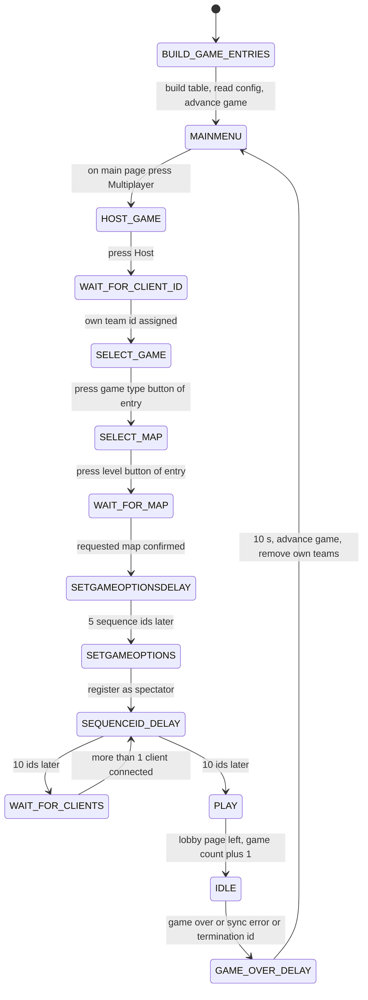
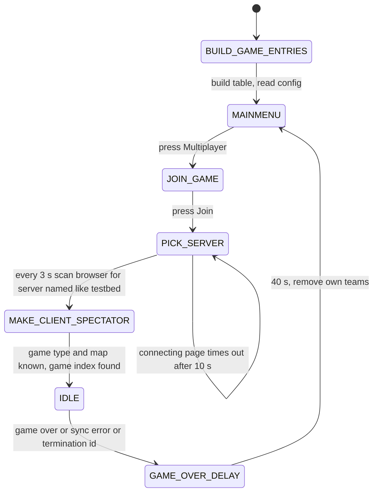

# 32 — Debug, test and performance

> Part B · Baseline build: Release|Win32 (OpenGL) + TARGET_PC_FULLGAME ([B:FULL]); see _work/build_matrix.md.
> Evidence: [C] confirmed · [I] inferred · [U] unknown. Citations are `path:Symbol` relative to the multiwinia/ source root.
> Sources merged: P17a_ui_framework_editor (D1–D7), P20_sequences_loaders_bench (§8 benchmark, §9 test harness), P14_platform_lib (32.P profiler, 32.D debug output / asserts / black box / leak tracking), P15_network (§8 sync checking, §12 bandwidth / network quality / FTP manager), X3_determinism_sync (sync-RNG tracking), P12_render_core (debug renderers, budgets), P16_sound and [27](27_audio_engine.md) §13 (sound tools), P01_app_core (testbed appendix), routed `_meta_*` notes, `phase2_log.md`; every section re-verified against the code by this synthesis (S32).

## Contents

- [1 Scope, summary and build reality](#1-scope-summary-and-build-reality)
- [2 Build-flag table — every debug and test feature](#2-build-flag-table--every-debug-and-test-feature)
- [3 Debug entry points and the debug menu](#3-debug-entry-points-and-the-debug-menu)
- [4 Cheat window — all 23 cheats](#4-cheat-window--all-23-cheats)
- [5 Network statistics window (F9) and other debug windows](#5-network-statistics-window-f9-and-other-debug-windows)
- [6 Testbed mode](#6-testbed-mode)
- [7 Test harness and script test](#7-test-harness-and-script-test)
- [8 Benchmark mode](#8-benchmark-mode)
- [9 Profiler](#9-profiler)
- [10 Logging, asserts, crash and sync logs](#10-logging-asserts-crash-and-sync-logs)
- [11 Debug renderers and visual debug aids](#11-debug-renderers-and-visual-debug-aids)
- [12 Known performance hotspots and budgets](#12-known-performance-hotspots-and-budgets)
- [13 Desync debugging tooling](#13-desync-debugging-tooling)
- [14 Recommendations for the new game's debug and test infrastructure](#14-recommendations-for-the-new-games-debug-and-test-infrastructure)
- [Open questions and unknowns](#open-questions-and-unknowns)
- [Docs-vs-code discrepancies](#docs-vs-code-discrepancies)
- [IP items](#ip-items)
- [Source map](#source-map)
- [Appendix — dead/legacy code](#appendix--deadlegacy-code)

## 1 Scope, summary and build reality

This document specifies every developer-facing debugging, testing, profiling, logging and benchmarking facility in the tree, states exactly which of them exist in the shipped exe, and collects the performance evidence (budgets, caps, instrumented hotspots and claimed numbers) a new team needs to size its own engine.

Summary of what a player's copy of the shipped exe ([B:FULL]) actually contains [C] unless marked:

| Facility | In [B:FULL]? | How reached | Section |
|---|---|---|---|
| Network statistics window | **yes** | `ToggleNetworkStats` = F9 (opens only) | §5.1 |
| Debug log `debug.txt` | **yes** (`DUMP_DEBUG_LOG`) | always written to the profile directory | §10.1 |
| Release asserts + `blackbox.txt` | **yes** | any failed `AppReleaseAssert` / `AppAssert` / container bounds check | §10.2 |
| SEH crash log `ERRORLOG.TXT` + `CRASH.DMP` + support tool | **yes** (`USE_CRASHREPORTING`) | any unhandled exception on the main thread | §10.3 |
| Desync dump `syncerror-…txt` (world-state dump) | **yes** | first NETSYNCERROR received | §10.4, §13 |
| Debug renderers (`DEBUG_RENDER_ENABLED`) | compiled, **almost never drawn** | editor-only or after an IFrame diff (never in FULL); AI overlay via hidden pref `RenderAIInfo` | §11 |
| CPU profiler (`g_profiler`, 186 instrumented sites) | compiled, **unreachable** (no live opener) | Profiler window only from debug/cheat menus | §9 |
| Debug menu ("Tools Menu") | compiled, **unreachable** in every build | its F1 opener is commented out | §3.3 |
| FPS / entity counter overlay | compiled, **forced off** and unreachable | `FPSButton` only on the unreachable debug menu | §3.5 |
| Hidden debug preferences (`RenderAIInfo`, `AIInfoTeam`, `RecordDemo`, `DemoFrameRate`, `TextLanguageTest`, `RenderPosterResolution`, `RenderLandscapeMode`) | **yes** (edit `preferences.txt`) | preferences file | §5.8 |
| Cheat window (23 cheats) | **no** — empty `Create()` | F11 in [B:DEBUG] | §4 |
| Sound editor / stats / profile tools | no | [B:DEBUG] cheat window | §5.3 |
| Sync-RNG forensic log (`TRACK_SYNC_RAND`) | no | [B:DEBUG] | §13 |
| Full world-snapshot sync hashing (IFrames) | no (hash = next sync-RNG draw) | [B:DEBUG] and beta-group builds | §13 |
| Testbed (automated multi-machine soak test) | no — macro defined nowhere | [B:DEAD] | §6 |
| Campaign test harness, script test | no | [B:DEAD] | §7 |
| Benchmark telemetry recorder + FTP upload | no — macro commented out | [B:DEAD] in this tree; shipped in the hardware-compatibility SKU [I] | §8 |
| Network-quality simulator | no | [B:DEAD] | §13.5 |
| Memory-leak tracker | no | [B:DEAD] | §10.6 |
| AVI capture (Grabber) | no | [B:DEBUG], non-functional | §5.4 |

`docs/cpu cycles.txt`, named by the specification as the performance cross-check, contains **no performance data**: it is an early gameplay design note about "programs" that consume "CPU cycles" (task manager, ALT-TAB task switching, CTRL-BREAK termination, gestures, number keys, "Debug Zeppelins") [C] `docs/cpu cycles.txt`. The performance section (§12) is therefore built from code evidence plus the release notes and change logs in `docs/` (logged in Docs-vs-code discrepancies).

Resolved in this document (drafts or earlier notes disagreed; code re-read):
1. Number of debug entry points — P17a/phase2 log said 17; `code/interface/debugmenu.h:DebugKeyBindings` declares **18** static functions (§3.2).
2. Whether the debug menu, and so the profiler, is reachable in FULL (`_meta_contradictions` item 6, [U] there) — **no**: the only call of `DebugKeyBindings::DebugMenu` is commented out in `code/user_input.cpp:UserInput::AdvanceMenus`, no binding exists, and the profiler's other opener is the cheat window, whose body is compiled out in FULL (§3, §9).
3. Whether the desync dump is debug-only — P15 tagged `syncerror-*.txt` as "[B:DEBUG] plus the sync-rand log"; code: `Location::DumpWorldToSyncLog` runs in **every** build, only the prepended sync-RNG call log needs `TRACK_SYNC_RAND` (§10.4).
4. Units of the benchmark's bandwidth columns (P20 [U]) — **bytes per second, 5-second average** (`code/network/bandwidth.cpp:BandwidthCounter::Count`) (§8.4).
5. Cheat-crate default reward `m_reward = −1` (P17a U3, "[I] random") — confirmed: −1 means "normal random selection", any other value forces that reward (`code/worldobject/crate.cpp` reward selection tests `m_rewardId != -1`) (§4.2).
6. Testbed server "10 times faster" (comment in `code/network/server.cpp:Server::AdvanceIfNecessary`) — every branch adds 0.1 s, so there is **no** speed-up (§6.7).
7. START_PROFILE count — P14 counted 192 lines over all of `code/`; this document counts **186** call sites in compiled files (comments and unbuilt files excluded) with `_work/scripts/S_32_profile_sections.py` (§9.5).
8. Sound-tool reachability — already resolved in [27 §13.2](27_audio_engine.md#132-reachability-of-the-tools-bdebug): only "Sound Editor" and "Sound Stats" are reachable, via the [B:DEBUG] cheat window.

## 2 Build-flag table — every debug and test feature

Columns: *Defined in* = where the macro is set (all in `code/lib/universal_include.h` unless stated); *FULL* = state in the baseline; *Files* = files under `code/`, `contrib/systemiv/lib`, `contrib/eclipse` with an `#if…` on it (grep, this synthesis); *Gates* = everything the macro switches. [C] for every row (macro definitions read line by line in `code/lib/universal_include.h`, call sites read in the listed files).

### 2.1 Product-level debug switches

| Macro | Defined in | FULL | Other builds | Files | Gates | Tag |
|---|---|---|---|---|---|---|
| `TARGET_DEBUG` | commented-out target line | **off** | the "debug" target | 20 | turns on `SOUND_EDITOR`, `CHEATMENU_ENABLED`, `GESTURE_EDITOR`, `NETWORK_STATS_ENABLED`, `AVI_GENERATOR`, `TRACK_SYNC_RAND`, `INCLUDE_CRATE_HELP_WINDOW`, TankBattle / Prologue / Campaign modes, and (in `code/worldobject/crate.h`) `INCLUDE_THEBEAST`; does **not** define `DUMP_DEBUG_LOG`. Directly gates: profile directory = working directory (`code/app.cpp:App::GetProfileDirectory`); duplicate-auth-key rejection skipped (`code/network/server.cpp:Server::AuthenticateClient`); full world-snapshot IFrames + SHA-1 sync hash (`code/network/iframe.cpp:IFrame::Generate`); packet-drop key (`code/network/clienttoserver.cpp:ClientToServer::ReceiveLetter`); lobby network-status overlay (`code/UI/GameMenuWindow.cpp:GameMenuWindow::RenderNetworkStatus`); `inputprefs_debug.txt` (`code/lib/input/input.cpp:InputManager::parseInputPrefs`); editor Save/Publish captions and saving into `levels/` (`code/interface/editor_window.cpp`, `code/level_file.cpp`, `code/global_world.cpp`); "Edit Official Maps" button (`code/interface/multiwinia_window.cpp`); Darwinia-mode button → demo page (`code/UI/DarwiniaModeButton.h`); per-datagram server log (`code/network/server.cpp:Server::AdvanceSender`); `Directory` debug checks (`contrib/systemiv/lib/tosser/directory.cpp` defines `_DEBUG`); attack-objective log (`code/worldobject/aiobjective.cpp`); `ToDouble` helper (`code/main.cpp`) | [B:DEBUG] |
| `CHEATMENU_ENABLED` | `TARGET_DEBUG` | off | debug | 7 | cheat-window body (`code/interface/cheat_window.cpp:CheatWindow::Create`); F11 handler (`code/user_input.cpp:UserInput::Advance`); "Cheat Menu (F4)" debug-menu button; special-lighting keys L/K (`code/location.cpp:Location::RenderBuildings`); ×10 refinery speed with Shift (`code/worldobject/mine.cpp:MineBuilding::RefinerySpeed`, single-player only); ×100 rocket fuel with Shift (`code/worldobject/rocket.cpp:EscapeRocket::ProvideFuel`, single-player only) | [B:DEBUG] |
| `NETWORK_STATS_ENABLED` | FULL, DEBUG, BETATEST_GROUP_ALL | **on** | — | 1 | F9 `ControlToggleNetworkStats` → `DebugKeyBindings::NetworkButton` (`code/user_input.cpp:UserInput::Advance`); the window class itself is always compiled | [B:FULL] |
| `DEBUG_RENDER_ENABLED` | global (all targets) | **on** | all | 20 | `code/lib/debug_render.cpp` primitives, `g_debugRenderer` pass, `SyncDiff::Render`, shape/tree hit-check and marker renderers, editor arrows on buildings (§11) | [B:FULL] (mostly unreachable) |
| `TRACK_SYNC_RAND` | `TARGET_DEBUG` (commented out for BETATEST_GROUP_ALL) | off | debug | 9 (+ `#undef` in `code/worldobject/spirit.cpp`, `code/worldobject/snow.cpp`) | per-call sync-RNG log, entity/effect/building state logging around every `Advance`, entity watch list, per-letter command decoding (§13.3) | [B:DEBUG] |
| `DUMP_DEBUG_LOG` | FULL, MULTIWINIA_DEMOONLY, PC_HARDWARECOMPAT, ASSAULT_STRESSTEST, BETATEST_GROUP_ALL, every TARGET_BETATEST_GROUP | **on** | commented out in DEBUG | 1 compiled (`code/main.cpp:Initialise`) + 2 SDL files not built | `AppDebugOutRedirect("debug.txt")` → all `AppDebugOut` text goes to `<profile>debug.txt` instead of `OutputDebugString` | [B:FULL] |
| `USE_CRASHREPORTING` | global | **on** | all | 5 | SEH `__try/__except(RecordExceptionInfo)` around `RunTheGame` (`code/main.cpp:AppMain`), crash log, minidump, support-tool launch (§10.3) | [B:FULL] |
| `XCRASHREPORT_WRITE_MINIDUMP` | `code/lib/exception_handler.cpp` (=1) | **on** | all | 1 | writes `CRASH.DMP` | [B:FULL] |
| `SOUND_EDITOR` | `TARGET_DEBUG`; `#undef` on Linux and Mac | off | debug | 16 | sound editor, effect editor, sample-group editor, parameter editor, Sound Stats, Sound Profile, Pokey playground, `EffectProcessor` instance ([27 §13](27_audio_engine.md#13-profiles-statistics-debug-and-editor-tooling)) | [B:DEBUG] |
| `GESTURE_EDITOR` | `TARGET_DEBUG` | off | debug | 5 | gesture training window and demo recorder — **also** requires `USE_SEPULVEDA_HELP_TUTORIAL`, defined nowhere | [B:DEAD] |
| `AVI_GENERATOR` | `TARGET_DEBUG`; `#undef` on Linux and Mac | off | debug | 7 | Grabber window, `AVIGenerator` (§5.4) | [B:DEBUG] |
| `INCLUDE_CRATE_HELP_WINDOW` | `TARGET_DEBUG` | off | debug | 1 | crate help list on the Help & Options page (`code/interface/helpandoptions_windows.cpp`) | [B:DEBUG] |
| `INCLUDE_THEBEAST` | `code/worldobject/crate.h` inside `#ifdef TARGET_DEBUG` | off | debug | 3 | crate reward "The Beast" (changes `Crate::NumCrateRewards`, so DEBUG and FULL peers disagree on reward ids) ([04 §5.30](04_crates_powerups_and_weapons.md#530-the-beast-bdebug)) | [B:DEBUG] |
| `TRACK_MEMORY_LEAKS` | commented out inside `TARGET_DEBUG` | off | none | 4 | CRT debug-heap `new`, `leaks.txt` report on quit (§10.6) | [B:DEAD] |
| `SPECTATOR_ONLY` | PC_HARDWARECOMPAT, ASSAULT_STRESSTEST (commented in DEBUG) | off | hwcompat, stress | 3 | `App::m_spectator = true` at start; hides Advanced Options in the lobby; game cursor early-outs | hwcompat/stress SKUs |
| `PERMITTED_MAPS` | PC_PREVIEW, PC_HARDWARECOMPAT (`MAPID_MP_KOTH_2P_1`, `MAPID_MP_BENCHMARK_1`, `MAPID_MP_KOTH_4P_1`), ASSAULT_STRESSTEST (`MAPID_MP_ASSAULT_STRESS`), beta groups | off | as listed | 4 | map whitelist | SKU-specific |

### 2.2 Automated-test and benchmark switches

| Macro | Defined in | FULL | Files | Gates | Tag |
|---|---|---|---|---|---|
| `TESTBED_ENABLED` | commented out inside `TARGET_DEBUG` | off (every target) | 16 | multi-machine automated soak test: menu automation, auto-ready, spectator registration, seed override, sync-error counting, `TestBedLog.txt`, rendering/sound toggle, `GRACE_TIME` 20 s, `multiwinia-testbed.txt` blueprints (§6) | [B:DEAD] |
| `TESTBED` (a different, never-defined macro) | nowhere | off | 2 | lobby spectator-button column (`code/UI/GameMenuWindow.cpp`); client timeout 60 s instead of 20 s (`code/network/server.cpp`) | [B:DEAD] |
| `TEST_HARNESS_ENABLED` | nowhere | off | 4 | campaign mission-graph explorer, `test_log.txt` (§7.1) | [B:DEAD] |
| `SCRIPT_TEST_ENABLED` | nowhere | off | 1 | static script validator `Script::TestScript` and error routing (§7.2) | [B:DEAD] |
| `BENCHMARK_AND_FTP` | commented out inside the `TARGET_BETATEST_GROUP` block | off | 4 | per-second telemetry recorder, dxdiag capture, `ncftpput` upload (§8) | [B:DEAD] in this tree |
| `ATTRACTMODE_ENABLED` | nowhere | off | 2 | attract (demo-playback) mode ([09](09_meta_systems.md)) | [B:DEAD] |
| `NETWORKQUALITY_TESTING` | commented out in `code/network/clienttoserver.cpp` | off | 1 | client-side link simulator 200 ms / 25 % loss / 8000 B/s (§13.5) | [B:DEAD] |
| `CHECK_IFRAME_SERIALISATION` | commented out in `code/network/iframe.cpp` | off | 1 | IFrame write/read round-trip self-check (inside the DEBUG branch) | [B:DEAD] |
| `FAKE_SERVERS` | commented out in `code/UI/GameMenuWindow.cpp` | off | 1 | fills the server browser with `NUM_FAKE_SERVER` = 100 random fake servers (browser UI test) | [B:DEAD] |
| `DEBUG_ENTITY_GRID` | commented out in `code/entity_grid.cpp` | off | 1 | entity-grid error visualiser | [B:DEAD] |
| `SOUNDSYSTEM_VERIFY` | commented out in `code/sound/soundsystem.cpp` | off | 1 | `SoundSystem::RuntimeVerify` | [B:DEAD] |
| `FTP_MANAGER_VERBOSE_DEBUG` | **defined** in `code/network/ftp_manager.cpp` | **on** | 1 | logs every FTP block send / timeout / duplicate / ack to `debug.txt` (only active after a desync, §13) | [B:FULL] |
| `FRAMES_PER_SECOND_COUNTER` | defined in `code/lib/opengl_directx.cpp` | D3D only | 1 | 5-second frame counter whose print is commented out → no effect | [B:D3D], inert |

### 2.3 Profiling, logging and language-QA switches

| Macro | Defined in | FULL | Files | Gates | Tag |
|---|---|---|---|---|---|
| `PROFILER_ENABLED` | nowhere | off | 3 compiled | **not** the main profiler (which is always compiled); only the commented-out F10 hot-key and the software-mixer profiler allocation in `code/sound/sound_library_3d.cpp` / `code/sound/soundsystem.cpp` | [B:DEAD] |
| `NO_PROFILER` | nowhere | off | 1 | would compile `START_PROFILE`/`END_PROFILE` to nothing (`contrib/systemiv/lib/profiler.h`) — so the macros are live in FULL | — |
| `SINGLE_THREADED_PROFILER` | Mac block | off | 1 | ignores profile calls from non-main threads (`contrib/systemiv/lib/profiler.cpp:MAIN_THREAD_ONLY`) | Mac only |
| `NO_DEBUG_OUTPUT`, `NO_DEBUG_ASSERT` | nowhere on PC | off → output and asserts compiled | 2 | `AppDebugOut`, `AppDebugAssert` bodies | — |
| `_DEBUG` (VS Debug configurations only) | compiler | **off** (Release) | 18 | `AppDebugAssert` → `_ASSERT` (no-op in Release); `AppReleaseAssertFailed` uses `_ASSERT(false)` instead of black box + `throw`; `ControlDebugCameraFixUp` (`code/camera.cpp`); client time-out disabled (`code/network/server.cpp`); sound-file validation (`SoundSystem::IsSoundSourceOK`) | dev configs |
| `VERBOSE_DEBUG` | commented out | off | 5 | extra sound and SDL logging | [B:DEAD] |
| `TRACK_LANGUAGEPHRASE_ERRORS` | nowhere | off | 2 | missing-phrase tracking in `contrib/systemiv/lib/language_table.cpp` | [B:DEAD] |
| `FOG_LOGGING`, `FOG_PREFERENCE` | nowhere | off | 2 | pref `RenderFog` (0/1/2) logging/enable; `code/lib/debug_fog_logging.cpp` not in the project | [B:DEAD] |
| `OPENGL_DEBUG_ASSERTS` | Mac block | off | 1 | GL error asserts (`code/renderer.h`) | Mac only |
| `AUDIO_DEBUGGING` | commented out in `code/sound/sound_library_3d_xaudio.cpp` | off | 1 | XAudio logging (Xbox 360 remnant) | [B:DEAD] |
| `RENDER_CURSOR_3D` | commented out in `TARGET_DEBUG` | off | 1 | 3-D cursor (`code/gamecursor.cpp`) | [B:DEAD] |
| `USE_DARWINIA_MOD_SYSTEM` | nowhere | off | 7 | `modsEnabled` — when false (always) hides the editor, gesture-editor and four sound-tool buttons of the debug menu | [B:DEAD] |
| `LOCATION_EDITOR` | commented out everywhere | off | 39+ | in-game level editor ([08](08_levels_and_level_design.md)) | [B:EDITOR] |
| `PURITY_CONTROL`, `GIVE_ALL_LEVELS`, `JAMES_FIX` | nowhere | off | 2 / 1 / 1 | editor-loop removal, unlock-all, a Darwinia global-world fix | [B:DEAD] |

`GRACE_TIME` (the pre-match ready period) is 3.0 s, or 20.0 s under `TESTBED_ENABLED` [C] `code/lib/universal_include.h`.

## 3 Debug entry points and the debug menu

### 3.1 Debug controls and hot-keys [C] `data/input/input_preferences.txt`, call sites as listed

| Control (binding) | Default binding | Handler | Effect | Tag |
|---|---|---|---|---|
| `ToggleNetworkStats` | `key f9 down` | `code/user_input.cpp:UserInput::Advance` (`NETWORK_STATS_ENABLED`) | opens "Network Stats" if not open (never closes it; use its close box) — works in menus, lobby and match because `UserInput::Advance` runs in `MainMenuLoop` and `LocationGameLoop` (`code/main.cpp`) | **[B:FULL]** |
| `ToggleCheatMenu` | `key f11 down` (pad `XInput back` line commented out) | `UserInput::Advance` (`CHEATMENU_ENABLED`), only when **no** Eclipse window is open | opens "Cheat Window" | [B:DEBUG] |
| `ToggleEditor` | `key f9 down` (same key as network stats) | handler commented out in `UserInput::Advance` | — | inert |
| `DebugDropPacket` | `key f pressed` | `code/network/clienttoserver.cpp:ClientToServer::ReceiveLetter` (`TARGET_DEBUG`) | discards the incoming letter while held — manual packet-loss test | [B:DEBUG] |
| `CameraDebugRotate` | `mouse right pressed` | `code/camera.cpp:Camera::AdvanceDebugMode` | yaw −0.005·dx, pitch −0.005·dy rad per pixel while in the debug camera sub-mode (§3.4) | [B:FULL] when the sub-mode is active |
| `DebugCameraFixUp` | `key g pressed` | two `Camera::AdvanceSphereWorld*Mode` advancers (`_DEBUG`) | resets the global-world intro/outro camera | dev configs, [B:LEGACY] |
| `ToggleRendering` | `key r down` | `code/location_input.cpp:LocationInput::Advance` (`TESTBED_ENABLED`, testbed on) | toggles testbed rendering + sound (§6.7) | [B:DEAD] |
| `GameDebugQuit` | binding commented out (`XInput leftbumper down`) | `code/main.cpp:HandleCommonConditions` | would set `m_requestQuit`; no binding → never fires | inert |
| `CreateScreenShot` | `key p down` | `code/renderer.cpp:Renderer::Render` (no window open) | screenshot; `RenderPosterResolution` N > 1 renders an N×N tiled poster via `PosterMaker` ([24](24_rendering.md)) | [B:FULL] |
| `RTLoaderPixelWaveIncrease` / `…Decrease` | `key l pressed` / `key k pressed` | `code/location.cpp:Location::RenderBuildings` (`CHEATMENU_ENABLED`) | sets pref `RenderSpecialLighting` 1 / 0 | [B:DEBUG] |
| `ScrollSpeedup` | `key shift pressed` | `MineBuilding::RefinerySpeed` ×10, `EscapeRocket::ProvideFuel` ×100 (`CHEATMENU_ENABLED`, only when `!App::Multiplayer()`) | campaign speed cheats; never in Multiwinia (every Multiwinia game is `Multiplayer()`) | [B:DEBUG] [B:LEGACY] |

Hot-keys that exist only as commented-out code: F1 debug menu (`UserInput::AdvanceMenus`), F2 debug camera, F5 FPS, F10 profiler (`#ifdef PROFILER_ENABLED`), and the F7/F9/F11 sound-tool keys (`UserInput::Advance`) [C].

### 3.2 `DebugKeyBindings` — the 18 static entry points [C] `code/interface/debugmenu.h:DebugKeyBindings`, `code/interface/debugmenu.cpp`

| # | Function | Action | Compiled under | Live caller in FULL |
|---|---|---|---|---|
| 1 | `DebugMenu()` | toggle `::DebugMenu("dialog_toolsmenu")` | always | none (F1 call commented out); `UserInput::m_removeTopLevelMenu` can still close it |
| 2 | `NetworkButton()` | if no window "Network Stats" → `new NetworkWindow("Network Stats")` | always | **F9** |
| 3 | `DebugCameraButton()` | `Camera::SetNextDebugMode()` (cycles §3.4) | always | none |
| 4 | `FollowCameraButton()` | declared, **no definition** | always | none (would not link) |
| 5 | `FPSButton()` | toggle `Renderer::m_displayFPS` | always | none |
| 6 | `InputLogButton()` | declared, **no definition** | always | none |
| 7 | `ProfileButton()` | toggle `ProfileWindow("Profiler")`, 570 × 600 at (ScreenW − 590, 30) | always | none (debug menu, cheat window) |
| 8 | `EditorButton()` | `App::m_requestToggleEditing = true` | `LOCATION_EDITOR` | — |
| 9 | `GrabberButton()` | open `GrabberWindow("Grabber")`, 200 × 50 at (10, ScreenH − 50) | `AVI_GENERATOR` | none anywhere |
| 10 | `GestureButton()` | open `GestureWindow("Gesture Editor")`, 660 × 660 at (30, 30) | `GESTURE_EDITOR && USE_SEPULVEDA_HELP_TUTORIAL` | — |
| 11 | `CheatButton()` | if not open → `CheatWindow("Cheat Window")`, 200 × 200 at (250, 50) | `CHEATMENU_ENABLED` | — (F11 in DEBUG) |
| 12 | `PokeyButton()` | open `PokeyWindow("Pokey Playground")`, 400 × 480 at (10, 40) — class defined nowhere | `SOUND_EDITOR` | — |
| 13 | `SoundStatsButton()` | toggle Sound Stats window | `SOUND_EDITOR` | — (cheat window in DEBUG) |
| 14 | `SoundVisualiserButton()` | declared, **no definition** | `SOUND_EDITOR` | — |
| 15 | `SoundEditorButton()` | toggle Sound Editor, 500 × 550 at (50, 25) | `SOUND_EDITOR` | — (cheat window in DEBUG) |
| 16 | `SoundProfileButton()` | toggle Sound Profile window | `SOUND_EDITOR` | — |
| 17 | `ReallyQuitButton()` | open `ReallyQuitWindow` if not open | always | none on Win32 |
| 18 | `ToggleFullscreenButton()` | `SetWindowed(!Windowed(), true, …)` | always | none on Win32 (only `code/lib/input_sdl.cpp`, not built) |

### 3.3 The "Tools Menu" (`DebugMenu`, window `dialog_toolsmenu`) — compiled, unreachable in every build [C] `code/interface/debugmenu.cpp:DebugMenu::Create`, `DebugMenu::Render`

Window at (10, 20), 170 × 75. Buttons at x = 10, width `m_w − 20` = 150, y advancing by `pitch` = 18 from 5 (plus half-pitch gaps); captions are literal English:

| Order | Caption | Calls | Condition |
|---|---|---|---|
| 1 | "Profile (F6)" | `ProfileButton` | always |
| 2 | "Network Stats" | `NetworkButton` | always |
| 3 | "Display FPS (F5)" | `FPSButton` | always |
| 4 | "Dbg Cam (F2)" (current sub-mode "Always" / "Auto" / "Never" drawn at its right, size 10) | `DebugCameraButton` | always |
| 5 | "Toggle Editor (F3)" | `EditorButton` | `LOCATION_EDITOR` and `modsEnabled` |
| 6 | "Cheat Menu (F4)" (not added to the pad navigation order) | `CheatButton` | `CHEATMENU_ENABLED` |
| 7 | "Gesture Editor" | `GestureButton` | `GESTURE_EDITOR`, `USE_SEPULVEDA_HELP_TUTORIAL`, `modsEnabled` |
| 8 | "Pokey Playground" | `PokeyButton` | `SOUND_EDITOR` and `modsEnabled` |
| 9 | "Sound Stats (F7)" | `SoundStatsButton` | same |
| 10 | "Sound Editor (F8)" | `SoundEditorButton` | same |
| 11 | "Sound Profile (F9)" (caption string "Sound Profile (F8)") | `SoundProfileButton` | same |

`modsEnabled` is the constant `false` unless `USE_DARWINIA_MOD_SYSTEM` (never defined), so rows 5 and 7–11 never appear. The F-key captions are stale: none of those keys is bound to these actions (F1–F8 are task-manager keys) [C] `data/input/input_preferences.txt`. Three option-window buttons (`PrefsScreenButton`, `PrefsGfxDetailButton`, `PrefsSoundButton`) are defined in the same file but never registered [C].

### 3.4 Debug camera sub-mode [C] `code/camera.cpp:Camera::Advance`, `Camera::AdvanceDebugMode`, `Camera::SetNextDebugMode`; full camera spec in [06 §9.3](06_player_control_and_input.md#93-mode-enumeration-15-modes-and-debug-sub-modes)

`m_debugMode ∈ {DebugModeNever 0, DebugModeAlways 1, DebugModeAuto 2}`, default **Auto**; `SetNextDebugMode` cycles 0 → 1 → 2 → 0. Each frame the debug advancer replaces the normal camera mode when no camera animation is playing and (`Always`) or (`Auto` and at least one Eclipse window is open) or the mode is less than 2 frames old. Debug advancer: fly speed `worldSizeX / 30` units/s, ×10 with `CameraSpeedup`, ×0.1 with `CameraSlowdown`; key movement only when **no** window is open (or editing); RMB rotation as in §3.1; mouse uncaptured.

Consequence in FULL [C]: opening the F9 window during a match (Auto + one window open) switches the camera to the debug advancer, which then cannot translate (a window is open) — the view freezes except RMB rotation — and `LocationInput::Advance` / `teamControls.Advance()` issue no team orders while any window is open (`code/location_input.cpp:LocationInput::Advance`, `code/main.cpp:LocationGameLoop`). The statistics window is therefore an observation tool, not something a player can leave open while playing.

### 3.5 FPS and entity-count overlay [C] `code/renderer.cpp:Renderer::Renderer`, `Renderer::RenderFrame`, `Renderer::FPSMeterAdvance`

`m_displayFPS` defaults to `true` and is forced to `false` under `TARGET_PC_FULLGAME`. When on (and the interface is not hidden) it draws, right-aligned at (ScreenW − 10, ScreenH − 40), "FPS: %d   DWs: %d" (`Renderer::m_fps`, `Entity::s_entityPopulation`) inside a location, "FPS: %d" elsewhere. `m_fps` = frames counted in the last wall-clock second. The only toggle is `FPSButton` (unreachable) → **no FPS display exists in the shipped game**. A dead block in `PrefsGraphicsWindow::Render` (after an unconditional `return`) would have shown "%d FPS" and per-section CPU percentages (`RenderCPUUsage`, `m_lastTotalTime × 100` of named root profile elements) in the graphics options [C] `code/interface/prefs_graphics_window.cpp`.

## 4 Cheat window — all 23 cheats

### 4.1 Build tag, opening and layout [C] `code/interface/cheat_window.cpp:CheatWindow::Create`, `code/interface/debugmenu.cpp:DebugKeyBindings::CheatButton`

- The `CheatWindow` class is compiled in every build; its `Create()` body is inside `#ifdef CHEATMENU_ENABLED`. In FULL `Create()` is empty and nothing opens the window → **[B:DEBUG] only**.
- Opened by F11 (`ToggleCheatMenu`) only when no Eclipse window is open, or by "Cheat Menu (F4)" on the unreachable debug menu. Window "Cheat Window", 200 × 200 at (250, 50); buttons are added below the nominal height.
- Layout: buttons start at y = 25, pitch 20; full-width buttons x = 10, w = `m_w − 20` = 180; paired buttons w = `(m_w − 25)/2` = 87, the second column at x = 10 + 87 + 5 = 102; the crate pair is "GoodCrate" at x = 10, w = `m_w/2 − 20` = 80 and the "Crates" drop-down at x = `m_w/2` = 100, w = `m_w/2 − 10` = 90. All buttons are in `m_buttonOrder` (pad navigable). Captions are literal English (no language table).
- Every spawn cheat aims at the **screen centre**: `Camera::GetClickRay(ScreenW/2, ScreenH/2)` → `Landscape::RayHit` → position P.

### 4.2 Every cheat [C] `code/interface/cheat_window.cpp` (one class per button)

| # | Caption | Class | Effect | Build condition |
|---|---|---|---|---|
| 1 | Kill All Enemies | `KillAllEnemiesButton` | for every team t with `!Location::IsFriend(myTeamId, t)`: every entity of every unit and every entity in `m_others` gets `ChangeHealth(−2 × m_stats[StatHealth])`; then **every** AntHill and Triffid building (any team) gets `Damage(−999)` | location loaded |
| 2 | Spawn Green | `SpawnDarwiniansButton` (`m_teamId` 0) | `Location::SpawnEntities(P, team, unit −1, TypeDarwinian, 20, zero velocity, spread 30)` | location loaded |
| 3 | Spawn Red | same (`m_teamId` 1 — assigned only if a location existed when the window was created; otherwise uninitialised, harmless because the click requires a location) | as 2 | same |
| 4 | Spawn Yellow | same (2) | as 2 | same |
| 5 | Spawn Blue | same (3) | as 2 | same |
| 6 | Spawn Virus | same (`Location::GetMonsterTeamId()` at creation) | as 2, monster team | same |
| 7 | Spawn Future | same (`Location::GetFuturewinianTeamId()` at creation) | as 2, Futurewinian team | same |
| 8 | Spawn Armour | `SpawnTankButton` | `SpawnEntities(P, team 2, −1, TypeArmour, 1, zero, 0)` — always team 2 | same |
| 9 | Spawn Virii | `SpawnViriiButton` | `SpawnEntities(P, monster team, −1, TypeVirii, 20, zero, spread 0, range 1000)` | same |
| 10 | Spawn Spirits | `SpawnSpiritButton` | 10 × `Location::SpawnSpirit(P + (SFRAND(20), 0, SFRAND(20)), zero, team 2, empty id)` — `SFRAND` is the **synced** RNG (±10 units jitter) | same |
| 11 | Allow Arbitrary Placement | `AllowArbitraryPlacementButton` | `GetMyTaskManager()->m_verifyTargetting = false` — `TaskManager::IsValidTargetArea` then skips its placement rules (officer needs a Darwinian within 10, etc.) | same |
| 12 | Enable Generator and Mine | `EnableGeneratorAndMineButton` | global buildings `TypeGenerator` at location "generator" and `TypeRefinery` at "mine" → `m_online = true`; `GlobalWorld::EvaluateEvents()` | always; [B:LEGACY] (Darwinia campaign) |
| 13 | Enable Receiver and Buffer | `EnableReceiverAndBufferButton` | same for `TypeSpiritProcessor` at "receiver" and `TypeBlueprintStore` at "pattern_buffer" | [B:LEGACY] |
| 14 | Open All Locations | `OpenAllLocationsButton` | every `GlobalLocation::m_available = true` | [B:LEGACY] |
| 15 | Give all research | `GiveAllResearchButton` | for every research type: `GlobalResearch::AddResearch(i)` (only acts if level < 1), single-player only `SetCurrentProgress(i, 400)`, `EvaluateLevel(i)` (level +1 when progress ≥ required) | always; [I] a no-op in Multiwinia, where every research level is preset ≥ 1 ([02 §2.3](02_units_and_entities.md#23-research-levels-are-fixed-in-multiwinia)) and progress stays 0 |
| 16 | Clear Resources | `ClearResourcesButton` | `Resource::FlushOpenGlState()` then `RegenerateOpenGlState()` — drops and rebuilds every texture, display list and shape list (exercises the device-loss path) | always |
| 17 | Spawn Ports | `SpawnPortsButton` | for every building and every port: `SpawnEntities(portPos, team 0, −1, TypeDarwinian, 3, zero, 30)` — **no** location null-check (crash if used in a menu) | always |
| 18 | GoodCrate + "Crates" drop-down | `CrateCreateButton` + `DropDownMenu` | drop-down lists `Crate::GetName(p)` for p = 0 … `Crate::NumCrateRewards − 1` (raw names; includes The Beast in DEBUG), bound to `m_reward` (default −1 = normal random reward). Button: create a `Crate` building at (P.x, **300**, P.z) from a template, `SetDetail(1)`, id `(255, UNIT_BUILDINGS, −1, GlobalWorld::GenerateBuildingId())`, `m_rewardId = m_reward`, `MarkerSystem::RegisterMarker_Crate`. `m_good` is set but never read | only added when `App::Multiplayer()` |
| 19 | Profiler | `ProfilerCreateButton` | `DebugKeyBindings::ProfileButton()` (§9) | always |
| 20 | Sound Editor | `SoundEditorCreateButton` | `SoundEditorButton()` ([27 §13.3](27_audio_engine.md#133-tool-windows)) | `SOUND_EDITOR` |
| 21 | Sound Stats | `SoundStatsCreateButton` | `SoundStatsButton()` | `SOUND_EDITOR` |
| 22 | Network Stats | `NetworkStatsCreateButton` | `NetworkButton()` (§5.1) | always |
| 23 | Show Dr S Face | `ShowDrSepulvedaFaceButton` | `Clouds::ShowDrSFace()` → `m_faceTime = now`; from 5 s to 30 s later the sky draws an 800-unit face texture 800 units up at the map centre, alpha `min(t − 5, 1)`; from 28 s the alpha is recomputed as `min(t − 28, 1)`, i.e. it drops to 0 and ramps up again (an inverted fade-out), and every frame writes "alpha = %f" / "alpha2 = %f" to the debug log (`Clouds::Render`, `Clouds::RenderFace`). Registered under the button **name "Network Stats"** (caption "Show Dr S Face") → name lookups collide with button 22 | always |

### 4.3 Network safety — which cheats desynchronise [C] mechanism, [I] consequence

None of the 23 buttons sends a network message: every action mutates the **local** copy of the simulation directly (no `ClientToServer::Request…` call in the file) [C]. In a lockstep game ([22](22_determinism_and_networking.md)) every simulation mutation that is not replayed on the other peers is a desync. In TARGET_DEBUG — the only build where cheats exist — the per-frame sync value is the SHA-1 of a full world snapshot (positions, velocities, fronts of every unit, entity, laser, effect and building) [C] `code/network/iframe.cpp:IFrame::Generate`, so any state-changing cheat is detected at the next frame comparison and freezes the match (§13). A game with a single client (one human versus CPU teams; CPU teams are not network clients) has nobody to disagree with and never reports a desync [C] `code/network/server.cpp:Server::HandleSyncMessage` compares only the values of connected clients.

| # | Cheat | Mutates simulation? | With ≥ 2 clients |
|---|---|---|---|
| 1 | Kill All Enemies | yes (health of every enemy entity, ant hills, triffids) | **desync** |
| 2–7 | Spawn Darwinians (6 teams) | yes (+20 entities, entity ids, population counters) | **desync** |
| 8 | Spawn Armour | yes | **desync** |
| 9 | Spawn Virii | yes | **desync** |
| 10 | Spawn Spirits | yes, and draws 20 values from the synced RNG on one peer only | **desync** (also detectable by the FULL-style RNG-position hash) |
| 11 | Allow Arbitrary Placement | changes only the local copy of the player's task manager; `TaskManager::TargetTask` (run on every peer from the networked target command) calls `IsValidTargetArea`, so a placement accepted locally is rejected remotely | **desync on the first otherwise-invalid placement** [I] |
| 12–14 | Global-world (campaign) cheats | global world state only; not read by Multiwinia rules [I] | none expected [I] |
| 15 | Give all research | no change in Multiwinia [I] | none expected [I] |
| 16 | Clear Resources | render resources only; tree geometry (and the tree hit-check radius computed while building it) is regenerated from the same per-tree seed, re-seeding the unsynced `AppRandom` LCG (`code/worldobject/tree.cpp:Tree::Generate`) | none [I] |
| 17 | Spawn Ports | yes | **desync** |
| 18 | GoodCrate | yes (new building, `GenerateBuildingId` advances the global building-id counter) | **desync** |
| 19–22 | Profiler, Sound Editor, Sound Stats, Network Stats | no (tools; audio is outside the determinism boundary, [27 §15](27_audio_engine.md#15-determinism-boundary)) | safe |
| 23 | Show Dr S Face | no (sky render only, wall-clock timed) | safe |

A replacement must route every cheat through the command stream (a "debug command" message sequenced by the server like any other order) so that all peers apply it on the same tick, and the server must refuse debug commands unless the session was created with cheats enabled.

### 4.4 Other cheat hooks under `CHEATMENU_ENABLED` [C]

| Hook | Effect | Ref |
|---|---|---|
| L / K (`RTLoaderPixelWaveIncrease` / `Decrease`) during `Location::RenderBuildings` | pref `RenderSpecialLighting` := 1 / 0 (warm key light on buildings; render only) | `code/location.cpp:Location::RenderBuildings` |
| Shift held, single-player | Refinery speed ×10 | `code/worldobject/mine.cpp:MineBuilding::RefinerySpeed` |
| Shift held, single-player | Escape-rocket fuel per delivery ×100 | `code/worldobject/rocket.cpp:EscapeRocket::ProvideFuel` |

## 5 Network statistics window (F9) and other debug windows

### 5.1 "Network Stats" window — ships in FULL [C] `code/interface/network_window.cpp:NetworkWindow::Create`, `NetworkWindow::Render`

Size 600 × 200; on a host (`App::m_server` non-NULL) the height becomes `170 + (6 × 20 + 15)` = 305 and an `InvertedBox` panel is registered at (10, 110), w = `m_w − 20`, h = 135 for the client table. Positioned bottom-left at (10, ScreenH − h). Font `g_editorFont`; every caption literal English. Text lines are 15 px apart starting at `m_y + 15`.

**Server block (host only)**, size-12 text at x + 10:

| Line | Value | Source |
|---|---|---|
| "Server SeqID       %d" | last sequence id issued | `Server::m_sequenceId` |
| "Server Send        %2.1 Kb/sec" | send rate | `(int)Server::m_sendRate / 1024.0` |
| "Server Receive     %2.1 Kb/sec" | receive rate | `(int)Server::m_receiveRate / 1024.0` |

The format `"%2.1 Kb/sec"` has no conversion letter and receives a `double` → the printed number is undefined (bug; see 32-U6). A horizontal rule follows; then a header row (size 14) "ID", "IP:Port", "SeqID", "Name", "Status" at column offsets 0, 60, 200, 260, 410 from `m_x + 20`, the sync flag at +500.

Up to **6** client rows (`maxClients = 6` hard-coded; slots ≥ 6 are never shown), 20 px apart. For each valid `ServerToClient`:

| Column | Content |
|---|---|
| ID | `m_clientId` (colour (200,200,255,200)) |
| IP:Port | `"%s:%d"` of `m_ip`, `m_port` |
| SeqID | `m_lastKnownSequenceId` |
| Name | translated team-type name (`LANGUAGEPHRASE(Team::GetTeamType(teamType))`) of the lobby team whose `m_clientId` matches, in that team's colour |
| Status | `timeBehind = now − m_lastMessageReceived`; if > **2.0 s** → red "Lost Con...%ds"; else if not `m_caughtUp` → (200,200,30) "Synching...%d" with `100 × lastKnownSeq / serverSeq`; else "Ping %dms" with `latencyMs = (serverSeq − lastKnownSeq) × 100` (one sequence = 100 ms, the 10 Hz server tick) and colour red = `min(255, 20 × lagSteps)`, green = 255 − red |
| sync flag | red "out of sync" when `m_syncErrorSeqId ≠ −1` |

Empty slots print "Empty" at alpha 50.

**Client block** (whenever `App::m_clientToServer` exists):
- If `g_lastProcessedSequenceId ≥ 0`: caption (size 13) "Sequence messages in queue. Ideal is 0 or 1 filled, no gaps." at `m_y + m_h − 50`, then a strip at `m_y + m_h − 25`: label "SeqID %d" (last processed id), then 10 boxes for ids last+1 … last+10, each `(m_w − 120)/10` = 48 px wide minus a 20 % gap, 20 px high, background (20,20,50), filled green (0,255,0) when `ClientToServer::IsSequenceIdInQueue(id)`, frame (255,255,255,100).
- Non-host clients add "Server Known     SeqID   %d" (`m_serverSequenceId`), "Server Estimated SeqID   %d" (`GetEstimatedServerSeqId()`) and a centred size-15 "Estimated Latency : %2.1 secs" (`GetEstimatedLatency()`, same broken format).
- Right column at x + 250 from the top: "Client SEQID       %d" (`m_lastValidSequenceIdFromServer`), "Client Send … Kb/sec", "Client Receive … Kb/sec" (`m_sendRate`, `m_receiveRate`, same broken format).

Diagnostic value: the window exposes exactly the lockstep health indicators — per-client sequence lag (≈ ping in 100 ms steps), catch-up state, last-message age with a 2.0 s "lost" display threshold, the per-client desync flag and the client's inbox gaps. Rates are 5-second averages in bytes/s from `BandwidthCounter` (`code/network/bandwidth.cpp:BandwidthCounter::Count`: when more than 5.0 s have passed since `m_since`, `m_rate = m_count / period`, then the count restarts); there is no bandwidth limiting anywhere, only measurement ([22](22_determinism_and_networking.md)).

### 5.2 Profiler window → §9.

### 5.3 Sound tools [B:DEBUG]

Sound Editor, Effect Editor, Sample-group editor, Parameter editor, Purge Sounds, Sound Stats, Sound Profile and the Pokey playground are specified in [27 §13](27_audio_engine.md#13-profiles-statistics-debug-and-editor-tooling). Reachability: only "Sound Editor" and "Sound Stats", from cheat-window buttons 20–21; the debug-menu entries need `modsEnabled` (never true) and the hot-keys are commented out [C] `code/interface/debugmenu.cpp`, `code/user_input.cpp`. `PokeyWindow` is referenced but defined nowhere, so a `SOUND_EDITOR` build that compiled `DebugKeyBindings::PokeyButton` would need that class [C grep].

### 5.4 Grabber window (AVI capture) [B:DEBUG, non-functional] [C] `code/interface/grabber_window.cpp`, `code/lib/avi_generator.cpp`, `code/lib/hi_res_time.cpp`

Buttons "Start" (10, 30, 70 × 15) and "Stop" (90, 30, 70 × 15). Start (if no generator): `SetFakeTimeMode()` (freezes `GetHighResTime` at the current value so the game advances only by explicit `IncrementFakeTime` steps), create `App::m_aviGenerator` with a `BITMAPINFOHEADER` of ScreenW × ScreenH, 24 bpp, `BI_RGB`, `InitEngine()`. Stop: `SetRealTimeMode()` (re-bases real time by the frozen offset), `ReleaseEngine()`, delete. `AVIGenerator` reads prefs `AVIMotionBlurFactor` (default 1) and `DemoFrameRate` (default 25). **No code calls `AVIGenerator::AddFrame()`** and `GrabberButton` has no caller, so capture never records a frame [C grep]. The fixed-step clock it relies on is advanced only when pref `RecordDemo` is 1 or 2 (`code/main.cpp:UpdateAdvanceTime`: `g_advanceTime = 1/DemoFrameRate`, `IncrementFakeTime(1/DemoFrameRate)` per frame) — see [31 §4.2](31_platform_build_and_tools.md#42-fake-time-offline-capture-c-codelibhi_res_timecpp-codemaincppupdateadvancetime-codeinterfacegrabber_windowcpp).

### 5.5 Gesture editor [B:DEAD] [C] `code/interface/gesture_window.cpp`, `code/gesture_demo_win32.cpp`

Training tool for the gesture recogniser ([06](06_player_control_and_input.md)): a 4:3 drawing box (height `m_h − 180`) where mouse-down/up record a sample; `(m_w − 100)/110` status tiles of 90 × 120 each showing gesture *i*'s task name (`TaskManager::MapGestureToTask`), icon `icons/gesture_<taskname>.bmp` (64 × 64, additive), number of training samples, confidence % and Mahalanobis deviation, the recognised symbol framed yellow; buttons "Record Demo" (`RecordGestureDemo()` — a recorder thread at `THREAD_PRIORITY_TIME_CRITICAL`), "New Gesture" (caption "New Demo", `NewSymbol()`), "Load Data" / "Save Data" (`gestures.txt`). Requires `GESTURE_EDITOR` **and** `USE_SEPULVEDA_HELP_TUTORIAL` → compiled out everywhere.

### 5.6 Lobby network-status overlay [B:DEBUG] [C] `code/UI/GameMenuWindow.cpp:GameMenuWindow::RenderNetworkStatus`

Drawn on two front-end pages only under `TARGET_DEBUG`, `g_gameFont` size 15, line height 18, from (10, 10), colour (1,1,1,0.2): on a host the header "IP:Port [Sent/Known/CaughtUp]" and one line per client `"%s [%d/%d/%d]"` (`m_lastSentSequenceId`, `m_lastKnownSequenceId`, `m_caughtUp`); then the client connection state: "Disconnected", "Connecting (%d)" (attempts), "Handshaking (%d/%d)" (`g_lastProcessedSequenceId` / `m_lastValidSequenceIdFromServer`) or "Connected".

### 5.7 Crate help window [B:DEBUG] [C] `code/interface/helpandoptions_windows.cpp`

`INCLUDE_CRATE_HELP_WINDOW` adds a "multiwinia_menu_cratehelp" button to the Help & Options page that opens a list of every crate reward with its tooltip/hint strings ([04](04_crates_powerups_and_weapons.md)).

### 5.8 Hidden preferences that act as debug switches [B:FULL] [C] (pref reads as listed; full key list in [29](29_data_formats_reference.md))

| Preference | Default | Effect | Ref |
|---|---|---|---|
| `RenderAIInfo` | 0 | 1 → every AITarget prints the AI priority `m_priority[t]` ("%2.2f", outlined, team colour) for one team at 60 + 15·t above the node; ≠ 0 → arrows along every AITarget link (half length, width 3, grey for neutral, team colour otherwise). The AIObjective / marker overlays it also tests are inside `#ifdef LOCATION_EDITOR` → nothing in FULL ([07 §18](07_ai.md#18-debug-visualisation)) | `code/worldobject/ai.cpp:AITarget::Render`, `AITarget::RenderAlphas`, `code/worldobject/aiobjective.cpp:AIObjective::RenderAlphas` |
| `AIInfoTeam` | 1 | lobby **position** whose priorities `RenderAIInfo` shows (`Location::GetTeamFromPosition`) | `code/worldobject/ai.cpp:AITarget::Render` |
| `RecordDemo` | absent (0) | 1 → fixed time step `1/DemoFrameRate` and `Server::SaveHistory("serverHistory.dat")` when the game shuts down; 2 → fixed step and `Server::LoadHistory("ServerHistory.dat")` after the level loads (command-stream replay, [22](22_determinism_and_networking.md)) | `code/main.cpp:UpdateAdvanceTime`, `code/app.cpp:App::ShutdownCurrentGame` |
| `DemoFrameRate` | 25 | frames per simulated second for `RecordDemo` and the AVI generator | `code/main.cpp:UpdateAdvanceTime`, `code/lib/avi_generator.cpp` |
| `TextLanguageTest` | 0 | 1 → `LangTable::TestAgainstEnglish` writes `language_errors.txt` (strings missing versus English) in the working directory ([31 §12.5](31_platform_build_and_tools.md#125-in-game-qa-c-codeliblanguage_tablecpplangtabletestagainstenglish)) | `code/app.cpp:App::SetLanguage`, `code/lib/language_table.cpp` |
| `RenderPosterResolution` | 1 | N > 1 → the screenshot key renders an N × N tiled high-resolution poster | `code/renderer.cpp:Renderer::Render`, `code/lib/poster_maker.cpp` |
| `RenderLandscapeMode` | −1 (auto) | forces vertex arrays / display lists / VBOs for the terrain mesh (§12.3) | `code/landscape_renderer.cpp:LandscapeRenderer::LandscapeRenderer` |
| `RenderSpecialLighting` | 0 | warm key light on buildings | `code/location.cpp:Location::RenderBuildings` |
| `TestHarness` | absent | 1 → runs the campaign test harness, only with `TEST_HARNESS_ENABLED` (§7) | `code/main.cpp:RunTheGame` |
| `TestbedServerName` | — | server name the testbed hosts / looks for, only with `TESTBED_ENABLED` (§6) | `code/app.cpp:App::App` |

Command-line switches with a diagnostic role: `--write-version` (write `DARWINIA_VERSION` to a file `version` and exit) and `--NoProfile` (use the working directory instead of the profile directory for every log) [C] `code/main.cpp:AppMain`, `code/main.cpp:Initialise` ([31 §5.4](31_platform_build_and_tools.md#54-command-line-switches-c)).

## 6 Testbed mode

### 6.1 Purpose, build tag and activation [B:DEAD] [C] `code/UI/TestBedButtons.h:StartTestbedButton`, `code/UI/GameMenuWindow.cpp:GameMenuWindow::SetupMainPage`, `code/app.h`

The testbed is an **unattended multi-machine soak test of the lockstep network game**: one machine runs as testbed *server*, any number of others as testbed *clients*; the server walks through every (game mode, map) pair, every machine joins as a spectator so the CPU teams play the whole match, and sync errors are counted and logged per game. It exists only with `TESTBED_ENABLED`, which is commented out inside the `TARGET_DEBUG` block and defined in no target → dead at this commit.

Activation: two extra main-menu buttons after "Help and options" — "start_testbed_server" (`StartTestbedButton(TESTBED_SERVER)`, text `start_testbed_server` = "Testbed Server") and a second button whose caption is `start_testbed_client` ("Testbed Client") but whose **name is also "start_testbed_server"** (name collision). `MouseUp` sets: mode `TESTBED_ON`, state `TESTBED_BUILD_GAME_ENTRIES`, type server/client, game mode −1, map −1, game count 0, sync-error count 0, rendering **off**, `m_iGameIndex = 4`, `m_iLastGameIndex = 0`. The driver `GameMenuWindow::UpdateTestBed()` runs every front-end frame (`GameMenuWindow::Update`).

Enumerations [C] `code/app.h`: `TESTBED_MODE {TESTBED_ON, TESTBED_OFF}`; `TESTBED_TYPE {TESTBED_CLIENT, TESTBED_SERVER}`; `TESTBED_STATE {TESTBED_MAINMENU, TESTBED_HOST_GAME, TESTBED_JOIN_GAME, TESTBED_PICK_SERVER, TESTBED_WAIT_FOR_CLIENT_ID, TESTBED_SELECT_GAME, TESTBED_SELECT_MAP, TESTBED_SETGAMEOPTIONSDELAY, TESTBED_SETGAMEOPTIONS, TESTBED_WAITFORGAMEOPTIONS, TESTBED_WAIT_FOR_MAP, TESTBED_WAIT_FOR_CLIENTS, TESTBED_PLAY, TESTBED_IDLE, TESTBED_GAME_OVER_DELAY, TESTBED_MAKE_CLIENT_SPECTATOR, TESTBED_SEQUENCEID_DELAY, TESTBED_BUILD_GAME_ENTRIES}` (18 values; `TESTBED_WAITFORGAMEOPTIONS` is never entered); `TESTBED_PROGRESSION {TESTBED_LINEAR, TESTBED_RANDOM, TESTBED_SEQUENCE}` (`code/UI/GameMenuWindow.cpp`).

App state (24 fields) [C] `code/app.h`: `m_eTestBedMode`, `m_eTestBedType`, `m_eTestBedState`, `m_fTestBedDelay`, `m_fTestBedLastTime`, `m_fTestBedCurrentTime`, `m_iDesiredSequenceID`, `m_eNextState`, `m_iClientCount`, `m_iGameMode`, `m_iGameMap`, `m_iGameIndex`, `m_iLastGameIndex`, `m_iGameCount`, `m_iNumSyncErrors`, `m_cGameMode[100]`, `m_cGameMap[100]`, `m_iClientRandomSeed`, `m_bRenderOn`, `m_iLastGame`, `m_iLastMap`, `m_testbedServerName` (pref `TestbedServerName`), `m_iTerminationSequenceID`; accessors `Get/SetTestBedMode`, `Get/SetTestBedType`, `Get/SetTestBedState`, `GetTestBedServerName`, `Get/SetTestBedGameIndex`, `Get/SetTestBedGameMode`, `Get/SetTestBedGameMap`, `GetTestBedGameCount`, `IncrementGameCount`, `ResetGameCount`, `GetTestBedNumSyncErrors`, `IncremementNumSyncErrors`, `ResetNumSyncErrors`, `Set/GetTestBedClientRandomSeed`, `SetSequenceIDDelay(seq, next)` (store target id and next state, enter `TESTBED_SEQUENCEID_DELAY`), `ToggleTestBedRendering`, `GetTestBedRendering`, `SetTestBedRenderOn`, `SetTestBedRenderOff`, `TestBedLogWrite`.

### 6.2 The game table and progressions [C] `code/UI/GameMenuWindow.cpp:BuildGameEntries`, `GameMenuWindow::AdvanceTestBedGame`, `FindGameEntry`

- `BuildGameEntries`: one `GAME_ENTRY {gameNumber, mapNumber, mapCRC}` for every valid map of every game-type list `GameMenu::m_maps[i]` **except list index 6** (the code comment: the menu finds 7 game types but buttons exist for only 6). Defect: `m_iMapCRC` is read from `maps.GetData(i)` (the game-type index) instead of `x` — wrong or out-of-range [C].
- `AdvanceTestBedGame` (server only; clients learn the game from the server they join):
  - `LINEAR`: index + 1 while index < number of entries (it is called right after the table is built, so **entry 0 is skipped**; once index reaches the table size it stays there and the next `g_vGameEntries[index]` read is out of bounds) [C].
  - `RANDOM`: `rand() % entries` (CRT `rand`, seeded `srand(time(NULL))` on table build).
  - `SEQUENCE`: walk the `AddSequenceItem` list cyclically; each item sets the entry index and a forced sync seed `g_iSelectedRandSeed`.

### 6.3 `testbedconfig.txt` [C] `code/UI/GameMenuWindow.cpp:GameMenuWindow::ReadTestBedConfig`

Read from the **working directory** (`TextFileReader("testbedconfig.txt")`, not the resource archives) at `TESTBED_BUILD_GAME_ENTRIES`; missing file → defaults (LINEAR, seed 0, no termination). One command per line, tokens separated by whitespace, `#` starts a comment (TextReader rules, [29](29_data_formats_reference.md)). No such file ships in the tree [C].

```
SetProgression LINEAR | RANDOM | SEQUENCE
SetRandSeed <int>                 # 0 = use the server's normal seed
SetTestBedName <word>             # sscanf "%s": a single token, overrides pref TestbedServerName
AddSequenceItem <gameIndex> <seed> # appended to the SEQUENCE list (list cleared on each read)
SequenceIDToTerminateOn <int>     # end each game when g_lastProcessedSequenceId reaches it (0 = off)
```

### 6.4 Server automation [C] `code/UI/GameMenuWindow.cpp:GameMenuWindow::UpdateTestBed`

Every frame, before the switch: if a server exists, `Server::m_iRandSeed = g_iSelectedRandSeed` and `m_bRandSeedOverride = (seed ≠ 0)`; if a client exists, `ReliableSetTeamName(testbed name)`.



Details per state:
- `TESTBED_MAINMENU`: delay and client count reset; on `PageMain` press `NewOrJoinButton` "multiwinia_menu_multiplayergame".
- `TESTBED_HOST_GAME`: on `PageNewOrJoin` press "multiwinia_menu_hostgame".
- `TESTBED_WAIT_FOR_CLIENT_ID`: wait until `GlobalWorld::m_myTeamId ≠ 255`.
- `TESTBED_SELECT_GAME`: on `PageGameSelect` press the game-type button for entry `gameNumber` 0–5 ("multiwinia_gametype_domination", "…_kingofthehill", "…_capturethestatue", "…_assault", "…_rocketriot", "…_blitzkrieg") and copy the English mode name into `m_cGameMode` ("Domination", "King Of The Hill", "Capture the Statue", "Assault", "Rocket Riot", "Blitzkrieg").
- `TESTBED_SELECT_MAP`: on `PageMapSelect` press the `LevelSelectButton` named by the map's level name (or file name); `m_cGameMap` = translated map name.
- `TESTBED_WAIT_FOR_MAP`: when `m_localSelectedLevel == m_requestedMapId` and the map index is valid, remember the current sequence id.
- `TESTBED_SETGAMEOPTIONSDELAY`: wait 5 sequence ids (0.5 s).
- `TESTBED_SETGAMEOPTIONS`: `RequestToRegisterAsSpectator(myTeamId)` (time-limit option code is commented out), then `SetSequenceIDDelay(+10, WAIT_FOR_CLIENTS)`.
- `TESTBED_WAIT_FOR_CLIENTS`: on `PageGameSetup`, when `Server::m_clients.NumUsed() > 1` → `SetSequenceIDDelay(+10, PLAY)`.
- `TESTBED_PLAY`: the lobby's "all ready" test is replaced by `notReady = (state ≠ TESTBED_PLAY)` (`GameMenuWindow::UpdateMultiplayerPage`), so the game starts; when the page changes away from `PageGameSetup` → game count + 1, `TESTBED_IDLE`.
- `TESTBED_GAME_OVER_DELAY`: accumulate wall time; after **10 s** advance to the next entry, remove own teams, clear spectator, back to `TESTBED_MAINMENU`.

### 6.5 Client automation [C] same function, client branch



- `TESTBED_PICK_SERVER`: on `PageJoinGame`, every **3 s** walk `m_serverButtons`; pick the first `GameServerButton` whose `m_hostName` equals the testbed name and whose map name is not "Unknown Map"; copy game type and map into the log fields, `MouseUp` (the "server full" refusal is bypassed in testbed mode, `code/UI/GameServerButton.h`), game count + 1.
- On `PageGameConnecting` the testbed accumulates time and after **10 s** without connecting presses "multiwinia_menu_back" and returns to `TESTBED_PICK_SERVER` (`GameMenuWindow::UpdateGameConnectingPage`; the timer is reset when `GameMenuWindow::JoinServer` starts the connection).
- `TESTBED_MAKE_CLIENT_SPECTATOR`: when `m_gameType` and `m_requestedMapId` are known, `m_iGameIndex = FindGameEntry(type, map)` → `TESTBED_IDLE`. The server registers every testbed client as a spectator on join (§6.7).
- `TESTBED_GAME_OVER_DELAY`: **40 s**, then remove own teams, clear spectator, `TESTBED_MAINMENU`.
- Disconnection by the server (disconnect letter) → `TESTBED_MAINMENU` [C] `code/network/clienttoserver.cpp:ClientToServer::ProcessServerLetters`.

### 6.6 In-match automation and `TestBedLog.txt` [C] `code/location_input.cpp:LocationInput::Advance`, `code/app.cpp:App::TestBedLogWrite`

In a match with testbed on:
1. During the grace period the ready toggle is replaced by an automatic `RequestSetTeamReady(myTeamId)` every frame (no window open).
2. If `ClientToServer::m_outOfSyncClients` is non-empty: leave the location (`m_requestedLocationId = −1`, `m_atMainMenu = true`), and unless already in `GAME_OVER_DELAY` increment `m_iNumSyncErrors` and write a log row; state → `GAME_OVER_DELAY`.
3. If `m_iTerminationSequenceID ≠ 0` and reached: leave, log a row, `GAME_OVER_DELAY`.
4. On `Multiwinia::GameOver()` with no window open: leave, log a row (unless already delaying), `GAME_OVER_DELAY`.

`TestBedLogWrite` appends to `TestBedLog.txt` in the **working directory** (Mac: profile directory); header row written when the file does not yet exist; fields in this order, joined with ", ":

| Column | Value |
|---|---|
| Date | `asctime(localtime(now))` without the trailing newline |
| NumSyncErrors | `m_iNumSyncErrors` (cumulative for the session) |
| GameMode | `m_cGameMode` |
| GameMap | `m_cGameMap` |
| GameIndex | `m_iGameIndex` |
| ClientRandomSeed | `m_iClientRandomSeed` (the sync seed received in CLIENTID, `code/network/clienttoserver.cpp`) |
| LastGameIndex | `m_iLastGameIndex` |
| GameTimer | `GameTimer::GetGameTime()` |
| SyncSeqId | `ClientToServer::m_syncErrorSeqId` |

The seed column plus `SetRandSeed`/`AddSequenceItem` let a failing game be replayed with the same seed (§13).

### 6.7 Engine changes compiled under `TESTBED_ENABLED` [C]

| Change | Ref |
|---|---|
| `GRACE_TIME` 20.0 s instead of 3.0 s | `code/lib/universal_include.h` |
| Game-option blueprints from `data/multiwinia-testbed.txt` instead of `data/multiwinia.txt` — identical except one added `TimeLimit 0 60 10 1` row for `GAMETYPE RocketRiot` ("TimeLimit added to Rocket Riot by John for testbed"), so unattended Rocket Riot games end | `code/multiwinia.cpp:Multiwinia::LoadBlueprints`, `data/multiwinia-testbed.txt` |
| CLIENTID carries `Server::m_iRandSeed` instead of `m_syncRandSeed` when the override is set and non-zero | `code/network/server.cpp:Server::SendClientId` |
| Server registers every joining client as a spectator (client-type testbed: all; server-type: every client except the host's own, counting `m_iClientCount`) | `code/network/server.cpp:Server::AuthenticateClient` |
| Duplicate-auth-key rejection skipped (also skipped in `TARGET_DEBUG`) | `code/network/server.cpp:Server::AuthenticateClient` |
| Client connection-attempt limit (`CTOS_MAX_CONNECTION_ATTEMPTS` = 50) not applied while testbed is on | `code/network/clienttoserver.cpp` connect loop, `code/network/clienttoserver.h` |
| Testbed server: `m_nextServerAdvanceTime += 0.1` in every branch — the "advance 10 times faster" comment is not implemented; the "server more than 30 ids ahead" branch is also +0.1 | `code/network/server.cpp:Server::AdvanceIfNecessary` |
| `Location::Render`, `ParticleSystem::Render`, `ExplosionManager::Render` return early and sound is muted (`SoundSystem::NotReadyForGameSoundsYet` returns true) while `m_bRenderOn` is false; `ToggleRendering` (R) toggles it | `code/location.cpp`, `code/particle_system.cpp`, `code/explosion.cpp`, `code/sound/soundsystem.cpp` |
| team-slot debug asserts disabled | `code/multiwinia.cpp:Multiwinia::InitialiseTeam` |
| Server-full dialog bypassed when joining | `code/UI/GameServerButton.h` |
| Client stores the received seed in `m_iClientRandomSeed` | `code/network/clienttoserver.cpp` |

### 6.8 Defects to avoid [C]

Wrong CRC index in `BuildGameEntries`; entry 0 skipped and out-of-range read at the end of LINEAR; duplicate button names; delays measured with `GetHighResTime` deltas stored in `float`; the testbed keeps a global `GAME_SEQUENCE` and statics in a UI translation unit. The design idea (scripted menu driving + spectator-only peers + per-game sync log keyed by seed) is sound and worth keeping as a headless CI job (§14).

## 7 Test harness and script test

### 7.1 Campaign test harness (`TestHarness`) [B:DEAD] [C] `code/testharness.cpp`, `code/main.cpp:RunTheGame`, `code/global_world.cpp:GlobalEventAction::Execute`

Activation: with `TEST_HARNESS_ENABLED`, after `Initialise()`, pref `TestHarness == 1` → `m_testHarness = new TestHarness(); TestHarnessLoop()` (= `RunTest()`); `Finalise(); exit(0)`. Never renders. The whole TU is inside `#ifdef TEST_HARNESS_ENABLED`; `App::m_testHarness` is compiled in FULL and always NULL.

What it automates: an offline, exhaustive **mission-graph explorer** for the Darwinia campaign's global world — it "completes" missions in every possible order (depth first over all available missions), applies each mission's objectives to the global state, re-evaluates global events, and reports every reachable end state and data error. It runs neither the simulation nor the AI. Irrelevant to Multiwinia gameplay ([B:LEGACY] content).

Algorithm:
- Output `test_log.txt` in the working directory, unbuffered (`setvbuf(_IONBF)`); `m_indent` points into a 255-space buffer, starting at its end (empty string); indenting moves the pointer back 3 characters.
- `ExploreStates(world)`: (1) `PrintGlobalState`: per location `"%-16s %-37s %-8s"` name, mission file, available/unavailable. (2) `FindAvailableMissions`: locations with `m_available` and mission ≠ "null"; missions whose file name starts with "cutscene" → `PrintError("Cutscene mission file left hanging around in <loc>")` and skipped. (3) none → end state: "Game Over. Missions done: N" plus the list; a `CompletedGame` stores each mission name minus its first 8 characters ("mission_"). (4) otherwise for each available mission: deep-copy the `GlobalWorld`, make it `g_app->m_globalWorld`, `DoMission`, recurse, pop, "End of mission in <loc>", delete the copy, restore.
- `DoMission`: log "Doing mission in location %s: %s"; push name; indent; load `LevelFile(missionFile, mapFile)`; `AchieveObjective` for every primary then every secondary objective; set the location's mission to "null"; `while (world->EvaluateEvents());` (with the harness on, `GlobalEventAction::Execute` logs `SetMission`, `RunScript`, `MakeAvailable`).
- `AchieveObjective` per `GlobalEventCondition`: `AlwaysTrue`, `DebugKey`, `NotInLocation` → nothing; `BuildingOffline` → global building offline (error if bad id); `BuildingOnline` → online, and for a `TrunkPort` the destination location becomes available (error if invalid); `ResearchOwned` → `AddResearch(id)`, "Player collects research %d"; `NeverTrue` → not handled.
- `RunTest`: explore from the live world, then a summary of each completed game's mission count and list, and "Number of errors: N".
- Defects: the destructor `delete[] m_indent` frees the moved pointer (undefined behaviour); the indent underflows after 85 levels; the search is factorial in the number of simultaneously available missions (no memoisation).

### 7.2 Script test (`SCRIPT_TEST_ENABLED`) [B:DEAD] [C] `code/script.cpp:Script::TestScript`, `Script::ReportError`

When a script is started, `TestScript(file)` first parses it statically and reports through `ReportError` (to `TestHarness::PrintError` if a harness exists, else `AppDebugAssert(false)`), appending " (map mission line: N)" or " (no map, no mission, line: N)". Checks by opcode:

| Opcode | Errors reported |
|---|---|
| `CamMove` | "called with no mount specified"; "called when not in a location"; "called with invalid mount name: %s"; "called with no duration parameter"; "called with invalid duration parameter: %f" |
| `CamCut` | no mount; not in a location; invalid mount name |
| `CamAnim` | no anim name; bad anim name |
| `EnterLocation` | no location name; invalid location name |
| `ExitLocation`, `WaitSay`, `WaitCam`, `ClearHighlights` | none |
| `Say` | no language symbol; invalid language symbol |
| `Wait` | invalid duration |
| `Highlight` | invalid building id |
| unknown word | "Invalid script command: %s" |
| (file) | "Script file not found" |

`Script::IsRunningScript()` returns false whenever a harness exists [C]. Scripts cannot run in Multiwinia at all ([30](30_scripting_tutorial_and_cutscenes.md)).

