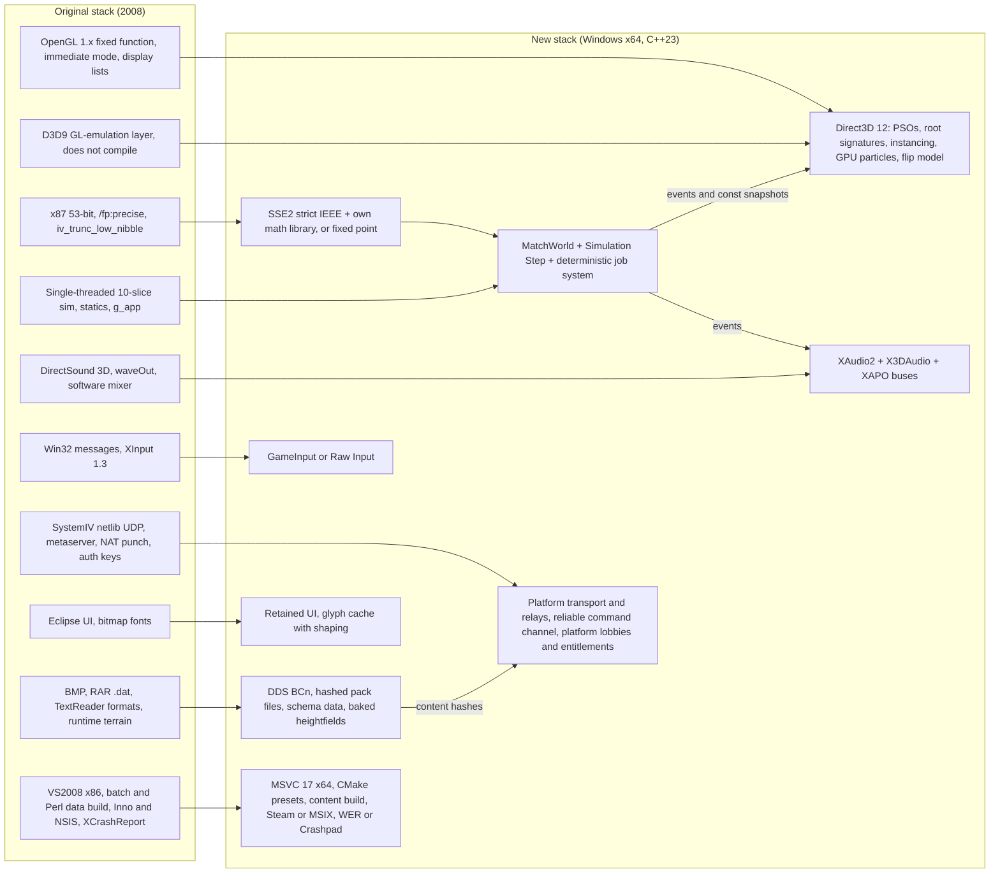
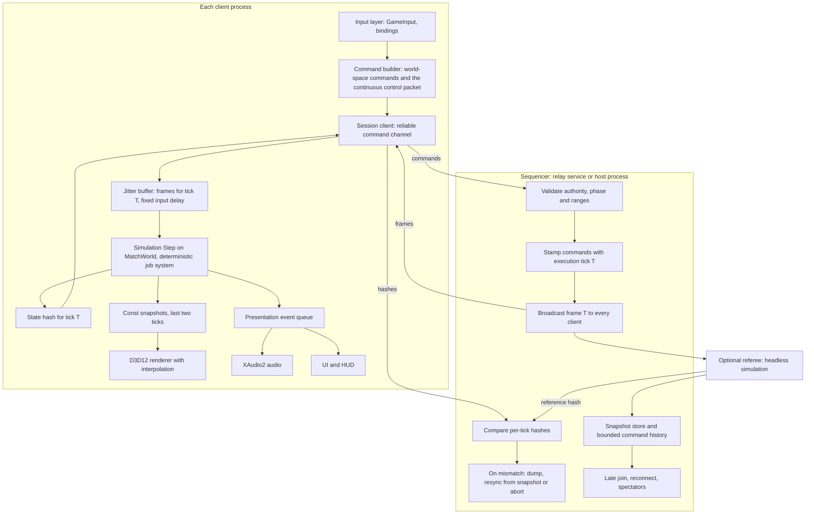
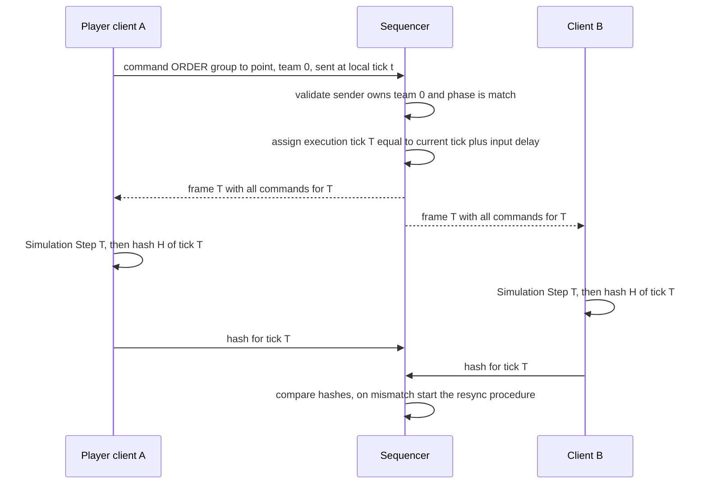
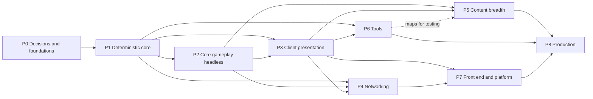

# 40 — Carry-forward assessment

> Part C · Baseline build: Release|Win32 (OpenGL) + TARGET_PC_FULLGAME ([B:FULL]); see _work/build_matrix.md.
> Evidence: [C] confirmed · [I] inferred · [U] unknown. Citations are `path:Symbol` relative to the multiwinia/ source root.
> Sources merged: `_work/routed/40.md` (P13_gfx_backend_math: "Backend concepts → Direct3D 12 equivalents"); the final documents [00](00_overview.md)–[32](32_debug_test_and_performance.md) (their re-implementation, "new game", risk-register, open-question and docs-vs-code sections in particular); `_work/phase2_log.md` (including the S22 entry that supersedes earlier log lines); `_work/routed/_meta_determinism.md`, `_meta_unknowns.md`, `_meta_discrepancies.md`, `_meta_cross.md`, `_meta_ip.md`, `_meta_other.md`.

**Target (`TARGET_FOR_NEW_GAME`)**: Windows (x64), C++23, DirectX 12, multiplayer (online and LAN, plus versus-CPU on the same pipeline). **Licence posture**: INTERNAL_STUDY — the design may be studied; no Introversion code, names, text, art, audio or map designs carry into the new game (§6, [41](41_risks_and_open_questions.md)).

## Contents

1. [Executive summary](#1-executive-summary)
2. [Assessment matrix](#2-assessment-matrix)
3. [Obsolete-technology mapping](#3-obsolete-technology-mapping)
4. [Determinism and multiplayer architecture recommendation](#4-determinism-and-multiplayer-architecture-recommendation)
5. [Design keep-list and fix-list](#5-design-keep-list-and-fix-list)
6. [IP replacement summary](#6-ip-replacement-summary)
7. [Suggested build order and work breakdown](#7-suggested-build-order-and-work-breakdown)
- [Open questions and unknowns](#open-questions-and-unknowns)
- [Docs-vs-code discrepancies](#docs-vs-code-discrepancies)
- [IP items](#ip-items)
- [Source map](#source-map)
- [Appendix — dead/legacy code](#appendix--deadlegacy-code)

---

## 1 Executive summary

### 1.1 How to read the verdicts

Every verdict in this document is a **recommendation** and therefore [I] by nature; the facts each verdict relies on carry the evidence tag and citation of the document that owns them, linked in place. Code is never carried forward under any verdict — "Keep" refers to the *design* (rules, numbers, behaviour, structure), which the new team re-implements from the owning specification.

| Verdict | Meaning for the new team |
|---|---|
| **Keep** | Reproduce the design as specified in the owning document (rules, constants, state machines, structure), with new code, new names and new assets. Shipped quirks inside it are dispositioned individually in §5.2. |
| **Adapt** | Keep the concept and most of the rules; change the parts listed in the rationale (usually fixes, generalisations or a modern implementation of the same idea). |
| **Replace** | Keep the *role* the subsystem plays; build it with a different design or technology (the modern equivalent is named). |
| **Drop** | Do not build it. Where the role is still wanted (for example achievements, music, a map editor) the verdict is written **Drop (redesign)**: the original offers nothing usable beyond a hook or a stub, so the feature is designed from scratch. |

### 1.2 The ten most consequential decisions

| # | Decision | Verdict | Why it matters most | Owning documents |
|---|---|---|---|---|
| D1 | **Keep the crowd-and-territory core**: no build queue and no currency; armies are populations produced by held spawn points (≥ 3 of 5 ports, 30 s activation, burst/pause production, per-team cap); autonomous soldiers; officers as signposts and formation leaders; crates with 90 % good / 10 % hostile outcomes feeding six task slots; six modes on one rules skeleton; CPU opponents built on a node-graph AI with perfect information and no other cheats | **Keep** | This is the entire functional identity of the game; every number is recovered and specified [C] (00 §3–§4) | [00 §4](00_overview.md#4-what-makes-it-distinctive), [01](01_game_modes.md), [05](05_economy_and_population.md), [06 §5](06_player_control_and_input.md#5-officer-orders-promotion-and-formations), [04](04_crates_powerups_and_weapons.md), [07 §20](07_ai.md#20-re-implementation-guide) |
| D2 | **Keep deterministic lockstep over a server-sequenced command stream ("relay lockstep"), but rebuild every precondition**: fixed integer ticks, per-match state, explicit RNG discipline, real state hashing, server-side command authority, content hashes and version gating, snapshot-based join and reconnect | **Adapt** | At 1400–2000 simulated bodies per map plus spirits and projectiles, only lockstep keeps bandwidth trivial; the original's lockstep worked only "by discipline" and fails silently or fatally on any slip [C] (22 §1.3, §9.4) | §4; [22 §1](22_determinism_and_networking.md#1-model-overview), [22 §15](22_determinism_and_networking.md#15-risk-register-for-the-new-game) |
| D3 | **Replace the numeric environment**: x87 53-bit precision control, `/fp:precise` and the `iv_trunc_low_nibble` binary32 rounding of CRT transcendentals become an x64/SSE2 strict-IEEE simulation built with one compiler, FMA contraction off, and an own deterministic math library (fixed-point held in reserve for cross-architecture play) | **Replace** | The original's bit-exactness rested on one executable, one CRT and per-thread FPU state [C] (22 §14.8); none of that survives a move to x64 | §3 (T10), §4.4 (P3); [22 §14.8](22_determinism_and_networking.md#148-floating-point-model), [23 §17](23_terrain_and_landscape.md#17-determinism-and-conformance) |
| D4 | **Replace the simulation architecture**: the god-object `App` + `Location` + ~40 hand-reset statics + 10-slice single-threaded stepping becomes a `MatchWorld` that owns all per-match state, a pure `Simulation::Step(tickInputs)`, a hard sim/presentation boundary (sim emits events; renderer, audio and UI read immutable snapshots), and a deterministic job system | **Replace** | Every live desync path and most latent ones come from UI/render/local state crossing into the simulation or statics surviving between matches [C] (22 §14.11–§14.12) | [20 §13](20_architecture.md#13-architecture-for-the-new-game), [21 §11](21_simulation_and_entity_model.md#11-guidance-for-the-new-engines-entity-model) |
| D5 | **Replace the renderer, keep the look**: OpenGL 1.x immediate mode, display lists and the (non-compiling) D3D9 GL-emulation layer become an explicit Direct3D 12 renderer (PSOs derived from the ordered pass table, instanced units and sprites, GPU particles, flip-model swap chain); the flat-shaded, additive-glow-on-black, darkening-layer visual language is kept deliberately | **Replace** (backend) / **Keep** (style) | Immediate mode and per-unit draw calls are the main rendering cost at crowd scale [C] (32 §12.3 H8); the style is cheap and distinctive [C] (24 §7.1) | [24 §7](24_rendering.md#7-visual-style-resolution-and-aspect), [24 §9](24_rendering.md#9-direct3d-12-mapping-notes-per-component), §3 (T1–T9) |
| D6 | **Make every timer an integer tick count and decide the 1.1-second "second" explicitly**: keep the shipped pacing (mode second = 11 ticks of 0.1 s) as an explicit constant for the first playable, so the recovered tuning stays valid, and re-tune to true seconds only after playtests | **Adapt** | Every rule countdown, the on-screen clock, elimination timers and reinforcement waves run 10 % slow in the shipped game, and the whole balance was tuned under that [C] (01 §6 B1) | [01 §6](01_game_modes.md#6-known-bugs-that-shape-the-shipped-rules), [05 §8](05_economy_and_population.md#8-timer-granularity-effects) |
| D7 | **Replace session, lobby and platform services**: metaserver, matchmaker, NAT punch-through, authentication keys and demo gating become platform services (Steam or Epic Online Services, or an own relay) behind a transport abstraction; the host/relay validates every lobby and game command | **Replace** | The server side of the original services is absent from the tree [U] (22-U1); lobby authority is client-side, commands are not checked against team ownership, the password travels in clear text and the host advertises its full key [C] (22 §14.13) | [22 §12](22_determinism_and_networking.md#12-lobby-and-server-discovery-protocol), [09 §6](09_meta_systems.md#6-demofull-game-gating-and-the-authentication-key-ui), §4.8 |
| D8 | **Replace the content pipeline**: BMP-only art with three transparency conventions, solid RAR archives with loose-file override, positional text tables (`stats.txt`, `effects.txt`), sentinel-valued level options and run-time terrain generation become typed, versioned schemas, BCn-compressed DDS textures, hashed pack files, build-time validators, and **baked heightfields** with a content hash per map | **Replace** | Data identity is a simulation input in lockstep: today nothing verifies it [C] (22 §14.13, 23 §17.1), and several formats crash on a blank line or bind by row order [C] (29 §7.1, §7.5) | [25 §7.4](25_textures_and_assets.md#74-recommendations-for-the-new-engine-windows-c23-directx-12), [29](29_data_formats_reference.md), [23 §17.6](23_terrain_and_landscape.md#176-recommendation-for-the-new-game), [08 §9](08_levels_and_level_design.md#9-level-design-guide-for-the-new-game) |
| D9 | **Keep the audio binding model, replace the engine and the mix**: game code fires (source, event) pairs and data decides what plays, with friend/foe variants, sample groups and generative loops; DirectSound/waveOut/the software mixer become XAudio2 with virtual voices, authored priorities and buses; music is designed from scratch | **Adapt** (design) / **Replace** (engine) | The model is clean and data-driven; the voice allocator steals without comparing priority and music is never heard in the shipped game [C] (27 §5, 10 §6.4) | [10 §14](10_audio_design.md#14-sound-design-brief-for-the-new-game), [27 §17](27_audio_engine.md#17-mapping-to-a-modern-engine-xaudio2--wasapi) |
| D10 | **Drop the dead weight; build hook-only features new**: the Darwinia campaign, the cut-scene script interpreter as a gameplay system, the narrator, the loader mini-programs, the D3D9 emulator, SystemIV/Eclipse UI and the gesture recogniser are not ported; achievements, leaderboards, music, a map editor, replays and a post-match results screen — which exist only as stubs, unreachable code or nothing — are designed from scratch | **Drop** / **Drop (redesign)** | Large parts of the tree are [B:LEGACY]/[B:DEAD]/[B:EDITOR]/[B:DEBUG] in the shipped build [C] (00 §2.5); porting them would import complexity without player value | [00 §2.5](00_overview.md#25-what-is-not-in-the-shipped-game), [30 §1](30_scripting_tutorial_and_cutscenes.md#1-reachability-summary), [08 §8.1](08_levels_and_level_design.md#81-build-status-and-reachability), [09 §7](09_meta_systems.md#7-achievements-statistics-and-leaderboards) |

### 1.3 Verdict tally (assessment matrix §2.1–§2.2, one row per subsystem)

| Verdict | Count | Subsystems |
|---|---|---|
| Keep | 5 | game rules and modes (R1), population and spawn economy (R2), crates (R5), AI (R6), render passes and visual style (R19 — style kept, pass structure adapted) |
| Adapt | 11 | units and entities (R3), buildings (R4), player control and input (R7), camera (R8), levels and terrain generation (R9), meta / front end / lobby (R11), audio design (R12), simulation and entity model (R15), networking (R17), animation / VFX / particles (R22), localisation (R28) |
| Replace | 13 | level format and editor (R10), audio engine (R13), architecture and main loop (R14), determinism mechanism (R16), rendering backend (R18), shaders (R20), textures / assets / archives (R21), UI framework (R23), data formats (R24), platform / build / tools (R26), debug / test / profiling (R27), crash reporting (R29), authentication / DRM (R30) |
| Drop / Drop (redesign) | 1 | scripting and tutorials as implemented (R25: interpreter and content dropped; tutorials redesigned as step graphs) |

Several rows carry a split verdict (for example R16 *Replace* mechanism / *Keep* discipline; R17 *Adapt* topology / *Replace* transport; R19 *Keep* style / *Adapt* pass structure); the tally counts the headline (first-named) verdict, 30 rows in all. Finer-grained verdicts for 72 individual mechanics and features are in §2.3.

### 1.4 What the new team gets from the original, in one paragraph

A complete, numerically specified *game design* (modes, economy, units, buildings, crates, AI, controls, audio event list) that is worth keeping almost unchanged, wrapped in a 2008-era *engine* whose every layer — fixed-function OpenGL, D3D9 emulation, DirectSound, x87 floating point, single-threaded sliced simulation, RAR archives, BMP art, a proprietary metaserver, a hand-rolled UI toolkit — must be replaced, and a *lockstep network model* whose topology is right for the genre but whose safety rails (state hashing, authority, data identity, recovery) were never built. §4 turns that last point into a concrete architecture.

### 1.5 Consistency notes for this synthesis

Contradictions between inputs, resolved by re-reading the code or the final owning document:

| # | Inputs disagreed on | Resolution |
|---|---|---|
| C1 | [00 §7](00_overview.md#7-design-critical-quirks-the-new-team-must-decide-on) Q10 and the P01 phase-2 note say the synced RNG is "seeded once per server session (at client join), not per match" | Both statements are true but the conclusion "not per match" is misleading: every match runs in a fresh server session, so the client re-joins and re-seeds before each match and no synced draw happens in the lobby [C] `code/app.cpp:App::ShutdownCurrentGame`, `code/network/server.cpp:Server::Initialise` ([22 §14.3](22_determinism_and_networking.md#143-seeding-and-lifetime-of-the-synced-stream)). The new-game requirement is still "seed per match, recorded in the replay", because the seed is not stored anywhere today ([22 §11.6](22_determinism_and_networking.md#116-record--replay-of-the-command-stream-c)). |
| C2 | [00 §7](00_overview.md#7-design-critical-quirks-the-new-team-must-decide-on) Q8 and the P03 phase-2 note list "Darwinians facing a launching rocket take facing from the wall clock" as a probable live desync | Not reachable in Multiwinia: `EscapeRocket::IsSpectacle` returns false whenever `App::Multiplayer()` is true, which it is in every Multiwinia game [C] `code/worldobject/rocket.cpp:EscapeRocket::IsSpectacle` (re-read for this document) ([22 §14.11](22_determinism_and_networking.md#1411-local-only-state-leaking-into-simulation--every-known-desync-path) L9). The Assault `m_defendedAll` wall-clock read remains, but it feeds only an achievement flag (L12). |
| C3 | The P01 phase-2 note treats `FenceSwitch::Switch()` from local input as a desync risk | No shipped level contains a FenceSwitch and the type is blocked [C] ([22 §14.11](22_determinism_and_networking.md#1411-local-only-state-leaking-into-simulation--every-known-desync-path) L14, [03 §15](03_buildings_and_world_objects.md#15-defects-determinism-and-implementation-hazards) #8). It is a design lesson ("all interactions through commands"), not a live defect. |
| C4 | The coordinator's note for this synthesis points to "22 §13" as the authoritative list of live desync paths | In the final [22](22_determinism_and_networking.md), §13 is "Threads and locking"; the list of every known desync path is [§14.11](22_determinism_and_networking.md#1411-local-only-state-leaking-into-simulation--every-known-desync-path) (L1–L21) together with the static-state table [§14.12](22_determinism_and_networking.md#1412-staticglobal-simulation-state-and-its-reset-points) and the risk register [§15](22_determinism_and_networking.md#15-risk-register-for-the-new-game). This document uses those three. |
| C5 | [06 §13](06_player_control_and_input.md#13-known-defects-and-desync-paths-in-the-input-layer) X30 says the missing `icons/compass_empty.bmp` lookup "fails at run time"; X2a/phase-2 treated it as a live fatal path | The request can never be made: the branch needs a zero direction, and `Vector2::Normalise` maps a zero vector to (0,1) [C] `code/lib/vector2.cpp:Vector2::Normalise` (re-read), `code/markersystem.cpp:MarkerSystem::RenderCompass` ([25 §1.4](25_textures_and_assets.md#14-key-findings)). No reachable missing-asset crash exists in [B:FULL]; the lesson (validate references at build time) stands. |
| C6 | [07 §16](07_ai.md#16-known-bugs-that-shape-shipped-behaviour) B1 leaves open whether every shipped map has sea (Nuke hang risk, 07-U4) | Every map has at least 26.2 % sea, so the Nuke loop terminates on shipped data [C] ([23 §17](23_terrain_and_landscape.md#17-determinism-and-conformance), [00 §7](00_overview.md#7-design-critical-quirks-the-new-team-must-decide-on) Q12); the loop is still unbounded and must be bounded in the new game (§5.2 F33). |
| C7 | [29 §12](29_data_formats_reference.md#12-re-implementation-guidance-for-the-new-engine) item 6 recommends keeping the loose-file override in the new pack format; [25 §7.4](25_textures_and_assets.md#74-recommendations-for-the-new-engine-windows-c23-directx-12) item 5 forbids it in shipping multiplayer builds | Both are recommendations [I]; this document adopts the restriction (override only in development builds, G72) because any client could otherwise replace simulation-relevant data such as level files and unit stats, and the lobby content hash (P10) would then have to cover loose files as well. |
| C8 | The phase-2 log (P04) says `Unit::s_offsets` is never reset between games | It is deleted in `Location::Init` and `Location::Empty` and lazily refilled from the synced RNG [C] ([22 §14.12](22_determinism_and_networking.md#1412-staticglobal-simulation-state-and-its-reset-points)). The statics that really survive are `Armour::SetDirectOrders`'s debounce, `s_numMultiwiniaZones` and the team-5 slot of `SpawnPoint::s_numSpawnPoints` (§4.6). |

Spot-checks made in the source tree for this document [C]: server tick `m_nextServerAdvanceTime += 0.1f` (`code/network/server.cpp:Server::AdvanceIfNecessary`); `NUM_TEAMS 6`, `NUM_SLICES_PER_FRAME 10`, `IAMALIVE_PERIOD 0.1` (`code/globals.h`); the ten `iv_*` macros and `FLOAT_NUMERICS` (`code/lib/universal_include.h`); `_control87(_PC_53, _MCW_PC)` (`code/main.cpp`); the baseline sync value `m_hashValue = 255 * syncfrand(1)` (`code/network/iframe.cpp:IFrame::Generate`); `App::EarnedAchievement` returning false (`code/app.cpp`); the per-team cap `m_populationCap / m_numPlayers` of the level (`code/worldobject/spawnpoint.cpp:SpawnPoint::PopulationLocked`); the relay accepting any registered client's command whose team id ≠ 255 with no ownership test (`code/network/server.cpp:Server::Advance`); `LoadLibrary("XINPUT1_3")` (`code/main.cpp:InitialiseInputManager`); one configuration with `FloatingPointModel="2"` (fast) in `targets/vs2005/Darwinia.vcproj`; the 1.0-reset/`SERVER_ADVANCE_PERIOD`-decrement pattern of the mode timers and the Blitzkrieg `s_numMultiwiniaZones++` (`code/multiwinia.cpp`); 15 camera modes plus 3 debug modes (`code/camera.h:Camera`).

---
## 2 Assessment matrix

One row per subsystem. "Key facts" are copied from the owning document with its tag; follow the link for the full specification. "Risks" are the risks of carrying the verdict out (not of the original); the consolidated risk register is [41](41_risks_and_open_questions.md).

### 2.1 Functional design (Part A subsystems)

| # | Subsystem | Verdict | Rationale | Key facts relied on | Risks |
|---|---|---|---|---|---|
| R1 | **Game rules and modes** | **Keep** (rules) — implemented as typed ruleset objects | Six modes vary only the *territory unit* and the score on one skeleton (per-tick world update → per-mode-second rule evaluation → `DeclareWinner`); that structure is the right abstraction for a new game and every rule is specified. Re-implement each mode as a ruleset object (score function, elimination predicate, win predicate, time-up decider, sudden-death policy, typed option schema, HUD formatter) and fix the 25 shipped rule bugs per §5.2 | Six modes in [B:FULL], Tank Battle [B:DEBUG] only [C] `code/multiwinia.h`, `code/lib/universal_include.h` ([01 §1](01_game_modes.md#1-game-type-catalogue)); shared skeleton [C] `code/multiwinia.cpp:Multiwinia::Advance` ([01 §2](01_game_modes.md#2-the-shared-match-framework)); 39 option definitions + lobby + level options [C] `data/multiwinia.txt` ([01 §3](01_game_modes.md#3-the-option-system)); "absent option = −1 = true" [C] `Multiwinia::GetGameOption` ([01 §3.4](01_game_modes.md#34-reading-an-option--the-1--absent-rule)); multi-round Assault coded but unreachable [C] ([01 §6](01_game_modes.md#6-known-bugs-that-shape-the-shipped-rules) B5); re-implementation notes [I] ([01 §7](01_game_modes.md#7-re-implementation-notes-for-the-new-game)) | balance was tuned under 1.1 s "seconds" (B1) and doubled Blitzkrieg waves on three maps (B3) — re-tuning is needed whatever is decided; special factions block or win inconsistently across modes (00 Q6) |
| R2 | **Population and spawn economy** | **Keep** (with four explicit designer decisions) | The territory → flow-of-bodies economy *is* the game's feel: ≥ 3 of 5 ports, no enemy on any port, 30 s activation, burst/pause production routed through spawn links, a per-team cap, trunk-port waves and the soul loop. Keep the model and numbers; decide the cap divisor, the harvester bypass, the handicap curve and ant-hill accounting (§5.2 F25–F27, F34) | capture rule and 2.0 + U[0,1) s re-evaluation [C] `code/worldobject/spawnpoint.cpp:SpawnPoint::RecalculateOwnership` ([05 §2](05_economy_and_population.md#2-territory-capture-spawn-points)); one request every 0.2 s for `int(20 × H)` requests then a 10 + U[0,5) s pause [C] `SpawnPoint::Advance` ([05 §3.1](05_economy_and_population.md#31-request-cycle-multiwinia)); ≈ 1.22 Darwinians/s per point [I] ([05 §3.3](05_economy_and_population.md#33-per-spawn-point-rate)); cap = level `PopulationCap ÷ NumPlayers` [C] `SpawnPoint::PopulationLocked` (re-read) ([05 §4](05_economy_and_population.md#4-the-population-cap)); harvester delivers any team's spirits with no cap or activation check [C] `code/worldobject/harvester.cpp:Harvester::AdvanceToSpawnPoint` ([05 §5.3](05_economy_and_population.md#53-who-can-collect-a-spirit)); waves every 60 mode s [C] `Multiwinia::AdvanceTrunkPorts` ([05 §6](05_economy_and_population.md#6-reinforcement-systems)); design notes [I] ([05 §10](05_economy_and_population.md#10-design-notes-for-the-new-game)) | income is linear in points held, so snowballing depends on the cap and handicap decisions; per-tick timers (61-tick spirit births, 10h + 1-tick transits) must become explicit tick counts or be re-tuned ([05 §8](05_economy_and_population.md#8-timer-granularity-effects)) |
| R3 | **Units and entities** | **Adapt** | Keep the live roster and its behaviour (autonomous Darwinian with 25 states and staggered 1–2 s task search; Officer; Squad; Armour; Harvester; Engineer; Airstrike/Nuke weapons; the crate-spawned creatures and hazards Virii, Spider, Centipede, ArmyAnt, SporeGenerator, SoulDestroyer, TriffidEgg/Egg, Meteor; SpaceShip/Futurewinian drop). Drop the unreachable types (Shaman, Tank, LaserTrooper, DropShip, Tripod, Lander, Tentacle) or redesign them deliberately. Store stats as floats, express every per-frame rule per second | `Entity::Type` is also the row number in `data/stats.txt` (positional binding) [C] `code/worldobject/entity.cpp:EntityBlueprint::Initialise` ([02 §1.1](02_units_and_entities.md#11-every-entitytype-value)); every Darwinian is a soldier because the MP research level is fixed at 4 [C] `code/location.cpp:Location::Init` ([02 §2.3](02_units_and_entities.md#23-research-levels-are-fixed-in-multiwinia)); Darwinian task search [C] `Darwinian::SearchForNewTask` ([02 §4.5](02_units_and_entities.md#45-darwinian--task-search-searchfornewtask-every-12-s-grounded-not-burning)); byte stats truncate and SpaceShip speed 500 overflows (≈ 244) [C]/[I] ([22 §14.8](22_determinism_and_networking.md#148-floating-point-model)); Shaman deletes itself on its first tick, Tank unreachable in FULL [C] ([02 §27](02_units_and_entities.md#27-shaman), [02 §25](02_units_and_entities.md#25-tank)) | Darwinian search cost dominates the CPU budget at 2000 units ([32 §12.3](32_debug_test_and_performance.md#123-hotspot-catalogue) H2); "feel" depends on many small per-tick rules that do not scale with the speed crates (02, 03 §15 #25) |
| R4 | **Buildings and world objects** | **Adapt** | Keep the function, capture rules, ports and links of the 34 building types that are live in Multiwinia; drop the blocked Darwinia buildings; fix the 33 defects of [03 §15](03_buildings_and_world_objects.md#15-defects-determinism-and-implementation-hazards) (several silently shape play, e.g. the invisible SmokeMarker obstacle) | 75-value type enum, 34 live in MW [C] ([03 §2](03_buildings_and_world_objects.md#2-master-table-of-building-types), [03 §13](03_buildings_and_world_objects.md#13-multiwinia-live-set-summary)); level team column is a *map position* remapped to the lobby team at load [C] `Location::GetTeamFromPosition` ([03 §1.3](03_buildings_and_world_objects.md#13-teams-ownership-and-friendship)); solar power via pylons is the only live laser-fence switch [C] ([03 §6](03_buildings_and_world_objects.md#6-power-network)); tree hit spheres are produced by display-list compilation [C] `code/worldobject/tree.cpp:Tree::Generate` ([03 §7.3](03_buildings_and_world_objects.md#73-tree)) | port occupancy is not bound to (building, port) (03 §15 #4); walls are destroyable only by the WallBuster breach and defender scuttle — keep or generalise deliberately |
| R5 | **Crates, power-ups and weapons** | **Keep** (outcome set, probabilities, timing) / Adapt (selection algorithm) | The crate is the strategic wildcard and catch-up lever (score-weighted placement near lower-scoring teams); the 31-outcome table, the 90/10 good/bad split, the majority-opening rule and the lost-if-slots-full rule are well specified. Replace rejection sampling with bounded selection over an explicit candidate list; rename every outcome (IP) | drop interval U(0.5, 1.5] × `CrateDropRate` (default 40 s), ≤ `int(worldSizeX/500)` concurrent [C] `code/location.cpp:Location::AdvanceCrates` ([04 §1.3](04_crates_powerups_and_weapons.md#13-drop-timer--locationadvancecrates)); opening by strict majority within 35 for ≥ 51 ticks [C] `code/worldobject/crate.cpp:Crate::AdvanceOnGround` ([04 §1.7](04_crates_powerups_and_weapons.md#17-capture-pickup-rules--crateadvanceonground-craterecalculateownership)); 31 shipped outcomes + The Beast [B:DEBUG] [C] ([04 §2](04_crates_powerups_and_weapons.md#2-the-crate-reward-enum-complete)); unbounded loops in `CaptureCrate`, `RunNuke`, `RunSpaceShip` [C] ([04 §7](04_crates_powerups_and_weapons.md#7-determinism-and-implementation-notes)) | cosmetic effects consume the synced RNG today ([26 §12.3](26_animation_and_vfx.md#123-vfx-that-touch-the-simulation-c-unless-marked) #4) — moving them to a cosmetic generator changes nothing visible but forbids bit-parity with the original stream (irrelevant for a new game) |
| R6 | **AI (CPU opponents)** | **Keep** (design) / fix 24 bugs | The `AITarget` node graph with per-team priority fields, the dispatcher, Goto/formation officer use, one handler per power-up type and per-mode strategies give a cheap, deterministic, readable AI that matches the crowd model; difficulty is tempo and focus, not cheats. Keep inside the deterministic sim; fix B1–B24 per [07 §20.2](07_ai.md#202-what-a-new-ai-may-and-should-improve) | node graph, links ≤ 600 wu, owner by head count [C] `code/worldobject/ai.cpp` ([07 §4](07_ai.md#4-the-aitarget-node-graph--the-ais-map)); priority formulas [C] ([07 §5](07_ai.md#5-priority-model--every-formula)); difficulty periods 200/101/11 ticks, randomness 100/50/0 % [C] ([07 §13](07_ai.md#13-difficulty-levels--every-parameter)); perfect information, no other cheats [C] ([07 §14](07_ai.md#14-cheats-and-advantages)); the monster and Futurewinian teams always get an AI entity [C] ([07 §2](07_ai.md#2-architecture)) | O(N²) graph rebuilds on crate/turret/radar events; officer-promotion stall when the CPU team has a selection (B13); NaN priorities (B14); per-CPU difficulty and "fair" sensing tiers are new design work |
| R7 | **Player control and input** | **Adapt** (command model, control scheme) / Replace (input stack) | Keep the split into discrete commands (select, order, promote, place, terminate, toggle) and a continuous control packet sampled at the sim rate, the selection circle, officer orders and the right-click context rules — but convert every camera-relative quantity to world space on the sender, make the power bar clickable, widen task ids, add a reachable rebinding UI, and replace the Win32-message/XInput 1.3 drivers (§3 T19–T20) | 164 control types; MW interface the only live variant; Darwinia scheme forced off by `PrefsManager::Load` [C] ([06 At a glance](06_player_control_and_input.md#at-a-glance), [06 §4.1](06_player_control_and_input.md#41-variant-selection--which-interface-is-live)); task bar not clickable, task id one byte [C] ([06 §13](06_player_control_and_input.md#13-known-defects-and-desync-paths-in-the-input-layer) X10, X21); live desync X1 (`InsertionSquad::DirectControl` reads the local camera's look-around flag) [C]; sub-frame presses lost (X16) [C]; key rebinding window unreachable [C] ([06 §14](06_player_control_and_input.md#14-re-implementation-notes)) | the right button carries five meanings — a context resolver must reproduce the priority order exactly or the scheme feels different ([06 §14](06_player_control_and_input.md#14-re-implementation-notes) item 3); gestures and the icon task bar are optional extras, not parity items |
| R8 | **Camera** | **Adapt** | The cursor-follow free camera (250 u/s pan, ×4 with Shift, zoom narrowing the vertical FOV 60° → 15°) and per-slot camera mounts (`start`, `player<N>`) are distinctive and cheap; keep them, store distances as floats, clamp to level bounds, drop the debug-advancer grace frames and the unreachable sphere-world/scripted modes | one local, never-networked camera; 15 modes + 3 debug modes [C] `code/camera.h:Camera` (re-read) ([06 §9](06_player_control_and_input.md#9-camera)); horizontal clamp commented out (X26), integer squad-camera distance (X12) [C] ([06 §13](06_player_control_and_input.md#13-known-defects-and-desync-paths-in-the-input-layer)); every level start cuts to mount `start` then `player<N>` [C] ([30 §1](30_scripting_tutorial_and_cutscenes.md#1-reachability-summary) R5) | camera state must never be read by the simulation (L1); camera motion mixes frame dt and wall clock — specify one presentation clock |
| R9 | **Levels and terrain generation** | **Adapt** | Keep the level-design capability set (one file per map, start positions remapped so one map serves 2–4 players, typed mode objects, per-map rule overrides, lights, camera mounts, instant units) and the terrain generator's *look* (per-tile diamond-square with guide grids, max-composite, five flatten types) as an **editor-side** tool; ship baked heightfields with a content hash instead of regenerating at load | one height field per load from tile parameters with a private per-tile LCG; transcendental results rounded to binary32; 39.7 M `pow` calls with 17 exact ties [C] ([23 §1](23_terrain_and_landscape.md#1-scope-summary-and-build-tags), [23 §17.2](23_terrain_and_landscape.md#172-crt-functions-and-how-risky-they-are)); no map CRC exchanged before start — peers agree on a file name only [C]/[I] ([23 §17.1](23_terrain_and_landscape.md#171-what-must-be-bit-exact)); what a level cannot express [C] ([08 §6.9](08_levels_and_level_design.md#69-what-a-level-cannot-express)); level-design guide [I] ([08 §9](08_levels_and_level_design.md#9-level-design-guide-for-the-new-game)) | shipped map layouts and parameter sets are IP — every map is authored new; if runtime procedural terrain is kept, it must be integer/fixed-point ([23 §17.6](23_terrain_and_landscape.md#176-recommendation-for-the-new-game)) |
| R10 | **Level format and map editor** | **Replace** | The text level format (14 block types, positional fields, −1 sentinels, silently dropped zeros, quantising writer) and the `.mwm` container are replaced by a versioned, schema-validated map asset with a separately readable header; the editor is unreachable in the shipped build and has 18 listed defects, so a new editor with undo, lossless round-trip, stable-id selection, link tools and in-editor play-test of the real simulation is built from scratch | `LOCATION_EDITOR` commented out in every target; no editor path reachable in FULL; `.mwm` editor-build-only [C] `code/lib/universal_include.h` ([08 §8.1](08_levels_and_level_design.md#81-build-status-and-reachability)); D-E1–D-E18 [C] ([08 §8.9](08_levels_and_level_design.md#89-editor-defects-and-gaps-input-for-the-new-editor)); level grammar [C] ([29 §4.1](29_data_formats_reference.md#41-level-files--map-and-mission-map_-mp_-mission_)) | editor scope creep; the per-mode validation rules (CTS, Blitzkrieg, Assault, Rocket Riot) of [08 §9](08_levels_and_level_design.md#9-level-design-guide-for-the-new-game) item 4 must be implemented or broken maps ship |
| R11 | **Meta systems: front end, lobby, options, achievements** | **Adapt** (flow) / **Drop (redesign)** (achievements, leaderboards, quick match) | Keep the single-window, data-driven front end, the one lobby page shared by single player, host and client, ready-up and the "lobby state is a sequenced command stream" idea (it gives late-join and replay for free) — with host/server validation of every lobby command and one atomic, versioned lobby-state update. Achievements (12 designed conditions, stubbed), leaderboards (no backend) and quick match (button commented out) are redesigned on platform services | 18 live pages of 38 slots [C] ([09 §1](09_meta_systems.md#1-scope-build-reality-and-reachability-of-every-screen)); server never checks the sender of option/start/ready commands [C] ([09 §4.4](09_meta_systems.md#44-who-can-change-what--and-what-is-actually-enforced)); `App::EarnedAchievement` returns false [C] `code/app.cpp` (re-read) ([09 §7.2](09_meta_systems.md#72-platform-reality-in-the-pc-baseline--achievements-are-stubbed)); leaderboards stub [C] ([09 §7.5](09_meta_systems.md#75-leaderboards-blegacy--no-data-source)); "dy" key collision breaks the password filter [C] ([09 §13](09_meta_systems.md#13-design-notes-for-the-new-game) item 3); no front-end results page [C] ([01 §2.2](01_game_modes.md#22-match-lifecycle)) | the original's "every lobby change is a sequenced command" model replays the whole lobby on join — keep it bounded by snapshots; commonly expected options are missing (v-sync, AA, gamma, separate volumes, rebinding, UI scale) ([09 §13](09_meta_systems.md#13-design-notes-for-the-new-game) item 9) |
| R12 | **Audio design** | **Adapt** | Keep the event-driven binding (source × event → blueprint → layered blocks), friend/foe variants, sample groups, generative LoopADSR beds, linked parameters and the camera-altitude ambience crossfade; replace the priority model, the accidental crowd-cull radius and the single master volume with authored priority classes, virtual voices and buses; design music and match-end stings that never existed | 182 of 256 bound events live; 898 files can play [C] ([10 §1](10_audio_design.md#1-audio-design-overview-and-what-is-actually-audible)); music never heard (no reachable trigger, tracks excluded, fatal assert if triggered) [C] ([10 §6.4](10_audio_design.md#64-why-music-is-never-heard-in-multiwinia--and-the-assert)); 24 shipped audio bugs [C] ([10 §13](10_audio_design.md#13-bugs-and-quirks-that-shape-the-shipped-audio)); keep/adapt/replace table and event list [I] ([10 §14](10_audio_design.md#14-sound-design-brief-for-the-new-game)) | every sample and track is IP — the whole sound set is new; the event list must be authored first so a validator can flag missing bindings |

### 2.2 Technical design (Part B subsystems)

| # | Subsystem | Verdict | Rationale | Key facts relied on | Risks |
|---|---|---|---|---|---|
| R13 | **Audio engine** | **Replace** | DirectSound 3D with polled ring buffers, an idle waveOut device, a software mixer that probably crashes if selected, a 20 Hz main-thread voice tick with one start per tick, and libvorbis decoding on the main thread are replaced by XAudio2 2.9 (+ X3DAudio, XAPO effects, submix buses) driven by a lock-free command queue from the game thread; keep the five-layer separation (binding / instance / sample data / device / DSP) as the module plan | shipped path = `SoundLibrary3dDirectSound` + idle `SoundLibrary2dWin32` [C] `code/sound/soundsystem.cpp:SoundSystem::RestartSoundLibraryInternal` ([27 §1.2](27_audio_engine.md#12-back-end-selection-and-what-is-live)); 20 Hz tick ([27 §3](27_audio_engine.md#3-update-rate-the-20-hz-tick)); steal lowest without compare, priority = perceived volume × 0.75 per louder copy [C] ([27 §5](27_audio_engine.md#5-voice-channel-management)); volume law 5 dB per unit (DirectSound) vs 4.343 dB (software) [C]; 60 MiB LRU sample cache ([27 §9](27_audio_engine.md#9-sample-cache)); modern mapping [I] ([27 §17](27_audio_engine.md#17-mapping-to-a-modern-engine-xaudio2--wasapi)) | audio must stay outside the simulation (it does today, but it shares the global LCG with tree generation, [22 §14.7](22_determinism_and_networking.md#147-the-shared-non-synced-lcg-is-a-simulation-input-for-trees--and-it-is-not-thread-safe)) |
| R14 | **Architecture and main loop** | **Replace** | A god object (`g_app`) with raw-pointer services, flag-driven loops, ~40 class/file statics reset by hand in `Location::Init` (with gaps), ten game-created threads with *all* game work on the main thread, and `exit(0)` shutdown become: a composition root owning services in a documented order, an explicit application state machine (Boot → FrontEnd → Lobby → Loading → Match → Teardown), a `MatchWorld` owning all per-match state, a job system, and orderly shutdown | thread inventory T1–T12 (main thread runs input, network sending, simulation, rendering, sound mixing) [C] ([20 §11.2](20_architecture.md#112-thread-inventory)); lifetimes process/session/match and reset gaps [C] ([20 §8](20_architecture.md#8-lifetimes-process-session-match)); game speed can run away to −∞/NaN across matches [I] (20-U6); per-layer recommendations [I] ([20 §13](20_architecture.md#13-architecture-for-the-new-game)) | rewriting the composition is a big-bang change — do it first (Phase 1 in §7), not as a later refactor |
| R15 | **Simulation, entity model, spatial grids and routing** | **Adapt** | Keep the three object families (Entity / Building / effects), "advance returns delete-me" semantics as an explicit result, "ownership change = destroy + spawn", a fixed documented system order, per-team uniform grids with 32-unit cells, the obstruction grid and the node-graph router (cheap and deterministic). Replace the weak `WorldObjectId` re-resolution with generational handles for **every** kind (spirits and lasers are unchecked today), the capacity-based 10-slice scheduling with whole-tick steps on a job system, the up-to-1-s-stale `EntityGridCache` with exact queries, full obstruction rebuilds with incremental updates, and static scratch buffers with per-call storage | one `Location` owns everything simulated; 10 slices per tick, every object advanced exactly once per tick [C] ([21 §1](21_simulation_and_entity_model.md#1-scope-and-the-model-at-a-glance)); handles and their gaps ([21 §3](21_simulation_and_entity_model.md#3-object-identity-and-handles)); grids and cache shortcuts change query results [C] ([21 §6](21_simulation_and_entity_model.md#6-spatial-partitioning)); routing tables never rebuilt after load; preview routes share the simulated free list [C] ([21 §7](21_simulation_and_entity_model.md#7-pathfinding-and-routing), [06 §13](06_player_control_and_input.md#13-known-defects-and-desync-paths-in-the-input-layer) X3); 159 world-object classes ([21 §2](21_simulation_and_entity_model.md#2-class-hierarchy-every-class)); guidance [I] ([21 §11](21_simulation_and_entity_model.md#11-guidance-for-the-new-engines-entity-model)) | exact queries change behaviour relative to the cached original (22-U14) — decide whether the staleness is a gameplay property; iteration order must be specified or ties resolve differently |
| R16 | **Determinism** | **Replace** (mechanism) / **Keep** (discipline) | Keep the disciplines that made lockstep work (all gameplay randomness from one synced generator, cosmetic draws elsewhere, wrapped transcendental functions, index-ordered iteration, world-space commands); replace the mechanisms (x87 precision control, CRT rounding to binary32, global MT19937, 1-byte RNG-position sync value, hand-reset statics) per §4.4 | 10 RNGs, 655 synced call sites, none in UI/render/sound [C] ([22 §14.2](22_determinism_and_networking.md#142-random-number-generators--every-generator-in-the-live-code), [22 §14.5](22_determinism_and_networking.md#145-census-of-synced-call-sites-generated)); numeric environment x87 + `_PC_53` + `/fp:precise` + `iv_trunc_low_nibble` [C] ([22 §14.8](22_determinism_and_networking.md#148-floating-point-model)); every known desync path L1–L21 ([22 §14.11](22_determinism_and_networking.md#1411-local-only-state-leaking-into-simulation--every-known-desync-path)); surviving statics ([22 §14.12](22_determinism_and_networking.md#1412-staticglobal-simulation-state-and-its-reset-points)); risk register D1–D22 ([22 §15](22_determinism_and_networking.md#15-risk-register-for-the-new-game)) | the biggest single technical risk of the project; budget CI replay hashing on several CPU models from the first month (§7) |
| R17 | **Networking: transport, lobby, matchmaking** | **Adapt** (relay-lockstep topology, latest-only control coalescing, lobby-as-commands) / **Replace** (transport, discovery, NAT, authentication) | The star topology with an authoritative sequencer that never simulates is the right shape for an RTS with thousands of units; everything around it is replaced: a reliable ordered command channel with acks, an MTU budget, encrypted platform transport and relays, server-side validation, a fixed input delay with jitter buffer, snapshot join, reconnect and host migration (§4) | relay lockstep at 10 Hz, host is also a client, no dedicated server [C] ([22 §1.1](22_determinism_and_networking.md#11-at-a-glance)); client→server commands not acknowledged [C] ([22 §3](22_determinism_and_networking.md#3-transport--netlib-over-udp)); late join replays from sequence 0 [C] ([22 §8.8](22_determinism_and_networking.md#88-reconnect-late-join-spectators-kick-password)); pacing drains 30 % of the backlog per render frame [C] ([22 §2.3](22_determinism_and_networking.md#23-slices-per-render-frame-client-pacing-controller)); metaserver server side absent [U] (22-U1); N1–N14 ([22 §15](22_determinism_and_networking.md#15-risk-register-for-the-new-game)) | platform lock-in of the session layer — keep it behind an interface (§4.8); host-quit behaviour of the original is unknown (22-U19), so host migration is a new requirement, not parity |
| R18 | **Rendering backend** | **Replace** | All game render code is written once against OpenGL 1.x fixed-function immediate mode plus two ARB extensions; the D3D9 configuration is a GL-API emulation layer that does not build at this commit. Replace with an explicit Direct3D 12 renderer: upload ring buffers, static default-heap geometry, PSOs from the pass table, root signatures with per-frame CBV and per-draw root constants, instancing for units/sprites/buildings, flip-model swap chain, `DXGI_ERROR_DEVICE_REMOVED` recovery | backend chosen at compile time by `universal_include.h` [C] ([24 §1.1](24_rendering.md#11-how-the-backend-is-chosen-c)); four D3D compile blockers [C]/[I] ([24 §1.2](24_rendering.md#12-is-the-d3d-configuration-buildable-at-this-commit-i)); emulator design and its 29 behavioural defects D1–D29 ([24 §1.5](24_rendering.md#15-direct3d-9-path-opengl-api-emulation-layer-bd3d)); per-component D3D12 notes [I] ([24 §9](24_rendering.md#9-direct3d-12-mapping-notes-per-component)); P13 backend hint table ([§3](#3-obsolete-technology-mapping)) | do not replicate the emulator's silent state dropping; keep the pass table as the single source of truth for blend/depth/cull combinations |
| R19 | **Render passes and visual style** | **Keep** (style) / **Adapt** (pass structure) | The look — flat-faceted polygons, wire-grid edge textures, additive glow on a black world, multiplicative "negative" darkening layers that need no sorting, black linear fog, an 8-colour team palette, distance-scaled sprite cards — is cheap to reproduce and recognisable; keep it as an art-direction rule, reproduce each technique in the new renderer, merge passes where D3D12 allows (terrain wire overlay as an edge term from barycentrics) | techniques table [C] ([24 §7.1](24_rendering.md#71-how-the-look-is-produced-c-unless-marked)); ordered pass table for one match frame [C] ([24 §3.2](24_rendering.md#32-ordered-pass-table--one-multiwinia-match-frame-bfull)); flat shading uses the last provoking vertex in GL [C] ([24 §7.1](24_rendering.md#71-how-the-look-is-produced-c-unless-marked)); Hor+ aspect handling, HUD in a 600-unit ortho [C] ([24 §7.2](24_rendering.md#72-resolution-and-aspect-handling-c)); several passes never run in MW because `App::Multiplayer()` is always true (pixel effect, deform, water reflection) [C] ([24 §3.4](24_rendering.md#34-reachability-in-a-multiwinia-match-ci)) | the *specific* textures, meshes and palette values are IP — the style is a technique set, the assets are new; a team-colour rule that recolours "mostly red" palette entries must become an explicit mask channel |
| R20 | **Shaders** | **Replace** | The 14 shader files exist only for the D3D9 path (FixedFunc0/1/2 vertex/pixel pairs emulating fixed function, deform, water-mesh waves) and contain known defects (no lit + textured combination, fog colour, alpha loss). Write 4–5 HLSL Shader Model 6 material shaders compiled offline with DXC (unlit vertex colour, one texture, two textures with explicit combine, lit with two directional lights and no ambient, lit + textured + edge mask) plus terrain, water, particle, UI and post shaders | `data/shaders/` all [B:D3D] [C] ([24 §6](24_rendering.md#6-shaders-datashaders--all-bd3d)); `FixedPipeline` selects FixedFunc variants by texture-unit enables [C] ([24 §1.5](24_rendering.md#15-direct3d-9-path-opengl-api-emulation-layer-bd3d)); routed P13 hints (fix D1–D5) | none specific beyond renderer risk |
| R21 | **Textures, assets pipeline and archives** | **Replace** | One decoder (uncompressed BMP → RGBA8), three transparency conventions (magenta key, green-as-alpha masks, true alpha), name-keyed cache where the first requester fixes mip/mask processing for the session, NPOT upscaling at upload, bitmap fonts, and solid RAR archives decompressed wholly into RAM with loose files overriding everything — replaced by an import manifest per asset (format, colour space, alpha mode, mips, sampler, tint mask), BC1/BC4/BC5/BC7 DDS, a hashed pack format with TOC and memory-mapped reads, build-time reference validation, and no loose-file override in shipping multiplayer builds | key findings [C] ([25 §1.4](25_textures_and_assets.md#14-key-findings)); cache-ignores-flags hazard, 36 conflicting textures [C] ([25 §2.6](25_textures_and_assets.md#26-texture-cache-load-flags-and-the-cache-ignores-flags-hazard)); look-up order, case-insensitive archives [C] ([25 §2.9](25_textures_and_assets.md#29-resource-manager-look-up-order-and-archives)); 8 mounted archive names, RAR via linked unrar [C] ([31 §8](31_platform_build_and_tools.md#8-data-build-pipeline-and-the-dat-archives)); recommendations [I] ([25 §7.4](25_textures_and_assets.md#74-recommendations-for-the-new-engine-windows-c23-directx-12)) | every one of the 2131 catalogued files is IP ([25 §7.3](25_textures_and_assets.md#73-asset-replacement-plan-all-art-and-audio-is-introversion-ip)); simulation-relevant assets (collision shapes, statue list chosen by synced RNG) belong to the lockstep data contract and must be hashed |
| R22 | **Animation, VFX and particles** | **Adapt** | There is no skeletal animation: legs (`EntityLeg`), segmented creatures, trails and cloth flags are procedural; explosions shatter shapes into ≤ 502-triangle fragments; 19 particle types in an uncapped CPU pool advanced at 10 Hz. Keep the procedural techniques and particle parameter sets; move all VFX to the client (sim emits events), make particles GPU-simulated with hard caps and LOD, evaluate legs on the client from the authoritative body transform with proper two-bone IK, and implement `.anim` help panels as UI timelines | inventory and clocks [C] ([26 §2](26_animation_and_vfx.md#2-vfx-and-animation-inventory)); particle system [C] ([26 §6](26_animation_and_vfx.md#6-particle-system)); budgets: 1500 initial, +200, no maximum [C] ([26 §12.1](26_animation_and_vfx.md#121-budgets-and-limits-as-coded-c)); VFX that touch the simulation, 11 cases [C] ([26 §12.3](26_animation_and_vfx.md#123-vfx-that-touch-the-simulation-c-unless-marked)); DX12 notes [I] ([26 §13](26_animation_and_vfx.md#13-re-implementation-notes-for-a-modern-gpu-vfx-system-directx-12)) | the tree hit volume is *produced by* render geometry generation today ([26 §12.3](26_animation_and_vfx.md#123-vfx-that-touch-the-simulation-c-unless-marked) #1) — must become map/asset data before VFX can be separated |
| R23 | **UI framework** | **Replace** (framework) / **Adapt** (front-end page patterns) | Three layers (Eclipse core, Darwinia widgets, front-end `GameMenu*` with a 38-slot page state machine) with 33 framework defects (Esc commits, frame-rate-dependent scrolling, pad Back polled inside a render function, `%` in messages interpreted as printf directives, overflowing fixed arrays). Build a new retained UI with a batched D3D12 renderer (alpha, additive and ink/darkening PSOs), explicit focus graph for pad navigation, data-driven layouts and a proper text stack; keep the page-graph idea and the controller navigation ordering concept | layers and build reality (`contrib/eclipse` live, SystemIV UI dead) [C] ([28 §1](28_ui_framework.md#1-architecture-layering-and-build-reality)); defects F1–F33 [C] ([28 §13](28_ui_framework.md#13-framework-defects-and-edge-cases-do-not-carry-forward)); recipes and guidance [I] ([28 §11](28_ui_framework.md#11-how-a-new-screen-is-built-recipes-and-re-implementation-guidance)) | UI string ids and copy are IP — rewrite all text; middleware (an off-the-shelf UI library) is acceptable if it supports D3D12 and pad navigation |
| R24 | **Data formats** | **Replace** | Line-oriented `TextReader` formats with positional binding (`stats.txt` row k = entity type k; `effects.txt` block order = filter enum), −1 sentinels, blank-line crashes, fatal asserts on missing files, UTF-16 language tables, obfuscated saves ("redshirt2", campaign only) and a home-grown `Directory` serialisation for network and `.mwm` — replaced by schema-defined, versioned data (text for authoring, binary for shipping), named fields, explicit defaults and validators in the content build | format index (56 formats) [C] ([29 §2](29_data_formats_reference.md#2-format-index)); re-implementation guidance (one tokeniser, table-driven schemas, no positional binding, schema-checked network container) [I] ([29 §12](29_data_formats_reference.md#12-re-implementation-guidance-for-the-new-engine)); shared tokeniser and conventions ([29 §3](29_data_formats_reference.md#3-shared-layers-tokeniser-conventions-obfuscation-binary-readers-directory)); positional `stats.txt` [C] ([29 §7.1](29_data_formats_reference.md#71-statstxt--per-entity-type-base-stats)); positional `effects.txt`, blank line crashes [C] ([29 §7.5](29_data_formats_reference.md#75-effectstxt--dsp-filter-blueprints-audio)) | data conversion tools are *not* needed (no original data may be reused); the grammars are useful only as a checklist of what the new schemas must express |
| R25 | **Scripting, tutorials and cut-scenes** | **Drop** (script interpreter and content) / **Drop (redesign)** (tutorials, presentation timelines) | The line-per-frame script interpreter (43 opcodes) is ticked every frame but no Multiwinia path ever opens a script and the scripts are excluded from the PC data; the narrator and Darwinia tutorials are not even compiled. The two live tutorials are a help-tab director inside `MultiwiniaHelp` that mutates the world from the render-frame loop. Redesign tutorials as declarative step graphs whose world-changing effects are sequenced simulation events; build a small data-driven presentation timeline (captions, camera moves that land exactly on mounts, fades) only if needed | reachability R1–R18 [C] ([30 §1](30_scripting_tutorial_and_cutscenes.md#1-reachability-summary)); tutorial director inserts crates and changes options from wall-clock render-loop timers (L5) [C] ([22 §14.11](22_determinism_and_networking.md#1411-local-only-state-leaking-into-simulation--every-known-desync-path)); what the new game needs [I] ([30 §8](30_scripting_tutorial_and_cutscenes.md#8-what-the-new-game-needs)) | tutorial content (text, maps, building ids) is IP; scripted camera moves in the original overshoot by 4–8 % — do not copy the easing |
| R26 | **Platform, build and tools** | **Replace** | One Win32 x86 executable from a Visual Studio 2008 solution (MBCS, static CRT, DirectX SDK June 2008), SKUs selected by editing one `#define`, five unrelated version numbers with network compatibility decided by the string `"dev"`, a Windows-batch + Perl + GnuWin32 data build, Inno Setup/NSIS installers and an unbuildable 3ds Max 5 exporter — replaced by CMake/MSBuild presets per SKU, one generated version identity (semantic version + commit + content hash) used everywhere, a declarative content build with validation, MSIX/Steam depots, and a glTF/FBX import pipeline | ten design-relevant platform facts [C] ([31 §1](31_platform_build_and_tools.md#1-summary-for-the-new-team)); build configurations and flags [C] ([31 §7](31_platform_build_and_tools.md#7-build-configurations-and-flags)); data build pipeline [C] ([31 §8](31_platform_build_and_tools.md#8-data-build-pipeline-and-the-dat-archives)); carry-forward notes [I] ([31 §15](31_platform_build_and_tools.md#15-carry-forward-notes)) | none beyond normal tooling cost; keep the injectable fake clock of the timing layer (a good design, [31 §4](31_platform_build_and_tools.md#4-timing)) |
| R27 | **Debug, test and profiling** | **Replace** (keep the concepts) | The debug menu and profiler are unreachable in FULL, cheats act locally and desync, no frame time was ever measured, the test harness and testbed are dead, and the benchmark uploads over FTP. Keep the concepts (F9 network statistics window, cheat window, sync-error world dumps, per-system profile nodes, testbed's automated soak idea) and rebuild them: cheats as sequenced debug commands, deterministic replay as the main regression tool, a headless soak test in CI, PIX/ETW markers with GPU timestamps, asynchronous logging, telemetry with consent | build-flag table [C] ([32 §2](32_debug_test_and_performance.md#2-build-flag-table--every-debug-and-test-feature)); hotspot catalogue H1–H19 [C] ([32 §12.3](32_debug_test_and_performance.md#123-hotspot-catalogue)); no measured frame times (32-U2); recommendations [I] ([32 §14](32_debug_test_and_performance.md#14-recommendations-for-the-new-games-debug-and-test-infrastructure)) | without early performance numbers the tick-rate and population decisions (§4.7) are guesses — instrument the Phase 1 prototype |
| R28 | **Localisation** | **Adapt** | Keep key-based phrase lookup, input-mode string variants (`_kbd`/`_xin`) and inline caption markup (`[KEY<control>]`, `[IFMODE …]`) as concepts; replace UTF-16 tables with UTF-8 string tables, bitmap font atlases with a glyph cache and shaping, and "missing key shows the key" with per-key fallback to the base language; complete or drop partial languages | lookup returns the key on a miss, no fallback [C] `code/lib/language_table.cpp:LangTable::LookupPhrase` ([09 §10.1](09_meta_systems.md#101-mechanism-summary-grammar-in-29-build-in-31)); per-language coverage [C] ([09 §10.2](09_meta_systems.md#102-phrase-table-coverage-per-language-computed)); 138 font atlases, packaging decides renderable script [C] ([25 §2.15](25_textures_and_assets.md#215-fonts-and-atlases)); localisation build [C] ([31 §12](31_platform_build_and_tools.md#12-localisation-build)) | all text is IP; CJK requires licensed fonts |
| R29 | **Crash reporting** | **Replace** | A structured-exception filter around the main thread only, an `ERRORLOG.TXT` overwritten per crash, a minidump, a "black box" of release asserts, and `MultiwiniaSupport.exe` (from `contrib/XCrashReport`) uploading over plain TCP port 4537 after user confirmation — replaced by Windows Error Reporting or Crashpad/Breakpad-style handlers on every thread (`SetUnhandledExceptionFilter` + `std::set_terminate` + vectored handler), full-thread minidumps, a symbol server, consented HTTPS upload, never attaching credentials | crash handling and system information [C] ([31 §6](31_platform_build_and_tools.md#6-crash-handling-and-system-information)); recommendations [I] ([32 §14](32_debug_test_and_performance.md#14-recommendations-for-the-new-games-debug-and-test-infrastructure) item 7) | the original upload includes the authentication key [C] ([31 §15](31_platform_build_and_tools.md#15-carry-forward-notes)) — never repeat |
| R30 | **Authentication and DRM** | **Replace** (drop the key system) | A metaserver-validated authentication key (algorithm stripped from this release), demo/full gating driven by metaserver-supplied limits, a key file read as `authkey.dev` but written as `authkey`, and a host that advertises its full plaintext key — replaced by platform entitlements and session tickets (Steam, Epic, Xbox), demo/trial as a platform SKU, and no credentials on the wire | gating and key UI [C] ([09 §6](09_meta_systems.md#6-demofull-game-gating-and-the-authentication-key-ui)); key algorithm stubbed, host advertises key [C] ([22 §12.5](22_determinism_and_networking.md#125-authentication-keys-c-contribsystemivlibmetaserverauthentication-contribsystemivlibmathhashcpphashdata), [22 §14.13](22_determinism_and_networking.md#1413-inputs-that-must-match-but-are-never-verified--security-and-integrity-gaps)); key-file split [C] ([31 §1](31_platform_build_and_tools.md#1-summary-for-the-new-team) fact 8) | platform choice drives networking (§4.8) and achievements (R11) — decide once |

### 2.3 Finer-grained verdicts (individual mechanics and features)

Build tag = the feature's state in the shipped product (`_work/build_matrix.md`). "Parity" = needed to reproduce the shipped game's feel; "new" = absent or stubbed in the original.

| # | Mechanic or feature | Build tag | Verdict | Rationale (one line) | Spec |
|---|---|---|---|---|---|
| G1 | Darwinian autonomous task search every 1–2 s (ports, crates, statues, rockets, officers, threats) | [B:FULL] | Keep | the crowd "keeps doing useful local work"; parity | [02 §4.5](02_units_and_entities.md#45-darwinian--task-search-searchfornewtask-every-12-s-grounded-not-burning) |
| G2 | Every Darwinian armed (lasers 20–39 damage, range ≈ 90, 3 s reload; grenades) | [B:FULL] | Keep | fixed research level 4 in MP is the combat model | [02 §4.2](02_units_and_entities.md#42-darwinian--stats) |
| G3 | Officer signpost (GOTO conveyor within 100 u) | [B:FULL] | Keep | turns spawn output into a conveyor; signature mechanic | [06 §5](06_player_control_and_input.md#5-officer-orders-promotion-and-formations) |
| G4 | Officer formation (≤ 90 members within 150 u, rows of 6–15) | [B:FULL] | Keep | the only massed-manoeuvre tool | [06 §5.4](06_player_control_and_input.md#54-formation-geometry-and-membership) |
| G5 | Cancel key kills a selected officer (no demotion path for players) | [B:FULL] | Adapt | add a demote action; keep "scrap own unit" separate | [06 §5.1](06_player_control_and_input.md#51-promotion-and-demotion) |
| G6 | Selection circle (grows 100 u/s to 100 u) and RMB send; Ctrl = straight route | [B:FULL] | Keep | core verb | [06 §2](06_player_control_and_input.md#2-selection-model) |
| G7 | 1.0 s minimum interval between crowd orders | [B:FULL] | Keep | rate limit is part of the feel and of command bandwidth | [06 §1.3](06_player_control_and_input.md#13-master-table--multiwinia-live-actions) |
| G8 | Six task slots (two while eliminated); grant lost when full | [B:FULL] | Keep | power hoarding and lost crates are deliberate tension | [06 §3.5](06_player_control_and_input.md#35-slots-and-capacity) |
| G9 | Power bar selectable only by keys, Tab/brackets, bumpers | [B:FULL] | Adapt | make it clickable; show empty slots | [06 §4.3](06_player_control_and_input.md#43-taskmanagerinterfacemultiwinia--the-live-interface-bfull) |
| G10 | Gesture recogniser (Rubine-style, 8 symbols) and icon task bar | [B:LEGACY] | Drop | unreachable; optional new feature with new symbols and training data | [06 §7](06_player_control_and_input.md#7-gesture-recognition) |
| G11 | Darwinia control scheme | [B:LEGACY] | Drop | forced off by `PrefsManager::Load` | [06 §4.1](06_player_control_and_input.md#41-variant-selection--which-interface-is-live) |
| G12 | Direct control of squad, armour, harvester, engineer, turret, radar dish via the 10 Hz control packet | [B:FULL] | Adapt | keep; sender converts to world space (fixes X1) | [06 §6](06_player_control_and_input.md#6-direct-control-of-units-and-buildings) |
| G13 | Key rebinding window | [B:LEGACY] (unreachable) | Drop (redesign) | expected feature; build a reachable rebinding UI serialising canonical names | [06 §14](06_player_control_and_input.md#14-re-implementation-notes) |
| G14 | Composable input binding graph (drivers, `&&`, `++`, `not`, `alias`) | [B:FULL] | Adapt | good fit for GameInput back-ends; reject unknown condition words | [06 §11](06_player_control_and_input.md#11-input-architecture) |
| G15 | Contextual control-help panel | [B:FULL] computed, never displayed in MP | Drop (redesign) | pad players get almost no on-screen guidance in a match | [06 §10](06_player_control_and_input.md#10-control-help-and-multiwinia-hint-overlays) |
| G16 | Spawn-point handicap (step function, ×1.9 at default) | [B:FULL] | Adapt | designer decision; recommend a proportional catch-up | [05 §3.2](05_economy_and_population.md#32-handicap) |
| G17 | Score-weighted crate placement near lower-scoring teams | [B:FULL] | Keep | built-in catch-up lever | [04 §1.4](04_crates_powerups_and_weapons.md#14-placement--locationcreaterandomcrate) |
| G18 | `InvalidCrates` per level, basic-crates lobby option, starting power-ups 0–3 | [B:FULL] | Keep | useful designer and lobby knobs | [04 §4](04_crates_powerups_and_weapons.md#4-exclusion-lists-and-grant-options) |
| G19 | Retribution comeback grants (every 45 s while eliminated, on by default) | [B:FULL] | Adapt | keep as an explicit per-mode default; drop the "−1 = true" accident | [01 §2.9](01_game_modes.md#29-retribution-comeback-powerups-bfull) |
| G20 | Hostile crate outcomes owned by the monster team; Futurewinian drop as team 5 | [B:FULL] | Adapt | keep the neutral-hostile factions; define one rule for their role in win checks | [01 §5](01_game_modes.md#5-cross-mode-comparison) |
| G21 | The Beast outcome; Tank crate; FormationIncrease crate | [B:DEBUG] / commented out | Drop | never in the shipped game | [04 §5.30](04_crates_powerups_and_weapons.md#530-the-beast-bdebug) |
| G22 | Trunk-port reinforcement waves | [B:FULL] | Keep | objective-mode pacing device | [05 §6](05_economy_and_population.md#6-reinforcement-systems) |
| G23 | Harvester recycles any team's spirits, bypassing cap and activation | [B:FULL] | Adapt | designer decision (§5.2 F26) | [05 §5.3](05_economy_and_population.md#53-who-can-collect-a-spirit) |
| G24 | Engineer spirit collection and egg fertilisation (no incubator on any official map) | [B:FULL] | Adapt | give collected souls a destination or remove the behaviour | [05 §10](05_economy_and_population.md#10-design-notes-for-the-new-game) |
| G25 | Multi-round Assault (side rotation, best defence time) | [B:FULL] coded, unreachable | Drop or expose | decide; if kept, the round reset must be a sequenced sim event | [01 §6](01_game_modes.md#6-known-bugs-that-shape-the-shipped-rules) B5, [22 §14.14](22_determinism_and_networking.md#1414-latent-the-assault-multi-round-level-reset-is-applied-at-a-peer-dependent-point) |
| G26 | Tank Battle mode | [B:DEBUG] | Drop | arenas not shipped; unit unreachable | [01 §4.7](01_game_modes.md#47-tank-battle-gametypetankbattle-bdebug) |
| G27 | Co-op (2v2 alliances on maps that allow it; ForceCoop Assault) | [B:FULL] | Keep | cheap variety; specify alliance cap pooling | [01 §2.5](01_game_modes.md#25-teams-slots-start-positions-colours-co-op-and-assault-sides) |
| G28 | Leaver replaced by a CPU immediately | [B:FULL] | Keep | keeps matches alive; add reconnection that reclaims the slot | [01 §2.13](01_game_modes.md#213-players-leaving) |
| G29 | Grace period, ready-up, 3 s countdown (restarts on un-ready) | [B:FULL] | Keep | good lockstep start barrier | [01 §2.4](01_game_modes.md#24-grace-period-readiness-and-countdown) |
| G30 | Spectator team and UI | [B:DEAD] (testbed only) | Drop (redesign) | spectating is cheap in lockstep (snapshot + stream); design new | [01 §2.5](01_game_modes.md#25-teams-slots-start-positions-colours-co-op-and-assault-sides) |
| G31 | In-match objective tabs | cut (computed, never drawn) | Drop (redesign) | revive deliberately as objective cards or drop | [09 §8.3](09_meta_systems.md#83-objective-tabs--computed-every-frame-but-never-drawn-cut-feature) |
| G32 | Contextual help hints (stray-click suspicion counter) and animated mode panels during ready-up | [B:FULL] | Keep (concept) | good onboarding; new art and text | [09 §8](09_meta_systems.md#8-help-system-and-tutorial-content), [09 §9.3](09_meta_systems.md#93-animated-game-mode-panels-animatedpanel-animatedpanelrenderer-bfull) |
| G33 | Two tutorials on fixed KOTH maps via a help-tab director | [B:FULL] | Drop (redesign) | re-express as step graphs with sim-sequenced effects | [30 §3](30_scripting_tutorial_and_cutscenes.md#3-live-multiwinia-tutorials-bfull) |
| G34 | Loading screen on a worker thread with network keep-alive | [B:FULL] | Adapt | keep the keep-alive; add progress and async streaming | [09 §9.2](09_meta_systems.md#92-loading-screen-loadingscreen-bfull) |
| G35 | Loader mini-programs, intro start sequence, attract mode | [B:LEGACY] / [B:DEAD] | Drop | not player-visible | [09 §9.1](09_meta_systems.md#91-build-reality-of-every-sequence-feature) |
| G36 | Achievements (12 conditions), statistics, leaderboards | stubbed / [B:LEGACY] | Drop (redesign) | platform back end; the 12 conditions are a usable starting list | [09 §7](09_meta_systems.md#7-achievements-statistics-and-leaderboards) |
| G37 | Quick match | unreachable | Drop (redesign) | skill/region/ping matchmaking on the platform, or none | [09 §5.9](09_meta_systems.md#59-quick-match-pagequickmatchgame-5--unreachable) |
| G38 | LAN/WAN server browser with password and filters | [B:FULL] | Adapt | keep the browser for custom games; platform lobbies; fix the "dy" filter key | [09 §5](09_meta_systems.md#5-multiplayer-front-end-versus-cpu-quick-match-lanwan-browser-hostjoin-lobby) |
| G39 | Demo/full gating by authentication key | [B:FULL] runtime | Replace | platform trial SKU | [09 §6](09_meta_systems.md#6-demofull-game-gating-and-the-authentication-key-ui) |
| G40 | Post-match results screen | absent | Drop (redesign) | the original only freezes the match under a "GAME OVER" overlay | [01 §2.11](01_game_modes.md#211-ending-declarewinnert-and-the-end-of-game-sequence) |
| G41 | Pause only without remote humans; 2.1 s speed ramp | [B:FULL] | Keep | sensible for lockstep; make pause a sequenced command with immediate effect | [22 §2.6](22_determinism_and_networking.md#26-pause-and-game-speed) |
| G42 | Speed crates (0.2–0.4× and 1.3–2.0× for 15 s), meteor slow-motion | [B:FULL] | Adapt | keep as tick-rate scheduling, not a variable dt | [22 §2.6](22_determinism_and_networking.md#26-pause-and-game-speed) |
| G43 | Christmas mode (networked flag from a per-client date check) | [B:FULL] | Drop or adapt | if kept, the host decides and sequences it; new seasonal art | [26 §12.3](26_animation_and_vfx.md#123-vfx-that-touch-the-simulation-c-unless-marked) #10 |
| G44 | Negative ("ink on paper") renderer preference | [B:FULL], no UI | Drop or adapt | optional accessibility/style toggle | [24 §7.1](24_rendering.md#71-how-the-look-is-produced-c-unless-marked) |
| G45 | Pixel effect, deform, D3D water reflection | [B:LEGACY] / [B:D3D] | Drop | never run in a Multiwinia match | [24 §3.4](24_rendering.md#34-reachability-in-a-multiwinia-match-ci) |
| G46 | Landscape strip mesh without LOD, two passes | [B:FULL] | Replace | GPU terrain with chunked culling; wire overlay as an edge term | [24 §4.1](24_rendering.md#41-landscape-renderer-landscaperenderer-bfull-c-codelandscape_rendererh-codelandscape_renderercpp) |
| G47 | CPU-rebuilt dynamic water every frame | [B:FULL] | Replace | compute or vertex-shader waves | [24 §4.2](24_rendering.md#42-water-renderer-water-bfull-c-codewaterh-codewatercpp) |
| G48 | Darwinians as camera-turning cards that blend to billboards with distance | [B:FULL] | Keep (look) | instanced quads expanded in the vertex shader | [24 §4.9](24_rendering.md#49-entities-sprites-and-billboards) |
| G49 | Decal blob shadows and flattened sprite shadows | [B:FULL] | Keep (look) | instanced projected quads; shadow maps only as a deliberate change | [24 §5.6](24_rendering.md#56-shadows-c) |
| G50 | Shape shattering explosions | [B:FULL] | Adapt | instanced shard buffer, barycentric edge mask instead of `shapewireframe.bmp` | [26 §8](26_animation_and_vfx.md#8-explosions--shape-shattering) |
| G51 | `EntityLeg` legged locomotion (Spider) | [B:FULL] | Adapt | client-side planner + two-bone IK | [26 §5](26_animation_and_vfx.md#5-legged-segmented-and-other-procedurally-animated-creatures) |
| G52 | Bitmap font atlases (138, three fonts) | [B:FULL] | Replace | glyph cache with shaping (DirectWrite or SDF atlas) | [24 §4.22](24_rendering.md#422-text-rendering-and-font-atlases-incl-unicodecjk-c-codelibtext_renderercpp-codeappcppappsetlanguage) |
| G53 | Generative LoopADSR ambience and altitude crossfade | [B:FULL] | Keep (concept) | what makes the ambience beds work | [10 §14.1](10_audio_design.md#141-keep--adapt--replace--drop) |
| G54 | Music system | engine [B:FULL], never audible | Drop (redesign) | state-driven layered score, new composition | [10 §14.5](10_audio_design.md#145-music-system-new) |
| G55 | DSP effects per event (22 data uses, inactive) | inactive | Replace | per-bus effects | [10 §10](10_audio_design.md#10-filters--dsp) |
| G56 | Late join by replaying the whole command history | [B:FULL] | Replace | snapshot + tail | [22 §8.8](22_determinism_and_networking.md#88-reconnect-late-join-spectators-kick-password) |
| G57 | `RecordDemo` command-history record/replay | [B:FULL], hidden pref | Drop (redesign) | formal replay file with seed, hashes and snapshots | [22 §11.6](22_determinism_and_networking.md#116-record--replay-of-the-command-stream-c) |
| G58 | IFrame snapshot + SHA-1 sync hash (debug/beta builds only) | [B:DEBUG] | Adapt | the right idea: hash canonical state in every build, diff on mismatch | [22 §7](22_determinism_and_networking.md#7-iframes) |
| G59 | `syncerror-*.txt` world dump on desync | [B:FULL] | Adapt | keep as a structured state diff of both peers at the failing tick | [22 §9.5](22_determinism_and_networking.md#95-forensic-tooling) |
| G60 | Network statistics window (F9) | [B:FULL] | Adapt | keep in development builds with correct units | [32 §5](32_debug_test_and_performance.md#5-network-statistics-window-f9-and-other-debug-windows) |
| G61 | Cheat window (23 cheats) acting locally | [B:DEBUG] | Replace | sequenced debug commands in cheat-flagged sessions | [32 §4](32_debug_test_and_performance.md#4-cheat-window--all-23-cheats) |
| G62 | Profiler with `glFinish` at section boundaries | [B:DEBUG] | Replace | PIX/ETW markers, GPU timestamps | [32 §9](32_debug_test_and_performance.md#9-profiler) |
| G63 | Testbed (menu-driving soak test) | [B:DEAD] | Drop (redesign) | headless CI soak with AI teams | [32 §6](32_debug_test_and_performance.md#6-testbed-mode) |
| G64 | Benchmark recorder + FTP upload | [B:DEAD] | Drop | consented telemetry instead | [32 §8](32_debug_test_and_performance.md#8-benchmark-mode) |
| G65 | AVI capture with fake clock | [B:DEBUG] | Drop | external capture tools; keep the fake-clock capability for replays | [30 §1](30_scripting_tutorial_and_cutscenes.md#1-reachability-summary) R17 |
| G66 | Screenshots and poster maker (PNG) | [B:FULL] | Adapt | readback via D3D12, WIC/PNG encoder | [24 §2.5](24_rendering.md#25-frame-entry-and-screenshots--rendererrender-c) |
| G67 | Map CRC identity (`mapcrc.h` generated pre-build) | [B:FULL] | Replace | content hash from the content build, exchanged in the lobby | [31 §10](31_platform_build_and_tools.md#10-map-crc-tool-and-runtime-map-identity) |
| G68 | User profiles, mods, Darwinia mod system | [B:LEGACY] / [B:DEAD] | Drop | not part of the shipped product | [09 Appendix](09_meta_systems.md#appendix--deadlegacy-code) |
| G69 | Darwinia campaign, global world, Dr Sepulveda | [B:LEGACY] / [B:DEAD] | Drop | not part of Multiwinia | [00 §2.5](00_overview.md#25-what-is-not-in-the-shipped-game) |
| G70 | Map editor and custom `.mwm` maps | [B:EDITOR] | Drop (redesign) | new editor with play-test (R10) | [08 §8](08_levels_and_level_design.md#8-the-map-editor-beditor) |
| G71 | Process-relative QPC clock with injectable fake time | [B:FULL] | Keep | correct design for capture and replay | [31 §4](31_platform_build_and_tools.md#4-timing) |
| G72 | Loose `data/` files override archives | [B:FULL] | Drop (shipping) | allowed in development builds only — any client could otherwise replace sim-relevant data | [25 §7.4](25_textures_and_assets.md#74-recommendations-for-the-new-engine-windows-c23-directx-12) |

---
## 3 Obsolete-technology mapping

### 3.1 Mapping table

Every legacy technology the shipped build (or its secondary D3D configuration) depends on, mapped to a modern equivalent for Windows x64 / C++23 / Direct3D 12 / multiplayer. "Preserve bit-exactly?" answers whether any *bit pattern* of the original must survive for gameplay fidelity; the general answer is **no**, because the new game never interoperates with the original — what must be preserved is *behaviour* (values, tick counts, formulas), listed in §3.2. Rows T1–T9 incorporate the routed P13 backend table (`_work/routed/40.md`).

| # | Legacy technology | Where and role in the original | Modern equivalent | Migration notes | Preserve bit-exactly? |
|---|---|---|---|---|---|
| T1 | **Fixed-function pipeline** (GL lighting, fog, texture environment `MODULATE`/`DECAL`/`REPLACE`, `glShadeModel(GL_FLAT)`) and its D3D9 emulation by `FixedPipeline` + the three vertex/pixel pairs `data/shaders/FixedFunc0.vs` + `data/shaders/FixedFunc0Maps.ps`, `data/shaders/FixedFunc1.vs` + `data/shaders/FixedFunc1Maps.ps`, `data/shaders/FixedFunc2.vs` + `data/shaders/FixedFunc2Maps.ps` | every world and UI draw in [B:FULL] goes through GL fixed function; [B:D3D] selects a FixedFunc variant from the texture-unit enables [C] `code/lib/FixedPipeline.cpp` ([24 §1.5](24_rendering.md#15-direct3d-9-path-opengl-api-emulation-layer-bd3d), [24 §2.3](24_rendering.md#23-baseline-gl-state--renderersetopenglstate-start-of-every-frame-c)) | 4–5 HLSL SM 6.x material shaders compiled offline with DXC; permutations as PSOs (unlit vertex colour; one texture; two textures with explicit combine; lit with two directional lights and no ambient; lit + textured + edge mask); per-pixel fog on view-space distance with the level's background colour; flat shading via `nointerpolation` or per-triangle colour baked at build time | fix the emulator's defects D1–D5 (no lit + textured path, wrong fog colour, alpha loss); GL flat shading takes the **last** vertex of a triangle — bake one colour/normal per triangle so the provoking-vertex convention is irrelevant ([24 §7.1](24_rendering.md#71-how-the-look-is-produced-c-unless-marked)) | no — preserve the *look* (flat facets, over-bright lights ≤ 2.0 per channel, black fog) |
| T2 | **GL 1.x immediate mode** (`glBegin`/`glVertex`/`glEnd`), and its D3D9 emulation (`DrawPrimitiveUP` per `glEnd`, quads duplicated into triangles) | every Darwinian, sprite, laser, particle, spirit, UI quad and text glyph is submitted per vertex; one `Render` call per Darwinian [C] ([32 §12.3](32_debug_test_and_performance.md#123-hotspot-catalogue) H8, [24 §1.5](24_rendering.md#15-direct3d-9-path-opengl-api-emulation-layer-bd3d)) | per-frame persistently-mapped **upload ring buffer** (UPLOAD heap) + `IASetVertexBuffers` with offsets; **instancing** (one draw per unit type per pass, per-instance position/size/colour/orientation mode expanded in the vertex shader); quads via a shared index pattern (0,1,2,0,2,3) | batch by PSO; sort only the passes that need it (alpha buildings are depth-sorted with `qsort` every frame today) | no |
| T3 | **Display lists** (native GL in [B:FULL]; a recorder device writing MANAGED vertex buffers + command lists in [B:D3D]) + the `safegl` mutex for cross-thread compilation | non-animating shapes, trees, sphere renderer, landscape (display-list mode); compiled on the main thread through the loading-screen job queue; `FlushOpenGlState`/`RegenerateOpenGlState` rebuild everything on resolution change [C] ([24 §1.5](24_rendering.md#15-direct3d-9-path-opengl-api-emulation-layer-bd3d), [32 §12.3](32_debug_test_and_performance.md#123-hotspot-catalogue) H9) | static **default-heap vertex/index buffers** created once via a copy-queue upload; optionally **bundles** or pre-recorded command lists for static geometry; multi-threaded command-list recording with per-thread allocators replaces the mutex | record state explicitly (the emulator silently drops state inside lists); **move the tree hit volume out of geometry generation** — it is a simulation input produced as a by-product of display-list compilation today ([03 §15](03_buildings_and_world_objects.md#15-defects-determinism-and-implementation-hazards) #2) | no — but the tree collision data must become explicit map/asset data |
| T4 | **GL → D3D9 emulation layer** (`code/lib/opengl_directx*.cpp`: state cache `s_currentAttribs`, two `ID3DXMatrixStack`s, shader constants set by name through `ID3DXConstantTable` every draw, ARB VBO emulation as MANAGED buffers) | [B:D3D] only; does not compile at this commit (four blockers) [C]/[I] ([24 §1.2](24_rendering.md#12-is-the-d3d-configuration-buildable-at-this-commit-i)) | immutable **Pipeline State Objects** keyed by a hashed state descriptor + small dynamic state (viewport, scissor, blend factor); **root signature** with a root CBV for per-frame data (view, projection, fog, two lights) and root constants or a per-draw CBV slice for the world matrix and tint; CPU transform hierarchy with DirectXMath | keep the *catalogue of states actually used* (the ordered pass table, [24 §3.2](24_rendering.md#32-ordered-pass-table--one-multiwinia-match-frame-bfull)) as the PSO list; no string-keyed constant look-ups | no |
| T5 | **D3D9 device and lost-device handling** (MANAGED pool, `WaitAndResetDevice` polling in `Direct3DSwapBuffers`) | [B:D3D] present loop [C] ([24 §1.5.11](24_rendering.md#1511-present-and-lost-device-handling-c-direct3dswapbuffers-waitandresetdevice)) | no device-lost in the D3D9 sense; handle `DXGI_ERROR_DEVICE_REMOVED`/`_RESET` by full device recreation; `IDXGISwapChain::ResizeBuffers` on size/mode change | resources must be re-creatable from the asset system (no "MANAGED" shadow copies) | no |
| T6 | **GL extensions and hardware blacklists** (`GL_ARB_multitexture`, `GL_ARB_vertex_buffer_object`; Intel/SiS VBO blacklists; display-list fallback) | [B:FULL] capability probing [C] ([24 §1.3.2](24_rendering.md#132-extension-handling--codelibogl_extensionscpp-c), [24 §1.4](24_rendering.md#14-hardware-compatibility-fallbacks-bfull)) | D3D12 feature level 12_0+ with `CheckFeatureSupport` gating; vendor blacklists generally unnecessary | define a minimum feature level and resource-binding tier at project start | no |
| T7 | **GLU and matrix stacks** (`gluPerspective`, `gluOrtho2D`, `gluBuild2DMipmaps`, `glPushMatrix`; D3D `gluPerspective` doubles `_43` [I intent]) | projection, HUD ortho (600-unit-high), mip generation [C] ([24 §5.1](24_rendering.md#51-projection-and-view-c-coderenderercpprenderersetupprojmatrixfor3d-renderframe-codecameracppcamerasetupprojectionmatrix-camerasetupmodelviewmatrix), [24 §7.2](24_rendering.md#72-resolution-and-aspect-handling-c)) | DirectXMath (`XMMatrixPerspectiveFovRH`/`LH` with reversed-Z), explicit per-object world matrices in constant/structured buffers | pick one handedness and one depth convention; keep Hor+ aspect handling and the 600-unit HUD space if parity of layout matters | no |
| T8 | **Back-buffer copies and read-back** (`glCopyTexImage2D`/`StretchRect` for water reflection, deform and menu transitions; `glReadPixels` tiles for screenshots; AVI capture via Video for Windows) | screen transitions [B:FULL]; reflection/deform [B:D3D]; AVI [B:DEBUG] [C] ([24 §2.5](24_rendering.md#25-frame-entry-and-screenshots--rendererrender-c), [24 §2.6](24_rendering.md#26-fade-pause-banner-logo-menu-transition-c-coderenderercpp)) | render to an offscreen render-target texture and sample it after an RT→SRV barrier; `CopyTextureRegion` into a READBACK heap buffer mapped after a fence; Media Foundation `IMFSinkWriter` or external capture | screenshots encode with WIC (PNG) instead of libpng | no |
| T9 | **Window, swap and display mode** (WGL context, driver-default vsync — the GL path never sets a swap interval; `ChangeDisplaySettings` exclusive fullscreen with a 4-step retry; `EnumDisplaySettings`; dead gamma ramp; no MSAA; clip planes; broken polygon offset in D3D9; depth bias by near-plane nudging) | [B:FULL] window manager and renderer init [C] ([24 §1.3.3](24_rendering.md#133-wgl-context-vsync-msaa-gamma-c-codelibwindow_manager_win32cppwindowmanagerwin32enableopengl), [24 §5.2](24_rendering.md#52-depth-bias-by-near-plane-nudging-c), [31 §3](31_platform_build_and_tools.md#3-window-management)) | DXGI **flip-model** swap chain, borderless-windowed by default, explicit `Present(syncInterval, flags)` with `DXGI_PRESENT_ALLOW_TEARING` for VRR, frame-rate cap; `IDXGIOutput1::GetDisplayModeList1` only for optional exclusive mode, render-resolution scaling otherwise; sRGB swap-chain formats + a brightness constant; MSAA resolve or FXAA/TAA; `SV_ClipDistance`; PSO `DepthBias`/`SlopeScaledDepthBias` | the original's pacing came from the driver's swap interval (20-U1) — make frame pacing explicit and independent of the simulation tick | no |
| T10 | **x87 FPU, `/fp` flags and `iv_trunc_low_nibble`** (Win32 x87 code, `_control87(_PC_53, _MCW_PC)` per thread, `/fp:precise` in the baseline vs `/fp:fast` in [B:D3D], D3D9 device created without `D3DCREATE_FPU_PRESERVE`, every `sin/cos/tan/sqrt/pow/exp/log/asin/acos/atan` result rounded to binary32) | the entire lockstep numeric contract [C] `code/main.cpp` (`_control87`), `code/lib/universal_include.h` (`iv_*`) ([22 §14.8](22_determinism_and_networking.md#148-floating-point-model)); 301 `double` members in world objects, plus float fields that round [C] | **x64 SSE2** (IEEE-754 binary64 with correctly rounded + − × ÷ √), `/fp:strict` (or `/fp:precise` + `/fp:contract-`) for simulation translation units, no auto-vectorisation or FMA contraction of sim code, MXCSR asserted (round-to-nearest, FTZ/DAZ fixed one way) at every tick entry; an **own deterministic math library** for `sin/cos/atan2/exp/log/pow` (polynomials, no CRT); fixed-point (Q32.32 positions, integer ticks, CORDIC/table trig, integer sqrt) as the fallback if a second compiler or architecture must interoperate (§4.4 P3) | keep the "wrap every transcendental call" discipline and the ban on raw CRT calls in sim code; replace the mechanism. Do not copy `iv_trunc_low_nibble` — rounding CRT output to binary32 only narrows, never removes, CRT dependence ([23 §17.2](23_terrain_and_landscape.md#172-crt-functions-and-how-risky-they-are)) | no — the new game's peers must agree with each other, not with the original |
| T11 | **Global synced MT19937 and global MSVC-`rand` LCG** (`syncrand`/`syncfrand`/`syncsfrand`, `FRAND`/`SFRAND` ordering workaround; `AppRandom`/`frand` shared by audio, terrain colours, tree geometry and the WAN-registration thread) | 655 synced call sites; the shared LCG is a simulation input for tree hit spheres and not thread-safe [C] ([22 §14.2](22_determinism_and_networking.md#142-random-number-generators--every-generator-in-the-live-code), [22 §14.7](22_determinism_and_networking.md#147-the-shared-non-synced-lcg-is-a-simulation-input-for-trees--and-it-is-not-thread-safe)) | `SimRng` object inside `MatchWorld` (PCG32 or xoshiro128++), passed explicitly; counter-based sub-streams `hash(seed, systemId, entityId, tick)` so adding a draw in one system does not shift the others; a separate client-local `FxRng` per thread for cosmetics | lint rules: one draw per statement, no draws in constructors or argument lists; cosmetic code cannot include the sim RNG header | no |
| T12 | **DirectSound 3D** (`SoundLibrary3dDirectSound`: N−1 mono streaming channels + 1 music channel, polled ring buffers with ≈ 0.45 s look-ahead, `SetFX` DirectX effects, inverse-distance law, Doppler 0; requires DirectX ≥ 9) | the shipped audio device path [C] `code/sound/sound_library_3d_dsound.cpp` ([27 §1.2](27_audio_engine.md#12-back-end-selection-and-what-is-live), [27 §11](27_audio_engine.md#11-device-back-ends-2d3d-library-abstraction)) | **XAudio2 2.9**: one source voice per playing sound (buffers or streamed packets via `OnBufferEnd`), submix voices per bus, one mastering voice; **X3DAudio** for panning/Doppler/LPF; XAPO effects and `FXReverb`/`FXEQ`/`FXMasteringLimiter`; Windows Sonic/`ISpatialAudioClient` for HRTF if wanted | reproduce the distance law (flat to `minDistance`, then `minDistance/d`) but add a max distance; author volumes in dB | no |
| T13 | **Software mixer + waveOut** (`SoundLibrary3dSoftware` over `SoundLibrary2dWin32`, OS callback thread incrementing an unsynchronised counter; nearest-sample resampling; block normalisation) | reachable only by hand-editing a preference; probably crashes (27-U3); the waveOut device is opened idle under DirectSound [C] ([27 §1.2](27_audio_engine.md#12-back-end-selection-and-what-is-live), [20 §11.2](20_architecture.md#112-thread-inventory) T11) | only if a custom mixer is wanted: WASAPI shared-mode event-driven `IAudioClient3` low-latency periods, float pipeline, polyphase/cubic resampling, gain ramps, a true limiter | otherwise XAudio2 replaces both layers | no |
| T14 | **Ogg Vorbis via libvorbis 1.1.2 / libogg 1.1.3** decoded on the main thread into a 60 MiB LRU PCM cache (mono 16-bit; WAV decoder unreachable) | every sample [C] ([27 §9](27_audio_engine.md#9-sample-cache), [27 §10](27_audio_engine.md#10-streaming-decoder-ogg-vorbis--wav)) | current libvorbis or Opus decoded on a worker thread, or XAudio2-native ADPCM/xWMA; short sounds resident as PCM/ADPCM, long sounds streamed in fixed packets | do not allocate a whole PCM buffer for streamed music; budget per category | no |
| T15 | **BMP-only textures and colour-key alpha** (one CPU decoder for uncompressed BMP; magenta (255,0,255) → transparent grey; green channel as alpha for masks; NPOT images rescaled up at upload; runtime DXT1 only in [B:D3D]; first requester fixes mip/mask flags) | all 506 BMPs [C] ([25 §1.4](25_textures_and_assets.md#14-key-findings), [25 §2.4](25_textures_and_assets.md#24-colour-keying-and-alpha-derivation), [25 §2.6](25_textures_and_assets.md#26-texture-cache-load-flags-and-the-cache-ignores-flags-hazard)) | **DDS with BCn** (BC7 colour art, BC4/BC5 masks, BC1 where alpha is not needed; RGBA8 for UI that must stay pixel-exact), sRGB for colour art and linear for masks/ramps, full mip chains generated offline, real alpha channels at import, explicit alpha mode per asset (straight / premultiplied / additive / cut-out with threshold), D3D12 NPOT support with UV-preserving padding | key the texture cache by (asset id, processing variant); generate team-tinted and blurred-shadow variants offline | no |
| T16 | **Bitmap font atlases** (138 BMP atlases over three fonts; fixed advances; per-SKU packaging decides renderable scripts; currency block never packed) | all text [C] ([24 §4.22](24_rendering.md#422-text-rendering-and-font-atlases-incl-unicodecjk-c-codelibtext_renderercpp-codeappcppappsetlanguage), [25 §2.15](25_textures_and_assets.md#215-fonts-and-atlases)) | glyph cache from licensed fonts (DirectWrite rasterisation or a signed-distance-field atlas) with shaping and kerning | include U+20A0–20AF and CJK coverage per SKU | no |
| T17 | **RAR `.dat` archives** (solid archives via linked unrar, decompressed wholly into memory; 8 mounted names; later archives override earlier; loose files always override; case-insensitive look-up; no integrity check) | every asset [C] ([31 §8](31_platform_build_and_tools.md#8-data-build-pipeline-and-the-dat-archives), [25 §2.9](25_textures_and_assets.md#29-resource-manager-look-up-order-and-archives)) | own **pack format** (zip-like, per-file compression with LZ4/Zstandard, table of contents, memory-mapped or streamed reads, per-file SHA-256 and a manifest hash) with explicit mount order (patch > base) | loose-file override only in development builds; the manifest hash of simulation-relevant files is exchanged in the lobby (§4.4 P10) | no |
| T18 | **Win32 window manager** (`WindowManagerWin32`; ANSI/wide variants; window must fit the desktop; resolution change destroys and recreates window and renderer) | [B:FULL] [C] ([31 §3](31_platform_build_and_tools.md#3-window-management)) | plain Win32 window owned by the platform layer + DXGI swap chain; per-monitor DPI awareness v2; `WM_DPICHANGED`; borderless fullscreen | no renderer teardown on resize — `ResizeBuffers` | no |
| T19 | **Win32-message keyboard/mouse driver** (`W32InputDriver` from `WndProc`; presses and releases within one frame lost; Alt-key quirks; layout change not reloaded) | [B:FULL] [C] ([06 §11](06_player_control_and_input.md#11-input-architecture), [06 §13](06_player_control_and_input.md#13-known-defects-and-desync-paths-in-the-input-layer) X16, X27) | **GameInput** (keyboard, mouse, gamepads) or Raw Input + `WM_INPUT` with per-event queues so sub-frame presses are not lost; `WM_INPUTLANGCHANGE` re-applies layout bindings | keep the binding-graph grammar on top of the new drivers | no |
| T20 | **XInput 1.3** (delay-loaded `xinput1_3.dll` from the DirectX redistributable; four pads all driving one player; SDK dead-zone constants; cubic response `floor((raw·S/32768)³)`; trigger byte overflow) | [B:FULL] when the DLL loads [C] `code/main.cpp:InitialiseInputManager` (re-read) ([06 §11.6.6](06_player_control_and_input.md#1166-xinput--driver-5-present-only-if-xinput1_3dll-loads)) | **GameInput** (or `XInput1_4.dll`, in-box on Windows 8+) with per-player pad assignment, radial dead zones, float-valued sticks and triggers | keep the response-curve idea, not its integer truncation | no |
| T21 | **SystemIV netlib UDP** (`NetSocket`, listener threads per socket, `CRITICAL_SECTION` mutexes, auto-reset events, fire-and-forget threads; `Directory` tosser serialisation; 1500-byte receive buffer; client→server traffic unacknowledged) | all networking [C] ([22 §3](22_determinism_and_networking.md#3-transport--netlib-over-udp), [22 §4](22_determinism_and_networking.md#4-wire-encoding), [20 §11](20_architecture.md#11-threading-model)) | platform transport (**Steam Networking Sockets** with Steam Datagram Relay, or **EOS P2P** with relays) or an own UDP transport with DTLS/QUIC-style encryption; a reliable ordered command channel with acks; a bounded, versioned binary schema (e.g. FlatBuffers or hand-written) with fuzz-tested parsing; MTU budget ≈ 1200-byte payload with fragmentation | keep the latest-only coalescing of continuous control packets (ALIVE) and of repeated selections; dedicated network I/O thread with lock-free queues | no |
| T22 | **Metaserver, matchmaker and NAT punch-through** (Introversion services; REGISTER broadcasts every 5 s on LAN; WAN registration thread; REQUEST_IDENTITY every 10 s; server side absent from the tree) | server discovery and NAT traversal [C] client half, [U] server half (22-U1) ([22 §12](22_determinism_and_networking.md#12-lobby-and-server-discovery-protocol)) | platform lobbies and relays (Steam matchmaking/lobbies + SDR, EOS Lobbies + P2P NAT), or an own rendezvous/relay service; LAN discovery by multicast/broadcast with a versioned beacon | never broadcast credentials; unknown messages are rejected, not fatal (`AppAbort` today) | no |
| T23 | **Authentication keys** (`authkey.dev`/`authkey` files, metaserver validation, demo limits supplied by the metaserver, key algorithm stubbed in this release) | demo/full gate and anti-piracy [C] ([09 §6](09_meta_systems.md#6-demofull-game-gating-and-the-authentication-key-ui), [22 §12.5](22_determinism_and_networking.md#125-authentication-keys-c-contribsystemivlibmetaserverauthentication-contribsystemivlibmathhashcpphashdata)) | platform entitlements and session tickets (Steam `GetAuthSessionTicket`, EOS Connect, Xbox), trial as a platform SKU | the key UI pages are dropped | no |
| T24 | **Eclipse UI** (`contrib/eclipse` core + Darwinia widget layer + front-end `GameMenu*` layer; immediate-mode rendering through GL) | every menu and in-game window [C] ([28 §1](28_ui_framework.md#1-architecture-layering-and-build-reality)) | a retained UI framework (own, or middleware with D3D12 support) rendering through a batched UI pipeline with alpha/additive/ink PSOs, an explicit focus graph for pad navigation, data-driven layouts, DPI/UI-scale support | keep page-graph and navigation-order concepts; fix F1–F33 by construction | no |
| T25 | **TextReader text formats** (line tokeniser, positional binding in `stats.txt` and `effects.txt`, −1 sentinels, blank-line crashes, fatal asserts on missing files; UTF-16 language files; "redshirt2" obfuscation for campaign saves) | every data file [C] ([29 §3](29_data_formats_reference.md#3-shared-layers-tokeniser-conventions-obfuscation-binary-readers-directory), [29 §7](29_data_formats_reference.md#7-entity-gesture-and-audio-tables)) | schema-defined authoring formats (JSON/TOML/YAML with a JSON-Schema or an own IDL), compiled to versioned binary for shipping; UTF-8 everywhere; named fields with explicit defaults; validators in the content build | errors are reported with file/line at build time, never as release asserts at run time | no |
| T26 | **Single-threaded simulation** (one tick = 10 slices; slice bounds from container *capacity*; `Multiwinia::Advance` at slice 8; OpenMP pragma inert) | the whole simulation on the main thread interleaved with rendering [C] ([21 §1](21_simulation_and_entity_model.md#1-scope-and-the-model-at-a-glance), [22 §14.9](22_determinism_and_networking.md#149-timestep-frame-structure-and-update-ordering)) | a pure `Simulation::Step(tickInputs)` on a **deterministic job system**: phases that read the previous state and write per-entity outputs, fixed-order reductions, per-entity RNG sub-streams, no shared mutable caches; the sim runs on its own thread(s) decoupled from the render frame | slices existed only to spread single-threaded cost — do not reproduce them; specify the system order explicitly ([21 §5](21_simulation_and_entity_model.md#5-location-containers-creation-removal-and-update-ordering)) | no — but the *order of rule evaluation within a tick* is part of the design and must be specified |
| T27 | **`work_queue` loader thread and main-thread GL job hand-off** (one FIFO worker; `Job::Wait` blocks the loader while the main thread compiles display lists; hard-coded affinity masks `0x55`/`0xAA`; calling-convention-mismatched thread entry) | level load, boot archives, thumbnail preload [C] ([20 §11](20_architecture.md#11-threading-model)) | asynchronous streaming on the job system; **copy-queue** uploads and DirectStorage-style batched I/O; progress reporting; no affinity masks | keep the network keep-alive and host ticking during loads ([09 §13](09_meta_systems.md#13-design-notes-for-the-new-game) item 8) | no |
| T28 | **VS2005/VS2008 toolchain** (Win32 x86, MBCS, static CRT `/MT`, DirectX SDK June 2008, Windows SDK 6.0; SKU selected by editing a header `#define`) | the only buildable configuration [C] ([31 §7](31_platform_build_and_tools.md#7-build-configurations-and-flags)) | MSVC from Visual Studio 2022 or later in its C++23 language mode (`/std:c++23preview` or its successor; `/std:c++latest` otherwise), Clang-cl for analysis builds only (sim binaries built by one compiler), Windows SDK + Agility SDK for D3D12, CMake presets or MSBuild per SKU, vcpkg for third-party libraries | one generated version header (semantic version + commit + content hash) used by exe, installer, handshake and crash reports | no |
| T29 | **Data build** (Windows batch + Perl + GnuWin32; exclusion/inclusion lists per SKU; `tools/MapCRC` pre-build step generating `code/mapcrc.h`) | packaging [C] ([31 §8](31_platform_build_and_tools.md#8-data-build-pipeline-and-the-dat-archives), [31 §10](31_platform_build_and_tools.md#10-map-crc-tool-and-runtime-map-identity)) | a content-build tool with declarative per-SKU manifests, dependency tracking, validation (missing references, case mismatches, unreferenced assets, schema errors) and content hashes | map identity = content hash from the build, never a compiled-in table | no |
| T30 | **Inno Setup / NSIS installers** (12 scripts; DirectX redistributable; autopatch; version files) | distribution [C] ([31 §9](31_platform_build_and_tools.md#9-packaging-scripts-and-installers)) | **Steam depots** / Epic artefacts and/or **MSIX** for direct distribution; no DirectX redistributable (D3D12 and XAudio2 are in-box; ship the D3D12 Agility SDK alongside the exe) | user data under `SHGetKnownFolderPath` (LocalAppData or Saved Games) under the new studio name | no |
| T31 | **XCrashReport** (`MultiwiniaSupport.exe` uploading `ERRORLOG.TXT` + minidump over plain TCP :4537 after confirmation; SEH filter on the main thread only; release-assert black box) | crash handling [C] ([31 §6](31_platform_build_and_tools.md#6-crash-handling-and-system-information)) | Windows Error Reporting (WER LocalDumps + publisher portal) or Crashpad/Breakpad/Sentry: per-thread coverage, full-thread minidumps, symbol server, consented HTTPS upload | never attach credentials or auth keys | no |
| T32 | **QPC clock** (`GetHighResTime`, process-relative, injectable fake-time mode) | timing [C] ([31 §4](31_platform_build_and_tools.md#4-timing)) | keep the design (`QueryPerformanceCounter` / `std::chrono::steady_clock`) with an injectable clock | the simulation never reads it (only tick counts) | n/a (keep) |
| T33 | **OpenMP** (one pragma, only in `ReleaseDirect3D`, inert) | [B:D3D] [C] ([20 §10](20_architecture.md#10-frame-timing)) | the job system of T26 | an OpenMP pragma over shared-state sim steps would break determinism ([22 §15](22_determinism_and_networking.md#15-risk-register-for-the-new-game) D13) | no |
| T34 | **3ds Max 5 ShapeExporter and the `.shp` text mesh format** (hierarchical fragments, named markers, per-triangle colours, axis conversion with a sign inconsistency) | authoring of all 139 shapes [C] ([31 §11](31_platform_build_and_tools.md#11-shapeexporter-and-3dgeometry), [29 §8.1](29_data_formats_reference.md#81-shp--hierarchical-flat-shaded-mesh-shape)) | glTF 2.0 (or FBX) import into an engine mesh format with an explicit socket/marker schema referenced by id; flat-shaded per-triangle colours baked at import | keep the "red = team colour" authoring rule only as an explicit mask channel | no |
| T35 | **FTP benchmark upload** with embedded credentials | [B:DEAD] [C] ([32 §8](32_debug_test_and_performance.md#8-benchmark-mode)) | consented HTTPS telemetry | no credentials in binaries | no |
| T36 | **Profiler with `glFinish`** and per-section nodes | [B:DEBUG] [C] ([32 §9](32_debug_test_and_performance.md#9-profiler)) | PIX markers / ETW events, GPU timestamp queries, an in-game overlay | thread-safe, always available in development builds | no |
| T37 | **`AppDebugOut`** (opens and closes `debug.txt` per line under a mutex) | logging [C] ([32 §10](32_debug_test_and_performance.md#10-logging-asserts-crash-and-sync-logs)) | asynchronous buffered logging thread with categories and levels | — | no |
| T38 | **libpng 1.2.15 / zlib** (screenshots, posters) | [B:FULL] [C] ([29 §2](29_data_formats_reference.md#2-format-index) `fmt-png-output`) | WIC encoder (in-box) or a current libpng/stb_image_write | — | no |

### 3.2 What must be preserved, and at what fidelity

Nothing in the original must be reproduced **bit-exactly**: the new game shares no executable, data or network protocol with it. What the team must decide to preserve is *behaviour*. The table lists every behavioural artefact of the old technology that silently shapes play, with a recommendation.

| # | Artefact (caused by the legacy technology) | Effect on play | Preserve? | Evidence |
|---|---|---|---|---|
| B1 | Timers written `t −= 0.1; if (t <= 0) t = 1.0` take 11 ticks; grace 3.0 s → 30 ticks; victory timers 10/15/5 s → 101/151/51; retribution 45 s → 450; 10.0 s pause → 101; 0.2 s burst interval → 2; rocket reload 1.5 s → 15; subversion reload 0.5 s → 6; mortar 4.0 s → 40; spawn activation 30.0 s → 300 | the shipped pacing | **preserve as explicit integer tick counts** for the first tuning baseline (D6); then re-tune deliberately | [C]/[I] [22 §14.8](22_determinism_and_networking.md#148-floating-point-model) (14.8.1), [05 §8.2](05_economy_and_population.md#82-nominal-vs-actual-tick-counts-of-every-economy-timer) |
| B2 | `GetNetworkTime() > t + 1.0` recount timers alternate 10/11 ticks | irregular zone/flag/statue recount cadence | **no** — use one fixed period (11 ticks at 10 Hz) | [I] [01 §6](01_game_modes.md#6-known-bugs-that-shape-the-shipped-rules) B2, [03 §1.2](03_buildings_and_world_objects.md#12-time-base) |
| B3 | Spirit birth 61 ticks; spawn transit 11 ticks first hop, 10 thereafter | economy latency | preserve as tick counts if parity is wanted | [C] [05 §8](05_economy_and_population.md#8-timer-granularity-effects), [05 §3.4](05_economy_and_population.md#34-spirit-transit-through-the-spawn-network) |
| B4 | `Location::Bang` falloff `(_range*2.0 - d) / _range*2.0` evaluates as `((2r − d)/r)·2` by operator precedence | the shipped explosion damage curve (stronger than the apparent intent) | **designer decision** — it is the tuned curve; keep the formula as written unless explosions are re-tuned | [C] [22 §14.15](22_determinism_and_networking.md#1415-further-per-subsystem-determinism-notes) N4 |
| B5 | `EntityBlueprint` stats are `unsigned char`; speed multipliers (× 2, × 1.5, × 0.75, / 2) truncate; SpaceShip speed 500 overflows (≈ 244) | slightly slower boosted units; SpaceShip speed | store stats as floats; reproduce the *effective* values only if parity is wanted | [C]/[I] [22 §14.8](22_determinism_and_networking.md#148-floating-point-model) (14.8.1, N15) |
| B6 | Per-tick probabilities and growth (lightning 1 %/tick, Dark Forest 2 %/tick, crate capture cap 0.05/tick, SolarPanel surge, egg/spider gravity, ant-hill empty counter) do not scale with game speed | speed crates change these rates relative to everything else | **no** — express as per-second rates scheduled in ticks | [C] [04 §7](04_crates_powerups_and_weapons.md#7-determinism-and-implementation-notes), [03 §15](03_buildings_and_world_objects.md#15-defects-determinism-and-implementation-hazards) #25 |
| B7 | `EntityGridCache` returns results up to 1 s stale and reuses half-range queries; presence checks use cell capacity | crowd reactions differ from exact queries | **designer decision** (22-U14); recommend exact queries | [C] [21 §6](21_simulation_and_entity_model.md#6-spatial-partitioning), [22 §15](22_determinism_and_networking.md#15-risk-register-for-the-new-game) D14 |
| B8 | Formation volley timing `fmodf(float(gameTime × 10 + idx), size/4)` in single precision | formation firing rhythm | preserve the rhythm with integer arithmetic | [C] [22 §14.15](22_determinism_and_networking.md#1415-further-per-subsystem-determinism-notes) N7 |
| B9 | Volume authoring scale 0–10 at 5 dB per unit (DirectSound law) | mix balance | only if old data were imported (it may not be) — author in dB | [C] [27 §17](27_audio_engine.md#17-mapping-to-a-modern-engine-xaudio2--wasapi) |
| B10 | GL flat shading uses the last vertex of each triangle | facet colours | preserve the visual result by baking per-triangle colour | [C] [24 §7.1](24_rendering.md#71-how-the-look-is-produced-c-unless-marked) |
| B11 | Iteration-order tie-breaks (zone owner = lowest team id, simultaneous launch = lowest id, statue spawn = first farthest zone, AI building index order) | who wins ties | preserve as **explicit** rules (sorted by stable id), never as container order | [I] [01 §7](01_game_modes.md#7-re-implementation-notes-for-the-new-game) item 3, [07 §20.2](07_ai.md#202-what-a-new-ai-may-and-should-improve) |
| B12 | Terrain heights (`iv_pow`-dependent diamond-square) and the 87 map CRCs | shipped map shapes and identities | **no** (IP); the Python port and golden digests are only conformance tooling for a new generator's look | [C] [23 §17.5](23_terrain_and_landscape.md#175-using-the-python-port-as-a-golden-reference), [31 §10](31_platform_build_and_tools.md#10-map-crc-tool-and-runtime-map-identity) |
| B13 | The synced RNG stream (MT19937 draw order, cosmetic draws on it) | none observable beyond "randomness" | **no** | [C] [22 §14.4](22_determinism_and_networking.md#144-rng-discipline-rules-the-code-follows-and-where-it-breaks-them) |

### 3.3 Migration map

---
## 4 Determinism and multiplayer architecture recommendation

### 4.1 Inputs to the decision

**Scale of the simulation** (the dominant input) [C] unless tagged:

| Quantity | Value in the shipped game | Evidence |
|---|---|---|
| Teams per match | 6 slots: up to 4 players (human or CPU) + the monster team + the Futurewinian team, both always present as CPU teams | [00 §2.4](00_overview.md#24-who-is-in-every-match), `code/globals.h` (`NUM_TEAMS 6`, re-read) |
| Population cap per map | 1400 (1 map), 1500 (9), 1600 (2), 1800 (15), 2000 (21); two co-op maps uncapped; `mp_sandbox` 2500 | [32 §12.3](32_debug_test_and_performance.md#123-hotspot-catalogue) H1, [05 §4.6](05_economy_and_population.md#46-per-map-table-every-mp_-level-file-in-datalevels) |
| Population cap per team | `PopulationCap ÷ NumPlayers` = 350–1000 bodies; reinforcements, crates and harvesters can overshoot | [05 §4](05_economy_and_population.md#4-the-population-cap), [05 §4.4](05_economy_and_population.md#44-overshoot) |
| Spirits | one per death (except the monster team), 30–50 s collectable + 90 s ascent — thousands after large battles [I] | [05 §5.2](05_economy_and_population.md#52-states-and-timers), [32 §12.3](32_debug_test_and_performance.md#123-hotspot-catalogue) H4 |
| Lasers | every Darwinian shot is a simulated laser object; 3 s reload → up to ≈ 670 new lasers per second with 2000 Darwinians in combat [I] | [32 §12.3](32_debug_test_and_performance.md#123-hotspot-catalogue) H5, [02 §4.2](02_units_and_entities.md#42-darwinian--stats) |
| Searches | 1–2 s staggered task search per Darwinian → ≈ 1000–2000 full searches per second at 2000 Darwinians [I] | [32 §12.3](32_debug_test_and_performance.md#123-hotspot-catalogue) H2 |
| Simulated objects at peak | order of 2000–6000 (units + spirits + lasers + effects + buildings) [I] | derived from the rows above |
| Command traffic | ≈ 5 KB/s per client downstream, ≈ 1 KB/s upstream in a quiet 4-player game [I] | [22 §4.3](22_determinism_and_networking.md#43-size-budget-of-common-messages-i-computed-from-4142) |
| Sim tick | 10 Hz, executed as 10 slices interleaved with render frames | [22 §2](22_determinism_and_networking.md#2-timing-and-pacing) |

**Weaknesses of the original model** (all [C] from [22](22_determinism_and_networking.md) unless tagged): the per-frame sync value is just the next synced-RNG draw, so only RNG draw-count divergence is detected (§9.1); a detected desync freezes every peer permanently with no recovery and no attribution in 2-player games (§9.2–§9.4); the relay checks neither command authority nor phase (§14.13); peers agree on the map by file name only, data files are never hashed, and version compatibility is the string `"dev"` compared only in the client-side browser (§14.13); bit-exactness depends on x87 precision control, `/fp:precise` and one CRT (§14.8); every "1-second" timer is 11 ticks (§14.8.1); statics survive between matches (§14.12); UI, render and local camera state cross into the simulation (§14.11 L1–L21); late joiners replay from sequence 0 (§8.8); client→server commands are not acknowledged and oversized datagrams stall (§3, 22-U3); the pacing controller ties latency to the render rate (§2.3–§2.4); the host leaving destroys the session [I] (22-U19); the `RecordDemo` replay does not store the seed (§11.6).

**Target platform**: Windows x64 only (as specified). On x64, SSE2 is the baseline and IEEE-754 binary64 + − × ÷ √ are correctly rounded and reproducible; the remaining nondeterminism sources are compiler transformations (contraction to FMA, reassociation, auto-vectorisation with different reduction orders), CRT transcendental implementations that select code paths by CPU at run time, and MXCSR state [I: toolchain behaviour, see [22 §15](22_determinism_and_networking.md#15-risk-register-for-the-new-game) D1–D2].

### 4.2 Options compared

All cells [I] (engineering judgement from the inputs above).

| Criterion | A. Deterministic lockstep, server-sequenced commands (original topology, rebuilt) | B. Server-authoritative state synchronisation (snapshots + deltas) | C. Rollback netcode (GGPO-style predict and re-simulate) | D. Hybrid: A + an authoritative headless referee simulation |
|---|---|---|---|---|
| Bandwidth at 2000–6000 objects | commands only: ≈ 1–5 KB/s per client, independent of unit count | must replicate positions, velocities, states and health of thousands of objects: hundreds of KB/s per client raw; tens of KB/s even with quantisation, delta compression and interest management (fog of war is absent, so interest culling buys little) | commands only (like A) | like A for clients; the referee needs the same command stream |
| Client CPU | full simulation on every peer | presentation + interpolation only | full simulation **re-run k ticks** on every late input (k = latency / tick); at RTS population scale a 2000-unit tick costs milliseconds, × k per correction — not affordable on minimum spec | like A |
| Server CPU | sequencing only (negligible) — a relay can be tiny | full simulation per match on the server | — (peer to peer) | one headless simulation per match (cost of one client) |
| Perceived latency | fixed input delay (e.g. 2 ticks at 20 Hz = 100 ms) + half RTT; acceptable for an RTS where players command crowds, not avatars | client-side prediction possible only for the camera/UI; unit orders still round-trip | lowest (immediate local response) | like A |
| Cheat resistance | every peer has full state (map hacks possible); command forgery stopped by server authority; desync = detection of tampering | strongest (server owns truth; fog of war possible) | like A | like A, plus an arbiter that knows the truth (attribution of desyncs, ranked-play validation) |
| Join, reconnect, spectate | needs serialisable state: snapshot + command tail; spectators are cheap | natural (send a snapshot) | complex | snapshot comes from the referee — no player's machine is burdened |
| Determinism burden | **total** — every sim bug is a desync | none | total, plus re-simulation correctness | total |
| Replays | cheap: seed + commands (+ periodic snapshots) | expensive (state recording) | cheap | cheap; referee can validate them |
| Fit with the recovered design | exact: the AI already runs inside the deterministic sim on all peers and sends no traffic; lobby state is already a command stream ([07 §15](07_ai.md#15-determinism-lockstep-and-the-network-model), [22 §1.1](22_determinism_and_networking.md#11-at-a-glance)) | requires re-architecting AI, presentation and replays | poor fit: designed for 2-player twitch games | exact |
| Development cost | medium (determinism discipline, tooling) | high (replication layer, bandwidth engineering) | high | medium + server operations |

### 4.3 Recommendation

**Build option A, structured so that option D can be switched on: deterministic lockstep over a server-sequenced command stream (the original's relay-lockstep topology), with the sequencer running on a relay (platform relay or a small own relay service) or, for LAN and custom games, inside the host process; fixed integer ticks; a fixed input delay with a jitter buffer; per-tick hashing of canonical simulation state; snapshot-based late join, reconnect and desync recovery; and, for ranked or tournament play, an optional authoritative headless referee simulation that compares hashes, attributes desyncs and validates results.** Server-authoritative state synchronisation (B) is rejected because of bandwidth at the game's population scale; rollback (C) is rejected because re-simulating thousands of units several times per frame is unaffordable and the genre does not need it. [I]

Rationale in brief: (1) the recovered design already *is* a lockstep design — the AI, crates, economy and every rule are deterministic simulation code fed only by commands [C] ([07 §15](07_ai.md#15-determinism-lockstep-and-the-network-model), [22 §1.3](22_determinism_and_networking.md#13-why-the-model-works-and-its-preconditions)); (2) command bandwidth is independent of unit count, which is the decisive property at 2000+ bodies per map; (3) every failure of the original is a missing safety rail (hashing, authority, data identity, recovery), not a flaw of the topology — each has a known modern mitigation ([22 §15](22_determinism_and_networking.md#15-risk-register-for-the-new-game)); (4) a sequencer that never simulates can run on a cheap relay, which also removes the host-quit single point of failure.

### 4.4 Preconditions (all mandatory unless marked optional)

| # | Precondition | Specification for the new game | Original state | Acceptance test |
|---|---|---|---|---|
| P1 | **Fixed tick** | one simulation tick rate for the whole game (recommended 20 Hz, §4.7), counted as an integer `tick`; game speed changes how many ticks run per real second (or is cosmetic slow-motion), never `dt`; pause is a sequenced command taking effect at a known tick; the sim API exposes only the tick counter | 10 Hz real-time server tick; `dt = 0.1 × gameSpeed`; game time accumulated in double; pause as speed 0 with a 2.1 s ramp [C] ([22 §2](22_determinism_and_networking.md#2-timing-and-pacing)) | unit test: a 30-minute replay produces the same tick count and final hash at 0.25×, 1× and 2× playback speed |
| P2 | **Integer timers** | every rule timer, cooldown, lifetime and probability is expressed in ticks (or per-second rates converted to ticks at load); the "mode second" is an explicit constant (D6) | float countdowns, 11-tick "seconds", per-tick probabilities that ignore speed [C] ([22 §14.8](22_determinism_and_networking.md#148-floating-point-model), [04 §7](04_crates_powerups_and_weapons.md#7-determinism-and-implementation-notes)) | static check: no `float`/`double` timer fields in sim code; table-driven test of every timer's tick count (§3.2 B1) |
| P3 | **Numeric model** | Windows x64 SSE2 only; simulation code in its own library compiled with `/fp:strict` (or `/fp:precise /fp:contract-`), no `/arch:AVX*` auto-vectorisation of sim code, no FMA; an own deterministic math library for `sin/cos/atan2/exp/log/pow` (no CRT transcendental in the sim, lint-enforced); MXCSR asserted at every tick entry and in every sim worker; no third-party code called inside a tick. **Fallback**: Q32.32 fixed-point positions and integer arithmetic if cross-architecture or cross-compiler play is ever required (40-U15, 40-U17) | x87 `_PC_53`, `/fp:precise`, CRT results rounded to binary32; the D3D build used `/fp:fast` and dropped precision [C] ([22 §14.8](22_determinism_and_networking.md#148-floating-point-model), [31 §1](31_platform_build_and_tools.md#1-summary-for-the-new-team) fact 3) | CI replays a corpus of recorded matches on at least two Intel and two AMD CPU generations (and Windows on ARM64 under x64 emulation if supported) and compares per-tick hashes |
| P4 | **Synced RNG discipline** | `SimRng` (PCG32 or xoshiro128++) owned by `MatchWorld`, seeded per match by the sequencer and recorded in the replay; counter-based sub-streams per system/entity; cosmetic `FxRng` separate and client-local; one draw per statement; no draws in constructors, argument lists or variable-length rejection loops | one global MT19937 seeded per server session (= per match); cosmetic consumers on it; shared non-thread-safe LCG feeding tree hit spheres [C] ([22 §14.2](22_determinism_and_networking.md#142-random-number-generators--every-generator-in-the-live-code)–[§14.7](22_determinism_and_networking.md#147-the-shared-non-synced-lcg-is-a-simulation-input-for-trees--and-it-is-not-thread-safe)) | lint rules; a test that adds a cosmetic particle and checks the sim hash is unchanged |
| P5 | **Simulation isolation** | the sim library cannot include camera, input, UI, audio or renderer headers (C++20 modules or a separate static library with an include allow-list); all intent enters as commands; the sim emits typed presentation events into a per-tick queue; renderers receive `const` snapshots and interpolate between the last two ticks | live desync L1 (squad reads local camera flag), L13 (difficulty preference), latent L2–L5, render writes to sim fields [C] ([22 §14.11](22_determinism_and_networking.md#1411-local-only-state-leaking-into-simulation--every-known-desync-path), [26 §12.3](26_animation_and_vfx.md#123-vfx-that-touch-the-simulation-c-unless-marked)) | build fails on a forbidden include; a test runs the sim headless with presentation stubs and compares hashes with a full client |
| P6 | **Per-match state** | `MatchWorld` constructed and destroyed per match owns every mutable sim value (ids, counters, AI tables, RNG, caches); mutable `static` variables forbidden in sim code (static analysis) | `Armour::SetDirectOrders` debounce, `s_numMultiwiniaZones`, team-5 `s_numSpawnPoints` survive between matches [C] ([22 §14.12](22_determinism_and_networking.md#1412-staticglobal-simulation-state-and-its-reset-points)) | play match A then match B in one process and B alone in a fresh process; hashes of B must match |
| P7 | **Stable ids and ordering** | generational ids never reused within a match; iteration in id order or another documented stable order; commands carry ids (≥ 16-bit task ids, no in-band sentinels); no `unordered_map` iteration or pointer comparison in the sim | LIFO slot reuse, slice bounds from capacity, commands addressing slots, task id one byte [C] ([22 §14.9](22_determinism_and_networking.md#149-timestep-frame-structure-and-update-ordering), [06 §13](06_player_control_and_input.md#13-known-defects-and-desync-paths-in-the-input-layer) X10) | randomised container-capacity test: hashes independent of initial pool sizes |
| P8 | **State hashing and desync handling** | 64-bit hash of a canonical serialisation of all sim state (or an incrementally maintained hash) every tick, reported with the tick number; the sequencer (or referee) compares; on mismatch both peers dump the state at that tick for a field-level diff; recovery by re-sync from the majority's/referee's snapshot, else a graceful abort with the match result preserved | 1-byte RNG-position value; permanent freeze; debug-only SHA-1 snapshot that omits health, states, ownership, spirits, timers [C] ([22 §9](22_determinism_and_networking.md#9-sync-checking-and-desync-handling)) | fault-injection test: flip one field on one peer and verify detection within one tick and successful re-sync |
| P9 | **Command authority** | the sequencer validates every command: sender owns the addressed team (or is the host for host-only options), the command is legal in the current phase (lobby vs match), arguments are in range; violations are rejected and logged | the relay accepts any registered client's command for any team id ≠ 255; lobby restrictions are UI-only [C] `code/network/server.cpp:Server::Advance` (re-read) ([22 §14.13](22_determinism_and_networking.md#1413-inputs-that-must-match-but-are-never-verified--security-and-integrity-gaps), [09 §4.4](09_meta_systems.md#44-who-can-change-what--and-what-is-actually-enforced)) | test client that forges commands for another team and option changes as a non-host: all rejected |
| P10 | **Content hash ("map CRC" and beyond)** | the content build emits a manifest with hashes of every sim-relevant asset (map including baked heightfield, unit stats, rules, collision shapes, statue/asset lists chosen by the RNG); the lobby exchanges the combined hash and refuses mismatches; maps are identified by content hash, never by file name | map chosen by file-name string; `mapcrc.h` ids used only for lists, browser filters and demo permissions; data files never hashed [C] ([22 §14.13](22_determinism_and_networking.md#1413-inputs-that-must-match-but-are-never-verified--security-and-integrity-gaps), [23 §17.1](23_terrain_and_landscape.md#171-what-must-be-bit-exact)) | modify one stat on one client: join refused with a clear message |
| P11 | **Version gating** | one generated build identity (semantic version + commit + sim-version + protocol version); the sequencer refuses joiners whose sim-version or protocol version differs (not a client-side browser filter); debug and release builds either play together bit-identically or are refused | `APP_VERSION` = `"dev"` for every build, checked only in the client-side browser; tracked-RNG debug builds and The Beast change the arithmetic and the crate enum [C] ([22 §14.13](22_determinism_and_networking.md#1413-inputs-that-must-match-but-are-never-verified--security-and-integrity-gaps), [22 §14.2](22_determinism_and_networking.md#142-random-number-generators--every-generator-in-the-live-code)) | a client with a different sim-version cannot join |
| P12 | **Transport hygiene** | reliable ordered command channel with acknowledgements; MTU budget (≈ 1200-byte payload) with fragmentation and a sender-side assert; bounded, versioned message schema; unknown messages rejected, never fatal; fuzz-tested parser; encryption and platform authentication tickets; no credentials or passwords in clear text | commands fire-and-forget; > 1500-byte datagrams dropped and resent forever [I]; unknown matchmaker command → `AppAbort`; unbounded `Directory` nesting; clear-text password; host advertises its full key [C] ([22 §14.13](22_determinism_and_networking.md#1413-inputs-that-must-match-but-are-never-verified--security-and-integrity-gaps)) | soak test with 10 % packet loss and reordering; parser fuzzing in CI |
| P13 | **Join, reconnect, host migration** | serialisable `MatchWorld` → snapshot + command tail for late join, reconnect (session token reclaims the slot from the CPU stand-in) and spectators; command history bounded by the last snapshot; if the sequencer runs in a host process, host migration from the last agreed snapshot; with a relay sequencer the session survives any player leaving | late join replays from sequence 0; history never trimmed; a returning player gets a new id while the CPU keeps the team; host quit destroys the server [C]/[I] ([22 §8.8](22_determinism_and_networking.md#88-reconnect-late-join-spectators-kick-password), 22-U19) | rejoin at minute 20 completes in < 10 s; host-quit test keeps the match alive |
| P14 | **Bounded algorithms** | no unbounded rejection loops or searches in the sim: cap attempts and fall back deterministically (e.g. nearest valid point from an explicit candidate list) | `Crate::CaptureCrate`, `RunNuke`, `RunSpaceShip`, AI placement loops, `GetCPUColour` unbounded [C] ([04 §7](04_crates_powerups_and_weapons.md#7-determinism-and-implementation-notes), [07 §16](07_ai.md#16-known-bugs-that-shape-shipped-behaviour) B1/B7) | content validator runs every crate outcome and AI handler on every map at build time |
| P15 | **Replays** | replay file = build identity, content hashes, seed, team layout, command stream and periodic snapshots; fast-forward and seek via snapshots; the same machinery drives reconnect, spectating and CI regression | `RecordDemo` history without the seed, loaded after the replaying session's own START_GAME [C] ([22 §11.6](22_determinism_and_networking.md#116-record--replay-of-the-command-stream-c)) | every CI build replays the corpus and compares final hashes |
| P16 | **Headless simulation build** (tooling) | the sim runs without a window, GPU or audio device for CI soak tests, the referee (option D) and server-side replay validation | no headless mode; testbed drove menus and is dead [C] ([32 §6](32_debug_test_and_performance.md#6-testbed-mode)) | nightly soak: every mode × map with AI teams, report desyncs, crashes, peak population and tick cost percentiles |
| P17 | *(optional)* **Referee** | a headless authoritative simulation per ranked match (option D) that computes the reference hash, attributes desyncs and signs the result | — (2-player desyncs are unattributable today, [22 §9.2](22_determinism_and_networking.md#92-server-decision-algorithm-c-codenetworkservercppserverhandlesyncmessage-notifynetsyncerror)) | referee and two clients agree on 1000 consecutive soak matches |

### 4.5 Target architecture

One tick of input flow:

### 4.6 How each original weakness is closed

| Original weakness | Evidence | Closed by | 22 risk id |
|---|---|---|---|
| Relay lockstep at 10 Hz with a 1-byte RNG-position sync value | [C] `code/network/iframe.cpp:IFrame::Generate` (re-read) ([22 §9.1](22_determinism_and_networking.md#91-what-the-per-frame-sync-byte-covers)) | P8 | D5 |
| Desync freezes every peer permanently | [C] ([22 §9.3](22_determinism_and_networking.md#93-client-reaction-c-clienttoserverprocessserverletters-netsyncerror-appgamepaused-coderenderercpp-multiwiniasaveiframe)) | P8, P13 | D6 |
| Client-side lobby authority; no command ownership check | [C] ([09 §4.4](09_meta_systems.md#44-who-can-change-what--and-what-is-actually-enforced), [22 §14.13](22_determinism_and_networking.md#1413-inputs-that-must-match-but-are-never-verified--security-and-integrity-gaps)) | P9 | N1 |
| No map CRC exchange; data never hashed | [C]/[I] ([23 §17.1](23_terrain_and_landscape.md#171-what-must-be-bit-exact)) | P10 | D10 |
| Version check = `"dev"` string in the client browser only | [C] ([22 §14.13](22_determinism_and_networking.md#1413-inputs-that-must-match-but-are-never-verified--security-and-integrity-gaps)) | P11 | D10 |
| x87 precision / `/fp` flag fragility; GL and D3D builds would not stay in lockstep | [C] flags, [I] consequence ([22 §14.8](22_determinism_and_networking.md#148-floating-point-model), [31 §1](31_platform_build_and_tools.md#1-summary-for-the-new-team)) | P3 | D1, D2 |
| 1.1-second timers and float time accumulation | [C] ([01 §6](01_game_modes.md#6-known-bugs-that-shape-the-shipped-rules) B1) | P1, P2 | D11 |
| Statics surviving between matches | [C] ([22 §14.12](22_determinism_and_networking.md#1412-staticglobal-simulation-state-and-its-reset-points)) | P6 | D9 |
| UI/render code writing simulation state; local camera and preference state read by the sim | [C] ([22 §14.11](22_determinism_and_networking.md#1411-local-only-state-leaking-into-simulation--every-known-desync-path) L1–L5, L13, L15; [26 §12.3](26_animation_and_vfx.md#123-vfx-that-touch-the-simulation-c-unless-marked) #7) | P5 | D7, D8, D16 |
| Tree hit spheres from render geometry with a shared non-thread-safe RNG | [C] ([22 §14.7](22_determinism_and_networking.md#147-the-shared-non-synced-lcg-is-a-simulation-input-for-trees--and-it-is-not-thread-safe)) | P4, P10 (data) | D4 |
| Iteration order coupled to slot reuse; commands addressing slots; 1-byte task ids | [C] ([22 §14.9](22_determinism_and_networking.md#149-timestep-frame-structure-and-update-ordering)) | P7 | D12, N14 |
| Unbounded rejection loops | [C] ([04 §7](04_crates_powerups_and_weapons.md#7-determinism-and-implementation-notes)) | P14 | — |
| Late join replays the whole history; no reconnect; host quit ends the session | [C]/[I] ([22 §8.8](22_determinism_and_networking.md#88-reconnect-late-join-spectators-kick-password), 22-U19) | P13 | N3, N4 |
| Unacknowledged commands; datagram size stall; crash-on-packet; clear-text secrets | [C]/[I] ([22 §14.13](22_determinism_and_networking.md#1413-inputs-that-must-match-but-are-never-verified--security-and-integrity-gaps)) | P12 | N2, N6, N7, N8 |
| Latency tied to render rate (30 % backlog pacing) | [C] ([22 §2.3](22_determinism_and_networking.md#23-slices-per-render-frame-client-pacing-controller)) | P1 + jitter buffer | N5 |
| Assault round reset applied outside the tick | [C] ([22 §14.14](22_determinism_and_networking.md#1414-latent-the-assault-multi-round-level-reset-is-applied-at-a-peer-dependent-point)) | P1 (all transitions inside a tick) | D15 |
| Replay without seed | [C] ([22 §11.6](22_determinism_and_networking.md#116-record--replay-of-the-command-stream-c)) | P15 | D6 |
| Unattributable desyncs with two peers | [C] ([22 §9.2](22_determinism_and_networking.md#92-server-decision-algorithm-c-codenetworkservercppserverhandlesyncmessage-notifynetsyncerror)) | P17 | N12 |
| Derived caches changing results (`EntityGridCache`) | [C] ([21 §6](21_simulation_and_entity_model.md#6-spatial-partitioning)) | exact queries or explicit per-tick memo | D14 |
| Single-threaded sim; an OpenMP pragma would break determinism | [C] ([22 §15](22_determinism_and_networking.md#15-risk-register-for-the-new-game)) | deterministic job design (T26) | D13 |

### 4.7 Tick rate, input delay and budgets

All [I] (design proposal).

| Option | Tick | Input delay (2 ticks) | Per-tick CPU budget for the sim at the population cap on minimum spec | Command bandwidth | Notes |
|---|---|---|---|---|---|
| Original | 10 Hz | — (variable, ≥ 1 tick + RTT + backlog) | — (unmeasured, 32-U2) | ≈ 5 KB/s down / 1 KB/s up (4 players) | coarse; extrapolated rendering snaps on direction changes |
| **Recommended** | **20 Hz** | 100 ms + half RTT | ≤ 8 ms per tick on one core-equivalent (≈ 16 % of a core), job-parallel | ≈ 2× the original (continuous control packet at 20 Hz, latest-only) | halves command latency; every per-tick rule converted to per-second rates; constants in ticks double (mode second = 22 ticks if 1.1 s pacing is kept) |
| Alternative | 30 Hz | 67 ms + half RTT | ≤ 5 ms per tick | ≈ 3× | only if prototypes show the sim fits; more CPU at 2000+ units |
| Alternative | 10 Hz (parity) | 200 ms + half RTT | ≤ 16 ms per tick | ≈ original | simplest conversion of recovered tick counts; sluggish orders |

Recommendation: prototype at 20 Hz with the shipped population caps and a 2× stress map (the uncapped `mp_benchmark_1` setup of 4 × 150 start units and 24 spawn points is a usable test *shape*, [32 §12.4](32_debug_test_and_performance.md#124-budget-guidance-for-the-new-game-i)); keep the tick rate a single compile-time constant until the Phase 1 measurements (40-U1) are in. Render at display rate with interpolation between the last two ticks and a fixed one-tick display delay ([20 §13](20_architecture.md#13-architecture-for-the-new-game)).

### 4.8 Session, lobby and platform layer

| Concern | Recommendation [I] | Original (ref) |
|---|---|---|
| Transport | `ISessionTransport` interface; first implementation on one platform (Steam Networking Sockets + Steam Datagram Relay, or EOS P2P with relays); LAN implementation over UDP with DTLS; all share the reliable command channel of P12 | SystemIV netlib UDP, ports 4000/4001 [C] ([22 §3](22_determinism_and_networking.md#3-transport--netlib-over-udp)) |
| Sequencer placement | relay service for online matches (survives any player leaving); in-process for LAN and offline | always inside the host's game process [C] ([22 §1.1](22_determinism_and_networking.md#11-at-a-glance)) |
| Lobby | platform lobby for discovery and invitations; **game** lobby state (options, slots, colours, ready flags) owned by the sequencer, changed by validated commands and published as atomic versioned state updates | lobby is part of the lockstep command stream, unvalidated, replayed in full by joiners [C] ([22 §1.1](22_determinism_and_networking.md#11-at-a-glance), [09 §13](09_meta_systems.md#13-design-notes-for-the-new-game)) |
| Discovery | platform matchmaking/browser for internet games; LAN beacon with version and content hash | metaserver LISTRESULT + LAN REGISTER broadcasts every 5 s [C] ([22 §12](22_determinism_and_networking.md#12-lobby-and-server-discovery-protocol)) |
| Identity and entitlement | platform account + auth ticket validated by the sequencer | authentication key (plaintext), metaserver validation [C] ([22 §12.5](22_determinism_and_networking.md#125-authentication-keys-c-contribsystemivlibmetaserverauthentication-contribsystemivlibmathhashcpphashdata)) |
| CPU players | remain simulation entities on every peer (no traffic); the sequencer assigns CPU slots | identical [C] ([22 §10](22_determinism_and_networking.md#10-virtual-cpu-players-in-the-network-model)) |
| Leavers | CPU takes over immediately (keep, G28); session token lets the player reclaim the slot via P13 | CPU takes over; no reclaim [C] ([01 §2.13](01_game_modes.md#213-players-leaving)) |
| Spectators | snapshot + stream from the sequencer, optional delay | testbed-only spectator team [B:DEAD] |

---
## 5 Design keep-list and fix-list

### 5.1 Keep-list — mechanics worth keeping as-is

"As-is" means the rule and its numbers, re-implemented from the linked specification with new names and assets (all [C] facts from the owning documents; the recommendation is [I]).

| # | Mechanic | Shipped rule (summary) | Why keep | Spec |
|---|---|---|---|---|
| K1 | Population-flow economy | no build queue, no currency; army = Darwinians produced by held territory, capped per team | the game's identity | [05 §1](05_economy_and_population.md#1-economy-model-at-a-glance) |
| K2 | Spawn-point capture | a single team with ≥ 3 operators on the 5 ports and no enemy on any port; re-evaluated every 2.0 + U[0,1) s | readable, contestable territory | [05 §2.2](05_economy_and_population.md#22-ownership-evaluation--exact-algorithm) |
| K3 | Activation delay | 30 s after an ownership change; skipped for a team's only point or with `instantspawnpointcapture` | prevents flip-flop farming; protects the last point | [05 §2.3](05_economy_and_population.md#23-activation-delay) |
| K4 | Burst/pause production | one request per 0.2 s for `int(20 × H)` requests, then 10 + U[0,5) s pause; spirits routed along spawn links (≈ 1 s per hop) and discarded if the point turned neutral | rhythmic, visible reinforcement flow | [05 §3](05_economy_and_population.md#3-the-spawn-formula-burstpause-handicap-transit) |
| K5 | Autonomous soldiers | every Darwinian re-plans every 1–2 s (ports, crates, statues, rockets, officers, threats) and fights on its own | crowds do useful local work without micro | [02 §4](02_units_and_entities.md#4-darwinian) |
| K6 | Officers | promote a Darwinian; signpost (GOTO conveyor within 100 u) or formation (≤ 90 within 150 u) | the strategic verb set | [06 §5](06_player_control_and_input.md#5-officer-orders-promotion-and-formations) |
| K7 | Selection circle and crowd orders | hold to grow a ≤ 100 u circle at 100 u/s; RMB destination; 1.0 s minimum between crowd orders | simple, physical crowd control | [06 §2](06_player_control_and_input.md#2-selection-model) |
| K8 | Direct control only for special units | squad, armour, harvester, engineer, turret, radar dish | keeps micro rare and meaningful | [06 §6](06_player_control_and_input.md#6-direct-control-of-units-and-buildings) |
| K9 | Crate drop timing and catch-up placement | U(0.5, 1.5] × `CrateDropRate`; ≤ 1 per 500 u of width; score-weighted toward lower-scoring teams | wildcard + catch-up | [04 §1](04_crates_powerups_and_weapons.md#1-crate-lifecycle) |
| K10 | Crate opening by local majority | strict majority within 35 u; ≥ 51 ticks with ≥ 50 Darwinians; neutral crates expire after 60 s | forces converging fights | [04 §1.7](04_crates_powerups_and_weapons.md#17-capture-pickup-rules--crateadvanceonground-craterecalculateownership) |
| K11 | 90/10 good/bad outcome split | bad outcomes are hostile events for everyone, owned by the monster team | risk on every crate | [04 §3](04_crates_powerups_and_weapons.md#3-probability-tables) |
| K12 | Six power slots, lost-if-full | 6 slots (2 while eliminated); every pending, placed or running task occupies one | hoarding tension | [06 §3.5](06_player_control_and_input.md#35-slots-and-capacity) |
| K13 | Trunk-port reinforcement waves | every 60 mode seconds; 40 Darwinians per owned port in Rocket Riot and Blitzkrieg; armour/turret/air-strike variants | pacing in objective modes | [05 §6.1](05_economy_and_population.md#61-trunk-port-reinforcement-waves--multiwiniaadvancetrunkports) |
| K14 | Soul loop | one spirit per death; 30–50 s collectable; harvester recycles into own Darwinians | combat feeds the economy | [05 §5](05_economy_and_population.md#5-spirit-soul-lifecycle) |
| K15 | One rules skeleton, six territory variants | spawn points, hills, carried relics, bomb + stations, rocket + fuel chain, flag chains | variety at low cost | [01 §5](01_game_modes.md#5-cross-mode-comparison) |
| K16 | Ready-up barrier | world frozen; 3 s countdown once every human is ready; restarts if anyone un-readies | clean lockstep start | [01 §2.4](01_game_modes.md#24-grace-period-readiness-and-countdown) |
| K17 | Leaver → CPU | a human leaving mid-match is replaced by a CPU immediately | no dead slots | [01 §2.13](01_game_modes.md#213-players-leaving) |
| K18 | CPU opponents | node graph, priority fields, dispatcher (only friendly nodes release troops), officer conveyors, one handler per power, per-mode strategy; difficulty = tempo (200/101/11 ticks) and randomness (100/50/0 %); perfect information, no other cheats | cheap, deterministic, fair-feeling | [07 §20.1](07_ai.md#201-what-a-new-ai-must-reproduce-gameplay-defining) |
| K19 | Lobby option set and per-map overrides | 39 option definitions; level options for reinforcements, armour, turrets, instant capture, radar rules, alien faction, air-strike threshold, crate exclusions, caps | proven tuning knobs | [01 §3](01_game_modes.md#3-the-option-system), [08 §5](08_levels_and_level_design.md#5-per-level-options-multiwiniaoptions) |
| K20 | Start positions remapped at load | level team column = map position; one map serves 2–4 players | map reuse | [03 §1.3](03_buildings_and_world_objects.md#13-teams-ownership-and-friendship), [08 §9](08_levels_and_level_design.md#9-level-design-guide-for-the-new-game) |
| K21 | Free camera | cursor-follow pan 250 u/s (1000 with Shift), zoom FOV 60° → 15°, per-slot mounts at start | readable crowd view | [06 §9](06_player_control_and_input.md#9-camera) |
| K22 | Visual language | flat facets, additive glow on black, darkening layers, black fog, 8 team colours, distance-scaled sprite cards | distinctive and cheap | [24 §7.1](24_rendering.md#71-how-the-look-is-produced-c-unless-marked) |
| K23 | Audio binding model | (source, event) → layered blocks with friend/foe variants, sample groups, generative loops, altitude crossfade | data-driven audio iteration | [10 §14.1](10_audio_design.md#141-keep--adapt--replace--drop) |
| K24 | Onboarding helpers | contextual hints (stray-click suspicion counter, shift-to-speed-up) and animated mode explainers during ready-up | teaches without a campaign | [09 §13](09_meta_systems.md#13-design-notes-for-the-new-game) item 6 |
| K25 | Latest-only coalescing of continuous control packets | the server keeps only the last ALIVE, SELECTUNIT and REQUEST_COLOUR per client per tick | bounded traffic under lag | [22 §1.1](22_determinism_and_networking.md#11-at-a-glance), `code/network/server.cpp:Server::Advance` (re-read) |

### 5.2 Fix-list — shipped bugs and quirks to decide on

Disposition: **Keep for feel** (reproduce deliberately and document it as a rule), **Fix** (implement the intended or a sane rule), **Decide** (a designer must choose; the recommended default is given). Tags and evidence are those of the linked owning section.

| # | Quirk (shipped behaviour) | Disposition | Recommended rule for the new game | Spec |
|---|---|---|---|---|
| F1 | Every "1-second" rule countdown fires every 11 ticks; clocks, elimination countdowns, statue timers, reinforcement waves and rank checks run 10 % slow [C] | **Keep for feel** (first tuning baseline) | an explicit `MODE_SECOND_TICKS` constant = 1.1 s of game time; re-tune to 1.0 s only after playtests | [01 §6](01_game_modes.md#6-known-bugs-that-shape-the-shipped-rules) B1, [00 §7](00_overview.md#7-design-critical-quirks-the-new-team-must-decide-on) Q1 |
| F2 | Recount timers alternate 10/11 ticks [I] | **Fix** | one integer period | [01 §6](01_game_modes.md#6-known-bugs-that-shape-the-shipped-rules) B2 |
| F3 | Trunk ports advance twice per tick on three Blitzkrieg maps; lobby values override level values [C] | **Fix** | advance once; level values override lobby defaults where a level sets them | [01 §6](01_game_modes.md#6-known-bugs-that-shape-the-shipped-rules) B3, [00 §7](00_overview.md#7-design-critical-quirks-the-new-team-must-decide-on) Q13 |
| F4 | `s_numMultiwiniaZones` accumulates across Blitzkrieg games (desync for different session histories) [C] | **Fix** | per-match state (P6) | [01 §6](01_game_modes.md#6-known-bugs-that-shape-the-shipped-rules) B4 |
| F5 | Multi-round Assault fully coded but unreachable [C] | **Decide** — default *drop* | if kept, expose in the lobby and run the round reset inside a tick | [01 §6](01_game_modes.md#6-known-bugs-that-shape-the-shipped-rules) B5 |
| F6 | Wall clock read in sim code (Assault `m_defendedAll`; render-only uses elsewhere) [C] | **Fix** | sim reads only the tick counter | [01 §6](01_game_modes.md#6-known-bugs-that-shape-the-shipped-rules) B6, [22 §14.11](22_determinism_and_networking.md#1411-local-only-state-leaking-into-simulation--every-known-desync-path) L12 |
| F7 | Achievements evaluated but never awarded [C] | **Fix** (redesign) | platform achievements; resolve comment/code threshold mismatches | [01 §6](01_game_modes.md#6-known-bugs-that-shape-the-shipped-rules) B7, [09 §7](09_meta_systems.md#7-achievements-statistics-and-leaderboards) |
| F8 | Map PlayTime vs default TimeLimit race in the lobby [C]/[I] | **Fix** | the host applies map defaults once, server-side | [01 §6](01_game_modes.md#6-known-bugs-that-shape-the-shipped-rules) B8 |
| F9 | BlitzMaster time test practically always true [C] | **Fix** | define the intended "won within N s" rule | [01 §6](01_game_modes.md#6-known-bugs-that-shape-the-shipped-rules) B9 |
| F10 | `GetCPUColour` unbounded re-roll [C] | **Fix** | pick from the free-colour list | [01 §6](01_game_modes.md#6-known-bugs-that-shape-the-shipped-rules) B10 |
| F11 | Blitzkrieg time-up draw indexes the roster with 255 [C] | **Fix** | validate indices | [01 §6](01_game_modes.md#6-known-bugs-that-shape-the-shipped-rules) B11 |
| F12 | Co-op game-over line names the higher score total, not the declared winner [C] | **Fix** | display the declared result (including draws) | [01 §6](01_game_modes.md#6-known-bugs-that-shape-the-shipped-rules) B12 |
| F13 | Domination co-op winner loop iterates only `totalTeams` slots [C] | **Fix** | iterate all slots | [01 §6](01_game_modes.md#6-known-bugs-that-shape-the-shipped-rules) B13 |
| F14 | Blitzkrieg "base under attack" message at most every ≈ 210 s instead of 20 s [C] | **Decide** — default *fix to 20 s* | per-tick throttle | [01 §6](01_game_modes.md#6-known-bugs-that-shape-the-shipped-rules) B14 |
| F15 | Zero-tick countdown sound never plays [C] | **Fix** | play at time-up | [01 §6](01_game_modes.md#6-known-bugs-that-shape-the-shipped-rules) B15 |
| F16 | Server relays option/start/ready commands from any client [C] | **Fix** | P9 | [01 §6](01_game_modes.md#6-known-bugs-that-shape-the-shipped-rules) B16, [00 §7](00_overview.md#7-design-critical-quirks-the-new-team-must-decide-on) Q7 |
| F17 | Absent option reads −1 and `bool` makes it true (retribution "on" in every mode) [C] | **Fix** the mechanism, **keep** retribution default-on where it applies | typed options with explicit per-mode defaults | [01 §6](01_game_modes.md#6-known-bugs-that-shape-the-shipped-rules) B17, [00 §7](00_overview.md#7-design-critical-quirks-the-new-team-must-decide-on) Q2 |
| F18 | Rank message uses the own list index under ties [C] | **Fix** | rank = strictly better teams + 1 | [01 §6](01_game_modes.md#6-known-bugs-that-shape-the-shipped-rules) B18 |
| F19 | Pulse bomb keeps checking station capture after detonation [C]/[I] | **Fix** | freeze the result at detonation | [01 §6](01_game_modes.md#6-known-bugs-that-shape-the-shipped-rules) B19, [03 §15](03_buildings_and_world_objects.md#15-defects-determinism-and-implementation-hazards) #13 |
| F20 | Rocket damageable during Flight, may "refuel" mid-air [C]/[I] | **Fix** | Flight invulnerable or terminal | [01 §6](01_game_modes.md#6-known-bugs-that-shape-the-shipped-rules) B20, [03 §15](03_buildings_and_world_objects.md#15-defects-determinism-and-implementation-hazards) #15 |
| F21 | AI-mode range check accepts value 3 [C] | **Fix** | `>=` | [01 §6](01_game_modes.md#6-known-bugs-that-shape-the-shipped-rules) B21, [07 §16](07_ai.md#16-known-bugs-that-shape-shipped-behaviour) B20 |
| F22 | No-team colour black (alpha 1/255) instead of grey; under-attack status never set; neutral home flag "Under Threat" [C] | **Fix** | — | [01 §6](01_game_modes.md#6-known-bugs-that-shape-the-shipped-rules) B22–B23 |
| F23 | Leaving after game over only via the in-game menu; no results screen [C] | **Fix** | a post-match results screen with rematch | [01 §6](01_game_modes.md#6-known-bugs-that-shape-the-shipped-rules) B24 |
| F24 | Messages, sounds, help notifications, achievements and kill totals executed inside the lockstep rules step [C] | **Fix** | presentation events (P5) | [01 §6](01_game_modes.md#6-known-bugs-that-shape-the-shipped-rules) B25, [00 §7](00_overview.md#7-design-critical-quirks-the-new-team-must-decide-on) Q14 |
| F25 | Per-team cap = `PopulationCap ÷ NumPlayers` of the *map*; never grows when a team leaves; counts AI entity, armour, officers, eggs, fading corpses minus Virii [C] | **Decide** — default *teams in play*, alliances pooled | cap from teams actually playing; specify what counts as a body | [05 §4](05_economy_and_population.md#4-the-population-cap), [00 §7](00_overview.md#7-design-critical-quirks-the-new-team-must-decide-on) Q3 |
| F26 | Harvester collects any team's spirits and delivers them with no cap or activation check [C] | **Decide** — default *keep any-team harvesting (feel), apply the cap on delivery* | a designed comeback lever, bounded by the cap | [05 §5.3](05_economy_and_population.md#53-who-can-collect-a-spirit), [00 §7](00_overview.md#7-design-critical-quirks-the-new-team-must-decide-on) Q4 |
| F27 | Handicap is a step (×1.9 or ×1), diluted by the special teams; the `(own − 1)/total` term is always 0; no effect in Assault [C] | **Decide** — default *proportional catch-up* | multiplier as a function of the share deficit, excluding special teams | [05 §3.2](05_economy_and_population.md#32-handicap), [00 §7](00_overview.md#7-design-critical-quirks-the-new-team-must-decide-on) Q5 |
| F28 | Monster/Futurewinian teams block Domination's last-team-standing and can win KOTH/Blitzkrieg on score [C] | **Fix** | one rule: neutral-hostile factions never win and never block elimination | [00 §7](00_overview.md#7-design-critical-quirks-the-new-team-must-decide-on) Q6 |
| F29 | Live desync paths: squad direct control reads the local look-around flag (L1); a hand-edited Difficulty preference reaches the sim (L13); `Armour::SetDirectOrders` static debounce (L20) [C] | **Fix** | P5, P6, P11 | [22 §14.11](22_determinism_and_networking.md#1411-local-only-state-leaking-into-simulation--every-known-desync-path) |
| F30 | Sync value = next RNG draw; desync freezes forever [C] | **Fix** | P8 | [00 §7](00_overview.md#7-design-critical-quirks-the-new-team-must-decide-on) Q9 |
| F31 | Implicit bit-exactness preconditions (seed not recorded, file-name map identity, x87 environment) [C] | **Fix** | P3, P4, P10, P15 | [00 §7](00_overview.md#7-design-critical-quirks-the-new-team-must-decide-on) Q10 |
| F32 | Power bar not clickable; task ids travel as one byte [C] | **Fix** (keep the six-slot limit) | clickable bar; ≥ 16-bit ids | [06 §13](06_player_control_and_input.md#13-known-defects-and-desync-paths-in-the-input-layer) X10, X21 |
| F33 | Unbounded rejection loops (good-crate draw, Nuke sea search, SpaceShip land search, lightning/dust land search, AI placement loops) [C] | **Fix** | P14 | [04 §7](04_crates_powerups_and_weapons.md#7-determinism-and-implementation-notes), [07 §16](07_ai.md#16-known-bugs-that-shape-shipped-behaviour) B1, B7 |
| F34 | Destroyed ant hills release no spirits; ant-hill ants not counted against the monster cap [C] | **Decide** — default *keep* (monster team is outside the soul economy) | document as a rule | [05 §4.3](05_economy_and_population.md#43-enforcement-points), [05 §5.1](05_economy_and_population.md#51-creation) |
| F35 | Engineer collects spirits but no official map has an incubator [C] | **Fix** | give engineer souls a destination or remove the behaviour | [05 §10](05_economy_and_population.md#10-design-notes-for-the-new-game) item 6 |
| F36 | Cancel key kills a selected officer; demotion unreachable for players [C] | **Fix** | separate demote and scrap actions | [06 §5.1](06_player_control_and_input.md#51-promotion-and-demotion) |
| F37 | AI defects B2–B6, B8–B24 (wrong ids, NaN priorities, officer-promotion stall, fence-blind initial graph, one-quadrant turret placement, AI entity at the map corner) [C] | **Fix** (all) | per [07 §20.2](07_ai.md#202-what-a-new-ai-may-and-should-improve) | [07 §16](07_ai.md#16-known-bugs-that-shape-shipped-behaviour) |
| F38 | Building defects #1–#33 (SmokeMarker invisible 13-unit obstacle, port occupancy not bound to the port, grenades thrown as team 1, laser-fence geometry mismatch, per-tick rates ignoring speed, template `ChangeTeam` sounds at load) [C] | **Fix** (all), except #1 → **Decide** | #1: make markers explicitly non-colliding unless the obstacle is wanted on a specific map | [03 §15](03_buildings_and_world_objects.md#15-defects-determinism-and-implementation-hazards) |
| F39 | Byte stats and SpaceShip speed overflow (≈ 244 instead of 500) [C]/[I] | **Fix** | float stats; tune the SpaceShip speed explicitly | [22 §14.8](22_determinism_and_networking.md#148-floating-point-model) |
| F40 | Dormant eggs never decay (120 s limit dead) [C] | **Decide** — default *fix* | apply the intended lifetime | [02 §15](02_units_and_entities.md#15-egg) |
| F41 | Per-frame and per-tick rules that do not scale with speed crates (egg/spider gravity, empty-ant-hill counter, 1 % lightning roll, capture cap 0.05/tick) [C] | **Fix** | per-second rates scheduled in ticks | [04 §7](04_crates_powerups_and_weapons.md#7-determinism-and-implementation-notes), [03 §15](03_buildings_and_world_objects.md#15-defects-determinism-and-implementation-hazards) #25 |
| F42 | `Location::Bang` falloff precedence gives `((2r − d)/r)·2` [C] | **Keep for feel** unless explosions are re-tuned | document the curve as the rule | [22 §14.15](22_determinism_and_networking.md#1415-further-per-subsystem-determinism-notes) N4 |
| F43 | `EntityGridCache` staleness and range shortcuts change query results [C] | **Decide** — default *exact queries* | if the softness is wanted, specify it as a rule | [21 §6](21_simulation_and_entity_model.md#6-spatial-partitioning), 22-U14 |
| F44 | Obstruction grid outside-cell never cleared; routing tables never rebuilt after load; preview routes share the simulated free list [C] | **Fix** | incremental grid; rebuild affected edges; UI previews in a separate store | [21 §6](21_simulation_and_entity_model.md#6-spatial-partitioning), [21 §7](21_simulation_and_entity_model.md#7-pathfinding-and-routing) |
| F45 | Tree hit spheres generated during display-list compilation with the shared unsynced RNG [C] | **Fix** | collision volumes as map/asset data | [03 §15](03_buildings_and_world_objects.md#15-defects-determinism-and-implementation-hazards) #2 |
| F46 | Game speed can run away to −∞/NaN if a speed-crate hold is active at the next match start [I] | **Fix** | timer state per match | [20 §13](20_architecture.md#13-architecture-for-the-new-game), 20-U6 |
| F47 | Input-layer defects: lost sub-frame presses, unknown condition words accepted as "down", unclamped camera, integer squad-camera distance, unbounded move-marker list in MP, two `SELECTUNIT` letters per click [C] | **Fix** | per [06 §14](06_player_control_and_input.md#14-re-implementation-notes) | [06 §13](06_player_control_and_input.md#13-known-defects-and-desync-paths-in-the-input-layer) X12–X26 |
| F48 | Audio bugs: crate decay tone name `%p` (silent), pulse-bomb loop never stopped, no match-end stings, crowd sounds culled beyond ≈ 316 wu, voice stealing without priority compare, team 255 plays both captured and lost stings, missing sample = fatal assert [C] | **Fix** (all 24 of [10 §13](10_audio_design.md#13-bugs-and-quirks-that-shape-the-shipped-audio)) | per [10 §14](10_audio_design.md#14-sound-design-brief-for-the-new-game) | [10 §13](10_audio_design.md#13-bugs-and-quirks-that-shape-the-shipped-audio) |
| F49 | Music never heard [C] | **Fix** (redesign) | state-driven layered score | [10 §6.4](10_audio_design.md#64-why-music-is-never-heard-in-multiwinia--and-the-assert) |
| F50 | Texture cache keyed by name: the first requester fixes mip/mask processing [C] | **Fix** | key by (asset, variant); import manifest | [25 §2.6](25_textures_and_assets.md#26-texture-cache-load-flags-and-the-cache-ignores-flags-hazard) |
| F51 | Missing phrase shows its key; ja/ko/pt files cover a fraction of the keys [C] | **Fix** | per-key fallback; complete or drop languages | [09 §10.2](09_meta_systems.md#102-phrase-table-coverage-per-language-computed) |
| F52 | `default_preferences.txt` read before `main.dat` is mounted (packaged installs use code defaults) [C]/[I] | **Fix** | one defaults table in code or a schema | [31 §1](31_platform_build_and_tools.md#1-summary-for-the-new-team) fact 5 |
| F53 | Christmas mode enabled by a per-client date check relayed through the command stream [C]/[I] | **Decide** — default *host-decided, sequenced* | or drop seasonal mode | [26 §12.3](26_animation_and_vfx.md#123-vfx-that-touch-the-simulation-c-unless-marked) #10 |
| F54 | UI framework defects F1–F33 (Esc commits, pad Back polled in render, `%` in messages, fixed arrays) [C] | **Fix** by construction | new framework | [28 §13](28_ui_framework.md#13-framework-defects-and-edge-cases-do-not-carry-forward) |
| F55 | Editor defects D-E1–D-E18 [C] | **Fix** by construction | new editor | [08 §8.9](08_levels_and_level_design.md#89-editor-defects-and-gaps-input-for-the-new-editor) |
| F56 | Tutorial 2 checks ownership against hard-coded team 0; tutorial state not reset per run; director mutates the world from the render loop [C] | **Fix** | step graph keyed by object tags; sim-sequenced effects | [30 §8](30_scripting_tutorial_and_cutscenes.md#8-what-the-new-game-needs) |
| F57 | Formation volley timing in single-precision `fmodf` [C] | **Fix** (keep the rhythm) | integer arithmetic | [22 §14.15](22_determinism_and_networking.md#1415-further-per-subsystem-determinism-notes) N7 |
| F58 | Darwinian building-attack grenades thrown as team 1; ant hill/triffid attack passes an obstruction index as building id [C] | **Fix** | — | [03 §15](03_buildings_and_world_objects.md#15-defects-determinism-and-implementation-hazards) #16–#17 |

---
## 6 IP replacement summary

Under `LICENCE_POSTURE = INTERNAL_STUDY` the source and data may be studied, but nothing that is Introversion IP may ship in the new game. The complete, item-by-item register is in [41](41_risks_and_open_questions.md) (with canonical placeholders in [90](90_glossary.md)); every owning document 00–32 also carries its own "IP items" table. Summary by category:

| Category | What is IP (counts from the owning documents) | Replacement rule | Placeholder convention | Owning register |
|---|---|---|---|---|
| Product and brand | "Multiwinia", "Darwinia", the subtitle "Survival of the flattest", Introversion Software, title and logo art, store/price images (`prices*.bmp`), metaserver and store URLs, version/branding archives | new title, studio identity, endpoints | `<GAME_TITLE>`, `studio_logo_placeholder`, `game_title_wordmark` | [00 IP items](00_overview.md#ip-items), [09 IP items](09_meta_systems.md#ip-items), [31 IP items](31_platform_build_and_tools.md#ip-items) |
| Unit, faction and character names | Darwinian/Multiwinian, Officer, Squadie, Harvester, Engineer, Armour, Evilinians (monster team), Futurewinians, Soul Destroyer, Triffid and the other creature names, Dr Sepulveda ([B:DEAD]) | functional names; new character designs | Worker, Leader, Strike team, Collector, Builder, Transport, Rogue faction, Visitor faction (per [00 §8](00_overview.md#8-player-facing-glossary)) | [02 IP items](02_units_and_entities.md#ip-items), [00 §8](00_overview.md#8-player-facing-glossary) |
| Mode, building, crate-outcome and achievement names; the "Task Manager / program / Retribution" fiction | 6 shipped mode names + Tank Battle; building names (Spawn Point, Trunk Port, Pulse Bomb/"WMD", Control Station, Escape Rocket, Solar Panel, Radar Dish, Laser Fence, Wall Buster, Statue); 31 crate outcome names and every crate message (including a film quote and a third-party literary name); 12 achievement names | functional names, new copy | Spawn Control, Zone Control, Relic Run, Siege, Launch Race, Flag Chain; Spawn Node, Warp Gate, Core Device, Uplink Console, Launch Vessel, Energy Collector, Relay Dish, Barrier Emitter, Breach Charge, Relic; Power slots, Comeback Bonus | [01 IP items](01_game_modes.md#ip-items), [03 IP items](03_buildings_and_world_objects.md#ip-items), [04 IP items](04_crates_powerups_and_weapons.md#ip-items) |
| Text | 9 language files (2423 English keys; UI string ids, help pages, tutorial text, error dialogues, credits, beta-tester lists, MOTD), HUD and message strings | rewrite all copy; new localisation | key names by function, e.g. `ui_lobby_ready`, `hud_wave_incoming` | [09 IP items](09_meta_systems.md#ip-items), [28 IP items](28_ui_framework.md#ip-items), [01 §8](01_game_modes.md#8-message-and-hud-string-catalogue-introversion-text--rewrite-all-copy) |
| Level designs | 57 `mp_*` maps (49 retail), 12 `map_*` + 17 `mission_*` campaign levels, 30 `old/` maps; their names, layouts, terrain parameter sets, lights, camera mounts and building placements; 87 map CRC ids | every map authored new; reuse only the *capability set* and validation rules | `map_<mode>_<players>p_<n>` | [08 IP items](08_levels_and_level_design.md#ip-items), [23 IP items](23_terrain_and_landscape.md#ip-items) |
| Art | 506 BMP files (sprites, textures, icons, UI, help images, 57 thumbnails, 36 terrain ramps/water/wave files), 138 font atlases, 139 `.shp` meshes (+ 133 `.max` sources), 6 `.anim` panel scripts and their bitmaps, the 14 shader files | all new; keep technical roles (§3, [25 §7.3](25_textures_and_assets.md#73-asset-replacement-plan-all-art-and-audio-is-introversion-ip)) | role-based names (`unit_basic`, `fx_glow_soft`, `bld_spawn_point`, `icon_<ability>`, `terrain_ramp_<theme>`) | [25 IP items](25_textures_and_assets.md#ip-items), [24 IP items](24_rendering.md#ip-items), [26 IP items](26_animation_and_vfx.md#ip-items) |
| Audio | 1332 Ogg samples (898 playable), 11 music tracks (licensed; never shipped in Multiwinia), event and sample-group names embedding IP names, the specific ambience designs | new sound set and new music; keep the *event list* by function | `sfx_<event>_NN`, `vo_<unit>_<event>_NN`, `sting_<event>_NN`, `amb_<scene>_NN` | [10 IP items](10_audio_design.md#ip-items), [27 IP items](27_audio_engine.md#ip-items) |
| Code and libraries | all Introversion source (game, SystemIV, Eclipse, tools); third-party code in `contrib/` (unrar, libvorbis/libogg, libpng, zlib, XCrashReport) has its own licences | write new code; choose current third-party libraries under compatible licences | — | [31 IP items](31_platform_build_and_tools.md#ip-items), [20 IP items](20_architecture.md#ip-items) |
| Tuning data | the numeric values of the design (stats, timings, caps, probabilities) are *facts* recovered by study | legal review before shipping the same numbers verbatim (40-U14); the design intent may be kept | — | [41](41_risks_and_open_questions.md) |

---

## 7 Suggested build order and work breakdown

### 7.1 Principles

1. **Determinism first.** The deterministic core, its tests (replay hashing on several CPUs) and the headless runner come before any rendering — every later system is built inside or against it (R16, §4.4).
2. **Vertical slice through one mode.** Spawn Control (the Domination ruleset) exercises the economy, crowds, officers, combat and spirits without mode-specific objects; it is the first playable.
3. **Decisions before tuning.** The "Decide" items of §5.2 (F1, F5, F14, F25–F27, F34, F38 #1, F40, F43, F53) are settled in Phase 0 so the recovered numbers can be used as the tuning baseline.
4. **Placeholders everywhere.** Procedural placeholder art and audio named by role (§6) let engineering finish before final assets exist.

### 7.2 Phases

| Phase | Deliverables | Depends on | Exit criteria | Owning design documents |
|---|---|---|---|---|
| P0 Decisions and foundations | numeric model (P3), tick rate (§4.7), design decisions of §5.2, platform choice (§4.8), repository, CI, coding rules (no statics in sim, RNG lint, include allow-list), content schema skeleton | — | written decision record per item; CI builds an empty sim library with the forbidden-include and static checks active | this document, [22 §15](22_determinism_and_networking.md#15-risk-register-for-the-new-game) |
| P1 Deterministic core | `MatchWorld`, `Simulation::Step`, deterministic math library, `SimRng`, entity pools with generational ids, per-team spatial grids, obstruction grid, baked-heightfield loader and terrain queries, command format, state hash, replay recorder, headless runner, job system | P0 | a synthetic 2000-unit match replays with identical per-tick hashes on two Intel and two AMD machines; tick cost measured (resolves 40-U1) | [20](20_architecture.md), [21](21_simulation_and_entity_model.md), [22 §14](22_determinism_and_networking.md#14-determinism-model), [23](23_terrain_and_landscape.md) |
| P2 Core gameplay (headless) | Darwinian behaviour and combat, spirits, spawn network and economy, officers and formations, selection and order commands, the rules skeleton + Spawn Control ruleset, basic CPU AI (node graph, dispatcher, officers) | P1 | headless AI-vs-AI Spawn Control matches complete; economy rates match [05 §7](05_economy_and_population.md#7-throughput-analysis--territory-value) within tolerance | [01](01_game_modes.md), [02](02_units_and_entities.md), [03 §4](03_buildings_and_world_objects.md#4-spawn-network), [05](05_economy_and_population.md), [06 §5](06_player_control_and_input.md#5-officer-orders-promotion-and-formations), [07](07_ai.md) |
| P3 Client presentation | D3D12 renderer (terrain, instanced units and sprites, shapes, additive and darkening PSOs, fog, HUD), interpolation from snapshots, camera, GameInput bindings and command builder, minimal HUD and power bar, XAudio2 engine with the event binding model and placeholder sounds, GPU particles | P1 (snapshots, events), P2 for content | local single-player Spawn Control playable at 60 fps with 2000 units on minimum spec | [24](24_rendering.md), [26](26_animation_and_vfx.md), [06](06_player_control_and_input.md), [27](27_audio_engine.md), [10](10_audio_design.md) |
| P4 Networking | transport abstraction + first platform implementation, sequencer (relay and in-process), reliable command channel, jitter buffer and input delay, lobby state and validation, content hash and version gating, desync detection and resync, snapshot join and reconnect | P1, P2 (sim state serialisable), P3 (client loop) | 4 clients over a lossy link (10 % loss, 150 ms RTT) play 30 minutes without desync; forged commands rejected; rejoin at minute 20 works | [22](22_determinism_and_networking.md), §4 |
| P5 Content breadth | crates (31 outcomes, task slots, retribution), remaining buildings (turrets, radar dishes, solar power, fences, trunk ports), creatures, Squad/Armour/Harvester/Engineer/airstrike/nuke, the other five rulesets and their objects, AI per mode and difficulty, tutorials as step graphs | P2, P3 | every mode playable versus AI on test maps; per-mode validators pass | [01 §4](01_game_modes.md#4-per-mode-specifications), [03](03_buildings_and_world_objects.md), [04](04_crates_powerups_and_weapons.md), [07 §12](07_ai.md#12-per-mode-strategies), [30 §8](30_scripting_tutorial_and_cutscenes.md#8-what-the-new-game-needs) |
| P6 Tools | map editor with in-editor play-test and per-mode validation, terrain generator and heightfield baker, content build with manifests/hashes/validators, replay viewer, debug overlays (network stats, AI, grids), sequenced cheat commands, soak-test harness | P1 (headless sim), P3 (renderer) | designers author and play-test a new map end to end; nightly soak runs every mode × map | [08 §9](08_levels_and_level_design.md#9-level-design-guide-for-the-new-game), [23 §17.6](23_terrain_and_landscape.md#176-recommendation-for-the-new-game), [31 §15](31_platform_build_and_tools.md#15-carry-forward-notes), [32 §14](32_debug_test_and_performance.md#14-recommendations-for-the-new-games-debug-and-test-infrastructure) |
| P7 Front end and platform | UI framework, front-end pages (main, game select, map select, lobby, options, help, results), localisation pipeline, platform services (entitlements, achievements, lobbies, leaderboards), crash reporting, installer/depots | P3 (UI renderer), P4 (lobby) | complete flow from launch to results and back; platform certification checklist | [09](09_meta_systems.md), [28](28_ui_framework.md), [31](31_platform_build_and_tools.md) |
| P8 Production | final art, audio and music to the role lists, balance passes (from the recovered baseline), performance work, accessibility, localisation | P5–P7 | content complete; balance targets; performance budgets met | [25 §7.3](25_textures_and_assets.md#73-asset-replacement-plan-all-art-and-audio-is-introversion-ip), [10 §14](10_audio_design.md#14-sound-design-brief-for-the-new-game) |

### 7.3 Dependency graph

### 7.4 Workstreams

| Workstream | Phases | First milestone | Key risks |
|---|---|---|---|
| Simulation and determinism | P0–P2, then continuous | P1 cross-CPU replay hash match | numeric model (D3), statics/sim isolation discipline |
| Gameplay rules and AI | P2, P5 | headless AI-vs-AI Spawn Control | rule bugs re-introduced; per-mode AI breadth |
| Rendering and VFX | P3, P8 | 2000 instanced units at 60 fps | keeping the style while modernising; GPU particle caps |
| Input, camera, UI | P3, P7 | power bar, selection circle, officer orders | context-resolver priority order; pad navigation |
| Audio | P3, P8 | event-binding engine with placeholder sounds | event list completeness; new music direction |
| Networking and platform | P4, P7 | 4 clients, lossy link, 30 minutes, no desync | platform lock-in; relay operations |
| Tools and content pipeline | P0, P6 | content build with hashes; first editor-made map | editor scope; validators |
| QA and performance | P1 onward | nightly soak and replay corpus | no reference performance numbers from the original (32-U2) |

---
## Open questions and unknowns

Only the unknowns that block or materially change a carry-forward decision are listed; every other [U] item lives in its owning document and is consolidated in [41](41_risks_and_open_questions.md).

| # | Question | Tag | Blocks / changes | What would resolve it |
|---|---|---|---|---|
| 40-U1 | Real simulation and frame cost of the shipped design at the population cap: no frame time, draw-call count or per-system cost was ever measured or encoded (32-U2, 24-U6, 20-U1) | [U] | tick rate (§4.7), per-tick CPU budget, population caps, whether 30 Hz is affordable | measure the Phase 1 prototype with a 2000-unit synthetic match; optionally profile a retail build on the EULA minimum hardware |
| 40-U2 | Was the 11-tick "second" intended pacing or an accident (01-U2)? | [U] | F1 / D6 (keep for feel vs re-tune) | developer history; otherwise decide by playtest A/B of 1.0 s vs 1.1 s pacing |
| 40-U3 | Design intent of the handicap step function and of the per-team cap divisor (05-U5, 05-U6) | [U] | F25, F27 | designer decision; playtests |
| 40-U4 | Whether the harvester's any-team collection and cap bypass were deliberate (05 §5.3) | [I] (behaviour [C], intent unknown) | F26 | designer decision; playtests |
| 40-U5 | Intended role of the monster and Futurewinian teams in win checks (01-U10) | [U] | F28 | designer decision |
| 40-U6 | Real-world frequency of the live desync L1 and whether the shipped lockstep was stable in practice (22-U8, 06-U7) | [U] | confidence that the original topology plus the new safety rails is sufficient (it does not change the recommendation, only the priority of P5) | two-client play-tests of the original, or none (the new design removes the path by construction) |
| 40-U7 | Host-quit behaviour of the original (22-U19) | [I] | priority of host migration vs relay sequencer (P13, §4.8) | two-client test of the original; for the new game, the relay sequencer makes it moot online |
| 40-U8 | Server side of the metaserver/matchmaker (22-U1) — demo limits, key validation, NAT relay | [U] | only if any service behaviour must be mirrored (the recommendation replaces all of it) | metaserver source or packet captures; otherwise ignore |
| 40-U9 | Whether PC and Mac (or GL and D3D) clients ever played together (22-U13, 22-U15) | [U] | evidence for or against the feasibility of cross-build float lockstep (P3 fallback) | release history; irrelevant if the new game stays one x64 binary |
| 40-U10 | Whether the `EntityGridCache` staleness and range shortcuts are a gameplay property (22-U14) | [U] | F43 / B7 (exact vs approximate queries) | A/B playtest of exact queries in the new prototype |
| 40-U11 | Bit-equality of the Python terrain port with the shipped executable (23-U1) | [U] | only whether the port can serve as a reference for the *look* of a new generator; shipped maps are IP either way | instrument the original to dump `Landscape::m_heightMap` and compare with the golden digests of [23 §18](23_terrain_and_landscape.md#18-shipped-terrain-survey-and-golden-digests) |
| 40-U12 | Whether the retail Steam build had a real achievement layer (01-U4, 09-U1) | [U] | reference for achievement design only (G36) | a retail build; not blocking |
| 40-U13 | Contents of `patch.dat` and `branding.dat` and which font atlases each SKU shipped (25 Open questions) | [U] | completeness of the IP register only | retail archives |
| 40-U14 | Whether the recovered numeric tuning values (stats, timings, caps, probabilities) may be used verbatim in a commercial successor under the Introversion licence | [U] | whether §5.1 "Keep" means "same numbers" or "same structure, re-tuned numbers"; the first tuning baseline (D6) | legal review of `EULA.txt` / `README.TXT` licence terms (recorded in [41](41_risks_and_open_questions.md)) |
| 40-U15 | Whether Windows on ARM64 must be supported, and if so whether x64 emulation reproduces the strict-IEEE sim bit-exactly or a native ARM64 build must interoperate | [U] | numeric model (P3 strict float vs fixed point) | product decision; CI test of the replay corpus under x64 emulation and natively |
| 40-U16 | Whether the product will later add non-Windows platforms (consoles, cross-play) | [U] | numeric model (fixed point from the start if yes), platform abstraction of the session layer | product roadmap |
| 40-U17 | Which platform service set is the launch target (Steam, Epic, Microsoft Store/Xbox) | [U] | transport, lobbies, entitlements, achievements (§4.8, R30) | business decision in Phase 0 |

## Docs-vs-code discrepancies

No new discrepancy was found for this document. The `docs/` discrepancies recorded by other documents that bear directly on carry-forward decisions are repeated here so that nobody sizes the new design from the stale notes:

| Doc | Doc says | Code does | Consequence for the new game | Owning section |
|---|---|---|---|---|
| `docs/Network.txt` | server ticks at 25 FPS; the client runs heavy-weight physics at 25 fps; a client is dead after 1.0 s of silence | server tick every 0.1 s (10 Hz); 10 slices per tick; watchdog 20.0 s [C] `code/network/server.cpp:Server::AdvanceIfNecessary` (re-read) | do not take 25 Hz as the shipped tick; the tick-rate decision starts from 10 Hz (§4.7) | [22 Docs-vs-code](22_determinism_and_networking.md#docs-vs-code-discrepancies) |
| `docs/NetworkThreads.txt` | dedicated client and server send threads | sends happen synchronously on the main thread; only receive paths are threads [C] | the threading model to replace is "everything on the main thread" (R14) | [20 Docs-vs-code](20_architecture.md#docs-vs-code-discrepancies), [22 Docs-vs-code](22_determinism_and_networking.md#docs-vs-code-discrepancies) |
| `docs/network overview.txt` | lobby over TCP with a LOAD MAP + confirm handshake | one UDP channel; START_GAME is a sequenced command, no confirm [C] | the new lobby needs an explicit, validated start barrier (P9, G29) | [22 Docs-vs-code](22_determinism_and_networking.md#docs-vs-code-discrepancies) |
| `docs/cpu cycles.txt` | (reads like a performance note) | a gameplay design note with no measurement [C] | no performance reference exists (40-U1) | [32 §12.1](32_debug_test_and_performance.md#121-cross-check-of-docscpu-cyclestxt) |
| `docs/landscape lightmap.txt` | a landscape shadow lightmap | not in the code; the "lightmap" is the water shore mask [C] | nothing to port | [23 §12](23_terrain_and_landscape.md#12-landscape-lightmap--documentation-versus-code) |
| `docs/multiwinia_todo.txt` | "(DONE) … fix determinism; ensure floating point accuracy over multiple platforms" | implemented as `_PC_53` precision control plus binary32 rounding of transcendental results [C] | the cross-platform intent was never verified (40-U9); P3 does not rely on it | [22 Docs-vs-code](22_determinism_and_networking.md#docs-vs-code-discrepancies) |

## IP items

This document introduces no new IP items; it names original terms only to link the recovered design. Summary of the categories that must be replaced (full register: [41](41_risks_and_open_questions.md); canonical placeholders: [90](90_glossary.md)):

| Item | Kind | Ref | Neutral placeholder |
|---|---|---|---|
| "Multiwinia", "Darwinia", "Survival of the flattest", Introversion Software, logos and title art | brand / text / art | `code/lib/universal_include.h` (`APP_NAME`), `data/language/english.txt` | `<GAME_TITLE>`, own studio identity |
| Darwinian / Multiwinian, Officer, Squadie, Harvester, Engineer, Armour, Evilinians, Futurewinians, creature names | name / character | `data/language/english.txt`, `code/worldobject/entity.cpp:Entity::GetTypeName` | Worker, Leader, Strike team, Collector, Builder, Transport, Rogue faction, Visitor faction |
| Mode, building, crate-outcome and achievement names and all message text | name / text | `data/multiwinia.txt`, `data/language/english.txt` | §6 table placeholders |
| All maps (layouts, names, terrain parameters) | level design | `data/levels/` | `map_<mode>_<players>p_<n>` |
| All textures, sprites, icons, fonts, meshes, animations, shaders | art | `data/textures/`, `data/sprites/`, `data/icons/`, `data/shapes/`, `data/animations/`, `data/shaders/` | role-based names (§6) |
| All samples and music | audio | `data/sounds.txt`, `data/sounds/`, `data/mwsounds/` | `sfx_*`, `vo_*`, `sting_*`, `amb_*` |
| Dr Sepulveda | character [B:DEAD] | `data/sepulveda/` | drop |

## Source map

Limited (as specified for this document) to the key files whose **behaviour must be preserved** as the design reference for the new game — each is the primary implementation behind a "Keep" or "Adapt" verdict, or the origin of a lesson the new architecture is built around. All other files are mapped by the owning documents and [99](99_coverage_matrix.md).

| File | Role for the new game |
|---|---|
| `code/multiwinia.cpp` | rules skeleton and the six rulesets (per-mode `Advance*`), trunk-port waves, retribution, grace period, `DeclareWinner`; origin of the 1.1 s timer pattern and of `s_numMultiwiniaZones` (R1, F1, F4) |
| `code/worldobject/spawnpoint.cpp` | spawn-point capture, activation delay, burst/pause production, handicap, population cap, spawn-link transit (R2, K2–K4) |
| `code/worldobject/darwinian.cpp` | autonomous unit behaviour: 25 states, task search, combat, officer following (R3, K5) |
| `code/worldobject/officer.cpp` | signpost and formation orders and geometry (K6) |
| `code/worldobject/spirit.cpp` | soul lifecycle and timers (K14) |
| `code/worldobject/harvester.cpp` | soul recycling and its cap bypass (F26) |
| `code/worldobject/crate.cpp` | crate lifecycle, opening rule, outcome selection and effects (R5, K9–K11) |
| `code/worldobject/ai.cpp` | CPU AI: node graph, priorities, dispatcher, task handlers, per-mode strategies, difficulty (R6, K18) |
| `code/worldobject/aiobjective.cpp` | Assault objective chain and Rocket Riot markers for the AI (R6) |
| `code/worldobject/insertion_squad.cpp` | squad direct control; origin of live desync L1 (R7, F29) |
| `code/worldobject/armour.cpp` | transport loading/unloading and orders; origin of the surviving static debounce (F29) |
| `code/worldobject/multiwiniazone.cpp` | hill zones and Blitzkrieg flags (R1) |
| `code/worldobject/statue.cpp` | Capture-the-Statue relics (R1) |
| `code/worldobject/pulsebomb.cpp` | Assault bomb and station links (R1, F19) |
| `code/worldobject/rocket.cpp` | Rocket Riot rocket, fuel and passengers; `EscapeRocket::IsSpectacle` multiplayer guard (R1, C2) |
| `code/worldobject/trunkport.cpp` | reinforcement gate (K13) |
| `code/worldobject/gunturret.cpp` | turrets (R4) |
| `code/worldobject/entity.cpp` | entity factory, positional `stats.txt` binding, byte stats (R3, F39) |
| `code/worldobject/tree.cpp` | tree hit volume produced by render geometry generation (F45) |
| `code/location.cpp` | per-slice update order, team initialisation, crate timer, `IsWalkable`, `Bang` falloff (R15, F42) |
| `code/location_input.cpp` | the Multiwinia control scheme and context rules (R7) |
| `code/taskmanager.cpp` | six power slots and targeting rules (K12) |
| `code/camera.cpp` | cursor-follow free camera and mounts (R8, K21) |
| `code/team.cpp` | `TeamControls` continuous control packet; team entity containers (R7, K25) |
| `code/gametimer.cpp` | game time, speed blending and pause (P1) |
| `code/entity_grid.cpp` | per-team 32-unit spatial grid (R15) |
| `code/entity_grid_cache.cpp` | query cache whose staleness is a design decision (F43) |
| `code/obstruction_grid.cpp` | building obstruction grid (R15, F44) |
| `code/routing_system.cpp` | node-graph routing (R15, F44) |
| `code/landscape.cpp` | procedural terrain generator to rebuild as an editor-side tool (R9) |
| `code/level_file.cpp` | level capability set and per-map options (R9, R10) |
| `code/network/server.cpp` | the sequencer: 10 Hz tick, relay without authority checks, latest-only coalescing, sync comparison (R17, P8–P9) |
| `code/network/clienttoserver.cpp` | client frame and slice execution, command handlers, pacing (R17) |
| `code/network/iframe.cpp` | the 1-byte sync value and the debug snapshot hash (P8) |
| `contrib/systemiv/lib/math/random_number.cpp` | synced MT19937 and the global LCG (T11, P4) |
| `code/lib/universal_include.h` | build configuration and the `iv_*` wrappers (T10) |
| `code/main.cpp` | main loops, `_control87(_PC_53)`, input driver registration (R14, T10, T20) |
| `code/renderer.cpp` | frame composition and pass order (R19) |
| `code/landscape_renderer.cpp` | terrain look: colour ramp, wireframe overlay (R19) |
| `code/lib/shape.cpp` | flat-shaded mesh rendering and team recolouring (R19) |
| `code/particle_system.cpp` | particle types and parameters (R22) |
| `code/explosion.cpp` | shape-shattering explosions (G50) |
| `code/sound/soundsystem.cpp` | audio event binding model and voice allocation (R12, R13) |
| `code/lib/input/input.cpp` | composable input binding graph (G14) |
| `code/multiwiniahelp.cpp` | contextual hints and the two tutorials (K24, R25) |
| `code/UI/GameMenuWindow.cpp` | front-end page flow and lobby (R11) |
| `data/multiwinia.txt` | mode and lobby option definitions (K19) |
| `data/stats.txt` | entity base stats (R3) |
| `data/sounds.txt` | audio event list to re-author by function (R12) |
| `data/input/input_preferences.txt` | default control bindings (R7) |
| `data/levels/level_enum.txt` | retail map list and achievement level ids (R11) |

## Appendix — dead/legacy code

Not to be carried forward in any form (build tags per `_work/build_matrix.md`; details in the owning documents):

| Item | Tag | Owning section |
|---|---|---|
| Darwinia campaign: global world, global internet, campaign levels, research progression, saves ("redshirt2") | [B:LEGACY] | [00 §2.5](00_overview.md#25-what-is-not-in-the-shipped-game), [08 §7](08_levels_and_level_design.md#7-darwinia-map_mission_-files-datalevelsold-and-level_enumtxt) |
| Cut-scene script interpreter content (42 scripts), script triggers | [B:LEGACY] / [B:DEAD] | [30 §1](30_scripting_tutorial_and_cutscenes.md#1-reachability-summary) |
| Dr Sepulveda, `HelpSystem`, Darwinia demo tutorials, demo-end sequence, gesture demos | [B:DEAD] | [30 Appendix](30_scripting_tutorial_and_cutscenes.md#appendix--deadlegacy-code) |
| Loader mini-programs, `StartSequence`, attract mode | [B:LEGACY] / [B:DEAD] | [09 §9.1](09_meta_systems.md#91-build-reality-of-every-sequence-feature) |
| Blocked Darwinia buildings and entities (Shaman, Tank in FULL, LaserTrooper, DropShip, Tripod, Lander, Tentacle) | [B:LEGACY] | [02 §1.1](02_units_and_entities.md#11-every-entitytype-value), [03 §12](03_buildings_and_world_objects.md#12-darwinia-legacy-buildings-blocked) |
| Tank Battle, The Beast, cheat window, debug menu, profiler, AVI capture | [B:DEBUG] | [32 §2](32_debug_test_and_performance.md#2-build-flag-table--every-debug-and-test-feature) |
| Map editor and `.mwm` | [B:EDITOR] | [08 §8](08_levels_and_level_design.md#8-the-map-editor-beditor) |
| D3D9 GL-emulation layer, FixedFunc/deform/water shaders, water reflection, deform | [B:D3D] (does not compile) | [24 §1.2](24_rendering.md#12-is-the-d3d-configuration-buildable-at-this-commit-i) |
| Testbed, test harness, benchmark + FTP upload | [B:DEAD] | [32 §6](32_debug_test_and_performance.md#6-testbed-mode), [32 §8](32_debug_test_and_performance.md#8-benchmark-mode) |
| SystemIV UI components and the SystemIV Eclipse copy; Steam authentication stubs; Xbox 360 XAudio back-end; unused fixed-point `Fixed` class; orphan `syncrand` in `code/lib/math_utils.cpp` | [B:DEAD] | [28 §1.2](28_ui_framework.md#12-build-reality--what-is-compiled), [20 §11.2](20_architecture.md#112-thread-inventory), [27 §1.2](27_audio_engine.md#12-back-end-selection-and-what-is-live), [22 §14.2](22_determinism_and_networking.md#142-random-number-generators--every-generator-in-the-live-code) |
| Mac (SDL/Cocoa) and Linux targets | [B:DEAD] on PC | [31 §2](31_platform_build_and_tools.md#2-platform-abstraction) |
