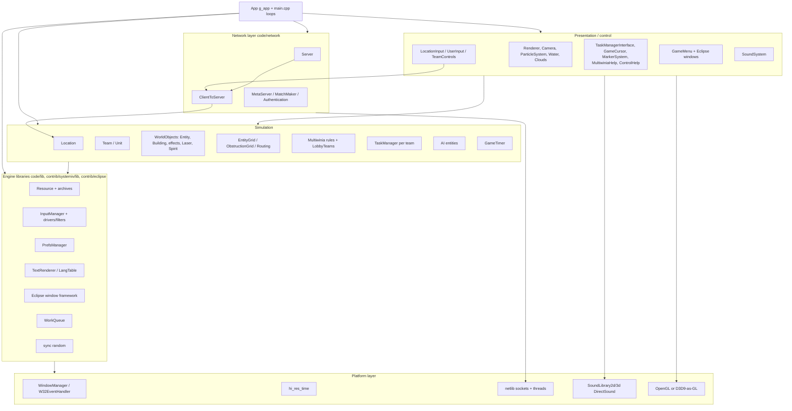
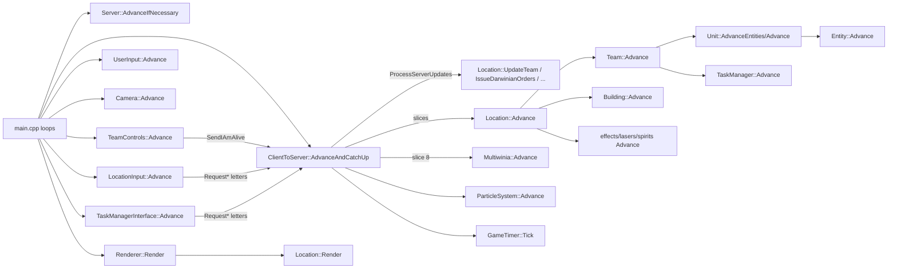
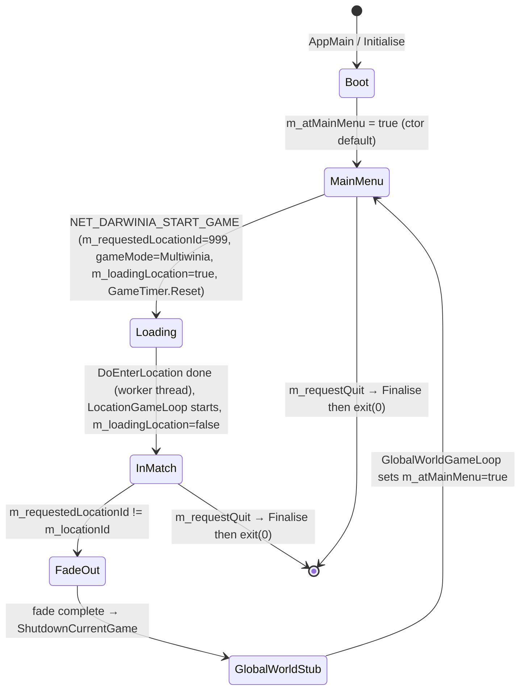
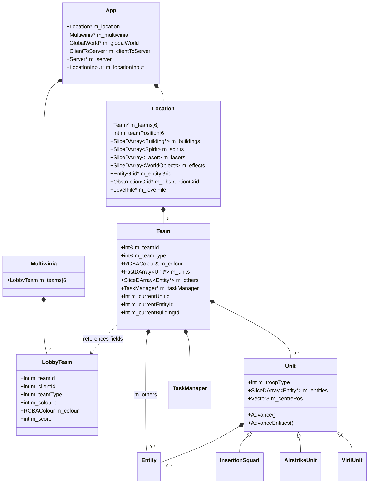

# P01_app_core — App core, main loop, location, team/unit
Scope: `code/app.cpp`, `code/app.h`, `code/gametimer.cpp`, `code/gametimer.h`, `code/globals.h`, `code/location.cpp`, `code/location.h`, `code/location_input.cpp`, `code/location_input.h`, `code/main.cpp`, `code/main.h`, `code/team.cpp`, `code/team.h`, `code/unit.cpp`, `code/unit.h`, `code/user_input.cpp`, `code/user_input.h`. Build baseline: see build_matrix.md (`Release|Win32` OpenGL + `TARGET_PC_FULLGAME`). Unless tagged otherwise every item below is **[B:FULL]**.

All paths are relative to `SRC=multiwinia/`.

---

## [→ 20_architecture] 1. The `App` class — the root object

`App` (`code/app.h:App`) is a plain aggregate: one global instance `g_app` owns (raw pointers) every long-lived subsystem. It has no virtuals and no lifecycle state machine of its own; the "state machine" of the program is the set of flags `m_atMainMenu`, `m_requestedLocationId`/`m_locationId`, `m_editing`, `m_requestToggleEditing`, `m_requestQuit`, `m_loadingLocation` consulted by `RunTheGame` (`code/main.cpp:RunTheGame`) — see §2.

### 1.1 Subsystem pointer members (every member, in declaration order)

| Member | Type | Created in | Deleted in | Lifetime | Build | Notes |
|---|---|---|---|---|---|---|
| `m_userInput` | `UserInput*` | `App::Initialise` | `~App` | process | FULL | mouse 3-D picking + debug keys, §5 [C] `code/app.cpp:App::Initialise` |
| `m_resource` | `Resource*` | `App::App` (first, after NetLib) | `~App` (second-to-last) | process | FULL | archive/texture/shape cache; `ParseArchive("init.dat")` immediately |
| `m_soundSystem` | `SoundSystem*` | `App::Initialise` | `~App` | process | FULL | initialised lazily by `App::CheckSounds` |
| `m_particleSystem` | `ParticleSystem*` | `App::Initialise` | `~App` | process | FULL | emptied in `ShutdownCurrentGame` |
| `m_langTable` | `LangTable*` | `App::SetLanguage` (via `InitLanguage`) | `~App`; the replaced table is deleted by a `DelayedJob(…, 5)` — counter = number of `HandleDelayedJobs` polls (≈ frames) while at the head of the queue, so it runs on the 6th poll [C] `code/lib/runnable.cpp:DelayedJob::ReadyToRun` | process | FULL | |
| `m_aviGenerator` | `AVIGenerator*` | never in this partition (init NULL) | – | – | `AVI_GENERATOR` only ([B:DEBUG]) | [C] ctor init list |
| `m_globalWorld` | `GlobalWorld*` | `App::Initialise` | `~App`; re-created by `LoadProfile`/`ResetLevel(true)` | process | FULL (Multiwinia uses it only as id/team/research holder) | `m_myTeamId` lives here |
| `m_location` | `Location*` | `DoEnterLocation` (loading thread) | `App::ShutdownCurrentGame` | one match | FULL | §3 |
| `m_locationId` | `int` | `DoEnterLocation` = `m_requestedLocationId` | `ShutdownCurrentGame` → -1 | | FULL | Multiwinia uses magic id **999** |
| `m_camera` | `Camera*` | `App::Initialise` | `~App` | process | FULL | |
| `m_server` | `Server*` | `App::StartNetwork(true,…)` | `ShutdownCurrentGame` (`delete m_server`) | one hosted session | FULL | NULL on pure clients |
| `m_clientToServer` | `ClientToServer*` | `App::Initialise` | `~App` | process | FULL | `OpenConnections()` straight after creation |
| `m_networkMutex` | `NetMutex` | member | – | process | FULL | locked in `StartSinglePlayerServer` |
| `m_delayedJobListMutex` | `NetMutex` | member | – | process | FULL | guards `m_delayedJobs` |
| `m_originVersion` | `char*` | literal "unknown"; replaced by first line of file `origin` | never freed | process | FULL | sent to metaserver |
| testbed members (`m_eTestBedMode` … `m_iTerminationSequenceID`, 24 fields) | various | | | | `TESTBED_ENABLED` → [B:DEAD] | Appendix |
| `m_netLib` | `NetLib*` | `App::App` (very first) | `~App` (last but one) | process | FULL | `Initialise()` (Winsock) |
| `m_mainThreadId` | `NetThreadId` | ctor = `NetGetCurrentThreadId()` | | process | FULL | |
| `m_renderer` | `Renderer*` | `App::App` | `~App` | process | FULL | `Initialise()` creates the window/GL context |
| `m_locationInput` | `LocationInput*` | `DoEnterLocation` | `ShutdownCurrentGame` | one match | FULL | §5 |
| `m_locationEditor` | `LocationEditor*` | `EnterLocation` when editing | `LocationEditorLoop` end | editor session | [B:EDITOR] | |
| `m_helpSystem`, `m_tutorial`, `m_sepulveda`, `m_demoEndSequence` | | | | | `USE_SEPULVEDA_HELP_TUTORIAL` → [B:DEAD] | |
| `m_effectProcessor` | `EffectProcessor*` | `App::Initialise` under `SOUND_EDITOR` | `~App` | | [B:DEBUG] | NULL in FULL |
| `m_taskManagerInterface` | `TaskManagerInterface*` | `TaskManagerInterface::CreateTaskManager()` (static, assigns g_app member) — called in `App::Initialise`, `DoEnterLocation` and on input-mode switch | `~App` | recreated per match / input mode | FULL | `CreateTaskManager` deletes the previous instance, then creates `TaskManagerInterfaceGestures` (single-player, pref `ControlMethod`==0, not gamepad), `TaskManagerInterfaceMultiwinia` (Multiplayer) or `TaskManagerInterfaceIcons` [C] `code/taskmanager_interface.cpp:TaskManagerInterface::CreateTaskManager`. At boot `m_gameMode` is None so the Icons variant is built first |
| `m_gesture` | `Gesture*` | `App::Initialise` (`new Gesture("gestures.txt")`) | `~App` | process | FULL | |
| `m_script` | `Script*` | `App::Initialise` | `~App` | process | FULL | |
| `m_testHarness` | `TestHarness*` | `RunTheGame` under `TEST_HARNESS_ENABLED` | – | | [B:DEAD] | |
| `m_gameCursor` | `GameCursor*` | `App::Initialise` (first object created there) | `~App` | process | FULL | |
| `m_startSequence` | `StartSequence*` | `RunBootloader` (`USE_LOADERS`) | same | | [B:DEAD] (USE_LOADERS off) | |
| `m_attractMode` | `AttractMode*` | `App::Initialise` under `ATTRACTMODE_ENABLED` | `~App` | | [B:DEAD] | NULL in FULL |
| `m_controlHelpSystem` | `ControlHelpSystem*` | `App::Initialise` | `~App` | process | FULL | `Shutdown()` when leaving a location |
| `m_gameMenu` | `GameMenu*` | `App::Initialise` | `~App` (first deleted) | process | FULL | `CreateMenu`/`DestroyMenu` around `MainMenuLoop`; owns `m_maps[gameType]` |
| `m_multiwinia` | `Multiwinia*` | `App::Initialise` | `~App` | process | FULL | owns `m_teams[NUM_TEAMS]` (`LobbyTeam`), game rules; `Reset()` per match |
| `m_shamanInterface` | `ShamanInterface*` | `App::Initialise` | `~App` | process | FULL (Darwinia-era UI, still advanced each frame) | |
| `m_markerSystem` | `MarkerSystem*` | `App::Initialise` | `~App` | process | FULL | `ClearAllMarkers()` per match |
| `m_multiwiniaHelp` | `MultiwiniaHelp*` | `App::Initialise` | `~App` | process | FULL | `Reset()` per match |
| `m_benchMark` | `BenchMark*` | `App::Initialise` | `~App` | | `BENCHMARK_AND_FTP` → [B:DEAD] | |
| `m_achievementTracker` | `AchievementTracker*` | `App::Initialise` | `~App` (last) | process | FULL | `Load()` polled in `MainMenuLoop` |
| `m_soundsWorkQueue` (private) | `WorkQueue*` | ctor init list (`new WorkQueue`) — spawns a thread | `~App` | process | FULL | loads `sounds.dat`,`sounds2.dat` |
| `m_delayedJobs` (private) | `LList<DelayedJob*>` | | | process | FULL | one job run per `HandleCommonConditions` |
| `m_oldLangTable` (private) | `LangTable*` | `SetLanguage` | `DeleteOldLangTable` (DelayedJob, counter 5 polls) | | FULL | |
| `m_thumbnailScreenshot`, `m_saveThumbnail` | | | | | `TARGET_OS_VISTA` → [B:DEAD] | |

### 1.2 Scalar/state members

| Member | Type | Initial | Meaning [C] `code/app.h:App` / `code/app.cpp:App::App` |
|---|---|---|---|
| `m_negativeRenderer` | bool | false; then pref `RenderNegative` | inverted colour rendering; sets `m_backgroundColour` white (255,255,255,255) else black (0,0,0,0) |
| `m_difficultyLevel` | int | 0 | `UpdateDifficultyFromPreferences` hard-codes 0 (pref read commented out); `Location::Init` overwrites from/to `LevelFile::m_levelDifficulty` |
| `m_largeMenus` | bool | false | true iff pref `OTHER_LARGEMENUS` == 2 |
| `m_usingFontCopies` | bool | false | CJK languages alias game/editor font to title font |
| `m_steamInited` | bool | false | never read or written anywhere else in `code/` [C] grep — dead flag |
| `m_userRequestsPause` | bool | false | toggled by network `NET_DARWINIA_PAUSE`; reset in `ShutdownCurrentGame` |
| `m_lostFocusPause` | bool | false | = !window-has-focus (or controller unplugged in gamepad mode), recomputed every `HandleCommonConditions` |
| `m_editing` | bool | false | editor mode ([B:EDITOR] paths only) |
| `m_requestedLocationId` | int | -1 | -1 = global world / none; 999 = Multiwinia match (`ClientToServer` on `NET_DARWINIA_START_GAME`) |
| `m_requestToggleEditing` | bool | false | |
| `m_requestQuit` | bool | false | `HandleCommonConditions` → `Finalise(); exit(0)` |
| `m_userProfileName[256]` | char | pref `UserProfile` ("none") | special names `AccessAllAreas`, `AttractMode` |
| `m_requestedMission[256]`, `m_requestedMap[256]` | char | "null" | map filename set by `GAMEOPTION_MAPNAME` network option |
| `m_levelReset` | bool | false | suppresses one mission save |
| `m_gameDataFile[256]` | char | "game.txt" | Darwinia campaign save |
| `m_backgroundColour` | RGBAColour | see above | |
| anonymous enum | `MultiwiniaTutorial1=0`, `MultiwiniaTutorial2=1` | | `m_multiwiniaTutorialType` |
| `m_atMainMenu` | bool | **true** | front-end menu visible |
| `m_atLobby` | bool | false | lobby page; cleared on game start |
| `m_gameMode` | int | `GameModeNone` | enum `GameModeNone=0, GameModePrologue=1, GameModeCampaign=2, GameModeMultiwinia=3, NumGameModes=4` |
| `m_loadingLocation` | bool | false | true from start-game message until `LocationGameLoop` starts; blocks sim processing |
| `m_spectator` | bool | false (true under `SPECTATOR_ONLY`) | |
| `m_multiwiniaTutorial` | bool | false | tutorial match; suppresses `m_aiType` reset |
| `m_multiwiniaTutorialType` | int | `MultiwiniaTutorial1` | |
| `m_hideInterface` | bool | false | `ControlToggleInterface` toggles |
| `m_soundsLoaded` | bool | false | set by sound work-queue thread |
| `m_requireSoundsLoaded` | bool | false | set at end of `MainMenuLoop`; loading screen waits for sounds |
| `m_doMenuTransition` | bool | false | (used by menu code, P18) |
| `m_checkedForPDLC` | bool | false | `DoCheckForPDLC` is declared but **no definition exists** [C] grep; dead declaration |
| achievements enum | `DarwiniaAchievementDominator=0, Hoarder=1, HailToTheKing=2, UncladSkies=3, AggravatedAssault=4, MasterPlayer=5, MasterOfMultiwinia=6, Explorer=7, Carnage=8, BlitzMaster=9, WrongGame=10, Genocide=11, NumAchievements=12` | | see 09_meta; `EarnedAchievement` always returns false and `GiveAchievement` does nothing beyond the CPU check → achievements are a no-op in App [C] |

### 1.3 `App` methods (public API, one line each)

| Method | Semantics [C] `code/app.cpp` |
|---|---|
| `App()` | sets `g_app=this`; NetLib init; pins thread affinity to mask `0x02\|0x08\|0x20\|0x80` (odd-numbered CPUs 1,3,5,7) [B:FULL Win32]; `Resource` + `init.dat`; `PrefsManager(GetPreferencesPath())`; `SetPreferenceOverrides()`; `Renderer::Initialise` + `SetOpenGLState`; queries `GL_MAX_TEXTURE_SIZE` → `BitmapRGBA::SetMaxTextureSize`; queues `App::Initialise` on the loading-screen work queue; renders the loading screen (blocks until queue drained); then queues `SetWorkingThreadProcessor` (affinity mask `0x01\|0x04\|0x10\|0x40`) and `App::LoadSounds` on `m_soundsWorkQueue` |
| `Initialise()` (private, runs on loading thread) | see §1.4 |
| `SetProfileName(name)` | copy; unless "AttractMode", writes pref `UserProfile` and saves prefs |
| `LoadProfile()` | recreates `m_globalWorld`; profile `AccessAllAreas`/`AttractMode` loads `game_unlockall.txt` and sets every trunk port online / every location available [B:LEGACY] |
| `SaveProfile(global, local)` | only if full version, `IsSinglePlayer()` and real profile: writes `users/<profile>/` game file and/or mission file → **no-op in Multiwinia** (IsSinglePlayer false) [C] |
| `ResetLevel(global)` | deletes saved mission file (+game file) and resets globalworld [B:LEGACY] |
| `HandleDelayedJobs()` | `TryLock`; runs head job if `ReadyToRun()`; removes it (≤1 job per call) |
| `AddDelayedJob(job)` | locked append |
| `StartNetwork(server, ip, port)` | if !editing: if server → `delete m_server; new Server; Initialise(); m_noAdvertise=true`; port ≠ -1 → real local IP and listener port, else ip "127.0.0.1"; then `m_clientToServer->ClientJoin(ip, port)` |
| `StartSinglePlayerServer()` | `m_aiType = AITypeStandard` unless tutorial; `g_gameTimer.Reset()`; lock `m_networkMutex`; `StartNetwork(true, NULL, -1)` → loopback server; returns true |
| `StartMultiPlayerServer()` | `m_aiType = AITypeStandard` unless tutorial; `StartNetwork(true, NULL, NULL)` (port 0 ≠ -1 → real IP + listener port); returns 0 (S_OK) |
| `ShutdownCurrentGame()` | ordered teardown, §1.6 |
| `GetFirstAvailableLanguage()` | first file in `language/` minus extension, else "unknown" |
| `GetDefaultLanguage()` | `g_systemInfo->m_localeInfo.m_language` |
| `InitLanguage()` | tries in order: pref `TextLanguage` (not on macOS), OS locale, "english", first available; asserts one succeeds |
| `TrySetLanguage(lang)` | if `language/<lang>.txt` exists: save pref `TextLanguage`, `SetLanguage(lang, pref TextLanguageTest)` |
| `SetLanguage(lang, test)` | builds `LangTable("language/<lang>.txt")`, optional `TestAgainstEnglish`; `setlocale(LC_CTYPE, lang)`; merges `strings_<lang>.txt` or `strings_default.txt` if present; first call initialises fonts `speccy` (game), `editor`, `square` (title), spacing factors editor 0.91, title 1.03; for `chinese-trad`,`chinese-simp`,`korean`,`japanese`: horizontal scale 1.0 and game+editor font := title font; else scale 0.6 for all three; `RebuildTables()` if input manager exists; old table deleted by `DelayedJob(m,5)` (6th poll, ≈ frames) |
| `InitMetaServer()` | loads `<profile>authkey.dev`; `Authentication_SetKey`; `Authentication_RequestStatus(key, METASERVER_GAMETYPE_MULTIWINIA)`; `MetaServer_Initialise`; `MetaServer_Connect("metaserver-mwdev.introversion.co.uk", PORT_METASERVER_CLIENT_LISTEN)`; `MatchMaker_LocateService(same host, PORT_METASERVER_LISTEN)` |
| `Multiplayer()` | `m_gameMode == GameModeMultiwinia` |
| `IsSinglePlayer()` | `m_gameMode ∈ {Campaign, Prologue}` (so a Multiwinia skirmish vs CPU is **not** "single player") |
| `UseProfileDirectory(b)` (static) | toggles profile-dir use (`--NoProfile`) |
| `GetProfileDirectory()` (static) | Win32 non-debug & ≥ Win2k: `%LOCALAPPDATA%\Introversion\Multiwinia\` (created); else "" |
| `GetPreferencesPath()` (static) | `<profile>preferences.txt` (macOS: `~/Library/Preferences/uk.co.introversion.<APP_NAME>.txt`) |
| `GetScreenshotDirectory()` (static) | `<profile>screenshots/` |
| `GetMapDirectory()` (static) | `<profile>maps/` (user maps, `.mwm`) |
| `UpdateDifficultyFromPreferences()` | `m_difficultyLevel = 0` |
| `ToggleGamePaused()` | allowed only if **no** `LobbyTeam` is `TeamTypeRemotePlayer`, not in grace period, not game over → `m_clientToServer->RequestPause()`; returns allowed |
| `GamePaused()` | `m_location && (g_gameTimer.IsPaused() \|\| m_clientToServer->m_outOfSyncClients.Size()>0 \|\| (m_lostFocusPause && IsSinglePlayer()))` |
| `EarnedAchievement(id)` | returns false (stub) |
| `CheckMasterAchievement()` | empty stub |
| `GiveAchievement(id)` | for ids other than MasterPlayer/Carnage/Genocide: return if any of the level's first `m_numPlayers` teams is CPU; then `EarnedAchievement` (no effect) |
| `IsFullVersion()` | `!Authentication_IsDemoKey(key)` (false under `MULTIWINIA_DEMOONLY`, true under `GIVE_ALL_LEVELS`) |
| `MultiplayerPermitted()` | full → true; else `DemoLimitations.m_maxDemoPlayers > 0` (false under `MULTIPLAYER_DISABLED`) |
| `HostGamePermitted()` | full → true; else `m_allowDemoServers > 0` |
| `IsMapAvailableInDemo(mode,map)` | demo limits permit both |
| `IsGameModePermitted(mode)` | demo limits (if not full) AND mode compiled in (`INCLUDEGAMEMODE_*`) |
| `IsMapPermitted(mode,map)` | mode permitted && map permitted |
| `IsMapPermitted(mapId)` | `PERMITTED_MAPS` list (CRC ids) if defined; else demo limits when not full; else true |
| `GetMapID(mode, crc)` | index in `m_gameMenu->m_maps[mode]` whose `m_mapId == crc`, else -1 (also -1 if mode ∉ [0,MAX_GAME_TYPES)) |
| `GetBuyNowURL()` | "http://store.introversion.co.uk" |
| `CheckSounds()` | `SoundSystem::Initialise()` until initialised; then `g_cachedSampleManager.CleanUp()` each call |
| `GetMaxNumberofPlayers()` | `m_numPlayers` of the `MapData` in `m_gameMenu->m_maps[m_gameType]` whose filename == `m_requestedMap`; else 0 |
| `UseChristmasMode()` | false if editing; true only on 24, 25, 26 December local time (`CHRISTMAS_DEMO`: 27 Nov–31 Dec) |
| `LoadSounds()` (private, sound thread) | parse `sounds.dat`, `sounds2.dat`; `m_soundsLoaded=true`; `m_soundSystem->TriggerInitialize()` |
| `DeleteOldLangTable()` (private) | |
| `DoStartServer()`, `DoCheckForPDLC()` (private) | declared, never defined/used [C] |

### 1.4 Process start-up order (exact)

Entry: `WinMain` stores `g_hInstance`, creates `g_windowManager = new WindowManagerWin32()` (D3D build: `WindowManagerDirectX`, `code/lib/window_manager_directx.cpp`) and calls `AppMain(cmdLine)`; on return it returns `WM_QUIT` [C] `code/lib/window_manager_win32.cpp:WinMain`.

1. `AppMain` — `--write-version` writes file `version` with `DARWINIA_VERSION` and returns. Body wrapped in SEH `__try/__except(RecordExceptionInfo(...,"AppMain","0B9432AF",DARWINIA_VERSION))` (`USE_CRASHREPORTING && TARGET_MSVC`). [C] `code/main.cpp:AppMain`
2. `RunTheGame(cmd)` → `Initialise(cmd)` (`code/main.cpp:Initialise`):
   1. `--NoProfile` → `UseProfileDirectory(false)`; create profile dir; debug log path prefix; `DUMP_DEBUG_LOG` → redirect to `debug.txt`.
   2. `StandardiseCPUPrecision()` → `_control87(_PC_53, _MCW_PC)` (x87 53-bit mantissa) **[determinism]**.
   3. `g_systemInfo = new SystemInfo`; `InitialiseHighResTime()`.
   4. `g_eventHandler = new W32EventHandler()`.
   5. `g_loadingScreen = new LoadingScreen()` (spawns its work-queue thread).
   6. `InitialiseInputManager()` — `g_inputManager` with drivers in order: Conjoin, Chord, Invert, Idle, W32 (Win), XInput (only if `LoadLibrary("XINPUT1_3")` succeeds; stored in `g_xInputDriver`), Prefs, Value, Alias. (Driver semantics → P10.)
   7. `g_app = new App()` — the App ctor (§1.3) which, on the **loading-screen thread**, runs `App::Initialise`:
      `m_requestedMission/Map="null"` → read `origin` file → `ParseArchive("language.dat")` → `InitLanguage()` → `ParseArchive` `main.dat`, `patch.dat`, `menusounds.dat`, `branding.dat` → negative-renderer pref → `UpdateDifficultyFromPreferences` → **`new GameCursor` → `new MarkerSystem` → `new MultiwiniaHelp` → `new SoundSystem` → `new ClientToServer`** → `InitMetaServer()` → `m_clientToServer->OpenConnections()` → **`new UserInput` → `new Camera`** → `m_gameDataFile="game.txt"` → (`SOUND_EDITOR`: `new EffectProcessor`) → `SetProfileName(pref UserProfile)` → **`new ParticleSystem` → `new Gesture("gestures.txt")` → `new Script` → `new ShamanInterface`** → (`ATTRACTMODE_ENABLED`: `new AttractMode`) → **`new ControlHelpSystem`** → large-menus pref → **`new AchievementTracker` → `new Multiwinia` → `new GameMenu`** → (`BENCHMARK_AND_FTP`) → (`USE_DARWINIA_MOD_SYSTEM`: mod) → **`new GlobalWorld`** → **`TaskManagerInterface::CreateTaskManager()`** → `GameMenuWindow::PreloadTextures()`.
      Only after that job has finished (the ctor blocks in `g_loadingScreen->Render()`) are `SetWorkingThreadProcessor` and `App::LoadSounds` queued on the separate sound work queue, so the two unrar-based archive loads never overlap ("unrar not thread safe" comment); sound loading then runs concurrently with steps 8–12 below and with the main menu [C] `code/app.cpp:App::App`.
   8. `ReadInputPreferences()` — parse, in order, `InputPrefs::GetSystemPrefsPath()` (from resources, must open), locale prefs (override), user prefs file (Unicode, fallback ANSI; override). [C]
   9. (`TARGET_OS_VISTA`: Vista + parental checks) [B:DEAD].
   10. `g_target = new TargetCursor()`; `EntityBlueprint::Initialise()`; `g_windowManager->HideMousePointer()`.
   11. pref `StartMap` → `m_requestedLocationId = globalWorld->GetLocationId(name)` and copies map/mission (Darwinia dev path) [B:LEGACY].
   12. `m_renderer->SetOpenGLState()`.
3. `g_loadingScreen->m_initialLoad = false`, then the outer loop (§2.1).

### 1.5 Process shutdown order (`Finalise`, `code/main.cpp:Finalise`)

Triggered only by `m_requestQuit` (set by `ControlGameDebugQuit` or UI) inside `HandleCommonConditions` → `Finalise(); exit(0)`.

1. `m_clientToServer->ClientLeave()`.
2. `MetaServer_Disconnect()`.
3. (macOS: drain loading-screen and sound preload queues.)
4. If sound initialised: `g_soundLibrary2d->Stop()`; delete `g_soundLibrary3d`, `g_soundLibrary2d`.
5. `EclShutdown()` (window framework).
6. Fonts: `g_gameFont`/`g_oldGameFont`, `g_editorFont`/`g_oldEditorFont` (whichever is the original), `g_titleFont` `.Shutdown()`.
7. `delete g_windowManager`.
8. `delete g_target`; `delete g_systemInfo`; **`delete g_app`** (→ `~App`, below).
9. `g_cachedSampleManager.EmptyCache()`; `delete g_inputManager`; `delete g_eventHandler`; `Profiler::Stop()`.

`~App` deletion order [C] `code/app.cpp:App::~App`: `m_benchMark`([B:DEAD]) → `m_gameMenu` → `m_multiwinia` → `m_globalWorld` → `m_langTable` → (`m_tutorial` demo) → `m_taskManagerInterface` → `m_shamanInterface` → `m_controlHelpSystem` → (`m_attractMode`) → `m_script` → (`m_sepulveda`) → `m_gesture` → `m_particleSystem` → `m_markerSystem` → (`m_helpSystem`) → `m_multiwiniaHelp` → (`m_effectProcessor`) → `m_camera` → `m_userInput` → `m_clientToServer` → `m_soundSystem` → `m_gameCursor` → `m_renderer` → `g_prefsManager` → `m_soundsWorkQueue` (joins thread) → `m_resource` → `m_netLib` → `m_achievementTracker`. Note: `m_location`, `m_server`, `m_locationInput` are not deleted by `~App` (they are expected to be NULL; a quit from inside a match leaks them) [C]/[I].

### 1.6 Per-match teardown (`App::ShutdownCurrentGame`)

Called at the end of `LocationGameLoop`. Order [C] `code/app.cpp:App::ShutdownCurrentGame`:
`SaveProfile(false,true)` (no-op in Multiwinia) → if pref `RecordDemo`==1 and server: `m_server->SaveHistory("serverHistory.dat")` → `g_explosionManager.Reset()` → `m_globalWorld->TransferSpirits(m_locationId)` → `m_clientToServer->ClientLeave()` → `m_location->Empty()` → `m_particleSystem->Empty()` → `m_markerSystem->ClearAllMarkers()` → `m_multiwiniaHelp->Reset()` → `delete m_location`, `m_locationId=-1` → `delete m_locationInput` → `delete m_server` → `m_multiwinia->Reset()` → `m_globalWorld->m_myTeamId = 255` → `m_globalWorld->EvaluateEvents()` → `m_userRequestsPause=false` → `SaveProfile(true,false)`.

### 1.7 Lifetimes of the world layers

| Object | Created | Destroyed | Notes |
|---|---|---|---|
| `GlobalWorld` | `App::Initialise` | `~App` | Darwinia campaign map; in Multiwinia used for `m_myTeamId`, `m_research` (forced levels in `Location::Init`), `GenerateBuildingId`, `s_nextUniqueBuildingId`, `TransferSpirits`, `EvaluateEvents` [C] |
| `Multiwinia` (+ `LobbyTeam m_teams[6]`) | `App::Initialise` | `~App` | persists across matches; `Reset()` after each. `Team` objects reference `LobbyTeam` fields by C++ reference (§4) |
| `Location` | `DoEnterLocation` (worker thread) | `ShutdownCurrentGame` | exactly one per match; `Location::Init` loads level, builds all sub-objects |
| `LocationInput` | `DoEnterLocation` | `ShutdownCurrentGame` | |
| `Server` | `StartNetwork(true)` (single-player at `DoEnterLocation`; multiplayer host from lobby code) | `ShutdownCurrentGame` | |
| `TaskManagerInterface` | `App::Initialise`, again in `DoEnterLocation`, and on keyboard↔gamepad switch | `~App` | |
| UI windows (Eclipse) | registered ad hoc (`EclRegisterWindow`) | `RemoveAllWindows`, `EclShutdown` | `GameMenu::CreateMenu/DestroyMenu` bracket the front-end |

### 1.8 Global singletons

All defined at file scope; none are reference-counted; access is unsynchronised except where noted.

| Global | Type | Defined in | Owner/creator | Role |
|---|---|---|---|---|
| `g_app` | `App*` | `code/app.cpp` | `Initialise` (`new App`), set inside ctor | root |
| `g_gameTimer` | `GameTimer` (static object) | `code/gametimer.cpp` | static init | network-safe game clock (§2.4) |
| `g_gameTime` | `double` | `code/main.cpp` | `UpdateAdvanceTime` | wall-clock time of last render frame (not sim time) |
| `g_advanceTime` | `double` | `code/main.cpp` | `UpdateAdvanceTime` | real seconds since last frame, clamped ≤ 0.25 |
| `g_lastProcessedSequenceId` | `int` | `code/main.cpp` (=-1) | `ClientToServer` | last server update consumed |
| `g_sliceNum` | `int` | `code/main.cpp` | `ClientToServer::ProcessAllServerLetters` | current slice 0..9, -1 = need next update |
| `g_RenderingFirstTimeBL`, `requestBootloader` | bool | `code/main.cpp` | `RequestBootloaderSequence` | bootloader request (body under `USE_LOADERS` → dead) |
| `g_xInputDriver` | `XInputDriver*` | `code/main.cpp` (`TARGET_MSVC`) | `InitialiseInputManager` | |
| `g_prefsManager` | `PrefsManager*` | `code/lib/preferences.*` | `App::App` | deleted in `~App` |
| `g_inputManager` | `InputManager*` | `code/lib/input/input.*` | `InitialiseInputManager` | |
| `g_inputFilterManager` | `InputFilterManager*` | `code/lib/input/inputfiltermanager.h` | P10 | |
| `g_eventHandler` | `EventHandler*` | `code/lib/input/eventhandler.h` | `Initialise` | Win32 message pump/focus |
| `g_windowManager` | `WindowManager*` | `code/lib/window_manager.h` | `WinMain` creates `WindowManagerWin32` (D3D: `WindowManagerDirectX`) **before** `AppMain` [C] `code/lib/window_manager_win32.cpp:WinMain` | deleted in `Finalise` |
| `g_target` | `TargetCursor*` | `code/lib/targetcursor.h` | `Initialise` | mouse position abstraction |
| `g_systemInfo` | `SystemInfo*` | `code/lib/system_info.h` | `Initialise` | |
| `g_loadingScreen` | `LoadingScreen*` | `code/loading_screen.h` | `Initialise` | owns a `WorkQueue` thread |
| `g_explosionManager` | `ExplosionManager` | `code/explosion.h` | static | reset per match |
| `g_cachedSampleManager`, `g_deletingCachedSampleHandle` | | `code/sound/sample_cache.h` | static | |
| `g_soundLibrary2d`, `g_soundLibrary3d` | `SoundLibrary2d*`, `SoundLibrary3d*` | `code/sound/*` | SoundSystem (P16) | |
| `g_gameFont`, `g_editorFont`, `g_titleFont`, `g_oldGameFont`, `g_oldEditorFont` | `TextRenderer` | `code/lib/text_renderer.h` | `App::SetLanguage` | |
| `g_deformEffect`, `g_waterReflectionEffect` | | `code/deform.h`, `code/water_reflection.h` | renderer (P12) | |
| `g_debugRenderer`, `g_log` | | `code/lib/persisting_debug_render.h`, `code/lib/debug_logging.h` | | |
| `g_colourBlack/White`, `g_upVector`, `g_zeroVector`, `g_identityMatrix34` | const values | lib | | |
| `g_openGLMutex` | `NetMutex` | `code/lib/safegl.cpp` | | guards GL between loading-screen thread and main thread (P12/P13) |
| `g_profiler` | `Profiler*` | `contrib/systemiv/lib/profiler.cpp` (=NULL) | `Profiler::Start()`, called only by the profile window (`code/interface/profilewindow.cpp`) — NULL in normal play | `START_PROFILE/END_PROFILE` no-op when NULL; `Profiler::Stop()` in `Finalise` |
| D3D-only: `g_pd3dDevice`, `g_pd3dDeviceActual`, `g_d3dpp`, `g_currentVertexBuffer`, `g_fixedPipeline`, `g_supportsHwVertexProcessing` | | `code/lib/opengl_directx*` | | [B:D3D] |
| `g_win32InputDriver`, `g_keys[]`, `g_keyDeltas[]`, `g_sdlMouseDriver`, `g_tracingOpenGL`, `g_fogLogging`, `g_fogEnabled` | | lib | | P10/P13 (`g_sdlMouseDriver` macOS only) |

### 1.9 Layered architecture



Module dependency graph (who calls whom per frame; arrows = "calls into"):



---

## [→ 20_architecture] 2. Main loops, frame timing and threads

### 2.1 Outer program loop (`code/main.cpp:RunTheGame`)

```
forever:
    if requestBootloader: (RunBootloader only under USE_LOADERS → dead); requestBootloader=false
    if g_app.m_atMainMenu:          MainMenuLoop()
    elif m_requestedLocationId!=-1: EnterLocation()      # Multiwinia match: id 999
    else:                           EnterGlobalWorld()    # Darwinia world [B:LEGACY]; exits at once because it sets m_atMainMenu=true
    g_inputManager.Advance()
```
[C]. `GlobalWorldGameLoop` sets `m_atMainMenu = true` then `break`s at the top of its loop when `m_atMainMenu` — in practice the program alternates **MainMenuLoop ↔ LocationGameLoop** [C] `code/main.cpp:GlobalWorldGameLoop`. After a match, `LocationGameLoop` exits because something set `m_requestedLocationId = -1` (in-game menu / results UI, P17b/P18); the next outer iteration finds `m_atMainMenu == false` and `m_requestedLocationId == -1`, enters `EnterGlobalWorld` → `GlobalWorldGameLoop`, which sets `m_atMainMenu = true` and returns at once — this is the path back to the front end.



### 2.2 `MainMenuLoop` (front end + lobby), per iteration [C]

1. `UpdateAdvanceTime()`
2. `m_renderer->Render()` (renders menus)
3. `m_userInput->Advance()`
4. `m_soundSystem->Advance()` if initialised
5. `HandleCommonConditions()` (§2.6)
6. `m_achievementTracker->Load()` until loaded
7. if `!m_gameMenu->m_menuCreated && renderer fade complete` → `m_gameMenu->CreateMenu()`
8. `m_server->AdvanceIfNecessary(GetHighResTime())` if hosting
9. `m_clientToServer->AdvanceAndCatchUp()`

Exit when `m_atMainMenu` false (set when the `NET_DARWINIA_START_GAME` command is applied — `code/network/clienttoserver.cpp:ClientToServer::ProcessServerUpdates`) or editor toggle. On exit: stop sound "MultiwiniaInterface LobbyAmbience", `m_gameMenu->DestroyMenu()`, `m_requireSoundsLoaded = true`.

### 2.3 Entering a match (`EnterLocation` / `DoEnterLocation`)

Sequence [C] `code/main.cpp:EnterLocation`, `DoEnterLocation`:

1. `m_loadingLocation = true` (already set by the start-game letter; while true `ClientToServer::AdvanceAndCatchUp` only calls `KeepAlive()` and processes no updates).
2. `g_loadingScreen->m_workQueue->Add(&DoEnterLocation)`; `g_loadingScreen->Render()` — main thread draws the loading screen until the work queue is empty (and sounds loaded when `m_requireSoundsLoaded`). `DoEnterLocation` runs on the **loading-screen worker thread**:
   1. if `!Multiplayer()` → `StartSinglePlayerServer()` (campaign path; Multiwinia already started its network in the lobby).
   2. `TaskManagerInterface::CreateTaskManager()`.
   3. `WorldObjectId::ResetUniqueIdSeed()` **[determinism]**.
   4. `m_location = new Location()`; `m_locationInput = new LocationInput()`.
   5. (`PERMITTED_MAPS`: check CRC of `m_requestedMap`.)
   6. `m_location->Init(m_requestedMission, m_requestedMap)` (§3.3).
   7. `GunTurret::SetupTeamShapes()`.
   8. `m_locationId = m_requestedLocationId`.
   9. `m_camera->UpdateEntityTrackingMode()`.
   10. pref `RecordDemo`==2 and server → `m_server->LoadHistory("ServerHistory.dat")` (replay).
   11. Camera bounds = [-200, worldSizeX+200] on both axes (`borderSize = 200.0`); fallback target (maxX,1000,maxX) looking (-1,-0.7,-1); then camera mount `"start"`; cut.
3. Back on main thread: not editing → camera `DebugModeAuto`, `RequestMode(ModeFreeMovement)` → `LocationGameLoop()`.

### 2.4 `GameTimer` — simulation clock (`code/gametimer.cpp`)

Macros (`code/gametimer.h`): `SERVER_ADVANCE_PERIOD` ≡ `g_gameTimer.GetServerAdvancePeriod()`; `g_predictionTime` ≡ `g_gameTimer.GetPredictionTime()`; `GetNetworkTime` ≡ `g_gameTimer.GetGameTime`.

| Field | Init | Meaning |
|---|---|---|
| `m_gameSpeed` | 0.0 | current speed multiplier (1 = normal, 0 = stopped) |
| `m_gameTime` | 0.0 | **sim time** in game-seconds; += `0.1*m_gameSpeed` per processed server update unless paused |
| `m_accurateTime` | 0.0 | smooth speed-scaled real time (UI/cosmetic, not net-safe) |
| `m_lastClientAdvance` | 0.0 | real time (`GetHighResTime`) of the last `Tick()` |
| `m_estimatedServerStartTime` | 0.0 | real time at `Reset()` |
| `m_requestedSpeed` | -1 | target speed (<0 = none) |
| `m_requestedSpeedOfChange` | -1 | blend factor per tick (1 = immediate) |
| `m_requestedSpeedLength` | -1 | duration (s) after which speed reverts to 1.0 (<0 = forever) |
| `m_lastCallToAccurateTime` | 0.0 | |
| `m_lockSpeedChange` | false | when true `RequestSpeedChange` ignored |

| Function | Semantics [C] |
|---|---|
| `Reset()` | `m_estimatedServerStartTime=now`; `m_gameSpeed = Multiplayer()? 0.0 : 1.0`; `m_gameTime=0`; `m_lastClientAdvance=0`; requested speed/rate = -1; unlock. **Does not reset `m_requestedSpeedLength` or `m_accurateTime`** [C] |
| `Tick()` | called once per processed server *update* (`ClientToServer::ProcessAllServerLetters`). `m_lastClientAdvance = now`; if `!g_app->GamePaused()`: `m_gameTime += GetServerAdvancePeriod()`. Then if `m_requestedSpeed ≥ 0`: `m_gameSpeed += (m_requestedSpeed − m_gameSpeed) × m_requestedSpeedOfChange`; if `\|m_gameSpeed − m_requestedSpeed\| < 0.01` snap and clear request. Then if no request pending (or reached) and `m_requestedSpeedLength ≥ 0`: `m_requestedSpeedLength −= 0.1`; when ≤ 0 → length = -1 and request speed 1.0 (rate stays as before). |
| `GetGameSpeed()` / `GetRequestedGameSpeed()` / `GetGameTime()` | accessors |
| `GetAccurateTime()` | `m_accurateTime += (now − m_lastCallToAccurateTime) × m_gameSpeed`; NOT net-safe, NOT thread-safe |
| `GetAccurateTime(futureTime)` | pure projection of the above; thread-safe |
| `GetServerAdvancePeriod()` | `0.1 × m_gameSpeed` — the **sim dt per tick** |
| `GetPredictionTime()` | 0 if `GamePaused()`; else `min(now − m_lastClientAdvance, 1.0) × m_gameSpeed` — render extrapolation time |
| `IsPaused()` | `m_gameSpeed < 0.01` |
| `RequestSpeedChange(speed, rate, length)` | ignored if locked; sets the three request fields |
| `LockSpeedChange()` | lock (used at game over) |
| `DebugRender()` | returns immediately (dead body) |

Speed-change callers (all in sim code, hence deterministic) [C]:

| Caller | Request (speed, rate, length) |
|---|---|
| `Multiwinia` grace period end (`code/multiwinia.cpp`) | (1.0, 1.0, -1) — starts a multiplayer match (Reset leaves speed 0) |
| `Multiwinia` game won (`code/multiwinia.cpp`) | (0.0, 0.2, -1) + `LockSpeedChange()` |
| `NET_DARWINIA_PAUSE` letter (`code/network/clienttoserver.cpp`) | toggle `m_userRequestsPause`; (0.0,0.2,-1) or (1.0,0.2,-1) |
| `Crate::RunSlowDownTime` [`INCLUDE_CRATES_ADVANCED`] | (0.2 + syncfrand(0.2), 0.05, 15.0) |
| `Crate::RunSpeedUpTime` | (1.3 + syncfrand(0.7), 0.05, 15.0) |
| `Meteor` within 200 of target (`code/worldobject/meteor.cpp`) | (0.4, 0.1, 4.0) |

Key design property: **the tick rate is fixed at 10 Hz of real time; game speed scales the dt of each tick** (0.1 s × speed), not the tick frequency. At speed 0 updates keep flowing but `GamePaused()` is true so `Location::Advance` is skipped [C] `code/network/clienttoserver.cpp:ProcessAllServerLetters`.

### 2.5 Tick / slice model

- **Server tick**: `Server::AdvanceIfNecessary(now)` runs `Server::Advance()` when `now > m_nextServerAdvanceTime`, then `m_nextServerAdvanceTime += 0.1` (at most one tick per call; it catches up over successive frames) [C] `code/network/server.cpp:Server::AdvanceIfNecessary`. `Server::Advance` bundles all client letters received since the last tick into one `NET_DARWINIA_UPDATE` letter with sequence id `m_sequenceId++` (P15).
- **Client sim**: each server update is executed as **10 slices** (`NUM_SLICES_PER_FRAME = 10`, `code/globals.h`). Every container that is a `SliceDArray` (`Location::m_buildings`, `m_spirits`, `m_lasers`, `m_effects`, `Team::m_others`, `Unit::m_entities`, `ParticleSystem::m_particles`) advances 1/10th of its slots per slice; each object therefore advances **once per server tick with dt = SERVER_ADVANCE_PERIOD** but the work is spread over frames.
- `ClientToServer::ProcessAllServerLetters(catchUp)` [C]:
  ```
  n = GetNumSlicesToAdvance(catchUp)
  repeat n times:
     if g_sliceNum == -1:
         letter = next in-order server letter (or none → nothing this iteration)
         ProcessServerLetters(letter)  (non-update messages)
         if seqId != -1:
            if not handled: isUpdate = ProcessServerUpdates(letter)   # applies all player commands of this tick
            g_lastProcessedSequenceId = seqId
            if isUpdate: g_sliceNum = 0; g_gameTimer.Tick(); GenerateSyncValue(); SendSyncronisation()
         if m_loadingLocation: return            # start-game letter
     if g_sliceNum != -1:
         if location and !GamePaused(): Location::Advance(g_sliceNum); ParticleSystem::Advance(g_sliceNum)
         if Multiplayer() and g_sliceNum == 8: Multiwinia::Advance()      # NB: runs even when paused
         g_sliceNum = (g_sliceNum < 9) ? g_sliceNum+1 : -1
  ```
  Note the sync checksum is generated **immediately after commands are applied and before slice 0** of the new tick, i.e. it hashes the state at the end of the previous tick plus this tick's command effects (P15/X3).
- `GetNumSlicesToAdvance(catchUp)` [C] `code/network/clienttoserver.cpp`: catch-up → 20; otherwise `pending = (lastValidSeqFromServer − g_lastProcessedSequenceId) × 10 + (g_sliceNum ≠ -1 ? 10 − g_sliceNum : 0)`; `n = int(pending × 0.3)`; clamp to [0, 20]. (A time-based branch for `pending ≤ 10` assigns a shadowed local and has **no effect** — dead code [C].) So the client consumes ~30 % of its backlog per frame, at most 2 ticks' worth of slices per call.
- `AdvanceAndCatchUp()` loops `Advance(); ProcessAllServerLetters(catchUp)` while `catchUp = (g_lastProcessedSequenceId < m_lastValidSequenceIdFromServer − 20) && clientId ≠ -1` and less than **0.3 s** real time has been spent [C].
- **Rendering** uses `g_predictionTime = min(now − lastTick, 1.0) × speed` for extrapolation: each renderable is drawn at `pos + vel × predictionTime`; objects whose slot index is **greater than `SliceDArray::GetLastUpdated()`** (i.e. not yet advanced in the current tick) are drawn with `predictionTime + SERVER_ADVANCE_PERIOD` so both halves of a half-advanced array look consistent [C] `code/team.cpp:Team::RenderOthers`, `code/unit.cpp:Unit::Render`, `code/location.cpp:Location::RenderBuildings`. This is extrapolation (dead reckoning), not interpolation between two stored states.
- Render rate is uncapped (one `Renderer::Render` per loop iteration); `MINIMUM_RENDER_PERIOD = 1.0` is defined but has no user anywhere [C] `code/globals.h` + grep.

### 2.6 `LocationGameLoop` — the in-match frame (`code/main.cpp:LocationGameLoop`)

Setup: `m_loadingLocation=false`; `m_hideInterface=false`; `iAmAServer = (m_server != NULL)`; `nextIAmAliveMessage = lastRenderTime = now`; `renderer->StartFadeIn(0.6)`; sound "EnterLocation" (Ambience).

Per iteration, in exact order [C]:

1. **Exit check**: if not fading and `m_requestedLocationId != m_locationId` → `StartFadeOut()`; when fading and `IsFadeComplete()` → `m_controlHelpSystem->Shutdown()`; break.
2. **Multiwinia camera**: once `GetMyTeam()` exists → camera target mount `"player<N>"` where N = `GetTeamPosition(myTeamId)`; cut.
3. `g_inputManager->PollForEvents()`.
4. `ControlToggleInterface` → toggle `m_hideInterface`.
5. `ControlMenuEscape` (only when fade complete): if script running → (Sepulveda skip, dead); elif any Eclipse window → `RemoveAllWindows()` (also re-centres mouse), `m_hideInterface=false`; elif task-manager visible → hide it; else camera `DebugModeAuto`, open `LocationWindow` (in-game menu), `m_hideInterface=true`. Then `m_userInput->Advance()`.
6. `g_loadingScreen->RunJobs()` (GL jobs queued by worker threads, e.g. display lists).
7. `HandleCommonConditions()` (always returns false): one delayed job; controller-unplugged dialog (`ControlControllerUnplugged` → `ControllerUnpluggedWindow`; `ControlControllerPlugged` removes "controller_unplugged"); `m_lostFocusPause = !focus` (forced unfocused when controller unplugged in gamepad mode); memory log every 60 s; `ControlGameDebugQuit` → `m_requestQuit`; `CheckSounds()`; quit → `Finalise(); exit(0)`.
8. `timeNow = GetHighResTime()`.
9. Host only: `m_server->AdvanceIfNecessary(timeNow)`.
10. If no Eclipse window on screen: `teamControls.Advance()` (accumulates input flags, §5.3).
11. Client part (always, `iAmAClient = true`):
    1. if `timeNow > nextIAmAliveMessage`: `SendTeamControlsToNetwork(teamControls)`; `nextIAmAliveMessage += IAMALIVE_PERIOD (0.1 s)`; if still behind → `timeNow + 0.1`.
    2. `m_clientToServer->AdvanceAndCatchUp()` (sim, §2.5).
    3. if `m_multiwinia->m_resetLevel` → `m_multiwinia->ResetLocation()`; re-arm player camera.
    4. `UpdateAdvanceTime()`; `lastRenderTime = now`; `g_profiler->Advance()`.
    5. `m_userInput->Advance()`.
    6. `SwitchTaskManagerForX360Controller()` (recreate task manager UI on keyboard↔gamepad switch when not visible).
    7. `m_location->m_water->Advance()`.
    8. `g_soundLibrary2d->TopupBuffer()` if sound initialised.
    9. `m_camera->Advance()` only if window has focus.
    10. `m_locationInput->Advance()`.
    11. `m_taskManagerInterface->Advance()`.
    12. `m_script->Advance()`.
    13. `g_explosionManager.Advance()`.
    14. `m_soundSystem->Advance()` if initialised.
    15. `m_controlHelpSystem->Advance()`; `m_shamanInterface->Advance()`; `m_markerSystem->Advance()`; `m_multiwiniaHelp->Advance()`.
    16. `m_globalWorld->EvaluateEvents()` ("DELETEME: debug" comment).
    17. `m_renderer->Render()`.
    18. if `m_renderer->m_fps < 15` → extra `m_soundSystem->Advance()`.

After the loop: stop "Ambience EnterLocation", trigger "ExitLocation", `ShutdownCurrentGame()`.

There is **no sleep/yield** anywhere in the in-match or menu loops (busy loop; vsync in the renderer is the only throttle) [C] for this partition; [U] whether `Renderer::Render`/`WindowManager::Flip` sleeps (P12/P13).

```mermaid
sequenceDiagram
  participant Main as Main thread (LocationGameLoop)
  participant Srv as Server (host only)
  participant C2S as ClientToServer
  participant Loc as Location/Multiwinia
  participant Ren as Renderer
  loop every frame
    Main->>Main: PollForEvents, escape/menu handling, RunJobs, HandleCommonConditions
    Main->>Srv: AdvanceIfNecessary(now) [<=1 tick per 0.1 s]
    Main->>Main: TeamControls.Advance()
    alt now > nextIAmAlive (10 Hz)
      Main->>C2S: SendIAmAlive(myTeamId, teamControls)
    end
    Main->>C2S: AdvanceAndCatchUp()
    loop n slices (0..20)
      C2S->>C2S: if slice==-1: take next update, apply commands, GameTimer.Tick, sync value
      C2S->>Loc: Location.Advance(slice); ParticleSystem.Advance(slice)
      C2S->>Loc: slice 8: Multiwinia.Advance()
    end
    Main->>Main: UpdateAdvanceTime, UserInput, Water, Camera, LocationInput, TaskManagerInterface, Script, Explosions, Sound, help/markers
    Main->>Ren: Render() using g_predictionTime
  end
```

### 2.7 `UpdateAdvanceTime` and real time (`code/main.cpp:UpdateAdvanceTime`)

- Normal: if not paused, `g_advanceTime = now − g_gameTime` clamped to **≤ 0.25 s**; `g_gameTime = now`. When paused, both are left unchanged (so `g_advanceTime` keeps its last value) [C].
- Demo recording (pref `RecordDemo` ∈ {1,2}): `g_advanceTime = 1 / pref DemoFrameRate (default 25)`; `IncrementFakeTime(that)` (the hi-res clock becomes a fake fixed-step clock); `g_gameTime = GetHighResTime()`.
- `g_advanceTime` is used by ~99 call sites for cosmetic per-frame animation (camera, UI, sound, water) — never for sim [I] (by convention; X3 to verify).

### 2.8 Threading model

| Thread | Created by | Runs | Sync with main |
|---|---|---|---|
| Main | OS | all loops, sim (`Location::Advance` via ClientToServer), render, input | – |
| Loading-screen worker | `LoadingScreen` ctor → `WorkQueue` (`NetStartThread`) | `App::Initialise` at boot, `DoEnterLocation` (whole level load incl. `Location::Init`) | main spins in `LoadingScreen::Render` until queue empty; GL calls from worker are queued as `Job`s and run by main via `RunJobs`; `g_openGLMutex` |
| Sound loader | `App::m_soundsWorkQueue` | `SetWorkingThreadProcessor` (affinity 0x55) then `App::LoadSounds` | sets `m_soundsLoaded` (plain bool, no barrier) |
| Sound preload | `SoundSystem::m_PreloadQueue` (`code/sound/soundsystem.cpp`) | sample preloading | P16 |
| Client listener | `ClientToServer::OpenConnections` → `m_listenThread` WorkQueue running `ListenThread` | receives UDP into inbox (mutex `m_inboxMutex`) | P15 |
| Server listener | `Server` → `NetStartThread(ListenThread)` | receives client UDP | P15 |
| MetaServer/auth/matchmaker | `contrib/systemiv/lib/metaserver/*` (`ListenThread`, `ServerRegisterWANThread`, `ServerRegisterLANThread`, `AuthenticationThread`, `RequestIdentityThread`, Steam threads) | | P15 |
| D3D work queue | `code/lib/opengl_directx.cpp` (`s_workQueue`) | [B:D3D] | P13 |

Every `WorkQueue` thread calls `StandardiseCPUPrecision()` first (x87 precision is per-thread) [C] `code/lib/work_queue.cpp:WorkQueue::RunThread`. `Location::Advance` contains `#pragma omp parallel for` over its five sub-advances, but **OpenMP is disabled** in the project (`OpenMP="false"`, `targets/vs2005/Darwinia.vcproj`) so it executes serially in step order 0..4 [C]; a port must keep this serial order (§6).

Thread affinity: main thread mask `0xAA` (CPUs 1,3,5,7); loading/sound worker threads mask `0x55` (CPUs 0,2,4,6) [C] `code/app.cpp:App::App`, `SetWorkingThreadProcessor`.

## [→ 21_simulation_and_entity_model] 3. `Location` — the match world

`Location` (`code/location.h:Location`) is the container and service façade for everything simulated in one match. Exactly one exists at a time (`g_app->m_location`), created on the loading thread in `DoEnterLocation` and destroyed in `App::ShutdownCurrentGame` (§1.6). All sim access goes through `g_app->m_location` (a global, not a parameter).

### 3.1 Members (every member)

| Member | Type | Init (`Location::Location`) | Meaning / owner [C] `code/location.h`, `code/location.cpp` |
|---|---|---|---|
| `m_lastSliceProcessed` (prot.) | int | 0 | last slice passed to `Advance`; used by cloud render offset |
| `m_missionComplete` (prot.) | bool | false | Darwinia objective flag [B:LEGACY] |
| `m_coopGroupColourTaken[2][2]` (priv.) | bool | false | per coop group: member-0 / member-1 shade already handed out by `GetGroupColour` |
| `m_showCrateDropMessage` (priv.) | bool | true | show "crate_drop" message only for the first crate |
| `m_landscape` | `Landscape` (by value) | | heightmap/normal map/render (P11) |
| `m_entityGrid` | `EntityGrid*` | NULL; `new EntityGrid(32.0, 32.0)` in Init | spatial hash for entities (cell 32×32 world units) (P03) |
| `m_entityGridCache` | `EntityGridCache*` | NULL; created in Init; deleted in dtor and Empty | neighbour query cache, `Advance()` at slice 7 |
| `m_obstructionGrid` | `ObstructionGrid*` | NULL; `new ObstructionGrid(s,s)`, s = **32.0 in Multiplayer, 64.0 otherwise** | building footprint grid |
| `m_levelFile` | `LevelFile*` | NULL; `LoadLevel` | parsed map+mission (P11) |
| `m_clouds` | `Clouds*` | NULL; Init | sky clouds; advanced at slice 3 |
| `m_water` | `Water*` | NULL; Init | advanced per *frame* by main loop (cosmetic) |
| `m_routingSystem` | `LandRoutingSystem` | | pathfinding for Darwinians/officers (P03) |
| `m_seaRoutingSystem` | `SeaRoutingSystem` | | AI sea routes |
| `m_teams[NUM_TEAMS]` | `Team*[6]` | NULL; `InitTeams` creates **all six** (even unused) | |
| `m_teamPosition[NUM_TEAMS]` | int | -1 | team id → map start position (0..numPlayers-1) |
| `m_christmasTimer` | double | -99.9 | shared timer for snow / dust / lightning spawners (<-90 = first-run burst) |
| `m_spawnSync` | double | 0.0 | soul-rain spawner timer |
| `m_crateTimer` | double | 0.0 | crate drop countdown |
| `m_spawnManiaTimer` | double | 0.0 | crate effect timer, decremented at slice 8 (P08) |
| `m_bitzkreigTimer` | double | 0.0 | crate effect timer, decremented at slice 8 (P08) |
| `m_allowMonsterTeam` | bool | true | gates `GetMonsterTeamId`/`GetFuturewinianTeamId` (→ -1 when false) |
| `m_teamsInitialised` | bool | false | set at end of `InitTeams` |
| `m_messageTimer` | double | 0.0 | **real-time** expiry of the centre-screen message |
| `m_message` | UnicodeString | empty | centre-screen message |
| `m_messageTeam` | int | -1 | colour source (255 = white) |
| `m_messageNoOverwrite` | bool | false | lock until expiry |
| `m_lights` | `FastDArray<Light*>` | step 1 | from level file |
| `m_buildings` | `SliceDArray<Building*>` | step 10, 10 slices | all buildings incl. crates |
| `m_spirits` | `SliceDArray<Spirit>` (by value) | size 100, step 100, 10 slices | |
| `m_lasers` | `SliceDArray<Laser>` (by value) | step 100, 10 slices | |
| `m_effects` | `SliceDArray<WorldObject*>` | step 100, 10 slices | grenades, rockets, shells, fireballs, shockwaves, muzzle flashes, snow, dust balls, lightning, unprocessed spirits, and other `WorldObject` effects |
| `m_chatMessages` | `LList<ChatMessage*>` | | newest first; render-only |
| `m_windDirection` | Vector3 | zero | set by dust-wind spawner |
| `m_coopGroups[NUM_TEAMS]` | int | 0 | 0 = none, 1 / 2 = alliance group |
| `m_groupColourId[2]` | int | -1 | colour id chosen for each coop group |
| `m_burnPatches` | `LList<BurnPatch>` | | scorched terrain patches (pos, radius); adding one rebuilds landscape GL state |
| `m_christmasMode` | bool | false | copied from `ClientToServer::m_christmasMode` at Init |
| `m_sortedBuildingsAlphas` (priv.) | `DepthSortedBuilding*` | NULL | growable scratch buffer (step 128) for alpha depth sort |
| `m_sizeSortedBuildingsAlphas` (priv.) | int | 0 | |
| `s_neighbours` (static) | `std::vector<WorldObjectId>` | | shared scratch result buffer for grid queries |
| `s_neighboursInUse` (static) | bool | false | re-entrancy guard used only by `Bang` |

Structs: `ChatMessage {m_msg, m_clientId, m_recievedTime (real time), m_colour, m_senderName}`; `BurnPatch {m_pos, m_radius}`; `DepthSortedBuilding {m_buildingIndex, m_distance (float, squared distance)}`.

### 3.2 Containers: storage, identity and add/remove rules

All arrays are `FastDArray` derivatives: an entry's index never changes; removal pushes the slot on a **LIFO free list** so the next `PutData` reuses the most recently freed slot [C] `contrib/systemiv/lib/tosser/fast_darray.cpp:FastDArray::RemoveData/PutData`. Iteration is always by ascending index over `Size()` (capacity), skipping invalid slots.

| Container | Element identity (`WorldObjectId(team, unit, index, uniqueId)`) | Added by | Removed when |
|---|---|---|---|
| `Team::m_others` (per team) | (team, -1, slot, unique) | `Location::SpawnEntities` → `Team::NewEntity(type, -1)` → `Entity::NewEntity(type)` | `Entity::Advance(NULL)` returns true → removed from entity grid at old pos, deleted (`Team::Advance`) |
| `Unit::m_entities` (per unit) | (team, unitId, slot, unique) | `SpawnEntities` with `_unitId ≠ -1` → `Unit::NewEntity` | `Entity::Advance(unit)` true → `Unit::RemoveEntity` (grid remove + delete) |
| `Team::m_units` | unit slot | `Team::NewUnit` (InsertionSquad / AirstrikeUnit / ViriiUnit / generic Unit) | `Unit::Advance` true (no live entities) at slice 0 → deleted |
| `m_buildings` | (team, `UNIT_BUILDINGS`=-100, -1, uniqueId) — looked up by **uniqueId by linear scan** | `InitBuildings` (from level file), `CreateRandomCrate`, other systems (P06/P08) | `Building::Advance()` true → removed+deleted; triggers `ObstructionGrid::CalculateAll()` once per slice; `RecalculateAITargets()` if the removed one was an `AITarget` or `Wall` |
| `m_spirits` | (team, `UNIT_SPIRITS`=-101, slot, -1) | `SpawnSpirit` (refused for the monster team → -1) | `Spirit::Advance()` true |
| `m_lasers` | none (value type) | `FireLaser` (`GetPointer()` = allocate slot) | `Laser::Advance()` true |
| `m_effects` | (team or -1, `UNIT_EFFECTS`=-103, slot, generated unique) | `ThrowWeapon`, `FireRocket`, `FireTurretShell`, `LaunchFireball`, `FireLaser` (muzzle flash), `CreateShockwave`, weather spawners, other systems | `WorldObject::Advance()` true → removed+deleted |

`GetEntity(id)` validates `uniqueId` so a stale id to a reused slot returns NULL [C] `code/location.cpp:Location::GetEntity`. `UNIT_LASERS` = -102 is defined but lasers are never looked up by id [C] `code/worldobject/worldobject.h`.

### 3.3 Level loading flow (`Location::Init(mission, map)`)

Exact order [C] `code/location.cpp:Location::Init`:

1. `LoadLevel(mission, map)`: `m_levelFile = new LevelFile(mission, map, ext(map)=="txt")`; if `MissionComplete()` already → mark complete and set `GlobalLocation(m_requestedLocationId)->m_missionCompleted`. (For Multiwinia the objective list is the automatic `NeverTrue` objective so this is false [I] `code/level_file.cpp:LevelFile::GenerateAutomaticObjectives`; otherwise the NULL `GetLocation(999)` would crash.)
2. `AppSeedRandom(1)` — reseeds the **non-synchronised** generator (`AppRandom`, frand/sfrand) [determinism].
3. Reset statics: `GlobalWorld::s_nextUniqueBuildingId=0`; `Crate::s_crates=0`; `Crate::s_spaceShipUsed=false`; `AIObjective::s_objectivesInitialised=false`; `Armour::s_armourObjectives.Empty()`; `Engineer::s_buildingIds/s_researchIds.EmptyAndDelete()`; `SpawnPopulationLock::Reset()`; `SoulDestroyer::s_numSoulDestroyers=0`; `DustBall::s_vortexTimer=0`, `s_vortexPos=0`; delete `Unit::s_offsets`; for each team i: `AI::s_ai[i]=NULL`, `SpawnPoint::s_numSpawnPoints[i]=0`, `GetTeamPosition(i)` (assigns start positions — consumes `syncrand`), `PulseBomb::s_pulseBombs[i]=-1`, `MultiwiniaZone::s_blitzkriegBaseZone[i]=-1`.
4. Christmas: if `m_clientToServer->m_christmasMode` → move flag into `m_christmasMode`.
5. `InitLights()` (copy colour+front of each level light), `InitLandscape()` (`m_landscape.Init(&levelFile->m_landscape)`), `m_water = new Water()`.
6. Team colours/alliances (§4.4): Assault → `SetupAssault()`; else coop → `SetupCoop(i)` for every player position i < numPlayers that is not monster/futurewinian and not yet grouped; else for each CPU team: colour = `Multiwinia::GetCPUColour()` (random unused of colours 0..3; tutorial forces colour = team index).
7. If not editing: `InitBuildings()` → `RecalculateAITargets()` → `m_entityGrid = EntityGrid(32,32)`, `m_entityGridCache`, `m_obstructionGrid(32 or 64)` → `m_clouds` → `m_routingSystem.Initialise()`, `m_seaRoutingSystem.Initialise()`. (Editing: only snap level buildings to terrain height [B:EDITOR].)
8. `InitTeams()`: for i in 0..5: if lobby colour is -1 → `GetNextAvailableColour()`; `m_teams[i] = new Team(lobbyTeam)`; if type ≠ Unused → `InitialiseTeam(i)`; then `m_teamsInitialised = true`.
9. If `numPlayers < 4`: for teams i ≥ numPlayers (excluding 4 and 5) pick a random unused colour `id = (syncrand() % 8) / 2` (i.e. 0..3) until unused, assign `m_colour` only (so "random team colour" effects have a full palette) [C].
10. Difficulty: `levelFile->m_levelDifficulty == -1` → store `g_app->m_difficultyLevel` (0) in it; else copy it into `m_difficultyLevel`.
11. `m_allowMonsterTeam = true`; Multiplayer: `InitMonsterTeam(4)`, `InitFuturewinianTeam(5)`; force `GlobalResearch` levels: every item = 3, then Squad = 1, Laser = 2, Grenade = 2, Rocket = 2, AirStrike = 2, Darwinian = 4 [C].

`InitBuildings()` [C]: for each level-file building: assert no duplicate uniqueId; `Building::CreateBuilding(type)`; `PutData`; remap owner **map position → team id** with `GetTeamFromPosition` (unless 255/-1); `Initialise(template)`; `SetDetail(1)`; track highest id; collect `ControlStation`s and the `PulseBomb`. Assault: link every control station whose id is in `pulseBomb->m_links` via `ControlStation::LinkToPulseBomb`. Finally `GlobalWorld::s_nextUniqueBuildingId = highest+1`.

`InitialiseTeam(teamId)` [C] `code/location.cpp:Location::InitialiseTeam`:
1. `team->Initialise()` (creates `TaskManager(teamId)`; builds `sprites/viriifull.bmp` if absent).
2. Multiwinia only: CPU team → spawn one `Entity::TypeAI` at (-100,0,-100) (the AI brain is an entity, P08). Game option `StartingPowerups` (0 for teams 4 and 5): repeat N times pick `syncrand() % Crate::NumCrateRewards` until not in the exclusion set {Randomiser, CrateMania, Darwinians, Bitzkreig, SpawnMania, Plague, RocketDarwinians, SpaceShip, Spam, Triffids, SpeedUpTime, SlowDownTime, Forest, TheBeast(`INCLUDE_THEBEAST`)} and `Crate::IsValid` → `Crate::CaptureCrate(id, team)`; then every non-Shaman task gets `m_startTimer = 30.0` s. Then for every **SpawnPoint or SolarPanel** owned by the team: one Darwinian per port at the port position, state `StateOperatingPort`, facing port front; SpawnPoint → `EvaluatePorts()`, `RecalculateOwnership()`, `m_activationTimer=0`; SolarPanel → `EvaluatePorts()`, `RecalculateOwnership()`.
3. `position = GetTeamPosition(team)`; for each level-file `InstantUnit` whose `m_teamId == position`: if `m_runAsTask` → map type {Armour→TypeArmour, InsertionSquadie→TypeSquad, Harvester→TypeHarvester, Shaman→TypeShaman, Engineer→TypeEngineer, Tank→TypeTank} research, `RunTask`, `TargetTask` at pos (verification off), task `m_lifeTimer=-1` (permanent); else optional `NewUnit` (+waypoint, route) and `SpawnEntities(pos, team, unit, type, number, 0, spread, -1, route, routeWaypoint)`; waypoint snapped to a Radar Dish centre if inside its radius; single Darwinian with `StateFollowingOrders` → `GiveOrders(target)`; Officer → `SetOrders(target)` if `OrderGoto` else `m_orders = state`; Armour → `SetWayPoint`, `m_state`.
4. Snap every `m_others` entity of every team to terrain height.
5. Local player only: level-file `RunningProgram`s (Engineer with carried spirits; InsertionSquad with weapon type and per-member health) registered as running tasks [B:LEGACY in practice — Darwinia save-game feature].

### 3.4 Simulation update ordering (per slice)

`Location::Advance(slice)` is called by `ClientToServer::ProcessAllServerLetters` once per slice (10 per server tick) unless `GamePaused()` [C]. Order inside one call [C] `code/location.cpp:Location::Advance`:

1. `m_lastSliceProcessed = slice`.
2. Steps 0..4 in order (OpenMP pragma inert):
   0. `AdvanceTeams(slice)` — teams 0..5 in index order, skipping `TeamTypeUnused`; each `Team::Advance(slice)` (§4.2).
   1. `AdvanceWeapons(slice)` — this slice of `m_lasers` (`Laser::Advance`), then this slice of `m_effects` (`WorldObject::Advance`).
   2. `AdvanceBuildings(slice)` — this slice of `m_buildings`; removal side effects (§3.2).
   3. `AdvanceSpirits(slice)` — this slice of `m_spirits`.
   4. `AdvanceClouds(slice)` — `m_clouds->Advance()` only when slice == 3.
3. Darwinia objectives: `!m_missionComplete && MissionComplete()` → `DoMissionCompleteActions()` (task-manager message `MessageObjectivesComplete` for 5 s) [B:LEGACY].
4. slice == 3: level effects — `LevelEffectSnow` → `AdvanceChristmas()`; `LevelEffectSoulRain` → `AdvanceSoulRain()`; `LevelEffectDustStorm` → `AdvanceDustWind()`; `LevelEffectLightning` → `AdvanceLightning()`; and `ChristmasModEnabled()` → `AdvanceChristmas()`.
5. slice == 7: `m_entityGridCache->Advance()`.
6. Multiplayer and slice == 8: `AdvanceCrates()`; `m_spawnManiaTimer -= SERVER_ADVANCE_PERIOD` if > 0; `m_bitzkreigTimer -= …` if > 0.

After `Location::Advance(slice)` returns, `ParticleSystem::Advance(slice)` runs (cosmetic), and at slice 8 `Multiwinia::Advance()` (game rules, scoring, victory) [C] `code/network/clienttoserver.cpp`.

Slice partitioning (`SliceDArray::GetNextSliceBounds`) [C] `code/lib/slice_darray.cpp`: with `n = int(Size() / 10.0f)`, slice 0 covers `[0, n]`, slice k covers `[last+1, last+1+n]`, slice 9 covers `[last+1, Size()-1]`. Bounds are computed from the **current** `Size()` at each call, so objects added to a slot above the cursor during a tick are advanced in the same tick, below the cursor in the next; `GetLastUpdated()` = upper bound of the last processed slice (used by render to pick the extrapolation offset).

Per-tick schedule (which slice does what):

| Slice | Work |
|---|---|
| every slice 0–9 | 1/10 of every team's `m_others` and every unit's `m_entities`; 1/10 of lasers, effects, buildings, spirits, particles |
| 0 | all `Unit::Advance` (centre/radius/velocity update, route following, death); per-team Darwinian-selection stats latched |
| 1 | every team's `TaskManager::Advance()`; team kill-milestone messages |
| 3 | clouds; weather/level effects |
| 7 | entity-grid cache |
| 8 | crates and crate timers (Location), then `Multiwinia::Advance()` |

### 3.5 Weather and ambient spawners (all at slice 3, dt = `SERVER_ADVANCE_PERIOD`)

| Function | Behaviour [C] `code/location.cpp` |
|---|---|
| `AdvanceChristmas` | if `m_christmasTimer < -90`: spawn 150 `Snow` effects at (FRAND(sizeX), syncfrand(1000), FRAND(sizeZ)). Timer −= dt; when ≤ 0: timer = 0.1 s and spawn one `Snow` at y = 700 + syncfrand(300). |
| `AdvanceSoulRain` | `m_spawnSync −= dt`; when ≤ 0: reset to 1.0 s; spawn `UnprocessedSpirit` at (FRAND(sizeX), 700 + syncfrand(300), FRAND(sizeZ)) into `m_effects` **without setting `m_id`** [C] |
| `AdvanceDustWind` | `DustBall::s_vortexTimer −= dt`; when ≤ 0: timer = 15 + syncfrand(15); with probability 1/10 (`syncrand()%10==0`) and no vortex: vortex at random land point (re-roll while height ≤ 1.0), else clear vortex and set `m_windDirection` = normalise(random point − random point). First run (`m_christmasTimer < -90`): 300 `DustBall`s at y = syncfrand(1000), size += syncfrand(20). Then shared timer −= dt; when ≤ 0: two dust balls (timer = 0.1). Vortex active: every Darwinian within 50 of the vortex ground point that is on ground → `StateInVortex`, airborne. |
| `AdvanceLightning` | shared timer −= dt; when ≤ 0: timer = syncfrand(15); one `Lightning` effect at y = 1200 over a random land point (height > 1.0). |

Note `AdvanceChristmas`, `AdvanceDustWind` and `AdvanceLightning` all use the same `m_christmasTimer`; a level with several effects (or Christmas mode + dust) makes them interfere [C].

### 3.6 Crates (`AdvanceCrates`, `CreateRandomCrate`) [`INCLUDE_CRATES_BASIC`]

- Skipped entirely in tutorial 1, and in tutorial 2 until `m_multiwiniaHelp->m_tutorial2AICanSpawn`.
- `maxCrates = int(worldSizeX / 500.0)`; no drop when `Crate::s_crates ≥ maxCrates`.
- `crateTime = GameOption("CrateDropRate")`; 0 or -1 disables. Timer initialised (when exactly 0) and reset after each drop to `crateTime × (1.5 − syncfrand(1.0))` ⇒ uniform in (0.5, 1.5] × crateTime seconds.
- `CreateRandomCrate` with `GameOption("CrateDropMode")`: 0/-1 → random; 1 → **weighted** drop: over live non-monster/non-future teams compute `total`, `high`, `low` scores; `chance = max(high/total, 1 − low/total)`; if `syncfrand(1) > chance` → random, else pick a drop team with weight `total/score` (score 0 → weight `total`) and place within ±100 (`syncsfrand(200)`) of a random building of that team (`CRATE_START_HEIGHT + syncfrand(200)` height), up to 1000 tries. **Bug:** the land check is `GetValue(pos.x, pos.z > 20.0)` — the comparison is inside the call, so it tests the height at z∈{0,1} [C]; effectively any position passes when the map edge height is non-zero.
- Random placement: re-roll `(FRAND(sizeX), CRATE_START_HEIGHT + syncfrand(200), FRAND(sizeZ))` while ground height < 20 or `RestrictionZone::IsRestricted`; if crates exist, a candidate within `CRATE_SCAN_RANGE × 10` (horizontal) of any crate is zeroed (forces another roll); give up after 100 tries.
- Creation: id (255, UNIT_BUILDINGS, -1, `GlobalWorld::GenerateBuildingId()`); `Building::CreateBuilding(TypeCrate)`; `Initialise(template)`; `SetDetail(1)`; `MarkerSystem::RegisterMarker_Crate`; first crate shows "crate_drop" message.

### 3.7 Render entry points (`Location::Render(renderWaterAndClouds=true)`)

Called by `Renderer` (P12) — normal pass and `WaterReflectionEffect` (`Render(false)`). Order [C]:

1. (testbed render-off → return [B:DEAD])
2. `RenderClouds()` (if flag) — clouds extrapolated by `predictionTime`, `+ SERVER_ADVANCE_PERIOD` if `m_lastSliceProcessed < 3`.
3. `RenderLandscape()`.
4. `RenderWater()` (if flag; D3D: else disable clip plane 2).
5. `RenderBuildings()` — fog on (linear, start = fogEnd/3, end = max(4000, worldX+1000, worldZ+1000), colour = background), object lighting, special lights if pref `RenderSpecialLighting`==1 or Rocket Riot or level effect `SpecialLighting` or Prologue; each in-view building `Render(t)`.
6. `RenderTeams()` (not editing) — `Team::Render` for all 6 teams (§4.3).
7. `RenderBuildingAlphas()` — non-sorted alphas immediately; buildings with `PerformDepthSort` collected, `qsort` by squared camera distance, drawn far→near.
8. (not editing) `RenderParticles()` (empty), `RenderWeapons()` (effects in frustum or of type PulseWave/SpamInfection/Lightning, additive; lasers as quads with texture `textures/laser.bmp`, near plane ×1.2), `RenderSpirits()` (monster-team spirits subtractive `GL_ONE_MINUS_SRC_COLOR` first, then others additive).
9. `m_routingSystem.Render()` (route highlights).
10. `RenderCurrentMessage()` — centre text, size 40 (shrunk to fit width ×0.95, grows by `sqrt(2−t)×15` in the last 2 s), y = 370 × (screenW/1280), alpha = min(1, remaining×0.5), outline alpha³; team colour or white.

`RenderChatMessages()` is called separately by the renderer when chat is shown [C] `code/renderer.cpp`: newest at bottom, up to half screen height, font 14×scale (scale = W/1280; ≤800 → W/1024; ≤640 → 0.75), box width 25 % of screen; fade from 55 s to 60 s, deleted after 60 s; shows `multiwinia_presstotalk` when any remote human exists.

Every render path uses the extrapolation rule of §2.5 (`t = g_predictionTime`, `+SERVER_ADVANCE_PERIOD` for not-yet-advanced slots).

### 3.8 Victory, scoring and Multiwinia hooks in this partition

- No victory logic lives in `Location`; `Multiwinia::Advance()` (P02) is driven from slice 8. [C]
- `Location::Bang` adds kills to `m_teams[teamId]->m_teamKills` (Darwinian kills only in Multiwinia; all kills in single-player) [C].
- `Team::Advance` slice 1 announces kill milestones 500/1000/2000/3000/4000/5000 for the local team (`multiwinia_kills_N`) [C].
- `Team::Eliminate()` (called by game rules) kills everything and releases trunk ports (§4.2).
- `Location::UpdateTeam` ignores all controls while `GamePaused()` or `GameOver()` in Multiplayer [C].
- `CreateRandomCrate` mode 1 reads `LobbyTeam::m_score` to bias drops towards losing teams [C].

### 3.9 `Location` public API (one line each)

| Function | Semantics [C] `code/location.cpp` |
|---|---|
| `Init(mission, map)` | §3.3 |
| `InitBuildings()` | §3.3 |
| `Empty()` | delete water; `m_landscape.Empty()`; delete lights, buildings, effects; empty spirits/lasers; delete `Unit::s_offsets`; delete all teams; delete level file, entity grid, cache, obstruction grid, clouds; reset AIObjective/Armour/Engineer statics |
| `Advance(slice)` | §3.4 |
| `Render(waterAndClouds)` / `RenderChatMessages()` | §3.7 |
| `InitialiseTeam(teamId)` | §3.3 |
| `GetTeamPosition(teamId)` | non-multiplayer: identity; tutorial: identity (stored); teams 4/5: identity; otherwise lazily assigns a random free position `unused[syncrand() % unused.Size()]` among 0..numPlayers-1; returns -1 if none free |
| `GetTeamFromPosition(pos)` | single-player: identity; else first team i < numPlayers with `m_teamPosition[i]==pos` (forcing assignment); 255 if none |
| `RotatePositions()` | new[i] = old[(i+1) mod numPlayers] for i < numPlayers; others -1 (used by rematch/rotation, P02) |
| `GetBuildingId(rayStart, dir, team, maxDist, *range)` | buildings of `team` or neutral (255) except ControlTower; RadarDish/GunTurret use exact `DoesRayHit` and return immediately (range 0); others ray–sphere at 0.75 × radius; best = smallest **screen-space** distance between building centre and hit point |
| `GetUnitId(rayStart, dir, team, *range)` | ray vs unit sphere (1.5 × radius, alive units) then per-entity sphere (1.5 × radius) by screen distance; returns unit index |
| `GetEntityId(rayStart, dir, team, *range, ignoreDarwinians)` | over `m_others`: Officer → `CalculateBoundingSphere`; Armour → `RayHit` (wins with range 0.001); others sphere (1.0 × radius); screen-distance best |
| `IsWalkable(from, to, evaluateCliffs, permitSteepDownhill, *laserFenceId)` | false if either end ≤ water level 0; step 20 units: >40 units cumulative under water → false; cliffs: gradient > 2.4 → false; normal.y < 0.8 → false (only uphill when `permitSteepDownhill`); a Wall sphere-hit (radius 13.2 = 20×0.66) → false; enabled LaserFence sphere-hit (radius 10) only reports its id |
| `GetWalkingDistance(from, to, checkObstructions)` | step 40 units; ≥40 under water → -1; Wall or enabled LaserFence sphere-hit (radius 20) → -1; distance = Σ segment length × (1 + max(0, 1.5 × gradient)) |
| `IsVisible(from, to)` | landscape ray from `from + 20·dir`; visible if no hit or hit beyond target + 20 |
| `UpdateTeam(teamId, controls)` | applies one team's continuous controls (§5.4) |
| `SpawnSpirit(pos, vel, team, sourceId)` | -1 for monster team; else spirit at pos+up, id (team, UNIT_SPIRITS, slot, -1), `Begin()` |
| `ThrowWeapon(pos, target, type, team, force=0, life=0, explodeOnImpact=false)` | force = `sqrt(dist) × 8` capped at `ThrowableWeapon::GetMaxForce(grenadeResearch)` (team 1 single-player → research 4), override if `_force ≠ 0`; launch dir = normalise(normalise(target−pos) with y := 1); types `EffectThrowableGrenade`, `EffectThrowableAirstrikeMarker`, `EffectThrowableControllerGrenade` (binds current squad task id); plus a `MuzzleFlash(pos, front, 20, 3)`; returns effect slot |
| `FireRocket(pos, target, team, life=-1, fromBuilding=-1, firework=false)` | `Rocket` effect + muzzle flash (20, 3) |
| `FireLaser(pos, vel, team, mindControl=false)` | laser life by Laser research 0..4 → 0.2/0.4/0.6/0.8/1.0 s (×2 for mind-control); muzzle flash (25 × life, 1.5) |
| `FireTurretShell(pos, vel, team, fromBuilding)` | life by Armour research 0/1→0.5, 2→1.0, 3→1.5, 4→2.0; **Multiplayer: 0.6 s and team kept**; single-player team = 255; muzzle flash at pos + vel × dt × 0.5 (60, 2) |
| `LaunchFireball(pos, vel, life=1.0, fromBuilding=-1)` | `Fireball` effect, team -1 |
| `Bang(pos, range, damage, team=-1, fromBuilding=-1)` | explosion: cosmetic particles; damage all entities within 2 × range: `fraction = clamp(2·(2r − d)/r, 0, 1)` (operator-precedence effect: full damage to d ≤ 1.5 r, linear to 0 at 2 r); `ChangeHealth(−damage × fraction, DamageTypeExplosive)`; on success push `normalise((dir.x, onGround? damage : −1, dir.z)) × fraction` added to velocity and airborne, except InsertionSquadie/Officer/Shaman; buildings within 3 × range: `Damage(−damage × (1 − d/3r))`; kills (enemy) counted; shockwave of size range/20; D3D: deform punch; returns kills |
| `CreateShockwave(pos, size, team=255, fromBuilding=-1)` | `Shockwave` effect |
| `RecalculateAITargets()` | every live `AITarget::RecalculateNeighbours()`; then cull link A→C (not manual, not turret targets) if some neighbour B has B→C and `dist(A,C) > 0.8 × (dist(A,B) + dist(B,C))` |
| `MissionComplete()` | all primary objectives evaluate true [B:LEGACY] |
| `AdvanceChristmas/SoulRain/DustWind/Lightning()` | §3.5 |
| `SelectDarwinians(team, pos, radius)` | grid query (team only) within radius; marks Darwinians `m_underPlayerControl` unless state ∈ {OperatingPort, BeingSacraficed, OnFire, InsideArmour}; "Selected" sound for local team; returns `numFound > 0` |
| `IssueDarwinianOrders(team, pos, directRoute)` | §5.5 |
| `PromoteDarwinian(team, index)` | refuse if on fire; spawn Officer at Darwinian pos with its velocity (team = myTeam in single-player); cosmetic flashes (non-synced RNG); Darwinian `m_promoted = true` (it removes itself, P03); officer marker for local team; returns officer slot |
| `DemoteOfficer(team, index)` | officer `m_demoted = true`; spawn Darwinian at its pos; returns slot |
| `CreateRandomCrate()` | §3.6 |
| `ChristmasModEnabled()` | `m_christmasMode` (comment claims 0/1/2 but it is a bool) |
| `SpawnEntities(pos, team, unit, type, n, vel, spread, range=-1, route=-1, routeWp=-1)` | creates monster/future team on demand; for each: `NewEntity`, `SetType`, position = `FindValidSpawnPosition(pos, spread)`, airborne, vel; front = normalised vel or (1,0,0) — Darwinian random `(SFRAND(1),0,SFRAND(1))`; ids; `m_spawnPoint = pos`; `m_roamRange = range` (or spread if -1); route ids; `Begin()`; add to entity grid; finally `unit->RecalculateOffsets()`; returns last id. Population cap check is commented out [C] |
| `FindValidSpawnPosition(pos, spread)` (prot.) | up to 10 tries: r = syncfrand(spread), θ = syncfrand(2π), (x + r sinθ, z + r cosθ) on map with height > 0; else clamp pos to [20, size−20] |
| `GetSpirit(WorldObjectId)` | linear search by `m_worldObjectId` |
| `IsFriend(t1, t2)` | 255 → false; Multiplayer: coop → same `m_coopGroups`, else t1 == t2; single-player: fixed 6×6 table (rows: Green 0 {0,2}, Red 1 {1}, Player 2 {0,2}, Player 3 {0,3}, 4/5 none) — **not symmetric** (0→3 false, 3→0 true) |
| `GetMyTeam()` / `GetMyTaskManager()` | via `g_app->m_globalWorld->m_myTeamId` (255 → NULL) |
| `GetEntity(ray)` / `GetBuilding(ray)` | first entity/building whose `RayHit`/`DoesRayHit` succeeds (GetBuilding returns `false` cast to NULL) |
| `GetWorldObject(id)` | dispatch on unit id: BUILDINGS → `GetBuilding(unique)`, EFFECTS → `GetEffect`, SPIRITS → `GetSpirit(index)`, else `GetEntity` |
| `GetEntity(id)` / `GetEntitySafe(id, type)` / `GetUnit(id)` / `GetEffect(id)` / `GetBuilding(uniqueId)` / `GetSpirit(index)` | checked lookups (§3.2); `GetBuilding` in editing mode reads the level file |
| `InitMonsterTeam(t)` / `GetMonsterTeamId()` | if unused: `m_monsterTeam`, `Multiwinia::InitialiseTeam(t, TeamTypeCPU, -1)`, colour (10,10,10), colour id 8. Id fixed = **4** (-1 if `!m_allowMonsterTeam`) |
| `InitFuturewinianTeam(t)` / `GetFuturewinianTeamId()` | as above, colour (200,200,200), colour id 9. Id fixed = **5** |
| `SetupFog()`, `SetupLights()`, `SetupSpecialLights()`, `WaterReflect()` (empty body) | GL state, P12. Lights: GL_LIGHT0+i per level light (directional, diffuse=specular=colour, ambient 0); Christmas → colour (1.3,1.2,1.2). Special: single light (0,1,0.5) colour (2.0,1.5,0.75), material spec/diffuse 1, shininess 10 |
| `SetCurrentMessage(msg, team=255, noOverwrite=false)` | ignored while locked; expires 3.0 s real time |
| `FlushOpenGlState()` / `RegenerateOpenGlState()` | delete tree display lists / rebuild landscape+water GL |
| `DumpWorldToSyncLog(file)` | appends `LogState()` of all unit entities, others, effects (except snow), buildings |
| `GetLastProcessedSlice()` / `SetLastProcessedSlice()` | accessors |
| `GetGroupColour(group)` / `SetGroupColourId(group, colour)` | §4.4 |
| `GetNumAttackers()`, `GetCurrentTeamSpread()`, `GetFreeAttackerPosition()`, `GetFreeDefenderPosition()`, `SetupAssault()` | §4.4 |
| `SetupCoop(team)`, `SetCoopTeam(team)`, `SetCoopTeam(team, group)`, `SetSoloTeam(team, group)` | §4.4 |
| `IsAttacking(team)` / `IsDefending(team)` | `m_levelFile->m_attacking[GetTeamPosition(team)]` (255 → not attacking/not defending) |
| `NewChatMessage(msg, fromClientId)` | push front; sender name/colour cached from the team with that client id; sound "ChatMessage" |
| `AddBurnPatch(pos, radius)` | append and rebuild landscape GL |
| `ViablePosition(pos)` | true if walkable (`IsWalkable(pos, aiTarget, false, true)`) to any AITarget |

## [→ 21_simulation_and_entity_model] 4. Teams, ownership and units

### 4.1 Team model overview

- There are always `NUM_TEAMS = 6` team slots (`code/globals.h`; comment: "If increased, location.cpp's IsFriend method must also be updated"). Slots 0..3 are player positions, **slot 4 is the monster ("virus") team and slot 5 the "Futurewinian" team** when `m_allowMonsterTeam` [C] `code/location.cpp:GetMonsterTeamId/GetFuturewinianTeamId`.
- Two objects per slot: the persistent **`LobbyTeam`** (in `Multiwinia::m_teams[6]`, survives the lobby→match→results cycle) and the per-match **`Team`** (in `Location::m_teams[6]`). `Team` binds `m_teamId`, `m_clientId`, `m_teamType`, `m_colour` as **C++ references** to the `LobbyTeam` fields, so writes through either object are shared [C] `code/team.h:Team`.
- Team id 255 = "no team / neutral" everywhere (buildings, `m_myTeamId` when not in a match).
- Ownership: an entity's team is `m_id.GetTeamId()` and is fixed by which team container holds it; buildings carry a team id that can change (`Building::SetTeamId`, e.g. captured spawn points, trunk ports released by `Eliminate`).



Team types (`code/team.h` enum):

| Value | Name | Meaning |
|---|---|---|
| -1 | `TeamTypeUnused` | empty slot; skipped by Advance/GetEntity |
| 0 | `TeamTypeLocalPlayer` | the human on this client (sets `GlobalWorld::m_myTeamId`, `Multiwinia::InitialiseTeam`) |
| 1 | `TeamTypeRemotePlayer` | human on another client (presence disables pause) |
| 2 | `TeamTypeCPU` | AI-controlled (an `Entity::TypeAI` is spawned for it); also monster and future teams |
| 3 | `TeamTypeSpectator` | spectator slot |

### 4.2 `LobbyTeam` and `Team` fields

`LobbyTeam` [C] `code/team.h:LobbyTeam`, ctor `code/team.cpp`:

| Field | Init | Meaning |
|---|---|---|
| `m_teamId` | -1 | slot |
| `m_clientId` | -1 | owning network client, set by `Multiwinia::InitialiseTeam(team, type, clientId)`; monster/future teams: -1 [C]; which client id a CPU team receives is decided by the caller [U] (P02/P15) |
| `m_teamType` | Unused | |
| `m_colourId` | -1 | index into `Multiwinia` colour tables (0..7 players, 8 monster, 9 future) |
| `m_colour` | – | RGBA actually used for rendering |
| `m_coopGroupPosition` | 0 | 1 or 2 = which member of a coop pair (picks shade table) |
| `m_score`, `m_prevScore` | 0 | game-mode score (P02) |
| `m_rocketId` | -1 | Rocket Riot rocket building |
| `m_disconnected` | true | |
| `m_ready` | false | lobby ready flag |
| `m_demoPlayer` | false | demo-key player (name prefix `teamtype_demo`) |
| `m_teamName` | empty | player name |
| `m_accurateCPUTakeOverTime` | -1.0 | time at which a CPU takes over a dropped player (P02/P15) |
| `m_achievementMask` | 0 | |
| `m_iframe`, `m_syncDifferences` | NULL/empty | sync-error forensics (`SyncDiff::Render` drawn per team) |

`Team` [C] `code/team.h:Team`, `code/team.cpp:Team::Team`:

| Field | Init | Meaning |
|---|---|---|
| `m_teamId`, `m_clientId`, `m_teamType`, `m_colour` | refs to LobbyTeam | |
| `m_colourID` | uninitialised, unused [C] | |
| `m_lobbyTeam` | ptr | back-pointer |
| `m_units` | `FastDArray<Unit*>` step 5 | squads/units |
| `m_others` | `SliceDArray<Entity*>` step 100, 10 slices | all free entities (Darwinians, officers, armour, engineers, AI, …) |
| `m_specials` | `LList<WorldObjectId>` | officers and tanks (quick lookup; used by Shaman summon) |
| `m_taskManager` | NULL → `new TaskManager(teamId)` in `Initialise` | per-team task slots (P09) |
| `m_ready` | false | in-match ready (grace period) |
| `m_currentUnitId`, `m_currentEntityId`, `m_currentBuildingId` | -1 | **current selection; only changed by network commands** ("Do not set these directly") |
| `m_currentMousePos` | – | last mouse position received in this team's TeamControls |
| `m_monsterTeam`, `m_futurewinianTeam` | false | special teams |
| `m_numDarwiniansSelected`, `m_selectedDarwinianCentre` | 0 | latched at slice 0 from the previous tick's accumulation |
| `m_newNumDarwiniansSelected`, `m_newSelectedDarwinianCentre` | 0 | accumulators during the tick |
| `m_selectionCircleCentre`, `m_selectionCircleRadius` | zero, 0.0 | **client-local** selection-circle UI state (written by LocationInput for the local team only) |
| `m_lastOrdersSet` | 0.0 | client-local throttle timestamp (game time) |
| `m_teamKills`, `m_oldKills` | 0 | kill counter and milestone tracker |
| `m_blockUnitChange` | false | when true `SelectUnit` is ignored |
| `m_evolutions[NumEvolutions]` | `EvolutionFormationSize` = **90**, `EvolutionRockets` = 0 | per-team upgrades (formation size cap for officers, P03/P08) |

`Team` methods [C] `code/team.cpp`:

| Method | Semantics |
|---|---|
| `Initialise()` | create `TaskManager`; build texture `sprites/viriifull.bmp` (160×512): 32 shrinking copies of `sprites/virii.bmp` (size 32 − i/2) stacked, plus `textures/glow.bmp` 128×128 at x=32 |
| `SetTeamType(t)` | |
| `SelectUnit(unit, entity, building)` | ignored if `m_blockUnitChange`; set the three ids; local team: cursor arrows boost ×2.0; selecting an Officer clears the current task (`SelectTask(-1)`); "Selected" sound (local); if any Darwinians were selected, clear `m_underPlayerControl` on all of this team's Darwinians and zero both counters; sound `TaskManagerDeselectTask` (all -1) or `TaskManagerSelectTask`; local team + GunTurret → camera turret-aim mode; GunTurret → `m_fireTimer = 0.5` |
| `RegisterSpecial(id)` / `UnRegisterSpecial(id)` | maintain `m_specials` |
| `RayHitEntity(start, end)` | first hit among units then others |
| `GetMyUnit()` / `GetMyEntity()` | resolve current selection (NULL if invalid) |
| `NewUnit(type, n, *unitId, pos)` | slot = `m_units.GetNextFree()`; class by type: `InsertionSquadie` → `InsertionSquad`, `SpaceInvader` → `AirstrikeUnit`, `Virii` → `ViriiUnit`, else `Unit`; `PutData(unit, slot)`; `unit->Begin()` |
| `NewEntity(type, unitId, *index)` | unit -1 → `Entity::NewEntity(type)` into `m_others`; else delegate to the unit |
| `GetTeamName()` | lobby name (CPU prefix `teamtype_2`, or `teamtype_left` after game over; demo prefix `teamtype_demo`); unnamed: monster `multiwinia_team_virus`, future `multiwinia_team_future`, else by colour id 0..7 `multiwinia_team_{green,red,yellow,blue,orange,purple,cyan,pink}` (+ CPU prefix); other → "BAD TEAM NAME" |
| `NumEntities(type)` | count in units + others (type 255 = all) |
| `Advance(slice)` | see below |
| `Render()` | units in view (`Unit::Render`), `RenderOthers`, `RenderVirii`, `RenderDarwinians`, `RenderSyncErrors` |
| `RenderVirii(t)` | one GL_QUADS batch of all in-view Virii with texture viriifull; additive (monster team: `GL_ONE_MINUS_SRC_COLOR`); LOD by pref `RenderEntityDetail` (1: >1000→2; 2: >1000→3, >500→2; 3: >1000→4, >600→3, >300→2); near plane ×1.05 |
| `RenderDarwinians(t)` | sprite `sprites/darwinian.bmp`, alpha test 0.04; `highDetail = clamp(1 − d²/D², 0, 1)` with D = 99999.9 (detail ≤1), 1000 (2), 500 (≥3) |
| `RenderOthers(t)` | all other in-view entity types |
| `RenderSyncErrors()` | `SyncDiff::Render` for each recorded diff (hidden with interface) |
| `GetTeamType(t)` (static) | returns heap string `"teamtype_<t>"` (leaks) |
| `IsFuturewinianTeam()` | level option `LevelOptionFuturewinianTeam` == this team's position, or `m_futurewinianTeam` |
| `Eliminate()` | `ChangeHealth(−2 × StatHealth)` on every unit entity and other; `StopAllTasks()`; every TrunkPort owned by the team → team 255 |

`Team::Advance(slice)` (only when type > Unused) [C]:
1. slice 1: `m_taskManager->Advance()`; kill-milestone message if `m_teamKills` crossed 500/1000/2000/3000/4000/5000 (local team; else-if chain so one milestone per tick); `m_oldKills = m_teamKills`.
2. every slice: for each valid unit (index order) `Unit::AdvanceEntities(slice)`.
3. slice 0: for each valid unit `Unit::Advance(unitIndex)`; dead → remove & delete.
4. slice 0: latch `m_numDarwiniansSelected = m_new…`, `m_selectedDarwinianCentre = m_newCentre / count` (**division by zero when 0** → NaN/Inf centre, only used for UI route preview), reset accumulators.
5. this slice of `m_others`: for each enabled entity: `amIdead = Advance(NULL)`; count selected live Darwinians; dead → grid remove at old pos + delete; disabled → grid remove; else grid update old→new pos.

### 4.3 `Unit` — groups of entities in formation

A `Unit` (`code/unit.h:Unit`) is a team-owned container of same-type entities moving as a group (`m_troopType`). Live in Multiwinia via subclasses `InsertionSquad` (squad crate/task), `AirstrikeUnit` (`TypeSpaceInvader`), `ViriiUnit`; the base `Unit` is used for `LaserTroop` and level instant units with `m_inAUnit` [C] `code/team.cpp:Team::NewUnit`.

| Field | Meaning |
|---|---|
| `m_wayPoint` (prot.) | formation anchor |
| `m_aiTimer` (prot.) | 0.0, for subclasses |
| `m_routeId`, `m_routeWayPointId` | level route following (-1 none) |
| `m_teamId`, `m_unitId`, `m_troopType` | identity |
| `m_entities` | `SliceDArray<Entity*>` 10 slices, step 100, pre-sized to `numEntities` |
| `m_centrePos`, `m_vel`, `m_radius` | group centroid, velocity, bounding radius |
| `m_targetDir` | (1,0,0) initially; set towards the mouse on move |
| `m_attackAccumulator` | fire-rate regulator |
| `s_offsets` (static) | 100 random formation jitters, lazily generated with `syncfrand`; reset in `Location::Init/Empty` |
| `m_accumulatedCentre`, `m_accumulatedRadiusSquared`, `m_numAccumulated` (prot.) | filled by entities each tick through `UpdateEntityPosition` |
| enum | `FormationRectangle=0`, `FormationAirstrike=1`, `NumFormations=2` |

| Method | Semantics [C] `code/unit.cpp` |
|---|---|
| ctor / dtor | dtor clears the team's `m_currentUnitId` if it pointed here; deletes entities |
| `Begin()` | virtual, empty |
| `NewEntity(*index)` / `AddEntity(e)` / `RemoveEntity(index, x, z)` | slot management; remove also removes from entity grid using the last registered pos |
| `AdvanceEntities(slice)` | this slice of members: enabled → `Advance(this)`; dead → `RemoveEntity`; else grid update |
| `Advance(unitIndex)` (slice 0 only) | `m_centrePos = accumulated / n`; `m_vel = (centre − old) / SERVER_ADVANCE_PERIOD`; `m_radius = sqrt(maxR²)`; no used slots → radius 0, return true (unit dies); reset accumulators; follow route if any; LaserTroop: for each trooper within 0.2 (`leadDistance/5`, lead 1.0) of its `m_targetPos`, step its target 1.0 towards `m_unitTargetPos`, snap to ground, push from obstructions. **Note: dividing by `SERVER_ADVANCE_PERIOD` is a division by zero when game speed is 0** — avoided because `Location::Advance` is not called while paused [I] |
| `Attack(pos, withGrenade)` | grenade: nearest live member throws `EffectThrowableGrenade` at pos; then all enabled, live, not-reloading members are candidates; `timeToWait = StatRate(type) / NumEntities()`; `m_attackAccumulator += SERVER_ADVANCE_PERIOD / timeToWait`; while ≥ 1 pick a random candidate (`syncfrand(count)` truncated) and `Attack(pos)` |
| `UpdateEntityPosition(pos, r)` | accumulate centroid; max of `(\|pos − centre\| + r)²` |
| `GetWayPoint()` / `SetWayPoint(pos)` (virtual) | |
| `GetFormationOffset(formation, index)` | index -1 → 0. Spacing `spacedOut = 4.0`; jitter `s_offsets[index % 100]` ∈ [0, 1). Rectangle: `rowLen = int(sqrt(NumEntities()))`; x = (index % rowLen − rowLen/2) × 4 + j; z = (index / rowLen − rowLen/2) × 4 + j; returns **(z, 0, x)** (axes swapped). Airstrike: rowLen 4; x = (i%4 − 2) × 24 + j; y = (i/4 − 2) × 12 + j; z = (i/4 − 2) × 24 + j; returns (x, −y, z). (`rowLen` 0 when the unit is empty → integer division by zero [I].) |
| `GetOffset(formation, index)` | formation offset (the "obstruction-aware" comment is not implemented: it returns `(m_wayPoint + off) − m_wayPoint`) |
| `RecalculateOffsets()` | live members get consecutive `m_formationIndex` 0..n-1, dead -1; LaserTroop: each trooper's `m_unitTargetPos = PushFromObstructions(m_wayPoint + GetFormationOffset(Rectangle, slot))` |
| `IsSelectable()` | false (subclasses override) |
| `FollowRoute()` | waypoint = route[m_routeWayPointId] (start 0); advance when within 10.0 unless the waypoint is a building; route end → clear |
| `RayHit(start, dir)` | first member hit |
| `DirectControl(teamControls)`, `RunAI(ai)` | virtual, empty |
| `IsInView()` / `Render(t)` | frustum sphere test; members extrapolated (§2.5) |

### 4.4 Colour, position and alliance assignment on level load

Colour tables [C] `code/multiwinia.cpp` (`teamColours`, `groupColours1`, `groupColours2`), `MULTIWINIA_NUM_TEAMCOLOURS = 8`:

| Id | teamColours (RGB) | Name key | groupColours1 (member 1) | groupColours2 (member 2) |
|---|---|---|---|---|
| 0 | 100,255,100 | green | 0,150,20 | 90,200,100 |
| 1 | 255,50,50 | red | 150,0,20 | 255,80,80 |
| 2 | 255,255,50 | yellow | 150,150,20 | 200,200,90 |
| 3 | 120,180,255 | blue | 20,0,150 | 90,90,200 |
| 4 | 255,150,0 | orange | 150,90,0 | 200,150,60 |
| 5 | 150,0,255 | purple | 180,120,255 | 100,60,180 |
| 6 | 70,200,200 | cyan | 0,140,140 | 110,210,210 |
| 7 | 255,150,255 | pink | 255,90,255 | 255,190,255 |
| 8 | 10,10,10 | monster | 10,10,10 | 10,10,10 |
| 9 | 200,200,200 | future | 200,200,200 | 200,200,20 |

Rules:
- **Free-for-all**: `Multiwinia::InitialiseTeam` sets `colourId = teamId` when not coop and not Assault [C] `code/multiwinia.cpp:Multiwinia::InitialiseTeam`; human choices come through `NET_DARWINIA_REQUEST_COLOUR` (P15/P18). CPU teams re-roll at `Location::Init`: `GetCPUColour()` = random colour in 0..3 not used by any team (colour ids < 4 only) — tutorial: colour = team index. Failsafe in `InitTeams`: any team still -1 gets the first colour used by nobody (`GetNextAvailableColour`, scanning 0..7).
- **Start positions**: `GetTeamPosition` assigns each team a random free map position (`syncrand`) on first query; `InitBuildings` converts level-file building owners (stored as positions) to team ids; instant units are matched by position; the camera mount `"player<position>"` is used for the opening camera.
- **Assault** (`SetupAssault`) [C]: clear positions; `totalAttackers = #positions with m_attacking`; for each player i: if no colour: if attackers full → defender colour (`ASSAULT_DEFENDER_COLOURID = 0`, green), elif defenders full → attacker (`ASSAULT_ATTACKER_COLOURID = 1`, red), else `syncrand() % 2`; position = random free defender/attacker position; colour = teamColours[id]; coop Assault additionally: group = 1 if position ∈ `m_coopGroup1Positions` else 2, group colour id, shade by whether the side already had a member.
- **Coop (2v2)** (`SetupCoop`) [C]: determine the team's group from `m_coopGroup1Positions`/`m_coopGroup2Positions`; if that group is full (2, or 1 for a solo group) move the team to the other group's first free position; un-assign any other team that held the same position and re-roll it; then: solo group → `SetSoloTeam` (keep chosen colour or random unused 0..3, position = group's first position); no predefined groups → `SetCoopTeam(team)` (pair teams that picked the same colour; else pair with a team that picked none; else pair with any unpaired team and give a random free colour `(syncrand()%8)/2`); predefined group → `SetCoopTeam(team, group)` (partner gets the other position of the group, shared colour id, shade 1/2). Finally, for the local team, `ReliableSetTeamColour(colourId)` is sent.
- **Shades**: `GetGroupColour(group)` returns member-0 shade the first time and member-1 shade afterwards (`m_coopGroupColourTaken`), white if the group has no colour.
- **Alliance** = `Location::IsFriend`: in Multiwinia, coop → same group; otherwise only the same team. The monster (4) and future (5) teams are therefore enemies of everyone (outside coop where all groups default 0 → **teams 4 and 5 have group 0 and would be "friends" with each other** [C]).
- Unused team slots on maps with < 4 players get a random unused colour 0..3 so random-colour effects look varied (§3.3 step 9).

### 4.5 `TeamControls` — the continuous per-team input packet

`TeamControls` (`code/team.h`) captures the continuously-sampled control state that is sent 10×/s in `NET_DARWINIA_ALIVE` letters and applied to the owning team by `Location::UpdateTeam` on every client [C].

| Field | Bit (`GetFlags`) | Sampled from (`TeamControls::Advance`, `code/team.cpp`) |
|---|---|---|
| `m_unitMove` | 0x0001 | `ControlUnitSetTarget` && !secondaryFireTarget && canSetMove (false when gamepad + squad selected) |
| `m_directUnitMove` | 0x0002 | `ControlUnitMove` (left stick) produced a vector |
| `m_primaryFireTarget` | 0x0004 | `ControlUnitPrimaryFireTarget` && !camera look-around |
| `m_secondaryFireTarget` | 0x0008 | `ControlUnitSecondaryFireTarget` |
| `m_targetDirected` | 0x0010 | `ControlTargetMoveSecondary` or right stick (`ControlUnitTargetDirected`) |
| `m_secondaryFireDirected` | 0x0020 | `ControlUnitSecondaryFireDirected` |
| `m_cameraEntityTracking` | 0x0040 | camera in `ModeEntityTrack` |
| `m_unitSecondaryMode` | 0x0080 | `ControlIssueSpecialOrders` |
| `m_endSetTarget` | 0x0100 | `ControlUnitEndSetTarget` |
| `m_consoleController` | 0x0200 | input mode == gamepad |
| `m_leftButtonPressed` | 0x0400 | `ControlLeftButtonPressed` |
| `m_mousePos` | – | `UserInput::GetMousePos3d()` (landscape hit), possibly snapped (§5.3) |
| `m_directUnitMoveDx/Dy` (short) | – | stick vector rotated into world: `right = camera control vector`, `front = up × −right`; waypoint = right·(−x) + front·(−y); stores (x, z) |
| `m_directUnitTargetDx/Dy` (short) | – | right-stick target vector; also steers `camera->m_wantedTargetVector` (acceleration 6, or 256 if ‖delta‖² > 175, clamped to length 125 when ‖v‖² > 15625); with a tracked squad point-man the target becomes `pointMan.pos + camera.m_targetVector` |

Flags are ORed over all frames between sends and cleared after each send (`Clear()` = memset). Wire format (`Pack`/`Unpack`): `uint16 flags`; if directUnitMove: `int16 dx, int16 dy`; if targetDirected or secondaryFireDirected: `int16 tdx, int16 tdy`; then `Vector3 m_mousePos` (`WriteNetworkValue`, P15) [C] `code/team.cpp:TeamControls::Pack`.

## [→ 06_player_control_and_input] 5. In-match player input: `UserInput`, `LocationInput`, `TeamControls`

### 5.1 Pipeline and authority model

Input never mutates simulation state directly. Each frame the local client (a) samples controls, (b) sends **discrete command letters** (`ClientToServer::Request*`) immediately and **continuous controls** (`TeamControls`) at 10 Hz, (c) the server stamps everything received during a 0.1 s tick into one update with a sequence id, (d) every client (including the sender) applies the update's commands to the addressed team in `ProcessServerUpdates` before slicing the next tick (§2.5). Local UI feedback (sounds, route previews, help popups, camera modes) is applied immediately and locally [C] `code/location_input.cpp`, `code/network/clienttoserver.cpp:ProcessServerUpdates`.

Per-frame order inside `LocationGameLoop` (§2.6): `PollForEvents` → escape/interface keys → `TeamControls::Advance` (if no window) → `SendTeamControlsToNetwork` (10 Hz) → sim → `UserInput::Advance` → camera → `LocationInput::Advance` → `TaskManagerInterface::Advance` (P09).

Two default binding sets exist, chosen by preference **`MultiwiniaControlMethod`** (default **1** = RTS-style `data/input/input_preferences.txt`; 0 = Darwinia-style `data/input/input_preferences_darwinia.txt`), then overridden by `data/input/keyboards/<layout>.txt` and `<profile>user_input_preferences.txt` [C] `code/lib/input/file_paths.cpp:InputPrefs::GetSystemPrefsPath`, `code/main.cpp:ReadInputPreferences`. The same preference also changes several code paths below.

### 5.2 `UserInput` (`code/user_input.cpp`)

| Function | Semantics [C] |
|---|---|
| ctor | `EclInitialise(screenW, screenH)` (window framework) |
| `Advance()` | `g_inputManager->Advance()`; remove `dialog_toolsmenu` window if requested; `AdvanceMenus()`; `ControlGamePause` → `App::ToggleGamePaused()`; `CHEATMENU_ENABLED` and no windows: `ControlToggleCheatMenu` → `DebugKeyBindings::CheatButton()` [B:DEBUG]; `NETWORK_STATS_ENABLED`: `ControlToggleNetworkStats` → `DebugKeyBindings::NetworkButton()` [B:FULL] |
| `AdvanceMenus()` (priv.) | `EclUpdateMouse(x, y, ControlEclipseLMousePressed, ControlEclipseRMousePressed)`; `EclUpdate()`; if `ControlEclipseLMouseDown` over a window → `suppressEvent(ControlEclipseLMouseDown)` (clicks on UI do not reach the game) |
| `RecalcMousePos3d()` | called by `Camera` (P10) after it moves: camera click ray at cursor → `Landscape::RayHit` → `m_mousePos3d`; miss → hit the inside of a sphere centred (worldSize/2, 0, worldSize/2) of radius `GlobalWorld::GetSize() × 40` (ray reversed from 4 radii out); outside a location: sphere radius 36000 at origin |
| `GetMousePos3d()` | cached value |
| `Render()` | `EclRender()` with blend on, depth off |
| `m_mousePosHistory` | unused (render code commented out) |

`UserInput::Advance` is invoked once per frame normally and once more on a frame where `ControlMenuEscape` fires, so `InputManager::Advance` can run 2–3 times per frame (also at the bottom of `RunTheGame`'s loop) [C].

### 5.3 Continuous controls: `TeamControls::Advance` and `SendTeamControlsToNetwork`

`TeamControls::Advance` (§4.5) ORs control events into the flag bits each frame when no Eclipse window is open. Every `IAMALIVE_PERIOD = 0.1` s `SendTeamControlsToNetwork` [C] `code/main.cpp:SendTeamControlsToNetwork`:
1. If my team exists: `GetObjectUnderMouse(id, myTeam)`; if it resolves to an entity → `m_mousePos = entity->m_pos` (mouse snaps to the hovered unit); if it is a building of type RadarDish → `m_mousePos = dish->m_pos`. (`checkMouse`, `orderGiven`, `entityUnderMouse` are computed but unused [C].)
2. If the task-manager UI is visible, any Eclipse window is open, or the chat log is visible → `ClearFlags()` (position still sent).
3. `m_clientToServer->SendIAmAlive(myTeamId, teamControls)` → letter `NET_DARWINIA_ALIVE` with packed bytes; then `Clear()`.

Every client applies it in `Location::UpdateTeam(teamId, controls)` [C] `code/location.cpp:Location::UpdateTeam`:
- Multiplayer: ignored while `GamePaused()` or `GameOver()`.
- `team->m_currentMousePos = mousePos`. `unitMove = m_unitMove`; `primaryFire = m_primaryFireTarget`; `secondaryFire = primary && secondary`.
- **Selected unit** (`GetMyUnit`): InsertionSquad → `unitMove = leftButtonPressed && !primaryFire`; `unit->DirectControl(controls)`; if unitMove: `SetWayPoint(mouse)`, `m_targetDir = normalise(mouse − centre)`, `RecalculateOffsets()`; local team on `m_endSetTarget` after a move → `GameCursor::CreateMarker(mouse)` (uses a function-static `unitMoved` shared by all teams — cosmetic only); single-player + gamepad squad + secondary mode → `CycleSecondary()`; unless (gamepad && squad): primaryFire → `unit->Attack(mouse, false)`; secondaryFire → `Attack(mouse, true)` (grenade).
- **Selected entity** (`GetMyEntity`): local `m_endSetTarget` → marker; `entity->DirectControl(controls)`; then by type:
  - Engineer: unitMove → `SetWaypoint(mouse)`, deselect (`SelectUnit(-1,-1,-1)`, `SelectTask(-1)`); secondaryFire → `BeginBridge(mouse)` [B:LEGACY].
  - Officer: if `m_orders == OrderPrepareGoto` and speed < 5 → face the mouse (orders themselves come via `NET_DARWINIA_ORDERGOTO`).
  - Shaman: unitMove → `SetWaypoint`; primaryFire → `ChangeMode(mouse)`; secondaryFire → `TeleportToPos(mouse)`; neither → hide teleport targets.
  - Harvester: unitMove → `SetWaypoint`, deselect.
  - Tank: unitMove → `SetWayPoint`; keyboard: primaryFire → `PrimaryFire()`; gamepad: secondary mode → `PrimaryFire()`; always `SetAttackTarget(mouse)`.
  - Armour: handled by discrete orders (§5.4) — block commented out ("Armour control is now handled in LocationInput::AdvanceTeamControl").
- **Selected building** (GunTurret): `SetTarget(mouse)`; any of unitMove/primaryFire/directUnitMove/leftButtonPressed → `PrimaryFire()`.

### 5.4 Discrete actions: `LocationInput::Advance` / `AdvanceTeamControl` (`code/location_input.cpp`)

`LocationInput::Advance()`: if `myTeamId != 255`, no Eclipse window, chat log hidden → `AdvanceTeamControl()`; then Multiplayer extras (below).

Common inputs evaluated once per frame in `AdvanceTeamControl`: `team = GetMyTeam()`; `taskStarted` = current task exists and is in `Task::StateStarted` (placing a unit/power-up); `idUnderMouse` via `GetObjectUnderMouse(myTeam)`; `officerUnderMouse`; `highlightedObjectPos` = mouse 3-D pos, overridden to the RadarDish entrance, Crate position, non-full Armour position or Officer position under the mouse.

`GetObjectUnderMouse(id, team)` [C]: false for team 255 or while controlling a GunTurret; a marker under the mouse (`MarkerSystem::m_markerUnderMouse`) wins; otherwise building (only RadarDish, GunTurret, FenceSwitch are selectable), unit, entity (`ignoreDarwinians = true`); if no entity and a **Officer task** is being placed, `Task::FindDarwinian(mousePos, team)` (range 0); nearest of entity/unit/building by screen distance; building must be own or neutral. Unit ids are returned with `m_myTeamId` as team.

Action table (bindings: RTS default / Darwinia-style / XInput; "down" = press edge, "pressed" = held, "up" = release edge):

| # | Action | Control (default binding) | Conditions | Effect (network command → sim effect) |
|---|---|---|---|---|
| 1 | Quick-run program (single-player only) | `ControlIconsTaskManagerQuickUnitLeft/Right/Up` (XInput d-pad) | no task started, task UI hidden, not entity-tracking, nothing selected, `IsSinglePlayer()`, research owned | `RequestRunProgram(Engineer / Armour / Squad)` → `NET_DARWINIA_RUNPROGRAM` → `TaskManager::RunTask` [B:LEGACY] |
| 2 | Select object under mouse | `ControlUnitSelect` (mouse left down; XInput A) | task UI hidden | `SelectObjectUnderMouse` (below) |
| 3 | Toggle unit state | `ControlDarwinianPromote` (mouse right down; XInput X) | UI hidden, no task started, no Darwinians selected, not grace period, not game over, not paused; entity under mouse; nothing selected or it is the selected entity | Armour → `RequestToggleEntity(team, idx, secondary = order-marker under mouse)` → `NET_DARWINIA_TOGGLEENTITY` → `Armour::ToggleConversionAction()` if secondary else `ToggleLoading()`; marker-toggle on the selected armour also deselects. Officer → `RequestToggleEntity(…, false)` → if in formation or `OrderGoto`: `CancelOrders()`, else `SetOrders(pos + front)` and the handler sends `RequestSelectUnit(officer)`. Sound `ToggleUnitState`; return |
| 4 | Promote Darwinian to officer | `ControlDarwinianPromote` (same binding) | no task started and ((no Darwinians selected, not grace, not over, not paused) or single-player); nothing selected | `Task::FindDarwinian(mouse)`; if selectable → `RequestPromoteDarwinian(team, idx)` → `NET_DARWINIA_PROMOTE`: if the entity is an Officer → `DemoteOfficer` + deselect, else `PromoteDarwinian` + select the new officer; help `NotifyMadeOfficer`; return |
| 5 | Issue orders to selected Darwinians | `ControlIssueDarwinianOrders` (mouse **right** down RTS / mouse **left** down Darwinia-style; XInput X) | Multiplayer, UI hidden, no task, nothing selected, `m_numDarwiniansSelected > 0`, no circle being drawn; at most once per 1.0 s game time (`m_lastOrdersSet`) | direct route if `ControlOrderDirectRoute` (Ctrl held) or ≥ 25 % of selected Darwinians carry a WallBuster; target must be inside the landscape → `RequestIssueDarwinanOrders(team, highlightedPos, direct)` → `NET_DARWINIA_ORDERDGS` → `Location::IssueDarwinianOrders` (§5.5); sound `SetOrderGoto` |
| 6 | Begin selection circle | `ControlBeginSelectionCircle` (mouse left down; XInput A) | as #5 context but no Darwinians selected (else-branch), no circle, no officer under mouse, not grace period, `circleBlocked` false (not over a building, nor an own non-Darwinian entity/unit) | local: centre = mouse 3-D, radius 0, sound `SelectionCircle` |
| 7 | Enlarge selection circle | `ControlEnlargeSelectionCircle` (mouse left held; XInput A held) | same branch | radius += `g_advanceTime × 100` (100 units/s real time), max 100; when game time advanced since last send → `RequestSelectDarwinians(team, centre, radius)` → `NET_DARWINIA_SELECTDGS` → `Location::SelectDarwinians`; help `NotifyGroupSelectedDarwinians` |
| 8 | End selection circle | `ControlEndSelectionCircle` (mouse left up; XInput A up) | always | centre := 0, `m_lastOrdersSet = 0` (stop sound once) |
| 9 | Gamepad order to selection | `ControlUnitSecondaryFireDirected` (no PC binding; icon only) | UI hidden, no task, Darwinians selected, no circle, 1 s throttle | `RequestIssueDarwinanOrders(…, highlightedPos, false)` |
| 10 | Deselect | `ControlUnitDeselect` (Space; XInput B; SpaceNav right button) | always | `RequestSelectUnit(team, -1, -1, -1)` → `NET_DARWINIA_SELECTUNIT` → `Team::SelectUnit` + `TaskManager::SelectTask`; camera free movement; `m_previousTaskId = -1` |
| 11 | Place task / power-up | `ControlUnitCreate` (mouse left down; XInput A) | task started, UI hidden, and (single-player or not grace/over/paused) | `RequestTargetProgram(team, currentTaskId, mouse3d)` → `NET_DARWINIA_TARGETPROGRAM` → `TaskManager::TargetTask` (P09) |
| 12 | Right-click while placing | `ControlIssueSpecialOrders` (mouse right down) | task started, not enlarging circle, not gamepad placement | sound `MouseError`, `ShowSpaceDeselectHelp(true,false)` (hint: press Space) |
| 13 | Clear preview route | – | every frame | delete the route generated last frame (`m_routeId`) |
| 14 | Nothing selected | – | no unit/entity/building, 0 Darwinians | `AdvanceNoSelection()`: if UI hidden: `ControlSelectLocation` (mouse left down) → `SelectObjectUnderMouse`; `TaskManagerInterface::ControlEvent(TMTerminate)` (= `ControlIconsTaskManagerEndTask`: key **C** down; XInput Y — `code/taskmanager_interface_multiwinia.cpp`, `data/input/input_preferences.txt`) on a non-Darwinian entity → `RequestTerminateEntity(team, idx)` + deselect |
| 15 | Darwinian route preview | – | Darwinians selected, nothing else | local `GenerateRoute(selectedCentre → highlightedPos, direct)` with intensity 1.0 (deleted next frame) |
| 16 | Radar dish aiming | `ControlUnitSelect` | own selected building is a RadarDish (and no entity/unit) | `RequestAimBuilding(team, dish, otherDish->GetStartPoint() or mouse3d)` → `NET_DARWINIA_AIMBUILDING` → `RadarDish::Aim` (only if owned) |
| 17 | Release turret | `TMTerminate` or turret ownership lost | selected GunTurret | `RequestSelectUnit(-1,-1,-1)`, camera free |
| 18 | Officer: terminate (demote) | `TMTerminate` | selected Officer | `RequestTerminateEntity` + deselect + camera free (P09: Terminate → officer handling) |
| 19 | Officer orders (Multiplayer) | `ControlIssueSpecialOrders` (mouse right down RTS & Darwinia-style; XInput A RTS / X Darwinia-style) or gamepad `ControlOrderSpecialMove` | selected Officer | preview route (direct if Ctrl or formation mode); `RequestOfficerOrders(team, highlightedPos, directRoute = Ctrl, forceOnlyMove = specialMove)` where specialMove = Shift held (`ControlOrderSpecialMove`), inverted on gamepad → `NET_DARWINIA_ORDERGOTO`: forceOnlyMove → `Officer::SetWaypoint(pos)` (walk there), else `SetOrders(pos, direct)` (goto orders for Darwinians). Darwinia-style (`MultiwiniaControlMethod 0`): `ControlUnitSetTarget` (left held) also sends `RequestOfficerOrders(…, true)` (move), and right-click on a formation officer first sends `RequestOfficerNone` (`NET_DARWINIA_NONE`) |
| 20 | Officer orders (single-player) | QuickUnitLeft → `RequestOfficerFollow`; QuickUnitDown → `RequestOfficerNone`; `ControlIssueSpecialOrders` within 50 units (‖d‖² < 2500) of the officer → follow, else goto (radar dish snap) | single-player | [B:LEGACY] |
| 21 | Armour orders (Multiplayer) | `ControlIssueSpecialOrders` or gamepad `ControlOrderSpecialMove`; Darwinia-style also `ControlUnitSetTarget` | selected Armour, target in landscape | preview direct route; `deploy = specialMove` (inverted when method 0); `RequestArmourOrders(team, pos, deploy)` → `NET_DARWINIA_ORDERGOTO`: forceOnlyMove(deploy flag) → `Armour::SetWayPoint(pos)`, else `SetOrders(pos)`; friendly → order marker; deploy → deselect; sound `SetOrders` |
| 22 | Armour (single-player) | `ControlIssueSpecialOrders` → awaiting deployment; then `ControlUnitCreate` → `SetOrders(own pos)` | | **local direct mutation of sim state** (not networked) [B:LEGACY] |
| 23 | Other entity selected (Multiplayer) | – | | direct preview route entity → highlightedPos |
| 24 | Selected unit invalid | – | `m_currentUnitId` not valid | `RequestSelectUnit(-1…)`, camera free |
| 25 | Ready (grace period) | `ControlToggleReady` (Space; XInput A/B) | Multiplayer, grace period, no window | `RequestToggleReady(myTeam)` → `NET_DARWINIA_TOGGLE_READY` (toggles `LobbyTeam::m_ready` in menu / `Team::m_ready` in match) |
| 26 | Close chat on gamepad | – | chat open & gamepad mode | `ChatInputWindow::CloseChat()` |
| 27 | Open chat | `ControlLobbyChat` (Enter) | Multiplayer, chat closed, not toggled this update, not gamepad, no window | register `ChatInputWindow` (message sending P17b/P15 → `NET_DARWINIA_SEND_CHATMESSAGE` → `Location::NewChatMessage`) |
| 28 | Pause | `ControlGamePause` (Pause key) | `ToggleGamePaused` rules (§1.3) | `RequestPause()` → `NET_DARWINIA_PAUSE` → speed ramp to 0 / 1 (rate 0.2) |
| 29 | Toggle interface | `ControlToggleInterface` (Alt+X) | | `m_hideInterface` |
| 30 | Escape / in-game menu | `ControlMenuEscape` (Esc; XInput Start) | fade complete | close windows → hide task UI → open `LocationWindow` (§2.6) |
| 31 | Network stats | `ControlToggleNetworkStats` (F9) | `NETWORK_STATS_ENABLED` [B:FULL] | debug window |
| 32 | Cheat menu | `ControlToggleCheatMenu` (F11) | `CHEATMENU_ENABLED` [B:DEBUG] | |
| 33 | Debug quit | `ControlGameDebugQuit` | not bound in PC prefs (commented `XInput leftbumper`) | quit |
| 34 | Special lighting cheat | `ControlRTLoaderPixelWaveIncrease/Decrease` | `CHEATMENU_ENABLED` [B:DEBUG], inside `Location::RenderBuildings` | pref `RenderSpecialLighting` 1/0 |
| 35 | Continuous controls | `ControlUnitSetTarget` (mouse right held RTS / left held Darwinia-style; XInput X), `ControlUnitPrimaryFireTarget` (mouse right held; XInput right trigger), `ControlUnitSecondaryFireTarget` (left down + right held; XInput left trigger), `ControlUnitEndSetTarget` (mouse right up RTS / left up; XInput X up), `ControlLeftButtonPressed` (mouse left held), `ControlUnitMove` (left stick), `ControlUnitTargetDirected`/`ControlTargetMoveSecondary` (right stick), `ControlIssueSpecialOrders` | | `TeamControls` → `Location::UpdateTeam` (§5.3) |

`SelectObjectUnderMouse(id)` [C]:
- With pref `ControlRemap == 0` nothing new can be selected while anything is selected (task, entity, unit or Darwinians); also never while controlling a RadarDish or GunTurret.
- Own building: RadarDish (unless level option `LevelOptionNoRadarControl == 1`) → `RequestSelectUnit(team,-1,-1,dish)` + camera radar-aim; GunTurret or ChessPiece owned by me → select + camera turret-aim; FenceSwitch → `FenceSwitch::Switch()` **called directly on the local client** — `Switch()` toggles `m_switchValue` and the GlobalWorld building flag with no network message [C] `code/worldobject/switch.cpp:FenceSwitch::Switch`; a desync hazard if any Multiwinia map contains a FenceSwitch (X4/P07).
- Entity (non-Darwinian, `IsSelectable`, not already selected) or Unit (`IsSelectable`, not current) → `RequestSelectUnit(team, unit, index, -1)`.
- Success sound `SelectUnit` at most every 0.5 s real time.
- Clicked nothing with `MultiwiniaControlMethod 1`: if something selected and not placing a task, not controlling a squad, not gamepad-moving an officer/armour, and `ControlUnitSetTarget` not held → sound `MouseError` + `ShowSpaceDeselectHelp()`.

### 5.5 `Location::IssueDarwinianOrders(team, pos, directRoute)` (sim side)

[C] `code/location.cpp:Location::IssueDarwinianOrders`:
1. If a **connected** RadarDish (Teleport) footprint near `pos` (obstruction cell) contains `pos` within its radius → target = dish position, remember its entrance.
2. Centre = mean position of the team's `m_underPlayerControl` Darwinians (division by the count, which is 0 if none → NaN).
3. `routeId = m_routingSystem.GenerateRoute(centre, pos, directRoute)`; local team → `HighlightRoute`.
4. Look for a friendly Armour within 30 of the target with free capacity.
5. For every controlled Darwinian: armour found → `StateApproachingArmour`, `m_manuallyApproachingArmour = true`, `m_armourId`; unloading armour → `StateIdle`; else `GiveOrders(target, routeId)`, `m_followingPlayerOrders = true`; sound `GivenOrdersFromPlayer`.
6. Single-player local team: officer-orders particle trail [B:LEGACY]. Local team: `GameCursor::CreateMarker(pos)`.
7. `SelectUnit(-1,-1,-1)` — which also releases all Darwinians from player control (§4.2).

### 5.6 Command → sim effect map (this partition's call sites)

| Sender (this partition) | Letter command | Applied by (`ClientToServer::ProcessServerUpdates`) |
|---|---|---|
| `SendIAmAlive` | `NET_DARWINIA_ALIVE` | `Location::UpdateTeam` |
| `RequestSelectUnit` | `NET_DARWINIA_SELECTUNIT` | `Team::SelectUnit` + `TaskManager::SelectTask(WorldObjectId(team, unit, entity, -1))` |
| `RequestAimBuilding` | `NET_DARWINIA_AIMBUILDING` | `RadarDish::Aim` (owner check) |
| `RequestRunProgram` | `NET_DARWINIA_RUNPROGRAM` | `TaskManager::RunTask` |
| `RequestTargetProgram` | `NET_DARWINIA_TARGETPROGRAM` | `TaskManager::TargetTask` |
| `RequestTerminateEntity` | `NET_DARWINIA_TERMINATE` | `TaskManager::TerminateTask` or entity handling (P09/P15) |
| `RequestIssueDarwinanOrders` | `NET_DARWINIA_ORDERDGS` | `Location::IssueDarwinianOrders` |
| `RequestSelectDarwinians` | `NET_DARWINIA_SELECTDGS` | `Location::SelectDarwinians` |
| `RequestPromoteDarwinian` | `NET_DARWINIA_PROMOTE` | `DemoteOfficer` or `PromoteDarwinian` + `SelectUnit` |
| `RequestToggleEntity` | `NET_DARWINIA_TOGGLEENTITY` | Armour toggles / Officer cancel-or-set orders |
| `RequestOfficerOrders`, `RequestArmourOrders` | `NET_DARWINIA_ORDERGOTO` | Officer/Armour `SetWaypoint`/`SetOrders` |
| `RequestOfficerFollow` / `RequestOfficerNone` | `NET_DARWINIA_FOLLOW` / `NET_DARWINIA_NONE` | officer order mode (P15) |
| `RequestToggleReady` / `RequestSetTeamReady` (testbed) | `NET_DARWINIA_TOGGLE_READY` / `NET_DARWINIA_SET_TEAM_READY` | ready flags |
| `RequestPause` | `NET_DARWINIA_PAUSE` | `m_userRequestsPause` toggle + speed request |

## [→ 22_determinism_and_networking] 6. Determinism notes for X3 (from this partition)

Lockstep model: every client runs the full simulation from the same ordered command stream; only commands and `TeamControls` travel on the wire; a per-tick sync value is compared (P15). Items below are what this partition contributes; each is tagged with its risk.

| # | Item | Evidence | Assessment |
|---|---|---|---|
| D1 | x87 precision forced to 53-bit mantissa on the main thread and on every `WorkQueue` thread (`_control87(_PC_53, _MCW_PC)`) | `code/main.cpp:StandardiseCPUPrecision`, `code/lib/work_queue.cpp:WorkQueue::RunThread` | [C] required because the level is loaded on the loading thread (`Location::Init` consumes `syncrand`, builds spawn positions) |
| D2 | Fixed sim step: one server tick per 0.1 s **real** time; dt = `0.1 × gameSpeed`; `m_gameTime` is an accumulated double (`+= dt`) | `code/network/server.cpp:Server::AdvanceIfNecessary`, `code/gametimer.cpp:GameTimer::Tick` | [C] deterministic as long as `m_gameSpeed` evolves identically (it is changed only inside `Tick` from requests issued by sim/network code) |
| D3 | Game-speed blending is an exponential approach evaluated per tick (`speed += (target − speed) × rate`, snap within 0.01) and a duration counter decremented by 0.1 per tick | `GameTimer::Tick` | [C] deterministic; a port must keep the exact per-tick formula (not frame-based) |
| D4 | `App::GamePaused()` gates both `GameTimer::Tick`'s time accumulation and `Location::Advance`; it includes `ClientToServer::m_outOfSyncClients.Size() > 0` and (single-player only) window focus | `code/app.cpp:App::GamePaused` | [I] risk: if `m_outOfSyncClients` is not updated at the same sequence id on every client, clients stop simulating at different ticks (only after a desync is already detected) — P15 to confirm |
| D5 | `Multiwinia::Advance()` runs at slice 8 **even when paused** (outside the `!GamePaused()` check) | `code/network/clienttoserver.cpp:ProcessAllServerLetters` | [C] must be preserved (it drives the grace-period countdown and the un-pause) |
| D6 | Commands of tick N are applied **before** slice 0 of tick N, and the sync value is generated right after applying them | same | [C] |
| D7 | Strict serial update order: teams 0→5 (units' entities, then units at slice 0, then others), lasers, effects, buildings, spirits, clouds; then weather (slice 3), grid cache (7), crates (8); OpenMP pragma inert (`OpenMP="false"`) | `code/location.cpp:Location::Advance`, `targets/vs2005/Darwinia.vcproj` | [C] a parallel port must reproduce this order or make the steps order-independent |
| D8 | Slice partitioning uses array **capacity** and `int(Size()/10.0f)` (float division); slot reuse is LIFO | `code/lib/slice_darray.cpp`, `contrib/systemiv/lib/tosser/fast_darray.cpp` | [C] creation/deletion order fully determines which slot (and thus which slice and which tick) a new object is advanced in |
| D9 | Sync RNG = MT19937 (`_syncrand`) seeded once at client join (`NET_DARWINIA_RANDSEED`); **not reseeded at `Location::Init`** — the stream continues from whatever the lobby/previous matches consumed | `code/network/clienttoserver.cpp` (`syncrandseed`), `contrib/systemiv/lib/math/random_number.cpp` | [I] risk: any sync-RNG use outside lockstep (lobby UI, render) desynchronises the next match; X3 should grep all `syncrand` callers for non-sim contexts |
| D10 | `Location::Init` reseeds the **non-synced** LCG (`AppSeedRandom(1)`, MSVC constants 214013/2531011) | `code/location.cpp:Location::Init` | [C] non-synced RNG must only feed cosmetics; in this partition it does (`Bang` particle counts/velocities via `frand/sfrand`; promote/demote flashes via `AppRandom`) |
| D11 | `FRAND(x)`/`SFRAND(x)` are **synced** wrappers whose evaluation order inside `Vector3(...)` constructors is forced left-to-right | `code/lib/vector3.h`, `code/lib/vector3.cpp:FromRand` | [C] weather and crate placement use them; a port must keep argument evaluation order explicit |
| D12 | `WorldObjectId::ResetUniqueIdSeed()` at match load; `GlobalWorld::s_nextUniqueBuildingId` reset then set to max level id + 1 | `code/main.cpp:DoEnterLocation`, `code/location.cpp:Init/InitBuildings` | [C] |
| D13 | Start positions, CPU colours, coop pairing, Assault sides and starting power-ups consume `syncrand` during `Location::Init` (loading thread), in team-index order (`GetTeamPosition(i)` is called for all 6 slots in step 3) | `code/location.cpp:Init/GetTeamPosition/SetupCoop/SetupAssault/InitialiseTeam` | [C] all clients must load with identical `LobbyTeam` state (colour ids, types) at the same RNG position |
| D14 | `Unit::s_offsets` (formation jitter) is generated lazily on first `GetFormationOffset` call from sim code with 100 `syncfrand` calls; reset at Init/Empty | `code/unit.cpp:Unit::GetFormationOffset` | [C] deterministic; a port should generate it eagerly at a fixed point to avoid hidden RNG consumption |
| D15 | Local-only routes (preview lines) are allocated in the **same** `m_routingSystem` free-list that sim orders use; the preview route of the previous frame is still allocated while the sim runs `IssueDarwinianOrders → GenerateRoute` | `code/location_input.cpp:AdvanceTeamControl` (`m_routeId`), `code/location.cpp:IssueDarwinianOrders`, `code/routing_system.cpp` (`m_routes.PutData`) | [I] risk: route **ids** given to Darwinians can differ between clients; harmless only if route ids are never hashed/compared across clients (P03/X3) |
| D16 | `FenceSwitch::Switch()` is executed directly from local input, not via the network | `code/location_input.cpp:SelectObjectUnderMouse` | [C] desync hazard if fence switches exist in Multiwinia maps (X4) |
| D17 | Single-player armour deployment mutates sim state locally | `code/location_input.cpp:AdvanceTeamControl` (`m_awaitingDeployment`, `SetOrders`) | [B:LEGACY] no MP effect |
| D18 | `Location::UpdateTeam` uses a function-static `unitMoved` shared by all teams | `code/location.cpp:UpdateTeam` | [C] affects only the local cursor marker |
| D19 | Divisions by zero in sim paths: `IssueDarwinianOrders` centre when no Darwinian is controlled (NaN route start); `Unit::GetFormationOffset` rowLen 0; `IsWalkable` numSteps 0 (diff = inf, loop skipped → true) | `code/location.cpp`, `code/unit.cpp` | [I] deterministic under IEEE but fragile; a port should guard them |
| D20 | `CreateRandomCrate` weighted mode with all scores 0 computes NaNs and falls back to random after consuming extra `syncfrand`s | `code/location.cpp:CreateRandomCrate` | [C] deterministic; keep RNG call count identical if bit-compatibility matters |
| D21 | `Location::Bang` damage falloff `(_range*2.0 - d) / _range*2.0` (precedence) | `code/location.cpp:Bang` | [C] gameplay constant, reproduce exactly |
| D22 | Real-time leaks into sim? `SetCurrentMessage` (real time, UI only); `Team::m_lastOrdersSet` (game time, local UI throttle); `GetNumSlicesToAdvance`/`AdvanceAndCatchUp` (real time, only decides *how many* slices run per frame) | various | [C] none affect sim results |
| D23 | Render extrapolation reads sim state but never writes it (`g_predictionTime`) | `code/team.cpp`, `code/unit.cpp`, `code/location.cpp` render functions | [C] |
| D24 | All `iv_*` math wrappers truncate the low nibble (global) | build_matrix §3 | see 22 |

## [→ 20_architecture] 7. Constants table (every numeric constant in this partition)

| Constant | Value | Unit | Kind | Meaning | Ref |
|---|---|---|---|---|---|
| `NUM_TEAMS` | 6 | teams | `#define` | team slots | `code/globals.h` |
| `NUM_SLICES_PER_FRAME` | 10 | slices/tick | `#define` | work split of one tick | `code/globals.h` |
| `IAMALIVE_PERIOD` | 0.1 | s (real) | `#define` | TeamControls send interval | `code/globals.h` |
| `MINIMUM_RENDER_PERIOD` | 1.0 | s | `#define` | "render at least this often" — no user anywhere in `code/` [C] grep | `code/globals.h` |
| `GRAVITY` | 10.0 | units/s² | `#define` | used by entity physics (P03) | `code/globals.h` |
| server tick period | 0.1 | s (real) | literal | `m_nextServerAdvanceTime += 0.1f` | `code/network/server.cpp` |
| `GetServerAdvancePeriod` | 0.1 × speed | game s | literal | sim dt | `code/gametimer.cpp` |
| pause threshold | 0.01 | speed | literal | `IsPaused` and speed snap | `code/gametimer.cpp` |
| speed-length decrement | 0.1 | s per tick | literal | | `code/gametimer.cpp` |
| prediction clamp | 1.0 | s (real) | literal | max extrapolation | `code/gametimer.cpp` |
| catch-up threshold | 20 | ticks behind | literal | enter catch-up | `code/network/clienttoserver.cpp:AdvanceAndCatchUp` |
| catch-up budget | 0.3 | s (real) | literal | max per frame | same |
| slices per call | ≤ 20; 30 % of backlog | slices | literal | `GetNumSlicesToAdvance` | same |
| `g_advanceTime` clamp | 0.25 | s | literal | frame dt cap | `code/main.cpp:UpdateAdvanceTime` |
| `DemoFrameRate` default | 25 | fps | pref | demo recording fixed step | `code/main.cpp` |
| `TARGET_FRAME_RATE_INCREMENT` | 0.25 | – | `#define` | unused | `code/main.cpp` |
| memory log interval | 60 | s | literal | | `code/main.cpp:AdvanceAvailableMemoryCheck` |
| location fade-in | 0.6 | s | literal | | `code/main.cpp:LocationGameLoop` |
| global-world fade-in | 0.25 | s | literal | | `code/main.cpp:GlobalWorldGameLoop` |
| low-fps sound threshold | 15 | fps | literal | extra `SoundSystem::Advance` | `code/main.cpp` |
| `ControlMouseButtons` default | 3 | buttons | pref | read, unused | `code/main.cpp:SendTeamControlsToNetwork` |
| camera border | 200.0 | units | `const` | camera bounds margin | `code/main.cpp:DoEnterLocation` |
| fallback camera | (maxX,1000,maxX) dir (-1,-0.7,-1) | units | literal | | same |
| global-world camera height | 50.0 | | literal | | `code/main.cpp:EnterGlobalWorld` |
| main / worker affinity | 0xAA / 0x55 | CPU mask | literal | | `code/app.cpp` |
| `DelayedJob` counter for lang table | 5 | polls | literal | | `code/app.cpp:SetLanguage` |
| font spacing | editor 0.91, title 1.03 | factor | literal | | `code/app.cpp:SetLanguage` |
| font horiz scale | 0.6 (Latin) / 1.0 (CJK) | factor | literal | | same |
| large menus option | 2 | pref value | literal | `OTHER_LARGEMENUS` | `code/app.cpp:Initialise` |
| Christmas | Dec 24–26 (tm_mon 11) | dates | literal | | `code/app.cpp:UseChristmasMode` |
| no-team id | 255 | id | literal | | everywhere |
| Multiwinia location id | 999 | id | literal | | `code/network/clienttoserver.cpp` |
| monster / future team id | 4 / 5 | team | literal | | `code/location.cpp` |
| monster / future colour | (10,10,10) / (200,200,200); colour ids 8 / 9 | RGB | literal | | `code/location.cpp:InitMonsterTeam/InitFuturewinianTeam` |
| `MULTIWINIA_NUM_TEAMCOLOURS` | 8 | colours | `#define` | | `code/multiwinia.h` |
| `ASSAULT_ATTACKER_COLOURID` / `DEFENDER` | 1 / 0 | colour id | `#define` | | `code/multiwinia.h` |
| entity grid cell | 32.0 × 32.0 | units | literal | | `code/location.cpp:Init` |
| obstruction grid cell | 32.0 (MP) / 64.0 | units | literal | | same |
| container step sizes | lights 1, buildings 10, spirits 100 (initial size 100), lasers 100, effects 100, team others 100, units 5, unit entities 100 | slots | literal | growth step | `Location::Location`, `Team::Team`, `Unit::Unit` |
| forced research (MP) | all 3; Squad 1, Laser 2, Grenade 2, Rocket 2, AirStrike 2, Darwinian 4 | level | literal | | `code/location.cpp:Init` |
| `m_christmasTimer` init / burst threshold | -99.9 / < -90 | s | literal | | `code/location.cpp` |
| snow | 150 initial; 1 per 0.1 s at y 700–1000 | count, s, units | literal | | `AdvanceChristmas` |
| soul rain | 1 per 1.0 s at y 700–1000 | | literal | | `AdvanceSoulRain` |
| dust | vortex every 15–30 s, 1/10 chance; 300 initial; 2 per 0.1 s; size +0–20; vortex capture radius 50; land test height > 1.0; vortex y 0–500 | | literal | | `AdvanceDustWind` |
| lightning | every 0–15 s at y 1200 | | literal | | `AdvanceLightning` |
| crate cap | int(worldSizeX / 500) | crates | literal | | `AdvanceCrates` |
| crate interval | CrateDropRate × U(0.5, 1.5] | s | option × literal | | `AdvanceCrates` |
| crate placement | land height ≥ 20; weighted ±100 around a building; 1000 / 100 tries; separation `CRATE_SCAN_RANGE × 10`; height `CRATE_START_HEIGHT` + 0–200 | units | literal / P08 defines | | `CreateRandomCrate` |
| spawn search | 10 tries; clamp 20 from edge | | literal | | `FindValidSpawnPosition` |
| spirit spawn offset | +1 (up vector) | units | literal | | `SpawnSpirit` |
| `IsVisible` tolerance | 20.0 | units | literal | | |
| `GetWalkingDistance` | step 40; water limit 40; gradient weight 1.5; obstacle sphere 20 | units | literal | | |
| `IsWalkable` | step 20; water limit 40; max gradient 2.4; min normal.y 0.8; wall sphere 13.2; fence sphere 10 | units | literal | | |
| picking | unit sphere ×1.5, unit-entity ×1.5, entity ×1.0, building ×0.75, armour range 0.001 | factor | literal | | `GetUnitId/GetEntityId/GetBuildingId` |
| throw force | sqrt(dist) × 8, capped by research max | | literal | | `ThrowWeapon` |
| muzzle flashes | throw/rocket (20, 3); turret (60, 2) at +dt/2; laser (25 × life, 1.5) | size, life | literal | | |
| turret shell life | research 0/1 → 0.5, 2 → 1.0, 3 → 1.5, 4 → 2.0; MP 0.6 | s | literal | | `FireTurretShell` |
| laser life | research 0..4 → 0.2/0.4/0.6/0.8/1.0; ×2 mind-control | s | literal | | `FireLaser` |
| promote flashes | 5 + rand%5; vel sfrand(5), frand(15), sfrand(5) | | literal | cosmetic | `PromoteDarwinian` |
| `Bang` | damage radius 2 r (full ≤ 1.5 r); building radius 3 r; push y = damage (ground) / −1 (air); cores r·d·0.01 (+0–100 %); debris max(2, r·d·0.01) ≤ 30; shockwave r/20 | | literal | | `Bang` |
| fog | start end/3; end max(4000, X+1000, Z+1000); linear | units | literal | | `SetupFog` |
| lights | Christmas (1.3,1.2,1.2); special dir (0,1,0.5) colour (2.0,1.5,0.75), shininess 10 | | literal | | `SetupLights/SetupSpecialLights` |
| AI link cull | 0.8 | ratio | literal | | `RecalculateAITargets` |
| centre message | 3.0 s; size 40; y 370 @1280 width; last-2 s grow 15·sqrt(2−t) | s, px | literal | | `SetCurrentMessage/RenderCurrentMessage` |
| chat | font 14 × scale; fade 55→60 s; wrap 40 % width; box 25 % width | | literal | | `RenderChatMessages` |
| kill milestones | 500, 1000, 2000, 3000, 4000, 5000 | kills | literal | | `Team::Advance` |
| IssueDarwinianOrders | armour search radius 30; particle colour (255,100,255); 1000 iterations | | literal | | |
| starting power-ups | task start timer 30.0 | s | literal | | `InitialiseTeam` |
| CPU AI entity spawn | (-100, 0, -100) | units | literal | | `InitialiseTeam` |
| `EvolutionFormationSize` default | 90 | (officer formation cap) | literal | | `Team::Team` |
| viriifull texture | 160 × 512; 32 copies; glow 128 | px | literal | | `Team::Initialise` |
| turret select | `m_fireTimer = 0.5`; cursor boost 2.0 | s | literal | | `Team::SelectUnit` |
| render LOD | virii 300/500/600/1000; darwinian 500/1000/99999.9; alpha refs 0.02 / 0.04 / 0.01; near plane ×1.05 (virii), ×1.2 (lasers) | units | literal | | `Team::Render*`, `Location::RenderWeapons` |
| TeamControls camera | acceleration 6 / 256 when ‖δ‖² > 175; target length cap 125 (‖v‖² > 15625) | | literal | | `TeamControls::Advance` |
| TeamControls flag bits | 0x0001 … 0x0400 (11 bits) | | literal | | `TeamControls::GetFlags` |
| formation | 100 jitter values in [0, 1); spacing 4.0; airstrike row 4, ×6 (x,z), ×3 (y) | units | `const`/literal | | `Unit::GetFormationOffset` |
| laser-trooper lead | 1.0 step, trigger 0.2 | units | literal | | `Unit::Advance` |
| route waypoint reach | 10.0 | units | literal | | `Unit::FollowRoute` |
| order throttle | 1.0 | game s | literal | Darwinian orders | `LocationInput::AdvanceTeamControl` |
| selection circle | growth 100 /s (real), max radius 100 | units | literal | | same |
| wall-buster direct route | ≥ 25 % of selection | ratio | literal | | same |
| select sound throttle | 0.5 | s (real) | literal | | `SelectObjectUnderMouse` |
| officer follow radius | 50 (2500 squared) | units | literal | single-player | same |
| mouse fallback spheres | worldSize × 40; 36000 (global world) | units | literal | | `UserInput::RecalcMousePos3d` |

## Cross-partition notes

- **P15 network** — `ClientToServer::AdvanceAndCatchUp/ProcessAllServerLetters/GetNumSlicesToAdvance` own the tick/slice clock and call `Location::Advance`, `ParticleSystem::Advance`, `Multiwinia::Advance` (slice 8) and `GameTimer::Tick`; this draft documents them only as far as needed for the frame model (§2.5). `NET_DARWINIA_START_GAME` sets `m_requestedLocationId=999`, `m_gameMode=GameModeMultiwinia`, `m_loadingLocation=true`, `GameTimer::Reset()`, `m_atMainMenu=false`. The `NET_DARWINIA_TOGGLEENTITY` handler calls `RequestSelectUnit` **from inside update processing on every client**, so each client sends a duplicate select request (idempotent but extra traffic) [C] `code/network/clienttoserver.cpp`. Sync RNG seed is delivered at join (`NET_DARWINIA_RANDSEED`) and not reset per match (D9). Letters to a local server bypass sockets (`Server::ReceiveLetter` / `ClientToServer::ReceiveLetter`).
- **P02 game modes** — `Multiwinia::InitialiseTeam` (sets `colourId=teamId` outside coop/Assault, `m_myTeamId` for the local player), `GetCPUColour`, `GetNextAvailableColour`, `GetColour`, `GetGroupColour`, `GameInGracePeriod`, `GameOver`, `ResetLocation` (`m_resetLevel`), `Reset`, `m_coopMode`, `m_gameType`, `m_aiType`, game options `CrateDropRate`, `CrateDropMode`, `StartingPowerups`; grace-period end requests speed 1.0; victory requests speed 0 and locks the timer.
- **P03 entity core** — return value of `Entity::Advance(unit)` = "remove me"; `Entity::NewEntity`, `SetType`, `Begin`, `m_enabled`, `m_dead`, `m_formationIndex`, `ChangeHealth`, `DirectControl`; Darwinian states used here (`StateOperatingPort`, `StateBeingSacraficed`, `StateOnFire`, `StateInsideArmour`, `StateApproachingArmour`, `StateInVortex`, `StateFollowingOrders`, `StateCarryingBuilding`), `m_underPlayerControl`, `m_promoted`; Officer `m_demoted`, `SetOrders`, `SetWaypoint`, `CancelOrders`, `IsInFormationMode`; `EntityGrid::GetNeighbours/GetFriends/AddObject/UpdateObject/RemoveObject`; routing `GenerateRoute/DeleteRoute/HighlightRoute/SetRouteIntensity` (shared free-list, D15).
- **P06/P07 buildings** — `Building::Advance` return = "remove me"; `CreateBuilding`, `Initialise(template)`, `SetDetail`, `Damage`, `PerformDepthSort`, `RenderAlphas`; SpawnPoint/SolarPanel `EvaluatePorts`, `RecalculateOwnership`; `ControlStation::LinkToPulseBomb`; `FenceSwitch::Switch` called locally (D16); RadarDish `Aim`, `GetEntrance`, `GetStartPoint`, `Connected`.
- **P08 crates/AI** — `CRATE_START_HEIGHT`, `CRATE_SCAN_RANGE`, `Crate::s_crates`, `Crate::NumCrateRewards`, `Crate::IsValid`, `Crate::CaptureCrate`, the starting-power-up exclusion list (§3.3); CPU teams get an `Entity::TypeAI` at (-100,0,-100); `AITarget::RecalculateNeighbours` and the link-cull rule in `Location::RecalculateAITargets`.
- **P09 task manager** — `TaskManager(teamId)` per team, advanced at slice 1; `RunTask/TargetTask/SelectTask/TerminateTask/StopAllTasks`, `m_verifyTargetting`, task `m_startTimer` (30 s with starting power-ups), `m_lifeTimer=-1`; `TaskManagerInterface::CreateTaskManager` variants; `TMTerminate` = `ControlIconsTaskManagerEndTask`.
- **P10 input/camera** — `Camera::RecalcMousePos3d` caller, `GetClickRay`, `Get2DScreenPos` (screen-space picking), modes `ModeFreeMovement`, `ModeEntityTrack`, `ModeTurretAim`, `ModeSphereWorld`, `RequestRadarAimMode`, `RequestTurretAimMode`, camera mounts `"start"`, `"player<N>"`; input driver order (§1.4); `ControlControllerPlugged/Unplugged`.
- **P11 terrain/level** — `LevelFile` fields consumed: `m_numPlayers`, `m_attacking[]`, `m_coopGroup1Positions`, `m_coopGroup2Positions`, `m_levelOptions[LevelOptionNoRadarControl, LevelOptionFuturewinianTeam]`, `m_effects[LevelEffectSnow, SoulRain, DustStorm, Lightning, SpecialLighting]`, `m_instantUnits`, `m_runningPrograms`, `m_buildings`, `m_lights`, `m_landscape`, `m_levelDifficulty`, `m_primaryObjectives`, `GetRoute`; building owners in the level file are **positions**, remapped to team ids.
- **P12 rendering** — `Renderer` calls `Location::Render()` (several passes incl. water reflection `Render(false)`), `UserInput::Render`, `Location::RenderChatMessages`; all world rendering extrapolates with `g_predictionTime` (+ one period for not-yet-advanced slots).
- **P14 platform/lib** — `WorkQueue` (one thread per queue, FIFO, `StandardiseCPUPrecision` per thread), `DelayedJob` (poll counter), `FastDArray` LIFO free list, `SliceDArray`, `GetHighResTime`/`IncrementFakeTime`, `PrefsManager`.
- **P16 sound** — sound events triggered here: `EnterLocation`, `ExitLocation`, `EnterGlobalWorld` (Ambience), `LobbyAmbience` (MultiwiniaInterface), `Selected`, `GivenOrdersFromPlayer`, `TaskManagerSelectTask`, `TaskManagerDeselectTask`, `SelectUnit`, `MouseError`, `SelectionCircle`, `ToggleUnitState`, `SetOrderGoto`, `SetOrders`, `ChatMessage`; `SoundSystem::TriggerInitialize/Initialise/Advance`, `g_soundLibrary2d->TopupBuffer` per frame.
- **P17b/P18 UI** — `LocationWindow` (Esc menu), `ChatInputWindow`, `ControllerUnpluggedWindow`, `MainMenuWindow`, `GameMenu::CreateMenu/DestroyMenu/m_maps`, `GameMenuWindow::PreloadTextures`; whoever ends a match sets `m_requestedLocationId = -1` (not in this partition for the FULL build).
- **P20** — `LoadingScreen::Render` blocks until its work queue and GL job list are empty.

## Contradictions / open questions

1. `docs/Network.txt` says the server ticks at 25 FPS; the code ticks at 10 Hz (0.1 s) [C] `code/network/server.cpp:Server::AdvanceIfNecessary` — see discrepancies.
2. `App::App` comment says main-thread affinity is "Even processors" but mask `0xAA` selects CPUs 1,3,5,7 (zero-based odd) [C]. Irrelevant for a port, noted for accuracy.
3. `Location::ChristmasModEnabled` is commented "0 = unavailable, 1 = enabled, 2 = disabled" but returns a bool; callers compare `== 1` [C].
4. `Unit::GetOffset` is documented "Takes into account formation AND obstructions" but ignores obstructions [C].
5. `Location::GetMonsterTeamId` contains (commented-out) logic that would pick the first free slot; the live code hard-codes 4 [C].
6. `GameTimer::Reset` does not reset `m_requestedSpeedLength`/`m_accurateTime`; a slow-down crate active at game end would carry its remaining duration into the next match's first ticks (then revert to speed 1.0). [I] from reading; harmless in practice because the next match starts at speed 0 and the grace-period request overrides the target.
7. The in-match "game over → press ToggleReady to return to the menu" path in `LocationInput::Advance` exists only under `TESTBED_ENABLED`; in FULL the return to menu must be driven by UI elsewhere [C].

## [U] Unknowns

| # | Unknown | What would resolve it |
|---|---|---|
| U1 | Whether anything throttles the frame loop (vsync / sleep in `Renderer::Render` or `WindowManager::Flip`) | P12/P13 read of renderer flip path |
| U2 | Which `m_clientId` CPU teams are given (host client vs -1) | P02/P15: callers of `Multiwinia::InitialiseTeam` |
| U3 | Whether route ids diverge across clients and matter (D15) | P03 Darwinian route following + X3 check of sync hash contents |
| U4 | Whether `ClientToServer::m_outOfSyncClients` changes at the same sequence id on all clients (D4) | P15 |
| U5 | Whether any shipped Multiwinia map contains a `FenceSwitch` (D16) | X4 level catalogue |
| U6 | Whether every Multiwinia mission path runs `LevelFile::GenerateAutomaticObjectives` (else `LoadLevel` would dereference a NULL `GlobalLocation` for id 999) | P11 `LevelFile` constructor |
| U7 | How the client leaves a finished match in the FULL build (who sets `m_requestedLocationId = -1`) | P17b/P18 game-over / in-game menu windows |
| U8 | Exact semantics of `NET_DARWINIA_TERMINATE` when `RequestTerminateEntity` targets an officer vs a task | P15/P09 |

## Docs-vs-code discrepancies

| Doc | Claim | Code | Ref |
|---|---|---|---|
| `docs/Network.txt` | "Server ticks at 25 FPS", client "runs heavy weight physics at 25 fps", server sleeps until next 1/25 s | server tick every 0.1 s (10 Hz) of real time, no sleep; client spreads each tick over 10 slices consumed at ~30 % of backlog per frame | `code/network/server.cpp:AdvanceIfNecessary`, `code/network/clienttoserver.cpp:GetNumSlicesToAdvance` |
| `docs/NetworkThreads.txt` | dedicated server/client **send** threads that suspend when idle | sends happen on the main thread: `AdvanceSender` (outbox drained under mutex) is called at the end of `ClientToServer::Advance` and inside `Server::Advance`; only receive/listen paths are threads [C] | `code/network/clienttoserver.cpp:ClientToServer::Advance`, `code/network/server.cpp:Server::Advance` |
| `docs/NetworkThreads.txt` | main thread runs "client heavy weight advance" only when `time >= nextClientTimeSlice`, light-weight advance "if there is time" | heavy-weight work is sliced (10 slices/tick) and interleaved with every rendered frame; light-weight prediction is the render-time extrapolation `pos + vel × g_predictionTime` | §2.5 |
| `docs/network overview.txt` | lobby over TCP, then UDP ports 4000/4001 | not verified here (P15) | – |
| `code/globals.h` comment | `MINIMUM_RENDER_PERIOD` "Render at least this frequently" | macro unused | grep |

## IP register

| Item | Kind | Where (ref) | Neutral placeholder |
|---|---|---|---|
| "Multiwinia" (product name, profile folder `Introversion\Multiwinia\`, `DARWINIA_GAMETYPE "multiwinia"`) | brand/name | `code/app.cpp:GetProfileDirectory`, `code/lib/universal_include.h` | "<GameName>" |
| "Darwinia" (`DARWINIA_VERSION`, Vista rich header game name, achievement enum prefix) | brand/name | `code/main.cpp:AppMain`, `code/app.cpp:SaveRichHeader`, `code/app.h` | "<GameName>" |
| "Introversion" (company folder, store URL `http://store.introversion.co.uk`, metaserver host `metaserver-mwdev.introversion.co.uk`, websites `www.multiwinia.co.uk`, `www.darwinia.co.uk`) | brand | `code/app.cpp:GetBuyNowURL/InitMetaServer`, `code/main.cpp` | "<Studio>", own endpoints |
| "Darwinian" (unit name; sprite `sprites/darwinian.bmp`) | name/art | `code/team.cpp:RenderDarwinians` | "Drone" |
| "Virii" / virus team (`sprites/virii.bmp`, `sprites/viriifull.bmp`, `multiwinia_team_virus`) | name/art/text | `code/team.cpp` | "Swarm" |
| "Futurewinian" team (`multiwinia_team_future`) | name/text | `code/team.cpp:GetTeamName`, `code/location.cpp` | "Neutral Hostile" |
| Team colour names `multiwinia_team_{green,red,yellow,blue,orange,purple,cyan,pink}`, `teamtype_2` ("CPU"), `teamtype_left`, `teamtype_demo` | UI text | `code/team.cpp:GetTeamName` | own strings |
| Kill-milestone strings `multiwinia_kills_500…5000`, `crate_drop`, `multiwinia_presstotalk`, `error_incompatible`, `error_parental`, `darwinia_vistaedition` | UI text | `code/team.cpp`, `code/location.cpp`, `code/main.cpp` | own strings |
| Achievement names Dominator, Hoarder, Hail To The King, Unclad Skies, Aggravated Assault, Master Player, Master Of Multiwinia, Explorer, Carnage, Blitz Master, Wrong Game, Genocide | names | `code/app.h` enum | own achievement names |
| Game-mode names Domination ("Skirmish"), King of the Hill, Capture the Statue, Assault, Rocket Riot, Blitzkrieg ("Blitzkreig"), Tank Battle | names | `code/app.cpp:IsGameModePermitted` | descriptive neutral names |
| Fonts `speccy`, `editor`, `square` (bitmap font textures) | art | `code/app.cpp:SetLanguage` | own fonts |
| Textures `textures/glow.bmp`, `textures/laser.bmp` | art | `code/team.cpp`, `code/location.cpp` | own art |
| Data archives `init.dat`, `language.dat`, `main.dat`, `patch.dat`, `menusounds.dat`, `branding.dat`, `sounds.dat`, `sounds2.dat`, `game.txt`, `game_unlockall.txt`, `gestures.txt` | asset packaging | `code/app.cpp` | own packaging |
| Sound event names (`EnterLocation`, `LobbyAmbience`, `GivenOrdersFromPlayer`, …) and the samples bound to them | audio | §Cross-partition P16 | own audio |
| Special profile names `AccessAllAreas`, `AttractMode` | text | `code/app.cpp:LoadProfile` | – (drop) |
| Dr Sepulveda references (`m_sepulveda`, `PlayerSkipsMessage`, `Say("PrimaryObjectivesComplete")`) | character | `code/main.cpp`, `code/location.cpp` (dead) | – (drop) |
| Vista Game Explorer GUID `F58175C7-E99C-4151-800D-7BB5E89E4960`; crash-report id `0B9432AF` | identifiers | `code/main.cpp:DoVistaChecks`, `AppMain` | own ids |
| Unit/building names used in control code: Officer, Armour, Engineer, Shaman, Harvester, Tank, InsertionSquad/Squaddie, RadarDish, GunTurret, TrunkPort, SpawnPoint, SolarPanel, PulseBomb, ControlStation, WallBuster, FenceSwitch, ChessPiece | names | throughout | generic descriptive names (e.g. "Commander", "Transport", "Teleporter") |

## Appendix — dead/legacy code

- **[B:DEAD] `TESTBED_ENABLED`**: `TESTBED_MODE {ON, OFF}`, `TESTBED_TYPE {CLIENT, SERVER}`, `TESTBED_STATE {MAINMENU, HOST_GAME, JOIN_GAME, PICK_SERVER, WAIT_FOR_CLIENT_ID, SELECT_GAME, SELECT_MAP, SETGAMEOPTIONSDELAY, SETGAMEOPTIONS, WAITFORGAMEOPTIONS, WAIT_FOR_MAP, WAIT_FOR_CLIENTS, PLAY, IDLE, GAME_OVER_DELAY, MAKE_CLIENT_SPECTATOR, SEQUENCEID_DELAY, BUILD_GAME_ENTRIES}`; 24 App fields and accessors; `TestBedLogWrite` appends CSV `TestBedLog.txt` with Date, NumSyncErrors, GameMode, GameMap, GameIndex, ClientRandomSeed, LastGameIndex, GameTimer, SyncSeqId; `LocationInput` auto-ready, sync-error and termination-sequence handling that returns to the main menu; `ControlToggleRendering`; `Location::Render` skip; `GRACE_TIME` 20 s. [C] `code/app.h`, `code/app.cpp`, `code/location_input.cpp`.
- **[B:DEAD] `USE_SEPULVEDA_HELP_TUTORIAL`**: HelpSystem/Tutorial/Sepulveda/DemoEndSequence members and all `PlayerDoneAction` calls.
- **[B:EDITOR] `LOCATION_EDITOR`**: `LocationEditorLoop` (input/camera/editor advance + render until Esc; re-registers a `.mwm` map with `GameMenu::RemoveMap/AddMap`; tears down location like `ShutdownCurrentGame` without network) and `LocationEditor` creation in `EnterLocation`.
- **[B:LEGACY] `GlobalWorldEditorLoop`**: compiled, but returns immediately (`if( true ) { m_editing = false; return; }`).
- **[B:LEGACY] Darwinia campaign plumbing in FULL**: `GameModePrologue/Campaign`, `IsSinglePlayer()` branches, `LoadProfile/SaveProfile/ResetLevel`, `game.txt`, pref `StartMap`, `MissionComplete/DoMissionCompleteActions`, single-player `IsFriend` table, `RunningProgram`s, quick-run programs, single-player officer follow/none and armour deployment, Engineer bridge, `GlobalWorld::TransferSpirits`, `EnterGlobalWorld` camera (`ModeSphereWorld`, height 50), `UserInput` global-world sphere picking.
- **[B:DEAD] `USE_LOADERS`**: `RunBootloader` (pref `BootLoader` "firsttime" → `StartSequence`, else `Loader::CreateLoader`), camera (1000,500,1000).
- **[B:DEAD] `TARGET_OS_VISTA`**: `DoVistaChecks` (OS ≥ 6 workstation, Parental Controls `IsBlocked` with the GUID), `RICH_GAME_MEDIA_HEADER` (`RM_MAGICNUMBER 'HMGR'`, `RM_MAXLENGTH 1024`, thumbnail 256×192 PNG, `.dsg` file), Media Center relaunch of `ehshell.exe`, `g_saveFile`, `g_mediaCenter`.
- **[B:DEAD]** `BENCHMARK_AND_FTP` (BenchMark Begin/End/Upload, DXDiag), `ATTRACTMODE_ENABLED`, `TEST_HARNESS_ENABLED` (pref `TestHarness`), `USE_DARWINIA_MOD_SYSTEM` (pref `Mod`, `ModSystemEnabled`), `DEMOBUILD`/`DEMO2` (`game_demo*.txt`, open website and exit after a location), `CHRISTMAS_DEMO`, `GIVE_ALL_LEVELS`, `FOG_LOGGING`/`FOG_PREFERENCE` (pref `RenderFog`) — none defined, `JAMES_FIX`, `NETWORKQUALITY_TESTING`.
- **[B:DEBUG]** `SOUND_EDITOR` (`EffectProcessor`), `CHEATMENU_ENABLED` (F11 cheat menu, special-lighting toggles), `TRACK_SYNC_RAND` (`SyncRandLog`, `WatchEntities`, `TrackEntity`, `UntrackEntity`, entity/effect/building state logging around every Advance).
- **[B:DEAD] macOS/Linux**: SDL event handler/drivers, profile paths `~/Library/Application Support/<APP>/<gametype>/`, `~/.<app>/<gametype>/`, x87 control-word asm, sound loading on the loading queue, `Finalise` queue draining.
- **Inert**: `#pragma omp parallel for` in `Location::Advance` (OpenMP off); `GameTimer::DebugRender` (returns first); `Location::RenderParticles` (empty); `Location::WaterReflect` (loop with commented body); `UserInput::m_mousePosHistory`; `App::DoStartServer/DoCheckForPDLC` (no definitions); `m_steamInited`; `TARGET_FRAME_RATE_INCREMENT`; `MINIMUM_RENDER_PERIOD`.
