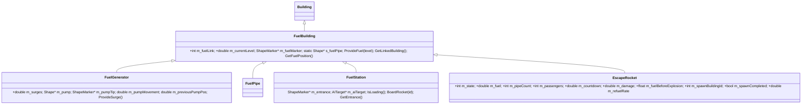

# P02_game_modes — Multiwinia game rules and mode objects

Scope: `code/multiwinia.{h,cpp}`, `code/achievement_tracker.{h,cpp}`, `code/rocket_status_panel.{h,cpp}`, `code/worldobject/{multiwiniazone,statue,flag,rocket,trunkport,pulsebomb,controlstation}.{h,cpp}`; data `data/multiwinia.txt` (+ variants `data/multiwinia-testbed.txt`, `data/multiwinia_betatesters.txt`), `data/levels/level_enum.txt`, MultiwiniaOptions/Buildings sections of `data/levels/mp_*.txt` (confirmation only; X4 owns the level catalogue). Build baseline: see build_matrix.md (`Release|Win32` + `TARGET_PC_FULLGAME`).

Conventions used below:
- "tick" = one server advance = one call of `Multiwinia::Advance` / `Building::Advance`, nominally 0.1 s of game time. `SERVER_ADVANCE_PERIOD` ≡ `0.1 * g_gameTimer.m_gameSpeed` [C] `code/gametimer.cpp:GameTimer::GetServerAdvancePeriod`, `code/gametimer.h`.
- "game second" = `GetNetworkTime()` ≡ `g_gameTimer.GetGameTime()` units [C] `code/gametimer.h`.
- "mode second" = one period of the `m_timer`/`m_reinforcementTimer`/`m_positionTimer` 1.0-second countdowns. **These last 11 ticks (1.1 game seconds), not 10** — see §8 Determinism D1 [C by arithmetic on the code path].
- Team ids: `NUM_TEAMS = 6` [C] `code/globals.h`; player teams 0–3; team 4 = "monster" team (Evilinians), team 5 = Futurewinians, both only when `Location::m_allowMonsterTeam` [C] `code/location.cpp:Location::GetMonsterTeamId`, `GetFuturewinianTeamId`. Team id 255 = neutral/unowned.

---

## [→ 01_game_modes] 1. Game-type catalogue and build gating

### 1.1 Enumerations (verbatim values)

`Multiwinia::GameType*` [C] `code/multiwinia.h:Multiwinia` (anonymous enum):

| Value | Enum | Blueprint name in `data/multiwinia.txt` (matched by `GameTypes` in level files) | UI string key → English | Complexity key (`MultiwiniaGameBlueprint::GetDifficulty`) → English | Advance function | Build macro | Status in baseline |
|---|---|---|---|---|---|---|---|
| 0 | `GameTypeSkirmish` | `Domination` | `multiwinia_gametype_domination` → "Domination" | `multiwinia_complexity_basic` → "Simple" | `AdvanceSkirmish` | `INCLUDEGAMEMODE_DOMINATION` (+ body also inside `#ifndef MULTIWINIA_DEMOONLY`) | **[B:FULL]** |
| 1 | `GameTypeKingOfTheHill` | `KingOfTheHill` | `multiwinia_gametype_kingofthehill` → "King Of The Hill" | basic → "Simple" | `AdvanceKingOfTheHill` | `INCLUDEGAMEMODE_KOTH` | **[B:FULL]** (also DEMOONLY, PC_PREVIEW, HWCOMPAT) |
| 2 | `GameTypeCaptureTheStatue` | `CaptureTheStatue` | `multiwinia_gametype_capturethestatue` → "Capture The Statue" | intermediate → "Medium" | `AdvanceCaptureStatue` (+ `EnsureStartingStatue` in grace) | `INCLUDEGAMEMODE_CTS` | **[B:FULL]** |
| 3 | `GameTypeAssault` | `Assault` | `multiwinia_gametype_assault` → "Assault" | intermediate → "Medium" | `AdvanceAssault` | `INCLUDEGAMEMODE_ASSAULT` + `#ifndef MULTIWINIA_DEMOONLY` | **[B:FULL]** |
| 4 | `GameTypeRocketRiot` | `RocketRiot` | `multiwinia_gametype_rocketriot` → "Rocket Riot" | advanced → "Hard" | `AdvanceRocketRiot` (+ `AdvanceTrunkPorts`) | `INCLUDEGAMEMODE_ROCKET` + `#ifndef MULTIWINIA_DEMOONLY` | **[B:FULL]** |
| 5 | `GameTypeBlitzkreig` (sic) | `Blitzkrieg` | `multiwinia_gametype_blitzkrieg` → "Blitzkrieg" | advanced → "Hard" | `AdvanceBlitkrieg` (sic) (+ `AdvanceTrunkPorts`) | `INCLUDEGAMEMODE_BLITZ` + `#ifndef MULTIWINIA_DEMOONLY` | **[B:FULL]** |
| 6 | `GameTypeTankBattle` | `TankBattle` | none in english.txt (falls back to raw name "TankBattle") | intermediate → "Medium" | `AdvanceTankBattle` | `INCLUDEGAMEMODE_TANKBATTLE` + `#ifndef MULTIWINIA_DEMOONLY` | **[B:DEBUG]** only (macro commented out in FULLGAME) |
| 7 | `NumGameTypes` | — | — | — | — | — | — |

Evidence: names [C] `data/multiwinia.txt`; string ids built as `"multiwinia_gametype_%s"` lower-cased [C] `code/multiwinia.cpp:MultiwiniaGameBlueprint::MultiwiniaGameBlueprint`; English text [C] `data/language/english.txt`; complexity [C] `code/multiwinia.cpp:MultiwiniaGameBlueprint::GetDifficulty`; dispatch [C] `code/multiwinia.cpp:Multiwinia::Advance`; gating [C] `#ifdef`s in each `Advance*` and `code/app.cpp:App::IsGameModePermitted`.

The blueprint index is the order of `GAMETYPE` blocks in `data/multiwinia.txt` (`s_gameBlueprints.PutData` in file order) and is used directly as the game-type id, so the data file order **must** match the enum order [C] `code/multiwinia.cpp:Multiwinia::LoadBlueprints`, `Multiwinia::SetGameOptions` (indexes `s_gameBlueprints[m_gameType]`).

`Multiwinia::AITypeEasy=0, AITypeStandard=1, AITypeHard=2, NumAITypes=3` [C] `code/multiwinia.h`. UI labels: `dialog_easy_difficulty`, `multiwinia_menu_normal`, `multiwinia_menu_hard` [C] `code/UI/GameMenuWindow.cpp` (main/lobby page AI-mode drop-down).

### 1.2 Runtime permission of a game type

`App::IsGameModePermitted(gameMode)` [C] `code/app.cpp`:
1. If not full version (`!IsFullVersion()`, i.e. demo auth key) → consult `DemoLimitations::GameModePermitted` from the metaserver (P15/P17b) → false if not permitted. [B:DEMO runtime gate]
2. `switch(gameMode)`: returns true only for the cases whose `INCLUDEGAMEMODE_*` macro is defined. In FULLGAME: 0,1,2,3,4,5 → true; 6 (TankBattle) → false.

Consumers: game-type select page skips non-permitted types (`continue`) [C] `code/UI/GameMenuWindow.cpp` (~L3761, L3781); server browser filters rows [C] `code/UI/GameMenuWindow.cpp` (~L1844); `App::IsMapPermitted` [C] `code/app.cpp`. Therefore TankBattle is unreachable in the shipped exe even though its blueprint, three maps (`mp_tankbattle_2P/3P/4P.txt`) and the `switch` case exist; its `AdvanceTankBattle` body is empty in FULLGAME [C].

Other gates inside the mode code:
- `#ifndef MULTIWINIA_DEMOONLY` wraps the bodies of `AdvanceSkirmish`, `AdvanceRocketRiot`, `AdvanceTrunkPorts`, `AdvanceTankBattle`, `AdvanceAssault`, `AdvanceBlitkrieg` [C] — in the demo-only target only KOTH and CTS can run (matches build_matrix §3). [B:DEMO = TARGET_MULTIWINIA_DEMOONLY]
- Multiwinia::Advance only runs when `g_app->Multiplayer()` (≡ `m_gameMode == GameModeMultiwinia`), once per server advance on slice 8 of 10 [C] `code/network/clienttoserver.cpp:ClientToServer::AdvanceAndCatchUp` (L~1980: `if( g_app->Multiplayer() && g_sliceNum == 8 ) g_app->m_multiwinia->Advance();`). Note: this call happens even when the game is paused; `Multiwinia::Advance` itself returns after the grace-period branch if `GamePaused()` [C].
- Every Multiwinia game, including vs-CPU, is `Multiplayer()==true` and `IsSinglePlayer()==false` (IsSinglePlayer ≡ Campaign/Prologue) [C] `code/app.cpp:App::Multiplayer`, `App::IsSinglePlayer`. All "if Multiplayer()" branches in the world objects below are therefore the live Multiwinia behaviour; the `else` branches are Darwinia [B:LEGACY].

### 1.3 Level files per game type (confirmation only; X4 owns the catalogue)

Counted from the `GameTypes` line of `MultiwiniaOptions_StartDefinition` in `data/levels/mp_*.txt` [C]:

| Game type | Level files (count) | Mode-specific buildings present (from Buildings section) |
|---|---|---|
| Domination | mp_domination_2P_1, _2P_2, _3P_1, _4P_1, _4P_2, mp_koth_2P_2, mp_koth_2P_3, mp_skirmish_2p_4, mp_skirmish_3P_1 (9) | SpawnPoint/SpawnLink/SpawnPointMaster (no MultiwiniaZone) |
| KingOfTheHill | mp_koth_2P_1, _2P_3b, _3P_1, _3P_2, _3P_3, _3P_4, _4P_1, _4P_3, _4P_4 (9) | MultiwiniaZone (1–15 per map); mp_koth_3P_1 also 6 ControlStation linked to RadarDish; mp_koth_3P_4 + trunk ports |
| CaptureTheStatue | mp_cts_2p_1, _2p_2, _2p_3, _2p_4, _3P_2, _3p_1, _3p_3, _4P_1, _4P_2, _4p_3 (10) | MultiwiniaZone (team-owned = capture zones, team 255 = statue spawns) |
| Assault | mp_assault_2P_1, _2P_2, _2p_3, _3P_2, _3p_1, _3p_3, _4P_1, _4P_2 (8) | exactly 1 PulseBomb, 3–5 ControlStation, TrunkPort, AIObjective(+Marker), LaserFence, GunTurret |
| RocketRiot | mp_rocketriot_2P_2, _2P_4, _2p_3, _3P_2, _3P_3, _3p_1, _4P_1 (7) | 1 EscapeRocket/team, 3 FuelStation/team, FuelGenerator, FuelPipe, PylonEnd/Pylon/PowerSplitter, SolarPanel, 1 TrunkPort/team |
| Blitzkrieg | mp_blitzkrieg_2P_3, _2P_4, _2p_1, _2p_2, _3P_1, _3P_2, _4P_2 (7) | MultiwiniaZone (flags; 3–9 per map) with link lists, TrunkPort |
| TankBattle [B:DEBUG] | mp_tankbattle_2P, _3P, _4P (3) | trees only (tanks come from InstantUnits) |
| `none` | mp_assault_stress, mp_benchmark_1, mp_sandbox, mp_sandbox_all | — |

`data/levels/level_enum.txt` lists IDs 1–49 (the 49 shipped official maps above **except `mp_cts_3p_3.txt`**, which has no id) and IDs 50–59 for PDLC maps (`mp_PDLC1_*`, `mp_PDLC2_*`) whose files are **not present** in this tree [C] (`ls data/levels`).

---

## [→ 01_game_modes] 2. The game-option (parameter) system

### 2.1 Data format and loader

File: `data/multiwinia.txt` in FULLGAME; `data/multiwinia-testbed.txt` only under `TESTBED_ENABLED` [B:DEAD in all shipped targets] [C] `code/multiwinia.cpp:Multiwinia::LoadBlueprints`. (`data/multiwinia_betatesters.txt` is unrelated — a credits name list read by `code/UI/GameMenuWindow.cpp` [C].) Missing file → `AppReleaseAssert` "Couldn't load multiwinia.txt" (fatal) [C].

Grammar (line-based `TextReader`, `#` comments and blank lines skipped) [C] `Multiwinia::LoadBlueprints`:
```
GAMETYPE <BlueprintName>
    <ParamName> <min:float> <max:float> <default:float> <change:int>
    ...
END
```
- `change` semantics (header comment in the data file + UI construction in `code/UI/GameMenuWindow.cpp:GameMenuWindow::SetupAdvancedOptionsPage`): `-1` = check box; `0` = drop-down whose entries are every integer `p` in `[min,max]` labelled by string `multiwinia_option_<gameType>_<paramIndex>_<p>`; `>0` = integer spinner/input with step `change`, bounded to `[min,max]` (`NetworkGameOptionInt::SetBounds`).
- Values are parsed with `iv_atof`/`atoi` into `MultiwiniaGameParameter::{m_min,m_max,m_default,m_change}` but stored per game in `int Multiwinia::m_params[MULTIWINIA_MAXPARAMS=64]` [C] `code/multiwinia.h`.
- Parameter string ids: `"multiwinia_param_<name>"` lower-cased; `GetNameTranslated` falls back to the raw name [C] `code/multiwinia.cpp:MultiwiniaGameParameter::*`.
- Testbed variant differs only by adding `TimeLimit 0 60 10 1` as the last RocketRiot parameter [C] (`diff data/multiwinia.txt data/multiwinia-testbed.txt`).

### 2.2 Complete option tables (baseline `data/multiwinia.txt`) [C]

Index = position inside the block (= index into `m_params[]` and the network `GAMEOPTION_GAME_PARAM` array element).

**Domination (type 0)**

| Idx | Name | Min | Max | Default | Change | Control | Labels / meaning |
|---|---|---|---|---|---|---|---|
| 0 | ScoreMode | 0 | 1 | 0 | 0 | drop-down | 0 "Total Spawn Points", 1 "Spawn Points per Second" |
| 1 | TimeLimit | 0 | 60 | 10 | 1 | spinner (minutes) | 0 = unlimited |
| 2 | Handicap | 0 | 90 | 90 | 10 | spinner (%) | max spawn-rate bonus |
| 3 | CrateDropRate | 0 | 300 | 40 | 10 | spinner (s) | 0 = no crates |
| 4 | StartingPowerups | 0 | 3 | 0 | 1 | spinner | random powerups per team at start |
| 5 | RetributionMode | 0 | 1 | 1 | -1 | check box | |
| 6 | SuddenDeath | 0 | 1 | 1 | -1 | check box | |
| 7 | CrateDropMode | 0 | 1 | 1 | 0 | drop-down | 0 "Random", 1 "Weighted" |

**KingOfTheHill (type 1)**

| Idx | Name | Min | Max | Default | Change | Labels |
|---|---|---|---|---|---|---|
| 0 | ScoreMode | 0 | 3 | 0 | 0 | 0 "Zones controlled per second", 1 "Zone Population per second", 2 "Final Zone population", 3 "Total zone control" |
| 1 | TimeLimit | 1 | 60 | 5 | 1 | minutes (cannot be unlimited) |
| 2 | Handicap | 0 | 90 | 90 | 10 | |
| 3 | CrateDropRate | 0 | 300 | 40 | 10 | |
| 4 | StartingPowerups | 0 | 3 | 0 | 1 | |
| 5 | RetributionMode | 0 | 1 | 1 | -1 | |
| 6 | SuddenDeath | 0 | 1 | 1 | -1 | |
| 7 | CrateDropMode | 0 | 1 | 1 | 0 | 0 "Random", 1 "Weighted" |

**CaptureTheStatue (type 2)**

| Idx | Name | Min | Max | Default | Change | Labels |
|---|---|---|---|---|---|---|
| 0 | TimeLimit | 1 | 60 | 10 | 1 | minutes |
| 1 | CrateDropRate | 0 | 300 | 40 | 10 | |
| 2 | RetributionMode | 0 | 1 | 1 | -1 | |
| 3 | SuddenDeath | 0 | 1 | 1 | -1 | |
| 4 | CrateDropMode | 0 | 1 | 1 | 0 | 0 "Random", 1 "Weighted" |

**Assault (type 3)**

| Idx | Name | Min | Max | Default | Change |
|---|---|---|---|---|---|
| 0 | Handicap | 0 | 90 | 90 | 10 |
| 1 | CrateDropRate | 0 | 300 | 40 | 10 |

**RocketRiot (type 4)**

| Idx | Name | Min | Max | Default | Change | Meaning |
|---|---|---|---|---|---|---|
| 0 | CrateDropRate | 0 | 300 | 40 | 10 | |
| 1 | ReinforcementTimer | 10 | 300 | 60 | 10 | mode-seconds between trunk-port waves |
| 2 | ReinforcementCount | 1 | 100 | 40 | 1 | Darwinians per trunk port per wave |
| 3 | MaxArmour | 1 | 10 | 2 | 1 | max simultaneous Armour tasks |
| 4 | TurretFrequency | 0 | 10 | 7 | 1 | a turret every Nth wave (0 = never) |
| 5 | MaxTurrets | 0 | 5 | 3 | 1 | max simultaneous turret tasks |

**Blitzkrieg (type 5)**

| Idx | Name | Min | Max | Default | Change | Meaning |
|---|---|---|---|---|---|---|
| 0 | TimeLimit | 0 | 60 | 15 | 1 | minutes, 0 = unlimited |
| 1 | CrateDropRate | 0 | 300 | 40 | 10 | |
| 2 | ReinforcementTimer | 10 | 300 | 60 | 10 | |
| 3 | ReinforcementCount | 1 | 100 | 40 | 1 | |
| 4 | MaxArmour | 1 | 10 | 2 | 1 | |
| 5 | TurretFrequency | 0 | 10 | 2 | 1 | |
| 6 | RetributionMode | 0 | 1 | 1 | -1 | |
| 7 | SuddenDeath | 0 | 1 | 1 | -1 | |
| 8 | MaxTurrets | 0 | 5 | 2 | 1 | |

**TankBattle (type 6) [B:DEBUG]**: idx 0 `NumTanks` 3/10/3/1.

Language-file drift: `english.txt` also contains `multiwinia_option_0_5_*`, `0_6_*`, `1_5_*`, `1_6_*`, `2_2_*`, `2_3_*`, `5_6_*`, `5_7_*`, `5_8_*` (No/Yes, Random/Weighted). Those indices are check boxes or spinners in the current data, so the strings are never used; `5_8_*` "Random/Weighted" belongs to a CrateDropMode Blitzkrieg option that no longer exists [C] (compare data vs `data/language/english.txt`).

### 2.3 Reading an option: `GetGameOption(name)` and the "-1 = absent" rule

`int Multiwinia::GetGameOption(char*)` does a case-insensitive linear search of the current blueprint's parameter names and returns `m_params[i]`, or **-1 if the current game type has no parameter of that name** [C] `code/multiwinia.cpp:Multiwinia::GetGameOption`. All consumers must therefore treat -1 as "not applicable". Consequences confirmed in code:

| Read site | Expression | Effect when the option is absent (-1) |
|---|---|---|
| `Multiwinia::GameOptionsChanged` | `timeLimit > 0 ? m_timeRemaining = timeLimit*60 : -1` | -1 → `m_timeRemaining = -1` → unlimited time (RocketRiot, Assault until `PulseBomb::Initialise` overwrites it) [C] |
| `Multiwinia::Advance` | `bool retributionMode = GetGameOption("RetributionMode")` | **-1 converts to `true`** → `AdvanceRetribution` runs in Assault and RocketRiot too; harmless because `IsEliminated` is always false in those modes [C]; the HUD retribution counter is likewise gated by `eliminated` [C] `Multiwinia::Render` |
| sudden-death checks | `GetGameOption("SuddenDeath") == 1` | -1 → no sudden death [C] |
| `AdvanceTrunkPorts` | `ReinforcementTimer` | `< 0` → 60.0 [C] |
| `AdvanceTrunkPorts` | `ReinforcementCount` | -1 → `LevelOptionTrunkPortReinforcements` (and for Assault the attacker/defender level options) [C] |
| `AdvanceTrunkPorts` | `MaxArmour` | -1 → `LevelOptionTrunkPortArmour` (itself -1 when unset → no armour ever, since `CountNumTasks < -1` is false and `-1 != 0`) [C] |
| `AdvanceTrunkPorts` | `TurretFrequency` | -1 → no turrets (`turretTimer > 0` false) [C] |
| `AdvanceTrunkPorts` | `MaxTurrets` | -1 → 2 [C] |
| `code/location.cpp:Location::AdvanceCrates` | `CrateDropRate` | 0 or -1 → no crates [C] |
| `code/location.cpp:Location::CreateRandomCrate` | `CrateDropMode` | 0 or -1 → random placement; 1 → weighted [C] |
| `code/worldobject/spawnpoint.cpp:SpawnPoint::CalculateHandicap` | `Handicap` | 0 or -1 → multiplier 1.0 [C] |
| `code/taskmanager.cpp:Task::TargetGunTurret`, `TaskManager` (L~1329) | `MaxTurrets` | -1 → turret task terminates after placement (no cap tracking); otherwise task persists while the turret exists and counts toward the cap [C] |
| `code/location.cpp:Location::InitialiseTeam` (L~3307) | `StartingPowerups` | -1 → loop does not run [C] |
| `code/UI/mapDetailsButton.h`, `code/UI/GameMenuWindow.cpp:UpdateAdvancedOptionsPage` | `TimeLimit` | UI: when `TimeLimit == 0` the SuddenDeath control is forced off (`Set(0)`/`SelectOption(0)`) and made inactive [C] |

### 2.4 Setting options (lobby → network → Multiwinia)

- Defaults: on choosing a game type every `m_params[i] = blueprint->m_params[i]->m_default` [C] `code/UI/GameTypeButton.h`, `QuickStartButton.h`, `RollingDemoButton.h`, `GameMenuWindow::SetupTutorial*`.
- Per-map time default: on map select, the `TimeLimit` param is set to the level's `PlayTime` (minutes) if non-zero, else to the blueprint default [C] `code/UI/LevelSelectButton.h` (`GetTimeOption()`, `mapData->m_playTime`). Level `PlayTime` values: Assault 15 (4P_2: 20), KOTH 5–10, Domination 10–15 [C] level files.
- Map coop: selecting a map without coop support clears coop; `ForceCoop` maps force coop on [C] `code/UI/LevelSelectButton.h`.
- Network: options are `NetworkGameOptionInt/Bool` values replicated by `NET_DARWINIA_SETGAMEOPTIONINT` / `...ARRAYELEMENTINT` / `...ARRAYINT` letters with a per-option version number (newer version wins) [C] `code/network/clienttoserver.cpp` (L~2410–2560). Game-option ids [C] `code/network/network_defines.h`: `GAMEOPTION_GAME_TYPE=0`, `GAME_PARAM=1` (array), `GAME_RESEARCH_LEVEL=2` (array), `MAPNAME=3`, `AIMODE=4`, `COOPMODE=5`, `SINGLEASSAULT=6`, `BASICCRATES=7`, `TEAMSSTATUS_LBOUND=8 … UBOUND=13`, `NUMGAMEOPTIONS=14`.
- On `GAMEOPTION_GAME_TYPE` receipt the client zeroes all params and research then calls `SetGameOptions(type, zeros)` (params are re-sent afterwards) [C].
- AI mode range check is `value < 0 || value > NumAITypes` — off-by-one: value 3 would be accepted [C] (`clienttoserver.cpp` L~2492).
- `SetGameOptions(type, params)` copies `numParams` ints and calls `GameOptionsChanged()`; `SetGameOption(idx, v)` asserts `ValidGameOption(idx)` [C] `code/multiwinia.cpp`.
- `SetGameResearch(int*)` copies `GlobalResearch::NumResearchItems` research levels into `g_app->m_globalWorld->m_research->m_researchLevel` and zeroes progress [C] (research = crate/task weapon levels; owned by P08/P09).

### 2.5 Lobby options outside the blueprint

| Option | Storage | Network id | UI | Default | Effect |
|---|---|---|---|---|---|
| AI difficulty | `Multiwinia::m_aiType` | `GAMEOPTION_AIMODE` | lobby drop-down Easy/Normal/Hard (server only; disabled for demo keys) | `AITypeStandard` (ctor, Reset, `App::StartSinglePlayerServer`/`StartMultiPlayerServer` unless tutorial); tutorials force Easy | read by AI, Armour, MultiwiniaZone (see P08) [C] |
| Co-op | `Multiwinia::m_coopMode` | `GAMEOPTION_COOPMODE` | Advanced Options check box "multiwinia_menu_coop", only for maps with `m_coop` and not demo | false | 2-group alliance scoring; enabling resets all team colours to -1 [C] `clienttoserver.cpp` |
| Basic crates only | `m_basicCratesOnly` | `GAMEOPTION_BASICCRATES` | check box "multiwinia_param_basiccrates" (only `#ifdef INCLUDE_CRATES_ADVANCED`, on in FULL) | false | restricts crate rewards (P08) and retribution list [C] |
| Single assault round | `m_assaultSingleRound` | `GAMEOPTION_SINGLEASSAULT` | **no UI control found** (`m_singleAssaultRound` bound but never placed on a page) | **true** (ctor only; `Reset()` does not touch it) | multi-round Assault rotation is therefore unreachable [I: grep of `code/UI` shows no control] |
| Team status ×6 | `m_teamsStatus[6]` | `TEAMSSTATUS_LBOUND+i` | — | 0 | written on receipt, **never read** [C] |
| Research levels | `GlobalResearch::m_researchLevel[]` | `GAME_RESEARCH_LEVEL` | (P17b) | — | see P08 |

---

## [→ 01_game_modes] 3. The `Multiwinia` rules object

Single instance `g_app->m_multiwinia`, created in `App` construction (constructor calls `LoadBlueprints()` then `Reset()`) [C] `code/multiwinia.cpp:Multiwinia::Multiwinia`, `code/app.cpp`. It holds the lobby roster (`LobbyTeam m_teams[6]`), the chosen game type and parameters, all mode timers/scores and the end-of-game state. It is **simulation state**: every peer runs `Advance()` in lockstep (see §8).

### 3.1 Preprocessor constants [C] `code/multiwinia.h`

| Name | Value | Meaning |
|---|---|---|
| `MULTIWINIA_MAXPARAMS` | 64 | size of `m_params` |
| `MULTIWINIA_NUM_TEAMCOLOURS` | 8 | selectable lobby colours (ids 0–7) |
| `MULTIWINIA_DRAW_TEAM` | 255 | `m_winner` value for a tie |
| `ASSAULT_ATTACKER_COLOURID` | 1 | red = attackers |
| `ASSAULT_DEFENDER_COLOURID` | 0 | green = defenders |
| `BLITZKRIEGSCORE_ELIMINATED` | 10000 | scores `< 10000` mean "eliminated" (score = game time of elimination) |
| `BLITZKRIEGSCORE_ENEMYOCCUPIED` | 10001 | home flag held by an enemy |
| `BLITZKRIEGSCORE_UNDERATTACK` | 10002 | defined/displayed but **never assigned** [C] |
| `BLITZKRIEGSCORE_UNOCCUPIED` | 10003 | home flag neutral |
| `BLITZKRIEGSCORE_UNDERTHREAT` | 10004 | home flag held, not locked |
| `BLITZKRIEGSCORE_SAFE` | 10005 | home flag held and locked |
| `GRACE_TIME` (universal_include.h) | 3.0 s (20.0 under `TESTBED_ENABLED`) | pre-game countdown |

### 3.2 `LobbyTeam` (per-slot roster record) [C] `code/team.h:LobbyTeam`

| Field | Type | Use |
|---|---|---|
| `m_teamId` | int | slot index (0–5) |
| `m_clientId` | int | owning network client |
| `m_teamType` | int | `TeamTypeUnused=-1, TeamTypeLocalPlayer=0, TeamTypeRemotePlayer=1, TeamTypeCPU=2, TeamTypeSpectator=3` [C] `code/team.h` |
| `m_colourId` | int | lobby colour 0–7, -1 = none |
| `m_colour` | RGBAColour | resolved colour |
| `m_coopGroupPosition` | int | 0/1/2 position inside a co-op group (flag texture choice) |
| `m_score`, `m_prevScore` | int | current / previous-second score (delta display) |
| `m_rocketId` | int | Rocket Riot: building id of own EscapeRocket, -1 until found |
| `m_disconnected`, `m_ready`, `m_demoPlayer` | bool | lobby flags (`m_ready` here is the lobby ready flag; in-game readiness uses `Team::m_ready`) |
| `m_teamName` | UnicodeString | display name |
| `m_accurateCPUTakeOverTime` | float | game time when a leaving player's slot became CPU |
| `m_achievementMask` | uchar | viral achievement bits received from that player (bit 0x01 = Master Player) |
| `m_iframe`, `m_syncDifferences` | IFrame*, LList<SyncDiff*> | desync diagnostics |

`Team` (P01) references the LobbyTeam fields by reference (`m_teamId`, `m_clientId`, `m_teamType`, `m_colour`) [C] `code/team.h:Team`.

### 3.3 Data members of `Multiwinia` (all) [C] `code/multiwinia.h`; initial values [C] `Multiwinia::Multiwinia`, `Multiwinia::Reset`

| Member | Type | Ctor init | Reset() value | Purpose |
|---|---|---|---|---|
| `m_timer` (protected) | double | 0.0 | 0.0 | 1-mode-second countdown driving per-second scoring in every mode |
| `m_gameType` | int | -1 | -1 | current game type |
| `m_params[64]` | int | — | (not cleared) | option values |
| `m_teams[6]` | LobbyTeam | — | type Unused, score 0, prevScore 0, colour `defaultColour[i]`, rocketId -1, colourId -1, name "", ready false, iframe deleted, sync diffs emptied | roster |
| `m_timeRemaining` | int | (unset) | (unset; set by `GameOptionsChanged`) | mode seconds left; -1 = no limit |
| `m_winner` | int | -1 | -1 | -1 none; 0–5 team; 255 draw |
| `m_statueSpawner` | double | -1.0 | -1.0 | CTS statue spawn countdown (mode seconds) |
| `m_rocketsFound` | bool | **uninitialised** | not reset | only read in dead code of `GameOver()` [C] |
| `m_reinforcementTimer` | double | 0.0 | 0.0 | 1-mode-second sub-timer of trunk-port waves |
| `m_reinforcementCountdown` | int | 0 | 0 | mode seconds to next wave (HUD) |
| `m_turretTimer` | int | 0 | 0 | waves until next turret award |
| `m_tankDeaths[6]` | int | — | 0 | TankBattle |
| `m_currentPositions[6]` | int | — | -1 | leaderboard rank per team (for "You have moved to …" messages) |
| `m_positionTimer` | double | 0.0 | 0.0 | 1-mode-second timer for rank recompute |
| `m_initialised` | bool | false | false | one-shot init flag for Assault/Blitzkrieg (and dead Shaman) |
| `m_defendedAll` | bool | (unset) | (unset; set true in Assault init) | Assault achievement accumulator |
| `m_assaultObjectives` | LList<int> | — | emptied | Assault: ids of pulse-bomb links + bomb |
| `m_startTime` | double | 0.0 | 0.0 | `GetNetworkTime()` at first post-grace tick |
| `m_victoryTimer` | double | -1.0 | -1.0 | Assault post-detonation delay |
| `m_aiType` | int | AITypeStandard | AITypeStandard | AI difficulty |
| `m_resetLevel` | bool | false | false | Assault multi-round: request a level reload |
| `m_pulseTimer` | double | -1.0 | -1.0 | Assault: shortest defence time so far (used as next round's bomb timer) |
| `m_timeRecords[6]` | double | — | -1.0 | Assault: defence time per team |
| `m_numRotations` | int | 0 | 0 | Assault rounds played |
| `m_pulseDetonated` | bool | false | false | Assault: round finished |
| `m_gracePeriodTimer` | double | GRACE_TIME | GRACE_TIME | pre-start countdown; >0 = grace period |
| `m_oneMinuteWarning` | bool | false | false | |
| `m_eliminated[6]` | bool | — | false | "hard" elimination flag (Domination, Blitzkrieg, TankBattle) |
| `m_numEliminations[6]` | int | — | 0 | Blitzkrieg eliminations scored by team |
| `m_timeEliminated[6]` | double | — | 0.0 | game time of elimination (written only) |
| `m_eliminationTimer[6]` | int | — | 30 | Domination: mode seconds until elimination when holding 0 spawn points |
| `m_eliminationBonusTimer[6]` | double | — | 5 | Retribution countdown (game seconds) |
| `m_coopMode` | bool | false | false | co-op |
| `m_assaultSingleRound` | bool | true | **not reset** | single vs multi-round Assault |
| `m_suddenDeathActive` | bool | false | false | |
| `m_unlimitedTime` | bool | false | false | set at start if `m_timeRemaining <= 0` |
| `m_basicCratesOnly` | bool | false | false | |
| `m_firstReinforcements` | bool | true | true | first trunk-port wave flag |
| `m_teamsStatus[6]` | int | 0 | 0 | unused |
| `m_rocketStatusPanel` | RocketStatusPanel* | NULL | deleted → NULL | HUD |
| `s_gameBlueprints` (static) | DArray<MultiwiniaGameBlueprint*> | — | — | loaded option blueprints |
| file-static `s_numMultiwiniaZones` (multiwinia.cpp) | int | 0 | **never reset** | zone count (see §8 D4) |

`Reset()` additionally sets `PulseBomb::s_defaultTime = 0.0` [C].

`MultiwiniaGameBlueprint`: `char m_name[256]`, `DArray<MultiwiniaGameParameter*> m_params`, `char m_stringId[256]`; `GetName()` returns the string id if the phrase exists else the raw name; static `GetDifficulty(type)` [C]. `MultiwiniaGameParameter`: private `m_stringId[256]`; public `m_name[256]`, `double m_min, m_max, m_default`, `int m_change`; `GetNameTranslated`, `GetStringId` [C] `code/multiwinia.h`.

### 3.4 Methods (all) [C] `code/multiwinia.cpp`

| Method | Behaviour |
|---|---|
| `Multiwinia()` / `~Multiwinia()` | init as §3.3, `LoadBlueprints`, `Reset`; dtor deletes blueprints |
| `Reset()` | §3.3 Reset column; called on construction, `App::ShutdownCurrentGame`, `game_menu.cpp`, and on `NET_DARWINIA_…` server-reset in `clienttoserver.cpp` (L~2203) |
| `ResetLocation()` | Assault multi-round: clear colourIds, `++m_numRotations`, `Location::RotatePositions()`, remember positions (monster/futurewinian set -1), mark those two LobbyTeams Unused, delete & re-create `Location`, restore positions and last processed slice, `Init(requestedMission, requestedMap)`, 1 s fade-in, `g_gameTimer.Reset()`, clear `m_resetLevel`, reinforcement timers, re-arm grace period. Triggered from main loop when `m_resetLevel` [C] `code/main.cpp` (L~534) |
| `InitialiseTeam(teamId, teamType, clientId)` | zero achievement mask; set client/team/type; `m_demoPlayer=false`; if not co-op and not Assault → `m_colourId = teamId`; local player → `m_globalWorld->m_myTeamId`; non-CPU → `m_disconnected=false`; if the location already initialised teams → `Location::InitialiseTeam(teamId)` (late join) |
| `RemoveTeams(clientId)` | for every non-CPU team of that client: in lobby → slot Unused, colour -1, name "", disconnected, "PLAYERLEAVE" chat; in game → message `multiwinia_player_left` ("*T left the game!"), team type becomes `TeamTypeCPU`, spawns an `Entity::TypeAI` at (-100,0,-100) for that team (AI takes over), records `m_accurateCPUTakeOverTime` |
| `LoadBlueprints()` | §2.1 |
| `SetGameResearch(int*)`, `ValidGameOption(i)`, `SetGameOption(i,v)`, `SetGameOptions(type,params)`, `GetGameOption(name)`, `GameOptionsChanged()` (private) | §2 |
| `AwardPoints(team, pts)` | `m_score += pts` unless `GameOver()` (used by CTS) |
| `GetMaxPointsAvail()` | KOTH only: `s_numMultiwiniaZones * m_timeRemaining`; else 0 (result unused) |
| `Advance()` | §3.6 |
| `Render()` | HUD, §3.10 |
| `GameInGracePeriod()` | `m_gracePeriodTimer > 0` |
| `GameInLobby()` | `g_app->m_atMainMenu` |
| `GameRunning()` | `!GameInLobby() && m_gameType != -1 && m_location` |
| `GameOver()` | `m_location && m_winner != -1`; **everything after the first `return` is dead code** (old per-mode checks, `m_timeRemaining == 0`) [C] |
| `EliminateTeam(t)` | `m_eliminated[t]=true`, `m_timeEliminated[t]=GetNetworkTime()`, message `multiwinia_player_eliminated` / `multiwinia_other_eliminated`. Does **not** kill units (callers call `Team::Eliminate()` separately) |
| `RecordDefenseTime(time, team)` | Assault: `m_pulseTimer = min(existing, time)`; `m_pulseDetonated = true`; `m_victoryTimer = 15` (multi-round) or `10` (single); `m_timeRecords[team] = time` |
| `IsEliminated(t)` | Skirmish, Blitzkrieg: `m_eliminated[t]`; KOTH, CTS: `CountSpawnPoints() > 0 && s_numSpawnPoints[t+1] == 0 && CountDarwinians(t) < 50`; Assault, RocketRiot, default (TankBattle): false |
| `GetNumHumanTeams()`, `GetNumCpuTeams()` | count Local+Remote / CPU slots |
| `GameTypeString(type)` (static) | blueprint `GetName()` or `"multiwinia_gametype_unknown"` |
| `CountDarwinians(t)` | live `Entity::TypeDarwinian` in `Team::m_others` |
| `DeclareWinner(t)` | §3.9 |
| `SaveIFrame(clientId, frame)` | store a client's sync snapshot; for the local client's frame compare hashes with every other stored frame and compute/dump `SyncDiff`s once per peer (`DumpSyncDiffs`) — desync diagnostics (P15) |
| `GetDefaultTeamColour(t)`, `GetColour(id)`, `GetGroupColour(member, id)`, `SetTeamColour(t, id)`, `GetNextAvailableColour()`, `GetCPUColour()`, `IsColourTaken(id)`, `IsValidCoopColour(id)` | §3.8 |
| `GetPreciseTimeRemaining()` | `m_timeRemaining - (1.0 - m_timer)` (sub-second interpolation) |
| `AdvanceGracePeriod`, `AdvanceSkirmish`, `AdvanceKingOfTheHill`, `AdvanceRocketRiot`, `AdvanceCaptureStatue`, `AdvanceTankBattle`, `AdvanceAssault`, `AdvanceBlitkrieg`, `AdvanceTrunkPorts`, `AdvanceRetribution`, `EnsureStartingStatue` | §3.5–§4 |
| `AdvanceChess`, `AdvanceShaman` | not called from `Advance()` (dead; Appendix) |
| `RenderOverlay_GracePeriod`, `RenderRocketStatusPanel`, `GetScoreLine` (private) | HUD §3.10 |
| `CheckMasterAchievement` | §7 |
| `CheckMentorAchievement` | returns immediately (stub) |
| `ZeroScores`, `BackupScores` (private) | all `m_score=0` / `m_prevScore=m_score` |
| free function `CountSpawnPoints()` | Σ `SpawnPoint::s_numSpawnPoints[0..6]` (index 0 = neutral) |
| free function `DoesBlitzkriegRouteExist(...)` | §4.6 |

### 3.5 Game lifecycle

```mermaid
stateDiagram-v2
    [*] --> Lobby : App start / Reset()
    Lobby --> Lobby : SetGameOptions / SetGameOption / colour & ready changes (network replicated)
    Lobby --> Loading : host starts game (P17b/P18) – Location created, teams initialised
    Loading --> Grace : first Multiwinia::Advance (m_gracePeriodTimer = 3.0 > 0)
    Grace --> Grace : not all human/spectator teams ready → timer reset to 3.0
    Grace --> Grace : all ready → timer -= 0.1 per tick ("GAME STARTING IN n")
    Grace --> Running : timer <= 0 → timer=-1, game speed 1.0, AddVisitedLevel
    Running --> Running : per-tick mode Advance (scores, timers, eliminations)
    Running --> SuddenDeath : time up AND top score tied AND SuddenDeath==1 (Dom/KOTH/CTS/Blitz)
    SuddenDeath --> Running : KOTH only: +60 s, normal scoring resumes
    SuddenDeath --> GameOver : tie broken → DeclareWinner
    Running --> AssaultRoundEnd : Assault bomb destroyed or detonated (RecordDefenseTime)
    AssaultRoundEnd --> Loading : multi-round && rotations left → fade out, m_resetLevel → ResetLocation()
    AssaultRoundEnd --> GameOver : single round or all rotations played (victory timer elapsed, pulse wave gone)
    Running --> GameOver : DeclareWinner(team or 255)
    GameOver --> Lobby : local player presses ControlToggleReady (Space/A, labelled "Press ESC to Exit") with no windows open, or in-game menu "Leave game" → m_atMainMenu=true → ShutdownCurrentGame → Reset()
```
Evidence: `Multiwinia::Advance`, `AdvanceGracePeriod`, `DeclareWinner` [C]; exit input [C] `code/location_input.cpp` (L~1232–1258); leave button [C] `code/interface/mainmenus.cpp` (`ExitLevelButton` when `GameOver()`, `ConfirmExitButton` otherwise); `App::ShutdownCurrentGame` [C] `code/app.cpp`.

Note the exit prompt text says "Press ESC to Exit" (`multiwinia_spacetoexit`) but the code polls `ControlToggleReady`, which the grace prompt calls SPACE ("PRESS SPACE WHEN READY") [C] strings; actual key binding is P10's.

### 3.6 Per-tick `Multiwinia::Advance()` order [C] `code/multiwinia.cpp:Multiwinia::Advance`

1. If `GameOver()` → return (nothing further runs after the tick in which a winner was declared).
2. If `GameInGracePeriod()` → `AdvanceGracePeriod()`; return.
3. If `g_app->GamePaused()` → return.
4. If `m_startTime == 0.0` → `m_startTime = GetNetworkTime()`; if `m_timeRemaining <= 0` → `m_unlimitedTime = true`. (If game time is still exactly 0.0 this re-runs next tick; harmless.)
5. If `m_victoryTimer > 0` → `m_victoryTimer -= SERVER_ADVANCE_PERIOD`.
6. Mode dispatch: Skirmish→`AdvanceSkirmish`, KOTH→`AdvanceKingOfTheHill`, RocketRiot→`AdvanceRocketRiot`, CTS→`AdvanceCaptureStatue`, TankBattle→`AdvanceTankBattle`, Assault→`AdvanceAssault`, Blitzkrieg→`AdvanceBlitkrieg` (Shaman case commented out).
7. If level option `TrunkPortReinforcements > 0` or `TrunkPortArmour > 0` → `AdvanceTrunkPorts()` (**in addition to** the call inside RocketRiot/Blitzkrieg — see §8 D3).
8. If `GetGameOption("RetributionMode")` is non-zero (incl. -1) → `AdvanceRetribution()`.
9. One-minute warning: if `0 < m_timeRemaining <= 60` and not yet warned → message `dialog_oneminute` ("One Minute Remaining!").
10. Rank announcements (all modes except Assault and Blitzkrieg), every mode second (`m_positionTimer`): build list of non-special used teams sorted by `m_score` descending (stable insertion: a later team is inserted before the first team it strictly beats); compute for each team the best index among equal-score teams (`tied[t]`); when a team's rank index changes from a previous valid value and it is the local team → message `dialog_tied_<i+1>` if tied else `dialog_position_<i+1>` (strings: "You have moved to First Place!", …, "You are tied for First!", …).
11. If `GameOver()` now true (winner declared this tick) and local team's `Team::m_teamKills >= 2000` → `GiveAchievement(Carnage)`.

### 3.7 Grace period and readiness [C] `Multiwinia::AdvanceGracePeriod`, `RenderOverlay_GracePeriod`

- Counted teams: those whose **`Team::m_teamType`** is LocalPlayer, RemotePlayer or Spectator; CPU teams are never waited for.
- If all counted teams have `Team::m_ready`: on the first ready tick (timer == 3.0) play `CountdownTick`; then `m_gracePeriodTimer -= 0.1` per tick (literal 0.1, independent of game speed; game speed is 0 in multiplayer until the grace ends — `GameTimer::Reset` sets speed 0 when `Multiplayer()` [C] `code/gametimer.cpp`); a `CountdownTick` is triggered on the tick after the timer passes within 0.1 of an integer. Otherwise the timer snaps back to `GRACE_TIME`.
- Readiness toggles: local input `ControlToggleReady` during grace with no windows open → `ClientToServer::RequestToggleReady(myTeamId)` → `NET_DARWINIA_TOGGLE_READY` flips `Team::m_ready` (in lobby flips `LobbyTeam::m_ready`) [C] `code/location_input.cpp`, `code/network/clienttoserver.cpp`.
- At `<= 0` (30 ticks after everyone is ready): play `CountdownZeroTick`, timer = -1, `g_gameTimer.RequestSpeedChange(1.0, 1.0, -1.0)` (immediate full speed), `AchievementTracker::AddVisitedLevel(mapFilename)`.
- CTS only: `EnsureStartingStatue()` every grace tick (spawns one statue if none exist, §4.3).
- Overlay (centre top, font = 4% of screen height, red text): "GAME STARTING IN *T" (`(int)(timer+1)`, 125% size, solid) once counting; else if local ready "WAITING FOR PLAYERS (n/m)"; else "PRESS SPACE WHEN READY" / "PRESS A WHEN READY" (gamepad); blinking alpha 1.0 for 0.3 s of each real second, else 0.2.
- Score lines during grace show "READY" for CPU teams and ready humans.

### 3.8 Team colours and colour assignment [C] `code/multiwinia.cpp`

Colour tables (RGB 0–255):

| Id | `teamColours[]` (lobby colour id → colour) | name string | `groupColours1[]` (co-op member 0) | `groupColours2[]` (co-op member 1) | `defaultColour[]` (by team slot) |
|---|---|---|---|---|---|
| 0 | 100,255,100 | Green | 0,150,20 | 90,200,100 | 100,255,100 |
| 1 | 255,50,50 | Red | 150,0,20 | 255,80,80 | 255,50,50 |
| 2 | 255,255,50 | Yellow | 150,150,20 | 200,200,90 | 255,255,50 |
| 3 | 120,180,255 | Blue | 20,0,150 | 90,90,200 | 120,180,255 |
| 4 | 255,150,0 | Orange | 150,90,0 | 200,150,60 | 255,150,0 |
| 5 | 150,0,255 | Purple | 180,120,255 | 100,60,180 | 250,250,250 |
| 6 | 70,200,200 | Cyan | 0,140,140 | 110,210,210 | 50,255,50 |
| 7 | 255,150,255 | Pink | 255,90,255 | 255,190,255 | (out of range: 6-entry array) |
| 8 | 10,10,10 | — | 10,10,10 | 10,10,10 | — |
| 9 | 200,200,200 | — | 200,200,200 | 200,200,20 | — |

(`defaultColour` has only 7 entries and is indexed by team slot 0–5.) `GetGroupColour(member, -1)` → grey (0.6,0.6,0.6) passed as floats to an RGBAColour ctor (likely near-black — [I] RGBAColour float→byte ctor semantics not checked). 

Rules:
- `InitialiseTeam`: non-co-op, non-Assault → `colourId = teamId`.
- `SetTeamColour(t, id)`: `id == -1` → default colour, colourId -1. Assault: needs `GameMenu::GetNumPlayers()` (abort if -1); count teams already on that colour: 3-player map → colour 0 allowed once, colour 1 allowed twice; otherwise each colour allowed `numPlayers/2` times. Co-op: `IsValidCoopColour(id)` else rejected. Otherwise rejected if `IsColourTaken(id)` (any other used team has it). Accepted → `m_colour = GetColour(id)`, `m_colourId = id`.
- `IsValidCoopColour(id)`: false if ≥2 distinct colours are already in use and nobody uses `id` (only two groups allowed) or if 2 teams already use `id` (max 2 per group).
- `GetCPUColour()`: random (synced `syncrand`) colour in 0–3 not already taken by any team with colourId < 4. **Loops forever if 0–3 are all taken** [C/I]. Called by `Location::Init` for CPU teams in non-co-op, non-Assault games [C] `code/location.cpp` (L~249).
- `GetNextAvailableColour()`: lowest id 0–7 not taken, else -1.
- Assault sides come from colour: colour 0 → defender position, colour 1 → attacker position, -1 → random/fill (`Location::SetupAssault`, P01) [C] `code/location.cpp:Location::SetupAssault`.
- Co-op: teams are paired into `Location::m_coopGroups[t] ∈ {1,2}` by colour; each group has `m_groupColourId`; members get `groupColours1/2` shades; `Location::IsFriend(a,b)` in co-op ≡ same group (note: the monster and Futurewinian teams both have group 0, hence are mutual "friends" in co-op [I]) [C] `code/location.cpp:Location::IsFriend`, `SetCoopTeam`, `SetSoloTeam`, `GetGroupColour`.

### 3.9 Ending: `DeclareWinner(t)` [C] `code/multiwinia.cpp:Multiwinia::DeclareWinner`

Every call (even repeated):
1. If local team exists → `AchievementTracker::AddToTotalKills(Team::m_teamKills)` (see §7; this is called again on every repeated DeclareWinner call).
2. `ClientToServer::SendTeamScores(t)` → letter `NET_DARWINIA_TEAM_SCORES` with the 6 `m_score`s and winner id; clients ignore it on receipt ("/* Ignore this */") — no stats server consumption found [C] `code/network/clienttoserver.cpp`.

Only if `m_winner != t`:
3. `m_winner = t`.
4. Freeze time: `g_gameTimer.RequestSpeedChange(0.0, 0.2, -1.0)` then `LockSpeedChange()` (speed decays ×0.8 per tick towards 0, then locked).
5. Sounds (`SoundSourceBlueprint::TypeMultiwiniaInterface`): `GameOver`, then `YouWon` if local team won else `YouLost` (a draw plays YouLost).
6. If winner is the local team → `AddVictoryOnLevel(mapFilename)`, `CheckMasterAchievement()`.

### 3.10 HUD drawn by `Multiwinia::Render()` [C] `code/multiwinia.cpp:Render`, `GetScoreLine`, `RenderOverlay_GracePeriod`

Skipped when `g_app->m_hideInterface`. `scale = ScreenH/800`.
- **Scoreboard box** top-left (x=10, y=10, w=440 or 530 for Rocket Riot, h = 50 + rows×14×1.3; ×2.0 in co-op (×1.4 Assault co-op) before game over), black 75% fill + 20% white outline; title "TEAM SCORES" (Assault: "OBJECTIVES"). Hidden in the tutorial until somebody has scored. Teams sorted by score (Assault: by `m_timeRecords`); monster/Futurewinian rows shown only if their score ≠ 0. Local team row highlighted (0.7,0.7,0.5,0.7). Co-op: group header lines "*T *S points" with group colour name, members indented.
- **Score line formats** (`GetScoreLine`): see per-mode sections; generic: `"<name>  *X points (+d) (est N)"`; `(+d)` = change since last mode second, blanked every other half game-second except CTS where it shows "+carried statues"; `(est N)` = `score + delta×timeRemaining` shown for KOTH (ScoreMode≠2) and Domination ScoreMode 1 when time-limited; `Sync[n]` appended when the client is out of sync.
- **Timer box** top-centre (or right of scoreboard when ScreenW ≤ 800) "m:ss" with blinking colon, shown while `m_timeRemaining > 0` and not in grace (hidden in Tutorial 2 until the AI may spawn); ticks `CountdownTick` every minute boundary and every second in the last 10 s, `CountdownZeroTick` at 0; red and 1.2× size in the last 10 s.
- **Reinforcements** "Reinforcements in *S" whenever `m_reinforcementCountdown != 0` and the local team is not eliminated (red ≤ 5).
- **Retribution** "Retribution in *S" (red) when the local team `IsEliminated` and RetributionMode.
- **Crate timers**: "SPAWN MANIA: *T" (`Location::m_spawnManiaTimer`), "MEGA RAGE: *T" (`Location::m_bitzkreigTimer`) centred, 50×scale font, red when < 2 (owned by crates, P08).
- **Assault round overlay**: multi-round → "*T defended for m:ss" (defender colour) and "NEXT ROUND IN: *S" when `m_victoryTimer < 11`; single round with winner → "Attackers Win!"/"Defenders Win!" (co-op) or "*T Wins!".
- **Game over**: "GAME OVER" (70×scale, y=180×scale), then winner line "*T is the WINNER" in the winner's colour or "It's a DRAW!" (co-op: group with greatest total among group1, group2, Evilinians, Futurewinians); final score list centred at 73% screen height (not for TankBattle, Blitzkrieg, single-round Assault; Blitzkrieg uses status lines); blinking "Press ESC to Exit"/"Press START to Exit" at the bottom.
- Rocket Riot: `RenderRocketStatusPanel()` every frame (§7.3).

---

## [→ 01_game_modes] 4. Per-mode specifications

Common to all modes:
- All per-second logic runs inside `if ((m_timer -= SERVER_ADVANCE_PERIOD) <= 0) { m_timer = 1.0; … }` → once per **mode second = 11 ticks** (§8 D1); `BackupScores()` is called at the start of each mode second (except TankBattle, where it is called per team).
- `m_timeRemaining` is in mode seconds; the displayed clock therefore runs ~10% slower than game time.
- "Special teams" = monster (4) and Futurewinian (5) teams. Unless stated, they can hold zones/score but are excluded from win checks.
- Max players per map = level `NumPlayers` (2–4); slots 0–3; CPU fill-ins allowed (P17b/P18). Co-op = 2 alliances (group 1/2), only on maps flagged `CoopMode`/`ForceCoop` [C] level files, `code/UI/LevelSelectButton.h`.
- Population cap: level `PopulationCap` (1400–2000 on official maps, -1 = none) enforced by spawn points / trunk ports (§6.2; spawn-point side is P06).

### 4.1 Domination (`GameTypeSkirmish`) [B:FULL] — `Multiwinia::AdvanceSkirmish`

**Objective.** Own spawn points; eliminate opponents or lead on score when time runs out.

**Objects.** SpawnPoint / SpawnLink / SpawnPointMaster / SpawnPopulationLock (P06), optional SolarPanel/LaserFence/RadarDish. No mode-specific object from this partition.

**Per mode second** [C]:
1. If `m_timeRemaining > 0` → `--`. `BackupScores()`. If `ScoreMode == 0` → `ZeroScores()`.
2. For each used team `t`:
   - Special team: skipped entirely if it has ≤ 1 entity (`NumEntities(255) <= 1`, they always own one AI entity) or owns 0 spawn points.
   - `totalTeams++`; if `m_eliminated[t]` → `numEliminated++`, skip.
   - `notEliminated = t`; `score += SpawnPoint::s_numSpawnPoints[t+1]` (spawn points currently owned).
   - If `GetNetworkTime() > m_startTime + 30.0` (30 game seconds of protection): if non-special and owns 0 spawn points → when `m_eliminationTimer[t] == 30` show "You will be eliminated in 30 seconds!" (local) / "*T will be eliminated in 30 seconds!"; `--m_eliminationTimer[t]`; at `<= 0` → `EliminateTeam(t)` + `Team::Eliminate()` (kills all units/entities, stops tasks, neutralises its trunk ports [C] `code/team.cpp:Team::Eliminate`). Otherwise reset `m_eliminationTimer[t] = 30`.
   - Leader tracking: `highScore` starts 0; equal → `winningTeam = 255` (draw), greater → `winningTeam = t`. (A team scoring 0 while highScore is 0 marks a draw until someone scores more.)
3. If `m_suddenDeathActive`: if `winningTeam != 255` → `DeclareWinner(winningTeam)`; return.
4. Else if time up (`m_timeRemaining <= 0 && !m_unlimitedTime`): if draw and `SuddenDeath == 1` → `m_suddenDeathActive = true`, message "Sudden Death!", every used team whose score ≠ highScore gets `Team::Eliminate()` (units wiped, but `m_eliminated` not set and spawn points stay owned — they keep producing); else `DeclareWinner(winningTeam)` (may be 255 = draw); return.
5. Co-op: `noWinner` if any team index `i < totalTeams` (sic: iterates indices 0..totalTeams-1, not all slots) that is not eliminated and not a friend of `notEliminated` (special teams with ≤1 entity skipped). If no such team → `DeclareWinner(winningTeam)` (highest score among the surviving group; may be 255 if the two allies tie).
6. Non-co-op: if `totalTeams - 1 == numEliminated` → `DeclareWinner(notEliminated)`; if that is the local team → `GiveAchievement(Dominator)`.

**Scoring formula.**
- ScoreMode 0 "Total Spawn Points": `score(t) = number of spawn points owned now` (zeroed every mode second).
- ScoreMode 1 "Spawn Points per Second": `score(t) += spawn points owned` every mode second (cumulative).

**Win / lose / draw.** Win: last non-eliminated team; or highest score at time-up; or first to break a tie in sudden death. Draw: tie at time-up with SuddenDeath off. Unlimited time (TimeLimit 0): only elimination ends the game.

**HUD line.** During the countdown: "*X Spawn Points, Elimination in *S seconds" (ScoreMode 1: "*X points, …"); eliminated: "Eliminated"; ScoreMode 1: "*X points (+d) (est N)"; ScoreMode 0: "*X Spawn Points" [C] `GetScoreLine`.

**AI.** Pointer only: `code/worldobject/ai.cpp` (P08).

### 4.2 King of the Hill (`GameTypeKingOfTheHill`) [B:FULL] — `Multiwinia::AdvanceKingOfTheHill`, `MultiwiniaZone::Advance_KingOfTheHill`

**Objective.** Hold the hill zones (`MultiwiniaZone`, rendered as coloured rings).

**Zone ownership** (every 1.0 game second per zone, `m_recountTimer`) [C] `code/worldobject/multiwiniazone.cpp:Advance_KingOfTheHill`: count, via the entity grid within radius `m_size` (level value, default 50) of the zone position, every Darwinian of any team that is not dead, not on fire and not inside an Armour → `m_teamCount[t]`, `m_totalCount`. Owner = team with the strictly highest count (ties keep the lower team index); no Darwinians → 255. Ownership changes instantly — no capture progress.

**Per mode second** [C]:
1. `if (m_timeRemaining > 0) --`; `BackupScores()`; ScoreMode 2 → `ZeroScores()`.
2. `s_numMultiwiniaZones` recounted; for every zone: ScoreMode 1 or 2 → `score[t] += zone->m_teamCount[t]` for all 6 teams; count `numZonesOwned[owner]`.
3. Help notification for local team owning ≥1 zone (twice, harmless).
4. For each used team: ScoreMode 0 → `score += numZonesOwned[t]`; ScoreMode 3 → `++score` if `numZonesOwned[t] == s_numMultiwiniaZones`. Leader/draw tracking as Domination (special teams included).
5. If `m_timeRemaining <= 0`: draw && SuddenDeath==1 → `m_timeRemaining = 60` (one more minute), `m_suddenDeathActive = true`, "Sudden Death!", every used team with score ≠ highest gets `Team::Eliminate()`; repeats each time the extra minute ends tied. Else `DeclareWinner(winningTeamId)`; if the local team won and `highest > secondHighest × 1.5` (secondHighest = largest score strictly below highest) → `GiveAchievement(HailToTheKing)`.

**Scoring formulae** (`ScoreMode`):
| Mode | Label | Per mode second |
|---|---|---|
| 0 (default) | Zones controlled per second | `score += zones owned` |
| 1 | Zone Population per second | `score += Σ_zones teamCount` |
| 2 | Final Zone population | `score = Σ_zones teamCount` (reset each second) |
| 3 | Total zone control | `score += 1` iff team owns every zone |

**No elimination in KOTH** (only the "IsEliminated" soft state used by Retribution: map has spawn points, team owns none and has < 50 Darwinians). TimeLimit min 1 → always timed.

**Rendering.** Ring segments proportional to `m_teamCount[t]/m_totalCount` per team colour (owner animated, alpha 255; others alpha 100), grey remainder; 1200-unit-tall faint glow tube; alpha fades when camera < 500 units (min 0.4) [C] `MultiwiniaZone::RenderAlphas`, `RenderZoneEdge`.

### 4.3 Capture the Statue (`GameTypeCaptureTheStatue`) [B:FULL] — `AdvanceCaptureStatue`, `EnsureStartingStatue`, `MultiwiniaZone::Advance_CaptureTheStatue`, `Statue`, `CarryableBuilding`

**Objective.** Carry statues into your own zone; each delivered statue = 1 point.

**Zones.** Level `MultiwiniaZone`s with a team id are that team's drop zones; zones with team 255 are statue spawn points [C] (`EnsureStartingStatue`/spawn logic select `TypeMultiwiniaZone && team == 255`).

**Statue spawning** [C]:
- Grace period: if no statue exists, spawn one at a random neutral zone immediately (`EnsureStartingStatue`, every grace tick).
- Each mode second (after the time-up block, also during sudden death): let S = statues, Z = neutral zones. If `S < Z`: when `m_statueSpawner == -1` → `max = 60 × S / Z`; `m_statueSpawner = max/2 + syncfrand(max/2)`, floored at 10 (mode seconds); else if `> 0` → `-= 1`; else (≤ 0) → reset to -1 and spawn: if S == 0 at a random neutral zone, otherwise at the neutral zone whose nearest statue is farthest away, provided that distance > 30 units (else no spawn this cycle). New statue: random facing, team 255, marker registered, message "New Statue!".
- Statue creation path: `Building::CreateBuilding(TypeStatue)` + `Initialise(template)` + new building id (Statue is in `BuildingIsBlocked`, so it cannot be placed by name from a level file but code creation by type bypasses the block) [C] `code/worldobject/building.cpp:BuildingIsBlocked`, `CreateBuilding(char*)`.

**Delivery/scoring** (each owned zone, every 2.0 game seconds): any statue owned by the zone's team within 30 units of the zone position → `Statue::Destroy()`, `AwardPoints(team, 1)`, help notify, message "*T captured a Statue!", sound `CaptureStatue` [C] `MultiwiniaZone::Advance_CaptureTheStatue`.

**Statue carrying** (summary; mechanics owned by P06 `CarryableBuilding`) [C] `code/worldobject/carryablebuilding.cpp`, `code/worldobject/statue.cpp`:
- `m_minLifters = 20`, `m_maxLifters = 50`, `m_carryRadius = m_radius = 33`.
- Ownership every 1.0 game second: per team count live Darwinians within 50 units; owner = strictly highest count that is ≥ 20; none → 255 (unless the new owner is a friend of the old one, in which case unchanged). Owner change resets waypoint/route.
- Movement when lifters ≥ 20: push = lifters/50 × 16 × speedScale × |sin(gameTime)|; `GetSpeedScale` averages carriers' speed stat (Hot Feet makes carriers faster).
- Statue waypoint: when owned and no good waypoint, at most once per game second route to the nearest zone of its owner (monster/Futurewinian owner → nearest neutral zone); local team's route highlighted. Carriers can also vote a waypoint (> 66% of lifters).
- Destroyed (exploding shape) if tilted (`m_up.y < 0.7`) or under water (`m_pos.y < 0`).
- Each statue owns an `AITarget` (priority modifier 1.0, `m_statueTarget` = statue id) that follows it (moved when > 1.5 × carry radius away).
- Shape: `syncrand() % 8` → carrystatue, carrysquaddie, carryglobe, carrytelescope, carryweights, carrycube, carryteapot, carrybillboard (billboard sets `m_renderSpecial`; the alternative shape `carryspecialshape.shp` does not exist in `data/shapes`, so the normal shape renders) [C].

**End condition** (each mode second, `m_timeRemaining--` unconditionally — goes negative in sudden death) [C]:
When `m_timeRemaining <= 0`:
1. Over non-special used teams: leader/draw (`highScore` starts at -1, so 0-score teams are compared properly); also best among teams not `IsEliminated` (`notEliminatedWinner`, tie → 255).
2. If draw and SuddenDeath==1: if any tied top team `IsEliminated` → `winningTeam = notEliminatedWinner` (soft-eliminated teams lose ties).
3. Co-op: sum scores of group 1 and group 2; equal → draw; else winner = the **last** member index of the higher group.
4. `winningTeam == -1` (no used teams): Futurewinians win if they have > 50 entities, else Evilinians if > 50, else draw.
5. Else if sudden death active: winner ≠ draw → `DeclareWinner`.
6. Else if draw && SuddenDeath==1: (non-co-op) `Team::Eliminate()` every team below the top score; activate sudden death ("Sudden Death!") — next statue delivered breaks the tie.
7. Else `DeclareWinner(winningTeam)`; local winner with `highScore > secondHighest × 2 && highScore > 3` → `GiveAchievement(Hoarder)`.

**HUD line.** "*X points (+n)" where `+n` = number of statues currently owned by the team (always shown in CTS).

### 4.4 Assault (`GameTypeAssault`) [B:FULL] — `AdvanceAssault`, `PulseBomb`, `ControlStation`, `TrunkPort`, `RecordDefenseTime`

**Objective.** Attackers must capture every Control Station linked to the defenders' Pulse Bomb ("WMD") before its timer expires; defenders hold until the bomb detonates.

**Teams.** Level `AttackingTeams` lists attacking positions; others defend. Official maps: 2P (1 v 1), 3P maps with ForceCoop (1 defender v 2 attackers; `mp_assault_3p_1` is actually `NumPlayers 2`), 4P maps with ForceCoop (2 v 2) [C] level files. Side choice = lobby colour (green 0 = defend, red 1 = attack) (§3.8). Population: `DefenderPopulationCap` per defending team; attackers share `(PopulationCap − defenders × DefenderPopulationCap) / attackers` (§6.2).

**Timer.** Not a game option: `PulseBomb::Initialise` sets `m_timeRemaining = (int)m_startTime` — the bomb's level value (900.00 s on official maps = 15 mode-minutes); in later rounds `m_startTime = m_pulseTimer` (best defence so far) [C] `code/worldobject/pulsebomb.cpp:PulseBomb::Initialise`. `m_timeRemaining` decrements only while `m_victoryTimer <= 0`.

**Initialisation** (first Advance after grace): `m_defendedAll = true`; for every PulseBomb append its link ids then its own id to `m_assaultObjectives` [C].

**Per tick.** If `GetHighResTime() > m_startTime + 10` (real-time vs game-time comparison — effectively always true, §8 D6): `m_defendedAll &= IsDefending(owner of each objective)` (accumulates whether every objective has always been owned by a defending team; neutral = 255 → `IsDefending(255)` false).

**Round end triggers** (in `PulseBomb::Advance`, §5.6):
- All linked control stations owned by non-friends of the bomb owner (none neutral) → bomb `Destroy()` + `RecordDefenseTime(startTime − GetPreciseTimeRemaining(), bombTeam)`.
- `m_timeRemaining <= 0` (first time) → `RecordDefenseTime(startTime, bombTeam)`, detonation `PulseWave` (radius 200 growing ×1.03 per tick until ≥ world X size) which kills non-friendly Darwinians it reaches (`ChangeHealth(-1000)`, pushed at 20 u/s; on the Futurewinian-team map they convert to the wave's team instead) [C] `code/worldobject/darwinian.cpp` (L~442–462), `code/worldobject/weapons.cpp:PulseWave::Advance`; all non-bomb-team trunk ports set to 255.

**Per mode second after a round end** (`m_pulseDetonated`) [C]:
- Multi-round only: when `m_victoryTimer <= 1`, fade complete and rotations remain → `StartFadeOut()`.
- When `m_victoryTimer <= 0` and no PulseWave alive:
  - If single round, or `m_numRotations == NumPlayers − 1`: determine winner. Single round: find any team with a bomb (`PulseBomb::s_pulseBombs[i] != -1`); if destroyed → winner = first team index (0..NumPlayers−1) whose position is attacking, else first defending team. Multi-round: winner = team with the largest `m_timeRecords` (`numFullDefenses` = count of teams with record ≥ `s_defaultTime` is computed but unused). `DeclareWinner(winner)`; if the local team is defending and `m_defendedAll` → `GiveAchievement(AggravatedAssault)`.
  - Else: `m_victoryTimer = -1`, `m_pulseDetonated = false`, `m_resetLevel = true` → `ResetLocation()` next frame: positions rotate so every team defends once (§3.4).
- Victory delay: 10 game seconds (single round) / 15 (multi-round) [C] `RecordDefenseTime`.

**Reinforcements.** Level option `trunkportreinforcements N` (60–100 on official maps) → `AdvanceTrunkPorts` from `Advance()` (not from `AdvanceAssault`); attacker/defender counts and types per §6.1.

**Score lines.** Defenders: "Defend the WMD!"; attackers: "Attack and destroy the WMD!" or, after a recorded time, "defended for m:ss" (sic, shown on the attacker line in multi-round). Final list (multi-round only): "*T defended for m:ss" [C] `GetScoreLine`, `Render`.

**AI.** Assault-specific AIObjective/AIObjectiveMarker buildings (P08).

### 4.5 Rocket Riot (`GameTypeRocketRiot`) [B:FULL] — `AdvanceRocketRiot`, `EscapeRocket` + fuel chain, `AdvanceTrunkPorts`, `RocketStatusPanel`

**Objective.** Refuel your rocket (capture solar panels → power → fuel generators → pipes → fuel stations), load 100 Darwinians, launch; first rocket to fly above world height y = 600 wins.

**Per mode second** [C]:
1. `if (m_timeRemaining > 0) --` (no TimeLimit option → -1, unlimited); `BackupScores()`.
2. For each non-special team with `m_rocketId == -1`: find the `TypeEscapeRocket` building with that team id (last match wins) → `m_rocketId`.
3. For each non-special team: `score = 0`; if its rocket exists: `score = (int) fuel` then `+= passengers`, `+= (rocket.y − groundHeight)` (int truncation at each step). If rocket state is `StateFlight` and `m_pos.y > 600` → `DeclareWinner(t)`; if local team, rocket damage ≤ 0.01 and no other used non-special team's rocket has fuel > 50 → `GiveAchievement(UncladSkies)`; `break` (lowest team index wins simultaneous launches).
4. Every tick (outside the per-second block): `AdvanceTrunkPorts()` (waves per §6.1 with game options ReinforcementTimer/Count, MaxArmour, TurretFrequency, MaxTurrets).

No draw, no elimination, no sudden death; retribution never fires (IsEliminated false). Victory threshold is absolute world y (600), the score uses height above ground.

**Timeline of a launch (MP branches, §5.4):** fuel ≥ 95 → Loading; fuel > 95 and passengers ≥ 100 → Ignition (immediately Ready in MP) → Ready 10.0 game s (101 ticks) → Countdown 10 "seconds" decremented at half rate (≈200 ticks = 20 game s) → Flight; from ground to y > 600 takes ≈ 21.5–24.8 game s for ground heights 150…0 (simulated from `AdvanceFlight`, §5.4) → total ≈ 52–55 game s from boarding complete to win [I: computed].

**Score line.** "<name>  DMG d%  fuel f% (+Npsi) passengers p/100" (psi = `m_refuelRate × 100`); during Countdown it alternates every 0.5 real s with "LIFTOFF IN *S" (`countdown+1`) [C] `GetScoreLine`.

### 4.6 Blitzkrieg (`GameTypeBlitzkreig`) [B:FULL] — `AdvanceBlitkrieg`, `DoesBlitzkriegRouteExist`, `MultiwiniaZone::Advance_Blitzkrieg`

**Objective.** Capture a connected chain of flags (zones) from your home flag to an enemy's home flag and hold the enemy home flag → that enemy is eliminated. Last team standing wins; on time-out, flags + eliminations decide.

**Setup.** Level zones with a team id become that team's base: `s_blitzkriegBaseZone[team] = zoneId`, then the zone is set to 255 (all flags start neutral) [C] `MultiwiniaZone::Initialise`. First Advance: count zones into `s_numMultiwiniaZones` (accumulating, §8 D4) and make every link bidirectional (append reverse link).

**Flag capture** (each zone every 1.0 game second) [C] `Advance_Blitzkrieg`:
1. `m_blitzkriegLocked = IsBlitzkriegZoneLocked()`:
   - neutral base flag → unlocked;
   - partially owned (0 < ownership < 100) → unlocked;
   - otherwise locked iff no linked zone is owned by a different team (neutral neighbours don't unlock). Hence capture spreads outward from bases along links; a neutral non-base flag with only neutral neighbours is locked.
2. If unlocked: for each used team count non-dead, non-burning, not-in-armour Darwinians within **40** units (not `m_size`) → `m_teamCount`, `m_totalCount`; leader = strictly highest. If locked, counts are not refreshed and `newTeamId` stays 255.
3. Ownership progress `m_blitzkriegOwnership ∈ [0,100]`, `m_blitzkriegCaptureTeam`:
   - Leader exists: `fraction = top/total`; `change = 5 × top × fraction`; if owned, captureTeam = owner. Leader ≠ captureTeam → `ownership -= change × SERVER_ADVANCE_PERIOD`; at ≤ 0 → owner 255, captureTeam = leader. Leader == captureTeam → `ownership += change × SERVER_ADVANCE_PERIOD`; at ≥ 100 → owner = leader.
   - No leader: if neutral → `ownership -= 10 × SERVER_ADVANCE_PERIOD`, at ≤ 0 captureTeam = 255; if owned → unchanged.
   - Because this runs once per game second but scales by the 0.1 s tick period, the effective rate is `0.5 × top × fraction` points per game second (e.g. 20 uncontested Darwinians: 10/s → 10 s to capture from 0) [I: derived].
   - `m_blitzkriegUpOrDown` = sign of the change (flag icon up/down/neutral; "locked" icon when locked).
4. Base-under-attack message "Your Base Is Under Attack!" at most every 20 game s when the local team's own base flag has enemies within `m_size` and the team is not eliminated.
5. AI hint: nearest AITarget's per-team priority set from `GetBlitzkriegPriority` (Standard/Hard AI) or 1.0 (Easy) (P08).

**Per tick:** `AdvanceTrunkPorts()` (before the per-second block). In Blitzkrieg the per-trunk-port turret award becomes an **AirStrike** task when the team owns ≥ `(s_numMultiwiniaZones + 1)/2` flags, or more than level option `airstrikecapturezones` flags (3 on 3P/4P maps) [C] `AdvanceTrunkPorts`.

**Per mode second** [C]:
1. `if (m_timeRemaining > 0) --`; `BackupScores()`.
2. Elimination: for each live, used, non-special team t whose base flag is owned by another team A (not 255): if `DoesBlitzkriegRouteExist(base_t, A, ∅)` → `EliminateTeam(t)`, `Team::Eliminate()`, `score(t) = g_gameTimer.GetGameTime()` (seconds survived), `m_numEliminations[A]++`.
   - `DoesBlitzkriegRouteExist(zone, A, visited)`: false if visited; false if zone not owned by A; false if `ownership < 100 && UpOrDown < 0` (being recaptured breaks the chain); mark visited; true if zone is A's own base; else recurse over links (DFS, backtracking) [C].
3. Status score for live teams by own base flag: neutral → 10003 "Under Threat"; enemy-owned → 10001 "ENEMY OCCUPIED"; own & unlocked → 10004 "Under Threat"; own & locked → 10005 "Safe".
4. `winningTeam` = the single live non-special used team if exactly one, -2 if several.
5. If time up (`m_timeRemaining <= 0 && !m_unlimitedTime`): `realScore(i) = flagsOwned(i) + 10 × m_numEliminations(i)` for every non-eliminated slot 0–5 (special teams included); highest wins, equal → draw (255); all zero → draw.
6. If draw && SuddenDeath==1: first time → `Team::Eliminate()` every used non-special team whose realScore ≠ highscore; sudden death on ("Sudden Death!"); subsequent seconds re-evaluate — the next flag capture breaks the tie. Else if `winningTeam >= 0` (a team, or 255 when SuddenDeath off) → `DeclareWinner`; local winner and `m_startTime <= m_timeRemaining + 300` → `GiveAchievement(BlitzMaster)` (compares start game-time with remaining mode-seconds; since `m_startTime` ≈ 0.1 this is practically always true — the commented-out original required winning within 300 s, §Contradictions).

**Score/HUD.** Status text per team (Eliminated / ENEMY OCCUPIED / Under Threat / Safe; note `unoccupied` and `underattack` strings also read "Under Threat"); no numeric final score list.

**Flag rendering.** Cloth `Flag` (§5.3) on a pole at zone position, raised by `100 − ownership` units when partially owned; textures `icons/flag.bmp`, `flag_up.bmp`, `flag_down.bmp`, `flag_locked.bmp`, recoloured per team; ring segments: owned fraction in owner/capturer colour, remainder grey [C] `MultiwiniaZone::RenderBlitzkrieg`, `RenderAlphas`.

### 4.7 Tank Battle (`GameTypeTankBattle`) [B:DEBUG only] — `AdvanceTankBattle`

Compiled only under `INCLUDEGAMEMODE_TANKBATTLE` (TARGET_DEBUG). Per mode second: `score = NumTanks − m_tankDeaths[t]`; if a live team has no `Entity::TypeTank` in `m_specials` → `m_tankDeaths++`; when ≥ NumTanks → `EliminateTeam`; else "*T loses a Tank!" and a new `GlobalResearch::TypeTank` task targeted at the team's InstantUnit tank position from the level; last team standing wins. No time limit [C] `code/multiwinia.cpp:AdvanceTankBattle`.

### 4.8 Retribution (Domination, KOTH, CTS, Blitzkrieg; technically runs in all modes) — `AdvanceRetribution` [C]

Per tick for each used, non-special team:
- If `IsEliminated(t)` (mode-specific, §3.4): `m_eliminationBonusTimer[t] -= SERVER_ADVANCE_PERIOD`; when ≤ 0 → reset to 45 and, if `TaskManager::CapacityUsed() < Capacity()`, choose a reward uniformly from the list {Airstrike} (basic crates only) or {Airstrike, Airstrike, Meteor, Forest, DarkForest, Eggs} (P(Airstrike)=1/3, others 1/6 each) with `syncrand()`, `Crate::CaptureCrate(reward, t)` (P08), `NotifyRecentTaskSource(2)`; otherwise local message "Retribution : Two powerups max".
- Else timer held at 45.
Hence the first retribution powerup arrives 45 game s (450 ticks) after a team becomes eliminated (the initial 5 applies only if the team was eliminated before its first retribution tick), then every 45 game s.

---

## [→ 03_buildings_and_world_objects] 5. Mode buildings and world objects

Common level-file line (all buildings, read by `Building::Read`, P06): `<TypeName> <id> <x> <z> <tm> <frontX> <frontZ> <isGlobal> <type-specific fields…>` [C] `code/worldobject/building.cpp:Building::Read`. `tm` is a **map position**; at load `Location::InitBuildings` remaps any `tm ∉ {255,-1}` via `GetTeamFromPosition(tm)` (→ 255 when no team occupies that position) [C] `code/location.cpp:Location::InitBuildings`. Type names are the `Building::GetTypeName` strings (`MultiwiniaZone`, `EscapeRocket`, `FuelGenerator`, `FuelPipe`, `FuelStation`, `TrunkPort`, `PulseBomb`, `ControlStation`, `Statue`) [C] `code/worldobject/building.cpp:CreateBuilding`.

### 5.1 `MultiwiniaZone` (KOTH hill, CTS drop/spawn zone, Blitzkrieg flag) [B:FULL] `code/worldobject/multiwiniazone.{h,cpp}`

| Member | Type | Default | Meaning |
|---|---|---|---|
| `m_size` | double | 50.0 | zone radius (KOTH counting radius, ring radius, `m_radius` after `SetDetail`) |
| `m_life` | double | -1.0 | > -1 → zone deletes itself when it reaches 0 (only used by a commented-out zone spawner) |
| `m_recountTimer` | double | 0.0 | next game time to recount |
| `m_totalCount`, `m_teamCount[6]` | int | 0 | Darwinian counts |
| `m_blitzkriegFlag` | Flag* | NULL | lazily created cloth flag (size 50) |
| `m_aiTarget` | AITarget* | NULL | **never assigned** → priority code in `Advance` is dead [C] |
| `m_blitzkriegLinks` | LList<int> | — | linked zone ids (level file + reverse links) |
| `m_numStandardLinks` | int | 0 | link count from the level (written, unused) |
| `m_blitzkriegOwnership` | double | 0.0 | 0–100 capture progress |
| `m_blitzkriegCaptureTeam` | int | 255 | team currently gaining/holding progress |
| `m_blitzkriegUpOrDown` | int | 0 | -1/0/+1 last change direction |
| `m_blitzkriegLocked` | bool | true | |
| `m_blitzkriegUnderAttackMessageTimer` | double | 0.0 | 20 s message throttle |
| static `s_blitzkriegBaseZone[6]` | int | reset to -1 in `Location` init | base flag id per team |

Level fields: `<size:float> [<linkId:int> …]` (rest of line) [C] `MultiwiniaZone::Read`/`Write` (`"%-6.2f"` then `"   %d"` per link). Initialise copies size and links; `m_centrePos = pos + (0, radius/2, 0)`. Not collidable (`DoesSphereHit`/`DoesShapeHit` false; `DoesRayHit` only in the editor). `GetBuildingLink()` = first link; `SetBuildingLink(id)` appends if absent (editor linking). Sound event list: `CaptureStatue`. Per-mode behaviour: §4.2 (KOTH), §4.3 (CTS), §4.6 (Blitzkrieg); in Domination, Assault and Rocket Riot a zone does nothing. Static `GetNumZones(team)` counts zones owned by a team.

`GetBlitzkriegPriority(zone, team)` (AI hint, Standard/Hard AI only) [C]: by the team's Blitzkrieg status score — SAFE: 1.0 for zones not owned by the team; ENEMYOCCUPIED/UNDERATTACK/UNOCCUPIED: 1.0 for base flags owned by a live team; UNDERTHREAT: 1.0 for zones linked to the team's base and not owned by it; then forced 0.0 for any non-base zone the team already owns.

Blitzkrieg flag ownership state machine (per zone, evaluated each game second):

```mermaid
stateDiagram-v2
    [*] --> Neutral : Initialise (ownership 0, captureTeam 255)
    Neutral --> Capturing : unlocked AND leader L present → captureTeam=L, ownership += 0.5·top·frac per s
    Capturing --> Neutral : no Darwinians → ownership −1/s to 0 → captureTeam=255
    Capturing --> Capturing : different leader → ownership decreases; at 0 captureTeam = new leader
    Capturing --> Owned : ownership ≥ 100 → SetTeamId(L)
    Owned --> Locked : no neighbour owned by another team (and ownership is 0 or 100)
    Locked --> Owned : an adjacent flag becomes enemy-owned
    Owned --> Contested : enemy leader → ownership decreases (flag lowered)
    Contested --> Owned : owner's Darwinians lead again → ownership increases
    Contested --> Neutral : ownership ≤ 0 → SetTeamId(255), captureTeam = enemy
```


### 5.2 `Statue` (CTS carryable) [B:FULL; `BuildingIsBlocked` for level placement] `code/worldobject/statue.{h,cpp}`

Derives `CarryableBuilding` (P06). Members: `AITarget *m_aiTarget`, `double m_waypointCheck`, `bool m_renderSpecial`. Constants: min lifters 20, max lifters 50, carry radius 33. Behaviour, ownership, scoring: §4.3. `Initialise`: random of 8 shapes (synced), `ExplodeShape(0.5)` "materialise" burst unless in grace. `Destroy()`: full shape explosion, `m_destroyed`, destroys its AITarget. `Render`: sets special lights; billboard variant would render `carryspecialshape.shp` if it existed. No level fields of its own (CarryableBuilding/Building only); created by code (§4.3). `#ifdef INCLUDEGAMEMODE_CTS` gates the Advance body [C].

### 5.3 `Flag` (cloth-flag render primitive) [B:FULL] `code/worldobject/flag.{h,cpp}`

Not a building. Used by Blitzkrieg zones, `Armour` (`m_flag`, `m_deployFlag`) and `Officer` (`m_flag`) [C] `code/worldobject/armour.h`, `officer.h`.
- Grid `m_flag[6][6]` (`FLAG_RESOLUTION 6`) of vertices; `Initialise` lays them on the front/up plane.
- `Render(teamId, fileName)`: each frame relaxes vertices toward a target (column 0 attached to the pole at `pos + up·size/2 + …`, others trail the previous column by `size/5`); factor `advanceTime·10·(6−x)/6` (1.0 for x=0; 0.7 if size > 40 or highlighted/selected); wind wobble `cos/sin(gameTime + x·k)·x/6` (×0.3 when highlighted); max link length `size/2`. Draws a white pole quad (width 0.4, height `size·1.5`), then the textured flag. In multiplayer with a filename: per-team recoloured texture cached as `<file>_<colourId>_<groupPos>` (`_255` neutral grey, `_selected_…` brighter) via `BitmapRGBA::ConvertRedChannel(teamColour)` (half colour unless selected). Optional goto-arrow overlay (`icons/arrow.bmp`) towards `m_target` rotated by screen-space angle.
- `RenderText(x,y,caption)` draws text on a cell (both sides); `RayHit` sphere pre-test + per-quad triangle tests (used for clicking officer/armour flags).
- Uses `g_advanceTime`/`g_gameTime` (render-time, non-deterministic, presentation only).

### 5.4 Escape rocket and fuel chain [B:FULL MP branch; non-MP branches B:LEGACY] `code/worldobject/rocket.{h,cpp}`

Class hierarchy:


**Fuel flow.** Power (surges) arrives at a FuelGenerator from a `PylonEnd` whose power link is that generator (`PylonEnd::TriggerSurge` → `FuelGenerator::ProvideSurge`) [C] `code/worldobject/generator.cpp:PylonEnd::TriggerSurge`. On Rocket Riot maps the chain is SolarPanel → PowerSplitter → Pylon… → PylonEnd → FuelGenerator → FuelPipe(s) → FuelStation → EscapeRocket (each FuelStation's `fuelLink` is the rocket id; 3 stations per team) [C] `data/levels/mp_rocketriot_2P_4.txt`. Solar panel capture and surge generation are P06/P07.

| Class | Per-tick behaviour (MP) | Level fields after the common 7 | Shape / sounds |
|---|---|---|---|
| `FuelBuilding` (base) | `Advance`: pass `m_currentLevel` to `GetLinkedBuilding()->ProvideFuel()` (link must be FuelGenerator/Pipe/Station/EscapeRocket). `ProvideFuel(level)`: `f = 0.2·SERVER_ADVANCE_PERIOD` (×3 if level < current); `current = current·(1−f) + level·f`, clamp [0,1]. `Destroy`: also explodes the connecting pipe shape. Render: pipe shape `fuelpipe.shp` from own marker `MarkerFuel` to the linked building's; alpha pass: animated `textures/fuel.bmp` beam, colour (1,0.4,0.1,0.4·level), 1–3 loops by `RenderBuildingDetail` | `<fuelLink:int>` (`"%6d "`) | — |
| `FuelGenerator` | `maxSurges` = 20 (MP; 10 non-MP); `surges -= 1.0/s`, clamp [0,max]; `surges > 8` → GlobalBuilding online (Darwinia remnant); `ProvideFuel(surges/max)`; particles `TypeDarwinianFire` from pump tip (non-synced rand); sounds `PumpUp`/`PumpDown` at pump extremes. Render pump uses `maxSurges` 15 (MP) — inconsistent with Advance [C] | `<fuelLink>` | `fuelgenerator.shp`, `fuelgeneratorpump.shp` (`MarkerTip`); objective counter "Fuel Pressure n%" |
| `FuelPipe` | ambient `PumpFuel` sound while `current > 0.2` | `<fuelLink>` | `fuelpipebase.shp` |
| `FuelStation` | if linked rocket is `StateLoading` and `SafeToLaunch()` (always true in MP): ensure an AITarget at its position (priority modifier 1.0); each tick pick one random own-team entity within 300 units; if a Darwinian in `StateIdle`/`StateWorshipSpirit` → `Darwinian::BoardRocket(stationId)` (walks to `MarkerEntrance`, then `FuelStation::BoardRocket` → rocket `BoardRocket` → `++passengers`; 4–7 `TypeControlFlash` particles, sound `LoadPassenger`). Otherwise remove the AITarget. Alpha pass: when rocket Countdown ≤ 10 or Flight, a 60×60 screen 150 above showing `(int)countdown+1` (or blinking "0") | `<fuelLink>` (rocket id) | `fuelstation.shp` (`MarkerEntrance`) |
| `EscapeRocket` | state machine below | `<fuelLink> <fuel:float> <passengers:int> <spawnBuildingId:int> <spawnCompleted:int>` (`"%6.2f %6d %6d %6d"`); RR maps: `-1 0.00 0 -1 0` | `rocket.shp` copy, recoloured in MP to team colour ×0.3 (`ConvertFragmentColours`); markers `MarkerBooster`, `MarkerWindow01..03`; sounds `Refueling`, `Happy`, `Unhappy`, `Flight`, `Malfunction`, `Explode`, `EngineBurn` |

**EscapeRocket states** (`StateRefueling=0, StateLoading=1, StateIgnition=2, StateReady=3, StateCountdown=4, StateExploding=5, StateFlight=6`; names for scripts via `GetStateId`: "Refueling","Loading","Ignition","Ready","Countdown","Exploding","Flight") [C] `code/worldobject/rocket.h`, `rocket.cpp:EscapeRocket::GetStateId`.

```mermaid
stateDiagram-v2
    [*] --> Refueling
    Refueling --> Loading : fuel >= 95 (msg "Your Rocket has been refueled!")
    Loading --> Ignition : fuel > 95 AND passengers >= 100 (countdown=18; msg "...preparing for launch!")
    Ignition --> Ready : MP: countdown forced 0 → countdown=10, camera shake 5
    Ready --> Countdown : countdown -= 0.1/tick to <= 0 → countdown=10
    Countdown --> Flight : countdown -= 0.05/tick, clamped, == 0
    Refueling --> Exploding : damage > 100
    Loading --> Exploding : damage > 100
    Ignition --> Exploding : damage > 100
    Ready --> Exploding : damage > 100
    Countdown --> Exploding : damage > 100
    Flight --> Exploding : damage > 100 (Damage() only excludes Exploding)
    Exploding --> Refueling : damage <= 0 → damage 0, level 0, spawnCompleted
    Flight --> [*] : y > 600 → Multiwinia declares winner
```

Per-state detail (MP) [C] `EscapeRocket::Advance*`:
- Every tick: if `damage > 0` → `damage -= 0.33/s` (×0.1 per tick); at 0 clear the attack warning. After the state step: `SetupSounds()` (ambience: Refueling state → `Refueling` if level > 0.2 else `Unhappy`, `Malfunction` if damage ≥ 75; Loading..Countdown → `Happy` (`Malfunction` if damage ≥ 75); Exploding → `Malfunction` if fuel > 0 else `Unhappy`; Flight → `Flight`; `EngineBurn` loop in Ready/Countdown/Flight); camera shake decays; in Ready/Countdown/Flight emits 15 booster particles per tick (11 `TypeMissileFire`, 4 `TypeMissileTrail`, size 500, non-synced rand).
- **Refuel()** (Refueling and Loading): `newRate = pipeCount × m_currentLevel × 0.4`; `m_refuelRate = 0.99·rate + 0.01·newRate`; `fuel += rate × 0.1` per tick, max 100; `pipeCount = 0`. `pipeCount` = number of `ProvideFuel(level > 0.1)` calls since the last refuel (one per feeding station). Max steady rate with 3 stations at full pressure: 1.2 fuel-%/game-s (≈ 80 s from 0 to 95 plus the ~10 s EMA lag) [I: derived].
- **SetupAttackers()** (Refueling, Loading, Ready, Countdown; only while `state < Exploding` and `fuel > 33`): every `1 + syncfrand(2)` game s, find enemies within 150 units; choose `1 + syncrand() % (1 + int(numFound × 0.05))` random ones; each live, non-burning Darwinian → `AttackBuilding(rocketId)` (they run to 100–150 units from the rocket and shoot it within 200 units, P03).
- **Damage(d)** (`d` negative): `Building::Damage` (sound `Damage`); if not Exploding: local owner gets "Your Rocket is under attack!" once per damage episode; `m_damage -= d × 0.2`; if `m_damage > 100` → `m_fuelBeforeExplosion = fuel`, state Exploding, sound `Explode`, owner message "Your Rocket is on fire!".
- **Exploding**: per tick `damage -= 0.1` (1/s); fuel loses 0.5/tick (5/game-s) down to 50% of `m_fuelBeforeExplosion`; one passenger ejected per tick from a random window as an own-team Darwinian with outward velocity 10–40, 50% set on fire; shape explosion debris while fuel > 0; 3 fire + 3 smoke particles per tick; once passengers = 0 and fuel at minimum an extra `damage -= 0.2`/tick; at `damage <= 0` → Refueling (passengers must be re-loaded; fuel ≥ 95 re-check).
- **Ready**: `m_spawnCompleted == false` branch spawns Darwinia "launchpad" attackers only if buildings 18/51/52/54 are team-0 spawn points **and** `countdown > 95` — impossible in MP (Ready countdown is 10) [C]; `countdown -= 0.1/tick`.
- **Countdown**: `countdown -= 0.05/tick` (half speed), clamp ≥ 0, → Flight at exactly 0.
- **Flight**: `thrust = max(2·sqrt(y − ground), 0.1)`; `vel = (0, thrust, 0)`; `pos += vel × 0.1`. Rendered with velocity prediction.
- Not collidable (`DoesSphereHit/ShapeHit` false; ray only in editor).
- Glow sprites (`textures/starburst.bmp`) with alpha = fuel/100; detail scaled by `RenderBuildingDetail`.
- HUD objective counter "Fuel n%, Passengers n%".

### 5.5 `TrunkPort` [B:FULL] `code/worldobject/trunkport.{h,cpp}`

| Member | Default | Meaning |
|---|---|---|
| `m_targetLocationId` | -1 | Darwinia destination location (single-player only label) |
| `m_destination1/2` | markers | label anchors (`MarkerDestination1/2`) |
| `m_heightMapSize` | 16 (`TRUNKPORT_HEIGHTMAP_MAXSIZE`) / detail | portal surface grid |
| `m_heightMap` | NULL | pre-computed 90×90 surface grid around `MarkerSurface` |
| `m_openTimer` | 0.0 | real time the portal opened (Darwinia; MP always draws the surface) |
| `m_populationLock` | -1 | cached nearby SpawnPopulationLock id (-2 = none) |

- Shape `trunkport_mp.shp` in Multiwinia (`trunkport.shp` in Darwinia). Level fields: optional `<targetLocationId:int>` (`"%-8d"`); MP maps use -1.
- Advance: Darwinia online check only (GlobalBuilding) → sound `PowerUp`. Render: Darwinia destination text [B:LEGACY]; alpha pass: animated portal surface (`textures/laserfence.bmp` + `textures/glow.bmp`) tinted with the owner team colour at 70% alpha in MP.
- Ownership: fixed from the level (`tm` position); neutralised (255) by `Team::Eliminate()`, by a Pulse Bomb destruction (all non-defender ports) and detonation (all non-bomb-team ports) [C] `code/team.cpp`, `pulsebomb.cpp`. Neutral ports produce nothing.
- Function: emits reinforcement waves (§6.1); `PopulationLocked()` (§6.2) gates spawning.
- `ReprogramComplete()`: Darwinia world-map unlock [B:LEGACY].

### 5.6 `PulseBomb` (Assault "WMD") [B:FULL] `code/worldobject/pulsebomb.{h,cpp}`

| Member | Default | Meaning |
|---|---|---|
| `m_active` | true | unused |
| `m_scale` | 0.75 | shape scale (shape copy `pulsebomb.shp`, radius scaled) |
| `m_detonateTime` | 0.0 | game time of detonation |
| `m_startTime` | 0.0 | countdown length in seconds (level value) |
| `m_links` | — | linked ControlStation ids (de-duplicated by `SetBuildingLink`) |
| `m_oneMinuteWarning` | false | |
| static `s_pulseBombs[6]` | -1 (Location init) | bomb id per owning team |
| static `s_defaultTime` | 0.0 (`Multiwinia::Reset`) | first round's `m_startTime` |

Level fields: `<startTime:float> <linkId> …` (`"%-6.2f  "` then `"%-4d"` per link); official maps `900.00` with 3–4 station ids [C] level files.
- `Initialise`: copy start time & links; register `s_pulseBombs[team]`; if `Multiwinia::m_pulseTimer > 0` use it as start time; set `s_defaultTime` once; **set `Multiwinia::m_timeRemaining = (int)m_startTime`**. `SetDetail`: snap to ground, compute centre/radius from the scaled shape.
- `Advance` (skipped once destroyed): call `LinkToPulseBomb(id)` on every linked ControlStation; if every linked station is owned and owned by a non-friend of the bomb team → `Destroy()` + `RecordDefenseTime(startTime − GetPreciseTimeRemaining(), team)`; at `m_timeRemaining <= 60` once → "One Minute to WMD Detonation!"; at `m_timeRemaining <= 0` and not yet detonated → `RecordDefenseTime(startTime, team)`, `m_detonateTime = now`, spawn `PulseWave` (radius 200, owned by bomb team, P04), set every trunk port not owned by the bomb team to 255. (The capture check keeps running after detonation [I: possible double RecordDefenseTime if stations are captured during the wave].)
- `Destroy()`: shape explosion, `m_destroyed`, defender = last team index with a bomb; all trunk ports not owned by the defender → 255; `Location::Bang(pos, 75, 5)`; message "WMD Destroyed!".
- Rendering: glow blobs (team colour, up to 20 by detail) rising `200 × (1 − remaining/start)` above the bomb and growing; at `m_timeRemaining <= 10` a 3D countdown screen (team colour) 50 above.
- Collidable via its scaled shape (sphere, ray, shape tests).

### 5.7 `ControlStation` [B:FULL] `code/worldobject/controlstation.{h,cpp}`

Members: `m_controlBuildingId` (-1), `m_pulseBombId` (-1). Level field: `<controlBuildingId:int>` (`"%6d"`) [C] `ControlStation::Read/Write`.
- Shape: `controlstation.shp` (5 ports: `MarkerPort01..05`); after `LinkToPulseBomb(id)` (first call only) → `pulsebombcontrolstation.shp` (3 ports + `MarkerDishDirection`), lights/ports rebuilt via `Building::Initialise(this)` [C] `data/shapes/*.shp` markers. `Location::InitBuildings` links Assault stations at load so the dish shows during grace [C] `code/location.cpp`.
- Ownership every tick (`RecalculateOwnership`): count port occupants per team (ports are operated by Darwinians, P06); threshold `num = 2` (needs ≥ 3) or `1` when linked to a pulse bomb (needs ≥ 2); winner = first team above threshold, replaced by any later team with strictly more; none → station team 255 (controlled building unchanged); else station **and** `m_controlBuildingId` building take the winner's team.
- Uses: Assault bomb objectives (link -1); KOTH map `mp_koth_3P_1` uses 6 stations controlling RadarDish buildings [C] level file.
- Render: port status lights (`textures/starburst.bmp`, grey free / occupant team colour); when linked to an intact bomb and owned, an animated team-coloured beam from `MarkerDishDirection` toward 75% of the way to the bomb (+100 up). Always "in view" when linked (beam visible).

### 5.8 Mode usage matrix [C]

| Object | Domination | KOTH | CTS | Assault | Rocket Riot | Blitzkrieg |
|---|---|---|---|---|---|---|
| MultiwiniaZone | – | hill | drop zone / statue spawn | – | – | flag |
| Statue | – | – | ✔ (spawned) | – | – | – |
| EscapeRocket, Fuel* | – | – | – | – | ✔ | – |
| TrunkPort | if level option | if level option | if level option | ✔ | ✔ | ✔ |
| PulseBomb | – | – | – | ✔ (1) | – | – |
| ControlStation | – | radar control (koth_3P_1) | – | ✔ | – | – |
| Flag (render) | – | – | – | – | – | ✔ (+ officers/armour everywhere) |

---

## [→ 05_economy_and_population] 6. Reinforcements, population caps and other throughput rules owned by the rules object

### 6.1 Trunk-port reinforcement waves — `Multiwinia::AdvanceTrunkPorts` [C] `code/multiwinia.cpp`

Called every tick from `AdvanceRocketRiot` and `AdvanceBlitkrieg`, and from `Multiwinia::Advance` when the level has `trunkportreinforcements > 0` or `trunkportarmour > 0` (Assault maps, `mp_koth_3P_4`, `mp_cts_3p_3`, and three Blitzkrieg maps — where it therefore runs twice per tick, §8 D3). `#ifndef MULTIWINIA_DEMOONLY`.

Algorithm (per call):
1. `m_reinforcementTimer -= SERVER_ADVANCE_PERIOD`; at ≤ 0 → `= 1.0`, `--m_reinforcementCountdown`.
2. If `m_reinforcementCountdown <= 0` → **wave**:
   1. Help notification. `timer = ReinforcementTimer` option (−1 → 60); `m_reinforcementCountdown = timer`, minus 1 on the very first wave.
   2. Parameters: `maxArmour = MaxArmour`, `reinforcementCount = ReinforcementCount`, `turretTimer = TurretFrequency`, `maxTurrets = MaxTurrets` (−1 → 2). If `reinforcementCount == -1` (mode lacks the option) → level `trunkportreinforcements`; in Assault `defenderCount = level defenderreinforcements`, `attackerCount = level attackerreinforcements`, each defaulting to `reinforcementCount`. Level `defenderreinforcementtype` / `attackerreinforcementtype` (GlobalResearch type names, e.g. `AirStrike`, `Armour`, `HotFeet`) read always. `maxArmour == -1` → level `trunkportarmour`. Level `nogunturrets` → `turretTimer = 0`.
   3. Turret cadence: if `turretTimer > 0`: `--m_turretTimer`; at ≤ 0 → `giveTurrets = true`, `m_turretTimer = turretTimer` → turrets on waves 1, N+1, 2N+1, ….
   4. For every **owned** TrunkPort (team ≠ 255):
      - Assault: count = attackerCount if the owner's position is attacking else defenderCount.
      - If not `PopulationLocked()`: spawn `count` Darwinians one by one at `portPos + up·50 + r`, where `r` = up-vector rotated about the port's front by `syncfrand(2π)` and scaled to `syncfrand(40)`; velocity = port front with `y = syncfrand(1)`, scaled by `20 + syncfrand(15)`; spawned airborne (`m_onGround = false`).
      - Armour: if `CountNumTasks(Armour) < maxArmour` or `maxArmour == 0` (unlimited), and the team's side has no override type (defender side uses `defenderreinforcementtype == -1`, attacker side `attackerreinforcementtype == -1`; in non-Assault modes every team counts as "defender" because `m_attacking[]` is all false): create an Armour `Task`, `RunTask`; on success mark source 1 (trunk port), target it at `portPos + front·75` (ground + 5) and register a task marker. The UI's current task selection is restored afterwards; `m_blockUnitChange` and (after the first wave) `m_blockMostRecentPopup` are set around the grant.
      - Turret: `taskType = GunTurret`; Blitzkrieg upgrades it to `AirStrike` (§4.6). If `giveTurrets && CountNumTasks(taskType) < maxTurrets` → `RunTask(taskType)` (untargeted; player places it), source 1.
   5. If `defenderreinforcementtype != -1`: every used team in slots `< NumPlayers` whose position is **not** attacking gets one task of that type with `m_option = defendreinforcementoption`.
   6. If `attackerreinforcementtype != -1`: every used team whose position is attacking — **or every team in non-Assault modes** — gets one task of that type with `m_option = attackreinforcementoption` (e.g. `mp_cts_3p_3`: HotFeet for everyone each wave).
   7. Note steps 5–6 are per team, independent of how many trunk ports it owns; steps 4.x are per port (a team with 3 ports may receive up to 3 armour/turret tasks per wave, bounded by the caps).
3. `m_firstReinforcements = false` (end of every call).

Timing: the first wave fires on the first post-grace tick; the second after 59 further countdown steps, later waves every `ReinforcementTimer` steps; each step = 11 ticks (1.1 game s) when called once per tick, 6 ticks when called twice [I: derived from §8 D1/D3].

Defaults per mode: Rocket Riot 40 Darwinians/port every 60 steps, armour cap 2, turret every 7th wave cap 3; Blitzkrieg 40/60, armour 2, turret every 2nd wave cap 2 [C] `data/multiwinia.txt`. Assault/KOTH/CTS maps: count from the level (60–100), timer 60, armour only if `trunkportarmour` set (as the cap), no turrets (TurretFrequency absent → −1) [C].

### 6.2 Population caps at trunk ports — `TrunkPort::PopulationLocked` [C] `code/worldobject/trunkport.cpp`

In multiplayer:
1. Assault with `DefenderPopulationCap != -1`: neutral port → never locked; `pop = Team::m_others.NumUsed() − Virii::s_viriiPopulation[team]`; defender locked at `pop >= DefenderPopulationCap`; attacker locked at `pop >= (PopulationCap − numDefenders × DefenderPopulationCap) / numAttackers` (integer division).
2. Else if `PopulationCap != -1`: locked at `pop >= PopulationCap / NumPlayers`.
3. Fallback (and when no cap): the first `SpawnPopulationLock` within its `m_searchRadius` of the port (cached); locked when that lock's `m_teamCount[team] >= m_maxPopulation` (P06). The cached id is only queried when `> 0`, so a lock with unique id 0 is ignored [C].
Worked example `mp_assault_2P_1` (PopulationCap 2000, DefenderPopulationCap 350, 1 attacker): defender 350, attacker 1650 [C level file, I arithmetic]. `pop` counts every non-unit entity of the team (Darwinians, plus other `m_others` such as engineers/armour?) minus Virii [I: `m_others` contents are P01/P03].
The same Assault formula is duplicated in `SpawnPoint` (P06) [C] `code/worldobject/spawnpoint.cpp` (L~715).

### 6.3 Handicap (option `Handicap`) — consumer `SpawnPoint::CalculateHandicap` (P06) [C] `code/worldobject/spawnpoint.cpp`

Returns a spawn-rate multiplier: 1.0 if level `nohandicap`; 0.0 for team 255; 1.0 while any neutral spawn point exists (`s_numSpawnPoints[0] > 0`); 1.0 if Handicap is 0/−1 or the team is alone. Else `average = (Σ other used teams' spawn points) / (number of other used teams)` (integer division); if `average > own × 1.5` → `1 + Handicap/100 × factor` with `factor = 1 − ((own − 1) / total)` — `(own−1)/total` is integer division and therefore 0 for every reachable value, so the multiplier is effectively **binary: 1.0 or 1 + H/100 (1.9 at the default 90)** [C code, I consequence].

### 6.4 Starting powerups (option `StartingPowerups`) — consumer `Location::InitialiseTeam` (P01) [C] `code/location.cpp` (L~3307)

N (0–3) rewards per non-special team at start, each drawn with `syncrand() % Crate::NumCrateRewards` until a reward is valid (`Crate::IsValid`) and not one of: Randomiser, CrateMania, Darwinians, Bitzkreig, SpawnMania, Plague, RocketDarwinians, SpaceShip, Spam, Triffids, SpeedUpTime, SlowDownTime, Forest, TheBeast (`INCLUDE_THEBEAST`); granted via `Crate::CaptureCrate` (P08).

### 6.5 Crate drops (options `CrateDropRate`, `CrateDropMode`) — consumer `Location::AdvanceCrates` / `CreateRandomCrate` (P08 owns the details) [C] `code/location.cpp`

No crates in tutorial 1 or before tutorial-2 AI release; max simultaneous crates `int(worldSizeX / 500)`; interval `CrateDropRate × (1.5 − syncfrand(1))` game seconds (0.5×–1.5×), re-rolled per drop. Weighted mode: `chance = max(high/total, 1 − low/total)`; with that probability the crate is dropped near a random building of a team chosen with weight `total/score` (score 0 → weight `total`), otherwise random placement.

### 6.6 Territory → score summary

| Mode | Territory unit | Score unit per mode second |
|---|---|---|
| Domination | spawn point | +owned (cumulative) or = owned |
| KOTH | zone | per ScoreMode table §4.2 |
| CTS | statue delivered | +1 per delivery (event) |
| Blitzkrieg | flag | time-out score = flags + 10 × eliminations |
| Rocket Riot | solar panel → fuel | fuel% + passengers + rocket height |
| Assault | control stations | defence time (s) |

---

## [→ 09_meta_systems] 7. Achievements, statistics and the Rocket Riot status panel

### 7.1 Achievement ids and unlock conditions [C] `code/app.h` (enum), call sites as cited

| Id | Enum (`App::DarwiniaAchievement*`) | Code comment | Exact unlock condition in code | Where |
|---|---|---|---|---|
| 0 | `Dominator` | domination achievement | Domination, non-co-op, local team is the last non-eliminated team (win by elimination; not by time-out) | `Multiwinia::AdvanceSkirmish` |
| 1 | `Hoarder` | CTS achievement | CTS normal time-out win by local team with `highScore > 2 × secondHighest` and `highScore > 3` | `AdvanceCaptureStatue` |
| 2 | `HailToTheKing` | KOTH achievement | KOTH time-out win by local team with `highest > 1.5 × secondHighest` | `AdvanceKingOfTheHill` |
| 3 | `UncladSkies` | rocket riot achievement | local rocket wins with `m_damage <= 0.01` and no other used team's rocket has fuel > 50 | `AdvanceRocketRiot` |
| 4 | `AggravatedAssault` | Assault achievement | Assault game end, local team defending, and every objective (bomb + linked stations) was owned by a defending team on every tick since start (`m_defendedAll`) | `AdvanceAssault` |
| 5 | `MasterPlayer` | beat someone who already has Master Player | local team wins a non-co-op game in which another non-CPU used team's `m_achievementMask & 0x01`; sets `AchievementTracker::m_isMasterPlayer = true` (then broadcast as the viral mask) | `Multiwinia::CheckMasterAchievement`, `code/network/clienttoserver.cpp` (mask sent in team request, L~1265; stored L~2404) |
| 6 | `MasterOfMultiwinia` | won on every map | `AddVictoryOnLevel` makes `NumWonLevels() == VALID_ACHIEVEMENT_LEVELS` (49 with Assault compiled, else 41); only level ids 1–49 from `levels/level_enum.txt` count | `code/achievement_tracker.cpp` |
| 7 | `Explorer` | played every map | `AddVisitedLevel` (at grace end) makes `NumVisitedLevels() == 49/41` | `achievement_tracker.cpp` |
| 8 | `Carnage` | "more than 3000 enemy darwinians in a single game" | local `Team::m_teamKills >= 2000` on the tick the game ends | `Multiwinia::Advance` |
| 9 | `BlitzMaster` | blitzkrieg achievement | Blitzkrieg win by local team with `m_startTime <= m_timeRemaining + 300` (practically always true) | `AdvanceBlitkrieg` |
| 10 | `WrongGame` | nuke an ally in 4p co-op | co-op, local team's Nuke explodes within 120 units of a SpawnPoint owned by a friend (includes own spawn points); also message "Wrong Game!" | `code/worldobject/nuke.cpp` (L~196–215) |
| 11 | `Genocide` | "total of 100,000 Darwinians" | `m_totalKills >= 1000000` after `AddToTotalKills` | `AchievementTracker::AddToTotalKills` |
| 12 | `NumAchievements` | | | |

**Platform reality (PC baseline):** `App::GiveAchievement(id)` returns early if any of the first `NumPlayers` slots is CPU (except MasterPlayer, Carnage, Genocide), then calls `EarnedAchievement()` which always returns false — and does nothing else. `App::EarnedAchievement` and `App::CheckMasterAchievement` are stubs. **No achievement is ever recorded or shown in the PC build** [C] `code/app.cpp:App::GiveAchievement`, `EarnedAchievement`. The in-menu Achievements page (`GameMenuWindow::SetupAchievementsPage`) builds only a title, scroll bar and Back button and shows a "Loading achievements" effect forever because `AchievementTracker::m_hasLoaded` is never set true [C] `code/UI/GameMenuWindow.cpp`, `code/achievement_tracker.cpp`. These are Xbox-Live/Steam-era hooks with the platform layer removed [I].

### 7.2 `AchievementTracker` [C] `code/achievement_tracker.{h,cpp}`

| Member | Meaning |
|---|---|
| `HashTable<int> m_levelList`, `std::map<int,std::string> m_levelListReverse` | map file name ↔ id from `data/levels/level_enum.txt` (`<filename> <id>` per line; ids 1–59) |
| `unsigned char m_visited[8]`, `m_won[8]` | 64-bit bitsets indexed by level id |
| `bool m_isMasterPlayer` | viral flag (mask bit `VIRAL_MASTER_ACHIEVEMENT_MASK = 0x01`) |
| `bool m_hasLoaded` | never set true |
| `int m_numOfficialLevels` | set by `SetNumLevels` from `game_menu.cpp` (unused) |
| `int m_totalKills` | starts **-1**; `AddToTotalKills(k)` adds and calls `Save()` |

Methods: `AddVisitedLevel`/`AddVictoryOnLevel` (ignore unknown names and ids > `MAX_LEVEL_ID` = 49; set bit; `Save()`; completion check), `AlreadyWonLevel`, `AlreadyVisitedLevel`, `GetWonLevels`, `GetVisitedLevels`, `NumWonLevels`, `NumVisitedLevels` (popcount over 64 bits), `GetCurrentLevelId`, `GetLevelName`, `GetLevelId`, `SetNumLevels`, `GetViralAchievementMask`, `HasLoaded`, `GetTotalKills`. `Load()` is empty; `Save()` returns immediately in demo and does nothing otherwise; constants `ACHIEVEMENT_RECORD_FILENAME "achievements.txt"` unused. → All tracking is in-memory per session and lost on exit [C].

Statistics recorded at game end: none persisted. `DeclareWinner` sends the score array to the server (ignored), `AddToTotalKills` (in-memory) [C]. Leaderboard button exists but is inactive (`LeaderBoardButton m_inactive = true`) [C] `code/interface/mainmenus.cpp`.

### 7.3 Rocket status panel [B:FULL] `code/rocket_status_panel.{h,cpp}`

Created lazily by `Multiwinia::RenderRocketStatusPanel` each frame in Rocket Riot: `m_teamId = myTeamId`, `m_w = ScreenH × 0.2`, `m_x = ScreenW − m_w − 10`, `m_y = 10`; height `h = 1.5 × m_w` [C]. Members: `float m_x, m_y, m_w; int m_teamId; double m_lastDamage, m_damageTimer, m_previousFuelLevel`. `GetMyRocket()` returns the LobbyTeam's `m_rocketId` building only if it is an EscapeRocket owned by the team; panel not drawn otherwise (spectators, before the rocket is found).

Layers (top to bottom of draw order):
1. Background quad in team colour × 0.2, alpha 200.
2. While fuel < 100%: scrolling `textures/laser.bmp` "refuelling" sheet in team colour, alpha 128 (texture v offset `fuel% × −100 + 0.5`).
3. Fuel column: `textures/laser-long.bmp` gradient black→team colour, alpha 200, from `y + 0.97h` up by `0.95h × fuel%`; soft shadow above it.
4. Overlay bitmap `icons/rocketstatuspanel.bmp`.
5. Damage overlay `icons/rocketcracked.bmp`, additive, alpha = damage/100.
6. If fuel ≥ 100% or passengers > 0: 100 Darwinian sprites (`sprites/darwinian.bmp`) in a 10×10 staggered grid inside the rocket window (x from `0.25w`, width `0.45w`, y from `0.225h`, height `0.55h`, sprite size `0.04h`, slight sinusoidal jitter); the first `passengers` drawn in team colour, the rest dim (×0.3 colour, 20% alpha).
7. Engine flame (`textures/muzzleflash.bmp`, flicker at 30 Hz) in Ready/Countdown/Flight.
8. Caption (first matching rule; title font, word-wrapped, centred at `y + 0.6h`, height `0.05h`):
   1. damage increased within the last 10 real seconds and not exploding → "YOUR ROCKET IS UNDER ATTACK! DAMAGE n%" (red, flashing);
   2. Countdown → `countdown+1` (4× size);
   3. Flight → "LIFTOFF!" (1.5×, flashing);
   4. Exploding → "Your Rocket is on FIRE!" (flashing);
   5. fuel ≥ 100% and passengers < 5 → "Load your rocket with 100 Multiwinians" (flashing);
   6. refuel rate < 0.05 and fuel < 1% → "Capture solar panels to begin refueling rocket" (flashing);
   7. fuel < 100% → "Fuel nn.n%" (75% alpha).
9. 20%-white border.
Note: between 95% and 100% fuel the rocket is already Loading but the caption still shows "Fuel 9x.x%" [C/I].

---

## 8. Determinism notes (for X3)

| # | Issue | Evidence | Design guidance |
|---|---|---|---|
| D1 | All "1-second" countdowns (`m_timer`, `m_reinforcementTimer`, `m_positionTimer`) do `t -= 0.1; if (t <= 0) t = 1.0;` in IEEE double. `1.0 − 10×0.1 = 1.39e-16 > 0`, so each period is **11 ticks** (verified numerically). Grace `3.0 − n×0.1` reaches ≤ 0 after 30 ticks; victory timers 10/15/5 take 101/151/51 ticks; retribution 45 → 450 ticks. | `code/multiwinia.cpp` (all Advance* functions), `code/gametimer.cpp:GetServerAdvancePeriod` | Use integer tick counters in the new game; decide explicitly whether a "second" is 10 ticks. Replicating the original pace requires 11. |
| D2 | `Multiwinia::Advance` is lockstep simulation (runs on every peer from `ClientToServer::AdvanceAndCatchUp`, slice 8 of 10). Synchronised RNG used: `syncrand` (statue spawn choice, retribution reward, CPU colour, statue shape), `syncfrand` (statue timer, trunk-port spawn offsets/velocities), `SFRAND` inside `Vector3(...)` ctor (statue facing; synced and left-to-right ordered by the `RandomFloat` wrapper) | `code/multiwinia.cpp`, `code/lib/vector3.{h,cpp}`, `contrib/systemiv/lib/math/random_number.h` | Every random draw in rule code must come from the shared seeded stream in a fixed order. |
| D3 | `AdvanceTrunkPorts` can run twice per tick (Blitzkrieg maps with `trunkportreinforcements`/`trunkportarmour`: `mp_blitzkrieg_2P_3`, `_2p_1`, `_2p_2`) → reinforcement countdown and turret cadence advance at ~2× (6-tick steps) | `Multiwinia::Advance` step 7 + `AdvanceBlitkrieg` | Deterministic, but almost certainly unintended; call once. |
| D4 | File-static `s_numMultiwiniaZones` is reset only by KOTH's per-second loop; Blitzkrieg's init **adds** to it. Its value depends on which games this process played before, and it feeds simulation (`AdvanceTrunkPorts`: GunTurret vs AirStrike award). Peers with different session histories can diverge → **desync hazard** | `code/multiwinia.cpp` (L49, L609, L2181, L1118) | Make all rule state per-match and reset at match start. |
| D5 | Local-only effects inside simulation code (messages, sounds, help notifications, achievements, `AddToTotalKills`, `m_isMasterPlayer`) keyed on `m_globalWorld->m_myTeamId` | throughout | Keep presentation side effects out of the deterministic step or make them pure observers. |
| D6 | Mixed clocks: Assault `m_defendedAll` gate compares `GetHighResTime()` (wall clock) with `m_startTime` (game time) — achievement only; rocket panel and blink effects use wall clock — render only | `AdvanceAssault`, `rocket_status_panel.cpp` | Never mix wall-clock into sim. |
| D7 | Tie-breaks depend on fixed iteration order: KOTH zone owner = lowest team index among equal counts; Rocket Riot simultaneous launch → lowest team index; Assault single-round winner = lowest attacking/defending team index; CTS co-op winner = last member of the winning group; Rocket lookup = last matching building; statue spawn = first zone with max distance | cited sections | Specify explicit tie rules. |
| D8 | Float→int truncations in scoring (`m_score = fuel; += passengers; += height`), integer divisions in handicap and population caps | §4.5, §6.2, §6.3 | Specify rounding explicitly. |
| D9 | `SERVER_ADVANCE_PERIOD` scales with game speed (speed crates, end-of-game slow-down) while the grace decrement is a literal 0.1 | `gametimer.h`, `AdvanceGracePeriod` | Separate "real tick" from "game dt". |
| D10 | `GetCPUColour` loops until a free colour 0–3 is drawn — unbounded if all four are taken (consumes an unbounded number of sync random numbers) | `Multiwinia::GetCPUColour` | Bound the search. |
| D11 | `m_rocketsFound` is uninitialised but only read in dead code; `m_defendedAll`, `m_timeRemaining` uninitialised in ctor until first use | `code/multiwinia.cpp` ctor | Initialise everything. |
| D12 | Rule step ordering: per server advance, `Location::Advance` for slices 0–9 (P01) with `Multiwinia::Advance` after slice 8's location advance; buildings (zones, rockets, bombs, stations) advance inside `Location::Advance` | `code/network/clienttoserver.cpp` (L~1965–1990) | Fix and document the order (rules after world update). |

---

## 9. Constants table (all mode/rule constants in scope)

| Constant | Value | Kind | Where |
|---|---|---|---|
| Server tick | 0.1 s × game speed | code (`GetServerAdvancePeriod`) | `code/gametimer.cpp` |
| Mode second | 11 ticks | emergent (D1) | `code/multiwinia.cpp` |
| GRACE_TIME | 3.0 s (30 ticks) | `#define` | `code/lib/universal_include.h` |
| Grace decrement | 0.1 per tick | literal | `AdvanceGracePeriod` |
| Domination elimination protection | 30 game s after start | literal | `AdvanceSkirmish` |
| Domination elimination countdown | 30 mode s | literal (`m_eliminationTimer` reset 30) | `AdvanceSkirmish`, `Reset` |
| KOTH sudden-death extension | 60 mode s | literal | `AdvanceKingOfTheHill` |
| HailToTheKing margin | 1.5× second place | literal | `AdvanceKingOfTheHill` |
| Hoarder margin | > 2× second place and > 3 | literal | `AdvanceCaptureStatue` |
| CTS Futurewinian/Evilinian fallback win | > 50 entities | literal | `AdvanceCaptureStatue` |
| Statue spawn timer | `max = 60·S/Z`; `max/2 + U(0,max/2)`, min 10 mode s | literal | `AdvanceCaptureStatue` |
| Statue spawn min distance to nearest statue | > 30 units | literal | `AdvanceCaptureStatue` |
| CTS delivery radius / check period | 30 units / 2.0 game s | literal | `MultiwiniaZone::Advance_CaptureTheStatue` |
| Statue lifters min/max | 20 / 50 | ctor | `Statue::Statue` |
| Statue carry radius | 33 | literal | `Statue::Initialise` |
| Statue ownership count radius / period | 50 units / 1.0 game s | literal | `CarryableBuilding::CalculateOwnership` (P06) |
| Statue destroy tilt / water | `up.y < 0.7` / `y < 0` | literal | `Statue::Advance` |
| Statue shapes | 8 | literal | `Statue::Initialise` |
| KOTH zone default size | 50 | ctor | `MultiwiniaZone::MultiwiniaZone` |
| Zone recount period | 1.0 game s | literal | `MultiwiniaZone::Advance_*` |
| KOTH "IsEliminated" Darwinian floor | < 50 Darwinians, 0 spawn points | literal | `Multiwinia::IsEliminated` |
| Blitzkrieg flag count radius | 40 units | literal | `Advance_Blitzkrieg` |
| Blitzkrieg capture rate | `5·top·(top/total)` × 0.1 per recount | literal | `Advance_Blitzkrieg` |
| Blitzkrieg neutral decay | 10 × 0.1 per recount | literal | `Advance_Blitzkrieg` |
| Blitzkrieg ownership range | 0–100 | literal | `Advance_Blitzkrieg` |
| Base-under-attack message throttle | 20 game s | literal | `Advance_Blitzkrieg` |
| Blitzkrieg time-out score | flags + 10 × eliminations | literal | `AdvanceBlitkrieg` |
| BlitzMaster window | 300 (see text) | literal | `AdvanceBlitkrieg` |
| `BLITZKRIEG_FLAGCAPTURE_RANGE` | 20.0 | `#define` | `multiwiniazone.h` (used by `darwinian.cpp`, P03) |
| `BLITZKRIEGSCORE_*` | 10000–10005 | `#define` | `multiwinia.h` |
| Flag raise offset | 50 + (100 − ownership) units | literal | `RenderBlitzkrieg` |
| Rocket win height | world y > 600 | literal | `AdvanceRocketRiot` |
| UncladSkies thresholds | damage ≤ 0.01; others' fuel ≤ 50 | literal | `AdvanceRocketRiot` |
| Rocket refuel→loading / loading→ignition | fuel ≥ 95 / fuel > 95 and passengers ≥ 100 | literal | `EscapeRocket::AdvanceRefueling/Loading` |
| Rocket refuel EMA | 0.99 / 0.01 per tick; rate = pipes × level × 0.4 | literal | `EscapeRocket::Refuel` |
| Fuel cap | 100 | literal | `Refuel` |
| FuelBuilding level EMA | 0.2×dt (×3 when decreasing) | literal | `FuelBuilding::ProvideFuel` |
| Fuel pipe "flowing" threshold | level > 0.1 (counts a pipe), sound at > 0.2 | literal | `EscapeRocket::ProvideFuel`, `FuelPipe::Advance` |
| FuelGenerator max surges | 20 MP / 10 SP (render 15/10) | literal | `FuelGenerator::Advance/Render` |
| Surge decay | 1 per game s | literal | `FuelGenerator::Advance` |
| Attract-attackers threshold / range / period / count | fuel > 33 / 150 units (300 SP) / 1+U(0,2) s / 1 + rand%(1+0.05·n) | literal | `SetupAttackers` |
| Rocket damage multiplier (MP) / decay | ×0.2 / 0.33 per game s | literal | `EscapeRocket::Damage/Advance` |
| Rocket explode threshold | damage > 100 | literal | `Damage` |
| Under-fire sound threshold | damage ≥ 75 → Malfunction | literal | `SetupSounds` |
| Explosion: damage decay / extra / fuel loss / fuel floor | 1/s / +2/s when empty / 5/s / 50% of pre-explosion fuel | literal | `AdvanceExploding` |
| Ignition countdown (SP) / Ready (MP) / Countdown | 18 (forced 0 in MP) / 10 s / 10 at half speed | literal | `AdvanceIgnition/Ready/Countdown` |
| Flight thrust | `max(2√(y−ground), 0.1)` u/s | literal | `AdvanceFlight` |
| Camera shake on ignition | 5.0 decaying 1/s | literal | `AdvanceIgnition`, `Advance` |
| Fuel station recruit radius | 300 units, 1 candidate per tick | literal | `FuelStation::Advance` |
| Rocket passengers required | 100 | literal | `AdvanceLoading`, `Darwinian::AdvanceBoardingRocket` |
| Trunk port spawn offset | up 50, random radius ≤ 40 | literal | `AdvanceTrunkPorts` |
| Trunk port exit speed | 20 + U(0,15) | literal | `AdvanceTrunkPorts` |
| Trunk port armour target | front × 75, ground + 5 | literal | `AdvanceTrunkPorts` |
| Default ReinforcementTimer fallback | 60 | literal | `AdvanceTrunkPorts` |
| Default MaxTurrets fallback | 2 | literal | `AdvanceTrunkPorts` |
| Trunk port surface grid | 16 / detail, 90 units | `#define`/literal | `trunkport.h/.cpp` |
| Pulse bomb scale | 0.75 | ctor | `PulseBomb::PulseBomb` |
| Pulse bomb timer (official maps) | 900.00 s | data | `data/levels/mp_assault_*.txt` |
| Pulse bomb warnings | ≤ 60 (message), ≤ 10 (3D countdown) | literal | `PulseBomb::Advance/RenderCountdown` |
| Pulse wave start radius / growth | 200 / ×1.03 per tick | literal | `PulseBomb::Advance`, `weapons.cpp:PulseWave::Advance` |
| Pulse bomb destruction bang | `Bang(pos, 75, 5)` | literal | `PulseBomb::Destroy` |
| Assault victory delay | 10 s single / 15 s multi | literal | `RecordDefenseTime` |
| Assault next-round text shown | victory timer < 11 | literal | `Render` |
| Control station capture threshold | > 2 occupants (5 ports) / > 1 (3 ports, bomb-linked) | literal + data | `ControlStation::RecalculateOwnership`, shapes |
| Retribution interval | 45 game s (first 5 if never reset) | literal | `AdvanceRetribution`, `Reset` |
| One-minute warning | `0 < remaining ≤ 60` | literal | `Advance` |
| Carnage | ≥ 2000 kills | literal | `Advance` |
| Genocide | ≥ 1,000,000 total kills | literal | `AchievementTracker::AddToTotalKills` |
| Achievement levels | ids ≤ 49; 49 required (41 without Assault) | `#define` | `achievement_tracker.cpp` |
| WrongGame radius | 120 units | literal | `nuke.cpp` |
| HUD reference height | 800 px | literal | `Render` |
| Scoreboard box | 440 (530 RR) × (50 + rows·18.2) at (10,10) | literal | `Render` |
| Rocket panel | w = 0.2·ScreenH, h = 1.5w, at (ScreenW − w − 10, 10) | literal | `RenderRocketStatusPanel` |

---

## Cross-partition notes

- **P01 (Location/Team/App):** `Location::InitBuildings` remaps building `tm` positions to team ids and links Assault control stations to the bomb at load; `Location::SetupAssault` (side from colour 0/1), `SetupCoop`/`SetCoopTeam`/`SetSoloTeam`, `IsFriend` (co-op = same group), `GetTeamPosition`/`GetTeamFromPosition`/`RotatePositions`, `IsAttacking`/`IsDefending`, `GetMonsterTeamId()=4`/`GetFuturewinianTeamId()=5` (always enabled in MP, `Location::Init`), `Location::InitialiseTeam` (StartingPowerups), `AdvanceCrates`/`CreateRandomCrate` (CrateDropRate/Mode), `m_spawnManiaTimer`/`m_bitzkreigTimer` (HUD only here). `Team::Eliminate()` kills units/entities, stops tasks, neutralises trunk ports. `Location::Init` overwrites research levels in MP (all 3; Squad 1; Laser/Grenade/Rocket 2 …), so `SetGameResearch` from the lobby is superseded [C] `code/location.cpp` (L~358–375). `App::GiveAchievement`/`EarnedAchievement` stubs; `App::IsGameModePermitted`; main-loop `m_resetLevel` hook.
- **P03 (Darwinian):** `BoardRocket`/`AdvanceBoardingRocket` (walk to FuelStation entrance, stop at 100 passengers), `AttackBuilding`/`AdvanceAttackingBuilding` (rocket damage source), `WatchSpectacle`/`CastShadow` (SP only), PulseWave kill/convert reaction (Assault), `BLITZKRIEG_FLAGCAPTURE_RANGE` (20) use in officer/flag behaviour, `StateInsideArmour` and `IsOnFire()` exclusions from zone counts.
- **P04 (weapons):** `PulseWave` (static `s_pulseWave`, radius growth ×1.03/tick, full-screen flash 0.3 s) — Multiwinia waits for it to vanish before declaring the Assault result; Nuke (WrongGame check).
- **P06 (buildings core):** `CarryableBuilding` (ownership/lift/route), `SpawnPoint::CalculateHandicap`, `SpawnPoint` Assault population cap (duplicate of TrunkPort logic), `SpawnPopulationLock`, building ports (ControlStation occupancy), `PylonEnd::TriggerSurge` → `FuelGenerator::ProvideSurge`, `SolarPanel`, `GunTurret`, `Building::BuildingIsBlocked` (Statue blocked by name).
- **P08 (AI & crates):** AI reads `m_aiType` (Easy/Standard/Hard), `AITarget::m_priority/m_aiObjectiveTarget` written by Blitzkrieg zones, statue/fuel-station AITargets, AIObjective (Assault). `Crate::CaptureCrate` used by retribution; `Crate::IsValid`; crate exclusion lists; weighted crate placement (has a height-check bug: `GetValue(pos.x, pos.z > 20.0)`).
- **P09 (task manager):** `TaskManager::RunTask(type|Task*)`, `CountNumTasks`, `Capacity/CapacityUsed`, `SelectTask`, `NotifyRecentTaskSource(1=trunk port, 2=retribution)`, `m_blockMostRecentPopup`, `Team::m_blockUnitChange`, `MaxTurrets` semantics in `Task::TargetGunTurret`.
- **P10 (input):** `ControlToggleReady` (ready-up and exit after game over).
- **P11 (level file):** `MultiwiniaOptions` keys consumed here: `GameTypes`, `NumPlayers`, `PopulationCap`, `DefenderPopulationCap`, `AttackingTeams`, `CoopMode`/`ForceCoop`/`CoopGroup1Positions`/`CoopGroup2Positions`, `PlayTime`, `InvalidCrates`, `LevelOptions` (`nohandicap`, `instantspawnpointcapture`, `trunkportreinforcements N`, `trunkportarmour N`, `nogunturrets`, `attackerreinforcements N`, `defenderreinforcements N`, `defenderreinforcementtype <research>`, `attackerreinforcementtype <research>`, `forceradarteammatch`, `noradarcontrol`, `airstrikecapturezones N`, `futurewinianteam N`, `attackreinforcementoption N`, `defendreinforcementoption N`); defaults −1 except the five boolean options which default 0 [C] `code/level_file.cpp`.
- **P15 (network):** option replication letters/versions, `RequestToggleReady`, `SendTeamScores` (ignored), viral achievement mask in team requests, `SaveIFrame`/`SyncDiff`, Multiwinia advance on slice 8.
- **P16 (sound):** events used here (all `TypeMultiwiniaInterface` unless building): `CountdownTick`, `CountdownZeroTick`, `GameOver`, `YouWon`, `YouLost`; building events `CaptureStatue` (MultiwiniaZone), `PumpUp`/`PumpDown` (FuelGenerator), `PumpFuel` (FuelPipe), `LoadPassenger` (FuelStation), `Refueling`/`Happy`/`Unhappy`/`Flight`/`Malfunction`/`Explode`/`EngineBurn` (EscapeRocket), `PowerUp` (TrunkPort), `Damage`/`Explode` (Building base), `Lift` (CarryableBuilding).
- **P17b/P18 (menus):** game-type/map pages, Advanced Options page (option controls §2.1), AI-mode drop-down, co-op & basic-crates check boxes, `OptionDetailsButton` descriptions (`multiwinia_param_<name>_description[_<gameType>]`), achievements page (empty), map PlayTime column.
- **P19 (help/tutorial):** `MultiwiniaHelp::Notify*` calls (CapturedKothZone, CapturedStatue, LiftedStatue, FueledUp, Reinforcements); tutorial forces basic crates, `SetGameOption(7, 0)` (KOTH CrateDropMode = Random) and Easy AI [C] `code/multiwiniahelp.cpp` (L~914).
- **X3 (determinism):** §8. **X4 (levels):** §1.3 counts, missing `mp_cts_3p_3` id, absent PDLC files.

## Contradictions / open questions

1. **BlitzMaster condition** `m_startTime <= m_timeRemaining + 300` mixes a game-time stamp with remaining mode-seconds; the commented-out predecessor used `GetNetworkTime() - m_startTime < 300`. Live behaviour: essentially every Blitzkrieg win qualifies [C code; I intent].
2. **Achievement thresholds vs comments:** Carnage comment "more than 3000", code `>= 2000`; Genocide comment "100,000", code `>= 1000000`; `m_totalKills` starts at −1 [C].
3. **Assault multi-round** (rotate positions, best defence time wins, later rounds timed by the best time so far) is fully implemented but unreachable: `m_assaultSingleRound` defaults true and no UI sets it [C/I].
4. **Double trunk-port advance** on some Blitzkrieg maps (D3) — likely unintended.
5. **`s_numMultiwiniaZones` accumulation** (D4) — bug and desync hazard.
6. **Domination co-op winner loop** iterates `i < totalTeams` instead of all slots (may skip teams in slots ≥ totalTeams) [C].
7. KOTH zone ties are awarded to the lower team index (no contested state) [C].
8. `GetGroupColour(member, -1)` constructs `RGBAColour(0.6f, 0.6f, 0.6f, 1.0f)` — whether that is 0.6 bytes (≈ black) or 60% grey depends on the RGBAColour float ctor (not read) [U-lite].
9. Exit prompt reads "Press ESC to Exit" but polls `ControlToggleReady` [C strings/code; binding P10].
10. `multiwinia_blitzkrieg_unoccupied` and `_underattack` texts both read "Under Threat" — an unoccupied home flag is reported as under threat [C].
11. FuelGenerator renders pump speed with maxSurges 15 but advances with 20 [C].
12. AI-mode network range check accepts 3 [C].
13. Rocket in `StateFlight` can still be damaged into `StateExploding` by non-Darwinian damage (attract-attackers stops at Flight) — then it would "refuel" mid-air [I].
14. Pulse bomb capture check continues after detonation → possible second `RecordDefenseTime` [I].
15. `IsEliminated` for KOTH/CTS (no spawn points & < 50 Darwinians) never removes a team; it only enables retribution and loses CTS ties [C].

## [U] Unknowns

| # | Unknown | What would resolve it |
|---|---|---|
| U1 | Exact rules for Darwinians occupying building ports (how ControlStation occupants are acquired/lost) | P06 `code/worldobject/building.cpp` port code |
| U2 | Damage per Darwinian shot / explosion on `EscapeRocket` (hence time-to-explode) | P03 `Darwinian::AdvanceAttackingBuilding`, P04 explosion damage |
| U3 | Composition of `Team::m_others` (what counts toward trunk-port population caps) | P01 `team.cpp` |
| U4 | `TaskManager::Capacity()` for eliminated teams (string says "Two powerups max") | P09 `taskmanager.cpp` |
| U5 | `RGBAColour(float…)` semantics (contradiction 8) | `code/lib/rgb_colour.*` |
| U6 | Whether the retail Steam/XBL build had a real achievement layer replacing the stubs | not in tree; external |
| U7 | Units of level `PlayTime` — treated as minutes because it is copied into `TimeLimit` and printed as `0:%02d` | consistent [I]; confirm with P18 `MapData` |
| U8 | Port-marker → port-count mapping (5 and 3 ports assumed from `MarkerPort*` markers) | P06 `Building::SetShape`/port loading |

## Docs-vs-code discrepancies

| Doc statement (docs/multiwinia_manual.pdf, pp.10–19) | Code behaviour | Ref |
|---|---|---|
| Assault: "Play then switches around and the attacker becomes the defender … winner is the player who successfully attacks in the quickest time" | Default single round, no side switch; winner = attackers if the bomb was destroyed else defenders. Rotation exists but is unreachable | `AdvanceAssault`, §2.5 |
| Assault: "sabotage the three control stations" | 3–4 linked stations per map | level files |
| Blitzkrieg: "When a player loses their home flag, they are eliminated" | Also requires the capturer to hold an unbroken, not-being-recaptured chain of its flags back to its own home flag | `DoesBlitzkriegRouteExist` |
| CTS: a shattered statue "re-appears randomly in one of the Statue Zones" | Respawn after a randomised ≥ 10-mode-second timer at the neutral zone farthest from existing statues (random only when none exist) | `AdvanceCaptureStatue` |
| Rocket Riot: explosion burns "all the fuel and all the Multiwinians inside, re-setting the rocket to its starting point" | MP: fuel burns down to 50% of its pre-explosion value; passengers are ejected (50% on fire, the rest survive); rocket returns to Refueling | `EscapeRocket::AdvanceExploding` |
| Handicap: "Domination, King of the Hill" | Also an Assault option | `data/multiwinia.txt` |
| Co-op "(4 players required) – Domination and King of the Hill" | Any map flagged `CoopMode`/`ForceCoop` (incl. 3P Assault maps, CTS 4P_2, TankBattle 4P) | level files |
| KOTH "scoring one point per second for every zone under their control" | Correct for ScoreMode 0; 3 more modes exist; a "second" is 1.1 game s | §4.2, D1 |
| Option descriptions (english.txt) — Crate drop "50% deviation" | Matches `1.5 − U(0,1)` | `Location::AdvanceCrates` |

## IP register

| Item | Kind | Where (ref) | Neutral placeholder |
|---|---|---|---|
| "Multiwinia", "Multiwinian(s)", "Darwinian" | brand/name | strings (`multiwinia_rr_status_b`, …), class names | "the game", "units"/"Sprites" |
| Mode names Domination, King of the Hill, Capture the Statue, Assault, Rocket Riot, Blitzkrieg, Tank Battle | name | `data/multiwinia.txt`, `multiwinia_gametype_*` | Spawn Control, Zone Control, Relic Run, Siege, Launch Race, Flag Chain, Armour Duel |
| "Evilinians", "Futurewinians" | name/characters | `multiwinia_team_virus`, `multiwinia_team_future` | Rogue faction, Future faction |
| "WMD", "WMD Control Panel", "Pulse Bomb", "Trunk Port", "Retribution", "MEGA RAGE", "SPAWN MANIA", "Hot Feet" | name | strings csv, level options | Core Device, Uplink Console, Warp Gate, Comeback Bonus, Frenzy, Spawn Surge, Speed Boost |
| Achievement names Dominator, Hoarder, Hail To The King, Unclad Skies, Aggravated Assault, Master Player, Master of Multiwinia, Explorer, Carnage, BlitzMaster, Wrong Game, Genocide | name | `code/app.h` enum | Generic: "Total Control", "Collector", "Crowned", "Clean Launch", "Iron Defence", "Giant Slayer", "Completionist", "Tourist", "Massacre", "Lightning War", "Friendly Fire", "Annihilator" |
| All 87 UI strings used by these files (e.g. "Defend the WMD!", "Capture solar panels to begin refueling rocket", "It's a DRAW!") | text | `OUT/_work/drafts/P02_game_modes_strings.csv`, `data/language/*.txt` | rewrite all copy |
| Level ids/file names `mp_<mode>_<n>P_<k>` and their display names; PDLC1/PDLC2 map names | name | `data/levels/level_enum.txt`, X4 | new map names |
| Shapes `rocket.shp`, `fuelgenerator.shp`, `fuelgeneratorpump.shp`, `fuelpipe.shp`, `fuelpipebase.shp`, `fuelstation.shp`, `trunkport.shp`, `trunkport_mp.shp`, `pulsebomb.shp`, `controlstation.shp`, `pulsebombcontrolstation.shp`, `carrystatue/squaddie/globe/telescope/weights/cube/teapot/billboard.shp` (+ unused `carrydollar`, `carryspider`, `carrygun`, billboard variants `_pcg`, `_tpcg`, `_xfire`, `_zone` — the latter reference third-party brands) | art | `data/shapes/` | new models |
| Textures `icons/rocketstatuspanel.bmp`, `icons/rocketcracked.bmp`, `icons/flag.bmp`, `flag_up.bmp`, `flag_down.bmp`, `flag_locked.bmp`, `icons/arrow.bmp`, `sprites/darwinian.bmp`, `textures/laser.bmp`, `laser-long.bmp`, `fuel.bmp`, `starburst.bmp`, `glow.bmp`, `laserfence.bmp`, `interface_grey.bmp`, `muzzleflash.bmp` | art | cited render code | new textures |
| Sound events listed in Cross-partition P16 and their samples | audio | `data/sounds.txt` (P16) | new audio |
| Darwinia script `launchpad_victory.txt` | text/script | `EscapeRocket::AdvanceIgnition` [B:LEGACY] | — |
| `data/multiwinia_betatesters.txt` (real people's names/handles) | text/personal data | data file | do not ship |
| Colour palette and names (Green, Red, Yellow, Blue, Orange, Purple, Cyan, Pink) | generic | §3.8 | free to reuse (generic) |

## Appendix — dead/legacy code

- `Multiwinia::AdvanceChess` (score backup only) and `AdvanceShaman` (scores 200, portal scoring commented) — never dispatched [C].
- Commented-out older `AdvanceBlitkrieg` (win by locking all zones, squad-drop retribution at a random high flat spot, BlitzMaster within 300 s) [C] `code/multiwinia.cpp` L1872–2088.
- Commented-out KOTH random zone spawner using non-existent options `NumberOfZones`, `ZoneSize`, `ZoneMoveFrequency` (and `MultiwiniaZone::m_life`) [C].
- Commented-out "retribution: spawn 25–34 Darwinians at a random spot" block [C].
- `Multiwinia::GameOver()` tail after the first `return` (per-mode end checks, 5 s victory timer, rocket check, `m_timeRemaining == 0`) [C]; `m_rocketsFound` only used there.
- Commented-out Assault objectives HUD (`multiwinia_assault_obj*` strings) [C] `Render`.
- TankBattle mode [B:DEBUG] (`INCLUDEGAMEMODE_TANKBATTLE`).
- `data/multiwinia-testbed.txt` [B:DEAD] (`TESTBED_ENABLED`); testbed auto-ready path in `location_input.cpp`.
- `MULTIWINIA_DEMOONLY` bodies-removed variant [B:DEMO-only target].
- `MultiwiniaZone::m_aiTarget` priority code (never assigned).
- `CheckMentorAchievement` stub; `App::CheckMasterAchievement`/`EarnedAchievement` stubs; `AchievementTracker::Load/Save` stubs; `ACHIEVEMENT_RECORD_FILENAME` unused; `m_teamsStatus` write-only; `BLITZKRIEGSCORE_UNDERATTACK` never assigned; `m_numStandardLinks` unused; `PulseBomb::m_active` unused.
- Darwinia branches in `rocket.cpp` [B:LEGACY]: non-MP `Refuel` by pipe count (0–1 pipes → towards 50 at `level×0.005/s`; 2 → towards 100 at 0.01; 3 → 0.1), `SafeToLaunch` (< 2 enemies of team 0 within 200), spectacle (Darwinians watch/cast shadows), Ignition 18 s, Ready 120 s with `launchpad_victory.txt`, scripted attacker spawns by hard-coded building ids 18/51/52/54, SP attacker selection (20%/tick, range 350), `ProvideFuel` ×100 cheat under `CHEATMENU_ENABLED` [B:DEBUG], FuelGenerator GlobalBuilding online at > 8 surges.
- `TrunkPort` destination labels, `m_targetLocationId`, `ReprogramComplete`, open-timer power-up [B:LEGACY].
- `code/worldobject/chess.cpp` reads options `TotalSize`/`SizeVariance` that no blueprint defines (ChessBase/ChessPiece are blocked old objects) [B:LEGACY].
