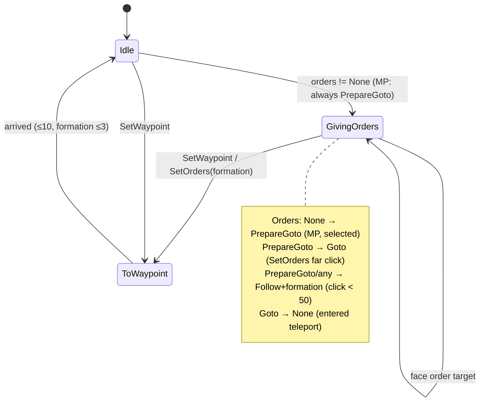
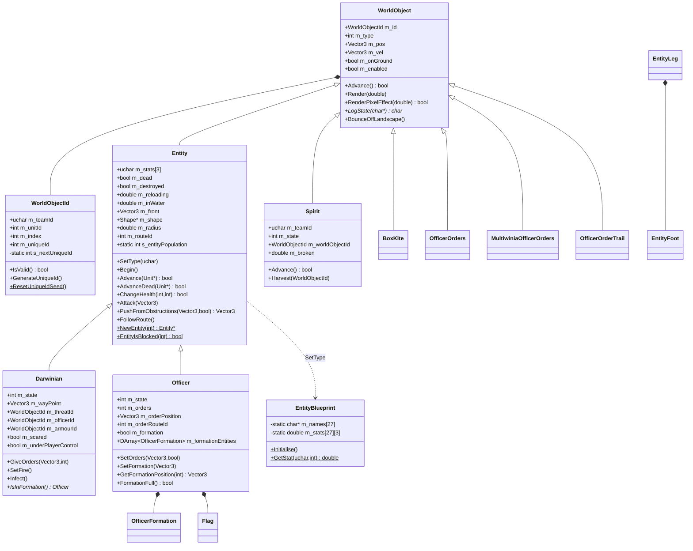
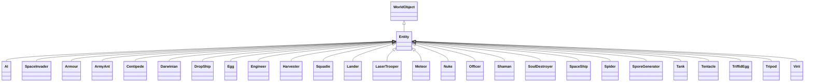

# P03_entity_core — Entity framework, Darwinian, officer, spirits, spatial & routing
Scope: `code/worldobject/{worldobject,entity,entity_leg,darwinian,officer,spirit}.{h,cpp}`, `code/{entity_grid,entity_grid_cache,obstruction_grid,routing_system}.{h,cpp}`, `data/stats.txt`. Build baseline: see build_matrix.md (`Release|Win32`, `TARGET_PC_FULLGAME`, `BLOCK_OLD_DARWINIA_OBJECTS` on). Everything below is **[B:FULL]** unless tagged otherwise.

Conventions used in this draft:
- "tick" = one server advance. `SERVER_ADVANCE_PERIOD` = `0.1 * m_gameSpeed` seconds (0.1 s at normal speed, i.e. 10 Hz) [C] `code/gametimer.h:SERVER_ADVANCE_PERIOD`, `code/gametimer.cpp:GameTimer::GetServerAdvancePeriod`.
- RNG ranges: `syncfrand(x)` ∈ [0,x); `syncsfrand(x)` ∈ [−x/2, +x/2) (NOT ±x — header comment is wrong) [C] `contrib/systemiv/lib/math/random_number.cpp:_syncsfrand` (`(_syncfrand(1.0)-0.5)*range`). `frand(x)` ∈ [0,x], `sfrand(x)` ∈ [−x/2,x/2] and are **not** network-synchronised (C `rand`-style `AppRandom`) [C] `random_number.cpp:frand,sfrand`. `FRAND(x)`/`SFRAND(x)` (in `Vector3` constructors) are wrappers that evaluate `_syncfrand/_syncsfrand` left-to-right — **synchronised** [C] `code/lib/vector3.h:FRAND,SFRAND`, `code/lib/vector3.cpp:FromRand`.
- Distances are world units (the landscape is in metres-equivalent world units; `stats.txt` calls speed "m/s").

## [→ 21_simulation_and_entity_model] Object identity: WorldObjectId

### Fields [C] `code/worldobject/worldobject.h:WorldObjectId`
| Field | Type | Default (invalid) | Meaning |
|---|---|---|---|
| `m_teamId` | `unsigned char` | 255 | Owning team slot (0..`NUM_TEAMS`-1). 255 = no team. |
| `m_unitId` | `int` | -1 | Unit index within the team's `m_units` array, **or** -1 = team's loose `m_others` array, **or** one of the pseudo-unit codes below. |
| `m_index` | `int` | -1 | Slot index inside the container selected by (team, unit). |
| `m_uniqueId` | `int` | -1 | Monotonic serial; disambiguates re-used slots (generation counter). For buildings it is the building's level-file id. |

Pseudo unit ids (`#define`) [C] `worldobject.h`:
| Macro | Value | Container resolved by `Location::GetWorldObject` |
|---|---|---|
| `UNIT_BUILDINGS` | -100 | `Location::GetBuilding(uniqueId)` (linear scan of `m_buildings` comparing `m_id.GetUniqueId()`) |
| `UNIT_SPIRITS` | -101 | `Location::GetSpirit(index)` (`m_spirits` FastDArray slot) — spirits are created with uniqueId = -1, so only the slot is checked |
| `UNIT_LASERS` | -102 | (defined; lasers are not resolved through `GetWorldObject`) [I] |
| `UNIT_EFFECTS` | -103 | `Location::GetEffect(id)`: `m_effects[index]` then uniqueId must match |
| anything else | ≥ -1 | `Location::GetEntity(id)` |

[C] `code/location.cpp:Location::GetWorldObject, GetEffect, GetSpirit(int), GetBuilding(int)`.

### Validity and comparison
- `IsValid()` ⇔ `teamId != 255 || unitId != -1 || index != -1` (uniqueId is ignored) [C] `worldobject.h:WorldObjectId::IsValid`.
- `==` / `!=` compare **all four** fields [C] `worldobject.cpp:operator==`.
- `Set()` debug-asserts `teamId < 256`, `unitId < 65536`, `index < 65536` (`ID_MAXTEAMS/ID_MAXUNITS/ID_MAXTROOPS`) [C] `worldobject.cpp:WorldObjectId::Set`.
- Handles are *weak*: holding a `WorldObjectId` never keeps an object alive; every dereference re-resolves and returns NULL when the slot is empty or its occupant's uniqueId differs (stale handle) [C] `location.cpp:Location::GetEntity`.

### Allocation
1. `Entity::NewEntity(type)` constructs the concrete class and calls `m_id.GenerateUniqueId()` → `++s_nextUniqueId; m_uniqueId = s_nextUniqueId` (first id is 1) [C] `entity.cpp:Entity::NewEntity`, `worldobject.cpp:GenerateUniqueId`.
2. `Team::NewEntity(type, unitId, &index)` puts it in `team->m_others` (unitId -1) or `unit->m_entities` (via `Unit::NewEntity`), returning the slot index (first free slot of a `SliceDArray`) [C] `code/team.cpp:Team::NewEntity`, `code/unit.cpp:Unit::NewEntity`.
3. `Location::SpawnEntities` then sets `teamId/unitId/index` on the id [C] `location.cpp:Location::SpawnEntities`.
4. `WorldObjectId::ResetUniqueIdSeed()` sets the counter back to 0 at every location load, so ids are deterministic per match provided creation order is identical on all peers [C] `code/main.cpp` (call before `new Location()`), `worldobject.cpp:ResetUniqueIdSeed`.
- Non-entity world objects (effects, lasers) and buildings set their ids by other routes (effects call `GenerateUniqueId` themselves; buildings use the level-file id) [I] from `GetEffect`/`GetBuilding` resolution rules; see P06/P04.
- `s_nextUniqueId` is a plain `static int` — shared by *all* objects that call `GenerateUniqueId` [C].

### Resolution — `Location::GetEntity(id)` [C] `location.cpp:Location::GetEntity`
```
if teamId >= NUM_TEAMS or team unused → NULL
if team.m_units.ValidIndex(unitId) and unit.m_entities.ValidIndex(index)
      and entity.uniqueId == id.uniqueId → entity
if unitId == -1 and team.m_others.ValidIndex(index) and uniqueId matches → entity
else NULL
```
`Location::GetEntitySafe(id, type)` additionally checks `m_type == type` [C].

## [→ 21_simulation_and_entity_model] WorldObject base class

[C] `code/worldobject/worldobject.h:WorldObject`, `worldobject.cpp`.

| Member | Type | Default | Meaning |
|---|---|---|---|
| `m_id` | `WorldObjectId` | invalid | identity (above) |
| `m_type` | `int` | 0 | type enum of the concrete family (Entity::Type*, Building::Type*, or WorldObject::Effect* when unit = `UNIT_EFFECTS`) |
| `m_pos` | `Vector3` (double) | — | world position |
| `m_vel` | `Vector3` | — | velocity, world units/s |
| `m_onGround` | `bool` | false | true when standing on terrain (set by AdvanceInAir landing) |
| `m_enabled` | `bool` | true | disabled objects are skipped by Advance loops |

| Virtual | Default behaviour | Contract |
|---|---|---|
| `~WorldObject()` | — | virtual dtor |
| `bool Advance()` | returns false | parameterless form used by effects/lasers/spirits; **true = remove me** [I] (consistent with Entity) |
| `void Render(double time)` | nothing | `time` = prediction time since last tick |
| `bool RenderPixelEffect(double predictionTime)` | false | "return true if you did anything" |
| `char *LogState(char *msg)` | static buffer `"WOBJ Type[%d] Id[%d] pos[x,y,z], vel[sum]"` with `HashDouble` values | sync-log fingerprint (X3) |
| non-virtual `BounceOffLandscape()` | see below | |

`WorldObject::Effect*` enum (applies when `m_id.unitId == UNIT_EFFECTS`) [C] `worldobject.h`:
| Value | Name |
|---|---|
| 0 | TypeInvalid |
| 1 | EffectThrowableGrenade |
| 2 | EffectThrowableAirstrikeMarker |
| 3 | EffectThrowableAirstrikeBomb |
| 4 | EffectThrowableControllerGrenade |
| 5 | EffectGunTurretTarget |
| 6 | EffectGunTurretShell |
| 7 | EffectSpamInfection |
| 8 | EffectBoxKite |
| 9 | EffectSnow |
| 10 | EffectRocket |
| 11 | EffectShockwave |
| 12 | EffectMuzzleFlash |
| 13 | EffectOfficerOrders |
| 14 | EffectOfficerOrderTrail |
| 15 | EffectZombie |
| 16 | EffectRandomiser |
| 17 | EffectDustBall |
| 18 | EffectLightning |
| 19 | EffectPulseWave |
| 20 | EffectFlameGrenade |
| 21 | EffectTurretEmptyShell |
| 22 | EffectFireball |

`BounceOffLandscape()` [C] `worldobject.cpp:WorldObject::BounceOffLandscape`: intended to place the object at the midpoint between last and current position, but `lastPos = m_pos` (the `- m_vel*g_advanceTime` term is commented out), so the impact point is simply the current position snapped to terrain height. Then reflects velocity about the terrain normal `n`: `v' = 2(n·(−v))n − (−v)` and scales by `COEF_OF_RESTITUTION = 0.85` (`#define`).

`Light` (same header) is a render helper, not a world object: `m_colour[4]` default (1.3,1.3,1.3,0), `m_front[4]` (w=0 → directional); `SetFront`, `SetColour`, `Normalise` [C].

## [→ 21_simulation_and_entity_model] Entity base class

[C] `code/worldobject/entity.h:Entity`, `code/worldobject/entity.cpp`.

### Members
| Member | Type | Default (ctor) | Meaning |
|---|---|---|---|
| `m_formationIndex` | int | -1 | offset within its Unit's formation (not the array index) |
| `m_buildingId` | int | -1 | building that created it (Darwinian re-declares its own `m_buildingId`, shadowing this one) |
| `m_spawnPoint` | Vector3 | — | where it was created; also re-targeted by `FollowRoute` to current waypoint |
| `m_roamRange` | double | 0 | how far it may roam from `m_spawnPoint` (`SpawnEntities`: `_range`, or `_spread` if `_range == -1`) |
| `m_stats[NumStats]` | **unsigned char**[3] | 0 | Health, Speed, Rate — byte-sized! (see stats section) |
| `m_dead` | bool | false | dying/fading (still in containers) |
| `m_justFired` | bool | false | set by Attack (used by renderers/AI) |
| `m_reloading` | double | 0 → `syncfrand(Rate)` in `SetType` | seconds until can fire |
| `m_inWater` | double | -1 | -1 = not in water, else seconds in water |
| `m_destroyed` | bool | false | "removed entirely — bail out": `Advance` returns true immediately |
| `m_front` | Vector3 | — | facing (unit vector) |
| `m_angVel` | Vector3 | — | angular velocity (subclass use) |
| `m_shape` | Shape* | NULL | 3D model, NULL ⇒ sprite-rendered |
| `m_centrePos` | Vector3 | — | shape centre (computed in `Begin`) |
| `m_radius` | double | 0 | shape bounding radius; 0 ⇒ sprite. Used for entity-grid registration |
| `m_renderDamaged` | bool | false | cosmetic flicker flag |
| `m_routeId` | int | -1 | route being followed (see routing) |
| `m_routeWayPointId` | int | -1 | current waypoint index |
| `m_routeTriggerDistance` | double | 10.0 | distance at which a route waypoint counts as reached |
| `m_aiTimer` | double | 0 | subclass AI timer |
| `static s_entityPopulation` | int | 0 | ++ in ctor, -- in dtor (count of live Entity objects of every type) |
| `static s_neighbours` | `std::vector<WorldObjectId>` (protected) | — | shared scratch buffer for grid queries (non-reentrant) |

### Enums [C] `entity.h`
`Stat*`: `StatHealth=0`, `StatSpeed=1`, `StatRate=2`, `NumStats=3`.

`DamageType*`:
| Value | Name | Notes |
|---|---|---|
| 0 | DamageTypeUnresistable | default; "used for just killing entities outright" |
| 1 | DamageTypeLaser | |
| 2 | DamageTypeExplosive | |
| 3 | DamageTypeTurretShell | |
| 4 | DamageTypeFire | |
| 5 | NumDamageTypes | |

### Complete Entity type enum, class and blocking
`Blocked` = `Entity::EntityIsBlocked(type)` returns true under `BLOCK_OLD_DARWINIA_OBJECTS` (on in FULL) [C] `entity.cpp:Entity::EntityIsBlocked`. Blocking is enforced **only** when a level file's `InstantUnits` block is parsed (blocked types are skipped) [C] `code/level_file.cpp:LevelFile::ParseInstantUnits`, and in the editor-only `code/interface/instant_unit_window.cpp` [B:EDITOR]. Blocked types can still be created at runtime by code (e.g. Officer via promotion, Nuke/Meteor/SpaceShip via crates — see P04/P08) — "blocked" ≠ "absent".

| # | Enum | `GetTypeName` string | Class (`NewEntity`) | Header | Blocked | stats.txt row name |
|---|---|---|---|---|---|---|
| 0 | TypeInvalid | "InvalidType" | — (assert) | — | **yes** | Invalid |
| 1 | TypeLaserTroop | "LaserTroop" | `LaserTrooper` | lasertrooper.h | **yes** | LaserTroop |
| 2 | TypeEngineer | "Engineer" | `Engineer` | engineer.h | no | Engineer |
| 3 | TypeVirii | "Virii" | `Virii` | virii.h | no | Virii |
| 4 | TypeInsertionSquadie | "Squadie" | `Squadie` | insertion_squad.h | no | InsertionSquadie |
| 5 | TypeEgg | "Egg" | `Egg` | egg.h | **yes** | Egg |
| 6 | TypeSporeGenerator | "SporeGenerator" | `SporeGenerator` | sporegenerator.h | no | SporeGenerator |
| 7 | TypeLander | "Lander" | `Lander` | lander.h | **yes** | Lander |
| 8 | TypeTripod | "Tripod" | `Tripod` | tripod.h | **yes** | Tripod |
| 9 | TypeCentipede | "Centipede" | `Centipede` | centipede.h | no | Centipede |
| 10 | TypeSpaceInvader | "SpaceInvader" | `SpaceInvader` | airstrike.h | **yes** | SpaceInvader |
| 11 | TypeSpider | "Spider" | `Spider` | spider.h | no | Spider |
| 12 | TypeDarwinian | "Darwinian" | `Darwinian` | darwinian.h | no | Darwinian |
| 13 | TypeOfficer | "Officer" | `Officer` | officer.h | **yes** (level placement only) | Officer |
| 14 | TypeArmyAnt | "ArmyAnt" | `ArmyAnt` | armyant.h | **yes** | ArmyAnt |
| 15 | TypeArmour | "Armour" | `Armour` | armour.h | no | Armour |
| 16 | TypeSoulDestroyer | "SoulDestroyer" | `SoulDestroyer` | souldestroyer.h | no | SoulDestroyer |
| 17 | TypeTriffidEgg | "TriffidEgg" | `TriffidEgg` | triffid.h | **yes** | TriffidEgg |
| 18 | TypeAI | "AI" | `AI` | ai.h | **yes** | AI |
| 19 | TypeShaman | "Shaman" | `Shaman` | shaman.h | **yes** | Shaman |
| 20 | TypeHarvester | "Harvester" | `Harvester` | harvester.h | no | Harvester |
| 21 | TypeNuke | "Nuke" | `Nuke` | nuke.h | **yes** | Nuke |
| 22 | TypeTentacle | "Tentacle" | `Tentacle` | tentacle.h | **yes** | Tentacle |
| 23 | TypeMeteor | "Meteor" | `Meteor` | meteor.h | **yes** | Meteor |
| 24 | TypeTank | "Tank" | `Tank` | tank.h | no | Tank |
| 25 | TypeSpaceShip | "SpaceShip" | `SpaceShip` | spaceship.h | **yes** | SpaceShip |
| 26 | TypeDropShip | "DropShip" | `DropShip` | dropship.h | **yes** | DropShip |
| 27 | NumEntityTypes | — | — | — | — | — |

`GetTypeId(name)` is a case-insensitive linear search over `GetTypeName` (so level files must say "Squadie", not "InsertionSquadie") [C] `entity.cpp:Entity::GetTypeId`. `GetTypeNameTranslated` looks up language phrase `entityname_<TypeName>`, falling back to the raw name [C].

### Stats loading — `EntityBlueprint` and `data/stats.txt`
Parser [C] `entity.cpp:EntityBlueprint::Initialise` (called from `code/main.cpp` at startup and from `code/lib/resource.cpp` on mod change):
- Opens `stats.txt` via the resource system's TextReader; `ReadLine` skips `#` comments/blank lines (TextReader behaviour, X1a/X1b).
- **Rows are positional**: row *k* is assigned to entity type *k*; the first token (name) is stored in `m_names[k]` but never used for lookup. Columns 2–4 → `m_stats[k][Health/Speed/Rate]` via `iv_atof`. Asserts if > `NumEntityTypes` rows.
- `EntityBlueprint::GetStat(type, stat)`: for `StatSpeed` and `type != TypeSpaceInvader` returns `stat × (1 + m_difficultyLevel/10)`; otherwise the raw value [C] `entity.cpp:EntityBlueprint::GetStat`. In Multiwinia `App::m_difficultyLevel` is forced to 0 (`m_difficultyLevel = 0;//g_prefsManager->GetInt(...)`) [C] `code/app.cpp` (≈L632), unless a level file carries a stored difficulty (`Location::Init` copies `m_levelFile->m_levelDifficulty` into it when ≠ -1) [C] `code/location.cpp:Location::Init`. [I] In practice the multiplier is 1.0.
- `Entity::SetType(type)`: `m_type = type`; `m_stats[i] = GetStat(type,i)` (double → **unsigned char** conversion, i.e. truncation); `m_reloading = syncfrand(m_stats[StatRate])` (random initial reload phase, synced) [C] `entity.cpp:Entity::SetType`.

`data/stats.txt` [C] (columns: HLTH = health, SPED = speed "m/s", RATE = "secs to reload"):
| Row | Name in file | HLTH | SPED | RATE | Effective `unsigned char` value / notes |
|---|---|---|---|---|---|
| 0 | Invalid | 0 | 0 | 0 | |
| 1 | LaserTroop | 20 | 15 | 1 | |
| 2 | Engineer | 255 | 28 | 0 | |
| 3 | Virii | 10 | 32 | 0 | |
| 4 | InsertionSquadie | 75 | 30 | 0.5 | Rate 0.5 → **0** after byte truncation [I] (subclass must use own reload constant — P04) |
| 5 | Egg | 10 | 0 | 0 | |
| 6 | SporeGenerator | 200 | 20 | 10 | |
| 7 | Lander | 255 | 40 | 1 | |
| 8 | Tripod | 155 | 20 | 1 | |
| 9 | Centipede | 255 | 80 | 1 | |
| 10 | SpaceInvader | 10 | 40 | 1 | speed not difficulty-scaled |
| 11 | Spider | 200 | 50 | 1 | |
| 12 | Darwinian | 50 | 20 | 3 | |
| 13 | Officer | 255 | 30 | 3 | |
| 14 | ArmyAnt | 20 | 25 | 0 | |
| 15 | Armour | 200 | 60 | 5 | |
| 16 | SoulDestroyer | 255 | 150 | 1 | |
| 17 | TriffidEgg | 50 | 100 | 1 | |
| 18 | AI | 255 | 255 | 255 | |
| 19 | Shaman | 200 | 25 | 2 | |
| 20 | Harvester | 255 | 28 | 0 | |
| 21 | Nuke | 255 | 100 | 0 | |
| 22 | Tentacle | 255 | 100 | 0 | |
| 23 | Meteor | 255 | **350** | 0 | 350 > 255: double→uchar out of range (UB); MSVC x86 [I] yields 350 mod 256 = 94 |
| 24 | Tank | 150 | 50 | 2 | |
| 25 | SpaceShip | 255 | **500** | 0 | 500 → [I] 244 under MSVC; subclasses may ignore `m_stats[StatSpeed]` (P05) |
| 26 | DropShip | 255 | 255 | 0 | |

Design note for the new game: use wider stat types; the byte storage silently clamps health to 255 (see `ChangeHealth`) and truncates fractional reload rates.

### Virtual interface and contracts
| Method | Base behaviour [C] `entity.cpp` | Contract |
|---|---|---|
| `Begin()` | triggers sound `"Create"`; if `m_shape`, computes `m_centrePos = shape->CalculateCentre(identity)` and `m_radius = CalculateRadius` | called once by `SpawnEntities` after id/pos assigned, before grid insertion. Subclasses must call `SetShape` here, not in the ctor (team colouring needs `m_id.teamId`) |
| `bool Advance(Unit*)` | see sequence below | return **true = "I am dead, remove and delete me"**; false = keep. `Unit::AdvanceEntities` / `Team::Advance` then call `RemoveEntity` (grid remove + delete) or `EntityGrid::UpdateObject(oldPos→newPos)` [C] `code/unit.cpp:Unit::AdvanceEntities`, `code/team.cpp:Team::Advance` |
| `bool AdvanceDead(Unit*)` | health decays by `40*SERVER_ADVANCE_PERIOD` per tick on ground, `20*…` in air (int truncation of a double: 40×0.1=4, 20×0.1=2 per tick); when ≤0 sets 0 and returns true | the death fade: health is reused as fade alpha (ChangeHealth sets it to 100 on death) |
| `void AdvanceInAir(Unit*)` | `vel += (0,−15,0)·dt`; `pos += vel·dt`; `PushFromObstructions(m_pos)` (**result discarded** — no effect except RNG/side effects); if alive and `pos.y ≤ ground+0.1` → `m_onGround=true`, `vel=0`, `pos.y=ground+0.1+0.1`; if `pos.y ≤ 0` (sea level) → `m_inWater = 0` (if <0), `vel=0` | gravity 15 units/s² |
| `void AdvanceInWater(Unit*)` | `m_inWater += dt`; if `> 10.0` s → `ChangeHealth(−500)` (drown). If in a unit, steer to unit waypoint + `FormationRectangle` offset at `speed×0.3`; then **`m_vel.SetLength(5.0)` unconditionally**; `pos += vel·dt`; `pos.y = −sin(inWater×3) − 4` (bobbing); if ground height under it > 0 → `m_inWater = −1` (out) | |
| `void RunAI(AI*)` | nothing | legacy AI hook |
| `bool ChangeHealth(int amount, int damageType)` | if not dead: amount<0 → sound `"LoseHealth"`; if `health+amount ≤ 0` → `health=100`, `m_dead=true`, sound `"Die"`, `Location::SpawnSpirit(m_pos, m_vel*0.5, teamId, m_id)`; else clamp to 255; always returns true. `damageType` ignored in base | spirit release on death (Location suppresses spirits for the monster team) |
| `void Attack(Vector3 pos)` | only if `m_reloading == 0.0`: target += (`syncsfrand(15)`, 0, `syncsfrand(15)`) (±7.5); from = pos + (0,3,0); `Location::FireLaser(from, (to−from).SetLength(150), teamId)`; `m_reloading = Rate`; `m_justFired = true`; sound `"Attack"` | generic laser attack (speed 150 u/s) |
| `bool IsInView()` | true | renderer culling hook |
| `void SetWaypoint(Vector3)` | nothing | used by `FollowRoute` |
| `Vector3 PushFromObstructions(pos, killem=true)` | see Collision | |
| `Vector3 PushFromCliffs(pos, oldPos)` | if slope `(pos.y−old.y)/horizDist > 1.0` spiral-search: `d` from 0 to 50 step 0.2, angle `= d·2π`, offset `(cos·d, 0, sin·d)`, take first point with slope < 1.0 | gradient limit 45° |
| `Vector3 PushFromEachOther(pos)` | queries entity grid radius 2.0; for every other id: `result += normalise(pos−other) × 0.1/|pos−other|`; result.y = terrain height. Not called by base Advance (commented out) | separation steering |
| `int EnterTeleports(int requiredId=-1)` | for each building in obstruction cell under `m_pos` (optionally only id = requiredId): RadarDish — `ReadyToSend()`, distance to entrance < 15, `m_front·entranceFront < 0`; Bridge — `GetEntrance()` ok, distance to *bridge pos* < 25, ReadyToSend, facing test. On success `EnterTeleport(m_id)`, sound `"EnterTeleport"`, returns building id; else -1 | RadarDish/Bridge are P06/P07 |
| `void DirectControl(TeamControls const&)` | nothing | direct-control hook |
| `bool IsSelectable()` | false | |
| `void ListSoundEvents(LList<char*>*)` | "Create", "Attack", "LoseHealth", "EnterTeleport", "ExitTeleport", "Die", "Selected" | sound-editor event list |
| `bool RayHit(start, dir)` | shape ray test with `Matrix34(m_front, up, m_pos)`; sprite ⇒ ray–sphere radius 5.0 | picking |
| `Vector3 GetCameraFocusPoint()` | `m_pos + m_vel` | camera tracking |
| `void FollowRoute()` | see Routing | |
| `char *LogState(msg)` | `"ENT Type[name] Id[uid] pos[...], vel[sum] front[sum]"` (HashDouble) | sync log |
| `void SetShape(name, colourAll=false)` | SP: filename = name; MP: `"<name>_<colourId>_<coopGroupPosition>"`; `Resource::GetShape(filename)`; if missing → `SetupTeamShape` | |
| `void Render(double)` | nothing | |

Static helpers: `BeginRenderShadow / RenderShadow(pos,size) / EndRenderShadow` (blob shadow: `textures/glow.bmp`, blend `SRC_ALPHA, ONE_MINUS_SRC_COLOR`, colour (0.6,0.6,0.6,0), quad of half-size `size` draped at terrain+0.9 (min 1.0), skipped if all four corners are above the caster; near plane pushed ×1.05 during shadow pass) [C] `entity.cpp:Entity::RenderShadow`.

### Base `Entity::Advance(Unit*)` sequence [C] `entity.cpp:Entity::Advance`
1. `!m_enabled` → return false (frozen). `m_destroyed` → return true.
2. If `m_dead`: `AdvanceDead()`; if it returns true → return true (removed). (Falls through otherwise — continues to step 3.)
3. `m_reloading -= dt`, clamp at 0.
4. Cosmetic: `healthFraction = health / blueprintHealth`; `timeIndex = g_gameTime + uniqueId×10`; `m_renderDamaged = frand(0.75)×(1−|sin(timeIndex)|×0.8) > healthFraction` — uses **unsynced** `frand` but only feeds rendering.
5. If `m_inWater != −1` → `AdvanceInWater(_unit)`.
6. Clamp `m_pos.x,z` into [0, worldSize].
7. If in a unit and alive → `unit->UpdateEntityPosition(m_pos, m_radius)` (unit centre/radius accumulation).
8. If `m_routeId != −1` → `FollowRoute()`.
9. return false.
Subclasses (Darwinian, Officer, …) override `Advance` entirely and call `Entity::Advance` at the end [C] (see Darwinian).

### Team-colour shape conversion [C] `entity.cpp:SetupTeamShape, ConvertShapeColoursToTeam, ConvertFragmentColours`
- `SetupTeamShape(name, convertAll)`: single-player or team 255 → shared, unmodified shape (`GetShape`, else `GetShapeCopy`+`AddShape`). Multiplayer → cache key `"<name>_<r>_<g>_<b>_<a>"` of the team colour; on miss copy shape, recolour, register under that key.
- `ConvertShapeColoursToTeam(shape, teamId, convertAll)`: team 255 → no-op. Team colour `team->m_colour`; if the team's lobby `m_colourId == 0` **and** the shape is `data/shapes/darwinian.shp` the colour is halved (×0.5). Applies to root fragment and its *direct* children only (not grandchildren), then `BuildDisplayList()`.
- `ConvertFragmentColours(frag, col, convertAll)`: for each material colour: "mostly red" test `r > 2g && r > 2b` (or `convertAll`) ⇒ convert: if `convertAll` new = team colour, else new = teamColour × ratio where `ratio = (r+g+b)_orig / (r+g+b)_team` (luminance-preserving tint); then ×0.7 ("3D models appear brighter than 2D"). Non-red colours copied unchanged. **Asset convention: team-coloured regions are authored in red.**

### Collision / obstacle push — `Entity::PushFromObstructions(pos, killem)` [C] `entity.cpp`
1. If `m_onGround`, `result.y = terrain height`.
2. Water push: if `result.y ≤ 1.0`, pick `pushAngle = syncsfrand(1.0)` and spiral outward: `d = 0..50 step 1.0`, angle `= d·pushAngle·π`, offset `(cos·d, 0, sin·d)`; first sample with height > 1.0 becomes the result.
3. Building push: for every building id stored in the obstruction-grid cell containing `result` (`ObstructionGrid::GetBuildings(x,z)`):
   - hit if (`m_shape` && `building->DoesShapeHit(m_shape, Matrix34(front, up, result))`) or ((no shape or Officer) && `DoesSphereHit(result, 1.0)`); else hit if `DoesRayHit(oldPos = m_pos − m_vel·dt, m_front, |m_pos − oldPos|)` (tunnelling check).
   - If hit and the building is an enabled `LaserFence` and `killem` and the fence team is not a friend → `ChangeHealth(−9999)` + `LaserFence::Electrocute(m_pos)`.
   - Otherwise push: `pushForce = (building.pos − result)` flattened, length 4.0; `while DoesSphereHit(result, 2.0): result -= pushForce` (moves directly away from building centre in 4-unit steps; unbounded loop).
4. Returns result (y is not re-snapped after building push).
Darwinian overrides this (see Darwinian section).

## [→ 21_simulation_and_entity_model] Spatial partitioning

Three independent structures live on `Location` and are created in `Location::Init` (not in editing mode) [C] `code/location.cpp:Location::Init`:
| Structure | Construction | Cell size | Content |
|---|---|---|---|
| `m_entityGrid` | `new EntityGrid(32.0, 32.0)` | 32 × 32 world units | entity ids, bucketed **per team** |
| `m_entityGridCache` | `new EntityGridCache()` | — | memo of recent `GetEnemies` queries |
| `m_obstructionGrid` | `new ObstructionGrid(s, s)` | `s` = 64.0 single-player, **32.0 multiplayer** | building ids per cell |

### EntityGrid [C] `code/entity_grid.h`, `code/entity_grid.cpp`
**Layout.** `m_cells[NUM_TEAMS]` (NUM_TEAMS = 6, `code/globals.h`), each a row-major array of `numCellsX × numCellsZ` `EntityGridCell`, where `numCellsX = int(worldSizeX/32)+1` (same for Z). Cell index = `int(world × 1/cellSize)` (truncation; no bounds clamp in `GetCell(world)` — callers pass clamped/valid positions; debug assert otherwise).

**EntityGridCell** = growable slot array: `m_objectIds[]` (WorldObjectId), `m_usageLists[]` (intrusive free list; `END_OF_LIST = -100000`), `m_arraySize`, `m_numSlotsFree`, `m_firstFree`. Starts empty (`INITIAL_OBJECT_ID_ARRAY_SIZE = 0`); on full, capacity doubles (0→2→4→8…), new half chained into the free list. `AddObjectId` pops the free-list head. `RemoveObjectId` linear-scans and invalidates **every** matching slot (pushing each on the free list); returns whether any was found. Capacity never shrinks.

**Insertion / removal footprint.** `AddObject(id, x, z, radius)` / `RemoveObject(...)`:
- team 255 → ignored (never stored).
- `radius == 0` → single cell at (x,z).
- `radius > 0` → every cell overlapping the square `[x − r/2, x + r/2] × [z − r/2, z + r/2]` (note **r/2**, i.e. half the radius), clamped to the grid.
- Remove failures call `LogEntityGridError` → `AppDebugAssert(false)` (debug only; `DEBUG_ENTITY_GRID` is commented out).

**Update.** `UpdateObject(id, oldX, oldZ, newX, newZ, radius)`: if the cell changed **or radius > 0** → Remove at old + Add at new (shaped entities are re-inserted every tick). Called by `Unit::AdvanceEntities` and `Team::Advance` after every `Advance()` that returns false, using the position captured *before* Advance [C] `code/unit.cpp:Unit::AdvanceEntities`, `code/team.cpp:Team::Advance`. Invariant: **an entity must not change `m_radius` between updates**, and code that teleports an entity outside Advance must update the grid itself.

**Query API** (all take world x,z and a range; team filtering via a `bool include[NUM_TEAMS]` mask):
| Method | Team mask | Range test | Notes |
|---|---|---|---|
| `GetNeighbours(out, x, z, r, &n, include[])` | given | circular, `dx²+dz² < r²` against the entity's **current** `m_pos` | scans cells covering `[x±r]×[z±r]`, teams 0..5 in order; de-duplicates ids (O(n²) linear check, because shaped entities sit in several cells); ids whose `GetEntity` is NULL are skipped (+debug assert). Output order = cell x-major, then z, then team, then slot order — **deterministic** given identical insertion history. `out` grows via `EnsureMaxNeighbours` (+100 or +requested). |
| `GetNeighbours(out, x, z, r, &n)` | all teams | as above | |
| `GetEnemies(out, x, z, r, &n, myTeam)` | `!IsFriend(t, myTeam)` | as above | Team 255 is never a friend (so "enemy" mask includes every team ≠ friends) |
| `GetFriends(out, x, z, r, &n, myTeam)` | `IsFriend(t, myTeam)` | as above | |
| `GetBestEnemy(x, z, minR, maxR, myTeam)` | enemies | nearest with `minR² ≤ d² < maxR²`, skipping `TypeAI` ("never a target") and `m_dead` | ties → first found; returns invalid id if none. Uses the grid's own `m_neighbours` scratch |
| `GetNumNeighbours(x, z, r, include[])` | given | **none** — counts every distinct id in the covered cells (square, cell-granular) | "fast" approximation |
| `GetNumEnemies / GetNumFriends` | enemies / friends | none (as above) | |
| `AreNeighboursPresent(x, z, r[, include])` | given / all | none; returns true if any covered cell has `m_arraySize > 0` — i.e. **capacity**, so a cell that ever held an entity of that team keeps reporting true | "very fast", over-approximate |
| `AreEnemiesPresent / AreFriendsPresent` | enemies / friends | as above | |
| `Render()` | — | debug: per team per non-empty cell a translucent quad at y = 100 + 30·team and the count | `DEBUG_RENDER` |

`Location::IsFriend(a, b)` (the friend/enemy definition used by the grid) [C] `code/location.cpp:Location::IsFriend`: false if either is 255; in multiplayer: co-op mode → same `m_coopGroups[]` entry, else `a == b`; single-player uses a fixed 6×6 table (Darwinia legacy, [B:LEGACY]).

### EntityGridCache [C] `code/entity_grid_cache.h`, `code/entity_grid_cache.cpp`
Memo for `GetEnemies` only. Elements (`EntityGridCacheElement`): `float m_timeIndex, m_worldX, m_worldZ, m_rangeSqd, m_halfRangeSqd; unsigned char m_teamId; int m_numFound; std::vector<WorldObjectId> m_ids` (positions are stored as **float**). Container `FastDArray`, initial size 20, step 20.
- `GetEnemies(x, z, r, &n, team)`: `FindCacheHit` returns the cached element of the **same team** whose centre is nearest and within **half its own range** (`d² < (r_cached/2)²`); the *requested* range is ignored on a hit. On miss: query `EntityGrid::GetEnemies`, store `(x, z, r², (r/2)², team, n, gameTime)`.
- `Advance()`: called from `Location::Advance` on slice 7 only (`if( _slice == 7 ) m_entityGridCache->Advance()`) [C] `location.cpp`; deletes elements older than `ENTITYGRIDCACHE_MAXAGE = 1.0` s (game time).
- Consequence: results can be up to ~1 s stale and may contain ids of entities that died since; callers must re-resolve and re-check range. The only caller is `Darwinian::SearchForThreats` [C] (grep: `code/worldobject/darwinian.cpp`).
- `Render()` (commented out at call site): fading team-coloured circle per element.

### ObstructionGrid [C] `code/obstruction_grid.h`, `code/obstruction_grid.cpp`
**Stores** a `SurfaceMap2D<ObstructionGridCell>` over the world (`ceil(worldSize/cellSize)` cells per axis, origin 0,0); each cell holds `LList<int> m_buildings` = building unique ids whose geometry overlaps the cell. Out-of-range reads/writes go to the map's single shared "outside" cell (`Array2D::GetPointer` returns `&m_outsideValue`) [C] `code/lib/2d_array.cpp`.

**Population** — `CalculateAll()` (run in the constructor, and whenever any building is removed during `Location::AdvanceBuildings` — "TODO: This is WAY too slow" — and explicitly by `tree.cpp`, `crate.cpp` ×4, `engineer.cpp`, `armour.cpp`) [C] grep `m_obstructionGrid->CalculateAll`: clear all cells, then for every building `CalculateBuildingArea(id)`:
1. Building cell `(cx, cz)` from `building->m_centrePos`; `range = ceil(m_radius / cellSize)`; loop x ∈ [cx−range, cx+range], z ∈ [cz−range, cz+range] (clamped low to 0, high to the row/column count *inclusive*).
2. For each cell, test `building->DoesSphereHit(cellCentre(y = terrain height), cellSize/2)`; if hit, append id (no duplicate check here).
3. Laser fences with a link (`GetBuildingLink() != −1`): sample the segment fence→linked fence at `numCells = |link − fence| + 1` points (≈ one sample per world unit) and add the fence id to each sample's cell (with duplicate check, `AddBuildingToCell`). A "diagonal skip" guard was meant to also add the 4-neighbours when consecutive samples are not adjacent; because `oldCellX/oldCellY` are re-declared inside the loop body (shadowing) they stay −1, so the guard is true for almost every sample (false only when cellX or cellY is 0) ⇒ in practice **every sampled cell's 4-neighbours are added too** (the fence line is dilated by one cell). The fence is added regardless of whether it is currently enabled (`IsEnabled()` checks happen at query time).

**Queries.** `GetBuildings(x, z)` → the list in the cell `floor(x/cell), floor(z/cell)` (nearest, no interpolation). Users: `Entity::PushFromObstructions`, `Entity::EnterTeleports`, `Darwinian`, `Officer`, `Location::IsWalkable/GetWalkingDistance`, `ai.cpp`, `armour.cpp`, `crate.cpp`, `engineer.cpp`, `gunturret.cpp`, `insertion_squad.cpp`, `laserfence.cpp`, `lightning.cpp`, `shaman.cpp`, `spirit.cpp`, `tree.cpp`, `wallbuster.cpp`, `weapons.cpp` [C] grep. Precise collision is always delegated to the building (`DoesSphereHit`, `DoesShapeHit`, `DoesRayHit`; P06).

`Render()`: debug quads at y = 150 with alpha = numBuildings/3.

### Walkability primitives used by routing (owned by `Location`, P01) [C] `code/location.cpp:Location::IsWalkable, GetWalkingDistance`
`IsWalkable(from, to, evaluateCliffs=false, permitSteepDownhill=false, *laserFenceId=NULL)`:
- false if `from.y ≤ 0` or `to.y ≤ 0` (water level 0).
- Step 20 units along the segment (`numSteps = int(dist/20)`, sample i at `from + i·diff`, i = 0..numSteps−1, y = terrain height).
- Accumulate `distanceUnderWater += 20` per sample with `y ≤ 0`; ≥ 40 ⇒ false (i.e. two wet samples).
- If `evaluateCliffs`: `gradient = (y − oldPosition.y)/20`, **where `oldPosition` is never advanced from `from`** (quirk: compares height above the *start*, so the test is "no sample more than 48 units above the start"); `gradient > 2.4` ⇒ false; if `!permitSteepDownhill || gradient > 0`: terrain normal `.y < 0.8` ⇒ false.
- Obstruction cell of each sample: Wall with `DoesSphereHit(pos, 20×0.66)` ⇒ false; enabled LaserFence with `DoesSphereHit(pos, 10)` ⇒ only reports `*laserFenceId` (does **not** block).
`GetWalkingDistance(from, to, checkObstructions=true)`: steps of 40; ≥ 40 units underwater ⇒ −1; (if checkObstructions) Wall or enabled LaserFence `DoesSphereHit(pos, 20)` ⇒ −1; cost per step = `|Δ3D| × (1 + max(0, gradient×1.5))` (uphill penalty only).

## [→ 21_simulation_and_entity_model] Routing system (pathfinding)

[C] `code/routing_system.h`, `code/routing_system.cpp`.

### Data model
| Class | Members | Notes |
|---|---|---|
| `RoutingSystem` (abstract) | `DArray<RouteNode*> m_nodes`, `DArray<Route*> m_routes`, `bool m_walkableRoute` | `virtual Initialise() = 0` |
| `LandRoutingSystem` | — | `Location::m_routingSystem` — Darwinians, officers, statues, wall-busters, armour orders preview |
| `SeaRoutingSystem` | — | `Location::m_seaRoutingSystem` — Armour (`armour.cpp`) only; not rendered ("only ai use this") |
| `RouteNode` | `WayPoint m_waypoint`, `LList<RoutingTableEntry*> m_routeTable`, `bool m_checkCliffs` (default true) | one per `AITarget` building |
| `RoutingTableEntry` | `int m_targetNode`, `int m_nextNode`, `double m_totalDistance` | distance-vector entry: "to reach target, go to next first; total remaining distance" |
| `WayPoint` | `int m_type` ∈ {`Type3DPos`=0, `TypeGroundPos`=1, `TypeBuilding`=2}, `Vector3 m_pos`, `int m_buildingId` (-1) | `GetPos()`: TypeBuilding → the Teleport's (RadarDish/Bridge) entrance position; TypeGroundPos → raw pos (terrain snapping code commented out); else pos |
| `Route` | `int m_id`, `LList<WayPoint*> m_wayPoints`, `int m_status`, `double m_alpha` (0) | `ROUTE_OK = 1`, `ROUTEID_FAILURE = −1` (#define) |

`Route` methods: `AddWayPoint(pos)` (Type3DPos, appended), `AddWayPoint(buildingId)` (TypeBuilding), `GetWayPoint(i)`, `GetIdOfNearestWayPoint(pos)` (3D squared distance), `GetIdOfNearestEdge(pos, *dist)` (2D point–segment distance, returns index of the segment's first waypoint; `*dist` is **not written**), `GetWalkingDistance()` (sum of `Location::GetWalkingDistance` per leg; any leg < 0 returns that negative value), `GetEndPoint()`, `Render()`.

### Graph construction — `LandRoutingSystem::Initialise()` (called once from `Location::Init`, after buildings)
1. One `RouteNode` per `Building::TypeAITarget` in `m_buildings` order; node `m_checkCliffs = AITarget::m_checkCliffs`, position = target pos.
2. Edges: for every ordered pair (i, j) (including i == j) with straight distance < **600** and `IsWalkable(pi, pj, evaluateCliffs = checkCliffs_i && checkCliffs_j)` → `node_i.AddRoute(target=j, next=j, cost = GetWalkingDistance(pi, pj, checkObstructions=false))`. Both predicates are memoised in symmetric `MatrixCache`s (`WalkableRSCache`, `WalkableDistanceRSCache`) — note the symmetric cache means (i,j) and (j,i) share one walkability answer even though `IsWalkable` is direction-dependent.
3. Propagation (distance-vector / Bellman-Ford): repeat N = node-count times: for every node i, for each entry e of i (first hop h = e.m_nextNode), for each entry k of node h: `i.AddRoute(k.target, h, walk(i,h) + k.total)`. `AddRoute` keeps an existing entry if its total ≤ new total, otherwise replaces it. Result: every node knows, for each reachable target, the next hop on the shortest (cost-weighted) path.
`SeaRoutingSystem::Initialise()`: same, but all nodes `m_checkCliffs = false`, edge test `distance < 600 && Armour::IsRouteClear(pi, pj)` (P04), edge cost = straight 3D distance; logs nodes whose table size ≠ node count.

### Path query — `RoutingSystem::GenerateRoute(from, to, directRoute=false, permitClimbing=true, noRounding=false)` → route id (index into `m_routes`)
1. **Single-player returns −1** (no routing; Darwinia legacy uses level-file routes).
2. Route starts with waypoint `from`.
3. `targetNode = GetNearestNode(to, requireWalkable=true)`, `startNode = GetNearestNode(from, true)`; fall back to `requireWalkable=false`. `GetNearestNode`: linear scan for minimum 3D distance; with `requireWalkable` a candidate must satisfy `IsWalkable(pos, node, evaluateCliffs=true, permitSteepDownhill=false, &fence)` **and** no enabled laser fence on the way (`fence == −1`).
4. `complexRoutePossible = both nodes found && !directRoute`. If so, test a 3-lane corridor: `IsWalkable(from,to)`, and the same segment offset ±40 units perpendicular (`(from−to) × up`, length 40), all with `evaluateCliffs=true, permitSteepDownhill=permitClimbing`; also `straightLineWalkDistance = GetWalkingDistance(from, to)`.
5. If not straight-line walkable and complex possible: append start node position, then follow `GetRouteId(targetNode)` next hops, appending each node position, until the next hop is the target; bail out on a missing table entry; if the route reaches 100 waypoints → "Error in route planning!", reset to `[from]`.
6. Append `to`.
7. **Corner smoothing** (if > 2 waypoints and `!noRounding`): for each interior waypoint i with predecessor `fromPos` (already-smoothed) and successor `toPos`: `numSteps = int(|mid − fromPos| / 50)`; walk j = numSteps−1 down to 0, candidate `fromPos + (mid − fromPos)·j/numSteps`; accept the candidate while the 3-lane corridor candidate→toPos is walkable (`evaluateCliffs=true, permitSteepDownhill=true`), stop at the first failure; waypoint i := last accepted candidate (pulls the corner back towards the previous point, cutting corners).
8. **Merge** consecutive waypoints closer than 50 units with `IsWalkable(p1,p2,true)` into their midpoint.
9. Snap every waypoint's y to the terrain.
10. **Direct-route override**: `climbing = !straightLineWalkable && straightLineWalkDistance > 0`; if `straightLineWalkDistance ≥ 0` and (`!climbing || permitClimbing`) and `straightLineWalkDistance ≤ route.GetWalkingDistance()` → replace the route with `[from, to]`.
11. `m_routes.PutData(route)` (first free slot) → id. A > 10 ms "Performance warning" is logged (timing only, no effect).
`DeleteRoute(id)` frees the slot. **Routes generated by simulation code are never deleted** (only `LocationInput`'s preview route and Armour sea routes are) [C] grep `DeleteRoute` ⇒ `m_routes` grows for the whole match [I] (memory only; render fades them by `m_alpha`).

### Following a route
- `Entity::FollowRoute()` [C] `entity.cpp`: route = `m_levelFile->GetRoute(m_routeId)`, **overridden in multiplayer by `m_routingSystem.GetRoute(m_routeId)`**; missing route → `m_routeId = −1`. `m_routeWayPointId == −1` → 0. Current waypoint → `SetWaypoint(pos)` and `m_spawnPoint = pos`. If the waypoint is not `TypeBuilding` and within `m_routeTriggerDistance` (10.0) → advance; past the end → `m_routeId = m_routeWayPointId = −1`. TypeBuilding waypoints are never "reached": the entity enters the teleport and a new entity continues the route on the far side.
- Darwinian/Officer have their own `FollowRoute` (see their sections).
- Callers of `GenerateRoute` (land): `Location` group-order code (`location.cpp` ≈L3679, ≈L3936), `LocationInput` previews (`location_input.cpp`, client-only), `Officer` (orders), `Statue` (`statue.cpp`), `WallBuster` (`wallbuster.cpp`); sea: `Armour` [C] grep.
- `HighlightRoute(id, team)`: spawns two `Particle::TypeMuzzleFlash` particles (size 75 and 60, velocity up×10) every 10 units along the route, team colour + (100,100,100,100) in MP, (255,100,255) otherwise. `SetRouteIntensity(id, a)`: `m_alpha = max(m_alpha, a)`. `Render()`: for every route whose end is inside the landscape, `m_alpha -= g_advanceTime × 0.25` (fades over 4 s), draws dotted sprite trail (`textures/particle.bmp`, spot size = camDist/100, pulsing alpha `0.5+0.5·sin(t·10 + i·0.7)` using **wall-clock** `GetHighResTime`); colour = my team colour if `m_walkableRoute` else black (alpha 100), +50 grey. `m_walkableRoute` is true when the local player's selected entity is Armour/Engineer/Harvester (can cross water) or every leg is `IsWalkable`. **Render state only.**

### Determinism notes (routing)
- `GenerateRoute` uses no RNG; results depend only on terrain, buildings and node tables — deterministic across peers [I].
- Route **ids are peer-local**: `LocationInput` (client UI, not lockstepped) allocates and deletes preview routes in the same `m_routes` array the simulation uses, so the slot index a simulated entity receives can differ per peer. Safe only because ids are never transmitted or compared across peers [I]. A new design should keep UI previews in a separate container.

## [→ 02_units_and_entities] Darwinian (the core unit)

[C] `code/worldobject/darwinian.h`, `code/worldobject/darwinian.cpp` unless stated. Class `Darwinian : Entity`, type `Entity::TypeDarwinian` (12).

### Role, acquisition and container
- The population unit of every Multiwinia mode. Not built directly: produced by spawn points / buildings / crates (P06/P08), via `Location::SpawnEntities(pos, team, unitId = −1, TypeDarwinian, n, vel, spread)` → lives in `Team::m_others` (no Unit) [C] `code/location.cpp:Location::SpawnEntities`; a spawned Darwinian's `m_front` is a random synced horizontal unit vector `(SFRAND(1), 0, SFRAND(1))` normalised.
- Control model: autonomous AI driven by a priority task search; players influence it indirectly (officer GOTO/FOLLOW/formation, armour loading, direct group selection `m_underPlayerControl` + `GiveOrders`, crate power-ups), never by per-unit commands.
- Converted by: subversion lasers (destroyed + respawned as the shooter's team, `code/worldobject/weapons.cpp:Laser::Advance`), Assault pulse wave of the Futurewinian team (below), promotion to Officer (`Location::PromoteDarwinian`).

### Stats [C] `data/stats.txt` row 12 + code constants
| Stat | Value | Source |
|---|---|---|
| Health | 50 (max 255 byte) | stats.txt |
| Speed | 20 units/s (×0.2 = 4 when Idle/WorshipSpirit; ×1.75 = 35 UnderControl; terrain factor 0.3–2.0) | stats.txt + `AdvanceToTargetPosition` |
| Reload (Rate) | 3 s (between laser shots; initial phase `syncfrand(3)`) | stats.txt + `Entity::SetType` |
| Laser: speed / life / range | 150 units/s; life by `TypeLaser` research: 0→0.2, 1→0.4, **2→0.6 s (MP)**, 3→0.8, 4→1.0 ⇒ MP range ≈ 90 | `Entity::Attack`, `code/location.cpp:Location::FireLaser` |
| Laser damage | `20 + syncfrand(20)` → int, `DamageTypeLaser`; hit if 2D point–segment distance < 5 and (MP) `|Δy| < 5`; knock-back `vel += (vel dir × syncfrand(10), y = 7+syncfrand(5))` | `code/worldobject/weapons.cpp:Laser::Advance` (P04) |
| Aim error | target ± `syncsfrand(15)` (±7.5) on x and z, from muzzle +3 y | `Entity::Attack` |
| Subversion laser | speed 75, life ×2 (same range), from +2 y | `Darwinian::FireSubversion`, `Location::FireLaser` |
| Threat search range | 90 (`DARWINIAN_SEARCHRANGE_THREATS`), dynamic (see targeting) | `#define` |
| Grenade interval | 12 + `syncfrand(8)` s (first: `syncfrand(5)`) | `AdvanceCombat`, ctor |
| Lifetime | unlimited; drowns instantly in water; burns ~2 hp per 0.5 s while on fire | below |
| Grid radius | `m_radius = 4.0` (`Begin`), `m_centrePos = (0,2,0)` | `Darwinian::Begin` |

Multiplayer research levels (fixed per match) [C] `code/location.cpp:Location::Init` (MP branch): every research = 3 except Squad 1, Laser 2, Grenade 2, Rocket 2, AirStrike 2, **Darwinian 4**. Hence in MP every Darwinian is a "soldier" (`CurrentLevel(TypeDarwinian) > 2`) and "has grenades" (`> 3`). In single-player, team 1 (red) is always soldier+grenades [B:LEGACY].

### `#define` constants [C] `darwinian.h`
| Macro | Value | Use |
|---|---|---|
| DARWINIAN_SEARCHRANGE_OFFICERS | 100 | GOTO officers that hand out orders |
| DARWINIAN_SEARCHRANGE_OFFICERFOLLOW | 150 | FOLLOW officers (and shamans) |
| DARWINIAN_SEARCHRANGE_ARMOUR | 150 | loading armour |
| DARWINIAN_SEARCHRANGE_SPIRITS | 50 | worship (SP only) |
| DARWINIAN_SEARCHRANGE_THREATS | 90 | enemy search |
| DARWINIAN_SEARCHRANGE_GRENADES | 60 | incoming grenades/airstrike markers |
| DARWINIAN_SEARCHRANGE_TURRETS | 50 | (defined, unused in this file) [C] grep |
| DARWINIAN_SEARCHRANGE_PORTS | 100 | building ports (minus building radius) |
| DARWINIAN_SEARCHRANGE_CARRYABLE | 150 | statues / carryables (minus radius) |
| DARWINIAN_SEARCHRANGE_CRATES | 150 | crates |
| DARWINIAN_UNDERCONTROL_MAXPUSHRANGE | 100 | squad mind-control focus clamp |
| DARWINIAN_FEARRANGE | 200 | stop being scared beyond; soldiers retreat inside 100 |
| DARWINIAN_INFECTIONRANGE | 30 | plague spread |
| `CRATE_SCAN_RANGE` | 35.0 | `code/worldobject/crate.h` |
| `BLITZKRIEG_FLAGCAPTURE_RANGE` | 20.0 | `code/worldobject/multiwiniazone.h` |

### Members [C] `darwinian.h`, ctor `Darwinian::Darwinian`
| Member | Default | Meaning |
|---|---|---|
| `m_state` | StateIdle | state enum below |
| `m_promoted` | false | set by `Location::PromoteDarwinian`; next `Advance` returns true (removed, **no spirit**) |
| `m_wayPoint` | = pos (Begin) | movement target; `g_zeroVector` means "don't move" |
| `m_retargetTimer` | 0 | countdown to next `SearchForNewTask`, reset to `1 + syncfrand(1)` s |
| `m_threatId` | invalid | current threat (entity, effect, or building id) / capturing ant |
| `m_armourId` | invalid | armour being approached / ridden |
| `m_officerId` | invalid | officer being followed / formation |
| `m_shamanId` | invalid | legacy shaman |
| `m_spiritId` | -1 | worshipped spirit slot (SP) |
| `m_buildingId` | -1 | target building (port, crate, zone, carryable, rocket…) — shadows `Entity::m_buildingId` |
| `m_portId` | -1 | port index on `m_buildingId` |
| `m_boxKiteId` | invalid | SP worship box kite effect |
| `m_spaceshipId` | invalid | abducting ship |
| `m_threatRange` | 90 | adaptive search radius |
| `m_scared` | **true** | flee rather than fight |
| `m_controllerId` | -1 | InsertionSquad mind-control task id |
| `m_teleportRequired` | false | (unused in this file) |
| `m_underPlayerControl` | false | part of the player's current Darwinian group selection |
| `m_followingPlayerOrders` | false | "current order given directly; obey to the exclusion of all else" |
| `m_manuallyApproachingArmour` | false | player sent us to an armour |
| `m_idleTimer` | 60 + syncfrand(60) | idle-wander-to-useful-building timer (see AdvanceIdle — dead in practice) |
| `m_orders`, `m_ordersBuildingId` (-1), `m_ordersSet` (false) | — | pending GOTO destination, teleport to enter, flag |
| `m_grenadeTimer` | syncfrand(5) | grenade cooldown |
| `m_officerTimer` | 0 | re-target timer for follow/under-control |
| `m_shadowBuildingId` | -1 | spectacle casting a shadow on us (render) |
| `m_avoidObstruction` | zero | avoidance override — never set non-zero (all writes commented out) ⇒ inert |
| `m_sacraficeTimer`, `m_targetPortal` (-1), `m_burning` (false) | — | legacy shaman sacrifice |
| `m_boosterTaskId`, `m_hotFeetTaskId`, `m_subversionTaskId`, `m_rageTaskId` | -1 | crate power-up task ids (validated every tick against the team task manager) |
| `m_infectionState` | Clean | {`InfectionStateClean`, `InfectionStateInfected`, `InfectionStateImmune`} |
| `m_infectionTimer` | 0 | plague event timer |
| `m_paralyzeTimer` | -1 | >0 ⇒ cannot move |
| `m_insane` | false | plague insanity: attacks anyone, always grenades |
| `m_previousTeamId` (-1), `m_colourTimer` (-1) | — | colour cross-fade after subversion conversion (render) |
| `m_fireDamage` | 0 | accumulated fire damage (flame weapons) |
| `m_futurewinian` | false | "Futurewinian" variant (Assault defenders etc.) |
| `m_startedThreatSound` | false | threat-sound latch |
| `m_wallHits` | 0 | wall collision counter (read by AI, P08) [I] |
| `m_closestAITarget` | -1 | (AI use) |
| `m_scaleFactor` | 1.0 → pref `DarwinianScaleFactor` | render scale with distance |

Constructor RNG order (synced): `SetType` → `m_reloading = syncfrand(3)`, then `m_grenadeTimer = syncfrand(5)`, then `m_idleTimer = 60 + syncfrand(60)` [C].
`Begin()`: `Entity::Begin`; `m_onGround = true`; `m_wayPoint = m_pos`; centre (0,2,0); radius 4.0; read `DarwinianScaleFactor`; `m_futurewinian = (team == Location::GetFuturewinianTeamId()) || (LevelOptionFuturewinianTeam != −1 && it equals GetTeamPosition(team))` [C].

### Per-tick pipeline — `Darwinian::Advance(Unit*)` [C]
1. `m_destroyed` → return true (removed, no spirit). `m_promoted` → return true.
2. `Entity::Advance` (reload countdown, render-damage flicker, water (base), world clamp, `FollowRoute()` if `m_routeId != −1`).
3. If alive & not dead & `m_onGround` & state ≠ OnFire:
   a. `m_retargetTimer -= dt`; when ≤ 0: `SearchForNewTask()`; if state is Idle → `BeginVictoryDance()`; `m_retargetTimer = 1 + syncfrand(1)` (re-evaluation every 1–2 s).
   b. Multiplayer: `m_idleTimer = 60` (forced every tick).
   c. State dispatch: Idle, ApproachingPort, OperatingPort, ApproachingArmour, InsideArmour, WorshipSpirit, UnderControl, FollowingOrders, FollowingOfficer, Combat, CapturedByAnt, WatchingSpectacle, BoardingRocket, AttackingBuilding, CarryingBuilding, FollowingShaman, OpeningCrate, RaisingFlag, ApproachingCarriableBuilding → their `Advance*()`.
4. Always (even airborne/dead): BeingSacraficed → `AdvanceSacraficing`; InVortex → `AdvanceInVortex`; BeingAbducted → `AdvanceBeingAbducted`.
5. Box kite released if held and (state ≠ WorshipSpirit or dead).
6. If `m_controllerId != −1` & alive: controller squad's `m_numControlledThisFrame++`.
7. Not on ground and not Sacrificed/Abducted → `Entity::AdvanceInAir` (gravity 15).
8. OnFire → `AdvanceOnFire`; InWater → `Darwinian::AdvanceInWater`; Infected → `AdvanceInfection` (each only if not already dead).
9. `m_pos.y < 0` and state ≠ InsideArmour → state = InWater, `m_onGround = false` (next tick: instant death).
10. Dead & on ground: corpse slides `vel *= 0.9; pos += vel·dt`.
11. Power-up validity: booster (`GlobalResearch::TypeBooster`), hot feet (`TypeHotFeet`, also `AdvanceHotFeet()` each tick; on expiry speed reset to blueprint), subversion (`TypeSubversion`), rage (`TypeRage`, speed reset on expiry) — task must still exist in the team task manager with that type, else cleared.
12. `m_paralyzeTimer` countdown (→ −1).
13. **Assault pulse wave** (`GameTypeAssault`, alive, `PulseWave::s_pulseWave` exists, wave team not friend, within `wave->m_radius`): if the wave team's position == `LevelOptionFuturewinianTeam` → spawn a Darwinian of the wave's team at our pos/vel and die silently (`amIDead = m_dead = true`, no spirit — conversion); else `vel = away × 20` and `ChangeHealth(−1000)`.
14. If removed while InsideArmour → `armour->RemovePassenger()`.
Returns `amIDead`.

### Task search — `SearchForNewTask()` (every 1–2 s, on ground, not burning) [C]
Pre-checks: Idle with `m_controllerId != −1` → UnderControl. If `m_followingPlayerOrders` and state ≠ Idle → only `SearchForThreats()`.
| Current state | Searches, in priority order (first success wins) |
|---|---|
| Idle | Threats → Ports → CarryableBuilding (MP only) → Crates → Armour → Flags (Blitzkrieg only) → Officers → Spirits (SP only) → RandomPosition (always "succeeds") |
| WorshipSpirit, WatchingSpectacle | Threats → Ports → CarryableBuilding → Armour → Officers |
| ApproachingArmour, FollowingOrders, FollowingOfficer | Threats → Ports → CarryableBuilding |
| OperatingPort | Threats only in single-player; **none in MP** (port operators never flee/fight) |
| ApproachingPort, WatchingGodDish, OpeningCrate, UnderControl, Combat, ApproachingCarriableBuilding | Threats |
| BoardingRocket, OnFire, CarryingBuilding | none |
| any other (InsideArmour, CapturedByAnt, AttackingBuilding, InWater, FollowingShaman, BeingSacraficed, InVortex, BeingAbducted, RaisingFlag) | none |

### Player group control (implemented in `Location`, P01/P09; summarised for completeness)
- `Location::SelectDarwinians(team, pos, radius)`: every own-team Darwinian within `radius` (entity grid) not OperatingPort / BeingSacraficed / OnFire / InsideArmour gets `m_underPlayerControl = true` (+ "Selected" sound for the local team) [C] `code/location.cpp`.
- `Location::IssueDarwinianOrders(team, pos, directRoute)`: target snaps to a connected RadarDish within its radius; centre of selected Darwinians computed; `m_routingSystem.GenerateRoute(centre, pos, directRoute)`; if a friendly Armour with free capacity is within 30 of the target, every selected Darwinian → ApproachingArmour (`m_manuallyApproachingArmour = true`, unloading armour switched to Idle); otherwise each gets `GiveOrders(target, routeId)` + `m_followingPlayerOrders = true`; sound "GivenOrdersFromPlayer" [C] `code/location.cpp:Location::IssueDarwinianOrders`.
- `Team::Advance` counts `m_underPlayerControl` Darwinians and their centroid each slice-0 (`m_numDarwiniansSelected`, `m_selectedDarwinianCentre`) [C] `code/team.cpp:Team::Advance`.
- Selection is cleared when an order completes? — `m_underPlayerControl` is cleared only on teleport entry in `AdvanceFollowingOrders` in this file; other clears are in P09 code [U] (resolve in `code/location_input.cpp`/`taskmanager.cpp`).

### State enum (values = declaration order) and behaviour [C]
| # | State | Entered by | Per-tick behaviour (`Advance*`) | Exits |
|---|---|---|---|---|
| 0 | Idle | default; most failure paths | `AdvanceToTargetPosition()` at 0.2× speed (wander target from `SearchForRandomPosition`). MP "useful building" idle search is **dead code** (step 3b resets `m_idleTimer` to 60 each tick; it would otherwise pick SpawnPoint/MultiwiniaZone/Crate/Statue/GunTurret/SolarPanel or GOTO/FOLLOW officer at 100–500 range). If `m_controllerId != −1` → UnderControl | via SearchForNewTask |
| 1 | ApproachingPort | `SearchForPorts` | building gone → Idle; port occupied by another → Idle; calls `building->OperatePort(port, team)` every tick (P06: capture contribution); walk to port position; on arrival face port front, vel 0 → OperatingPort | Idle / OperatingPort |
| 2 | OperatingPort | arrival; also spawned directly onto ports at match start (`location.cpp` ≈L3370) | building gone or `GetPortOccupant(port) != me` → Idle; vel = 0. In MP searches nothing (stays until displaced) | Idle |
| 3 | ApproachingArmour | `SearchForArmour`; player order onto armour | armour gone, or (not `IsLoading()` and not manual), or full (`GetNumPassengers() ≥ Capacity()`), or (not manual and entrance > 150 away) → Idle; walk to armour entrance (ground height); arrived or < 20 → `AddPassenger()`, InsideArmour (manual: clear flag; unloading armour → Idle) | Idle / InsideArmour |
| 4 | InsideArmour | arrival | armour gone/dead → ejected: `vel = (SFRAND(1), 1, SFRAND(1))` length `20+syncfrand(20)`, airborne, **state = OnFire** (burns). Else `pos = armour.pos`, `vel = armour.vel`; if `IsUnloading()` and land under entrance > 0 → `RemovePassenger()`, exit dir rotated `syncsfrand(π/2)` (±45°), `vel = dir×10`, `vel.y = 5+syncfrand(10)`, `pos = entrance`, airborne, `m_ordersSet = false`, Idle; else `RegisterPassenger()`. Invulnerable (non-Unresistable), not rendered, not selectable | Idle / OnFire |
| 5 | WorshipSpirit | `SearchForSpirits` (SP only) [B:LEGACY] | MP: immediately Idle. Spirit slot invalid or spirit not Birth/Floating → Idle, retarget 3 s (release kite). Stand at range `20 + uid%20` from spirit (waypoint updated only when it moved > 10); on arrival face spirit; if no BoxKite effect within 50 → create one | Idle |
| 6 | UnderControl | `TakeControl(task)` (InsertionSquad controller grenade, `weapons.cpp`), or Idle with controller | controller task/unit gone → `LoseControl()`. Every `0.5+syncfrand(0.5)` s: target = squad centre + (focus − centre) clamped to 100; not walkable → Idle; else waypoint = target + random disc of radius `syncfrand(numControlled)`. Moves at 1.75× speed | Idle |
| 7 | FollowingOrders | `GiveOrders`, `SearchForOfficers` (GOTO handout or pending orders) | `AdvanceToTargetPosition`; if `m_ordersBuildingId` set try `EnterTeleports(id)` (success → `m_underPlayerControl = false`, arrived). On arrival with a teleport pending: teleport not connected → drop it; else wiggle (entrance + disc 10). On arrival otherwise → Idle, retarget 0, clear orders, `m_ordersSet = m_followingPlayerOrders = false`. Route following via `FollowRoute` | Idle |
| 8 | FollowingOfficer | `SearchForOfficers` (FOLLOW officer) | officer gone/dead/not `OrderFollow`/disabled → Idle; officer in formation & `FormationFull()` & we aren't in it → Idle. Every 5 s: not walkable to officer → follow into the officer's teleport if any (`m_ordersBuildingId = officer.m_ordersBuildingId`, waypoint = entrance) else Idle; walkable → waypoint = officer + disc 40. Formation officer: `RegisterWithFormation(uid)` and waypoint = `GetFormationPosition(uid)` every tick. Teleport entry as above. Arrived (no formation) → new jitter (teleport entrance+10, or officer+40); arrived in formation → face officer's front | Idle |
| 9 | Combat | `SearchForThreats` success; plague insanity | see Combat | FollowingOfficer (if officer) / Idle |
| 10 | CapturedByAnt | `ArmyAnt` (`AntCapture`) [B:LEGACY] | ant gone/dead → Idle; else pos/vel = ant carry marker | Idle |
| 11 | BoardingRocket | `EscapeRocket`/`FuelStation` (`BoardRocket`, `rocket.cpp`) — Rocket Riot | building must be a FuelStation that `IsLoading()` and whose linked EscapeRocket has < 100 passengers, else Idle; walk to `GetEntrance()`; on arrival `station->BoardRocket(id)` true → **removed (no spirit)** | Idle / removed |
| 12 | WatchingSpectacle | GodDish / EscapeRocket (`WatchSpectacle`) | building must be GodDish or EscapeRocket. GodDish (legacy): not activated & timer < 1 → Idle; face moving point (wall-clock based). EscapeRocket: `!IsSpectacle()` → Idle; keep ≥ 200 (MP 100) away: if closer, waypoint = rocket + away×(min+syncfrand(min/2)); on arrival face it | Idle |
| 13 | AttackingBuilding | `EscapeRocket` (`AttackBuilding`, `rocket.cpp`); ant-nest search | building gone, or SP and not EscapeRocket → Idle; waypoint = building + away×(100+syncfrand(50)); within 200 → `ThrowWeapon(pos, building+(0,50,0), grenade, team **1**)` (hard-coded team id 1 — legacy demo2 quirk) → Idle | Idle |
| 14 | OnFire | `SetFire()` (laser fence, flame weapons via `FireDamage`, trees, lightning, portal, rockets, ejection from destroyed armour) | every tick waypoint = pos + (SFRAND(100), 0, SFRAND(100)) (±50) — panicked running at full speed; fire particles; damage `ChangeHealth(−2)` when `syncfrand(10) < 2.0/gameSpeed` (20 % per tick at speed 1 ⇒ ≈4 hp/s ⇒ ~12.5 s to die from 50 hp). **No exit** — burns until dead. Not selectable. Search disabled | death |
| 15 | InWater | `pos.y < 0` (step 9) | `ChangeHealth(−999)` — instant death (spirit released) | death |
| 16 | ApproachingCarriableBuilding | `SearchForCarryableBuilding` (MP) | carryable gone → Idle; carryable now owned by our team (enough lifters) → CarryingBuilding; if waypoint > 60 from it → waypoint = carryable + (30,0,0) rotated `syncfrand(2π)`; arrived → `SearchForRandomPosition` (mill around) | Idle / CarryingBuilding |
| 17 | CarryingBuilding | above | carryable gone / not ours → Idle; target = `GetCarryPosition(uid)` (zero → Idle); lifting if arrived or within `20 × gameSpeed × speed/blueprintSpeed`; lifting → `m_numLiftersThisFrame++`; sounds: period `f = 15 + int((1 − min(1, numLifters/maxLifters))×20)` sequence ids — `seq % f == 0` "LiftBuilding", `== f/2` "GivenOrdersFromPlayer". `GiveOrders` while carrying is forwarded to the carryable (`SetWaypoint(target, route)`; WallBuster always direct) | Idle |
| 18 | WatchingGodDish | never set in the code base [C] grep | no Advance handler (only listed in SearchForNewTask) | — |
| 19 | FollowingShaman | `SearchForShamans` — call commented out ⇒ unreachable [B:LEGACY] | shaman checks, follow like officer (5 s, disc 10/40) | Idle |
| 20 | BeingSacraficed | `Sacrafice()` by Shaman [B:LEGACY] | rise 1.5/s for 5 s then orbit portal; >10 s → spirit (`Spirit::StateShaman`) + Zombie effect, removed | removed |
| 21 | OpeningCrate | `SearchForCrates` | crate gone → Idle; walk to scatter point; on arrival face crate; within 1.1×35 emit team-coloured `TypeBlueSpark` particles (cosmetic). Capture progress is computed by the Crate from nearby Darwinians (P08) [I] | Idle |
| 22 | InVortex | `Location` dust-ball vortex: Darwinians on ground within 50 of `DustBall::s_vortexPos` (`location.cpp` ≈L1559) | spiral up: speed `max(100·y/1000, 30)`, orbit radius `300·y/1000`, angle = network time + uid×20, target height `min(y+50, 500 + 5·(uid%100))`; vortex gone → Idle with `vel.SetLength(50)` (flung, then falls) | Idle |
| 23 | BeingAbducted | `SpaceShip` (`Abduct`) | airborne; ship alive & `ShipStateAbducting`: steer `vel = lerp(vel, toShip×(2·speed) + (ship moving: horizontal toward ship × |shipVel|) + tangent×50, k)` with `k = dt·0.25 + (uid mod 10)·0.1·dt`; 50 % chance per tick (synced) of a blue spark; within 20 or above the ship → `ship->IncreaseAbductees()`, **removed (no spirit)**; ship gone → Idle | removed / Idle |
| 24 | RaisingFlag | `SearchForFlags` (Blitzkrieg) | zone must be a MultiwiniaZone not ours and not `m_blitzkriegLocked`, else Idle; walk; on arrival face zone (capture computed by the zone, P02) | Idle |

```mermaid
stateDiagram-v2
    [*] --> Idle
    Idle --> Combat: SearchForThreats
    Idle --> ApproachingPort: SearchForPorts
    Idle --> ApproachingCarriableBuilding: SearchForCarryableBuilding (MP)
    Idle --> OpeningCrate: SearchForCrates
    Idle --> ApproachingArmour: SearchForArmour / player order
    Idle --> RaisingFlag: SearchForFlags (Blitzkrieg)
    Idle --> FollowingOfficer: FOLLOW officer ≤150
    Idle --> FollowingOrders: GOTO officer ≤100 / pending orders / GiveOrders
    Idle --> WorshipSpirit: spirit ≤50 (SP only)
    Idle --> UnderControl: controller set
    ApproachingPort --> OperatingPort: arrived
    ApproachingPort --> Idle: port taken / building gone
    OperatingPort --> Idle: displaced
    ApproachingArmour --> InsideArmour: arrived / <20
    ApproachingArmour --> Idle: armour gone/full/not loading/>150
    InsideArmour --> Idle: unload over land
    InsideArmour --> OnFire: armour destroyed
    FollowingOrders --> Idle: arrived / teleported
    FollowingOrders --> Combat: threat
    FollowingOfficer --> Idle: officer lost / not FOLLOW / formation full
    FollowingOfficer --> Combat: threat
    Combat --> FollowingOfficer: threat gone & officer valid
    Combat --> Idle: threat gone
    ApproachingCarriableBuilding --> CarryingBuilding: carryable now ours
    CarryingBuilding --> Idle: lost
    OpeningCrate --> Idle: crate gone
    RaisingFlag --> Idle: zone ours/locked/gone
    UnderControl --> Idle: lose control / unwalkable
    WatchingSpectacle --> Idle: spectacle over
    AttackingBuilding --> Idle: grenade thrown
    BoardingRocket --> [*]: boarded (removed)
    BeingAbducted --> [*]: abducted (removed)
    InVortex --> Idle: vortex ends
    Idle --> InVortex: dust-ball vortex
    Idle --> BeingAbducted: SpaceShip
    Idle --> OnFire: SetFire
    Combat --> OnFire: SetFire
    OnFire --> [*]: dies (spirit)
    Idle --> InWater: y < 0
    InWater --> [*]: dies (spirit)
```


(Any non-armour state can go to OnFire/InWater/InVortex/BeingAbducted/BoardingRocket/WatchingSpectacle/AttackingBuilding by external calls; edges shown from Idle/Combat for readability.)

### Targeting — `SearchForThreats()` [C]
Executed in order; first match returns:
1. `m_threatRange = 90·dt + m_threatRange·(1 − dt)` (exponential relaxation back toward 90 with factor `SERVER_ADVANCE_PERIOD` per call; calls happen every 1–2 s). In formation → `m_threatRange = 90`.
2. Approaching a GunTurret port, or CarryingBuilding → return false (task has absolute priority).
3. **Projectile threats** (skipped while `HasRage()`): nearest effect within 60 of type `EffectThrowableGrenade` or `EffectThrowableAirstrikeMarker` (**any team, including our own**), SP-only enemy `EffectGunTurretTarget`, enemy `EffectSpamInfection` → state Combat, `m_scared = true`, sound "SeenThreatRunAway" if the threat id changed.
4. **Burning trees**: any `Tree` with `IsOnFire()` within `2 × GetBurnRange()` → Combat, `m_threatId = tree id`, scared, sound; if `m_ordersSet` → cancel orders (prevents re-entering the fire).
5. `searchRange = m_threatRange`. With probability 1/500 (`syncrand() % 500 == 0`): enemy AntHill/Triffid in our obstruction cell within range → `AttackBuilding(id)` — **bug**: passes the loop index into the cell list, not the building id [C].
6. **AITarget quick reject** (not in formation): for each `AITarget` building within `target->GetRange()` of us, if `target->m_enemyCount[myTeam] == 0` → return false immediately (no enemies nearby according to the AI-target census, P08).
7. Range adjustments: OperatingPort → range × 0.5, and 0 if the port belongs to a GunTurret. Formation → search centre shifted `officer.front × range × 0.66` ahead. Under squad control → centre = pos + (focus − pos) clamped to 30, range 90.
8. If `EntityGrid::AreEnemiesPresent(centre, range)` (cell-capacity over-approximation): `EntityGridCache::GetEnemies(centre, range)` (≤ 1 s old). Candidate filter: alive; not a burning Darwinian; not a Darwinian being sacrificed; not `TypeEgg`, `TypeHarvester`, `TypeEngineer`; Armour only if `GetSpeed() < 15` (moving armour is ignored). Count `numEnemies`; pick the nearest to **our position** (not the shifted centre). Note the cached list is not re-range-checked.
9. If a threat was found: state Combat. `m_scared` = (non-soldier) true; (soldier) `numEnemies > 5 && !AreFriendsPresent(pos, range)`; forced false when squad-controlled or boosted; forced **true** when the threat is SporeGenerator, Tripod, Spider, SoulDestroyer, TriffidEgg, InsertionSquadie, Armour or SpaceInvader. New threat → sounds (scared: "SeenThreatRunAway"; brave: "SeenThreatAttack" and, with unsynced `frand(200) < 1` and ≥ 4 s game time since the last horn of *any* Darwinian (function-static), "SeenThreatAttackHorn"). If `m_ordersSet` and within 50 of the order point and not player orders → `m_ordersSet = false`. `m_threatRange = distance to threat`. Return true.
10. Otherwise clear `m_threatId`, stop "Darwinian SeenThreat" sounds, return false.

### Combat — `AdvanceCombat()` [C]
- Insane & no threat → `GetBestEnemy(pos, 0, 90, team 255)` (team 255 has no friends ⇒ **every** team, own included, is a candidate).
- Threat resolution through `GetWorldObject` (entity, effect or building). Missing or dead → FollowingOfficer if `m_officerId` valid else Idle; `m_retargetTimer = 0`; stop threat sound. Gun-turret target effect farther than 90 (60×1.5) → same exit.
- `soldier` = Darwinian research > 2 (always in MP). Booster → `m_scared = false`. If in formation → `officer->RegisterWithFormation(uid)`.
- **Movement**:
  - In formation: waypoint = `officer->GetFormationPosition(uid)` (hold formation, even vs grenades).
  - Soldier & not scared: if distance < 100 and not squad-controlled and we are not > 25 below the threat (`heightDiff > −25`) → **retreat** to pos + 30 × away-direction rotated `syncsfrand(π/2)` (±45°); else **close in**: waypoint = pos + (threat − pos) rotated ±45° with length `dist − (20 + syncfrand(20))` (keep 20–40 away).
  - Otherwise (scared or non-soldier): if distance > 200 → `m_scared = false`, forget threat; **flee** waypoint = pos + 30 × away rotated ±45°.
  - Waypoints pass through `PushFromObstructions` and are snapped to ground; then `AdvanceToTargetPosition`.
- **Shooting** (only if the threat is an entity): `attackRate = 10` (booster 7, futurewinian 3) `/ gameSpeed`. Soldiers only:
  - In formation: volley schedule — `idx = GetFormationIndex(uid)`, `size = min(90, formationEntities.Size())`, `t = gameTime × 10`; fire when `int(fmodf(t + idx, size/4)) == 0` (rage: also `fmod(t + idx, size/16)`). (Uses synced game time, but `fmodf` is single-precision.)
  - Not in formation: fire when `attackRate ≥ 1 && syncrand() % int(attackRate) == 0` (≈1/10 per tick ⇒ ~1 attempt/s); rage → every tick.
  - Fire = `FireSubversion(threat + (0,2,0))` if subversion power-up or futurewinian, else `Attack(threat + (0,2,0))` (rage adds ±30 x/z scatter and clears `m_reloading` after the shot ⇒ continuous fire). `Attack`/`FireSubversion` only shoot when `m_reloading == 0` (3 s reload).
- **Grenades/rockets**: allowed if Darwinian research > 3 (MP: yes) and not in formation, no subversion, not futurewinian, and not (MultiwiniaTutorial2 before `m_tutorial2AICanSpawn`). `m_grenadeTimer -= dt`; when ≤ 0 → reset to `12 + syncfrand(8)`; if distance > 75 (or insane): (SP team 0: abort if any team-2 entity in cells around the target within 50); require our and target terrain normals `.y > 0.7` and `heightDiff > −50`; then
  - "grenade-worthy" targets (SporeGenerator, Spider, TriffidEgg, InsertionSquadie, Armour, Tank) → throw if the target is < 40 above ground;
  - otherwise throw if `GetNumEnemies(target, 50) > 5 && GetNumFriends(target, 50) < 2` (cell-square counts);
  - insane → always; SpaceShip target → never.
  - Throw = `Location::FireRocket(pos, target + (0,10,0) [insane: ±2 jitter], team, −1.0, −1, infected)` if the team has `Team::EvolutionRockets == 1` (granted by the "Rocketwinians" crate, `crate.cpp:Crate::RunRocketDarwinians`), else `Location::ThrowWeapon(pos, target, EffectThrowableGrenade, team)` (P04).

### Movement — `AdvanceToTargetPosition()` [C]
Returns "arrived". Steps:
1. Paralysed (`m_paralyzeTimer > 0`) or waypoint = zero → false, no movement.
2. Infected: 1/20 per tick (`syncrand() % 20 == 0`) stop dead (vel 0, waypoint = pos) and return true.
3. Horizontal distance `d` to waypoint: `d == 0` → vel 0, return true; `d < 1` → snap to waypoint, vel = Δ/dt, return false (arrival reported next tick).
4. `speed = m_stats[Speed]`; ×0.2 Idle/WorshipSpirit; ×1.75 UnderControl.
5. Turn: `dir = normalise(front × (1 − 0.4) + toTarget × 0.4)` (turn blend `dt × 4`).
6. Slope: `factor = 1 + (h(cur) − h(next))/3`, clamped [0.3, 2.0] (downhill faster, uphill slower; `next = pos + dir·speed·dt`).
7. Arrival slow-down: `d < 10` → speed × d/10.
8. `newPos = PushFromObstructions(pos + dir·speed·dt)`; displacement clamped to `speed·dt`; `pos = newPos`; `vel = Δ/dt`; `front = normalise(Δ)`.
(`PushFromCliffs` is not used — commented out.)

### Obstacle handling — `Darwinian::PushFromObstructions(pos, killem=true)` [C]
- Editing mode → unchanged. On ground → y = terrain.
- **Water**: if `y ≤ 1`: `pushAngle = syncsfrand(1)`; spiral `d = 40, 45, …, 95`, angle `d·pushAngle·π`; first point with height > 1 is taken.
- **Buildings in the obstruction cell** (each):
  - Enabled enemy `LaserFence`: `closest = 5 + uid%10`. If the fence sphere-hits our **current** position (radius 1) and `killem` → `SetFire()` + `Electrocute(pos)` (Darwinians burn rather than die instantly). Else if it hits the candidate within `closest` → push perpendicular to the fence line (`(next − this) × up`, sign chosen from the cross product with the to-centre vector) in 20-unit steps until clear. Friendly fences are ignored (pass-through).
  - `Wall`: if hit within 4 → push 5 units along ±`wall.front` (sign = side of the wall we are on) until no hit at radius 1; `m_wallHits++`.
  - Any other building within 30: push 4 units directly away from its centre (flattened) while `DoesSphereHit(result, 2.0)`, re-snapping y.
- `m_avoidObstruction` override (inert, see members).
- Callers pass `killem = false` when computing waypoints for orders/routes (no burning from merely *planning* through a fence).

### Officer & formation response (Darwinian side) [C]
- `SearchForOfficers()` (SP: not red team): pending `m_ordersSet` → resume FollowingOrders (waypoint = `m_orders` or current route waypoint, ±20 jitter). Else over the team's `m_specials` list: FOLLOW officers within 150 whose formation isn't full → nearest is chosen **first** (requires `IsWalkable(pos, officer, cliffs)`) → FollowingOfficer (`m_officerTimer = 5`). Otherwise GOTO officers within 100 → one chosen by `syncrand() % n`: copy `m_orderPosition`, `m_orderRouteId` (route waypoint index reset), `m_ordersBuildingId`; waypoint = orders ± 20 (disc) → FollowingOrders, sound "GivenOrders". (This is the "officer as signpost" mechanic: GOTO officers redirect every idle Darwinian passing within 100.)
- `IsInFormation()` returns the officer iff `m_officerId` resolves to an Officer with `m_formation` and `officer->IsInFormation(uid)`.
- Formation membership effects: explosive damage × 0.6 (not futurewinian); no grenades; volley fire schedule; threat search centred ahead of the officer with full range 90; waypoint pinned to `GetFormationPosition(uid)`.

### Route following — `Darwinian::FollowRoute()` [C]
Only in FollowingOrders or FollowingOfficer. Route from routing system (MP). First call jumps to waypoint index 1 (index 0 is the start); thereafter advance when within 20 of the current `m_wayPoint`; each new waypoint gets ±40 disc jitter (`syncfrand` radius/angle) and `PushFromObstructions(·, false)`; past the end → route cleared (the final `GiveOrders` waypoint then applies via `m_orders`? — no: `m_wayPoint` keeps the last jittered route point) [I].

### `GiveOrders(target, routeId = −1)` [C]
`m_orders = target`, `m_ordersSet = true`, clear `m_ordersBuildingId`; if CarryingBuilding → forward to the carryable and return (state unchanged). If a RadarDish/Bridge is within 5 of the target (obstruction cell) → `m_ordersBuildingId` = it and `m_orders` = its entrance (no jitter). Else waypoint = target + disc(`syncfrand(20)`), pushed (`killem=false`). `m_routeId = routeId`, waypoint index −1, state FollowingOrders. (Callers: `Location::IssueDarwinianOrders`, AI (`ai.cpp`), `location.cpp` ≈L3468.)

### Other searches [C]
| Search | Rule |
|---|---|
| `SearchForPorts` | buildings with ports, `(dist − radius) < 100`, not all ports occupied, `IsWalkable(pos, building)`; a random pick (`syncrand`) is drawn but then **overridden by the nearest** candidate; among its ports: unoccupied and `GetPortOperatorCount(p, team) < limit` (SP 20, **MP 1**); random port (`syncrand`). Waypoint = port position. |
| `SearchForCarryableBuilding` (MP) | carryables (`CarryableBuilding::IsCarryableBuilding`) with `(dist − radius) < 150`, skipping ones already ours with `numLifters ≥ maxLifters`; random pick (`syncrand`). |
| `SearchForCrates` | first (building order) `Crate` with `m_onGround`, < 150 away and walkable. Waypoint: stay if < 35; else a point `35/3 + syncfrand(70/3)` from the crate toward us plus a random offset ≤ 35/3. |
| `SearchForFlags` (Blitzkrieg) | first non-own, unlocked `MultiwiniaZone` with distance < `zone->m_size`; waypoint = stay if < 20 else zone ± SFRAND(20) (±10). |
| `SearchForArmour` | (SP: not red) own team `m_specials` Armour alive, ≤ 150, `IsLoading()`; random pick (`syncrand`). |
| `SearchForSpirits` | **SP only** (MP returns false before consuming RNG); 1/5 chance (`syncrand() % 5`); nearest Birth/Floating spirit < 50. |
| `SearchForRandomPosition` | 70 % (`syncfrand(1) < 0.7`): waypoint 20 units away at angle `syncsfrand(2π)`, pushed; always returns true. |
| `BeginVictoryDance` | team 0, on ground, `syncfrand(5) < 1` (RNG consumed only for team 0), `y > 10`, and **all** `m_levelFile->m_primaryObjectives` evaluate true → `vel.y += 15 + syncfrand(15)`, airborne, "VictoryJump". MP level files declare `NeverTrue` primary objectives (e.g. `data/levels/mp_koth_2P_1.txt`), and `LevelFile::GenerateAutomaticObjectives` inserts a `NeverTrue` objective when none exist [C] `code/level_file.cpp` ⇒ never fires in MP, but team-0 Idle Darwinians still consume one `syncfrand(5)` per re-target [B:LEGACY]. |

### Damage model — `Darwinian::ChangeHealth(amount, damageType)` [C]
Evaluated in order:
1. InsideArmour or BeingSacraficed and type ≠ Unresistable → return false (immune).
2. Booster active and type ≠ Unresistable → immune; an **Explosive** hit additionally consumes the booster (`m_boosterTaskId = −1`). Returns false.
3. In formation (and not futurewinian) and Explosive → `amount × 0.6` (int truncation).
4. Rage → `amount × 0.75`. Futurewinian → `amount × 2.0` (futurewinians take double damage).
5. `Entity::ChangeHealth(amount)` (note: the damage type is **not** forwarded) → death at ≤ 0 (health set to 100 as fade counter, "Die", spirit spawned).
`IsInvincible(againstExplosions)`: explosions → InsideArmour‖BeingSacraficed; otherwise also booster [C] (used by weapons, P04).
`FireDamage(amount, teamId)` (flame weapons, `weapons.cpp`): `m_fireDamage += amount`; once ≥ 100 → `SetFire()` and the attacking team's `m_teamKills++` — **on every subsequent call** too (kill over-count) [C].
`SetFire()`: ignored if InsideArmour, BeingSacraficed, boosted, or on the monster team; else state = OnFire.

### Status effects and crate power-ups [C]
| Effect | Granted by | Mechanics |
|---|---|---|
| Booster (shield) | crate task (`Crate` → `SetBooster(task)`, `code/worldobject/crate.cpp`) | immune to all but Unresistable damage; one explosive hit pops it; not scared; attack rate 7 instead of 10; cannot be set on fire; bubble render; ignored while InsideArmour |
| Hot Feet | crate (`GiveHotFeet`) | speed ×2 if current/blueprint < 3.5 (20→40→80); per tick fire trail particles and `Tree::Damage(−1.0)` on trees within 2 (sets forests alight); speed reset on expiry |
| Rage | crate (`GiveRage`); **also global during Blitzkrieg while `Location::m_bitzkreigTimer > 0`** (`HasRage`) | speed ×1.5 if ratio < 3 (20→30→45→67); damage taken ×0.75; ignores incoming-grenade fear; fires every tick with ±30 scatter and no reload; formation volley ×4 density; size pulsing render |
| Subversion (mind-control) | crate (`GiveMindControl`) | shoots subversion lasers (speed 75) that **convert** enemy Darwinians to our team (`Laser::Advance`: spawn new Darwinian of shooter team, old one `m_destroyed`); no grenades; brainwave render. Converted Darwinian cross-fades colour over 4 s (`m_colourTimer = 4`) |
| Plague infection | crate (`Infect()` on Darwinians, `crate.cpp`), spread by infected | Clean → Infected: timer `syncfrand(10)`, speed ×0.75. Every `5 + syncfrand(5)` s: each alive Darwinian (any team) within 30 has 50 % (`syncrand()%2`) to be infected; then one roll `syncrand()%20`: 0 → `Location::Bang(pos, 5.0, 25)` + `ChangeHealth(−100)` (explodes); 1 → `ChangeHealth(−100)`; 2 → speed /2; 3 → paralysed `5 + syncfrand(10)` s; 4 → insane + Combat; 5–6 → Immune (speed restored, no longer contagious); 7–19 → nothing. Movement: 1/20 per tick random stop. Rockets fired while infected carry the infection flag |
| Insane | plague roll 4 | targets anyone (team 255 search); always throws grenades/rockets regardless of range/conditions (±2 rocket jitter) |
| Paralysed | plague roll 3 | no movement (`AdvanceToTargetPosition` returns false); grey render |
| Futurewinian | team = Futurewinian team or level option `FuturewinianTeam` | shoots subversion lasers at attack rate 3; double damage taken; no grenades; formation explosive reduction not applied; futurewinian sprite + glow; in Assault their pulse wave converts enemies |

### Death, spirit and removal [C]
| Cause | Spirit? | Path |
|---|---|---|
| Health ≤ 0 by any `ChangeHealth` (lasers, fire, drowning, plague, pulse wave in non-futurewinian case, laser fence via fire) | **yes** — `Location::SpawnSpirit(pos, vel×0.5, team, id)` (suppressed for the monster team) | `Entity::ChangeHealth` → `m_dead`; corpse fades (`AdvanceDead`: −4 health/tick on ground, −2 in air from 100 ⇒ ~2.5 s) then removed |
| Promoted to Officer | no | `m_promoted` → removed next tick |
| Boarded rocket (Rocket Riot) | no | removed; counted by the rocket |
| Abducted | no | removed; `SpaceShip::IncreaseAbductees` |
| Converted by subversion laser | no | `m_destroyed`; new Darwinian spawned for converter |
| Converted by futurewinian pulse wave (Assault) | no | `m_dead = true`, `amIDead = true` |
| Sacrificed by shaman [B:LEGACY] | yes (state `StateShaman`) | |
Spirits are the input to the population economy — see the Spirit section and [→ 05].

### Team colour, rendering and VFX [C] `Darwinian::Render` (render-only; P12 owns the pipeline)
- Sprite billboard: base size 3.0 (half-width) × 6 tall, ×(1 + 0.03·((index·uid) mod 10)) per-individual variation; far-distance enlargement `size *= 1 + DarwinianScaleFactor·(camDist − 100)/1000` beyond 100, and progressive camera-facing beyond 300 (blend factor `(camDist−300)/1000`). Oriented by terrain normal ("up") and `m_front`; airborne Darwinians tumble (rotation ∝ accurate time × (uid%10)×0.1, direction by uid parity); worshipping/operating/watching/crate states sway ±0.3 rad.
- Colour = team colour × (0.3 + 0.7·health/50); dead: black at alpha `2.5·health` and drawn as 3 drifting sprite fragments; paralysed (150,150,150).
- Textures: `sprites/darwinian.bmp` (body), `sprites/darwinian_ouch4.bmp` (burning, and the monster team), `sprites/darwinian_ouch1..3.bmp` (30 % of airborne corpses), `sprites/darwinian_side.bmp` (edge-on view when |front×toCamera| > 0.95), `sprites/futurewinian.bmp`, `sprites/santahat.bmp` (Christmas mod: team 0 or MP, uid%3 == 0), `sprites/brainwaves.bmp` (subversion), `textures/glow.bmp` (futurewinian/plague bubbles), `textures/bubble.bmp` (booster), `textures/laser.bmp` (crate capture beam).
- Overlays: local-team selection/control glow (additive blue, pulsing ≥ 0.3), rage glow, plague green bubble (90,130,10), booster bubble (team colour), spectacle shadows (GodDish / EscapeRocket), ground blob shadow (alpha 150×detail; monster ×0.3) within 2000.
- Particles (all created with unsynced `frand/sfrand/AppRandom`, cosmetic): `TypeControlFlash` (take/lose control, promotion), `TypeDarwinianFire` + `TypeMissileTrail` (fire, power-up grant bursts ×20), `TypeHotFeet`, `TypePlague`, `TypeBlueSpark` (crate capture, abduction).
- Render mutates two members: `m_colourTimer -= predictionTime` and clears `m_shadowBuildingId` when the spectacle ends (render-side state; frame-rate dependent) [C].

### Sound events [C] `Darwinian::ListSoundEvents` + `Entity::ListSoundEvents`
| Event | Trigger |
|---|---|
| Create | `Entity::Begin` |
| Attack | laser / subversion shot |
| LoseHealth | any damage |
| EnterTeleport | `EnterTeleports` success |
| ExitTeleport | (listed; triggered by teleports, P06) |
| Die | death |
| Selected | `Location::SelectDarwinians` (local team) |
| SeenThreatAttack | brave reaction to new threat |
| SeenThreatAttackHorn | rare (unsynced 1/200, global 4 s cooldown) |
| SeenThreatRunAway | scared reaction / incoming grenade / burning tree |
| TakenControl / EscapedControl | squad mind control start / end (stops "Darwinian TakenControl") |
| GivenOrders | GOTO officer handout |
| GivenOrdersFromPlayer | player group order; also alternating with LiftBuilding while carrying |
| VictoryJump | SP victory dance |
| OnFire | burning (unsynced 1/30 per tick; 1/100 while sacrificed-burning) |
| LiftBuilding | carrying a statue/carryable (period by lifter fraction) |
"Darwinian SeenThreat" sounds are stopped when the threat ends.

### BoxKite (`class BoxKite : WorldObject`, effect `EffectBoxKite`) [C] [B:LEGACY] (SP worship only)
States `StateHeld`/`StateReleased`. Ctor: shape `boxkite.shp`, birth = network time, `m_size = 1 + syncsfrand(1)` (0.5–1.5). Held: positioned by the owner's Render. `Release()`: deathTime = now + 180 s. Released Advance: `vel = (sin(t + index), 2 + syncfrand(2), sin(t + index))`, up blends to vertical (1 %/tick), removed after deathTime; every tick `m_brightness = 0.5 + syncfrand(0.5)` (synced RNG spent on a cosmetic). Render: scale grows over 10 s to size, shrinks in the last 20 s; candle `textures/starburst.bmp` colour (1.0, 0.75, 0.2, brightness).

## [→ 02_units_and_entities] Officer

[C] `code/worldobject/officer.h`, `code/worldobject/officer.cpp`. Class `Officer : Entity`, type `TypeOfficer` (13). Listed in `EntityIsBlocked` (cannot be placed by level files) but fully live: created at runtime by promotion.

### Role and acquisition
- A promoted Darwinian that acts as a **signpost / rally banner**: it never fights directly (except via the legacy spirit shield) and Darwinians decide by themselves to obey it (see Darwinian "Officer & formation response").
- Creation: player requests promotion of a Darwinian (`LocationInput` → `ClientToServer::RequestPromoteDarwinian` → on execution `Location::PromoteDarwinian(team, entityIndex)` [C] `code/network/clienttoserver.cpp`, `code/location.cpp`): refused if the Darwinian is on fire; spawns an Officer at its position/velocity (SP: the local team), control-flash particles, marks the Darwinian `m_promoted` (removed next tick, no spirit), registers a marker for the local team (`MarkerSystem::RegisterMarker_Officer`). The same network command applied to an Officer **demotes** it: `Location::DemoteOfficer` sets `m_demoted = true` (the officer is removed on its next `Advance`, no spirit) and spawns one Darwinian of the same team at its position/velocity; the server handler then clears the team selection [C] `code/location.cpp:Location::DemoteOfficer`, `code/network/clienttoserver.cpp` (promote/demote toggle). (`Task::Promote` in `code/taskmanager.cpp` is a Darwinia-era task-based path, [B:LEGACY].)
- Container: `Team::m_others`; also registered in `Team::m_specials` on `Begin` and unregistered in the destructor (the list Darwinians scan for officers/armour).

### Stats [C] `data/stats.txt` row 13 (applied by `SpawnEntities → SetType`; the Officer ctor sets only `m_type`)
| Stat | Value |
|---|---|
| Health | 255 |
| Speed | 30 (×0.2 when Idle; ×0.4 in formation; terrain factor clamp [0.1, 2.0]) |
| Rate | 3 (unused — officers don't shoot) |
| Arrival threshold | 10 (formation mode: 3) |
| Turn blend per tick | `dt×6` (0.6); formation `dt×0.6` (0.06); order facing `dt×3` (formation ×0.2) |
| `OFFICER_ATTACKRANGE` | 10 (shield attack) |
| `OFFICER_ABSORBRANGE` | 10 (absorb) |
| Grid radius | shape radius × 2 (`Begin`); centre + 1 up |

### Members [C] `officer.h`, ctor
| Member | Default | Meaning |
|---|---|---|
| `m_state` | StateIdle | {StateIdle, StateToWaypoint, StateGivingOrders} |
| `m_orders` | OrderNone | {OrderNone=0, OrderPrepareGoto=1, OrderGoto=2, OrderFollow=3, NumOrderTypes}; names via `GetOrderType`: "None","PrepareGoto","Goto","Follow" |
| `m_wayPoint` | pos (Begin) | where the officer itself walks |
| `m_wayPointTeleportId` | -1 | teleport to enter at the waypoint |
| `m_targetFront`, `m_turnToTarget` (false) | zero | AI facing target (never reset to zero once set) |
| `m_shield` | 0 | number of absorbed souls orbiting (legacy absorb) |
| `m_demoted` | false | `Advance` returns `amIDead || m_demoted` |
| `m_absorb`, `m_absorbTimer` (2.0) | false | legacy absorb mode |
| `m_noFormations` | false | disables formation toggle |
| `m_orderPosition` | — | GOTO destination handed to Darwinians; in formation = facing target |
| `m_ordersBuildingId` | -1 | teleport at destination (also the teleport the officer last used — followers use it) |
| `m_orderRouteId` | -1 | routing-system route for the GOTO order |
| `m_lastOrdersSet`, `m_lastOrderCreated` | 0 | debounce / order-effect timers |
| `m_formation` | false | formation mode flag |
| `m_formationEntities` | empty `DArray<OfficerFormation>` | slots `{int m_entityUniqueId; double m_timer}` |
| `m_formationAngleSet` | false | formation has finished turning toward its waypoint |
| `m_flagMarker` | — | shape marker "MarkerFlag" (release-assert if missing) |
| `m_flag` | `Flag` (size 20) | cloth banner (`code/worldobject/flag.h`, P12) |

### Advance [C] `Officer::Advance`
1. Not on ground → `AdvanceInAir`. `Entity::Advance`. If `m_inWater != −1` → `AdvanceInWater` **again** (it already ran inside `Entity::Advance`, so officers drown after ~5 s instead of 10). On ground & alive → snap y to terrain.
2. **MP: `OrderNone` is immediately replaced by `OrderPrepareGoto`.**
3. If alive, on ground, not in water — state dispatch:
   - `AdvanceIdle`: orders ≠ None → GivingOrders; vel 0.
   - `AdvanceToWaypoint`: in formation mode and not yet `m_formationAngleSet` → `AdvanceToTargetPositionInFormation` (turn in place at `dt×0.6` until `|targetDir × front| < 0.1`); else `AdvanceToTargetPosition`. While `m_formation`: `m_orderPosition = pos + front×100`. Arrived → Idle.
   - `AdvanceGivingOrders`: Goto → face `m_orderPosition` (MP: face route waypoint[1]); PrepareGoto → if the team's `m_currentEntityId` is no longer this officer → OrderNone (and step 2 flips it back to PrepareGoto next tick); Follow with `m_orderPosition ≠ 0` → turn toward it (`dt×3`, formation ×0.2) until `front·dir > 0.99`, then clear it. vel 0.
4. Dead → `vel.y -= 20` per tick and sink (`pos.y += vel.y·dt`) while `AdvanceDead` fades.
5. **Order visualisation effects** while `OrderGoto`: SP 5 %/tick (`syncfrand(1) < 0.05`) spawns an `OfficerOrders` effect; MP every 2.0 s of network time spawns a `MultiwiniaOfficerOrders` effect (pos + 2 up, waypoint = order pos, route = order route). Both are `m_effects` world objects with `GenerateUniqueId`.
6. `m_absorb` → `Absorb()`: nearest friendly alive Darwinian within 10; every 1 s (first after 2 s) it is `m_destroyed` (no spirit) and `m_shield++` [B:LEGACY in MP: absorb mode only reachable via research level 4 mode cycling, which is SP-only] [I].
7. **Formation upkeep** (`m_formation`): each slot's `m_timer -= dt`; expired slots are removed (Darwinians refresh their slot by `+dt` per tick via `RegisterWithFormation` and start at 5.0 s, so a member that stops registering drops out after ≤ 5 s); if the run of consecutive gaps exceeds half the array size, the whole array is emptied (re-pack; members re-join next tick, getting new indices).
8. **Shield attack** (`m_shield > 0`): `GetBestEnemy(pos, 0, 10)` → `ChangeHealth(−10)` on it, `m_shield--`, spawn a spirit (team 0 hard-coded, invalid owner id) flying from it to the officer (one per tick).
9. Teleports: if `m_wayPointTeleportId` set and `EnterTeleports(id)` succeeds → `m_ordersBuildingId = id`; waypoint = exit + exitFront×30; Goto → None.
10. `m_targetFront` facing (AI): when not walking, turn toward it at `dt×0.6`.
11. **MP route upkeep** for Goto: if the officer is > 50 from its route's first waypoint, regenerate `GenerateRoute(pos, route end)` (old route not deleted) and highlight for the local team.

### Orders & formation API [C]
- `SetWaypoint(wp)`: walk there (StateToWaypoint); in formation mode re-arm the turn-first behaviour (unless wp ≈ pos); connected RadarDish/Bridge within 5 → enter it.
- `IsFormationToggle(mouse)`: true iff not Tutorial1, not `m_noFormations`, no RadarDish entrance within √5 of the click, and click distance from the officer < **50** — i.e. *clicking close to the officer toggles formation*.
- `SetOrders(orders, directRoute)` (player/AI order target):
  - SP and unwalkable → ignored (Sepulveda line compiled out).
  - Already in formation mode → move formation: target = orders (or a 1-unit step toward it if it was a toggle click) → `SetWaypoint(target)`, `SetFormation(target)`, deselect the team's unit.
  - Toggle click, not yet in formation → MP: `SetWaypoint(pos + dir)`, `SetFormation(pos + dir)`; SP: (0.3 s debounce) research Officer > 2 → OrderFollow.
  - Otherwise **GOTO**: `m_orderPosition = orders`, OrderGoto, absorb/formation off, `m_orderRouteId = GenerateRoute(pos, orders, directRoute)` (highlighted for the local team); RadarDish entrance within √5 → `m_ordersBuildingId` and order pos = entrance, else order pos = `PushFromObstructions(order pos)`; SP-only immediate particle preview; sound "SetOrderGoto"; MP deselects the unit. The officer itself does **not** walk for a GOTO order — it stands and redirects passing Darwinians.
- `SetFormation(target)` (no-op in Tutorial1): first time → `m_orderPosition = 0`, face target; already formation → `m_orderPosition = target`. Sets OrderFollow, `m_formation = true`, re-arm turning. Local team: preview route + two `TypeMuzzleFlash` (size 40) particles at each of `EvolutionFormationSize` slot positions; sound "SetOrderFormation".
- `CancelOrders()`: None, formation off, waypoint = pos. `SetFollowMode()`: research Officer > 2 → Follow.
- `SetNextMode/SetPreviousMode`: **return immediately in MP**; SP cycle depends on `TypeOfficer` research (0–2: None only; 3: None→Goto→Follow→None (SP); 4: None→Follow→Follow+absorb→None) with a function-static 0.3 s debounce and mode sounds. `GetNextMode/GetPreviousMode` are the query forms (the level-4 branch of `GetNextMode` nonetheless mutates `m_absorb`/`m_orders` — bug). MP officer research level is 3.
- `FormationFull()`: SP → always true (formations disabled); Tutorial1 → true; else `(used slots) ≥ team->m_evolutions[EvolutionFormationSize]` (= **90** from `Team` ctor; the crate "formation increase" that would set 200 is commented out, `crate.cpp:Crate::RunFormtationIncrease`).
- `GetFormationPosition(uid)`: existing slot index, or (if not full) a new slot `{uid, timer 5.0}` in the first free array index; full → zero vector. Position = `GetFormationPositionFromIndex(officerPos, index, front, arraySize)`:

| Array size (incl. gaps) | Row size |
|---|---|
| ≤ 24 | 6 |
| 25–47 | 9 |
| 48–89 | 12 |
| 90–199 | 15 |
| ≥ 200 | 25 |

  `col = idx % rowSize`, `row = idx / rowSize`, spacing 6 × 6; `pos + front·(6·row + 12) + right·(6·col − 3·rowSize)`, y = terrain (`right = normalise(front × up)`). **The block forms in front of the officer**, first rank 12 units ahead, centred laterally, deepening forward as it fills.



### CPU AI hook — `Officer::RunAI(AI*)` (called by the AI entity, P08) [C]
Every 1 s (`m_aiTimer`):
- OrderGoto: next think in 10 s; `FindNearestTarget(pos)` → `FindTargetBuilding(target, team)`; if the chosen AITarget is > 60 from the current order point → new order at target + random offset radius `20 + syncfrand(20)`, angle `syncfrand(2π)` (radar-target AITargets: use the RadarDish entrance in that cell) → `SetOrders`. Return.
- Otherwise ensure formation (`SetFormation(pos + front×50)` if not). If > 10 enemies within 270 (3 × 90): stop (`SetWaypoint(pos)`) and face their centroid. If walking, return. Nearest AITarget `t`: if `t->IsImportant()`: walk to it if > 20 away; if `t->NeedsDefending(team)` → hold and face away from an enemy-owned neighbour; else face the first neighbour. If not holding and `FormationFull()`: choose the nearest walkable AITarget that is enemy-owned or important & neutral → `GetBuilding(id)` with **the array index instead of the unique id (bug)** → `SetWaypoint`.

### Damage, death [C]
`ChangeHealth`: if hit while `m_shield > 0`: `loss = min(shield×10, −amount)`; spawn `ceil(loss/10)` free spirits (team 0, random horizontal velocity `SFRAND(40)`), `shield -= int(loss/10)`, `amount += loss`. Then base `ChangeHealth` (255 hp, spirit on death). On death `g_explosionManager.AddExplosion(shape, transform)` (shape shatters, P12).

### Rendering, flag, sounds [C]
- Shape `officer.shp`; MP per-team copy `officer.shp_<colourId>_<coopGroupPosition>` recoloured with `ConvertShapeColoursToTeam(…, convertAll = true)` (entire model in team colour). Distance scaling and camera-facing like Darwinians (`DarwinianScaleFactor`); damaged flicker (unsynced `frand`); `RenderPixelEffect` only in SP.
- Flag at marker "MarkerFlag", size 20 (MP grows with distance `1 + scale·(d−100)/1500`, camera-facing by d/200); wobbles while orders ≠ None; textures `icons/banner_none.bmp` (None/PrepareGoto/Goto), `icons/banner_follow.bmp`, `icons/banner_formation.bmp`, `icons/banner_absorb.bmp`; Goto flag points at the order position (MP: route waypoint 1). The local team's flags are drawn by `markersystem.cpp`, others by `Officer::Render`.
- Shield: `m_shield` green souls (100,250,100) orbiting 10 above (`RenderSpirit`: quads 0.5/1.5 and `textures/glow.bmp` 10).
- `CalculateBoundingSphere`: centre +4 y, radius 8 (scaled with distance) — picking.
- Sounds: Entity's + "SetOrderNone", "SetOrderGoto", "SetOrderFollow", "SetOrderAbsorb", "SetOrderFormation" (`CancelOrderSounds` stops all five).

### Order effect objects [C]
| Class | Type | Behaviour |
|---|---|---|
| `OfficerOrders` (SP) | `EffectOfficerOrders` | travels at `clamp(1.1·|v|, 30, 150)` along the ground (+2) to the waypoint; local team: `TypeMuzzleFlash` trail particles (size 30); arrives when the next step overshoots or < 10; fades 1 s; render `textures/starburst.bmp` size 15 (SP colour (1,0.3,1,0.7)) |
| `MultiwiniaOfficerOrders` (MP) | `EffectOfficerOrders` | follows the officer's route (`FollowRoute`: start at waypoint 1, advance within 10) at `clamp(|v|·(1+dt), 30, 100)`; every 0.2 s game time drops an `OfficerOrderTrail`; arrives when the route ends; fades 1 s; rendered for friends of the local team |
| `OfficerOrderTrail` | `EffectOfficerOrderTrail` | ground-aligned arrow `icons/widearrow.bmp`, size `max(5, 20·camDist/2000)`, alpha `0.6·(1 − age)`, removed after 1 s; rendered for the local team only |

## [→ 02_units_and_entities] Spirit (soul)

[C] `code/worldobject/spirit.h`, `code/worldobject/spirit.cpp`. `class Spirit : WorldObject` — not an Entity; stored **by value** in `Location::m_spirits` (`FastDArray<Spirit>`, initial size 100, step 100, sliced over `NUM_SLICES_PER_FRAME`) [C] `code/location.cpp:Location::Location` (≈L147–156). Note `spirit.cpp` `#undef`s `TRACK_SYNC_RAND`, so spirit RNG calls are never sync-logged even in debug builds [C].

### Creation — `Location::SpawnSpirit(pos, vel, team, ownerId)` [C] `code/location.cpp`
- Returns −1 (no spirit) if `team == GetMonsterTeamId()`.
- `index = m_spirits.GetNextFree()`; `pos = _pos + (0,1,0)`; `vel = _vel` (deaths pass `entity.vel × 0.5`); `m_teamId = team`; `m_worldObjectId = ownerId` (the dead entity's id; officers' shield spirits pass an invalid id and **team 0**); `m_id = (team, UNIT_SPIRITS, index, uniqueId −1)`; `Begin()`.
- Producers [C] grep `SpawnSpirit(`: `Entity::ChangeHealth` (every entity death), `Officer` (shield loss / shield attack), `Darwinian` (sacrifice, legacy), `anthill.cpp`, `sporegenerator.cpp`, `tree.cpp`, `triffid.cpp`, `location.cpp` (2 sites), `interface/cheat_window.cpp` [B:DEBUG].

### Members
| Member | Default | Meaning |
|---|---|---|
| `m_teamId` | 255 | owning team (colour) |
| `m_state` | StateUnknown | see enum |
| `m_worldObjectId` | — | id of the entity that died (used by `Location::GetSpirit(WorldObjectId)` lookups) |
| `m_nearbyEggs[SPIRIT_MAXNEARBYEGGS = 8]`, `m_numNearbyEggs`, `m_eggSearchTimer` | 0 | legacy Virii/egg fertilisation cache (`NumNearbyEggs()` re-searches every 3 s network time within `VIRII_MAXSEARCHRANGE` for dormant on-ground Eggs) [B:LEGACY] |
| `m_broken` | −1 | seconds since the soul was "broken" (`BreakSpirit()`); ≥ 0 hides the inner core and drops the shell |
| `m_harvesterId` | — | harvester carrying us |
| `m_timeSync` | 6.0 (Begin) | state timer (counts down) |
| `m_hover` | — | wobble velocity component |
| `m_positionOffset` | `syncfrand(10)` | wobble phase |
| `m_xaxisRate`, `m_yaxisRate`, `m_zaxisRate` | `syncfrand(2)` each | wobble amplitudes (random walk in [0,2]) |
| `m_groundHeight` | terrain at spawn | floor |
| `m_pushFromBuildings` | true | push out of buildings until clear |
| `m_shellPos` | — | outer shell position when broken |

### States [C] `spirit.h` enum (values in order)
| # | State | Meaning / behaviour in `Advance` |
|---|---|---|
| 0 | StateUnknown | constructed, before `Begin` |
| 1 | StateBirth | rise: `hover.y = max(hover.y, syncfrand(0.5))`; if > 10 above ground: `hover.y = (−10 − syncfrand(10)) × min(h/100, 1)` (pulled back down); else when `m_timeSync ≤ 0` (6 s) → Floating with `m_timeSync = 120 + syncsfrand(60)` (90–150 s), **÷3 in MP (30–50 s)** |
| 2 | StateFloating | wobble; capturable (harvesters, engineers, eggs, Darwinian worship in SP); timer expiry → Death with `m_timeSync = 180` (**÷2 in MP = 90 s**); SP also `AddToGlobalWorld()` (`GlobalLocation::AddSpirits(1)`) |
| 3 | StateAttached | held by a collector (Engineer, legacy): no wobble, no floor clamp (`CollectorArrives` / `CollectorDrops` → Floating, re-enable building push, new ground height) |
| 4 | StateInStore | in a SpiritStore (legacy): wobble and `m_timeSync` countdown still run but the state has no transition logic (never expires); no building push |
| 5 | StateInEgg | fertilising an Egg (legacy): no wobble/floor (`InEgg`; `EggDestroyed` → Floating) |
| 6 | StateDeath | ascend: `hover.y = max(hover.y, 2 + syncfrand(2))` (rises 2–4 u/s); when `m_timeSync ≤ 0` → **removed** (`Advance` returns true); no building push |
| 7 | StateShaman | used by a shaman (legacy): timer forced 0; no wobble (`SetShamanMode` sets 5.0 then Advance zeroes it) |
| 8 | StateHarvested | being sucked up by a Harvester (`Harvest(id)`): no wobble (harvester moves it, P04) |
| 9 | StateCollected | in a harvester's collector: no timer/wobble update; `vel = harvester.vel`; harvester gone → Floating |

### Per-tick motion [C] `Spirit::Advance`
1. `vel *= (1 − dt)` (drag 10 %/tick).
2. Unless Attached/InEgg/Shaman/Harvested: (unless Collected) `m_timeSync -= dt`, `m_positionOffset += dt`, each axis rate `+= syncsfrand(1) × gameSpeed` (±0.5) clamped to [0,2]; `hover = sin(offset) × rates` (all three axes share the same phase); then the state switch above.
3. Push from buildings (if enabled and not InStore/Death): for each building in the obstruction cell with `DoesSphereHit(pos, 5)`: `vel += (pos − building.pos) × 0.1`, `vel.y = 0`, `|vel| ≤ 10`; when nothing is hit and `|vel| < 1` the push is disabled permanently.
4. `pos += (vel + hover) × dt`; clamp x,z to the world; unless InEgg/Death/Attached: `pos.y ≥ groundHeight + 2` (ground height cached at spawn — spirits do not follow terrain).
5. `m_broken` timer advances if set.
RNG per spirit per tick: 3 × `syncsfrand` (+1 `syncfrand` in Birth/Death) — a significant, population-proportional consumer of the shared stream (X3).

Lifetime totals (no capture): MP ≈ 6 + 40 ± 10 + 90 ≈ 126–146 s; SP ≈ 6 + 120 ± 30 + 180 s [C/I arithmetic].

### Other API [C]
`SkipStage()` (`m_timeSync = 0`, used by SP MasterSpawnPoint to accelerate spirits to heaven), `SetShamanMode()`, `BreakSpirit()` (once: `m_broken = 0`, shell position saved, 5 `TypeControlFlash` particles using **synced** `FRAND(5)` velocities — cosmetic consuming sync RNG), `Harvest`, `InEgg`, `EggDestroyed`, `CollectorArrives` (sound "PickedUp", `SoundSourceBlueprint::TypeSpirit`), `CollectorDrops`, `AddToGlobalWorld`, `PushFromBuildings`, `NumNearbyEggs`, `GetNearbyEggs`.

### Rendering [C] `Spirit::Render`, `RenderWithoutGlBegin` (batched quads by `Location`)
Two camera-facing quads: inner size 1.0 alpha 255, outer size 3.0 alpha 100 (**MP halves both sizes and alphas**); team colour (255 → white); Birth grows with `1.2 − timeSync/6`; Death shrinks/fades with `timeSync / (180 or 90)`; monster team: invisible (alpha 0, blend `SRC_ALPHA, ONE_MINUS_SRC_COLOR`); broken: inner hidden, shell sinks `m_broken` units/s and fades 10 alpha/s. Render uses `predictionTime − SERVER_ADVANCE_PERIOD` (draws one tick behind).

```mermaid
stateDiagram-v2
    [*] --> Birth: SpawnSpirit (death)
    Birth --> Floating: 6 s and ≤10 above ground
    Floating --> Death: 30–50 s (MP) / 90–150 s (SP)
    Floating --> Harvested: Harvester::Harvest
    Harvested --> Collected: in collector (harvester.cpp)
    Collected --> Floating: harvester lost
    Collected --> [*]: delivered (spawn point / incubator)
    Floating --> Attached: CollectorArrives (Engineer, legacy)
    Attached --> Floating: CollectorDrops
    Floating --> InEgg: egg fertilised (legacy)
    InEgg --> Floating: EggDestroyed
    Floating --> Shaman: SetShamanMode (legacy)
    Death --> [*]: 90 s (MP) / 180 s (SP)
```

## [→ 05_economy_and_population] Souls, deaths and population accounting (P03 view)

- **Death → soul.** Every entity death through `Entity::ChangeHealth` spawns exactly one Spirit of the dead entity's team at its position (velocity = half the corpse velocity), except for the monster team [C] `entity.cpp:Entity::ChangeHealth`, `location.cpp:Location::SpawnSpirit`. Deaths that *remove* units without `ChangeHealth` (promotion, rocket boarding, abduction, subversion conversion, futurewinian pulse conversion, officer absorb) produce **no** soul [C] (Darwinian "Death, spirit and removal").
- **Soul → population (MP).** In Multiwinia free-floating souls are not consumed by spawn points directly (the "accelerate spirits to heaven" and spirit-consuming logic in `MasterSpawnPoint::Advance` is single-player only) [C] `code/worldobject/spawnpoint.cpp:MasterSpawnPoint::Advance`. Souls become new Darwinians only when a **Harvester** (crate unit, P04) collects `Floating`, unbroken souls within `ENGINEER_SEARCHRANGE` and delivers them to an owned SpawnPoint, which calls `SpawnPoint::SpawnDarwinian()` once per soul (sound "DropSpirit") [C] `code/worldobject/harvester.cpp:Harvester::SearchForSpirits, AdvanceToSpawnPoint`. Note the spirit's team is ignored — **enemy souls are harvested into the harvester owner's Darwinians** [I] (no team check in `SearchForSpirits`; verify in P04). Souls are also destroyed by the SoulDestroyer (P05). Uncollected souls expire after ~2–2.5 min (MP timings above).
- **Darwinian worship of souls** (`StateWorshipSpirit`, BoxKites) is disabled in MP (`SearchForSpirits` returns false; `AdvanceWorshipSpirit` resets to Idle) [C].
- **Population counters in scope**: `Entity::s_entityPopulation` (all live Entity objects, ++ctor/−−dtor); the population-cap check in `SpawnEntities` is commented out (`/*if( Entity::s_entityPopulation >= m_levelFile->m_populationCap …*/`) [C] `location.cpp:Location::SpawnEntities` — caps are enforced by the spawning buildings instead (P06/P02). `Team::Advance` counts selected Darwinians; team kill counters `Team::m_teamKills` are incremented by lasers (Darwinian kills), `Darwinian::FireDamage` (over-counts), and others (P04).
- **Territory → throughput hooks in scope**: Darwinians operate building ports (`StateApproachingPort/OperatingPort`, `Building::OperatePort`, MP limit 1 operator per team per port) — this is the capture mechanic for spawn points and other port buildings (P06); crates are captured by standing near (`StateOpeningCrate`, P08); Blitzkrieg flags by `StateRaisingFlag` (P02); statues by `StateCarryingBuilding` (P02/P07).

## [→ 02_units_and_entities] EntityLeg — legged locomotion helper

[C] `code/worldobject/entity_leg.h`, `code/worldobject/entity_leg.cpp`. Used only by `Tripod` (`code/worldobject/tripod.cpp`, 3 legs) — `TypeTripod` is blocked under `BLOCK_OLD_DARWINIA_OBJECTS` ⇒ **[B:LEGACY]** in Multiwinia. (`spider.cpp` includes the header but uses its own `SpiderParameters` gait.) `AdvanceSpiderPounce` exists for a pouncing spider gait.

### Data
`EntityFoot`: `m_pos`, `m_targetPos`, `m_state` ∈ {`OnGround`, `Swinging`, `Pouncing`}, `m_leftGroundTimeStamp`, `m_lastGroundPos`, `m_bodyToFoot` (pounce).
`EntityLeg`: tuning `m_legLift` (foot lift height, "metres"), `m_idealLegSlope` (0 = vertical, 1 = 45°), `m_legSwingDuration` (s), `m_lookAheadCoef` (velocity look-ahead); `m_legNum`, `m_foot`, `m_rootMarker` (marker on the parent shape), `m_shapeUpper`/`m_shapeLower` (thigh/shin shapes), `m_thighLen`/`m_shinLen` (= distance to each shape's `MarkerEnd`), `m_parent`.
Tripod tuning [C] `tripod.cpp` `#define`s: `IDEAL_LEG_SLOPE 0.2`, `LEG_LIFT 3.0`, `LEG_SWING_DURATION 0.5`, `LOOK_AHEAD_COEF 1.2`, `FOOT_MOVE_THRESHOLD 1.0`; shapes `tripod_leg_part.shp` ×2.

### Algorithm
1. **Leg root** = parent shape marker transformed by `Matrix34(parent.front, up, parent.pos)`.
2. **Foot home** (`CalcFootHomePos(hover)`): root + horizontal(root − body centre) × groundNormal.y × (`idealLegSlope × hover`), then y −= hover (foot splayed outward proportionally to body height).
3. **Desire to move** (`CalcFootsDesireToMove`): distance from the foot to its home (direction weighting is commented out). The owner (Tripod) lifts the foot with the highest score, only when all feet are planted and score > `FOOT_MOVE_THRESHOLD` — a one-foot-at-a-time gait.
4. **Lift** (`LiftFoot`): target = home + parent velocity rotated by half the expected yaw (`1.2 × angVel.y × 0.5`) × `lookAheadCoef`, y snapped to terrain; state Swinging; timestamp = `g_gameTime`; remember last ground pos.
5. **Swing** (`Advance`): `f = RampUpAndDown(start, duration, g_gameTime)` (ease-in-out: `f = 2t²` for t < 0.5, else `1 − 2(1−t)²`; returns 1.0001 after the duration) — position = lerp(lastGround, target, f) + vertical arc (`3·f·lift` in the first third, `3·(1−f)·lift` in the last third, `lift` in between). `f > 1` → **plant** (pos = target, OnGround) and return true.
6. **Knee** (`CalcKneePos`): rotate the vector foot→root, scaled to shin length, about the horizontal axis perpendicular to centre→root by `θ = −acos(min(1, 0.4·|root−foot| / thighLen))` (the FIXME notes cos θ could exceed 1). Shin rendered foot→knee, thigh knee→root (`Render`, `RenderPixelEffect` marks pixel-effect cells).
7. **Pounce** (`AdvanceSpiderPounce(f)`): foot = body − bodyToFoot × (1−f for f<0.5, else f) + vel × f × 0.05.
**Determinism**: swing timing uses `g_gameTime`, which is **wall-clock** (`GetHighResTime`, `code/main.cpp`) — foot positions, and anything the owner derives from them (Tripod body height/fall), are not lockstep-safe. Irrelevant in Multiwinia (Tripod blocked) but must not be copied.

## [→ 21_simulation_and_entity_model] Class hierarchy of `code/worldobject` (every class)

Generated by `_work/scripts/P03_classdiag.py` + `P03_classdiag_split.py` from every `class X [: public Y]` declaration in `code/worldobject/*.h` (85 headers, all compiled) [C]; raw list in `_work/drafts/P03_worldobject_classes.csv`. **159 classes**: 142 derive from a base, 17 are standalone helpers. `Unit` (base of `AirstrikeUnit`, `InsertionSquad`, `ViriiUnit`) is declared in `code/unit.h` (P01). No `code/worldobject` class uses non-public or multiple inheritance, and no class outside `code/worldobject` derives from `WorldObject`, `Entity` or `Building` [C] grep. Blocked/legacy status of Entity subclasses: see the Entity type table; Building blocking is P06's (`Building::BuildingIsBlocked`).

### Core types with members (P03 scope)


#### WorldObject direct children (effects, weapons, spirits), Unit subclasses, and standalone helper classes — 50 classes

```mermaid
classDiagram
    Unit <|-- AirstrikeUnit
    WorldObject <|-- Building
    WorldObject <|-- BoxKite
    WorldObject <|-- DustBall
    WorldObject <|-- Entity
    WorldObject <|-- GunTurretTarget
    Unit <|-- InsertionSquad
    WorldObject <|-- Lightning
    WorldObject <|-- OfficerOrders
    WorldObject <|-- MultiwiniaOfficerOrders
    WorldObject <|-- OfficerOrderTrail
    WorldObject <|-- Randomiser
    WorldObject <|-- Snow
    WorldObject <|-- Zombie
    WorldObject <|-- SpamInfection
    WorldObject <|-- Spirit
    WorldObject <|-- UnprocessedSpirit
    Unit <|-- ViriiUnit
    WorldObject <|-- ThrowableWeapon
    ThrowableWeapon <|-- Grenade
    ThrowableWeapon <|-- AirStrikeMarker
    ThrowableWeapon <|-- ControllerGrenade
    WorldObject <|-- Rocket
    WorldObject <|-- Laser
    WorldObject <|-- TurretShell
    WorldObject <|-- Shockwave
    WorldObject <|-- MuzzleFlash
    WorldObject <|-- Missile
    WorldObject <|-- Fireball
    WorldObject <|-- PulseWave
    WorldObject <|-- LandMine
    Grenade <|-- FlameGrenade
    WorldObject <|-- TurretEmptyShell
    class BuildingPort
    class EntityBlueprint
    class EntityFoot
    class EntityLeg
    class Flag
    class HistoricWayPoint
    class MineCart
    class OfficerFormation
    class SpawnBuildingSpirit
    class SpawnBuildingLink
    class SpiderParameters
    class SpiritStore
    class TripodNavData
    class ViriiHistory
    class WorldObjectId
    class WorldObject
    class Light
```


#### Entity subclasses (WorldObject → Entity → …) — 26 classes


#### Building subclasses (WorldObject → Building → …) — 83 classes

```mermaid
classDiagram
    WorldObject <|-- Building
    Building <|-- AITarget
    Building <|-- AISpawnPoint
    Building <|-- AIObjective
    Building <|-- AIObjectiveMarker
    Building <|-- AntHill
    Building <|-- BlueprintBuilding
    BlueprintBuilding <|-- BlueprintStore
    BlueprintBuilding <|-- BlueprintConsole
    BlueprintBuilding <|-- BlueprintRelay
    Teleport <|-- Bridge
    Building <|-- CarryableBuilding
    Building <|-- Cave
    Building <|-- ChessBase
    CarryableBuilding <|-- ChessPiece
    Incubator <|-- CloneLab
    Building <|-- ConstructionYard
    Building <|-- DisplayScreen
    Building <|-- ControlStation
    Building <|-- ControlTower
    Building <|-- Crate
    Building <|-- EruptionMarker
    Building <|-- Factory
    Building <|-- FeedingTube
    Building <|-- PowerBuilding
    PowerBuilding <|-- Generator
    PowerBuilding <|-- Pylon
    PowerBuilding <|-- PylonStart
    PowerBuilding <|-- PylonEnd
    PowerBuilding <|-- SolarPanel
    PowerBuilding <|-- PowerSplitter
    Building <|-- DynamicBase
    DynamicBase <|-- DynamicHub
    DynamicBase <|-- DynamicNode
    Building <|-- GodDish
    Building <|-- GunTurret
    Building <|-- Incubator
    Building <|-- JumpPad
    Building <|-- LaserFence
    Building <|-- Library
    Building <|-- MineBuilding
    MineBuilding <|-- TrackLink
    MineBuilding <|-- TrackJunction
    MineBuilding <|-- TrackStart
    MineBuilding <|-- TrackEnd
    MineBuilding <|-- Refinery
    MineBuilding <|-- Mine
    Building <|-- MultiwiniaZone
    Building <|-- Portal
    Building <|-- Powerstation
    Building <|-- PulseBomb
    Teleport <|-- RadarDish
    Building <|-- ResearchItem
    Building <|-- RestrictionZone
    Building <|-- FuelBuilding
    FuelBuilding <|-- FuelGenerator
    FuelBuilding <|-- FuelPipe
    FuelBuilding <|-- FuelStation
    FuelBuilding <|-- EscapeRocket
    Building <|-- SafeArea
    Building <|-- ScriptTrigger
    Building <|-- SmokeMarker
    Building <|-- Spam
    Building <|-- SpawnBuilding
    SpawnBuilding <|-- SpawnLink
    SpawnBuilding <|-- MasterSpawnPoint
    SpawnBuilding <|-- SpawnPoint
    Building <|-- SpawnPopulationLock
    Building <|-- ReceiverBuilding
    ReceiverBuilding <|-- SpiritProcessor
    ReceiverBuilding <|-- ReceiverLink
    ReceiverBuilding <|-- ReceiverSpiritSpawner
    ReceiverBuilding <|-- SpiritReceiver
    Building <|-- StaticShape
    CarryableBuilding <|-- Statue
    Building <|-- FenceSwitch
    Building <|-- Teleport
    Building <|-- Tree
    Building <|-- Triffid
    Building <|-- TrunkPort
    Building <|-- UpgradePort
    Building <|-- PrimaryUpgradePort
    Building <|-- Wall
    CarryableBuilding <|-- WallBuster
```


## [→ 22_determinism_and_networking] Determinism notes for X3 (P03 files)

### Synchronised RNG call sites (consume the shared Mersenne-Twister stream) [C]
Ranges: `syncfrand(x)` ∈ [0,x), `syncsfrand(x)` ∈ [−x/2, x/2), `syncrand()` 32-bit, `FRAND/SFRAND` = synced wrappers.
| File:function | Calls (per invocation) | When |
|---|---|---|
| `entity.cpp:Entity::SetType` | `syncfrand(Rate)` | every spawn — **twice for Darwinians** (ctor `SetType` + `SpawnEntities → SetType`) |
| `entity.cpp:Entity::Attack` | `syncsfrand(15)` ×2 | each shot |
| `entity.cpp:Entity::PushFromObstructions` | `syncsfrand(1)` | when `y ≤ 1` |
| `location.cpp:Location::SpawnEntities / FindValidSpawnPosition` (P01, context) | `syncfrand(spread)`, `syncfrand(2π)` per try (≤10); Darwinian front `SFRAND(1)` ×2 | spawn |
| `darwinian.cpp:Darwinian::Darwinian` | `syncfrand(5)`, `syncfrand(60)` | ctor |
| `Darwinian::Advance` | `syncfrand(1)` | every re-target (1–2 s) |
| `Darwinian::AdvanceIdle` | `syncfrand(60)`, `syncfrand(40)`, `syncfrand(2π)` | dead path in MP |
| `AdvanceWatchingSpectacle` | `syncfrand(min/2)` | too close to rocket |
| `AdvanceApproachingCarriableBuilding` | `syncfrand(2π)` | waypoint far |
| `AdvanceInsideArmour` | `SFRAND(1)` ×2, `syncfrand(20)` (armour destroyed); `syncsfrand(π/2)`, `syncfrand(10)` (unload) | events |
| `AdvanceCombat` | `syncsfrand(π/2)` (every tick, movement), `syncfrand(20)` (approach), `syncrand()` (fire roll, non-formation), `syncsfrand(60)` ×2 (rage), `syncfrand(8)` (grenade timer), `syncfrand(4)` ×2 (insane rocket) | every combat tick |
| `AdvanceUnderControl` | `syncfrand(0.5)`, `syncfrand(numControlled)`, `syncfrand(2π)` | 0.5–1 s |
| `AdvanceFollowingOrders` | `syncfrand(10)`, `syncfrand(2π)` | teleport wiggle |
| `AdvanceFollowingShaman` / `AdvanceFollowingOfficer` | `syncfrand(r)`, `syncfrand(2π)` | 5 s re-target / arrival |
| `AdvanceAttackingBuilding` | `syncfrand(50)` | every tick |
| `SearchForRandomPosition` | `syncfrand(1)`, then `syncsfrand(2π)` (70 %) | idle |
| `SearchForCrates` | `syncfrand(2·35/3)`, `syncfrand(2π)`, `syncfrand(35/3)` | found crate |
| `SearchForFlags` | `SFRAND(20)` ×2 | found zone |
| `SearchForArmour` / `SearchForOfficers` / `SearchForPorts` (×2) / `SearchForCarryableBuilding` | `syncrand()` | candidates exist |
| `SearchForOfficers`, `GiveOrders`, `FollowRoute`, `SearchForShamans` | `syncfrand(r)`, `syncfrand(2π)` | |
| `SearchForSpirits` | `syncrand()` | SP only |
| `SearchForThreats` | `syncrand()` (ant-nest 1/500) | every search past the tree check |
| `BeginVictoryDance` | `syncfrand(5)` (team 0 only), `syncfrand(15)` | Idle re-target |
| `AdvanceToTargetPosition` | `syncrand()` | infected, every tick |
| `Darwinian::PushFromObstructions` | `syncsfrand(1)` | `y ≤ 1` |
| `AdvanceOnFire` | `SFRAND(100)` ×2, `syncfrand(10)` | every burning tick |
| `AdvanceSacraficing` | `syncsfrand(1)`, `syncfrand(20)` | legacy |
| `AdvanceBeingAbducted` | `syncfrand(1)` (cosmetic spark!) | every abducted tick |
| `AdvanceInfection` | `syncfrand(5)`, `syncrand()` per neighbour, `syncrand()`, `syncfrand(10)` | every 5–10 s |
| `Sacrafice`, `Infect` | `syncfrand(2.5)`, `syncfrand(10)` | events |
| `FireSubversion` | `syncsfrand(15)` ×2 | each shot |
| `BoxKite::BoxKite / Advance` | `syncsfrand(1)`; `syncfrand(2)` (released), `syncfrand(0.5)` **every tick (cosmetic brightness)** | SP |
| `officer.cpp:Officer::ChangeHealth` | `SFRAND(40)` ×2 per shield spirit | |
| `Officer::SearchForRandomPosition` | `syncsfrand(2π)` | (no caller found in this file) |
| `Officer::Advance` | `syncfrand(1)` | SP Goto, every tick |
| `Officer::RunAI` | `syncfrand(20)`, `syncfrand(2π)` | AI re-order |
| `spirit.cpp:Spirit::Begin` | `syncfrand(10)`, `syncfrand(2)` ×3 | spawn |
| `Spirit::Advance` | `syncsfrand(1)` ×3 every tick (+ `syncfrand(0.5)` Birth, `syncfrand(10)` Birth-high, `syncsfrand(60)` Birth→Floating, `syncfrand(2)` Death) | **every spirit, every tick** |
| `Spirit::BreakSpirit` | `FRAND(5)` ×3 ×5 (cosmetic particles) | once |
`routing_system.cpp`, `entity_grid*.cpp`, `obstruction_grid.cpp`, `worldobject.cpp`, `entity_leg.cpp`: **no RNG** [C].

### Unsynchronised RNG (cosmetic; must never influence sim) [C]
`frand`/`sfrand`/`AppRandom`/`rand()`: `Entity::Advance` (`m_renderDamaged`), Darwinian particles (`TakeControl`, `LoseControl`, `AdvanceOnFire`, `AdvanceSacraficing`, `AdvanceHotFeet`, `AdvanceInfection` (`rand()`), `AdvanceOpeningCrate`, `SetBooster`, `GiveHotFeet`, `GiveMindControl`, `GiveRage`), "OnFire" sound rolls, `SearchForThreats` attack-horn roll `frand(200)`, `Officer::RenderShape` flicker, `Location::PromoteDarwinian/DemoteOfficer` flashes (P01). All verified to affect only particles, sounds or render flags.

### Wall-clock / local state leaking into simulation (desync hazards)
1. **`g_gameTime` is wall-clock** (`g_gameTime = GetHighResTime()` every frame, `code/main.cpp`; comment in `code/main.h`). `Darwinian::AdvanceWatchingSpectacle` derives `m_front` from it (GodDish always; EscapeRocket on arrival). `m_front` is sim state (turn blending in `AdvanceToTargetPosition`, shape transforms, `LogState`). Rocket Riot launches put Darwinians into this state ⇒ **[I] probable desync source** after a rocket launch (if the match continues). Fix: use game time.
2. `EntityLeg` swing timing on `g_gameTime` (Tripod, legacy only).
3. `GetCrateOffset` uses `g_gameTime` — particles only (safe).
4. `Officer::SetOrders` writes `m_lastOrdersSet` only on the local team's peer (read only in SP code) — safe in MP but fragile.
5. Route ids are peer-local (UI previews share `m_routes`) — safe while ids are never compared across peers.
6. Render mutating state: `Darwinian::Render` decrements `m_colourTimer`, clears `m_shadowBuildingId`; positions BoxKites — render-only consumers today.
7. `SearchForThreats` function-static `lastAttackHorn` (shared across all Darwinians and matches) — sound only.

### Float / ordering issues
- `EntityGridCache` stores positions/ranges as **float** and answers queries within half the cached range regardless of the requested range; `Advance` ages entries on slice 7 only. Deterministic given identical inputs, but the coarse reuse affects behaviour.
- Formation volley uses `fmodf(float(gameTime×10 + idx), size/4)` — single-precision, compiler/FPU-mode sensitive.
- `m_threatRange` exponential relaxation, spirit hover random walk, slope factors — double precision accumulations; depend on `iv_*` math wrappers (low-nibble truncation, X3).
- Byte stats: `m_stats` are `unsigned char`; speed multipliers (`×2`, `×1.5`, `×0.75`, `/2`) truncate; out-of-range blueprint values (350, 500) are UB.
- Entity-grid neighbour order = cell x-major → z → team 0..5 → slot order (free-list reuse); "nearest" selections use strict `<` so the first-found wins ties ⇒ order matters and is history-dependent but deterministic.
- `WorldObjectId::s_nextUniqueId` is global and also consumed by effects (BoxKite, Zombie, OfficerOrders, MultiwiniaOfficerOrders every 2 s, OfficerOrderTrail every 0.2 s per active order effect); unique ids feed gameplay (`uid % 20` worship range, `uid % 10` fence clearance, abduction blend, render variation) ⇒ every peer must create exactly the same effects in the same order.
- Advance slicing: units/others/spirits are advanced in `NUM_SLICES_PER_FRAME` slices (P01); per-tick constants above assume one `Advance` per entity per server tick.

## Constants table (P03 scope)
| Constant | Value | Kind | Ref |
|---|---|---|---|
| Server tick | 0.1 s × gameSpeed | code | `gametimer.cpp:GetServerAdvancePeriod` |
| `COEF_OF_RESTITUTION` | 0.85 | #define | `worldobject.cpp` |
| `ID_MAXTEAMS / ID_MAXUNITS / ID_MAXTROOPS` | 256 / 65536 / 65536 | #define (debug asserts) | `worldobject.cpp` |
| `UNIT_BUILDINGS/SPIRITS/LASERS/EFFECTS` | −100/−101/−102/−103 | #define | `worldobject.h` |
| Gravity (Entity in air) | 15 u/s² | literal | `Entity::AdvanceInAir` |
| Landing epsilon | ground + 0.1 (+0.1) | literal | `Entity::AdvanceInAir` |
| Drown time (Entity) | 10 s (Officer effectively 5 s) | literal | `Entity::AdvanceInWater`, `Officer::Advance` |
| Swim speed | 5 u/s; bob `−sin(3t) − 4` | literal | `Entity::AdvanceInWater` |
| Death fade | −40·dt on ground, −20·dt in air from 100 | literal | `Entity::AdvanceDead` |
| Laser speed / aim jitter / muzzle height | 150 / ±7.5 / +3 | literal | `Entity::Attack` |
| Teleport entry range | RadarDish 15 (to entrance), Bridge 25 (to pos) | literal | `Entity::EnterTeleports` |
| Cliff gradient limit | 1.0 (search 0..50 step 0.2) | literal | `Entity::PushFromCliffs` |
| Water push spiral | Entity 0..50 step 1; Darwinian 40..95 step 5; dry if height > 1 | literal | `PushFromObstructions` |
| Building push | Entity 4.0 steps while sphere(2.0); Darwinian: other 30 trigger / 4 step / 2 test; wall 4 trigger / 5 step / 1 test; fence `5 + uid%10` / 20 step | literal | `PushFromObstructions` |
| Separation | radius 2.0, force 0.1/d | literal | `Entity::PushFromEachOther` |
| Ray-pick sphere (sprites) | 5.0 | literal | `Entity::RayHit` |
| Shape colour scale | ×0.7; darwinian.shp colourId 0 ×0.5; "red" test r > 2g & r > 2b | literal | `Entity::ConvertFragmentColours` |
| `m_routeTriggerDistance` | 10.0 | member default | `Entity::Entity` |
| Entity grid cell | 32 × 32 | ctor arg | `Location::Init` |
| Obstruction grid cell | 64 (SP) / 32 (MP) | ctor arg | `Location::Init` |
| `END_OF_LIST` | −100000 | #define | `entity_grid.cpp` |
| `INITIAL_OBJECT_ID_ARRAY_SIZE` | 0 (then 2, ×2) | #define | `entity_grid.cpp` |
| `ENTITYGRIDCACHE_MAXAGE` | 1.0 s | #define | `entity_grid_cache.h` |
| Cache container | size 20, step 20 | literal | `EntityGridCache::EntityGridCache` |
| Route graph edge max | 600 | literal | `LandRoutingSystem::Initialise` |
| Corridor half-width | 40 | literal | `RoutingSystem::GenerateRoute` |
| Smoothing step / merge distance | 50 / 50 | literal | `GenerateRoute` |
| Max route waypoints | 100 | literal | `GenerateRoute` |
| Route fade | 0.25 /s | literal | `RoutingSystem::Render` |
| IsWalkable step / water / slope / normal | 20 / 40 / 2.4 / 0.8 | literal | `Location::IsWalkable` (P01) |
| GetWalkingDistance step / uphill factor | 40 / 1.5 | literal | `Location::GetWalkingDistance` (P01) |
| Darwinian ranges | see `#define` table | #define | `darwinian.h` |
| Darwinian speed factors | Idle 0.2, UnderControl 1.75, slope [0.3, 2.0], arrival < 10 | literal | `Darwinian::AdvanceToTargetPosition` |
| Darwinian turn blend | 0.4 per tick (`dt × 4`) | literal | same |
| Retarget interval | 1 + U[0,1) s | literal | `Darwinian::Advance` |
| Attack-rate divisor | 10 / 7 booster / 3 futurewinian | literal | `AdvanceCombat` |
| Grenade timer | 12 + U[0,8) s (first U[0,5)) | literal | `AdvanceCombat`, ctor |
| Grenade conditions | dist > 75, normals > 0.7, heightDiff > −50, target < 40 above ground, enemies > 5 & friends < 2 within 50 | literal | `AdvanceCombat` |
| Combat keep-distance | 20 + U[0,20); retreat inside 100 unless 25 below; flee step 30 ±45° | literal | `AdvanceCombat` |
| Fear | scared if > 5 enemies & no friends; forget beyond 200 | literal | `SearchForThreats`, `AdvanceCombat` |
| Burn damage | −2 hp with p = 0.2/gameSpeed per tick | literal | `AdvanceOnFire` |
| Fire-damage ignition | 100 accumulated | literal | `FireDamage` |
| Explosive damage in formation | ×0.6; rage ×0.75; futurewinian ×2 | literal | `ChangeHealth` |
| Power-up speed caps | hot feet ×2 if ratio < 3.5; rage ×1.5 if < 3; plague ×0.75, /2 | literal | `GiveHotFeet`, `GiveRage`, `Infect`, `AdvanceInfection` |
| Plague | interval 5 + U[0,5); spread 30, 50 %; outcomes 1/20 each (0–4), 2/20 immune | literal | `AdvanceInfection` |
| Paralysis | 5 + U[0,10) s | literal | `AdvanceInfection` |
| Port operator limit per team | SP 20 / MP 1 | literal | `SearchForPorts` |
| Carry lifting tolerance | 20 × gameSpeed × speedRatio | literal | `AdvanceCarryingBuilding` |
| Armour boarding | range 150, board < 20; eject `20 + U[0,20)`; unload `dir×10`, `vy 5 + U[0,10)` | literal | `AdvanceApproachingArmour`, `AdvanceInsideArmour` |
| Spectacle distance | 200 SP / 100 MP (+ U[0, min/2)) | literal | `AdvanceWatchingSpectacle` |
| Rocket passengers max | 100 | literal | `AdvanceBoardingRocket` |
| Vortex | speed max(100·y/1000, 30), radius 300·y/1000, max height 500 + 5·(uid%100), fling 50 | literal | `AdvanceInVortex` |
| Abduction | toward-ship 2×speed, tangent 50, blend 0.25·dt + (uid%10)·0.1·dt, capture < 20 | literal | `AdvanceBeingAbducted` |
| Officer orders effect cadence | MP 2.0 s; SP 5 %/tick | literal | `Officer::Advance` |
| Formation toggle radius | 50 | literal | `Officer::IsFormationToggle` |
| Formation slot keep-alive | 5.0 s initial, +dt per register | literal | `GetFormationPosition`, `RegisterWithFormation` |
| Formation spacing / first rank | 6 × 6 / 12 ahead | literal | `GetFormationPositionFromIndex` |
| Formation max size | 90 (`Team::m_evolutions[EvolutionFormationSize]`) | team default | `code/team.cpp:Team::Team` |
| Officer speed factors | Idle 0.2, formation 0.4, slope [0.1, 2.0] | literal | `Officer::AdvanceToTargetPosition` |
| Officer route rebuild | > 50 from route start | literal | `Officer::Advance` |
| Officer AI | think 1 s / 10 s (Goto); re-order if > 60; threat 270, > 10 enemies | literal | `Officer::RunAI` |
| Spirit timings | Birth 6 s; Floating 120 ± 30 s (MP ÷3); Death 180 s (MP ÷2) | literal | `Spirit::Begin/Advance` |
| Spirit motion | drag (1 − dt)/tick; hover rates [0,2]; floor ground+2; building push sphere 5, speed ≤ 10 | literal | `Spirit::Advance`, `PushFromBuildings` |
| `SPIRIT_MAXNEARBYEGGS` | 8 | #define | `spirit.h` |
| Spirit render | inner 1.0/255, outer 3.0/100 (MP halved) | literal | `Spirit::RenderWithoutGlBegin` |
| `OFFICER_ATTACKRANGE` / `OFFICER_ABSORBRANGE` | 10 / 10 | #define | `officer.h` |
| MP research levels | all 3; Squad 1; Laser 2; Grenade 2; Rocket 2; AirStrike 2; Darwinian 4 | code | `Location::Init` (P01) |
| Laser life by level | 0.2/0.4/0.6/0.8/1.0 s (×2 subversion) | code | `Location::FireLaser` (P01) |

## Cross-partition notes
- **P01 (app core / Location / Team / Unit)**: `Location::SpawnEntities` (id assignment, `FindValidSpawnPosition`, grid insertion, monster/futurewinian team auto-init), `GetEntity/GetEntitySafe/GetWorldObject/GetEffect/GetSpirit/GetBuilding` resolution, `SpawnSpirit`, `IsFriend` (coop groups), `IsWalkable`/`GetWalkingDistance` (quirk: `IsWalkable` never advances `oldPosition`), `SelectDarwinians`, `IssueDarwinianOrders`, `PromoteDarwinian`/`DemoteOfficer`, `FireLaser` (lifetime by research), MP research levels in `Location::Init`, `AdvanceBuildings` → `ObstructionGrid::CalculateAll` on every building removal, `EntityGridCache::Advance` on slice 7, dust-ball vortex capture (sets `Darwinian::StateInVortex`), `Team::m_others/m_specials/m_evolutions/m_taskManager`, `Team::Advance` selection counting, `Unit::AdvanceEntities` grid updates.
- **P02 (modes)**: Blitzkrieg — `Location::m_bitzkreigTimer > 0` grants Rage to all Darwinians; `MultiwiniaZone::m_blitzkriegLocked`, `m_size`, `BLITZKRIEG_FLAGCAPTURE_RANGE`; Assault — `PulseWave::s_pulseWave`, `LevelOptionFuturewinianTeam`; Rocket Riot — `FuelStation::IsLoading/BoardRocket/GetEntrance`, `EscapeRocket::m_passengers/IsSpectacle`, `rocket.cpp` calls `BoardRocket`, `WatchSpectacle`, `CastShadow`, `AttackBuilding`, `SetFire`; CTS — statues via `CarryableBuilding`.
- **P04 (military)**: `Laser::Advance` damage 20+U[0,20), subversion conversion, knock-back, kill counting; `Location::ThrowWeapon` / `FireRocket`; `ControllerGrenade` → `Darwinian::TakeControl` (`weapons.cpp`); flame weapons → `FireDamage`; Armour passenger API (`IsLoading`, `IsUnloading`, `AddPassenger`, `RemovePassenger`, `RegisterPassenger`, `GetEntrance`, `Capacity`, `GetNumPassengers`, `GetSpeed`, `StateUnloading/Idle`) and `Armour::IsRouteClear` (sea routing); Harvester spirit collection → `SpawnPoint::SpawnDarwinian`; `InsertionSquad::m_focusPos/m_numControlled/m_numControlledThisFrame`.
- **P05 (creatures)**: `SpaceShip` (`Abduct`, `ShipStateAbducting`, `IncreaseAbductees`), `DustBall::s_vortexPos`, `ArmyAnt::GetCarryMarker`, `Tripod` (sole `EntityLeg` user), `SoulDestroyer` (consumes spirits), `Virii/Egg` (spirit egg cache), `Zombie` effect, `Shaman` (sacrifice; legacy).
- **P06 (core buildings)**: port API (`GetNumPorts`, `GetNumPortsOccupied`, `GetPortOccupant`, `GetPortOperatorCount`, `GetPortPosition`, `OperatePort`), collision API (`DoesSphereHit`, `DoesShapeHit`, `DoesRayHit`, `m_radius`, `m_centrePos`), `Teleport/RadarDish/Bridge` (`GetEntrance`, `GetExit`, `ReadyToSend`, `EnterTeleport`, `Connected`, `m_radius`), `LaserFence` (`IsEnabled`, `Electrocute`, `GetBuildingLink`), `AITarget` (`m_enemyCount[team]`, `GetRange`, `m_checkCliffs`, `m_radarTarget`, `IsImportant`, `NeedsDefending`, `m_neighbours`), `SpawnPoint::SpawnDarwinian`, spawn-on-ports at match start (`location.cpp` ≈L3355).
- **P07 (misc buildings)**: `Wall` push, `Tree` (`IsOnFire`, `GetBurnRange`, `Damage`), `CarryableBuilding` (`IsCarryableBuilding`, `GetCarryPosition`, `m_numLifters`, `m_maxLifters`, `m_numLiftersThisFrame`, `SetWaypoint`), `WallBuster`, `GodDish`, `Statue`.
- **P08 (crates / AI)**: crate power-up entry points (`SetBooster`, `GiveHotFeet`, `GiveRage`, `GiveMindControl`, `Infect`, `RunRocketDarwinians` → `Team::EvolutionRockets`), crate capture by nearby `StateOpeningCrate` Darwinians (`Crate::GetPercentCaptured`, `CRATE_SCAN_RANGE`), CPU AI calling `Darwinian::GiveOrders`, `Officer::RunAI`, `Officer::m_noFormations = true` (`ai.cpp`), `m_wallHits`, `m_closestAITarget`.
- **P09 (task manager / input)**: power-up tasks (`GlobalResearch::TypeBooster/TypeHotFeet/TypeSubversion/TypeRage`) validated each tick; `taskmanager.cpp` sets `m_underPlayerControl`; `LocationInput` generates/deletes preview routes in the shared routing system; `Team::m_currentEntityId` (officer PrepareGoto); `markersystem.cpp` renders local officer flags.
- **P12 (render)**: `Flag`, `g_explosionManager.AddExplosion`, particle types used (`TypeControlFlash`, `TypeDarwinianFire`, `TypeMissileTrail`, `TypeHotFeet`, `TypePlague`, `TypeBlueSpark`, `TypeMuzzleFlash`, `TypeRocketTrail`), `Renderer::MarkUsedCells`, `DarwinianScaleFactor` preference.
- **P15 (network)**: `RequestPromoteDarwinian` command (promote/demote toggle); `GAMEOPTION_GAME_RESEARCH_LEVEL` (`Multiwinia::SetGameResearch`) is overwritten by `Location::Init`'s fixed MP research table [I] (order of execution: lobby option first, location init later).
- **P16 (sound)**: entity sound event names listed in the Darwinian/Officer/Entity sections; `StopAllSounds(id, "Darwinian SeenThreat" / "Darwinian TakenControl" / "Officer SetOrder*")`.
- **X3**: all RNG sites and hazards in the determinism section; `#undef TRACK_SYNC_RAND` in `spirit.cpp`.

## Contradictions / open questions
1. `TypeOfficer` (and `TypeNuke`, `TypeMeteor`, `TypeSpaceShip`, `TypeDropShip`) are "blocked" yet created at runtime; "blocked" only filters level-file placement [C].
2. `Darwinian::StateWatchingGodDish` is never assigned anywhere; `StateFollowingShaman` is unreachable (`SearchForShamans` call commented out) [C].
3. The MP "idle Darwinians go to useful buildings/officers" feature in `AdvanceIdle` is dead because `Advance` resets `m_idleTimer = 60` every tick in MP [C] — likely an unintended disable.
4. `Darwinian::SearchForThreats` ant-nest attack and `Officer::RunAI` final target both pass an **array index** where a building unique id is expected [C] (bugs; behaviour depends on whether a building happens to have that id).
5. `Darwinian::FireDamage` increments the attacker's kill counter on every call after ignition [C].
6. `Officer::Advance` runs `AdvanceInWater` twice per tick (drown ×2 speed) [C].
7. `Entity::AdvanceInAir` discards the `PushFromObstructions` result; `WorldObject::BounceOffLandscape` midpoint is a no-op [C].
8. `ObstructionGrid::CalculateBuildingArea` fence "diagonal gap" guard is defeated by variable shadowing (always dilates) [C].
9. `EntityGridCache` hits ignore the requested range; `AreNeighboursPresent` tests cell capacity, not occupancy; `GetNum*` counts are not range-filtered [C] — all "fast" approximations that change gameplay thresholds (grenade decision, scared check).
10. `SearchForPorts` draws a random building then overrides it with the nearest [C].
11. Laser fences set enemy Darwinians on fire (`SetFire`) rather than killing them outright; other entities die instantly (`ChangeHealth(−9999)`) [C].
12. In MP `Officer::SetNextMode/SetPreviousMode` are no-ops; officer mode changes come from `SetOrders`/`SetFormation` only [C].
13. `IsWalkable` is direction-dependent but the routing graph caches it symmetrically [C].

## [U] Unknowns
| # | Unknown | What would resolve it |
|---|---|---|
| U1 | Where `Darwinian::m_underPlayerControl` is cleared after an order (only teleport entry clears it in P03 files) | read `code/location_input.cpp`, `code/taskmanager.cpp` (P09) |
| U2 | Effective `m_stats` value for Meteor (350) and SpaceShip (500) speed after double→uchar conversion (UB; MSVC x87 behaviour) | disassemble/run the shipped binary, or check whether P05 subclasses read `m_stats[StatSpeed]` at all |
| U3 | Whether the wall-clock `m_front` in `AdvanceWatchingSpectacle` actually desyncs Rocket Riot (is the match still simulated after launch?) | P02 Rocket Riot end-of-game flow; sync-log test |
| U4 | Whether Harvesters collect enemy-team souls (no team test seen in `Harvester::SearchForSpirits`) | full read of `code/worldobject/harvester.cpp` (P04) |
| U5 | Crate capture rule (how `StateOpeningCrate` Darwinians contribute; team rules) | `code/worldobject/crate.cpp` (P08) |
| U6 | Exact port-capture contribution of `Building::OperatePort` per tick | `code/worldobject/building.cpp`, `spawnpoint.cpp` (P06) |
| U7 | Whether `GAMEOPTION_GAME_RESEARCH_LEVEL` can override the fixed MP research table (order of `SetGameResearch` vs `Location::Init`) | P15/P01 sequencing of lobby options vs location init |
| U8 | `NUM_SLICES_PER_FRAME` value and therefore exact per-entity advance cadence | `code/globals.h` / P01 |

## Docs-vs-code discrepancies
| Doc | Claim | Code |
|---|---|---|
| `docs/spirit resource system.txt` | Spirits "gradually float away over the course of a minute"; garbage-collector units and factories that need spirits | MP: 6 s birth + 30–50 s floating + 90 s ascent; SP 6 + 90–150 + 180 s (`Spirit::Advance`). Only Harvesters (crate) and legacy Engineers/Incubators consume souls; no "garbage collector" unit [C] |
| `docs/multiwinia_manual.pdf` (Officers) | "Right click on officer: set surrounding Multiwinians into formation" | formation toggles when the order point is < 50 from the officer and no radar-dish entrance is within √5 (`Officer::IsFormationToggle`) — consistent; "surrounding" Darwinians join only if they are FOLLOW-searching within 150 and the formation (90 max) isn't full [C] |
| manual (tips) | "Multiwinians in Formation are very vulnerable from behind" | consistent: formation threat search is centred 0.66 × range **ahead** of the officer and members hold position (`SearchForThreats`) [C] |
| `docs/changes.txt` | "Un-occupied Battle Cannons will no longer scare Darwinians" | `EffectGunTurretTarget` threats are only considered in single-player and for other teams; in MP they are ignored entirely [C] |
| `docs/multiwinia-changes.txt` | "Fixed: Sync error involving Officers sending Darwinians into a radar dish" | current code path: `SearchForOfficers` copies `m_ordersBuildingId`; no residual issue identified [I] |

## IP register
| Item | Kind | Where (ref) | Neutral placeholder |
|---|---|---|---|
| "Darwinian" (unit/class name, sounds "Darwinian …") | name | `code/worldobject/darwinian.*`, sound event prefixes | "Sprite" / "Citizen" |
| "Multiwinian" (manual term) | name | `docs/multiwinia_manual.pdf` | "Citizen" |
| "Futurewinian" | name | `Darwinian::m_futurewinian`, `sprites/futurewinian.bmp` | "Elite Citizen" |
| "Officer" banners `icons/banner_none/follow/formation/absorb.bmp` | art | `Officer::RenderFlag` | new banner art |
| `officer.shp`, `boxkite.shp`, `tripod_leg_part.shp`, `data/shapes/darwinian.shp` | art (3D) | `Officer::Begin`, `BoxKite::BoxKite`, `tripod.cpp`, `Entity::ConvertShapeColoursToTeam` | new models |
| `sprites/darwinian.bmp`, `darwinian_ouch1..4.bmp`, `darwinian_side.bmp`, `santahat.bmp`, `brainwaves.bmp`, `futurewinian.bmp` | art (sprites) | `Darwinian::Render` | new sprites |
| `textures/glow.bmp`, `bubble.bmp`, `laser.bmp`, `starburst.bmp`, `particle.bmp`, `icons/widearrow.bmp` | art | Darwinian/Officer/Spirit/Routing render | new VFX textures |
| Spirit/soul visual (green/team-coloured double-quad soul) and BoxKite (spirit-guiding kite) concepts | art/design | `Spirit::Render`, `BoxKite` | "essence orb" |
| Sound event names ("SeenThreatAttackHorn", "VictoryJump", "LiftBuilding", "SetOrderAbsorb", …) and their samples | audio | `ListSoundEvents` (samples bound in `data/sounds.txt`, X2b) | new event names/samples |
| Entity type names "SoulDestroyer", "Virii", "Squadie", "Tripod", "Centipede", "SpaceInvader", "TriffidEgg", "Shaman", "Harvester", "Tank", "Nuke", "Meteor", "SpaceShip", "DropShip", "Engineer", "LaserTroop", "ArmyAnt", "Spider", "Egg", "SporeGenerator", "Lander", "Tentacle", "AI" | name | `Entity::GetTypeName`, `data/stats.txt` | generic role names |
| Language phrase keys `entityname_<Type>`, `multiwinia_kills_*` | text | `Entity::GetTypeNameTranslated`, `team.cpp` | new string table |
| Christmas santa-hat mod | design/art | `Darwinian::Render`, `Location::ChristmasModEnabled` | optional seasonal cosmetic |
| "Dr Sepulveda" lines (`officer_notwalkable`) | text/character | `Officer::SetOrders` (dead under `USE_SEPULVEDA_HELP_TUTORIAL`) | omit |

## Appendix — dead/legacy code
- **[B:DEAD]** `Darwinian::AdvanceJumpPadLaunch` (commented out); `StateUsingJumpPad` (commented in enum); Sepulveda hooks under `USE_SEPULVEDA_HELP_TUTORIAL` (`Officer::SetOrders`, `taskmanager.cpp`); `TRACK_SYNC_RAND` tracking (`Entity` ctor/dtor/`NewEntity`, debug only); `DEBUG_ENTITY_GRID` error visualiser; `EntityGrid::Render` / `ObstructionGrid::Render` / `EntityGridCache::Render` are debug renders (`EntityGridCache::Render` call commented out).
- **[B:LEGACY]** (compiled, unreachable or SP-only in Multiwinia): `StateWorshipSpirit` + `BoxKite`, `SearchForSpirits`, `StateCapturedByAnt` (ArmyAnt blocked), `StateFollowingShaman`/`SearchForShamans`, `StateBeingSacraficed`/`Sacrafice`/`OrbitPortal`/Zombie (Shaman blocked), `StateWatchingGodDish`, GodDish spectacle, `BeginVictoryDance`, SP red-team (team 1) special cases ("Red Darwinians don't respond to officers/armour/spirits", always soldier+grenades), SP team-2 grenade safety check, `OfficerOrders` (SP order effect), Officer `SetNextMode/SetPreviousMode` research-level cycling and absorb/shield mechanics (research level 4 only; MP fixes level 3), `Task::Promote`, `EntityLeg` (Tripod only), `Spirit` egg/store/attached/shaman states, `Spirit::AddToGlobalWorld`, `Location::IsFriend` SP friendship table, `Entity::PushFromEachOther` (only LaserTrooper uses it), `Entity::PushFromCliffs` (no live caller), `Officer::SearchForRandomPosition` (no caller), `Darwinian::AdvanceIdle` MP idle search (dead by timer reset), `m_avoidObstruction` (never set).
- `EntityBlueprint` difficulty scaling (`m_difficultyLevel` forced to 0 in Multiwinia unless a level stores one).
