# P03_entity_core — Entity framework, Darwinian, officer, spirits, spatial & routing
Scope: `code/worldobject/{worldobject,entity,entity_leg,darwinian,officer,spirit}.{h,cpp}`, `code/{entity_grid,entity_grid_cache,obstruction_grid,routing_system}.{h,cpp}`, `data/stats.txt`. Build baseline: see build_matrix.md (`Release|Win32`, `TARGET_PC_FULLGAME`, `BLOCK_OLD_DARWINIA_OBJECTS` on). Everything below is **[B:FULL]** unless tagged otherwise.

Conventions used in this draft:
- "tick" = one server advance. `SERVER_ADVANCE_PERIOD` = `0.1 * m_gameSpeed` seconds (0.1 s at normal speed, i.e. 10 Hz) [C] `code/gametimer.h:SERVER_ADVANCE_PERIOD`, `code/gametimer.cpp:GameTimer::GetServerAdvancePeriod`.
- RNG ranges: `syncfrand(x)` ∈ [0,x); `syncsfrand(x)` ∈ [−x/2, +x/2) (NOT ±x — header comment is wrong) [C] `contrib/systemiv/lib/math/random_number.cpp:_syncsfrand` (`(_syncfrand(1.0)-0.5)*range`). `frand(x)` ∈ [0,x], `sfrand(x)` ∈ [−x/2,x/2] and are **not** network-synchronised (C `rand`-style `AppRandom`) [C] `random_number.cpp:frand,sfrand`. `FRAND(x)`/`SFRAND(x)` (in `Vector3` constructors) are wrappers that evaluate `_syncfrand/_syncsfrand` left-to-right — **synchronised** [C] `code/lib/vector3.h:FRAND,SFRAND`, `code/lib/vector3.cpp:FromRand`.
- Distances are world units (the landscape is in metres-equivalent world units; `stats.txt` calls speed "m/s").

## [→ 21_simulation_and_entity_model] Object identity: WorldObjectId

### Fields [C] `code/worldobject/worldobject.h:WorldObjectId`
| Field | Type | Default (invalid) | Meaning |
|---|---|---|---|
| `m_teamId` | `unsigned char` | 255 | Owning team slot (0..`NUM_TEAMS`-1). 255 = no team. |
| `m_unitId` | `int` | -1 | Unit index within the team's `m_units` array, **or** -1 = team's loose `m_others` array, **or** one of the pseudo-unit codes below. |
| `m_index` | `int` | -1 | Slot index inside the container selected by (team, unit). |
| `m_uniqueId` | `int` | -1 | Monotonic serial; disambiguates re-used slots (generation counter). For buildings it is the building's level-file id. |

Pseudo unit ids (`#define`) [C] `worldobject.h`:
| Macro | Value | Container resolved by `Location::GetWorldObject` |
|---|---|---|
| `UNIT_BUILDINGS` | -100 | `Location::GetBuilding(uniqueId)` (linear scan of `m_buildings` comparing `m_id.GetUniqueId()`) |
| `UNIT_SPIRITS` | -101 | `Location::GetSpirit(index)` (`m_spirits` FastDArray slot) — spirits are created with uniqueId = -1, so only the slot is checked |
| `UNIT_LASERS` | -102 | (defined; lasers are not resolved through `GetWorldObject`) [I] |
| `UNIT_EFFECTS` | -103 | `Location::GetEffect(id)`: `m_effects[index]` then uniqueId must match |
| anything else | ≥ -1 | `Location::GetEntity(id)` |

[C] `code/location.cpp:Location::GetWorldObject, GetEffect, GetSpirit(int), GetBuilding(int)`.

### Validity and comparison
- `IsValid()` ⇔ `teamId != 255 || unitId != -1 || index != -1` (uniqueId is ignored) [C] `worldobject.h:WorldObjectId::IsValid`.
- `==` / `!=` compare **all four** fields [C] `worldobject.cpp:operator==`.
- `Set()` debug-asserts `teamId < 256`, `unitId < 65536`, `index < 65536` (`ID_MAXTEAMS/ID_MAXUNITS/ID_MAXTROOPS`) [C] `worldobject.cpp:WorldObjectId::Set`.
- Handles are *weak*: holding a `WorldObjectId` never keeps an object alive; every dereference re-resolves and returns NULL when the slot is empty or its occupant's uniqueId differs (stale handle) [C] `location.cpp:Location::GetEntity`.

### Allocation
1. `Entity::NewEntity(type)` constructs the concrete class and calls `m_id.GenerateUniqueId()` → `++s_nextUniqueId; m_uniqueId = s_nextUniqueId` (first id is 1) [C] `entity.cpp:Entity::NewEntity`, `worldobject.cpp:GenerateUniqueId`.
2. `Team::NewEntity(type, unitId, &index)` puts it in `team->m_others` (unitId -1) or `unit->m_entities` (via `Unit::NewEntity`), returning the slot index (first free slot of a `SliceDArray`) [C] `code/team.cpp:Team::NewEntity`, `code/unit.cpp:Unit::NewEntity`.
3. `Location::SpawnEntities` then sets `teamId/unitId/index` on the id [C] `location.cpp:Location::SpawnEntities`.
4. `WorldObjectId::ResetUniqueIdSeed()` sets the counter back to 0 at every location load, so ids are deterministic per match provided creation order is identical on all peers [C] `code/main.cpp` (call before `new Location()`), `worldobject.cpp:ResetUniqueIdSeed`.
- Non-entity world objects (effects, lasers) and buildings set their ids by other routes (effects call `GenerateUniqueId` themselves; buildings use the level-file id) [I] from `GetEffect`/`GetBuilding` resolution rules; see P06/P04.
- `s_nextUniqueId` is a plain `static int` — shared by *all* objects that call `GenerateUniqueId` [C].

### Resolution — `Location::GetEntity(id)` [C] `location.cpp:Location::GetEntity`
```
if teamId >= NUM_TEAMS or team unused → NULL
if team.m_units.ValidIndex(unitId) and unit.m_entities.ValidIndex(index)
      and entity.uniqueId == id.uniqueId → entity
if unitId == -1 and team.m_others.ValidIndex(index) and uniqueId matches → entity
else NULL
```
`Location::GetEntitySafe(id, type)` additionally checks `m_type == type` [C].

## [→ 21_simulation_and_entity_model] WorldObject base class

[C] `code/worldobject/worldobject.h:WorldObject`, `worldobject.cpp`.

| Member | Type | Default | Meaning |
|---|---|---|---|
| `m_id` | `WorldObjectId` | invalid | identity (above) |
| `m_type` | `int` | 0 | type enum of the concrete family (Entity::Type*, Building::Type*, or WorldObject::Effect* when unit = `UNIT_EFFECTS`) |
| `m_pos` | `Vector3` (double) | — | world position |
| `m_vel` | `Vector3` | — | velocity, world units/s |
| `m_onGround` | `bool` | false | true when standing on terrain (set by AdvanceInAir landing) |
| `m_enabled` | `bool` | true | disabled objects are skipped by Advance loops |

| Virtual | Default behaviour | Contract |
|---|---|---|
| `~WorldObject()` | — | virtual dtor |
| `bool Advance()` | returns false | parameterless form used by effects/lasers/spirits; **true = remove me** [I] (consistent with Entity) |
| `void Render(double time)` | nothing | `time` = prediction time since last tick |
| `bool RenderPixelEffect(double predictionTime)` | false | "return true if you did anything" |
| `char *LogState(char *msg)` | static buffer `"WOBJ Type[%d] Id[%d] pos[x,y,z], vel[sum]"` with `HashDouble` values | sync-log fingerprint (X3) |
| non-virtual `BounceOffLandscape()` | see below | |

`WorldObject::Effect*` enum (applies when `m_id.unitId == UNIT_EFFECTS`) [C] `worldobject.h`:
| Value | Name |
|---|---|
| 0 | TypeInvalid |
| 1 | EffectThrowableGrenade |
| 2 | EffectThrowableAirstrikeMarker |
| 3 | EffectThrowableAirstrikeBomb |
| 4 | EffectThrowableControllerGrenade |
| 5 | EffectGunTurretTarget |
| 6 | EffectGunTurretShell |
| 7 | EffectSpamInfection |
| 8 | EffectBoxKite |
| 9 | EffectSnow |
| 10 | EffectRocket |
| 11 | EffectShockwave |
| 12 | EffectMuzzleFlash |
| 13 | EffectOfficerOrders |
| 14 | EffectOfficerOrderTrail |
| 15 | EffectZombie |
| 16 | EffectRandomiser |
| 17 | EffectDustBall |
| 18 | EffectLightning |
| 19 | EffectPulseWave |
| 20 | EffectFlameGrenade |
| 21 | EffectTurretEmptyShell |
| 22 | EffectFireball |

`BounceOffLandscape()` [C] `worldobject.cpp:WorldObject::BounceOffLandscape`: intended to place the object at the midpoint between last and current position, but `lastPos = m_pos` (the `- m_vel*g_advanceTime` term is commented out), so the impact point is simply the current position snapped to terrain height. Then reflects velocity about the terrain normal `n`: `v' = 2(n·(−v))n − (−v)` and scales by `COEF_OF_RESTITUTION = 0.85` (`#define`).

`Light` (same header) is a render helper, not a world object: `m_colour[4]` default (1.3,1.3,1.3,0), `m_front[4]` (w=0 → directional); `SetFront`, `SetColour`, `Normalise` [C].

## [→ 21_simulation_and_entity_model] Entity base class

[C] `code/worldobject/entity.h:Entity`, `code/worldobject/entity.cpp`.

### Members
| Member | Type | Default (ctor) | Meaning |
|---|---|---|---|
| `m_formationIndex` | int | -1 | offset within its Unit's formation (not the array index) |
| `m_buildingId` | int | -1 | building that created it (Darwinian re-declares its own `m_buildingId`, shadowing this one) |
| `m_spawnPoint` | Vector3 | — | where it was created; also re-targeted by `FollowRoute` to current waypoint |
| `m_roamRange` | double | 0 | how far it may roam from `m_spawnPoint` (`SpawnEntities`: `_range`, or `_spread` if `_range == -1`) |
| `m_stats[NumStats]` | **unsigned char**[3] | 0 | Health, Speed, Rate — byte-sized! (see stats section) |
| `m_dead` | bool | false | dying/fading (still in containers) |
| `m_justFired` | bool | false | set by Attack (used by renderers/AI) |
| `m_reloading` | double | 0 → `syncfrand(Rate)` in `SetType` | seconds until can fire |
| `m_inWater` | double | -1 | -1 = not in water, else seconds in water |
| `m_destroyed` | bool | false | "removed entirely — bail out": `Advance` returns true immediately |
| `m_front` | Vector3 | — | facing (unit vector) |
| `m_angVel` | Vector3 | — | angular velocity (subclass use) |
| `m_shape` | Shape* | NULL | 3D model, NULL ⇒ sprite-rendered |
| `m_centrePos` | Vector3 | — | shape centre (computed in `Begin`) |
| `m_radius` | double | 0 | shape bounding radius; 0 ⇒ sprite. Used for entity-grid registration |
| `m_renderDamaged` | bool | false | cosmetic flicker flag |
| `m_routeId` | int | -1 | route being followed (see routing) |
| `m_routeWayPointId` | int | -1 | current waypoint index |
| `m_routeTriggerDistance` | double | 10.0 | distance at which a route waypoint counts as reached |
| `m_aiTimer` | double | 0 | subclass AI timer |
| `static s_entityPopulation` | int | 0 | ++ in ctor, -- in dtor (count of live Entity objects of every type) |
| `static s_neighbours` | `std::vector<WorldObjectId>` (protected) | — | shared scratch buffer for grid queries (non-reentrant) |

### Enums [C] `entity.h`
`Stat*`: `StatHealth=0`, `StatSpeed=1`, `StatRate=2`, `NumStats=3`.

`DamageType*`:
| Value | Name | Notes |
|---|---|---|
| 0 | DamageTypeUnresistable | default; "used for just killing entities outright" |
| 1 | DamageTypeLaser | |
| 2 | DamageTypeExplosive | |
| 3 | DamageTypeTurretShell | |
| 4 | DamageTypeFire | |
| 5 | NumDamageTypes | |

### Complete Entity type enum, class and blocking
`Blocked` = `Entity::EntityIsBlocked(type)` returns true under `BLOCK_OLD_DARWINIA_OBJECTS` (on in FULL) [C] `entity.cpp:Entity::EntityIsBlocked`. Blocking is enforced **only** when a level file's `InstantUnits` block is parsed (blocked types are skipped) [C] `code/level_file.cpp:LevelFile::ParseInstantUnits`, and in the editor-only `code/interface/instant_unit_window.cpp` [B:EDITOR]. Blocked types can still be created at runtime by code (e.g. Officer via promotion, Nuke/Meteor/SpaceShip via crates — see P04/P08) — "blocked" ≠ "absent".

| # | Enum | `GetTypeName` string | Class (`NewEntity`) | Header | Blocked | stats.txt row name |
|---|---|---|---|---|---|---|
| 0 | TypeInvalid | "InvalidType" | — (assert) | — | **yes** | Invalid |
| 1 | TypeLaserTroop | "LaserTroop" | `LaserTrooper` | lasertrooper.h | **yes** | LaserTroop |
| 2 | TypeEngineer | "Engineer" | `Engineer` | engineer.h | no | Engineer |
| 3 | TypeVirii | "Virii" | `Virii` | virii.h | no | Virii |
| 4 | TypeInsertionSquadie | "Squadie" | `Squadie` | insertion_squad.h | no | InsertionSquadie |
| 5 | TypeEgg | "Egg" | `Egg` | egg.h | **yes** | Egg |
| 6 | TypeSporeGenerator | "SporeGenerator" | `SporeGenerator` | sporegenerator.h | no | SporeGenerator |
| 7 | TypeLander | "Lander" | `Lander` | lander.h | **yes** | Lander |
| 8 | TypeTripod | "Tripod" | `Tripod` | tripod.h | **yes** | Tripod |
| 9 | TypeCentipede | "Centipede" | `Centipede` | centipede.h | no | Centipede |
| 10 | TypeSpaceInvader | "SpaceInvader" | `SpaceInvader` | airstrike.h | **yes** | SpaceInvader |
| 11 | TypeSpider | "Spider" | `Spider` | spider.h | no | Spider |
| 12 | TypeDarwinian | "Darwinian" | `Darwinian` | darwinian.h | no | Darwinian |
| 13 | TypeOfficer | "Officer" | `Officer` | officer.h | **yes** (level placement only) | Officer |
| 14 | TypeArmyAnt | "ArmyAnt" | `ArmyAnt` | armyant.h | **yes** | ArmyAnt |
| 15 | TypeArmour | "Armour" | `Armour` | armour.h | no | Armour |
| 16 | TypeSoulDestroyer | "SoulDestroyer" | `SoulDestroyer` | souldestroyer.h | no | SoulDestroyer |
| 17 | TypeTriffidEgg | "TriffidEgg" | `TriffidEgg` | triffid.h | **yes** | TriffidEgg |
| 18 | TypeAI | "AI" | `AI` | ai.h | **yes** | AI |
| 19 | TypeShaman | "Shaman" | `Shaman` | shaman.h | **yes** | Shaman |
| 20 | TypeHarvester | "Harvester" | `Harvester` | harvester.h | no | Harvester |
| 21 | TypeNuke | "Nuke" | `Nuke` | nuke.h | **yes** | Nuke |
| 22 | TypeTentacle | "Tentacle" | `Tentacle` | tentacle.h | **yes** | Tentacle |
| 23 | TypeMeteor | "Meteor" | `Meteor` | meteor.h | **yes** | Meteor |
| 24 | TypeTank | "Tank" | `Tank` | tank.h | no | Tank |
| 25 | TypeSpaceShip | "SpaceShip" | `SpaceShip` | spaceship.h | **yes** | SpaceShip |
| 26 | TypeDropShip | "DropShip" | `DropShip` | dropship.h | **yes** | DropShip |
| 27 | NumEntityTypes | — | — | — | — | — |

`GetTypeId(name)` is a case-insensitive linear search over `GetTypeName` (so level files must say "Squadie", not "InsertionSquadie") [C] `entity.cpp:Entity::GetTypeId`. `GetTypeNameTranslated` looks up language phrase `entityname_<TypeName>`, falling back to the raw name [C].

### Stats loading — `EntityBlueprint` and `data/stats.txt`
Parser [C] `entity.cpp:EntityBlueprint::Initialise` (called from `code/main.cpp` at startup and from `code/lib/resource.cpp` on mod change):
- Opens `stats.txt` via the resource system's TextReader; `ReadLine` skips `#` comments/blank lines (TextReader behaviour, X1a/X1b).
- **Rows are positional**: row *k* is assigned to entity type *k*; the first token (name) is stored in `m_names[k]` but never used for lookup. Columns 2–4 → `m_stats[k][Health/Speed/Rate]` via `iv_atof`. Asserts if > `NumEntityTypes` rows.
- `EntityBlueprint::GetStat(type, stat)`: for `StatSpeed` and `type != TypeSpaceInvader` returns `stat × (1 + m_difficultyLevel/10)`; otherwise the raw value [C] `entity.cpp:EntityBlueprint::GetStat`. In Multiwinia `App::m_difficultyLevel` is forced to 0 (`m_difficultyLevel = 0;//g_prefsManager->GetInt(...)`) [C] `code/app.cpp` (≈L632), unless a level file carries a stored difficulty (`Location::Init` copies `m_levelFile->m_levelDifficulty` into it when ≠ -1) [C] `code/location.cpp:Location::Init`. [I] In practice the multiplier is 1.0.
- `Entity::SetType(type)`: `m_type = type`; `m_stats[i] = GetStat(type,i)` (double → **unsigned char** conversion, i.e. truncation); `m_reloading = syncfrand(m_stats[StatRate])` (random initial reload phase, synced) [C] `entity.cpp:Entity::SetType`.

`data/stats.txt` [C] (columns: HLTH = health, SPED = speed "m/s", RATE = "secs to reload"):
| Row | Name in file | HLTH | SPED | RATE | Effective `unsigned char` value / notes |
|---|---|---|---|---|---|
| 0 | Invalid | 0 | 0 | 0 | |
| 1 | LaserTroop | 20 | 15 | 1 | |
| 2 | Engineer | 255 | 28 | 0 | |
| 3 | Virii | 10 | 32 | 0 | |
| 4 | InsertionSquadie | 75 | 30 | 0.5 | Rate 0.5 → **0** after byte truncation [I] (subclass must use own reload constant — P04) |
| 5 | Egg | 10 | 0 | 0 | |
| 6 | SporeGenerator | 200 | 20 | 10 | |
| 7 | Lander | 255 | 40 | 1 | |
| 8 | Tripod | 155 | 20 | 1 | |
| 9 | Centipede | 255 | 80 | 1 | |
| 10 | SpaceInvader | 10 | 40 | 1 | speed not difficulty-scaled |
| 11 | Spider | 200 | 50 | 1 | |
| 12 | Darwinian | 50 | 20 | 3 | |
| 13 | Officer | 255 | 30 | 3 | |
| 14 | ArmyAnt | 20 | 25 | 0 | |
| 15 | Armour | 200 | 60 | 5 | |
| 16 | SoulDestroyer | 255 | 150 | 1 | |
| 17 | TriffidEgg | 50 | 100 | 1 | |
| 18 | AI | 255 | 255 | 255 | |
| 19 | Shaman | 200 | 25 | 2 | |
| 20 | Harvester | 255 | 28 | 0 | |
| 21 | Nuke | 255 | 100 | 0 | |
| 22 | Tentacle | 255 | 100 | 0 | |
| 23 | Meteor | 255 | **350** | 0 | 350 > 255: double→uchar out of range (UB); MSVC x86 [I] yields 350 mod 256 = 94 |
| 24 | Tank | 150 | 50 | 2 | |
| 25 | SpaceShip | 255 | **500** | 0 | 500 → [I] 244 under MSVC; subclasses may ignore `m_stats[StatSpeed]` (P05) |
| 26 | DropShip | 255 | 255 | 0 | |

Design note for the new game: use wider stat types; the byte storage silently clamps health to 255 (see `ChangeHealth`) and truncates fractional reload rates.

### Virtual interface and contracts
| Method | Base behaviour [C] `entity.cpp` | Contract |
|---|---|---|
| `Begin()` | triggers sound `"Create"`; if `m_shape`, computes `m_centrePos = shape->CalculateCentre(identity)` and `m_radius = CalculateRadius` | called once by `SpawnEntities` after id/pos assigned, before grid insertion. Subclasses must call `SetShape` here, not in the ctor (team colouring needs `m_id.teamId`) |
| `bool Advance(Unit*)` | see sequence below | return **true = "I am dead, remove and delete me"**; false = keep. `Unit::AdvanceEntities` / `Team::Advance` then call `RemoveEntity` (grid remove + delete) or `EntityGrid::UpdateObject(oldPos→newPos)` [C] `code/unit.cpp:Unit::AdvanceEntities`, `code/team.cpp:Team::Advance` |
| `bool AdvanceDead(Unit*)` | health decays by `40*SERVER_ADVANCE_PERIOD` per tick on ground, `20*…` in air (int truncation of a double: 40×0.1=4, 20×0.1=2 per tick); when ≤0 sets 0 and returns true | the death fade: health is reused as fade alpha (ChangeHealth sets it to 100 on death) |
| `void AdvanceInAir(Unit*)` | `vel += (0,−15,0)·dt`; `pos += vel·dt`; `PushFromObstructions(m_pos)` (**result discarded** — no effect except RNG/side effects); if alive and `pos.y ≤ ground+0.1` → `m_onGround=true`, `vel=0`, `pos.y=ground+0.1+0.1`; if `pos.y ≤ 0` (sea level) → `m_inWater = 0` (if <0), `vel=0` | gravity 15 units/s² |
| `void AdvanceInWater(Unit*)` | `m_inWater += dt`; if `> 10.0` s → `ChangeHealth(−500)` (drown). If in a unit, steer to unit waypoint + `FormationRectangle` offset at `speed×0.3`; then **`m_vel.SetLength(5.0)` unconditionally**; `pos += vel·dt`; `pos.y = −sin(inWater×3) − 4` (bobbing); if ground height under it > 0 → `m_inWater = −1` (out) | |
| `void RunAI(AI*)` | nothing | legacy AI hook |
| `bool ChangeHealth(int amount, int damageType)` | if not dead: amount<0 → sound `"LoseHealth"`; if `health+amount ≤ 0` → `health=100`, `m_dead=true`, sound `"Die"`, `Location::SpawnSpirit(m_pos, m_vel*0.5, teamId, m_id)`; else clamp to 255; always returns true. `damageType` ignored in base | spirit release on death (Location suppresses spirits for the monster team) |
| `void Attack(Vector3 pos)` | only if `m_reloading == 0.0`: target += (`syncsfrand(15)`, 0, `syncsfrand(15)`) (±7.5); from = pos + (0,3,0); `Location::FireLaser(from, (to−from).SetLength(150), teamId)`; `m_reloading = Rate`; `m_justFired = true`; sound `"Attack"` | generic laser attack (speed 150 u/s) |
| `bool IsInView()` | true | renderer culling hook |
| `void SetWaypoint(Vector3)` | nothing | used by `FollowRoute` |
| `Vector3 PushFromObstructions(pos, killem=true)` | see Collision | |
| `Vector3 PushFromCliffs(pos, oldPos)` | if slope `(pos.y−old.y)/horizDist > 1.0` spiral-search: `d` from 0 to 50 step 0.2, angle `= d·2π`, offset `(cos·d, 0, sin·d)`, take first point with slope < 1.0 | gradient limit 45° |
| `Vector3 PushFromEachOther(pos)` | queries entity grid radius 2.0; for every other id: `result += normalise(pos−other) × 0.1/|pos−other|`; result.y = terrain height. Not called by base Advance (commented out) | separation steering |
| `int EnterTeleports(int requiredId=-1)` | for each building in obstruction cell under `m_pos` (optionally only id = requiredId): RadarDish — `ReadyToSend()`, distance to entrance < 15, `m_front·entranceFront < 0`; Bridge — `GetEntrance()` ok, distance to *bridge pos* < 25, ReadyToSend, facing test. On success `EnterTeleport(m_id)`, sound `"EnterTeleport"`, returns building id; else -1 | RadarDish/Bridge are P06/P07 |
| `void DirectControl(TeamControls const&)` | nothing | direct-control hook |
| `bool IsSelectable()` | false | |
| `void ListSoundEvents(LList<char*>*)` | "Create", "Attack", "LoseHealth", "EnterTeleport", "ExitTeleport", "Die", "Selected" | sound-editor event list |
| `bool RayHit(start, dir)` | shape ray test with `Matrix34(m_front, up, m_pos)`; sprite ⇒ ray–sphere radius 5.0 | picking |
| `Vector3 GetCameraFocusPoint()` | `m_pos + m_vel` | camera tracking |
| `void FollowRoute()` | see Routing | |
| `char *LogState(msg)` | `"ENT Type[name] Id[uid] pos[...], vel[sum] front[sum]"` (HashDouble) | sync log |
| `void SetShape(name, colourAll=false)` | SP: filename = name; MP: `"<name>_<colourId>_<coopGroupPosition>"`; `Resource::GetShape(filename)`; if missing → `SetupTeamShape` | |
| `void Render(double)` | nothing | |

Static helpers: `BeginRenderShadow / RenderShadow(pos,size) / EndRenderShadow` (blob shadow: `textures/glow.bmp`, blend `SRC_ALPHA, ONE_MINUS_SRC_COLOR`, colour (0.6,0.6,0.6,0), quad of half-size `size` draped at terrain+0.9 (min 1.0), skipped if all four corners are above the caster; near plane pushed ×1.05 during shadow pass) [C] `entity.cpp:Entity::RenderShadow`.

### Base `Entity::Advance(Unit*)` sequence [C] `entity.cpp:Entity::Advance`
1. `!m_enabled` → return false (frozen). `m_destroyed` → return true.
2. If `m_dead`: `AdvanceDead()`; if it returns true → return true (removed). (Falls through otherwise — continues to step 3.)
3. `m_reloading -= dt`, clamp at 0.
4. Cosmetic: `healthFraction = health / blueprintHealth`; `timeIndex = g_gameTime + uniqueId×10`; `m_renderDamaged = frand(0.75)×(1−|sin(timeIndex)|×0.8) > healthFraction` — uses **unsynced** `frand` but only feeds rendering.
5. If `m_inWater != −1` → `AdvanceInWater(_unit)`.
6. Clamp `m_pos.x,z` into [0, worldSize].
7. If in a unit and alive → `unit->UpdateEntityPosition(m_pos, m_radius)` (unit centre/radius accumulation).
8. If `m_routeId != −1` → `FollowRoute()`.
9. return false.
Subclasses (Darwinian, Officer, …) override `Advance` entirely and call `Entity::Advance` at the end [C] (see Darwinian).

### Team-colour shape conversion [C] `entity.cpp:SetupTeamShape, ConvertShapeColoursToTeam, ConvertFragmentColours`
- `SetupTeamShape(name, convertAll)`: single-player or team 255 → shared, unmodified shape (`GetShape`, else `GetShapeCopy`+`AddShape`). Multiplayer → cache key `"<name>_<r>_<g>_<b>_<a>"` of the team colour; on miss copy shape, recolour, register under that key.
- `ConvertShapeColoursToTeam(shape, teamId, convertAll)`: team 255 → no-op. Team colour `team->m_colour`; if the team's lobby `m_colourId == 0` **and** the shape is `data/shapes/darwinian.shp` the colour is halved (×0.5). Applies to root fragment and its *direct* children only (not grandchildren), then `BuildDisplayList()`.
- `ConvertFragmentColours(frag, col, convertAll)`: for each material colour: "mostly red" test `r > 2g && r > 2b` (or `convertAll`) ⇒ convert: if `convertAll` new = team colour, else new = teamColour × ratio where `ratio = (r+g+b)_orig / (r+g+b)_team` (luminance-preserving tint); then ×0.7 ("3D models appear brighter than 2D"). Non-red colours copied unchanged. **Asset convention: team-coloured regions are authored in red.**

### Collision / obstacle push — `Entity::PushFromObstructions(pos, killem)` [C] `entity.cpp`
1. If `m_onGround`, `result.y = terrain height`.
2. Water push: if `result.y ≤ 1.0`, pick `pushAngle = syncsfrand(1.0)` and spiral outward: `d = 0..50 step 1.0`, angle `= d·pushAngle·π`, offset `(cos·d, 0, sin·d)`; first sample with height > 1.0 becomes the result.
3. Building push: for every building id stored in the obstruction-grid cell containing `result` (`ObstructionGrid::GetBuildings(x,z)`):
   - hit if (`m_shape` && `building->DoesShapeHit(m_shape, Matrix34(front, up, result))`) or ((no shape or Officer) && `DoesSphereHit(result, 1.0)`); else hit if `DoesRayHit(oldPos = m_pos − m_vel·dt, m_front, |m_pos − oldPos|)` (tunnelling check).
   - If hit and the building is an enabled `LaserFence` and `killem` and the fence team is not a friend → `ChangeHealth(−9999)` + `LaserFence::Electrocute(m_pos)`.
   - Otherwise push: `pushForce = (building.pos − result)` flattened, length 4.0; `while DoesSphereHit(result, 2.0): result -= pushForce` (moves directly away from building centre in 4-unit steps; unbounded loop).
4. Returns result (y is not re-snapped after building push).
Darwinian overrides this (see Darwinian section).

## [→ 21_simulation_and_entity_model] Spatial partitioning

Three independent structures live on `Location` and are created in `Location::Init` (not in editing mode) [C] `code/location.cpp:Location::Init`:
| Structure | Construction | Cell size | Content |
|---|---|---|---|
| `m_entityGrid` | `new EntityGrid(32.0, 32.0)` | 32 × 32 world units | entity ids, bucketed **per team** |
| `m_entityGridCache` | `new EntityGridCache()` | — | memo of recent `GetEnemies` queries |
| `m_obstructionGrid` | `new ObstructionGrid(s, s)` | `s` = 64.0 single-player, **32.0 multiplayer** | building ids per cell |

### EntityGrid [C] `code/entity_grid.h`, `code/entity_grid.cpp`
**Layout.** `m_cells[NUM_TEAMS]` (NUM_TEAMS = 6, `code/globals.h`), each a row-major array of `numCellsX × numCellsZ` `EntityGridCell`, where `numCellsX = int(worldSizeX/32)+1` (same for Z). Cell index = `int(world × 1/cellSize)` (truncation; no bounds clamp in `GetCell(world)` — callers pass clamped/valid positions; debug assert otherwise).

**EntityGridCell** = growable slot array: `m_objectIds[]` (WorldObjectId), `m_usageLists[]` (intrusive free list; `END_OF_LIST = -100000`), `m_arraySize`, `m_numSlotsFree`, `m_firstFree`. Starts empty (`INITIAL_OBJECT_ID_ARRAY_SIZE = 0`); on full, capacity doubles (0→2→4→8…), new half chained into the free list. `AddObjectId` pops the free-list head. `RemoveObjectId` linear-scans and invalidates **every** matching slot (pushing each on the free list); returns whether any was found. Capacity never shrinks.

**Insertion / removal footprint.** `AddObject(id, x, z, radius)` / `RemoveObject(...)`:
- team 255 → ignored (never stored).
- `radius == 0` → single cell at (x,z).
- `radius > 0` → every cell overlapping the square `[x − r/2, x + r/2] × [z − r/2, z + r/2]` (note **r/2**, i.e. half the radius), clamped to the grid.
- Remove failures call `LogEntityGridError` → `AppDebugAssert(false)` (debug only; `DEBUG_ENTITY_GRID` is commented out).

**Update.** `UpdateObject(id, oldX, oldZ, newX, newZ, radius)`: if the cell changed **or radius > 0** → Remove at old + Add at new (shaped entities are re-inserted every tick). Called by `Unit::AdvanceEntities` and `Team::Advance` after every `Advance()` that returns false, using the position captured *before* Advance [C] `code/unit.cpp:Unit::AdvanceEntities`, `code/team.cpp:Team::Advance`. Invariant: **an entity must not change `m_radius` between updates**, and code that teleports an entity outside Advance must update the grid itself.

**Query API** (all take world x,z and a range; team filtering via a `bool include[NUM_TEAMS]` mask):
| Method | Team mask | Range test | Notes |
|---|---|---|---|
| `GetNeighbours(out, x, z, r, &n, include[])` | given | circular, `dx²+dz² < r²` against the entity's **current** `m_pos` | scans cells covering `[x±r]×[z±r]`, teams 0..5 in order; de-duplicates ids (O(n²) linear check, because shaped entities sit in several cells); ids whose `GetEntity` is NULL are skipped (+debug assert). Output order = cell x-major, then z, then team, then slot order — **deterministic** given identical insertion history. `out` grows via `EnsureMaxNeighbours` (+100 or +requested). |
| `GetNeighbours(out, x, z, r, &n)` | all teams | as above | |
| `GetEnemies(out, x, z, r, &n, myTeam)` | `!IsFriend(t, myTeam)` | as above | Team 255 is never a friend (so "enemy" mask includes every team ≠ friends) |
| `GetFriends(out, x, z, r, &n, myTeam)` | `IsFriend(t, myTeam)` | as above | |
| `GetBestEnemy(x, z, minR, maxR, myTeam)` | enemies | nearest with `minR² ≤ d² < maxR²`, skipping `TypeAI` ("never a target") and `m_dead` | ties → first found; returns invalid id if none. Uses the grid's own `m_neighbours` scratch |
| `GetNumNeighbours(x, z, r, include[])` | given | **none** — counts every distinct id in the covered cells (square, cell-granular) | "fast" approximation |
| `GetNumEnemies / GetNumFriends` | enemies / friends | none (as above) | |
| `AreNeighboursPresent(x, z, r[, include])` | given / all | none; returns true if any covered cell has `m_arraySize > 0` — i.e. **capacity**, so a cell that ever held an entity of that team keeps reporting true | "very fast", over-approximate |
| `AreEnemiesPresent / AreFriendsPresent` | enemies / friends | as above | |
| `Render()` | — | debug: per team per non-empty cell a translucent quad at y = 100 + 30·team and the count | `DEBUG_RENDER` |

`Location::IsFriend(a, b)` (the friend/enemy definition used by the grid) [C] `code/location.cpp:Location::IsFriend`: false if either is 255; in multiplayer: co-op mode → same `m_coopGroups[]` entry, else `a == b`; single-player uses a fixed 6×6 table (Darwinia legacy, [B:LEGACY]).

### EntityGridCache [C] `code/entity_grid_cache.h`, `code/entity_grid_cache.cpp`
Memo for `GetEnemies` only. Elements (`EntityGridCacheElement`): `float m_timeIndex, m_worldX, m_worldZ, m_rangeSqd, m_halfRangeSqd; unsigned char m_teamId; int m_numFound; std::vector<WorldObjectId> m_ids` (positions are stored as **float**). Container `FastDArray`, initial size 20, step 20.
- `GetEnemies(x, z, r, &n, team)`: `FindCacheHit` returns the cached element of the **same team** whose centre is nearest and within **half its own range** (`d² < (r_cached/2)²`); the *requested* range is ignored on a hit. On miss: query `EntityGrid::GetEnemies`, store `(x, z, r², (r/2)², team, n, gameTime)`.
- `Advance()`: called from `Location::Advance` on slice 7 only (`if( _slice == 7 ) m_entityGridCache->Advance()`) [C] `location.cpp`; deletes elements older than `ENTITYGRIDCACHE_MAXAGE = 1.0` s (game time).
- Consequence: results can be up to ~1 s stale and may contain ids of entities that died since; callers must re-resolve and re-check range. The only caller is `Darwinian::SearchForThreats` [C] (grep: `code/worldobject/darwinian.cpp`).
- `Render()` (commented out at call site): fading team-coloured circle per element.

### ObstructionGrid [C] `code/obstruction_grid.h`, `code/obstruction_grid.cpp`
**Stores** a `SurfaceMap2D<ObstructionGridCell>` over the world (`ceil(worldSize/cellSize)` cells per axis, origin 0,0); each cell holds `LList<int> m_buildings` = building unique ids whose geometry overlaps the cell. Out-of-range reads/writes go to the map's single shared "outside" cell (`Array2D::GetPointer` returns `&m_outsideValue`) [C] `code/lib/2d_array.cpp`.

**Population** — `CalculateAll()` (run in the constructor, and whenever any building is removed during `Location::AdvanceBuildings` — "TODO: This is WAY too slow" — and explicitly by `tree.cpp`, `crate.cpp` ×4, `engineer.cpp`, `armour.cpp`) [C] grep `m_obstructionGrid->CalculateAll`: clear all cells, then for every building `CalculateBuildingArea(id)`:
1. Building cell `(cx, cz)` from `building->m_centrePos`; `range = ceil(m_radius / cellSize)`; loop x ∈ [cx−range, cx+range], z ∈ [cz−range, cz+range] (clamped low to 0, high to the row/column count *inclusive*).
2. For each cell, test `building->DoesSphereHit(cellCentre(y = terrain height), cellSize/2)`; if hit, append id (no duplicate check here).
3. Laser fences with a link (`GetBuildingLink() != −1`): sample the segment fence→linked fence at `numCells = |link − fence| + 1` points (≈ one sample per world unit) and add the fence id to each sample's cell (with duplicate check, `AddBuildingToCell`). A "diagonal skip" guard was meant to also add the 4-neighbours when consecutive samples are not adjacent; because `oldCellX/oldCellY` are re-declared inside the loop body (shadowing) they stay −1, so the guard is true for almost every sample (false only when cellX or cellY is 0) ⇒ in practice **every sampled cell's 4-neighbours are added too** (the fence line is dilated by one cell). The fence is added regardless of whether it is currently enabled (`IsEnabled()` checks happen at query time).

**Queries.** `GetBuildings(x, z)` → the list in the cell `floor(x/cell), floor(z/cell)` (nearest, no interpolation). Users: `Entity::PushFromObstructions`, `Entity::EnterTeleports`, `Darwinian`, `Officer`, `Location::IsWalkable/GetWalkingDistance`, `ai.cpp`, `armour.cpp`, `crate.cpp`, `engineer.cpp`, `gunturret.cpp`, `insertion_squad.cpp`, `laserfence.cpp`, `lightning.cpp`, `shaman.cpp`, `spirit.cpp`, `tree.cpp`, `wallbuster.cpp`, `weapons.cpp` [C] grep. Precise collision is always delegated to the building (`DoesSphereHit`, `DoesShapeHit`, `DoesRayHit`; P06).

`Render()`: debug quads at y = 150 with alpha = numBuildings/3.

### Walkability primitives used by routing (owned by `Location`, P01) [C] `code/location.cpp:Location::IsWalkable, GetWalkingDistance`
`IsWalkable(from, to, evaluateCliffs=false, permitSteepDownhill=false, *laserFenceId=NULL)`:
- false if `from.y ≤ 0` or `to.y ≤ 0` (water level 0).
- Step 20 units along the segment (`numSteps = int(dist/20)`, sample i at `from + i·diff`, i = 0..numSteps−1, y = terrain height).
- Accumulate `distanceUnderWater += 20` per sample with `y ≤ 0`; ≥ 40 ⇒ false (i.e. two wet samples).
- If `evaluateCliffs`: `gradient = (y − oldPosition.y)/20`, **where `oldPosition` is never advanced from `from`** (quirk: compares height above the *start*, so the test is "no sample more than 48 units above the start"); `gradient > 2.4` ⇒ false; if `!permitSteepDownhill || gradient > 0`: terrain normal `.y < 0.8` ⇒ false.
- Obstruction cell of each sample: Wall with `DoesSphereHit(pos, 20×0.66)` ⇒ false; enabled LaserFence with `DoesSphereHit(pos, 10)` ⇒ only reports `*laserFenceId` (does **not** block).
`GetWalkingDistance(from, to, checkObstructions=true)`: steps of 40; ≥ 40 units underwater ⇒ −1; (if checkObstructions) Wall or enabled LaserFence `DoesSphereHit(pos, 20)` ⇒ −1; cost per step = `|Δ3D| × (1 + max(0, gradient×1.5))` (uphill penalty only).

## [→ 21_simulation_and_entity_model] Routing system (pathfinding)

[C] `code/routing_system.h`, `code/routing_system.cpp`.

### Data model
| Class | Members | Notes |
|---|---|---|
| `RoutingSystem` (abstract) | `DArray<RouteNode*> m_nodes`, `DArray<Route*> m_routes`, `bool m_walkableRoute` | `virtual Initialise() = 0` |
| `LandRoutingSystem` | — | `Location::m_routingSystem` — Darwinians, officers, statues, wall-busters, armour orders preview |
| `SeaRoutingSystem` | — | `Location::m_seaRoutingSystem` — Armour (`armour.cpp`) only; not rendered ("only ai use this") |
| `RouteNode` | `WayPoint m_waypoint`, `LList<RoutingTableEntry*> m_routeTable`, `bool m_checkCliffs` (default true) | one per `AITarget` building |
| `RoutingTableEntry` | `int m_targetNode`, `int m_nextNode`, `double m_totalDistance` | distance-vector entry: "to reach target, go to next first; total remaining distance" |
| `WayPoint` | `int m_type` ∈ {`Type3DPos`=0, `TypeGroundPos`=1, `TypeBuilding`=2}, `Vector3 m_pos`, `int m_buildingId` (-1) | `GetPos()`: TypeBuilding → the Teleport's (RadarDish/Bridge) entrance position; TypeGroundPos → raw pos (terrain snapping code commented out); else pos |
| `Route` | `int m_id`, `LList<WayPoint*> m_wayPoints`, `int m_status`, `double m_alpha` (0) | `ROUTE_OK = 1`, `ROUTEID_FAILURE = −1` (#define) |

`Route` methods: `AddWayPoint(pos)` (Type3DPos, appended), `AddWayPoint(buildingId)` (TypeBuilding), `GetWayPoint(i)`, `GetIdOfNearestWayPoint(pos)` (3D squared distance), `GetIdOfNearestEdge(pos, *dist)` (2D point–segment distance, returns index of the segment's first waypoint; `*dist` is **not written**), `GetWalkingDistance()` (sum of `Location::GetWalkingDistance` per leg; any leg < 0 returns that negative value), `GetEndPoint()`, `Render()`.

### Graph construction — `LandRoutingSystem::Initialise()` (called once from `Location::Init`, after buildings)
1. One `RouteNode` per `Building::TypeAITarget` in `m_buildings` order; node `m_checkCliffs = AITarget::m_checkCliffs`, position = target pos.
2. Edges: for every ordered pair (i, j) (including i == j) with straight distance < **600** and `IsWalkable(pi, pj, evaluateCliffs = checkCliffs_i && checkCliffs_j)` → `node_i.AddRoute(target=j, next=j, cost = GetWalkingDistance(pi, pj, checkObstructions=false))`. Both predicates are memoised in symmetric `MatrixCache`s (`WalkableRSCache`, `WalkableDistanceRSCache`) — note the symmetric cache means (i,j) and (j,i) share one walkability answer even though `IsWalkable` is direction-dependent.
3. Propagation (distance-vector / Bellman-Ford): repeat N = node-count times: for every node i, for each entry e of i (first hop h = e.m_nextNode), for each entry k of node h: `i.AddRoute(k.target, h, walk(i,h) + k.total)`. `AddRoute` keeps an existing entry if its total ≤ new total, otherwise replaces it. Result: every node knows, for each reachable target, the next hop on the shortest (cost-weighted) path.
`SeaRoutingSystem::Initialise()`: same, but all nodes `m_checkCliffs = false`, edge test `distance < 600 && Armour::IsRouteClear(pi, pj)` (P04), edge cost = straight 3D distance; logs nodes whose table size ≠ node count.

### Path query — `RoutingSystem::GenerateRoute(from, to, directRoute=false, permitClimbing=true, noRounding=false)` → route id (index into `m_routes`)
1. **Single-player returns −1** (no routing; Darwinia legacy uses level-file routes).
2. Route starts with waypoint `from`.
3. `targetNode = GetNearestNode(to, requireWalkable=true)`, `startNode = GetNearestNode(from, true)`; fall back to `requireWalkable=false`. `GetNearestNode`: linear scan for minimum 3D distance; with `requireWalkable` a candidate must satisfy `IsWalkable(pos, node, evaluateCliffs=true, permitSteepDownhill=false, &fence)` **and** no enabled laser fence on the way (`fence == −1`).
4. `complexRoutePossible = both nodes found && !directRoute`. If so, test a 3-lane corridor: `IsWalkable(from,to)`, and the same segment offset ±40 units perpendicular (`(from−to) × up`, length 40), all with `evaluateCliffs=true, permitSteepDownhill=permitClimbing`; also `straightLineWalkDistance = GetWalkingDistance(from, to)`.
5. If not straight-line walkable and complex possible: append start node position, then follow `GetRouteId(targetNode)` next hops, appending each node position, until the next hop is the target; bail out on a missing table entry; if the route reaches 100 waypoints → "Error in route planning!", reset to `[from]`.
6. Append `to`.
7. **Corner smoothing** (if > 2 waypoints and `!noRounding`): for each interior waypoint i with predecessor `fromPos` (already-smoothed) and successor `toPos`: `numSteps = int(|mid − fromPos| / 50)`; walk j = numSteps−1 down to 0, candidate `fromPos + (mid − fromPos)·j/numSteps`; accept the candidate while the 3-lane corridor candidate→toPos is walkable (`evaluateCliffs=true, permitSteepDownhill=true`), stop at the first failure; waypoint i := last accepted candidate (pulls the corner back towards the previous point, cutting corners).
8. **Merge** consecutive waypoints closer than 50 units with `IsWalkable(p1,p2,true)` into their midpoint.
9. Snap every waypoint's y to the terrain.
10. **Direct-route override**: `climbing = !straightLineWalkable && straightLineWalkDistance > 0`; if `straightLineWalkDistance ≥ 0` and (`!climbing || permitClimbing`) and `straightLineWalkDistance ≤ route.GetWalkingDistance()` → replace the route with `[from, to]`.
11. `m_routes.PutData(route)` (first free slot) → id. A > 10 ms "Performance warning" is logged (timing only, no effect).
`DeleteRoute(id)` frees the slot. **Routes generated by simulation code are never deleted** (only `LocationInput`'s preview route and Armour sea routes are) [C] grep `DeleteRoute` ⇒ `m_routes` grows for the whole match [I] (memory only; render fades them by `m_alpha`).

### Following a route
- `Entity::FollowRoute()` [C] `entity.cpp`: route = `m_levelFile->GetRoute(m_routeId)`, **overridden in multiplayer by `m_routingSystem.GetRoute(m_routeId)`**; missing route → `m_routeId = −1`. `m_routeWayPointId == −1` → 0. Current waypoint → `SetWaypoint(pos)` and `m_spawnPoint = pos`. If the waypoint is not `TypeBuilding` and within `m_routeTriggerDistance` (10.0) → advance; past the end → `m_routeId = m_routeWayPointId = −1`. TypeBuilding waypoints are never "reached": the entity enters the teleport and a new entity continues the route on the far side.
- Darwinian/Officer have their own `FollowRoute` (see their sections).
- Callers of `GenerateRoute` (land): `Location` group-order code (`location.cpp` ≈L3679, ≈L3936), `LocationInput` previews (`location_input.cpp`, client-only), `Officer` (orders), `Statue` (`statue.cpp`), `WallBuster` (`wallbuster.cpp`); sea: `Armour` [C] grep.
- `HighlightRoute(id, team)`: spawns two `Particle::TypeMuzzleFlash` particles (size 75 and 60, velocity up×10) every 10 units along the route, team colour + (100,100,100,100) in MP, (255,100,255) otherwise. `SetRouteIntensity(id, a)`: `m_alpha = max(m_alpha, a)`. `Render()`: for every route whose end is inside the landscape, `m_alpha -= g_advanceTime × 0.25` (fades over 4 s), draws dotted sprite trail (`textures/particle.bmp`, spot size = camDist/100, pulsing alpha `0.5+0.5·sin(t·10 + i·0.7)` using **wall-clock** `GetHighResTime`); colour = my team colour if `m_walkableRoute` else black (alpha 100), +50 grey. `m_walkableRoute` is true when the local player's selected entity is Armour/Engineer/Harvester (can cross water) or every leg is `IsWalkable`. **Render state only.**

### Determinism notes (routing)
- `GenerateRoute` uses no RNG; results depend only on terrain, buildings and node tables — deterministic across peers [I].
- Route **ids are peer-local**: `LocationInput` (client UI, not lockstepped) allocates and deletes preview routes in the same `m_routes` array the simulation uses, so the slot index a simulated entity receives can differ per peer. Safe only because ids are never transmitted or compared across peers [I]. A new design should keep UI previews in a separate container.

## [→ 02_units_and_entities] Darwinian (the core unit)

[C] `code/worldobject/darwinian.h`, `code/worldobject/darwinian.cpp` unless stated. Class `Darwinian : Entity`, type `Entity::TypeDarwinian` (12).

### Role, acquisition and container
- The population unit of every Multiwinia mode. Not built directly: produced by spawn points / buildings / crates (P06/P08), via `Location::SpawnEntities(pos, team, unitId = −1, TypeDarwinian, n, vel, spread)` → lives in `Team::m_others` (no Unit) [C] `code/location.cpp:Location::SpawnEntities`; a spawned Darwinian's `m_front` is a random synced horizontal unit vector `(SFRAND(1), 0, SFRAND(1))` normalised.
- Control model: autonomous AI driven by a priority task search; players influence it indirectly (officer GOTO/FOLLOW/formation, armour loading, direct group selection `m_underPlayerControl` + `GiveOrders`, crate power-ups), never by per-unit commands.
- Converted by: subversion lasers (destroyed + respawned as the shooter's team, `code/worldobject/weapons.cpp:Laser::Advance`), Assault pulse wave of the Futurewinian team (below), promotion to Officer (`Location::PromoteDarwinian`).

### Stats [C] `data/stats.txt` row 12 + code constants
| Stat | Value | Source |
|---|---|---|
| Health | 50 (max 255 byte) | stats.txt |
| Speed | 20 units/s (×0.2 = 4 when Idle/WorshipSpirit; ×1.75 = 35 UnderControl; terrain factor 0.3–2.0) | stats.txt + `AdvanceToTargetPosition` |
| Reload (Rate) | 3 s (between laser shots; initial phase `syncfrand(3)`) | stats.txt + `Entity::SetType` |
| Laser: speed / life / range | 150 units/s; life by `TypeLaser` research: 0→0.2, 1→0.4, **2→0.6 s (MP)**, 3→0.8, 4→1.0 ⇒ MP range ≈ 90 | `Entity::Attack`, `code/location.cpp:Location::FireLaser` |
| Laser damage | `20 + syncfrand(20)` → int, `DamageTypeLaser`; hit if 2D point–segment distance < 5 and (MP) `|Δy| < 5`; knock-back `vel += (vel dir × syncfrand(10), y = 7+syncfrand(5))` | `code/worldobject/weapons.cpp:Laser::Advance` (P04) |
| Aim error | target ± `syncsfrand(15)` (±7.5) on x and z, from muzzle +3 y | `Entity::Attack` |
| Subversion laser | speed 75, life ×2 (same range), from +2 y | `Darwinian::FireSubversion`, `Location::FireLaser` |
| Threat search range | 90 (`DARWINIAN_SEARCHRANGE_THREATS`), dynamic (see targeting) | `#define` |
| Grenade interval | 12 + `syncfrand(8)` s (first: `syncfrand(5)`) | `AdvanceCombat`, ctor |
| Lifetime | unlimited; drowns instantly in water; burns ~2 hp per 0.5 s while on fire | below |
| Grid radius | `m_radius = 4.0` (`Begin`), `m_centrePos = (0,2,0)` | `Darwinian::Begin` |

Multiplayer research levels (fixed per match) [C] `code/location.cpp:Location::Init` (MP branch): every research = 3 except Squad 1, Laser 2, Grenade 2, Rocket 2, AirStrike 2, **Darwinian 4**. Hence in MP every Darwinian is a "soldier" (`CurrentLevel(TypeDarwinian) > 2`) and "has grenades" (`> 3`). In single-player, team 1 (red) is always soldier+grenades [B:LEGACY].

### `#define` constants [C] `darwinian.h`
| Macro | Value | Use |
|---|---|---|
| DARWINIAN_SEARCHRANGE_OFFICERS | 100 | GOTO officers that hand out orders |
| DARWINIAN_SEARCHRANGE_OFFICERFOLLOW | 150 | FOLLOW officers (and shamans) |
| DARWINIAN_SEARCHRANGE_ARMOUR | 150 | loading armour |
| DARWINIAN_SEARCHRANGE_SPIRITS | 50 | worship (SP only) |
| DARWINIAN_SEARCHRANGE_THREATS | 90 | enemy search |
| DARWINIAN_SEARCHRANGE_GRENADES | 60 | incoming grenades/airstrike markers |
| DARWINIAN_SEARCHRANGE_TURRETS | 50 | (defined, unused in this file) [C] grep |
| DARWINIAN_SEARCHRANGE_PORTS | 100 | building ports (minus building radius) |
| DARWINIAN_SEARCHRANGE_CARRYABLE | 150 | statues / carryables (minus radius) |
| DARWINIAN_SEARCHRANGE_CRATES | 150 | crates |
| DARWINIAN_UNDERCONTROL_MAXPUSHRANGE | 100 | squad mind-control focus clamp |
| DARWINIAN_FEARRANGE | 200 | stop being scared beyond; soldiers retreat inside 100 |
| DARWINIAN_INFECTIONRANGE | 30 | plague spread |
| `CRATE_SCAN_RANGE` | 35.0 | `code/worldobject/crate.h` |
| `BLITZKRIEG_FLAGCAPTURE_RANGE` | 20.0 | `code/worldobject/multiwiniazone.h` |

### Members [C] `darwinian.h`, ctor `Darwinian::Darwinian`
| Member | Default | Meaning |
|---|---|---|
| `m_state` | StateIdle | state enum below |
| `m_promoted` | false | set by `Location::PromoteDarwinian`; next `Advance` returns true (removed, **no spirit**) |
| `m_wayPoint` | = pos (Begin) | movement target; `g_zeroVector` means "don't move" |
| `m_retargetTimer` | 0 | countdown to next `SearchForNewTask`, reset to `1 + syncfrand(1)` s |
| `m_threatId` | invalid | current threat (entity, effect, or building id) / capturing ant |
| `m_armourId` | invalid | armour being approached / ridden |
| `m_officerId` | invalid | officer being followed / formation |
| `m_shamanId` | invalid | legacy shaman |
| `m_spiritId` | -1 | worshipped spirit slot (SP) |
| `m_buildingId` | -1 | target building (port, crate, zone, carryable, rocket…) — shadows `Entity::m_buildingId` |
| `m_portId` | -1 | port index on `m_buildingId` |
| `m_boxKiteId` | invalid | SP worship box kite effect |
| `m_spaceshipId` | invalid | abducting ship |
| `m_threatRange` | 90 | adaptive search radius |
| `m_scared` | **true** | flee rather than fight |
| `m_controllerId` | -1 | InsertionSquad mind-control task id |
| `m_teleportRequired` | false | (unused in this file) |
| `m_underPlayerControl` | false | part of the player's current Darwinian group selection |
| `m_followingPlayerOrders` | false | "current order given directly; obey to the exclusion of all else" |
| `m_manuallyApproachingArmour` | false | player sent us to an armour |
| `m_idleTimer` | 60 + syncfrand(60) | idle-wander-to-useful-building timer (see AdvanceIdle — dead in practice) |
| `m_orders`, `m_ordersBuildingId` (-1), `m_ordersSet` (false) | — | pending GOTO destination, teleport to enter, flag |
| `m_grenadeTimer` | syncfrand(5) | grenade cooldown |
| `m_officerTimer` | 0 | re-target timer for follow/under-control |
| `m_shadowBuildingId` | -1 | spectacle casting a shadow on us (render) |
| `m_avoidObstruction` | zero | avoidance override — never set non-zero (all writes commented out) ⇒ inert |
| `m_sacraficeTimer`, `m_targetPortal` (-1), `m_burning` (false) | — | legacy shaman sacrifice |
| `m_boosterTaskId`, `m_hotFeetTaskId`, `m_subversionTaskId`, `m_rageTaskId` | -1 | crate power-up task ids (validated every tick against the team task manager) |
| `m_infectionState` | Clean | {`InfectionStateClean`, `InfectionStateInfected`, `InfectionStateImmune`} |
| `m_infectionTimer` | 0 | plague event timer |
| `m_paralyzeTimer` | -1 | >0 ⇒ cannot move |
| `m_insane` | false | plague insanity: attacks anyone, always grenades |
| `m_previousTeamId` (-1), `m_colourTimer` (-1) | — | colour cross-fade after subversion conversion (render) |
| `m_fireDamage` | 0 | accumulated fire damage (flame weapons) |
| `m_futurewinian` | false | "Futurewinian" variant (Assault defenders etc.) |
| `m_startedThreatSound` | false | threat-sound latch |
| `m_wallHits` | 0 | wall collision counter (read by AI, P08) [I] |
| `m_closestAITarget` | -1 | (AI use) |
| `m_scaleFactor` | 1.0 → pref `DarwinianScaleFactor` | render scale with distance |

Constructor RNG order (synced): `SetType` → `m_reloading = syncfrand(3)`, then `m_grenadeTimer = syncfrand(5)`, then `m_idleTimer = 60 + syncfrand(60)` [C].
`Begin()`: `Entity::Begin`; `m_onGround = true`; `m_wayPoint = m_pos`; centre (0,2,0); radius 4.0; read `DarwinianScaleFactor`; `m_futurewinian = (team == Location::GetFuturewinianTeamId()) || (LevelOptionFuturewinianTeam != −1 && it equals GetTeamPosition(team))` [C].

### Per-tick pipeline — `Darwinian::Advance(Unit*)` [C]
1. `m_destroyed` → return true (removed, no spirit). `m_promoted` → return true.
2. `Entity::Advance` (reload countdown, render-damage flicker, water (base), world clamp, `FollowRoute()` if `m_routeId != −1`).
3. If alive & not dead & `m_onGround` & state ≠ OnFire:
   a. `m_retargetTimer -= dt`; when ≤ 0: `SearchForNewTask()`; if state is Idle → `BeginVictoryDance()`; `m_retargetTimer = 1 + syncfrand(1)` (re-evaluation every 1–2 s).
   b. Multiplayer: `m_idleTimer = 60` (forced every tick).
   c. State dispatch: Idle, ApproachingPort, OperatingPort, ApproachingArmour, InsideArmour, WorshipSpirit, UnderControl, FollowingOrders, FollowingOfficer, Combat, CapturedByAnt, WatchingSpectacle, BoardingRocket, AttackingBuilding, CarryingBuilding, FollowingShaman, OpeningCrate, RaisingFlag, ApproachingCarriableBuilding → their `Advance*()`.
4. Always (even airborne/dead): BeingSacraficed → `AdvanceSacraficing`; InVortex → `AdvanceInVortex`; BeingAbducted → `AdvanceBeingAbducted`.
5. Box kite released if held and (state ≠ WorshipSpirit or dead).
6. If `m_controllerId != −1` & alive: controller squad's `m_numControlledThisFrame++`.
7. Not on ground and not Sacrificed/Abducted → `Entity::AdvanceInAir` (gravity 15).
8. OnFire → `AdvanceOnFire`; InWater → `Darwinian::AdvanceInWater`; Infected → `AdvanceInfection` (each only if not already dead).
9. `m_pos.y < 0` and state ≠ InsideArmour → state = InWater, `m_onGround = false` (next tick: instant death).
10. Dead & on ground: corpse slides `vel *= 0.9; pos += vel·dt`.
11. Power-up validity: booster (`GlobalResearch::TypeBooster`), hot feet (`TypeHotFeet`, also `AdvanceHotFeet()` each tick; on expiry speed reset to blueprint), subversion (`TypeSubversion`), rage (`TypeRage`, speed reset on expiry) — task must still exist in the team task manager with that type, else cleared.
12. `m_paralyzeTimer` countdown (→ −1).
13. **Assault pulse wave** (`GameTypeAssault`, alive, `PulseWave::s_pulseWave` exists, wave team not friend, within `wave->m_radius`): if the wave team's position == `LevelOptionFuturewinianTeam` → spawn a Darwinian of the wave's team at our pos/vel and die silently (`amIDead = m_dead = true`, no spirit — conversion); else `vel = away × 20` and `ChangeHealth(−1000)`.
14. If removed while InsideArmour → `armour->RemovePassenger()`.
Returns `amIDead`.

### Task search — `SearchForNewTask()` (every 1–2 s, on ground, not burning) [C]
Pre-checks: Idle with `m_controllerId != −1` → UnderControl. If `m_followingPlayerOrders` and state ≠ Idle → only `SearchForThreats()`.
| Current state | Searches, in priority order (first success wins) |
|---|---|
| Idle | Threats → Ports → CarryableBuilding (MP only) → Crates → Armour → Flags (Blitzkrieg only) → Officers → Spirits (SP only) → RandomPosition (always "succeeds") |
| WorshipSpirit, WatchingSpectacle | Threats → Ports → CarryableBuilding → Armour → Officers |
| ApproachingArmour, FollowingOrders, FollowingOfficer | Threats → Ports → CarryableBuilding |
| OperatingPort | Threats only in single-player; **none in MP** (port operators never flee/fight) |
| ApproachingPort, WatchingGodDish, OpeningCrate, UnderControl, Combat, ApproachingCarriableBuilding | Threats |
| BoardingRocket, OnFire, CarryingBuilding | none |
| any other (InsideArmour, CapturedByAnt, AttackingBuilding, InWater, FollowingShaman, BeingSacraficed, InVortex, BeingAbducted, RaisingFlag) | none |

### Player group control (implemented in `Location`, P01/P09; summarised for completeness)
- `Location::SelectDarwinians(team, pos, radius)`: every own-team Darwinian within `radius` (entity grid) not OperatingPort / BeingSacraficed / OnFire / InsideArmour gets `m_underPlayerControl = true` (+ "Selected" sound for the local team) [C] `code/location.cpp`.
- `Location::IssueDarwinianOrders(team, pos, directRoute)`: target snaps to a connected RadarDish within its radius; centre of selected Darwinians computed; `m_routingSystem.GenerateRoute(centre, pos, directRoute)`; if a friendly Armour with free capacity is within 30 of the target, every selected Darwinian → ApproachingArmour (`m_manuallyApproachingArmour = true`, unloading armour switched to Idle); otherwise each gets `GiveOrders(target, routeId)` + `m_followingPlayerOrders = true`; sound "GivenOrdersFromPlayer" [C] `code/location.cpp:Location::IssueDarwinianOrders`.
- `Team::Advance` counts `m_underPlayerControl` Darwinians and their centroid each slice-0 (`m_numDarwiniansSelected`, `m_selectedDarwinianCentre`) [C] `code/team.cpp:Team::Advance`.
- Selection is cleared when an order completes? — `m_underPlayerControl` is cleared only on teleport entry in `AdvanceFollowingOrders` in this file; other clears are in P09 code [U] (resolve in `code/location_input.cpp`/`taskmanager.cpp`).

### State enum (values = declaration order) and behaviour [C]
| # | State | Entered by | Per-tick behaviour (`Advance*`) | Exits |
|---|---|---|---|---|
| 0 | Idle | default; most failure paths | `AdvanceToTargetPosition()` at 0.2× speed (wander target from `SearchForRandomPosition`). MP "useful building" idle search is **dead code** (step 3b resets `m_idleTimer` to 60 each tick; it would otherwise pick SpawnPoint/MultiwiniaZone/Crate/Statue/GunTurret/SolarPanel or GOTO/FOLLOW officer at 100–500 range). If `m_controllerId != −1` → UnderControl | via SearchForNewTask |
| 1 | ApproachingPort | `SearchForPorts` | building gone → Idle; port occupied by another → Idle; calls `building->OperatePort(port, team)` every tick (P06: capture contribution); walk to port position; on arrival face port front, vel 0 → OperatingPort | Idle / OperatingPort |
| 2 | OperatingPort | arrival; also spawned directly onto ports at match start (`location.cpp` ≈L3370) | building gone or `GetPortOccupant(port) != me` → Idle; vel = 0. In MP searches nothing (stays until displaced) | Idle |
| 3 | ApproachingArmour | `SearchForArmour`; player order onto armour | armour gone, or (not `IsLoading()` and not manual), or full (`GetNumPassengers() ≥ Capacity()`), or (not manual and entrance > 150 away) → Idle; walk to armour entrance (ground height); arrived or < 20 → `AddPassenger()`, InsideArmour (manual: clear flag; unloading armour → Idle) | Idle / InsideArmour |
| 4 | InsideArmour | arrival | armour gone/dead → ejected: `vel = (SFRAND(1), 1, SFRAND(1))` length `20+syncfrand(20)`, airborne, **state = OnFire** (burns). Else `pos = armour.pos`, `vel = armour.vel`; if `IsUnloading()` and land under entrance > 0 → `RemovePassenger()`, exit dir rotated `syncsfrand(π/2)` (±45°), `vel = dir×10`, `vel.y = 5+syncfrand(10)`, `pos = entrance`, airborne, `m_ordersSet = false`, Idle; else `RegisterPassenger()`. Invulnerable (non-Unresistable), not rendered, not selectable | Idle / OnFire |
| 5 | WorshipSpirit | `SearchForSpirits` (SP only) [B:LEGACY] | MP: immediately Idle. Spirit slot invalid or spirit not Birth/Floating → Idle, retarget 3 s (release kite). Stand at range `20 + uid%20` from spirit (waypoint updated only when it moved > 10); on arrival face spirit; if no BoxKite effect within 50 → create one | Idle |
| 6 | UnderControl | `TakeControl(task)` (InsertionSquad controller grenade, `weapons.cpp`), or Idle with controller | controller task/unit gone → `LoseControl()`. Every `0.5+syncfrand(0.5)` s: target = squad centre + (focus − centre) clamped to 100; not walkable → Idle; else waypoint = target + random disc of radius `syncfrand(numControlled)`. Moves at 1.75× speed | Idle |
| 7 | FollowingOrders | `GiveOrders`, `SearchForOfficers` (GOTO handout or pending orders) | `AdvanceToTargetPosition`; if `m_ordersBuildingId` set try `EnterTeleports(id)` (success → `m_underPlayerControl = false`, arrived). On arrival with a teleport pending: teleport not connected → drop it; else wiggle (entrance + disc 10). On arrival otherwise → Idle, retarget 0, clear orders, `m_ordersSet = m_followingPlayerOrders = false`. Route following via `FollowRoute` | Idle |
| 8 | FollowingOfficer | `SearchForOfficers` (FOLLOW officer) | officer gone/dead/not `OrderFollow`/disabled → Idle; officer in formation & `FormationFull()` & we aren't in it → Idle. Every 5 s: not walkable to officer → follow into the officer's teleport if any (`m_ordersBuildingId = officer.m_ordersBuildingId`, waypoint = entrance) else Idle; walkable → waypoint = officer + disc 40. Formation officer: `RegisterWithFormation(uid)` and waypoint = `GetFormationPosition(uid)` every tick. Teleport entry as above. Arrived (no formation) → new jitter (teleport entrance+10, or officer+40); arrived in formation → face officer's front | Idle |
| 9 | Combat | `SearchForThreats` success; plague insanity | see Combat | FollowingOfficer (if officer) / Idle |
| 10 | CapturedByAnt | `ArmyAnt` (`AntCapture`) [B:LEGACY] | ant gone/dead → Idle; else pos/vel = ant carry marker | Idle |
| 11 | BoardingRocket | `EscapeRocket`/`FuelStation` (`BoardRocket`, `rocket.cpp`) — Rocket Riot | building must be a FuelStation that `IsLoading()` and whose linked EscapeRocket has < 100 passengers, else Idle; walk to `GetEntrance()`; on arrival `station->BoardRocket(id)` true → **removed (no spirit)** | Idle / removed |
| 12 | WatchingSpectacle | GodDish / EscapeRocket (`WatchSpectacle`) | building must be GodDish or EscapeRocket. GodDish (legacy): not activated & timer < 1 → Idle; face moving point (wall-clock based). EscapeRocket: `!IsSpectacle()` → Idle; keep ≥ 200 (MP 100) away: if closer, waypoint = rocket + away×(min+syncfrand(min/2)); on arrival face it | Idle |
| 13 | AttackingBuilding | `EscapeRocket` (`AttackBuilding`, `rocket.cpp`); ant-nest search | building gone, or SP and not EscapeRocket → Idle; waypoint = building + away×(100+syncfrand(50)); within 200 → `ThrowWeapon(pos, building+(0,50,0), grenade, team **1**)` (hard-coded team id 1 — legacy demo2 quirk) → Idle | Idle |
| 14 | OnFire | `SetFire()` (laser fence, flame weapons via `FireDamage`, trees, lightning, portal, rockets, ejection from destroyed armour) | every tick waypoint = pos + (SFRAND(100), 0, SFRAND(100)) (±50) — panicked running at full speed; fire particles; damage `ChangeHealth(−2)` when `syncfrand(10) < 2.0/gameSpeed` (20 % per tick at speed 1 ⇒ ≈4 hp/s ⇒ ~12.5 s to die from 50 hp). **No exit** — burns until dead. Not selectable. Search disabled | death |
| 15 | InWater | `pos.y < 0` (step 9) | `ChangeHealth(−999)` — instant death (spirit released) | death |
| 16 | ApproachingCarriableBuilding | `SearchForCarryableBuilding` (MP) | carryable gone → Idle; carryable now owned by our team (enough lifters) → CarryingBuilding; if waypoint > 60 from it → waypoint = carryable + (30,0,0) rotated `syncfrand(2π)`; arrived → `SearchForRandomPosition` (mill around) | Idle / CarryingBuilding |
| 17 | CarryingBuilding | above | carryable gone / not ours → Idle; target = `GetCarryPosition(uid)` (zero → Idle); lifting if arrived or within `20 × gameSpeed × speed/blueprintSpeed`; lifting → `m_numLiftersThisFrame++`; sounds: period `f = 15 + int((1 − min(1, numLifters/maxLifters))×20)` sequence ids — `seq % f == 0` "LiftBuilding", `== f/2` "GivenOrdersFromPlayer". `GiveOrders` while carrying is forwarded to the carryable (`SetWaypoint(target, route)`; WallBuster always direct) | Idle |
| 18 | WatchingGodDish | never set in the code base [C] grep | no Advance handler (only listed in SearchForNewTask) | — |
| 19 | FollowingShaman | `SearchForShamans` — call commented out ⇒ unreachable [B:LEGACY] | shaman checks, follow like officer (5 s, disc 10/40) | Idle |
| 20 | BeingSacraficed | `Sacrafice()` by Shaman [B:LEGACY] | rise 1.5/s for 5 s then orbit portal; >10 s → spirit (`Spirit::StateShaman`) + Zombie effect, removed | removed |
| 21 | OpeningCrate | `SearchForCrates` | crate gone → Idle; walk to scatter point; on arrival face crate; within 1.1×35 emit team-coloured `TypeBlueSpark` particles (cosmetic). Capture progress is computed by the Crate from nearby Darwinians (P08) [I] | Idle |
| 22 | InVortex | `Location` dust-ball vortex: Darwinians on ground within 50 of `DustBall::s_vortexPos` (`location.cpp` ≈L1559) | spiral up: speed `max(100·y/1000, 30)`, orbit radius `300·y/1000`, angle = network time + uid×20, target height `min(y+50, 500 + 5·(uid%100))`; vortex gone → Idle with `vel.SetLength(50)` (flung, then falls) | Idle |
| 23 | BeingAbducted | `SpaceShip` (`Abduct`) | airborne; ship alive & `ShipStateAbducting`: steer `vel = lerp(vel, toShip×(2·speed) + (ship moving: horizontal toward ship × |shipVel|) + tangent×50, k)` with `k = dt·0.25 + (uid mod 10)·0.1·dt`; 50 % chance per tick (synced) of a blue spark; within 20 or above the ship → `ship->IncreaseAbductees()`, **removed (no spirit)**; ship gone → Idle | removed / Idle |
| 24 | RaisingFlag | `SearchForFlags` (Blitzkrieg) | zone must be a MultiwiniaZone not ours and not `m_blitzkriegLocked`, else Idle; walk; on arrival face zone (capture computed by the zone, P02) | Idle |

```mermaid
stateDiagram-v2
    [*] --> Idle
    Idle --> Combat: SearchForThreats
    Idle --> ApproachingPort: SearchForPorts
    Idle --> ApproachingCarriableBuilding: SearchForCarryableBuilding (MP)
    Idle --> OpeningCrate: SearchForCrates
    Idle --> ApproachingArmour: SearchForArmour / player order
    Idle --> RaisingFlag: SearchForFlags (Blitzkrieg)
    Idle --> FollowingOfficer: FOLLOW officer ≤150
    Idle --> FollowingOrders: GOTO officer ≤100 / pending orders / GiveOrders
    Idle --> WorshipSpirit: spirit ≤50 (SP only)
    Idle --> UnderControl: controller set
    ApproachingPort --> OperatingPort: arrived
    ApproachingPort --> Idle: port taken / building gone
    OperatingPort --> Idle: displaced
    ApproachingArmour --> InsideArmour: arrived / <20
    ApproachingArmour --> Idle: armour gone/full/not loading/>150
    InsideArmour --> Idle: unload over land
    InsideArmour --> OnFire: armour destroyed
    FollowingOrders --> Idle: arrived / teleported
    FollowingOrders --> Combat: threat
    FollowingOfficer --> Idle: officer lost / not FOLLOW / formation full
    FollowingOfficer --> Combat: threat
    Combat --> FollowingOfficer: threat gone & officer valid
    Combat --> Idle: threat gone
    ApproachingCarriableBuilding --> CarryingBuilding: carryable now ours
    CarryingBuilding --> Idle: lost
    OpeningCrate --> Idle: crate gone
    RaisingFlag --> Idle: zone ours/locked/gone
    UnderControl --> Idle: lose control / unwalkable
    WatchingSpectacle --> Idle: spectacle over
    AttackingBuilding --> Idle: grenade thrown
    BoardingRocket --> [*]: boarded (removed)
    BeingAbducted --> [*]: abducted (removed)
    InVortex --> Idle: vortex ends
    Idle --> InVortex: dust-ball vortex
    Idle --> BeingAbducted: SpaceShip
    Idle --> OnFire: SetFire
    Combat --> OnFire: SetFire
    OnFire --> [*]: dies (spirit)
    Idle --> InWater: y < 0
    InWater --> [*]: dies (spirit)
```


(Any non-armour state can go to OnFire/InWater/InVortex/BeingAbducted/BoardingRocket/WatchingSpectacle/AttackingBuilding by external calls; edges shown from Idle/Combat for readability.)

