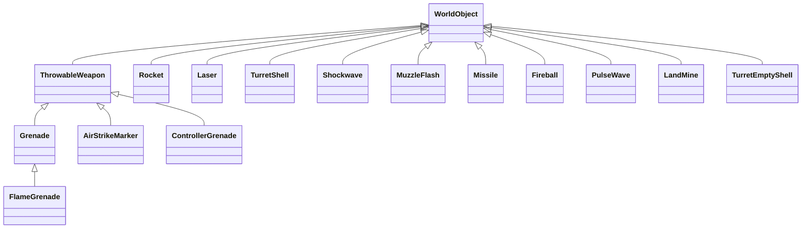
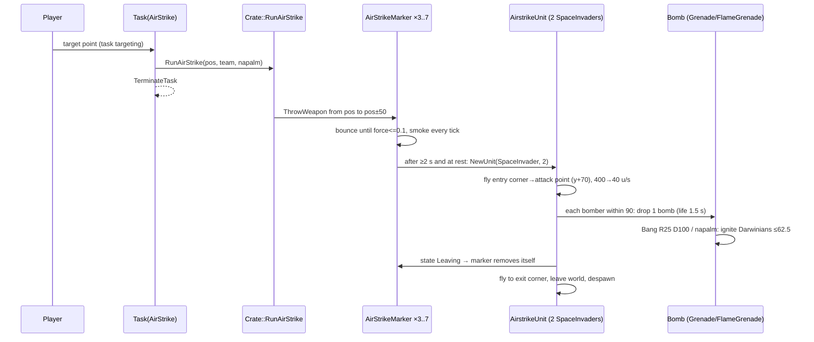
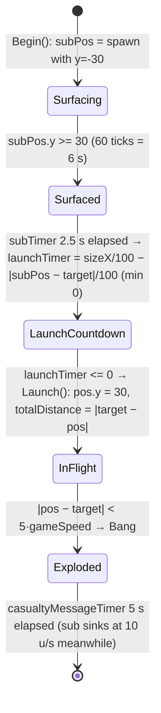
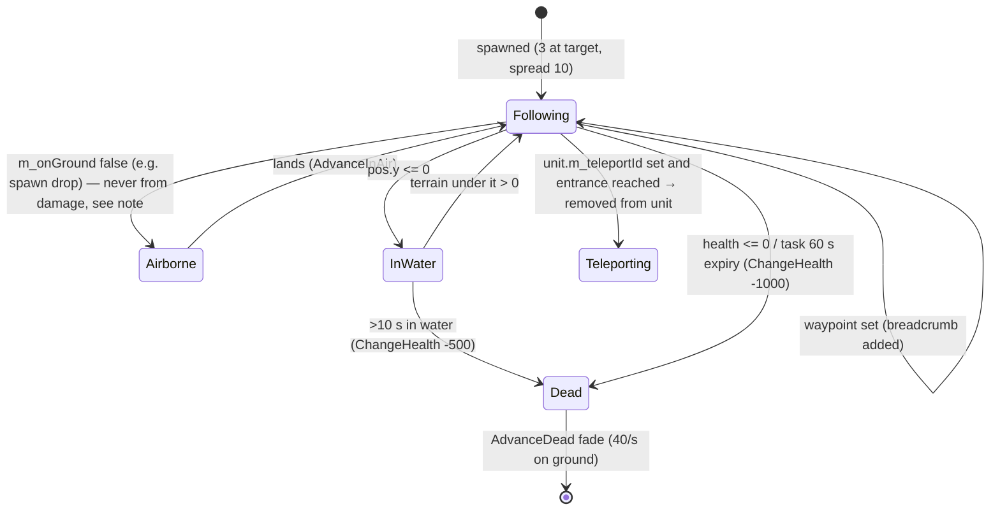
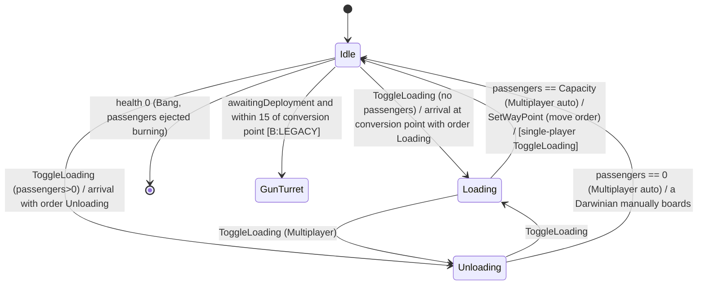
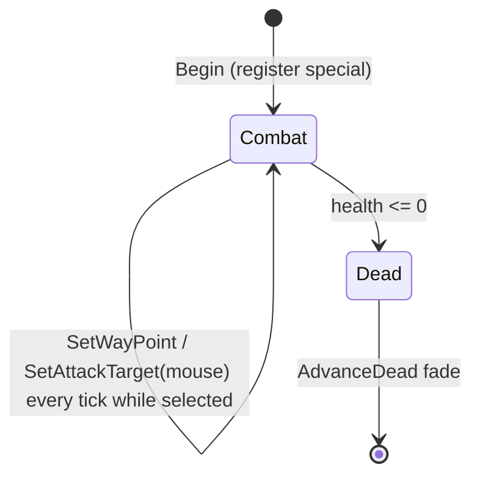

# P04_entities_military — Military units, weapons, crate-delivered units
Scope: `code/worldobject/{weapons,airstrike,nuke,armour,insertion_squad,lasertrooper,tank,harvester,shaman,engineer}.{h,cpp}`, `code/shaman_interface.{h,cpp}`; stats from `data/stats.txt`. Build baseline: see build_matrix.md (`Release|Win32` + `TARGET_PC_FULLGAME`, `BLOCK_OLD_DARWINIA_OBJECTS` on).

## [→ 02_units_and_entities] 0. Common conventions used in this partition

### 0.1 Simulation clock
- One simulation tick = `SERVER_ADVANCE_PERIOD` = `0.1 * m_gameSpeed` seconds of game time [C] `code/gametimer.cpp:GameTimer::GetServerAdvancePeriod`. At normal speed one tick = 0.1 s (10 Hz). All "per tick" values below are converted to per-second at game speed 1.0 unless stated.
- `GetNetworkTime()` = `g_gameTimer.GetGameTime()` (accumulated sim time) [C] `code/gametimer.h`.
- Several weapons subtract gravity as `m_vel.y -= 9.8 * GetGameSpeed()` **per tick**; because the tick length also scales by game speed this equals a constant **98 world-units/s²** of game time [I] (arithmetic: 9.8·s per tick × 10/s ticks per game second).

### 0.2 Random number sources (determinism)
| Function | Generator | Range actually produced | Net-safe? | Ref |
|---|---|---|---|---|
| `syncfrand(x)` | `_syncfrand` = `_syncrand()·x/2^32`, `_syncrand` is a Mersenne-Twister (MT19937, `mt[]`/`mti`, `MATRIX_A`) seeded by `syncrandseed` | `[0, x)` | yes | [C] `contrib/systemiv/lib/math/random_number.cpp:_syncfrand` |
| `syncsfrand(x)` | `(_syncfrand(1)-0.5)*x` | **`(-x/2, +x/2)`** (header comment says ±x — wrong) | yes | [C] `contrib/systemiv/lib/math/random_number.cpp:_syncsfrand` |
| `syncrand()` | synced integer | `[0, 2^32)` | yes | [C] same file |
| `FRAND(x)` / `SFRAND(x)` (upper-case, used inside `Vector3` constructors) | `_syncfrand` / `_syncsfrand` with guaranteed left-to-right order | `[0,x)` / `(-x/2,x/2)` | yes | [C] `code/lib/vector3.cpp:FromRand`, `code/lib/vector3.h` |
| `frand(x)` | `AppRandom()` (local MS-CRT style LCG, seeded `AppSeedRandom(1)` at `Location` init) | `[0, x]` | **no** — also consumed by renderer | [C] `contrib/systemiv/lib/math/random_number.cpp:frand`, `code/location.cpp:Location::Init` |
| `sfrand(x)` | `AppRandom()` | `(-x/2, x/2]` | **no** | [C] `random_number.cpp:sfrand` |
| `AppRandom()` | local LCG `holdrand*214013+2531011`, `>>16 & 0x7fff` | `[0, 32767]` | **no** | [C] `random_number.cpp:AppRandom` |

Every sim-side use of a non-synced generator in this partition is listed in §X3 (determinism notes).

### 0.3 Research levels in Multiwinia
Many weapon parameters are switch tables over `GlobalResearch::CurrentLevel(type)`. In Multiwinia (`App::Multiplayer()` ≡ `m_gameMode == GameModeMultiwinia`) `Location::Init` forces **all** research types to level **3**, then overrides: `TypeSquad=1`, `TypeLaser=2`, `TypeGrenade=2`, `TypeRocket=2`, `TypeAirStrike=2`, `TypeDarwinian=4` [C] `code/location.cpp:Location::Init` (block after `InitFuturewinianTeam`). The tables below therefore name the **Multiwinia value** explicitly; other levels are Darwinia [B:LEGACY].

| Research type | Multiwinia level | Used by (this partition) |
|---|---|---|
| Squad | 1 | squad size `2 + level` = **3** squaddies (`code/taskmanager.cpp:Task::TargetSquad`) |
| Laser | 2 | laser lifetime 0.6 s (`code/location.cpp:Location::FireLaser`) |
| Grenade | 2 | max throw force 110 (`ThrowableWeapon::GetMaxForce`) |
| Rocket | 2 | rocket max life 0.75 s; tank missile life 15 s |
| AirStrike | 2 | **2** bombers per airstrike marker (`AirStrikeMarker::Advance` passes the level as unit size) |
| Armour | 3 | turret-shell life table (overridden to 0.6 s in Multiplayer) |
| Controller | 3 | — (controller grenade not reachable in Multiwinia, see §1.5) |
| Darwinian | 4 | (Darwinian partition) |

### 0.4 Entity stats source
`data/stats.txt` is read **positionally** (row *n* → entity type *n*; the NAME column is stored but not used for lookup) into `EntityBlueprint::m_stats[type][HLTH,SPED,RATE]` as doubles [C] `code/worldobject/entity.cpp:EntityBlueprint::Initialise`. `EntityBlueprint::GetStat` multiplies SPEED by `(1 + m_difficultyLevel/10)` for every type except `SpaceInvader` [C] `entity.cpp:EntityBlueprint::GetStat`; `m_difficultyLevel` defaults to 0 (`code/app.cpp:App::App`) and is overwritten by a level's stored difficulty if the level file has one (`code/location.cpp:Location::Init`) [C]. Each entity copies the stats into `unsigned char m_stats[3]` in `Entity::SetType` [C] `code/worldobject/entity.h`, so **fractional values truncate** (e.g. InsertionSquadie RATE 0.5 → per-entity 0) and values are capped 0..255. `Entity::SetType` also sets `m_reloading = syncfrand(RATE)` [C].

| Row | Type | HLTH | SPED | RATE | Partition use |
|---|---|---|---|---|---|
| 1 | LaserTroop | 20 | 15 | 1 | §8 |
| 2 | Engineer | 255 | 28 | 0 | §10 |
| 4 | InsertionSquadie | 75 | 30 | 0.5 | §4 |
| 10 | SpaceInvader | 10 | 40 | 1 | §2 (airstrike bomber) |
| 15 | Armour | 200 | 60 | 5 | §5 |
| 19 | Shaman | 200 | 25 | 2 | §9 |
| 20 | Harvester | 255 | 28 | 0 | §7 |
| 21 | Nuke | 255 | 100 | 0 | §3 |
| 24 | Tank | 150 | 50 | 2 | §6 |
[C] `data/stats.txt`.

### 0.5 Base `Entity` behaviour relied on by every unit here
- `Entity::ChangeHealth(amount, type)` (base): ignores damage type; if `health+amount <= 0` → `m_stats[Health]=100`, `m_dead=true`, sound `Die`, and **spawns one spirit** at `m_pos` with `m_vel*0.5` (`Location::SpawnSpirit`); else clamps to 255. Plays `LoseHealth` on any negative amount. Always returns true [C] `code/worldobject/entity.cpp:Entity::ChangeHealth`.
- `Entity::AdvanceDead`: dead bodies fade: health −40/s on ground, −20/s in air; removed when ≤ 0 [C] `entity.cpp:Entity::AdvanceDead`.
- `Entity::AdvanceInWater`: after 10 s in water `ChangeHealth(-500)`; swims at forced speed 5 u/s, `y = -sin(t·3) − 4` [C] `entity.cpp:Entity::AdvanceInWater`.
- `Entity::AdvanceInAir`: gravity 15 u/s², lands when `y <= ground+0.1` [C] `entity.cpp:Entity::AdvanceInAir`.
- `Entity::Advance`: decrements `m_reloading`; computes `m_renderDamaged` with **non-synced** `frand(0.75)` (render-only flag) [C]; clamps position to world bounds `[0,sizeX]×[0,sizeZ]`.
- `Entity::Attack(pos)` (generic laser): if `m_reloading==0`: target jittered `syncsfrand(15)` in x,z (±7.5), fires from `m_pos+3y` a laser at speed **150**, `m_reloading = RATE`, sound `Attack` [C] `entity.cpp:Entity::Attack`.

### 0.6 Damage types
`Entity::DamageType{Unresistable=0, Laser, Explosive, TurretShell, Fire}` [C] `code/worldobject/entity.h`. Per-type resistance is implemented by overriding `ChangeHealth` in each class (tables in each unit section).

### 0.7 Shared explosion: `Location::Bang(pos, range R, damage D, teamId=-1, fromBuildingId=-1)`
Not in this partition but every explosive in it calls it; restated here because the falloff is non-obvious [C] `code/location.cpp:Location::Bang`:
1. Cosmetic particles: `numCores = R·D·0.01 (+frand)` `TypeExplosionCore` at `pos + up·0.3R`; `numDebris = clamp(R·D·0.01, 2, 30)` `TypeExplosionDebris` (non-synced `frand`, cosmetic).
2. Entities: all neighbours within **2R** (any team, including the attacker's own). `fraction = (2R − d) / R * 2` — **operator-precedence bug**: evaluates as `((2R−d)/R)·2`, clamped to [0,1]. Net effect: **full damage `D` for d ≤ 1.5R, linear falloff to 0 at d = 2R**. Damage dealt `ChangeHealth(−D·fraction, DamageTypeExplosive)`.
3. Knock-back (if `ChangeHealth` returned true, and type not InsertionSquadie/Officer/Shaman): `push = normalise(entity−pos)` with `push.y = D` if on ground else −1, normalised, ×fraction; added to `m_vel`, `m_onGround=false` (so knock-back magnitude ≤ 1 u/s — tiny; vertical dominated) [C].
4. Kill count: entities that transitioned to dead and whose team ≠ `teamId`; Multiwinia credits `darwinianKills` only to `teams[teamId].m_teamKills` (if teamId valid) [C].
5. Spawns a `Shockwave(teamId, size = R/20)` at pos (§1.8). Under `USE_DIRECT3D` also `g_deformEffect->AddPunch(pos, R)` [B:D3D].
6. Buildings: every building with centre distance < **3R** receives `Damage(−D·(1 − d/3R))` [C].
Returns `numKilled`.

## [→ 02_units_and_entities] [→ 04_crates_powerups_and_weapons] 1. Projectile & effect classes (`code/worldobject/weapons.{h,cpp}`)

All classes below derive from `WorldObject` and live in `Location::m_effects` (except `Laser`, pooled in `Location::m_lasers`). Their `WorldObject::m_type` is one of the `Effect*` values of `WorldObject` [C] `code/worldobject/worldobject.h`. They are advanced once per tick and removed when `Advance()` returns true.

### 1.0 Class inventory


| # | Class | `m_type` | Who creates it in Multiwinia | Build/reachability |
|---|---|---|---|---|
| 1 | `ThrowableWeapon` (abstract base) | set by subclass | — | [B:FULL] |
| 2 | `Grenade` | `EffectThrowableGrenade` (or `EffectThrowableAirstrikeBomb` when dropped by bombers) | InsertionSquad grenade (`InsertionSquad`), Darwinian grenade-throw (`code/worldobject/darwinian.cpp`), Mortar gun-turret (`code/worldobject/gunturret.cpp:GunTurret::Advance`, `explodeOnImpact=true`, life 1000), `Unit` AI grenade (`code/unit.cpp`), airstrike bomber (`SpaceInvader::Advance`) | [B:FULL] |
| 3 | `FlameGrenade` | `EffectFlameGrenade` | Napalm airstrike bombers only (`SpaceInvader::Advance` when `m_napalm`) | [B:FULL] |
| 4 | `AirStrikeMarker` | `EffectThrowableAirstrikeMarker` | `Crate::RunAirStrike` via `Location::ThrowWeapon` (3–7 per strike) | [B:FULL] |
| 5 | `ControllerGrenade` | `EffectThrowableControllerGrenade` | Only via `Location::ThrowWeapon(EffectThrowableControllerGrenade)`; InsertionSquad's controller weapon path (§4) | [B:LEGACY] (see §1.5) |
| 6 | `Rocket` | `EffectRocket` | InsertionSquad rocket, Darwinian rocket instead of grenade when `team->m_evolutions[Team::EvolutionRockets]==1` (rocket-Darwinians crate `Crate::RunRocketDarwinians`; `m_firework=true` when the Darwinian is infected) [C] `code/worldobject/darwinian.cpp` (threat-response block), Rocket gun-turret (life 1.0), Tank (§6) | [B:FULL] |
| 7 | `Laser` | (pooled, `m_type` unused) | `Entity::Attack` (generic, speed 150), Darwinian lasers, InsertionSquad lasers, Subversion turret / Subversion Darwinians (`m_mindControl=true`), Tripod, camera debug | [B:FULL] |
| 8 | `TurretShell` | `EffectGunTurretShell` | Standard gun-turret via `Location::FireTurretShell`; Armour turret (§5) | [B:FULL] |
| 9 | `Shockwave` | `EffectShockwave` | every `Location::Bang` (`Location::CreateShockwave`) | [B:FULL] |
| 10 | `MuzzleFlash` | `EffectMuzzleFlash` | `Location::ThrowWeapon`, `FireRocket`, `FireTurretShell`, `FireLaser`; also embedded (not registered) inside `Missile` | [B:FULL] (cosmetic) |
| 11 | `Missile` | not set → `TypeInvalid` (0) [C] `code/worldobject/worldobject.cpp:WorldObject::WorldObject` | Tank only (§6); the Armour missile code is commented out [C] `code/worldobject/armour.cpp` | [B:FULL] compiled; reachable only with Tank (§6) |
| 12 | `Fireball` | `EffectFireball` | Flame gun-turret via `Location::LaunchFireball` (life 1.0) | [B:FULL] |
| 13 | `PulseWave` | `EffectPulseWave` | `code/worldobject/pulsebomb.cpp` (Assault-mode pulse bomb) | [B:FULL] |
| 14 | `LandMine` | not set → `TypeInvalid` (0) [C] | Tank (§6) | [B:FULL] compiled, reachable only with Tank |
| 15 | `TurretEmptyShell` | `EffectTurretEmptyShell` | Gun-turret shell-casing ejection (`code/worldobject/gunturret.cpp`) | [B:FULL] (cosmetic, but uses sim tick) |

### 1.1 `ThrowableWeapon` (base)
- Construction (`ThrowableWeapon::ThrowableWeapon(type, startPos, front, force)`): shape `throwable.shp`; `m_pos=startPos`; `m_vel = front·force`; `m_force=1.0` (bounce energy, **not** the throw force); `m_birthTime = GetNetworkTime()`; orientation `m_up=front`, `m_front` built perpendicular [C].
- `Initialise()` → sound event `Create` [C].
- Sound routing `TriggerSoundEvent(event)`: Grenade / AirstrikeMarker / ControllerGrenade → `SoundSourceBlueprint::TypeGrenade`; AirstrikeBomb / FlameGrenade → `TypeAirstrikeBomb` [C] `weapons.cpp:ThrowableWeapon::TriggerSoundEvent`. Airstrike bombs/napalm bombs are created directly with `new` in `SpaceInvader::Advance` and never `Initialise()`d, so they play no `Create` event (the bomber plays `DropGrenade` instead) [C].
- `Advance()` per tick:
  1. Trail: unless type is AirstrikeMarker, with probability `syncfrand(1) > 0.1/gameSpeed` emit `Particle::TypeMissileTrail` (size 60) at `pos − vel·dt`, vel `vel/4 + syncsfrand(5)` per axis (synced RNG consumed for a cosmetic particle) [C].
  2. If `m_force > 0.1`: gravity (98 u/s², §0.1); `pos += vel·dt`; if `pos.y < ground+1`: `WorldObject::BounceOffLandscape()` (snaps `y` to ground — the "midpoint" it intends is computed from `lastPos = m_pos`, so it is the current position — reflects velocity about the terrain normal `v' = 2(n·(−v))n − (−v)` and multiplies by `COEF_OF_RESTITUTION = 0.85` [C] `code/worldobject/worldobject.cpp:WorldObject::BounceOffLandscape`), then `m_force *= 0.75`, `m_vel *= m_force`, clamp to ground+1, sound `Bounce` [C]. With `m_force ≤ 0.1` the object is at rest. Speed retained at bounce *k* (k=1,2,…) = `0.85 · 0.75^k` of the incoming speed (0.64, 0.48, 0.36, …); `m_force` drops below 0.1 after the 9th bounce (0.75^8 = 0.100, 0.75^9 = 0.075) [I] (arithmetic).
  3. Returns false (never self-destructs).
- `Render`: tumbling shape; once per second (from `numFlashes = int(now − birth)`) triggers sound `Flash` **from the render path** (client-side, cosmetic); draws a `textures/starburst.bmp` flash billboard in `m_colour` for the last 20 % of each second [C].
- `GetMaxForce(level)`: 0→50, 1→80, **2→110 (Multiwinia)**, 3→140, 4→170, other→0 [C].
- `GetApproxMaxRange(maxForce)` = `F + 0.75F + 0.5625F` = 2.3125·F (≈254 for F=110) [C]. (A heuristic used by AI/UI; real ballistic range differs [I].)
- `RemoveForce()` sets `m_force=0` (freezes in place); `ResetForce()` sets 1 [C]. Used by Harvester (§7).

Throw helper `Location::ThrowWeapon(pos, target, type, team, force=0, lifeTime=0, explodeOnImpact=false)` [C] `code/location.cpp:Location::ThrowWeapon`:
- `force = sqrt(|target−pos|)·8`, capped at `GetMaxForce(grenadeResearch)` (= 110 in Multiwinia; Darwinia team 1 single-player uses level 4); if `_force != 0` it overrides (no cap).
- `front = normalise(target−pos)`, then `front.y = 1`, renormalise → **45°-ish launch** (exactly 45° only when horizontal; generally `atan(1/|horiz|)` after normalisation) [C].
- Creates the weapon, registers in `m_effects` with id team = thrower; calls `Initialise`. For Grenade, `lifeTime≠0` overrides `m_life`.
- Spawns a `MuzzleFlash(pos, front, size 20, life 3)`.
- For ControllerGrenade, sets `m_squadTaskId` to the team's current task if it is a Squad task.

### 1.2 `Grenade`
| Field | Default | Ref |
|---|---|---|
| `m_life` (fuse) | 3.0 s | [C] `weapons.cpp:Grenade::Grenade` |
| `m_power` | 25.0 | [C] |
| `m_colour` (flash) | (255,100,100) | [C] |
| `m_explodeOnImpact` | false (Mortar turret: true) | [C] |
| `m_collected` | false; set by Harvester | [C] |

`Grenade::Advance`: if `m_collected` → return false (frozen, does nothing; Harvester owns it). Else `m_life -= dt`; explode when `m_life ≤ 0`, or if `m_explodeOnImpact` and `pos.y < ground + 2`. Explosion: sound `Explode`, `Location::Bang(pos, R = power/2, D = power·2, team = thrower)` → default grenade **R 12.5, D 50** (full damage ≤ 18.75, zero at 25; buildings < 37.5). Then removed. Otherwise runs `ThrowableWeapon::Advance` [C].

Airstrike bomb variant (created in `SpaceInvader::Advance`, §2): `m_type = EffectThrowableAirstrikeBomb`, `m_life = 1.5`, `m_power = 50` → **Bang R 25, D 100** (full ≤ 37.5, zero at 50, buildings < 75) [C].

### 1.3 `FlameGrenade` (napalm bomb)
Derived from `Grenade`; colour (255,100,100); `m_type=EffectFlameGrenade` [C]. Created only by napalm bombers with `m_life=1.5`, `m_power=50`. `FlameGrenade::Advance` (note: does **not** honour `m_collected` or `m_explodeOnImpact`) [C]:
- `m_life -= dt`; on `≤0`: sound `Explode`; **no Bang**; every `Darwinian` within `power·1.25 = 62.5` of **any team** (all `include[]` true) → `Darwinian::SetFire()`; 80 cosmetic particles (`TypeFireball` ×51, `TypeFire` ×20, `TypeMissileTrail` ×9; sizes 150–250, non-synced); every building of type `Tree` or `Triffid` with centre distance < `power·2 = 100` takes `Damage(power·−4 = −200)` (a `fraction` is computed but unused — no falloff) [C]. Removed.
- Otherwise `ThrowableWeapon::Advance`.

### 1.4 `AirStrikeMarker` — see §2 (airstrike delivery). Class facts: colour (255,100,100); `m_naplamBombers` (sic) false by default; `m_airstrikeUnit` id [C].

### 1.5 `ControllerGrenade`
- Colour (100,100,255); `m_squadTaskId=-1` [C].
- `Advance`: runs base throw physics; after **3.0 s** from birth: sound `ExplodeController` (TypeGrenade), particle shower `TypeControlFlash` (5–9 random up-flashes + a 50-particle ring of radius 50, non-synced RNG), then every `Darwinian` **of the thrower's team** within 50 → `Darwinian::TakeControl(m_squadTaskId)`; removed [C].
- Reachability: only created by `Location::ThrowWeapon(EffectThrowableControllerGrenade)`, whose only caller is `Squadie::FireSecondaryWeapon` when the squad's `m_weaponType == TypeController` [C]. No reachable Multiwinia path sets that weapon type (§4.5), and no crate gives a Controller → [B:LEGACY] [I].

### 1.6 `Rocket`
| Param | Value | Ref |
|---|---|---|
| Spawn | `pos = start + (0,2,0)`; `vel = normalise(target−pos)·50` | [C] `Rocket::Rocket` |
| Acceleration | each tick while `|vel| < 150`: `vel *= 1.2` (50→60→72→86.4→103.7→124.4→149.3→179.2; stops growing once ≥150, so cruise ≈ **179 u/s**) | [C] `Rocket::Advance` |
| Shape | `throwable.shp` | [C] |
| Max life (Multiwinia: Rocket research 2) | **0.75 s** (table 0→0.25, 1→0.5, 2→0.75, 3→1.0, 4→1.5); overridden by `m_lifeTime` if non-zero (`FireRocket` sets it when `_lifeTime != -1`, e.g. Rocket turret 1.0 s) | [C] |
| Firework curl (`m_firework`, set for infected Darwinians' rockets) | per tick add to vel.x/z: `sign(Δ)·min(Δ²,16)` where Δ = vel·dt component — rockets spiral outward | [C] |
| Explodes when | life expired; or `ground ≥ pos.y`; or any building in the obstruction cell `DoesSphereHit(pos, 3.0)` | [C] |
| Explosion | `Bang(pos, R=15, D=25, team, fromBuilding)` → full 25 dmg ≤ 22.5, 0 at 30; buildings < 45 | [C] `Rocket::Explode` |
| Firework extras | extra `TypeExplosionCore` particles in a random colour (non-synced `frand/sfrand`) | [C] |
| Kills credit | if fired by a GunTurret: `RegisterKill(255, numKills)` | [C] |
| Sounds | `Create` / `Explode` (TypeRocket); stops `Rocket Create` loop on explode | [C] |
| Trail | sim: `TypeFire` particle with prob. `syncfrand(1) > 0.2`; render: 5× `TypeMissileFire` per frame (non-synced) | [C] |

Effective rocket range in Multiwinia: the rocket lives 7–8 ticks (expiry test `now > spawnTime + 0.75`), covering (60+72+86.4+103.7+124.4+149.3+179.2)·0.1 ≈ **77.5 u**, or ≈ 95 u if an 8th tick runs, before timing out [I] (arithmetic; acceleration is applied before the move, so the first tick moves at 60).

### 1.7 `Laser`
- Pooled; `Initialise(lifeTime)`: `m_harmless=false`, `m_bounced=false`, sound `Create` (TypeLaser) [C].
- Lifetime (from `Location::FireLaser`): Laser research 2 → **0.6 s** (table 0→0.2, 1→0.4, 2→0.6, 3→0.8, 4→1.0); ×2 for mind-control lasers ("subversion lasers are half speed") [C] `code/location.cpp:Location::FireLaser`. Speed is the caller's velocity (generic `Entity::Attack`: 150 → range 90 u; squaddie 200 → 120 u; Subversion Darwinian `Darwinian::FireSubversion`: 75 with ×2 life → 90 u; subversion turret: shell vel/4).
- `FireLaser` also spawns `MuzzleFlash(pos, dir, size 25·lifetime, life 1.5)` [C].
- `Laser::Advance` per tick [C]:
  1. If `m_fromTeamId` is −1/255 → removed. `m_life -= dt`; ≤0 → removed.
  2. Move `pos += vel·dt`.
  3. **Terrain**: if `pos.y ≤ ground`: first time → ricochet: ray-cast from old position to terrain hit point, reflect velocity about terrain normal (`v' = 2(n·(−v))n − (−v)`), continue the remaining step length from the hit point, `m_bounced=true`. Second ground contact → removed.
  4. Out of world bounds → removed.
  5. **Buildings** (obstruction-grid cell): `DoesRayHit(pos, dir, step)` → particle `TypeRocketTrail`, sound `HitBuilding`, removed. (No building damage.)
  6. **Entities** (only while not `m_harmless`): enemies of `m_fromTeamId` within `2·|halfStep|` of pos; hit if (Multiwinia) `|entity.y − laser.y| < 5` **and** 2-D point-to-segment distance < 5 (segment = pos ± half step). (Single-player skips the vertical test.) On first hit:
     - Mind-control laser vs Darwinian: spawn a new Darwinian of `m_fromTeamId` at the victim's pos/vel, mark victim `m_destroyed` (vanishes without spirit), new Darwinian `m_previousTeamId = old team`, `m_colourTimer = 4.0` (colour-fade effect) [C].
     - Otherwise damage `20 + syncfrand(20)` (int-truncated → 20..39) via `ChangeHealth(−dmg, DamageTypeLaser)`; if the hit killed it: `teams[from].m_teamKills++` **only for Darwinians** (Multiwinia), sound `KilledEntity`; if survived and Darwinian: sound `InjuredEntity`. If `ChangeHealth` returned true: push vector = laser direction length `syncfrand(10)`, `y = 7 + syncfrand(5)`; sets `m_front` (except InsertionSquadie/Virii/Shaman) and adds to `m_vel` (except Virii/Shaman).
     - Laser becomes `m_harmless` (keeps flying, renders, but cannot hit again).
- Render: team-coloured 10-unit billboard quad (white for the monster team); mind-control lasers use `textures/subversion.bmp` at double width; camera shake 0.5 if within √200 ≈ 14 u of camera [C].

### 1.8 `Shockwave`
Created by every `Bang` with `size = R/20` and `m_life = size` seconds [C] `Shockwave::Shockwave`, `code/location.cpp:Location::CreateShockwave`.
- Per tick while `m_life > 0` (then removed): ring radius `r = 35 + 40·(size − life)` (starts at 35, expands 40 u/s); every entity (any team) whose centre distance satisfies `|d − r| < 10` is hit: `fraction = life/size` (1→0). Darwinians: with probability `syncfrand(4) < 0.1` (**2.5 %** per tick) `SetFire()` instead of damage; otherwise (and for all non-Darwinians) `ChangeHealth(−40·fraction, Explosive)`. Kill credit: if the victim died and its team ≠ the shockwave's id-team: Darwinian victims (team valid) add `m_teamKills` to `m_teamId`; GunTurret source registers the kill. Knock-back if on ground (not InsertionSquadie/Officer/Shaman): `push = normalise(victim−centre)`, `y=3`, length `25·fraction`, `m_onGround=false` [C] `Shockwave::Advance`.
- Because the ring band is 20 u wide and expands 40 u/s, a stationary entity is inside the band for ≈0.5 s = **≈5 ticks** and is hit each tick [I] (arithmetic). Shockwave damage therefore extends lethal range well beyond `2R` for big bangs (Nuke: rings out to 35+40·2.5 = 135).
- Size by source: grenade R12.5 → 0.625 s (r 35→60); bomb R25 → 1.25 s (35→85); rocket R15 → 0.75 s; missile R20 → 1.0 s; nuke R50 → 2.5 s (35→135); land-mine R20 → 1.0 s.
- Render: yellow→pink triangle-fan disc at y+5 with alpha `0.6·life/size`; full-screen white flash for the first 0.1 s if on-screen, alpha `(1 − age/0.1)·max(0, 1 − dist/500)` plus camera shake; `starburst.bmp` and `glow.bmp` billboards for the first 1 s [C].

### 1.9 `MuzzleFlash`
Cosmetic. `Advance`: removed when `life ≤ 0`; moves `front·10·dt` per tick; `life -= 10·dt` (so `life` is in tenths of a second: life 3 → 0.3 s) [C]. Render: 5 nested quads of `textures/muzzleflash.bmp`, alpha `clamp(life·0.75, 0, 1)`, depth test disabled if `size < 50` [C].

### 1.10 `Missile`
- Shape `missile.shp`, requires marker `MarkerBooster` (fatal assert if missing) [C].
- `m_life = 5 + rocketResearch·5` → **15 s** in Multiwinia [C] `Missile::Missile`.
- `Advance`: `life -= dt`, expired → explode. If the firing Tank (`m_tankId`) still exists, `m_target = Tank::GetMissileTarget()` (re-targeted every tick — player-guided). `AdvanceToTargetPosition(target)`: turn rate blend `front·(1−0.2) + targetDir·0.2` per tick (amountToTurn = 2·dt); terrain look-ahead 100 u along targetDir — if that point is below ground and the target is > 100 away, steer straight **up**; speed **200 u/s**; if the next position is below ground → returns true (explode); arrival when within **20** of target → explode [C].
- Trail: 2 `TypeMissileTrail` particles per tick at the booster marker (synced RNG for size `50+syncfrand(150)`).
- `Explode`: `Bang(pos, R=20, D=100)` with **teamId −1** (no kill credit; damages everyone) → full 100 ≤ 30, 0 at 40; buildings < 60 [C].
- Render: shape, embedded `MuzzleFlash` booster flame (size 30–50, non-synced), 5× `TypeMissileFire` per frame [C].

### 1.11 `TurretShell`
- `TurretShell(life)`; `Location::FireTurretShell` sets life by armour research (0/1→0.5, 2→1.0, 3→1.5, 4→2.0) but **Multiplayer forces 0.6 s**; in single-player the shell's id team is forced to 255 [C] `code/location.cpp:Location::FireTurretShell`. Muzzle flash size 60, life 2.
- Per tick: move `pos += vel·dt`; life ≤0 → `ExplodeShape(0.2)` (shape-fragment explosion of `turretshell.shp` via `g_explosionManager`) and removed; leaves world → removed.
- **Entity hits**: enemies of the shell's team within `|step|` of the step midpoint; precise test `entity->RayHit(oldPos, dir)`; damage **15** (`DamageTypeTurretShell`). If it killed: sound `KilledEntity`; kill count 1 (+ Armour passengers if the victim is Armour; 0 if the victim Darwinian was already on fire); add to team kills; GunTurret source `RegisterKill`. If on ground: push = away + `SFRAND(3)` jitter per axis, length 20, airborne. **Shell continues** (pierces) [C].
- **Buildings**: `DoesRayHit(oldPos, dir, step)` → 3 `TypeMissileTrail` sparks; if building is `Tree`, `AntHill` or `Triffid` → `Damage(−2)`; `ExplodeShape(0.1)`; removed [C].
- **Terrain**: end or mid-point below ground → ray-hit, `TypeRocketTrail` dust, `ExplodeShape(0.2)`, removed [C].
- Render: lit shape + white tracer line (length `vel·0.05`, alpha 0.5; doubled length and alpha 1.0 if the local player is currently controlling the firing turret) [C].

### 1.12 `Fireball` (flame turret)
- Defaults `life 1.0`, `radius 3.0`; `LaunchFireball` sets pos/vel/life and id team **−1** [C].
- First tick: 80 `TypeFireball` particles (non-synced).
- Per tick: `life -= dt`; `pos += vel·dt`; `radius = 20·min(1, |1 − life|)` (grows from 0 to 20 as life goes 1→0); every **Darwinian** within radius not already in `m_damaged`: `damage = 30·(radius / max(1,d))·max(1, life)` → `Darwinian::FireDamage(damage, team −1)`; remember id; if it newly entered `StateOnFire` and source is a GunTurret, `RegisterKill`. Buildings in the obstruction cell of type `Tree` → `Damage(−100)` per tick. Removed when `life ≤ 0` or it touches the ground [C].
- Only Darwinians are affected (other entity types ignored) [C].

### 1.13 `PulseWave` (Assault pulse bomb)
- Singleton pointer `PulseWave::s_pulseWave` (set on construct, cleared on destruct) [C].
- `Advance`: `radius += radius·0.03` per tick (3 % geometric growth; starts at 0 unless the creator sets it — `code/worldobject/pulsebomb.cpp`, P-other) ; removed when `radius ≥ worldSizeX` [C]. **No damage in this class** — the kill logic belongs to the pulse-bomb building [I] (not in this partition).
- Render: full-screen white flash for the first 0.3 s + camera shake; three team-coloured animated quad-strip cylinders (ground outline 200 high; `laser-long.bmp` glow tube 400 high; faint sky tube 1000 high) with alpha `×(1 − r/worldSizeX)` [C].

### 1.14 `LandMine`
- Shape `flying_egg.shp` [C].
- `Advance`: if `GetNumEnemies(pos, 15, team) > 0` → `Bang(pos, R=20, D=20, team)` + shape explosion; removed [C]. No arming delay, no lifetime.
- Render: shape only (team-coloured beacon commented out) [C].

### 1.15 `TurretEmptyShell` (shell casing)
- Shape `emptyshell.shp`; `m_force=1` [C].
- `Advance`: while `m_force > 0.2`: gravity 98 u/s²; spin around `front + (frac(id·0.1), frac(id·0.3), frac(id·0.7))`; bounce: `m_force *= 0.5`, `vel *= m_force`; once `m_force ≤ 0.2` removed (≈3 bounces) [C]. Cosmetic but uses only deterministic inputs.

### 1.16 Weapon summary table (Multiwinia values)
| Weapon | Damage | Radius / falloff | Speed | Life | Damage type | Friendly fire |
|---|---|---|---|---|---|---|
| Laser (generic) | 20–39 (`20+syncfrand(20)`) single target | hit radius 5 (2-D), vertical ±5 | caller (150 generic) | 0.6 s | Laser | No (enemies only) |
| Mind-control laser | converts 1 Darwinian | as laser | caller | 1.2 s | — | No |
| Grenade (squad/Darwinian) | 50 | full ≤18.75, 0 at 25; shockwave ring 35→60 ×40·f | throw ≤110 | 3 s fuse | Explosive | **Yes** (Bang hits all) |
| Airstrike bomb | 100 | full ≤37.5, 0 at 50; ring 35→85 | bomber velocity | 1.5 s | Explosive | Yes |
| Napalm bomb | ignite | all Darwinians ≤62.5 set on fire; trees ≤100 −200 | bomber velocity | 1.5 s | Fire (via Darwinian) | Yes |
| Rocket | 25 | full ≤22.5, 0 at 30 | 50→179 | 0.75 s (turret 1.0) | Explosive | Yes |
| Tank missile | 100 | full ≤30, 0 at 40 | 200 | 15 s | Explosive | Yes (team −1) |
| Turret shell | 15 per entity, pierces | ray | caller | 0.6 s | TurretShell | No |
| Fireball | `30·r/d·max(1,life)` once per Darwinian | grows 0→20 | caller | 1.0 s | Fire | Yes (team −1) |
| Land mine | 20 | full ≤30, 0 at 40; trigger 15 | static | ∞ | Explosive | Yes |
| Shockwave | 40·(life/size) per tick in ring | ring width 20, expands 40 u/s from 35 | — | R/20 s | Explosive | Yes |

## [→ 02_units_and_entities] [→ 04_crates_powerups_and_weapons] 2. Airstrike and Napalm Strike (`code/worldobject/airstrike.{h,cpp}`, `AirStrikeMarker` in `weapons.cpp`)

Classes: `AirstrikeUnit : Unit` (the bomber flight), `SpaceInvader : Entity` (one bomber, entity type `TypeSpaceInvader`), `AirStrikeMarker : ThrowableWeapon` (the smoke marker), bombs = `Grenade` (`EffectThrowableAirstrikeBomb`) or `FlameGrenade` (napalm). Build: [B:FULL]. Note `Entity::TypeSpaceInvader` is in `Entity::EntityIsBlocked` [C] `code/worldobject/entity.cpp:Entity::EntityIsBlocked`, which only prevents placing it via a level file's `InstantUnits` (`code/level_file.cpp:LevelFile::ParseInstantUnits`); runtime creation is unaffected [C].

### 2.1 How it is obtained
| Trigger | Path | Napalm? | Team that owns the bombers | Ref |
|---|---|---|---|---|
| Crate reward *Airstrike* (captured) | `team->m_taskManager->RunTask(TypeAirStrike)` → player targets a point → `Task::TargetAirStrike` → `Crate::RunAirStrike(pos, team, m_option==1)`; task is terminated immediately after launching | no | capturing team | [C] `code/worldobject/crate.cpp:Crate::CaptureCrate`, `code/taskmanager.cpp:Task::TargetAirStrike` |
| Crate reward *Napalm Strike* (captured) | as above but task `m_option = 1` | **yes** | capturing team | [C] `crate.cpp:Crate::CaptureCrate` (`CrateRewardNapalmStrike`) |
| Uncaptured (bad) crate *Airstrike* / *NapalmStrike* | `Crate::RunAirStrike(crate pos, monsterTeam[, true])` — fires immediately at the crate's own position | per reward | monster team (hostile to all) | [C] `crate.cpp:Crate::RunUncapturedCrate` |
The crate outcome table and probabilities belong to P08; this section specifies the effect.

### 2.2 Launch: `Crate::RunAirStrike(pos, team, special)`
1. `numMarkers = 3 + syncrand() % 5` → **3..7** markers (10 in the Multiwinia tutorial `g_app->m_multiwiniaTutorial`) [C].
2. For each marker: `target = pos + (SFRAND(100), 0, SFRAND(100))` → uniform offset **±50** in x and z; `y = ground`. `Location::ThrowWeapon(pos, target, EffectThrowableAirstrikeMarker, team)` — thrown **from the target point itself** outward with `force = 8·sqrt(dist) ≤ 8·√70.7 ≈ 67` [C]; `marker->m_naplamBombers = special` [C].
3. Message: `crate_message_run_airstrike` / `crate_message_run_napalm` (`%T` → team name) or `crate_message_auto_airstrike` / `crate_message_auto_napalm` if the monster team; `Location::SetCurrentMessage(msg, team)`; fixed map marker icon `icons/icon_airstrike.bmp` at `pos`; crate sound event `"Airstrike"` (`SoundSourceBlueprint::TypeCratePowerup`) [C].
4. Returns the id of the **last** marker (the airstrike `Task` stores it but is already terminated) [C].

### 2.3 `AirStrikeMarker::Advance` (per tick)
- Runs `ThrowableWeapon::Advance` (no missile trail for markers), and **every tick** emits a `Particle::TypeFire` smoke particle (size 100, vel `vel/4 + syncsfrand(5)`) "for the bombers to see" [C].
- Summon condition: `now > birthTime + 2.0` **and** `m_force ≤ 0.1` (marker has come to rest) [C].
  - First time: `team->NewUnit(TypeSpaceInvader, numEntities = CurrentLevel(TypeAirStrike), …, m_pos)` → an `AirstrikeUnit` with **2 bombers** in Multiwinia (level 2); `unit->m_effectId = marker index`; `unit->m_napalm = m_naplamBombers`; remember unit id [C].
  - Subsequently: if the unit no longer exists, or its state is `StateLeaving`, the marker removes itself [C].
- So each marker summons exactly one flight of 2 bombers → a strike = **6..14 bombers, 6..14 bombs** [I] (arithmetic from 3..7 × 2).

### 2.4 `AirstrikeUnit` flight path
Construction: `m_attackPosition = marker pos` with `y = ground + 70`; `m_speed = SpaceInvader SPED·10 = 400` [C] `AirstrikeUnit::AirstrikeUnit`.

`Begin()`: four candidate corners at height **500**, inset **100** from the map edges: (100,500,100), (100,500,Z−100), (X−100,500,Z−100), (X−100,500,100). **Exit** = corner nearest the attack position; **entry** = second-nearest corner. Waypoint starts at entry, `m_front = normalise(mapCentre − entry)` (centre at y=0, so it points down-inward). Spawns `numInvaders` `SpaceInvader`s at the entry with `front` [C].

`Advance()` each tick: if the marker effect index is still valid, re-read the marker position (marker can still be moving/bouncing) → `m_attackPosition = marker + 70` above ground. Then:

```mermaid
stateDiagram-v2
  [*] --> Approaching : Begin() at entry corner
  Approaching --> Leaving : waypoint within 10 of attackPosition
  Leaving --> [*] : Unit::Advance returns true when no SpaceInvader remains (all left the world or were shot down)
```
`AdvanceToTargetPosition(target)` [C]:
- `targetFront = normalise(target − waypoint)`; `front = normalise(front·(1−a) + targetFront·a)` with `a = dt = 0.1` (10 % blend per tick).
- `desiredSpeed = 40` (SPED); ×10 = **400** if (Approaching and distance from waypoint to attackPosition > 600) or (Leaving and that distance > 100). `m_speed = m_speed·(1−a) + desiredSpeed·a`.
- `waypoint += front·m_speed·dt`; returns true when within 10 of `target`.
- In `StateLeaving` the "arrived" result is ignored; the flight keeps steering to the exit corner. Because the turn blend is only 10 %/tick at ~400 u/s, the flight overshoots the corner, which is only 100 from the map edge, and crosses the world boundary where every bomber deletes itself (no explicit despawn exists) [I]. A re-implementation (`_work/scripts/P04_airstrike_sim.py`, flat terrain, maps 1500–3000 wide) gives: waypoint within 90 of the attack point ≈ 5.3–6.9 s after the flight spawns, flying at ≈ 44 u/s (decelerated), and leaving the world ≈ 13.5–15.4 s after spawning [I]. Dropped bombs inherit ≈ 44 u/s forward velocity from ≈ 70 above ground and fall ≈ 1.2 s (98 u/s²) before bouncing, so they land ≈ 50 u past the release point, i.e. close to the marker [I].

### 2.5 `SpaceInvader` (bomber) — stats and behaviour
| Stat | Value | Ref |
|---|---|---|
| Health | 10 | `data/stats.txt` row SpaceInvader |
| Speed | 40 (×10 cruise = 400); **not** scaled by difficulty | [C] `entity.cpp:EntityBlueprint::GetStat` |
| Rate | 1 (unused) | |
| Shape | `spaceinvader.shp`, rendered ×2 scale; carried bomb `throwable.shp` 12 below while armed | [C] |
| Bombs | 1 per bomber (`m_armed` true→false); `m_napalmDrops = 30` is **unused** | [C] |

`SpaceInvader::Advance(unit)` [C]:
1. If `m_dead` → removed.
2. Position = unit waypoint + `Unit::GetFormationOffset(FormationAirstrike, formationIndex)`: rows of 4: `x = (i%4 − 2)·24`, `y = −(⌊i/4⌋ − 2)·12`, `z = (⌊i/4⌋ − 2)·24`, each plus a per-index synced noise `s_offsets[i%100] ∈ [0,1)` (spacedOut 4) [C] `code/unit.cpp:Unit::GetFormationOffset`. Velocity derived from displacement. `m_front = unit front`.
3. Bomb release: if armed and 3-D distance to `m_attackPosition` < **90**: create bomb at `pos − 12·up` with velocity `front·|vel|`, `m_life = 1.5`, `m_power = 50`; standard → `Grenade` with `m_type = EffectThrowableAirstrikeBomb` (Bang R25 D100, §1.2); napalm → `FlameGrenade` (§1.3). Registered in `m_effects` owned by the bomber's team. Sound `DropGrenade`. `m_armed = false`.
4. Leaves the world bounds → removed.

Damage model `SpaceInvader::ChangeHealth`: **only `DamageTypeTurretShell` hurts** (lasers, explosions, fire ignored → returns false). Health 10 so one turret shell (15) kills; on death no spirit is spawned, sound `Die`; while alive each hit spawns a `TypeMuzzleFlash` particle; a shape-fragment explosion is shown when a 50-health band is crossed or on death, `fractionDead` computed against **Engineer** max health (255) — copy-paste bug, purely visual [C].

Sounds: `ListSoundEvents` adds `DropGrenade` to the Entity list (`Create`, `LoseHealth`, `Die`, …) [C]. Team colouring: none in code (shape colours) [I].

### 2.6 Timeline (typical)


## [→ 02_units_and_entities] [→ 04_crates_powerups_and_weapons] 3. Nuke (`code/worldobject/nuke.{h,cpp}`)

`Nuke : Entity` (type `TypeNuke`). Build: [B:FULL], created only by `Crate::RunNuke`, which is compiled only under `INCLUDE_CRATES_ADVANCED` (defined in FULLGAME) [C] `code/worldobject/crate.cpp:Crate::RunNuke`. `TypeNuke` is in `EntityIsBlocked` (level-file placement only) [C].

### 3.1 How it is obtained
Captured crate reward *Nuke* → `RunTask(TypeNuke)` → player targets a point → `Task::TargetNuke(pos)` → `Crate::RunNuke(pos, team)` and the task is terminated [C] `code/taskmanager.cpp:Task::TargetNuke`. (The uncaptured-crate Nuke is commented out [C] `crate.cpp:Crate::RunUncapturedCrate`.)

### 3.2 Launch: `Crate::RunNuke(pos, team)` [C]
1. Spawns **10** Nuke entities. For each: choose a random **sea** location: `(FRAND(sizeX−100), 0, FRAND(sizeZ−100))`, re-rolled while terrain height > 0 (loops forever on a map with no water [I]).
2. Target: nuke 0 → exactly `pos` and `m_renderMarker = true` (draws the ground marker); nukes 1..9 → `pos + (syncsfrand(300), 0, syncsfrand(300))` = **±150** scatter. `target.y = ground − 5`.
3. Message `crate_message_run_nuke` (`%T` team name) or `crate_message_auto_nuke` (monster team); fixed map marker `icons/icon_nuke.bmp` at `pos`.

### 3.3 Stats
| Stat | Value | Ref |
|---|---|---|
| Health | 255 (no `ChangeHealth` override — can in principle be damaged; see note) | `data/stats.txt` Nuke |
| Speed | 100 (×(1+difficulty/10)) → flight speed 50..100 | [C] |
| `m_radius` | 5 | [C] `Nuke::Begin` |
| Sub rise/sink | 1 u per tick = **10 u/s**, from y −30 to +30 | [C] `Nuke::AdvanceSub` |
| Sub surfaced wait | `m_subTimer = 2.5 s` | [C] |
| Explosion | `Bang(groundPos, R=50, D=100)` teamId −1 | [C] `Nuke::AdvanceToTarget` |
| Post-explosion linger | `m_casualtyMessageTimer = 5 s` | [C] |
| History trail sample | every 0.5 s | [C] |

### 3.4 State machine

- The launch countdown `sizeX/100 − distance/100` (seconds) makes farther nukes launch sooner (intent: simultaneous arrival). Because the lofted flight averages only ≈ 47 u/s (simulation below), arrival is **not** simultaneous: total time after surfacing ≈ `2.5 + (sizeX − D)/100 + D/47` s, so nearer subs still hit first (e.g. sizeX 2000: D=500 → ≈ 28 s, D=1000 → ≈ 34 s, D=1500 → ≈ 39 s) [I] (re-implementation `_work/scripts/P04_nuke_sim.py`, flat terrain).
- Flight `Nuke::AdvanceToTarget` per tick [C]:
  - `f = 1 − remaining/totalDistance` (0 at launch → 1 at target).
  - `heightFactor = |subPos − target| / 3`; `fractionNorth = max(2, 5·pos.y / heightFactor)`.
  - `front = normalise(target − pos)`, rotated about `r = normalise(normalise(target − subPos) × up)` by `π/fractionNorth`, then by `−f·π/fractionNorth` → net pitch-**up** offset `(1−f)·π/fractionNorth` (≤ 90° since fractionNorth ≥ 2) that decays to 0 at the target — a lofted arc. Sign verified from `Vector3::FastRotateAround` (Rodrigues `a + c·n1 + s·(n×n1)`) and the right-handed `operator^` [C] `code/lib/vector3.cpp`, `code/lib/vector3.h`. Launch from y=30 with fractionNorth = 2 means the warhead initially climbs vertically; simulated apex ≈ 0.31·D and flight time ≈ D/47 s (D=300: 6.0 s/apex 94; 1000: 21.1 s/310; 2000: 42.6 s/620) [I] (`_work/scripts/P04_nuke_sim.py`).
  - Speed `= SPD/2 + SPD/2·f²` (50 → 100 u/s); `pos += vel·dt`.
  - `m_armed = true` once `pos.y > 150` (flag is never read) [C].
  - Arrival within `5·gameSpeed` → explode at `(pos.x, ground(target), pos.z)`.
- Explosion effects: `Bang(R 50, D 100)` → **full 100 damage to every entity of every team within 75, linear to 0 at 100**; buildings within 150 take `100·(1 − d/150)`; plus `Shockwave(size 2.5)` ring expanding 35→135 over 2.5 s doing `40·(life/2.5)` per tick in a 20-wide band (2.5 % per tick chance to ignite a Darwinian instead) (§0.7, §1.8). `m_numDeaths` (all teams' entity deaths, since teamId −1) is added to the **launching team's** `m_teamKills` [C]. Sound `Explode`.
- Co-op achievement: if `m_coopMode` and the nuke belongs to the local player and a **friendly** SpawnPoint is within 120 of the target → `App::DarwiniaAchievementWrongGame` + message `dialog_wronggame` [C].
- Note: `Nuke::Advance` never checks `m_dead`; base `Entity::ChangeHealth` could mark it dead (spawning a spirit) if lasers/explosions reach it at sea level, but it would keep flying [I] (no override; low practical relevance).

### 3.5 Visuals and sounds
- Submarine: two camera-facing 100-unit billboards `sprites/subshadow.bmp` (subtractive) and `sprites/sub.bmp` in team colour, alpha `max(subPos.y,0)/30` [C] `Nuke::RenderSub`.
- Warhead: additive billboard `sprites/nuke.bmp`, size 10·(1 + 0.03·((index·uniqueId) % 10)), team colour (monster team: white, subtractive) [C].
- Trail: history samples rendered as triple-stacked `textures/laser.bmp` ribbons of width 10, fading alpha [C] `Nuke::RenderHistory`.
- Ground marker (nuke 0 only): `icons/nukesymbol.bmp` red (200,20,20) pulsing size `40 + 25·sin(realTime)` on the terrain plus a generated blurred `shadow_icons/nukesymbol.bmp` (`BitmapRGBA::ApplyBlurFilter(10)`) [C] `Nuke::RenderGroundMarker`.
- `Nuke::RenderDeaths` ("Darwinia Hit, %d Dead" text) exists but the call is commented out [C] → appendix.
- Sounds: Entity events + `Explode` [C] `Nuke::ListSoundEvents`.

## [→ 02_units_and_entities] [→ 04_crates_powerups_and_weapons] 4. Insertion Squad (`code/worldobject/insertion_squad.{h,cpp}`)

Classes: `InsertionSquad : Unit` (the squad), `Squadie : Entity` (type `TypeInsertionSquadie`), `HistoricWayPoint` (breadcrumb record: `m_pos`, monotonically increasing `m_id` from static `s_lastId`). Build: [B:FULL].

### 4.1 How it is obtained
- Captured crate reward *Squad* → `RunTask(TypeSquad)` → player targets ground → `Task::TargetSquad(pos)`: `numEntities = 2 + CurrentLevel(TypeSquad)` = **3** squaddies; `Team::NewUnit(TypeInsertionSquadie, 3, …, pos)` creates an `InsertionSquad`, `Location::SpawnEntities(pos, team, unit, TypeInsertionSquadie, 3, zero, spread 10)`; the unit is selected; optional camera entity-tracking (pref `OTHER_AUTOMATICCAM` = 2, or gamepad); crate sound `"Squad"` [C] `code/taskmanager.cpp:Task::TargetSquad`.
- Level `InstantUnits` with `runAsTask` (`TypeInsertionSquadie` → `TypeSquad`) [C] `code/location.cpp`.
- **Lifetime**: `Task::Start` sets `m_lifeTimer = 60 s`; in Multiplayer `Task::Advance` counts it down and calls `Task::Stop()`, which applies `ChangeHealth(-1000)` to every squaddie → squad dies after **60 s** [C]. The task also ends when the unit has no live entities.

### 4.2 Stats & constants
| Item | Value | Kind / Ref |
|---|---|---|
| Health | 75 | `data/stats.txt` InsertionSquadie |
| Speed | 30 u/s (×(1+difficulty/10)) × slope factor | stats.txt; [C] `Squadie::Advance` |
| RATE | 0.5 s (blueprint double) — per-entity `m_stats[RATE]` truncates to **0** | stats.txt; [C] `entity.h` (`unsigned char m_stats`) |
| Squad size | 3 (Multiwinia) | [C] `Task::TargetSquad` |
| Spacing | `GAP_BETWEEN_MEN = 10.0` along the breadcrumb path | `#define` [C] `insertion_squad.h` |
| Laser speed / life / range | 200 u/s / 0.6 s / **120 u** | [C] `Squadie::Attack`, `Location::FireLaser` |
| Laser aim jitter | `syncsfrand(7)` in x,z (±3.5) | [C] |
| Laser damage | 20–39 (§1.7) | |
| Auto-target search | `EntityGrid::GetBestEnemy(pos, 0, 100, team)`, re-evaluated every 1.0 s | [C] `Squadie::RunAI` |
| Max turn rate | 20 rad/s (`angVel = (front × desired)·4`, y-axis only) | [C] |
| Secondary cooldown per squaddie | Grenade 4.0 s, Rocket 4.0 s, AirStrike marker 20.0 s, Controller 4.0 s | [C] `Squadie::FireSecondaryWeapon` |
| Shape | `squad.shp`, markers `MarkerLaser` (muzzle), `MarkerBrass` (ejection) — fatal assert if missing | [C] `Squadie::Squadie` |

### 4.3 Squad movement & formation
- `InsertionSquad::SetWayPoint(pos)`: `m_wayPoint = m_focusPos = pos`; pushes a `HistoricWayPoint` at the **point man's current position** (or `pos` if no point man) to the front of `m_positionHistory` (never pruned) [C]. If the squad runs a Controller task, appends the new breadcrumb to the controller's route when > 20 from its last waypoint [B:LEGACY]. If `pos` is within 5 of a connected `RadarDish` or `Bridge` (Teleport), `m_teleportId` is set and the waypoint becomes the teleport entrance [C].
- `GetTargetPos(d)`: d ≤ 0 or teleporting → waypoint; else walk back from the point man along `pointMan → history[0] → history[1] → …` and return the point at path-distance d (the end of history if shorter) [C]. Squaddie *i* (formation index *i*) targets `GetTargetPos(10·i)` → **single-file "snake" following the leader's footsteps**; the point man (index 0) heads straight to the waypoint.
- `Squadie::Advance` (alive, on ground, not in water) [C]:
  - velocity toward target at SPEED; **slope factor** `f = 1 − (h_next − h_now)/3`, clamped [0.2, 2.0]; if terrain normal `y < 0.6` and going uphill (f < 1) → f = 0 (cannot climb steep slopes). Arrival snap if the remaining distance < one step. `PushFromObstructions`; y = ground + 0.1.
  - Facing: if this squad is the team's **currently selected unit**, face the team's mouse position (`team->m_currentMousePos`); otherwise face velocity, run `Squadie::RunAI`, and face the current enemy if any. Teleporting: face the target directly.
  - If `y ≤ 0` (water): `m_inWater = syncfrand(3)` (the 10 s drowning clock starts 0–3 s advanced) [C].
  - Airborne (knocked up) → `Entity::AdvanceInAir`. Position clamped to the world. If teleporting and `Entity::EnterTeleports(m_teleportId)` succeeds → squaddie removed from this unit (re-created at the other end by the teleport, which copies `m_weaponType`) [C] `code/worldobject/teleport.cpp`.
  - On death the unit `RecalculateOffsets()`.
- Player-controlled squad ignores `Unit` formation offsets; formation = breadcrumb snake [C].

### 4.4 Squaddie state machine

Note: `Squadie::ChangeHealth` always returns **false**, so lasers, `Bang` and shockwaves never apply knock-back to squaddies (and `Bang`/`Shockwave` explicitly exclude `TypeInsertionSquadie` anyway) [C].

### 4.5 Combat
**Primary (lasers)** — two paths:
1. *Player-fired* `InsertionSquad::Attack(pos, withSecondary=false)` (sent each tick while the primary fire control is held): builds the list of alive, enabled squaddies with `m_reloading == 0` (always true, RATE truncated to 0); `m_attackAccumulator += dt / (RATE_blueprint / N)` = `0.2·N` per tick; while accumulator ≥ 1 pick a random (`syncfrand`) eligible squaddie (without replacement) and call `Squadie::Attack(pos)` → **2 shots/s per squaddie, 6 shots/s for a full squad**, evenly spread [C] `InsertionSquad::Attack`.
2. *Autonomous* (squad not selected): `Squadie::RunAI` each tick fires at the current best enemy with probability `P(syncfrand(d/2) < 2) = min(1, 4/d)` where d is the distance → e.g. 10 %/tick at 40 u, every tick within 4 u; no reload gate [C].
- `Squadie::Attack(pos)`: laser from `MarkerLaser` world position, speed 200 toward `pos ± 3.5`; `TypeBrass` particle ejected from `MarkerBrass` (`front·(5+syncfrand(10)) + SFRAND(5)` per axis); sounds `Attack`, `FireLaser` [C].

**Secondary** — `InsertionSquad::Attack(pos, true)`: the alive, enabled squaddie **nearest to the target** whose secondary timer ≤ 0 calls `FireSecondaryWeapon(pos)` (in addition to the primary laser logic) [C]. Requires `HasResearch(m_weaponType)` (level > 0). Weapon by `m_weaponType` (default **`TypeGrenade`**):
| Weapon | Effect | Cooldown | Sound |
|---|---|---|---|
| Grenade | `ThrowWeapon(muzzle, pos, EffectThrowableGrenade)` (force ≤ 110, fuse 3 s, Bang R12.5 D50) | 4 s | `ThrowGrenade` |
| Rocket | `FireRocket(muzzle, pos, team)` (§1.6) | 4 s | `FireRocket` |
| AirStrike | `ThrowWeapon(…, EffectThrowableAirstrikeMarker)` → one marker → 2 bombers (§2) | 20 s | `ThrowAirStrike` |
| Controller | `ThrowWeapon(…, EffectThrowableControllerGrenade)` (§1.5) | 4 s | `ThrowController` |
When the timer expires: sound `WeaponReturns` [C].

**Weapon selection in Multiwinia**: `CycleSecondary()` (Grenade → Rocket → AirStrike → Controller → Grenade, skipping types with research 0) is only called for gamepad control **in single-player** (`code/location.cpp` team-control block under `IsSinglePlayer()`); the keyboard weapon-cycle block in `code/location_input.cpp` and the Multiwinia task-manager weapon shortcuts (`code/taskmanager_interface_multiwinia.cpp`) are commented out; `TaskManager::RunTask(TypeGrenade/TypeRocket/TypeController)` would call `SetWeaponType` but Multiwinia crates never run those task types, and in Multiplayer `RunTask(TypeAirStrike)` creates a stand-alone airstrike task instead [C]. ⇒ In Multiwinia a squad's secondary is **always the grenade** [I] (no reachable setter found). Rocket/AirStrike/Controller squad secondaries → [B:LEGACY].

### 4.6 Player control model
| Control | Effect | Ref |
|---|---|---|
| Select | squad becomes `team->m_currentUnitId`; squaddies face the mouse | [C] |
| Left button held (without primary fire) | `unitMove`: `SetWayPoint(mouse)`, `m_targetDir`, `RecalculateOffsets`; ground cursor marker on release (`m_endSetTarget`) | [C] `code/location.cpp` (team-control block) |
| Primary fire target held | `unit->Attack(mouse, false)` each tick → lasers | [C] |
| Primary + secondary fire held | `unit->Attack(mouse, true)` → also one grenade | [C] (`secondaryFire = primaryFireTarget && secondaryFireTarget`) |
| Gamepad direct control | `InsertionSquad::DirectControl`: (only while camera entity-tracking or look-around) move point man by `(dx, dy)` stick deltas (snaps to a connected teleport's position if the target cell contains one); stop by re-setting the waypoint to the point man when moving; fire at `(m_directUnitTargetDx, 0, m_directUnitTargetDy)` (absolute target) and grenade when secondary is held | [C] `InsertionSquad::DirectControl` |
| Terminate task | `Task::Stop` kills all squaddies | [C] `Task::Stop` |
Exact key bindings → 06_player_control_and_input (P-other).

### 4.7 AI (`InsertionSquad::RunAI`, CPU teams) [→ 07_ai]
- `maxRange = GetApproxMaxRange(GetMaxForce(grenadeLevel))` = 2.3125·110 ≈ **254.4** [C].
- Every 1.0 s: scan enemies within 500 of the squad centre; iterate nearer-first (updating the running minimum) and pick the first enemy whose 75-radius contains ≥ 20 enemies → waypoint `pos − 0.8·maxRange·dir` (stand off ≈ 204 short of it). Otherwise go to the highest-priority (`AITarget::m_priority[team]`) walkable neighbour of the nearest AITarget, or that AITarget itself [C].
- Every tick: if enemies within maxRange: target = their centroid + `syncsfrand(30)` (±15) in x,z; if within maxRange → `Attack(target, syncrand()%5 == 0)` (grenade attempt with 20 % chance per tick, still gated by the 4 s cooldown) [C].

### 4.8 Damage, death, visuals, sounds
- `Squadie::ChangeHealth`: accepts all damage types equally; at ≤ 0 → health 100 (fade counter), `m_dead`, sound `Die`, shape-fragment explosion of `squad.shp`; **no spirit spawned** [C]. Returns false always.
- Render: lit `squad.shp` (no team recolour in this class — [I] team identity comes from shape/selection UI); damaged flicker uses non-synced `frand()`; `RenderPixelEffect` disabled in Multiplayer [C].
- Sounds: Entity events + `FireLaser`, `ThrowGrenade`, `FireRocket`, `ThrowAirStrike`, `ThrowController`, `WeaponReturns` [C] `Squadie::ListSoundEvents`.

## [→ 02_units_and_entities] [→ 04_crates_powerups_and_weapons] 5. Armour (troop transport) (`code/worldobject/armour.{h,cpp}`)

`Armour : Entity` (type `TypeArmour`). Build: [B:FULL]. A hovering transport that carries Darwinians; **it has no weapon** in Multiwinia (the missile-launch code `Armour::SetMissileTarget/LaunchMissile` is commented out [C]). It is a "special" of its team (`Team::RegisterSpecial` in `Begin`, unregistered in the destructor) [C].

### 5.1 How it is obtained
| Source | Mechanism | Ref |
|---|---|---|
| Crate reward *Armour* | `RunTask(TypeArmour)` → player targets ground → `Task::TargetArmour(pos)` spawns 1 Armour at pos, selects it; crate sound `"Armour"` | [C] `code/taskmanager.cpp:Task::TargetArmour` |
| Trunk-port armour reinforcements (level option `LevelOptionTrunkPortArmour`; Rocket Riot) | `Multiwinia::AdvanceTrunkPorts` creates a `Task(TypeArmour)` and targets `trunkport.pos + front·75` (y +5) when the team has fewer than `maxArmour` armour tasks (or `maxArmour==0`) | [C] `code/multiwinia.cpp:Multiwinia::AdvanceTrunkPorts` |
| Level `InstantUnits` with `runAsTask` | converted to `TypeArmour` task | [C] `code/location.cpp` (instant-unit spawn) |
Crate validity: Armour crate disabled in Rocket Riot and when `LevelOptionTrunkPortArmour > 0` [C] `code/worldobject/crate.cpp:Crate::IsValid` (P08 owns the table). The task ends when the armour is dead/gone (`Task::Advance`) [C].

### 5.2 Stats & constants
| Item | Value | Kind | Ref |
|---|---|---|---|
| Health | 200 | stats.txt | `data/stats.txt` Armour |
| Max speed | 60 u/s (×(1+difficulty/10)) | stats.txt | [C] `Armour::AdvanceToTargetPos` uses `m_stats[StatSpeed]` |
| RATE | 5 (unused) | stats.txt | |
| Capacity | **100** in Multiplayer (Darwinia: research 0/1→10, 2→20, 3→30, 4→40) | code | [C] `Armour::Capacity` |
| Unload period | `ARMOUR_UNLOADPERIOD = 0.1` s (max one Darwinian per 0.1 s) | `#define` | [C] `armour.h` |
| Loading search range (Darwinian side) | `DARWINIAN_SEARCHRANGE_ARMOUR = 150` | `#define` | [C] `code/worldobject/darwinian.h` |
| Board distance | entrance within 20 (or arrived) | code | [C] `code/worldobject/darwinian.cpp:Darwinian::AdvanceApproachingArmour` |
| New-orders lockout | loading/unloading only after `m_newOrdersTimer > 1.0` s | code | [C] `Armour::IsLoading/IsUnloading` |
| Conversion point arrival | 15 | code | [C] `Armour::Advance` |
| Orders: "special" threshold | > 50 from current position (or awaiting deployment) | code | [C] `Armour::SetOrders` |
| Armour–armour separation | 40 | code | [C] `Armour::DetectCollisions` |
| Entrance obstruction test | building sphere 20 at entrance marker, push in 3-unit steps until sphere 5 clear | code | [C] |
| Death explosion | `Bang(pos, R=20, D=50, team)` | code | [C] `Armour::ChangeHealth` |
| Flag size | 20 (flag render commented out) | code | [C] |
| Shape | `armour.shp`, Multiwinia: per-colour copy `armour.shp_<colourId>_<coopGroup>` whose fragment colours are all set to team colour ×0.1 | code | [C] `Armour::Begin`, `ConvertShapeColours` |
| Required marker | `MarkerEntrance` (fatal assert) | data | [C] |

### 5.3 Damage model (`Armour::ChangeHealth`)
| Damage type | Effect |
|---|---|
| Laser | **immune** (returns false → no knock-back) |
| TurretShell | amount ÷ 3 (integer) → 15/3 = **5 per shell** |
| Explosive / Fire / Unresistable | full amount (Multiplayer). In single-player, any hit between −1 and −999 is reduced to −1 [B:LEGACY] |
- Health clamped 0..255; a shape-fragment explosion is spawned whenever health crosses a 20-point band (fraction `0.5·(1 − h/200)`, or 1.0 at death); turret-shell hits always add a 0.05 fragment puff [C].
- At 0 health: `m_dead = true`, `Bang(pos, 20, 50, ownTeam)`, sound `Die`; **no spirit** is spawned for the armour itself. `Advance` returns true next tick (removed) [C].
- Passengers when the armour dies: each `Darwinian` in `StateInsideArmour` finds its armour dead and is **ejected on fire** (`m_state = StateOnFire`, vel random horizontal + up, length 20..40, airborne) [C] `code/worldobject/darwinian.cpp:Darwinian::AdvanceInsideArmour`. Turret shells that kill an armour credit `1 + passengers` kills [C] `weapons.cpp:TurretShell::Advance`.

### 5.4 Movement (`Armour::AdvanceToTargetPos`, per tick)
1. Turn: if waypoint > 10 away, rotate `m_front` toward the horizontal direction to the waypoint by `angle·0.05` rad per tick (5 % of the remaining angle; ~40 % per second); clamp `front.y` to ±0.1 [C].
2. Speed: if horizontal distance > 100 **and** heading error < 1 rad: accelerate +10 u/s per second (`+10·dt`) up to max; else if distance > 10: `speed = 0.95·speed + 0.05·(0.2·distance)`, clamped [0, max]; else decelerate −5 u/s per second to 0 [C].
3. Move `pos += front·speed·dt`; `PushFromObstructions`. Ground = max(terrain, 0) (**hovers over water at sea level 0**) [C]. If at/below ground: y eased toward ground (factor `5·dt` = 0.5/tick), `m_up` eased toward terrain normal (0.5/tick), horizontal step clamped to `speed·dt`. If above ground: `vel.y -= 5` per tick (fall), clamp to ground, `m_up` eased slower (0.05/tick).
4. `m_vel = Δpos/dt`.
- Collisions (`DetectCollisions`, run in Multiplayer only when |vel| < 5): push away from any other live Armour within 40 by `0.02·(40 − d)` per tick; if the entrance marker is inside a building (sphere 20), shift away; the waypoint shifts with the body if within 40 [C].
- Exhaust smoke each tick: `1 + int(|vel|/20)` `TypeMissileTrail` particles (synced RNG for direction/size) [C].
- Routing: `CreateRoute(pos)` uses the direct line if `IsRouteClear` (no enabled **enemy** laser fence intersected in 20-unit steps), else a route from `Location::m_seaRoutingSystem` (`GenerateRoute(from, to, false, true, true)`); `FollowRoute` (Multiplayer only) advances to the next route waypoint whenever the straight line to it is clear. The AI re-checks the path every 1 s while moving [C] `Armour::CreateRoute/FollowRoute/RunAI`.
- Render: body bobs `y += 2·sin(t + uniqueId)`, up-vector wobble ±0.05; smoothing `4·g_advanceTime`; damaged flicker uses non-synced `frand()` (render only) [C]. `RayHit` reproduces the bob so shells hit the visible model [C].

### 5.5 States and conversion (load/unload) orders
`m_state ∈ {StateIdle, StateUnloading, StateLoading}`; plus a pending *conversion point* `m_conversionPoint` with a *conversion order* `m_conversionOrder ∈ {Idle, Unloading, Loading}`, and `m_awaitingDeployment` (turret conversion, single-player only).


Rules [C] `Armour::Advance/SetOrders/SetWayPoint/SetConversionPoint/ToggleLoading/ToggleConversionAction`:
- **Move order** (`SetWayPoint`): rejected outside the landscape; clears conversion point/order; waypoint y = terrain; if Loading → Idle.
- **Special order** (`SetOrders(pos)`): if `|pos − armour| > 50` (or awaiting deployment) → `SetConversionPoint(pos)`: waypoint = pos, conversion order = Unloading if it carries passengers else Loading, state Idle. Within 50 → ignored (toggling is done by clicking the unit).
- On reaching within **15** of the conversion point: if awaiting deployment → `ConvertToGunTurret` (removes the armour); else if order ≠ Idle → `m_state = order`; `m_newOrdersTimer = 2.0` (so loading/unloading may start immediately, the 1 s lockout already satisfied); conversion point cleared.
- `ToggleLoading()` Multiplayer: Idle → Unloading (if passengers) / Loading; Unloading → Loading; Loading → Unloading; clears conversion order. Single-player: Loading → Idle instead [B:LEGACY].
- `ToggleConversionAction()` (secondary toggle on the order marker): cycles the pending conversion order Idle → Unloading (if any passengers) / Loading; Loading → Idle; Unloading → Loading (if not full) / Idle; Idle clears the point, otherwise sets it to the current waypoint and state Idle.
- Multiplayer auto-transitions each tick: Loading with passengers == Capacity → Idle; Unloading with 0 passengers → Idle.
- `SetDirectOrders()` (next/previous-weapon key while the armour is the selected entity) → `ToggleLoading` at most once per 0.3 s (static timer shared by all armours) [C] `code/network/clienttoserver.cpp` (`NET_DARWINIA_NEXTWEAPON/PREVWEAPON` handlers).
- **Passenger accounting**: `m_numPassengers` is rebuilt every tick from `RegisterPassenger()` calls made by Darwinians inside (`m_registeredPassengers`), plus `m_passengerOverflow` from boardings in the same tick; `GetNumPassengers() = m_numPassengers + m_passengerOverflow` [C] `Armour::Advance/AddPassenger/RegisterPassenger`.

### 5.6 Loading/unloading rules (Darwinian side, for implementers) [C] `code/worldobject/darwinian.cpp`
- An idle friendly Darwinian searching for armour considers team specials of type Armour, alive, within **150** and `IsLoading()` (Loading, passengers < 100, `m_newOrdersTimer > 1`); picks one at random (`syncrand`) and enters `StateApproachingArmour` [C] `code/worldobject/darwinian.cpp:Darwinian::SearchForArmour`.
- Approaching: abort to Idle if the armour stops loading (unless manually ordered), is full, or the entrance is > 150 away (unless manual); walk to the `MarkerEntrance` position; board when arrived or within 20 → `AddPassenger` (sound `LoadDarwinian`), state `StateInsideArmour`. A manual boarding into an Unloading armour switches it to Idle.
- Manual boarding: when the player orders selected Darwinians to a point within 30 of a friendly armour with free capacity, they get `StateApproachingArmour` + `m_manuallyApproachingArmour` [C] `code/location.cpp` (issue-orders block).
- Inside: position/velocity locked to the armour. When `IsUnloading()` (Unloading, passengers > 0, 1 s lockout passed, ≥ 0.1 s since last exit) **and the terrain under the entrance is above water (height > 0)**: `RemovePassenger` (sound `UnloadDarwinian`), jump out of the entrance with direction rotated by `syncsfrand(π/2)` (±45°), speed 10 horizontal, `y = 5 + syncfrand(10)`, state Idle, `m_ordersSet=false`. Otherwise keep registering. Effective unload rate: **≤ 10 Darwinians/s** [I] (one per 0.1 s unload period; all passengers test the same timer each tick).
- A passenger killed while inside calls `RemovePassenger` [C].

### 5.7 Player control model
[C] `code/location_input.cpp` (Armour branch, Multiplayer), `code/network/clienttoserver.cpp` (`NET_DARWINIA_ORDERGOTO`, `NET_DARWINIA_TOGGLEENTITY`):
| Input | Effect |
|---|---|
| Select (click the armour) | becomes the team's current entity |
| Left click on terrain (control method 0) / move order | `RequestArmourOrders(pos, deploy=false)` → `ORDERGOTO` with `FORCEONLYMOVE` → `SetWayPoint(pos)` |
| Right click on terrain (`ControlIssueSpecialOrders`, or gamepad special-move) | `deploy = specialMove` (inverted for control method 0) → `ORDERGOTO`; deploy=true → `SetOrders(pos)` (go-and-load/unload at destination) and the armour is deselected; sound `SetOrders`; order marker registered; route highlighted |
| Right click on the armour itself (`controlUnitToggle`) | `RequestToggleEntity` → `ToggleLoading`; if the click was on the armour's order marker → `ToggleConversionAction` and deselect; UI sound `ToggleUnitState` |
| Next/previous weapon keys | `SetDirectOrders` → `ToggleLoading` (0.3 s debounce) |
| Single-player only: special order sets `m_awaitingDeployment`; unit-create key with it set → `SetOrders(own pos)` → converts into a dynamic `GunTurret` (shape explosion + `GunTurret::ExplodeBody`) | [B:LEGACY] |

### 5.8 AI (CPU teams) — `Armour::RunAI` [→ 07_ai]
Dispatch by game type: Rocket Riot → `RunRocketRiotAI`; Assault → `RunAssaultAI`; Blitzkrieg → `RunBlitzkriegAI`; all others → `RunStandardAI`. Think interval `m_aiTimer`: Hard 1 s, Standard 10 s (Assault 5 s), Easy 20 s (Assault 10 s) [C]. Path re-check every 1 s while moving. Conversion points set by the AI (`AISetConversionPoint`) are pushed out of obstructions and jittered `SFRAND(10)` (±5), then routed (`CreateRoute`).
- **Standard**: if heading to a suicide building (`m_suicideBuildingId`) and within 10 → `ChangeHealth(-1000)` (self-destruct Bang). If empty and Idle → conversion point `nearestOwnSpawnPoint.pos + front·100` (load). If > 50 passengers and no conversion point → nearest enemy SpawnPoint, point **behind** it (`pos − front·100`) (unload). If empty after unloading → 50 % (`syncrand()%2`) pick the nearest enemy SpawnPoint farther than 200 and drive into it to explode, else go Idle (reload next think).
- **Assault**: if armour objectives exist, carrying nothing, and current AI objective has no armour marker → `RunMobileBombAI` (drive to the nearest enemy GunTurret or SpawnPoint, self-destruct within 20). Tracks objective changes (stop when objective changes). When stopped with > 20 passengers and nobody approaching → unload at the objective's armour marker or a random valid objective marker (attacker: non-friendly markers; defender: any). When empty, or nobody approaching and not unloading → `FindPickupPoint` (AIObjectiveMarker with `m_pickupAvailable`, `m_armourObjective==1`, > 225 away and > 25 friends within 150; or own TrunkPort `pos + front·75`; jitter ±5). Within 150 of the pickup point → Loading. Carrying and within 75 of conversion point → Unloading.
- **Blitzkrieg**: carrying and within 100 of the conversion point → Unloading (if turret-rushing, keep driving 100 forward + 50 right so Darwinians drop onto the turret). When empty → load in front of an own TrunkPort that has > 20 friends within 200. With > 20 passengers, stationary and nobody approaching → choose an enemy zone linked to one of ours (prefer a linked enemy *base* zone whose team isn't eliminated; if our base is under threat (`BLITZKRIEGSCORE_UNDERTHREAT`) Easy always / Standard 50 % retarget to zones linked to our base); random choice (`syncrand`); Easy drives to the zone centre, others use `GetBlitzkriegDropPoint` (if enemy GunTurrets within `zone.size·1.2` (default 200): rush the (last found) turret).
- **Rocket Riot**: `PreventLoadOverlap` (don't load if another own armour within 150 is Loading). If own rocket is in `EscapeRocket::StateLoading` → ferry mode (limit 0): collect from the AITarget with the most idle own Darwinians (> 10, > 400 from rocket, no other own armour converting/loading within 100) else trunkport, drop at the rocket (±100 random ring for non-Easy). Otherwise (limit 20): pick up at own TrunkPort / AITarget within 250 of the rocket / own SpawnPoint with > 20 friends within 200 (`pos + front·100`); with > 20 passengers, stationary, nobody approaching → `RRFindDropoffPoint`: attack an enemy rocket with fuel ≥ 75 and more fuel than ours; else an uncontrolled solar-panel objective; else the enemy-held panel group with most panels where enemies > 1.3×friends; else reinforce the friendly panel group with fewest friends (≤ 5 per panel preferred); non-Easy adds a random 100-unit ring offset, re-rolled until walkable.

### 5.9 Sounds & effects
Entity events + `LoadDarwinian`, `UnloadDarwinian`, `SetOrders` [C] `Armour::ListSoundEvents`. Exhaust `TypeMissileTrail` smoke; shape-fragment damage explosions; death `Bang`. Team colouring: whole hull recoloured to team colour ×0.1 (lighting brightens it) [C].

## [→ 02_units_and_entities] 6. Tank (`code/worldobject/tank.{h,cpp}`)

`Tank : Entity` (type `TypeTank`). Build/reachability: class compiled in [B:FULL]; **not obtainable in the baseline**: the crate reward `CrateRewardTank` is commented out [C] `code/worldobject/crate.cpp:Crate::CaptureCrate`, `Task::TargetTank` body is commented out (a Tank task spawns nothing) [C] `code/taskmanager.cpp:Task::TargetTank`, and the only maps placing tanks (`data/levels/mp_tankbattle_{2P,3P,4P}.txt`, instant units) belong to `GameTypeTankBattle`, whose mode logic `Multiwinia::AdvanceTankBattle` is compiled only with `INCLUDEGAMEMODE_TANKBATTLE` (TARGET_DEBUG only) [C] `code/multiwinia.cpp`, build_matrix §3. Tag: **[B:DEBUG]** (Tank Battle) / unreachable in FULL. `Entity::TypeTank` is not in `EntityIsBlocked` so a level file could place one [C].

### 6.1 Stats & constants
| Item | Value | Ref |
|---|---|---|
| Health | 150 | `data/stats.txt` Tank |
| Max speed | 50 u/s; accel +10 u/s² when waypoint > 50 away, else decel −20 u/s² | [C] `Tank::Advance` |
| Hull turn | 0.05 rad per tick (0.5 rad/s) while `dot(front, toWaypoint) < 0.999` | [C] |
| Turret turn | `0.05 + 0.15·(1 − dot)` rad per tick toward attack target (only in `StateCombat`) | [C] |
| Arrival | within 5 → waypoint cleared | [C] |
| RATE | 2 s between shots (TankBattle); **÷4 = 0.5 s** in any other game type | [C] `Tank::PrimaryFire` |
| Main gun | `FireRocket(barrelEnd − 2y, target, team, lifeTime 2.0)` → Rocket R15 D25, life 2.0 s (range ≈ 310 u [I] from §1.6 acceleration table) | [C] |
| Misaligned turret | if `dot(turretFront, toTarget) < 0.75` the shell is fired straight along the turret to `pos + turretFront·300` | [C] |
| Mine | `DropMine`: `LandMine` at hull position, `m_mineTimer = 1.0` s, also resets the gun timer | [C] — **never called** (no caller in the tree) |
| Missile | `LaunchMissile`: one guided `Missile` (§1.10) from `pos + 30y`, initial dir `normalise(front + up)`, speed 200, steered to `GetMissileTarget()`; `m_missileFired` is pre-set true outside TankBattle | [C] — **never called** (no caller) |
| Capacity | `TANK_CAPACITY = 40`, `TANK_UNLOADPERIOD = 0.1`, `TANK_NUMFLOATERS = 3` | `#define` [C] `tank.h` — passenger code is dead (no state change to Loading/Unloading, no Darwinian caller) |
| Shapes | `tank_body.shp` (markers `MarkerTurret`, `MarkerEntrance`), `tank_turret.shp` (marker `MarkerBarrelEnd`); per-team copies `tank_body.shp_<colour>_<group>` recoloured to team colour ×0.5 | [C] `Tank::Begin`, `ConvertShape` |

### 6.2 Behaviour

- `m_state` is always `StateCombat` (Loading/Unloading only reachable through commented-out code) [C].
- Movement ignores obstructions (no `PushFromObstructions`), y = terrain height (can go below sea level; render clamps to ≥ 0), `m_up` = terrain normal [C].
- Quirk: when idle (`m_wayPoint == 0`), the hull still turns toward the world origin because the turn step uses `m_wayPoint − m_pos` unconditionally [C].
- `Tank::ChangeHealth`: lasers ignored (false); other damage full; at ≤ 0: `m_dead`, stop all its sounds, `Die`; shape-fragment explosion of body and turret on every hit and on death; **no spirit, no Bang** [C].
- Control (when selected) [C] `code/location.cpp` (team-control block, `TypeTank`): move → `SetWayPoint(mouse)`; primary fire (mouse) or secondary mode (gamepad) → `PrimaryFire()`; every tick `SetAttackTarget(mouse)`.
- AI [C] `Tank::RunAI`: TankBattle → best enemy within 50..3000, waypoint = enemy ± `syncsfrand(250)` (±125), attack target = enemy, fire if 50 < d < 300. Other modes → if no waypoint, go to the nearest enemy-owned `AITarget` farther than 50; fire at the best enemy within 50..300.
- In Multiplayer non-TankBattle, the Tank task has a 30 s life (`Task::Start`) and `Task::Stop` kills it [C] (moot in FULL).
- Render: body bobs `2·sin(t+id)`, damaged flicker uses non-synced `frand()`; `RenderPixelEffect` disabled [C].
- Tank Battle mode scoring (`Multiwinia::AdvanceTankBattle`, [B:DEBUG]): each team's score = `NumTanks` option − tank deaths; when a team has no tank it loses one life and the mode re-runs a Tank task at the team's instant-unit tank position (which spawns nothing because `TargetTank` is commented out) [C]/[I].

## [→ 02_units_and_entities] [→ 04_crates_powerups_and_weapons] 7. Harvester (`code/worldobject/harvester.{h,cpp}`)

`Harvester : Entity` (type `TypeHarvester`). Build: [B:FULL]. A flying soul-collector: it **vacuums up floating spirits (souls of dead Darwinians of any team) and converts each into one new Darwinian at a friendly Spawn Point** (or deposits it in a friendly Incubator). A team "special" [C] `Harvester::Begin`.

### 7.1 How it is obtained
- Captured crate reward *Harvester* → `RunTask(TypeHarvester)` → player targets ground → `Task::TargetHarvester(pos)` spawns it at `pos + 50y`, selects it; crate sound `"Harvester"` [C] `code/taskmanager.cpp:Task::TargetHarvester`. The crate is only generated on maps with ≥ 1 spawn point (any team) [C] `code/worldobject/crate.cpp:Crate::IsValid` (P08).
- Level instant unit with `runAsTask` [C].
- Task ends when the harvester is dead/gone. Terminating the task (`Task::Stop`) sets `m_vunerable = true` and applies `ChangeHealth(-1000)` (destroying it; collected spirits are **not** released by this path) [C].

### 7.2 Stats & constants
| Item | Value | Kind / Ref |
|---|---|---|
| Health | 255 | `data/stats.txt` Harvester |
| Speed | 28 u/s max (×(1+difficulty/10)); idle drift 0.25× = 7 u/s | stats.txt; [C] `Harvester::AdvanceToTargetPos` |
| Capacity `GetMaxSpirits()` | research 0→0, 1→25, 2→50, **3→100 (Multiwinia)**, 4→200 | [C] `Harvester::GetMaxSpirits` |
| Collection radius | `HARVESTER_COLLECTION_RANGE = 75` (horizontal) | `#define` [C] `harvester.cpp` |
| Spirit search range | `ENGINEER_SEARCHRANGE = 200` | `#define` [C] `code/worldobject/engineer.h` |
| Retarget interval | `ENGINEER_RETARGETTIMER = 1.0` s | `#define` [C] |
| "Spirit field" threshold | > 30 floating spirits within 75 → re-centre on their centroid | [C] `AdvanceToSpirit` |
| Hover height | 50 above max(terrain, 0) with bob `±2.5·sin(t + 20·uniqueId)` | [C] `GetHoverHeight` |
| Collector position | `pos + 15y` | [C] `GetCollectorPos` |
| Spirit/grenade suck speed | `40·(1 − horizDist/150)`; 20 when nearly level with the harvester | [C] `AdvanceSpirits/AdvanceGrenades` |
| Grenade pickup | grenade on ground (`y < terrain + 2`) within 25 (= 75/3) horizontally, only while harvesting with spirits present | [C] `AdvanceHarvesting` |
| Arrival tolerance | 5 (horizontal) | [C] |
| Idle wander | random point 30 away (`syncsfrand(2π)` → angle in (−π, π)) | [C] `SearchForRandomPosition` |
| Shape | `harvester.shp`, engine markers `MarkerEngine1..4` (optional) | [C] |

### 7.3 State machine
```mermaid
stateDiagram-v2
  [*] --> Idle : Begin (waypoint = spawn pos)
  Idle --> ToSpirit : every 1 s: nearest Floating, unbroken spirit within 200 and carried < capacity
  Idle --> ToSpawnPoint : carrying > 0 and a friendly SpawnPoint exists
  Idle --> ToIncubator : carrying > 0, no friendly SpawnPoint, friendly Incubator exists
  Idle --> ToWaypoint : SetWaypoint (player/AI)
  ToWaypoint --> Idle : within 5 of waypoint
  ToSpirit --> Harvesting : arrived and ≥1 floating spirit within 75
  ToSpirit --> Idle : arrived and none within 75
  Harvesting --> Idle : no Floating-in-range-with-room and no StateHarvested spirit left
  ToSpawnPoint --> ToWaypoint : last spirit delivered
  ToIncubator --> ToWaypoint : last spirit delivered
  ToSpawnPoint --> Idle : no friendly SpawnPoint
  ToIncubator --> Idle : no friendly Incubator
  Harvesting --> Destroyed : a sucked-up grenade reaches the harvester
  Idle --> Destroyed : Task::Stop
  Destroyed --> [*]
```
Per-state details [C]:
- **Idle** (`AdvanceIdle`): releases any held grenades (`ReleaseGrenades`: `m_collected=false`, `ResetForce`); every 1 s `SearchForSpirits`; if carrying spirits → `SearchForSpawnPoint` (nearest building of type SpawnPoint with `IsFriend(team)`) else `SearchForIncubator` (nearest friendly Incubator, distance penalised +10 per spirit inside); otherwise wander.
- **ToWaypoint**: fly to `m_wayPoint`.
- **ToSpirit**: target = chosen spirit position; on the way, if > 30 floating spirits are within 75 the target becomes their centroid (once, `m_fieldFound`).
- **Harvesting** (stationary): every Floating spirit within 75 (horizontal) is collected while `count < capacity` (`CollectSpirit` → `Spirit::Harvest(id)` → spirit state `StateHarvested`); grenades are captured (see 7.5). Stays while any spirit is in `StateHarvested` (still being drawn in).
- **ToSpawnPoint**: target = spawn point position at hover height; on arrival (within 5) each tick **one** spirit is deleted and `SpawnPoint::SpawnDarwinian()` creates one Darwinian of the spawn point's team at its door (Multiplayer: door-forward velocity ×10 with ±0.5 jitter, airborne); sound `DropSpirit`. Re-search requires the spawn point to be the harvester's own team (`sp->m_id.GetTeamId() != m_id.GetTeamId()` → Idle) [C] `AdvanceToSpawnPoint`. **Yield: 1 Darwinian per spirit, 10 per second at the spawn point** [I] (one per tick).
- **ToIncubator**: dock via `Incubator::GetDockPoint`; on arrival one spirit per tick `Incubator::AddSpirit` [C]. (Incubators are Darwinia buildings; Multiwinia maps normally have none [I] → P05/P03.)

### 7.4 Spirit transport
- `AdvanceSpirits` (every tick, for spirits in `StateHarvested`): steer each toward a point orbiting the harvester at radius `75·heightScale`, `heightScale = (50 − (spiritY − ground))/50` (spiral funnel that narrows as it rises), angular position `t + i`; when within 2 of that point (or within 50 and |Δy| < 5) → `StateCollected`, snapped to collector `+ syncsfrand(7.5)` per axis [C].
- `StateCollected` spirits ride with the harvester (`m_vel = harvester.m_vel`) and do not expire; if the harvester disappears they revert to `StateFloating` [C] `code/worldobject/spirit.cpp:Spirit::Advance`. (A spirit left in `StateHarvested` has no fallback [I].)
- Spirit source: any `Spirit` in `Location::m_spirits` — spawned by `Entity::ChangeHealth` death of Darwinians and most entities, **regardless of team** [C]/[I] (spirit team not checked in `SearchForSpirits`/`AdvanceHarvesting`). Multiwinia spirit life: Floating for `(120 ± 30)/3` = 30–50 s, then rising (`StateDeath`) 90 s [C] `Spirit::Advance`.

### 7.5 Damage & counter-play
- `Harvester::ChangeHealth`: ignored unless `m_vunerable` **and** the damage type is `DamageTypeUnresistable` → immune to lasers, explosions, turret shells and fire [C].
- **Grenade counter**: while Harvesting (spirits present), a live `EffectThrowableGrenade` (any team; airstrike bombs/napalm have other types and are ignored) resting on the ground within 25 is captured: `m_collected = true` (fuse frozen), `RemoveForce`; it is drawn up the funnel (`AdvanceGrenades`, radius `75·heightScale`, angle `t + 50i`). When within 2 of the harvester: `m_vunerable = true`, grenade `m_life = 0`, `m_collected = false` (it explodes next tick: Bang R12.5 D50), `ChangeHealth(-999)` → **harvester destroyed**, `ReleaseSpirits()` (each spirit `Begin()` re-initialised, velocity away from the harvester `syncfrand(150)`), `ReleaseGrenades()` [C].
- Death: health 0, `m_dead`, sound `Die`; no spirit; shape-fragment explosion whenever a 50-band is crossed / at death (fraction relative to **Engineer** max health — copy-paste) [C].

### 7.6 Movement
`AdvanceToTargetPos`: if horizontal distance > 5: `desiredSpeed = min(distance, SPEED)` (Idle: `0.25·SPEED`), heading blend `front·(1−a) + dir·a` with `a = 9.5·dt = 0.95` (Idle: `2·dt = 0.2`); `vel = 0.92·vel + 0.08·targetVel` (`factor1 = 0.8·dt`); `pos += vel·dt`; `y` = hover height; `m_front = horizontal(vel)`. **No obstruction avoidance** (flies over buildings/water) [C]. When not moving it still bobs at hover height.

### 7.7 Control, AI, visuals, sounds
- Player: select; move order → `SetWaypoint(mouse)` (state ToWaypoint, retarget timer 0) and the selection is cleared [C] `code/location.cpp` (`TypeHarvester` branch). Everything else is autonomous.
- AI (`Harvester::RunAI`, every 1 s): if Idle → waypoint = nearest spirit in the world (any state) [C].
- Visuals: lit shape; collector bubble billboard `textures/bubble.bmp` (16 size, additive, alpha 150) at collector+3; while Harvesting: 5 team-coloured animated rings (radius `75·heightScale`) cycling from ground to hover height ("tractor beam"); shadow; engine exhaust per engine marker: 5 blue `TypeMissileFire` (size 75, colour (50,50,250)) + 1 `TypeMissileTrail` per tick using **non-synced** `sfrand/frand` inside `Advance` (cosmetic only) [C].
- Sounds: `DropSpirit` (triggered, not listed); `ListSoundEvents` lists `BeginReprogramming`, `EndReprogramming`, `ReprogrammingComplete` (Engineer leftovers, never triggered here) [C].
- UI action strings: `engineer_idle`, `engineer_towaypoint`, `engineer_tospirit`, `engineer_toincubator` (Harvesting/ToSpawnPoint fall back to `engineer_idle`) [C] `Harvester::GetCurrentAction`.

## [→ 02_units_and_entities] 8. LaserTrooper (`code/worldobject/lasertrooper.{h,cpp}`) — [B:LEGACY]

`LaserTrooper : Entity` (type `TypeLaserTroop`). Compiled in FULL, unreachable in Multiwinia: `TypeLaserTroop` is in `EntityIsBlocked` (level files cannot place it) and the only runtime creator is `Lander` (`code/worldobject/lander.cpp`), which itself is blocked and has no other spawner [C]. Stats: health 20, speed 15, rate 1 s [C] `data/stats.txt`.
- `Advance`: moves straight toward `m_targetPos` at SPEED (snap when within one step); `m_front = vel`; `EnterTeleports()`; air/water handling; own reload countdown; dead fade; optional victory dance (1 % per tick hop `10 + syncfrand(10)` up) [C]. `m_targetPos` is fed by `Unit::Advance` for `TypeLaserTroop` (moves the target ≤ 1 unit per tick toward `m_unitTargetPos` = waypoint + rectangle-formation offset) [C] `code/unit.cpp:Unit::Advance`, `Unit::RecalculateOffsets`. Fires via the generic `Unit::Attack`/`Entity::Attack` (laser speed 150, reload RATE) [C].
- Render: team-coloured sprite quad (×0.7 while reloading, ×(0.5+0.5·health)), ground shadow, side-on additive line; dead → 3 black fragments drifting apart (alpha = health·2.55) [C]. The previous Darwinia `Advance` is commented out (appendix).

## [→ 02_units_and_entities] 9. Shaman (`code/worldobject/shaman.{h,cpp}`) and Shaman Interface (`code/shaman_interface.{h,cpp}`) — [B:LEGACY]

### 9.1 Reachability
- `Shaman::Advance` has its entire body commented out and **returns true**, so a Shaman is deleted on its first simulation tick [C] `code/worldobject/shaman.cpp:Shaman::Advance`.
- Creation paths: `Task::TargetShaman` (task type `TypeShaman`) — no crate/UI path runs it in FULL; the `GameTypeShaman` start-up block is commented out [C] `code/location.cpp` (team init), `code/multiwinia.cpp:Multiwinia::Advance`; level-file instant units are blocked (`EntityIsBlocked` lists `TypeShaman`) [C]. ⇒ Shaman is a cut "Shaman" game-mode unit. The task manager refuses to terminate Shaman tasks (`TaskManager::TerminateTask`: "you can't terminate shamans") [C] `code/taskmanager.cpp`.
- Stats if it existed: health 200, speed 25, rate 2 [C] `data/stats.txt`; shape `officer.shp` [C].

### 9.2 Abilities as coded (for the record; none reachable)
| Ability | Trigger | Mechanics | Cost / cooldown | Ref |
|---|---|---|---|---|
| Move | move order → `SetWaypoint` | walk at SPEED with slope factor clamp [0.1, 2.0], turn blend 0.6/tick, `PushFromObstructions`; waypoint within 5 of a connected RadarDish/Bridge → enter teleport, exit + 30 | — | [C] `Shaman::AdvanceToTargetPosition`, `SetWaypoint` |
| Change mode | primary fire on/near (≤ 20) itself → `ChangeMode` (else shows teleport target rings) | cycles `ModeNone → ModeCreateDarwinians → ModeFollow → ModeNone`; label "Creating Darwinians" / "Darwinians Following" drawn above it | 0.3 s debounce | [C] `Shaman::ChangeMode`, `Render` |
| Create Darwinians (mode) | `AdvanceCreateDarwinians` (called only from the commented-out Advance) | every Floating spirit within 50 → spawn one Darwinian of the shaman's team, spirit set to `StateDeath` + `SkipStage()` | none | [C] |
| Follow (mode) | `CallingDarwinians()` true in ModeFollow → Darwinians follow it (`Darwinian::SearchForShamans`) | — | — | [C]/[I] `code/worldobject/darwinian.cpp` |
| Teleport | secondary fire → `TeleportToPos(mouse)` | instant jump if the target is inside any own-team `Portal` radius (`Portal::m_portalRadius`); entity grid updated | 0.3 s debounce (shared with mode change) | [C] `Shaman::TeleportToPos`, `ValidTeleportPos`, `GetTargetArea` |
| Summon (via Shaman Interface) | `ShamanInterface` ring menu → `RequestShamanSummon` → `Shaman::SummonEntity(type)` → `BeginSummoning` (**body commented out**) | sacrifice Darwinians within 50 (`SacraficeDarwinians`: one batch per 1.0 s, each `Darwinian::Sacrafice(shamanId, portal)`) until `GetSoulRequirement(type)` | souls below | [C] (inert) |
| Capture portal | icon "capture" (`Entity::NumEntityTypes`) shown if `CanCapturePortal()`: nearest Portal not ours, ≤ 300 away, no summonable monster within 300 | 25 souls | — | [C] |
| Paralyze | `Paralyze()` (final summon) | freezes, invulnerable, health reset | — | [C] |

Summon table (`Shaman::GetSummonTime/GetDefaultSpawnNumber/GetSoulRequirement/GetEggType`, `IsSummonable`) [C]:
| Entity | Summonable (`IsSummonable`) | Summon time (s) | Spawn count | Souls | Egg type (`Triffid::Spawn*`) | Icon |
|---|---|---|---|---|---|---|
| Centipede | yes | 20 | 1 | 30 | SpawnCentipede | `shaman_centipede.bmp` |
| ArmyAnt | no | 10 | 3 | 20 | SpawnAnts | `shaman_ants.bmp` |
| SoulDestroyer | yes | 60 | 1 | 100 | SpawnSoulDestroyer | `shaman_souldestroyer.bmp` |
| Spider | yes | 30 | 3 | 25 | SpawnSpider | `shaman_spider.bmp` |
| SporeGenerator | yes | 10 | 1 | 15 | SpawnSporeGenerator | `shaman_sporegenerator.bmp` |
| Tripod | no | 15 | 1 | 15 | — | `shaman_tripod.bmp` |
| Virii | yes | 5 | 1 | 15 | SpawnVirii | `shaman_virii.bmp` |
| Darwinian | no | 10 | 1 | 20 | SpawnDarwinians | `shaman_darwinian.bmp` |
| Special final summon (255 / −1) | — | — | — | 200 | — | `shaman_special.bmp` |
| Capture portal (`NumEntityTypes`) | — | — | — | 25 | — | `shaman_capture.bmp` |
| other | — | −1 | 0 | 999 | −1 | none |
`CanSummonEntity` always returns false (portal-count rules commented out) [C]. `MAX_EGGS = 3` (unused) [C].
- Damage: `Shaman::ChangeHealth` only while `m_vunerable` (default true); death → shape explosion, no spirit [C]. Lasers and Bang/Shockwave never push it (excluded types) [C].

### 9.3 Shaman Interface (radial summon menu) [C] `code/shaman_interface.cpp`
- Shown when the local player's current entity is a Shaman and the task-manager key is pressed (`taskmanager_interface_multiwinia.cpp`/`taskmanager_interface_icons.cpp` hijack); hidden by `ControlIconsTaskManagerHide` or after a selection. `ShamanInterface::Advance` is called every frame from `code/main.cpp`; `Render` from `code/renderer.cpp`.
- Icons: one per `IsSummonable` type (Centipede, SoulDestroyer, Spider, SporeGenerator, Virii — in enum order), + special-summon icon (condition commented out → never), + capture icon if `CanCapturePortal`. Ring of radius 175 px around screen centre, starting at −90°, icon size 120 px (scaled by 8/N when N > 8), shadow `icons/shaman_shadow.bmp`, background `textures/shaman_background.bmp` (550 px), selection ring `icons/mouse_selection.bmp` (130 px, yellow) at the top slot; centre shows the current summon's icon greyed [C].
- Input: `ControlMenuLeft/Right` rotate the ring one slot (animation `0.1 rad` per frame until `2π/N`), sound `MouseOverIcon` (TypeInterface); `ControlActivateTMButton` → `RequestShamanSummon(team, shamanUniqueId, iconType)` and hide [C]. Mouse hover selection (`AdvanceMouseInIcon`, 60 px) is disabled [C].
- Network: letter `NET_DARWINIA_SHAMANSUMMON` {`TEAMID`, `ENTITYID` = shaman unique id, `ENTITYTYPE` = summon type (uchar)} [C] `code/network/clienttoserver.cpp:ClientToServer::RequestShamanSummon`; the handler finds the shaman among the team's specials and calls `Shaman::SummonEntity(type)` [C].

## [→ 02_units_and_entities] [→ 04_crates_powerups_and_weapons] 10. Engineer (`code/worldobject/engineer.{h,cpp}`)

`Engineer : Entity` (type `TypeEngineer`). Build: [B:FULL] (Darwinia-heritage unit kept for Multiwinia). A small hovering drone that **collects spirits one by one (snake-train) and returns each to a friendly Spawn Point as a new Darwinian**; in maps with Darwinia buildings it also reprograms Control Towers/Research Items and operates Bridges. Registered as a team special only in `GameModeMultiwinia` [C] `Engineer::Begin`.

### 10.1 How it is obtained
- Captured crate reward *Engineer* (a "basic" crate, `Crate::IsBasicCrate`) → `RunTask(TypeEngineer)` → player targets ground → `Task::TargetEngineer(pos)`: spawn at `pos + 10y`, select it, sound `GestureSuccess` (TypeGesture) [C] `code/taskmanager.cpp:Task::TargetEngineer`. Crate only valid on maps with spawn points [C] `crate.cpp:Crate::IsValid`.
- Level instant units with `runAsTask` [C].
- Task ends when the engineer is dead; `Task::Stop` → `ChangeHealth(-1000)` [C].

### 10.2 Stats & constants
| Item | Value | Kind / Ref |
|---|---|---|
| Health | 255 | `data/stats.txt` Engineer |
| Speed | 28 u/s (×(1+difficulty/10)); idle 0.25× | stats.txt; [C] `Engineer::AdvanceToTargetPos` |
| Spirit capacity `GetMaxSpirits` | research 0→0, 1→10, 2→15, **3→25 (Multiwinia)**, 4→30 | [C] |
| Search range | `ENGINEER_SEARCHRANGE = 200` | `#define` |
| Retarget interval | `ENGINEER_RETARGETTIMER = 1.0` s | `#define` |
| Hover height | 15 above max(terrain, 0) | [C] |
| Turn blend | `3·dt = 0.3` per tick | [C] |
| Arrival | 5 (horizontal) | [C] |
| Idle wander | random point 30 away | [C] `SearchForRandomPosition` |
| Idle rotate rate | `syncsfrand(0.5)` (stored, unused) | [C] |
| Spawn-point drop position | `spawnPoint.pos + front·50` (pushed out of obstructions) | [C] `AdvanceToIncubator` |
| Bridge-hold range | ends own bridge if > 100 away | [C] |
| Bridge building | `BeginBridge` requires Engineer research ≥ **5** (max is 4) → **never builds** | [C] — dead in all builds |
| Shape | `engineer.shp` | [C] |

### 10.3 State machine
```mermaid
stateDiagram-v2
  [*] --> Idle
  Idle --> ToResearchItem : every 1 s, priority 1: ResearchItem needing reprogram within 200
  Idle --> ToControlTower : priority 2: ControlTower (enemy-owned or ownership<100) with free console within 200
  Idle --> ToBridge : priority 3: Bridge with free position and status<100 within 200
  Idle --> ToSpirit : priority 4: nearest Birth/Floating unbroken spirit within 200 and carried<capacity
  Idle --> ToIncubator : carrying>0 and friendly Incubator or (Multiwinia) friendly SpawnPoint exists
  Idle --> ToWaypoint : SetWaypoint
  ToWaypoint --> Idle : arrived
  ToSpirit --> Idle : arrived → CollectSpirit (spirit Attached)
  ToSpirit --> ToWaypoint : spirit gone / Death / already Attached
  ToIncubator --> ToWaypoint : last spirit delivered
  ToIncubator --> Idle : no target building
  ToControlTower --> Reprogramming : arrived at console (BeginReprogram)
  ToControlTower --> Idle : tower ours at 100% / no free console / gone
  Reprogramming --> Idle : ControlTower::Reprogram finished / tower gone
  ToBridge --> OperatingBridge : arrived (Bridge::BeginOperation)
  ToBridge --> Idle : no free position / gone
  OperatingBridge --> Idle : bridge gone
  ToResearchItem --> Researching : arrived (35 short of the item)
  ToResearchItem --> Idle : item no longer needs reprogramming
  Researching --> Idle : ResearchItem::Reprogram done / item gone
  Idle --> Dead : health 0
  Dead --> [*]
```
- Delivery (`AdvanceToIncubator`, despite the name): target = nearest friendly Incubator (distance + 10·its spirits) **or**, in Multiwinia, nearest friendly SpawnPoint (plain distance) [C] `Engineer::SearchForIncubator`. At a SpawnPoint: one spirit per tick removed and `SpawnPoint::SpawnDarwinian()` (one Darwinian of the spawn point's team), sound `DropSpirit` [C]. At an Incubator: `Incubator::AddSpirit` [C].
- Spirit train: collected spirits (`Spirit::CollectorArrives` → `StateAttached`) are placed on the engineer's position history (spirit *i* at history *i+1*, one tick behind each other); history length = capacity + 1 [C] `Engineer::Advance`.
- Reprogramming a Control Tower calls `ControlTower::Reprogram(team)` **10 times per tick**; the engineer bobs around the console (`±2` along front, `±3` sideways, `sin/cos(t + 10·id)`), blue control-laser beam rendered to the console [C]. Moving away (player waypoint) ends the reprogram (`EndReprogram`, sound `EndReprogramming`).
- Research items: `ResearchItem::Reprogram()` per tick + 2 `TypeBlueSpark` particles (non-synced RNG) [C]. Research items/control towers/incubators appear only in `mp_sandbox*.txt` among MP maps [C] `data/levels/` (grep) → effectively Darwinia/sandbox features [B:LEGACY] for shipped maps [I].

### 10.4 Damage, death, control, AI, sounds
- `Engineer::ChangeHealth`: **lasers ignored**; others full; muzzle-flash particle on every non-lethal hit; shape-fragment explosion per 50-band; at < 0 → health 0, `m_dead`, `Die`, **no spirit** [C]. On removal: carried spirits `CollectorDrops()`; ends any reprogram/research/bridge operation [C].
- Player control: move → `SetWaypoint(mouse)` + deselect (`team->SelectUnit(-1,-1,-1)`, task deselected); secondary fire → `BeginBridge(mouse)` (no-op, research < 5) [C] `code/location.cpp` (`TypeEngineer` branch).
- AI (`Engineer::RunAI`, every 1 s): if Idle → waypoint = nearest spirit (any state) [C].
- Render: lit shape (front y halved), shadow, blue (0.2,0.4,1.0) pulsing `textures/laser.bmp` beam while reprogramming/operating/researching; `RenderPixelEffect` disabled in Multiplayer [C].
- Sounds: Entity events + `BeginReprogramming`, `EndReprogramming`, `ReprogrammingComplete`, `DropSpirit` [C] `Engineer::ListSoundEvents`. UI strings `engineer_idle`, `engineer_towaypoint`, `engineer_tospirit`, `engineer_toincubator`, `engineer_reprogramming`, `engineer_researching`, `engineer_bridge` [C] `Engineer::GetCurrentAction`.

## [→ 04_crates_powerups_and_weapons] 11. Crate-delivered military effects — mechanics summary

The outcome table, probabilities and `InvalidCrates` lists are P08's. This table specifies what each military outcome does once it fires (all [B:FULL] unless noted). "Targeted" = the reward creates a `Task` the player must aim with the task-manager cursor (`Task::Target(pos)`), the effect happens at the chosen point.

| Reward (`Crate::CrateReward*`) | Delivery | Effect spec | Duration / end | Section |
|---|---|---|---|---|
| Squad | targeted task `TypeSquad` | 3 squaddies (HP 75, speed 30, lasers 20–39 dmg, grenade every 4 s) at the target | 60 s then all die; or all killed | §4 |
| Armour | targeted task `TypeArmour` | 1 transport (HP 200, speed 60, capacity 100, laser-immune, turret shells ÷3) | until destroyed | §5 |
| Harvester | targeted task `TypeHarvester` | flying collector (cap 100 spirits, radius 75) converting spirits → Darwinians at friendly spawn points | until destroyed (only by its own sucked-up grenade or task end) | §7 |
| Engineer | targeted task `TypeEngineer` | hovering collector (25 spirits, search 200), same conversion | until destroyed | §10 |
| Airstrike | targeted task `TypeAirStrike` (terminated on launch) | 3–7 smoke markers within ±50; each → 2 bombers → 1 bomb each (Bang R25 D100) | ≈ 8–10 s from targeting to impact [I] | §2 |
| Napalm Strike | as Airstrike with `m_option=1` | bombs ignite all Darwinians ≤ 62.5, trees/triffids ≤ 100 take 200 | same | §2, §1.3 |
| Nuke | targeted task `TypeNuke` (terminated on launch) | 10 submarine-launched warheads, first exactly at the target, nine within ±150; each Bang R50 D100 (full ≤ 75, 0 at 100) + 2.5 s shockwave ring to 135; buildings ≤ 150 | ≈ 28–40 s from targeting to impacts [I] | §3 |
| Uncaptured Airstrike / Napalm | immediate, at the crate, monster team | as above, hostile to everyone | | §2 |
| (Tank) | commented out | — | — | §6 [B:DEBUG]/unreachable |
| (Shaman) | no crate | — | — | §9 [B:LEGACY] |

Counters by unit (derived from the damage models) [C]:
| Target | Immune to | Vulnerable to |
|---|---|---|
| Squaddie | nothing (no knock-back) | all; no spirit on death |
| Armour | lasers | explosions (full), turret shells (÷3), fire/unresistable; passengers burn on death |
| Harvester | everything except unresistable while `m_vunerable` | its own captured ground grenade; task termination |
| Engineer | lasers | explosions, shells, fire |
| Airstrike bomber | all except turret shells | gun-turret shells (1 hit) |
| Nuke warhead | (no override) | n/a in practice |
| Tank | lasers | others |

## [→ 02_units_and_entities] 12. Team colouring summary
| Entity / effect | Colouring rule | Ref |
|---|---|---|
| Laser | billboard in `teams[fromTeam].m_colour`; monster team white; mind-control lasers use `subversion.bmp` | [C] `Laser::Render` |
| Armour | per-(colourId, coopGroup) shape copy, every fragment colour = team colour × 0.1 | [C] `Armour::Begin` |
| Tank | per-(colourId, coopGroup) shape copies of body and turret, colour × 0.5 | [C] `Tank::Begin` |
| Harvester | shape native colours; tractor-beam rings in team colour | [C] `Harvester::RenderBeam` |
| Engineer | native shape; blue beam (0.2,0.4,1.0) | [C] |
| Squaddie | native `squad.shp` colours (no recolour in class) | [C]/[U] |
| SpaceInvader | native `spaceinvader.shp` ×2 scale | [C] |
| Nuke | warhead sprite and trail in team colour (monster: white subtractive); sub sprite in team colour | [C] |
| PulseWave | rings in team colour of the id | [C] |
| Grenade / marker / bomb flash | fixed (255,100,100); controller grenade (100,100,255) | [C] |
| Shockwave | fixed yellow→pink | [C] |
| LaserTrooper | sprite in team colour (dim when reloading/damaged) | [C] |
| Shaman | native `officer.shp`; sacrifice ring in team colour (grey for team 255) | [C] |

## [→ 02_units_and_entities] [→ 10_audio_design] 13. Sound events and visual assets used by this partition

### 13.1 Sound events
| Source (`SoundSourceBlueprint` type / entity) | Event names | Ref |
|---|---|---|
| TypeGrenade (Grenade, AirStrikeMarker, ControllerGrenade) | `Create`, `Bounce`, `Flash` (render path, once per second), `Explode`, `ExplodeController` | [C] `weapons.cpp` |
| TypeAirstrikeBomb (bomb, FlameGrenade) | `Bounce`, `Flash`, `Explode` | [C] |
| TypeRocket | `Create`, `Explode`; `StopAllSounds(id, "Rocket Create")` | [C] `Rocket` |
| TypeLaser | `Create`, `HitBuilding`, `KilledEntity` (also turret-shell kills), `InjuredEntity` | [C] `Laser::Advance`, `TurretShell::Advance` |
| TypeCratePowerup | crate name strings: `"Airstrike"`, `"Squad"`, `"Armour"`, `"Harvester"` (via `Crate::TriggerSoundEvent`) | [C] `code/taskmanager.cpp`, `crate.cpp` |
| TypeGesture | `GestureSuccess` (Engineer/Shaman spawn; single-player for others), `GestureBegin` | [C] |
| TypeInterface | `MouseOverIcon` (Shaman interface) | [C] |
| TypeMultiwiniaInterface | `ToggleUnitState` (right-click armour) | [C] `code/location_input.cpp` |
| Entity base (all) | `Create` (Begin), `LoseHealth`, `Die`, `Attack`, `EnterTeleport` | [C] `entity.cpp` |
| SpaceInvader | `DropGrenade` | [C] |
| Nuke | `Explode` | [C] |
| Armour | `LoadDarwinian`, `UnloadDarwinian`, `SetOrders` | [C] |
| Squadie | `FireLaser`, `ThrowGrenade`, `FireRocket`, `ThrowAirStrike`, `ThrowController`, `WeaponReturns` | [C] |
| Harvester | `DropSpirit` (+ listed-but-unused `BeginReprogramming`, `EndReprogramming`, `ReprogrammingComplete`) | [C] |
| Engineer | `BeginReprogramming` (looping; stopped via `StopAllSounds(id, "Engineer BeginReprogramming")`), `EndReprogramming`, `ReprogrammingComplete`, `DropSpirit` | [C] |
| Tank | Entity events; `StopAllSounds(id)` on death | [C] |

### 13.2 Particle types used
`TypeMissileTrail`, `TypeFire`, `TypeControlFlash`, `TypeExplosionCore`, `TypeExplosionDebris` (via Bang), `TypeMissileFire`, `TypeRocketTrail`, `TypeFireball`, `TypeMuzzleFlash`, `TypeBrass`, `TypeBlueSpark` [C] (`code/particle_system.h` owned by another partition).

### 13.3 Shapes, textures, sprites
| Kind | Assets |
|---|---|
| Shapes | `throwable.shp` (grenade, marker, bomb, rocket, carried bomb), `missile.shp` (marker `MarkerBooster`), `turretshell.shp`, `emptyshell.shp`, `flying_egg.shp` (land mine), `spaceinvader.shp`, `armour.shp` (`MarkerEntrance`), `squad.shp` (`MarkerLaser`, `MarkerBrass`), `tank_body.shp` (`MarkerTurret`, `MarkerEntrance`), `tank_turret.shp` (`MarkerBarrelEnd`), `harvester.shp` (`MarkerEngine1..4`), `engineer.shp`, `officer.shp` (Shaman) |
| Textures | `textures/starburst.bmp`, `textures/glow.bmp`, `textures/laser.bmp`, `textures/subversion.bmp`, `textures/muzzleflash.bmp`, `textures/laser-long.bmp`, `textures/bubble.bmp`, `textures/shaman_background.bmp` |
| Sprites | `sprites/nuke.bmp`, `sprites/sub.bmp`, `sprites/subshadow.bmp` |
| Icons | `icons/icon_airstrike.bmp`, `icons/icon_nuke.bmp`, `icons/nukesymbol.bmp` (+ generated `shadow_icons/nukesymbol.bmp`), `icons/icon_engineer.bmp` (single-player), `icons/shaman_shadow.bmp`, `icons/mouse_selection.bmp`, `shadow_icons/mouse_selection.bmp`, `icons/shaman_{centipede,ants,souldestroyer,spider,sporegenerator,tripod,virii,darwinian,special,capture}.bmp`; commented-out banners `icons/banner_{none,unload,follow}.bmp` |
Explosions of shapes use `g_explosionManager.AddExplosion(shape, matrix, fraction)` (fragment debris) [C] `code/explosion.h` (other partition).

## X3. Determinism notes (lock-step simulation)
The simulation is lock-step over the network: every peer must advance identically. Rules derived from this partition:
1. **Synced RNG** (`syncfrand/syncsfrand/syncrand/FRAND/SFRAND`) is used for every gameplay decision: laser damage `20+syncfrand(20)` and push, shockwave ignite chance, bomb count `3+syncrand()%5`, marker scatter `SFRAND(100)`, nuke scatter `syncsfrand(300)`, squad target choice/aim/grenade chance, Armour AI choices and conversion jitter, Harvester wander and spirit snap offsets, Darwinian unload jump direction, Tank AI scatter, Engineer `m_idleRotateRate` [C].
2. Synced RNG is **also consumed by some cosmetic particles inside `Advance`** (ThrowableWeapon trail, AirStrikeMarker smoke, Rocket smoke, Missile trail, Armour exhaust). They must stay synced (or be moved out of the sim) — changing particle counts would shift the shared RNG stream [C]/[I].
3. **Non-synced `frand/sfrand/AppRandom` inside sim `Advance` code** (cosmetic only, but they advance the local `AppRandom` state): `ControllerGrenade::Advance` (flash count/velocities), `Rocket::Explode` (firework colour/cores), `Location::Bang` (particle counts — outside partition), `Laser::Advance` (building-hit spark), `TurretShell::Advance` (sparks/dust), `Fireball::Advance` (first-tick particles), `FlameGrenade::Advance` (80 particles), `Harvester::AdvanceEngines` (exhaust every tick), `Engineer::AdvanceResearching` (sparks), `Shaman::SacraficeDarwinians` (fire particles, dead code) [C]. Safe only if `AppRandom` never drives gameplay anywhere; a new implementation should use a separate, explicitly non-sim RNG for VFX [I].
4. Render-only non-synced RNG: `Entity::Advance` `m_renderDamaged` flag uses `frand(0.75)` **inside the sim advance** but only affects rendering [C] — keep it out of any hashed state.
5. **Local, non-networked state read in sim paths** (desync risks): `InsertionSquad::DirectControl` reads `g_app->m_camera` (control vector, `m_camLookAround`) for gamepad squad control [C]; `Tank::IsUnloading` uses `GetHighResTime()` (wall clock; dead code) [C]; `Squadie::Advance` faces `team->m_currentMousePos` (network-transmitted team control data [I]).
6. **Static shared state**: `Armour::SetDirectOrders` debounce uses a function-static `lastOrdersSet` shared by all armours of all teams; `Unit::s_offsets` (formation noise) is lazily filled from the synced RNG on first use and never reset between games [C] — a new implementation should make both per-instance / per-match.
7. Time sources in sim: `GetNetworkTime()` / `g_gameTimer` only; `Nuke::RenderGroundMarker` and `Harvester/Engineer` render paths use `GetHighResTime()`/`g_gameTime` (render only) [C].
8. Floating point: all sim trig goes through `iv_sin/iv_cos/iv_acos/iv_sqrt` (low-nibble truncation, see build_matrix); exceptions in this partition are render-only (`sinf/cosf` in Armour/Harvester render) and `fmod` in `TurretEmptyShell::Advance` (cosmetic object, deterministic inputs) [C].
9. Order dependence: `Location::Bang` damages entities in entity-grid order and the kill credit depends on transitions; `Armour::m_numPassengers` is rebuilt from per-tick registrations (order-independent count) [C].

## [→ 02_units_and_entities] 14. Consolidated constants table
| Constant | Value | Unit | Kind | Ref |
|---|---|---|---|---|
| SERVER_ADVANCE_PERIOD | 0.1·gameSpeed | s | code | `code/gametimer.cpp:GameTimer::GetServerAdvancePeriod` |
| Throwable gravity | 9.8·gameSpeed per tick (≈98 u/s²) | u/s per tick | literal | `ThrowableWeapon::Advance` |
| COEF_OF_RESTITUTION | 0.85 | — | `#define` | `code/worldobject/worldobject.cpp` |
| Throwable bounce energy | ×0.75 per bounce; rest at force ≤ 0.1 | — | literal | `ThrowableWeapon::Advance` |
| Throw force | `8·sqrt(dist)`, cap GetMaxForce | u/s | literal | `Location::ThrowWeapon` |
| GetMaxForce | 50/80/110/140/170 (levels 0–4) | u/s | literal | `ThrowableWeapon::GetMaxForce` |
| Grenade fuse / power | 3.0 s / 25 | s / — | literal | `Grenade::Grenade` |
| Bomb fuse / power | 1.5 s / 50 | | literal | `SpaceInvader::Advance` |
| Napalm ignite radius | power·1.25 = 62.5 | u | literal | `FlameGrenade::Advance` |
| Napalm tree radius / damage | power·2 = 100 / power·4 = 200 | u / HP | literal | |
| Controller grenade | 3.0 s, radius 50 | | literal | `ControllerGrenade::Advance` |
| Airstrike marker wait | 2.0 s and at rest | s | literal | `AirStrikeMarker::Advance` |
| Markers per strike | 3 + syncrand()%5 (tutorial 10) | count | literal | `Crate::RunAirStrike` |
| Marker scatter | SFRAND(100) → ±50 | u | literal | |
| Bombers per marker | Airstrike research level (2) | count | research | `AirStrikeMarker::Advance` |
| Corner inset / altitude | 100 / 500 | u | literal | `AirstrikeUnit::Begin` |
| Attack altitude | ground + 70 | u | literal | `AirstrikeUnit` |
| Bomber speed | 40 (×10 when far: >600 approaching, >100 leaving) | u/s | stats + literal | |
| Bomb release distance | 90 | u | literal | `SpaceInvader::Advance` |
| Rocket initial / growth / cap | 50 / ×1.2 per tick / growth stops at ≥150 | u/s | literal | `Rocket` |
| Rocket life | 0.25/0.5/0.75/1.0/1.5 (MW 0.75) | s | literal | |
| Rocket Bang | R15 D25 | | literal | `Rocket::Explode` |
| Rocket building hit sphere | 3.0 | u | literal | |
| Laser life | 0.2/0.4/0.6/0.8/1.0 (MW 0.6), ×2 mind-control | s | literal | `Location::FireLaser` |
| Laser damage | 20 + syncfrand(20) | HP | literal | `Laser::Advance` |
| Laser hit tolerance | 5 (2-D seg dist), vertical 5 (MP) | u | literal | |
| Laser push | horiz syncfrand(10), y 7+syncfrand(5) | u/s | literal | |
| Shockwave size / radius / damage | R/20 s; 35+40·age; 40·life/size; band ±10 | | literal | `Shockwave::Advance` |
| Shockwave ignite chance | syncfrand(4) < 0.1 (2.5 %/tick) | | literal | |
| Shockwave push | 25·fraction, y 3 | u/s | literal | |
| Missile life / speed / turn / arrive | 5+5·rocketLevel (15) / 200 / 0.2 per tick / 20 | | literal | `Missile` |
| Missile look-ahead | 100 | u | literal | |
| Missile Bang | R20 D100 | | literal | |
| Turret shell life | 0.5/0.5/1.0/1.5/2.0; MP 0.6 | s | literal | `Location::FireTurretShell` |
| Turret shell damage / push | 15 / 20 | HP / u/s | literal | `TurretShell::Advance` |
| Fireball radius / damage | 20·min(1,|1−life|) / 30·r/max(1,d)·max(1,life) | | literal | `Fireball::Advance` |
| Fireball tree damage | 100 per tick | HP | literal | |
| PulseWave growth | ×1.03 per tick | | literal | `PulseWave::Advance` |
| Land-mine trigger / Bang | 15 / R20 D20 | | literal | `LandMine::Advance` |
| Empty shell bounce | ×0.5; remove at force ≤ 0.2 | | literal | |
| Bang falloff | full ≤ 1.5R, 0 at 2R; buildings < 3R | | literal | `Location::Bang` |
| Squad size | 2 + squadLevel (3) | count | research | `Task::TargetSquad` |
| Squad lifetime (MP) | 60 | s | literal | `Task::Start` |
| GAP_BETWEEN_MEN | 10.0 | u | `#define` | `insertion_squad.h` |
| Squaddie laser speed / jitter | 200 / ±3.5 | | literal | `Squadie::Attack` |
| Squaddie target search / retarget | 100 / 1.0 s | | literal | `Squadie::RunAI` |
| Squaddie max turn | 20 | rad/s | literal | |
| Squad secondary cooldowns | grenade 4, rocket 4, airstrike 20, controller 4 | s | literal | `Squadie::FireSecondaryWeapon` |
| Squad AI think / scan / cluster | 1.0 s / 500 / ≥20 enemies in 75 | | literal | `InsertionSquad::RunAI` |
| Armour capacity (MP) | 100 | Darwinians | literal | `Armour::Capacity` |
| ARMOUR_UNLOADPERIOD | 0.1 | s | `#define` | `armour.h` |
| DARWINIAN_SEARCHRANGE_ARMOUR | 150 | u | `#define` | `darwinian.h` |
| Armour accel / decel | +10 / −5 | u/s² | literal | `Armour::AdvanceToTargetPos` |
| Armour turn | 5 % of angle per tick | | literal | |
| Armour conversion arrival / special-order min distance | 15 / 50 | u | literal | |
| Armour new-orders lockout | 1.0 (2.0 set on arrival) | s | literal | |
| Armour separation | 40 | u | literal | |
| Armour death Bang | R20 D50 | | literal | |
| Armour shell divisor | 3 | | literal | `Armour::ChangeHealth` |
| Armour AI think (Hard/Std/Easy) | 1 / 10 / 20 s (Assault 1/5/10) | s | literal | `Armour::Run*AI` |
| Tank accel / decel / turn | +10 / −20 u/s²; 0.05 rad/tick | | literal | `Tank::Advance` |
| Tank fire interval | RATE (2) / 4 outside TankBattle | s | stats+literal | `Tank::PrimaryFire` |
| Tank rocket life | 2.0 | s | literal | |
| TANK_CAPACITY / TANK_UNLOADPERIOD / TANK_NUMFLOATERS | 40 / 0.1 / 3 | | `#define` (dead) | `tank.h` |
| Tank mine timer | 1.0 | s | literal (dead) | |
| Tank AI ranges | 50..300 (TankBattle 50..3000, waypoint ±125) | u | literal | `Tank::Run*AI` |
| HARVESTER_COLLECTION_RANGE | 75 | u | `#define` | `harvester.cpp` |
| Harvester capacity | 0/25/50/100/200 (MW 100) | spirits | literal | `Harvester::GetMaxSpirits` |
| Harvester hover | 50 ± 2.5 | u | literal | |
| Harvester field threshold | > 30 spirits | count | literal | |
| Harvester grenade pickup | 25 horiz, < ground+2 | u | literal | |
| ENGINEER_SEARCHRANGE / ENGINEER_RETARGETTIMER | 200 / 1.0 | u / s | `#define` | `engineer.h` |
| Engineer capacity | 0/10/15/25/30 (MW 25) | spirits | literal | `Engineer::GetMaxSpirits` |
| Engineer hover | 15 | u | literal | |
| Engineer bridge min research | 5 (unreachable) | | literal | `Engineer::BeginBridge` |
| Nuke count / scatter | 10 / ±150 | | literal | `Crate::RunNuke` |
| Nuke sub rise / wait | 1 u per tick from −30 to 30 / 2.5 s | | literal | `Nuke::AdvanceSub` |
| Nuke launch delay | sizeX/100 − dist/100 (≥0) | s | literal | |
| Nuke speed | SPD/2 + SPD/2·f² (50→100) | u/s | stats+literal | |
| Nuke Bang | R50 D100 at ground | | literal | |
| Nuke casualty linger | 5 | s | literal | |
| Nuke "wrong game" radius | 120 | u | literal | |
| Shaman ranges (dead) | sacrifice 50 every 1.0 s; create-Darwinians 50; capture 300; mode debounce 0.3 s | | literal | `shaman.cpp` |
| Shaman interface ring | radius 175 px, icon 120 px, background 550 px, selector 130 px | px | literal | `shaman_interface.cpp` |

## Cross-partition notes
- **Location (core)**: `Location::Bang`, `CreateShockwave`, `ThrowWeapon`, `FireRocket`, `FireTurretShell`, `LaunchFireball`, `FireLaser`, `SpawnEntities`, `SpawnSpirit`, the research-level override in `Location::Init`, and the per-team control dispatcher (`code/location.cpp`, Unit/Entity branches for Squad, Engineer, Tank, Harvester, commented Armour) — owner of location.cpp should cross-check §0.7 and the control tables [C].
- **Crates (P08)**: `Crate::CaptureCrate/CaptureCrate(int)/RunUncapturedCrate/RunAirStrike/RunNuke/IsValid/IsBasicCrate/TriggerSoundEvent` drive §2/§3/§11; `CrateRewardTank` and uncaptured Nuke are commented out; Harvester/Engineer/SpawnMania require spawn points; Armour disabled with trunk-port armour / Rocket Riot.
- **Task manager / UI (P06/P09)**: `Task::Start/Target/Target*/Advance/Stop`, `TaskManager::RunTask/TerminateTask` (Shaman tasks cannot be terminated), `TaskManagerInterfaceMultiwinia` (weapon-select shortcuts commented out; Shaman interface hijack), `LocationInput::AdvanceTeamControl` armour branch, `control_help.cpp` strings `gc_setturret`, `gc_move`, `gc_cancel`, `gc_deselect`.
- **Network (P-net)**: letters `NET_DARWINIA_ORDERGOTO` (+`DIRECTROUTE`, `FORCEONLYMOVE`, `POSITION`) for armour orders; `NET_DARWINIA_TOGGLEENTITY` (+`SECONDARYFUNCTION`); `NET_DARWINIA_NEXTWEAPON/PREVWEAPON` (armour toggle, officer mode); `NET_DARWINIA_SHAMANSUMMON`; `NET_DARWINIA_RUNPROGRAM` [C] `code/network/clienttoserver.cpp`.
- **Darwinian partition**: armour states `StateApproachingArmour`/`StateInsideArmour` (`SearchForArmour`, `AdvanceApproachingArmour`, `AdvanceInsideArmour`), `SetFire`, `FireDamage`, `TakeControl` (controller grenade), `Sacrafice` (Shaman), `SearchForShamans`, grenade/rocket throwing (`EvolutionRockets`), `m_colourTimer`/`m_previousTeamId` after mind-control.
- **Spirits / economy (P05)**: `Spirit` states `StateBirth, StateFloating, StateDeath, StateAttached (Engineer), StateHarvested, StateCollected (Harvester), StateShaman, StateInEgg, StateInStore`; `Spirit::Harvest`, `CollectorArrives`, `CollectorDrops`, `SkipStage`; Multiwinia spirit timers (floating 30–50 s, ascent 90 s) [C] `code/worldobject/spirit.cpp:Spirit::Advance`. Harvester/Engineer convert spirits into Darwinians via `SpawnPoint::SpawnDarwinian` — a population-throughput mechanic for 05.
- **Buildings (P03)**: `GunTurret` fires TurretShell/Rocket(1.0 s)/Mortar grenade (explodeOnImpact, life 1000)/Fireball(1.0 s)/Subversion laser (vel/4, mind control) and ejects `TurretEmptyShell`; `GunTurret::RegisterKill`; `Armour::ConvertToGunTurret` (single-player); `PulseBomb` owns `PulseWave`; `SpawnPoint`, `Incubator::GetDockPoint/AddSpirit`, `ControlTower::Reprogram/BeginReprogram/EndReprogram/GetConsolePosition/GetAvailablePosition`, `Bridge`, `ResearchItem`, `Teleport`/`RadarDish` entry, `LaserFence::IsEnabled` (armour routing), `TrunkPort`, `EscapeRocket`, `MultiwiniaZone`, `AIObjective(Marker)`, `AITarget`, `Portal` (Shaman).
- **AI (07)**: `Armour::RunAI` family, `InsertionSquad::RunAI`, `Tank::RunAI`, `Harvester::RunAI`, `Engineer::RunAI` (§4.7, §5.8, §6.2, §7.7, §10.4); `AI::FindNearestTarget`, `AI::m_rrObjectiveList` (`RRSolarPanelInfo`).
- **Rendering / effects (24)**: `g_explosionManager.AddExplosion`, `ParticleSystem::CreateParticle` types §13.2, `Renderer::MarkUsedCells` / `RenderPixelEffect` (disabled in Multiplayer for squad/engineer), `g_deformEffect->AddPunch` [B:D3D].
- **Unit (core)**: `Unit::GetFormationOffset` (`FormationRectangle`, `FormationAirstrike`), `Unit::Attack` accumulator, `Unit::RecalculateOffsets`, `Team::NewUnit` (InsertionSquad / AirstrikeUnit / ViriiUnit / Unit) [C] `code/unit.cpp`, `code/team.cpp`.
- **Mode logic (01)**: Tank Battle scoring `Multiwinia::AdvanceTankBattle` [B:DEBUG]; trunk-port armour reinforcements `Multiwinia::AdvanceTrunkPorts`; co-op "Wrong Game" achievement in `Nuke::AdvanceToTarget`.

## Contradictions / open questions
1. `Entity::EntityIsBlocked` lists `TypeNuke`, `TypeSpaceInvader`, `TypeShaman`, `TypeOfficer`, `TypeLaserTroop` as "old Darwinia objects", yet Nuke, SpaceInvader and Officer are core Multiwinia units; the block only affects level-file `InstantUnits` parsing (and the editor's instant-unit window) [C]. Do not interpret it as "not in Multiwinia".
2. Squad secondary weapon: four weapon types are fully implemented, but no reachable Multiwinia path changes `m_weaponType` from Grenade (§4.5) [I]. If the new game wants squad weapon choice it must add UI.
3. `data/stats.txt` RATE for InsertionSquadie (0.5 s) truncates to 0 in `Entity::m_stats` (unsigned char); only the squad-level accumulator uses the 0.5 (via `EntityBlueprint::GetStat`), autonomous fire has no reload at all [C]. The intended per-squaddie reload is ambiguous.
4. `Location::Bang` falloff formula has an operator-precedence bug producing a flat full-damage core to 1.5R (§0.7) [C]; designers balanced against the buggy behaviour.
5. Nuke launch-time compensation (`/100`) does not match the actual mean flight speed (~47 u/s) — simultaneous impact was presumably intended [I].
6. Harvester/SpaceInvader damage explosions scale against Engineer max health (copy-paste) [C] — visual only.
7. Tank Battle respawn re-runs a Tank task whose `TargetTank` is commented out → respawn would spawn nothing even in a debug build [I].
8. `Grenade::m_collected` freeze is not honoured by `FlameGrenade::Advance`; harmless today because Harvesters only capture `EffectThrowableGrenade` [C].
9. Armour exits (unloading) are blocked over water (terrain ≤ 0 at the entrance) — passengers stay inside indefinitely while over sea [C]; intended.
10. Squaddies spawn no spirit on death (custom `ChangeHealth`) whereas Darwinians do [C] — confirm intent (Harvester economy).

## [U] Unknowns
1. [U] Whether `squad.shp` / `spaceinvader.shp` / `harvester.shp` / `engineer.shp` carry any team colouring at render time (no recolour code in these classes). Resolve: inspect shape files' colour data and the generic entity render path in `code/location.cpp`/`code/renderer.cpp`, or run the game.
2. [U] Exact airstrike/nuke timings on real terrain (simulations assume flat ground; bomber flight ignores terrain entirely, nuke arc depends on target height). Resolve: instrument `AirstrikeUnit::Advance` / `Nuke::AdvanceToTarget` in a running build.
3. [U] Whether `team->m_currentMousePos` used by `Squadie::Advance` is network-synchronised for remote teams (facing only). Resolve: read `TeamControls` serialisation in `code/network/` (P-net).
4. [U] Behaviour of a `Spirit` left in `StateHarvested` when its Harvester is destroyed via `Task::Stop` (no fallback in `Spirit::Advance`). Resolve: test, or read remaining `Spirit` code paths (P05).
5. [U] Whether any shipped Multiwinia map is the `mp_sandbox*` map that contains Control Towers/Incubators (Engineer reprogramming relevance). Resolve: P08 map list / `PERMITTED_MAPS` / menu filters.
6. [U] Final in-game key bindings for squad grenade/armour toggling (manual: right-click = lasers, hold right + left-click = grenade, right-click armour = toggle). Resolve: P06 input binding files `data/` input prefs.

## Docs-vs-code discrepancies
| Doc | Claim | Code | Ref |
|---|---|---|---|
| `contrib/systemiv/lib/math/random_number.h` comments | `sfrand`/`_syncsfrand`: "-range < result < range" | actual range (−range/2, +range/2) | [C] `random_number.cpp:sfrand/_syncsfrand` |
| `data/stats.txt` header | RATE = "secs to reload" | fractional rates truncate to whole seconds per entity (`unsigned char`); speeds scaled by difficulty | [C] `entity.h`, `EntityBlueprint::GetStat` |
| `docs/multiwinia_manual.pdf` (Armour) | "transport up to 100 Multiwinians … can go across water"; "Armours are vulnerable to attack" | capacity 100 ✔, hovers at max(terrain,0) ✔; **immune to lasers**, shells ÷3 (manual silent) | [C] `Armour::Capacity`, `ChangeHealth` |
| manual (Squads) | "deadly units, but only as long as you control them"; grenade = hold right + left click | autonomous fire is probabilistic `min(1,4/d)`/tick; `secondaryFire = primaryFireTarget && secondaryFireTarget` ✔ | [C] `Squadie::RunAI`, `code/location.cpp` |
| `docs/multiwiniachanges-beta.txt` | "Darwinians surviving armour explosions (Issue 710)" listed as an issue | passengers are now ejected in `StateOnFire` | [C] `Darwinian::AdvanceInsideArmour` |
| `docs/multiwinia-changes.txt` | "Napalm Strikes will now set fire to trees much more reliably" | trees/triffids within 100 take flat −200 with no falloff | [C] `FlameGrenade::Advance` |
| Code comment in `Location::FireLaser` | "subversion lasers are half speed" | speed is the caller's: Subversion Darwinians fire at 75 (half the generic 150) ✔, but the Subversion gun turret fires at shell velocity / 4 | [C] `code/worldobject/darwinian.cpp:Darwinian::FireSubversion`, `code/worldobject/gunturret.cpp` |

## IP register
| Item | Kind | Where (ref) | Neutral placeholder |
|---|---|---|---|
| "Darwinian" / "Multiwinian" (unit name, text "Creating Darwinians", "Darwinia Hit, %d Dead") | name/text | `shaman.cpp:Shaman::Render`, `nuke.cpp:Nuke::RenderDeaths` | "Sprite-folk" / "Citizen" |
| "Multiwinia" | brand | throughout | project codename |
| "Insertion Squad" / "Squadie" | name | `insertion_squad.h` | "Strike Team" / "Trooper" |
| "SpaceInvader" (bomber class name; echoes Taito's *Space Invaders* trademark) | name/brand | `airstrike.h`, `spaceinvader.shp` | "Bomber" |
| "Shaman", summonable "Soul Destroyer", "Virii", "Spore Generator", "Triffid" (Wyndham), "Centipede", "Army Ant" | names | `shaman.cpp`, `shaman_interface.cpp` | "Mystic", "Wraith", "Swarmers", "Spore Pod", "Carnivore Plant", "Crawler", "Ant" |
| "Futurewinian" team | name | `Location::GetFuturewinianTeamId` (referenced) | "Neutral future team" |
| Achievement "Wrong Game" (`DarwiniaAchievementWrongGame`, `dialog_wronggame`) | text | `Nuke::AdvanceToTarget` | own achievement set |
| String ids `crate_message_run_airstrike`, `crate_message_auto_airstrike`, `crate_message_run_napalm`, `crate_message_auto_napalm`, `crate_message_run_nuke`, `crate_message_auto_nuke`, `engineer_idle`, `engineer_towaypoint`, `engineer_tospirit`, `engineer_toincubator`, `engineer_reprogramming`, `engineer_researching`, `engineer_bridge`, `gc_setturret`, `gc_move`, `gc_cancel`, `gc_deselect` (text content in language files) | text | `crate.cpp`, `engineer.cpp`, `harvester.cpp`, `control_help.cpp` | rewrite all strings |
| Shapes `throwable.shp`, `missile.shp`, `turretshell.shp`, `emptyshell.shp`, `flying_egg.shp`, `spaceinvader.shp`, `armour.shp`, `squad.shp`, `tank_body.shp`, `tank_turret.shp`, `harvester.shp`, `engineer.shp`, `officer.shp` | art | §13.3 | new meshes |
| Textures/sprites/icons listed in §13.3 (`starburst`, `glow`, `laser`, `subversion`, `muzzleflash`, `laser-long`, `bubble`, `shaman_background`, `nuke`, `sub`, `subshadow`, `nukesymbol`, `icon_nuke`, `icon_airstrike`, `icon_engineer`, `shaman_*`, `mouse_selection`, banners) | art | §13.3 | new art |
| Sound events and their sample banks (§13.1, bound in `data/sounds.txt`) | audio | §13.1 | new audio; event names may be kept as neutral ids |
| Submarine-launched multi-warhead nuke with ground "nuke symbol" | design expression | §3 | acceptable mechanic; new presentation |

## Appendix — dead/legacy code
- [B:LEGACY] `ControllerGrenade` and squad Rocket/AirStrike/Controller secondaries (§1.5, §4.5): no Multiwinia path selects them.
- [B:LEGACY] `LaserTrooper` (§8): only spawned by blocked `Lander`; old `LaserTrooper::Advance` fully commented out (formation, wobble, AI obey timer).
- [B:LEGACY] `Shaman` (§9): `Advance` returns true immediately; `BeginSummoning`, `GrabSouls`, `CanSummonEntity` bodies commented out; `GameTypeShaman` start-up commented out; `Shaman Interface` reachable only with a live Shaman. `Nuke::RenderDeaths` call commented out.
- [B:DEBUG]/unreachable `Tank` (§6): no FULL spawner; `Tank::DropMine`, `LaunchMissile`, `SetMissileTarget` have no callers in the tree (so `LandMine` and `Missile` are never created); passenger (`TANK_CAPACITY`) code and `SetAttackTarget` toggle block commented out.
- [B:LEGACY] Armour single-player paths: damage clamp to −1, `m_awaitingDeployment` → `ConvertToGunTurret`, single-player `ToggleLoading` cycle, commented-out flag/banner rendering and missile launch, commented-out non-Multiplayer conversion block in `Armour::Advance`.
- [B:LEGACY] Engineer bridge building (`BeginBridge` research ≥ 5), single-player marker registration for control towers / research items (`s_buildingIds`, `s_researchIds`).
- [B:LEGACY] Research tables for levels other than the Multiwinia overrides (laser/rocket/grenade/armour/harvester/engineer/squad).
- Commented code: `Laser` old per-type immunity list, `Fireball` ground-impact particles, `LandMine` beacon render, `Rocket` firework only for infected Darwinians, `SpaceInvader` old `ChangeHealth`, `Missile` `m_history` (filled, never read), `SpaceInvader::m_napalmDrops` (unused), `Nuke::m_armed` (never read), `Shaman::MAX_EGGS`.
- `USE_SEPULVEDA_HELP_TUTORIAL` blocks (help-system callbacks in Squad/Task code) [B:DEAD].

