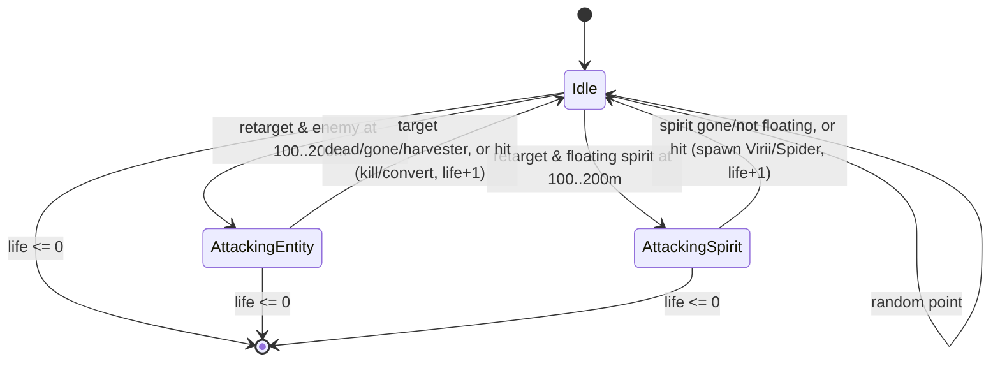
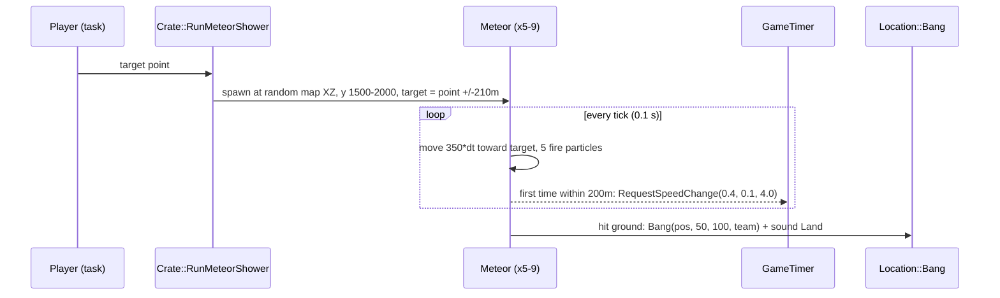
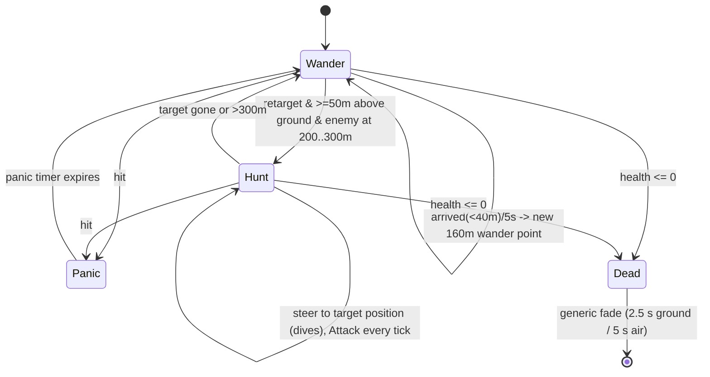

# P05_entities_creatures — Creatures, hazards, legacy entities
Scope: `code/worldobject/{anthill,armyant,centipede,dropship,dustball,egg,lander,lightning,meteor,snow,souldestroyer,spaceship,spam,spider,sporegenerator,tentacle,triffid,tripod,virii,wallbuster}.{cpp,h}` (40 files, 11 302 lines) plus `data/stats.txt`. Build baseline: see build_matrix.md (`Release|Win32`, `TARGET_PC_FULLGAME`, `BLOCK_OLD_DARWINIA_OBJECTS` on, `INCLUDE_CRATES_ADVANCED` on).

## [→ 02_units_and_entities] Partition summary — every class and its liveness in Multiwinia

28 classes are defined in this partition. "Blocked" = listed in `Entity::EntityIsBlocked` / `Building::BuildingIsBlocked`, which only filters level-file/editor by-name creation (see conventions below); liveness is therefore decided by who creates each type in code (grep of `SpawnEntities`, `NewEntity`, `CreateBuilding`, `new <Class>` across `code/`).

| # | Class (base) | Role | Blocked? | Created in Multiwinia by | Build tag |
|---|---|---|---|---|---|
| 1 | `AntHill` (Building) | Monster ant nest | no | `Crate::RunAntNest` (Ant Nest crate: task or uncaptured) | [B:FULL] |
| 2 | `AntObjective` (struct) | AntHill target record `{m_pos, m_targetId, m_numToSend}` | – | `AntHill::Advance` | [B:FULL] |
| 3 | `ArmyAnt` (Entity) | Ant worker/fighter | **yes** | `AntHill::SpawnAnt`, `Crate::RunAntNest`, `TriffidEgg::Spawn` (`SpawnAnts`) | [B:FULL] |
| 4 | `Triffid` (Building) | Egg-launching plant | no | `Crate::RunTriffids` (uncaptured-crate outcome) | [B:FULL] |
| 5 | `TriffidEgg` (Entity) | Timed monster egg | **yes** | `Triffid::Launch`, `Crate::RunEggs` (Eggs crate task), `TriffidEgg::Spawn` | [B:FULL] |
| 6 | `Egg` (Entity) | Spirit-fertilised Virii egg | **yes** | `SporeGenerator::AdvanceEggLaying`, `Spider::AdvanceEggLaying`, `TriffidEgg::Spawn` (`SpawnEggs`) | [B:FULL] (indirect) |
| 7 | `Virii` (Entity) | Worm swarm | no | `TriffidEgg::Spawn`, `Egg::Advance`, `SpamInfection::AdvanceAttackingSpirit`; cheat window [B:DEBUG]; `Cave` [B:LEGACY] | [B:FULL] |
| 8 | `ViriiUnit` (Unit) | Virii group container | – | `Team::NewUnit` for `TypeVirii` | [B:FULL] |
| 9 | `ViriiHistory` | Virii trail sample | – | `Virii::RecordHistoryPosition` | [B:FULL] |
| 10 | `SporeGenerator` (Entity) | Flying egg layer | no | `TriffidEgg::Spawn` | [B:FULL] |
| 11 | `Centipede` (Entity) | Segmented predator | no | `TriffidEgg::Spawn`, `Centipede::EatSpirits` (growth) | [B:FULL] |
| 12 | `Spider` (Entity) | Pouncing walker | no | `TriffidEgg::Spawn`, `SpamInfection::AdvanceAttackingSpirit` | [B:FULL] |
| 13 | `SpiderParameters` | Spider gait parameter set (3 instances) | – | `Spider::Spider` | [B:FULL] |
| 14 | `SoulDestroyer` (Entity) | Soul-eating flyer | no | `TriffidEgg::Spawn` (Triffids crate / nested eggs; max 2, not Assault) | [B:FULL] |
| 15 | `Zombie` (WorldObject) | Ghost effect | – | `SoulDestroyer::Attack`, `Tree::Advance` (Dark Forest); `Darwinian::AdvanceSacraficing` [B:LEGACY] | [B:FULL] |
| 16 | `SpamInfection` (WorldObject) | Infection-crate swarm | – | `Crate::RunInfection` (Infection crate); `Spam::SpawnInfection` [B:LEGACY] | [B:FULL] |
| 17 | `Spam` (Building) | Darwinia SPAM pod | **yes** | `GodDish::SpawnSpam` (blocked), Darwinia maps | [B:LEGACY] |
| 18 | `WallBuster` (CarryableBuilding) | Assault wall-breach charge | no | level file `mp_assault_2P_1` | [B:FULL] |
| 19 | `Meteor` (Entity) | Meteor-shower projectile | **yes** | `Crate::RunMeteorShower` (Meteor crate task) | [B:FULL] |
| 20 | `SpaceShip` (Entity) | Futurewinian abductor UFO | **yes** | `Crate::RunSpaceShip` (uncaptured crate, once per game, not Assault) | [B:FULL] |
| 21 | `Lightning` (WorldObject) | Storm strike | – | `Location::AdvanceLightning` (level `Effects lightning`) | [B:FULL] |
| 22 | `Snow` (WorldObject) | Ambient snowflake | – | `Location::AdvanceChristmas` (level `Effects snow` or Christmas mode) | [B:FULL] |
| 23 | `DustBall` (WorldObject) | Dust-storm particle + vortex | – | `Location::AdvanceDustWind` (level `Effects dustwind`) | [B:FULL] |
| 24 | `DropShip` (Entity) | Reinforcement transport | **yes** | `Task::TargetDropShip` — only reachable via an unshipped level option | [B:LEGACY] |
| 25 | `Tentacle` (Entity) | Portal tentacle | **yes** | `Portal::AdvanceStateExpanding` ← `Crate::RunTheBeast` (`INCLUDE_THEBEAST` = `TARGET_DEBUG` only) / Shaman maps | [B:DEBUG] / [B:LEGACY] |
| 26 | `Tripod` (Entity) | Three-legged laser walker | **yes** | none | [B:LEGACY] |
| 27 | `TripodNavData` | Tripod hex-direction navigator | – | `Tripod` member | [B:LEGACY] |
| 28 | `Lander` (Entity) | Beach landing craft | **yes** | none | [B:LEGACY] |

### Stats from `data/stats.txt` for every entity type in this partition
Blueprint values (HLTH / SPED m/s / RATE s), with the value the code actually uses. [C] `data/stats.txt`; per-class refs in each section.

| Type | HLTH | SPED | RATE | Effective use |
|---|---|---|---|---|
| Virii | 10 | 32 | 0 | as listed; slope factor 0.1–2.0 |
| Egg | 10 | 0 | 0 | health also = dormant-decay scale |
| SporeGenerator | 200 | 20 | 10 | rate unused |
| Lander | 255 | 40 | 1 | rate = landed spawn interval |
| Tripod | 155 | 20 | 1 | speed/rate unused (own navigation) |
| Centipede | 255 | 80 | 1 | health × 2 × segment size (cap 255) |
| Spider | 200 | 50 | 1 | speed unused (walks ≤ 30 m/s) |
| ArmyAnt | 20 | 25 | 0 | speed × (1 ± 0.2) per ant, ×2 when attacking/collecting |
| SoulDestroyer | 255 | 150 | 1 | speed overridden to 130 |
| TriffidEgg | 50 | 100 | 1 | speed/rate unused |
| Tentacle | 255 | 100 | 0 | invulnerable |
| Meteor | 255 | 350 | 0 | speed read as double (350) |
| SpaceShip | 255 | 500 | 0 | invulnerable; byte stat overflow (see SpaceShip) |
| DropShip | 255 | 255 | 0 | invulnerable; speed cap 10 × 255 |


## [→ 02_units_and_entities] Common conventions used by every creature in this partition

These facts are shared engine behaviour that every class below relies on; they are documented in full by the entity-core partition but are restated here so each creature spec is self-contained.

| Item | Value | Ref |
|---|---|---|
| Simulation tick | `SERVER_ADVANCE_PERIOD` = `0.1 * g_gameTimer.m_gameSpeed` seconds (10 Hz at normal speed; the Slow-Down/Speed-Up-Time crates change `m_gameSpeed`) | [C] `code/gametimer.h:SERVER_ADVANCE_PERIOD`, `code/gametimer.cpp:GameTimer::GetServerAdvancePeriod` |
| Stats storage | `Entity::m_stats[3]` is `unsigned char` (0–255). `SetType` copies `EntityBlueprint` stats (doubles from `data/stats.txt`) into it, so blueprint values > 255 wrap/are undefined (Meteor speed 350, SpaceShip speed 500) and fractional values are truncated. Code that needs the true value reads `EntityBlueprint::GetStat` directly (e.g. Meteor). | [C] `code/worldobject/entity.h:Entity::m_stats`, `code/worldobject/entity.cpp:Entity::SetType`; [I] wrap behaviour = MSVC double→unsigned-char conversion |
| Initial reload | `SetType` sets `m_reloading = syncfrand(m_stats[StatRate])` (random phase) | [C] `code/worldobject/entity.cpp:Entity::SetType` |
| Generic death | `Entity::ChangeHealth(amount)`: if `health+amount <= 0` → `m_stats[StatHealth]=100`, `m_dead=true`, sound `"Die"`, **one spirit** spawned at `m_pos` with `vel*0.5` and the entity's team (`Location::SpawnSpirit`). Health clamps at 255. Any negative amount triggers sound `"LoseHealth"`. Classes that override `ChangeHealth` may bypass this. | [C] `code/worldobject/entity.cpp:Entity::ChangeHealth` |
| Dead fade-out | `Entity::AdvanceDead`: health (reset to 100 at death) decreases `40/s` on ground, `20/s` in air; entity removed when it reaches 0 ⇒ 2.5 s (ground) / 5 s (air) corpse/fade time. | [C] `code/worldobject/entity.cpp:Entity::AdvanceDead` |
| Ballistic fall | `Entity::AdvanceInAir`: gravity `-15` m/s²; lands when `y <= ground+0.1`; enters water (`m_inWater=0`) if `y <= 0`. | [C] `code/worldobject/entity.cpp:Entity::AdvanceInAir` |
| Drowning | `Entity::AdvanceInWater`: after `m_inWater > 10.0` s → `ChangeHealth(-500)`; swims at 5 m/s, bobbing `y = -sin(3t) - 4`. | [C] `code/worldobject/entity.cpp:Entity::AdvanceInWater` |
| Map clamp | `Entity::Advance` clamps x,z into `[0, worldSize]`. | [C] `code/worldobject/entity.cpp:Entity::Advance` |
| Spawning | `Location::SpawnEntities(pos, team, unitId, type, n, vel, spread, range)`: if team is the Monster team (id **4**) or Futurewinian team (id **5**) and unused, initialises it first (`InitMonsterTeam`/`InitFuturewinianTeam`); then `SetType`, position = `FindValidSpawnPosition(pos, spread)`, `m_onGround=false`, `m_spawnPoint=pos`, `m_roamRange = range` (or `spread` if `range==-1`), `Begin()`. | [C] `code/location.cpp:Location::SpawnEntities` |
| Monster team | Team 4, `TeamTypeCPU`, colour RGB(10,10,10) near-black, `m_colourId = MULTIWINIA_NUM_TEAMCOLOURS`. Returns -1 if `m_allowMonsterTeam` is false, but the only writers set it true (constructor and `Location::Init`). | [C] `code/location.cpp:Location::GetMonsterTeamId`, `Location::InitMonsterTeam` |
| Futurewinian team | Team 5, `TeamTypeCPU`, colour RGB(200,200,200), `m_colourId = MULTIWINIA_NUM_TEAMCOLOURS+1`. Owner of the crate SpaceShip. | [C] `code/location.cpp:Location::GetFuturewinianTeamId`, `Location::InitFuturewinianTeam` |
| Level-file blocking | `Entity::EntityIsBlocked` (true for `TypeAI, TypeArmyAnt, TypeDropShip, TypeEgg, TypeLander, TypeLaserTroop, TypeMeteor, TypeNuke, TypeOfficer, TypeShaman, TypeSpaceInvader, TypeTentacle, TypeTriffidEgg, TypeTripod, TypeInvalid, TypeSpaceShip`) is consulted **only** when loading `InstantUnits` from a level file and by the (editor-only) instant-unit window. It does **not** stop code from creating these types with `SpawnEntities`/`NewEntity`. Likewise `Building::BuildingIsBlocked` only filters `Building::CreateBuilding(char *name)` (level-file/editor by-name creation), not `CreateBuilding(int type)`. | [C] `code/worldobject/entity.cpp:Entity::EntityIsBlocked`, `code/level_file.cpp:LevelFile::ParseInstantUnits` (L684), `code/interface/instant_unit_window.cpp` (L324), `code/worldobject/building.cpp:Building::CreateBuilding(char*)` |
| Random numbers | `syncrand()/syncfrand(x)/syncsfrand(x)` = network-synchronised MT19937 (`syncfrand(x)∈[0,x)`, `syncsfrand(x)∈[-x/2,x/2)`). `FRAND(x)/SFRAND(x)` are wrapper structs that resolve to `_syncfrand/_syncsfrand` (i.e. **synced**) when passed to `Vector3` constructors/`FromRand`. Bare `frand(x)/sfrand(x)` are the **unsynced** LCG (`AppRandom`, `frand∈[0,x]`, `sfrand∈(-x/2,x/2]`) and must only affect rendering. | [C] `contrib/systemiv/lib/math/random_number.cpp:_syncfrand,_syncsfrand,frand,sfrand`, `code/lib/vector3.h:FRAND`, `code/lib/vector3.cpp:FromRand` |

## [→ 02_units_and_entities] AntHill (Building) and ArmyAnt (Entity) — ant colony

### Role and build tag
- **AntHill** — a monster-team nest building that sends ArmyAnts out to fetch Darwinians, spirits and attack enemies. **[B:FULL]** live in Multiwinia as the **Ant Nest** crate outcome (`CrateRewardAntNest`): either as a player-placeable task (`GlobalResearch::TypeAntsNest` → `Task::TargetAntNest` → `Crate::RunAntNest`) when the crate is captured, or immediately at the crate position when an uncaptured crate expires (`Crate::RunUncapturedCrate`). [C] `code/worldobject/crate.cpp:Crate::CaptureCrate`, `Crate::RunUncapturedCrate`, `Crate::RunAntNest`; `code/taskmanager.cpp:Task::TargetAntNest`. Also placed by Darwinia campaign maps (13 instances in `data/levels/map_*.txt`/`mission_*.txt`) → that path is [B:LEGACY]. `TypeAntHill` is **not** in `Building::BuildingIsBlocked`. [C] `code/worldobject/building.cpp:Building::BuildingIsBlocked`.
- **ArmyAnt** — small fast ground creature. **[B:FULL]** live, created only by code: `AntHill::SpawnAnt`, the wake-up ant in `Crate::RunAntNest`, and `TriffidEgg::Spawn` case `SpawnAnts` (Triffids crate). `TypeArmyAnt` **is** in `Entity::EntityIsBlocked`, which only prevents ants being placed as level-file InstantUnits. [C] `code/worldobject/anthill.cpp:AntHill::SpawnAnt`, `code/worldobject/crate.cpp:Crate::RunAntNest`, `code/worldobject/triffid.cpp:TriffidEgg::Spawn`, `code/worldobject/entity.cpp:Entity::EntityIsBlocked`. The Shaman summon path (`code/worldobject/shaman.cpp`) is [B:LEGACY] (Shaman blocked).

### Crate effect mechanics — `Crate::RunAntNest(pos, teamId)` [→ 04_crates_powerups_and_weapons]
[C] `code/worldobject/crate.cpp:Crate::RunAntNest`
1. Creates **2** AntHills, **always owned by the Monster team (4)** regardless of `teamId` (the triggering player only gets the marker/message).
2. Each hill: position = `pos + (syncsfrand(200), 0, syncsfrand(200))` (i.e. ±100 m), y = terrain height; `m_front` = normalised `(syncsfrand(1),0,syncsfrand(1))`; `m_numAntsInside = 75 - syncrand()%25` → **51–75 ants**; `SetDetail(1)`; new building id from `GlobalWorld::GenerateBuildingId`; an explosion effect of the hill shape is played at creation (`g_explosionManager.AddExplosion(shape, mat, 1.0)`).
3. Spawns **one ArmyAnt** for the Monster team at `pos` (comment: wakes up the monster team — `SpawnEntities` initialises team 4 if unused).
4. `m_obstructionGrid->CalculateAll()`.
5. Marker `icons/icon_antnest.bmp` for `teamId`; message `crate_message_run_antnest` (team name substituted for flag `T`) or `multiwinia_exclamation` with the crate name if `teamId` is the monster team; sound `Crate::TriggerSoundEvent(CrateRewardAntNest, pos, teamId)`.
- Crate validity cap: Ant Nest is invalid when `(#AntHills in level) + 2 × (#queued TypeAntsNest tasks across teams) >= 4`. [C] `code/worldobject/crate.cpp:Crate::IsValid`.

### AntHill stats and fields
| Field | Value | Ref |
|---|---|---|
| Shape | `anthill.shp` | [C] `code/worldobject/anthill.cpp:AntHill::AntHill` |
| `m_health` | 100 (own integer health, separate from Building damage) | [C] `AntHill::AntHill` |
| `ANTHILL_SEARCHRANGE` | 400.0 m (`#define`) | [C] `code/worldobject/anthill.h` |
| First spawn delay | `m_spawnTimer = now + 5.0` s after `Initialise` | [C] `AntHill::Initialise` |
| Objective cap | SP: 3; MP: `m_numAntsInside/10` clamped to [1,6] | [C] `AntHill::Advance` |
| Objective search interval | `now + syncrand()%2` s (0 or 1 s) | [C] `AntHill::Advance` |
| Ants per objective | SP: `int(5 + 5×difficulty/10)`; MP: `n = int(5 + syncfrand(5))` (5–9), then `n = int(n + m_numAntsInside/20.0)` | [C] `AntHill::Advance` |
| Ant release interval | MP: 0.2 s; SP: `0.2 - 0.2*difficulty/10` | [C] `AntHill::Advance` |
| Spirit→ant conversion | each conversion consumes 1 stored spirit: SP +3 ants, next after 5.0 s; MP **+6 ants**, next after 1.0 s | [C] `AntHill::Advance` |
| Empty-hill decay (MP) | if `m_numAntsInside <= 0` for **30 consecutive Advance calls** (3.0 s at 10 Hz) → `m_numAntsInside = 10`, `Damage(-10)` | [C] `AntHill::Advance` |
| Level-file field | one integer `m_numAntsInside` after the generic Building fields; values outside [0,10000] reset to 0 | [C] `AntHill::Read`, `AntHill::Write` |

### AntHill behaviour
- **Only runs when its team is `TeamTypeCPU`** (the Monster team is CPU). [C] `AntHill::Advance`.
- **Population lock** (`AntHill::PopulationLocked`): in multiplayer with a level population cap (`m_populationCap != -1`): locked when `team->m_others.NumUsed() - Virii::s_viriiPopulation[team] >= m_populationCap / m_numPlayers` (team 255 never locked). Otherwise (or no cap), looks once for the nearest `SpawnPopulationLock` building whose `m_searchRadius` contains the hill and is locked when `lock->m_teamCount[team] >= lock->m_maxPopulation`. A locked hill neither creates objectives nor releases ants (spirit conversion continues). [C] `code/worldobject/anthill.cpp:AntHill::PopulationLocked`.
- **Objective selection** (when not locked, timer expired and below cap): MP chooses one search uniformly with `syncrand()%5`: 0,1 → nearest-listed enemy **Darwinian** within 400 m not already `StateCapturedByAnt` and not already targeted; 2 → any enemy entity within 400 m not already targeted; 3 → a spirit within 400 m in `StateBirth`/`StateFloating` not within 20 m of an existing objective; 4 → scout point at radius `200 + syncfrand(200)` m, random angle, accepted only if terrain height > 0. SP tries the four in that order. A found target becomes an `AntObjective {m_pos, m_targetId, m_numToSend}`. [C] `AntHill::SearchForDarwinians`, `SearchForEnemies`, `SearchForSpirits`, `SearchForScoutArea`, `SearchingArea`, `TargettedEntity`.
- **Release** (`AntHill::SpawnAnt`): picks a random objective (`syncrand()%size`), creates/reuses the hill's ant Unit (`Team::NewUnit(TypeArmyAnt, m_numAntsInside, ...)`), spawns 1 ant at the hill (terrain height, spread 10), sets `m_buildingId`, `m_orders = ScoutArea`, `m_wayPoint = objective.pos + random offset radius syncfrand(30)`, pushed from obstructions; decrements `m_numAntsInside` and the objective's `m_numToSend` (objective deleted at 0).
- **Damage** (`AntHill::Damage(d)`, d negative): `m_health += d`; every crossing of a 20-HP band plays a partial explosion (fraction `1 - health/100`) and building sound `"Damage"`. At `m_health <= 0`: full explosion, **releases `m_numAntsInside + m_numSpiritsInside` spirits** (team = hill team) in a 20 m disc with speed `syncfrand(50)`, sound `"Explode"`; `Advance` returns true (building removed). `Destroy()` sets health 0. [C] `AntHill::Damage`, `AntHill::Destroy`.
- **Burning** (`AntHill::Burn`, called by burning Trees within `100 + treeRadius`): 30% chance per call of `Damage(-1)`, and always releases one ant toward a random point 200 m away (fleeing). [C] `AntHill::Burn`; caller `code/worldobject/tree.cpp:Tree::Advance` (L224).
- Visual: damaged flicker using unsynced `frand` (render-only). Sound events listed: building defaults + `"Explode"`.

### ArmyAnt stats
| Stat | Value | Ref |
|---|---|---|
| Health | 20 (`data/stats.txt` ArmyAnt HLTH) | [C] `data/stats.txt` |
| Speed | 25 m/s × `(1 + syncsfrand(0.4))` per ant (20–30 m/s), ×2 while `CollectEntity`/`AttackEnemy` | [C] `ArmyAnt::Begin`, `ArmyAnt::AdvanceToTargetPosition` |
| Rate | 0 (unused) | [C] `data/stats.txt` |
| Scale | `1.0 + syncsfrand(0.9)` (0.55–1.45) | [C] `ArmyAnt::Begin` |
| Self search range | `ARMYANT_SEARCHRANGE` = 10 m (`#define`) for spirits and enemies on the way | [C] `code/worldobject/armyant.h` |
| Bite damage | 1 HP per tick while at target (`ChangeHealth(-1)`) | [C] `ArmyAnt::AdvanceAttackEnemy` |
| Stray return | `SearchForRandomPosition`: return chance `dist(spawnPoint)/400`; else random 100 m step | [C] `ArmyAnt::SearchForRandomPosition` |
| New-base search | friendly AntHill within 500 m | [C] `ArmyAnt::SearchForAntHill` |

### ArmyAnt state machine (`m_orders`)
```mermaid
stateDiagram-v2
    [*] --> NoOrders
    NoOrders --> ReturnToBase: OrderReturnToBase (hill exists or friendly hill <500m found)
    NoOrders --> BaseDestroyed: no hill
    ScoutArea --> CollectEntity: arrived & target is Darwinian
    ScoutArea --> AttackEnemy: arrived & target is other entity
    ScoutArea --> ReturnToBase: arrived & target gone
    ScoutArea --> CollectSpirit: SearchForTargets found spirit within 10m
    ScoutArea --> AttackEnemy: SearchForTargets found non-Darwinian non-Harvester enemy within 10m
    CollectSpirit --> ReturnToBase: arrived (spirit -> StateAttached) or spirit gone/dead/attached/in egg
    CollectEntity --> ReturnToBase: arrived (Darwinian::AntCapture) or target dead/already captured
    AttackEnemy --> ReturnToBase: target dead or gone
    AttackEnemy --> AttackEnemy: arrived: target -1 HP, 3 muzzle-flash particles, sound Attack
    ReturnToBase --> [*]: arrived at hill (ant stored, entity removed)
    ReturnToBase --> BaseDestroyed: arrived & hill gone & no friendly hill
    BaseDestroyed --> BaseDestroyed: arrived -> SearchForRandomPosition
```
[C] `code/worldobject/armyant.cpp:ArmyAnt::Advance` and the `Advance*` methods.
- `SearchForTargets` runs every tick while `!m_targetFound` (spirits first, then enemies); once a target is found it is not re-searched until a failure clears `m_targetFound`. [C] `ArmyAnt::Advance`, `ArmyAnt::SearchForTargets`.
- **Delivery at the hill** (`AdvanceReturnToBase`): hill `m_numAntsInside++`; a carried spirit in `StateAttached` is removed from the world and `m_numSpiritsInside++`; a carried Darwinian in `StateCapturedByAnt` is killed with `ChangeHealth(-2 × health)` (which spawns its spirit next to the hill). The ant entity is then removed (`Advance` returns true). [C] `ArmyAnt::AdvanceReturnToBase`.
- **Carrying**: an attached spirit, and a captured Darwinian (via `Darwinian::AdvanceCapturedByAnt`), are teleported every tick to the ant's `MarkerCarry` shape marker. If the ant dies the Darwinian returns to `StateIdle`. [C] `ArmyAnt::GetCarryMarker`; `code/worldobject/darwinian.cpp:Darwinian::AntCapture`, `Darwinian::AdvanceCapturedByAnt`.
- **Movement**: straight line toward `m_wayPoint` at speed, y snapped to terrain (no obstruction pushing while walking — the call is commented out), heading jittered by `syncsfrand(0.2)` rad per tick; arrival when distance < `|vel|·dt` or < 1 m. Ants fall ballistically when `!m_onGround` (spawned with velocity by triffid eggs). [C] `ArmyAnt::AdvanceToTargetPosition`, `Entity::AdvanceInAir`.
- **Death**: `ChangeHealth` → generic death (spirit spawned) + shape explosion scaled by `m_scale`; drops any attached spirit (`Spirit::CollectorDrops`, inherits ant velocity). [C] `ArmyAnt::ChangeHealth`.
- **Team colouring**: three animation shapes `armyant.shp`, `armyant2.shp`, `armyant3.shp`, each copied and recoloured per team colour/coop group (cached as `<shape>_<colourId>_<groupId>`). Every tick a different one of the three is chosen with `syncrand()%3` (leg animation). [C] `ArmyAnt::SetShape`, `ArmyAnt::Advance`.
- **Sounds**: `"Attack"` (bite), plus generic `"LoseHealth"`, `"Die"`. **Effects**: `Particle::TypeMuzzleFlash` ×3 per bite, shape explosion on death. [C] `ArmyAnt::AdvanceAttackEnemy`.
- **Interaction with Darwinians**: Darwinians treat enemy AntHills and Triffids as attack targets. [C] `code/worldobject/darwinian.cpp:Darwinian::SearchForThreats` (L2827: enemy `TypeAntHill`/`TypeTriffid` buildings are threats).

## [→ 02_units_and_entities] Triffid (Building) and TriffidEgg (Entity) — egg launcher and monster egg

### Role and build tag
- **Triffid** — a rooted plant building that periodically lobs TriffidEggs; each egg bursts after a timer and releases a creature group. **[B:FULL]** live via the **Triffids** crate outcome (`CrateRewardTriffids`, only reachable as an *uncaptured-crate* outcome — `Crate::CaptureCrate` re-rolls it away; `Crate::RunUncapturedCrate` includes it). Darwinia campaign maps place 30 Triffids → [B:LEGACY]. Not in `BuildingIsBlocked`. [C] `code/worldobject/crate.cpp:Crate::CaptureCrate`, `Crate::RunUncapturedCrate`, `Crate::RunTriffids`.
- **TriffidEgg** — **[B:FULL]** live: launched by Triffids (`Triffid::Launch`), spawned directly by the **Eggs** crate (`Crate::RunEggs`, task `GlobalResearch::TypeEggSpawn` or uncaptured — note: `RunUncapturedCrate` has a case for `CrateRewardEggs` but Eggs is not in its acceptable list, so that case is only reached with a fixed `m_rewardId`), and recursively by `SpawnTriffidEggs`. `TypeTriffidEgg` is in `EntityIsBlocked` (level-file only). [C] `code/worldobject/crate.cpp:Crate::RunEggs`, `code/taskmanager.cpp:Task::TargetEggs`, `code/worldobject/triffid.cpp:Triffid::Launch`.

### Crate effect mechanics [→ 04_crates_powerups_and_weapons]
**`Crate::RunTriffids(pos, teamId)`** [C] `code/worldobject/crate.cpp:Crate::RunTriffids`
- Creates `1 + syncrand()%3` (**1–3**) Triffids owned by the **Monster team**, at `pos + (syncsfrand(50),0,syncsfrand(50))` (±25 m), `m_front` pointing away from `pos`.
- Per triffid: `m_pitch = 0.6 + syncfrand(0.6)`, `m_force = 60 + syncfrand(60)`, `m_variance = syncfrand(0.5)`, `m_reloadTime = 40 + syncfrand(60)` s; `m_size` default 1.0; `m_useTrigger` default 0; spawn mask = **all types except `SpawnSpirits` and `SpawnEggs`** (so Virii, Centipede, Spider, TriffidEggs, Ants, SporeGenerator, SoulDestroyer, Darwinians).
- Message `multiwinia_exclamation` with the crate name; marker `icons/icon_triffid.bmp`; sound event for `CrateRewardTriffids` (team 255).

**`Crate::RunEggs(pos, teamId)`** [C] `code/worldobject/crate.cpp:Crate::RunEggs`
- Spawns `2 + syncrand()%3` (**2–4**) TriffidEggs **owned by `teamId`** (the player who used the task — so the hatched creatures fight *for* that player, except Soul Destroyers which are forced to the Monster team in multiplayer, see `TriffidEgg::Spawn`). Start = `pos + (0,20,0)`, velocity direction `(SFRAND(1), 4, SFRAND(1))` with length `50 + syncfrand(50)`.
- Each egg: spawn type drawn with `syncrand()%NumSpawnTypes` until it is **not** Spirits, Eggs, SoulDestroyer, Ants or Darwinians → one of **Virii, Centipede, Spider, TriffidEggs, SporeGenerator** (uniform over these 5); `m_size = 1.0`; burst timer `4 + syncfrand(4)` s; `m_spawnPoint = pos`; `m_roamRange = 300`.
- Marker `icons/icon_egg.bmp`; message `crate_message_auto_eggs` (monster team) or `crate_message_run_eggs` (team name); sound for `CrateRewardEggs`.

### Triffid fields, stats and constants
| Field | Default | Crate value | Level-file order | Ref |
|---|---|---|---|---|
| `m_size` | 1.0 | 1.0 | 1 | [C] `Triffid::Triffid`, `Triffid::Read` |
| `m_pitch` | 0.6 | 0.6–1.2 | 2 | |
| `m_force` | 250.0 | 60–120 | 3 | |
| `m_variance` | π/8 | 0–0.5 | 4 | |
| `m_reloadTime` (s) | 60.0 | 40–100 | 5 | |
| `m_useTrigger` (enemies needed; 0 = always armed) | 0 | 0 | 6 | |
| `m_triggerLocation.x/.z` (offset) | 0,0 | 0,0 | 7,8 | |
| `m_triggerRadius` (m) | 100.0 | 100.0 | 9 | |
| `m_spawn[10]` (0/1 flags in enum order) | all false | see above | 10–19 | |
| `m_damage` ("health") | 50.0 | 50.0 | – | [C] `Triffid::Triffid` |
| `m_numEggs` (MP egg budget) | 3 | 3 | – | |
| Shape / markers | `triffidhead.shp`, `MarkerLaunchPoint`, `MarkerTriffidStem` | | | |

### Triffid behaviour
- **Initial timer**: `m_timerSync = now + (syncrand() % int(m_reloadTime)) + 10` s. Trigger check timer starts at `syncfrand(5)`. [C] `Triffid::Initialise`, `Triffid::Triffid`.
- **Arming**: if `m_useTrigger == 0` or burning → armed. Else every 5 s armed = `EntityGrid::AreEnemiesPresent(pos+triggerLocation, triggerRadius, team)`. On transition unarmed→armed the timer is re-randomised as above. [C] `Triffid::Advance`.
- **Launch** when armed and `now > m_timerSync`: in **multiplayer only while `m_numEggs > 0`**; each launch decrements it and when it reaches 0 calls `Damage(-100)` (sets itself on fire). Single-player launches forever. Next timer `now + reload × (1 + syncsfrand(0.1))`. [C] `Triffid::Advance`.
- **`Triffid::Launch`**: picks uniformly among enabled spawn types (`syncrand()%count`; nothing if none); egg velocity = launch marker forward × `m_force × m_size × (1 + syncsfrand(0.2))`; egg `m_size = 1 + syncsfrand(0.3)`, `m_spawnPoint = pos + triggerLocation`, `m_roamRange = triggerRadius`; MP: burst timer `4 + syncfrand(4)` s. Building sound `"LaunchEgg"`. [C] `Triffid::Launch`.
- **Head pose** (`GetHead`, used for launch direction, rendering and ray hits — computed from network time so it is deterministic): head at `pos + up×30×size`, pitched by `m_pitch×0.5×(1+0.1 sin t)`, bobbing offset `(4 sin(t/1.3), sin(t/1.5), 3 sin(t/1.2))`, recoil `-front×10×((timer-now)/reload)^5`, scale `size×(1+0.1 sin t)` where `t = now + uniqueId×10`. When burning: head thrashes (`front` rotated by `sin(5t)×variance`, larger offsets). [C] `Triffid::GetHead`.
- **Damage/burning**: `Damage(d)` adds `d` to `m_damage`; when it first drops ≤ 0 → sound `"Burn"`. While burning every tick: two `Particle::TypeFire` (size `100 + syncsfrand(100×size)`), 10% (unsynced) debris particle, `m_size -= 0.006`, `m_timerSync -= 0.5`; at `m_size <= 0.3` the head explodes and the building is removed (≈117 ticks ≈ 11.7 s from size 1.0). [C] `Triffid::Damage`, `Triffid::Advance`. Fire sources: flame grenades set Trees and Triffids within `2×power` alight (`code/worldobject/weapons.cpp:FlameGrenade::Advance`, L2050–2065); turret shells can hit Trees, AntHills and Triffids (`code/worldobject/weapons.cpp:TurretShell::Advance`, L1470).
- **Render**: yellow stem lines, head shape, a held egg drawn when within the last 25% of the reload. Editor-only trajectory preview under `LOCATION_EDITOR` [B:EDITOR]. [C] `Triffid::Render`, `Triffid::RenderAlphas`.

### Triffid spawn types (`Triffid::Spawn*` enum) and what `TriffidEgg::Spawn` creates
| # | Enum | Creates (team = egg team unless noted) | SP count | MP count | Spawn args (spread, roam range) | Ref |
|---|---|---|---|---|---|---|
| 0 | `SpawnVirii` | Virii | `5 + rand%5` (5–9) | `20 + rand%20` (20–39), **0 if team already has ≥ `VIRII_POPULATIONLIMIT` (250)** | 0, 100 | [C] `TriffidEgg::Spawn` |
| 1 | `SpawnCentipede` | one Centipede unit of `size` segments (unit created on egg team) | `5 + rand%5` (5–9) | `5 + rand%10` (5–14) | 0, 200 | |
| 2 | `SpawnSpider` | 1 Spider | 1 | 1 | 0, 150 | |
| 3 | `SpawnSpirits` | spirits, horizontal speed `20 + syncfrand(20)` | `5 + rand%5` | same | – | |
| 4 | `SpawnEggs` | Virii `Egg`s, velocity up+random, length `20 + syncfrand(20)` | `5 + rand%5` | same | 0, 0 | |
| 5 | `SpawnTriffidEggs` | TriffidEggs, speed `75 + syncfrand(50)`; each egg type = `syncrand() % 9` (never Darwinians); in MP a SoulDestroyer roll is re-rolled in Assault or when ≥ 2 Soul Destroyers exist | `2 + rand%3` (2–4) | same | 0, 0 | |
| 6 | `SpawnAnts` | ArmyAnts thrown up, speed `10 + syncfrand(20)` (no hill: they roam via `BaseDestroyed`) | `20 + rand%10` (20–29) | same | 0, 0 | |
| 7 | `SpawnSporeGenerator` | 1 SporeGenerator | 1 | 1 | 0, 200 | |
| 8 | `SpawnSoulDestroyer` | 1 SoulDestroyer **on the Monster team in MP**; allowed if (not Assault **and** `SoulDestroyer::s_numSoulDestroyers < 2`) or single-player; otherwise **falls through to `SpawnVirii`** | 1 | 1 | 0, 200 | |
| 9 | `SpawnDarwinians` | Darwinians thrown up, speed `10 + syncfrand(20)` | `10 + rand%10` (10–19) | same | 0, 0 | |
(`rand` = `syncrand()`.) A commented-out `SpawnTripod` case exists. [C] `code/worldobject/triffid.cpp:TriffidEgg::Spawn`.

### TriffidEgg stats and behaviour
| Item | Value | Ref |
|---|---|---|
| Health | 50 (`data/stats.txt` TriffidEgg) | [C] `data/stats.txt` |
| Speed / Rate (blueprint) | 100 / 1 — not used by the egg logic | [C] `data/stats.txt`; `TriffidEgg::Advance` |
| Default burst timer | `m_life = 20 + syncfrand(10)` s (SP); overridden to `4 + syncfrand(4)` s by MP launches and by `RunEggs` | [C] `TriffidEgg::TriffidEgg`, `Triffid::Launch`, `Crate::RunEggs` |
| Gravity | `vel.y -= 9.8 × m_force` **per tick** (≈ 98 m/s² at `m_force=1`, not scaled by tick length) | [C] `TriffidEgg::Advance` |
| Bounce | when `y < ground + 3`: `WorldObject::BounceOffLandscape`, `m_force *= 0.65` (`TRIFFIDEGG_BOUNCEFRICTION`), `vel *= m_force`; sound `"Bounce"` while `m_force > 0.1` | [C] `TriffidEgg::Advance`, `code/worldobject/triffid.h` |
| Tumble | `m_up` rotated about `(up × vel)` by `m_force² × 30 × dt`; self-rights when `up.y < 0.3` and `m_force < 0.4` | [C] `TriffidEgg::Advance` |
| Damage | **immune to `DamageTypeLaser`**; otherwise generic death (spirit) + shape explosion | [C] `TriffidEgg::ChangeHealth` |
| Burst | at `now > m_timerSync`: shape explosion, `Spawn()`, sound `"BurstOpen"`, egg removed | [C] `TriffidEgg::Advance` |
| Visual | `triffidegg.shp` (team-coloured, `SetShape(..., true)`), pulsating size `m_size + abs(sin 2t)×(1-age)×0.4`, shadow `size×10` | [C] `TriffidEgg::Render` |

```mermaid
stateDiagram-v2
    [*] --> Flying: spawned with velocity
    Flying --> Bouncing: y < ground+3 (force *= 0.65)
    Bouncing --> Flying: still has velocity
    Flying --> Burst: now > timer
    Bouncing --> Burst: now > timer
    Flying --> Dead: health <= 0 (non-laser damage)
    Bouncing --> Dead: health <= 0
    Burst --> [*]: Spawn(type); removed
    Dead --> [*]: spirit + explosion; removed on the next Advance (no fade)
```



## [→ 02_units_and_entities] Egg (Virii egg) — spirit-fertilised hatchery

### Role and build tag
Small sprite egg that, when a spirit is placed inside it, hatches 4 Virii after 15 s. **[B:FULL]** reachable in Multiwinia only indirectly: laid by **SporeGenerators** and **Spiders**, and thrown by `TriffidEgg` spawn type `SpawnEggs` (which crate Triffids/Eggs exclude — so in Multiwinia only via SporeGenerator/Spider, or a `SpawnTriffidEggs` sub-egg that rolls `SpawnEggs`). `TypeEgg` is in `EntityIsBlocked` (level-file only). [C] `code/worldobject/sporegenerator.cpp:SporeGenerator::AdvanceEggLaying`, `code/worldobject/spider.cpp:Spider::AdvanceEggLaying`, `code/worldobject/triffid.cpp:TriffidEgg::Spawn`.

### Stats
| Item | Value | Ref |
|---|---|---|
| Health | 10 (`data/stats.txt`) | [C] |
| Speed / Rate | 0 / 0 | [C] `data/stats.txt` |
| `EGG_DORMANTLIFE` | 120 s (`#define`) | [C] `code/worldobject/egg.h` |
| Hatch time | 15.0 s after fertilisation | [C] `Egg::Advance` |
| Hatch output | 4 Virii (egg team), spread 0, roam range 200, only if team Virii population < 250 | [C] `Egg::Advance` |

### States (`Egg::StateDormant`, `StateFertilised`, `StateOpen`)
```mermaid
stateDiagram-v2
    [*] --> Dormant
    Dormant --> Dormant: timer += dt; health capped to 10*(1 - timer/120) (decays to 0 at 120 s)
    Dormant --> Fertilised: Egg::Fertilise(spiritId) (spirit -> StateInEgg, health reset 10, timer 0)
    Fertilised --> Dormant: held spirit index no longer valid
    Fertilised --> [*]: timer >= 15 -> spirit removed, 4 Virii spawned (if pop < 250), egg removed
    Dormant --> Dead: health < 0 / falls below y=0 (ChangeHealth -500)
    Fertilised --> Dead: health < 0
    Dead --> [*]: held spirit -> Spirit::EggDestroyed (floating again); fade 2.5 s
```
- `StateOpen` is declared but never entered. [C] `code/worldobject/egg.h`, `Egg::Advance`.
- **Death override**: `Egg::ChangeHealth` kills only when `health + amount < 0` (strictly), does **not** spawn a spirit and plays no sound (unlike `Entity::ChangeHealth`). [C] `Egg::ChangeHealth`.
- While fertilised, the spirit is pinned 3 m above the egg each tick. [C] `Egg::Advance`.
- **Fertilisers**: Virii carrying a spirit (`Virii::AdvanceToEgg`), SporeGenerator (25% of laid eggs pre-fertilised with a fresh spirit), spirits themselves track nearby eggs (`Spirit::SearchForNearbyEggs`, range `VIRII_MAXSEARCHRANGE`). [C] `code/worldobject/virii.cpp:Virii::AdvanceToEgg`, `code/worldobject/sporegenerator.cpp:SporeGenerator::AdvanceEggLaying`, `code/worldobject/spirit.cpp:Spirit::SearchForNearbyEggs`.
- **Physics**: ballistic via `Entity::AdvanceInAir` until grounded; snaps to ground; `y <= 0` (water) → `ChangeHealth(-500)`. [C] `Egg::Advance`.
- **Visual**: camera-facing 8×8 m (`size 4`) additive sprite `sprites/egg.bmp`, alpha = health/10 (min 0.1); fertilised eggs add two throbbing sprites (alpha `|sin t|×8×t`, growing over the 15 s); dead eggs break into 3 drifting quarter-sprite fragments. Team colour is fetched but the sprite is drawn white. [C] `Egg::Render`.

## [→ 02_units_and_entities] Virii, ViriiUnit, ViriiHistory — worm swarm

### Role and build tag
Fast red worm-like creatures leaving a glowing trail; they bite enemies (20 HP), and ferry floating spirits into Eggs to breed. **[B:FULL]** reachable via: TriffidEgg `SpawnVirii` (Eggs/Triffids crates; also the fallback when a Soul Destroyer is disallowed), Egg hatching, and the debug cheat window [B:DEBUG]. **SpamInfection** particles converting spirits (Infection crate — see Spam section), and the debug cheat window [B:DEBUG] (`CHEATMENU_ENABLED`). Cave (`code/worldobject/cave.cpp`, blocked building) and Shaman (blocked) paths are [B:LEGACY]. Darwinia campaign maps place 118 Virii [B:LEGACY]. `TypeVirii` is **not** blocked. [C] `code/worldobject/triffid.cpp:TriffidEgg::Spawn`, `code/worldobject/egg.cpp:Egg::Advance`, `code/worldobject/spam.cpp:SpamInfection::AdvanceAttackingSpirit`, `code/interface/cheat_window.cpp:CheatWindow` (L141, inside `#ifdef CHEATMENU_ENABLED`), `code/worldobject/cave.cpp` (L30).

### Classes
| Class | Base | Purpose | Ref |
|---|---|---|---|
| `ViriiUnit` | `Unit` | Created by `Team::NewUnit` for `TypeVirii`; each Advance sets `m_enemiesFound = AreEnemiesPresent(centre, radius + 60, team)` (cheap pre-check before individual searches); renders all its Virii in one additive `GL_QUADS` batch with `sprites/viriifull.bmp`, choosing detail 1–4 from `RenderEntityDetail` pref and camera distance (detail 2 beyond 1000 m at pref 1; 3 beyond 1000 m / 2 beyond 500 m at pref 2; 4 always at pref 3). `m_cameraClose` is unused. | [C] `code/worldobject/virii.cpp:ViriiUnit::Advance`, `ViriiUnit::Render`; `code/team.cpp:Team::NewUnit` |
| `Virii` | `Entity` | The worm. | [C] |
| `ViriiHistory` | – | One trail sample: `m_pos`, `m_right` (perpendicular on land normal), `m_glowDiff` (10 m step vector), `m_distance` (to previous sample), `m_required` (true = direction change/state sample; false = smoothing for height change). | [C] `code/worldobject/virii.h` |
Virii not in a unit (spawned with unitId −1 by eggs/triffids) live in the team's `m_others` list and are batch-rendered by `Team::RenderVirii` (same detail rules). [C] `code/team.cpp:Team::RenderVirii`.

### Stats and constants
| Item | Value | Ref |
|---|---|---|
| Health | 10 | [C] `data/stats.txt` |
| Speed | 32 m/s; ×slope factor `clamp(1 + Δh/5, 0.1, 2.0)` where Δh = next−current terrain height (uphill slower, downhill faster) | [C] `data/stats.txt`, `Virii::AdvanceToTargetPos` |
| Rate | 0 | [C] |
| Hover height | 0.1 m | [C] `Virii::Virii` |
| `VIRII_MINSEARCHRANGE` / `MAXSEARCHRANGE` | 30 / 60 m (`#define`) | [C] `code/worldobject/virii.h` |
| `VIRII_TAILLENGTH` | 175 m (the code uses a literal 175.0) | [C] `Virii::RecordHistoryPosition` |
| `VIRII_POPULATIONLIMIT` | 250 per team (`#define`) | [C] `code/worldobject/virii.h` |
| Bite | `ChangeHealth(-20)` on arrival at the enemy (unresistable type) | [C] `Virii::AdvanceAttacking` |
| Retarget period (idle) | 1.0 s (first after `syncfrand(2.0)`) | [C] `Virii::AdvanceIdle`, `Virii::Virii` |
| History sample period (non-idle) | 0.5 s, plus extra non-required samples when height differs > 3 m | [C] `Virii::Advance` |
| Fall gravity | −10 m/s², lands at ground + 2 | [C] `Virii::Advance` |
| Population counter | `Virii::s_viriiPopulation[team]` ++ in `Begin`, −− in destructor; excluded from AntHill pop-cap counting | [C] `Virii::Begin`, `Virii::~Virii`, `AntHill::PopulationLocked` |

### State machine (`Virii::StateIdle`, `StateAttacking`, `StateToSpirit`, `StateToEgg`)
```mermaid
stateDiagram-v2
    [*] --> Idle
    Idle --> ToEgg: retarget & carrying spirit & dormant on-ground friendly egg within 60m (random pick)
    Idle --> Attacking: retarget & unit sees enemies & nearest live on-ground enemy at 30..60m
    Idle --> ToSpirit: retarget & floating/birth spirit within 60m that has nearby eggs
    Idle --> Idle: retarget & SearchForIdleDirection (new waypoint)
    Attacking --> Idle: enemy gone/dead
    Attacking --> Attacking: arrived -> enemy -20 HP, 3 muzzle flashes, sound Attack, re-search (next enemy 30..60m)
    ToSpirit --> Idle: spirit gone/dead/attached/in egg
    ToSpirit --> ToEgg: arrived -> Spirit::CollectorArrives (attached)
    ToEgg --> Idle: no egg found (drops spirit) or spirit invalid
    ToEgg --> Idle: arrived -> Egg::Fertilise(spirit)
```
[C] `code/worldobject/virii.cpp:Virii::AdvanceIdle`, `AdvanceAttacking`, `AdvanceToSpirit`, `AdvanceToEgg`, `SearchForEnemies`, `SearchForSpirits`, `SearchForEggs`, `FindNearbyEgg(Vector3)`.
- **Bite cadence**: after a bite the Virii looks for the nearest enemy at ≥ 30 m; if none is found it keeps the current target and, being on top of it, bites again on the next tick (−20 HP per 0.1 s). [I] from `Virii::AdvanceAttacking` + `EntityGrid::GetBestEnemy` min-range rule (`code/entity_grid.cpp:EntityGrid::GetBestEnemy`).
- **Idle wandering** (`SearchForIdleDirection`): return-to-spawn chance `d/roamRange` (forced 0 below 0.75); returning picks one of 8 compass directions toward spawn; otherwise up to 3 tries of a random compass direction `(int(syncfrand(3))-1, 0, int(syncfrand(3))-1)` whose endpoint (`speed × retargetTimer` ahead) is above sea level. Each new direction records a required history point and plays `"ChangeDirection"`. [C] `Virii::SearchForIdleDirection`.
- **Spirits targeted**: only spirits with `NumNearbyEggs() > 0` in `StateBirth`/`StateFloating`. Carried spirits follow at `pos + (0,2,0)`; dropped (`CollectorDrops`) when the Virii dies. [C] `Virii::SearchForSpirits`, `Virii::Advance`.
- **Trail**: `m_positionHistory` (newest first) is trimmed once its summed length exceeds 175 m. Rendered as a 3 m-half-width textured worm strip (alpha `wormColour.a − cumulative distance`) plus a 12 m-half-width glow strip (skipped at detail 4). Lower detail levels drop non-required samples and render only `1 − 0.25×min(detail−1,2)` of the history. [C] `Virii::RecordHistoryPosition`, `Virii::Render`.
- **Team colouring**: worm colour = team colour × health fraction (alpha 200); glow = RGB(200,100,100) single-player / team colour multiplayer (alpha 150). **Monster-team Virii are rendered white/transparent (`wormColour (255,255,255,0)`, glow `(200,200,200,50)`)**. Dead Virii fade as near-white (alpha ∝ remaining fade health). [C] `Virii::Render`.
- **Death**: generic `Entity::ChangeHealth` (spirit spawned, `"Die"`), velocity zeroed, then 2.5 s fade via `Entity::AdvanceDead`. `Virii::AdvanceDead()` (trail scatter in 8 compass directions at 10 m/s) is **never called** (it does not override the `Entity::AdvanceDead(Unit*)` signature). [C] `Virii::Advance`, `Virii::AdvanceDead`, `Virii::AdvanceDeadPositionVector`; grep shows no caller.
- **Push immunity**: a laser hit does not push or turn a Virii (it still takes damage). [C] `code/worldobject/weapons.cpp:Laser::Advance` (L782–788 skip `TypeVirii`).
- **Map clamp** repeated in `Virii::Advance`. Water damage is commented out (Virii can cross water). [C] `Virii::Advance`.
- **Sounds**: `"ChangeDirection"`, `"Attack"`, generic `"LoseHealth"`, `"Die"`. **Effects**: `Particle::TypeMuzzleFlash` ×3 per bite.

## [→ 02_units_and_entities] SporeGenerator — flying egg layer

### Role and build tag
A hovering creature with four tails that drifts around its spawn point and lays Virii Eggs near floating spirits (and at random). **[B:FULL]** reachable via TriffidEgg `SpawnSporeGenerator` (Eggs and Triffids crates). Shaman path and campaign placements (26) [B:LEGACY]. Not blocked. [C] `code/worldobject/triffid.cpp:TriffidEgg::Spawn`.

### Stats and constants
| Item | Value | Ref |
|---|---|---|
| Health | 200 | [C] `data/stats.txt` |
| Speed | 20 m/s (scaled by `dist/50` within 50 m of target) | [C] `data/stats.txt`, `SporeGenerator::AdvanceToTargetPosition` |
| Rate | 10 (unused) | [C] `data/stats.txt` |
| `SPOREGENERATOR_HOVERHEIGHT` | 100 m (`#define`, cpp) — **not applied on spawn in multiplayer** (spawns at ground level, rises toward targets) | [C] `SporeGenerator::Begin` |
| `SPOREGENERATOR_EGGLAYHEIGHT` | 20 m | [C] |
| `SPOREGENERATOR_SPIRITSEARCHRANGE` | 200 m | [C] |
| `SPOREGENERATOR_NUMTAILS` | 4 (`#define`, h) | [C] |
| Retarget period (idle) | 6.0 s | [C] `SporeGenerator::AdvanceIdle` |
| Egg interval | `2 + syncfrand(2) − difficulty/10` s while within 50 m of the lay target | [C] `SporeGenerator::AdvanceEggLaying` |
| Pre-fertilised eggs | 25% (`syncrand()%4 == 0`) — a new spirit is spawned in the egg | [C] |
| Random lay chance | `10 + 20×difficulty/10` % per random retarget | [C] `SporeGenerator::SearchForRandomPos` |
| Panic | 10 s after any hit ≥ 2 HP; velocity set to `up × speed × 3` | [C] `SporeGenerator::ChangeHealth` |

`g_app->m_difficultyLevel` is 0 in Multiwinia [I]: `App` initialises it to 0 (`code/app.cpp`, L632) and `Location::Init` copies the level-file value only when non-negative (`code/location.cpp`, L348–356).

### State machine (`StateIdle`, `StateEggLaying`, `StatePanic`)
```mermaid
stateDiagram-v2
    [*] --> Idle
    Idle --> EggLaying: retarget(6s) & floating spirit within 200m with <3 nearby eggs and y>0 (target = spirit +/-30m, 20m up)
    Idle --> EggLaying: random retarget & lay-chance roll
    Idle --> Idle: random retarget (200m box or 200m back toward spawn; 100m*(1+-0.15) up)
    EggLaying --> EggLaying: within 50m: lay egg every 2-3 s
    EggLaying --> EggLaying: arrived(<10m) -> SearchForSpirits / SearchForRandomPos
    EggLaying --> Idle: arrived & random pos chosen without lay roll
    Idle --> Panic: hit (non-laser, amount < -1)
    EggLaying --> Panic: hit
    Panic --> Panic: jitter target +/-50m each tick
    Panic --> Idle: 10 s elapsed
```
- **Steering**: `vel = vel×(1 − dt/2) + targetVel×dt/2`, rotated around the right axis by `sin(3·now)×dt×1.5` (deterministic wobble); arrival < 10 m. [C] `SporeGenerator::AdvanceToTargetPosition`.
- **Return-to-spawn rule**: chance `d/roamRange` (roam range 200 when hatched from an egg). [C] `SporeGenerator::SearchForRandomPos`.
- **Damage**: **immune to lasers**; hits of exactly −1 are ignored; others apply generic damage, play a partial shape explosion (fraction dead) and trigger Panic. Death → generic spirit + `"Die"`. [C] `SporeGenerator::ChangeHealth`.
- **Eggs laid** at shape marker `MarkerEggs`, inheriting the generator's velocity, team = generator team. Sound `"LayEgg"`. [C] `SporeGenerator::AdvanceEggLaying`.
- **Visual**: `sporegenerator.shp` (not team-coloured: `SetShape(..., false)`), four 3-segment quad-strip tails in team colour from markers `MarkerTail01`–`04`, animated with sin offsets and a function-static smoothed velocity (shared between all generators — render-only quirk); damaged flicker; 20 m shadow. [C] `SporeGenerator::Render`, `SporeGenerator::RenderTail`.

## [→ 02_units_and_entities] Centipede — segmented ground predator

### Role and build tag
A chain of linked segments (one Entity per segment, all in one Unit) led by a head that hunts enemies, eats floating spirits and grows. **[B:FULL]** reachable via TriffidEgg `SpawnCentipede` (Eggs and Triffids crates). Campaign InstantUnits (55) and Shaman are [B:LEGACY]. `TypeCentipede` is **not** blocked, and `LevelFile::ParseInstantUnits` has a difficulty-based splitting rule for long centipedes (campaign only). [C] `code/worldobject/triffid.cpp:TriffidEgg::Spawn`, `code/level_file.cpp:LevelFile::ParseInstantUnits`. Must be created in a Unit (`AppReleaseAssert`). [C] `Centipede::Advance`.

### Stats and constants
| Item | Value | Ref |
|---|---|---|
| Base health | 255 (stats) × `2 × m_size`, clamped [0,255] per segment (≥ 255 when size ≥ 0.5; tail size 0.2 → 102) | [C] `data/stats.txt`, `Centipede::Begin` |
| Speed | 80 m/s × slope factor `clamp(1 + Δh/10, 0.6, 1.0)` (only uphill slows) | [C] `data/stats.txt`, `Centipede::AdvanceToTargetPosition` |
| Rate | 1 (unused) | [C] |
| Turn blend | `dt × 3` per tick for the head (`× 1.5` if trailing) | [C] `Centipede::AdvanceToTargetPosition` |
| `CENTIPEDE_MINSEARCHRANGE` / `MAXSEARCHRANGE` | 75 / 150 m (enemy search scaled by head `m_size`; spirit search unscaled) | [C] `code/worldobject/centipede.h` |
| `CENTIPEDE_SPIRITEATRANGE` | 10 m (horizontal) | [C] |
| `CENTIPEDE_NUMSPIRITSTOREGROW` / `_MP` | 4 / 4 | [C] |
| `CENTIPEDE_MAXSIZE` | 20 segments (no eating or spirit seeking above this) | [C] |
| Eat chance | `m_size/2` per candidate spirit per tick, at most one spirit per tick | [C] `Centipede::EatSpirits` |
| Contact damage | every segment, every tick: enemies within `m_radius` (= `10 × m_size` fixed at `Begin`) are pushed out to the radius and take `int((radius − distance) × 10)` damage | [C] `Centipede::Attack` |
| Panic | `2 + syncfrand(2)` s when a hit drops a segment into a lower third of its max health; propagated to every segment toward the head | [C] `Centipede::ChangeHealth`, `Centipede::Panic` |
| Water/building avoidance | a target with y < 0, or a building within 150 m ahead (`Location::GetBuildingId(pos, front, 255, 150)`), counts as "arrived" (forces a retarget) | [C] `Centipede::AdvanceToTargetPosition` |
| Arrival | < 20 m | [C] |

### Segment logic
- **Linking at spawn** (`Centipede::Begin`): when a segment begins without a leader, all segments of its Unit are relinked in unit-array order: entity 0 is the **head** (no `m_next`), each next entity follows the previous one (`m_next` = guy in front, `m_prev` = guy behind). Sizes: head `min(0.2 × 1.1^N, 10)`, each following segment `/1.1`. Segment shapes: per-team recoloured `centipedehead.shp` / `centipede.shp` (cached `<name>_<colourId>_<groupId>`, statics `s_shapeHead[team]`, `s_shapeBody[team]`). [C] `Centipede::Begin`.
- **Size convergence** every tick: tail target size 0.2; others `min(1.1 × size_of_segment_behind, 1.0)`; size moves 10% toward target when off by > 0.01, health rescaled to keep the same fraction. ⇒ steady state tail 0.2, growing ×1.1 per segment toward the head, capped 1.0. [C] `Centipede::Advance`.
- **Following**: a trailing segment copies its leader's interpolated trail point: with the leader's last 3 recorded positions (`RecordHistoryPosition` keeps 3, newest first), `pos = h[k+1] + (h[k] − h[k+1]) × (1 − m_size)`, `vel = (h[k] − h[k+1]) / dt`, where `k = 0` if the leader's entity index is greater than the follower's (leader not yet advanced this tick) else 1. It inherits the leader's `m_panic`. `m_linked` (render gate) requires the leader linked and ≥ 2 own history samples. If the leader dies the segment becomes a new head. [C] `Centipede::Advance`, `Centipede::GetTrailPosition`, `Centipede::RecordHistoryPosition`.
- **Death of a segment**: generic death (spirit), scaled shape explosion, unlinks from both neighbours (`next->m_prev` invalidated) — so a centipede **splits** into two independent centipedes when a middle segment dies. In single-player each health-band drop also plays an explosion. Dead segments run `Entity::AdvanceDead` only. [C] `Centipede::ChangeHealth`, `Centipede::Advance`.
- **Growth** (`EatSpirits`, head only): after eating ≥ 4 spirits, appends `floor(eaten/4)` new segments behind the current tail (new Unit entity, size = tail size ≥ 0.2, placed at `m_spawnPoint`, same roam settings), sound `"Grow"`. [C] `Centipede::EatSpirits`.
- **GetSize** counts segments from this one backwards through `m_prev`. [C] `Centipede::GetSize`.

### Head state machine

```mermaid
stateDiagram-v2
    [*] --> Roam
    Roam --> Hunt: arrived/no target & GetBestEnemy(75*size..150*size) found (sound EnemySighted)
    Roam --> SeekSpirit: no enemy & floating spirit at 75..150m & size<=20
    Roam --> Roam: else SearchForRandomPosition (100m step; return to spawn with chance d/roamRange)
    Hunt --> Hunt: target pos refreshed each tick (ground height)
    Hunt --> Roam: target gone / arrived (re-search)
    SeekSpirit --> Roam: arrived
    Roam --> Panic: m_panic > 0
    Hunt --> Panic: m_panic > 0
    SeekSpirit --> Panic: m_panic > 0
    Panic --> Panic: 50%/tick pick retreat point 50m away from nearest enemy within 150*size (+-90deg jitter)
    Panic --> Roam: m_panic <= 0
```

[C] `Centipede::Advance`, `SearchForTargetEnemy`, `SearchForSpirits`, `SearchForRandomPosition`, `SearchForRetreatPosition`.
- Every tick (head and body) `EatSpirits` (head only) and `Attack(m_pos)` run regardless of state.
- **Sounds**: `"Panic"` (on entering panic), `"EnemySighted"`, `"Grow"`, `"Attack"` (each contact), generic `"LoseHealth"`/`"Die"`. **Effects**: shape explosions; terrain-normal-aligned rendering; a commented-out D3D tearing effect.

## [→ 02_units_and_entities] Spider — eight-legged pouncer

### Role and build tag
Large walker with 8 procedurally animated legs that pounces on enemies and lays Virii eggs near spirits. **[B:FULL]** reachable via TriffidEgg `SpawnSpider` (Eggs/Triffids crates) and **SpamInfection** (5% of spirit conversions, Infection crate). Campaign (45) and Shaman [B:LEGACY]. Not blocked. [C] `code/worldobject/triffid.cpp:TriffidEgg::Spawn`, `code/worldobject/spam.cpp:SpamInfection::AdvanceAttackingSpirit`.

### Stats and constants
| Item | Value | Ref |
|---|---|---|
| Health | 200 | [C] `data/stats.txt` |
| Speed (blueprint 50) | **unused**; walking speed is `min(distance, 30)` m/s | [C] `Spider::AdvanceToTarget` |
| Rate | 1 (unused) | [C] |
| `SPIDER_NUM_LEGS` | 8 | [C] `code/worldobject/spider.h` |
| `HOVER_HEIGHT` | 3.0 m (body follows terrain + 3 with blend `dt` per tick) | [C] `code/worldobject/spider.cpp`, `Spider::Advance` |
| `TURN_RATE` | 0.1 rad/tick (0.05 when dot > 0.9; must face within dot 0.999 before `FaceTarget` succeeds; moves only when dot > 0.5) | [C] `Spider::FaceTarget`, `Spider::AdvanceToTarget` |
| `ATTACK_SEARCH_MIN/MAX_RADIUS` | 100 / 250 m | [C] |
| `SPIRIT_MIN/MAXSEARCHRANGE` | 30 / 100 m (spirits higher than 10 m with < 3 nearby eggs) | [C] `Spider::SearchForSpirits` |
| `MAX_PATH_HEIGHT` | 100 m (random wander target rejected if the path crosses terrain > 100 m or < 0.1 m; 10 tries) | [C] `Spider::IsPathOK`, `Spider::SearchForRandomPos` |
| Pounce trigger distance | ≤ 150 m from pounce target (and facing) | [C] `Spider::AdvanceAttack` |
| Pounce launch | `vel = normalise(dir with y = 0.5) × 24 × sqrt(distance)` | [C] |
| Pounce gravity | `vel.y -= 40` **per tick** | [C] `Spider::AdvancePouncing` |
| Landing squash | enemies within 40 m: `fraction = (40 − d)/40 × (1 + syncfrand(0.3))`; those within **20 m** take `100 × fraction` damage; all are pushed (`front` with y = 5×length(front), length `min(30×fraction, 20)`) and made airborne | [C] `Spider::AdvancePouncing` |
| Retarget | 5 s idle/egg-laying; 3 s set at pounce; 6 s after landing | [C] |
| Spider–spider avoidance | if another spider within 22 m of `pos + vel`, retarget 40 m along the summed escape vector (uses `syncrand()%numFound`, bug: picks a random neighbour, not the spider found) | [C] `Spider::DetectCollisions` |
| `NORMAL_SPEED` 300, `ATTACK_SPEED` 90, `FOOT_MOVE_THRESHOLD` 5, `FOOT_EMERGENCY_THRESHOLD` 12, `FOOT_DAMAGE_RADIUS` 20, `FOOT_DAMAGE_STRENGTH` 10, `ATTACK_PREAMBLE` 5 | `NORMAL_SPEED`, `ATTACK_SPEED`, `ATTACK_PREAMBLE` unused; foot thresholds drive the gait; `StompFoot` (foot damage) is never called | [C] `code/worldobject/spider.cpp` defines, `Spider::UpdateLegs` (call commented out) |

### State machine (`StateIdle`, `StateEggLaying`, `StateAttack`, `StatePouncing`)

```mermaid
stateDiagram-v2
    [*] --> Idle
    Idle --> Attack: retarget & enemy at 100..250m (pounce target = its position then)
    Idle --> EggLaying: retarget & suitable spirit (target = 45m beyond spirit)
    Idle --> Idle: retarget & random reachable point within roamRange of spawn
    EggLaying --> Attack: retarget(5s) & enemy found
    EggLaying --> Idle: arrived (<5m) -> lay one Egg (sound LayEgg)
    Attack --> Attack: turn to face; if >150m walk toward
    Attack --> Pouncing: facing & <=150m (sounds Attack, Pounce)
    Pouncing --> Idle: lands (y < ground+1): squash, sound PounceLand
```

[C] `code/worldobject/spider.cpp:Spider::Advance`, `AdvanceIdle`, `AdvanceEggLaying`, `AdvanceAttack`, `AdvancePouncing`.
- The pounce target is a **position snapshot** taken at search time; the spider does not track the moving enemy. [C] `Spider::SearchForEnemies`.
- **Gait** (`Spider::UpdateLegs`): up to two feet lifted per tick, chosen by `EntityLeg::CalcFootsDesireToMove` (> 12 = emergency lift, best > 5 lifted, then `m_delayBetweenLifts` lock-out); parameter set chosen by the nearest ideal speed: {10 m/s: swing 0.4 s, lift delay 0.11 s, look-ahead 0.75}, {30: 0.25, 0.06, 0.3}, {50: 0.25, 0.04, 0.2}; leg lift 3.0, ideal slope `2.6 × 2.5`. Sound `"FootFall"` when a foot plants. During a pounce legs follow `EntityLeg::AdvanceSpiderPounce(2 × elapsed)`. Leg geometry/IK lives in `code/worldobject/entity_leg.cpp` (other partition). [C] `Spider::UpdateLegs`, `Spider::CalcWhichFootToMove`, `Spider::Spider`.
- **Damage**: **immune to lasers**; hits of −1 ignored; others generic + partial shape explosion. Death → spirit, `"Die"`. [C] `Spider::ChangeHealth`.
- **Team colouring**: `spider.shp` fully team-coloured (`SetShape(..., true)`); legs `spider_leg_upper.shp`/`spider_leg_lower.shp`; markers `MarkerEggLay`, `MarkerLeg0`–`7`. Damaged flicker scales the body. A D3D-only tearing deform effect follows the pounce [B:D3D]. [C] `Spider::Begin`, `Spider::Render`, `Spider::AdvancePouncing` (`#ifdef USE_DIRECT3D`).
- **Sounds**: `"Pounce"`, `"PounceLand"`, `"FootFall"`, `"LayEgg"`, `"Attack"`.

## [→ 04_crates_powerups_and_weapons] SpamInfection — "Infection" crate swarm (and the legacy Spam building)

### Role and build tag
- **SpamInfection** (`WorldObject`, effect type `EffectSpamInfection`, lives in `Location::m_effects`) — a short-lived homing red/black streak that kills or converts enemies and turns floating spirits into monster Virii/Spiders. **[B:FULL]** live as the crate reward **`CrateRewardSpam`** ("Infection"): captured → task `GlobalResearch::TypeInfection` → `Task::TargetInfection` → `Crate::RunInfection(pos, team)`; uncaptured → `Crate::RunInfection(pos, monsterTeam)`; the AI also uses the task (`AI::RunSpam`). [C] `code/worldobject/crate.cpp:Crate::CaptureCrate`, `Crate::RunUncapturedCrate`, `Crate::RunInfection`; `code/taskmanager.cpp:Task::TargetInfection`; `code/worldobject/ai.cpp:AI::AdvanceCurrentTasks` (L1251).
- **Spam** (`Building`, `TypeSpam`) — the Darwinia "SPAM" research-item-looking pod that periodically emits 20 SpamInfections. **[B:LEGACY]**: `TypeSpam` is in `Building::BuildingIsBlocked`; only Darwinia maps (3) and `GodDish` (also blocked) create it. [C] `code/worldobject/building.cpp:Building::BuildingIsBlocked`, `code/worldobject/goddish.cpp:GodDish::SpawnSpam` (L210).

### `Crate::RunInfection(pos, teamId)` [C] `code/worldobject/crate.cpp:Crate::RunInfection`
- Creates **100** SpamInfections at `pos`, **all owned by the Monster team** (id set to `(monsterTeam, UNIT_EFFECTS, index)`), `m_parentId = -1`, initial velocity `normalise(up + (SFRAND(1), FRAND(2), SFRAND(1))) × 100`.
- Marker `icons/icon_infection.bmp`, message `crate_message_auto_infection`, sound event `CrateRewardSpam`.
- Note: the triggering team gets no protection — the swarm attacks every non-monster team including the user. [I] from team assignment + `SpamInfection::AdvanceAttackingEntity` validity rule.

### SpamInfection constants
| Item | Value | Ref |
|---|---|---|
| `SPAMINFECTION_LIFE` | 10.0 s; **+1.0 s per successful hit/conversion** | [C] `code/worldobject/spam.h`, `SpamInfection::AdvanceAttackingEntity` |
| `SPAMINFECTION_MIN/MAXSEARCHRANGE` | 100 / 200 m (both entities and spirits) | [C] |
| `SPAMINFECTION_TAILLENGTH` | 30 history samples | [C] |
| Cruise | steer toward target at 200 m/s with blend `dt × 0.5` per tick; hit radius 20 m | [C] `SpamInfection::AdvanceToTargetPosition` |
| Retarget | every 1.0 s (first after `syncfrand(1)`); in MP the first retarget skips searching (`m_startCounter = 1`) | [C] `SpamInfection::SpamInfection`, `AdvanceIdle` |
| Search order | 50/50 (`syncfrand(2) < 1`): entities-then-spirits or spirits-then-entities; fallback random point (±100 m cube, not below ground; or back to parent Spam if > 400 m away) | [C] `SpamInfection::AdvanceIdle`, `SearchForRandomPosition` |
| Entity target | `GetBestEnemy(100..200 m)` relative to team 1 (SP) / Monster team (MP); Harvesters are dropped as targets | [C] `SpamInfection::SearchForEntities`, `AdvanceAttackingEntity` |
| Entity hit (MP) | if target team ≠ infection team: if Darwinian research level > 2 (always in MP: set to 4 by `Location::Init`, L377) and `syncfrand(10) < 5` (**50%**) → target replaced by a **Monster-team Darwinian** (target `m_destroyed`, no spirit); else `ChangeHealth(-999)` | [C] `SpamInfection::AdvanceAttackingEntity`; `code/location.cpp:Location::Init` |
| Spirit target | floating spirit 100..200 m away and > 10 m high (SP skips spirits 50% of the time) | [C] `SpamInfection::SearchForSpirits` |
| Spirit hit | spirit removed; spawns 1 Monster-team **Virii** (95%) or **Spider** (5%, `syncfrand(20) < 1`), roam 200; in MP a Virii is skipped if monster Virii ≥ 250 | [C] `SpamInfection::AdvanceAttackingSpirit` |
| Hit FX | `5 + AppRandom()%5` `Particle::TypeFire` bursts (unsynced count — cosmetic) | [C] |


- **Visual**: 4 passes of a camera-facing ribbon through the 30-sample history using `textures/laser.bmp`; single-player red additive; **multiplayer black, alpha-blended** (`(0,0,0, 0.5×alpha)`), length shrinking with remaining life. [C] `SpamInfection::Render`.

### Spam building (legacy) — brief
| Item | Value | Ref |
|---|---|---|
| `SPAM_RELOADTIME` | 60 s − 30 s × difficulty/10 (`SpamReloadTime`) between emissions of 20 infections (team = Spam team, sound `"Attack"`) | [C] `code/worldobject/spam.cpp:SpamReloadTime`, `Spam::SpawnInfection` |
| `SPAM_DAMAGE` | 100 "health"; explosion per 10-point band; at 0: the matching `GlobalBuilding` goes `m_online`, sound `"Explode"`, removed | [C] `Spam::Damage`, `Spam::Advance` |
| Movement | hovers 20 m above ground; `SendFromHeaven` drops it (inactive); slides with friction `dt×0.3`; pushes off other Spam | [C] `Spam::Advance`, `Spam::SendFromHeaven` |
| Research mode | `SetAsResearch` → blue glow, inactive, sound `"CreateResearch"` | [C] `Spam::SetAsResearch` |
| Visual | `researchitem.shp` tumbling, 20 `cloudyglow` blobs + 10 starbursts (red; blue if research) | [C] `Spam::Render`, `Spam::RenderAlphas` |
Determinism defects (legacy only): constructor uses unsynced `frand` for `m_front`; `Spam::Render` mutates `m_front/m_up`, which `Advance` uses for `CalculateCentre`. [C] `Spam::Spam`, `Spam::Render`.

## [→ 02_units_and_entities] WallBuster — Assault-mode carryable wall charge

### Role and build tag
A `CarryableBuilding` explosive that Darwinians carry (10–30 lifters) to breach Walls. **[B:FULL]** live in Assault: `data/levels/mp_assault_2P_1.txt` places 3 WallBusters (team 255). Referenced by help hints (`code/multiwiniahelp.cpp`), selection (`code/location_input.cpp`), AI (`code/worldobject/ai.cpp`) and Darwinian carrying (`code/worldobject/darwinian.cpp`). Not blocked. [C] `data/levels/mp_assault_2P_1.txt`; `code/worldobject/carryablebuilding.cpp` (L528 lists `TypeWallBuster` as carryable).

### Parameters
| Item | Value | Ref |
|---|---|---|
| Shape / scale | `wallbuster.shp`, `m_scale = 10` | [C] `WallBuster::WallBuster` |
| Lifters | min 10, max 30; `m_speedScale = 0.6` | [C] |
| Carry radius | 13 m (also `m_radius`) | [C] `WallBuster::Initialise` |
| Wall trigger | any `Wall` building in the obstruction cell whose shape `DoesSphereHit(pos, 20)` | [C] `WallBuster::Advance` |
| Breach | `ExplodeShape(1.0)`; **every Wall within 200 m takes `Damage(-1000)`**; `Location::Bang(pos, 50, 150)`; WallBuster destroyed; global message `dialog_wallbreach` | [C] `WallBuster::Advance`, `WallBuster::BreakWalls` |
| Defender scuttle | if owned by a **non-attacking** team (≠ 255) and carried by ≥ 10 lifters: `m_destructTimer` (10 s) counts down; at 0 → destroyed + `Bang(pos, 50, 500)`; resets to 10 s whenever the condition fails | [C] `WallBuster::Advance` |
| AI target | `m_aiTarget` follows the bomb if > 1.5 × carry radius away (creation code is commented out, so normally NULL) | [C] `WallBuster::Advance` |
| AI routing (`RunAI`) | when waypoint is unset/reached, once per second: route (`RoutingSystem::GenerateRoute`) to the nearest Wall that lies within 500 m of any marker of the AI's current `AIObjective` | [C] `WallBuster::RunAI` |
| Render | uses special lights (`SetupSpecialLights`) then restores | [C] `WallBuster::Render` |
Ownership/capture by carrying, lifter movement and drop rules are in `CarryableBuilding` (other partition). [I] team ownership = team of its lifters.

## [→ 04_crates_powerups_and_weapons] Meteor shower — `Crate::RunMeteorShower` and `Meteor`

### Build tag and acquisition
**[B:FULL]** live as crate reward `CrateRewardMeteor`: on capture the team gets the targetable task `GlobalResearch::TypeMeteorShower` (`Task::TargetMeteorShower` → `Crate::RunMeteorShower(pos, ownerTeam)`); also used by the AI (`AI::RunMeteor`, dispatched from `AI::AdvanceCurrentTasks`). It is **not** in the uncaptured-crate list. Requires `INCLUDE_CRATES_ADVANCED`. `TypeMeteor` is in `EntityIsBlocked` (level-file only). [C] `code/worldobject/crate.cpp:Crate::CaptureCrate`, `Crate::RunMeteorShower`; `code/taskmanager.cpp:Task::TargetMeteorShower`; `code/worldobject/ai.cpp:AI::AdvanceCurrentTasks` (L1257).

### Shower spawn
| Item | Value | Ref |
|---|---|---|
| Count | `5 + syncrand()%5` → **5–9 meteors** | [C] `Crate::RunMeteorShower` |
| Impact area | each target = `pos + (syncsfrand(420), syncsfrand(420))` → uniform in a **420 × 420 m square** (±210 m) centred on the chosen point; `420 = POWERUP_EFFECT_RANGE (70) × 6`; target y = terrain − 10 | [C] `Crate::RunMeteorShower`; `code/taskmanager.h:POWERUP_EFFECT_RANGE` |
| Start | `(FRAND(worldSizeX), 1500 + syncfrand(500), FRAND(worldSizeZ))` — a random point anywhere over the map at 1500–2000 m altitude | [C] |
| Owner | `teamId` passed in (the task owner) → kill credit to that team; damage is **not** team-filtered (friendly fire) | [C] `Crate::RunMeteorShower`; `code/location.cpp:Location::Bang` |
| Feedback | marker `icons/icon_meteorshower.bmp`; message `crate_message_run_meteor` (team name); crate sound `CrateRewardMeteor` | [C] |

### Meteor entity
| Item | Value | Ref |
|---|---|---|
| Speed | **350 m/s** read directly from `EntityBlueprint` (the per-entity byte stat would overflow) | [C] `Meteor::AdvanceToTarget`, `data/stats.txt` |
| Health | 255 (stats); generic damage applies but nothing in the design targets meteors [I] | [C] `data/stats.txt` |
| Radius | 20 m (`Begin`) | [C] `Meteor::Begin` |
| Flight | straight line start → target, capped at `350 × dt` per tick. Flight time = distance / 350 (e.g. 2 km diagonal ≈ 5.7 s at normal speed) | [C] `Meteor::AdvanceToTarget` |
| Impact condition | within 10 m of target **or** below terrain height | [C] |
| Impact | sound `"Land"`; **`Location::Bang(pos, range 50, damage 100, team)`**; meteor removed immediately | [C] `Meteor::Advance` |
| Bang semantics (owned by weapons/location partition) | entities within `2 × range` = 100 m take `100 × clamp(((100 − d)/50)×2, 0, 1)` (= full 100 damage out to 75 m, linear to 0 at 100 m) explosive damage and are pushed/airborne; buildings within `3 × range` = 150 m take `100 × (1 − d/150)` damage; shockwave `range/20`; kills of other teams credited | [C] `code/location.cpp:Location::Bang` |
| **Slow-motion** | the first time a meteor comes within 200 m of its target it calls `g_gameTimer.RequestSpeedChange(0.4, 0.1, 4.0)`: game speed eases toward 0.4× (10% of the gap per tick), holds 4.0 s worth of ticks, then returns to 1.0× | [C] `Meteor::Advance`; `code/gametimer.cpp:GameTimer::Tick`, `GameTimer::RequestSpeedChange` |
| Trail FX | 5 `Particle::TypeFire` per tick, size `300 + syncsfrand(60)` (consumes synced RNG), positions jittered with unsynced `sfrand` | [C] `Meteor::Advance` |
| Render | `meteor.shp` tumbling at 5 rad/s accurate time; 10 orbiting additive `textures/starburst.bmp` sprites RGBA(0.8,0.2,0.1,0.35) of size `4 × radius` = 80 | [C] `Meteor::Render` |
| `m_life` | 5.0, only meaningful after death; dead meteors return immediately (the decrement after `return true` is unreachable) | [C] `Meteor::Advance` |



## [→ 02_units_and_entities] Ambient weather objects — Lightning, Snow, DustBall (level effects)

All three are `WorldObject`s stored in `Location::m_effects` with team −1, created by `Location` when the level file's `Effects` line enables them. They are **not crate outcomes**. Creation runs in `Location::Advance` on slice 3 (once per 0.1 s tick). **All three generators share one timer, `Location::m_christmasTimer`** (initial −99.9). [C] `code/location.cpp:Location::Advance` (L1388–1397), `Location::Location` (L120), `code/level_file.cpp:LevelFile::ParseMultiwiniaOptions` (`Effects` keyword, L421–431).

Shipped Multiwinia maps using effects [C] `data/levels/mp_*.txt` `Effects` lines:
| Effect keyword | Maps |
|---|---|
| `snow` | mp_assault_3p_3, mp_blitzkrieg_2P_4, mp_blitzkrieg_4P_2, mp_cts_2p_2, mp_koth_2P_3, mp_koth_2P_3b |
| `lightning` | mp_blitzkrieg_3P_2, mp_cts_4P_2 |
| `dustwind` | mp_cts_3p_1 |
| `SpecialLighting` (not this partition) | mp_koth_2P_3, mp_koth_2P_3b, mp_koth_3P_1 |
| `soulrain` (`AdvanceSoulRain`, not this partition) | none |
Snow is additionally forced on every map when **Christmas mode** is active (`Location::m_christmasMode`, copied from `ClientToServer::m_christmasMode`, which the server/metaserver can switch on; `App::UseChristmasMode`) — also brightens light colours ×(1.3,1.2,1.2). [C] `code/location.cpp:Location::Init` (L212–215), `Location::ChristmasModEnabled`, `Location::SetupLights` (L4750); `code/network/clienttoserver.cpp:ClientToServer::Advance` (L567), `ClientToServer::ProcessServerUpdates` (L3024). **[B:FULL]** all three.

### Lightning (`EffectLightning`) — storm strikes
| Item | Value | Ref |
|---|---|---|
| Generator | `Location::AdvanceLightning`: when shared timer ≤ 0 → timer = `syncfrand(15)` s; spawn one Lightning at random `(FRAND(sizeX), 1200, FRAND(sizeZ))`, re-rolled until terrain height > 1 (over land) | [C] `code/location.cpp:Location::AdvanceLightning` |
| Strike chance | each tick `syncfrand(1) < 0.01` (1%/tick ≈ 10%/s); may strike repeatedly | [C] `Lightning::Advance` |
| Lifetime | none until the first strike; each strike sets `m_life = 1.2` s; removed when it counts down to 0 | [C] |
| Strike effect | **sets on fire (`Darwinian::SetFire`) every Darwinian within 30 m** (any team); every **Tree** in the obstruction cell under the strike takes `Damage(-100)` (catches fire) | [C] `Lightning::Advance` |
| FX | 5 `TypeExplosionDebris` (150–250) + 10 `TypeFire` (160–280) particles at ground (unsynced sizes/velocities) | [C] |
| Render | idle: pulsing 200 m `textures/glow.bmp` cloud glow (alpha `abs(sin 2t)`); striking: 3 stacked bolt quads `textures/lightning.bmp` from the cloud to the ground, width 30 ×1.2 per layer, alpha halving | [C] `Lightning::Render` |
No sound event is triggered by Lightning code. [C] (no `m_soundSystem` call in `code/worldobject/lightning.cpp`).

### Snow (`EffectSnow`) — purely ambient
| Item | Value | Ref |
|---|---|---|
| Generator | `Location::AdvanceChristmas`: first call (timer < −90) creates **150** flakes at random XZ, y `syncfrand(1000)`; thereafter one flake every 0.1 s at y `700 + syncfrand(300)` | [C] `code/location.cpp:Location::AdvanceChristmas` |
| Motion | `vel *= 0.9`/tick; wobble `hover.xz = sin(offset) × rate`, rates random-walk by `syncsfrand(1)` per tick within [0,2]; fall `hover.y = −(20 + syncfrand(20)) × clamp(heightAboveGround/100, 0.2, 1)` m/s; clamped to the map | [C] `Snow::Advance` |
| Removal | when ≥ 10 m below the terrain surface | [C] |
| Gameplay effect | **none** (no entity/building interaction) | [C] `code/worldobject/snow.cpp` |
| Render | 20 m white `textures/starburst.bmp` 3-D sprite | [C] `Snow::Render` |
| `GetLife` | 0→1 over the first 10 s (fade-in helper; no caller in this partition) | [C] `Snow::GetLife` |
Snow consumes ~4 synced random numbers per flake per tick (deterministic but a cost); `snow.cpp` `#undef`s `TRACK_SYNC_RAND` so these calls are excluded from desync logging. [C] `code/worldobject/snow.cpp` (L36).

### DustBall (`EffectDustBall`) — dust storm and vortex
| Item | Value | Ref |
|---|---|---|
| `DUSTBALL_SPEED` | 500 m/s | [C] `code/worldobject/dustball.cpp` |
| Generator | `Location::AdvanceDustWind`: first call creates **300** balls (y `syncfrand(1000)`, size `20 + syncfrand(20)`); then **2** balls per 0.1 s at random XZ, y `syncfrand(1000)` | [C] `code/location.cpp:Location::AdvanceDustWind` |
| Wind | every `15 + syncfrand(15)` s (`DustBall::s_vortexTimer`): with probability 1/10 (`syncrand()%10 == 0`) and no active vortex → **vortex** at a random land point (height > 1), y `FRAND(500)`; otherwise vortex cleared and a new wind direction = normalise(random point − random point) | [C] |
| Ball motion (wind) | steer toward `pos + wind × 2000` with turn blend `3 × dt`, speed 500 | [C] `DustBall::Advance` |
| Ball motion (vortex) | orbit target `vortex + (cos τ, sin τ) × 300 × y/1000` at own height, τ = now + uniqueId×20 | [C] |
| Removal | leaves the map rectangle | [C] |
| **Vortex gameplay** | each tick every on-ground Darwinian within 50 m of the vortex ground point enters `Darwinian::StateInVortex` and becomes airborne; it then spirals (speed `max(100 × y/1000, 30)`, radius `300 × y/1000`, climbing +50 m/step up to `500 + 5 × (uniqueId % 100)` m) until the vortex clears, then returns to `StateIdle` with speed 50 (falls) | [C] `Location::AdvanceDustWind`; `code/worldobject/darwinian.cpp:Darwinian::AdvanceInVortex` |
| Render | `textures/cloudyglow.bmp` sprite RGBA(0.6,0.46,0.12,0.2), size `m_size` | [C] `DustBall::Render` |
| Reset | `s_vortexTimer = 0`, `s_vortexPos = 0` in `Location::Init` | [C] `code/location.cpp:Location::Init` |

## [→ 02_units_and_entities] SoulDestroyer and Zombie — the soul-eating flyer and its ghosts

### Role and build tag
- **SoulDestroyer** — a fast flying serpent (head + tail segments drawn from its own position history) that dives through enemies, killing them and **destroying their spirits** (so the souls never return to the spawn economy). **[B:FULL]** reachable via TriffidEgg `SpawnSoulDestroyer` from **Triffids-crate** triffids (spawn mask includes it) and from `SpawnTriffidEggs` sub-eggs (Eggs or Triffids crates). Multiplayer limits: not in Assault, and at most **2** alive (`s_numSoulDestroyers < 2`), always on the **Monster team**; otherwise the egg yields Virii instead. The Eggs crate excludes it from its first-level roll. Campaign placements (8) and Shaman [B:LEGACY]. Not blocked. [C] `code/worldobject/triffid.cpp:TriffidEgg::Spawn`, `code/worldobject/crate.cpp:Crate::RunEggs`, `Crate::RunTriffids`.
- **Zombie** (`WorldObject`, `EffectZombie`) — a drifting ghost sprite left behind by Darwinians killed by a SoulDestroyer or by Dark-Forest evil trees. Purely visual (no other code reads `EffectZombie`). **[B:FULL]**. Creators: `SoulDestroyer::Attack`, `code/worldobject/tree.cpp:Tree::Advance` (L373, Dark Forest crate), `code/worldobject/darwinian.cpp:Darwinian::AdvanceSacraficing` (Shaman portal, [B:LEGACY]). [C]

### SoulDestroyer stats and constants
| Item | Value | Ref |
|---|---|---|
| Health | 255 | [C] `data/stats.txt` |
| Speed | blueprint 150 is **overridden: hard-coded 130 m/s** | [C] `SoulDestroyer::AdvanceToTargetPosition` |
| Rate | 1 (unused) | [C] |
| `SOULDESTROYER_MINSEARCHRANGE` / `MAXSEARCHRANGE` | 200 / 300 m (target dropped beyond 300 m) | [C] `code/worldobject/souldestroyer.h`, `SoulDestroyer::Advance` |
| `SOULDESTROYER_DAMAGERANGE` | 25 m: every tick (when not panicking, `m_panic < 0.1`) each enemy within 25 m is pushed out to 25 m and takes `int((25 − d) × 50)` damage (a direct hit ≈ −1250 → instant kill) | [C] `SoulDestroyer::Attack` |
| `SOULDESTROYER_MAXSPIRITS` | 50 (render-only "eaten soul" list) | [C] |
| Turn blend | `dt × 2` per tick; when no target entity the heading weaves: target direction rotated about the right axis by `sin(6 × now) × 1.5` rad | [C] `SoulDestroyer::AdvanceToTargetPosition` |
| Ground avoidance | if the point 50 m ahead along the target direction is under terrain → steer straight up | [C] |
| Arrival | < 40 m; retarget every 5 s or on arrival | [C] `SoulDestroyer::Advance` |
| Acquire rule | only when ≥ 50 m above terrain and not on a scripted route (`m_routeId == -1`); nearest enemy at 200..300 m (sound `"EnemySighted"`) | [C] `SoulDestroyer::SearchForTargetEnemy` |
| Wander | 160 m steps at `100 ± 50` m above terrain; return-to-spawn chance `horizontal d / roamRange` (roam 200 when egg-spawned) | [C] `SoulDestroyer::SearchForRandomPosition` |
| Panic | any non-laser hit → `Panic(2 + syncfrand(2))` s; while panicking 50%/tick retreat 50 m directly away (±90°) from the nearest enemy within 300 m (y capped 300) and no attacks | [C] `SoulDestroyer::ChangeHealth`, `SoulDestroyer::SearchForRetreatPosition` |
| Tail length | history of tail-marker positions, `clamp(roamRange/30, 9, 25)` samples (9 when egg-spawned) | [C] `SoulDestroyer::RecordHistoryPosition` |
| Hit radius | shape radius × 1.5 ("easier to hit with missiles") | [C] `SoulDestroyer::Begin` |
| Spawn | at terrain height (rises after) | [C] `SoulDestroyer::Begin` |
| Damage immunity | **lasers ignored**; only `amount < 0` processed | [C] `SoulDestroyer::ChangeHealth` |
| Counter | `s_numSoulDestroyers` ++ctor/−−dtor; reset in `Location::Init` | [C] |

### Behaviour

- **Soul destruction**: when its contact damage kills an entity, the spirit just spawned by that death (`Location::GetSpirit(victimId)`) is **removed** from the world; if the victim was a Darwinian a Zombie is created at the corpse (front = victim front, up tilted by `syncsfrand(1)`, velocity = 0.5 × SD velocity with y = `20 + syncfrand(25)`, team = victim team). The eaten soul is added to a render list (timestamp `GetHighResTime`, slot chosen by unsynced `AppRandom` when full) and drawn orbiting the head as fading red-brown sprites for 60 s. [C] `SoulDestroyer::Attack`, `SoulDestroyer::Render`, `SoulDestroyer::RenderSpirit`.
- **Damage FX bug**: `ChangeHealth` explodes every tail segment on **every** hit, not only on death (`if( fractionDead )` with `fractionDead ≥ 0.5`). [C] `SoulDestroyer::ChangeHealth`.
- **Team colouring**: per-team recoloured `souldestroyerhead.shp` and `souldestroyertail.shp` (marker `MarkerTail`); tail segments scale `max(1.5 × (1 − i/n), 0.5)`, last one 0.8; shadows 50 m (head) and `20 × scale`. D3D-only tearing deform along the tail [B:D3D]. [C] `SoulDestroyer::Begin`, `SoulDestroyer::RenderShapes`, `SoulDestroyer::Advance` (`#ifdef USE_DIRECT3D`).
- **Scripting hook**: `SetWaypoint` sets `m_targetPos`; `m_routeTriggerDistance = 50` for route following. [C] `SoulDestroyer::SetWaypoint`, `SoulDestroyer::SoulDestroyer`.
- **Sounds**: `"EnemySighted"`, `"Panic"`, `"Attack"` (per contact), generic `"Create"`, `"LoseHealth"`, `"Die"`.

### Zombie
| Item | Value | Ref |
|---|---|---|
| Life | 600 s, then removed | [C] `Zombie::Advance` |
| Motion | `vel *= 0.9`/tick; wobble like Snow (rates random-walk `syncsfrand(1)`/tick in [0,2], `hover = sin(offset) × rate`) | [C] |
| Render | 5 m (inner) + 10 m (outer) `sprites/ghost.bmp` quads, colour (0.9,0.9,1.0), alpha `clamp(1 − life/10, 0.1, 0.7)`, outer `(0.7 − alpha) × 0.1`, fading over the final 100 s | [C] `Zombie::Render` |

## [→ 04_crates_powerups_and_weapons] SpaceShip — Futurewinian abduction event

### Role and build tag
A large UFO that descends, abducts non-Futurewinian Darwinians with a tractor beam, waits, drops the same number of **Futurewinian-team (5)** Darwinians (up to 100), then leaves. **[B:FULL]** via crate reward `CrateRewardSpaceShip`, an **uncaptured-crate** outcome only (re-rolled away on capture), at most **once per game** (`Crate::s_spaceShipUsed`), never in Assault. `TypeSpaceShip` is in `EntityIsBlocked` (level-file only). [C] `code/worldobject/crate.cpp:Crate::RunUncapturedCrate`, `Crate::RunSpaceShip`, `Crate::IsValid`, `Crate::CaptureCrate`.

### `Crate::RunSpaceShip()` [C] `code/worldobject/crate.cpp:Crate::RunSpaceShip`
- Picks a random `(FRAND(worldSizeX), 5000, FRAND(worldSizeZ))` until the terrain under it is ≥ 10 m; spawns 1 SpaceShip on the Futurewinian team (initialised on demand). Global message `crate_message_spaceship`; sound event `SpaceShip` (team 255); sets `s_spaceShipUsed`.

### Stats and constants
| Item | Value | Ref |
|---|---|---|
| Health | 255 but **invulnerable** (`ChangeHealth` returns false) | [C] `SpaceShip::ChangeHealth` |
| Speed stat | blueprint 500 → stored in the byte stat; [I] wraps to 244 under MSVC (500 − 256) | [C] `data/stats.txt`; [I] conversion |
| `SPACESHIP_HOVERHEIGHT` | 500 m above terrain while working | [C] `code/worldobject/spaceship.cpp` |
| `SPACESHIP_ABDUCTIONBEAM_RADIUS` | 45 m (horizontal) | [C] |
| Abduction duration | `m_abductionTimer = 60 + syncfrand(60)` s (counts only in `Abducting`), then Waiting 5 s | [C] `SpaceShip::Begin`, `SpaceShip::AdvanceAbducting` |
| Drop cap | 100 Futurewinians, 1 per tick; none if terrain under ship < 20 m (over water) | [C] `SpaceShip::AdvanceDropping` |
| Rotation | `m_front` yaws 0.01 rad per tick | [C] `SpaceShip::Advance` |
| Speed law | `m_speed += 100×dt` capped `2 × speedStat`; while `Idle` above 1000 m: `m_speed = max((y − 1000)/5000 × 8000, 2 × speedStat)` (fast descent from 5000 m); within 200 m of target: `m_speed −= 100×dt`, floor `0.1 × speedStat`. Heading blends 90% current / 10% target per tick. **Note**: `m_vel` is set to `speed × dt` and then position advances by `m_vel × dt`, so the effective velocity is `m_speed × dt` (= `m_speed/10` m/s at normal speed). Arrival < 100 m. | [C] `SpaceShip::AdvanceToTargetPos` |
| Wander targets | `FindNewTarget`: random `(SFRAND(sizeX), SFRAND(sizeZ))` re-rolled until terrain ≥ 30 m. Because `SFRAND(x)` ∈ [−x/2, x/2) and out-of-range heightmap reads wrap to row/column 0, valid picks are effectively confined to the low-x/low-z quarter of the map [I] | [C] `SpaceShip::FindNewTarget`; [I] `code/lib/2d_surface_map.cpp:SurfaceMap2D::GetValue` |
| Leave | flies to a random `(FRAND(x), 2000, FRAND(z))`; removed once y ≥ 1900 | [C] `SpaceShip::AdvanceDropping`, `SpaceShip::Advance` |

### State machine (`ShipStateIdle`, `Abducting`, `Waiting`, `Dropping`, `Leaving`)

```mermaid
stateDiagram-v2
    [*] --> Idle: spawned at y=5000
    Idle --> Abducting: reached first target (sound TractorBeam)
    Abducting --> Abducting: arrived/no waypoint -> FindNewTarget (keeps roaming); every tick abduct Darwinians in beam
    Abducting --> Waiting: abduction timer <= 0 and at target
    Waiting --> Dropping: 5 s
    Dropping --> Dropping: spawn 1 Futurewinian Darwinian per tick while abductees > 0
    Dropping --> Leaving: abductees == 0 and last dropped Darwinian landed (stop TractorBeam sound)
    Leaving --> [*]: y >= 1900
```

- **Abduction**: each tick, every Darwinian within the 45 m beam column that is not Futurewinian and not inside an Armour is set to `Darwinian::StateBeingAbducted` (`Darwinian::Abduct`). The Darwinian then spirals up to the ship (`Darwinian::AdvanceBeingAbducted`: speed `2 × its speed` + ship velocity + 50 m/s tangential, blend `dt × (0.25 + (uniqueId % 10) × 0.1)`, blue-spark particles 50%/tick via synced roll) and on reaching it (< 20 m or above it) is **removed without a spirit** and counted (`IncreaseAbductees`). If the ship stops abducting, they revert to `StateIdle`. [C] `SpaceShip::AdvanceAbducting`; `code/worldobject/darwinian.cpp:Darwinian::Abduct`, `Darwinian::AdvanceBeingAbducted`.
- **Effects**: 4 engines (`MarkerEngine1`–`4`): 1 `TypeBlueSpark` (80–160) + 11 `TypeMissileFire` (500, blue; ×2.5 velocity when leaving) per engine per tick, unsynced; beam = 30 stacked team-coloured rings scrolling up (abducting) or down (dropping) at 50 m/s. Render uses `SetupSpecialLights`. Shape `spaceship.shp`. [C] `SpaceShip::AdvanceEngines`, `SpaceShip::RenderBeam`, `SpaceShip::Render`.
- **Sounds**: `"TractorBeam"` (looped, stopped on leave), generic `"Create"`. [C]
- Gameplay consequence: abducted players' Darwinians are lost (no spirits); the Futurewinian team (CPU, light grey) gains up to 100 Darwinians that then follow normal CPU-team AI. [I] Futurewinian AI behaviour is owned by 07_ai.

## [→ 02_units_and_entities] DropShip — reinforcement transport (unreachable)

### Role and build tag
A small (0.2-scale `spaceship.shp`) transport that flies from the map corner nearest the target to 250 m above it, drops 20 Darwinians of its team one per tick, and leaves. Created only by `Task::TargetDropShip` for a `GlobalResearch::TypeDropShip` task. No code issues that task directly; it can only arise as a **level-option reinforcement type** (`defenderreinforcementtype`/`attackerreinforcementtype DropShip`), used solely by `data/levels/old/mp_assault_3P_1.txt`, which is outside the shipped `levels/mp_*` listing (`GameMenu` lists `levels/` non-recursively). ⇒ **[B:LEGACY]** (dormant feature). `TypeDropShip` is in `EntityIsBlocked`. [C] `code/taskmanager.cpp:Task::TargetDropShip`; `code/multiwinia.cpp` (L998–999 reinforcement types); `code/level_file.cpp:LevelFile::ParseMultiwiniaOptions` (L485–489); `code/game_menu.cpp` (L733 `ListResources("levels/", "mp_*", false)`); `tools/multiwinia_exclusions.txt` (L21 `levels/old/*`, consumed by `tools/build_multiwinia_data.bat`) excludes the `old/` maps from the shipped data archives. [C]

| Item | Value | Ref |
|---|---|---|
| Entry | the corner (x ∈ {100, X−100}, y = 500, z ∈ {100, Z−100}) nearest the target | [C] `Task::TargetDropShip` |
| `DROPSHIP_HOVERHEIGHT` | 250 m above target terrain | [C] `code/worldobject/dropship.cpp` |
| `DROPSHIP_ABDUCTIONBEAM_RADIUS` | 20 m (beam render only) | [C] |
| Passengers | 20 Darwinians, 1 per tick, team = ship team | [C] `DropShip::DropShip`, `DropShip::Advance` |
| Speed | initial 1000; `+100×dt` capped `10 × speedStat` (stat 255); within 500 m `−100×dt` floored `0.1 × speedStat`; same `dt²` integration quirk as SpaceShip; arrival < 10 m | [C] `DropShip::AdvanceToTargetPos` |
| Leave | when out of passengers and the last drop is on the ground or dead: waypoint +1000 m up; removed on arrival or y > 1000 | [C] `DropShip::Advance` |
| Damage | invulnerable (`ChangeHealth` returns false) | [C] |
| Side effect | constructor calls `m_shape->ScaleRadius(0.2)` on the **shared** `spaceship.shp` resource (also used by SpaceShip) [I] affects the SpaceShip's bounding radius | [C] `DropShip::DropShip` |
States: `DropShipStateArriving` → (arrived) `Dropping` → `Leaving` → removed. The task is tracked as running until the ship entity is gone (`code/taskmanager.cpp` L712–716). [C]

## [→ 02_units_and_entities] Tripod and TripodNavData — three-legged walker (legacy)

**[B:LEGACY]**: `TypeTripod` is in `EntityIsBlocked`; no code path spawns it in Multiwinia (the Triffid `SpawnTripod` case is commented out; `Shaman::CanSummonEntity` always returns false). Darwinia campaign maps place none in this tree [C grep of `data/levels`]. Specified briefly for completeness. [C] `code/worldobject/entity.cpp:Entity::EntityIsBlocked`, `code/worldobject/triffid.cpp:TriffidEgg::Spawn`, `code/worldobject/shaman.cpp:Shaman::CanSummonEntity`.

| Item | Value | Ref |
|---|---|---|
| Stats | health 155, speed 20, rate 1 | [C] `data/stats.txt` |
| Legs | 3 `EntityLeg`s (`tripod_leg_part.shp`, markers `MarkerLeg0`–`2`), `LEG_LIFT` 3.0, `IDEAL_LEG_SLOPE` 0.2, `LEG_SWING_DURATION` 0.5 s, `LOOK_AHEAD_COEF` 1.2, `FOOT_MOVE_THRESHOLD` 1.0; a foot moves only when all three are planted | [C] `code/worldobject/tripod.cpp` defines, `Tripod::Begin`, `Tripod::CalcWhichFootToMove` |
| Hover heights | start 27; `STATIONARY_HOVER_HEIGHT` 30 − 0.2 × abs(speed) (`HOVER_LOWER_WITH_SPEED_FACTOR`); `ATTACK_HOVER_HEIGHT` 18; body y blends to terrain + hover at `dt` per tick | [C] `Tripod::AdvanceWalk`, `Tripod::Advance` |
| Navigation (`TripodNavData`) | six hex directions (60° apart); picks the direction with the largest dot to the destination, steps ±1 direction when the angle exceeds 30°; adds 1.0 m/s per tick of velocity in that direction; new destination within ±150 m (no enemies) or ±50 m of a random enemy within `NAVIGATION_SEARCH_RADIUS` 1000 m, re-rolled with chance 1/40 per tick | [C] `Tripod::DoNavigation`, `Tripod::ChooseDestination`, `TripodNavData::TripodNavData` |
| Two-leg fall | when a foot is lifted the body pivots about the line between the planted feet under `GRAVITY` (`Tripod::DoFallForTwoLegs`; contains an operator-precedence bug `!state == OnGround`) | [C] |
| Attack cycle | `ModeWalking` → (≥ 17 s since last attack and nearest enemy within `ATTACK_SEARCH_RADIUS` 200 m) `ModePreAttack` (stop, crouch to 18 m, tilt toward target) → `ModeAttacking` for `ATTACK_DURATION` 7 s: after 1 s, on odd 0.1-s slots fires **two lasers** (±4 m either side, speed 80, aim jitter `syncsfrand(0.1)`) via `Location::FireLaser` → `ModePostAttack` (rise to 30 m) → `ModeWalking` | [C] `Tripod::AdvanceWalk`, `AdvancePreAttack`, `AdvanceAttack`, `AdvancePostAttack` |
| Damage | lasers ignored; **only damageable while `ModeAttacking`** | [C] `Tripod::ChangeHealth` |
| Death | when the body falls below terrain: explosion, removed | [C] `Tripod::Advance` |
| Determinism defect | mode timers use `g_gameTime` and rotation uses `g_advanceTime` (render clocks) inside `Advance` | [C] `Tripod::AdvanceWalk`, `Tripod::Advance` |

## [→ 02_units_and_entities] Tentacle — portal tentacles ("The Beast", debug-only)

**[B:DEBUG]** / **[B:LEGACY]**: Tentacles are spawned only by `Portal::AdvanceStateExpanding` (6 tentacles × 12 segments on the Monster team, `NUM_TENTACLES` 6). Portals come from Darwinia/Shaman maps (`TypePortal` is blocked; those maps exist only in `data/levels/old/`, which `tools/multiwinia_exclusions.txt` keeps out of the shipped data) or from the **The Beast** crate (`Crate::RunTheBeast`), which exists only when `INCLUDE_THEBEAST` is defined — and `code/worldobject/crate.h` defines it only under `TARGET_DEBUG`. `TypeTentacle` is in `EntityIsBlocked`. [C] `code/worldobject/portal.cpp:Portal::AdvanceStateExpanding`, `code/worldobject/portal.h`, `code/worldobject/crate.cpp:Crate::RunTheBeast`, `code/worldobject/crate.h`.

| Item | Value | Ref |
|---|---|---|
| Stats | health 255 (× `2 × size`), speed 100, rate 0; **invulnerable** (`ChangeHealth` returns false) | [C] `data/stats.txt`, `Tentacle::ChangeHealth` |
| Segments | one Unit of N (12 from portals). Linking: entity *i* gets `m_next` = entity *i−1* and `m_prev` = entity *i+1*. The segment with **no `m_prev`** (the last entity) is the **base** and runs the state machine; the segment with no `m_next` (entity 0) is the tip and uses the head shape. Sizes: entity 0 = 1.0, ×1.05 per index (thicker toward the base); radius `25 × size`; `m_positionId = i` | [C] `Tentacle::Begin`, `Tentacle::Advance` |
| Shapes | reuses per-team `centipedehead.shp`/`centipede.shp`; head shape on the segment with no `m_next` | [C] `Tentacle::Begin`, `Tentacle::Advance` |
| Follow | each non-base segment asks the segment below it (`m_prev`) for `pos = below.pos + below.lastRecordedDirection × 3 × below.m_positionId`, and moves there only if that point is ≥ size/2 above terrain, higher than itself, or the state is Swipe (else it only copies the direction); it also copies the base's state | [C] `Tentacle::GetTrailPosition`, `Tentacle::Advance` |
| Base states | `TentacleStateIdle` (sway ±0.1; 1/50 per tick → Slam unless portal exploding), `TentacleStateSlamGround` (bend toward a point 10 m outward and 5 m below ground at blend `2×dt`; on reaching it 20 dust particles, then 2/3 → `SwipeAcross` (2 s delay) else Idle 4 s), `TentacleStateSwipeAcross` (bend across toward the portal centre at `3×dt`, then Idle) | [C] `Tentacle::AdvanceIdle`, `AdvanceSlam`, `AdvanceSwipe` |
| Contact | every segment, every tick: **any** entity (all teams) within `m_radius` except Tentacles/Shamans is flung away at 60 m/s and takes `ChangeHealth(-255)` | [C] `Tentacle::Attack` |
| Ground impact | upper segments below `size` above terrain are clamped, with a 20-particle `TypeRocketTrail` puff per impact | [C] `Tentacle::HandleGroundCollision` |
| Lifetime | removed when its portal no longer exists | [C] `Tentacle::Advance` |
| Constructor bug | sets `m_type = TypeCentipede` (corrected by `SetType(TypeTentacle)` during `SpawnEntities`) | [C] `Tentacle::Tentacle` |
| Render | when the portal is in `SummonStateExplode` the head draws `Portal::RenderBeam` to the portal | [C] `Tentacle::Render` |

## [→ 02_units_and_entities] Lander — Darwinia beach-landing craft (legacy)

**[B:LEGACY]**: only creatable via `Entity::NewEntity` from level-file InstantUnits, which `EntityIsBlocked` forbids; no code spawns it. [C] `code/worldobject/entity.cpp:Entity::EntityIsBlocked`; grep shows no `TypeLander` creator.
| Item | Value | Ref |
|---|---|---|
| Stats | health 255, speed 40, rate 1 | [C] `data/stats.txt` |
| `StateSailing` | heads −X (`m_front = (−1,0,0)` forced each tick) at speed 40 on the sea; lands when terrain > 0 | [C] `Lander::AdvanceSailing` |
| `StateLanded` | every `m_stats[StatRate]` (1) s spawns `int(2 + syncfrand(2))` (2–3) LaserTroopers in a new unit (unit created on **team 0** but entities on the lander's team — bug) and sends them 750 m ahead ± 100 m sideways | [C] `Lander::AdvanceLanded` |
| Death | after the generic fade, `Location::Bang(pos, 30, 50)` | [C] `Lander::Advance` |
| Overload defects | `ChangeHealth(int)` and `Render(double,int)` do **not** override the virtual `Entity` signatures, so the generic versions run instead (only a muzzle flash would show if called directly) | [C] `code/worldobject/lander.h` vs `code/worldobject/entity.h` |
| Shape | `lander.shp`, team-colour tint, darker while reloading | [C] `Lander::Render` |

## [→ 04_crates_powerups_and_weapons] Crate outcomes delivered by this partition — effect-mechanics index

P08 owns the outcome/probability table; this index lists the mechanics specified above. "Task" = the capturing team receives a targetable task (`TaskManager::RunTask`) and the effect runs at the point it targets; "Uncaptured" = the crate expired uncaptured and `Crate::RunUncapturedCrate` runs it at the crate on the Monster team. [C] `code/worldobject/crate.cpp:Crate::CaptureCrate`, `Crate::RunUncapturedCrate`, `Crate::IsValid`.

| Crate reward | Paths | Owner of created things | Effect summary | Section |
|---|---|---|---|---|
| `CrateRewardAntNest` | Task `TypeAntsNest`; Uncaptured | Monster team (always) | 2 AntHills (51–75 ants each) ±100 m + 1 wake-up ant; cap: ≤ 4 nests incl. queued tasks ×2 | AntHill/ArmyAnt |
| `CrateRewardEggs` | Task `TypeEggSpawn` (Uncaptured case exists but unreachable without a fixed reward) | **Task owner** (Soul Destroyers forced to Monster in MP) | 2–4 TriffidEggs, burst after 4–8 s into Virii/Centipede/Spider/TriffidEggs/SporeGenerator | Triffid/TriffidEgg |
| `CrateRewardTriffids` | Uncaptured only | Monster team | 1–3 Triffids, 3 eggs each (MP) then burn; eggs may hold any type except Spirits/Eggs | Triffid/TriffidEgg |
| `CrateRewardMeteor` | Task `TypeMeteorShower` | Task owner (kill credit; damage hits everyone) | 5–9 meteors into a 420 m square, Bang(50, 100) each, 0.4× slow-mo for 4 s near impact | Meteor shower |
| `CrateRewardSpam` (Infection) | Task `TypeInfection`; Uncaptured | Monster team | 100 SpamInfections; kill/convert enemies within 100–200 m, spirits → monster Virii (95%) / Spider (5%) | SpamInfection |
| `CrateRewardSpaceShip` | Uncaptured only; once per game; not Assault | Futurewinian team (5) | UFO abducts Darwinians for 60–120 s then drops that many (≤ 100) Futurewinian Darwinians | SpaceShip |
| `CrateRewardDarkForest` | Task `TypeDarkForest`; Uncaptured | (trees — other partition) | Evil trees; Darwinians killed inside become **Zombies** (this partition) | SoulDestroyer and Zombie |
| `CrateRewardTheBeast` | only if `INCLUDE_THEBEAST` (= `TARGET_DEBUG`) | Monster team | Portal → 6 × 12-segment invulnerable Tentacles | Tentacle [B:DEBUG] |
| `CrateRewardPlague` | Uncaptured (task line commented out) | – | `Darwinian::Infect` on Darwinians within 70 m — no entity from this partition involved | (P08 / Darwinian) |

## [→ 05_economy_and_population] Creature interactions with spirits and population

| Creature | Effect on spirits / population | Ref |
|---|---|---|
| Any entity death (generic) | spawns 1 spirit of the dead entity's team (`Entity::ChangeHealth`); Egg deaths and abductions spawn none | [C] `code/worldobject/entity.cpp:Entity::ChangeHealth`, `Egg::ChangeHealth`, `Darwinian::AdvanceBeingAbducted` |
| ArmyAnt / AntHill | ants carry floating spirits (and captured Darwinians, who are killed at the hill, their spirit spawning there) home; each stored spirit becomes +6 ants (MP); a destroyed hill releases (ants + spirits) spirits of the **Monster** team | [C] `ArmyAnt::AdvanceReturnToBase`, `AntHill::Advance`, `AntHill::Damage` |
| Virii | ferry floating spirits (only those near Eggs) into Eggs; a fertilised Egg turns 1 spirit into 4 Virii after 15 s | [C] `Virii::AdvanceToEgg`, `Egg::Advance` |
| SporeGenerator | lays Eggs near floating spirits; 25% of its eggs come with a new spirit (creates spirits from nothing) | [C] `SporeGenerator::AdvanceEggLaying` |
| Spider | lays one Egg 45 m beyond a floating spirit | [C] `Spider::AdvanceEggLaying` |
| Centipede | eats floating spirits within 10 m (chance size/2), +1 segment per 4 eaten, max 20 segments | [C] `Centipede::EatSpirits` |
| SoulDestroyer | deletes the spirit of every entity it kills (souls lost to the economy) | [C] `SoulDestroyer::Attack` |
| SpamInfection | deletes floating spirits it reaches and spawns a Monster Virii/Spider; 50% of hit entities become Monster Darwinians (no spirit) | [C] `SpamInfection::AdvanceAttackingSpirit`, `AdvanceAttackingEntity` |
| SpaceShip | removes abducted Darwinians without spirits; adds the same number (≤ 100) of Futurewinian Darwinians | [C] `SpaceShip::AdvanceDropping` |
| Population caps | Virii have their own cap (250 per team, `VIRII_POPULATIONLIMIT`) and are excluded from the team count used by `AntHill::PopulationLocked`; creature spawns do **not** check the level population cap (the check in `Location::SpawnEntities` is commented out) | [C] `code/worldobject/virii.h`, `AntHill::PopulationLocked`, `code/location.cpp:Location::SpawnEntities` |

## [→ 22_determinism_and_networking] X3 — random-number and clock usage in this partition

Rule: everything in `Advance` must use the synced generator (`syncrand`/`syncfrand`/`syncsfrand`, or `FRAND`/`SFRAND` wrappers which resolve to it) or network time (`GetNetworkTime`, `SERVER_ADVANCE_PERIOD`); unsynced `frand`/`sfrand`/`AppRandom`/`GetHighResTime`/`g_gameTime` must only feed rendering or cosmetic particles. [C] `contrib/systemiv/lib/math/random_number.h`.

| Site | Generator | Affects simulation? | Assessment | Ref |
|---|---|---|---|---|
| `ArmyAnt::Advance` leg-shape choice | `syncrand()%3` every tick per ant | no (cosmetic) | deterministic but burns 1+ synced draw per ant per tick; a re-implementation must replicate it to stay draw-compatible, or move it to an unsynced RNG (new design) | [C] |
| `ArmyAnt::AdvanceToTargetPosition` heading jitter | `syncsfrand(0.2)` per tick | yes | correct | [C] |
| `Meteor::Advance` fire particle size | `syncsfrand(60)` ×5 per tick | no | cosmetic draw on the synced stream; positions via unsynced `sfrand` | [C] |
| `Meteor::Advance` slow-motion | `g_gameTimer.RequestSpeedChange` from sim | yes (global game speed) | deterministic (triggered by sim state) | [C] |
| `Triffid::Advance` burning particles | `syncsfrand(100×size)` size; `sfrand`/`frand` positions/debris | no | cosmetic on mixed streams | [C] |
| `Snow::Advance`, `Zombie::Advance` wobble | `syncsfrand(1)` ×3 + `syncfrand(20)` per object per tick | no gameplay effect | heavy synced-stream consumption by pure decoration; `snow.cpp` `#undef TRACK_SYNC_RAND` hides it from desync logs | [C] `code/worldobject/snow.cpp`, `souldestroyer.cpp:Zombie::Advance` |
| `Location::AdvanceChristmas/AdvanceDustWind/AdvanceLightning` spawn | `syncfrand`, `FRAND` (synced) | DustBall vortex and Lightning strikes: yes | correct; note the shared `m_christmasTimer` couples maps that enable more than one effect | [C] `code/location.cpp` |
| `Lightning::Advance` strike roll | `syncfrand(1) < 0.01`; particles `sfrand/frand` | yes (sets fire) | correct | [C] |
| `SpamInfection` hit particles | `AppRandom()%5`, `sfrand`, `frand` | no | cosmetic only | [C] `SpamInfection::AdvanceAttackingEntity` |
| `SoulDestroyer` eaten-soul list | `GetHighResTime`, `AppRandom` slot, ctor `sfrand` offsets | no (render list) | safe; list pruned inside `Render` | [C] `SoulDestroyer::Attack`, `SoulDestroyer::Render` |
| `SpaceShip::AdvanceEngines`, `Lightning`, `Spider`, `Tentacle` particles | `frand`/`sfrand` | no | cosmetic | [C] |
| `Darwinian::AdvanceBeingAbducted` spark | `syncfrand(1) < 0.5` | no | cosmetic on synced stream | [C] `code/worldobject/darwinian.cpp` |
| `m_renderDamaged` flags (`Entity::Advance`, `AntHill::Advance`, `Triffid::Advance`, `Centipede::Advance`) | `frand(0.75)` in Advance | no (render flag) | safe as long as nothing in sim reads it | [C] |
| `Spam::Spam` facing; `Spam::Render` rotation | `frand`; render mutates `m_front/m_up` used by `Advance` | yes | **desync bug** (legacy only) | [C] |
| `Tripod::Advance*` | `g_gameTime`, `g_advanceTime` | yes | **desync bug** (legacy only) | [C] |
| `Virii::FindNearbyEgg` pick | `int(syncfrand(n))` | yes | correct | [C] |
| Iteration order | searches iterate `m_spirits`, `m_buildings`, entity-grid neighbour lists in container order; first/nearest wins | yes | re-implementation must preserve deterministic container ordering | [I] |
| Physics constants applied per tick, not per second | TriffidEgg gravity `9.8 × force`/tick; Spider pounce gravity 40/tick; ArmyAnt/AntHill counters in ticks (`m_antInsideCheck` 30); Lightning 1%/tick; SpaceShip/DropShip `dt²` integration | yes | behaviour changes with game speed (slow/fast-time crates alter `SERVER_ADVANCE_PERIOD` but these terms do not scale) | [C] per-class refs |
| Float→byte stat conversion | `m_stats` is `unsigned char`; SpaceShip speed 500 | yes | implementation-defined; a new engine should store stats as floats | [C] `code/worldobject/entity.cpp:Entity::SetType`; [I] MSVC wrap |

## [→ 02_units_and_entities] Constants table — every `#define` in this partition

All are compile-time `#define`s (no `static const`, no preference-driven values in these files). Units: m = world units (metres), s = seconds. [C] each file listed.

| Constant | Value | File | Used? |
|---|---|---|---|
| `ANTHILL_SEARCHRANGE` | 400.0 m | `code/worldobject/anthill.h` | yes |
| `ARMYANT_SEARCHRANGE` | 10 m | `code/worldobject/armyant.h` | yes |
| `CENTIPEDE_MINSEARCHRANGE` | 75.0 m | `code/worldobject/centipede.h` | yes |
| `CENTIPEDE_MAXSEARCHRANGE` | 150.0 m | `code/worldobject/centipede.h` | yes |
| `CENTIPEDE_SPIRITEATRANGE` | 10.0 m | `code/worldobject/centipede.h` | yes |
| `CENTIPEDE_NUMSPIRITSTOREGROW` | 4 | `code/worldobject/centipede.h` | yes |
| `CENTIPEDE_NUMSPIRITSTOREGROW_MP` | 4 (a commented copy in `tentacle.h` says 2) | `code/worldobject/centipede.h` | yes |
| `CENTIPEDE_MAXSIZE` | 20 segments | `code/worldobject/centipede.h` | yes |
| `DROPSHIP_HOVERHEIGHT` | 250.0 m | `code/worldobject/dropship.cpp` | yes |
| `DROPSHIP_ABDUCTIONBEAM_RADIUS` | 20.0 m | `code/worldobject/dropship.cpp` | render only |
| `DUSTBALL_SPEED` | 500.0 m/s | `code/worldobject/dustball.cpp` | yes |
| `EGG_DORMANTLIFE` | 120 s | `code/worldobject/egg.h` | yes |
| `SOULDESTROYER_MINSEARCHRANGE` | 200.0 m | `code/worldobject/souldestroyer.h` | yes |
| `SOULDESTROYER_MAXSEARCHRANGE` | 300.0 m | `code/worldobject/souldestroyer.h` | yes |
| `SOULDESTROYER_DAMAGERANGE` | 25.0 m | `code/worldobject/souldestroyer.h` | yes |
| `SOULDESTROYER_MAXSPIRITS` | 50 | `code/worldobject/souldestroyer.h` | render list |
| `SPACESHIP_HOVERHEIGHT` | 500.0 m | `code/worldobject/spaceship.cpp` | yes |
| `SPACESHIP_ABDUCTIONBEAM_RADIUS` | 45.0 m | `code/worldobject/spaceship.cpp` | yes |
| `SPAM_RELOADTIME` | 60.0 s | `code/worldobject/spam.h` | legacy |
| `SPAM_DAMAGE` | 100.0 | `code/worldobject/spam.h` | legacy |
| `SPAMINFECTION_MINSEARCHRANGE` | 100.0 m | `code/worldobject/spam.h` | yes |
| `SPAMINFECTION_MAXSEARCHRANGE` | 200.0 m | `code/worldobject/spam.h` | yes |
| `SPAMINFECTION_LIFE` | 10.0 s | `code/worldobject/spam.h` | yes |
| `SPAMINFECTION_TAILLENGTH` | 30 samples | `code/worldobject/spam.h` | yes |
| `SPIDER_NUM_LEGS` | 8 | `code/worldobject/spider.h` | yes |
| `FOOT_MOVE_THRESHOLD` (spider) | 5.0 | `code/worldobject/spider.cpp` | yes |
| `FOOT_EMERGENCY_THRESHOLD` | 12.0 | `code/worldobject/spider.cpp` | yes |
| `FOOT_DAMAGE_RADIUS` | 20.0 m | `code/worldobject/spider.cpp` | only in uncalled `StompFoot` |
| `FOOT_DAMAGE_STRENGTH` | 10.0 | `code/worldobject/spider.cpp` | only in uncalled `StompFoot` |
| `HOVER_HEIGHT` (spider) | 3.0 m | `code/worldobject/spider.cpp` | yes |
| `TURN_RATE` | 0.1 rad/tick (a commented-out block has 0.18) | `code/worldobject/spider.cpp` | yes |
| `NORMAL_SPEED` | 300.0 | `code/worldobject/spider.cpp` | unused |
| `ATTACK_SPEED` | 90.0 | `code/worldobject/spider.cpp` | unused |
| `MAX_PATH_HEIGHT` | 100.0 m | `code/worldobject/spider.cpp` | yes |
| `ATTACK_SEARCH_MAX_RADIUS` | 250.0 m | `code/worldobject/spider.cpp` | yes |
| `ATTACK_SEARCH_MIN_RADIUS` | 100.0 m | `code/worldobject/spider.cpp` | yes |
| `ATTACK_PREAMBLE` | 5.0 s | `code/worldobject/spider.cpp` | unused |
| `SPIRIT_MAXSEARCHRANGE` (spider) | 100.0 m | `code/worldobject/spider.cpp` | yes |
| `SPIRIT_MINSEARCHRANGE` (spider) | 30.0 m | `code/worldobject/spider.cpp` | yes |
| `SPOREGENERATOR_HOVERHEIGHT` | 100.0 m | `code/worldobject/sporegenerator.cpp` | yes |
| `SPOREGENERATOR_EGGLAYHEIGHT` | 20.0 m | `code/worldobject/sporegenerator.cpp` | yes |
| `SPOREGENERATOR_SPIRITSEARCHRANGE` | 200.0 m | `code/worldobject/sporegenerator.cpp` | yes |
| `SPOREGENERATOR_NUMTAILS` | 4 | `code/worldobject/sporegenerator.h` | render |
| `TRIFFIDEGG_BOUNCEFRICTION` | 0.65 | `code/worldobject/triffid.h` | yes |
| `FOOT_MOVE_THRESHOLD` (tripod) | 1.0 | `code/worldobject/tripod.cpp` | legacy |
| `IDEAL_LEG_SLOPE` | 0.2 | `code/worldobject/tripod.cpp` | legacy |
| `LEG_LIFT` | 3.0 | `code/worldobject/tripod.cpp` | legacy |
| `LEG_SWING_DURATION` | 0.5 s | `code/worldobject/tripod.cpp` | legacy |
| `LOOK_AHEAD_COEF` | 1.2 | `code/worldobject/tripod.cpp` | legacy |
| `ATTACK_HOVER_HEIGHT` | 18.0 m | `code/worldobject/tripod.cpp` | legacy |
| `STATIONARY_HOVER_HEIGHT` | 30.0 m | `code/worldobject/tripod.cpp` | legacy |
| `HOVER_LOWER_WITH_SPEED_FACTOR` | 0.2 | `code/worldobject/tripod.cpp` | legacy |
| `NAVIGATION_SEARCH_RADIUS` | 1000.0 m | `code/worldobject/tripod.cpp` | legacy |
| `ATTACK_SEARCH_RADIUS` (tripod) | 200.0 m | `code/worldobject/tripod.cpp` | legacy |
| `ATTACK_DURATION` | 7.0 s | `code/worldobject/tripod.cpp` | legacy |
| `VIRII_MAXSEARCHRANGE` | 60.0 m | `code/worldobject/virii.h` | yes (also spirits' egg search) |
| `VIRII_MINSEARCHRANGE` | 30.0 m | `code/worldobject/virii.h` | yes |
| `VIRII_TAILLENGTH` | 175.0 m | `code/worldobject/virii.h` | value duplicated as a literal |
| `VIRII_POPULATIONLIMIT` | 250 per team | `code/worldobject/virii.h` | yes |
| `wormWidth`, `wormTexW`, `wormTexHeight`, `glowWidth`, `glowTexXpos`, `glowTexH` | 3.0; 32/160; 20/1024; 12.0; 32/160; 128/512 | `code/worldobject/virii.cpp:Virii::Render` (local) | render |
| `POWERUP_EFFECT_RANGE` (external) | 70.0 m | `code/taskmanager.h` | meteor area ×6, plague radius |
| `NUM_TENTACLES` (external) | 6 | `code/worldobject/portal.h` | legacy/debug |
| Inline literals worth noting | Triffid default force 250, reload 60, damage 50, eggs 3; SoulDestroyer speed 130; Spider pounce ≤150 m, squash 40/20 m, damage 100; Meteor Bang(50,100), slow-mo (0.4, 0.1, 4.0) within 200 m; WallBuster lifters 10–30, breach radius 200, Bang(50,150)/(50,500), scuttle 10 s; AntHill MP conversion +6 ants per spirit per 1 s; SpamInfection 200 m/s, +1 s life per hit | per-class sections | – |

## [→ 10_audio_design] Sound events raised by this partition and their bindings in `data/sounds.txt`

Event names are passed to `SoundSystem::TriggerEntityEvent` / `TriggerBuildingEvent` (object type name = `ENTITY`/`BUILDING` section). The bound sample names below are Introversion audio assets (see IP register). [C] code refs in each section; `data/sounds.txt` sections `ENTITY <Type>` / `BUILDING <Type>` (extracted with `_work/scripts/P05_sounds.py`).

| Object | Events raised in code | Samples bound in `data/sounds.txt` |
|---|---|---|
| Virii | Attack, ChangeDirection, LoseHealth\*, Die\*, Create\* | Attack=virusattack; LoseHealth=viruspain; ChangeDirection=newsamplegroup11; Die=newsamplegroup9 |
| Egg | (none — `Egg::ChangeHealth` skips the generic events; Create\*) | Die=eggsplat (never triggered) |
| SporeGenerator | LayEgg, LoseHealth\*, Die\*, Create\* | Create=sporegengroan; LoseHealth=sporegenlosehealt; Die=sporegeneratordie; LayEgg=spideregglay |
| Centipede | Panic, EnemySighted, Grow, Attack, LoseHealth\*, Die\*, Create\* | Attack=newsamplegroup25; Create=newsamplegroup26; Die=newsamplegroup27; LoseHealth=newsamplegroup28 |
| Spider | Pounce, PounceLand, FootFall, LayEgg, Attack, LoseHealth\*, Die\*, Create\* | Create=spidercreate; Die=newsamplegroup13; Attack=spiderpounce; Pounce=spiderpounce; LayEgg=spideregglay; LoseHealth=spiderdeath; FootFall=spiderfeet |
| ArmyAnt | Attack, LoseHealth\*, Die\*, Create\* | Attack=antatack; Create=antcreat; LoseHealth=antlosehealth; Die=antdeath |
| SoulDestroyer | EnemySighted, Panic, Attack, LoseHealth\*, Die\*, Create\* | Create=souldestroycreate (+ souldestpain); LoseHealth=souldestpain; Die=souldestdeath; Attack=soulattack; EnemySighted=soulenemysighted |
| TriffidEgg | Bounce, BurstOpen, LoseHealth\*, Die\*, Create\* | Create=triffidegglaunc; Bounce=triffideggbounce; BurstOpen=triffeggbursts; Die=souldestdeath |
| Meteor | Land, Create\* | Land=meteorhitclose1, meteorhitfar1; Create=rocketthrust2loop, rumble2_loop |
| SpaceShip | TractorBeam (stopped via `StopAllSounds(id, "SpaceShip TractorBeam")`), Create\* | Create=theramins, ufo_engine2, ufo_engine1, rumble2_loop; TractorBeam=tractorbeam2 |
| Tripod (legacy) | Create\* only from code | Create=tripodcreate; Attack=tprdattac; LoseHealth=trpodlosehealth; Die=ttripoddie |
| AntHill | Damage, Explode | Damage=1anthilldamage; Explode=newsamplegroup3 |
| Triffid | LaunchEgg, Burn | Damage=sporegenlosehealt; Burn=triffidburn (no binding for LaunchEgg found) |
| Spam (legacy) | Attack, Explode, CreateResearch | Create=samcreate; Damage=emaildamage; Attack=spamattack; Explode=spamboom; CreateResearch=researchcreate |
| Crate powerups (`OTHER`/CratePowerup type, `Crate::TriggerSoundEvent`) | AntNest, Eggs, Meteor, Spam(Infection), SpaceShip, Triffids, DarkForest, Plague | e.g. Meteor=cratereward_meteor4 (others owned by P08) |
\* generic `Entity` events: `Create` from `Entity::Begin`, `LoseHealth`/`Die` from `Entity::ChangeHealth`. Lightning, Snow, DustBall, Zombie, SpamInfection, WallBuster, DropShip, Lander and Tentacle raise no sound events of their own. [C] `code/worldobject/entity.cpp:Entity::Begin`, `Entity::ChangeHealth`.

## Cross-partition notes
- **Crates (P08)**: outcome selection, probabilities, `IsValid` exclusions, task UI and messages live in `code/worldobject/crate.cpp` / `code/taskmanager.cpp`; this draft specifies the effect mechanics of AntNest, Eggs, Triffids, Meteor, Infection (Spam), SpaceShip, TheBeast (Tentacle) and the Zombie side-effect of DarkForest. `INCLUDE_THEBEAST` is defined only under `TARGET_DEBUG` in `code/worldobject/crate.h` (see contradictions). [C]
- **Darwinian (entity-core partition)**: states this partition drives — `StateCapturedByAnt` (`Darwinian::AntCapture`, `AdvanceCapturedByAnt`), `StateInVortex` (`AdvanceInVortex`), `StateBeingAbducted` (`Abduct`, `AdvanceBeingAbducted`), `SetFire` (Lightning), and `Darwinian::SearchForThreats` treating enemy AntHills/Triffids as threats. [C] `code/worldobject/darwinian.cpp`.
- **Spirit (entity-core/economy)**: `Spirit::CollectorArrives`, `CollectorDrops`, `InEgg`, `EggDestroyed`, `NumNearbyEggs`/`GetNearbyEggs` (range `VIRII_MAXSEARCHRANGE` 60 m, cap `SPIRIT_MAXNEARBYEGGS` 8), states `StateBirth/Floating/Attached/InEgg/Death`. [C] `code/worldobject/spirit.cpp`.
- **Location (simulation core)**: `SpawnEntities` (auto-inits teams 4/5), `SpawnSpirit`, `GetSpirit(id)`, `Bang(pos, range, damage, team)` (meteor, wallbuster, lander), `FireLaser` (tripod), `GetBuildingId(pos, front, team, range)` (centipede look-ahead), ambient effect generators and the shared `m_christmasTimer`, static resets in `Location::Init`. [C] `code/location.cpp`.
- **EntityLeg (P-agent owning `entity_leg.cpp`)**: gait/IK for Spider and Tripod (`LiftFoot`, `PlantFoot`, `CalcFootsDesireToMove`, `AdvanceSpiderPounce`, `EntityFoot::OnGround/Pouncing`). [C] `code/worldobject/entity_leg.cpp`.
- **CarryableBuilding (P-agent owning it)**: lifter attachment, movement and ownership for WallBuster (`m_minLifters`, `m_maxLifters`, `m_speedScale`, `m_carryRadius`). [C] `code/worldobject/carryablebuilding.cpp`.
- **Tree (other partition)**: Dark Forest evil trees create Zombies (`Tree::Advance` L373); burning trees call `AntHill::Burn`; Lightning damages Trees. [C] `code/worldobject/tree.cpp`.
- **AI (07)**: `AI::AdvanceCurrentTasks` dispatches crate tasks (`RunSpam`, `RunPlague`, `RunAntNest`, `RunDarkForest`, `RunEggs`, `RunMeteor`); `WallBuster::RunAI` routes carried bombs; `code/worldobject/ai.cpp` L949 references WallBusters. [C]
- **Game timer (22)**: Meteor triggers `GameTimer::RequestSpeedChange(0.4, 0.1, 4.0)`; Slow/Speed-time crates change `SERVER_ADVANCE_PERIOD`, which per-tick constants in this partition do not compensate for. [C] `code/gametimer.cpp`.
- **Rendering/VFX (24/26)**: particle types used — `TypeMuzzleFlash`, `TypeFire`, `TypeExplosionDebris`, `TypeExplosionCore` (via Bang), `TypeBlueSpark`, `TypeMissileFire`, `TypeRocketTrail`; shape explosions via `g_explosionManager.AddExplosion(shape, mat, fraction)`; D3D tearing (`g_deformEffect->AddTearingPath`) for Spider pounce and SoulDestroyer tail [B:D3D]; `Renderer::MarkUsedCells`/`RasteriseSphere` pixel-effect hooks (`RenderPixelEffect`). [C]
- **Levels (08)**: `Effects` keyword (`snow`, `dustwind`, `lightning`, `soulrain`, `SpecialLighting`) parsed in `LevelFile::ParseMultiwiniaOptions`; `defenderreinforcementtype`/`attackerreinforcementtype` can name `DropShip`; AntHill/Triffid level-file fields (`AntHill::Read`, `Triffid::Read`). [C]
- **Meta (09)**: Christmas mode flag from the server (`ClientToServer::m_christmasMode`, `App::UseChristmasMode`) forces snow. [C]

## Contradictions / open questions
1. **`INCLUDE_THEBEAST`**: `code/worldobject/crate.h` wraps the `#define` in `#ifdef TARGET_DEBUG`, so in `TARGET_PC_FULLGAME` it is **off** and `CrateRewardTheBeast` does not exist (Portal/Tentacle unreachable). `build_matrix.md` §4 originally said "on"; it has since been corrected to off/[B:DEBUG] — consistent with this draft. [C] `code/worldobject/crate.h`.
2. **Eggs crate owner**: `Crate::RunEggs` spawns TriffidEggs on the *task owner's* team, so hatched Virii/Centipedes/Spiders/SporeGenerators fight for the player who used the task, while the uncaptured variants (Triffids/Infection/AntNest) are Monster-team. Intentional design? [C] behaviour; intent [U] — resolve by playtesting the shipped build.
3. **Meteor shower friendly fire**: `Location::Bang` is not team-filtered, so the user's own units in the 420 m square are hit. [C]; intent [U].
4. **SpaceShip wander bias** to the low-x/low-z quarter (SFRAND + heightmap wrap). [I] — resolve by instrumenting `SpaceShip::FindNewTarget` in a build.
5. **`Triffid::GetSpawnName` table order** (`SpawnDarwinians`, `SpawnAnts`, `SpawnSoulDestroyer`, `SpawnSporeGenerator` at indices 6–9) does not match the enum (`SpawnAnts`=6, `SpawnSporeGenerator`=7, `SpawnSoulDestroyer`=8, `SpawnDarwinians`=9); only affects names/translations (`spawnname_*`). [C] `code/worldobject/triffid.cpp:Triffid::GetSpawnName`.
6. **SoulDestroyer hit FX** run the death tail-explosion on every hit (`if( fractionDead )` always true). [C]
7. **Virii trail scatter** (`Virii::AdvanceDead()`) is dead code due to a signature mismatch. [C]
8. **Spider** `StompFoot` (foot damage) never called; `NORMAL_SPEED`/`ATTACK_SPEED`/`ATTACK_PREAMBLE`/blueprint speed unused. [C]
9. **DropShip `ScaleRadius(0.2)`** mutates the shared `spaceship.shp` used by SpaceShip. [C] call; effect on SpaceShip picking/culling [I].
10. **SpaceShip speed stat** relies on out-of-range double→`unsigned char` conversion (500). [I] value 244 under MSVC.
11. **Centipede radius** fixed at `Begin` (10 × size at that moment) while size later converges; contact range therefore depends on spawn order. [C] code; gameplay impact [I].

## [U] Unknowns
| # | Unknown | What would resolve it |
|---|---|---|
| U1 | Exact runtime value of the SpaceShip byte speed stat (UB conversion) | Run the shipped binary or disassemble `Entity::SetType` |
| U2 | Designer intent for Eggs-crate creatures belonging to the task owner (contradiction 2) | Playtest / design notes |
| U3 | Whether `Virii::s_viriiPopulation` returns to 0 between games (no explicit reset; relies on destructors) | Verify `Location` teardown deletes every Virii |
| U4 | Behaviour of Futurewinian-team Darwinians after drop (CPU team with no spawn points/AI entity?) | Read `Location::InitFuturewinianTeam` callers and AI creation for team 5 (07_ai) |
| U5 | `Location::Bang` damage falloff formula `(_range*2 - d)/_range*2` (operator precedence) — confirmed in code; whether intended | Design intent; documented as-is |

## Docs-vs-code discrepancies
- `docs/multiwinia_todo.txt` (L74–76) suggests creatures such as Triffids should belong to "a generic non-player team… reserve team 0". Code uses a dedicated **Monster team = 4** (and Futurewinian team = 5), created lazily by `Location::InitMonsterTeam`. [C] `code/location.cpp:Location::GetMonsterTeamId`.
- `docs/sound changes.txt` lists CratePowerup events including `PersonalShield` and `Infection`; code names the Infection reward `CrateRewardSpam` whose sound event name is produced by `Crate::GetName` (P08 to reconcile names). The `Meteor: Land` event in the same doc matches `Meteor::Advance`. [C]
- `docs/bad guys.txt` is a brainstorm (egg fields, mother wasps, flocking); the implemented egg cycle is SporeGenerator/Spider → Egg → (spirit) → Virii, and Triffid → TriffidEgg → creature. No other docs describe these creatures. [C]

## IP register
| Item | Kind | Where (ref) | Neutral placeholder |
|---|---|---|---|
| "Virii" (creature name, `TypeVirii`, `stats.txt` row) | name | `code/worldobject/virii.h`, `data/stats.txt` | "Crawler" |
| "Soul Destroyer" | name | `code/worldobject/souldestroyer.h` | "Reaper Serpent" |
| "Triffid" / "Triffid egg" (also a third-party literary term) | name | `code/worldobject/triffid.h` | "Pod Launcher" / "Seed Pod" |
| "SporeGenerator" | name | `code/worldobject/sporegenerator.h` | "Brood Drifter" |
| "Centipede", "Spider", "ArmyAnt", "AntHill", "Tripod", "Tentacle", "Lander", "Egg" (generic words; the specific designs are IP) | name/design | respective headers | keep generic nouns, redesign creatures |
| "Futurewinian(s)" | name/character | `code/location.cpp:Location::GetFuturewinianTeamId`, `code/worldobject/spaceship.h` comments | "Visitors" |
| "Darwinian(s)" (abducted/dropped, captured by ants) | name/character | throughout | "Sprites" / "Units" |
| "SPAM" / "Spam" infection, `researchitem.shp` pod | name/brand-joke | `code/worldobject/spam.h` | "Contagion" / "Blight" |
| "Zombie" ghost | name | `code/worldobject/souldestroyer.h` | "Wisp" |
| "The Beast" crate | name | `code/worldobject/crate.cpp:Crate::RunTheBeast` | "The Maw" |
| "WallBuster" | name | `code/worldobject/wallbuster.h` | "Breach Charge" |
| "Multiwinia" (team/crate strings, `multiwinia_exclamation`) | brand/text | `code/worldobject/crate.cpp` | product name TBD |
| UI strings: `crate_message_run_antnest`, `crate_message_auto_eggs`, `crate_message_run_eggs`, `crate_message_run_meteor`, `crate_message_auto_infection`, `crate_message_auto_plague`, `crate_message_spaceship`, `crate_message_thebeast`, `crate_message_run_darkforest`, `dialog_wallbreach`, `spawnname_*`, `cratename_*` | text | `data/language/*` via `LANGUAGEPHRASE` | rewrite all strings |
| Shapes: `anthill.shp`, `armyant.shp`, `armyant2.shp`, `armyant3.shp`, `centipede.shp`, `centipedehead.shp`, `spider.shp`, `spider_leg_upper.shp`, `spider_leg_lower.shp`, `sporegenerator.shp`, `souldestroyerhead.shp`, `souldestroyertail.shp`, `triffidhead.shp`, `triffidegg.shp`, `meteor.shp`, `spaceship.shp`, `tripod.shp`, `tripod_leg_part.shp`, `lander.shp`, `wallbuster.shp`, `researchitem.shp` | art | `data/shapes/` (loaded by name in each ctor/`Begin`) | new models |
| Textures/sprites: `sprites/egg.bmp`, `sprites/viriifull.bmp`, `sprites/ghost.bmp`, `textures/lightning.bmp`, `textures/glow.bmp`, `textures/starburst.bmp`, `textures/cloudyglow.bmp`, `textures/laser.bmp`, icons `icons/icon_antnest.bmp`, `icon_egg.bmp`, `icon_triffid.bmp`, `icon_meteorshower.bmp`, `icon_infection.bmp`, `icon_plague.bmp`, `icon_darkforest.bmp` | art | per-class Render; `Crate::Run*` markers | new art |
| Audio samples: virusattack, viruspain, eggsplat, sporegengroan, sporegenlosehealt, sporegeneratordie, spideregglay, tripodcreate, tprdattac, trpodlosehealth, ttripoddie, spidercreate, spiderpounce, spiderdeath, spiderfeet, antatack, antcreat, antlosehealth, antdeath, souldestroycreate, souldestpain, souldestdeath, soulattack, soulenemysighted, triffidegglaunc, triffideggbounce, triffeggbursts, meteorhitclose1, meteorhitfar1, rocketthrust2loop, rumble2_loop, theramins, ufo_engine1, ufo_engine2, tractorbeam2, 1anthilldamage, triffidburn, samcreate, emaildamage, spamattack, spamboom, researchcreate, cratereward_meteor4, newsamplegroup3/9/11/13/25/26/27/28 | audio | `data/sounds.txt` | new sound set |

## Appendix — dead/legacy code
- **[B:LEGACY] Spam building** (`Spam`): blocked; emits SpamInfections every 30–60 s; research-mode variant; render-mutates orientation (desync). `code/worldobject/spam.cpp`.
- **[B:LEGACY] Tripod / TripodNavData**: no creator; hex navigation, two-leg fall physics, crouch-and-fire-lasers cycle; uses render clocks in sim. `code/worldobject/tripod.cpp`.
- **[B:LEGACY] Lander**: no creator; beach craft spawning LaserTroopers; overload/signature bugs. `code/worldobject/lander.cpp`.
- **[B:LEGACY] DropShip**: only reachable through the `DropShip` reinforcement level option used by an `old/` map. `code/worldobject/dropship.cpp`, `code/taskmanager.cpp:Task::TargetDropShip`.
- **[B:DEBUG]/[B:LEGACY] Tentacle**: Portal-only (The Beast crate in debug builds; Shaman maps). `code/worldobject/tentacle.cpp`.
- **[B:LEGACY] Shaman summon paths** for ArmyAnt/Centipede/Spider/SporeGenerator/SoulDestroyer/Tripod/Virii: `Shaman::CanSummonEntity` returns false; the switch is commented out. `code/worldobject/shaman.cpp`.
- **[B:LEGACY] Cave → Virii**: `Cave` is blocked. `code/worldobject/cave.cpp`.
- **[B:LEGACY] Darwinia campaign placements**: `data/levels/map_*.txt`, `mission_*.txt` instant units (AI 6, ArmyAnt 1, Centipede 55, Darwinian 60, SoulDestroyer 8, Spider 45, SporeGenerator 26, Virii 118) and buildings (AntHill 13, GodDish 1, Spam 3, Triffid 30) — campaign mode is not compiled into FULLGAME (`INCLUDEGAMEMODE_CAMPAIGN` off), these files are excluded from the shipped archives (`tools/multiwinia_exclusions.txt` L24–25 `levels/map_*`, `levels/mission_*`), and ArmyAnt instant units are additionally blocked. [C] grep of `data/levels`.
- **[B:LEGACY] Single-player branches** inside live classes: SP-only constants (AntHill objective rules, Triffid unlimited launching, Centipede SP explosions, SpamInfection SP target team 1/2 rules, SporeGenerator hover start) — retained in the sections above as SP vs MP rows.
- **[B:EDITOR] Triffid trajectory/trigger preview** in `Triffid::RenderAlphas` under `LOCATION_EDITOR`.
- **[B:DEBUG] Cheat window Virii spawn** (`CHEATMENU_ENABLED`): 20 Monster Virii, roam 1000. `code/interface/cheat_window.cpp`.
- **Dead code inside live classes**: `Virii::AdvanceDead()`, `Virii::AdvanceDeadPositionVector`, commented `Virii::RenderLowDetail/RenderGlow`, `Spider::StompFoot`, `SpaceShip::FindNewTarget` enemy-seeking block (commented), `WallBuster` AI-target creation (commented), `DustBall` alternative vortex steering (commented), Centipede D3D tearing (commented), Triffid `SpawnTripod` case (commented), `Egg::StateOpen` (never set), `Meteor::m_life` decrement after `return`, `SporeGenerator` constructor shape code (commented).
