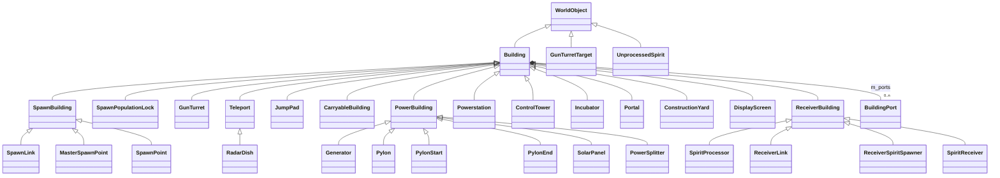
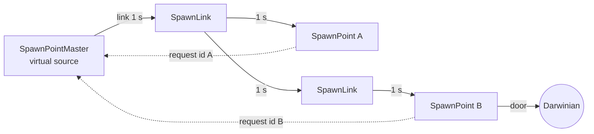
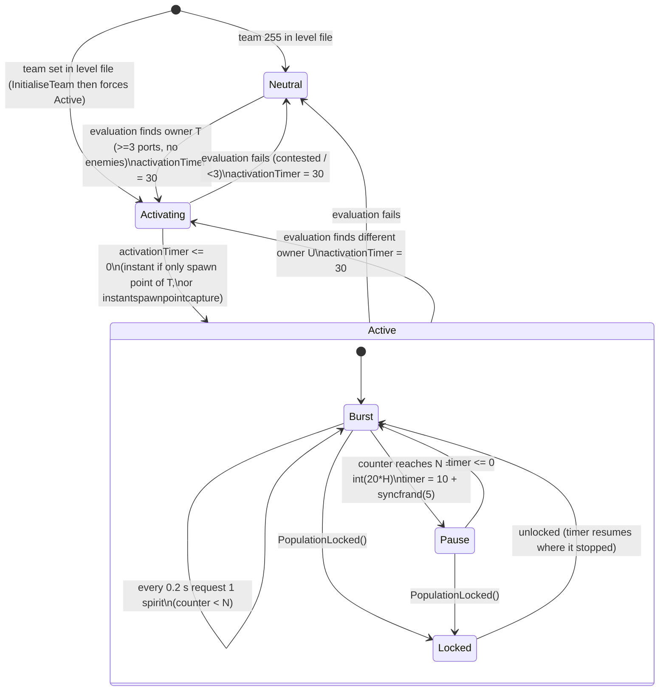
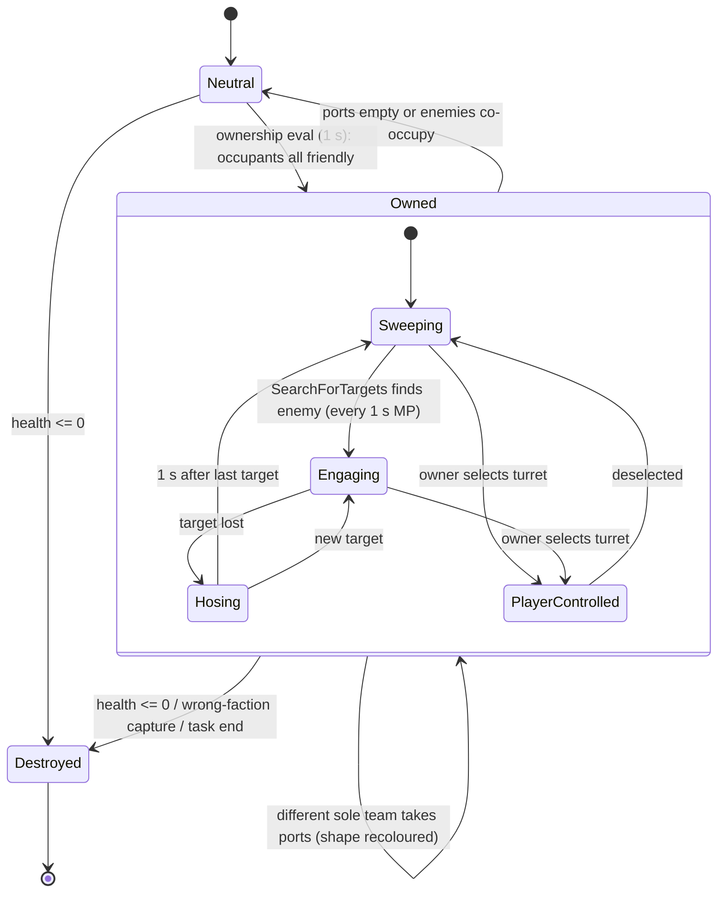
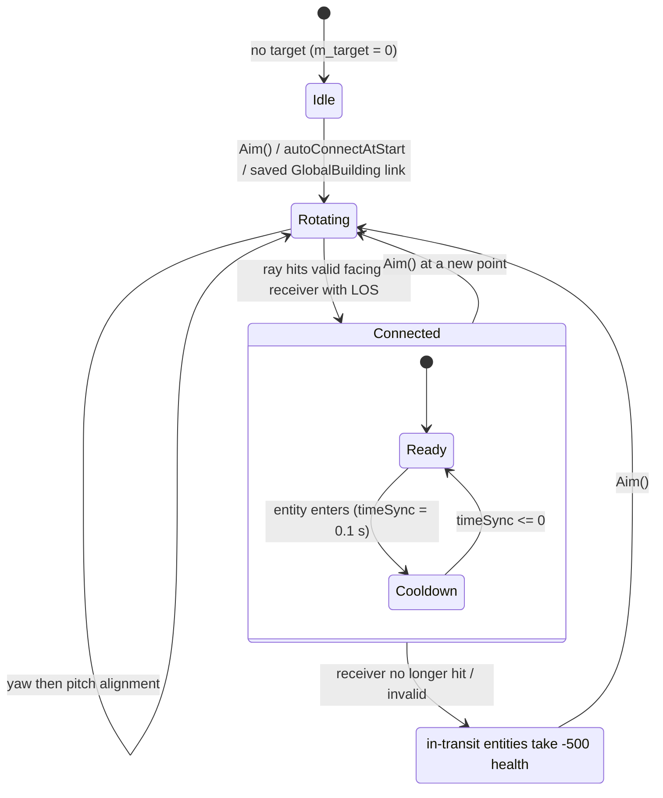
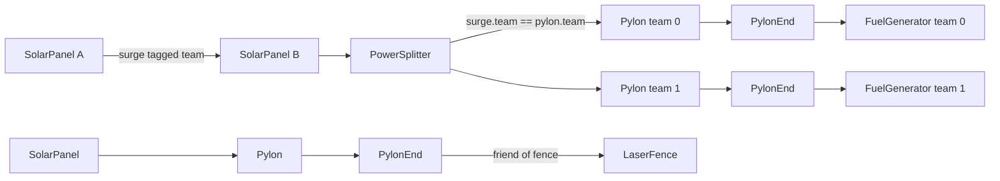
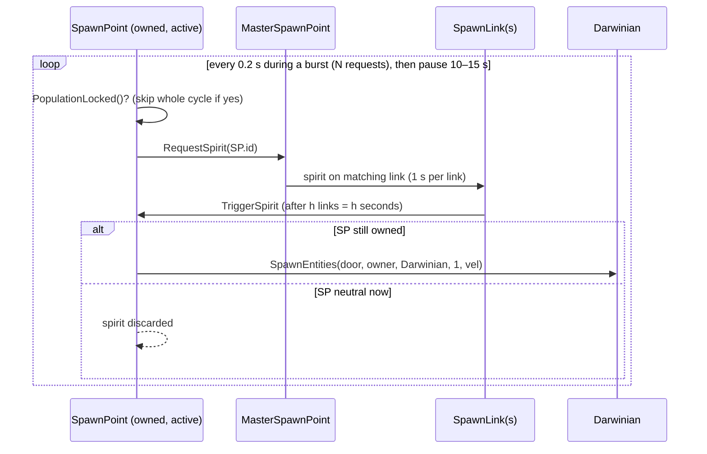

# P06_buildings_core — Core buildings: base class, spawn economy, turrets, transport

Scope: `code/worldobject/{building,spawnpoint,generator,powerstation,controltower,gunturret,radardish,portal,teleport,jumppad,carryablebuilding,constructionyard,spiritreceiver,spiritstore,incubator}.{h,cpp}` (30 files, all read in full). Build baseline: see `build_matrix.md` (`Release|Win32` + `TARGET_PC_FULLGAME`, `BLOCK_OLD_DARWINIA_OBJECTS` on, `LOCATION_EDITOR` off).

Supporting evidence read outside scope (listed in the coverage CSV): `code/level_file.cpp:LevelFile::ParseBuildings/ParseMultiwiniaOptions`, `code/location.cpp:Location::Init/InitialiseBuildings-loop/AdvanceBuildings/Advance/InitialiseTeam/Bang/IsFriend/FireTurretShell/FireRocket/ThrowWeapon/LaunchFireball/FireLaser`, `code/worldobject/darwinian.cpp:SearchForPorts/AdvanceApproachingPort/AdvanceOperatingPort`, `code/worldobject/entity.cpp:EnterTeleports/EntityIsBlocked`, `code/worldobject/weapons.cpp:TurretShell::Advance`, `code/worldobject/crate.cpp:RunGunTurret/RunTheBeast/RunSpawnMania`, `code/worldobject/controlstation.cpp:RecalculateOwnership`, `code/gametimer.cpp:GetServerAdvancePeriod`, `contrib/systemiv/lib/math/random_number.cpp`, `code/lib/vector3.{h,cpp}` (FRAND/SFRAND), `data/levels/*.txt`, `data/shapes/*.shp`, `data/multiwinia.txt`.

Helper scripts (run with `python3 -I`): `OUT/_work/scripts/P06_level_building_usage.py` → `drafts/P06_level_building_usage.csv` (building type × level counts); `OUT/_work/scripts/P06_spawn_graph.py` → `drafts/P06_spawn_graph.csv` (spawn-link graph analysis per level); `OUT/_work/scripts/P06_shape_markers.py` (port/light marker counts per shape).

### Conventions used throughout this draft

| Term | Meaning | Evidence |
|---|---|---|
| tick | One server advance. Every building's `Advance()` runs once per tick (buildings are advanced in `NUM_SLICES_PER_FRAME` slices, each building in exactly one slice) | [C] `code/location.cpp:Location::AdvanceBuildings` (`GetNextSliceBounds`); [I] once-per-tick follows from the slice partition (core-loop agent to confirm) |
| `SERVER_ADVANCE_PERIOD` (dt) | `0.1 * m_gameSpeed` seconds. Normal speed → **0.1 s**. All "per tick" constants below assume dt = 0.1 s; the speed-up/slow-down crates change `m_gameSpeed` | [C] `code/gametimer.h` macro; `code/gametimer.cpp:GameTimer::GetServerAdvancePeriod` |
| Team id | `unsigned char`; 0..5 = teams (`NUM_TEAMS` = 6), **255 = neutral/none**. `SetTeamId(-1)` therefore stores 255 | [C] `code/worldobject/worldobject.h:WorldObjectId::SetTeamId`; `code/globals.h:NUM_TEAMS` |
| `syncfrand(x)` | synced Mersenne-Twister, uniform in **[0, x)** | [C] `contrib/systemiv/lib/math/random_number.cpp:_syncfrand` |
| `syncsfrand(x)` | synced, uniform in **[−x/2, +x/2)** (NOT ±x) | [C] `random_number.cpp:_syncsfrand` = `(_syncfrand(1)-0.5)*x` |
| `FRAND(x)` / `SFRAND(x)` (upper case) | wrappers that call `_syncfrand` / `_syncsfrand` → **synced** | [C] `code/lib/vector3.cpp:FromRand` |
| `frand`/`sfrand`/`AppRandom`/`rand` (lower case) | **unsynced** LCG / CRT — only legal for cosmetic effects | [C] `random_number.cpp:frand/sfrand/AppRandom` |
| `Multiplayer()` | `m_gameMode == GameModeMultiwinia` — true for every Multiwinia game including vs-CPU and tutorials. `IsSinglePlayer()` = Campaign or Prologue (Darwinia) | [C] `code/app.cpp:App::Multiplayer/IsSinglePlayer` |
| Official MP levels | the 49 `mp_*.txt` files listed in `data/levels/level_enum.txt` (+10 PDLC names whose files are absent). Dev maps `mp_sandbox`, `mp_sandbox_all`, `mp_benchmark_1`, `mp_assault_stress` declare `GameTypes none`; `mp_tankbattle_*` use the compiled-out TankBattle mode | [C] `data/levels/level_enum.txt`; `GameTypes` lines; [I] GameTypes-none maps are not offered by `GameMenu::CreateMapList`/`AddMap` (not read in full) |

## [→ 03_buildings_and_world_objects] Building base class (`Building`, `BuildingPort`)

Source: `code/worldobject/building.h`, `code/worldobject/building.cpp`. Build tag: **[B:FULL]** (whole class), with debug-only render helpers under `DEBUG_RENDER_ENABLED` (globally on → also [B:FULL]).

### 1. Role and object model

`Building` derives from `WorldObject` (position `m_pos`, velocity `m_vel`, id `m_id`, type `m_type`) and is the base of every static or semi-static world object that the level file places in a `Buildings_StartDefinition` block, plus several runtime-created objects (crates, statues, turrets from crates, portals, AI targets). [C] `building.h:class Building`.


(Only classes in this partition are shown; `Bridge` also derives from `Teleport` [C] `code/worldobject/entity.cpp:Entity::EnterTeleports` casts; `Statue`, `WallBuster`, `ChessPiece` derive from `CarryableBuilding` [C] `carryablebuilding.cpp:IsCarryableBuilding`.)

### 2. Data members (every member)

| Member | Type | Default (ctor) | Meaning | Ref |
|---|---|---|---|---|
| `m_front` | Vector3 | (1,0,0) | facing; level file stores x,z only, then normalised | [C] `Building::Building`, `Building::Read` |
| `m_up` | Vector3 | `g_upVector` (0,1,0) | up vector (SolarPanel/SpiritReceiver use terrain normal) | [C] |
| `m_timeOfDeath` | double | −1.0 | unused by this partition's classes [I] (no reads in scope) | [C] ctor |
| `m_dynamic` | bool | false | "only appears on this level, not all levels for this map" (Darwinia map/mission split); set from `Read(_in,_dynamic)` | [C] `building.h` comment, `Read` |
| `m_isGlobal` | bool | false (forced true for 6 types, §9) | building is mirrored in `GlobalWorld` (Darwinia campaign persistence) | [C] `CreateBuilding(int)` |
| `m_centrePos` | Vector3 | — | bounding-sphere centre: `Shape::CalculateCentre(mat)` or `m_pos` if no shape | [C] `Initialise`, `SetDetail` |
| `m_radius` | double | **13.0** | bounding-sphere radius: `Shape::CalculateRadius` or 13.0 if no shape | [C] ctor, `Initialise` |
| `m_destroyed` | bool | false | when true, next `Advance()` returns true → location deletes the building | [C] `Building::Advance`, `Location::AdvanceBuildings` |
| `m_shape` | Shape* | NULL | render/collision shape (set by subclass ctor via `SetShape`) | [C] |
| `m_lights` | LList<ShapeMarker*> | empty | every shape marker whose name **contains** `MarkerLight` (recursive) | [C] `SetShapeLights` (`strstr`) |
| `m_ports` | LList<BuildingPort*> | empty | every marker whose name **contains** `MarkerPort` | [C] `SetShapePorts` |
| `s_controlPad` (static) | Shape* | `controlpad.shp` | port pad shape, loaded by first Building ctor | [C] ctor |
| `s_controlPadStatus` (static) | ShapeMarker* | marker `MarkerStatus` of controlpad.shp | where the port status light is drawn | [C] ctor |
| `s_neighbours` (static, protected) | `std::vector<WorldObjectId>` | — | shared scratch buffer for entity-grid queries (not re-entrant) | [C] |
| team (in `m_id`) | uchar | **255 in Multiwinia**, 1 in single-player (Darwinia) | owner | [C] ctor `IsSinglePlayer()` branch |

`BuildingPort` members: `m_marker` (ShapeMarker*), `m_occupant` (WorldObjectId of the Darwinian operating it, invalid if empty), `m_mat` (world matrix of the port), `m_counter[NUM_TEAMS]` (per-team reservation counter). [C] `building.h:class BuildingPort`.

### 3. Lifecycle (template → instance)

1. **Parse.** `LevelFile::ParseBuildings` reads each line; first token = type name → `Building::CreateBuilding(char*)` (honours `BuildingIsBlocked`, returns NULL for blocked or unknown names, and the line is then silently skipped) → `building->Read(_in,_dynamic)`. Duplicate unique ids are a fatal `AppReleaseAssert`. Types TrunkPort, ControlTower, RadarDish, Incubator, FenceSwitch must have `isGlobal = 1` or loading asserts. Team-1-owned SpawnPopulationLocks get `m_maxPopulation *= 1 + difficulty/5` when the level difficulty is < 0 (Darwinia). [C] `code/level_file.cpp:LevelFile::ParseBuildings`.
2. **Instantiate.** For each parsed template, `Location` calls `CreateBuilding(type)` (int overload: **no** block check), maps the template's team **position** to a real team with `GetTeamFromPosition` (if team ≠ 255/−1), then `newBuilding->Initialise(template)` and `newBuilding->SetDetail(1)`. [C] `code/location.cpp` building-instantiation loop (≈L465–495).
3. **`Initialise(template)`** (base): copies `m_id, m_pos, m_front, m_up, m_dynamic, m_isGlobal, m_destroyed`; snaps `m_pos.y` to the heightmap; computes `m_centrePos/m_radius` from the shape; collects lights and ports; if a `GlobalBuilding` record exists for (uniqueId, requested location) its team overrides; triggers sound event `Create`. [C] `Building::Initialise`.
4. **`SetDetail(detail)`**: re-snaps y, recomputes centre/radius, **deletes and rebuilds all ports** (so port occupancy resets). `_detail` is ignored by the base class. [C] `Building::SetDetail`.
5. **`Advance()`** each tick: if `m_destroyed` return true (delete me); else `EvaluatePorts()`; return false. Subclasses call it last. [C] `Building::Advance`.
6. **Removal**: `Location::AdvanceBuildings` deletes the building when `Advance()` returns true, then recalculates the whole obstruction grid (and AI targets when an AITarget or Wall was removed). [C] `code/location.cpp:Location::AdvanceBuildings`.

Runtime-created buildings (crate turrets, statues, crates, portals, AI targets) follow the same pattern with a stack-allocated template: `CreateBuilding(int)` → `m_buildings.PutData` → `Initialise(&template)` → `m_id.SetUniqueId(GlobalWorld::GenerateBuildingId())`. [C] `code/worldobject/crate.cpp:Crate::RunGunTurret`, `gunturret.cpp:GunTurret::Advance` (AITarget).

### 4. Virtual / member function catalogue (every member)

| Function | Base behaviour | Overridden in this partition by | Ref |
|---|---|---|---|
| `Building()` ctor | defaults above; loads `controlpad.shp` once | all | [C] |
| `~Building()` | `m_ports.EmptyAndDelete()` | SpawnBuilding (links), PowerBuilding (surges), RadarDish (shape copy + AITarget), Incubator (empty) | [C] |
| `Initialise(Building*)` | §3 | SpawnBuilding, SpawnPoint, SpawnPopulationLock, ControlTower, PowerBuilding, PylonStart, SolarPanel, PowerSplitter, GunTurret, RadarDish, JumpPad, CarryableBuilding, Incubator, ReceiverBuilding, SpiritProcessor, SpiritReceiver | [C] |
| `Advance()` → bool | §3 step 5 | every class (JumpPad does **not** call the base → no port evaluation, `m_destroyed` ignored) | [C] `jumppad.cpp:JumpPad::Advance` |
| `SetShape(Shape*)` | stores pointer | Teleport (looks up `MarkerTeleportEntrance`), CarryableBuilding (pass-through) | [C] |
| `SetShapeLights(frag)` | recursive collect `*MarkerLight*` markers | — | [C] |
| `SetShapePorts(frag)` | recursive; for each `*MarkerPort*` marker: world matrix, position pushed out of the building by `PushFromBuilding(pos, 5.0)`, y snapped to terrain, counters zeroed | — | [C] |
| `SetDetail(int)` | §3 step 4 | GunTurret (re-forces centre = pos, radius = 30), RadarDish (caches entrance pos/front) | [C] |
| `IsInView()` | `camera->SphereInViewFrustum(m_centrePos, m_radius)` | SpawnBuilding, ControlTower, PowerBuilding, GunTurret, Teleport, CarryableBuilding (always true), ReceiverBuilding, SpiritProcessor (always true) | [C] |
| `Render(t)` | debug arrow when editing; `m_shape->Render(t, mat(front,up,pos))` | many (see per-class) | [C] |
| `RenderAlphas(t)` | `RenderLights(); RenderPorts();` | many | [C] |
| `RenderLights()` | if team ≠ 255 and lights exist: flash star sprites (size 6, 10 nested quads, team colour) only when `(lastValidSequenceIdFromServer % 10) / 2 == teamId` (or editing) — i.e. teams 0–4 each flash for 2 of every 10 server ticks; team 5 never flashes | — | [C] `Building::RenderLights` |
| `RenderPorts()` | per port: control-pad shape (if `RenderBuildingDetail` < 3) and status star: green (0.3,1,0.3) occupied / red (1,0.3,0.3) empty | SpawnPoint, GunTurret (grey/team colour), SolarPanel, SpiritReceiver | [C] |
| `RenderHitCheck()` | `DEBUG_RENDER_ENABLED`: shape hit-check or sphere | — | [C] |
| `RenderLink()` | `DEBUG_RENDER_ENABLED`: magenta arrow to `GetBuildingLink()` target | — | [C] |
| `PerformDepthSort(Vector3&)` | false | SpawnPoint (true, centre) | [C] |
| `SetTeamId(int)` | if changed: set team, mirror into `GlobalBuilding.m_teamId` (if any), sound `ChangeTeam` | — (subclasses call it) | [C] |
| `Reprogram(double)` | no-op | — | [C] |
| `ReprogramComplete()` | sound `ReprogramComplete`; toggles `GlobalBuilding.m_online`; `GlobalWorld::EvaluateEvents()` | Generator (enable) | [C] |
| `Damage(double)` | sound `Damage` only — **base buildings are indestructible** | GunTurret | [C] |
| `Destroy(double intensity)` | `m_destroyed = true`; 3× `g_explosionManager.AddExplosion(shape)`; `Location::Bang(m_pos, intensity, intensity/4)`; sound `Explode`; `(int)(intensity/4)` particles `TypeExplosionCore` size 100 with velocity `syncsfrand(100)` per axis (∈[−50,50)) | — | [C] |
| `PushFromBuilding(pos, r)` | if a sphere (pos,r) hits the building, step it by 2.0 units away from `m_pos` until clear | — | [C] |
| `EvaluatePorts()` | §5 | — | [C] |
| `GetNumPorts()` | `m_ports.Size()` | — | [C] |
| `GetNumPortsOccupied()` | count of ports with valid occupant | — | [C] |
| `GetPortOccupant(i)` | occupant id or invalid | — | [C] |
| `GetPortPosition(i,&pos,&front)` | port matrix pos/front; false if bad index | — | [C] |
| `OperatePort(i, team)` | `counter[team] = min(counter[team]+1, 50)` | — | [C] |
| `GetPortOperatorCount(i, team)` | `counter[team]`, or −1 for a bad index | — | [C] |
| `GetObjectiveCounter(UnicodeString&)` | empty string | MasterSpawnPoint, Generator, SpiritProcessor (Darwinia objectives) | [C] |
| `DoesSphereHit(pos,r)` | shape sphere test, else `|pos−m_pos| ≤ r + m_radius` | SpawnPopulationLock, JumpPad, Portal, CarryableBuilding (all false); RadarDish (radius ×1.5) | [C] |
| `DoesShapeHit(shape, mat)` | shape-vs-shape, else sphere | SpawnPopulationLock, JumpPad, Portal, CarryableBuilding (false) | [C] |
| `DoesRayHit(start,dir,len,pos,norm)` | shape ray test (`pos/norm` not filled), else ray-sphere | GunTurret, RadarDish, JumpPad, Portal, CarryableBuilding | [C] |
| `ListSoundEvents(list)` | `Create`, `Reprogramming` (comment "Remove me"), `ReprogramComplete`, `ChangeTeam`, `Damage` | most | [C] |
| `Read(TextReader*, bool dynamic)` / `Write(TextWriter*)` | §8 | per-class | [C] |
| `GetBuildingLink()` / `SetBuildingLink(id)` | −1 / no-op | SpawnBuilding (adds link), ControlTower, PowerBuilding, PowerSplitter (adds), Powerstation, RadarDish (adds valid link), ReceiverBuilding | [C] |
| `GetTypeName(int)` (static) | name table (§9); asserts and returns NULL out of range | — | [C] |
| `GetTypeId(name)` (static) | case-insensitive lookup, **ignores** the block list; −1 if not found | — | [C] |
| `CreateBuilding(int)` / `CreateBuilding(char*)` (static) | §9 | — | [C] |
| `GetTypeNameTranslated(type,&dest)` | language phrase `buildingname_<TypeName>` if present, else the raw type name | — | [C] |
| `LogState(msg)` | sync-log line hashing pos, vel, front, centre, radius (used by `SyncRandLogText` around every building advance) | — | [C] `Location::AdvanceBuildings` |
| `BuildingIsBlocked(int)` (static) | §10 | — | [C] |

### 5. Ports, occupancy and reservation

* **Creation**: one `BuildingPort` per shape marker containing `MarkerPort`; position pushed 5.0 units clear of the building, y on terrain. [C] `Building::SetShapePorts`.
* **Occupancy (every tick, `EvaluatePorts`)**: for each port, `m_occupant` is cleared, then the entity grid is queried within **5.0** units of the port; the first entity that is a `Darwinian` in `StateOperatingPort` becomes the occupant (any team; no check that the Darwinian is operating *this* port). [C] `Building::EvaluatePorts`.
* **Reservation counters**: if the port is occupied, all `m_counter[t]` = 0; otherwise each `m_counter[t] -= 4`, floored at 0. A Darwinian walking to a port calls `OperatePort(port, team)` every tick (`+1`, cap 50). [C] `Building::EvaluatePorts`, `code/worldobject/darwinian.cpp:Darwinian::AdvanceApproachingPort`.
* **Darwinian side (cross-partition)**: an idle (or worshipping/watching-spectacle/following-orders/following-officer/approaching-armour) Darwinian calls `SearchForPorts()`: candidate buildings have ≥1 port, `|building.pos − pos| − building.radius < 100` (`DARWINIAN_SEARCHRANGE_PORTS`), at least one free port, and a walkable path; it picks the **nearest** candidate (the random pick `syncrand() % n` is overwritten by the nearest loop but still consumes a synced random number), then picks uniformly (`syncrand()`) among ports with no occupant and `GetPortOperatorCount(p, team) < limit` where **limit = 1 in Multiwinia** (20 in Darwinia). Arrival → `StateOperatingPort`. The Darwinian leaves the port when `GetPortOccupant(port) != me` (e.g. displaced) or the building disappears. [C] `darwinian.cpp:Darwinian::SearchForPorts/AdvanceOperatingPort`; `darwinian.h:DARWINIAN_SEARCHRANGE_PORTS`.
* **Net effect in Multiwinia** [I]: a counter value ≥ 1 means "a team-mate is already walking to this port", so at most one Darwinian per team heads for each free port; counters decay by 4/tick once nobody is approaching. Different teams may race for the same port; whoever is first in `StateOperatingPort` within 5 units wins it.

### 6. Team ownership and capture — summary across the partition

Every capture rule in this partition is computed from **port occupants** (Darwinians standing on the building's pads) except where noted.

| Class | Ports (shape) | Recalc period | Rule | Contested result | Ref |
|---|---|---|---|---|---|
| SpawnPoint | 5 (`spawnpointmultiwinia.shp`) | 2.0 + syncfrand(1.0) s (first: syncfrand(2.0)) | owner = a team with **≥ 3** occupants (a later team index displaces the leader only if it has > 2 and strictly more); all other occupants must be friends of the owner | neutral (255) | [C] `SpawnPoint::RecalculateOwnership` |
| GunTurret | 4 (`battlecannonbase.shp`) | 1.0 s (`GUNTURRET_OWNERSHIPTIMER`) | owner = team with most occupants (≥1; ties → lowest team index); all occupants must be friends | neutral | [C] `GunTurret::RecalculateOwnership` |
| SolarPanel | 5 (`solarpanel.shp`) | every tick (Multiwinia only) | owner = team with most occupants (strictly greater wins; ties → lowest index); **enemies may co-occupy** | majority team | [C] `SolarPanel::RecalculateOwnership` |
| CarryableBuilding | 0 (proximity) | 1.0 s | team with most live Darwinians within 50 units, if ≥ `m_minLifters`; only switches if new team is not a friend of the current | 255 if nobody qualifies | [C] `CarryableBuilding::CalculateOwnership` |
| RadarDish | 0 | — | no own rule: team is set by a linked `ControlStation` (other partition) | — | [C] `code/worldobject/controlstation.cpp:ControlStation::RecalculateOwnership` (`b->SetTeamId(winningTeam)`) |
| ControlTower | 0 (3 reprogrammer slots) | per Engineer call | Engineer reprogramming moves `m_ownership` ±0.1 per call | — | [C] `ControlTower::Reprogram` |
| Incubator, JumpPad, Portal, SpawnLink, MasterSpawnPoint, SpawnPopulationLock, Pylon/PylonEnd/PowerSplitter | — | — | team fixed by level file / creator | — | [C] (no ownership code) |

`Building::SetTeamId` is the single mutation point (fires sound `ChangeTeam`, mirrors to GlobalBuilding). `RecalculateOwnership` variants call it every evaluation, but it is a no-op when unchanged. [C].

### 7. Damage, health, destruction

* Base `Damage()` only plays a sound: buildings without an override cannot be destroyed by weapons. [C] `Building::Damage`.
* `Location::Bang(pos, range, damage, team, fromBuilding)` calls `building->Damage(−damage × clamp(1 − dist/(3·range), 0, 1))` on **every** building within `3 × range` — this is the main source of building damage (grenades, rockets, air strikes, nukes, portal explosion). [C] `code/location.cpp:Location::Bang`.
* Other sources: `TurretShell` hits deal `Damage(−2)` but only to Tree/AntHill/Triffid buildings [C] `code/worldobject/weapons.cpp:TurretShell::Advance`; tasks call `Damage(−1000)` to self-destruct turrets [C] `code/taskmanager.cpp:Task::Advance/Task::Stop`; `WallBuster` deals −1000 [C] `code/worldobject/wallbuster.cpp`.
* In this partition only **GunTurret** has health (60). Sign convention: `Damage()` receives a **negative** number for harm (`m_health += _damage`). [C] `GunTurret::Damage`.
* `Destroy(intensity)` is the scripted-destruction path (§4). [C].

### 8. Level-file line (base fields, in order)

Header comment in every level: `# Type id x z tm rx rz isGlobal` [C] `data/levels/mp_koth_2P_1.txt`.

| # | Token | Parsed as | Meaning | Write format |
|---|---|---|---|---|
| 0 | type name | `CreateBuilding(char*)` (case-insensitive) | §9 names | `\t%-20s` |
| 1 | id | int | unique building id (must be unique per level) | `%-8d` |
| 2 | x | `iv_atof` | world x | `%-8.2f` |
| 3 | z | `iv_atof` | world z (y always from heightmap) | `%-8.2f` |
| 4 | team | int | team **position** in the level (0..5) or 255 neutral; remapped by `GetTeamFromPosition` at instantiation | `%-8d` |
| 5 | front.x | `iv_atof` | facing x | `%-8.2f` |
| 6 | front.z | `iv_atof` | facing z (then `m_front.Normalise()`, y = 0) | `%-8.2f` |
| 7 | isGlobal | `(bool)atoi` | §2 | `%-8d` |
| 8.. | subclass fields | per class `Read` | see each class | per class |

`m_id.Set(teamId, UNIT_BUILDINGS, −1, buildingId)`; `m_dynamic = _dynamic` (true for the second `Buildings_StartDefinition` block, the "mission" half). [C] `Building::Read/Write`; [I] which block is `_dynamic` is decided in `LevelFile` (other agent).

### 9. Type enum, name strings and factory

`CreateBuilding(int)` is a `switch` over the enum that `new`s the class, then for **RadarDish, ControlTower, TrunkPort, Incubator, DynamicHub, FenceSwitch** forces `m_isGlobal = true`, and sets `m_type`. `CreateBuilding(char*)` loops over all types, **skips blocked types**, and compares names case-insensitively; unknown/blocked → NULL. [C] `Building::CreateBuilding` (both overloads). The name table must stay in enum order (comment in source). `GetTypeId` does not check the block list. [C].

"Official MP / dev / Darwinia maps" = number of level files containing at least one line of that type (49 official MP levels; 9 dev `mp_*` files not in `level_enum.txt`; 30 Darwinia `map_*`/`mission_*` files). [C] `drafts/P06_level_building_usage.csv` via `scripts/P06_level_building_usage.py`.

| Value | Enum | Level-file name | Class (factory) | Header | `BuildingIsBlocked` | Forced global | Official MP / dev / Darwinia maps | Partition owner |
|---|---|---|---|---|---|---|---|---|
| 0 | `TypeInvalid` | `Invalid` | — (NULL) | | no | | 0/0/0 | — |
| 1 | `TypeFactory` | `Factory` | `Factory` | `factory.h` | **BLOCKED** | | 0/0/0 | other |
| 2 | `TypeCave` | `Cave` | `Cave` | `cave.h` | **BLOCKED** | | 0/0/0 | other |
| 3 | `TypeRadarDish` | `RadarDish` | `RadarDish` | `radardish.h` | no | yes | 7/0/11 | **P06** |
| 4 | `TypeLaserFence` | `LaserFence` | `LaserFence` | `laserfence.h` | no | | 14/1/1 | other |
| 5 | `TypeControlTower` | `ControlTower` | `ControlTower` | `controltower.h` | no | yes | 0/2/12 | **P06** |
| 6 | `TypeGunTurret` | `GunTurret` | `GunTurret` | `gunturret.h` | no | | 13/1/2 | **P06** |
| 7 | `TypeBridge` | `Bridge` | `Bridge` | `bridge.h` | **BLOCKED** | | 0/0/0 | other |
| 8 | `TypePowerstation` | `Powerstation` | `Powerstation` | `powerstation.h` | **BLOCKED** | | 0/0/0 | **P06** |
| 9 | `TypeTree` | `Tree` | `Tree` | `tree.h` | no | | 39/6/8 | other |
| 10 | `TypeWall` | `Wall` | `Wall` | `wall.h` | no | | 9/2/0 | other |
| 11 | `TypeTrunkPort` | `TrunkPort` | `TrunkPort` | `trunkport.h` | no | yes | 28/3/12 | other |
| 12 | `TypeResearchItem` | `ResearchItem` | `ResearchItem` | `researchitem.h` | **BLOCKED** | | 0/0/6 | other |
| 13 | `TypeLibrary` | `Library` | `Library` | `library.h` | **BLOCKED** | | 0/0/0 | other |
| 14 | `TypeGenerator` | `Generator` | `Generator` | `generator.h` | **BLOCKED** | | 0/0/1 | **P06** |
| 15 | `TypePylon` | `Pylon` | `Pylon` | `generator.h` | no | | 16/1/3 | **P06** |
| 16 | `TypePylonStart` | `PylonStart` | `PylonStart` | `generator.h` | **BLOCKED** | | 0/0/1 | **P06** |
| 17 | `TypePylonEnd` | `PylonEnd` | `PylonEnd` | `generator.h` | no | | 16/1/2 | **P06** |
| 18 | `TypeSolarPanel` | `SolarPanel` | `SolarPanel` | `generator.h` | no | | 16/1/2 | **P06** |
| 19 | `TypePowerSplitter` | `PowerSplitter` | `PowerSplitter` | `generator.h` | no | | 7/0/0 | **P06** |
| 20 | `TypeTrackLink` | `TrackLink` | `TrackLink` | `mine.h` | **BLOCKED** | | 0/0/2 | other |
| 21 | `TypeTrackJunction` | `TrackJunction` | `TrackJunction` | `mine.h` | **BLOCKED** | | 0/0/1 | other |
| 22 | `TypeTrackStart` | `TrackStart` | `TrackStart` | `mine.h` | **BLOCKED** | | 0/0/1 | other |
| 23 | `TypeTrackEnd` | `TrackEnd` | `TrackEnd` | `mine.h` | **BLOCKED** | | 0/0/2 | other |
| 24 | `TypeRefinery` | `Refinery` | `Refinery` | `mine.h` | **BLOCKED** | | 0/0/1 | other |
| 25 | `TypeMine` | `Mine` | `Mine` | `mine.h` | **BLOCKED** | | 0/0/1 | other |
| 26 | `TypeYard` | `Yard` | `ConstructionYard` | `constructionyard.h` | **BLOCKED** | | 0/0/1 | **P06** |
| 27 | `TypeDisplayScreen` | `DisplayScreen` | `DisplayScreen` | `constructionyard.h` | **BLOCKED** | | 0/0/0 | **P06** |
| 28 | `TypeUpgradePort` | `UpgradePort` | `UpgradePort` | `upgrade_port.h` | **BLOCKED** | | 0/0/0 | other |
| 29 | `TypePrimaryUpgradePort` | `PrimaryUpgrade` | `PrimaryUpgradePort` | `upgrade_port.h` | **BLOCKED** | | 0/0/0 | other |
| 30 | `TypeIncubator` | `Incubator` | `Incubator` | `incubator.h` | no | yes | 0/2/14 | **P06** |
| 31 | `TypeAntHill` | `AntHill` | `AntHill` | `anthill.h` | no | | 0/0/2 | other |
| 32 | `TypeSafeArea` | `SafeArea` | `SafeArea` | `safearea.h` | **BLOCKED** | | 0/0/3 | other |
| 33 | `TypeTriffid` | `Triffid` | `Triffid` | `triffid.h` | no | | 0/0/9 | other |
| 34 | `TypeSpiritReceiver` | `SpiritReceiver` | `SpiritReceiver` | `spiritreceiver.h` | **BLOCKED** | | 0/0/1 | **P06** |
| 35 | `TypeReceiverLink` | `ReceiverLink` | `ReceiverLink` | `spiritreceiver.h` | **BLOCKED** | | 0/0/2 | **P06** |
| 36 | `TypeReceiverSpiritSpawner` | `SpiritSpawner` | `ReceiverSpiritSpawner` | `spiritreceiver.h` | **BLOCKED** | | 0/0/1 | **P06** |
| 37 | `TypeSpiritProcessor` | `SpiritProcessor` | `SpiritProcessor` | `spiritreceiver.h` | **BLOCKED** | | 0/0/1 | **P06** |
| 38 | `TypeSpawnPoint` | `SpawnPoint` | `SpawnPoint` | `spawnpoint.h` | no | | 32/2/3 | **P06** |
| 39 | `TypeSpawnPopulationLock` | `SpawnPopulationLock` | `SpawnPopulationLock` | `spawnpoint.h` | no | | 21/1/6 | **P06** |
| 40 | `TypeSpawnPointMaster` | `SpawnPointMaster` | `MasterSpawnPoint` | `spawnpoint.h` | no | | 32/2/3 | **P06** |
| 41 | `TypeSpawnLink` | `SpawnLink` | `SpawnLink` | `spawnpoint.h` | no | | 21/2/3 | **P06** |
| 42 | `TypeAITarget` | `AITarget` | `AITarget` | `ai.h` | no | | 49/4/4 | other |
| 43 | `TypeAISpawnPoint` | `AISpawnPoint` | `AISpawnPoint` | `ai.h` | **BLOCKED** | | 0/0/1 | other |
| 44 | `TypeBlueprintStore` | `BlueprintStore` | `BlueprintStore` | `blueprintstore.h` | **BLOCKED** | | 0/0/1 | other |
| 45 | `TypeBlueprintConsole` | `BlueprintConsole` | `BlueprintConsole` | `blueprintstore.h` | **BLOCKED** | | 0/0/1 | other |
| 46 | `TypeBlueprintRelay` | `BlueprintRelay` | `BlueprintRelay` | `blueprintstore.h` | **BLOCKED** | | 0/0/1 | other |
| 47 | `TypeScriptTrigger` | `ScriptTrigger` | `ScriptTrigger` | `scripttrigger.h` | **BLOCKED** | | 0/0/11 | other |
| 48 | `TypeSpam` | `Spam` | `Spam` | `spam.h` | **BLOCKED** | | 0/0/1 | other |
| 49 | `TypeGodDish` | `GodDish` | `GodDish` | `goddish.h` | **BLOCKED** | | 0/0/1 | other |
| 50 | `TypeStaticShape` | `StaticShape` | `StaticShape` | `staticshape.h` | no | | 19/0/2 | other |
| 51 | `TypeFuelGenerator` | `FuelGenerator` | `FuelGenerator` | `rocket.h` | no | | 7/0/1 | other |
| 52 | `TypeFuelPipe` | `FuelPipe` | `FuelPipe` | `rocket.h` | no | | 7/0/1 | other |
| 53 | `TypeFuelStation` | `FuelStation` | `FuelStation` | `rocket.h` | no | | 7/0/1 | other |
| 54 | `TypeEscapeRocket` | `EscapeRocket` | `EscapeRocket` | `rocket.h` | no | | 7/0/1 | other |
| 55 | `TypeFenceSwitch` | `FenceSwitch` | `FenceSwitch` | `switch.h` | **BLOCKED** | yes | 0/0/0 | other |
| 56 | `TypeDynamicHub` | `DynamicHub` | `DynamicHub` | `generichub.h` | **BLOCKED** | yes | 0/0/0 | other |
| 57 | `TypeDynamicNode` | `DynamicNode` | `DynamicNode` | `generichub.h` | **BLOCKED** | | 0/0/0 | other |
| 58 | `TypeFeedingTube` | `FeedingTube` | `FeedingTube` | `feedingtube.h` | **BLOCKED** | | 0/0/0 | other |
| 59 | `TypeMultiwiniaZone` | `MultiwiniaZone` | `MultiwiniaZone` | `multiwiniazone.h` | no | | 25/2/1 | other |
| 60 | `TypeChessPiece` | `ChessPiece` | `ChessPiece` | `chess.h` | **BLOCKED** | | 0/0/0 | other |
| 61 | `TypeChessBase` | `ChessBase` | `ChessBase` | `chess.h` | **BLOCKED** | | 0/0/0 | other |
| 62 | `TypeCloneLab` | `CloneLab` | `CloneLab` | `clonelab.h` | no | | 0/0/0 | other |
| 63 | `TypeControlStation` | `ControlStation` | `ControlStation` | `controlstation.h` | no | | 9/1/0 | other |
| 64 | `TypePortal` | `Portal` | `Portal` | `portal.h` | **BLOCKED** | | 0/0/0 | **P06** |
| 65 | `TypeCrate` | `Crate` | `Crate` | `crate.h` | **BLOCKED** | | 0/0/0 | other |
| 66 | `TypeStatue` | `Statue` | `Statue` | `statue.h` | **BLOCKED** | | 0/1/0 | other |
| 67 | `TypeWallBuster` | `WallBuster` | `WallBuster` | `wallbuster.h` | no | | 1/0/0 | other |
| 68 | `TypePulseBomb` | `PulseBomb` | `PulseBomb` | `pulsebomb.h` | no | | 8/1/0 | other |
| 69 | `TypeRestrictionZone` | `RestrictionZone` | `RestrictionZone` | `restrictionzone.h` | no | | 14/0/0 | other |
| 70 | `TypeJumpPad` | `JumpPad` | `JumpPad` | `jumppad.h` | no | | 3/0/0 | **P06** |
| 71 | `TypeAIObjective` | `AIObjective` | `AIObjective` | `aiobjective.h` | no | | 8/1/0 | other |
| 72 | `TypeAIObjectiveMarker` | `AIObjectiveMarker` | `AIObjectiveMarker` | `aiobjective.h` | no | | 15/1/0 | other |
| 73 | `TypeEruptionMarker` | `EruptionMarker` | `EruptionMarker` | `eruptionmarker.h` | no | | 1/0/0 | other |
| 74 | `TypeSmokeMarker` | `SmokeMarker` | `SmokeMarker` | `smokemarker.h` | no | | 1/0/0 | other |
| 75 | `NumBuildingTypes` | — | — | | | | | — |

Notes:
* Name ≠ enum suffix for three types: `TypePrimaryUpgradePort` ↔ `"PrimaryUpgrade"`, `TypeReceiverSpiritSpawner` ↔ `"SpiritSpawner"`, `TypeYard` ↔ class `ConstructionYard`. [C] `GetTypeName` table.
* **Blocked ≠ impossible.** The block list only stops *level-file* creation by name and hides types in the editor (`interface/buildings_window.cpp`). Blocked types are still created at runtime through `CreateBuilding(int)`: `Crate` (`Location::AdvanceCrates`, cheat/help code), `Statue` (CTS mode, `code/multiwinia.cpp`), `Portal` ("The Beast" crate, `crate.cpp:Crate::RunTheBeast`), `ChessPiece` (`chess.cpp`), `Bridge` (Engineer), `Spam` (GodDish). [C] grep of `CreateBuilding(` callers.
* A Darwinia level line naming an unknown type (`CarryableBuilding` in `data/levels/map_sandbox.txt`) is silently dropped. [C].

### 10. `BuildingIsBlocked` — verbatim list as a table

Under `#ifdef BLOCK_OLD_DARWINIA_OBJECTS` (on in FULLGAME) the function returns true for exactly these 39 types (source order); otherwise false. [C] `Building::BuildingIsBlocked`.

| # | Blocked type | # | Blocked type | # | Blocked type |
|---|---|---|---|---|---|
| 1 | `TypeBlueprintConsole` | 14 | `TypeGenerator` | 27 | `TypeSpam` |
| 2 | `TypeBlueprintRelay` | 15 | `TypeGodDish` | 28 | `TypeSpiritProcessor` |
| 3 | `TypeBlueprintStore` | 16 | `TypeLibrary` | 29 | `TypeSpiritReceiver` |
| 4 | `TypeBridge` | 17 | `TypeMine` | 30 | `TypeStatue` |
| 5 | `TypeCave` | 18 | `TypePortal` | 31 | `TypeTrackEnd` |
| 6 | `TypeChessBase` | 19 | `TypePowerstation` | 32 | `TypeTrackJunction` |
| 7 | `TypeChessPiece` | 20 | `TypePrimaryUpgradePort` | 33 | `TypeTrackLink` |
| 8 | `TypeCrate` | 21 | `TypeReceiverLink` | 34 | `TypeTrackStart` |
| 9 | `TypeDisplayScreen` | 22 | `TypeReceiverSpiritSpawner` | 35 | `TypeUpgradePort` |
| 10 | `TypeDynamicHub` | 23 | `TypeRefinery` | 36 | `TypeYard` |
| 11 | `TypeDynamicNode` | 24 | `TypeResearchItem` | 37 | `TypePylonStart` |
| 12 | `TypeFactory` | 25 | `TypeSafeArea` | 38 | `TypeFeedingTube` |
| 13 | `TypeFenceSwitch` | 26 | `TypeScriptTrigger` | 39 | `TypeAISpawnPoint` |

Exact source order (single list, for unambiguous re-implementation): BlueprintConsole, BlueprintRelay, BlueprintStore, Bridge, Cave, ChessBase, ChessPiece, Crate, DisplayScreen, DynamicHub, DynamicNode, Factory, FenceSwitch, Generator, GodDish, Library, Mine, Portal, Powerstation, PrimaryUpgradePort, ReceiverLink, ReceiverSpiritSpawner, Refinery, ResearchItem, SafeArea, ScriptTrigger, Spam, SpiritProcessor, SpiritReceiver, Statue, TrackEnd, TrackJunction, TrackLink, TrackStart, UpgradePort, Yard, PylonStart, FeedingTube, AISpawnPoint. [C].

Not blocked although Darwinia-era: AntHill, Triffid, ControlTower, Incubator, TrunkPort, LaserFence, Pylon/PylonEnd/SolarPanel/PowerSplitter, FuelGenerator/FuelPipe/FuelStation/EscapeRocket, StaticShape, CloneLab. [C].

### 11. Global vs local buildings

`m_isGlobal` marks a building that is mirrored as a `GlobalBuilding` record (team, online flag, link) in `g_app->m_globalWorld` — the Darwinia campaign's cross-level persistence. Touch points in this partition: `Initialise` (team from GlobalBuilding), `SetTeamId` (writes team), `ReprogramComplete` (toggles online), ControlTower/Generator/SpiritProcessor/ConstructionYard/MasterSpawnPoint (set `m_online`), RadarDish (stores `m_link`). In Multiwinia `GlobalBuilding` lookups are harmless no-ops or campaign leftovers [I] (MP levels still set `isGlobal=1` on RadarDish/TrunkPort because `ParseBuildings` asserts it). [C] `building.cpp`, `level_file.cpp:ParseBuildings`.

### 12. Shapes, markers and hit tests used by this partition

| Shape | `MarkerPort*` | `MarkerLight*` | Other markers used | Ref |
|---|---|---|---|---|
| `spawnpointmultiwinia.shp` (MP) / `spawnpoint.shp` (SP) | 5 | 3 | MarkerDoor, MarkerSpiritLink | [C] `data/shapes/*.shp` via `scripts/P06_shape_markers.py` |
| `spawnlink.shp`, `masterspawnpoint.shp` | 0 | 0 | MarkerSpiritLink | [C] |
| `battlecannonbase.shp` (turret base) | 4 | 0 | MarkerStatus01–04 (code asks for 5; #5 NULL, harmless because only 4 ports) | [C] |
| `battlecannonturret.shp` | 0 | 0 | MarkerBarrel, MarkerKills | [C] |
| `cannon_bullets.shp`, `cannon_flame.shp`, `cannon_rocket.shp`, `battlecannonbarrel.shp` | 0 | 0 | MarkerBarrelEnd01–04; MarkerShells01–04 only on cannon_bullets | [C] |
| `radardish.shp` (per-instance copy) | 0 | 2 | MarkerTeleportEntrance, MarkerFocus; fragments `Dish`, `UpperMount` | [C] |
| `controltower.shp` | 0 | 1 (`MarkerLightPos` matches the `strstr` test) | MarkerReprogrammer0–2, MarkerConsole0–2, MarkerDishPos | [C] |
| `solarpanel.shp` | 5 | 0 | MarkerStatus01–05, MarkerGlow01–04, MarkerPowerLocation | [C] |
| `pylon.shp` | 0 | 1 | MarkerPowerLocation | [C] |
| `generator.shp` | 0 | 0 | MarkerPowerLocation, MarkerCounter | [C] |
| `powerstation.shp` | 4 | 0 | — | [C] |
| `constructionyard.shp` | 12 | 0 | MarkerPrimitive01–09 | [C] |
| `incubator.shp` | 0 | 4 | MarkerExit, MarkerSpirits, MarkerDock, MarkerSpiritIncoming0–2 | [C] |
| `spiritreceiver.shp` | 5 | 0 | MarkerHead, MarkerStatus01–05 | [C] |
| `controlpad.shp` | 0 | 0 | MarkerStatus | [C] |

Hit-test overrides: buildings that must never block movement or projectiles return false from `DoesSphereHit/DoesShapeHit` (SpawnPopulationLock, JumpPad, Portal, CarryableBuilding); RadarDish inflates its sphere test ×1.5 so its door registers in obstruction-grid cells; GunTurret ray test = turret shape ∪ barrel shape ∪ sphere r=12 at pos+(0,10,0) (exact picking for selection). [C] respective `DoesSphereHit/DoesRayHit`.

## [→ 03_buildings_and_world_objects] Spawn network buildings (SpawnBuilding, SpawnPoint, SpawnLink, MasterSpawnPoint, SpawnPopulationLock)

Source: `code/worldobject/spawnpoint.{h,cpp}`. Build tag: **[B:FULL]** (all five classes; single-player branches are [B:LEGACY]). The economic behaviour (rates, caps, handicap) is specified in the `[→ 05]` section below; this section is the building-level spec.

### Overview

A level's spawn network is a **directed tree of links** rooted at one `SpawnPointMaster`, with `SpawnLink` relay nodes and `SpawnPoint` leaves (a SpawnPoint may also relay). When an owned SpawnPoint wants a Darwinian it asks the master; the master emits a *virtual* spirit (`SpawnBuildingSpirit` — not a `Spirit` entity) that travels link by link (1 s per link) to the requesting SpawnPoint, which then spawns one Darwinian at its door if it is still owned. [C] `MasterSpawnPoint::RequestSpirit`, `SpawnBuilding::TriggerSpirit/Advance`, `SpawnPoint::TriggerSpirit/SpawnDarwinian`.



### SpawnBuilding (abstract base of SpawnLink / MasterSpawnPoint / SpawnPoint)

| Member | Meaning | Ref |
|---|---|---|
| `m_links : LList<SpawnBuildingLink*>` | outgoing links. Each link: `m_targetBuildingId` (direct neighbour), `m_targets` (ids of every SpawnPoint reachable down this link, filled by `ExploreLinks`), `m_spirits` (spirits in transit on this link) | [C] `spawnpoint.h` |
| `m_spiritLink : ShapeMarker*` | lazily looked-up `MarkerSpiritLink` (asserts if missing); link beams start/end here | [C] `GetSpiritLink` |
| `m_visibilityMidpoint/Radius` | cached culling sphere covering the building and all link targets (recomputed while editing) | [C] `IsInView` |
| `SpawnBuildingSpirit` | `m_targetBuildingId` (requesting SpawnPoint), `m_currentProgress` ∈ [0,1] along the current link | [C] |

Functions:
* `SetBuildingLink(id)` — appends a link unless one to `id` already exists (the type check of the target is commented out). [C].
* `ClearLinks()` — deletes all links. [C].
* `ExploreLinks()` — recursive DFS: returns this building's id if it is a SpawnPoint, plus everything reachable through each link whose target is a spawn building; stores the reachable set per link in `m_targets`. Self-link → `AppReleaseAssert` "SpawnPoint %d Linked to itself". **No cycle detection** (a cycle would recurse forever) and no memoisation. [C] `SpawnBuilding::ExploreLinks`. All shipped levels are acyclic trees with every SpawnPoint reachable and exactly one path to each (see `drafts/P06_spawn_graph.csv`). [C] data via `scripts/P06_spawn_graph.py`.
* `TriggerSpirit(spirit, progress)` — puts the spirit on **every** outgoing link whose `m_targets` contains the spirit's target, setting its progress to the carried-over value; if no link matches, the spirit is deleted (lost). [C]. Latent defect: if two links could reach the same target the *same pointer* would be placed on both lists (double advance, double delivery, double delete) [I]; impossible in shipped data because the graphs are trees [C].
* `Advance()` — for each link and each spirit on it: `progress += dt`; when ≥ 1.0 the spirit is removed and handed to the link's target building's `TriggerSpirit(spirit, progress − 1.0)` if the target exists and is a spawn building, else deleted. Then `Building::Advance()`. ⇒ **each link takes exactly 1.0 s of game time regardless of its length**. [C].
* `IsSpawnBuilding(type)` — SpawnPoint, SpawnLink, SpawnPointMaster. [C].
* `RenderAlphas` — draws each link as a textured beam (`textures/laser.bmp`, width 1 inner / 3 outer) between spirit-link markers, and every in-transit spirit as a diamond (inner 2, outer 6 units) coloured with the **current team colour of the target SpawnPoint** (grey 120 if neutral; Darwinia brown 150,50,25 outside Multiwinia). [C] `SpawnBuilding::RenderAlphas/RenderSpirit`.
* `Read` — base fields, then **every remaining token is a link id** (`SetBuildingLink`). `Write` — base fields then `%-6d` per link. [C].

### SpawnLink

Pure relay node: shape `spawnlink.shp` (no ports), no behaviour beyond SpawnBuilding. Level line: `SpawnLink id x z team fx fz isGlobal link*`. [C] `SpawnLink::SpawnLink`. Placed in 21 official MP levels (Domination 8, KOTH 8, Blitzkrieg 3, CTS 2). [C] data.

### MasterSpawnPoint (`SpawnPointMaster`)

| Aspect | Spec | Ref |
|---|---|---|
| Function | virtual source of all spawn spirits; exactly one per level (32 official MP levels, one each) | [C] code + data |
| Shape | `masterspawnpoint.shp`; rendered only if `m_isGlobal` or editing (in MP level files the master has isGlobal 0 in most levels → invisible, isGlobal 1 in 11 `mp_*` files → visible) [C] data | [C] `Render/RenderAlphas` |
| Static | `s_masterSpawnPointId` = id of the last master that advanced (never reset between levels) | [C] |
| First Advance | runs `ExploreLinks()` once (logs time taken) | [C] |
| `RequestSpirit(targetId)` | new `SpawnBuildingSpirit{target}` → `TriggerSpirit(spirit, 0)` | [C] |
| `GetMasterSpawnPoint()` | building with `s_masterSpawnPointId` if its type is master, else NULL (→ SpawnPoints cannot spawn until the master has advanced once) | [C] |
| Darwinia-only (`!Multiplayer()`) [B:LEGACY] | if global: forces every Spirit in Birth/Floating state to `SkipStage()`; if red team (1) has < 10 entities, sets GlobalBuilding online (mission objective); `GetObjectiveCounter` shows `objective_redpopulation` | [C] |
| Capture / damage | none / indestructible | [C] |

### SpawnPoint

| Aspect | Spec | Ref |
|---|---|---|
| Function | the territory node of the economy: when owned, periodically requests spirits and emits Darwinians for its owner | [C] |
| Shape | MP `spawnpointmultiwinia.shp`, SP `spawnpoint.shp`; door marker `MarkerDoor` (asserted); **5 ports**; 3 lights | [C] ctor; data/shapes |
| Capture | Darwinians stand on the 5 ports (§base 5). Ownership re-evaluated every 2.0 + syncfrand(1.0) s (first evaluation after syncfrand(2.0) s): owner must have **≥ 3 occupants** and every other occupant must be its friend; otherwise neutral. Full algorithm in [→ 05] §2 | [C] `RecalculateOwnership` |
| Activation | on every ownership change `m_activationTimer = 30.0` s; counts down only while owned; skipped (→0) if this is the team's only spawn point, if level option `instantspawnpointcapture`, or outside Multiwinia | [C] `Advance` |
| Inputs | virtual spirits from the master (one per request) | [C] |
| Outputs | one Darwinian per arriving spirit, at the door marker, initial velocity `(door.front + syncsfrand(1)·(1,1,1)) × 10` in MP (zero in SP), `m_onGround = false` | [C] `SpawnDarwinian` |
| Rate / caps | [→ 05] §3–§5 | |
| Links | outgoing spawn links (normally none on leaves) | [C] |
| Damageability | none (base `Damage` = sound only) | [C] |
| Static counters | `s_numSpawnPoints[NUM_TEAMS+1]`: index `team+1` = spawn points owned by team, index 0 = neutral. Incremented in `Initialise`, moved in `RecalculateOwnership` | [C] |
| Sounds | `TurnOn` (became owned), `TurnOff` (became neutral) + base list | [C] `ListSoundEvents`, `RecalculateOwnership` |
| Visuals | status stars over each port: grey (150,150,150) empty / occupant's team colour; 20 (detail 1) / 10 (detail 2) / 3 (detail 3) glow blobs (`textures/cloudyglow.bmp`) above the building, alpha = occupied/total, colour lerps from grey (100,100,100,200) to team colour as `m_activationTimer` goes 30 → 0 | [C] `RenderPorts/RenderAlphas` |
| Level line | `SpawnPoint id x z team fx fz isGlobal link*` (links rarely used on leaves) | [C] SpawnBuilding::Read |
| Starting ownership in data | across all `mp_*` files: 162 SpawnPoints start owned by a team position (0: 53, 1: 57, 2: 33, 3: 19) and 124 start neutral; all have isGlobal 0 | [C] data grep |
| Mode usage (official levels containing it) | Domination 9/9, KOTH 8/9 (not `mp_koth_3P_4`), CTS 9/9, Blitzkrieg 4/7 (2-player maps), Rocket Riot 2/7 (`2P_2`, `4P_1`), Assault 0/8. Count per level 1–15 | [C] `drafts/P06_level_building_usage.csv` |
| Mode-specific consumers | Domination score adds `s_numSpawnPoints[t+1]` per scoring tick and eliminates teams with 0 spawn points after a 30-s grace; KOTH/CTS elimination requires 0 spawn points and < 50 Darwinians; crates Harvester/Engineer/SpawnMania are suppressed on maps with no spawn points | [C] `code/multiwinia.cpp` (Domination scoring block, `Multiwinia::IsEliminated`), `code/worldobject/crate.cpp` (IsValid) — owned by other agents |


[C] `SpawnPoint::Advance`, `RecalculateOwnership`, `PopulationLocked`; `code/location.cpp:Location::InitialiseTeam` (starting spawn points).

### SpawnPopulationLock

| Aspect | Spec | Ref |
|---|---|---|
| Function | invisible regional population limiter (Darwinia design, still used as fallback) | [C] |
| Fields | `m_searchRadius` (default 500.0), `m_maxPopulation` (default 100), `m_originalMaxPopulation`, `m_teamCount[NUM_TEAMS]`, `m_recountTimer` (initial syncfrand(10)), `m_recountTeamId` (initial 10); statics `s_overpopulationTimer`, `s_overpopulation` (reset by `Reset()` from `Location::Init`) | [C] |
| Level line | `SpawnPopulationLock id x z team fx fz isGlobal searchRadius maxPopulation` (`%-8.2f %-6d` on write) | [C] `Read/Write` |
| Behaviour | **Disabled in Multiwinia when the level sets `PopulationCap` ≠ −1** (Advance returns immediately, counts stay 0). Otherwise: every 1.0 s of network time, `s_overpopulation = Σ_locks max(0, teamCount[0] − originalMax) / 2` (green team only); `m_maxPopulation = max(0, originalMax − s_overpopulation)`; recount cycle of 10 + syncsfrand(2) s (∈[9,11)) during which team *k* is recounted when `(int)m_recountTimer` drops to *k* (`EntityGrid::GetNumFriends(pos, searchRadius, k)`), teams 0..5 | [C] `SpawnPopulationLock::Advance` |
| Use by SpawnPoint | only when no level cap applies; see [→ 05] §4.4 | [C] |
| Hit tests | none (never collides); rendered only in editor (sphere r=30 + text) | [C] |
| Usage | 21 official MP levels (KOTH 7, CTS 6, Blitzkrieg 4, Assault 2, Domination 2) — all of these also set `PopulationCap`, so the locks are inert in those levels [C] data cross-check | [C] |

## [→ 03_buildings_and_world_objects] GunTurret (and GunTurretTarget)

Source: `code/worldobject/gunturret.{h,cpp}`. Build tag: **[B:FULL]**; the `underPlayerControl` lose-control branch and team-2 remap are Darwinia-only ([B:LEGACY]); mortar/subversion editor previews are [B:EDITOR].

### Function
A Darwinian-manned automatic weapon emplacement: a fixed base (`battlecannonbase.shp`, 4 ports) with a rotating turret (`battlecannonturret.shp`) and a barrel shape that depends on the turret type. It is owned by whichever team mans its ports, automatically engages enemies in range, and can be steered manually by its owner. [C] `GunTurret::GunTurret/Advance`.

### Turret types (enum `GunTurret::GunTurretType*`)

| Value | Type | Language key (`GetTurretTypeName`) | MP barrel model (`GetTurretModelName`) | Weapon call per barrel | Reload `GetReloadTime` | Min range (MP / SP) | Max range (MP / SP) | Barrels examined per trigger | Ref |
|---|---|---|---|---|---|---|---|---|---|
| 0 | Standard | `buildingname_gunturret` | `cannon_bullets.shp` | `Location::FireTurretShell(barrelEnd − v·dt·0.5, v = barrelFront·500, team, id)` | 0.1 s | 50 / 100 (`GUNTURRET_MINRANGE`×0.5 in MP) | 225 / 300 (`GUNTURRET_MAXRANGE`×0.75 in MP) | 2 | [C] |
| 1 | Rocket | `buildingname_rocketturret` | `cannon_rocket.shp` | `Location::FireRocket(barrelEnd, barrelEnd + barrelFront·500, team, life 1.0, id)` | 1.5 s | 100 | 200 | **1** (loop breaks) | [C] |
| 2 | Mortar ("grenade turret") | `buildingname_grenadeturret` | `cannon_bullets.shp` (default branch) | `Location::ThrowWeapon(barrelEnd, pos + targetPos ± syncsfrand(targetRadius) in x,z, Grenade, team, force = targetForce + syncsfrand(0.1), life 1000, explodeOnImpact)` | 4.0 s | n/a (targets an area) | n/a | 2 | [C] |
| 3 | Flame | `buildingname_flameturret` | `cannon_flame.shp` | `Location::LaunchFireball(barrelEnd, barrelFront·100, life 1.0, id)` (fireball team −1 = hurts everyone) | 0.1 s | 10 | 150 | 2 | [C] |
| 4 | Subversion | `buildingname_subversionturret` | `battlecannonbarrel.shp` | `Location::FireLaser(barrelEnd, barrelFront·500/4 = 125 u/s, team, mindControl=true)` | 0.5 s | 10 | 150 | 2 | [C] |

Single-player always uses `battlecannonbarrel.shp`. A Standard turret fires a *subversion* laser from any barrel whose operating Darwinian has `m_subversionTaskId != −1` (per-shot override). [C] `GunTurret::PrimaryFire`.

Projectile characteristics (owned by the weapons agent; summarised for completeness):

| Weapon | Speed | Lifetime | Damage model | Ref |
|---|---|---|---|---|
| TurretShell | 500 u/s, straight | 0.6 s in MP (≈300 u); Darwinia: 0.5/0.5/1.0/1.5/2.0 s by armour research 0–4 | each enemy entity whose `RayHit` intersects the swept segment: `ChangeHealth(−15, DamageTypeTurretShell)`; knock-back 20 u/s + airborne; tree/anthill/triffid buildings −2; kills credited to turret (`RegisterKill`) and team. MP shell team = turret team; SP shell team = 255 | [C] `location.cpp:FireTurretShell`, `weapons.cpp:TurretShell::Advance` |
| Rocket | starts 50 u/s, ×1.2 per tick until ≥150 | 1.0 s (turret override) or ground/building contact | `Bang(pos, 15, 25, team, turretId)` | [C] `weapons.cpp:Rocket::Rocket/Advance/Explode` |
| Grenade (mortar) | ballistic, `force` from level | explodes on impact (life 1000) | power 25 → `Bang(pos, 12.5, 50, team)` | [C] `weapons.cpp:Grenade::Advance`, `location.cpp:ThrowWeapon` |
| Fireball | 100 u/s | 1.0 s; radius 20·min(1,|1−life|) | Darwinians in radius (once each): `FireDamage(30 · radius/dist · max(1, life))` | [C] `weapons.cpp:Fireball::Advance` |
| Subversion laser | 125 u/s | Darwinia laser-research lifetime (0.2…1.0 s) × 2 | mind-control laser (converts) | [C] `location.cpp:FireLaser`; [U] MP research level of `TypeLaser` (set by `Multiwinia::SetGameResearch`, other agent) |

### Effective fire rate (derived)
Barrel *i* fires only if **port *i*** is occupied. `PrimaryFire` returns at once if `m_fireTimer > 0`; otherwise it examines `m_nextBarrel` and the next barrel (one barrel for Rocket), firing each whose port is manned, and sets `m_fireTimer = reload` after a shot (the second barrel in the same call still fires). `m_fireTimer` is decremented by dt before `PrimaryFire` in the same tick. [C] `GunTurret::Advance/PrimaryFire`.
⇒ Standard / Flame at dt = 0.1 s: every tick 2 of the 4 barrels are examined → **shots per second = 5 × (occupied ports)** (max 20 shells/s). Mortar: up to 2 grenades per volley, one volley per ~4.0 s. Subversion: up to 2 lasers per ~0.5 s. Rocket: 1 rocket per ~1.5 s plus 0.1 s per skipped unmanned barrel. [I] arithmetic from the code above.

### Capture / ownership
* Re-evaluated every **1.0 s** (`GUNTURRET_OWNERSHIPTIMER`); first evaluation on the first tick. [C].
* Count port occupants per team; winner = first team (by index) with ≥ 1 occupant, replaced by any later team with strictly more; if any occupant is not a friend of the winner → **neutral**. No minimum count (1 Darwinian suffices). [C] `GunTurret::RecalculateOwnership`.
* Becoming neutral restores the neutral turret/barrel shapes. Becoming owned in MP swaps in the team-coloured turret copy `battlecannonturret.shp_<colourId>_<coopGroupPosition>` and barrel `<model>_<colourId>_<group>` (built once by `SetupTeamShapes()`: colour copies for `MULTIWINIA_NUM_TEAMCOLOURS+2` colours × 3 group variants, turret colours scaled ×0.2; barrel copies are *not* recoloured). [C] `RecalculateOwnership`, `SetupTeamShapes`, `ConvertColours`.
* Futurewinian rules: a Subversion turret captured by a non-Futurewinian team, or any non-Subversion turret captured by the Futurewinian team, **self-destructs** (`Damage(−1000)`). [C].
* Darwinia: green (0) capture is shown as team 2 (yellow, the player). [C] [B:LEGACY].

### Targeting and aiming (per tick, while owned and not player-controlled)
1. Every **1.0 s** in MP (3.0 s SP; `GUNTURRET_MULTIWINIA_RETARGETTIMER` / `GUNTURRET_RETARGETTIMER`) `SearchForTargets()`:
   * Mortar: `EntityGrid::GetBestEnemy(pos + targetPos, 0, targetRadius, team)`; aim point forced to `pos + targetPos`.
   * Others: all enemies within `GetMaxRange()`; skip `TypeAI`, `TypeHarvester`, dead; choose the **nearest** with `dist ≥ GetMinRange()` and clear line of sight (`ClearLOS`: samples every 30 units from target back toward the turret, ray-tests buildings in each obstruction cell). Sound `TargetSighted` on a new target.
   * No target and owned → `SearchForRandomPos()` (idle sweep: first time random angle, distance 200 + syncfrand(200), height syncfrand(100); later rotate current aim by syncsfrand(π/2) (±π/4) and height syncsfrand(50)).
2. With a valid target: aim point = target position + wobble `(sin(3t)·20, |sin(2t)·10|, cos(3t)·20)` (t = network time); fire if horizontal angle between aim and turret front < **0.3 rad** and no friendly-fire warning. `m_hadTargetTimer` = now; for **1.0 s after the last target** the turret keeps firing ("hosing"). [C] `GunTurret::Advance`.
3. Aim point closer than **75** units is pushed out to 75. Turret yaw turns by `angle × 0.2` per tick toward the aim point; barrel pitch blends `barrelUp = barrelUp·(1−2dt) + target·2dt`. [C].
4. Flame turret friendly-fire guard: if > **10** friends within **20** units of `pos + turretFront·60`, `m_friendlyFireWarning` blocks firing and the kill counter flashes "FF!". [C].
5. Overheat (cosmetic smoke only, no gameplay effect): each firing call sets `m_overheatTimer = now` and `temperature += 1` (cap 40). Whenever > 0.2 s have elapsed since `m_overheatTimer`, the timer is reset to now and `temperature −= 0.3` (so cooling of 1.5/s starts only after firing pauses ≥ 0.2 s); at < 0 it clamps to 0 and stops. Each cooling step emits `syncfrand(int(1 + temperature/10))` smoke particles per barrel — **synced RNG consumed for a visual effect**. [C] `GunTurret::Advance`.

### Player control
The owner can select the turret (`LocationInput`: only if the turret's team is the local player's team) → `Team::m_currentBuildingId`; `Team::SelectUnit` sets `m_fireTimer = 0.5` and the camera enters `ModeTurretAim`. While selected, automatic targeting is off; `Location` (team-controls processing) sets the aim point to the networked mouse position and calls `PrimaryFire()` on move/fire/left-button. [C] `code/location_input.cpp`, `code/team.cpp:Team::SelectUnit`, `code/location.cpp` (team-controls block ≈L4007–4024).

### Health and damage
`m_health = 60`; `Damage(d)` adds `d` (negative = harm); at ≤ 0 the turret explodes its turret and barrel shapes, sets `m_destroyed`, and destroys its AITarget. `Advance` returns true when health ≤ 0. Sources: `Location::Bang` falloff (§base 7), task self-destruct (−1000) when a crate-turret is captured by an enemy or its task ends. [C] `GunTurret::Damage`, `code/taskmanager.cpp`.

### Companion objects
* **AITarget**: on first Advance an `AITarget` building is created at the turret (`m_turretTarget = true`, new building id, `RecalculateAITargets`) so CPU players fight for it; destroyed with the turret. [C] `GunTurret::Advance`.
* **GunTurretTarget** (`EffectGunTurretTarget`, a WorldObject in `m_effects`): every tick moves to the turret's aim point if any port is manned, else to (0,0,0); in MP adopts the turret's team for Standard turrets only; self-removes when the turret is gone. Comment: "a GunTurret target that darwinians can run from". [C] `GunTurretTarget::Advance`; [I] consumed by Darwinian threat avoidance (other agent).
* Kill counter `m_kills[team]` (rendered at `MarkerKills`, size 2 or 1.5 above 999): +kills on enemies, −kills on friends. [C] `RegisterKill`, `Render`.

### Level-file line
`GunTurret id x z team fx fz isGlobal [state [targetX targetZ targetRadius targetForce]]` — `state` = turret type (0–4, default 0); the 4 mortar fields are offsets relative to the turret position, radius and throw force. Write format `%-4d` then four `%-2.2f `. **The level front vector is discarded**: `Initialise` forces `up = (0,1,0)`, `front = (1,0,0)×up = (0,0,1)`. Centre = pos, radius 30. [C] `GunTurret::Read/Write/Initialise`.

### Stats / parameter table

| Parameter | Value | Kind | Ref |
|---|---|---|---|
| Health | 60 | ctor literal | [C] |
| Ports / status markers | 4 / `GUNTURRET_NUMSTATUSMARKERS` 5 (4 present) | shape / `#define` | [C] |
| Barrels | `GUNTURRET_NUMBARRELS` 4 | `#define` | [C] |
| Ownership period | `GUNTURRET_OWNERSHIPTIMER` 1.0 s | `#define` | [C] |
| Retarget period | 3.0 s SP, 1.0 s MP | `#define` | [C] |
| Ranges | `GUNTURRET_MINRANGE` 100, `GUNTURRET_MAXRANGE` 300, `FLAMETURRET_MINRANGE` 10, `FLAMETURRET_MAXRANGE` 150, `ROCKETTURRET_MINRANGE` 100, `ROCKETTURRET_MAXRANGE` 200, `SUBVERSIONTURRET_MINRANGE` 10, `SUBVERSIONTURRET_MAXRANGE` 150 | `#define` | [C] |
| MP standard range scaling | min ×0.5, max ×0.75 | code | [C] `GetMinRange/GetMaxRange` |
| Fire cone | 0.3 rad | literal | [C] |
| Keep-firing window | 1.0 s | literal | [C] |
| Minimum aim distance | 75 | literal | [C] |
| LOS step | 30 | literal | [C] |
| Shell speed / rocket aim distance | 500 | literal | [C] |
| Selection pick sphere | r = 12 at +10 y; editor/default radius 30 | literal | [C] |

### State machine


### Mode usage and variants
* **Level-placed**: 13 official MP levels — Assault 8/8 (12–40 per level), Blitzkrieg 2 (`2p_2`: 4, `2P_4`: 18), Domination 1 (`skirmish_3P_1`: 6), KOTH 1 (`3P_4`: 6), Rocket Riot 1 (`3P_3`: 6). All 207 placed MP turrets start **neutral**; types used: Standard ×196, Flame ×11 (Assault `2p_3`, `3p_1`, `3p_3`); no level places Rocket, Mortar or Subversion. [C] data.
* **Crate-delivered**: crate rewards GunTurret / RocketTurret / FlameTurret start a `GlobalResearch::TypeGunTurret` task with `m_option` = Standard / Rocket / Flame; when the player targets a point, `Crate::RunGunTurret(pos, team, type)` builds the turret from a template (team = default 255 → it starts **neutral** and must be manned), regenerates the obstruction grid, explodes its shapes for a build-in effect, registers a map marker `icons/icon_gunturret.bmp` and shows `crate_message_run_gunturret`. The task self-destructs the turret if an enemy captures it. [C] `code/worldobject/crate.cpp:Crate::RunGunTurret` and reward switch; `code/taskmanager.cpp:Task::TargetGunTurret`.
* **Reinforcement turrets**: Rocket Riot / Blitzkrieg periodically grant GunTurret tasks (`TurretFrequency`, `MaxTurrets` game options; Blitzkrieg swaps to AirStrike after enough zones; `nogunturrets` level option disables) [C] `code/multiwinia.cpp` (≈L1100–1125), `data/multiwinia.txt` — owned by the modes agent.
* **Armour conversion**: an Armour unit can convert itself into a turret (`Armour::ConvertToGunTurret`, dynamic template). [C] `code/worldobject/armour.cpp`.

## [→ 03_buildings_and_world_objects] Teleport base and RadarDish

Source: `code/worldobject/teleport.{h,cpp}`, `code/worldobject/radardish.{h,cpp}`. Build tag: **[B:FULL]** (D3D-only vertex-declaration fix in `RadarDish::RenderAlphas` is [B:D3D]; `ValidReceiverDish` multiplayer block is commented out).

### Teleport (abstract)

| Member | Meaning | Ref |
|---|---|---|
| `m_timeSync` | seconds until the next entity may enter (counts down to 0) | [C] `Teleport::Advance` |
| `m_sendPeriod` | minimum time between sends (1.0 default; RadarDish 0.1) | [C] |
| `m_entrance` | marker `MarkerTeleportEntrance` (asserted in `SetShape`) | [C] |
| `m_inTransit : LList<WorldObjectId>` | entities currently inside the beam | [C] |
| static `m_teleportMap : LList<TeleportMap{teamId, fromUnitId, toUnitId}>` | maps a unit entering a teleport onto the unit its members are re-assembled into on the far side; entries are removed when the source unit no longer exists | [C] `Teleport::Advance/EnterTeleport` |

Virtuals: `Connected()` (false), `ReadyToSend()` (`m_timeSync ≤ 0`), `GetEntrance` (entrance marker), `GetExit/GetStartPoint/GetEndPoint/UpdateEntityInTransit` (assert — must be overridden). [C].

`EnterTeleport(id, relay)`:
1. If the entity belongs to a **Unit** (squads etc.) and this is not a relay: find (or create via `Team::NewUnit(troopType, size, &id, m_pos)`) the destination unit through `m_teleportMap`; an Insertion Squad gets its squad Task re-created on the new unit (old task removed, its `m_lifeTimer` carried over in MP, task selected, weapon type and controller task copied, controller route gains this teleport as waypoint); the new unit inherits the route (next waypoint) or gets a waypoint 50 units past the exit ± SFRAND(35) (synced). The entity is copied into the new unit (new index/unique id), `m_enabled = false`, `m_onGround = false`, `vel = 0`; `RecalculateOffsets()`. [C] `Teleport::EnterTeleport`.
2. Entity position = `GetStartPoint()`; `UpdateEntityInTransit(entity)` once; push id on `m_inTransit`; `m_timeSync = m_sendPeriod`. [C].

`Advance()`: `m_timeSync -= dt` (floor 0); advance every in-transit entity via `UpdateEntityInTransit` (remove when it returns true or the entity is gone); prune the static teleport map; `Building::Advance()`. [C].

Entities enter teleports themselves: `Entity::EnterTeleports(requiredId)` scans buildings in the entity's obstruction cell; for a RadarDish it requires `ReadyToSend()`, distance to the entrance < **15** and `entity.front · entrance.front < 0` (walking into the door). Bridges (Darwinia, blocked) use 25. Called by Darwinians/officers/squads/lasertroopers/shamans in their movement code. [C] `code/worldobject/entity.cpp:Entity::EnterTeleports`.

### RadarDish

| Aspect | Spec | Ref |
|---|---|---|
| Function | one-way long-range transporter: entities walking into its door are carried along its beam to the **receiver** dish it is aimed at, and exit from the receiver's door | [C] |
| Shape | per-instance copy of `radardish.shp` (so colours can be changed per team); fragments `Dish` (pitch) and `UpperMount` (yaw); markers `MarkerFocus` (beam origin), `MarkerTeleportEntrance`; 2 lights; no ports | [C] ctor; data/shapes |
| Ownership | no own capture logic. In MP it is set by a linked **ControlStation** (port-based capture, other partition) via `b->SetTeamId(winner)`; MP dishes are placed neutral (team 255). On team change in MP the dish's shape copy is recoloured to the team colour (white when neutral) | [C] `RadarDish::Advance`; `code/worldobject/controlstation.cpp:ControlStation::RecalculateOwnership`; data |
| Aiming | `Aim(worldPos)`: if the dish has a *valid-link list* and `m_forceConnection` is set, the request is ignored unless the ray from the focus toward `worldPos` hits (ray–sphere on centre/radius) one of the listed dishes with terrain visibility. Otherwise stores `m_target`, clears both alignment flags, plays `BeginRotation`. Aim requests come from the network command for the owning team only (team must equal the dish's team) and from the AI; the human can only select their own dish, and not at all with level option `noradarcontrol` | [C] `RadarDish::Aim`; `code/network/clienttoserver.cpp` (aim command handler ≈L2685); `code/location_input.cpp`; `code/worldobject/ai.cpp` (`noradarcontrol` check) |
| Rotation | Yaw first: rotation axis = currentFront × targetFront (horizontal); `axis.y /= 4`; while `|axis.y| > π/3000`, `UpperMount.angVel.y = sign·sqrt(|axis.y|)`; then pitch: target direction y clamped to [−0.2, +0.3], `Dish.angVel = Dish.transform.r × (worldMat.u · targetFront)` until `|angVel| < 0.001`. Both integrated with dt. Sounds `BeginRotation`/`EndRotation` | [C] `RadarDish::Advance` |
| Connection test (every tick, once a target exists) | among all other RadarDishes: the ray from this focus along the focus front must hit the other's bounding sphere, the other's dish front must face back (`dot < 0`), focus-to-focus terrain visibility (`Location::IsVisible`), nearest such dish wins, and it must pass `ValidReceiverDish` | [C] `RadarDish::Advance` |
| `ValidReceiverDish(id)` | in the MP tutorial building 11 is never valid; if level option `forceradarteammatch`: receiver team must equal ours; else if the valid-link list is empty any dish is valid, otherwise only listed ids | [C] |
| Connected state | `m_receiverId`, `m_range` (focus-to-focus distance), `m_signal = 1`; `Connected() = receiver ≠ −1 && signal > 0`; `ReadyToSend = Connected && m_timeSync ≤ 0`. Transitions play `ConnectionEstablished` / `ConnectionLost` and set `GlobalBuilding.m_link` | [C] |
| Transport | `m_sendPeriod = RADARDISH_TRANSPORTPERIOD` **0.1 s** → at most **10 entities/s** may enter one dish; each moves at `RADARDISH_TRANSPORTSPEED` **50 u/s** along the beam (`pos += front·50·dt`), disabled and airborne, unit position kept in sync. Travel time = range / 50 s. No capacity limit on entities in transit | [C] `radardish.h`, `RadarDish::UpdateEntityInTransit` |
| Arrival | when distance travelled ≥ range: placed at the receiver's entrance marker, facing out, enabled, on ground, vel 0; Darwinians → `StateIdle`, waypoint = own position, orders cleared; insertion-squad members re-waypoint their unit to the exit; re-added to the entity grid; sound `ExitTeleport` | [C] |
| Failure | if the signal drops (`m_signal == 0`) or a `PulseWave` is active, every entity in transit takes `ChangeHealth(−500)` (fatal for Darwinians), is re-enabled, gets a random kick (SFRAND 10, FRAND 10, SFRAND 10 — synced), and falls from the beam | [C] |
| AI target | MP only: while connected an `AITarget` (`m_radarTarget = true`) is kept at the entrance and linked to the receiver dish's AI target; destroyed on disconnect | [C] `AdvanceAITarget` |
| Hit tests | sphere test radius ×1.5 (door must register in obstruction cells); ray test on shape with up = (0,1,0) | [C] |
| Damage | indestructible | [C] |
| Rendering | 4 nested beam tubes (radius 10/9/8/4, alpha 0.4/0.2/0.2/0.5) textured `laserfence.bmp` × `radarsignal.bmp`, clipped by the two dish planes; preview beams to all valid links when the owner hovers/selects it | [C] `RenderAlphas/RenderSignal` |
| Level line | `RadarDish id x z team fx fz isGlobal [forceConnection [autoConnectAtStart [validLinkId*]]]` (write `%-5d` each). isGlobal must be 1 (load assert). `autoConnectAtStart` = aim at the first valid link on the first tick (if there is no GlobalBuilding link) | [C] `Read/Write/Advance`, `level_file.cpp:ParseBuildings` |
| Mode usage | 7 official MP levels: Assault (`2p_3` 4, `3p_1` 2, `4P_1` 6), Domination (`domination_4P_2` 8, `koth_2P_2` 6), KOTH (`3P_1` 12, `4P_3` 8). Patterns in data: sender dishes `force 1` with 1–3 valid links (often with `auto 1`), plain receivers `force 0 auto 0` with no links; `mp_assault_2p_3` uses `forceradarteammatch noradarcontrol` with team-0-owned auto-connected dishes | [C] data |



## [→ 03_buildings_and_world_objects] JumpPad

Source: `code/worldobject/jumppad.{h,cpp}`. Build tag: **[B:FULL]** (trajectory preview [B:EDITOR]).

| Aspect | Spec | Ref |
|---|---|---|
| Function | launches Darwinians standing on it into a ballistic jump | [C] |
| Shape | none (no collision; `DoesSphereHit/DoesShapeHit` false; ray test = sphere m_radius 13) | [C] |
| Ownership | none — works for every team | [C] |
| Behaviour | every **0.3 s** (`m_launchTimer`): launch vector = `m_front` rotated about `m_front × up` by `m_angle` (radians), length `m_force`; every Darwinian from the entity grid within `JUMPPAD_RADIUS` **40** that is on the ground and not `StateInsideArmour` gets `vel = launch`, `m_onGround = false`, `StateIdle`, waypoint cleared, orders cleared | [C] `JumpPad::Advance` |
| Note | does **not** call `Building::Advance` (no port evaluation; `m_destroyed` never honoured) | [C] |
| Rendering | animated arrow strip (`icons/thickarrow.bmp`) 80 units long, ±20 wide, brightness pulsing `0.3 + 0.7|sin t|` | [C] `RenderAlphas` |
| Level line | `JumpPad id x z team fx fz isGlobal force angle` (write `%-2.2f ` each) | [C] |
| Data | 23 placed in 3 official MP levels (Assault `2P_2` 3, Blitzkrieg `2P_3` 2, Domination `skirmish_3P_1` 18); force 76.17–227.38, angle 0.51–1.08 rad | [C] data |

## [→ 03_buildings_and_world_objects] Power network (PowerBuilding, SolarPanel, Pylon, PylonEnd, PowerSplitter; legacy Generator, PylonStart, Powerstation)

Source: `code/worldobject/generator.{h,cpp}`, `code/worldobject/powerstation.{h,cpp}`. Build tags: SolarPanel, Pylon, PylonEnd, PowerSplitter **[B:FULL]**; Generator, PylonStart, Powerstation **[B:LEGACY]** (blocked from level files, no runtime creator).

### PowerBuilding (base)

| Aspect | Spec | Ref |
|---|---|---|
| Members | `m_powerLink` (id of the next building in the line), `m_powerLocation` (marker `MarkerPowerLocation`, asserted on first use), `m_surges : LList<PowerSurge{teamId, percent}>` | [C] `generator.h` |
| `TriggerSurge(init, team)` | pushes a new surge at the **front** of the list with `percent = init`; sound `TriggerSurge` | [C] |
| `Advance` | each surge: `percent += dt × 2` in Multiwinia (× 4 in Darwinia) → **0.5 s per segment** (0.25 s SP); at ≥ 1.0 the surge is deleted and `powerLink->TriggerSurge(0, surge.team)` is called (no type or team check) | [C] `PowerBuilding::Advance` |
| Rendering | power line beam between the two `MarkerPowerLocation`s; surges as star sprites (size 20) in the surge team's colour (MP; monster/Futurewinian teams skipped for the trail) with a 3-sprite trail | [C] `RenderAlphas` |
| Level line | base fields + `powerLink` (`%-8d`) | [C] `Read/Write` |
| Link API | `GetBuildingLink/SetBuildingLink` = `m_powerLink` | [C] |

### SolarPanel — the capturable power source

| Aspect | Spec | Ref |
|---|---|---|
| Shape | `solarpanel.shp`: **5 ports**, 5 status markers, 4 glow markers; orientation forced to the terrain normal, front = (1,0,0)×normal | [C] ctor, `Initialise` |
| Capture | MP: every tick, team with the most port occupants (strict max; ties → lower team index); zero occupants → 255. Enemies may share the panel | [C] `SolarPanel::RecalculateOwnership` |
| Output | each tick, with probability `fractionOccupied / 20` (`syncfrand(20) ≤ fraction`), emits a surge tagged with the panel's team (a neutral panel has fraction 0 → never). Per tick P = fraction/20; at 10 ticks/s the expected rate is **0.5 × fraction surges/s** (0.5 surges/s with all 5 ports manned, 0.1 per manned port). The synced random draw happens **every tick** for every panel | [C] `SolarPanel::Advance`; [I] rate arithmetic |
| Operating flag | `fraction > 0.6` → operating (sound `Operate`); `< 0.3` → not operating (sound stopped); purely cosmetic/AI | [C] |
| Assault rule | if the panel has a starting team (level file ≠ 255) and is now owned by a **different** team in Assault, all its ports are deleted → next evaluation sets it neutral and it never produces again (attackers permanently knock out defender panels) | [C] `SolarPanel::Advance` + `RecalculateOwnership` (`GetNumPorts()==0 → 255`); [I] design intent |
| Start of game | `Location::InitialiseTeam` spawns one Darwinian per port on every SolarPanel owned by the team and evaluates ownership | [C] `code/location.cpp:Location::InitialiseTeam` |
| Rendering | status lights green/red; when occupied & owned, 4 glow quads (60×40) pulsing `0.5 + 0.5|sin t|` in team colour (Darwinia: blue 100,100,250) | [C] |
| Level line | base + `powerLink` | [C] |

### Pylon / PylonEnd / PowerSplitter

| Class | Function | Specifics | Ref |
|---|---|---|---|
| `Pylon` | relay segment (`pylon.shp`) | plain PowerBuilding; team from level file (Rocket Riot pylons are team-owned so splitters can route) | [C] |
| `PylonEnd` | line terminator (rendered invisibly: `RenderAlphas` does nothing) | its `TriggerSurge` does **not** store a surge; it delivers immediately to its link: `ConstructionYard::AddPowerSurge` (legacy), `FuelGenerator::ProvideSurge` (Rocket Riot fuel), or `LaserFence::ProvidePower` **only if the surge team is a friend of the fence's team** | [C] `PylonEnd::TriggerSurge` |
| `PowerSplitter` | router (rendered only in editor) | `m_links` list (level-file tail tokens, `%-4d`); `TriggerSurge` forwards to the **first** linked `Pylon` whose team equals the surge's team; otherwise the surge is dropped; ignores its own `m_powerLink` | [C] `PowerSplitter::TriggerSurge/Read` |

Topologies in shipped data [C] (analysis of `mp_*` files): SolarPanels are daisy-chained (`SolarPanel→SolarPanel` 155 links, `→Pylon` 35, `→PowerSplitter` 39, `→PylonEnd` 2); Pylons link to Pylon 211, PylonEnd 87, PowerSplitter 3; PylonEnds feed LaserFence (31, Assault/Blitzkrieg/Domination) or FuelGenerator (57, Rocket Riot); PowerSplitters (Rocket Riot only, 26) route to team pylons. Chain lengths panel→terminal: 3–14 buildings.



Mode usage: SolarPanel / Pylon / PylonEnd in 16 official levels — Rocket Riot 7/7, Assault 5/8, Blitzkrieg 3/7, Domination 1 (`domination_2P_1`); PowerSplitter only in Rocket Riot 7/7. [C] data.

### Legacy power buildings [B:LEGACY]
* **Generator** (`generator.shp`, blocked): power source enabled by `ReprogramComplete` (control tower) or by finding a ControlTower linked to it with the same team; surges only when enabled; throughput EMA per second `t = 0.8t + 0.2·n`; GlobalBuilding online when `t > 6.5`; objective text `objective_output` "%d Gq/s" (throughput×10). [C] `Generator::*`.
* **PylonStart** (blocked): emits a surge with probability 0.3 per tick (`syncfrand(1) > 0.7`) when the campaign Generator location's generator is online **and** its required building (`m_reqBuildingId`, extra level token) is online. [C] `PylonStart::Advance/Read`.
* **Powerstation** (`powerstation.shp`, 4 ports, blocked): linked LaserFence (`m_linkedBuildingId`, level token `%-8d`) is enabled when all ports are occupied and disabled when occupied ≤ 3/4 of ports. **Dereferences the link without a null check** (crash if the id is invalid). [C] `Powerstation::Advance`.

## [→ 03_buildings_and_world_objects] CarryableBuilding (base of Statue, WallBuster, ChessPiece)

Source: `code/worldobject/carryablebuilding.{h,cpp}`. Build tag: **[B:FULL]** — the whole `Advance` body is inside `#if defined(INCLUDEGAMEMODE_CTS) || defined(INCLUDEGAMEMODE_ASSAULT) || defined(INCLUDEDGAMEMODE_PROLOGUE)` (note the typo `INCLUDEDGAMEMODE_PROLOGUE`); CTS and Assault are defined in FULLGAME, so it is live. Not itself a level-file type (no enum value); concrete subclasses are `Statue` (CTS), `WallBuster` (placed only in `mp_assault_2P_1`), `ChessPiece` (blocked). [C] `CarryableBuilding::IsCarryableBuilding`.

| Member | Meaning |
|---|---|
| `m_carryRadius` | radius of the carrier ring; also the collision radius against other carryables |
| `m_scale` | render scale; collision push force |
| `m_numLifters` / `m_numLiftersThisFrame` | carriers last tick / being counted this tick (incremented by carrying Darwinians [I], via `GetCarryPosition` gate) |
| `m_minLifters` / `m_maxLifters` | lifters needed to move it / ring capacity |
| `m_lifted` | currently moving |
| `m_recountTimer` | next ownership recount (network time) |
| `m_waypoint`, `m_routeId`, `m_routeWayPointId` | current goal and optional route |
| `m_speedScale` | base speed multiplier (subclass-set) |
| `m_requestedWaypoint`, `m_requestedRouteId`, `m_numRequests` | carriers' votes for a new goal this tick |

Behaviour per tick [C] `CarryableBuilding::Advance`:
1. **Ownership** (every 1.0 s of network time): for each used team, count non-dead Darwinians of that team within **50** units; new owner = team with the highest count that is also ≥ `m_minLifters` (else 255). The team only changes if the new team is not a friend of the old one; on change the goal is reset to the current position. A neutral carryable never moves. [C] `CalculateOwnership`.
2. **Goal vote**: if `m_numRequests > 0.66 × m_numLiftersThisFrame`, adopt the requested waypoint/route. Requests reset each tick. [C] `SetWaypoint` / `Advance`.
3. Follow route waypoints (advance when within 10 units; route ends → stop). [C] `FollowRoute`.
4. **Lift / speed**: `m_numLifters = m_numLiftersThisFrame` (then reset to 0). `GetCarryPercentage = lifters / maxLifters` if lifters ≥ minLifters else 0. Push speed = `percentage × 16 × GetSpeedScale() × |sin(networkTime)|` u/s (the sine gives a heave-ho rhythm). `GetSpeedScale` = `m_speedScale`, multiplied by the mean speed ratio of the carriers (`stats[Speed]/blueprint speed`) when at least one carrier is under a Hot Feet task. Sounds `Lift`+`Carry` on pick-up (goal reset), `Drop` on set-down. [C].
5. **Movement & collision**: desired position = pos + dir·speed·dt (y on terrain); no move if it would not get closer to the goal. Collision factor = Σ over other carryables of `(rA + rB − dist)` for overlaps (using `m_carryRadius`). Move only if currently not colliding or the move reduces overlap; otherwise stop and call `HandleCollision(m_scale / numEnemies)` on each **enemy** carryable hit (base implementation empty; subclasses may react). Up vector follows terrain normal with y ×1.5. [C].
6. `Building::Advance()`.

`GetCarryPosition(uniqueId)`: zero vector if the ring is full (`m_numLiftersThisFrame ≥ m_maxLifters`), else a point on the ring at angle `uniqueId × 123.467` rad offset by `vel × 0.5`, on terrain. Hit tests: none in game (ray test only in editor). Always in view. [C].

## [→ 03_buildings_and_world_objects] ControlTower

Source: `code/worldobject/controltower.{h,cpp}`. Build tag: **[B:FULL]** code, but only placed in Darwinia maps and the GameTypes-none dev maps `mp_sandbox`/`mp_sandbox_all` → effectively **[B:LEGACY]** content in Multiwinia. [C] data; [I] reachability.

| Aspect | Spec | Ref |
|---|---|---|
| Function | remote "reprogramming" console: an Engineer standing at one of 3 reprogrammer slots changes its ownership; full ownership hands the linked building to the Engineer's team | [C] |
| Shape | `controltower.shp` (markers MarkerReprogrammer0–2, MarkerConsole0–2, MarkerLightPos, MarkerDishPos) + static `controltowerdish.shp` aimed at the target building's centre (computed on first Advance); radius forced 4.0 | [C] ctor, `Advance` |
| `m_ownership` | 0..100 (100 = strongly owned). First Advance: 0 if the target building is neutral, else 100 | [C] |
| `Reprogram(team)` (called by `Engineer` each tick while reprogramming) | if `team ≠ owner`: ownership −0.1; at ≤ 0 the tower and the target (if different) switch to `team`. If `team == owner` and ownership < 100: +0.1 (cap 100), target `Reprogram(ownership)`; at 100: sound `ReprogramComplete`, `target->ReprogramComplete()`, `SetTeamId`, research points `GLOBALRESEARCH_POINTS_CONTROLTOWER`, GlobalBuilding online, profile saved → returns true. 0.1 per call ⇒ 1000 calls (≈100 s at one call/tick) from 0 to 100 | [C] `ControlTower::Reprogram`; `code/worldobject/engineer.cpp` |
| Slots | `GetAvailablePosition` → first free slot of 3; `BeginReprogram/EndReprogram(slot)`; sparks while a slot is busy | [C] |
| TrunkPort link | every 2.0 s: if linked to a TrunkPort whose `m_openTimer > 0` and the tower is not team 2, the tower becomes team 2 with ownership 100 (campaign) | [C] |
| Damage | indestructible | [C] |
| Level line | base + `controlBuildingId` (`%6d`); isGlobal must be 1 | [C] `Read/Write`; `level_file.cpp` |
| Rendering | pulsing "control line to heaven" (10 segments, height 50 + id%50 each), brightness 1.0 within 200 of the camera else 0.1 (smoothed); signal flash size `ownership/5` | [C] `RenderAlphas` |

## [→ 03_buildings_and_world_objects] Incubator

Source: `code/worldobject/incubator.{h,cpp}`. Build tag: **[B:FULL]** code (not blocked; forced global); only placed in Darwinia missions and the dev maps `mp_sandbox*` → effectively **[B:LEGACY]** content. Flow specified in [→ 05] §8.

| Aspect | Spec | Ref |
|---|---|---|
| Shape | `incubator.shp`: MarkerSpirits (store centre), MarkerExit, MarkerDock, MarkerSpiritIncoming0–2, 4 lights | [C] |
| Members | `m_spirits : FastDArray<Spirit>` (step 20), `m_troopType` (= TypeDarwinian), `m_timer` (5.0), `m_incoming` (beam effects), `m_numStartingSpirits` | [C] |
| Ownership | fixed from the level file (no capture code) | [C] |
| Level line | base + `[numStartingSpirits]` (optional; `%6d` on write); isGlobal must be 1 | [C] |
| Damage | indestructible | [C] |

## [→ 03_buildings_and_world_objects] Portal ("The Beast")

Source: `code/worldobject/portal.{h,cpp}`. Build tag: **[B:FULL]** via the crate reward *The Beast* (`INCLUDE_THEBEAST` defined in `crate.h`); blocked from level files; `SpecialSummon` (Shaman) is **[B:LEGACY]** (Shaman entity is blocked). [C] `code/worldobject/crate.cpp:Crate::RunTheBeast`, `building.cpp:BuildingIsBlocked`.

| Aspect | Spec | Ref |
|---|---|---|
| Creation | `RunTheBeast(pos)`: template at crate position → `CreateBuilding(TypePortal)` → `Initialise` → id `(monsterTeam, UNIT_BUILDINGS, −1, newBuildingId)` → `SetDetail(1)`; message `crate_message_thebeast` | [C] |
| Shape | none (shape line commented out); no collision; ray test = sphere r 13 | [C] |
| Initial state | `SummonStatePortalExpand` (constructor), radius 0 | [C] |
| Damage aura | in every state after Lowering: **every Darwinian within `m_portalRadius`** of the centre is `SetFire()`d each tick | [C] `AdvanceFinalSummon` |
| On death | `Building::Advance` returns true (`m_destroyed`) → `Location::AddBurnPatch(pos, 2 × radius)` | [C] `Portal::Advance` |

| State (enum value) | Duration / exit condition | Actions | Ref |
|---|---|---|---|
| `SummonStateInactive` (0) | — (never advanced) | — | [C] |
| `SummonStateLoweringPortal` (1) | body commented out (never used) | — | [C] |
| `SummonStatePortalExpand` (2) | radius +1.0 per tick until ≥ 100 (10 s) | on exit: `explosionTimer = 45`; spawn **6 Tentacle units × 12 entities** for the monster team, at angles −π/2 + i·2π/6, radius 90 from centre; each tentacle `SetPortalId`, explosion effect | [C] |
| `SummonStateThrash` (3) | 45 s | — | [C] |
| `SummonStateExplode` (4) | 10 s | on exit: `Location::Bang(centre, 200, 255, team)`; `explosionTimer = 1` | [C] |
| `SummonStateCoolDown` (5) | 1 s | full-screen white flash + camera shake (render); then `m_destroyed = true` | [C] |
| `SummonStateFinished` (6) | — | — | [C] |

Rendering uses **unsynced** `rand()`/`frand()` for fire particles (cosmetic only). [C] `Portal::RenderAlphas`.

## [→ 03_buildings_and_world_objects] Legacy Darwinia buildings in this partition (ConstructionYard, DisplayScreen, spirit-receiver network, SpiritStore)

All **[B:LEGACY]**: blocked from level files (`Yard`, `DisplayScreen`, `SpiritReceiver`, `ReceiverLink`, `SpiritSpawner`, `SpiritProcessor`) and never created at runtime in Multiwinia [C] `BuildingIsBlocked`, grep of `CreateBuilding(` callers. Documented fully because the code is compiled into the shipped binary.

### ConstructionYard (`Yard`) — tank factory
| Aspect | Spec | Ref |
|---|---|---|
| Shape | `constructionyard.shp` (12 ports, MarkerPrimitive01–09), rungs `constructionyardrung.shp` (MarkerSpike01–06), primitive `mineprimitive1.shp` | [C] ctor |
| Inputs | primitives via `AddPrimitive()` (max `YARD_NUMPRIMITIVES` 9; from mine carts, other partition) and power surges via `AddPowerSurge()` (from PylonEnd) | [C] |
| Online | GlobalBuilding online when any port occupied, ≥ 1 surge and ≥ 1 primitive | [C] `Advance` |
| Build cycle | idle (`m_timer < 0`) → when primitives = 9 and surges > 50: `m_timer = 30`; timer decreases by `fractionPopulated × dt` (12 ports); at ≤ 0: if ≥ 5 Armour already in the *local player's* team specials → retry in 30 s, else spawn 1 `Armour` for **team 2** at MarkerPrimitive06, front (0,0,1), waypoint pos + (0,0,500); primitives = 0, surges = 1 | [C] `Advance`, `IsPopulationLocked` |
| Visuals | rung bobbing ∝ fractionPopulated; glow alpha → `1 − timer/60` while building | [C] |

### DisplayScreen
Cosmetic: `displayscreen.shp` with 3 ray markers projecting light rays onto a slowly rotating ×3-scale `armour.shp` hologram 75 units above the centre. No gameplay. [C] `DisplayScreen::RenderAlphas`.

### ReceiverBuilding family (spirit-receiver network)
| Class | Shape | Behaviour | Ref |
|---|---|---|---|
| `ReceiverBuilding` (base) | — | `m_spiritLink` (next building id; level token `%-8d`), `m_spirits : LList<double>` progress values; each tick progress += **0.8·dt** (1.25 s per link); at ≥ 1 forwards `TriggerSpirit(0)` to the link; `TriggerSpirit` pushes a new spirit at the list front + sound `TriggerSpirit`; spirit beam drawn between `MarkerSpiritLink`s | [C] |
| `SpiritProcessor` | `spiritprocessor.shp` | owns the world's **UnprocessedSpirit** cloud: 150 spawned at Initialise (x,z = FRAND(world size), y = syncfrand(1000)), then one more every 0.2 s at y = 700 + syncfrand(300). Throughput: every 10 s, `n = arrivals × 7`; `throughput = n` if higher else `0.8·t + 0.2·n`; GlobalBuilding online when > 50; objective text `objective_throughput`. Static lookup `ReceiverBuilding::GetSpiritProcessor()` caches the first processor | [C] |
| `ReceiverLink` | `receiverlink.shp` | relay | [C] |
| `ReceiverSpiritSpawner` | `receiverlink.shp` | injects a spirit with probability 0.1 per tick (`syncfrand(10) < 1`) | [C] |
| `SpiritReceiver` | `spiritreceiver.shp` (5 ports, 5 status markers) + `spiritreceiverhead.shp`; orientation follows terrain normal | if any port occupied: every floating UnprocessedSpirit within 200 is pulled (`vel += dir·20·(1 − d/200)·fractionOccupied·dt`, target raised by up to 100 when within 100); captured at < 10 → deleted and `TriggerSpirit(0)` into the network | [C] `SpiritReceiver::Advance` |
| `UnprocessedSpirit` (WorldObject) | — | states Falling (hover y = (−10 − syncfrand(10))·min(1, h/100) until < 15 above ground) → Floating for 30 + syncsfrand(30) s ∈ [15,45) → Death 10 s (fade) → removed; drift: `vel *= 0.9` per tick, hover axes random-walk ±0.5 per tick clamped [0,2]; clamped to the world rectangle | [C] |

### SpiritStore (helper, not a Building)
A box-shaped container of `Spirit` objects: `Initialise(initial, max, pos, sx, sy, sz)` sets capacity (`max`, step `max/2`) and pre-fills `initial` team-0 spirits; `AddSpirit` copies a spirit to a synced-random position within ±0.75·size (syncsfrand(1.5·size)) and sets `StateInStore`, `m_numNearbyEggs = 0`; `RemoveSpirits(n)` removes the first *n*; `Advance` advances each; `Render` draws a translucent `triangleOutline.bmp` box plus the spirits. Only user: the Darwinia `Factory` building (member `m_spiritStore`, initialised with capacity 200 and box half-size 5×10×5 at marker `MarkerSpiritStore`; the factory consumes one stored spirit per produced unit via `RemoveSpirits(1)`) [C] `code/worldobject/factory.cpp:Factory::Factory/Advance`. `Factory` is blocked → **[B:LEGACY]**. [C] `spiritstore.cpp`.

## [→ 05_economy_and_population] Spawn-point economy (territory → Darwinians)

Sources: `code/worldobject/spawnpoint.cpp` (all functions), with supporting refs as cited. Build tag **[B:FULL]** unless marked. All times assume dt = 0.1 s (normal game speed).

### 1. Overview

In every Multiwinia mode that has spawn points (Domination, KOTH, CTS, 2-player Blitzkrieg maps, two Rocket Riot maps — see the SpawnPoint mode-usage row), **territory is the only steady source of new Darwinians from buildings**: each *owned and activated* SpawnPoint runs a burst/pause request cycle; each request becomes a virtual spirit that travels from the level's master spawn point along spawn links to that SpawnPoint and turns into one Darwinian for the SpawnPoint's *current* owner. The per-team population cap and the handicap modulate this. Other population sources (not in this partition): starting `InstantUnits` in the level file, trunk-port reinforcements (Assault/Rocket Riot/Blitzkrieg option `trunkportreinforcements`), crate rewards (e.g. *Darwinians*, *Spawn Mania*), Futurewinian/monster teams. [C] spawnpoint.cpp; [C] `data/levels/*` LevelOptions; [I] list of other sources from grep, owned by other agents.



### 2. Ownership acquisition (exact algorithm)

`SpawnPoint::RecalculateOwnership()` runs when `m_evaluateTimer` ≤ 0; the timer starts at `syncfrand(2.0)` (ctor) and is reset to `2.0 + syncfrand(1.0)` (∈ [2, 3) s) after each run. Also run once at game start for team-owned points (§7). [C] `SpawnPoint::SpawnPoint/Advance`.

```
teamCount[t] = number of the 5 ports whose occupant is a Darwinian of team t   (§base 5)
winner = 255; multiple = false
for t in 0..NUM_TEAMS-1:
    if teamCount[t] > 0 and winner == 255:              winner = t
    elif winner != 255 and teamCount[t] > 2 and teamCount[t] > teamCount[winner]: winner = t
    if winner != 255 and teamCount[t] > 0:               multiple = true   # also true for the winner itself
    if winner != 255 and teamCount[winner] < 3:          winner = 255
if multiple:
    for t: if teamCount[t] > 0 and not IsFriend(t, winner): winner = 255; break
if winner != current team: update s_numSpawnPoints (current+1 −−, winner+1 ++), play TurnOn/TurnOff
if winner != current team: m_activationTimer = 30.0
SetTeamId(winner)
```
[C] `SpawnPoint::RecalculateOwnership` (verbatim logic restated). Consequences:
* **Capture needs ≥ 3 of the 5 ports** held by one team, and **no enemy Darwinian on any port** (an enemy on a single port neutralises the point at the next evaluation). [C].
* Allies (`IsFriend`: same team, or same co-op group when `m_coopMode`) may share ports; the allied team with ≥ 3 (largest, later index wins only with > 2 and strictly more) becomes owner. Two allies with 2 + 2 → neutral. [C] `code/location.cpp:Location::IsFriend`.
* Losing ports below 3 → neutral (not "keep until taken"). [C].
* A direct owner swap A → B is possible if, at an evaluation instant, only B holds ≥ 3 ports. [C].
* `IsFriend(t, 255)` is false, so `multiple` with no winner is harmless. [C].

### 3. Activation delay

When owned (`team ≠ 255`) and `m_activationTimer > 0`: `timer −= dt`, then forced to 0 if **any** of: the team now owns exactly one spawn point (`s_numSpawnPoints[team+1] == 1`, "first (or last) spawn point"), not Multiwinia, or level option `instantspawnpointcapture` (> 0); clamped ≥ 0. Spawning starts only when the timer is 0. Every ownership change (including to neutral) resets it to **30.0 s**. [C] `SpawnPoint::Advance`. Levels with `instantspawnpointcapture`: `mp_cts_2p_2`, `mp_cts_3P_2`, `mp_cts_3p_1`, `mp_cts_4P_2`. [C] data.

### 4. Population caps (`SpawnPoint::PopulationLocked`)

Evaluated every tick of an active, owned SpawnPoint before its spawn timer is decremented; when locked the timer is **frozen** (not decremented) and no request is made. Checks in order (first that applies decides) [C]:

**4.1 Population count used.** `currentPop = team->m_others.NumUsed() − Virii::s_viriiPopulation[team]` — every non-unit entity the team owns (Darwinians and other "others" such as armour/engineers [I]) minus its Virii (Virii have their own limit). Spirits already in transit are **not** counted, so a team can overshoot by the spirits in flight (up to N per SpawnPoint, §5). [C] `PopulationLocked`; `code/team.cpp` (`m_others`); docs `multiwinia-changes.txt` ("Virii no longer count towards your population limit").

**4.2 Tutorial 2** (`m_multiwiniaTutorial && type == MultiwiniaTutorial2 && !m_tutorial2AICanSpawn`): locked if this point has requested ≥ 100 spirits (`m_numSpawned`, only counted in this tutorial), or its team is not 0 (AI cannot spawn), or team 0 has > 200 entities. [C].

**4.3 Assault with `DefenderPopulationCap` ≠ −1**: neutral → not locked; defending team (`Location::IsDefending`) locked iff `currentPop ≥ DefenderPopulationCap`; attacking team locked iff `currentPop ≥ (PopulationCap − numDefenders × DefenderPopulationCap) / numAttackers` (integer division), where `numDefenders = level NumPlayers − Location::GetNumAttackers()`. (No official Assault map has spawn points, so in practice this rule governs nothing in this partition [C] data; trunk ports apply the same formula [C] `code/worldobject/trunkport.cpp` ≈L370–390.)

**4.4 Map cap `PopulationCap` ≠ −1** (MultiwiniaOptions block; the last `PopulationCap` line wins): neutral → not locked; else locked iff `currentPop ≥ PopulationCap / NumPlayers` (integer division by the **level's NumPlayers**, not by the number of teams actually playing). [C] `PopulationLocked`, `code/level_file.cpp:ParseMultiwiniaOptions`.

**4.5 Fallback — SpawnPopulationLock buildings** (only reached if no map cap, or not Multiwinia): on first use the SpawnPoint caches the **first** lock in building-list order whose `m_searchRadius` contains it (`−2` = none found); locked iff `lock.m_teamCount[team] ≥ lock.m_maxPopulation`. Lock counts are regional recounts (see the SpawnPopulationLock spec). [C].

**4.6 Otherwise** not locked — e.g. `mp_domination_4P_2` and `mp_koth_4P_3` (co-op 2v2, `PopulationCap -1`, no SpawnPopulationLock) have **no spawn-point population limit**. [C] data; [I] no other cap applies (the generic `Location::SpawnEntities` cap is commented out [C] `code/location.cpp` ≈L584).

Per-level spawn economy (all 32 official MP levels with spawn points; per-team cap = PopulationCap / NumPlayers; hops = links from master to each SpawnPoint = spirit latency in seconds) [C] data via `scripts/P06_spawn_graph.py`:

| Level | GameTypes | NumPlayers | PopulationCap | Per-team cap | SpawnPoints | SpawnLinks | Hops (s) | Instant capture |
|---|---|---|---|---|---|---|---|---|
| `mp_blitzkrieg_2P_3` | Blitzkrieg | 2 | 2000 | 1000 | 4 | 9 | 3–8 |  |
| `mp_blitzkrieg_2P_4` | Blitzkrieg | 2 | 1800 | 900 | 3 | 7 | 3–4 |  |
| `mp_blitzkrieg_2p_1` | Blitzkrieg | 2 | 1500 | 750 | 1 | 0 | 1–1 |  |
| `mp_blitzkrieg_2p_2` | Blitzkrieg | 2 | 2000 | 1000 | 6 | 8 | 2–5 |  |
| `mp_cts_2p_1` | CaptureTheStatue | 2 | 2000 | 1000 | 6 | 0 | 1–1 |  |
| `mp_cts_2p_2` | CaptureTheStatue | 2 | 2000 | 1000 | 4 | 0 | 1–1 | yes |
| `mp_cts_2p_3` | CaptureTheStatue | 2 | 2000 | 1000 | 4 | 6 | 3–6 |  |
| `mp_cts_2p_4` | CaptureTheStatue | 2 | 2000 | 1000 | 4 | 0 | 1–1 |  |
| `mp_cts_3P_2` | CaptureTheStatue | 3 | 1500 | 500 | 9 | 0 | 1–1 | yes |
| `mp_cts_3p_1` | CaptureTheStatue | 3 | 1800 | 600 | 6 | 0 | 1–1 | yes |
| `mp_cts_4P_1` | CaptureTheStatue | 4 | 2000 | 500 | 12 | 0 | 1–1 |  |
| `mp_cts_4P_2` | CaptureTheStatue | 4 | 2000 | 500 | 8 | 0 | 1–1 | yes |
| `mp_cts_4p_3` | CaptureTheStatue | 4 | 2000 (file has `-1` then `2000`; last wins) | 500 | 8 | 17 | 3–9 |  |
| `mp_domination_2P_1` | Domination | 2 | 2000 | 1000 | 8 | 13 | 2–7 |  |
| `mp_domination_2P_2` | Domination | 2 | 2000 | 1000 | 8 | 7 | 2–5 |  |
| `mp_domination_3P_1` | Domination | 3 | 1800 | 600 | 10 | 14 | 4–9 |  |
| `mp_domination_4P_1` | Domination | 4 | 2000 | 500 | 10 | 18 | 2–10 |  |
| `mp_domination_4P_2` | Domination (co-op) | 4 | −1 | none | 12 | 20 | 3–5 |  |
| `mp_koth_2P_1` | KingOfTheHill | 2 | 2000 | 1000 | 6 | 7 | 3–5 |  |
| `mp_koth_2P_2` | Domination | 2 | 2000 | 1000 | 9 | 10 | 3–7 |  |
| `mp_koth_2P_3` | Domination | 2 | 1500 | 750 | 10 | 11 | 4–8 |  |
| `mp_koth_2P_3b` | KingOfTheHill | 2 | 1500 | 750 | 10 | 9 | 2–6 |  |
| `mp_koth_3P_1` | KingOfTheHill | 3 | 1800 | 600 | 9 | 23 | 3–8 |  |
| `mp_koth_3P_2` | KingOfTheHill | 3 | 1800 | 600 | 9 | 14 | 4–9 |  |
| `mp_koth_3P_3` | KingOfTheHill | 3 | 1800 | 600 | 9 | 15 | 5–6 |  |
| `mp_koth_4P_1` | KingOfTheHill | 4 | 2000 | 500 | 10 | 18 | 2–11 |  |
| `mp_koth_4P_3` | KingOfTheHill (co-op) | 4 | −1 | none | 12 | 20 | 3–5 |  |
| `mp_koth_4P_4` | KingOfTheHill | 4 | 2000 | 500 | 12 | 4 | 2–2 |  |
| `mp_rocketriot_2P_2` | RocketRiot | 2 | 1500 | 750 | 2 | 0 | 1–1 |  |
| `mp_rocketriot_4P_1` | RocketRiot | 4 | 1800 | 450 | 12 | 0 | 1–1 |  |
| `mp_skirmish_2p_4` | Domination | 2 | 1800 | 900 | 10 | 11 | 3–8 |  |
| `mp_skirmish_3P_1` | Domination | 3 | 1800 | 600 | 15 | 0 | 1–1 |  |

All 32 graphs: one master, every SpawnPoint reachable, exactly one path each, no cycles, no self-links. [C] `drafts/P06_spawn_graph.csv`.

### 5. Request cycle and spawn-rate formula (Multiwinia)

State per SpawnPoint: `m_spawnTimer` (ctor: `2.0 + syncfrand(2.0)`), `m_spawnCounter` (0). **Neither is reset on capture or loss** — a new owner inherits a part-elapsed timer and part-used burst. [C] ctor/`Advance`.

Each tick, if activated (`m_activationTimer ≤ 0`), owned, and not `PopulationLocked()`:
```
m_spawnTimer -= dt
if m_spawnTimer <= 0 or Location.m_spawnManiaTimer > 0:
    if master exists: master.RequestSpirit(this.id)            # (tutorial 2: m_numSpawned++)
    m_spawnTimer = 0.2
    m_spawnCounter += 1
    if m_spawnCounter >= int(20 * CalculateHandicap(team)):
        m_spawnCounter = 0
        m_spawnTimer = 10 + syncfrand(5)                      # ∈ [10, 15) s
```
[C] `SpawnPoint::Advance`. (`fractionOccupied` is computed but unused in Multiwinia.)

**Handicap H** = `SpawnPoint::CalculateHandicap(team)` [C]:
1. level option `nohandicap` → 1.0; team 255 → 0.0; any **neutral** spawn point left on the map (`s_numSpawnPoints[0] > 0`) → 1.0;
2. `h` = game option `Handicap` (Domination, KOTH, Assault: 0–90 step 10, **default 90**; CTS/Rocket Riot/Blitzkrieg have no such option → −1 → 1.0); `h ∈ {0, −1}` → 1.0 [C] `data/multiwinia.txt`, `Multiwinia::GetGameOption`;
3. over used teams other than me: `others = Σ s_numSpawnPoints`, `n = count`; `n == 0` → 1.0;
4. `average = others / n` — **integer division** (then converted to double);
5. if `average > 1.5 × mine`: `factor = 1 − ((mine − 1) / total)` with integer division (total = all used teams' owned points incl. mine) — evaluates to **1** whenever mine ≥ 1 (always true when called from an owned SpawnPoint); return `1 + h/100 · factor`; else 1.0.

So effectively: **H = 1 + h/100 when every spawn point is owned and the (integer) average holding of the other teams exceeds 1.5 × yours; otherwise H = 1.** Burst size `N = int(20·H)`: h = 0…90 → N = 20, 22, 24, 26, 28, 30, 32, 34, 36, 38 (verified floating-point truncation). [C]+[I] arithmetic.

**Timing per cycle** (in ticks of 0.1 s): emissions at ticks 0, 2, 4, …, 2(N−1) (0.2 s timer ⇒ exactly 2 ticks); then a pause of P = ⌈(10 + u)/0.1⌉ (+1 when float accumulation leaves a residue, e.g. 10.0 → 101 ticks), u ~ U[0,5). Cycle C = 2(N−1) + P ticks.

| Quantity | Formula | N = 20 (H = 1) | N = 38 (H = 1.9) |
|---|---|---|---|
| Burst duration | (N−1)·0.2 s | 3.8 s | 7.4 s |
| Pause | 10–15 s (mean ≈ 12.55 s) | | |
| Cycle (mean) | (N−1)·0.2 + 12.55 s | ≈ 16.35 s | ≈ 19.95 s |
| Darwinians per spawn point per second (mean) | N / cycle | **≈ 1.22 /s (≈ 73/min)** | **≈ 1.90 /s (≈ 114/min)** |
| Range over u | | 1.45–1.06 /s | 2.28–1.69 /s |

[I] derived from the [C] constants above.

**Territory → throughput**: a team's spawn income ≈ `k × N / C` Darwinians/s for k owned, active, unlocked SpawnPoints — linear in territory, independent of how many ports are manned beyond the 3 needed to hold each point, delayed by the 30-s activation per newly captured point and by link latency (hops × 1 s), and clipped by the per-team cap. Example: 2-player KOTH `mp_koth_2P_1` (cap 2000/2 = 1000 per team; 40 starting Darwinians per team from `InstantUnits`): holding 3 points with H = 1 ≈ 3 × 1.22 ≈ 3.7 Darwinians/s ⇒ (1000 − 40)/3.7 ≈ 260 s ≈ 4.3 min to reach the cap with no losses. [I].

**Spawn Mania** (crate reward, `INCLUDE_CRATES_ADVANCED`): sets `Location::m_spawnManiaTimer = 5.0`, decremented by dt in `Location::Advance` slice 8 (Multiwinia only). While > 0, every active unlocked SpawnPoint requests **every tick** (10/s, ignoring the timer; the counter/pause bookkeeping still runs) ⇒ ≈ 50 extra spirits per SpawnPoint. [C] `code/worldobject/crate.cpp:Crate::RunSpawnMania`, `code/location.cpp:Location::Advance`, `SpawnPoint::Advance`.

**Darwinia formula** [B:LEGACY] (not Multiwinia): `spawnTimer = 2 + 5·(1 − fractionOccupied) − (team == 1 ? 1.0 : 0.5)·difficulty/10 + syncfrand(1)`. [C].

### 6. Spirit transit and losses

* Request → spirit on the master's matching link(s) at progress 0; +dt per tick; on arrival forwarded with the overshoot carried, so **latency = number of links on the path × 1.0 s**, independent of distance. [C] `SpawnBuilding::Advance/TriggerSpirit`.
* At the target: spawn **only if the SpawnPoint is owned at arrival** (by whoever owns it then); otherwise the spirit is deleted. No population re-check at arrival. [C] `SpawnPoint::TriggerSpirit/SpawnDarwinian`.
* Lost spirits: target unreachable from the master (no matching link), a link whose target id is not a spawn building, or the master absent (`GetMasterSpawnPoint()` NULL → nothing requested; the counter/timer still advance). [C].
* Spawned Darwinian: `SpawnEntities(doorPos, owner, unit −1, TypeDarwinian, 1, vel, spread 0)` with `vel = (door.front + (syncsfrand(1), syncsfrand(1), syncsfrand(1))) × 10`, airborne. [C] `SpawnPoint::SpawnDarwinian`.

### 7. Start-of-game seeding

`Location::InitialiseTeam(team)` (Multiwinia): for every SpawnPoint and SolarPanel owned by the team at load, spawn one Darwinian **on each port** already in `StateOperatingPort` (5 per building), then `EvaluatePorts()` + `RecalculateOwnership()`; SpawnPoints also get `m_activationTimer = 0` (immediately productive). [C] `code/location.cpp:Location::InitialiseTeam`. `s_numSpawnPoints` is counted in `SpawnPoint::Initialise` from the (position-mapped) level team (index 0 = neutral) and zeroed in `Location::Init` for indices 0..5 only — **index 6 (team 5) is never reset between games**. [C] `SpawnPoint::Initialise`, `code/location.cpp:Location::Init` (loop `i < NUM_TEAMS`).

### 8. Other population flows in this partition

**Incubator** [B:FULL code / LEGACY content] — spirits in, Darwinians out [C] `incubator.cpp`:
* Inputs: `m_numStartingSpirits` from the level (team = owner, or `syncfrand(NUM_TEAMS)` if neutral; positions centre ± SFRAND(20)); `AddSpirit(spirit)` from Engineers that collected spirits (copies team, `StateInStore`, beam effect from entrance `syncrand()%2`; sound `AddSpirit`) [C] `code/worldobject/engineer.cpp`.
* Output: while owned and holding ≥ 1 spirit, `m_timer −= dt`; at ≤ 0 spawn one `m_troopType` (Darwinian) at MarkerExit and remove one spirit; next timer = **0.2 s in Multiwinia** (`INCUBATOR_PROCESSTIME_MULTIPLAYER`) or `max(0.5, 5.0 − spirits/10)` in Darwinia (`INCUBATOR_PROCESSTIME` 5.0). MP exit: pos + (0,20,0), vel = (exit.front + syncsfrand(0.2)·3 axes)×10. Darwinia: yellow (2) incubators spawn green (0) Darwinians. Spawn aborted if the team is invalid/unused. Uses unsynced `AppRandom`/`sfrand`/`frand` only for flash particles. No population-cap check. [C].
* Stored spirits are advanced each tick (`Spirit::Advance`, other agent).

**Spirit-receiver network** [B:LEGACY]: UnprocessedSpirits rain from the sky (150 + 5/s) → SpiritReceivers with manned ports attract and capture them within 200/10 units → ReceiverLinks relay at 1.25 s per link → SpiritProcessor counts throughput (online at > 50). No Darwinians produced. [C] `spiritreceiver.cpp`.

**SpiritStore / Factory** [B:LEGACY]: factory consumes stored spirits to produce units. [C] `factory.cpp`.

### 9. Transport of population (RadarDish / Teleport / JumpPad)

| Mechanism | Entry | Capacity / throughput | Speed | Exit | Ref |
|---|---|---|---|---|---|
| RadarDish | entity within 15 of the entrance, facing into it, dish connected and `m_timeSync ≤ 0` | **1 entity per 0.1 s per dish (10/s)**, unlimited in transit; any team may use any connected dish (no team check at entry) | 50 u/s along the beam (time = range/50) | receiver's entrance, idle, orders cleared; units re-assembled via the teleport map | [C] `entity.cpp:EnterTeleports`, `radardish.cpp` |
| Beam failure | dish loses its receiver or a PulseWave exists | — | — | every entity in transit −500 health | [C] |
| JumpPad | Darwinian on ground within 40 | all eligible every 0.3 s | launch `force` along front pitched by `angle` | ballistic landing, idle | [C] `jumppad.cpp` |

### 10. Economy-related constants (this partition)

| Constant | Value | Kind | Ref |
|---|---|---|---|
| SpawnPoint ports / capture threshold | 5 / ≥ 3 one team, no enemies | shape / literal | [C] |
| Ownership evaluation period | first syncfrand(2.0) s, then 2.0 + syncfrand(1.0) s | literal | [C] |
| Activation delay | 30.0 s | literal (`m_activationTimer`) | [C] |
| Initial spawn timer | 2.0 + syncfrand(2.0) s | literal | [C] |
| Burst interval | 0.2 s | literal | [C] |
| Base burst size | 20 × H (int) | literal | [C] |
| Pause | 10 + syncfrand(5) s | literal | [C] |
| Handicap | 1 + Handicap/100 (option 0–90, default 90) under the condition of §5 | option | [C] |
| Link traversal | 1.0 s per link | dt-driven | [C] |
| Per-team cap | PopulationCap / NumPlayers | level data | [C] |
| Tutorial-2 limits | 100 requests per point; team 0 > 200 | literal | [C] |
| SpawnPopulationLock defaults | radius 500, max 100, recount 10 ± 1 s, overpopulation sampling 1.0 s, overpopulation halved | literal | [C] |
| Spawn Mania | 5.0 s, request every tick | literal | [C] `crate.cpp` |
| Incubator interval | 0.2 s MP / max(0.5, 5 − n/10) s SP | `#define` | [C] |
| Darwinian exit speed | ×10 of (door front + jitter) | literal | [C] |

## [→ 03_buildings_and_world_objects] Consolidated constants table (non-economy)

| Constant | Value | Kind | Ref |
|---|---|---|---|
| Default building radius (no shape) | 13.0 | ctor literal | [C] `Building::Building` |
| Port push-out radius / step | 5.0 / 2.0 | literal | [C] `SetShapePorts`, `PushFromBuilding` |
| Port occupant search radius | 5.0 | literal | [C] `EvaluatePorts` |
| Port counter decay / cap | −4 per tick when empty / 50 | literal | [C] `EvaluatePorts`, `OperatePort` |
| Darwinian port search range | 100 (`DARWINIAN_SEARCHRANGE_PORTS`) beyond building radius | `#define` | [C] `darwinian.h` |
| Port reservation limit | 1 (MP) / 20 (SP) approaching per team | literal | [C] `Darwinian::SearchForPorts` |
| Light flash schedule | team t flashes when `(seq % 10)/2 == t` | literal | [C] `RenderLights` |
| Destroy() | 3 explosions; Bang(intensity, intensity/4); intensity/4 particles | literal | [C] `Building::Destroy` |
| Building blast damage falloff | `damage × (1 − d/(3·range))` within 3·range | literal | [C] `Location::Bang` |
| GunTurret | see GunTurret parameter table | | |
| RadarDish transport period / speed | `RADARDISH_TRANSPORTPERIOD` 0.1 s / `RADARDISH_TRANSPORTSPEED` 50 u/s | `#define` | [C] `radardish.h` |
| RadarDish entry distance | 15 | literal | [C] `Entity::EnterTeleports` |
| RadarDish yaw dead-band / pitch clamp | π/3000 / y ∈ [−0.2, 0.3] | literal | [C] `RadarDish::Advance` |
| RadarDish beam-loss damage | −500 health | literal | [C] `UpdateEntityInTransit` |
| Teleport default send period | 1.0 s | ctor literal | [C] `Teleport::Teleport` |
| JumpPad radius / period | `JUMPPAD_RADIUS` 40 / 0.3 s | `#define` / literal | [C] |
| Power surge speed | 2 segments/s MP (dt×2), 4 SP | literal | [C] `PowerBuilding::Advance` |
| SolarPanel surge probability | fraction/20 per tick | literal | [C] |
| SolarPanel operate thresholds | > 0.6 on, < 0.3 off | literal | [C] |
| Carryable ownership radius / period | 50 / 1.0 s | literal | [C] |
| Carryable speed | 16 × (lifters/max) × speedScale × |sin t| | literal | [C] |
| Carryable vote threshold | > 0.66 × lifters | literal | [C] |
| Carryable route waypoint reach | 10 | literal | [C] |
| ControlTower ownership step | ±0.1 per Reprogram call, range 0–100 | literal | [C] |
| ControlTower trunk-port check | 2.0 s | literal | [C] |
| ControlTower radius | 4.0 | literal | [C] |
| Portal | +1 radius/tick to 100; 6 × 12 tentacles; 45 s thrash; 10 s build-up; Bang(200, 255); 1 s cooldown; burn patch 2 × radius | literal / `NUM_TENTACLES` 6 | [C] |
| Incubator | `INCUBATOR_PROCESSTIME` 5.0, `INCUBATOR_PROCESSTIME_MULTIPLAYER` 0.2 | `#define` | [C] |
| ConstructionYard | `YARD_NUMPRIMITIVES` 9, `YARD_NUMRUNGSPIKES` 6, > 50 surges, 30 s build, max 5 armour | `#define` / literal | [C] |
| SolarPanel markers | `SOLARPANEL_NUMGLOWS` 4, `SOLARPANEL_NUMSTATUSMARKERS` 5 | `#define` | [C] |
| SpiritReceiver markers | `SPIRITRECEIVER_NUMSTATUSMARKERS` 5 | `#define` | [C] |
| DisplayScreen rays | `DISPLAYSCREEN_NUMRAYS` 3 | `#define` | [C] |
| ReceiverBuilding spirit speed | 0.8 link/s | literal | [C] |
| SpiritProcessor | 150 initial spirits, +1 per 0.2 s, throughput window 10 s ×7, online > 50 | literal | [C] |
| Generator | throughput EMA 0.8/0.2 per 1 s, online > 6.5 | literal | [C] |

## [→ 22_determinism_and_sync] Determinism notes for X3 (this partition)

1. **RNG streams.** All gameplay randomness in these files uses the synced Mersenne-Twister (`syncrand/syncfrand/syncsfrand` and the upper-case `FRAND/SFRAND` wrappers, which are synced). Unsynced RNG (`sfrand`, `frand`, `AppRandom`, CRT `rand`) appears only in cosmetic paths: ControlTower reprogram sparks (`sfrand`, inside `Advance`), Incubator spawn flashes (`AppRandom`, `sfrand`, `frand`, inside `SpawnEntity`), Portal fire particles (`rand`, `frand`, in `RenderAlphas`), TurretShell building-hit particles (`sfrand/frand`, weapons). Any port must keep cosmetic randomness on a separate stream. [C].
2. **Synced RNG spent on visuals** (must stay lock-step on every peer or be moved to a cosmetic stream in a re-design): GunTurret shell-casing ejection (`SFRAND(0.5)`×3 + `syncfrand(20)` per shot) and overheat smoke (`syncfrand` per particle), SolarPanel's per-tick `syncfrand(20)` (gameplay, but drawn every tick even when unmanned), RadarDish beam-loss kick. [C].
3. **RNG consumed at construction**: `SpawnPoint` ctor draws 2 (`m_evaluateTimer`, `m_spawnTimer`), `SpawnPopulationLock` ctor 1, `UnprocessedSpirit` ctor 4, `GunTurret::Initialise` 3 (`SearchForRandomPos`). Level-file *templates* are constructed too (`CreateBuilding(char*)`), so level parsing order and content must be identical on all peers. [C] ctors; `LevelFile::ParseBuildings`.
4. **Order-dependent decisions**: port occupant = first matching Darwinian in entity-grid order; ownership ties resolve to the lowest team index (SpawnPoint, GunTurret, SolarPanel); `Darwinian::SearchForPorts` consumes a `syncrand()` that is then overridden by the nearest-building loop; SpawnPopulationLock association = first lock in building-list order; RadarDish receiver = nearest by float distance; buildings advance in slice/index order after teams and weapons of the same slice. Re-implementations must reproduce iteration orders exactly or redesign the rules to be order-free. [C].
5. **Float time accumulation**: timers are decremented by dt = 0.1 (not exactly representable), e.g. a 10.0-s pause takes 101 ticks, a 0.2-s burst interval exactly 2 ticks, rocket reload 1.5 s → 15 or 16 ticks. A new engine should use integer tick counters with the same tick counts if bit-compatibility matters. [C]+[I] (computed).
6. **Math library**: gameplay uses `iv_sin/iv_cos/iv_acos/iv_sqrt` (low-nibble-truncated wrappers, see build_matrix §3) — turret aim angle (`iv_acos`, fire cone 0.3 rad), radar yaw speed (`iv_sqrt`), carryable heave (`iv_sin(networkTime)`), turret target wobble. RadarDish also uses single-precision `fabsf/signf` in `Advance` (precision loss but deterministic for one binary). `GunTurret::Render` uses `acosf` (render only). [C].
7. **Time bases mixed in simulation**: `GetNetworkTime()` (carryable recount/heave, SpawnPopulationLock overpopulation sampling, turret wobble, Generator) and `g_gameTimer.GetGameTime()` (turret keep-firing window, overheat). [U] whether both are the same synced clock — resolve in the game-timer document.
8. **Static state surviving between matches**: `MasterSpawnPoint::s_masterSpawnPointId`; `SpawnPoint::s_numSpawnPoints[6]` (team 5 slot not reset in `Location::Init`); `Teleport::m_teleportMap` (pruned only when units vanish); `ReceiverBuilding::GetSpiritProcessor` cached id; ControlTower render statics. Reset all per-match state explicitly in a re-implementation. [C].
9. **Shared scratch buffer**: `Building::s_neighbours` is one static vector used by every building's grid queries; the `#pragma omp parallel for` in `Location::Advance` is inert because OpenMP is disabled (`OpenMP="false"` in ReleaseDirect3D, unset in the other configs) — enabling it would race on this buffer and on RNG. [C] `location.cpp:Location::Advance`, `targets/vs2005/Darwinia.vcproj`.
10. **Sync logging**: `Building::LogState` (hash of pos/vel/front/centre/radius) is written before/after each building advance under `TRACK_SYNC_RAND` ([B:DEBUG] only). [C] `Location::AdvanceBuildings`.
11. **Spawn-link pointer sharing** (multi-path graphs) would double-advance a spirit deterministically; shipped graphs are trees. [C]/[I].

