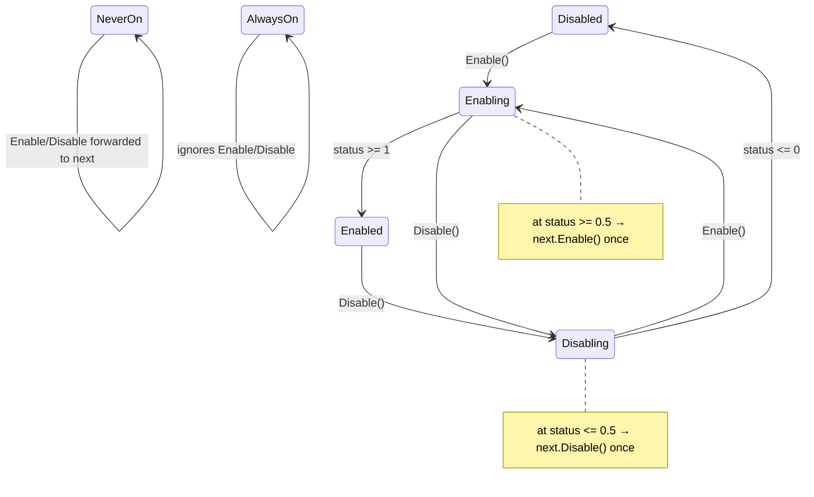
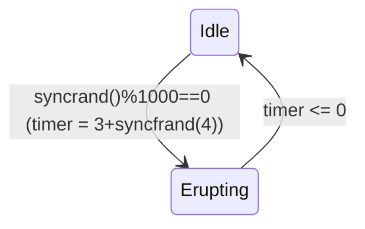

# P07_buildings_misc — Misc and legacy buildings, scenery, fences
Scope: `code/worldobject/{blueprintstore,bridge,cave,chess,clonelab,eruptionmarker,factory,feedingtube,generichub,goddish,laserfence,library,mine,randomiser,researchitem,restrictionzone,safearea,scripttrigger,smokemarker,staticshape,switch,tree,upgrade_port,wall}.{cpp,h}` (48 files). Build baseline: see `_work/build_matrix.md` (`Release|Win32`, `TARGET_PC_FULLGAME`, `BLOCK_OLD_DARWINIA_OBJECTS` on, `LOCATION_EDITOR` off).

Conventions used in this draft:
- "tick" = one simulation step of `SERVER_ADVANCE_PERIOD` = `0.1 * m_gameSpeed` seconds (10 Hz at normal speed) [C] `code/gametimer.cpp:GameTimer::GetServerAdvancePeriod`.
- "level line" = one line inside `Buildings_StartDefinition … Buildings_EndDefinition` of a `data/levels/*.txt` file. Every building line starts with the **7 base fields** written by `Building::Write` / read by `Building::Read` [C] `code/worldobject/building.cpp:Building::Read`:

| # | Field | Type | Meaning |
|---|---|---|---|
| 0 | TypeName | token | `Building::GetTypeName` string, case-insensitive match (`stricmp`) |
| 1 | id | int | unique building id within the level (assert on duplicates) |
| 2 | x | float | world X |
| 3 | z | float | world Z (Y is always re-sampled from the heightmap in `Building::Initialise`) |
| 4 | teamId | int | level team slot (255 = neutral; other values remapped by `Location::GetTeamFromPosition` at load) [C] `code/location.cpp` building-instantiation loop |
| 5 | front.x | float | facing X (normalised after read) |
| 6 | front.z | float | facing Z |
| 7 | isGlobal | int(bool) | building is tracked by `GlobalWorld` |

Subclass fields follow from index 8. Below, subclass field tables list **only** the extra fields, numbered from 8.
- Live-ness evidence: a census of building type names in every level file (script `_work/scripts/P07_building_census.py`). "MP levels" = the 57 `data/levels/mp_*.txt`; the shipped playlist is `data/levels/level_enum.txt` (49 base maps + 10 PDLC entries whose files are not in the tree). `data/levels/old/` holds 30 prototype MP maps not in `level_enum.txt`; `map_*` / `mission_*` are Darwinia campaign files.
- Blocking mechanism: `LevelFile::ParseBuildings` creates buildings **by name** via `Building::CreateBuilding(char*)`, which skips every type for which `Building::BuildingIsBlocked` is true, so a blocked line yields `NULL` and is silently dropped [C] `code/level_file.cpp:LevelFile::ParseBuildings`, `code/worldobject/building.cpp:CreateBuilding(char*)`. `Building::CreateBuilding(int)` (by type id) is **not** filtered, so code can still create a blocked type directly.

## [→ 03_buildings_and_world_objects] Partition summary — classes and build status

| Class | File | Building type enum / name string | Blocked by `BuildingIsBlocked`? | In shipped MP levels (`mp_*`) | Created by MW code | Build tag | Evidence |
|---|---|---|---|---|---|---|---|
| `Tree` | tree.cpp | `TypeTree` / "Tree" | no | 755 lines in 45 maps | yes — `Crate::GenerateTrees`, `Crate::GenerateEvilTrees`, `Tree::CreateAnotherTree` | **[B:FULL]** | census; `code/worldobject/crate.cpp:Crate::GenerateTrees` |
| `LaserFence` | laserfence.cpp | `TypeLaserFence` / "LaserFence" | no | 703 lines in 15 maps | no | **[B:FULL]** | census |
| `Wall` | wall.cpp | `TypeWall` / "Wall" | no | 356 lines in 11 maps | no | **[B:FULL]** | census |
| `StaticShape` | staticshape.cpp | `TypeStaticShape` / "StaticShape" | no | 193 lines in 19 maps | no | **[B:FULL]** | census |
| `RestrictionZone` | restrictionzone.cpp | `TypeRestrictionZone` / "RestrictionZone" | no | 35 lines in 14 maps | no | **[B:FULL]** | census |
| `SmokeMarker` | smokemarker.cpp | `TypeSmokeMarker` / "SmokeMarker" | no | 6 lines in 1 map (`mp_assault_3p_1`) | no | **[B:FULL]** | census |
| `EruptionMarker` | eruptionmarker.cpp | `TypeEruptionMarker` / "EruptionMarker" | no | 1 line in 1 map (`mp_blitzkrieg_3P_2`) | no | **[B:FULL]** | census |
| `CloneLab` | clonelab.cpp | `TypeCloneLab` / "CloneLab" | **no** | 0 (15 lines in 4 `old/` prototype maps) | no | [B:FULL] compiled+loadable, but unused by shipped data → effectively **[B:LEGACY]** (MW prototype) | census of `data/levels/old` |
| `ScriptTrigger` | scripttrigger.cpp | `TypeScriptTrigger` | **yes** | 0 (25 in campaign files) | no | [B:LEGACY] | `BuildingIsBlocked` |
| `FenceSwitch` | switch.cpp | `TypeFenceSwitch` / "FenceSwitch" | **yes** | 0 | no | [B:LEGACY] | `BuildingIsBlocked` |
| `BlueprintStore`, `BlueprintConsole`, `BlueprintRelay` | blueprintstore.cpp | `TypeBlueprintStore/Console/Relay` | **yes** (all three) | 0 | no | [B:LEGACY] | `BuildingIsBlocked` |
| `Bridge` | bridge.cpp | `TypeBridge` | **yes** | 0 | only by `Engineer` (itself legacy) | [B:LEGACY] | `code/worldobject/engineer.cpp` |
| `Cave` | cave.cpp | `TypeCave` | **yes** | 0 | no | [B:LEGACY] | |
| `ChessBase`, `ChessPiece` | chess.cpp | `TypeChessBase` / `TypeChessPiece` | **yes** | 0 (ChessBase ×2 in `old/mp_chess1`) | ChessPiece only by ChessBase | [B:LEGACY] | |
| `Factory` | factory.cpp | `TypeFactory` | **yes** | 0 | no | [B:LEGACY] | |
| `FeedingTube` | feedingtube.cpp | `TypeFeedingTube` | **yes** | 0 | no | [B:LEGACY] | |
| `DynamicBase`, `DynamicHub`, `DynamicNode` | generichub.cpp | `TypeDynamicHub` / `TypeDynamicNode` (DynamicBase is abstract) | **yes** | 0 | no | [B:LEGACY] | |
| `GodDish` (+ creates `Spam`) | goddish.cpp | `TypeGodDish` | **yes** | 0 (1 in `old/mp_temple`) | no | [B:LEGACY] | |
| `Library` | library.cpp | `TypeLibrary` | **yes** | 0 | no | [B:LEGACY] | |
| `TrackLink`, `TrackJunction`, `TrackStart`, `TrackEnd`, `Refinery`, `Mine`, `MineCart` (non-building helper) | mine.cpp | `TypeTrack*`, `TypeRefinery`, `TypeMine` | **yes** (all six building types) | 0 | no | [B:LEGACY] | |
| `Randomiser` | randomiser.cpp | *(none — Entity subclass, see section)* | n/a | n/a | verify in section | see section | |
| `ResearchItem` | researchitem.cpp | `TypeResearchItem` | **yes** | 0 | no | [B:LEGACY] | |
| `SafeArea` | safearea.cpp | `TypeSafeArea` | **yes** | 0 | no | [B:LEGACY] | |
| `UpgradePort` | upgrade_port.cpp | `TypeUpgradePort` / "UpgradePort" | **yes** | 0 | no | [B:LEGACY] | |

(Rows marked "verify in section" are resolved in the class's own section below.)

Additional non-building / abstract classes defined in scope: `BlueprintBuilding` (abstract base of the three Blueprint classes), `DynamicBase` (abstract base of DynamicHub/Node), `MineBuilding` (abstract base of the track/refinery/mine family), `MineCart` (plain helper struct, not a WorldObject), `Randomiser` (a `WorldObject` effect, not a Building), `PrimaryUpgradePort` (declared in `upgrade_port.h`). `Bridge` derives from `Teleport` (P06), `CloneLab` from `Incubator` (P06), `ChessPiece` from `CarryableBuilding` (P06).

---

## [→ 03_buildings_and_world_objects] Tree — procedural, flammable, spreading scenery [B:FULL]

**Function.** Decorative but gameplay-relevant scenery: blocks movement/projectiles via hit spheres, catches fire, burns down and regrows, sets nearby units on fire, can drop spirits ("magic" trees), can spread new trees, and in its *evil* variant kills Darwinians and corrupts nearby trees. Trees are the single most numerous building in Multiwinia maps (755 level lines in 45 of 57 `mp_*` files) [C] census. They are also created at runtime by the Dark Forest crate outcomes (`Crate::GenerateTrees`, `Crate::GenerateEvilTrees`) [C] `code/worldobject/crate.cpp`, and by tree self-propagation (`Tree::CreateAnotherTree`) [C].

**Ownership.** Always neutral in practice. Level lines use team 255 (704 lines) or team slot 1 (51 lines in `mp_domination_4P_2`, `mp_koth_4P_3`, `mp_skirmish_2p_4`, `mp_sandbox_all`) [C] census; the team id has no effect on any tree logic [C] (no `m_id.GetTeamId()` read in `code/worldobject/tree.cpp`). Runtime-created trees use team 255 [C] `Tree::CreateAnotherTree`. Not capturable, no ports.

### Level-file parameters (fields after the 7 base fields) [C] `code/worldobject/tree.cpp:Tree::Read`, `Tree::Write`

| # | Field | Type | Default (ctor) | Meaning | Observed in `mp_*` (755 lines) |
|---|---|---|---|---|---|
| 8 | height | float | 50.0 | World-unit scale of the whole tree (the generated tree is unit-height) | 43.54 … 272.65 |
| 9 | budsize | float | 1.0 | Width multiplier of the **leaf** quads only (branch quads use width factor 0.1, leaves 0.1×budsize) | 0 … 43.97 (most common 1.00, 3.00, 0.00, 10.00) |
| 10 | pushOut | float | 1.0 | Sideways reach of child branches | 0.34 … 1.31 |
| 11 | pushUp | float | 1.0 | Upward reach of child branches | 0.43 … 1.32 |
| 12 | iterations | int | 6 | Recursion depth N (trunk = level 1, leaves = level N) | 4 (24), 5 (165), 6 (516), 7 (50) |
| 13 | seed | int | 0 | Seed of the generation RNG | 0 … 99992 |
| 14 | branchColour | int (signed 32-bit, written `%-12d`) | 0xffffffff | Packed RGBA, **R in the low byte**: R=v&0xFF, G=(v>>8)&0xFF, B=(v>>16)&0xFF, A=(v>>24)&0xFF (`intToArray`) | 33 distinct, e.g. -1 = (255,255,255,255) |
| 15 | leafColour | int | 0xffffffff | Same packing | 39 distinct |
| 16 | leafDropRate | int, optional | 0 | 0 = off; otherwise visual leaf-particle rate (see below), editor range 0..50 | 0 (737), 35 (18) |
| 17 | spiritDropRate | int, optional (read only if 16 present) | 0 | 0 = off; >0 = "magic tree" that spawns spirits (synced), editor range 0..50 | always 0 in `mp_*` |
| 18 | evil | int, optional (read only if 17 present); `==1` → true | 0 | Evil tree (see evil logic) | 1 on 127 lines (all of `mp_cts_3P_2` ×45, `mp_cts_4P_2` ×59, `mp_tankbattle_4P` ×23 — all with colours -1/-1) |

Parsing quirk: fields 16–18 are read only while `TokenAvailable()`, each nested inside the previous, so a line may stop after 15, 16 or 17 [C] `Tree::Read`. Editor ranges (editor build only, [B:EDITOR]): height 1–1000 step 1; budsize 0–50 step 0.05; pushUp/pushOut 0–5 step 0.01; iterations 1–10; seed 0–99999; leafDrop/spiritDrop 0–50; evil 0–1 [C] `code/interface/tree_window.cpp:TreeWindow::Create`.

Runtime-only state (not in level files): `m_onFire` (burn/regrow phase, see state machine), `m_fireDamage` (ignition accumulator), `m_spawnsRemaining` (propagation budget), `m_spawnTimer`, `m_destroyable`, `m_corruptCheckTimer` (initial 5.0), `m_corrupted`, `m_renderCorruptShadow`, `m_burnSoundPlaying`, hit-check `m_hitcheckCentre` (unit space) / `m_hitcheckRadius` / `m_numLeafs`, display-list ids [C] `code/worldobject/tree.h`.

### Procedural generation algorithm (exact) [C] `Tree::Generate`, `Tree::GenerateBranches`, `Tree::GenerateLeaves`, `Tree::RenderBranch`

The tree is generated **once in unit space** (trunk from (0,0,0) to (0,1,0)); `height` is applied only as a uniform scale at render/hit-test time, so `height` does not change the shape. The RNG is the non-synced application LCG, re-seeded with the tree's seed at the start of every pass, so each pass reproduces identical geometry:

```
RNG (AppSeedRandom / AppRandom, code/../contrib/systemiv/lib/math/random_number.cpp):
  state : 32-bit signed long, wraps modulo 2^32
  seed(s):  state = s
  next():   state = state*214013 + 2531011 ; return (state >> 16) & 0x7FFF      // 0..32767
  frand(r): r * next() / 32767.0                                              // 0..r inclusive

Branch(from, to, n, pass):
  if n == 0: return
  n = n - 1
  if n == 0 (this segment is a LEAF):
      if pass == RADIUS: hitR = max(hitR, |to - hitC|)
      elif pass == LEAF:  hitC += to ; numLeafs += 1
  d   = to - from
  A   = normalise(d × to)            // normalise(v): if |v|^2 <= 1e-10 → (0,0,1)
  B   = normalise(A × d)
  len = |d|
  w   = 0.1 * (n == 0 ? budsize : 1.0)
  if (n == 0 and pass == LEAF) or (n != 0 and pass == BRANCH):
      emit quad  [from - A*len*w (u0,v0)], [from + A*len*w (0,1)], [to + A*len*w (1,1)], [to - A*len*w (1,0)]
      emit quad  same with B                         // two crossed planes per segment
  for i in 0..3:                                     // ALWAYS 4 children, even below a leaf
      dir   = [A, -A, B, -B][i]
      t     = 0.3 + frand(0.6)                       // consumes 1 RNG draw per child
      cFrom = from + d*t
      cTo   = cFrom + dir*len*0.4*pushOut + d*(1 - t)*pushUp
      Branch(cFrom, cTo, n, pass)                    // with n==0 this returns immediately

Generate():
  hitC = 0; hitR = 0; numLeafs = 0
  unpack colours; (optional leaf-alpha boost, see rendering)
  seed(seed); BRANCH pass → compiled into display list 1   (GL_QUADS)
  seed(seed); LEAF pass   → compiled into display list 2   (GL_QUADS; accumulates hitC)
  hitC = hitC / numLeafs
  seed(seed); RADIUS pass (no geometry)
  hitR = hitR * 0.8
```

Derived quantities for depth N: segments at recursion level k (k = 0 trunk … N−1 leaves) = 4^k; leaf segments = 4^(N−1) (N=6 → 1024 leaves); branch segments = (4^(N−1) − 1)/3 (N=6 → 341); quads = 2 per segment; RNG draws per pass = 4 × total segments. For the trunk, d × to = (0,1,0)×(0,1,0) = 0 so A = (0,0,1) and B = A × d = (−1,0,0) [C] `code/lib/vector3.h:Vector3::Normalise`. The leaf-centroid/radius are computed *inside the display-list compile callbacks*, i.e. the simulation's hit volume is a by-product of render-list compilation; `Resource::CreateDisplayListAsync` executes the callback synchronously on the main thread, or queues it to the loading-screen thread and blocks until done [C] `code/lib/resource.cpp:Resource::CreateDisplayListAsync`.

After generation, `Tree::SetDetail(1)` sets `m_centrePos = m_pos + hitC*m_height` and `m_radius = hitR*m_height*1.5` [C] `Tree::SetDetail`. `SetDetail` asserts `_detail == 1` because any other value changes the iteration count (`iterations -= detail-1`, min 3) and hence centre/radius, which "causes a sync error" (source comment) [C].

### Hit volumes [C] `Tree::DoesSphereHit`, `Tree::DoesShapeHit`, `Tree::DoesRayHit`

Two spheres, using the **current** (burnt) height `hA = GetActualHeight(0)`:
1. Trunk sphere: centre `m_pos`, radius 10.0 (constant, independent of height).
2. Crown sphere: centre `m_pos + hitC*hA`, radius `hitR*hA`.

A sphere/shape/ray hits the tree if it hits either sphere. `IsInView` uses sphere (`m_pos`, `m_height`) [C] `Tree::IsInView`. Quirk [I]: rendering rotates the tree by `m_front` (local X→`up×front`, local Z→`front`, `code/lib/matrix34.h:Matrix34(f,u,pos)`) while `hitC` is applied unrotated, so the crown sphere is slightly offset from the drawn crown for non-default facings; the error is small because the 4-way branching is near-symmetric about the trunk.

### Fire, burn-down and regrowth

`GetActualHeight(p) = m_height * (1 − |m_onFire'|)`, clamped to ≥ `0.01*m_height`, where `m_onFire'` = `m_onFire` plus `p*regrow` when regrowing (render prediction only) [C] `Tree::GetActualHeight`.

| Constant | Value | Unit | Kind | Evidence |
|---|---|---|---|---|
| Ignition threshold on `m_fireDamage` | > 50.0 | damage units | literal | `Tree::Damage` |
| `m_fireDamage` decay | −1.0 per second (−`SERVER_ADVANCE_PERIOD` per tick), clamped to [0,100] | /s | literal | `Tree::Advance` |
| Initial `m_onFire` on ignition from healthy | 0.01 | phase | literal | `Tree::Damage` |
| Burn progression | +0.02 per second | phase/s | literal | `Tree::Advance` |
| Full burn duration from ignition | (1.0−0.01)/0.02 = 49.5 s | s | derived | |
| Regrow rate single-player | +0.01 per second (100 s from stump) | phase/s | literal | `Tree::Advance`, `GetActualHeight` |
| Regrow rate multiplayer (`g_app->Multiplayer()`) | +0.05 per second (20 s from stump) | phase/s | literal | same |
| Ignite-others radius test | `ourH*ourHitR*1.5 + theirH*theirHitR*1.5 ≥ distance` (H = actual heights) | world units | formula | `Tree::Advance` |
| Damage applied to neighbour trees | `Damage(-1.0)` per tick per burning neighbour | | literal | same |
| AntHill ignition test | `ourH*ourHitR*1.5 + 100 ≥ distance` → `AntHill::Burn()` | | literal | same |
| Unit burn radius | `actualHeight/2` (also `GetBurnRange()`) | world units | formula | `Tree::Advance`, `Tree::GetBurnRange` |
| Unit burn effect | Darwinian → `SetFire()`; any other entity → `ChangeHealth(-1, DamageTypeFire)` per tick (all teams) | | literal | `Tree::Advance` |

`Tree::Damage(d)` (fire damage is passed as a **negative** number): call `Building::Damage` (plays "Damage" sound event); if `m_fireDamage < 50`: `m_fireDamage += −d`; if it now exceeds 50: if `m_onFire == 0` → `m_onFire = 0.01`; else if `m_onFire < 0` (regrowing) → `m_onFire = −m_onFire` (resumes burning at the same height); start "Burn" sound once [C] `Tree::Damage`. A tree that is already burning (`m_onFire > 0`) is unaffected. Neighbour spread therefore needs > 50 net damage: at +1/tick against −0.1/tick decay, ≈ 56 ticks ≈ 5.6 s of continuous contact [I] (arithmetic).

External ignition sources (other partitions): Darwinian on fire touching the tree (`Darwinian::AdvanceHotFeet`, sphere radius 2, `Damage(-1)` per tick); `Lightning::Advance` (`Damage(-100)` for trees in its obstruction cell); `Fireball::Advance` (`Damage(-100)`); `FlameGrenade::Advance` (`Damage(m_power*-4)` within `m_power*2`); crate "extinguish"-type outcome flips burning trees to regrowing (`SetFireAmount(-GetFireAmount())` within `POWERUP_EFFECT_RANGE*2 = 140`) [C] `code/worldobject/darwinian.cpp:Darwinian::AdvanceHotFeet`, `code/worldobject/lightning.cpp:Lightning::Advance`, `code/worldobject/weapons.cpp:Fireball::Advance`, `FlameGrenade::Advance`, `code/worldobject/crate.cpp` (≈L2018), `code/taskmanager.h:POWERUP_EFFECT_RANGE`. Darwinians flee burning trees within `2*GetBurnRange()` [C] `code/worldobject/darwinian.cpp` (≈L2781).

End of burn (`m_onFire` exceeds 1.0): set `m_onFire = −1.0` (stump, height 1%); if `m_corrupted && m_evil` → both cleared (fire cleanses a corrupted tree); if `m_destroyable` → stop burn sound and return true from `Advance` (the building is removed) [C] `Tree::Advance`. Level-placed trees are never destroyable (`m_destroyable` defaults false and is not in the level format); only crate-created trees (and their offspring, via `Clone`) are [C] `code/worldobject/crate.cpp:Crate::GenerateTrees`.

### Healthy-phase behaviours (only while −0.3 < `m_onFire` ≤ 0, i.e. ≥ 70% regrown and not burning) [C] `Tree::Advance`

1. **Leaf drop (visual, unsynced):** if `leafDropRate > 0` and `rand() % (51 − leafDropRate) == 0` (CRT `rand`): one `Particle::TypeLeaf` at `m_pos + (0,h,0) + (sfrand(h), sfrand(h/4), sfrand(h))` coloured with the leaf RGB. (`sfrand(r)` returns [−r/2, r/2].)
2. **Spirit drop (synced, "magic tree"):** if `!evil && spiritDropRate > 0` and `syncrand() % (51 − spiritDropRate) == 0`: position = `(syncfrand(h), h, 0)` rotated about Y by `syncfrand(2π)` plus `m_pos`; team = `int(syncfrand(6))` re-drawn until it is not −1, not the monster team and not the Futurewinian team; `Location::SpawnSpirit(pos, 0, team, none)`. Per-tick probability = 1/(51 − rate) (rate 15 → 1/36 per tick ≈ 0.28 spirits/s).
3. **Propagation:** if `m_spawnsRemaining > 0`: if `m_spawnTimer < 0` → `m_spawnTimer = now + 5 + syncfrand(5)`; else when `now ≥ m_spawnTimer` → `--m_spawnsRemaining`, `m_spawnTimer = −1`, `CreateAnotherTree()`.

`CreateAnotherTree()` [C] `Tree::CreateAnotherTree`, `PushFromObstructions`:
1. Centroid of all *other* trees within 100 units.
2. `fullH = GetActualHeight(0)`; `range = fullH + syncfrand(fullH)` (drawn unconditionally).
3. If any neighbour: offset = `(m_pos − centroid)` set to length `fullH`, rotated about Y by `syncsfrand(π/4)` (±π/8); else offset = `(range,0,0)` rotated about Y by `syncfrand(2π)`.
4. `PushFromObstructions`: for each building in the obstruction-grid cell, while the building's `DoesSphereHit(pos, 1.0)` is true move `pos` by 2.0 units directly away from the building's `m_pos`. Then resample Y; **abort if Y < 0** (underwater).
5. Create a Tree (team 255, new global building id), `Clone` this tree's parameters (height, budsize, pushOut, pushUp, iterations, seed, colours, leafDrop, spawnsRemaining (already decremented), destroyable, spiritDrop, evil), `Initialise`, then seed = `int(syncfrand(99999))`, height = `(height*0.75)*(1 + syncsfrand(0.2))` (×0.65…0.85, evaluated through `volatile` temporaries for bit-exact ordering), `SetFireAmount(−1)` (starts as a stump and regrows, without burning anything), `SetDetail(1)`, and recompute the whole obstruction grid.

### Evil trees and corruption [C] `Tree::Advance`

- **Kill aura:** each tick, with probability `syncfrand(10) < 0.2` (2% per tick): `GetBestEnemy(pos, range = actualHeight/2, team = monster team)`; if that is a Darwinian not in `StateOperatingPort`, `ChangeHealth(−999)`; if this killed it, its spirit is removed from `m_spirits` and a `Zombie` effect is spawned at its position (`vel.y = 20 + syncfrand(25)`, up-vector tilted by `syncsfrand(1)` about its front) [C]. Evil trees never drop spirits.
- **Corrupting:** only when fully grown (`GetActualHeight(0) == m_height`, i.e. `m_onFire == 0`): `m_corruptCheckTimer` counts down; at ≤ 0 it resets to `10 + syncfrand(5)` and the **first** tree (building-array order) that is not evil, not corrupted and within `actualHeight` units becomes corrupted: `spiritDropRate = 0`, `m_corruptCheckTimer = −10`, `m_corrupted = true` (one victim per check).
- **Becoming evil:** a non-evil tree with `m_corruptCheckTimer < 0` adds dt each tick; when it passes 0 the timer resets to 5 and `m_evil = true` (10 s after corruption).

### State machine

```mermaid
stateDiagram-v2
    [*] --> Healthy : level load (m_onFire=0)
    [*] --> Regrowing : runtime-created (SetFireAmount(-1))
    Healthy --> Burning : fireDamage > 50 (m_onFire=0.01)
    Burning --> Removed : m_onFire > 1 and destroyable
    Burning --> Stump : m_onFire > 1 (m_onFire=-1; corrupted+evil → cleansed)
    Stump --> Regrowing : each tick m_onFire += dt*regrow
    Regrowing --> Burning : fireDamage > 50 (m_onFire = -m_onFire)
    Burning --> Regrowing : extinguish crate (m_onFire = -m_onFire)
    Regrowing --> Healthy : m_onFire reaches 0
    note right of Healthy
      leaf drop / spirit drop / propagation
      run while -0.3 < m_onFire <= 0
    end note
```



Orthogonal corruption sub-state: `Normal → Corrupted (timer=-10) → Evil (after 10 s) → [burn-out] → Normal`; level-placed `evil=1` trees start in Evil and are only "cleansed" by burning if they were also `m_corrupted` (level evil trees are not, so they stay evil) [C].

### Sound events [C] `Tree::ListSoundEvents`, `Tree::Initialise`
`CreateNormal`, `CreateEvil`, `CreateMagic` (chosen in `Initialise`: evil → CreateEvil, spiritDropRate>0 → CreateMagic, else CreateNormal), `Burn` (looping; stopped with `StopAllSounds(id, "Tree Burn")`), plus base `Create`, `Damage`.

### Determinism notes (→ 22) [C]/[I]
- Geometry RNG is the **unsynced** global LCG (`AppSeedRandom`/`AppRandom`); it is deterministic because every pass reseeds it with the tree seed, but any other `frand()` consumer (fire particles in `Tree::Advance`, leaf drop uses CRT `rand()`) shares that global state — harmless only because generation reseeds first [I].
- The simulation-relevant crown sphere is derived from the generated geometry using `iv_sqrt`-based `Normalise`/`Mag` in double precision; a reimplementation must reproduce the generator bit-exactly on all peers or treat the hit sphere as data [I].
- Synced draws: spirit drop, team choice, spawn timer, propagation offsets, offspring seed/height, evil kill roll, Zombie launch, corruption timer. Offspring-height computation is deliberately written with `volatile` temporaries to fix evaluation order (source comment) [C].
- `RenderTreeDetail` / `RenderBuildingDetail` prefs alter only visuals; the code forbids `SetDetail != 1` to protect sync [C].

### Rendering (→ 24_rendering) [C] `Tree::RenderAlphas`, `Tree::Render`
- `Render` draws nothing; all drawing is in the alpha pass (`PerformDepthSort` returns true with sort centre `m_pos + hitC*m_height`).
- State: `GL_TEXTURE_2D` on, texture `textures/tree.bmp` (loaded with alpha), MAG `GL_LINEAR`, MIN `GL_LINEAR_MIPMAP_LINEAR`; blend `SRC_ALPHA, ONE` (additive); cull off; depth write off. Transform = `Matrix34(m_front, up, m_pos)` × uniform scale `actualHeight`. Draw branch list with branch colour, then (unless Christmas mod or evil) the leaf list with leaf colour. Restore: depth write on, cull on, blend `SRC_ALPHA, ONE_MINUS_SRC_ALPHA`, texture off, blend off.
- Sway: `actualHeight *= 1 + sin((realTime + uniqueId*2)*2) * 0.003` (evil: amplitude 0.01) — a breathing scale, not per-branch animation (a per-branch wobble is commented out).
- Magic tree (spiritDropRate>0): leaf blue channel pulses `B = B*f + 255*(1−f)`, `f = |sin(realTime + uniqueId*10)|`.
- Evil: branch colour (0,0,0,200), leaves hidden, normal alpha blend (dark silhouette).
- Corrupting (timer ≤ 0, not yet evil): rendered **twice** in one call — pass A darkens branch RGB and alpha by `factor = (10 + timer + prediction)/10`, leaf alpha ×(1−factor); pass B (recursive call) draws the black silhouette with branch alpha `200*factor`.
- Burning: alpha blend; branch RGB scaled towards black by `min(m_onFire*10, 1)`, branch alpha 255; leaves black with alpha ×(1−m_onFire); plus 4 camera-facing billboards of `textures/starburst.bmp` with depth test off, colour (0.8,0.2,0.1, 0.5*actualH/height), centre `m_pos + (sin(2g+i)*i*1.7, 0.8*actualH + cos(2g+i), cos(2g+i)*i*1.7)` with g = game time, half-size `max(2*actualH, 5)`.
- Regrowing: leaves invisible while |m_onFire| > 0.5, else alpha ×(1 − 2|m_onFire|).
- Christmas mod (`Location::ChristmasModEnabled`): branches (180,100,50), no leaves.
- `RenderTreeDetail` pref (default 1, not exposed in the graphics options UI): if > 1, leaf alpha ×1.3^detail (capped 255) at generation. Fire particle count per tick = `int(actualHeight/12) / RenderBuildingDetail`.
- Fire particles (`Particle::TypeFire`, unsynced `frand`): per tick, count above; position radius `frand(0.6h)`, height `0.7h + 0.3*frand(h)`, random yaw; size `2h*(1+sfrand(0.5))`.
- D3D path [B:D3D]: the colour is baked into the display list (`glColor4ubv` inside `GenerateBranches/GenerateLeaves`), so runtime colour changes do not apply under D3D except via the global colour [C] (`#ifdef USE_DIRECT3D` in `Tree::GenerateBranches`).
- `Location::FlushOpenGlState` deletes all tree display lists (e.g. on video-mode change); they are regenerated lazily on the next `RenderAlphas` [C] `code/location.cpp:Location::FlushOpenGlState`.
- Debug: `RenderHitCheck` draws both hit spheres under `DEBUG_RENDER_ENABLED` (call commented out in `Render`).

---

## [→ 03_buildings_and_world_objects] LaserFence — linked energy barrier [B:FULL]

**Function.** A post (shape `laserfence.shp`) that, when raised, projects an energy curtain to the **next** fence post named by its link id. Chains of posts form barrier lines. Enemy units touching a raised curtain are killed (generic entities) or set on fire (Darwinians); raised curtains also block walking routes and AI routing. 703 lines in 15 `mp_*` maps (all Assault maps but `mp_assault_2P_1`/`3p_3`, four Blitzkrieg, `mp_domination_2P_1`, `mp_rocketriot_2p_3`, `mp_skirmish_3P_1`) [C] census.

### Level-file parameters [C] `code/worldobject/laserfence.cpp:LaserFence::Read`, `LaserFence::Write`

| # | Field | Type | Default | Meaning | Observed in `mp_*` (703 lines) |
|---|---|---|---|---|---|
| 8 | nextLaserFenceId | int | −1 | Building id of the next post in the chain (−1 = end of chain, no curtain from this post) | 36 lines with −1 |
| 9 | scale | float, optional | 1.0 | Uniform scale of the post shape and therefore of curtain height | 0.30 … 2.50 (1.00 ×252, 2.00 ×137, 1.50 ×124) |
| 10 | mode | read with `iv_atof`, stored as int, optional | 0 (`ModeDisabled`) | Initial mode (enum below) | 0 ×20, 2 ×658, 4 ×2, 5 ×23 |

Team ids in use: slots 0 (288), 1 (154), 2 (77), 3 (43) and 255 (141); `isGlobal` always 0 [C] census. Write format: `%-8d %-6.2f %d` [C].

### Modes [C] `code/worldobject/laserfence.h` enum

| Value | Name | Meaning |
|---|---|---|
| 0 | `ModeDisabled` | Down (status 0). Responds to `Enable`. |
| 1 | `ModeEnabling` | Rising at `LASERFENCE_RAISESPEED` |
| 2 | `ModeEnabled` | Up (status 1) |
| 3 | `ModeDisabling` | Falling |
| 4 | `ModeNeverOn` | Never raises; acts as a **relay**: `Enable()`/`Disable()` are forwarded immediately to the next fence. No curtain is drawn or tested (status stays 0). Sparks still fire. |
| 5 | `ModeAlwaysOn` | Permanently up; `Enable`/`Disable`/`Toggle` and solar loss have no effect. |

`IsEnabled()` = mode ∈ {Enabled, Enabling, AlwaysOn} [C].

### Constants

| Name | Value | Unit | Kind | Evidence |
|---|---|---|---|---|
| `LASERFENCE_RAISESPEED` | 0.3 | status per second (full raise/lower = 3.33 s) | `#define` | `laserfence.h` |
| Chain hand-off threshold | status 0.5 (≈1.67 s into a transition) | | literal | `LaserFence::Advance` |
| Spark interval | first `syncfrand(10)` s after `Initialise`, then `8 + syncfrand(4)` s; only while mode ≠ Disabled | s | literal | `Initialise`, `Advance` |
| Solar power timeout | 5.0 s since last `ProvidePower()` | s | literal | `Advance` |
| Curtain full height | `markerFence02.y − markerFence01.y` of the scaled shape = 48.28 × scale (shape data) | world units | data | `GetFenceFullHeight`, `data/shapes/laserfence.shp` markers `MarkerFence01` (0.37,0,−0.30) / `MarkerFence02` (0.37,48.28,−0.30) |
| Curtain below-ground skirt | height/3 below each post's base | | literal | `RenderAlphas`, `DoesRayHit` |
| Curtain alpha | 150 / 255 | | literal | `RenderAlphas` |

### Advance (per tick) [C] `LaserFence::Advance`
1. First tick after `SetDetail`: if the link resolves, `m_centrePos = midpoint(this, next)`, `m_radius = |next − this|/2 + m_radius` (enlarged for visibility/obstruction purposes).
2. Spark timer (see constants) → `Spark()` (unsynced `frand` particles of `Particle::TypeSpark`, 5–10 sparks of size 25–50 flung perpendicular to the curtain at 40–60 units/s, plus sound "Spark").
3. Solar mode (`m_solarMode`, set by `ProvidePower`): if `now − m_surgeReceived > 5` and (enabled or NeverOn) → `Disable()`; else if not enabled → `Enable()`.
4. Mode machine: Enabling: `status += 0.3*dt`; when status ≥ 0.5 and link set and not yet toggled → `next->Enable()` once; at ≥ 1 → status 1, `ModeEnabled`. Disabling: when status ≤ 0.5 (checked **before** decrement) → `next->Disable()` once; `status −= 0.3*dt`; at ≤ 0 → 0, `ModeDisabled`. Enabled/AlwaysOn: force status 1. Disabled: force 0. NeverOn: no change.
5. `Building::Advance` (port evaluation; fences have no ports).

`Enable()`: if mode ∉ {Enabled, NeverOn, AlwaysOn} → Enabling; if NeverOn → forward `Enable()` to next; reset `m_nextToggled`. `Disable()` symmetrical. `Toggle()`: Disabled/Disabling → Enable; Enabled/Enabling → Disable; resets `m_nextToggled` [C].



### Who switches fences in Multiwinia [C]
- **Solar power** is the only live runtime controller: `PylonEnd::TriggerSurge` calls `ProvidePower()` on its linked fence if `IsFriend(surgeTeam, fenceTeam)` [C] `code/worldobject/generator.cpp:PylonEnd::TriggerSurge`. `ProvidePower` sets `m_solarMode = true`, stamps `m_surgeReceived = now`, and (if not already) `SetSolarLinked()`, which marks this fence and, recursively along `nextLaserFenceId`, every downstream fence `m_solarLinked = true` (stops at AlwaysOn fences or already-linked fences). Solar-linked fences render with the pulsing solar style; only the directly powered fence runs the 5-s timeout, the rest follow via chain hand-off. Because `IsFriend(255, x)` is always false [C] `code/location.cpp:Location::IsFriend`, neutral (team 255) fences can never be solar-powered.
- `FenceSwitch` (blocked, [B:LEGACY]) and `Powerstation` (blocked) also call `Enable/Disable` — unreachable in MW.
- Network command `NET_DARWINIA_TOGGLELASERFENCE` ("cg") is handled by `ClientToServer::ProcessServerUpdates` (`Toggle()`), but its sender `ClientToServer::RequestToggleFence` has **no callers** [C] (grep) → dead in MW.

### Damage to crossing entities (implemented by the entities, not the fence) [C]
- Generic entities: `Entity::PushFromObstructions(pos, killem)` — if the entity's shape/sphere(1.0)/swept ray hits an enabled fence whose team is not a friend → `ChangeHealth(−9999)` and `fence->Electrocute(pos)` (plays "Electrocute"); otherwise ordinary push-out [C] `code/worldobject/entity.cpp:Entity::PushFromObstructions`.
- Darwinians: `Darwinian::PushFromObstructions` — enabled, non-friendly fence: if `DoesSphereHit(m_pos, 1.0)` and `killem` → `SetFire()` + `Electrocute`; else if within `closest = 5 + uniqueId % 10` → pushed out perpendicular to the curtain in 20-unit steps [C] `code/worldobject/darwinian.cpp:Darwinian::PushFromObstructions`.
- Routing: `Location::GetWalkingDistance` returns −1 and `Location::IsWalkable` reports the fence id for any **enabled** fence on the path (any team) [C] `code/location.cpp`; AI target graph skips neighbours behind enabled non-friendly fences [C] `code/worldobject/ai.cpp`; `Armour::IsRouteClear` refuses routes through enabled enemy fences [C] `code/worldobject/armour.cpp`.
- The fence itself takes no damage and cannot be destroyed or captured (no `Damage` override; team never changes) [C].

### Hit tests [C] `LaserFence::DoesSphereHit`, `DoesRayHit`, `DoesShapeHit`
- Disabled (or editing): post shape only (scaled `laserfence.shp`).
- Otherwise `DoesRayHit`: if link set and status > 0 → two triangles (pos1,pos2,pos4) and (pos4,pos3,pos1) where pos1/2 = this post base −h/3 / +h, pos3/4 = next post base −h/3 / +h, **h = this fence's full height × status** (the next post's own height is ignored for collision but used for rendering); normal = (pos1−pos3)×(pos1−pos2) normalised. Falls back to the post shape.
- `DoesSphereHit` approximates the sphere by two rays of length 2r through its centre along +X and +Z, then the post shape. `DoesShapeHit` = `DoesSphereHit(transform.pos, shape root radius)`.

### Obstruction grid (→ 21) [C] `code/obstruction_grid.cpp:ObstructionGrid::CalculateBuildingArea`
Fences with a link are rasterised into every cell along the segment to the next post (sample count = segment length + 1), with extra 4-neighbour cells added when consecutive samples jump diagonally, to avoid leaks.

### Rendering (→ 24_rendering) [C] `LaserFence::Render`, `LaserFence::RenderAlphas`
- Post: `laserfence.shp` with the transform scaled uniformly by `scale`, `GL_NORMALIZE` enabled during the draw.
- Curtain (alpha pass; only if mode ∉ {Disabled, NeverOn} and link valid): cull off, blend `SRC_ALPHA, ONE_MINUS_SRC_ALPHA`, depth write off. Colour: team 255 → (100,100,100,150); solar → lerp((20,20,20), 0.9×team colour, |sin(4×realTime)|), alpha 150; otherwise team colour, alpha 150. Predicted status = status ± 0.3×predictionTime (editor: 1). Quad corners: BL = this −(0,h/3,0), TL = this + (0,h,0), TR = next + (0,h',0), BR = next − (0,h'/3,0) with h, h' = each post's full height × predicted status.
- If `RenderBuildingDetail < 3`: two-texture pass — unit 0 `textures/laserfence.bmp` (combine REPLACE), unit 1 `textures/laserfence2.bmp` (combine MODULATE), both REPEAT + trilinear; unit-0 UV s ∈ [timeOff, timeOff + dx], t ∈ [0, dz] with `dx = distance/(2·fullHeight)`, `dz = status`, `timeOff = gameTime/15` (scrolling); unit-1 UV s ∈ [0,1], t ∈ [texY, texY+texH]. Solar: `texY = gameTime/1.5`, `texH = 7`, `timeOff = 0`, and unit 1 also uses `laserfence.bmp`.
- Always: additive overlay (`SRC_ALPHA, ONE`) of `textures/laserfence2.bmp` with UV s ∈ [0,1], t ∈ [texY, texY+texH] ("burn effect").
- A smoothed `GL_LINES` edge from TL to TR, width 2.0 (0.5 solar).
- `PerformDepthSort`: sorted at `m_centrePos` when not disabled and linked. `IsInView` returns true during the game's grace period. `RenderLights` empty (no ownership lights).
- Render-side mutation [C]: `RenderAlphas` resets `m_nextLaserFenceId = −1` if the link no longer resolves to a LaserFence — a sim-state write from the render path (determinism hazard only for invalid links) [I].

### Sound events [C] `LaserFence::ListSoundEvents`
`Spark`, `Electrocute` (+ base).

### Determinism (→ 22)
Synced: spark timer. Unsynced/visual: spark particles (`frand`). The solar timeout uses `GetNetworkTime()` (game time) [C].

---

## [→ 03_buildings_and_world_objects] Wall — destructible barrier segment [B:FULL]

**Function.** A straight wall segment (shape `wall.shp`) that blocks movement and line-of-fire; destroyed by a single heavy hit. Used mainly by Assault maps (attackers break through with the WallBuster, P06/P04) and a few others: 356 lines in 11 `mp_*` maps (`mp_assault_2P_1` 78, `mp_assault_2P_2` 14, `mp_assault_2p_3` 20, `mp_assault_3P_2` 29, `mp_assault_3p_1` 94, `mp_assault_3p_3` 25, `mp_assault_4P_2` 34, `mp_assault_stress` 30, `mp_blitzkrieg_2p_2` 17, `mp_koth_3P_4` 12, `mp_sandbox` 3); always team 255 [C] census.

### Level-file parameters [C] `code/worldobject/wall.cpp:Wall::Read`, `Wall::Write`

| # | Field | Type | Default | Meaning | Observed |
|---|---|---|---|---|---|
| 8 | objectiveLink | int, optional (`%4d`) | −1 | Id of an `AIObjective`; on first `Advance` the wall writes its own id into `AIObjective::m_wallTarget` | −1 ×317, absent ×33, AIObjective ids (27,33,39,41,47,50) ×6 |

`AIObjective::m_wallTarget` is written but never read anywhere [C] (grep `wallTarget`: only `aiobjective.cpp` ctor, `aiobjective.h`, `wall.cpp`) → the link is vestigial. `m_scale` (1.0), `m_fallSpeed`, `m_damage` exist but are not in the level file and the sinking/falling animation in `Advance` is commented out [C].

### Constants [C] `code/worldobject/wall.cpp` (`#define`)

| Name | Value | Unit | Use |
|---|---|---|---|
| `WALL_LENGTH` | 100.0 | world units | collision length along `front × up` |
| `WALL_DEPTH` | 20.0 | world units | collision depth along `front` |
| `WALL_HEIGHT` | 75.0 | world units | ray-hit quad spans base → base + 37.5 (`WALL_HEIGHT/2`) |
| Destruction threshold | single `Damage(d)` with d ≤ −300.0 | damage | literal in `Wall::Damage` |

Visual mesh extent (data): ±40.58 along local X, 0…70.93 high, ±1.38 thick [C] `data/shapes/wall.shp` fragment `Box01` positions — the collision footprint (100×20, infinite height for spheres) is deliberately larger than the visual (81×2.8).

### Behaviour [C]
- `Advance`: if `m_destroyed` → return true (Location deletes it, marks obstruction grid changed and calls `RecalculateAITargets()` because "the destruction of walls will create new holes for ai links") [C] `code/location.cpp` building-advance loop (≈L1216); registers the objective link once.
- `Damage(d)`: if d ≤ −300 → `g_explosionManager.AddExplosion(wall.shp, transform, 3.0)` and `m_destroyed = true`; records `m_lastDamageTime`. Smaller hits do nothing (no health accumulation; `m_damage += d` is commented out). Does **not** call `Building::Damage` (no "Damage" sound).
- Damage sources: `WallBuster::BreakWalls` (`Damage(-1000)` on every wall within 200 units when the WallBuster touches a wall within its 20-unit sphere) [C] `code/worldobject/wallbuster.cpp`; `Location::Bang(pos, range, damage)` damages every building within `3*range` by `damage*(1 − dist/(3*range))` [C] `code/location.cpp:Location::Bang` — so any explosion delivering ≥ 300 at the wall's position destroys it; cheat window (`Damage(-999)`) [B:DEBUG].
- Not capturable; team irrelevant.

### Hit tests [C] `Wall::DoesSphereHit`, `Wall::DoesRayHit`, `Wall::DoesShapeHit`
- Sphere: rectangle of 100 × 20 centred on `m_pos`, axes `right = normalise(front × up)` and `front`, **flattened to y = 0** together with the sphere centre (infinite-height prism); tested as two triangles (t1,t2,t3), (t2,t3,t4) with `SphereTriangleIntersection`. (Returns true if the wall has no shape.)
- Ray: vertical quad along `right`, 100 long; bottom corners at terrain height under each end, top corners at `m_pos.y + 37.5`; triangles (t1,t2,t3), (t2,t3,t4).
- Shape: true mesh-vs-mesh test with the scaled `wall.shp`.

### Interaction rules in other partitions [C]
- Darwinians: if within 4 units (sphere test) they are pushed along ±front in 5-unit steps until clear of radius 1, and `m_wallHits++` [C] `code/worldobject/darwinian.cpp:Darwinian::PushFromObstructions`.
- Routing: `Location::GetWalkingDistance` (sphere stepSize/2) and `Location::IsWalkable` (stepSize×0.66) treat walls as impassable [C] `code/location.cpp`.
- `AIObjective` never chooses a Wall/LaserFence/StaticShape/AITarget/AIObjectiveMarker as its objective building [C] `code/worldobject/aiobjective.cpp` (≈L304).

### Rendering (→ 24) [C] `Wall::Render`
Shape render with `Matrix34(front, up, pos − (0, fallSpeed·prediction, 0))` scaled by `m_scale`; nothing when destroyed. Destruction uses the shape-shattering explosion manager (`explosion.h`).

---

## [→ 03_buildings_and_world_objects] StaticShape — arbitrary decorative/obstructing mesh [B:FULL]

**Function.** Places any `.shp` from `data/shapes` as a solid, non-interactive obstacle (rocks, temple ruins, landing obstructions). 193 lines in 19 `mp_*` maps, all team 255 [C] census.

### Level-file parameters [C] `code/worldobject/staticshape.cpp:StaticShape::Read`, `StaticShape::Write`

| # | Field | Type | Default | Meaning | Observed |
|---|---|---|---|---|---|
| 8 | scale | float (`%6.2f`) | 1.0 | Uniform scale applied to the shape transform | 1.00 ×163; 0.83–1.76; one 6.10 |
| 9 | shapeName | token (`%s`, no spaces) | "none" | File under `data/shapes/`; "none" = no shape | `beachheadobstruction.shp` 67, `temple2.shp` 56, `rockhead.shp` 32, `temple4.shp` 27, `temple3.shp` 8, `statue.shp` 1, `spaceship.shp` 1, `carryspider.shp` 1 |

### Behaviour [C]
- `Initialise` copies scale and calls `SetShapeName` (loads the shape through `Resource::GetShape` and computes centre/radius with the scaled transform). `SetDetail` re-samples Y and recomputes centre/radius. `Advance` = `Building::Advance` (no ports in practice). No damage, no team logic, no lights (`SetShapeLights` is never called for StaticShape because the shape is set after `Building::Initialise`).
- Hit tests: exact mesh tests on the scaled shape (`SphereHit`, `RayHit`, `ShapeHit`); with no shape, a sphere of `m_radius` (13.0 default).
- Missing shape file: `Resource::GetShapeCopy` looks for `data/shapes/<name>` (path lower-cased) on disk, then in the data archive, and raises a fatal `AppReleaseAssert("Couldn't find shape file …")` if absent [C] `code/lib/resource.cpp:Resource::GetShapeCopy` — a level referencing an unknown shape aborts loading. Shapes are cached by name (`Resource::GetShape`), so all StaticShapes using one file share one Shape instance.
- `SetStringId` is declared in `staticshape.h` but never defined [C] (grep).

### Rendering (→ 24) [C] `StaticShape::Render`
Scaled shape render with `GL_NORMALIZE` on (because of non-unit scale). With no shape: `RenderSphere(m_pos, 40)` (debug-render helper, compiled in because `DEBUG_RENDER_ENABLED` is global).

---

## [→ 03_buildings_and_world_objects] RestrictionZone — invisible no-drop / no-powerup circle [B:FULL]

**Function.** Invisible, non-colliding circle that (a) prevents random crates from landing inside it and (b) optionally blocks map-wide powerup targeting inside it (e.g. to protect starting islands). Source comment: "doesn't do anything itself, although it prevents crates from dropping inside their area" [C] `code/worldobject/restrictionzone.cpp` header comment. 35 lines in 14 `mp_*` maps, all team 255 [C] census.

### Level-file parameters [C] `RestrictionZone::Read`, `RestrictionZone::Write`

| # | Field | Type | Default | Meaning | Observed |
|---|---|---|---|---|---|
| 8 | size | float (`%-2.2f`) | 300.0 | Radius (horizontal) in world units | 300.00 … 1118.80 |
| 9 | blockPowerups | int, optional (`%5d`) | 0 | 1 = also blocks powerups whose target area is "anywhere" | 0 ×26, 1 ×9 (lines) |

### Behaviour [C]
- Static registry `s_restrictionZones` (list of unique ids): added in `Initialise`, removed in the destructor.
- `IsRestricted(pos, powerups=false)`: for each registered zone, compare horizontal distance (`pos.y` replaced by zone Y) `< size`; returns true if `!powerups` or the zone has `blockPowerups == 1`.
- Callers: `Location::CreateRandomCrate` — random-position fallback re-rolls while height < 20 or `IsRestricted(pos)` (max 100 tries, then no crate) [C] `code/location.cpp:Location::CreateRandomCrate`; `TaskManager::IsValidTargetArea` — for the GunTurret task (`IsRestricted(pos, true)` → invalid) and for any target area whose centre is (0,0,0) (the radius-99999.9 "anywhere" area used by Booster, HotFeet, GunTurret, Shaman, Infection, MagicalForest, DarkForest, AntsNest, Plague, EggSpawn, MeteorShower, Extinguisher, Rage, DropShip) [C] `code/taskmanager.cpp:TaskManager::IsValidTargetArea`, `TaskManager::GetTargetArea`. A commented-out use exists in `Multiwinia::AdvanceRetribution` [C].
- `Advance` does nothing; `DoesSphereHit`/`DoesShapeHit` always false; `DoesRayHit` only in the editor → no collision, not in pathing, not selectable in game.
- Rendering: only under `LOCATION_EDITOR` (sphere 30 and, when selected, sphere of `size`) → [B:EDITOR]; invisible in shipped build.

---

## [→ 03_buildings_and_world_objects] SmokeMarker — permanent smoke plume emitter [B:FULL]

**Function.** Emits a continuous rising column of grey smoke (atmospherics). 6 lines, all in `mp_assault_3p_1` (team 255) [C] census. No extra level fields (base 7 only).

### Behaviour [C] `code/worldobject/smokemarker.cpp:SmokeMarker::Advance`
Every tick: 3 particles of `Particle::TypeMissileTrail` at `m_pos`, velocity = `(sfrand(0.4), 1, sfrand(0.4))` set to length 50 units/s, size `200 + frand(100)`. Uses the unsynced RNG (visual only). `TypeMissileTrail` = life 5.0 s, base size 200, gravity 1.0, friction 0, colour (100,100,100)→(200,200,200) [C] `code/particle_system.cpp` type table.

### Signature bug — collision is NOT disabled [C]/[I]
The header declares `RenderAlphas(float)`, `DoesSphereHit(Vector3 const&, float)` and `DoesRayHit(..., float _rayLen, ...)`, whereas the `Building` virtuals take `double` [C] `code/worldobject/smokemarker.h` vs `code/worldobject/building.h`. These therefore **do not override**; only `DoesShapeHit(Shape*, Matrix34)` matches. Consequence [I]: in-game the base `Building::DoesSphereHit`/`DoesRayHit` apply — with no shape this is a sphere of radius 13.0 at `m_pos`, and `ObstructionGrid::CalculateAll` registers every building without filtering [C] `code/obstruction_grid.cpp`, so each SmokeMarker is an invisible 13-unit obstacle that pushes units and stops rays; the editor-sphere drawing in `SmokeMarker::RenderAlphas(float)` is never called (and is `LOCATION_EDITOR`-only anyway). Compare `EruptionMarker`, which uses `double` and is correctly non-colliding. A new design should make markers non-colliding explicitly.

---

## [→ 03_buildings_and_world_objects] EruptionMarker — random volcanic eruption emitter [B:FULL]

**Function.** Atmospheric volcano vent. 1 line (`mp_blitzkrieg_3P_2`, id 80, team 255) [C] census. No extra level fields.

### Behaviour [C] `code/worldobject/eruptionmarker.cpp:EruptionMarker::Advance`

| Parameter | Value | Kind |
|---|---|---|
| Eruption start test (when idle) | `syncrand() % 1000 == 0` per tick (p = 0.001/tick, mean wait 100 s) | literal, **synced** RNG |
| Eruption duration | `3.0 + syncfrand(4.0)` s (3–7 s) | literal, synced |
| Particles while erupting | 10 per tick, `Particle::TypeVolcano`, velocity `(sfrand(1), 1, sfrand(1))` set to length 100, size `300 + frand(200)` | literal, unsynced |
| `TypeVolcano` particle | life 12.0 s, size 400, gravity 10.0, friction 0, colour (150,50,50)→(150,120,50); dies on touching the ground | `code/particle_system.cpp` |


No collision (all three hit tests use `double` and return false outside the editor). Visual only — no damage — but it consumes the synced RNG every idle tick, so it is part of the deterministic RNG stream (→ 22).

---

## [→ 03_buildings_and_world_objects] CloneLab — capturable spirit-to-Darwinian converter (prototype) [B:FULL compiled, unused in shipped maps]

**Function.** An `Incubator` (P06) variant with shape `clonelab.shp` and **5 control ports** (`MarkerPort01…05`) [C] `data/shapes/clonelab.shp`. It holds a stock of spirits; whichever team controls it converts the stored spirits into its own Darwinians at the incubator rate. Not blocked by `BuildingIsBlocked`, but appears only in 4 prototype maps under `data/levels/old/` (`mp_firetop`, `mp_kingspass`, `mp_sabrepoint`, `mp_silverisle`, 15 lines) and in **no** shipped `mp_*` map [C] census → effectively legacy/prototype content; a new game may treat it as an optional design idea.

### Level-file parameters (inherited from Incubator) [C] `code/worldobject/clonelab.cpp:CloneLab::Read` → `code/worldobject/incubator.cpp:Incubator::Read`

| # | Field | Type | Default | Meaning | Observed (old maps) |
|---|---|---|---|---|---|
| 8 | numStartingSpirits | int, optional (`%6d`) | 0 | Spirits stocked at start | 150, 250 |

### Capture rule [C] `CloneLab::RecalculateOwnership` (every tick)
Count port occupants per team; the owning team is the first team (index order) with **> 2** occupants, replaced by any later team with > 2 and strictly more occupants; if none, the lab becomes neutral (255). `SetTeamId` fires "ChangeTeam" sound on change.

### Behaviour [C] `CloneLab::Advance`
1. If no AI target and spirits > 0 → create an `AITarget` at the lab's exit marker (Y at the lab's ground height), give it a new global building id and add it to the building list (AI attraction).
2. Remember `m_startingSpirits` on first tick (unused afterwards [C]).
3. Recalculate ownership.
4. If spirits == 0 and AI target exists → mark target destroyed (removed from AI graph): "this building is now worthless".
5. Owned → `Incubator::Advance` (spawns one Darwinian per `INCUBATOR_PROCESSTIME_MULTIPLAYER` = 0.2 s in multiplayer, 5.0 s base in single player) [C] `code/worldobject/incubator.h`; neutral → spirits only orbit, then `Building::Advance` (port evaluation).
- Quirk [C]: the Incubator constructor looks up `MarkerSpirits`, `MarkerExit`, `MarkerDock` in `incubator.shp`; CloneLab then swaps the shape to `clonelab.shp` without re-resolving these markers, so spirit-centre/exit/dock positions come from the incubator mesh's marker transforms.
- Destructor marks its AI target destroyed.

### Rendering (→ 24) [C] `CloneLab::RenderPorts`
Per port a 6-unit camera-facing `textures/starburst.bmp` billboard (additive, depth write off) 5 units above ground at the control-pad status marker, grey (150,150,150) if empty or the occupant's team colour.

