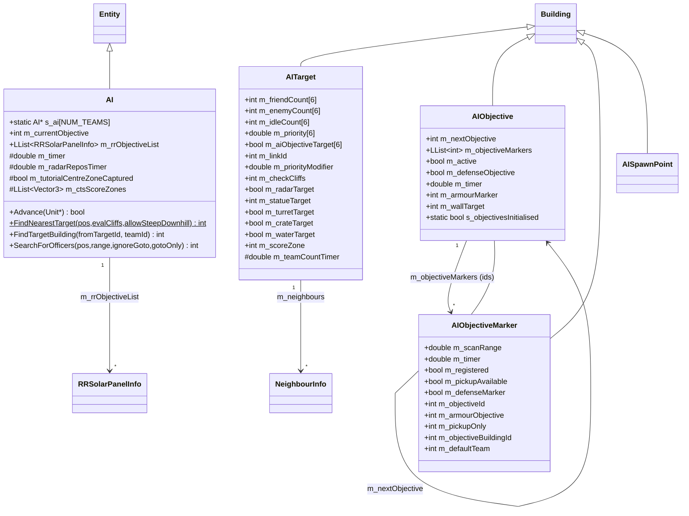
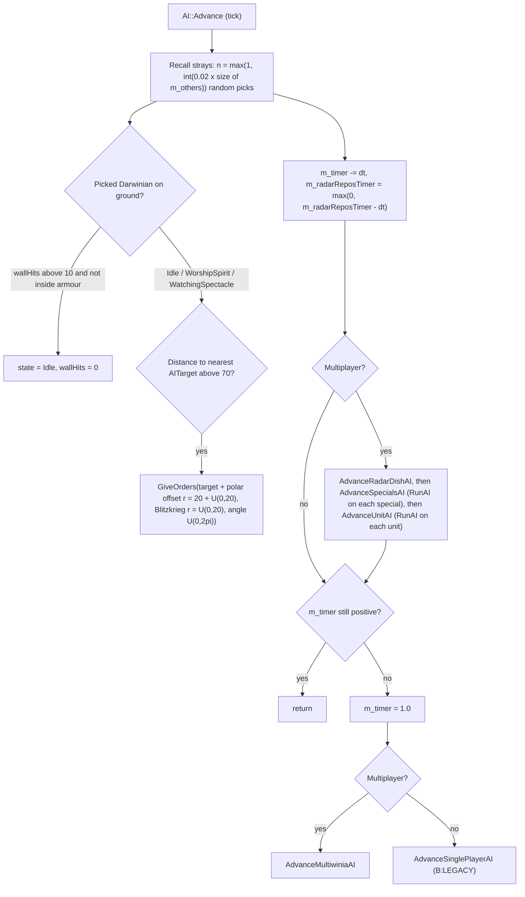
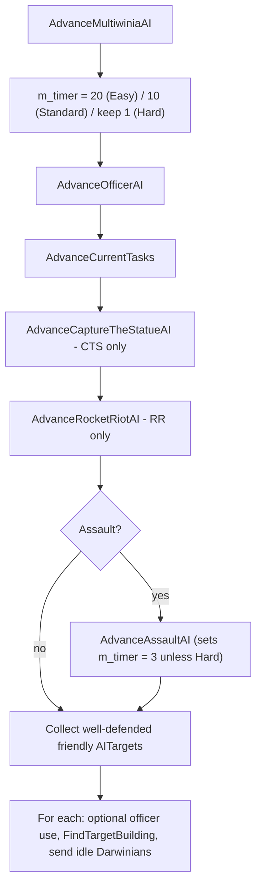
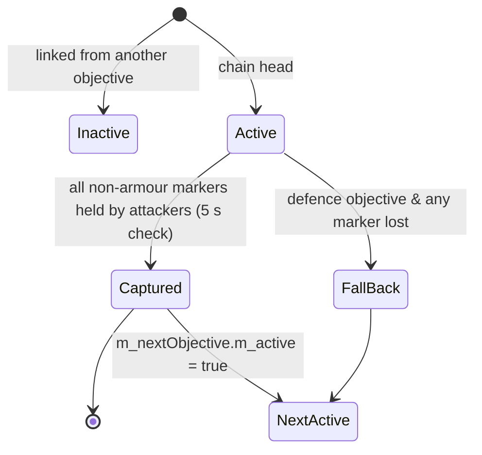

# P08_crates_ai — Crates/power-ups, CPU AI, objective markers
Scope: `code/worldobject/crate.{h,cpp}`, `code/worldobject/ai.{h,cpp}`, `code/worldobject/aiobjective.{h,cpp}`, `code/markersystem.{h,cpp}`; plus `code/interface/invalidcrates_window.*` and every crate/InvalidCrates/crate-option reference (`code/location.cpp`, `code/level_file.cpp`, `code/multiwinia.cpp`, `code/taskmanager.cpp`, `data/multiwinia.txt`, `data/levels/mp_*.txt`, `data/language/english.txt`), and the AI-facing `RunAI` methods of other entities (read to describe CPU behaviour; their non-AI mechanics belong to P04/P06/P07). Build baseline: see build_matrix.md.

Conventions in this draft: "tick" = one simulation step; `SERVER_ADVANCE_PERIOD` = `0.1 × gameSpeed` game-seconds (`code/gametimer.cpp:GameTimer::GetServerAdvancePeriod`) [C]; all distances are world units (wu). `syncfrand(x)` ∈ [0,x), `syncsfrand(x)` ∈ [−x/2, +x/2), `syncrand()` = MT19937 32-bit (`contrib/systemiv/lib/math/random_number.cpp:_syncrand/_syncfrand/_syncsfrand`) [C]. `FRAND(x)`/`SFRAND(x)` are the *synced* order-safe wrappers (`code/lib/vector3.h`, `code/lib/vector3.cpp:FromRand`) [C]. Monster team = team index 4, Futurewinian team = 5 (`code/location.cpp:Location::GetMonsterTeamId/GetFuturewinianTeamId`) [C].

---

## [→ 04_crates_powerups_and_weapons] 1. Build gating of the crate system

| Macro | Where defined | Baseline FULL | Effect | Evidence |
|---|---|---|---|---|
| `INCLUDE_CRATES_BASIC` | `code/lib/universal_include.h` (every target) | **on** | Compiles crate spawning (`Location::CreateRandomCrate`, `Location::AdvanceCrates`). Without it no crates ever drop. | [C] `code/location.cpp:Location::CreateRandomCrate`, `Location::AdvanceCrates` |
| `INCLUDE_CRATES_ADVANCED` | FULL, DEBUG, BETATEST_GROUP_ALL, group A | **on** | Bodies of all advanced `Run*` effects; "bad" crate pool; lobby "Basic Crates Only" checkbox. Without it `IsValid` rejects every advanced type and `RunUncapturedCrate` returns immediately. | [C] `code/worldobject/crate.cpp:Crate::IsValid`, `Crate::RunUncapturedCrate`, `Crate::RunNuke`…; `code/UI/GameMenuWindow.cpp` (checkbox block) |
| `INCLUDE_THEBEAST` | `code/worldobject/crate.h`, **only `#ifdef TARGET_DEBUG`** | **off** | Adds enum value `CrateRewardTheBeast` (index 31) → `NumCrateRewards` = 32 in DEBUG, **31 in FULL**. | [C] `code/worldobject/crate.h` lines 12–14, 66–68 |
| `INCLUDE_CRATE_HELP_WINDOW` | `TARGET_DEBUG` only | off | Front-end "crate help" list window (`CrateHelpWindow`, `CrateButton`) [B:DEBUG]. | [C] `code/lib/universal_include.h` TARGET_DEBUG block; `code/interface/helpandoptions_windows.cpp` |
| `CHEATMENU_ENABLED` | `TARGET_DEBUG` only | off | Cheat window "Crates" drop-down that spawns a crate with a forced `m_rewardId` [B:DEBUG]. | [C] `code/interface/cheat_window.cpp` |
| `LOCATION_EDITOR` | nowhere | off | `InvalidCratesWindow` editor panel [B:EDITOR]. | [C] `code/location_editor.cpp`, `code/interface/invalidcrates_window.cpp` |

> Note: build_matrix.md §4 lists `INCLUDE_THEBEAST` as "on" in baseline. Code says otherwise: it is defined only inside `#ifdef TARGET_DEBUG` in `crate.h` [C]. Logged under Contradictions.

## [→ 04_crates_powerups_and_weapons] 2. The crate reward enum (complete)

`Crate::CrateReward*` anonymous enum in `code/worldobject/crate.h` [C]. The level-file/sound key is `Crate::GetName(type)` (`code/worldobject/crate.cpp:Crate::GetName`, "no spaces allowed"); the English display name is `cratename_<GetName>` in `data/language/english.txt` (looked up case-insensitively by `Crate::GetNameTranslated`, falling back to the raw key) [C].

| Idx | Enum | GetName key (used in `InvalidCrates`, sounds, icons) | English display (`cratename_*`) | Class (`IsBasicCrate`) | Build |
|---|---|---|---|---|---|
| 0 | `CrateRewardSquad` | `Squad` | Squad | **Basic** | FULL |
| 1 | `CrateRewardHarvester` | `Harvester` | Harvester | Advanced | FULL |
| 2 | `CrateRewardEngineer` | `Engineer` | Engineer | **Basic** | FULL |
| 3 | `CrateRewardArmour` | `Armour` | Armour | **Basic** | FULL |
| 4 | `CrateRewardAirstrike` | `Airstrike` | AirStrike | **Basic** | FULL |
| 5 | `CrateRewardNuke` | `Nuke` | Nuke | Advanced | FULL |
| 6 | `CrateRewardDarwinians` | `Darwinians` | Multiwinians | **Basic** | FULL |
| 7 | `CrateRewardBooster` | `PersonalShield` | Personal Shield | Advanced | FULL |
| 8 | `CrateRewardSubversion` | `Subversion` | Subversion | Advanced | FULL |
| 9 | `CrateRewardHotFeet` | `HotFeet` | Hot Feet | Advanced | FULL |
| 10 | `CrateRewardGunTurret` | `GunTurret` | Gun Turret | **Basic** | FULL |
| 11 | `CrateRewardSpam` | `Infection` | Infection | Advanced | FULL |
| 12 | `CrateRewardForest` | `MagicalForest` | Magical Forest | **Basic** | FULL |
| 13 | `CrateRewardRandomiser` | `Randomiser` | Randomiser | Advanced | FULL |
| 14 | `CrateRewardAntNest` | `AntNest` | Ants Nest | Advanced | FULL |
| 15 | `CrateRewardPlague` | `Plague` | Plague | Advanced | FULL |
| 16 | `CrateRewardEggs` | `Eggs` | Eggs | Advanced | FULL |
| 17 | `CrateRewardMeteor` | `Meteor` | Meteor | Advanced | FULL |
| 18 | `CrateRewardDarkForest` | `DarkForest` | Dark Forest | Advanced | FULL |
| 19 | `CrateRewardCrateMania` | `CrateMania` | Crate Mania | Advanced | FULL |
| 20 | `CrateRewardSpawnMania` | `SpawnMania` | Spawn Mania | Advanced | FULL |
| 21 | `CrateRewardBitzkreig` | `Bitzkreig` | **Mega Rage** | Advanced | FULL |
| 22 | `CrateRewardRocketDarwinians` | `Rocketwinians` | Rocketwinians | Advanced | FULL |
| 23 | `CrateRewardRage` | `Rage` | Rage | Advanced | FULL |
| 24 | `CrateRewardRocketTurret` | `RocketTurret` | Rocket Turret | Advanced | FULL |
| 25 | `CrateRewardFlameTurret` | `FlameTurret` | Flame Turret | Advanced | FULL |
| 26 | `CrateRewardSpaceShip` | `SpaceShip` | Space Ship | Advanced | FULL |
| 27 | `CrateRewardTriffids` | `Triffids` | Triffids | Advanced | FULL |
| 28 | `CrateRewardNapalmStrike` | `NapalmStrike` | Napalm Strike | Advanced | FULL |
| 29 | `CrateRewardSlowDownTime` | `SlowDown` | Slow Down | Advanced | FULL |
| 30 | `CrateRewardSpeedUpTime` | `SpeedUp` | Speed Up | Advanced | FULL |
| 31 | `CrateRewardTheBeast` | `TheBeast` | The Beast | Advanced | **[B:DEBUG]** (`INCLUDE_THEBEAST`) |
| — | `NumCrateRewards` | (returns `"Crate"` for out-of-range) | — | — | = 31 FULL / 32 DEBUG |

Commented-out enum members (not compiled, appendix): `CrateRewardFormationIncrease`, `CrateRewardExtinguisher`, `CrateRewardTank` — their strings `cratename_formationbooster`, `cratename_fireextinguisher`, `cratename_tank` still exist in `english.txt` [C].

`IsBasicCrate(t)` = t ∈ {Squad, Engineer, Armour, Airstrike, Darwinians, GunTurret, Forest} (7 types); `IsAdvancedCrate(t)` = ¬Basic (24 types in FULL) [C] `code/worldobject/crate.cpp:Crate::IsBasicCrate/IsAdvancedCrate`. Note Harvester is *advanced* although it is a unit task.

## [→ 04_crates_powerups_and_weapons] 3. Crate options (lobby / data / level)

| Option | Source | Values | Modes that define it | Effect |
|---|---|---|---|---|
| `CrateDropRate` | `data/multiwinia.txt` (min 0, max 300, **default 40**, step 10) | seconds (mean interval) | Domination, KingOfTheHill, CaptureTheStatue, Assault, RocketRiot, Blitzkrieg (not TankBattle) | Base drop interval; 0 = no crates; `GetGameOption` returns −1 if undefined → no crates. [C] `code/location.cpp:Location::AdvanceCrates`, `code/multiwinia.cpp:Multiwinia::GetGameOption` |
| `CrateDropMode` | `data/multiwinia.txt` (0–1, **default 1**, change 0 = drop-down) | 0 = random, 1 = score-weighted | Domination, KingOfTheHill, CaptureTheStatue only (others → −1 = random) | Placement algorithm, §4.2. [C] |
| `StartingPowerups` | `data/multiwinia.txt` (0–3, default 0, step 1) | count | Domination, KingOfTheHill only | Free tasks at team init, §8. [C] `code/location.cpp:Location::InitialiseTeam` |
| `RetributionMode` | `data/multiwinia.txt` (0–1, default 1, checkbox) | bool | Dom, KOTH, CTS, Blitzkrieg | **No effect**: the only consumer (`Multiwinia::AdvanceRetribution`) is never called (call commented out) — see §8 / appendix. [C] grep: only definition in `code/multiwinia.cpp` |
| Basic Crates Only | lobby checkbox `multiwinia_param_basiccrates` → `Multiwinia::m_basicCratesOnly`; network game option `GAMEOPTION_BASICCRATES = 7` | bool, default false | all | Restricts rewards to the 7 basic types and disables the "bad" pool. Checkbox compiled only under `INCLUDE_CRATES_ADVANCED`. Reset to false by `FinishMultiwiniaButton` and `Multiwinia::Reset`; forced true by tutorial 2. [C] `code/UI/GameMenuWindow.cpp`, `code/network/network_defines.h`, `code/network/clienttoserver.cpp` (case `GAMEOPTION_BASICCRATES`), `code/UI/FinishMultiwiniaButton.h`, `code/multiwiniahelp.cpp` |
| `InvalidCrates` | level file `MultiwiniaOptions` block | list of GetName keys | per level | Per-level exclusion, §7. [C] `code/level_file.cpp:LevelFile::ParseMultiwiniaOptions` |
| `LevelOptions trunkportarmour N` | level file | int | per level | N>0 makes `Armour` invalid. [C] `Crate::IsValid` |
| `RestrictionZone` building | level file building `RestrictionZone id x z team rx rz isGlobal size [blockPowerups]` (default size 300) | — | per level | No *random-mode* crate may drop inside any zone (`RestrictionZone::IsRestricted(pos)` with `_powerups = false`; XZ distance < `m_size`). Zones with `m_blockPowerups == 1` additionally make power-up/task targeting invalid inside them (`IsRestricted(pos, true)` in `TaskManager::IsValidTargetArea`/`GetTargetArea`). Weighted-mode drops ignore zones [C] `code/worldobject/restrictionzone.cpp:RestrictionZone::IsRestricted`, `code/taskmanager.cpp`. |

## [→ 04_crates_powerups_and_weapons] 4. Crate spawn rules

### 4.1 Drop timer — `Location::AdvanceCrates` [C] `code/location.cpp`
Called from `Location::Advance(slice)` only when `g_app->Multiplayer()` and `slice == 8` → **once per tick**. Same block decrements `m_spawnManiaTimer` and `m_bitzkreigTimer` by `SERVER_ADVANCE_PERIOD` [C].

```
AdvanceCrates():
  if tutorial and (tutorialType == Tutorial1 or !help.m_tutorial2AICanSpawn): return   # no crates
  maxCrates = int(worldSizeX / 500.0)                    # e.g. 2000 wu → 4, 5000 wu → 10
  if Crate::s_crates >= maxCrates: return                # timer is frozen while at cap
  crateTime = GetGameOption("CrateDropRate")
  if crateTime == 0 or crateTime == -1: return
  if m_crateTimer == 0.0: m_crateTimer = crateTime * (1.5 - syncfrand(1.0))   # (0.5..1.5]×rate
  m_crateTimer -= SERVER_ADVANCE_PERIOD
  if m_crateTimer <= 0.0:
      m_crateTimer = crateTime * (1.5 - syncfrand(1.0))
      CreateRandomCrate()
```
- `Crate::s_crates` counts every live `Crate` object (incremented in ctor, decremented in dtor) — including falling crates and template objects briefly created on the stack (`Crate crateTemplate;` in `CreateRandomCrate` increments and decrements around the call) [C] `Crate::Crate/~Crate`. Reset to 0 in `Location::Init` (right after `LoadLevel`, together with `s_spaceShipUsed = false`, `AIObjective::s_objectivesInitialised = false`, `Armour::s_armourObjectives`, `AI::s_ai[i] = NULL`, `SpawnPoint::s_numSpawnPoints[0..NUM_TEAMS-1] = 0`) [C] `code/location.cpp:Location::Init`. Crates destroyed after that reset would drive the counter negative [I: only if an old Location's buildings outlive the new Init].
- Cap uses world **X** size only [C].
- Interval distribution: uniform on (0.5×, 1.5×] `CrateDropRate` game-seconds; game-speed crate effects stretch/compress it in real time because `SERVER_ADVANCE_PERIOD` scales [I].

### 4.2 Placement — `Location::CreateRandomCrate` [C] `code/location.cpp`
1. `dropMode = GetGameOption("CrateDropMode")`; random if 0 or −1.
2. **Weighted mode (1)** — a catch-up mechanic:
   - For each team that is used, not monster (4), not Futurewinian (5): `score_i = Multiwinia::m_teams[i].m_score`; `total = Σscore`, `high = max`, `low = min` (low initialised to `FLT_MAX`, high to 0).
   - `p = max(high/total, 1 − low/total)`; if `syncfrand(1) > p` → fall back to random.
   - Else choose a team with probability `w_i / Σw`, `w_i = total/score_i` (or `total` if `score_i == 0`) using one `syncfrand(1)` and cumulative odds — i.e. **lower-scoring teams are favoured**.
   - Build a list of *all* buildings owned by that team (any type, including AI targets). Up to 1000 tries: pick `syncrand() % n`, `pos = b.pos + (syncsfrand(200), 0, syncsfrand(200))` (±100 wu). Height test is buggy: `GetValue(pos.x, pos.z > 20.0)` passes a bool as the z coordinate, so it samples the terrain at z∈{0,1} and accepts whenever that height is non-zero — effectively always accepts the first try [C code, I consequence]. Crate start = `(pos.x, 1300 + syncfrand(200), pos.z)`.
   - If no team chosen, no buildings, or no position → random. (With `total == 0` the NaN arithmetic yields `dropTeam = −1` → random [I].)
3. **Random mode**: loop while `height(pos) < 20` or `RestrictionZone::IsRestricted(pos)`; each iteration (max 101; after 100 failures *no crate is created*): `pos = (FRAND(worldX), 1300, FRAND(worldZ))`, `pos.y += syncfrand(200)`; if any existing crate is within `CRATE_SCAN_RANGE × 10 = 350` wu horizontally, pos is zeroed to force another try. Weighted-mode drops skip the restriction-zone and spacing checks [C].
4. Create: team 255 (neutral), `Building::CreateBuilding(TypeCrate)`, `Initialise`, `SetDetail(1)`, `MarkerSystem::RegisterMarker_Crate(id)`; if `m_showCrateDropMessage` (true once per Location) show `crate_drop` ("Crate Drop!") and clear the flag [C].
- Start height constant `CRATE_START_HEIGHT = 1300.0` (`#define`, `crate.h`) [C].
- Crates **cannot be placed by level files**: `TypeCrate` is in `Building::BuildingIsBlocked` (`BLOCK_OLD_DARWINIA_OBJECTS`), which blocks name-based creation only; runtime `CreateBuilding(int)` still works [C] `code/worldobject/building.cpp:Building::BuildingIsBlocked/CreateBuilding(char*)`. `Crate` has no `Read/Write` override, so `m_rewardId` is never level-settable [C].
- Other crate sources: `RunCrateMania` (§6), tutorials (`code/multiwiniahelp.cpp` — fixed `m_rewardId` Airstrike at spawn-point−(100,0,200) +800 y; Armour at +100 x, +300 y), cheat window [B:DEBUG] (`m_rewardId` from drop-down, y=300) [C].

### 4.3 Falling — `Crate::AdvanceFloating` [C] `code/worldobject/crate.cpp`
Per tick while `!m_onGround`:
- Landed when `pos.y ≤ height(x,z) + 20` → `vel = 0`, `m_onGround = true`, stop sound "Crate Falling", trigger building sound "Land".
- `t = GetNetworkTime() + uniqueId × 20`; `sway = 300 × (pos.y / 1300)`; `target = (pos.x + cos(t)·sway, height(target.x,z), pos.z)` (sway is on X only); `target = PushFromObstructions(target)`; step = unit vector toward target × 40, push again, then clamp the displacement to `40 × SERVER_ADVANCE_PERIOD` → **crate moves at 40 wu per game-second** along a swaying path. `vel = Δpos / SERVER_ADVANCE_PERIOD` (used for render prediction and iframes).
- Derived fall time from 1300–1500 wu ≈ 33–38 game-seconds [I: path length / 40 wu·s⁻¹, vertical component ≈ 0.97].
- `PushFromObstructions(p)`: for each building in the obstruction-grid cell whose `DoesSphereHit(p, m_radius)`, repeatedly step p away from the building centre (XZ) by 2 wu until clear; if the resulting terrain height ≤ 10 the push is discarded (prevents pushing into water) [C].
- On spawn (`Initialise`) sound event "Falling" [C].

### 4.4 Lifetime / expiry [C] `Crate::AdvanceOnGround`
- `m_life` starts at 60.0 s and only counts down while the crate is on the ground **and neutral (team 255)** and not in tutorial 1 / tutorial 2 pre-spawn. It is reset to 60 every tick the owner holds the majority.
- When `m_life ≤ 0` and `m_captureTimer ≤ 0` → destroyed, sound "Expired", no effect (an `RunUncapturedCrate(monster)` call here is commented out), AI target destroyed. Explosion effect `g_explosionManager.AddExplosion(shape)` on any destruction [C].

## [→ 04_crates_powerups_and_weapons] 5. Pickup (capture) rules — `Crate::AdvanceOnGround`, `Crate::RecalculateOwnership` [C]

Constants: `CRATE_SCAN_RANGE = 35.0` (`#define`, crate.h), `CRATE_CAPTURE_TIME = 2.5` (`#define`, crate.cpp), max progress per tick 0.05 (literal).

On first ground tick the crate creates an **AITarget** at its ground position: `m_priorityModifier = 0.5`, `m_crateTarget = true`, unique building id, then `Location::RecalculateAITargets()` (see §AI) [C].

Each tick:
1. `RecalculateOwnership(num)`: for every used team t, count entities from `EntityGrid::GetNeighbours(pos, 35, includes={t})` that are `TypeDarwinian`, `!m_dead`, `state != StateInsideArmour`. `majority` = team with the strictly highest count (ties keep the earlier team index); 255 if all zero; `num` = that count. Only Darwinians count (not officers, squaddies, armour or monsters), but Darwinians of *any* used team count — including the CPU-typed monster (4) and Futurewinian (5) teams, which can therefore capture crates and receive tasks [C code; I consequence].
2. If `owner == majority && owner != 255`:
   - `Δ = min(0.05, SERVER_ADVANCE_PERIOD × num / 100)`; `m_captureTimer = min(2.5, m_captureTimer + Δ)`; `m_life = 60`.
   - Progress rate = `num/100` per game-second, capped at 0.05 per tick → **minimum capture time 50 ticks (5 s at speed 1) with ≥ 50 Darwinians**; 10 Darwinians → 25 s; 1 Darwinian → 250 s [C formula, I examples].
   - Sound when the 20 % bucket `int(5·timer/2.5)` changes: stop "Crate Capturing_*", trigger `Capturing_<bucket×20>pc` (0,20,40,60,80).
   - When `m_captureTimer ≥ 2.5` → **capture** (§6), `m_destroyed = true`, stop capture sounds and "Crate BeginCapture", trigger "Captured", destroy AI target + `RecalculateAITargets`, and if the capturer is the local team call `MultiwiniaHelp::NotifyCapturedCrate()`.
3. Else (contested, owner lost majority, or neutral): `m_captureTimer = max(0, timer − SERVER_ADVANCE_PERIOD)` (drains at 1.0 per game-second). When it reaches 0 and `owner != majority` → `SetTeamId(majority)`; if new owner is 255 → sound "LostCapture"; else "BeginCapture" + "Capturing_0pc". A neutral crate with a majority team changes owner on the same tick. A challenger must first drain the previous owner's progress.
   - Bug: the decay branch builds the sound name with `"Capturing_%pc"` (missing `d`), producing a pointer-formatted, non-existent event name [C].
4. `GetPercentCaptured()` = `m_captureTimer / 2.5` when owned, else 0 [C].

Darwinian side (P04 owns the state machine): idle Darwinians run `Darwinian::SearchForCrates` as the 4th idle search (after threats, ports, carryable buildings; before armour, Blitzkrieg flags, officers, spirits): any on-ground crate within `DARWINIAN_SEARCHRANGE_CRATES = 150` and walkable → `StateOpeningCrate`; waypoint = own position if already within 35, else a point `35/3 + syncfrand(70/3)` from the crate toward the Darwinian, plus an offset of `syncfrand(35/3)` rotated by `syncfrand(2π)` [C] `code/worldobject/darwinian.cpp:Darwinian::SearchForCrates`.

Capture resolution:
```
on capture (owner = capturing team):
  noAdvanced = m_basicCratesOnly || !INCLUDE_CRATES_ADVANCED
  if m_rewardId != -1 || syncfrand(1.0) < 0.9 || noAdvanced:   # syncfrand consumed only when m_rewardId == -1
       CaptureCrate()            # "good" outcome (90 %)
  else RunUncapturedCrate(owner) # "bad" outcome (10 %)
```

## [→ 04_crates_powerups_and_weapons] 6. Outcome selection and per-outcome specification

### 6.1 "Good" pool — `Crate::CaptureCrate()` [C]
`rewardId = syncrand() % NumCrateRewards`, repeated (rejection sampling, unbounded loop) until `rewardId ∉ {Spam, Randomiser, Plague, SpaceShip, Triffids, [TheBeast]}` **and** `IsValid(rewardId)`. Then `if (m_rewardId != -1) rewardId = m_rewardId` (the random draw still consumed RNG). Hence each valid good type has **equal probability** `0.9 / |valid good set|`.

`Crate::IsValid(t)` (in order) [C]:
1. `!INCLUDE_CRATES_ADVANCED` and advanced → false.
2. `m_basicCratesOnly` and advanced → false.
3. t ∈ {Harvester, Engineer, SpawnMania} and `Σ SpawnPoint::s_numSpawnPoints[0..NUM_TEAMS]` == 0 → false (no spawn points on level).
4. t == Armour and (game type RocketRiot or `LevelOptionTrunkPortArmour > 0`) → false.
5. Assault and t ∈ {RocketTurret, SpaceShip} → false.
6. t == SpaceShip and `s_spaceShipUsed` → false.
7. t == CrateMania and `s_crates ≥ 4` → false (the crate being captured is still counted).
8. t == AntNest and (#AntHill buildings + 2 × Σ_teams pending `TypeAntsNest` tasks) ≥ 4 → false.
9. return `!levelFile.m_invalidCrates[t]`.

### 6.2 "Bad" pool — `Crate::RunUncapturedCrate(team)` [C]
Returns immediately if `!INCLUDE_CRATES_ADVANCED` or `m_basicCratesOnly`. Builds list {Spam, Randomiser, Plague, DarkForest, Triffids, [TheBeast DEBUG], SpaceShip (only if `!s_spaceShipUsed` and not Assault), AntNest} and picks `syncrand() % size` uniformly. **`IsValid`/`InvalidCrates` are not consulted** (e.g. AntNest limit and per-level exclusions do not apply to bad outcomes). Calls `Location::InitMonsterTeam(capturingTeam)` — a no-op because the capturing team is in use (the intended `monsterTeam == team` guard is commented out) [C code; I intent]. Effects are created for the monster team (4), Futurewinians (5) for SpaceShip.
- The `m_rewardId` branch and the switch cases Airstrike, Darwinians, Forest, Eggs, Meteor, NapalmStrike, SlowDown, SpeedUp inside `RunUncapturedCrate` are **unreachable** (a forced reward always goes to `CaptureCrate`; the list never contains those types) [C].

### 6.3 Probability tables
Per-level computation in `OUT/_work/drafts/P08_crate_pools.csv` (script `OUT/_work/scripts/P08_crate_pools.py`; start-of-game state: no dynamic limits active, SpaceShip unused) [C inputs from `data/levels/mp_*.txt`; arithmetic I].

| Context (FULL, Basic-only OFF) | Valid good types | Each good type | Bad pool | Each bad type | Notes |
|---|---|---|---|---|---|
| Dom / KOTH / CTS / Blitz with spawn points, no `InvalidCrates` | 26 | 0.9/26 = **3.462 %** | 7 | 0.1/7 = **1.429 %** | DarkForest and AntNest are in both pools → 4.890 % each |
| Same, after SpaceShip used | 26 | 3.462 % | 6 | 1.667 % | |
| Map with no SpawnPoints (e.g. `mp_koth_3P_4`, `mp_cts_3p_3`, `mp_blitzkrieg_3P_1/3P_2/4P_2`) | 23 (−Harvester, Engineer, SpawnMania) | 3.913 % | 7 | 1.429 % | |
| RocketRiot with spawn points (`mp_rocketriot_2P_2`, `4P_1`) | 25 (−Armour) | 3.600 % | 7 | 1.429 % | |
| RocketRiot without spawn points (2P_4, 2p_3, 3P_2, 3P_3, 3p_1) | 22 | 4.091 % | 7 | 1.429 % | |
| Assault, no InvalidCrates (`mp_assault_2P_2`, `3p_3`) | 21–22 (−RocketTurret, −Harvester/Engineer/SpawnMania; −Armour if trunkportarmour) | 4.09–4.29 % | 6 (no SpaceShip) | 1.667 % | |
| `mp_assault_2P_1` (`InvalidCrates Squad Airstrike Nuke Meteor`) | 18 | 5.000 % | 6 | 1.667 % | |
| `mp_assault_2p_3` (same list + trunkportarmour 3) | 17 | 5.294 % | 6 | 1.667 % | |
| Basic-only ON, spawn points present | 7 basic | **14.286 %** (100 %/7) | none | 0 % | bad pool disabled |
| Basic-only ON, no spawn points | 6 (−Engineer) | 16.667 % | none | | |

Good-pool membership (26 in the standard case): Squad, Harvester, Engineer, Armour, Airstrike, Nuke, Darwinians, PersonalShield, Subversion, HotFeet, GunTurret, MagicalForest, AntNest, Eggs, Meteor, DarkForest, CrateMania, SpawnMania, Bitzkreig, Rocketwinians, Rage, RocketTurret, FlameTurret, NapalmStrike, SlowDown, SpeedUp. Never in the good pool by random draw: Infection(Spam), Randomiser, Plague, SpaceShip, Triffids, TheBeast.

### 6.4 Delivery modes
- **Task (deferred)**: `team->m_taskManager->RunTask(GlobalResearch::Type…)` adds a task the owner targets later (human via task UI; CPU via `AI::AdvanceCurrentTasks`). If the task manager is full the reward is **lost**; local player sees `dialog_powerup_limit` "Powerup Limit Reached!". Multiplayer capacity = 6 tasks (2 if the team is eliminated) [C] `code/taskmanager.cpp:TaskManager::RunTask(Task*)`, `TaskManager::Capacity`. New tasks are inserted before the first not-yet-targeted task (multiplayer) [C].
- **Immediate**: effect fires at the crate's position on capture.
- For tasks, message: if capturer ≠ local team, `crate_enemycapture` "*T Opened a Crate!" (T = team name) is shown to everyone else; the local capturer gets the task popup instead (message removed "by Chris") [C] `Crate::CaptureCrate`.

### 6.5 Per-outcome specification
Effect functions are all `static` in `Crate` and are reused by tasks (`code/taskmanager.cpp:Task::Target*`). `POWERUP_EFFECT_RANGE = 70.0` (`#define`, `code/taskmanager.h`). "Marker" = `MarkerSystem::RegisterMarker_Fixed(team, pos, icon)` (§MarkerSystem). "Sound" = `Crate::TriggerSoundEvent(type,pos,team)` → `SoundSystem::TriggerOtherEvent(pos, GetName(type), SoundSourceBlueprint::TypeCratePowerup, team)`. Message strings are in `data/language/english.txt`; `*T` = team name, `*G` = turret name.

| Outcome | Pools | Delivery / task type | Effect (counts, placement, duration, recipient) | Limits | Message key → English | Marker icon | Code |
|---|---|---|---|---|---|---|---|
| Squad | good, start | Task `TypeSquad` (`m_lifeTimer` 60 s) | On target: spawn `2 + research(TypeSquad)` InsertionSquadie (research is forced to 3 in MP → 5 squaddies [I: `Location::Init` sets all research levels to 3]) at target, unit selected. Mechanics P04. | — | task UI | task marker `icon_squad` | `Task::TargetSquad` |
| Harvester | good, start | Task `TypeHarvester` | Spawn Harvester at target +50 y. | needs spawn points | task UI | — | `Task::TargetHarvester` |
| Engineer | good, start | Task `TypeEngineer` | Spawn Engineer (P04/P09). | needs spawn points | task UI | — | `Task::TargetEngineer` |
| Armour | good, start | Task `TypeArmour` | Spawn Armour at target; sound `Armour`. | invalid in RocketRiot or `trunkportarmour > 0` | task UI | — | `Task::TargetArmour` |
| Airstrike | good, start | Task `TypeAirStrike` (MP) | `RunAirStrike(pos, team, false)`: throw `3 + syncrand()%5` (3–7; **10 in tutorial**) `EffectThrowableAirstrikeMarker` weapons from pos to pos + (SFRAND(100),0,SFRAND(100)) (±50); bombers are P04/P05. Task terminates on use. | — | `crate_message_run_airstrike` "*T launches Airstrike!" (monster: `crate_message_auto_airstrike` "Incoming Airstrike!") | `icon_airstrike` | `Crate::RunAirStrike` |
| NapalmStrike | good, start | Task `TypeAirStrike` with `m_option = 1` | `RunAirStrike(pos, team, true)` → markers with `m_naplamBombers = true`. | — | `crate_message_run_napalm` "I love the smell of Napalm in the morning..." (no *T substitution text in English though `ReplaceStringFlag('T')` is applied); monster: `crate_message_auto_napalm` | `icon_airstrike` | same |
| Nuke | good, start | Task `TypeNuke` | 10 Nuke entities of `team` spawned at random sea positions (`FRAND(worldX−100)`, `FRAND(worldZ−100)`, re-rolled until height ≤ 0 — **infinite loop on a map without water**); nuke 0 targets pos exactly and renders a marker; nukes 1–9 target pos + `syncsfrand(300)` (±150); target y = ground − 5. | — | `crate_message_run_nuke` "*T launches a Nuke Barrage!" / auto: "Incoming Nuke Barrage!" | `icon_nuke` | `Crate::RunNuke` |
| Darwinians | good | **Immediate** | Spawn `50 + syncrand()%50` (50–99) Darwinians of the capturer at the crate, vel = up+(SFRAND(1),0,SFRAND(1)) scaled to `10 + syncfrand(20)`, airborne. | — | `crate_message_darwinians` "*T receives Reinforcements!" (monster: hard-coded "Evil Darwinians!") | `icon_darwinian` | `Crate::RunDarwinians` |
| PersonalShield (Booster) | good, start | Task `TypeBooster`, life 30 s | All capturer Darwinians within 70 of target: `Darwinian::SetBooster(taskId)`. | — | `crate_message_run_personalshield` "*T runs Personal Shield!" | `icon_personalshield` | `Crate::RunBooster` |
| Subversion | good, start | Task `TypeSubversion`, life 30 s | Own Darwinians within 70: `GiveMindControl(taskId)`. | — | "*T runs Subversion!" | `icon_subversion` | `Crate::RunSubversion` |
| HotFeet | good, start | Task `TypeHotFeet`, life 30 s | Own Darwinians within 70: `GiveHotFeet(taskId)`. | — | "*T runs Hot Feet!" | `icon_hotfeet` | `Crate::RunHotFeet` |
| Rage | good, start | Task `TypeRage`, life 30 s | Own Darwinians within 70: `GiveRage(taskId)`. | — | `crate_message_rage` "*T runs Rage!" | `icon_rage` | `Crate::RunRage` |
| GunTurret | good, start | Task `TypeGunTurret`, `m_option = GunTurretTypeStandard` | `RunGunTurret`: create GunTurret building (state = turret type) at target, `ExplodeBody()` (build effect), obstruction grid recalculated. Task terminated unless the mode has `MaxTurrets` (RocketRiot/Blitzkrieg) in which case the task stays Running. | — | `crate_message_run_gunturret` "*T places a *G" | `icon_gunturret` | `Crate::RunGunTurret`, `Task::TargetGunTurret` |
| RocketTurret | good, start | as GunTurret, `GunTurretTypeRocket` | as above | invalid in Assault | same | same | same |
| FlameTurret | good, start | as GunTurret, `GunTurretTypeFlame` | as above | — | same | same | same |
| MagicalForest | good | **Immediate** (`RunMagicalForest(pos, monsterTeam)`; team id used only for message/marker colour) | `GenerateTrees`: `1 + syncrand()%2` (1–2) trees within ±50; clone of the first non-evil level tree, else random template (budsize/pushOut/pushUp `1.2 − syncfrand(0.4)`, random colours `100 + rand%155` per channel, height 80, 6 iterations); each: height capped 100 then ×`(1.2 − syncfrand(0.4))`, `SetFireAmount(−1)` (min height, not burning), `m_spawnsRemaining = 2 + syncfrand(3)`, `m_spiritDropRate = 15 + syncfrand(15)`, destroyable, team 255. | — | `multiwinia_exclamation` "*T!" with "Magical Forest" | `icon_magicalforest` | `Crate::RunMagicalForest/GenerateTrees` |
| DarkForest | good, start, **bad** | good: Task `TypeDarkForest`; bad: immediate for monster team | `GenerateEvilTrees`: `2 + syncrand()%3` (2–4) evil trees (black branches, leaves alpha 200, 5 iterations, `m_evil = true`) within ±50 (tree behaviour P07). | — | team: "*T plants a Dark Forest!" / monster: "Dark Forest!" | `icon_darkforest` | `Crate::RunDarkForest/GenerateEvilTrees` |
| AntNest | good, start, **bad** | good: Task `TypeAntsNest`; bad: immediate | 2 AntHill buildings of the monster team within ±100, random facing, `m_numAntsInside = 75 − syncrand()%25` (51–75); plus 1 ArmyAnt spawned at pos to wake the monster team. | good pool: ≤ 4 nests counting pending tasks ×2 | team: "*T creates an Ants Nest!" / monster: "Ants Nest!" | `icon_antnest` | `Crate::RunAntNest` |
| Eggs | good, start | Task `TypeEggSpawn` | `2 + syncrand()%3` (2–4) TriffidEgg entities **of the capturer's team** from pos+20 y, vel (SFRAND(1),4,SFRAND(1)) scaled to `50 + syncfrand(50)`; spawn type uniform over {Virii, Centipede, Spider, TriffidEggs, SporeGenerator} (rejects Spirits, Eggs, SoulDestroyer, Ants, Darwinians); timer `4 + syncfrand(4)` s; roam range 300. | — | "*T creates some Eggs!" / auto: "Egg Spawn!" | `icon_egg` | `Crate::RunEggs` |
| Meteor | good, start | Task `TypeMeteorShower` | `5 + syncrand()%5` (5–9) Meteor entities of `team`, spawned at random world (FRAND) x,z, y = 1500 + `syncfrand(500)`, each targeting pos ± `syncsfrand(420)` (±210; area = 70 × 6) at ground − 10. | — | "*T causes a Meteor Shower!" | `icon_meteorshower` | `Crate::RunMeteorShower` |
| CrateMania | good | **Immediate**, global | `int(5 + syncfrand(5))` (5–9) calls of `Location::CreateRandomCrate()` (normal placement rules; ignores maxCrates). | invalid when `s_crates ≥ 4` | "Crate Mania!" (name + '!') | — | `Crate::RunCrateMania` |
| SpawnMania | good | **Immediate**, global (all teams) | `Location::m_spawnManiaTimer = 5.0` s: while > 0, every owned, un-locked SpawnPoint requests a spirit every tick (`SpawnPoint::Advance`). HUD "SPAWN MANIA: *T" top-centre, red when < 2 s. | needs spawn points | "Spawn Mania!" | — | `Crate::RunSpawnMania`; `code/worldobject/spawnpoint.cpp`; `code/multiwinia.cpp` render |
| Bitzkreig ("Mega Rage") | good | **Immediate**, global (all teams) | `Location::m_bitzkreigTimer = 15.0` s: `Darwinian::HasRage()` true for every Darwinian of every team. HUD "MEGA RAGE: *T". | — | "Mega Rage!" | — | `Crate::RunBitzkreig`; `code/worldobject/darwinian.cpp:Darwinian::HasRage` |
| Rocketwinians | good | **Immediate**, capturer, **permanent** | `team->m_evolutions[Team::EvolutionRockets] = 1` (Darwinians throw rockets instead of grenades; P04). | — | "*T gets Rocketwinians!" | — | `Crate::RunRocketDarwinians` |
| SlowDown | good | **Immediate**, global | If not game over: `g_gameTimer.RequestSpeedChange(0.2 + syncfrand(0.2), 0.05, 15.0)`: speed approaches target by 5 % of the gap per tick, holds for 15.0 (decremented 0.1 per `GameTimer::Tick` once reached), then requests 1.0. | ignored if `LockSpeedChange` | `crate_message_slowdown` "Sloooow Dooown..." | — | `Crate::RunSlowDownTime`; `code/gametimer.cpp` |
| SpeedUp | good | **Immediate**, global | As above with target `1.3 + syncfrand(0.7)` (1.3–2.0). | | "Speed up!!" | — | `Crate::RunSpeedUpTime` |
| Infection (Spam) | **bad** (good only via forced id → Task `TypeInfection`) | Immediate, monster team | 100 `SpamInfection` effects of the monster team at pos, vel = up + (SFRAND(1), FRAND(2), SFRAND(1)) scaled to 100. | — | `crate_message_auto_infection` "Infection Outbreak!" | `icon_infection` | `Crate::RunInfection` |
| Randomiser | **bad** (good only via forced id) | Immediate | `Randomiser` effect placed at pos (behaviour P05: continually converts Darwinians in range to random teams). | — | "Randomiser" | `icon_randomizer` | `Crate::RunRandomiser` |
| Plague | **bad** | Immediate | **Every** Darwinian (all teams, including the capturer) within 70: `Darwinian::Infect()`. Forced-id Plague in `CaptureCrate` hits the default `AppReleaseAssert` (case commented out). | — | `crate_message_auto_plague` "Plague Outbreak!" | `icon_plague` | `Crate::RunPlague` |
| Triffids | **bad** (good only via forced id) | Immediate, monster team | `1 + syncrand()%3` (1–3) Triffid buildings within ±25, front = away from pos, pitch `0.6 + syncfrand(0.6)`, force `60 + syncfrand(60)`, variance `syncfrand(0.5)`, reload `40 + syncfrand(60)` s, may spawn every type except Spirits and Eggs. | — | "Triffids!" | `icon_triffid` | `Crate::RunTriffids` |
| SpaceShip | **bad** (good only via forced id) | Immediate, Futurewinian team (5) | One SpaceShip entity spawned at a random land position (height ≥ 10, re-rolled), y = 5000; abducts Darwinians (P05). `s_spaceShipUsed = true` → once per game. | once per game; never in Assault | `crate_message_spaceship` "Futurewinians!" | — | `Crate::RunSpaceShip` |
| TheBeast | bad [B:DEBUG] | Immediate, monster team | Portal building of the monster team at pos. | — | "The Beast Cometh!" | — | `Crate::RunTheBeast` |

Global/untargeted immediate effects pass team 255 to the sound and no team to the message [C].

## [→ 04_crates_powerups_and_weapons] 7. Per-level exclusion — InvalidCrates

- **Syntax** (inside `MultiwiniaOptions_StartDefinition … MultiwiniaOptions_EndDefinition`): `InvalidCrates <Key> <Key> …` where each key is matched case-insensitively (`stricmp`) against `Crate::GetName(i)`; unknown keys are ignored silently [C] `code/level_file.cpp:LevelFile::ParseMultiwiniaOptions`.
- Storage: `bool LevelFile::m_invalidCrates[Crate::NumCrateRewards]`, zeroed in both `LevelFile` constructors; written back by `LevelFile::WriteMultiwiniaOptions` as `\tInvalidCrates\t<Key>\t…` (after `LevelOptions`, before `PlayTime`) only if any are set [C] `code/level_file.cpp:LevelFile::WriteMultiwiniaOptions`.
- Consumer: last step of `Crate::IsValid` (good pool, StartingPowerups). Not consulted by the bad pool [C].
- Editor: `InvalidCratesWindow` — one checkbox per reward (`crate_<i>`, caption `GetNameTranslated`), bound directly to `m_invalidCrates[i]` [B:EDITOR] [C] `code/interface/invalidcrates_window.cpp`.
- Because the array is sized by `NumCrateRewards`, level files are binary-compatible across DEBUG/FULL only because TheBeast is last [I].

Shipped usage [C] grep of `data/levels`:

| Level | InvalidCrates |
|---|---|
| `mp_assault_2P_1.txt` | Squad Airstrike Nuke Meteor |
| `mp_assault_2p_3.txt` | Squad Airstrike Nuke Meteor |
| `mp_assault_3P_2.txt` | Armour |
| `mp_assault_3p_1.txt` | Armour |
| `mp_assault_4P_1.txt` | Armour |
| `mp_assault_4P_2.txt` | Armour |
| `mp_rocketriot_2P_4.txt` | Armour (redundant: Armour is already invalid in RocketRiot) |
| `old/mp_assault_3P_1.txt` (unused) | SpaceShip |

## [→ 04_crates_powerups_and_weapons] 8. Non-crate grants that reuse crate rewards

- **StartingPowerups** (`Location::InitialiseTeam`, multiplayer only, Domination/KOTH option 0–3): for each of N, draw `syncrand() % NumCrateRewards` until not in {Randomiser, CrateMania, Darwinians, Bitzkreig, SpawnMania, Plague, Rocketwinians, SpaceShip, Infection, Triffids, SpeedUp, SlowDown, MagicalForest, [TheBeast]} and `IsValid` → `Crate::CaptureCrate(type, team)` (static overload: always a task; MagicalForest/RocketDarwinians cases exist but excluded here). Pool = 18 types (Squad, Harvester, Engineer, Armour, Airstrike, Nuke, PersonalShield, Subversion, HotFeet, GunTurret, AntNest, Eggs, Meteor, DarkForest, Rage, RocketTurret, FlameTurret, NapalmStrike) minus `IsValid` exclusions; basic-only → {Squad, Engineer, Armour, Airstrike, GunTurret}. Then every task of that team (except Shaman) gets `m_startTimer = 30.0` (unusable for 30 s). Skipped for monster/Futurewinian teams [C].
- **Retribution** (`Multiwinia::AdvanceRetribution`): every 45 s an eliminated team with spare task capacity would receive a random task from {Airstrike, Airstrike, Meteor, MagicalForest, DarkForest, Eggs} (only Airstrike if basic-only), source tagged 2. **Never called** → dead in FULL [C]. The static `Crate::CaptureCrate(int,int)` asserts for types without a case (Darwinians, Infection, Randomiser, Plague, CrateMania, SpawnMania, Bitzkreig, SpaceShip, Triffids, SlowDown, SpeedUp, TheBeast) [C].
- Trunk-port reinforcements (`Multiwinia::AdvanceTrunkPorts`: armour and level-defined attacker/defender reinforcement task types, tagged source 1) use `TaskManager::RunTask` directly — owned by P02.

## [→ 04_crates_powerups_and_weapons] 9. Crate presentation (render, audio, UI)

Rendering [C] `code/worldobject/crate.cpp:Crate::Render*` (render-side only, not simulated):
- Shape `researchitem.shp`; tumbles each frame: rotation axis = up rotated by `g_gameTime×1.0` about X and `×0.7` about Z; position predicted `pos + vel × predictionTime`.
- Falling: `RenderBubble` (camera-facing quad `textures/bubble.bmp`, white α150, size = 2×radius), `RenderGroundMarker` (rotating `icons/target.bmp` decal on the terrain under the crate at −0.3 rad/s, with a blurred shadow texture generated once by `BitmapRGBA::ApplyBlurFilter(10)` and cached as `shadow_icons/target.bmp`), `RenderGlow`.
- On ground: bubble "pop" — three quarter-quads drifting apart while `m_bubbleTimer` (starts 100) decreases by `40 × SERVER_ADVANCE_PERIOD` **per rendered frame** (frame-rate dependent; render code mutates object state) [C]; then glow only.
- `RenderGlow`: while falling, `numStars` (10 / 5 / 2 for pref `RenderBuildingDetail` 1/2/3) red-orange starbursts `textures/starburst.bmp` (colour 1.0,0.4,0.2, α = 0.6 × y/1300, size i×15); always: `maxBlobs` (20 / 10 / 0) `textures/cloudyglow.bmp` blobs around the centre, colour = capturing team colour α155 or (255,155,100,55) neutral.
- `IsInView` also true if the point above/below the crate at camera height or ground is in the frustum (keeps falling crates rendered) [C].
- Network iframes write zero vectors for a crate's front/up/centre (orientation is cosmetic) [C] `code/network/iframe.cpp`.

Audio [C] `Crate::ListSoundEvents`: building events `Falling`, `Land`, `BeginCapture`, `Capturing_0pc`, `Capturing_20pc`, `Capturing_40pc`, `Capturing_60pc`, `Capturing_80pc`, `Captured`, `LostCapture`, `Expired`; power-up events named by `GetName(type)` in sound-source type `TypeCratePowerup` (enumerated by `code/sound/soundsystem.cpp` over all `NumCrateRewards`).

UI: crate off-screen/on-screen marker (§MarkerSystem); `MultiwiniaHelp` "crates" help tab appropriate during grace period when `Crate::s_crates > 0` [C] `code/multiwiniahelp.cpp:MultiwiniaHelp::CratesOnLevel`; `NotifyCapturedCrate` increments the tab's accomplished count. Help-window tooltips `crate_tooltip_<Key>` and optional `crate_hint_<Key>` [B:DEBUG]. Messages go through `Location::SetCurrentMessage(msg, team, noOverwrite)` (3.0 s real time; ignored while a no-overwrite message is showing; team presumably used for colouring [I]) [C] `code/location.cpp:Location::SetCurrentMessage`.

## [→ 07_ai] 10. CPU player architecture

### 10.1 Classes and data structures [C] `code/worldobject/ai.h`, `code/worldobject/aiobjective.h`



| Type | Fields (all enumerated) | Notes |
|---|---|---|
| `struct RRSolarPanelInfo` | `Vector3 m_pos; int m_numPanels; int m_objectiveId; float m_range` | RocketRiot objective cache, one per own-team AIObjectiveMarker [C] |
| `struct NeighbourInfo` | `int m_neighbourId` (AITarget building id); `int m_laserFenceId` (fence crossed by the link, −1 none) | [C] |
| `AI` | see diagram; `m_currentObjective` init −1, `m_timer` init per difficulty (§14), `m_radarReposTimer = syncfrand(10)` | Entity type `TypeAI`; ctor does `Entity::s_entityPopulation--` (does not count toward population); `ChangeHealth` returns false (immortal); `Begin` sets `s_ai[team] = this`; `Render` draws only in editor [C] |
| `AITarget` | see diagram; ctor: counts 0, `m_linkId −1`, `m_priorityModifier 0`, `m_checkCliffs 1`, `m_statueTarget −1`, `m_scoreZone −1`, flags false, `m_teamCountTimer = syncfrand(2)`; shape `aitarget.shp` | `AITARGET_LINKRANGE = 600.0` (`#define`) [C] |
| `AIObjective` | ctor: `m_nextObjective −1`, `m_active true`, `m_timer 5.0`, `m_armourMarker −1`, `m_defenseObjective false`, `m_wallTarget −1` (written by `Wall::Advance` for a Wall whose `m_objectiveLink` names this objective; never read) | [C] |
| `AIObjectiveMarker` | ctor: `m_scanRange 100`, `m_objectiveId −1`, `m_registered false`, `m_armourObjective 0`, `m_objectiveBuildingId −1`, `m_pickupAvailable false`, `m_pickupOnly 0`, `m_defenseMarker false`, `m_timer = syncfrand(1)` | [C] |
| `AISpawnPoint` | `m_timer, m_online, m_numSpawned, m_populationLock, m_entityType, m_count(20), m_period(60), m_activatorId, m_spawnLimit(−1), m_routeId` | **[B:LEGACY]** — `TypeAISpawnPoint` is in `BuildingIsBlocked`; Darwinia-era (blueprint store/console activators). Appendix. |

### 10.2 Instantiation and where it runs
- `Location::InitialiseTeam(team)`: in Multiwinia mode, if the team type is `TeamTypeCPU`, spawn **one** `Entity::TypeAI` at (−100, 0, −100) for that team [C] `code/location.cpp:Location::InitialiseTeam`. Called for every non-unused team in `Location::InitTeams`, and later when a team is (re)initialised mid-game (`Multiwinia::InitialiseTeam`).
- The monster (4) and Futurewinian (5) teams are set up as `TeamTypeCPU` by `Location::InitMonsterTeam/InitFuturewinianTeam` in `Location::Init` (multiplayer), which runs **after** `InitTeams()` has set `m_teamsInitialised = true` [C line order in `Location::Init`]; `Multiwinia::InitialiseTeam` then calls `Location::InitialiseTeam`, so these neutral-hostile teams also get an AI entity that drives their Darwinians (e.g. Darwinians converted to the monster team) [I: assumes `g_app->m_location` is already assigned during `Init`]. StartingPowerups are skipped for them; `AdvanceOfficerAI` skips Futurewinian teams only [C].
- There is a single difficulty for all CPU teams: `Multiwinia::m_aiType ∈ {AITypeEasy=0, AITypeStandard=1, AITypeHard=2}` (default Standard; lobby drop-down options `dialog_easy_difficulty`, `multiwinia_menu_normal`, `multiwinia_menu_hard`; synced as `GAMEOPTION_AIMODE`; forced to Standard outside tutorials by `App` and by tutorial 2) [C] `code/multiwinia.h`, `code/UI/GameMenuWindow.cpp`, `code/network/clienttoserver.cpp`, `code/app.cpp`.
- **Simulation-resident and lockstep**: the AI is an ordinary entity in `Team::m_others`, advanced once per tick inside `Team::Advance(slice)` (each `m_others` entry is in exactly one of the 10 slices) on **every peer**; all its randomness is `syncrand/syncfrand/syncsfrand`; it issues orders by direct calls (`Darwinian::GiveOrders`, `Officer::SetOrders/SetWaypoint`, `TaskManager::RunTask/TargetTask/TerminateTask`, `Armour::AISetConversionPoint`, `RadarDish::Aim`) — **no network messages** [C] `code/team.cpp:Team::Advance`, `code/taskmanager.cpp:TaskManager::TargetTask`. Docs describe an AI "running locally" on a client — see discrepancies.
- AI has **perfect information**: it reads every building, every AITarget's per-team counts and the entity grid for any team [C]. No resource cheats were found: `m_aiType` is not referenced by spawn points, population or damage code (grep of `m_aiType` across `code/`) [C].

## [→ 07_ai] 11. AITarget node graph (the AI's map)

### 11.1 Placement
- **Level file** (designer-placed; 1112 AITargets across the 57 shipped `mp_*.txt` levels [C count]): `AITarget <id> <x> <z> <team> <rx> <rz> <isGlobal> [<linkId> [<priorityModifier> [<checkCliffs>]]]` [C] `AITarget::Read/Write`; e.g. `AITarget 56 602.17 1461.32 255 1.00 0.00 0 -1 0.00 0`. `Initialise` copies link/modifier/checkCliffs; `m_waterTarget = (pos.y ≤ 0)`.
- **Runtime-created** AITargets (unique building ids from `GlobalWorld::GenerateBuildingId`) [C]:

| Creator | Position | Flags | Lifetime | Ref |
|---|---|---|---|---|
| Crate (on landing) | ground under crate | `m_priorityModifier 0.5`, `m_crateTarget` | until captured/expired | `Crate::AdvanceOnGround` |
| RadarDish (while `m_signal > 0`) | dish entrance | `m_radarTarget`; `m_linkId` = receiver dish's AITarget when known | destroyed when signal drops | `code/worldobject/radardish.cpp:RadarDish::AdvanceAITarget` |
| Statue (CTS) | statue; re-positioned when statue moves > `m_carryRadius × 1.5` | `m_priorityModifier 1.0`, `m_statueTarget = statue id` | statue life | `code/worldobject/statue.cpp` |
| GunTurret | turret | `m_turretTarget` | turret life | `code/worldobject/gunturret.cpp` |
| FuelStation (RocketRiot) | station, while rocket is loading and `SafeToLaunch` | `m_priorityModifier 1.0` | until not loading | `code/worldobject/rocket.cpp:FuelStation::Advance` |
| WallBuster (Assault) | follows the buster | — | buster life | `code/worldobject/wallbuster.cpp` |
| CloneLab | exit | — | [B:LEGACY] | `code/worldobject/clonelab.cpp` |

### 11.2 Links — `AITarget::RecalculateNeighbours`, `Location::RecalculateAITargets` [C]
- For every other non-destroyed AITarget B: link A→B if (`|A−B| ≤ 600` or `A.m_linkId == B.id`) and (`Location::IsWalkable(A, B, checkCliffs, false, &fenceId)` or both are radar targets or either is a water target). `checkCliffs = A.m_checkCliffs && B.m_checkCliffs`, forced false for the manual link. The crossed laser fence id is stored.
- Score zone tagging (same pass): if A lies within a `MultiwiniaZone`'s radius and the zone is neutral (team 255): CTS → `m_scoreZone` = that zone (statue spawn zone); KOTH → the KOTH score zone.
- Culling pass (`Location::RecalculateAITargets`): for A (skipping turret targets) and each neighbour C (skipping the manual link and turret targets): remove A→C if some other neighbour B of A has a link B→C and `dist(A,C) > 0.8 × (dist(A,B) + dist(B,C))`.
- Recalculated: at `Location::Init`, when an AITarget or Wall building is removed, and by every runtime creator above on create/move/destroy.

### 11.3 Counting and ownership — `AITarget::Advance` every 2.0 s (random initial phase)
Order per evaluation: `RecalculatePriority()` (using the previous counts), then `RecountTeams()`, then `RecalculateOwnership()` [C].
- `GetRange()`: single-player 100; multiplayer 200, or the score zone's `m_size` if tagged.
- `RecountTeams`: over all entities within range (any type, any team): in Multiwinia, `friendCount[t]++` if entity team == t, `enemyCount[t]++` if not `IsFriend(entityTeam, t)`; idle count per entity team for Darwinians in `StateIdle`, `StateWorshipSpirit`, `StateWatchingSpectacle`; also sets each Darwinian's `m_closestAITarget` to this target if nearer than its current one.
- `RecalculateOwnership`: owner = team with the strictly highest `friendCount` (> 0), else 255.
- `IsImportant(&id)`: true if any building within 100 wu has `m_ports.Size() > 0`, or is a Crate, RadarDish, TrunkPort (RocketRiot only) or MultiwiniaZone (not in CTS); returns that building's id.
- `NeedsDefending(team)`: false unless owned by `team`; true if tagged with a score zone (non-CTS); else true if any neighbour is owned by a non-friendly, non-neutral team with `enemyCount[owner] > 30` while no officer of the team is within 300 wu.

### 11.4 Priority formulas — `AITarget::RecalculatePriority` [C]
Skipped entirely on **Easy unless Assault** (so Easy priorities stay at their last value, initially 0). Tutorial-2 special case for building id 92. Dispatch: Assault & Blitzkrieg → `Assault`; CTS → `CTS`; RocketRiot → `RocketRiot`; otherwise (Domination, KOTH, TankBattle) → `Standard`. Per team t, targets with `m_aiObjectiveTarget[t]` set are skipped (their priority is driven by AIObjectiveMarkers or Blitzkrieg zones).

**Standard** (per t):
```
imp = IsImportant(&b)
grab = !Multiplayer || (b && b.team != t && b.type != TrunkPort)
if grab:                         p = 0.95
elif !IsFriend(owner, t):        p = 0.8;  if friendCount[t] > 0.5·enemyCount[t]: p = 1.0     # enemy- OR neutral-owned
                                 # (IsFriend(255, t) is false, so unimportant neutral targets score 0.8/1.0)
else:  # owned by t (or a co-op ally)
       if enemyCount[t] > 0.5·friendCount[t]: p = 1.0                                         # under attack
       else: p = mean(neighbour p[t] over neighbours not blocked by an enabled hostile fence) / 2
             # NB: divides by num without a zero check → NaN when no usable neighbours
if radarTarget: p += 0.35
p += 0.01 · |neighbours| + m_priorityModifier;  p = min(p, 1.0)
if MP and KOTH and scoreZone: if zone.team != t or zone.totalCount − zone.teamCount[t] > 10: p = 0.95
```
(Fence rule: a neighbour counts if no fence, fence owned by t, or fence disabled.)

**CTS**: `p = mean(max(0, neighbour p[t]))` (only if ≥1 usable neighbour, else previous value kept); halved if owner is friend; `+ m_priorityModifier`; if important and neutral → 0.95; if statue target and (statue team ≠ t, or `numLifters < maxLifters`, or `enemyCount[t] > 10`) → 1.0; clamp ≤ 1.0.

**Assault (also Blitzkrieg)**: `p = 0`; `sum` over usable neighbours with `p[t] > 0`; if any, `p = sum / (num + 1)` (diffusion with decay); radar target without a radar neighbour `+0.35`; `+ m_priorityModifier`; crate targets get `p = 0` when t's AI is on its final objective (`nextObjective == −1`). No clamp.

**RocketRiot**: as Standard's "grab" test (neutral/enemy-owned important building, not trunk port); additionally an own TrunkPort while the own rocket is `StateLoading` → grab; else `mod = 0.1`. Non-grab: `p = sum(neighbour p) / (num + 1)`, halved if friend-owned. `+0.35` radar, `+ m_priorityModifier + mod`, clamp ≤ 1.0. (No neighbour-count bonus.)

**Blitzkrieg zones** (`MultiwiniaZone` Blitzkrieg advance, each recount): the AITarget nearest the zone gets, for every team i, `p = 1.0` on Easy, else `GetBlitzkriegPriority(zone, i)`; `m_aiObjectiveTarget[i] = (p > 0)` [C] `code/worldobject/multiwiniazone.cpp`. `GetBlitzkriegPriority` by team i's Blitzkrieg score state: SAFE (10005) → 1.0 if zone not owned by i; ENEMYOCCUPIED/UNDERATTACK/UNOCCUPIED (10001–10003) → 1.0 if the zone is a base zone owned by a non-eliminated team; UNDERTHREAT (10004) → 1.0 if the zone links to i's base and is not owned by i; finally 0 for i's own non-base zones [C].

**AIObjectiveMarker overrides** (Assault, RocketRiot; §13) set `p = 1.0`/`0.0` and `m_aiObjectiveTarget` on the AITarget nearest the marker.

## [→ 07_ai] 12. Decision loop

### 12.1 `AI::Advance` (every tick) [C]


### 12.2 `AI::AdvanceMultiwiniaAI` (main cycle) [C]

"Well-defended" set: friendly AITargets (owner `IsFriend` with AI team) where `(idle > limit && noAttack) || !IsImportant()`; `limit = 10` (the neighbour loop also sets 10 — no-op), ×3 (= 30) for an Assault attacker on a radar target; `noAttack = enemy < 0.33 × friend`, and on Standard/Hard outside Assault `noAttack = false` whenever `enemy > 0` ("never send Darwinians away if enemies present").

For each well-defended target T:
1. If an own SpawnPoint lies within 200 of T and T is that spawn point's nearest AITarget: if there is **no Goto-officer** within 200 → `useOfficer = true`, else **skip T** (an officer already streams from it).
2. `dest = FindTargetBuilding(T)`; if −1 skip. `sendChance = clamp(1.5 × dest.enemy[t] / T.idle[t], 0.6, 1.0)`; Assault: attacker → 1.1 (all), and 0.0 if any own Armour within 100 of T is `StateUnloading`; if dest is not important → 1.1.
3. Candidates = own entities within 150 of T.
4. `useOfficer`: `RunTask(TypeOfficer)`, then for the first Idle Darwinian candidate: `TargetTask(officerTask, d.pos)` (promotes it); the new officer (`m_mostRecentEntity`) gets `m_noFormations = true`, `SetOrders(dest + polar(20+U(0,20)))` (radar target → the radar/bridge position) and `SetWaypoint(spawnPoint.pos + spawnPoint.front × 60)` → a **Goto officer** that redirects spawn output.
5. Else send: on Standard/Hard, if T is in a score zone, stop once `T.friend[t] − sent < keep` where `keep = 10` if dest is important and neutral, else 50. Each candidate Darwinian with `syncfrand(1) < sendChance`, in Idle/Worship/Watching, not in a formation, on ground, and whose `m_closestAITarget == T` → `GiveOrders(dest + polar(20+U(0,20), U(0,2π)))` (radar target → dish/bridge position).

### 12.3 `AI::FindTargetBuilding(from, team)` [C]
```
random = MP ? (Easy || tutorial ? true : Standard ? syncfrand(1) < 0.5 : false) : syncfrand(1) < 0.25
if Assault or RocketRiot: random = false;   if Prologue: random = false
if random:
   pick neighbour index syncrand()%n; retry (≤100, else -1) while: (tutorial filters) | neighbour is water target |
       link crosses an enemy-owned fence (fence team != AI team); if both from and pick are radar targets return from
   return pick (in MP always accepted; SP only if its priority > 0)
else:
   best = from.priority[team]; id = -1
   for each neighbour N (skip water):
      if N.p > best and (no fence | fence friendly | fence disabled): best = N.p; id = N; turret = N.m_turretTarget
          (radar→radar returns from)
      collect hostile, non-neutral turret targets into turretList
      if N.m_statueTarget != -1: id = N            # statue always wins (last one)
   if turret and |turretList| > 1: up to 1000 tries pick a random turret target within 200 of the chosen one
       whose link is passable → id                  # spread attacks over several turrets
return id   (-1 = stay)
```
`AI::FindNearestTarget(pos, evalCliffs=true, allowSteepDownhill=false)`: nearest AITarget (any team) for which `IsWalkable(pos, target, …)` holds; −1 if none (linear scan of all buildings) [C].

### 12.4 Officer creation — `AI::AdvanceOfficerAI` (each main cycle) [C]
Skipped in RocketRiot, Assault, Blitzkrieg, for Futurewinian teams and in tutorials. `limit = 70` (CTS 150). For each friendly AITarget: if `NeedsDefending(team)` and `friendCount ≥ limit` (CTS: `idleCount`) and no non-Goto officer within 300 → `RunTask(TypeOfficer)` (consumes one of 6 task slots), take the first Officer task, promote the first own Darwinian within 100 that is not `StateBeingSacraficed`, `StateCapturedByAnt`, `StateInsideArmour`, `StateOperatingPort` (`TargetTask` → `Task::TargetOfficer`).

### 12.5 Using crate rewards — `AI::AdvanceCurrentTasks` (each main cycle) [C]
For each task with `m_state != StateRunning` and `m_startTimer ≤ 0`:

| Task type | AI handler | Target choice |
|---|---|---|
| Squad | `RunSquad` | AITarget (in a valid area) with most enemies; then the valid task area whose centre is nearest it; random point in that area (`syncsfrand(radius)` per axis) until `IsValidTargetArea` (unbounded loop) |
| Armour | `RunArmour` | random valid area (`syncrand % n`), random point ±radius/2, `PushFromObstructions`, retried until valid |
| Harvester | `RunHarvester` | random valid area centre, else random points until valid |
| Engineer | `RunEngineer` | same as Harvester |
| AirStrike (incl. Napalm) | `RunAirStrike` | if any hostile non-neutral GunTurret exists → a random one; else the valid AITarget (not monster-owned) with most enemies; skipped if none (pos == 0) |
| Nuke | `RunNuke` | valid AITarget (not monster-owned) with most enemies |
| GunTurret / Rocket / Flame | `RunGunTurret` | Assault attacker → **terminate** the task; Blitzkrieg → `RunGunTurretBlitzkrieg`; RocketRiot & not Easy → `RunGunTurretRocketRiot`; else: over own AITargets in valid area, the neighbour with most enemies (hostile) or, if a neighbour is neutral, the own target itself (code stores the *own* id for the neutral case); then centroid of own healthy on-ground Darwinians within 150 of it, `PushFromTurrets` (≥ 60 from any turret, steps of 10) and `PushFromObstructions` |
| — Blitzkrieg | `RunGunTurretBlitzkrieg` | if < `turretLimit` (1 Easy, 2 otherwise) turrets inside the own base zone: point on the zone rim at a random angle (≥ 50 from an existing turret, retried); else rim of a random other owned zone |
| — RocketRiot | `RunGunTurretRocketRiot` | if < 2 own turrets within 300 of own rocket: point 75–125 from the rocket at angle U(0, π/2); else centroid of own Darwinians within 150 of a random owned AITarget ± `syncsfrand(200)` |
| Infection (Spam) | `RunSpam` | enemy AITarget with no AI-owned neighbour and most enemies; else (bug) the AI's own id → `GetBuilding` of an entity id [I: likely NULL → crash]. Reachable only via forced reward |
| MagicalForest | `RunForest` | only if the team has a Harvester: midpoint between an own AITarget and its first own neighbour |
| Plague | `RunPlague` | like RunSpam but stores array *index* (bug: later used as building id). Unreachable (Plague never becomes a task) |
| AntsNest | `RunAntNest` | random enemy-owned (non-neutral, non-monster) SpawnPoint in a valid area |
| DarkForest | `RunDarkForest` | same as AntNest |
| EggSpawn | `RunEggs` | random enemy AITarget (valid area), offset 150 in a random XZ direction |
| MeteorShower | `RunMeteor` | first enemy AITarget (valid area) with < 30 friends and > 50 enemies within 420 |
| Tank | `RunTank` | [B:LEGACY] Tank task is never granted in FULL |
| Booster / Subversion / HotFeet / Rage | `RunPowerup()` | first AITarget with `friend > 30` and `enemy > friend`; centroid of own entities within 100 (or zone size) — note sum over Darwinians ÷ count of all friends; then **every** idle Darwinian-powerup task is targeted there at once |

`HasDarwinianPowerup()` exists but is unused [C grep].

### 12.6 Radar dishes — `AI::AdvanceRadarDishAI` (every tick, acts every 10 s) [C]
Disabled by level option `noradarcontrol`. Own dishes with ≤ 20 own entities in transit are usable. For each usable dish d: among all other dishes r whose front faces d (`dot(norm(r.pos − d.pos), r.front) < 0`), visible dish-to-dish (`Location::IsVisible`), and `d.ValidReceiverDish(r)` → choose max priority (r's AITarget priority for the AI team, else that of the AITarget nearest r); `d.Aim(r.dishPos)` if not already connected. Tutorial-2 whitelist of dish ids {7, 9, 10, 12, 13, 15} and filters.

### 12.7 Specials and units (`RunAI`, every tick, own timers) [C]
| Entity | Period | Behaviour | Ref |
|---|---|---|---|
| Officer (Goto) | 10 s | re-aim to `FindTargetBuilding(nearest target)` if order point moved > 60 (radar → entrance) | `code/worldobject/officer.cpp:Officer::RunAI` |
| Officer (formation) | 1 s | ensure formation; if > 10 enemies within 270 (`DARWINIAN_SEARCHRANGE_THREATS × 3`) halt and face their centroid; at nearest important target: move onto it (> 20) and face the hostile neighbour if `NeedsDefending`, else face first neighbour; when not defending and `FormationFull()` → waypoint to nearest walkable enemy-owned or neutral-important AITarget (bug: array index passed to `GetBuilding`) | same |
| Engineer, Harvester | 1 s | if Idle: waypoint to the nearest Spirit | `Engineer::RunAI`, `Harvester::RunAI` |
| InsertionSquad | 1 s retarget, fire every tick | enemies within 500: first (by increasing distance) with ≥ 20 enemies within 75 → waypoint at 0.8 × max grenade range short of it; else neighbour of nearest AITarget with highest priority that is walkable (else the nearest target). Each tick: if enemies within max range, `Attack(centroid ± syncsfrand(30), secondary = syncrand()%5 == 0)` | `code/worldobject/insertion_squad.cpp:InsertionSquad::RunAI` |
| Armour | 1 s (Easy 20 / Std 10; Assault: Easy 10 / Std 5) | per mode: Standard — park at nearest own SpawnPoint front+100; with > 50 passengers drive behind nearest enemy SpawnPoint (−front×100); after unloading 50 % return / 50 % pick an enemy SpawnPoint > 200 away and **self-destruct** (`ChangeHealth(−1000)`) within 10 wu. Assault — pickup at AIObjectiveMarkers with `m_pickupAvailable`/armour flag (> 25 own nearby) or own TrunkPort front+75; with > 20 passengers drop at the objective's armour marker or a random hostile marker; if objectives exist but this one has no armour marker → mobile bomb at nearest enemy turret/spawn point. Blitzkrieg — load at own TrunkPort (> 20 friends within 200); with > 20 passengers & no approaching Darwinians pick a hostile zone linked to an owned zone (enemy base zones of non-eliminated teams first; when under threat Easy always / Std 50 % defend base links); Easy drops at zone centre, others via `GetBlitzkriegDropPoint` (turret rush). RocketRiot — while own rocket loading, ferry idle Darwinians (> 10 idle at an AITarget > 400 from rocket) to the rocket; else load at TrunkPort/near-rocket target/own SpawnPoint (> 20 friends), drop at threatening enemy rocket (fuel ≥ 75 and > own), uncontrolled panels, out-numbered panels (enemies > 1.3 × friends, most panels) or the weakest own panel group; non-Easy adds a 100 wu random ring offset. Re-plots route every 1 s if blocked. | `code/worldobject/armour.cpp:Armour::RunAI` and `Run*AI` |
| WallBuster (Assault attacker) | 1 s | when waypoint invalid: route to the nearest Wall within 500 of any current-objective marker | `code/worldobject/wallbuster.cpp:WallBuster::RunAI` (called from `AdvanceAssaultAI`) |
| Tank | per tick | [B:LEGACY]/TankBattle [B:DEBUG] | `code/worldobject/tank.cpp:Tank::RunAI` |

## [→ 07_ai] 13. Per-mode strategies

| Mode | Priority model | Mode-specific AI | Officers | Turret placement |
|---|---|---|---|---|
| Domination (`GameTypeSkirmish`) | Standard | — | yes (limit 70) | standard |
| King of the Hill | Standard + KOTH zone override (0.95 until zone held with ≤ 10 others) | — | yes | standard |
| Capture the Statue | CTS (statue targets 1.0) | `AdvanceCaptureTheStatueAI`: unstick carried statues (carriers within 50 move 20 wu away from colliding carryables' centroid); `FindTargetBuilding` always prefers statue targets | yes (limit 150 idle) | standard |
| Assault | Assault diffusion + AIObjectives | `AdvanceAssaultAI` objective chain; WallBuster routing; attacker sends everyone (sendChance 1.1); defenders' markers hold | **no** | attacker terminates turret tasks; defender standard |
| Rocket Riot | RocketRiot + AIObjectiveMarker (RR) overrides | `AdvanceRocketRiotAI` panel list; armour logistics | **no** | rocket defence (not Easy) |
| Blitzkrieg | Assault diffusion seeded by zone priorities | zone priorities via `MultiwiniaZone`; armour zone assault | **no** | base-zone rim |
| TankBattle | Standard | `Tank::RunTankBattleAI` | — | [B:DEBUG] (mode compiled out in FULL) |

### 13.1 Assault objectives — `AIObjective`, `AIObjectiveMarker`, `AI::AdvanceAssaultAI` [C]
Level syntax: `AIObjective <id> <x> <z> <team> <rx> <rz> <isGlobal> <nextObjectiveId>`; `AIObjectiveMarker <id> <x> <z> <team> <rx> <rz> <isGlobal> <scanRange> <objectiveId> [<armourObjective> [<pickupOnly>]]` [C] `Read/Write`. Present in all 9 `mp_assault_*` and all 7 `mp_rocketriot_*` levels [C grep].

- `AIObjective::InitialiseObjectives` (first objective Advance; flag reset in `Location::Init` and `Location::Empty`): every objective that is some objective's `m_nextObjective` is set inactive (so chain heads start active); objectives with an armour marker go into `Armour::s_armourObjectives`; an objective owned by a defending team becomes a defence objective and propagates `m_defenseObjective` to its next.
- `AIObjective::Advance` every 5.0 s: **Standard** — if every registered marker with `m_armourObjective == 0` is owned by a non-neutral attacking team → deactivate, activate next, and set `m_pickupAvailable` on its armour markers with `m_pickupOnly != −1`. **Defensive** — if any marker is owned by a non-neutral non-defending team → deactivate and activate next (fall back).
- `AIObjectiveMarker::Advance` (waits for `s_objectivesInitialised` in Assault): first run registers with its objective (armour marker if `armourObjective == 1 && pickupOnly != 1`), inherits defence flag, stores its level team as `m_defaultTeam` and becomes neutral, and binds to a building within 20 wu (excluding markers, AITargets, walls, laser fences, static shapes) as `m_objectiveBuildingId`. Then every 2.0 s:
  - **Standard** (objective active): if bound building exists (solar panel with 0 ports unbinds) → marker team = building team; else `scanRange == 0` → `m_defaultTeam`; else count non-monster/non-Futurewinian entities within scanRange: winner starts as team 0 and is replaced by team i if `count[i] > 4 × count[winner]` while `count[winner] < 10`; set team (255 if none). Then, for each **attacking** team i with an AI on this objective: nearest AITarget gets `p[i] = 1.0`, `aiObjectiveTarget[i] = true` if the marker is not friendly to i and not an armour marker; if marker `m_pickupAvailable` → same; else flag cleared.
  - **Defensive**: winner = first defending team once cumulative defender count ≥ 15 or the bound building is defender-owned, else majority by 2× rule; for each **defending** team on this objective: nearest AITarget `p = 1.0` when the marker is friendly.
  - **RocketRiot**: if the marker's team's rocket is not `StateLoading` and the nearest AITarget is not owned by that team → `p = 1.0`, else `p = 0.0`; flag set either way.
- `AI::AdvanceAssaultAI` (each main cycle; sets `m_timer = 3.0` unless Hard): when `m_currentObjective == −1`, collect active objectives owned by the AI team (and allied ones). If several and the AI is **defending**, wait until enemies are within 450 of any marker of one of them and commit to it; else choose `syncrand() % n`. All other own active objectives are deactivated. With none of its own, adopt a random allied one. Each cycle: if the current objective became inactive → follow `m_nextObjective`; attackers run `WallBuster::RunAI` on every own WallBuster.



## [→ 07_ai] 14. Difficulty levels — exact differences [C unless noted]

| Parameter | Easy | Standard ("Normal") | Hard | Ref |
|---|---|---|---|---|
| Initial AI timer | `syncfrand(20)` | `syncfrand(10)` | `syncfrand(1)` | `AI::AI` |
| Main cycle period | 20 s | 10 s | 1 s | `AI::AdvanceMultiwiniaAI`, `AI::Advance` |
| Main cycle period in Assault | 3 s | 3 s | 1 s | `AI::AdvanceAssaultAI` |
| Neighbour choice in `FindTargetBuilding` | always random | random 50 % | best priority | `AI::FindTargetBuilding` (Assault/RR: best priority for all) |
| AITarget priority recalculation | off (except Assault) | on | on | `AITarget::RecalculatePriority` |
| Hold targets while any enemy is present | no | yes (not Assault) | yes (not Assault) | `AdvanceMultiwiniaAI` |
| Keep garrison in occupied score zone | no | yes (10/50) | yes | `AdvanceMultiwiniaAI` |
| Blitzkrieg zone priorities | 1.0 for all zones | `GetBlitzkriegPriority` | same | `code/worldobject/multiwiniazone.cpp` |
| Blitzkrieg base turret count | 1 | 2 | 2 | `RunGunTurretBlitzkrieg` |
| RocketRiot turret logic | generic | rocket defence | rocket defence | `RunGunTurret` |
| Armour AI period (Std/Blitz/RR) | 20 s | 10 s | 1 s | `Armour::Run*AI` |
| Armour AI period (Assault) | 10 s | 5 s | 1 s | `Armour::RunAssaultAI` |
| Blitz armour defends base when under threat | always | 50 % | never | `Armour::RunBlitzkriegAI` |
| Blitz armour drop point | zone centre | turret rush | turret rush | `Armour::GetBlitzkriegDropPoint` |
| RR armour drop offset | exact | 100 wu ring | 100 wu ring | `Armour::RRFindDropoffPoint`, `RunRocketRiotAI` |
| Tutorial | forced random movement | — | — | `FindTargetBuilding` |
Everything else (stray recall, officer creation thresholds, crate-task use, radar dishes, squads, engineers, harvesters) is difficulty-independent. A computed-but-unused `random` local in `Armour::RunBlitzkriegAI` would have been difficulty-dependent [C].

## [→ 07_ai] 15. Cheats / advantages
- No economic, population, damage or vision cheats (no `m_aiType`/`TeamTypeCPU` checks in spawn, combat or crate code; the only CPU-specific branches are naming ("CPU"/"(LEFT)" prefixes in `Team::GetTeamName`), task-selection side effects for human players in `Task::SwitchTo`, and `AntHill` activity requiring a CPU owner) [C] grep.
- Informational advantages: omniscient counts and positions; instant, unlimited-rate orders to any number of Darwinians; officers created without UI; task targets chosen anywhere `IsValidTargetArea` allows [C].
- Armour self-destruct at enemy spawn points ("bit of a cheat" comment) is available to the AI only [C] `Armour::RunStandardAI`/`RunMobileBombAI`.

## [→ 06_player_control_and_input] [→ 24_rendering] 16. MarkerSystem — objective/power-up markers and off-screen arrows

`MarkerSystem` (`g_app->m_markerSystem`, created in `App` ctor, `ClearAllMarkers` on level reset) is a **client-side presentation** list of `LocationMarker`s drawn as 2D icons over the 3D view, clamped to the screen edge with a compass arrow when off-screen. `Advance()` runs once per **render frame** in the client main loop (`code/main.cpp`, after sound/control-help) and `Render()` from `Renderer` after the 3D scene (`code/renderer.cpp`), before the MultiwiniaHelp/cursor/task-manager overlays [C]. Registration calls are made from simulation code, but markers never feed back into the simulation except via `m_markerUnderMouse`/`m_isOrderMarkerUnderMouse`, which the *local* input layer reads (`code/location_input.cpp`, `code/multiwiniahelp.cpp`) [C].

### 16.1 Marker types [C] `code/markersystem.h:LocationMarker`
| Type | Registered by | Tracks | Persistent | Off-screen arrow | Selectable | Flash on birth | Icon / colour |
|---|---|---|---|---|---|---|---|
| `TypeUnknown` (0) | — | — | — | — | — | — | — |
| `TypeFixed` | `RegisterMarker_Fixed(team,pos,icon,fromCrate=true)` — every crate/power-up effect (`Crate::Run*`) | fixed pos + 30 up | no: removed after `m_onscreenTimer ≥ 8 s` once seen | only until first seen | no | yes if team ≠ local team (after grace period) | given icon; colour circle in team colour (grey 155 in single-player); icon spins for 2.5 s (`rotation += (2.5−t)²`) |
| `TypeAttachedToCrate` | `RegisterMarker_Crate(id)` — `Location::CreateRandomCrate`, tutorials, cheat | crate pos + 20 up; dies with crate | yes | **always** | yes (all teams) | no | `icons/icon_crate.bmp`; colour circle filled bottom-up by `GetPercentCaptured()` in capturing team colour (grey 155,155,155 when neutral; α forced 1 when owned); icon rotation = `smoothedPercent × −10π` (`smoothed = 0.95·s + 0.05·p` per frame) |
| `TypeAttachedToTask` | `RegisterMarker_Task(objId, fromCrate)` — `TaskManager::TargetTask` (all task types except GunTurret, any team incl. CPU); trunk-port reinforcement armour (`Multiwinia::AdvanceTrunkPorts`, fromCrate=false) | `task->GetPosition()` + 20 up; dies when task ends | yes | for the local team | local team only | local team (after grace) | `icons/icon_<TaskName>.bmp` on team-colour circle; extra task info (`TaskManagerInterfaceMultiwinia::RenderExtraTaskInfo`) for friendly tasks; spin `(5−t)²` for 5 s if from crate. Note `RegisterMarker_Task` forces `m_fromCrate = true` regardless of the argument [C] |
| `TypeAttachedToStatue` | `RegisterMarker_Statue` — CTS statue creation (`code/multiwinia.cpp:Multiwinia::EnsureStartingStatue`, `Multiwinia::AdvanceCaptureStatue`) | statue pos + up × radius × 4 | yes | **always** | no | no | `icons/icon_statue.bmp`; circle = `(numLifters−minLifters)/(maxLifters−minLifters)` in carrying-team colour, α × 0.5 |
| `TypeAttachedToResearch` | `RegisterMarker_Research` — `Engineer` reprogramming a ResearchItem [B:LEGACY] | item + 20 up | no | until seen | no | no | crate icon, percent `(100 − reprogrammed)/100` |
| `TypeAttachedToOfficer` | `RegisterMarker_Officer` — officer promotion for the local team (`code/location.cpp`) | officer pos + 20 | yes | until seen | local team | no | draws the officer's 3D **flag** (`Officer::RenderFlag`) with ray-hit highlight instead of an icon |
| `TypeAttachedToOrders` | `RegisterMarker_Orders` — armour move orders by the local team (`code/location.cpp`) or a friendly team (`code/network/clienttoserver.cpp`) | armour waypoint (sorted +50 behind) | yes | until seen | local team, if nothing else selected or this unit selected | local team (after grace) | 0.7× size task icon + 3D ground highlight (`GameCursor::RenderUnitHighlightEffect`, size 10 + sin(5t)); deactivates when the waypoint changes or armour is within 15 wu of it; ground-sphere (r=8) mouse pick |

### 16.2 Per-frame update — `MarkerSystem::Advance` [C]
1. `SortMarkers()`: **one bubble-sort pass** per frame by squared camera distance with adjustments: own-team −50; age < 3 s → key = age (newest first); hovered (non-officer) → 0; orders +50. Nearest ends up last (drawn on top).
2. Remove inactive markers; update position from the tracked object (above table); smooth: `pos = pos·(1−5·dt) + new·5·dt` (`dt = g_advanceTime`, real frame time) unless pos is zero (snap).

### 16.3 Rendering — `MarkerSystem::Render` [C]
- Skipped when no location, in editor, or `m_hideInterface`.
- Screen position `CalculateScreenPosition`: project; on-screen if in front of camera and inside the viewport; otherwise project a point 100 wu from `camPos + front×1000` toward the target and intersect the centre→point ray with the screen rectangle (`FindScreenEdge`, slope/intercept form). Off-screen markers get `lineNormal` = direction from edge point to screen centre; all draw helpers then offset the icon 50 px inward along it and orient the compass along it.
- Alpha: on-screen accumulates `m_onscreenTimer`; seen after 1 s; seen & > 6 s → fade over 9 s; floor `minAlpha = max((camDist−350)/500, 1 − distToCentre/(0.5·screenH))`; non-persistent markers additionally fade over 2 s after 6 s; `AlwaysAtFullAlpha` (own tasks/orders) ≥ 0.75 when visible. Off-screen markers that may not show off-screen get α 0.
- Size: `icon = screenH/20`, `shadow = icon+10`, `compass = icon + screenH/30`; ×1.3 alternating 0.2/1.0 α every 0.2 s for 3 s when flashing; ×`(2 − camDist/500)` when camDist < 500; ×1.2 and α 1 when hovered/selected. On-screen icons are lifted `5·screenH/camDist` px.
- Layers: `icons/marker_shadow.bmp` (black, α 0.9), compass `icons/compass_shadow.bmp` + `icons/compass.bmp` (additive) or `icons/compass_empty.bmp` when on-screen (zero direction), `icons/marker_colour.bmp` colour circle (additive, filled to `percent`), then the icon (additive; texture coordinates rotated for spin).
- Hover: `IsMOuseInside` uses the icon's screen box; sets `m_newMarkerUnderMouse` → `m_markerUnderMouse` at end of frame. Order markers set `m_isOrderMarkerUnderMouse`.
- Other users of the helpers: `GameCursor` draws its own off-screen marker with `RenderShadow/RenderColourCircle/RenderIcon` (`code/gamecursor.cpp`); `Flag` and `MultiwiniaHelp` use `CalculateScreenPosition` [C].
- Debug/AI overlays (pref `RenderAIInfo` 1, `AIInfoTeam`): AITargets print per-team priority text and draw team-coloured arrows to neighbours; AIObjective/AIObjectiveMarker spheres only under `LOCATION_EDITOR` [C] `AITarget::Render/RenderAlphas`.

## [→ 22_determinism_and_networking] 17. Determinism notes (for X3)
- **Simulation-side, deterministic**: crate spawning, falling, capture, reward choice and every effect; AITarget counting/priorities; AI decisions; AIObjective state. All randomness uses the shared MT19937 stream (`syncrand`, `syncfrand`, `syncsfrand`, `FRAND`/`SFRAND` wrappers that fix argument evaluation order in `Vector3` constructors; `GenerateTrees` explicitly sequences eight `syncrand()` calls for the same reason) [C].
- Rejection-sampling loops consume a **variable number** of RNG draws (`CaptureCrate`, StartingPowerups, `RunNuke` sea search, `RunSpaceShip` land search, `RunEggs` spawn type, `FindTargetBuilding` retries, `RunSquad/RunArmour/RunHarvester/RunEngineer` valid-point loops, `RunGunTurretBlitzkrieg` spacing loop, `RRFindDropoffPoint` walkable ring). Deterministic as long as all inputs are identical, but any divergence amplifies [I]. Several are **unbounded** (possible hang): `CaptureCrate` if no valid type exists, `RunNuke` on a map without sea, `RunSpaceShip` with no land ≥ 10, AI target-area loops if an area has no valid point [C code, I risk].
- `syncfrand(1.0) < 0.9` is evaluated only when `m_rewardId == −1` (short-circuit) — a forced reward changes the RNG stream length [C].
- Iteration order: AI scans `m_buildings` by index and uses "first found"/strict `>` comparisons; building index allocation must be identical on all peers [I].
- Non-synced state touched only by presentation: crate `m_front/m_up` (rotated in `Render`; iframes deliberately send zero vectors for crates), `m_bubbleTimer` (decremented per render frame), `m_percentCapturedSmooth` (marker render), `TaskManager::m_mostRecentTaskIdTimer` (`GetHighResTime`), marker list, messages [C]. A re-implementation must keep these out of the hashed/synced state.
- `Location::m_showCrateDropMessage`, `MultiwiniaHelp::NotifyCapturedCrate` and message text depend on `m_myTeamId` but do not affect simulation [C].
- Game-speed crates change `SERVER_ADVANCE_PERIOD` (0.1 × speed): all timers in this partition are in game-seconds and scale; the capture-rate cap (0.05/tick) does not scale, so capture time in ticks is speed-independent at ≥ 50 Darwinians [C formula].
- Float hazards: `0/0` in `RecalculatePriorityStandard` (no usable neighbours) and in weighted crate drops with total score 0 produce NaN that then flows through comparisons; the outcome is deterministic only if all peers share IEEE behaviour [I]. `iv_sin/iv_cos` (low-nibble truncation) are used in sim paths; `sinf/cosf` only in render [C].
- The AI runs on every peer (lockstep); CPU teams produce no network input [C/I — see §10.2].

## 18. Constants table

| Name | Value | Kind | Ref |
|---|---|---|---|
| `CRATE_START_HEIGHT` | 1300.0 wu (+ U[0,200)) | `#define` | `crate.h`; `location.cpp:CreateRandomCrate` |
| `CRATE_SCAN_RANGE` | 35.0 wu | `#define` | `crate.h` |
| `CRATE_CAPTURE_TIME` | 2.5 (progress units) | `#define` | `crate.cpp` |
| capture step cap | 0.05 per tick | literal | `Crate::AdvanceOnGround` |
| capture rate | `num/100` per game-s | literal | same |
| capture decay | 1.0 per game-s | literal | same |
| crate life (neutral, landed) | 60.0 s | literal | `Crate::Crate`, `AdvanceOnGround` |
| landing height | ground + 20 | literal | `AdvanceFloating` |
| fall speed | 40 wu/s | literal | same |
| sway amplitude | 300 × y/1300 wu (X only) | literal | same |
| crate spacing (random drop) | 350 wu (= 35×10) | expr | `CreateRandomCrate` |
| weighted drop offset | ±100 wu (`syncsfrand(200)`) | literal | same |
| random-drop min ground height | 20 wu | literal | same |
| random-drop attempts | 101 (fail after 100) | literal | same |
| weighted-drop attempts | 1000 | literal | same |
| max crates | `int(worldSizeX/500)` | expr | `AdvanceCrates` |
| drop interval | `CrateDropRate × (1.5 − U[0,1))` s | data+literal | same; `data/multiwinia.txt` |
| `CrateDropRate` default/range | 40 s / 0–300 step 10 | data | `data/multiwinia.txt` |
| good/bad split | 0.9 / 0.1 | literal | `AdvanceOnGround` |
| CrateMania invalid at | `s_crates ≥ 4` | literal | `IsValid` |
| AntNest limit | 4 (nests + 2×pending tasks) | literal | `IsValid` |
| `POWERUP_EFFECT_RANGE` | 70.0 wu | `#define` | `taskmanager.h` |
| Darwinian-powerup task life | 30 s | literal | `Task::Start` |
| Squad task life | 60 s | literal | `Task::Start` |
| StartingPowerups lock | 30 s | literal | `Location::InitialiseTeam` |
| MP task capacity | 6 (2 eliminated) | literal | `TaskManager::Capacity` |
| SpawnMania | 5.0 s | literal | `RunSpawnMania` |
| Mega Rage (Bitzkreig) | 15.0 s | literal | `RunBitzkreig` |
| SlowDown target / rate / hold | 0.2–0.4 / 0.05 / 15.0 | literal | `RunSlowDownTime` |
| SpeedUp target | 1.3–2.0 | literal | `RunSpeedUpTime` |
| Airstrike markers | 3–7 (10 tutorial), ±50 | literal | `RunAirStrike` |
| Nukes | 10, spread ±150 | literal | `RunNuke` |
| Darwinians reward | 50–99 | literal | `RunDarwinians` |
| Meteors | 5–9, ±210, y 1500–2000 | literal | `RunMeteorShower` |
| Eggs | 2–4, speed 50–100, timer 4–8 s, roam 300 | literal | `RunEggs` |
| Magical trees | 1–2, ±50 | literal | `GenerateTrees` |
| Evil trees | 2–4, ±50 | literal | `GenerateEvilTrees` |
| Ant hills | 2, ±100, 51–75 ants | literal | `RunAntNest` |
| Triffids | 1–3, ±25, reload 40–100 s | literal | `RunTriffids` |
| Infection particles | 100, speed 100 | literal | `RunInfection` |
| SpaceShip spawn y | 5000 | literal | `RunSpaceShip` |
| CrateMania crates | 5–9 | literal | `RunCrateMania` |
| `DARWINIAN_SEARCHRANGE_CRATES` | 150 wu | `#define` | `darwinian.h` |
| `AITARGET_LINKRANGE` | 600 wu | `#define` | `ai.h` |
| link cull factor | 0.8 | literal | `Location::RecalculateAITargets` |
| AITarget recount period | 2.0 s | literal | `AITarget::Advance` |
| AITarget range | SP 100 / MP 200 / zone size | literal | `AITarget::GetRange` |
| important-building radius | 100 wu | literal | `AITarget::IsImportant` |
| NeedsDefending enemy threshold / officer radius | 30 / 300 wu | literal | `AITarget::NeedsDefending` |
| Standard priorities | 0.95 grab, 0.8 enemy, 1.0 attack/defend, own = mean/2, +0.35 radar, +0.01/neighbour | literal | `RecalculatePriorityStandard` |
| KOTH zone override | 0.95 if > 10 non-own in zone | literal | same |
| CTS statue override | 1.0 if not held / lifters < max / > 10 enemies | literal | `RecalculatePriorityCTS` |
| crate AITarget modifier | 0.5 | literal | `Crate::AdvanceOnGround` |
| statue / fuel-station AITarget modifier | 1.0 | literal | `statue.cpp`, `rocket.cpp` |
| stray recall fraction | 2 % of `m_others` per tick (≥ 1) | literal | `AI::Advance` |
| stray recall distance | 70 wu; offset radius 20 + U[0,20) (Blitz 0 + U[0,20)) | literal | same |
| well-defended idle limit | 10 (×3 for Assault attacker radar target) | literal | `AdvanceMultiwiniaAI` |
| noAttack ratio | enemy < 0.33 × friend | literal | same |
| sendChance | clamp(1.5 × enemy/idle, 0.6, 1.0); 1.1 overrides | literal | same |
| gather radius around target | 150 wu | literal | same |
| spawn-point association radius | 200 wu | literal | same |
| score-zone garrison | 10 (neutral important dest) / 50 | literal | same |
| officer creation | friend ≥ 70 (CTS idle ≥ 150), no officer within 300, promote within 100 | literal | `AdvanceOfficerAI` |
| Goto-officer spawn waypoint | spawn front × 60 | literal | `AdvanceMultiwiniaAI` |
| radar retarget period | 10 s; transit limit 20 | literal | `AdvanceRadarDishAI` |
| AIObjective period | 5.0 s | literal | `AIObjective::Advance` |
| AIObjectiveMarker period | 2.0 s; default scanRange 100; bind radius 20 | literal | `AIObjectiveMarker` |
| marker capture rule | > 4× leader while leader < 10 (attack); 2× / 15 defenders (defence) | literal | `AdvanceStandard/AdvanceDefensive` |
| Assault commit radius (defender) | 450 wu | literal | `AdvanceAssaultAI` |
| AI difficulty periods | 20/10/1 s (Assault 3/3/1) | literal | §14 |
| Marker sizes | icon H/20, shadow +10, compass +H/30; offset 50 px | literal | `MarkerSystem::Render` |
| Marker fades | seen 1 s; fade 6→15 s; non-persistent 6→8 s; fixed removed at 8 s on-screen | literal | same |
| Marker flash | 3 s, 0.4 s period | literal | same |
| Message duration | 3.0 s real time | literal | `Location::SetCurrentMessage` |

## Cross-partition notes
- **P09 (task manager)**: crate rewards are delivered as `TaskManager::RunTask(GlobalResearch::Type*)`; turret type and napalm are passed in `Task::m_option` set on `m_mostRecentTaskId` right after `RunTask` (`code/worldobject/crate.cpp:Crate::CaptureCrate`). Task targeting (`Task::Target*`) calls back into the static `Crate::Run*` effect functions. Capacity 6/2 and the "Powerup Limit Reached!" loss rule are in `TaskManager::RunTask/Capacity`. `TaskSource::m_source` 0 = crate, 1 = reinforcement, 2 = retribution (`code/taskmanager.h`). The AI uses `TaskManager::GetTargetArea/IsValidTargetArea/TargetTask/TerminateTask` directly.
- **P04 (military entities)**: AI-specific behaviour lives in `Officer::RunAI`, `Armour::RunAI` (+`RunStandardAI/RunAssaultAI/RunBlitzkriegAI/RunRocketRiotAI/RunMobileBombAI/FindPickupPoint/RRFindPickupPoint/RRFindDropoffPoint/FindIdleDarwinians/GetBlitzkriegDropPoint`), `InsertionSquad::RunAI`, `Engineer::RunAI`, `Harvester::RunAI`, `Tank::RunAI` — summarised in §12.7; the effect entities spawned by crates (AirStrikeMarker/bombers, Nuke, Meteor, TriffidEgg, SpaceShip, SpamInfection, Randomiser, ArmyAnt) and Darwinian effects (`SetBooster`, `GiveMindControl`, `GiveHotFeet`, `GiveRage`, `Infect`, `HasRage`, `Team::EvolutionRockets`) need full specs there or in P05.
- **P03 (Darwinian)**: `Darwinian::SearchForCrates` / `StateOpeningCrate`; `m_closestAITarget` maintained by `AITarget::RecountTeams`; `m_wallHits` reset by `AI::Advance`; `GiveOrders` used by the AI.
- **P06/P07 (buildings)**: runtime AITargets created by RadarDish, Statue, GunTurret, FuelStation, WallBuster, CloneLab (§11.1); `MultiwiniaZone` Blitzkrieg priority injection (`GetBlitzkriegPriority`); `RestrictionZone`; `Tree` (`m_evil`, `m_spawnsRemaining`, `m_spiritDropRate`, `SetFireAmount(−1)`); `AntHill`; `Triffid`; `Portal` (TheBeast); `SpawnPoint` reacts to `m_spawnManiaTimer`; `Wall::Advance` writes `AIObjective::m_wallTarget`.
- **P02 (game modes)**: `data/multiwinia.txt` options `CrateDropRate`, `CrateDropMode`, `StartingPowerups`, `RetributionMode` (dead); `Multiwinia::m_basicCratesOnly`, `m_aiType`, `GetGameOption`; HUD timers for Spawn Mania/Mega Rage in multiwinia.cpp render; `AdvanceRetribution` never called; Blitzkrieg score constants `BLITZKRIEGSCORE_*` (`code/multiwinia.h`).
- **P11/P12 (world, render)**: `GameTimer::RequestSpeedChange` semantics (speed crates); `Location::RecalculateAITargets` cost (full rebuild, O(n²) links + O(n³) cull) triggered often (every crate landing/capture, radar change, statue move).
- **P17b/P18 (menus)**: lobby difficulty drop-down and "Basic Crates Only" checkbox (`code/UI/GameMenuWindow.cpp`), network options `GAMEOPTION_AIMODE`, `GAMEOPTION_BASICCRATES` (= 7).
- **P15 (network)**: iframes zero crate orientation; no AI traffic.
- **P19 (help/tutorial)**: `MultiwiniaHelp` gates AI (`m_tutorial2AICanAct`, `m_tutorial2AICanSpawn`), spawns fixed-reward crates, forces basic crates/Standard AI in tutorial 2, `NotifyCapturedCrate`, crates help tab.

## Contradictions / open questions
1. build_matrix.md §4 says `INCLUDE_THEBEAST` is on in the baseline; `code/worldobject/crate.h` defines it only under `TARGET_DEBUG` → **off in FULL**, `NumCrateRewards = 31` [C]. Coordinator should correct the matrix.
2. Enum comments vs code: SpawnMania comment "15 seconds" vs 5.0 s; Bitzkreig comment "always throw grenades for 10 seconds" vs code = 15 s global rage (`HasRage`); Forest comment "1–3 trees" vs 1–2; Eggs comment "1–3 eggs" vs 2–4; Rage comment "60 seconds" vs task life 30 s; Booster comment "immune to laser fire" vs effect defined in `Darwinian::SetBooster` (P04) [C].
3. `aiobjective.h` header comment says multiple unlinked start objectives → "one will be selected randomly"; code keeps all unlinked objectives active and lets *each AI* pick (`syncrand`) or (defender) wait for the first attacked one, then deactivates its other own objectives [C].
4. Bad-pool outcomes ignore `InvalidCrates` and the AntNest/CrateMania limits — design intent unclear (bug or deliberate) [C behaviour].
5. `RunUncapturedCrate` calls `InitMonsterTeam(capturingTeam)` (no-op) — likely intended `InitMonsterTeam(monsterTeam)` [I].
6. Several AI target-id bugs: `RunSpam` acceptable target = AI's own id; `RunPlague` and `Officer::RunAI` attack target use array index as building id; `RunGunTurret` neutral case returns the own target id; `RunPowerup` centroid divides a Darwinian-only sum by all-friend count. A re-implementation should fix them; behaviour as shipped is "partly random" [C code, I effect].
7. Weighted crate drop height check bug (`pos.z > 20.0` inside `GetValue`) [C].

## [U] Unknowns
1. [U] Exact `Location::Advance` slice cadence (10 slices per tick assumed from `NUM_SLICES_PER_FRAME`) — resolve in P01/P03 (`code/location.cpp`, server advance loop). Affects only the "once per tick" statements for `AdvanceCrates` and `Team::Advance` ordering.
2. [U] Whether `g_app->m_location` is assigned before `Location::Init` completes (needed for monster/Futurewinian AI spawn via `Multiwinia::InitialiseTeam`) — resolve by reading `code/multiwinia.cpp:Multiwinia::ResetLocation`/`App` location creation (P01/P02).
3. [U] `TaskManager::IsValidTargetArea/GetTargetArea` placement rules (what areas the AI may target: own territory radius, restriction zones) — owned by P09.
4. [U] Real-time vs game-time behaviour of `GameTimer::Tick` cadence while game speed ≠ 1 (determines real duration of SlowDown/SpeedUp holds) — P01/P15.
5. [U] Whether any shipped map lacks sea (would hang `RunNuke`) — needs a heightmap scan of every level (`data/levels/map_*`/landscape definitions; P11).
6. [U] Effect-entity behaviours (Randomiser radius/duration, SpaceShip abduction, AirStrike bomber counts, Nuke damage) — P04/P05.

## Docs-vs-code discrepancies
- `docs/integrating virtual players into network system.txt` suggests a client may host "an AI running locally"; in code the AI is a simulation entity executed identically on all peers, with no input messages [C] `code/team.cpp`, `code/location.cpp:Location::InitialiseTeam`.
- `docs/multiwinia_todo.txt` lists "Creating a CPU player should automatically spawn an AI entity" as outstanding; implemented in `Location::InitialiseTeam` [C].
- `docs/multiwiniachanges-beta.txt` mentions crate/powerup placement permitted near trunk ports in Assault (Issue 754) and "Impossible powerups/crate placement when Initial Powerups is higher than 0" (Issue 300) — consistent with `IsValidTargetArea` restrictions and the 30 s `m_startTimer` lock [I].
- In-code comments vs behaviour: see Contradictions #2/#3.

## IP register
| Item | Kind | Where (ref) | Neutral placeholder |
|---|---|---|---|
| "Multiwinians", "Darwinians" (crate reward and messages) | name/text | `data/language/english.txt` `cratename_darwinians`, `crate_message_darwinians`, `crate_tooltip_*`; `Crate::RunDarwinians` "Evil Darwinians!" | "Reinforcements", "Hostile units!" |
| "Evilinians" (monster team), "Futurewinians" (SpaceShip team) | name | `multiwinia_team_virus`, `multiwinia_team_future`, `crate_message_spaceship` | "Corrupted", "Visitors" |
| "Rocketwinians" | name | `cratename_rocketwinians`, `crate_message_rocketwinians` | "Rocket Troops" |
| "Mega Rage" / "Bitzkreig" | name | `cratename_bitzkreig`, `multiwinia_blitzkrieg_timer` | "Frenzy" |
| "Crate Mania", "Spawn Mania", "Hot Feet", "Personal Shield", "Subversion", "Infection", "Magical Forest", "Dark Forest", "Ants Nest", "Plague", "Randomiser", "Napalm Strike", "Slow Down", "Speed Up", "The Beast", "Space Ship" | names | `cratename_*` | generic descriptive names (e.g. "Supply Storm", "Rapid Spawn", "Haste", "Shield", "Convert", "Contagion", "Grove", "Blight Grove", "Hive", "Sickness", "Scrambler", "Firebomb Run", "Time Dilation", "Time Rush", "Summoned Horror", "Abductor") |
| "Triffids" | name (third-party literary IP, John Wyndham) | `cratename_triffids`, `Triffid` class | "Spitter Plants" |
| "I love the smell of Napalm in the morning..." | text (third-party film quote) | `crate_message_run_napalm` | "Firebombs inbound!" |
| "Sloooow Dooown...", "Speed up!!", "The Beast Cometh!", "A familiar presence returns", "All Multiwinians just go nuts with their lasers!" and all `crate_tooltip_*` / `crate_message_*` / `crate_drop` / `crate_enemycapture` / `dialog_powerup_limit` / `multiwinia_spawnmania_timer` / `multiwinia_param_basiccrates*` strings | text | `data/language/*.txt` | rewrite all UI text |
| "(CPU)", "(LEFT)" team prefixes; difficulty labels | text | `teamtype_2`, `teamtype_left`, `dialog_easy_difficulty`, `multiwinia_menu_normal`, `multiwinia_menu_hard` | own strings |
| Crate model `researchitem.shp`; AI target model `aitarget.shp` | art | `Crate::Crate`, `AITarget::AITarget` | new meshes |
| `textures/bubble.bmp`, `textures/starburst.bmp`, `textures/cloudyglow.bmp`, `icons/target.bmp` | art | `Crate::Render*` | new VFX textures |
| `icons/icon_crate.bmp`, `icon_statue.bmp`, `icon_airstrike`, `icon_nuke`, `icon_subversion`, `icon_personalshield`, `icon_hotfeet`, `icon_gunturret`, `icon_infection`, `icon_magicalforest`, `icon_darkforest`, `icon_antnest`, `icon_plague`, `icon_egg`, `icon_meteorshower`, `icon_darwinian`, `icon_randomizer`, `icon_rage`, `icon_triffid` (+ other `icon_<task>` icons), `icons/marker_shadow.bmp`, `icons/compass.bmp`, `icons/compass_shadow.bmp`, `icons/compass_empty.bmp`, `icons/marker_colour.bmp` | art | `Crate::Run*`, `MarkerSystem::Render*`, `data/icons/` | new icon set |
| Crate sound events (`Falling`, `Land`, `BeginCapture`, `Capturing_*pc`, `Captured`, `LostCapture`, `Expired`) and power-up sounds named by crate key | audio (assets bound via `sounds.txt`) | `Crate::ListSoundEvents`, `Crate::TriggerSoundEvent` | new audio; event names may be kept as neutral identifiers |
| Level ids/names `mp_assault_2P_1` etc. (as used in InvalidCrates table) | name | `data/levels/` | new map names |
| Developer names in code comments ("Chris", "Gary") | name | crate.cpp, location.cpp, aiobjective.h, restrictionzone.cpp | do not carry over |

## Appendix — dead/legacy code
- **[B:DEAD] commented-out rewards**: `CrateRewardFormationIncrease` (`RunFormtationIncrease` body commented; would set `Team::EvolutionFormationSize = 200`), `CrateRewardExtinguisher` (`RunExtinguisher` still compiled but uncalled; it uses **non-synced** `sfrand/frand` for particles — harmless cosmetics, but a desync trap if reused), `CrateRewardTank` (`Task::TargetTank` body commented). Declared-only `RunShaman`, `RunEngineers` (no definition) [C].
- **[B:DEBUG]** `CrateRewardTheBeast` (`RunTheBeast` → Portal of monster team), crate help window, cheat-window crate spawner, `TRACK_SYNC_RAND` logging (`SyncRandLog` of `s_crates`).
- **[B:EDITOR]** `InvalidCratesWindow`; editor rendering of AITarget link range sphere, AIObjective (red; blue when defence; white flash when active), AIObjectiveMarker (scan-range circle, arrow to bound building).
- **Compiled but unreachable in FULL**: `Multiwinia::AdvanceRetribution` (never called; `RetributionMode` option is inert); `RunUncapturedCrate` forced-id branch and its Airstrike/Darwinians/Forest/Eggs/Meteor/NapalmStrike/SlowDown/SpeedUp cases; `CaptureCrate` Plague case (commented → assert); `AI::RunSpam`, `AI::RunPlague`, `AI::RunTank`, `Tank::RunAI` (no way to obtain those tasks without a forced reward / TankBattle); `AI::HasDarwinianPowerup`; `AI::GetClosestScoreZonePos` (only from commented code); `Location::InitMonsterTeam(capturer)` call in bad crates.
- **[B:LEGACY]** `AI::AdvanceSinglePlayerAI` (Darwinia single-player: well-defended rule with idle limit 30, same sendChance formula, radius 150, `PushFromObstructions`, `RecountTeams` after each send); `AISpawnPoint` (blocked building type; spawns `m_count` entities of `m_entityType` every `m_period ± period/6` s once its activator — BlueprintStore with < `BLUEPRINTSTORE_NUMSEGMENTS` clean and ≤ 2 infected, BlueprintConsole owned by team 0, or online/absent global building — is on, until primary objectives are met or `m_spawnLimit` batches are used; respects SpawnPopulationLock); `ResearchItem` markers; `CloneLab` AITarget; single-player branches in `FindTargetBuilding` (25 % random) and `AITarget::GetRange` (100).
