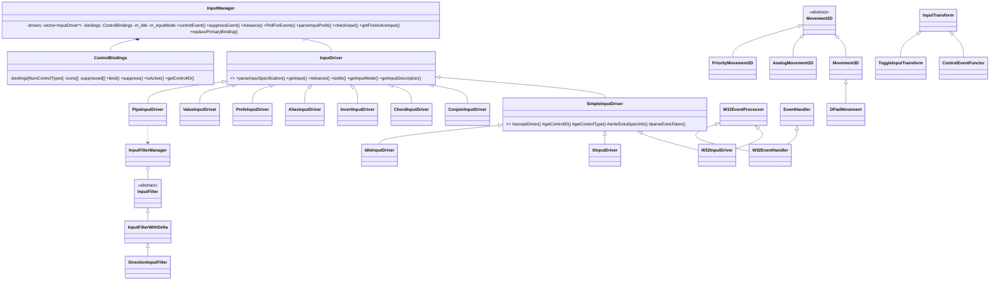

# P10_input_camera — Input driver/filter graph, camera, control help

Scope: `code/lib/input/*` (all 65 partition files plus the 9 non-partition files in that directory — SDL drivers, `inputfilterspec.cpp`, `xbox_eventhandler.cpp` — read for the dead-code appendix), `code/camera.{h,cpp}`, `code/control_help.{h,cpp}`; supporting data `data/input/input_preferences.txt`, `data/input/input_preferences_darwinia.txt`, `data/input/input_preferences_mac.txt`, `data/input/keyboards/de_DE.txt`, `data/input/keyboards/fr_FR.txt`, `data/input/locales.txt`; supporting docs `docs/input_preferences_syntax.txt`, `docs/DarwiniaInput.rtf`. Build baseline: see build_matrix.md (`Release|Win32`, OpenGL, `TARGET_PC_FULLGAME`).

Generated companions (do not edit by hand; regenerate with `python3 -I OUT/_work/scripts/P10_bindings.py <SRC> OUT/_work/manifest.csv <csv> <md> <lines_csv>`):
- `OUT/_work/drafts/P10_input_camera_bindings.csv` — one row per `ControlType` (164 rows): type, default KB/M and XInput bindings, icon, Darwinia-scheme / Mac / de_DE / fr_FR differences, live consumer files.
- `OUT/_work/drafts/P10_input_camera_preflines.csv` — every non-blank line of the five shipped binding files with the parse outcome the engine would produce (re-implemented parser).

Tag legend as build_matrix §7. "Live consumer" = file in the `Release|Win32` vcproj build whose non-comment, non-`#if`-dead code references `Control<Name>`.

---

## [→ 06_player_control_and_input] 1. Input system architecture

### 1.1 Overview

The input layer is a small **query-driven binding graph** [C] `code/lib/input/input.h:InputManager`:

- Game code never reads hardware. It asks `g_inputManager->controlEvent(ControlX[, details])` — "did logical control X trigger this frame?" — and optionally receives an `InputDetails` payload (type + x/y integers + controller index).
- Each logical control (`ControlType`, 164 values + `ControlNull`, §2) owns an ordered list of `InputSpec`s (its bindings). A spec is a tiny compiled record: *which driver*, *which control inside the driver*, *which condition* (down/up/pressed/…), *driver-private handler id*, *output type*.
- **Drivers** both *parse* binding strings (each driver recognises its own syntax) and *evaluate* specs. Leaf drivers read hardware state (Win32 key/mouse, XInput pads, idle timer, preferences, constants). Composite drivers (`&&` conjunction, `++` chord, `not` inversion, `alias`, `->` pipe) hold sub-spec lists and evaluate them by recursing into the manager. This recursion is what makes the system a graph.
- Bindings come from text files (`data/input/*.txt`) loaded at start-up, then overridden by a keyboard-layout file and by the user's saved file.
- Polling model: there are no input events for game code; each frame the manager `Advance()`s every driver (snapshotting "this frame" vs "last frame" state), then any number of `controlEvent` queries are answered from those snapshots. Queries are side-effect free except for XInput "repeat" timers (§1.6.6).

### 1.2 Lifecycle and frame order [B:FULL]

| Step | When | What | Ref |
|---|---|---|---|
| 1 | start-up, before `App` exists | `g_eventHandler = new W32EventHandler()` | [C] `code/main.cpp:AppMain` (L1090) |
| 2 | start-up | `InitialiseInputManager()` creates `g_inputManager` and registers drivers **in this order** (index = `InputSpec::driver`): 0 `ConjoinInputDriver`, 1 `ChordInputDriver`, 2 `InvertInputDriver`, 3 `IdleInputDriver`, 4 `W32InputDriver`, 5 `XInputDriver` *only if* `LoadLibrary("XINPUT1_3")` succeeds, then `PrefsInputDriver`, `ValueInputDriver`, `AliasInputDriver` (indices 6–8, or 5–7 without XInput). `PipeInputDriver` is **never registered** and `g_inputFilterManager` is never created. | [C] `code/main.cpp:InitialiseInputManager` |
| 3 | start-up, after `new App()` | `ReadInputPreferences()`: system file → keyboard-layout file (replace) → user file (replace) (§1.10) | [C] `code/main.cpp:ReadInputPreferences` |
| 4 | start-up | `g_target = new TargetCursor()` (virtual cursor fed by `TargetMove`/`TargetMoveSecondary`/`TargetMoveZ`) | [C] `code/main.cpp:AppMain`; `code/lib/targetcursor.cpp:TargetCursor::Advance` |
| 5 | every render frame | `UserInput::Advance()` → `InputManager::Advance()`: (a) clear per-frame suppression flags; (b) for each driver in registration order: `driver->Advance()`, accumulate idle and input-mode; (c) `g_target->Advance()` | [C] `code/user_input.cpp:UserInput::Advance`; `code/lib/input/input.cpp:InputManager::Advance` |
| 6 | many times per frame (loading screens, main loops, D3D present) | `InputManager::PollForEvents()` → each driver's `PollForEvents()`; W32 pumps the Win32 message queue (`g_windowManager->NastyPollForMessages()`) | [C] `code/lib/input/input.cpp:InputManager::PollForEvents`; `code/lib/input/inputdriver_win32.cpp:W32InputDriver::PollForEvents` |
| 7 | any time after step 5 | `controlEvent()` queries from game/UI code | — |

`InputManager::Advance` also derives two global facts [C] `code/lib/input/input.cpp:InputManager::Advance`:
- **idle** = every driver reports `isIdle()`; consumed by the Idle driver (§1.6.4).
- **input mode** (`INPUT_MODE_KEYBOARD` = 1 or `INPUT_MODE_GAMEPAD` = 2): among non-idle drivers the highest `getInputMode()` wins ("prefers the Gamepad"); if no driver was active the previous mode is kept. Initial value `INPUT_MODE_KEYBOARD`. W32 reports KEYBOARD, XInput reports GAMEPAD, all others NONE. The mode switches UI hints, language-phrase variants (`_kbd`/`_xin` suffix lookup, [C] `code/lib/language_table.cpp:LangTable::RawDoesPhraseExist`), automatic camera tracking (§3.6) and control help (§4).

### 1.3 Core data types

`InputType` (bit flags) [C] `code/lib/input/input_types.h:InputType`:

| Name | Value | Meaning |
|---|---|---|
| `INPUT_TYPE_FAIL` | 0 | details invalid |
| `INPUT_TYPE_BOOL` | 1 | button-like |
| `INPUT_TYPE_ANALOG` | 2 | carries axis data (bit shared by 1D/2D) |
| `INPUT_TYPE_1D` | 6 | one axis in `x` (trigger, wheel, idle seconds); implies ANALOG |
| `INPUT_TYPE_2D` | 10 | two axes in `x`,`y` (mouse, thumbstick); implies ANALOG |
| `INPUT_TYPE_ANY` | 15 | wildcard (terminator row of the action table only) |

`InputDetails {type, int x, int y, int controller=-1}` [C] `code/lib/input/input_types.h:InputDetails`. `controller` is set only by XInput (index 0–3 of the pad that satisfied the spec).

`InputSpec {unsigned driver; inputtype_t type; int control_id; int handler_id; int condition}` [C] `code/lib/input/inputspec.h:InputSpec`. `handler_id` is driver-private (W32: 1=key, 2=mouse; XInput: sensitivity percent).

`InputDescription {noun, verb, pref, translated}` — human-readable description of a spec, used by the key-binding UI; `pref` is the re-serialised binding string; `translate()` replaces `noun`/`verb` with language phrases if such phrases exist [C] `code/lib/input/input_types.cpp:InputDescription::translate`.

`InputMode {INPUT_MODE_NONE=0, INPUT_MODE_KEYBOARD=1, INPUT_MODE_GAMEPAD=2}` [C] `code/lib/input/input_types.h:InputMode`.

`InputCondition` [C] `code/lib/input/inputdriver.h:InputCondition`, with the shared condition-word table [C] `code/lib/input/inputdriver.cpp:s_conditions`:

| Id | Enum | Word (prefs file) | Applies to | Semantics |
|---|---|---|---|---|
| 0 | `COND_DOWN` | `down` | BOOL | became pressed this frame (edge) |
| 1 | `COND_UP` | `up` | BOOL | became released this frame (edge) |
| 2 | `COND_PRESSED` | `pressed` | BOOL | currently held (level) |
| 3 | `COND_REPEAT` | `repeat` (XInput BOOL controls only, not in shared table) | BOOL | held, fires on first frame then every 0.3 s |
| 4 | `COND_ACTION` | (`action` commented out) | — | unused |
| 5 | `COND_RELEASED` | `release` | ANALOG | just returned to zero/dead zone |
| 6 | `COND_NONZERO` | `position` | ANALOG | outside dead zone; returns absolute position |
| 7 | `COND_MOVED` | `move` | ANALOG | changed since last frame; returns delta |
| 8 | `COND_ZERO` | `zero` | ANALOG | inside dead zone |
| 9 | `COND_READ` | `read` | ANALOG | always true; returns current value |

**Condition lookup bug (design-relevant)** [C] `code/lib/input/inputdriver.cpp:InputDriver::getDefaultConditionID`: the lookup loops until a word matches *and* `(controlType & rowType) == rowType`; if nothing matches it stops on the NULL terminator row (index 8) and, because the guard is `i < NumInputConditions` (=10) instead of "found", returns condition 0 (`COND_DOWN`) with type 0 (`INPUT_TYPE_FAIL`). Type 0 passes every bind-acceptance test (§1.4). Consequences in shipped data: `XInput dpadleft donw` (typo), `XInput lefttrigger repeat`, `XInput righttrigger repeat`, `XInput lefttrigger down` all silently become "down" edges (§2.3). A new implementation must reject unknown conditions — but must then deliberately map these four shipped bindings to "down" to preserve behaviour.

`InputParserState` (parse result; only `STATE_DONE` = success; when all drivers fail the manager reports the error of the driver that progressed furthest, i.e. highest state value) [C] `code/lib/input/inputdriver.h:InputParserState`, `code/lib/input/input.cpp:InputManager::parseInputSpecTokens`: `STATE_ERROR`=0, `STATE_WANT_DRIVER`=1, `STATE_WANT_CONTROL`=2, `STATE_WANT_COND`=3, `STATE_WANT_MODIFIER`=4, `STATE_WANT_OPTIONAL`=5, `STATE_BAD_EXTRA`=6, `STATE_OVERSTEP`=7, `STATE_CONJ_ERROR`=8, `STATE_DONE`=9.

> Note: the per-driver error-string arrays (`errors[]` in `inputdriver_simple.cpp`, `_alias.cpp`, `_prefs.cpp`, `_value.cpp`) have 9 entries ordered as if `STATE_WANT_OPTIONAL` did not exist, so messages for states ≥5 are off by one and state 9 indexes past the end [C]. Messages are only logged to stdout (`derr`) — cosmetic.

### 1.4 `ControlBindings` — storage and acceptance [C] `code/lib/input/control_bindings.{h,cpp}`

- `bindings[NumControlTypes]`: per control an ordered `auto_vector<const InputSpec>` (owning list). Order = order of successful bind calls; **index 0 is the "primary" binding** (shown in the key-binding UI, replaced by locale/user files).
- `icons[NumControlTypes]`: per control one icon path string (`~` lines; last one wins).
- `suppressed[NumControlTypes]` (byte flags): set by `InputManager::suppressEvent(type)`, cleared at the start of each `InputManager::Advance`. A suppressed control returns false for the rest of the frame (used e.g. so a click consumed by an Eclipse UI window does not also reach the game: [C] `code/user_input.cpp` — `EclipseLMouseDown` suppressed when a window is under the cursor).
- `getControlID(name)`: case-insensitive (`stricmp`) linear search over the names generated from `control_types.inc` (X-macro `DEF_CONTROL_TYPE(name,type)` → `"name"`) [C] `code/lib/input/control_bindings.cpp:s_actions`.
- **Type acceptance** `isAcceptibleInputType(control, specType)`: `valid = controlType; if (valid has BOOL) valid |= INPUT_TYPE_1D; accept iff (valid & specType) == specType`. Hence: BOOL controls accept BOOL, 1D (e.g. triggers) and ANALOG (2) specs; 1D controls accept 1D/ANALOG; 2D controls accept 2D/ANALOG but **not** BOOL; type-0 specs are accepted everywhere. Note the default condition lookup rewrites an analog spec's type to `INPUT_TYPE_ANALOG` (2) — the concrete 1D/2D distinction is only restored at evaluation time by the driver filling `details.type`.
- `bind(type, spec, replace)`: if accepted, copy the spec; with `replace && list non-empty` erase element 0 and insert the new spec at 0; otherwise append.
- `code/lib/input/control_types.cpp` defines a second, unused `static s_actions` table whose names are the literal string `"x"` (macro bug) [C] — dead.

### 1.5 `InputManager` API semantics [C] `code/lib/input/input.cpp`

| Method | Behaviour |
|---|---|
| `controlEvent(type, details)` | If `type` not suppressed: iterate its specs **in order**; return true at the **first** spec whose driver's `getInput` returns true (details from that spec). Otherwise `details.type = FAIL`, false. A control therefore behaves as the logical OR of its bindings; the payload comes from the first satisfied binding. |
| `checkInput(spec, details)` | `drivers[spec.driver]->getInput(spec, details)`; on false sets `details.type = FAIL`. Used by composite drivers. |
| `parseInputPrefs(reader, replace)` | Line parser (§1.9). |
| `parseInputSpecString/Tokens` | Whitespace tokenisation (`istringstream >>`); offer tokens to each driver in registration order; first `STATE_DONE` wins and sets `spec.driver`. |
| `replacePrimaryBinding(type, str)` | parse + `bind(type, spec, replace=true)`; silent on failure. Used by the key-binding window. |
| `getFirstActiveInput(spec, instant)` | Asks drivers in order; only W32 implements it: first VK `i` in `0..222` (`< KEY_TILDE`, so TILDE itself is excluded) with a "down" edge this frame whose key name contains no space → `key <name> down` if `instant` else `key <name> pressed`. Mouse capture code is commented out → **only keyboard keys can be captured for rebinding** [C] `code/lib/input/inputdriver_win32.cpp:W32InputDriver::getFirstActiveInput`. |
| `getBoundInputDescription(type, desc)` | Description of the first bound spec whose driver can describe it, then `translate()`. |
| `controlIcon(type)` | icon path. |
| `isIdle()`, `getInputMode()` | §1.2. |
| `Clear()` | remove all bindings (icons kept). |
| `printNumBindings()` | debug dump. |

### 1.6 Driver catalogue

#### 1.6.0 `InputDriver` base and `SimpleInputDriver` [C] `code/lib/input/inputdriver.{h,cpp}`, `code/lib/input/inputdriver_simple.{h,cpp}`

Base virtuals: `parseInputSpecification` (pure), `getInput` (pure), `Advance` (pure), `getLastParseError` (pure), `isIdle` (default true), `getInputMode` (default NONE), `getFirstActiveInput` (default false), `PollForEvents` (default no-op), `getInputDescription` (default false), `getName`. Helpers: condition lookup (§1.3), `getDefaultPrefsString` (condition → word, safe version that checks for the terminator), `getDefaultVerb` → `"control_verb_" + word` (no `control_verb_*` phrases exist in `data/language/english.txt` [C], so verbs stay as raw ids — [I] the UI only shows nouns).

`SimpleInputDriver` implements a 3-token state machine shared by Idle, W32 and XInput: `WANT_DRIVER --acceptDriver(tok)--> WANT_CONTROL --getControlID(tok)≥0, type:=getControlType--> WANT_COND --getConditionID(tok)≥0--> writeExtraSpecInfo()` which returns `DONE` or `WANT_OPTIONAL`/`WANT_MODIFIER`; optional tokens go to `parseExtraToken`. A token after `DONE` → `OVERSTEP` (fail). Ending in `WANT_OPTIONAL` counts as `DONE`. Any rejected token stops parsing with the current (non-DONE) state.

#### 1.6.1 Conjoin (`&&`) — driver 0 [C] `code/lib/input/inputdriver_conjoin.cpp`

- Parse: if no `&&` token → `STATE_ERROR` (not mine). Split at every `&&`; each part is parsed by the **full** manager (so parts may be chords, inversions, aliases, leaf specs; an empty part fails). At most one part may have type > BOOL ("complex"); the conjunction's type = that part's type, else BOOL. Sub-spec list stored in `m_specs`; `spec.control_id` = list index.
- Evaluate: all parts must be true (short-circuit on first false). Returned details: first part's details, overridden by the complex part's details if any.
- Description: noun/verb of the highest-typed part.
- Because Conjoin is driver 0, `&&` binds loosest: `a ++ b && c` = `(a ++ b) && c`.

#### 1.6.2 Chord (`++`) — driver 1 [C] `code/lib/input/inputdriver_chord.cpp`

- Parse: if no `++` → error. Split into N parts *without conditions* (e.g. `key control`, `key c`). Generate N conjunction strings; in string k part k gets ` down` and every other part ` pressed`: for `key control ++ key c` → `key control down && key c pressed` and `key control pressed && key c down`. Each must parse to type BOOL.
- Evaluate: **OR** over the N conjunctions — i.e. "all parts held, and at least one of them went down this frame" (order-independent chord edge).
- Description: nouns joined with `-` (e.g. `CTRL-C`).

#### 1.6.3 Invert (`not`/`!`) — driver 2 [C] `code/lib/input/inputdriver_invert.cpp`

- Parse: first token `not` (case-insensitive) or `!`; remaining tokens parsed by the manager; must be exactly `INPUT_TYPE_BOOL` (type-0 fallback specs are rejected). Evaluate: logical NOT of the sub-spec (details are whatever the sub-driver wrote). Description verb prefixed `not `. Unused in shipped data.

#### 1.6.4 Idle — driver 3 [C] `code/lib/input/inputdriver_idle.cpp`

Grammar `idle atleast <N>` | `idle reaches <N>` | `idle no longer` (N positive integer seconds, parsed with `istringstream >> int`).
- State: `m_idleTime` (s), `m_oldIdleTime`, `m_lastChecked`. `Advance`: `old = idle; if manager.isIdle() idle += now - lastChecked else idle = 0; lastChecked = now` (wall clock `GetHighResTime`). Because Idle's own `isIdle()` is the default `true` and the manager's idle flag is computed *during* the driver loop, Idle reads the **previous frame's** combined flag [I] (driver 3 advances before W32/XInput).
- Evaluate: `atleast N`: `int(idle) >= N` (1D, x = int idle seconds); `reaches N`: `old < N < idle` (one-frame edge); `no longer`: `idle == 0` (BOOL — true on every non-idle frame, not only on the transition).
- `getControlID` scans a 3-entry table without terminator → an unknown word reads past the array (UB) [C].
- Shipped use: `StopAttractMode = idle no longer`; `StartAttractMode = idle reaches 60` is commented out. Attract mode itself is `ATTRACTMODE_ENABLED`-gated → these bindings are [B:LEGACY].

#### 1.6.5 W32 key/mouse — driver 4 [C] `code/lib/input/inputdriver_win32.{h,cpp}`, `code/lib/input/keydefs.h`, `code/lib/input/keynames.cpp`

Grammar: `key <keyname> (down|up|pressed)` | `mouse (left|right|middle) (down|up|pressed)` | `mouse (axes|wheel) (move|read)` | `mouse any …` | `key any …`. Driver words are case-sensitive (`key`, `mouse`); key names case-insensitive; mouse control words case-sensitive.

State (per driver; key arrays are globals `g_keys[256]`, `g_keyDeltas[256]` also read directly by legacy code):

| Field | Written by | Meaning |
|---|---|---|
| `g_keys[vk]` | WndProc | 1 while held |
| `m_keyNewDeltas[vk]` | WndProc | +1 on press / -1 on release since last Advance (last event wins) |
| `g_keyDeltas[vk]` | Advance (`= m_keyNewDeltas`, then new deltas zeroed) | this frame's edge |
| `m_mb[3]` | WndProc (L=0, R=1, M=2) | button held |
| `m_mbDeltas[3]` | Advance: `m_mb - m_mbOld` | edge (+1/-1/0) |
| `m_mousePos[3]` | WndProc (`WM_MOUSEMOVE` absolute x,y; wheel z += `(short)HIWORD(wParam)/120`, integer division) | |
| `m_mouseVel[3]` | Advance: `pos - posOld` | per-frame delta |

Windows messages handled (`W32InputDriver::WndProc`): `WM_[LMR]BUTTONDOWN/UP` (also capture/uncapture mouse), `WM_MOUSEWHEEL` (0x020A), `WM_MOUSEMOVE`, `WM_HOTKEY` id 0 (Alt-Tab hot-key → synthesises a TAB press), `WM_SYSKEYDOWN` (ALT itself sets `g_keys[ALT]`; other keys with ALT held set a down-edge; **Alt+F4 sets `g_app->m_requestQuit`**), `WM_SYSKEYUP`, `WM_KEYDOWN` (edge only if not already held — auto-repeat ignored), `WM_KEYUP`, `WM_CHAR` (forwarded to Eclipse text input `EclUpdateKeyboard` with shift/ctrl/alt state). Unhandled → -1 (next processor).

Evaluation:
- key: `down` ⇔ `g_keyDeltas==+1`, `up` ⇔ `-1`, `pressed` ⇔ `g_keys==1`. A press+release inside one frame leaves delta -1 → the `down` edge is **lost** (only `up` seen) [C].
- mouse button: `down/up/pressed` from `m_mbDeltas`/`m_mb`; a click shorter than one frame is lost entirely [C].
- `mouse axes move` → 2D, `x,y = m_mouseVel`, true if non-zero; `read` → always true. `mouse wheel move` → 1D `x = wheel notches this frame`. Other conditions on axes/wheel never fire.
- `mouse any` and `key any` (VK 255, "TODO: Any key not implemented") parse but **never fire** [C].
- `isIdle` = all key/delta arrays zero, no button held, zero mouse velocity (wheel included). `getInputMode` = KEYBOARD.
- `SetMousePosNoVelocity(x,y)` warps without generating velocity.

Key-name table (`getKeyNames()`, index = Windows VK code; only names without spaces are bindable; lookup scans indices 0…223 so **`META` (224) is unbindable** — the Mac file's `key meta` lines fail) [C] `code/lib/input/keynames.cpp:getKeyNames`, `code/lib/input/inputdriver_win32.cpp:W32InputDriver::getKeyId`:

8=`BACKSPACE`, 9=`TAB`, 13=`ENTER`, 16=`SHIFT`, 17=`CONTROL`, 18=`ALT`, 19=`PAUSE`, 20=`CAPSLOCK`, 27=`ESC`, 32=`SPACE`, 33=`PGUP`, 34=`PGDN`, 35=`END`, 36=`HOME`, 37=`LEFT`, 38=`UP`, 39=`RIGHT`, 40=`DOWN`, 45=`INSERT`, 46=`DEL`, 48–57=`0`…`9`, 65–90=`A`…`Z`, 96–105=`0_PAD`…`9_PAD`, 106=`ASTERISK`, 107=`PLUS_PAD`, 108=`MINUS_PAD`, 109=`Unknown`, 110=`DEL_PAD`, 111=`SLASH_PAD`, 112–123=`F1`…`F12`, 144=`NUMLOCK`, 145=`SCRLOCK`, 186=`COLON`, 187=`EQUALS`, 188=`COMMA`, 189=`MINUS`, 190=`STOP`, 191=`SLASH`, 192=`AT`, 219=`OPENBRACE`, 220=`BACKSLASH`, 221=`CLOSEBRACE`, 222=`QUOTE`, 223=`TILDE`, 224=`META` (all other indices are `"unknown N"` / `"unknown 146-185"` / `"unknown 193-218"`).

> **Table defect** [C]: `keydefs.h` defines `KEY_MINUS_PAD 109` (= `VK_SUBTRACT`) but the name table has `MINUS_PAD` at 108 (`VK_SEPARATOR`) and `Unknown` at 109; so `key minus_pad` binds the separator key, and numpad-minus can only be named `key unknown`. A new game should derive names from a single VK→name table.

Description (`getInputDescription`) for the binding UI: noun = language phrase `control_<KEYNAME>` if it exists (case-insensitive hash lookup), else the raw key name; verb `control_verb_<cond>`; **`pref` is built from the *translated* noun** (`"key " + noun + " " + cond`). For keys whose English phrase differs from the bindable name (`control_control`=`CTRL`, `control_insert`=`Ins`, `control_equals`=`=`, `control_minus`=`-`, `control_slash`=`/`, `control_stop`=`.`, `control_asterisk`=`*`, `control_at`=`@`, `control_backslash`=`\`, `control_tilde`=`~`, `control_openbrace`=`{`, `control_closebrace`=`}`, `control_plus_pad`=`NUM_+`, `control_minus_pad`=`NUM_-`, `control_del_pad`=`NUM_DEL`, `control_slash_pad`=`NUM_/`) the re-serialised string cannot be parsed back, so **rebinding a control to one of these keys silently fails** (in-session via `replacePrimaryBinding` and on next start via the user file) [C] chain `code/lib/input/inputdriver_win32.cpp:W32InputDriver::getInputDescription` → `code/interface/prefs_keybindings_window.cpp:ApplyKeybindingsButton::MouseUp`; phrase values `data/language/english.txt`. [I] assumes `UnicodeString`→`std::string` assignment yields the ASCII text. Mouse nouns: `control_mouse_left_button`, `control_mouse_right_button`, `control_mouse_mid_button`, `control_mouse_wheel` (verb `control_verb_scroll`), `control_mouse`, `control_mouse_unknown`; none of these phrases exist in English data → raw ids.

#### 1.6.6 XInput — driver 5 (present only if `xinput1_3.dll` loads) [C] `code/lib/input/inputdriver_xinput.{h,cpp}`

Grammar: `XInput <control> <cond> [with sensitivity <1..200>]` (driver word case-sensitive). Controls (index, name, type):

| # | Name | Type | Evaluated as |
|---|---|---|---|
| 0 | `lefttrigger` | 1D | trigger value |
| 1 | `righttrigger` | 1D | trigger value |
| 2 | `leftbumper` | BOOL | button LB |
| 3 | `rightbumper` | BOOL | button RB |
| 4 | `leftthumbstick` | 2D\|BOOL | stick L (analog conds) / L3 click (bool conds) |
| 5 | `rightthumbstick` | 2D\|BOOL | stick R / R3 click |
| 6–9 | `dpadleft`, `dpadright`, `dpadup`, `dpaddown` | BOOL | d-pad |
| 10–13 | `a`, `b`, `x`, `y` | BOOL | face buttons |
| 14 | `start` | BOOL | |
| 15 | `back` | BOOL | |
| 16 | `plug` | BOOL | controller connected (`down` = plugged this frame, `up` = unplugged this frame, `pressed` = connected) — evaluated even when disconnected |
| 17–20 | `leftthumbstickleft/right/up/down` | BOOL | stick L as 4 virtual buttons |
| 21–24 | `rightthumbstickleft/right/up/down` | BOOL | stick R as 4 virtual buttons |
| 25 | `lefttriggerb` | BOOL | `bLeftTrigger != 0` (ignores condition; leaves `details.type` unset) |
| 26 | `righttriggerb` | BOOL | `bRightTrigger != 0` (same) |

Optional `with sensitivity N` is accepted only on controls 0, 1, 4, 5 (sets `handler_id = N`, default 100 → multiplier N/100); directional controls get sensitivity 100 and accept no extra tokens. `repeat` is accepted only for BOOL-typed controls (`lefttrigger repeat` therefore falls into the unknown-condition fallback = `down`).

Per-frame acquisition, for each of 4 controllers (`MaxControllers = 4`, all polled; queried only if bit set in `m_controllerMask`, default `0x0F`): copy state→old; `XInputGetState(id)`; if connected: **dead zones** — if both stick axes are inside ±`XINPUT_GAMEPAD_LEFT/RIGHT_THUMB_DEADZONE` (square test) zero both; triggers below `XINPUT_GAMEPAD_TRIGGER_THRESHOLD` → 0 (SDK constants, [I] 7849 / 8689 / 30); then **response curve** `stick' = floor((raw · S / 32768)^3)` with `S = 3.4` (left) / `2.7` (right), **Y negated** (up = negative), giving ranges ±39 (left) and ±19 (right); triggers `floor(raw · 6.3)` stored back into a `BYTE` (values >40 overflow — [U] compiler-defined wrap; effectively only zero/non-zero is robust) [C] `code/lib/input/inputdriver_xinput.cpp:Controller::correctDeadZones`, `Controller::scaleInputs`, `Controller::Advance`.

Evaluation rules [C] `Controller::getInput`, `getButtonInput`, `getThumbInput`, `getTriggerInput`, `getThumbDirection`:
- Disconnected pad: false (except `plug`). If `dwPacketNumber` unchanged since last frame, edge conditions (`down`, `up`, `release`, `move`) are false.
- Buttons: `down` = now && !before; `up`; `pressed`; `repeat` = now && (!before || now ≥ nextRepeat[control]); on fire nextRepeat = now + **0.3 s** (`REPEAT_FREQ`). The repeat timer table `s_nextrepeat[27]` is **static, shared by all four controllers, and mutated during queries** (two bindings on the same control share it).
- Stick analog: `position` (2D, x/y = round(v·sens), true if v≠0); `move` (2D delta·sens, true if |dx| or |dy| > 3.4); `zero`; `release` (now zero, before non-zero); `read` (always).
- Trigger analog: `position` (1D x = round(v·sens), v≠0), `zero`, `release`, `move` (1D delta), `down` (non-zero now, zero before), `read`, `pressed` (x = v>0).
- Stick-as-buttons: value = −y (up), y (down), x (right), −x (left), scaled by sensitivity; pressed ⇔ value > 3.4 (left-stick threshold used for both sticks); `down/pressed/up/repeat` as buttons; repeat timer keyed by the **stick** id (shared across its four directions).
- `getInput` over the masked controllers returns the first controller that satisfies the spec and stores its index in `details.controller`. `isIdle` = every masked connected pad reads all-zero gamepad state. `getInputMode` = GAMEPAD.
- `setControllerMask(mask)` exists; no live caller in `code/` (only an `extern` in `code/UI/GameMenuWindow.cpp`) [C] → all four pads always active.
- Description: noun `control_gamepad_<name>`, verbs `control_verb_squeeze` for trigger position/move/read; no such phrases in English data.

#### 1.6.7 Prefs (`pref [not|!] <key>` / `pref !<key>`) [C] `code/lib/input/inputdriver_prefs.cpp`

True iff `g_prefsManager->GetInt(key, 0) > 0` (or the negation). The key must exist at parse time. **Index bug**: `keyPosition` returns `m_keys.size()` (1-based) after appending a new key but `getInput` indexes 0-based and range-checks `< size`, so the first spec referencing each new key always reads the wrong slot (never true for the last-added key) [C]. Double negation (`not !x`, `!!x`) rejected. Unused in shipped data.

#### 1.6.8 Value (`value Pecan|Hummingbird`) [C] `code/lib/input/inputdriver_value.cpp`, `code/lib/input/inputdriver_values.inc`

Constants: `Pecan` = true; `Hummingbird` = pref `Hummingbird` > 0. The parser never sets `spec.type` (left uninitialised by the caller) → bind acceptance is undefined [C]. Unused in shipped data.

#### 1.6.9 Alias (`alias <ControlName>`) [C] `code/lib/input/inputdriver_alias.cpp`

BOOL spec whose evaluation is `controlEvent(otherControl, details)` (recursion; a self-referential alias would recurse without bound — no guard). Shipped use: `EclipseLMouseDown = alias ShowMouseCursor && XInput a down` and `EclipseLMousePressed = alias ShowMouseCursor && XInput a pressed` — holding LB turns the pad's A button into a UI left click.

#### 1.6.10 Pipe (`[spec, spec, …] -> filter`) [B:LEGACY — compiled, never registered] [C] `code/lib/input/inputdriver_pipe.cpp`

Intended to feed several sub-specs into an `InputFilter`. Never added to the manager; `g_inputFilterManager` is never instantiated (NULL deref if it were). Its arrow search starts at `tokens[tokens.length()]`, which throws `"Index out of bounds."` [C]. Not part of the shipped grammar.

### 1.7 Filters [B:LEGACY] [C] `code/lib/input/inputfilter*.{h,cpp}`, `code/lib/input/inputfilterspec.h`

`InputFilter` (abstract `filter`, `parseFilterSpecification`, `Advance`) → `InputFilterWithDelta` (registers per-spec current/old `InputDetails`, `getDelta` with appear/disappear semantics, `Advance` that swaps x and y by mistake) → `DirectionInputFilter` (`direction (up|down|left|right) (down|pressed)`; `filter()` returns false; `calcDetails` empty). `InputFilterManager` (list of filters, parse, apply) has its `Advance` body commented out. `InputFilterSpec {filter, id, type, min_inputs, max_inputs, mode, condition}`. Entire subsystem is a stub; `inputfilterspec.cpp` (`newFilterSpecID`) is not even in the vcproj [B:DEAD].

### 1.8 Helper abstractions [C]

- `Movement2D`/`Movement3D` (integer velocity + sign helpers), `DPadMovement` (6 BOOL controls → `v = (pos − neg) × sensitivity` on X/Y/Z), `AnalogMovement2D` (2D control × sensitivity, zero if not 2D), `PriorityMovement2D` (first source unless zero) [C] `code/lib/input/movement2d.{h,cpp}`. Live use: the camera debug mode's static `DPadMovement(CameraForwards, CameraBackwards, CameraLeft, CameraRight, CameraUp, CameraDown, 1)` [C] `code/camera.cpp:Camera::AdvanceDebugMode`.
- `InputTransform`/`ControlEventFunctor`/`ToggleInputTransform` (latch: `state = (state && !off) || (!state && on)`, re-evaluated on every query) [C] `code/lib/input/transform.{h,cpp}`. Only `ControlEventFunctor` is used outside the library — as base of `KeyboardShortcut` in the task-manager interface [C] `code/taskmanager_interface.h:KeyboardShortcut` (P09); `ToggleInputTransform`, `AnalogMovement2D`, `PriorityMovement2D` have no users.
- `TargetCursor` (outside scope, P12) is the single source of "mouse position" for game code: per frame `TargetMove` (or, if no Eclipse window and task manager hidden, `TargetMoveSecondary`) 2D delta is added to the virtual cursor; `TargetMoveZ` (1D, disabled while windows or chat are open) accumulates wheel Z; `dX/dY/dZ` = this frame's deltas [C] `code/lib/targetcursor.cpp:TargetCursor::Advance`.
- `InputPrefs` (static paths/locale) §1.10.

### 1.9 Event handling [C] `code/lib/input/eventhandler.{h,cpp}`, `win32_eventhandler.{h,cpp}`, `win32_eventproc.h`

`EventHandler` (abstract `WindowHasFocus`) ← `W32EventHandler` (also a `W32EventProcessor`). `W32EventHandler::WndProc` (called by the window manager for every message):
1. Focus: `g_windowHasFocus = (GetForegroundWindow() == game window)`; when focus is lost or was lost last message and ALT is held, force an ALT up-edge (avoids stuck ALT after Alt-Tab).
2. Returns -1 (let Windows handle) for `WM_CREATE`, `WM_DESTROY`, `WM_SIZING`, `WM_WINDOWPOSCHANGING`, `WM_WINDOWPOSCHANGED`, `WM_COMMAND`, `WM_NCHITTEST`; `WM_SETCURSOR` hides the OS cursor over the client area and then (missing `break`) falls through to `WM_MOVE` handling (`WindowMoved()`, return -1); `WM_CANCELMODE` → 0; `WM_CLOSE` → `m_requestQuit = true`; `WM_INPUTLANGCHANGE` only logged (bindings/locale are **not** reloaded on layout change).
3. Otherwise offers the message to registered processors in order (only `W32InputDriver`) until one returns ≠ -1.
`BindAltTab`/`UnbindAltTab` register hot-key id 0 = Alt+Tab (its only caller is commented out → Alt-Tab is never captured in the shipped build [C] `code/main.cpp`, `code/interface/prefs_keybindings_window.cpp`). `RemoveEventProcessor` uses `std::remove` without `erase` (no-op) [C]. The camera only advances while `g_eventHandler->WindowHasFocus()` [C] `code/main.cpp:LocationGameLoop`.

### 1.10 Binding files, layering, locales [C] `code/lib/input/file_paths.cpp`, `code/main.cpp:ReadInputPreferences`

| Layer | Path | Selection | Mode |
|---|---|---|---|
| System | `input/input_preferences.txt` (PC) or `input/input_preferences_darwinia.txt` | preference `MultiwiniaControlMethod` (default 1): 0 → Darwinia file, else main file (`input_preferences_mac.txt` replaces the main file under `TARGET_OS_MACOSX`) | append |
| Keyboard layout | `input/keyboards/<layout>.txt` | `<layout>` = preference `KeyboardLayout`, default = `locales.txt` lookup of `GetKeyboardLayout(0) & 0xFFFF` (LANGID); path cached on first call; missing file silently skipped | replace (primary) |
| User | `<profile dir>/user_input_preferences.txt` | written by Options → Controls (`PrefsManager` key = control name, value = binding string) | replace (primary) |

`locales.txt` [C] `data/input/locales.txt`: 1031→`de_DE`, 1033→`en_US`, 1036→`fr_FR`, 2057→`en_UK`, 4105→`en_CA`. Only `de_DE.txt` and `fr_FR.txt` exist; each re-states the primary camera keys (de: `CameraZoom = key y pressed` QWERTZ swap; fr: AZERTY — Left `q`, Up `a`, Forwards `z`, Zoom `w`). `InputPrefs::IsKeyboardFrenchLocale()` (layout == `fr_FR`) additionally swaps the camera-help image to `mwhelp/control_camera_french.bmp` [C] `code/multiwiniahelp.cpp`.

Replace semantics: each replace-line removes element 0 of the control's list and inserts the new spec at 0, so several replace-lines for the same control in one file overwrite each other (last wins) and never add bindings. "Restore defaults" in Options re-reads only the system file after `Clear()` — the locale layer is **not** re-applied [C] `code/interface/prefs_keybindings_window.cpp:RestoreDefaultsButton::MouseUp`. User-rebindable controls (Options UI): CameraLeft, CameraRight, CameraForwards, CameraBackwards, CameraUp, CameraDown, CameraZoom, UnitDeselect, SkipMessage, GesturesChatLog, IconsChatLog, IconsTaskManagerDisplay (also rewrites IconsTaskManagerHide to the `up` form), IconsTaskManagerEndTask (P17b owns the UI).

### 1.11 Binding-file grammar (formal) [C] `code/lib/input/input.cpp:InputManager::parseInputPrefs`, `contrib/systemiv/lib/filesys/text_stream_readers.cpp:TextReader`

```
file        := { line EOL }
line        := [ binding | icon ] [ '#' comment ]          ; '#' to end of line removed by TextReader
binding     := CONTROL sep '=' sep spec                     ; CONTROL: ControlType name, case-insensitive
icon        := CONTROL sep '~' sep PATH                     ; sets the control's icon (last wins)
sep         := one or more of  ' ' '\t' ':' ','              ; TextReader separators for the first two tokens
spec        := conj                                          ; rest of line, re-tokenised on whitespace only
conj        := chordOrUnary { '&&' chordOrUnary }           ; ≤1 complex (non-BOOL) operand
chordOrUnary:= chord | unary
chord       := partial '++' partial { '++' partial }        ; partial = leaf spec without its condition word
unary       := ('not' | '!') unary | leaf                    ; operand must be BOOL
leaf        := 'key' KEYNAME BCOND
             | 'mouse' ('left'|'right'|'middle'|'any') BCOND
             | 'mouse' ('axes'|'wheel') ('move'|'read')
             | 'XInput' XBUTTON (BCOND | 'repeat')
             | 'XInput' XANALOG (ACOND | BCOND) [ 'with' 'sensitivity' INT1_200 ]
             | 'idle' ('atleast'|'reaches') POSINT | 'idle' 'no' 'longer'
             | 'pref' ['not'|'!'] ['!']PREFKEY
             | 'value' ('Pecan'|'Hummingbird')
             | 'alias' CONTROL
BCOND       := 'down' | 'up' | 'pressed'
ACOND       := 'position' | 'move' | 'release' | 'zero' | 'read'
```
Unknown condition words are accepted as `down` (bug, §1.3). Lines whose second token is neither `=` nor `~` (e.g. `TaskManagerSwitchTask INPUT_TYPE_BOOL`), unknown control names (e.g. `UnitPrimaryFireDirected ~ …`) and unparsable specs (e.g. `SpaceNav …`) are skipped with a stdout message. Parse failures never abort loading.

### 1.12 Graph diagram

```mermaid
flowchart LR
  subgraph OS["Win32 / XInput"]
    MSG["Window messages<br/>WM_KEY*, WM_*BUTTON*, WM_MOUSEMOVE,<br/>WM_MOUSEWHEEL, WM_CHAR, WM_HOTKEY"]
    XGS["XInputGetState(0..3)"]
  end
  MSG --> EH["W32EventHandler::WndProc<br/>(focus, ALT fix, quit)"] --> W32["W32InputDriver<br/>key/mouse state + deltas"]
  MSG -. WM_CHAR .-> ECL["Eclipse text input"]
  XGS --> XI["XInputDriver<br/>4 × Controller<br/>deadzone + cubic curve"]
  IDLE["IdleInputDriver<br/>idle seconds"]
  PREF["PrefsInputDriver"]
  VAL["ValueInputDriver"]
  subgraph IM["InputManager (g_inputManager)"]
    CB["ControlBindings<br/>ControlType → [InputSpec…] (+icon, suppress)"]
    CE["controlEvent(ControlX, details)<br/>first satisfied spec wins"]
  end
  CONJ["ConjoinInputDriver &&"]
  CHORD["ChordInputDriver ++"]
  INV["InvertInputDriver not/!"]
  ALIAS["AliasInputDriver alias"]
  PIPE["PipeInputDriver -> (not registered)"]
  GAME["Game / UI code<br/>(UserInput, LocationInput, TeamControls,<br/>TaskManagerInterface, Camera, Eclipse)"]
  TC["TargetCursor (g_target)<br/>virtual cursor X/Y/Z"]
  GAME -->|query| CE
  CE --> CB
  CB -->|spec.driver| W32 & XI & IDLE & PREF & VAL & CONJ & CHORD & INV & ALIAS
  CONJ -->|checkInput(sub-spec)| CE
  CHORD -->|checkInput(conjunctions)| CE
  INV -->|checkInput| CE
  ALIAS -->|controlEvent(other)| CE
  TC -->|TargetMove / TargetMoveSecondary / TargetMoveZ| CE
  GAME --> TC
  PIPE -. dead .-> CE
```

```mermaid
sequenceDiagram
  participant Loop as Main loop (per render frame)
  participant UI as UserInput::Advance
  participant IM as InputManager
  participant D as Drivers (in order)
  participant TC as TargetCursor
  participant G as Game code (TeamControls, Camera, UI)
  Loop->>IM: PollForEvents() (n times: pumps Win32 queue)
  Loop->>UI: Advance()
  UI->>IM: Advance()
  IM->>IM: clear suppress[]
  loop each driver
    IM->>D: Advance() (snapshot cur/old, deltas)
    IM->>D: isIdle(), getInputMode()
  end
  IM->>TC: Advance() (controlEvent TargetMove…)
  G->>IM: controlEvent(ControlX, details)
  IM->>D: getInput(spec) for each bound spec until true
  D-->>IM: bool + details (composites recurse into IM)
  IM-->>G: bool + details
```

### 1.13 Class diagram



## [→ 06_player_control_and_input] 2. Logical controls (`ControlType`) and default bindings

### 2.1 How to read the table

- Source of truth: `code/lib/input/control_types.inc` (164 `DEF_CONTROL_TYPE` entries; enum value = row #, `ControlNull` = 164 is never bound and never fires, `NumControlTypes` = 165) [C]; bindings: `data/input/input_preferences.txt` (the PC default, `MultiwiniaControlMethod` = 1) [C]. Generated by `OUT/_work/scripts/P10_bindings.py`, which re-implements the engine parser (§1.11) including its quirks; full per-line verdicts in `OUT/_work/drafts/P10_input_camera_preflines.csv`.
- Several bindings per cell are OR-ed in the listed order; the first is the *primary* (shown and rebindable in Options). `[=down: unknown-condition fallback]` marks a binding that only works because of the §1.3 bug.
- "Darwinia-scheme diff" = what `data/input/input_preferences_darwinia.txt` (selected by `MultiwiniaControlMethod = 0`, "Darwinia-like" left-click-to-order scheme) binds instead; "same" = identical, "(none)" = binding absent there.
- Pad column applies only when `xinput1_3.dll` is present (§1.2); otherwise those lines fail to parse and the control has only its KB/M bindings.
- "Live consumers" lists `code/` files of the baseline build that query the control (comment- and `#if`-filtered). An empty consumer cell means the binding exists but nothing in the FULL build reads it (dead control). `ShowMouseCursor` is consumed indirectly through the `alias` in `EclipseLMouseDown/Pressed`.
- Type column: BOOL/1D/2D per §1.3.

### 2.2 Control table

| # | ControlType | Type | Source comment | Keyboard / mouse default (input_preferences.txt) | Xbox (XInput) default | Darwinia-scheme diff (KB/M ; pad) | Live consumers (code/) |
|---|---|---|---|---|---|---|---|
| 0 | `MenuLeft` | BOOL | Select button to the left | — | XInput dpadleft repeat \| XInput leftthumbstickleft repeat \| XInput rightthumbstickleft repeat | KB/M: key left down ; pad: same | game_menu.cpp, shaman_interface.cpp, taskmanager_interface_icons.cpp, taskmanager_interface_multiwinia.cpp |
| 1 | `MenuRight` | BOOL | Select button to the right | — | XInput dpadright repeat \| XInput leftthumbstickright repeat \| XInput rightthumbstickright repeat | KB/M: key right down ; pad: same | game_menu.cpp, shaman_interface.cpp, taskmanager_interface_icons.cpp, taskmanager_interface_multiwinia.cpp |
| 2 | `MenuUp` | BOOL | Select button above | — | XInput dpadup repeat \| XInput leftthumbstickup repeat \| XInput rightthumbstickup repeat | KB/M: key up down ; pad: same | interface/darwinia_window.cpp, taskmanager_interface_icons.cpp, taskmanager_interface_multiwinia.cpp |
| 3 | `MenuDown` | BOOL | Select button below | — | XInput dpaddown repeat \| XInput leftthumbstickdown repeat \| XInput rightthumbstickdown repeat | KB/M: key down down ; pad: same | interface/darwinia_window.cpp, taskmanager_interface_icons.cpp, taskmanager_interface_multiwinia.cpp |
| 4 | `MenuActivate` | BOOL | Press menu button | — | XInput a down | KB/M: key enter down ; pad: same | interface/darwinia_window.cpp |
| 5 | `MenuEscape` | BOOL | Escape out of this menu | key esc down | XInput start down | — | interface/controllerunplugged_window.cpp, main.cpp |
| 6 | `MenuClose` | BOOL | close current window | — | XInput back down \| XInput b down | — | game_menu.cpp, interface/darwinia_window.cpp |
| 7 | `LeaderboardWeekly` | BOOL | Change to weekly leaderboards | — | XInput y down | — | interface/leaderboards_window.cpp |
| 8 | `LeaderboardLTrigger` | BOOL | Cycle leaderboard selections up | — | XInput lefttrigger repeat [=down: unknown-condition fallback] | — | interface/leaderboards_window.cpp |
| 9 | `LeaderboardRTrigger` | BOOL | Cycle leaderboard selections down | — | XInput righttrigger repeat [=down: unknown-condition fallback] | — | interface/leaderboards_window.cpp |
| 10 | `SkipMessage` | BOOL | Skip chat message | key enter down \| key esc down | XInput start down \| XInput a down \| XInput b down \| XInput y down | — | interface/prefs_keybindings_window.cpp, loaders/credits_loader.cpp, startsequence.cpp |
| 11 | `SkipCutscene` | BOOL | — | key enter down | XInput b down | — | script.cpp |
| 12 | `CameraLeft` | BOOL | Move camera left (boolean) | key a pressed \| key left pressed | — | — | camera.cpp, interface/prefs_keybindings_window.cpp, multiwiniahelp.cpp |
| 13 | `CameraRight` | BOOL | Move camera right (boolean) | key d pressed \| key right pressed | — | — | camera.cpp, interface/prefs_keybindings_window.cpp, multiwiniahelp.cpp |
| 14 | `CameraUp` | BOOL | Move camera up (boolean) | key q pressed | XInput righttrigger position | — | camera.cpp, interface/prefs_keybindings_window.cpp |
| 15 | `CameraDown` | BOOL | Move camera down (boolean) | key e pressed | XInput lefttrigger position | — | camera.cpp, interface/prefs_keybindings_window.cpp |
| 16 | `CameraForwards` | BOOL | Move camera forwards (boolean) | key w pressed \| key up pressed | — | — | camera.cpp, interface/prefs_keybindings_window.cpp, multiwiniahelp.cpp, taskmanager_interface_multiwinia.cpp |
| 17 | `CameraBackwards` | BOOL | Move camera backwards (boolean) | key s pressed \| key down pressed | — | — | camera.cpp, interface/prefs_keybindings_window.cpp, multiwiniahelp.cpp, taskmanager_interface_multiwinia.cpp |
| 18 | `CameraZoom` | BOOL | Zoom camera in (boolean) | key z pressed \| mouse middle pressed | XInput rightthumbstick pressed | — | camera.cpp, interface/prefs_keybindings_window.cpp |
| 19 | `CameraDeZoom` | BOOL | Zoom camera out (boolean) | key c pressed | — | — | — |
| 20 | `CameraMove` | 2D | Analog camera control | — | XInput leftthumbstick position | — | camera.cpp |
| 21 | `TargetMove` | 2D | Analog target control | mouse axes move | — | — | lib/targetcursor.cpp |
| 22 | `TargetMoveSecondary` | 2D | Analog target control | — | XInput rightthumbstick position | — | lib/targetcursor.cpp, team.cpp |
| 23 | `TargetMoveZ` | 1D | Analog target control | mouse wheel move | — | — | lib/targetcursor.cpp |
| 24 | `CameraZoomChange` | 1D | Analog camera zoom | — | — | — | — |
| 25 | `CameraSpeedup` | BOOL | Hold to go faster | key shift pressed | XInput leftthumbstick pressed | — | camera.cpp |
| 26 | `CameraSlowdown` | BOOL | Hold to go slower | mouse right pressed | — | — | camera.cpp |
| 27 | `CameraRotate` | BOOL | rotate the cam in entity track mode | — | XInput lefttrigger position | — | — |
| 28 | `CameraRotateLeft` | BOOL | — | — | XInput lefttrigger position | — | camera.cpp |
| 29 | `CameraRotateRight` | BOOL | — | — | XInput righttrigger position | — | camera.cpp |
| 30 | `CameraSwitchMode` | BOOL | Switch from free to track cam | — | — | — | — |
| 31 | `CameraDebugRotate` | BOOL | Hold for debug rotate mode | mouse right pressed | — | — | camera.cpp |
| 32 | `GestureActive` | BOOL | Hold to write a gesture | mouse left pressed | XInput a pressed | — | taskmanager_interface_gestures.cpp |
| 33 | `DarwinianPromote` | BOOL | — | mouse right down | XInput x down | — | location_input.cpp, multiwiniahelp.cpp |
| 34 | `BeginSelectionCircle` | BOOL | — | mouse left down | XInput a down | — | location_input.cpp |
| 35 | `EnlargeSelectionCircle` | BOOL | — | mouse left pressed | XInput a pressed | — | location_input.cpp, multiwiniahelp.cpp |
| 36 | `EndSelectionCircle` | BOOL | — | mouse left up | XInput a up | — | location_input.cpp |
| 37 | `IssueDarwinianOrders` | BOOL | — | mouse right down | XInput x down | KB/M: mouse left down ; pad: same | location_input.cpp, multiwiniahelp.cpp |
| 38 | `OrderDirectRoute` | BOOL | — | key control pressed | — | — | location_input.cpp |
| 39 | `OrderSpecialMove` | BOOL | — | key shift pressed | XInput x down | KB/M: same ; pad: (none) | location_input.cpp |
| 40 | `IssueSpecialOrders` | BOOL | — | mouse right down | XInput a down | KB/M: same ; pad: XInput x down | location_input.cpp, multiwiniahelp.cpp, team.cpp |
| 41 | `LeftButtonPressed` | BOOL | — | mouse left pressed | — | KB/M: (none) ; pad: same | team.cpp |
| 42 | `LeftButtonDown` | BOOL | — | mouse left down | — | KB/M: (none) ; pad: same | — |
| 43 | `UnitSelect` | BOOL | — | mouse left down | XInput a down | KB/M: same ; pad: XInput a pressed | location_input.cpp, multiwiniahelp.cpp |
| 44 | `UnitDeselect` | BOOL | Escape unit control mode | key space down | XInput b down | — | interface/prefs_keybindings_window.cpp, location_input.cpp |
| 45 | `UnitCycleLeft` | BOOL | Cycle left through tasks | key openbrace down | XInput leftbumper down | — | taskmanager_interface.cpp, taskmanager_interface_multiwinia.cpp |
| 46 | `UnitCycleRight` | BOOL | Cycle right through tasks | key closebrace down \| key tab down | XInput rightbumper down | — | taskmanager_interface.cpp, taskmanager_interface_multiwinia.cpp |
| 47 | `UnitEndSetTarget` | BOOL | — | mouse right up | XInput x up | KB/M: mouse left up ; pad: same | team.cpp |
| 48 | `UnitSetTarget` | BOOL | "Click to go to target" | mouse right pressed | XInput x pressed | KB/M: mouse left pressed ; pad: same | location_input.cpp, team.cpp |
| 49 | `UnitMove` | 2D | Analog unit movement | — | XInput leftthumbstick position | — | camera.cpp, team.cpp |
| 50 | `UnitMoveDirectionChange` | 2D | — | — | XInput leftthumbstick move | — | camera.cpp |
| 51 | `UnitPrimaryFireTarget` | BOOL | "Press button to fire at target" | mouse right pressed | XInput righttriggerb pressed | — | camera.cpp, control_help.cpp, gamecursor.cpp, multiwiniahelp.cpp, team.cpp |
| 52 | `UnitTargetDirected` | 2D | "Move joystick to fire" | — | XInput rightthumbstick position | — | team.cpp |
| 53 | `UnitSecondaryFireTarget` | BOOL | "Press button to fire at target" | mouse left down && mouse right pressed | XInput lefttrigger down [=down: unknown-condition fallback] | — | multiwiniahelp.cpp, team.cpp |
| 54 | `UnitSecondaryAim` | BOOL | — | — | — | — | — |
| 55 | `UnitStartSecondaryFireDirected` | 2D | Start moving power arc | — | — | — | — |
| 56 | `UnitSecondaryFireDirected` | 2D | Fire wherever power arc is | — | — | — | location_input.cpp, multiwiniahelp.cpp, team.cpp |
| 57 | `UnitCreate` | BOOL | — | mouse left down | XInput a down | — | location_input.cpp, multiwiniahelp.cpp |
| 58 | `WeaponCycleLeft` | BOOL | Cycle left through weapons or unit modes | — | XInput dpadleft down | — | — |
| 59 | `WeaponCycleRight` | BOOL | Cycle right through weapons or unit modes | — | XInput dpadright down | — | — |
| 60 | `XBoxMenuCycleUp` | BOOL | Cycle left through weapons or unit modes | — | XInput leftbumper repeat | — | interface/leaderboards_window.cpp, taskmanager_interface_icons.cpp |
| 61 | `XBoxMenuCycleDown` | BOOL | Cycle right through weapons or unit modes | — | XInput rightbumper repeat | — | interface/leaderboards_window.cpp, taskmanager_interface_icons.cpp |
| 62 | `TaskManagerSelectNextTask` | BOOL | Select Next active task | — | — | — | — |
| 63 | `TaskManagerDisplay` | BOOL | Show the task manager | — | — | — | — |
| 64 | `TaskManagerHide` | BOOL | Hide the task manager | — | — | — | — |
| 65 | `TaskManagerSwitchTask` | BOOL | Switch task | — | — | — | — |
| 66 | `TaskManagerEndTask` | BOOL | Kill task | — | — | — | taskmanager_interface_icons.cpp, taskmanager_interface_multiwinia.cpp |
| 67 | `GesturesTaskManagerDisplay` | BOOL | Show the gestural task manager | key alt pressed | XInput x pressed | — | taskmanager_interface_gestures.cpp |
| 68 | `GesturesTaskManagerHide` | BOOL | Hide the gestural task manager | key alt up | XInput x up | — | — |
| 69 | `GesturesTaskManagerEndTask` | BOOL | Kill task | key control ++ key c | XInput y down | — | taskmanager_interface_gestures.cpp |
| 70 | `GesturesChatLog` | BOOL | — | key l pressed | — | — | camera.cpp, interface/prefs_keybindings_window.cpp |
| 71 | `GesturesSwitchUnit` | BOOL | — | key tab down | — | — | taskmanager_interface.cpp |
| 72 | `GestureLeft` | BOOL | — | key a down \| key left down | XInput leftbumper down \| XInput dpadleft donw [=down: unknown-condition fallback] | — | taskmanager_interface_gestures.cpp |
| 73 | `GestureRight` | BOOL | — | key d down \| key right down | XInput rightbumper down \| XInput dpadright down | — | taskmanager_interface_gestures.cpp |
| 74 | `IconsTaskManagerDisplay` | BOOL | Show the iconic task manager | key tab down | — | — | interface/prefs_keybindings_window.cpp, taskmanager_interface_icons.cpp, taskmanager_interface_multiwinia.cpp |
| 75 | `IconsTaskManagerDisplayDown` | BOOL | When icon task manager key has been pressed down | — | XInput back down | — | taskmanager_interface_icons.cpp, taskmanager_interface_multiwinia.cpp |
| 76 | `IconsTaskManagerDisplayPressed` | BOOL | When icon task manager key is pressed | — | XInput back pressed | — | taskmanager_interface_icons.cpp, taskmanager_interface_multiwinia.cpp |
| 77 | `IconsTaskManagerDisplayUp` | BOOL | When icon task manager key is released | — | XInput back up | — | taskmanager_interface_icons.cpp, taskmanager_interface_multiwinia.cpp |
| 78 | `IconsTaskManagerHide` | BOOL | Hide the iconic task manager | key tab up | XInput back down \| XInput b down | — | interface/prefs_keybindings_window.cpp, taskmanager_interface_icons.cpp, taskmanager_interface_multiwinia.cpp |
| 79 | `IconsTaskManagerEndTask` | BOOL | Kill task | key c down | XInput y down | — | interface/prefs_keybindings_window.cpp, multiwiniahelp.cpp, taskmanager_interface_icons.cpp, taskmanager_interface_multiwinia.cpp |
| 80 | `IconsChatLog` | BOOL | Show chat log | key l pressed | — | — | camera.cpp, interface/prefs_keybindings_window.cpp |
| 81 | `ActivateTMButton` | BOOL | Activate Task Manager buttons | mouse left up \| key enter down | XInput a up | — | shaman_interface.cpp, taskmanager_interface_gestures.cpp, taskmanager_interface_icons.cpp, taskmanager_interface_multiwinia.cpp |
| 82 | `EclipseLMouseDown` | BOOL | Eclipse left mouse button down | mouse left down | alias ShowMouseCursor && XInput a down | — | interface/input_field.cpp, user_input.cpp |
| 83 | `EclipseLMousePressed` | BOOL | Eclipse left mouse button is pressed | mouse left pressed | alias ShowMouseCursor && XInput a pressed | — | interface/input_field.cpp, interface/profilewindow.cpp, user_input.cpp |
| 84 | `EclipseRMousePressed` | BOOL | Eclipse right mouse button is pressed | mouse right down | — | — | user_input.cpp |
| 85 | `ScrollSpeedup` | BOOL | Hold to scroll faster | key shift pressed | — | — | interface/input_field.cpp |
| 86 | `SelectLocation` | BOOL | Select a location on the world screen | mouse left down | XInput a down | — | global_world.cpp, location_input.cpp |
| 87 | `LocationDragActive` | BOOL | Hold to drag a location | mouse left pressed | — | — | global_world.cpp |
| 88 | `DeselectLocation` | BOOL | Deselect a location after dragging | mouse left up | — | — | global_world.cpp |
| 89 | `TileSelect` | BOOL | Location editor tile select | mouse left down | — | — | — |
| 90 | `TileDrop` | BOOL | Location editor tile drop | mouse left up | — | — | — |
| 91 | `TileDrag` | BOOL | Location editor tile drag | mouse left pressed | — | — | — |
| 92 | `FileMultiSelect` | BOOL | Hold to select multiple files | key control pressed | — | — | interface/filedialog.cpp, interface/multiwinia_filedialog.cpp |
| 93 | `DebugDropPacket` | BOOL | For stress testing the network system | key f pressed | — | — | — |
| 94 | `TaskManagerSelectTask1` | BOOL | Go to task manager screenzone 0 | key 1 down | — | — | taskmanager_interface_gestures.cpp, taskmanager_interface_icons.cpp, taskmanager_interface_multiwinia.cpp |
| 95 | `TaskManagerSelectTask2` | BOOL | Go to task manager screenzone 1 | key 2 down | — | — | taskmanager_interface_gestures.cpp, taskmanager_interface_icons.cpp, taskmanager_interface_multiwinia.cpp |
| 96 | `TaskManagerSelectTask3` | BOOL | Go to task manager screenzone 2 | key 3 down | — | — | taskmanager_interface_gestures.cpp, taskmanager_interface_icons.cpp, taskmanager_interface_multiwinia.cpp |
| 97 | `TaskManagerSelectTask4` | BOOL | Go to task manager screenzone 3 | key 4 down | — | — | taskmanager_interface_gestures.cpp, taskmanager_interface_icons.cpp, taskmanager_interface_multiwinia.cpp |
| 98 | `TaskManagerSelectTask5` | BOOL | Go to task manager screenzone 4 | key 5 down | — | — | taskmanager_interface_gestures.cpp, taskmanager_interface_icons.cpp, taskmanager_interface_multiwinia.cpp |
| 99 | `TaskManagerSelectTask6` | BOOL | Go to task manager screenzone 5 | key 6 down | — | — | taskmanager_interface_gestures.cpp, taskmanager_interface_icons.cpp, taskmanager_interface_multiwinia.cpp |
| 100 | `TaskManagerSelectTask7` | BOOL | Go to task manager screenzone 6 | key 7 down | — | — | taskmanager_interface_gestures.cpp, taskmanager_interface_icons.cpp, taskmanager_interface_multiwinia.cpp |
| 101 | `TaskManagerSelectTask8` | BOOL | Go to task manager screenzone 7 | key 8 down | — | — | taskmanager_interface_gestures.cpp, taskmanager_interface_icons.cpp, taskmanager_interface_multiwinia.cpp |
| 102 | `TaskManagerSelectTask9` | BOOL | Go to task manager screenzone 8 | key 9 down | — | — | taskmanager_interface_gestures.cpp, taskmanager_interface_icons.cpp, taskmanager_interface_multiwinia.cpp |
| 103 | `IconsTaskManagerNewSquad` | BOOL | Make a new Insertion Squad | key f1 down | — | — | taskmanager_interface_icons.cpp |
| 104 | `IconsTaskManagerNewEngineer` | BOOL | Make a new Engineer | key f2 down | — | — | taskmanager_interface_icons.cpp |
| 105 | `IconsTaskManagerNewOfficer` | BOOL | Make a new Officer | key f3 down | — | — | taskmanager_interface_icons.cpp |
| 106 | `IconsTaskManagerNewArmour` | BOOL | Make a new Armour | key f4 down | — | — | taskmanager_interface_icons.cpp |
| 107 | `IconsTaskManagerSelectGrenade` | BOOL | Select Grenade as the current secondary weapon | key f5 down | — | — | taskmanager_interface_icons.cpp |
| 108 | `IconsTaskManagerSelectRocket` | BOOL | Select Rocket as the current secondary weapon | key f6 down | — | — | taskmanager_interface_icons.cpp |
| 109 | `IconsTaskManagerSelectAirStrike` | BOOL | Select AirStrike as the current secondary weapon | key f7 down | — | — | taskmanager_interface_icons.cpp |
| 110 | `IconsTaskManagerSelectController` | BOOL | Select Controller as the current secondary weapon | key f8 down | — | — | taskmanager_interface_icons.cpp |
| 111 | `LoaderHelp` | BOOL | Hold for a help screen | key h pressed | — | — | — |
| 112 | `SepulvedaHelp` | BOOL | Activate Sepulveda | key h down | — | — | — |
| 113 | `GOLLoaderSpeedup` | BOOL | Game of Life Loader keys | key p pressed | — | — | — |
| 114 | `GOLLoaderSlowdown` | BOOL | — | key o pressed | — | — | — |
| 115 | `GOLLoaderReset` | BOOL | — | key g down | — | — | — |
| 116 | `RTLoaderReflectivenessIncrease` | BOOL | Ray Tracer Loader keys | key p pressed | — | — | — |
| 117 | `RTLoaderReflectivenessDecrease` | BOOL | — | key o pressed | — | — | — |
| 118 | `RTLoaderPixelWaveIncrease` | BOOL | — | key l pressed | — | — | — |
| 119 | `RTLoaderPixelWaveDecrease` | BOOL | — | key k pressed | — | — | — |
| 120 | `RTLoaderMotionBlurIncrease` | BOOL | — | key m pressed | — | — | — |
| 121 | `RTLoaderMotionBlurDecrease` | BOOL | — | — | — | — | — |
| 122 | `RTLoaderPixelBlurIncrease` | BOOL | — | key i down | — | — | — |
| 123 | `RTLoaderPixelBlurDecrease` | BOOL | — | key u down | — | — | — |
| 124 | `RTLoaderBrightnessIncrease` | BOOL | — | key b pressed | — | — | — |
| 125 | `RTLoaderBrightnessDecrease` | BOOL | — | key v pressed | — | — | — |
| 126 | `RTLoaderResolutionIncrease` | BOOL | — | key x down | — | — | — |
| 127 | `RTLoaderResolutionDecrease` | BOOL | — | key c down | — | — | — |
| 128 | `RTLoaderCameraMode1` | BOOL | — | key 1 pressed | — | — | — |
| 129 | `RTLoaderCameraMode2` | BOOL | — | key 2 pressed | — | — | — |
| 130 | `RTLoaderCameraMode3` | BOOL | — | key 3 pressed | — | — | — |
| 131 | `RTLoaderLMB` | BOOL | — | mouse left pressed \| mouse right pressed | — | — | — |
| 132 | `RTLoaderRMB` | BOOL | — | — | — | — | — |
| 133 | `StartAttractMode` | BOOL | Activate Attract Mode | — | — | — | attract.cpp |
| 134 | `StopAttractMode` | BOOL | Deactivate Attract Mode | key space down \| key enter down \| key esc down ; other: idle no longer | XInput start down \| XInput b down | — | attract.cpp |
| 135 | `CameraFreeMovement` | BOOL | Change to free from first person | key f2 pressed | XInput rightthumbstick pressed | — | camera.cpp |
| 136 | `DebugCameraFixUp` | BOOL | — | key g pressed | — | — | — |
| 137 | `SkipTutorial` | BOOL | — | key t pressed | — | — | — |
| 138 | `GamePause` | BOOL | — | key pause down | — | — | user_input.cpp |
| 139 | `ToggleEditor` | BOOL | — | key f9 down | — | — | — |
| 140 | `CreateScreenShot` | BOOL | — | key p down | — | — | renderer.cpp |
| 141 | `ToggleCheatMenu` | BOOL | — | key f11 down | — | — | — |
| 142 | `MouseMovement` | 2D | — | — | — | — | — |
| 143 | `IconsTaskManagerQuickUnit` | BOOL | — | — | — | — | — |
| 144 | `IconsTaskManagerQuickUnitCreate` | BOOL | — | — | — | — | — |
| 145 | `IconsTaskManagerQuickUnitLeft` | BOOL | — | — | XInput dpadleft down | — | location_input.cpp |
| 146 | `IconsTaskManagerQuickUnitRight` | BOOL | — | — | XInput dpadright down | — | location_input.cpp |
| 147 | `IconsTaskManagerQuickUnitUp` | BOOL | — | — | XInput dpadup down | — | location_input.cpp |
| 148 | `IconsTaskManagerQuickUnitDown` | BOOL | — | — | XInput dpaddown down | — | location_input.cpp |
| 149 | `CameraSquadZoomIn` | BOOL | — | — | XInput dpadup pressed | — | camera.cpp |
| 150 | `CameraSquadZoomOut` | BOOL | — | — | XInput dpaddown pressed | — | camera.cpp |
| 151 | `ControllerUnplugged` | BOOL | — | — | XInput plug up | — | main.cpp |
| 152 | `ControllerPlugged` | BOOL | — | — | XInput plug down | — | main.cpp |
| 153 | `ToggleNetworkStats` | BOOL | — | key f9 down | — | — | user_input.cpp |
| 154 | `ToggleInterface` | BOOL | — | key alt pressed && key x down | — | — | main.cpp |
| 155 | `GameDebugQuit` | BOOL | — | — | — | — | main.cpp |
| 156 | `ToggleReady` | BOOL | — | key space down | XInput a down \| XInput b down | — | location_input.cpp |
| 157 | `ShowMouseCursor` | BOOL | — | — | XInput leftbumper pressed | — | — |
| 158 | `MainMenuActivate` | BOOL | — | — | XInput start down | — | interface/darwinia_window.cpp |
| 159 | `CloseTaskHelp` | BOOL | — | mouse left down \| key space down \| key enter down \| key esc down | XInput a down | — | UI/GameMenuWindow.cpp, interface/mainmenus.cpp, taskmanager_interface_multiwinia.cpp |
| 160 | `TaskManagerScrollUp` | BOOL | — | key w down | — | — | taskmanager_interface_icons.cpp |
| 161 | `TaskManagerScrollDown` | BOOL | — | key s down | — | — | taskmanager_interface_icons.cpp |
| 162 | `ToggleRendering` | BOOL | — | key r down | — | KB/M: (none) ; pad: same | — |
| 163 | `LobbyChat` | BOOL | — | key enter down | — | KB/M: (none) ; pad: same | UI/GameMenuWindow.cpp, location_input.cpp |


#### Icons (`~` lines) in input_preferences.txt (last per control wins)

| Control | Icon |
|---|---|
| `MenuLeft` | `icons/button_dpad_lr.bmp` |
| `MenuActivate` | `icons/button_a.bmp` |
| `CameraMove` | `icons/button_la.bmp` |
| `CameraUp` | `icons/button_la.bmp` |
| `CameraDown` | `icons/button_ra.bmp` |
| `CameraRotate` | `icons/button_lt_ra.bmp` |
| `TargetMove` | `icons/button_ra.bmp` |
| `UnitSelect` | `icons/button_a.bmp` |
| `UnitDeselect` | `icons/button_b.bmp` |
| `UnitCycleLeft` | `icons/button_lb.bmp` |
| `UnitCycleRight` | `icons/button_rb.bmp` |
| `UnitSetTarget` | `icons/button_x.bmp` |
| `UnitMove` | `icons/button_la.bmp` |
| `UnitStartSecondaryFireDirected` | `icons/button_rt.bmp` |
| `UnitSecondaryFireDirected` | `icons/button_lt.bmp` |
| `UnitSecondaryAim` | `icons/button_rt_ra.bmp` |
| `IconsTaskManagerEndTask` | `icons/button_y.bmp` |
| `IconsTaskManagerDisplay` | `icons/button_x.bmp` |

### Lines of the shipped preference files that do not create a binding

| File:line | Control | Op | Spec | Status | Reason |
|---|---|---|---|---|---|
| `input_preferences.txt:16` | `LeaderboardLTrigger` | `=` | `XInput lefttrigger repeat` | BOUND | unknown condition "repeat" silently parsed as COND_DOWN with type 0 |
| `input_preferences.txt:17` | `LeaderboardRTrigger` | `=` | `XInput righttrigger repeat` | BOUND | unknown condition "repeat" silently parsed as COND_DOWN with type 0 |
| `input_preferences.txt:106` | `UnitDeselect` | `=` | `SpaceNav rightbutton down` | PARSE_FAIL | no driver accepts "SpaceNav" |
| `input_preferences.txt:110` | `UnitCycleRight` | `=` | `SpaceNav leftbutton down` | PARSE_FAIL | no driver accepts "SpaceNav" |
| `input_preferences.txt:137` | `UnitSecondaryFireTarget` | `=` | `XInput lefttrigger down` | BOUND | unknown condition "down" silently parsed as COND_DOWN with type 0 |
| `input_preferences.txt:142` | `UnitPrimaryFireDirected` | `~` | `icons/button_ra.bmp` | IGNORED | Control ID not found |
| `input_preferences.txt:165` | `TaskManagerSwitchTask` | `INPUT_TYPE_BOOL` | `` | IGNORED | Assignment not found (no "=" or "~") |
| `input_preferences.txt:169` | `GesturesTaskManagerEndTask` | `=` | `key control ++ key c` | BOUND | expanded to 2 conjunctions (one part "down", others "pressed") |
| `input_preferences.txt:178` | `GestureLeft` | `=` | `XInput dpadleft donw` | BOUND | unknown condition "donw" silently parsed as COND_DOWN with type 0 |
| `input_preferences.txt:309` | `ToggleReady` | `=` | `SpaceNav rightbutton down` | PARSE_FAIL | no driver accepts "SpaceNav" |
| `input_preferences.txt:310` | `ToggleReady` | `=` | `SpaceNav leftbutton down` | PARSE_FAIL | no driver accepts "SpaceNav" |
| `input_preferences.txt:317` | `EclipseLMouseDown` | `=` | `alias ShowMouseCursor && XInput a down` | BOUND | alias of ShowMouseCursor |
| `input_preferences.txt:318` | `EclipseLMousePressed` | `=` | `alias ShowMouseCursor && XInput a pressed` | BOUND | alias of ShowMouseCursor |
| `input_preferences_darwinia.txt:21` | `LeaderboardLTrigger` | `=` | `XInput lefttrigger repeat` | BOUND | unknown condition "repeat" silently parsed as COND_DOWN with type 0 |
| `input_preferences_darwinia.txt:22` | `LeaderboardRTrigger` | `=` | `XInput righttrigger repeat` | BOUND | unknown condition "repeat" silently parsed as COND_DOWN with type 0 |
| `input_preferences_darwinia.txt:136` | `UnitSecondaryFireTarget` | `=` | `XInput lefttrigger down` | BOUND | unknown condition "down" silently parsed as COND_DOWN with type 0 |
| `input_preferences_darwinia.txt:141` | `UnitPrimaryFireDirected` | `~` | `icons/button_ra.bmp` | IGNORED | Control ID not found |
| `input_preferences_darwinia.txt:164` | `TaskManagerSwitchTask` | `INPUT_TYPE_BOOL` | `` | IGNORED | Assignment not found (no "=" or "~") |
| `input_preferences_darwinia.txt:168` | `GesturesTaskManagerEndTask` | `=` | `key control ++ key c` | BOUND | expanded to 2 conjunctions (one part "down", others "pressed") |
| `input_preferences_darwinia.txt:177` | `GestureLeft` | `=` | `XInput dpadleft donw` | BOUND | unknown condition "donw" silently parsed as COND_DOWN with type 0 |
| `input_preferences_darwinia.txt:312` | `EclipseLMouseDown` | `=` | `alias ShowMouseCursor && XInput a down` | BOUND | alias of ShowMouseCursor |
| `input_preferences_darwinia.txt:313` | `EclipseLMousePressed` | `=` | `alias ShowMouseCursor && XInput a pressed` | BOUND | alias of ShowMouseCursor |
| `input_preferences_mac.txt:16` | `LeaderboardLTrigger` | `=` | `XInput lefttrigger repeat` | BOUND | unknown condition "repeat" silently parsed as COND_DOWN with type 0 |
| `input_preferences_mac.txt:17` | `LeaderboardRTrigger` | `=` | `XInput righttrigger repeat` | BOUND | unknown condition "repeat" silently parsed as COND_DOWN with type 0 |
| `input_preferences_mac.txt:99` | `OrderDirectRoute` | `=` | `key meta pressed` | PARSE_FAIL | unknown key "meta" |
| `input_preferences_mac.txt:108` | `UnitDeselect` | `=` | `SpaceNav rightbutton down` | PARSE_FAIL | no driver accepts "SpaceNav" |
| `input_preferences_mac.txt:112` | `UnitCycleRight` | `=` | `SpaceNav leftbutton down` | PARSE_FAIL | no driver accepts "SpaceNav" |
| `input_preferences_mac.txt:143` | `UnitSecondaryFireTarget` | `=` | `key meta down && mouse left pressed` | PARSE_FAIL | part "key meta down" failed: unknown key "meta" |
| `input_preferences_mac.txt:144` | `UnitSecondaryFireTarget` | `=` | `XInput lefttrigger down` | BOUND | unknown condition "down" silently parsed as COND_DOWN with type 0 |
| `input_preferences_mac.txt:149` | `UnitPrimaryFireDirected` | `~` | `icons/button_ra.bmp` | IGNORED | Control ID not found |
| `input_preferences_mac.txt:172` | `TaskManagerSwitchTask` | `INPUT_TYPE_BOOL` | `` | IGNORED | Assignment not found (no "=" or "~") |
| `input_preferences_mac.txt:176` | `GesturesTaskManagerEndTask` | `=` | `key control ++ key c` | BOUND | expanded to 2 conjunctions (one part "down", others "pressed") |
| `input_preferences_mac.txt:185` | `GestureLeft` | `=` | `XInput dpadleft donw` | BOUND | unknown condition "donw" silently parsed as COND_DOWN with type 0 |
| `input_preferences_mac.txt:316` | `ToggleReady` | `=` | `SpaceNav rightbutton down` | PARSE_FAIL | no driver accepts "SpaceNav" |
| `input_preferences_mac.txt:317` | `ToggleReady` | `=` | `SpaceNav leftbutton down` | PARSE_FAIL | no driver accepts "SpaceNav" |
| `input_preferences_mac.txt:324` | `EclipseLMouseDown` | `=` | `alias ShowMouseCursor && XInput a down` | BOUND | alias of ShowMouseCursor |
| `input_preferences_mac.txt:325` | `EclipseLMousePressed` | `=` | `alias ShowMouseCursor && XInput a pressed` | BOUND | alias of ShowMouseCursor |

### 2.3 Notes on the table [C unless marked]

1. **Control schemes.** Two orthogonal preferences select controls: `MultiwiniaControlMethod` (0 = Darwinia-like: left mouse sets unit targets/orders; 1 = default RTS-like: right mouse) picks the system binding file [C] `code/lib/input/file_paths.cpp:InputPrefs::GetSystemPrefsPath`; `ControlMethod` (0 = gestures task manager, 1 = icon task manager; default 1 [C] `data/default_preferences.txt`) chooses which of the parallel `Gestures*`/`Icons*` controls are consulted, e.g. the chat log key [C] `code/camera.cpp:Camera::ChatLogVisible`.
2. **Darwinia-only bindings** (present only in `input_preferences_darwinia.txt`): `MenuLeft = key left down`, `MenuRight = key right down`, `MenuUp = key up down`, `MenuDown = key down down`, `MenuActivate = key enter down`; `UnitSetTarget = mouse left pressed`, `UnitEndSetTarget = mouse left up`, `IssueDarwinianOrders = mouse left down` (instead of the right-button versions); `IssueSpecialOrders = XInput x down` (instead of `a`); `UnitSelect = XInput a pressed` (instead of `down`). **Absent** in the Darwinia file: `OrderSpecialMove = XInput x down`, `LeftButtonPressed`, `LeftButtonDown`, `LobbyChat`, `ToggleRendering`, and the four `SpaceNav` lines.
3. **Multiwinia-default-only bindings** (main file, not Darwinia file): `LeftButtonPressed = mouse left pressed` (squad direct-move in `TeamControls`, [C] `code/team.cpp`), `LeftButtonDown`, `LobbyChat = key enter down`, `ToggleRendering = key r down` (`TESTBED_ENABLED` only), `OrderSpecialMove = XInput x down`.
4. **Mac file** (`input_preferences_mac.txt`, [B:DEAD] on PC) adds Ctrl+left-click equivalents for every right-button action (`DarwinianPromote`, `IssueSpecialOrders`, `UnitSetTarget`, `UnitEndSetTarget`, `IssueDarwinianOrders`, `UnitPrimaryFireTarget`) and moves `OrderDirectRoute` to `key meta pressed` and `UnitSecondaryFireTarget` to `key meta down && mouse left pressed` — both of which **fail to parse** because `META` is outside the key-lookup range (§1.6.5).
5. **Keyboard-layout overrides** (primary binding replaced): de_DE: `CameraZoom = key y pressed` (others restated unchanged); fr_FR: `CameraLeft = key q pressed`, `CameraUp = key a pressed`, `CameraForwards = key z pressed`, `CameraZoom = key w pressed` (others restated). The secondary arrow-key bindings remain.
6. **Duplicate physical inputs** (simultaneous meanings are resolved by consumers, not by the input layer): F9 → `ToggleEditor` (dead) and `ToggleNetworkStats`; Tab → `UnitCycleRight`, `GesturesSwitchUnit`, `IconsTaskManagerDisplay`; Space → `UnitDeselect`, `CloseTaskHelp`, `ToggleReady`, `StopAttractMode`; right mouse → `CameraSlowdown`, `CameraDebugRotate`, `DarwinianPromote`, `IssueSpecialOrders`, `UnitSetTarget`, `IssueDarwinianOrders`, `UnitPrimaryFireTarget`, `EclipseRMousePressed`; Shift → `CameraSpeedup`, `OrderSpecialMove`, `ScrollSpeedup`; P → `CreateScreenShot` (and loader keys); left trigger → `CameraDown`, `CameraRotate`, `CameraRotateLeft`, `UnitSecondaryFireTarget`; right trigger → `CameraUp`, `CameraRotateRight`; X button → `DarwinianPromote`, `IssueDarwinianOrders`, `OrderSpecialMove`, `UnitSetTarget`, `GesturesTaskManagerDisplay`; right-stick click → `CameraZoom`, `CameraFreeMovement`.
7. **Failed / ignored lines in the PC file**: `UnitDeselect = SpaceNav rightbutton down`, `UnitCycleRight = SpaceNav leftbutton down`, `ToggleReady = SpaceNav rightbutton down`, `ToggleReady = SpaceNav leftbutton down` (no SpaceNav driver exists in this tree — a 3D-mouse driver evidently removed); `UnitPrimaryFireDirected ~ icons/button_ra.bmp` (no such control); `TaskManagerSwitchTask INPUT_TYPE_BOOL` (no `=`).
8. **Controls with no binding** in the PC file: `CameraZoomChange`, `CameraSwitchMode` (commented out), `UnitSecondaryAim`, `UnitStartSecondaryFireDirected`, `UnitSecondaryFireDirected` (icons only), `TaskManagerSelectNextTask`, `TaskManagerDisplay`, `TaskManagerHide`, `TaskManagerSwitchTask`, `TaskManagerEndTask`, `RTLoaderMotionBlurDecrease`, `RTLoaderRMB`, `StartAttractMode`, `MouseMovement`, `IconsTaskManagerQuickUnit`, `IconsTaskManagerQuickUnitCreate`, `GameDebugQuit` (17).
9. **Bound but unread in the FULL build** (dead controls): `CameraDeZoom`, `CameraRotate`, `LeftButtonDown`, `WeaponCycleLeft`, `WeaponCycleRight`, `GesturesTaskManagerHide`, `TileSelect`/`TileDrop`/`TileDrag` (`LOCATION_EDITOR`), `DebugDropPacket` (`TARGET_DEBUG`), `LoaderHelp` + all `GOLLoader*`/`RTLoader*` (`USE_LOADERS`), `SepulvedaHelp` (`USE_SEPULVEDA_HELP_TUTORIAL`), `DebugCameraFixUp` (`_DEBUG`), `SkipTutorial` (`USE_SEPULVEDA_HELP_TUTORIAL`), `ToggleEditor` (commented out under `LOCATION_EDITOR`), `ToggleCheatMenu` (`CHEATMENU_ENABLED`), `ToggleRendering` (`TESTBED_ENABLED`), `StopAttractMode`/`StartAttractMode` (read only in `AttractMode::Advance`, which the main loop calls only under `ATTRACTMODE_ENABLED` [C] `code/main.cpp`, `code/attract.cpp:AttractMode::Advance`) — plus the unbound ones in note 8; of those, `UnitSecondaryFireDirected`, `TaskManagerEndTask` and `GameDebugQuit` are read by live code but can never be satisfied with the shipped files.
10. **Gamepad-only controls** (no KB/M binding): all `Menu*` navigation except `MenuEscape`, `MenuClose`, `MainMenuActivate`, `Leaderboard*`, `XBoxMenuCycle*`, `CameraMove`, `TargetMoveSecondary`, `CameraRotate*`, `UnitMove`, `UnitMoveDirectionChange`, `UnitTargetDirected`, `WeaponCycle*`, `IconsTaskManagerDisplayDown/Pressed/Up`, `IconsTaskManagerQuickUnit{Left,Right,Up,Down}`, `CameraSquadZoomIn/Out`, `ControllerPlugged/Unplugged`, `ShowMouseCursor`. On keyboard, menu navigation is mouse-driven (Eclipse windows), and the camera/unit analogue controls have digital equivalents (`CameraLeft`…).
11. **Controller hot-plug** [C] `code/main.cpp:HandleCommonConditions`: `ControllerUnplugged` (`XInput plug up`) opens the `controller_unplugged` dialog once; `ControllerPlugged` (`XInput plug down`) closes it; while unplugged and the input mode is still GAMEPAD the app treats itself as unfocused (`m_lostFocusPause`). `ControlGameDebugQuit` would set `m_requestQuit` but is unbound.
12. **Analogue payload conventions** consumed elsewhere: `CameraMove`/`UnitMove`/`TargetMoveSecondary`/`UnitTargetDirected` deliver the scaled left/right stick (x right-positive, **y up-negative**, ±39 left stick, ±19 right stick at sensitivity 100); `TargetMove` delivers mouse pixels/frame; `TargetMoveZ` wheel notches/frame (forward = +1). `CameraUp`/`CameraDown` on triggers are BOOL controls fed by 1D specs (true while the trigger is outside its threshold).

