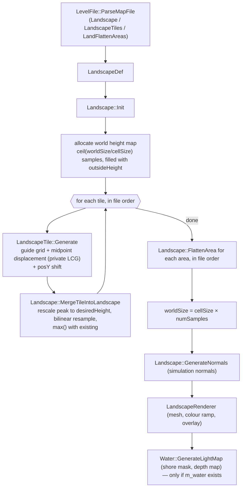

# P11_terrain_world — Landscape, water, clouds, level file, global world

Scope: `code/landscape.{h,cpp}`, `code/landscape_renderer.{h,cpp}`, `code/water.{h,cpp}`, `code/water_reflection.{h,cpp}`, `code/clouds.{h,cpp}`, `code/level_file.{h,cpp}`, `code/mapfile.{h,cpp}`, `code/mapcrc.h`, `code/global_world.{h,cpp}`, `code/global_internet.{h,cpp}`; plus usage of `data/terrain/*`, `data/locations.txt`, `data/game.txt`, representative `data/levels/*`, `data/shaders/water-meshwaves.*`. Supporting library code read to make the terrain reproducible: `code/lib/2d_array.{h,cpp}`, `code/lib/2d_surface_map.{h,cpp}`, `code/lib/math_utils.cpp:Log2`, `code/lib/vector3.h:Vector3::Normalise`, `code/lib/bitmap.cpp:BitmapRGBA::LoadBmp`, `contrib/systemiv/lib/math/random_number.cpp`, `contrib/systemiv/lib/math/math_stubs.cpp:iv_trunc_low_nibble`, `contrib/systemiv/lib/math/filecrc.cpp`, `contrib/unrar/crc.cpp`, `contrib/systemiv/lib/filesys/text_stream_readers.cpp:TextReader`.

Build baseline: see `build_matrix.md` (`Release|Win32` OpenGL + `TARGET_PC_FULLGAME` = **[B:FULL]**; `USE_DIRECT3D` = **[B:D3D]**).

Helper scripts written for this partition (all `python3 -I`, path args):
- `OUT/_work/scripts/P11_terrain_ref.py` — a from-this-spec re-implementation of the height-map pipeline (used to validate §23.12).
- `OUT/_work/scripts/P11_terrain_check.py` — runs the re-implementation over every shipped map and counts buildings below sea level per type.
- `OUT/_work/scripts/P11_mapcrc.py` — recomputes `MAPID_*` values; reproduces all 87 entries of `code/mapcrc.h`.
- `OUT/_work/scripts/P11_levelstats.py` — survey of landscape/option usage in `data/levels/*`.
- `OUT/_work/scripts/P11_log2check.py` — checks the float-truncated `Log2` against exact `ceil(log2)`.
- `OUT/_work/scripts/P11_bmpinfo.py` — BMP header dump for `data/terrain/*`.

---

## [→ 23_terrain_and_landscape] 23.1 Pipeline overview

The terrain is a single regular height-field (`SurfaceMap2D<double>`) built **once per level load** from the `Landscape_StartDefinition`, `LandscapeTiles_StartDefinition` and `LandFlattenAreas_StartDefinition` blocks of the map file. It is never modified by gameplay afterwards [C] (no `m_heightMap->PutData/AddToData/SetAll` outside `code/landscape.cpp`; grep over `code/`). Everything is driven by the level file plus integer seeds; generation uses a **private per-tile LCG**, not the synchronised RNG and not the global `AppRandom` [C] `code/landscape.cpp:LandscapeTile::LandscapeAppRandom`.



Call order inside a level load [C] `code/location.cpp:Location::Init`: `LoadLevel` (parse) → `AppSeedRandom(1)` → `InitLights` → `InitLandscape` (= `Landscape::Init`) → `new Water()` → … → `InitBuildings` (buildings are dropped onto the surface with `m_heightMap->GetValue`). At `Landscape::Init` time `m_water` is still NULL, so the water mask is generated by the `Water` constructor, not by `Landscape::Init` [C] `code/landscape.cpp:Landscape::Init`, `code/water.cpp:Water::Water`.

## [→ 23_terrain_and_landscape] 23.2 Numeric primitives the pipeline depends on (must be replicated bit-for-bit)

| Primitive | Exact behaviour | Evidence |
|---|---|---|
| `iv_atof(s)` | `atof(s)` then rounded to IEEE single (`volatile float`), returned as double | [C] `contrib/systemiv/lib/math/math_stubs.cpp:iv_atof`, `iv_trunc_low_nibble` |
| `iv_pow/iv_exp/iv_log/iv_sqrt/iv_sin/…` | CRT double function, result rounded to float, returned as double | [C] `code/lib/universal_include.h` (macros), `math_stubs.cpp:iv_trunc_low_nibble` |
| `Log2(x)` | `iv_log(x) * (1.0 / iv_log(2.0))` (second factor computed once, in double) | [C] `code/lib/math_utils.cpp:Log2` |
| `LandscapeTile::GetPowerOfTwo(x)` | `(int)ceil(Log2(x))`. Verified equal to exact `⌈log2 x⌉` for every x in 1..69999 under float-rounded logs (incl. exact powers of two) | [C] `code/landscape.cpp:GetPowerOfTwo`; [I] `scripts/P11_log2check.py` (0 mismatches; assumes a correctly-rounded CRT `log`) |
| `Array2D<T>::GetData(x,y)` | indices are `unsigned short`; any index ≥ size (incl. negative ints wrapped mod 2¹⁶) returns the array's **outside value** | [C] `code/lib/2d_array.cpp:GetData` |
| `Array2D<T>::PutData/AddToData` | silently ignore out-of-range indices | [C] `code/lib/2d_array.cpp` |
| `SurfaceMap2D(w,h,x0,y0,cx,cy,out)` | `numColumns = ceil(w/cx)`, `numRows = ceil(h/cy)` (then truncated to `unsigned short`); `inv = 1.0/cell` | [C] `code/lib/2d_surface_map.cpp:SurfaceMap2D` |
| `SurfaceMap2D::GetValue(x,y)` | `fx=(x−x0)·invX`; `x1=(unsigned short)fx`; `x2=(unsigned short)(x1+1)`; `fx-=floor(fx)`; then **if `x1≥cols` → 0; if `x2≥cols` → 0** (same for y); bilinear `v11(1−fx)(1−fy)+v12(1−fx)fy+v21 fx(1−fy)+v22 fx fy` where `v12=(x1,y2)`, `v21=(x2,y1)`. Consequences: (a) samples beyond the far edge wrap to column/row 0, not to the outside value; (b) the last cell interpolates towards column/row 0; (c) slightly negative coordinates (−1<fx<0) use `x1=0` and weight `fx+1` | [C] `code/lib/2d_surface_map.cpp:GetValue`; [I] double→`unsigned short` of values ≤ −1 is MSVC-specific (truncate to int, keep low 16 bits → ≥ cols → 0) |
| `GetMapIndexX(r)` | `(int)((r − x0)·invX)` (truncation toward zero) | [C] `2d_surface_map.cpp:GetMapIndexX` |
| `GetRealX(i)` | `i·cellSizeX + x0` | [C] |
| `GetHighestValue()` | starts at `GetData(0,0)`; scans `y<numRows`, `x<numRows` (uses rows for both — only correct for square maps, which tiles always are) | [C] `2d_surface_map.cpp:GetHighestValue` |
| `Vector3::Normalise` | `len²` held `volatile`; if `len² > 1e-10` scale by `1/iv_sqrt(len²)`, else set to (0,0,1) | [C] `code/lib/vector3.h:Normalise` |
| `Vector3 ^` | cross product `(y·bz−z·by, z·bx−x·bz, x·by−y·bx)` | [C] `code/lib/vector3.h:operator^` |
| Text tokeniser | separators `" \t\n\r:,"`; `#` starts a comment to end of line; optional "redshirt2" line-cipher prefix | [C] `contrib/systemiv/lib/filesys/text_stream_readers.cpp:CleanLine`, `GetNextToken` (X1a owns the formal grammar) |

## [→ 23_terrain_and_landscape] 23.3 Landscape definition data (every field)

### 23.3.1 `Landscape_StartDefinition … Landscape_EndDefinition` → `LandscapeDef` + `LevelFile` strings

Parsed by [C] `code/level_file.cpp:LevelFile::ParseLandscapeData`: each line is `key value`; keys compared case-insensitively; unknown keys ignored; the block ends at a line whose first token is `landscape_endDefinition` (any case). Note: this parser does not skip empty lines before `GetNextToken` [C] — a blank/comment-only line inside the block yields a NULL token passed to `stricmp` (crash-prone). No shipped file has one [C] (awk scan of `data/levels/*.txt`).

| Key | Field | Type / parse | Default | Units / meaning |
|---|---|---|---|---|
| `cellSize` | `LandscapeDef::m_cellSize` | double via `iv_atof` (float precision) | 12.0 | world units between height samples (both axes). Shipped range 9.0 – 27.08 |
| `worldSizeX` | `m_worldSizeX` | int (`atoi`) | 2000 | requested extent in world units along X. Actual extent = `cellSize × ceil(worldSizeX/cellSize)` (§23.8) |
| `worldSizeZ` | `m_worldSizeZ` | int | 2000 | same for Z. All shipped maps are square |
| `outsideHeight` | `m_outsideHeight` | double via `iv_atof` | −10 | height of everything not covered by a tile (sea floor); also the base level of every tile. Shipped: −6.93 … −30.0 |
| `maxHeight` | `m_maxHeight` | float via `atof` (double precision then stored as float) | 0.0 | **colour-ramp only**: if > 0 it replaces the real peak height as the normaliser of the colour ramp (§23.11). "isn't required for any other calculations" [C] `code/landscape.cpp:Landscape::Init` comment + usage grep. Shipped: 0.00 or absent except `mp_cts_3p_3.txt` (200.00) |
| `landColourFile` | `LevelFile::m_landscapeColourFilename` | string (`strcpy`, 512) | `landscape_default.bmp` | colour ramp, loaded as `terrain/<name>` |
| `wavesColourFile` | `m_wavesColourFilename` | string | `waves_default.bmp` | water wave colour table, `terrain/<name>` |
| `waterColourFile` | `m_waterColourFilename` | string | `water_default.bmp` | flat-water texture, `terrain/<name>` |

[C] defaults: `code/level_file.h:LandscapeDef::LandscapeDef`, `code/level_file.cpp:LevelFile::LevelFile`. Christmas mode (`Location::ChristmasModEnabled`, set from `ClientToServer::m_christmasMode`) overrides the three files with `landscape_icecaps.bmp`, `waves_earth.bmp`, `water_icecaps.bmp` [C] `code/landscape_renderer.cpp:LandscapeRenderer::LandscapeRenderer`, `code/water.cpp:Water::Water`, `Water::RenderFlatWater`.

### 23.3.2 `LandscapeTiles_StartDefinition … LandscapeTiles_EndDefinition` → `LandscapeTile`

One tile per non-empty line, appended in file order (order matters: §23.6). Parsed by [C] `code/level_file.cpp:LevelFile::ParseLandscapeTiles`; positional tokens:

| # | Header label | Field | Parse | Default (ctor) | Meaning / units |
|---|---|---|---|---|---|
| 1 | `x` | `m_posX` | int | – | world X of the tile's low corner (world units) |
| 2 | `y` | `m_posY` | `iv_atof` | – | height offset added to every tile sample after generation (world units, before rescale — see §23.6) |
| 3 | `z` | `m_posZ` | int | – | world Z of the tile's low corner |
| 4 | `size` | `m_size` | int | 256 | edge length of the (square) tile footprint in world units. Shipped 104 – 4484 |
| 5 | `frac dim` | `m_fractalDimension` | `iv_atof` | 1.2 | roughness exponent: noise amplitude ∝ (10·L)^fd where L is the current half-step in "256-unit" space (§23.4). Shipped 0.57 – 7.88 |
| 6 | `height scale` | `m_heightScale` | `iv_atof` | 1.0 | linear noise gain; 0 ⇒ no noise (guide grid only). Shipped 0.0 – 10.0 |
| 7 | `desired height` | `m_desiredHeight` | `iv_atof` | 200 | the tile's highest sample is rescaled to this world height (§23.6). Shipped 21 – 961 |
| 8 | `gen method` | `m_generationMethod` | int | 1 | 0 = average of 4 parents; 1 = average of a random opposite pair; 2 = copy one random parent (§23.4). Shipped counts: method 1 ×449, 2 ×72, 0 ×39 |
| 9 | `seed` | `m_randomSeed` | int | 1 | seed of the tile's private LCG |
| 10 | `lowland smooth` | `m_lowlandSmoothingFactor` | `iv_atof` | 1.0 | exponent on |height| in the noise envelope: higher ⇒ flatter lowlands relative to peaks. Shipped 0.0 – 3.0 |
| 11 | `guideGrid` (power) | `m_guideGridPower` | int → `GuideGridSetPower` | 0 | log₂ of guide-grid resolution + 1: resolution r = 2^p − 1 points per side. Shipped p ∈ {0,1,2,3,4,5} (counts 158/34/214/35/98/21) |
| 12 | (guide string) | `m_guideGrid` | only read if p > 0; `GuideGridFromString` | NULL | r×r bytes encoded as 2r² letters (§23.5) |

Generated (not in file): `m_heightMap` (n×n `SurfaceMap2D<double>`), `m_compensatedHeightScale`, `m_holdrand` (LCG state), `m_outsideHeight` (copied from the landscape before generation) [C] `code/landscape.h:LandscapeTile`, `code/landscape.cpp:Landscape::GenerateHeightMap`.

### 23.3.3 `LandFlattenAreas_StartDefinition … _EndDefinition` → `LandscapeFlattenArea`

[C] `code/level_file.cpp:ParseLandFlattenAreas`, `code/level_file.h:LandscapeFlattenArea`. Tokens: `x y z size [type threshold]`.

| # | Field | Parse | Default | Meaning |
|---|---|---|---|---|
| 1–3 | `m_centre.x/y/z` | `iv_atof` | – | centre (x,z) of the square; `y` = target height / amount (meaning depends on type) |
| 4 | `m_size` | `iv_atof` | 40.0 | **half**-width of the axis-aligned square (world units) |
| 5 | `m_flattenType` | int, optional | 0 (Absolute) if absent | enum below |
| 6 | `m_heightThreshold` | `iv_atof`, read only when 5 is present | 40.0 | threshold used by types 2, 3, 4 |

`FlattenType` enum [C]: 0 `FlattenTypeAbsolute`, 1 `FlattenTypeAdd`, 2 `FlattenTypeSubtract`, 3 `FlattenTypeSmooth`, 4 `FlattenTypeSubtract2`. Shipped usage: type 0 ×25, 1 ×1, 2 ×5, 3 ×27, 4 ×3 (`scripts/P11_levelstats.py`).

## [→ 23_terrain_and_landscape] 23.4 Tile generation — exact algorithm (`LandscapeTile::Generate`)

All arithmetic in double unless stated; "f32()" means round to IEEE single. [C] `code/landscape.cpp:LandscapeTile::Generate`, `GenerateMidpoints`, `GenerateSquareMidpoint`, `GenerateDiamondMidpoint`, `GenerateNoise`, `LandscapeAppSeedRandom`, `LandscapeAppRandom`, `Landscapesfrand`.

**Private RNG** (identical constants to MSVC `rand()` but separate state, `long m_holdrand`):
```
seed(s):   state = s                              (32-bit)
next():    state = state*214013 + 2531011 (mod 2^32); return (state >> 16) & 0x7FFF   // 0..32767
sfrand(R): (0.5 - next()/32767.0) * R            // uniform in [-R/2, +R/2]
```
The result bits 16–30 are identical whether `long` is 32 or 64 bit, so a `uint32` state reproduces it [I] (low-order bits of a product depend only on low-order bits of the operands). The tile's state is seeded with `m_randomSeed` immediately before the iteration loop and is not shared with anything else [C].

**Step 1 — allocate.** `reqWorldCells = (int)(m_size / cellSize)` (double division, truncation); `k = GetPowerOfTwo(reqWorldCells − 1)`; `n = iv_pow(2,k) + 1` (exact). The tile map is n×n samples with cell size 1.0 and origin 0 (re-used if already n×n) [C]. Edge case: `reqWorldCells == 1` ⇒ `log(0)` ⇒ undefined [I]; not present in shipped data (min size/cell ≈ 104/12 = 8).

**Step 2 — initialise.** All n² samples = `m_outsideHeight` (= the landscape's outsideHeight, copied in by `GenerateHeightMap`).

**Step 3 — guide grid.** If p > 0: `r = 2^p − 1`, `scale = (n−1)/(r+1)` (integer division = 2^(k−p)); for z in 0..r−1, x in 0..r−1: `sample((x+1)·scale, (z+1)·scale) = guide[x,z]` (raw byte 0–255 used as a height). Requires k ≥ p; if k < p, scale = 0 and every guide value lands on sample (0,0) [I]. The tile border (row/column 0 and n−1) is never a guide point.

**Step 4 — compensated noise gain.**
```
fracDimModifier   = 30.7   * f32(exp(-6.5 * fd))
smoothingModifier = 15.353 * f32(exp(-3.1 * ls))
comp = heightScale; comp *= fracDimModifier; comp *= smoothingModifier
```

**Step 5 — midpoint displacement.**
```
iterations = GetPowerOfTwo(n) - p            // = k + 1 - p  (since n = 2^k + 1)
step       = (n - 1) >> p                    // = 2^(k-p)
seed(m_randomSeed)
repeat iterations times:
    for x = 0; x < n-1; x += step:           // x OUTER loop
        for z = 0; z < n-1; z += step:       // z INNER loop
            h = step >> 1; mx = x + h; mz = z + h
            Square(mx, mz, h)                # centre of the square
            if z != 0: Diamond(mx, z, h)     # midpoint of the low-z edge
            if x != 0: Diamond(x, mz, h)     # midpoint of the low-x edge
    step >>= 1
```
The last pass runs with step = 1, h = 0: every call reads the point itself, adds `sfrand(0)·… = 0`, but still **consumes RNG draws** (irrelevant to the output because nothing uses the tile RNG afterwards) [C]. Edge midpoints on x = 0, z = 0 are skipped explicitly, and the far edges (x = n−1, z = n−1) are never visited, so **the whole tile border stays at outsideHeight** until Step 6 [C].

`Square(x,z,h)` parents = the 4 corners `A(x−h,z−h) B(x−h,z+h) C(x+h,z−h) D(x+h,z+h)`; `Diamond(x,z,h)` parents = `W(x−h,z) E(x+h,z) N(x,z+h) S(x,z−h)`. Base value by `m_generationMethod`:

| Method | Square base | Diamond base | RNG draws per call |
|---|---|---|---|
| 0 | (A+B+C+D)·0.25 | (W+E+(x,z−h)+(x,z+h))·0.25 | 1 (noise) |
| 1 | if `next()&1`: (A+D)·0.5 else (B+C)·0.5 | if `next()&1`: (W+E)·0.5 else (N+S)·0.5 | 2 (choice, then noise) |
| 2 | `r = next() & 0xFFFF`: r<0x3FFF → A; r<0x7FFF → B; r<0xBFFF → C; else D | same thresholds → W, E, N(x,z+h), S(x,z−h) | 2 |

Because `next()` ≤ 0x7FFF, method 2 picks A/W for r ∈ [0,16382], B/E for r ∈ [16383,32766], C/N only for r = 32767, and **never D/S** [C]+[I] (arithmetic consequence).

Then `sample(x,z) = base + Noise(h, base)` where
> **Verbatim excerpt** — `code/landscape.cpp:LandscapeTile::GenerateNoise` (Introversion licence, ≤15 lines)
```cpp
double length = 256.0 * _halfSize / m_heightMap->GetNumColumns();
double val = Landscapesfrand(iv_pow(length * 10.0, m_fractalDimension));
val *= m_compensatedHeightScale;
val *= 0.1 + (double)iv_pow(fabsf(_height), m_lowlandSmoothingFactor) * 0.15;
return val;
```
i.e. `Noise(h, base) = sfrand(f32((2560·h/n)^fd)) · comp · (0.1 + 0.15·f32(|f32(base)|^ls))`. `fabsf` makes the base value single precision first. The amplitude grows with |height|, so lowlands (near outsideHeight≈−10…−30 the magnitude is still non-zero) are rougher when `ls` is small and the envelope is dominated by the 0.1 floor when |base|^ls is small [I].

**Step 6 — height shift.** Every sample (border included) += `m_posY` [C].

## [→ 23_terrain_and_landscape] 23.5 Guide-grid encoding

[C] `code/landscape.cpp:GuideGridSetPower`, `GuideGridFromString`, `GuideGridToString`.

- Resolution `r = (1 << p) − 1`; p = 0 ⇒ no grid (pointer NULL). `GuideGridSetPower` only reallocates when p changes; new grids are zero-filled.
- String = r² cells, **row-major with z outer, x inner** (cell (x,z) at character offset 2·(z·r + x)).
- Each cell = two letters `hi lo` with `value = 16·(hi − 'A') + (lo − 'A')`; legal letters `A`–`P`; value range 0–255. No validation: a short string reads past its end [C]; other letters give out-of-range values that are truncated into the `unsigned char` [I].
- Lengths in shipped data: p=1 → 2 chars, p=2 → 18, p=3 → 98, p=4 → 450, p=5 → 1922 [C] (survey).
- Writer emits the inverse (`'A' + v/16`, `'A' + v%16`) after the power, separated by three spaces [C] `LevelFile::WriteLandscapeTiles`.
- Semantics: the decoded byte is an absolute height in tile space (before the posY shift and before the desiredHeight rescale of §23.6). Guide point (x,z) is pinned at tile sample ((x+1)·2^(k−p), (z+1)·2^(k−p)); the fractal then refines between them because the first iteration's step equals that spacing.

## [→ 23_terrain_and_landscape] 23.6 Height-map composition across tiles (`Landscape::GenerateHeightMap`, `MergeTileIntoLandscape`)

[C] `code/landscape.cpp:Landscape::GenerateHeightMap`, `Landscape::MergeTileIntoLandscape`.

```
world.SetAll(outsideHeight)
for tile in tiles (file order):
    tile.outsideHeight = outsideHeight
    tile.Generate(def)                                     # §23.4
    posXi = (unsigned short)(posX / cellSize + 0.5)        # round-half-up to a world sample index
    posZi = (unsigned short)(posZ / cellSize + 0.5)
    numCells = (int)(size / cellSize)                      # world samples covered per side
    heightRange  = tile.Highest() - outsideHeight + 0.001
    heightFactor = (desiredHeight - outsideHeight) / heightRange
    # re-map tile sample space to world space:
    tile.x0 = posX; tile.y0 = posZ; tile.cell = size / n  (NB: / n, not / (n-1)); tile.inv = 1/tile.cell
    for z in 0..numCells-1, x in 0..numCells-1:           # unsigned short counters
        wx = (x + posXi) * cellSize ; wz = (z + posZi) * cellSize
        h1 = (tile.GetValue(wx, wz) - outsideHeight) * heightFactor + outsideHeight
        if h1 > world.GetData(x+posXi, z+posZi): world.PutData(x+posXi, z+posZi, h1)   # max-composite
```
Properties [C]/[I]:
- Each tile's **peak is linearly rescaled to `desiredHeight`** relative to the sea-floor level `outsideHeight` (a sample equal to outsideHeight stays there). The posY shift therefore changes the shape only through `Highest()`: raising posY raises the border (to `outsideHeight + posY·heightFactor`) and lowers the relative relief [I].
- Composition is a **per-sample maximum**; later tiles cannot dig into earlier ones (only flatten areas can lower terrain).
- Because the tile cell is `size/n` (not `size/(n−1)`) the tile's last sample sits at `size·(n−1)/n` and world samples near the far edge interpolate towards the tile's column/row 0 via the wrap rule of `GetValue` — both are the tile border at the same height, so this is invisible unless posY ≠ 0 [I].
- World samples whose index exceeds the world grid are silently dropped (`PutData`), so tiles may hang off the map edge [C].
- No smoothing pass is applied between tiles; the only "smoothing" is the bilinear resampling and flatten type 3 [C] (`GenerateHeightMap` has no other step).

After flatten areas: `m_worldSizeX = cellSize × numColumns`, `m_worldSizeZ = cellSize × numRows` [C].

## [→ 23_terrain_and_landscape] 23.7 Flatten areas (`Landscape::FlattenArea`)

[C] `code/landscape.cpp:Landscape::FlattenArea`. Region: world sample indices `x ∈ [x1, x2)`, `z ∈ [z1, z2)` with `x1 = GetMapIndexX(cx − size) + 1`, `x2 = GetMapIndexX(cx + size) + 1` (same for z) — an **axis-aligned square** of half-width `size`, hard-edged (no falloff, no blending). Indices are not clamped: reads outside the grid return outsideHeight, writes are dropped. Loop order z outer, x inner; updates are in place (Gauss–Seidel), so the smooth type sees already-updated x−1 and z−1 neighbours. Per sample `cur = h(x,z)`, `t = centre.y`, `T = heightThreshold`:

| Type | New value |
|---|---|
| 0 Absolute | `t` |
| 1 Add | `t + cur` |
| 2 Subtract | `cur > T ? cur − t : cur` |
| 4 Subtract2 | `cur < T ? cur − t : cur` |
| 3 Smooth (runs **2 passes**) | if `cur > T`: `v = cur·(t/cur)` (≈ t) `+ h(x−1,z) + h(x+1,z) + h(x,z+1) + h(x,z−1)`; `v /= 6.0`; else `v = t`. Then `v = min(v, cur)`. (Divisor 6 for 5 terms: the result is pulled down as well as smoothed; points at or below T are clamped to ≤ t.) |

Flatten areas are applied after all tiles, in file order [C] `GenerateHeightMap`.

## [→ 23_terrain_and_landscape] 23.8 Cell size, world size, outside height, sea level

| Quantity | Rule | Evidence |
|---|---|---|
| Sample spacing | `cellSize` (both axes). `Landscape::Init` multiplies it by `1 + (detailScaleFactor−1)·0.5` with `detailScaleFactor` hard-coded to 1 (the `RenderLandscapeDetail` preference read is commented out) ⇒ no effect | [C] `code/landscape.cpp:Landscape::Init` |
| Grid size | `cols = ceil(worldSizeX / cellSize)`, `rows = ceil(worldSizeZ / cellSize)` (uint16) | [C] `SurfaceMap2D` ctor |
| World extent | `cellSize × cols` by `cellSize × rows`, origin (0,0). E.g. `mp_koth_2P_1`: 2700 / f32(15.76) → 172 samples → 2710.72 units | [C]; [I] values from `P11_terrain_ref.py` |
| `GetWorldSizeX/Z` | the extent above; `1e6` if no height map | [C] `Landscape::GetWorldSizeX` |
| `IsInLandscape(p)` | `0 ≤ x < sizeX && 0 ≤ z < sizeZ` | [C] |
| Outside the grid | height = outsideHeight via `GetData`; but `GetValue` wraps to column/row 0 (§23.2) | [C] |
| Sea level | **y = 0** everywhere: the renderer culls quads with all heights ≤ 0 (§24.1), the water mask treats `height > 0` as land (§23.13), water mesh rests at y=0, `Water::IsVertNeeded` rejects land > 4.0 | [C] `landscape_renderer.cpp`, `water.cpp` |
| Camera bounds | `[−200, worldSizeX + 200]` on both axes (uses X for both) | [C] `code/main.cpp:DoEnterLocation` (cross-ref P10) |
| Fog distance | `fogEnd = max(4000, sizeX+1000, sizeZ+1000)`, `fogStart = fogEnd/3` | [C] `code/location.cpp:Location::SetupFog` (§24.6) |

## [→ 23_terrain_and_landscape] 23.9 Normal generation for simulation (`Landscape::GenerateNormals`)

`m_normalMap` is a `SurfaceMap2D<Vector3>` with the same grid as the height map (outside value = up vector) and is read by gameplay (e.g. `code/location.cpp` bounce physics, `code/worldobject/centipede.cpp`, `code/worldobject/nuke.cpp`, `code/particle_system.cpp`) through `GetValue` (bilinear) [C] grep. Algorithm [C] `code/landscape.cpp:Landscape::GenerateNormals`:
```
for z in rows, x in cols:
    hN = h(x, z-1); hW = h(x+1, z); hE = h(x-1, z); hS = h(x, z+1)       # out-of-grid -> outsideHeight
    if hN == hW and hE == hS and hN == hE: n = (0,1,0); continue        # centre NOT compared
    c  = h(x,z)
    vN = (0, c-hN,  cy);  vW = (-cx, c-hW, 0);  vS = (0, c-hS, -cy);  vE = (cx, c-hE, 0)
    n  = normalise( normalise(vW ^ vN) + normalise(vE ^ vS) )
```
(The "W"/"E" labels are swapped relative to +x but the result is a correct up-facing normal leaning downhill [I] by expansion of the cross products.) An isolated spike or pit whose four neighbours are equal gets the up vector [C].

The **render** normals are separate (per-triangle, §24.1).

## [→ 23_terrain_and_landscape] 23.10 Landscape queries

[C] `code/landscape.cpp`:

| Function | Behaviour |
|---|---|
| `RayHit(start, dir, *hit)` | normalises dir. If the start cell is inside (`0≤x0<cols`, `0≤z0≤rows` — note `≤`), calls `UnsafeRayHit`. Otherwise intersects the 2-D ray with the two grid edges facing it (choice by quadrant of dir.xz) using `SegRayIntersection2D`; returns false if neither is hit; else starts `UnsafeRayHit` from the entry point (entry y computed from the x-distance only: `λ = (ix − start.x)/dir.x`). Comment warns it may report hits behind the start. |
| `UnsafeRayHit` | grid walk: at each cell test `RayHitCell`; step to the neighbour in z if the ray crosses the cell's far z-edge segment, else step in x; stop when leaving the grid. 4 quadrant variants; a ray with dir.x == 0 or dir.z == 0 falls into the last (SE) branch [I]. |
| `RayHitCell(x0,z0)` | two triangles per cell: (c00, c01, c10) then (c01, c10, c11) via `RayTriIntersection(…, 1e10)` — the same diagonal as the render mesh. |
| `SphereHit(c, r)` | asserts 0 < r < 200; scans samples in the bounding box (indices clamped to [0, size]); returns distance to the nearest **sample point** if ≤ r else −1. |
| `DeleteTile(id)` | editor: removes tile from the level's `LandscapeDef` and re-runs `Init` [B:EDITOR] (`code/interface/landscape_window.cpp`). |
| `RenderHitNormals` | debug line drawing of normals ×20, colour (255,90,90); no caller [C] grep → dead. |

## [→ 23_terrain_and_landscape] 23.11 Colour-ramp application (`data/terrain/landscape_*.bmp`)

Ramp bitmaps are 64×64, 24-bit, uncompressed BMP [C] (`scripts/P11_bmpinfo.py`, all 23 files). `BitmapRGBA` stores file rows in file order, so **row y = 0 is the bottom row of the picture as viewed** (positive-height BMPs are stored bottom-up) and alpha = 255 [C] `code/lib/bitmap.cpp:LoadBmp`, `Read24BitLine`. Loaded through `Resource::GetBitmap("terrain/<landColourFile>")` [C] `code/landscape_renderer.cpp:LandscapeRenderer::LandscapeRenderer`.

Colour is assigned **per render triangle** (flat shaded, §24.1) [C] `code/landscape_renderer.cpp:BuildColourArray`, `GetLandscapeColour`:
```
for each strip triangle T_j = (v_j, v_j+1, v_j+2):           # j = 0 .. numVerts-3
    centre   = (v_j + v_j+1 + v_j+2) * 0.33333                 # render positions (y<0.3 already clamped to -10)
    gradient = normal(T_j).y                                   # 1 = flat, 0 = vertical
    u = f32(pow(1 - gradient, 0.4))
    v = 1 - centre.y / highest            # highest = max height-map sample, or maxHeight if > 0
    AppSeedRandom( (uint)centre.x | ((uint)centre.z + AppRandom()) )    # C precedence: x | (z + r)
    hNoise = max(centre.y, 0)
    v += sfrand(0.45 / (hNoise + 2.0))    # global AppRandom; sfrand(R) is uniform in [-R/2, R/2]
    px = clamp((int)(u * 64), 0, 63);  py = clamp((int)(v * 64), 0, 63)
    colour = ramp[px, py]                 # py = 0 = bottom row of the image
    if negativeRenderer: colour.a = 0
    for each burn patch P:                # Location::m_burnPatches
        d = |centre - P.pos| (3-D)
        if d < 1.5 * P.r:
            ratio = d <= P.r/2 ? 0 : min(1, (d - P.r/2) / P.r)
            colour = colour*ratio + (20,20,20)*(1-ratio)
    store colour on v_j+2 (the provoking vertex)
```
Reading of the ramp: **x axis = slope** (left column = flat, right column = vertical; the 0.4 exponent expands gentle slopes), **y axis = height** (bottom row of the image = the highest terrain, top row = sea level), with a small vertical jitter whose amplitude decays with height (±0.1125 rows-fraction at h=0, ±0.0022 at h=100) [C]+[I]. The first two vertices of the strip get magenta (255,0,255) but are never provoking [C].

RNG discipline: `Location::Init` calls `AppSeedRandom(1)` just before `InitLights`/`InitLandscape` [C] `code/location.cpp:Location::Init`, so the chained reseeding is reproducible run-to-run unless another thread draws from the global `AppRandom` concurrently (level load runs inside `DoEnterLocation` on the loading-screen work queue) [I] `code/main.cpp:EnterLocation`. The colours are presentation-only; they never feed the simulation [C] (only `m_verts[].m_col`).

Burn patches are added by `Location::AddBurnPatch`, which rebuilds the whole renderer (`Landscape::BuildOpenGlState`) [C]; the only caller is `code/worldobject/portal.cpp` (a Darwinia object) → [B:LEGACY] [I].

Shipped ramp files and usage (map files referencing each): `landscape_default` (15), `icecaps` (11), `earth` (9), `mine` (8), `launchpad` (6), `dark` (5), `desert` (4), `firetop` (3), `jailbreak` (2), `stronghold` (2), `marble` (1), `shrine` (1), `silver` (1), `trippy` (1); **unreferenced by any level or code**: `beach`, `containment`, `field`, `icecaps_peaked`, `marble2`, `mine2`, `ridges`, `volcanic`, `volcanicplain` (only reachable through the editor's file picker, filter `landscape_*`, [B:EDITOR] `code/interface/landscape_window.cpp`) [C] grep.

## [→ 23_terrain_and_landscape] 23.12 Validation of this specification

`scripts/P11_terrain_ref.py` implements §23.2–23.8 exactly as written above (no access to the original binary). `scripts/P11_terrain_check.py` regenerates every shipped `map_*`/`mp_*` file and samples the result at every `Buildings_StartDefinition` position: **0 of 793 Trees, 0 of 321 SpawnPoints, 0 of 178 MultiwiniaZones, 0 of 156 TrunkPorts, 0 of 252 SolarPanels, 0 of 208 GunTurrets, 0 of 121 ControlTowers, 0 of 108 RadarDishes** land at or below sea level, whereas object types that are designed to stand in the sea (FuelGenerator 60/60, AIObjective 77/95, PylonEnd 65/92, SpawnPointMaster 20/37, LaserFence 79/756) do [I]. A transposed axis, a wrong tile origin or a wrong rescale would put many land-only buildings under water, so this is strong (but indirect) evidence that the reconstruction reproduces the shipped terrain. Exact bit-equality with the original executable is **[U]** (needs a height dump from a running build).

## [→ 23_terrain_and_landscape] 23.13 Water level, coastline mask, water depth and waves

There is no per-level water level: the sea plane is y = 0 [C] (§23.8). The coastline is derived from the height map by `Water::GenerateLightMap` (named "lightmap", it is a **shore mask**, not lighting) [C] `code/water.cpp:Water::GenerateLightMap`:

1. `MASK_SIZE = 128`; the mask covers the water plane `[−sizeX/2, 1.5·sizeX) × [−sizeZ/2, 1.5·sizeZ)` (twice the land extent); `sf = 2·size/128` per pixel; only pixels 32..95 (the land rectangle) are evaluated: `land(x,z) = 1` if `heightMap.GetValue(x·sfX − sizeX/2, z·sfZ − sizeZ/2) > 0`, else 0.
2. Separable 11-tap blur, scatter form (`AddToData`, out-of-range dropped), kernel `{0.2,0.3,0.4,0.5,0.8,1.0,0.8,0.5,0.4,0.3,0.2} / 5.4` (sums to 1.0); horizontal then vertical; zero pixels (`NearlyEquals(v,0)`) skipped.
3. `grey = min(255, blurred × 855)` → 128×128 `BitmapRGBA` written **vertically flipped** (`PutPixel(x, 127−z)`), registered as resource bitmap `"water_lightmap"` (old bitmap/texture deleted first).
4. Water depth map: `SurfaceMap2D<float>(2·sizeX, 2·sizeZ, origin (−sizeX/2, −sizeZ/2), cell = 2·sizeX/128 for both axes, outside = 1.0)`; `depth(x, z) = 1 − grey(x, 127−z)/255` (un-flipped). 1.0 = open sea, 0.0 = on/next to land. The integer truncation of `grey` happens when the float is stored into the 8-bit pixel [C].
5. Flat-water tile mask: `Array2D<bool>(cols/4, rows/4)` (32×32); a tile is **false** (not drawn) iff all 16 depth samples of its 4×4 block are ≥ 1.0; stored flipped (`rows/4 − 1 − z`) to match the north-to-south order used when rendering [C].

`Water::IsVertNeeded(x,z)` (dynamic mesh): false if land height (bilinear) > 4.0, false if depth (bilinear) > 0.999, else true [C]. The commented-out `RenderWaterDetail == 1` shortcut means detail does not change this rule [C].

Waves (per-vertex, render-only, driven by `g_gameTimer.GetAccurateTime()` seconds — §24.2) [C] `Water::UpdateDynamicWater`:
```
waveX[i] = 7 * (1.2*sin(0.01*x + 0.65*t) + 0.9*sin(0.03*x + 1.5*t)),  x = i * waterCell
waveZ[i] = 7 * (0.9*sin(0.02*z + 0.75*t) + 0.65*sin(0.03*z + 1.85*t)), z = i * waterCell
vertex.y = (waveX[ix] + waveZ[iz]) * depth(vertex)       # waves vanish at the shore (depth→0)
```
(`x`,`z` are measured from the water-plane origin `(−sizeX/2, −sizeZ/2)`, not world 0; table sizes `int(2·size/waterCell + 2)`.) Coastline whitening: per-vertex `shoreNoise = (s + sfrand(s)·0.25) · 250` with `s = 1 − depth` (global `AppRandom`, drawn once at build).

## [→ 23_terrain_and_landscape] 23.14 Landscape lightmap — docs vs code

`docs/landscape lightmap.txt` describes `Landscape::GenerateLightMap/ApplyLightmap/DeleteLightMap` (ray-cast shadows from a point light at (700,200,100), 255/50 shade values, optional 5×5 filter, `ConvertToTexture`). **None of these exist in the code**; only the orphan `#define LIGHTMAP_SCALEFACTOR 1` remains in `code/landscape.h` [C] grep for `m_lightMap|ApplyLightmap`. Terrain shading is purely GL vertex lighting with the level lights (§24.1); the only "lightmap" in the build is the water shore mask of §23.13 (`LIGHTMAP_TEXTURE_NAME "water_lightmap"`) [C] `code/water.cpp`. Logged under discrepancies.

## [→ 23_terrain_and_landscape] 23.15 Lifecycle and re-generation

| Event | Effect | Evidence |
|---|---|---|
| Level load | `Location::Init` → `Landscape::Init(def)` full pipeline; then `new Water()`; buildings get `m_pos.y = heightMap.GetValue(x,z)` | [C] `code/location.cpp:Location::Init`, `InitLandscape` |
| Graphics options "apply" (`PrefsGraphicsWindow`) or Other options "apply" (`PrefsOtherWindow`) **while a location is loaded** | `m_landscape.Init(def)` (full regeneration, new renderer) + water deleted and rebuilt | [C] `code/interface/prefs_graphics_window.cpp`, `code/interface/prefs_other_window.cpp` |
| `Resource::RegenerateOpenGlState` (screen-mode change, cheat window) | `Landscape::BuildOpenGlState` (renderer rebuilt; height map untouched) + `Water::BuildOpenGlState` (D3D buffers only) | [C] `code/location.cpp:Location::RegenerateOpenGlState` |
| Burn patch | renderer rebuilt with new colours | [C] `Location::AddBurnPatch` |
| Editor tile edits | `Landscape::Init`, `DeleteTile` [B:EDITOR] | [C] `code/interface/landscape_window.cpp` |
| Level unload | `Location::Empty` deletes water; `Landscape::~Landscape` → `Empty` deletes renderer, height and normal maps | [C] |

Mid-game regeneration is deterministic from `LandscapeDef` (no runtime inputs), so simulation-visible heights do not change [I]; but it re-runs `GetLandscapeColour`'s chained `AppSeedRandom`, changing only colours [I].

## [→ 23_terrain_and_landscape] 23.16 Shipped terrain parameter survey (Multiwinia `mp_*` maps)

Source `scripts/P11_levelstats.py` (X4 owns the full catalogue). All `mp_*` maps are square; `worldSize` 2000–7000; `cellSize` 9.0–27.08; `outsideHeight` −6.93 … −30.0 (−10.00 in 40 of the 57 `mp_*` maps); 1–25 tiles per map; 0–6 flatten areas; exactly 2 lights in every file (all 69 landscape-bearing `mp_*` + `map_*` files). Representative rows:

| File | worldSize | cellSize | outsideHeight | tiles | flatten | landColour | waves | water |
|---|---|---|---|---|---|---|---|---|
| mp_koth_2P_1 | 2700 | 15.76 | −15.39 | 3 | 0 | landscape_launchpad | waves_launchpad | water_launchpad |
| mp_assault_4P_2 | 7000 | 26.00 | −10.00 | 19 | 5 | landscape_icecaps | waves_earth | water_icecaps |
| mp_cts_2p_4 | 2000 | 9.00 | −10.00 | 3 | 0 | landscape_earth | waves_default | water_default |
| mp_rocketriot_2p_3 | 3756 | 27.08 | −26.13 | 15 | 0 | landscape_mine | waves_generator | water_default |
| mp_blitzkrieg_4P_2 | 4000 | 20.00 | −10.00 | 25 | 0 | landscape_icecaps | waves_earth | water_icecaps |
| mp_cts_3p_3 | 2570 | 12.00 | −10.00 | 5 | 0 | landscape_trippy (maxHeight 200) | waves_dull | water_icecaps |

---

## [→ 24_rendering] 24.1 Landscape renderer (`LandscapeRenderer`) [B:FULL]

### Vertex format and mesh construction
`LandVertex` = `FloatVector3 m_pos` (offset 0), `FloatVector3 m_norm` (12), `RGBAColour m_col` (24, 4×u8 RGBA; packed as `D3DCOLOR` ARGB under [B:D3D]), `TextureUV m_uv` (28, 2×float) → stride 36 bytes [C] `code/landscape_renderer.h`, `code/landscape_renderer.cpp:m_posOffset…m_uvOffset`.

**One single triangle strip for the whole map**, built row by row with degenerate joins, culling quads that are fully under water [C] `BuildVertArrayAndTriStrip`:
```
highest = maxHeight > 0 ? maxHeight : heightMap.Highest()
degen = 0
for z in 0 .. rows-1:                    # NB: last row pairs z with z+1 = rows (outside value)
    for x in 0 .. cols-1:
        if any of h(x-1,z), h(x-1,z+1), h(x,z), h(x,z+1), h(x+1,z), h(x+1,z+1) > 0:
            v1 = (x*cs, h(x,z), z*cs);  v2 = (x*cs, h(x,z+1), (z+1)*cs)
            if v1.y < 0.3: v1.y = -10.0;  if v2.y < 0.3: v2.y = -10.0      # sink near-sea vertices
            if degen == 1: emit v1, v1                                     # restart after a gap
            degen = 2; emit v1, v2
        elif degen == 2:
            emit v2, v2 (last v2) ; degen = 1                              # close the run
```
- Vertices below 0.3 are pushed to −10 so the coastline is a crisp cliff into the water and never z-fights the sea plane [I].
- No explicit join is inserted at the end of a row: if a row both ends and the next row starts above water, a long wrap-around triangle connects them [I] (shipped maps have water borders so this does not occur in practice).
- `m_numTriangles = numVerts − 2`. No LOD and no chunking: the whole visible land is one draw call per pass [C]. The commented `RenderLandscapeDetail` preference is ignored (hard-coded 1) [C] `Render`, `Landscape::Init`.

**Render normals (per triangle, flat shading)** [C] `BuildNormArray`: verts 0 and 1 get (0,1,0); for j = 0, 2, 4, … < numVerts−2 with `a,b,c,d = v_j..v_j+3`: `n(T_j) = normalise((c−b) × (a−b))` stored on v_j+2, `n(T_j+1) = normalise((d−b) × (c−b))` stored on v_j+3. Each vertex k ≥ 2 thus carries the normal (and colour, §23.11) of triangle (k−2, k−1, k); with `glShadeModel(GL_FLAT)` (global state, `code/renderer.cpp:Renderer::SetOpenGLState`) OpenGL uses the **last** vertex of each strip triangle, which is exactly that vertex. Degenerate triangles normalise a zero vector → (0,0,1) [C] `Vector3::Normalise`.

**UVs** [C] `BuildUVArray`: `u = x / cellSize`, `v = z / cellSize` → one texture repeat per height-map cell.

**[B:D3D] differences** [C] `BuildOpenGlState`: all normals negated; with `USE_DIRECT3D_TRILIST` (always on under D3D) the strip is expanded to a triangle list (3 verts per strip triangle including degenerates, winding fixed with `i%2`, all three carrying the provoking vertex's normal/colour) because D3D9 flat shading uses the first vertex.

### Storage / draw path selection
| Mode (enum value) | When | Draw |
|---|---|---|
| `RenderModeVertexArray` (0) | preference `RenderLandscapeMode = 0` | client-side arrays from `m_verts` |
| `RenderModeDisplayList` (1) | preference 1, or auto-fallback | two display lists `"LandscapeMain"`, `"LandscapeOverlay"` compiled via `Resource::CreateDisplayListAsync` from `RenderMainSlow` / `RenderOverlaySlow` |
| `RenderModeVertexBufferObject` (2) | default: preference absent/−1 ⇒ VBO if `IsOGLExtensionPerfectlySupported("GL_ARB_vertex_buffer_object")`, else display list; also falls back if `gglBindBufferARB` is NULL. Always under [B:D3D] | one static VBO (`GL_STATIC_DRAW_ARB`, uploads `m_verts.Size()` = **capacity** elements, i.e. includes unused tail [C]); if built off the main thread the upload is queued to the loading screen (`g_loadingScreen->QueueJob`) and waited for |
| `RenderModeVertexBufferDirect3D` (3) | never assigned | – |
[C] `LandscapeRenderer::LandscapeRenderer`, `BuildOpenGlState`, `DoBindBuffers`. Linux/Mac default preferences write `RenderLandscapeMode = 2` [C] `code/lib/preferences.cpp:CreateDefaultValues` (platform appendix).

### Passes and render state (per frame, `LandscapeRenderer::Render`)
Preceded by `Location::SetupFog()` + `glEnable(GL_FOG)`; followed by `glDisable(GL_FOG)` [C]. Both passes draw the identical strip.

| State | Pass 1 "Main" (`RenderMainSlow`) | Pass 2 "Overlay" (`RenderOverlaySlow`) |
|---|---|---|
| Purpose | solid flat-shaded, vertex-lit terrain coloured by the ramp | additive glowing wireframe grid (texture `textures/triangleOutline.bmp`, a 128×128 8-bit image showing a 2×2 block of squares, three with a diagonal — ASCII preview via `scripts/P11_bmpascii.py`) |
| Fog | ON, linear, colour = background, start = end/3, end = max(4000, size+1000) | ON (same) |
| Lighting | ON, `GL_LIGHT0`, `GL_LIGHT1` (the first two level lights; §24.6) | ON, LIGHT0, LIGHT1 |
| Material | specular (0,0,0,0), ambient+diffuse (1,1,1,0), shininess 100 | specular (0.5,0.5,0.5,1), ambient+diffuse (1.2,1.2,1.2,0), shininess 40 |
| Colour material | ON (`GL_FRONT_AND_BACK`, `GL_AMBIENT_AND_DIFFUSE` — global) | ON |
| Texture | OFF | `GL_TEXTURE_2D` ON; `GetTexture(name, mipmaps=true, masked=false)`; MAG `LINEAR`, MIN `LINEAR_MIPMAP_LINEAR`, wrap S/T `REPEAT`; env `MODULATE` (global) |
| Blend | OFF (global default); negative renderer: ON `(SRC_ALPHA, ONE_MINUS_SRC_COLOR)` (left enabled) | ON `(SRC_ALPHA, ONE)` additive; negative renderer `(SRC_ALPHA, ONE_MINUS_SRC_COLOR)` |
| Depth test / func | ON / `LEQUAL` (global) — lets pass 2 pass at equal depth | ON / LEQUAL |
| Depth write | ON | **OFF** |
| Cull | ON, front = CCW (global); strip faces up | ON |
| Shade model | FLAT (global) | FLAT |
| Arrays | vertex, normal, colour | vertex, normal, colour, texcoord |
| Exit state | colour material OFF, lighting OFF, LIGHT0/1 OFF, VBO unbound | colour material, blend, texture, lighting, LIGHT0/1 OFF; depth write ON; blend func `(SRC_ALPHA, ONE_MINUS_SRC_ALPHA)`; wrap `CLAMP` |
[C] `code/landscape_renderer.cpp:RenderMainSlow`, `RenderOverlaySlow`, `Render`; global defaults [C] `code/renderer.cpp:Renderer::SetOpenGLState`.
Overlay specular uses the level lights' colour as `GL_SPECULAR` (set by `Location::SetupLights`) so grid lines catch highlights [I]. Under [B:D3D] each draw calls `g_fixedPipeline->Bind()` (FixedFunc shaders, P13) and uses a dedicated vertex declaration (POSITION f3, NORMAL f3, COLOR d3dcolor, TEXCOORD0 f2) [C].

## [→ 24_rendering] 24.2 Water renderer (`Water`) [B:FULL]

The sea is a plane twice the land size, from (−sizeX/2, −sizeZ/2) to (1.5·sizeX, 1.5·sizeZ), drawn as two layers: an **under-water flat textured layer** at y = −9 near land, and a **dynamic wave mesh** at y ≈ 0 that only exists near the coast [C] `code/water.h` header comment, `code/water.cpp`.

### Construction (`Water::Water`)
1. `GenerateLightMap()` — shore mask, depth map, flat-tile mask (§23.13).
2. If `RenderWaterDetail` (preference; UI values 1 = high, 2 = medium, 3 = low; default 1 via `GetDefaultGraphicsDetail`) > 0 [C] `code/interface/prefs_graphics_window.cpp`, `code/lib/preferences.cpp`:
   - `waterCell = detail × max(sizeX, sizeZ) / 100` (detail 1 ⇒ 200 cells across the 2× plane).
   - Colour table = row **y = 1** (second row from the bottom of the image) of `terrain/<wavesColourFile>` (400×10, 24-bit [C] bmpinfo): `numColours = width = 400`, alpha forced to 255 (0 in negative-renderer mode).
   - `BuildTriangleStrips()`: same single-strip/degenerate-join scheme as the landscape over the grid `xb ∈ [0, int(2·sizeX/waterCell))`, `zb` likewise, vertex pair at (fx, 0, fz) / (fx, 0, fz+cell) where `fx = −sizeX/2 + xb·cell`; a column is emitted if any of the 6 points (fx−cell…fx+cell, fz / fz+cell) `IsVertNeeded`. Then per vertex: `depth` (bilinear from the depth map), `shoreNoise = (s + sfrand(s)·0.25)·250`, `s = 1 − depth`. The depth map is freed afterwards.
   - Wave tables sized `int(2·size/waterCell + 2)`.
   - `UpdateDynamicWater()` once.
3. If detail ≤ 0 only the flat layer exists.

### Per-frame update (`Water::Advance` → `UpdateDynamicWater`)
Called once per **rendered** frame from the client loop (`code/main.cpp:LocationGameLoop`, `g_app->m_location->m_water->Advance()`), not from the simulation [C]. Time = `g_gameTimer.GetAccurateTime()` [C]. Wave tables as §23.13. For each vertex pair (v1 at j, v2 at j+1, j stepping by 2):
```
ix = int((v1.x + sizeX/2)/cell + 0.1);  iz = int((v1.z + sizeZ/2)/cell + 0.1)
v1.y = (waveX[ix] + waveZ[iz])   * depth[j]
b1   = (prevH1 + prevH2 + v1.y) * 4.0 * (1 - depth[j])   + shoreNoise[j];   prevH1 = v1.y
v2.y = (waveX[ix] + waveZ[iz+1]) * depth[j+1]
b2   = (prevH2 + prevH1 + v2.y) * 4.0 * (1 - depth[j+1]) + shoreNoise[j+1]; prevH2 = v2.y
v1.col = table[clamp(Round(0.7*b2 + 0.3*b1), 0, 399)]
v2.col = table[clamp(Round(0.7*b1 + 0.3*b2), 0, 399)]          # cross-mix to soften flat-shading sawtooth
v1.n = (-(waveX[ix+1]-waveX[ix-1])*depth[j],   v1.y, -(waveZ[iz+1]-waveZ[iz])*depth[j])     # unnormalised
v2.n = (-(waveX[ix+1]-waveX[ix-1])*depth[j+1], v2.y, -(waveZ[iz+2]-waveZ[iz+1])*depth[j+1])
degenerate-join fix-ups keep duplicated join vertices at equal heights (isIdentical on x,z)
```
`prevH1/prevH2` reset to 0 per strip (there is one strip). Brightness therefore = local wave slope proxy × "shoreness" + per-vertex shore whitening; deep water (depth ≈ 1) is dark, coast is bright [C]+[I]. Normals are only consumed by the D3D shader (§24.3); the GL path draws no normal array [C]. `waveX[ix−1]` is read out of bounds when `ix == 0` [I] (only if the very first water column is needed; not in practice). 4 constants: `waveBrightnessScale = 4.0`, `shoreBrighteningFactor = 250.0`, `shoreNoiseFactor = 0.25`, `scaleFactor = 7.0` [C] file-scope consts.

Mac builds throttle the update to every other call and ≤ 15 Hz (`TARGET_OS_MACOSX`) — platform appendix [C].

### Passes and render state (`Water::Render`, called from `Location::RenderWater`)
`m_renderWaterEffect = RenderWaterEffect(1) > 0 && RenderPixelShader(1) > 0` (used by D3D only). If `m_editing`: editor grid quads (below). Then if detail > 0: flat layer + dynamic layer (dynamic skipped under D3D without hardware vertex processing), else flat layer only. Ends with `Location::SetupFog()` (which disables fog) [C].

| State | Flat layer (`RenderFlatWater` → `RenderFlatWaterTiles`) | Dynamic layer (`RenderDynamicWater`) |
|---|---|---|
| Geometry | immediate-mode `GL_QUADS` on a 32×32 tile grid over the 2× plane at **y = −9.0**, skipping tiles flagged "all very deep"; positions run north (z = 1.5·sizeZ) → south (−0.5·sizeZ), east (x = −0.5·sizeX) → west (1.5·sizeX) | the strip from construction, `glDrawArrays(GL_TRIANGLE_STRIP)` from client memory (pos + colour arrays, stride = sizeof(WaterVertex) = 28) |
| Texture unit 0 | `terrain/<waterColourFile>` (128×128 8-bit; `GetTexture(mip=true, masked=true)`), MAG LINEAR, MIN LINEAR_MIPMAP_LINEAR, wrap REPEAT, env MODULATE (a `GL_COMBINE_RGB_EXT=REPLACE` parameter is also set but inert under MODULATE); UVs span 30 repeats across the plane and scroll by `t/30` in both axes (`timeFactor = GetAccurateTime()/30`) | none |
| Texture unit 1 | `"water_lightmap"` (shore mask, default flags), MAG LINEAR, MIN LINEAR_MIPMAP_LINEAR, env `GL_COMBINE_EXT` with `COMBINE_RGB = MODULATE` (default sources: texture × previous); UV 0→1 over the plane (v = 0 at north) | none |
| Vertex colour | (255,255,255,255); negative renderer (255,255,255,0) | per-vertex from the waves table |
| Blend | OFF; negative renderer ON `(SRC_ALPHA, ONE_MINUS_SRC_COLOR)` | ON `(SRC_ALPHA, ONE)` additive |
| Depth write | **OFF** | ON (left as is) |
| Depth test | ON (global) | ON |
| Cull | **OFF** | ON |
| Fog | ON (current Location fog params) | ON |
| Lighting | OFF | OFF |
| Exit | unit 1 texture OFF; unit 0 texture OFF, wrap CLAMP, env MODULATE; cull ON; blend OFF, func `(SRC_ALPHA, ONE_MINUS_SRC_ALPHA)`; fog OFF; depth write ON | fog OFF; blend func reset; blend OFF |
[C] `code/water.cpp:RenderFlatWater`, `RenderFlatWaterTiles`, `RenderDynamicWater`, `Render`.

Visual result: deep sea is not drawn at all (background colour + fog show through); near islands the textured, shore-masked under-layer glows; on top the additive wave mesh brightens toward the coast and with wave slope [I].

**Editor water** [B:EDITOR] (`g_app->m_editing`): two `GL_QUADS` over the land rectangle at y = −10 — textured with `triangleOutline.bmp` (100 repeats, colour (250,250,250,100), blend ON) then untextured (alpha 30) [C] `Water::Render`.

**[B:D3D] differences** [C]: per-vertex D3D colours; strip → list conversion that detects join triangles by perimeter > 20 units; 10 rotating dynamic vertex buffers (`NumVertexBuffers = 10`, `D3DUSAGE_DYNAMIC|WRITEONLY`, `D3DPOOL_DEFAULT`) guarded by a mutex, filled in `UpdateDynamicWater` and consumed in `RenderDynamicWater`; an `UpdateWaterThread` (120 Hz) exists but is **never started** (`m_updateWaterThread` is never assigned) [C]. D3D device calls: `RenderFlatWater` first resets the vertex declaration to `s_pCustomVertexDecl` ("somebody changes it and not returns back"); `RenderDynamicWater` saves the current declaration, sets its own (POSITION f3 @0, COLOR d3dcolor @12, NORMAL f3 @16), `SetStreamSource(0, buffer, 0, 28)`, `g_fixedPipeline->Bind()` when drawing to the real device, `DrawPrimitive(D3DPT_TRIANGLELIST, 0, n/3)`, `SetStreamSource(0, NULL, 0, 0)` (so the update can lock the buffer), restores the declaration; `WaterReflectionEffect::Start/Stop` bracket the draw when `m_renderWaterEffect` [C]. The D3D branch of the constructor dereferences the bitmap pointer with `.` (`bmp.GetPixel`) where `bmp` is `const BitmapRGBA *` — this is ill-formed C++, so `water.cpp` cannot compile with `USE_DIRECT3D` at this commit [C] `code/water.cpp:Water::Water` (L119); therefore the `ReleaseDirect3D` configuration does not build as checked in [I].

## [→ 24_rendering] 24.3 Water reflection (`WaterReflectionEffect`) [B:D3D] only

The entire file is inside `#ifdef USE_DIRECT3D` [C] `code/water_reflection.{h,cpp}`. Created by `OpenGLD3D` device init (`code/lib/opengl_directx.cpp`, `WaterReflectionEffect::Create`) only if the device supports hardware vertex processing; needs a render-target texture of **half screen resolution** (back-buffer format) and shader `shaders/water-meshwaves.vs` + `water-meshwaves.ps3` (if pixel-shader profile ≥ ps_3) else `water-meshwaves.ps` [C].

Pre-pass `PreRenderWaterReflection` (called from `Renderer::RenderFrame` **only when `RenderPixelShader > 0 && !g_app->Multiplayer()`**, i.e. never in a Multiwinia match because `Multiplayer()` ≡ `m_gameMode == GameModeMultiwinia`) [C] `code/renderer.cpp:RenderFrame`, `code/app.cpp:App::Multiplayer`:
1. Save RT 0, bind the reflection texture, viewport = texture size, clear colour (0.3,0.3,0.3,0) + depth, restore clear colour (0,0,0,0).
2. Mirror: `Camera::WaterReflect()`, `Location::WaterReflect()` (a no-op loop — light mirroring is commented out), `SetupLights`, `SetupMatricesFor3D`, `UpdateTotalMatrix`.
3. User clip plane `GL_CLIP_PLANE2 = (0,1,0,0)` (planes 0/1 are used by the radar) ON; `Location::Render(false)` (no clouds, no water; spirit receivers skip themselves while `IsPrerendering()`); clip plane OFF.
4. Un-mirror, restore matrices/lights, cull ON, restore RT and viewport.

Water pass (`Start`/`Stop` around the dynamic water draw when `m_renderWaterEffect`): `g_fixedPipeline->Disable()`, bind shader; uniforms `time = ((GetTickCount() % 10000000)/1000, 0.001·1024/ScreenW)`, `worldViewProjMatrix = Renderer::GetTotalMatrix()`, sampler `water` = reflection texture with MAG/MIN LINEAR, MIP NONE. Shaders [C] `data/shaders/water-meshwaves.vs/.ps/.ps3`:
- VS: `oPos = iPos·WVP`; `oReflCoord = (iPos + (iNorm,0))·WVP` (the unnormalised wave normal displaces the lookup); `oPosWorld = iPos`; colour passthrough.
- PS (ps_2): `uv = 0.5·((1,1) − refl.xy/refl.w)`; `uv.y += 0.004` (seam fix); `out = 0.7·colour + 0.7·(colour.r+colour.g+colour.b)·tex(water, uv)`; `out.a = 0.7`.
- PS (ps_3): as ps_2 plus small ripples `uv += time.y·sin((0.2·posWorld.yy + posWorld.xz)·0.25 + 4·time.x) / (|ddx(posWorld.x)| + |ddx(posWorld.z)|)`.
In a Multiwinia match under D3D the water shader would therefore sample a reflection texture that was never rendered [I] (moot given the compile error of §24.2).

## [→ 24_rendering] 24.4 Clouds and sky (`Clouds`) [B:FULL]

Live in two places [C]: in-game (`Location::RenderClouds`, first thing drawn by `Location::Render(true)`) and as the **main-menu backdrop** (`code/game_menu.cpp:GameMenu::Render` creates its own `Clouds`, camera at (0,600,0), FOV 90, looking along (0,0,1) rotated by −1.899 rad about Y and −1.079 rad about Z, and renders with prediction time `−GetHighResTime()`, so the menu clouds drift with wall-clock time).

State: `m_offset` (starts 0), `m_vel` (ctor (0.04,0,0); every `Advance` sets it to **(0.03, 0, −0.01)** then `m_offset += m_vel × SERVER_ADVANCE_PERIOD`) [C] `Clouds::Advance`. In-game `Advance` runs once per server tick from the simulation slice loop (`Location::AdvanceClouds`, slice 3) [C] `code/location.cpp`; render offset = `m_offset + m_vel × predictionTime` (`g_predictionTime`, plus one server period if slice < 3) [C] `Location::RenderClouds`. Clouds are cosmetic (not part of any sync check) [I].

Order inside `Clouds::Render`: `RenderSky` → `RenderBlobby` → `RenderFlat` → optional `RenderFace` [C].

`RenderQuad` = textured horizontal quad subdivided 4×4 (to avoid Radeon fog artefacts) [C].

| Layer | Geometry | Texture / sampling | Colour (RGBA) | UV (offset `o`) | Notes |
|---|---|---|---|---|---|
| Sky grid (`RenderSky`) | `GL_QUADS` lines at y = 1200, every 80 units over [−4000, 6000]² (`r = 2`), each line 16 units wide (±8), both directions (125 + 125 quads) | `textures/laser.bmp` (128×32 8-bit) default flags | (0.5,0.5,1.0,0.3) | (0,0)…(1,1) across the line | fog black, start 2000, end 4000 |
| Blobby layer 1 | quad [−8000, 9000]² (`r = 8`) at y = 1200 | `textures/clouds.bmp` (16×16 24-bit), `GetTexture(…, mip=false)`, MAG LINEAR, MIN NEAREST, REPEAT | (0.7,0.7,0.9,0.6) | z: o.z…o.z+9, x: o.x…o.x+9 | only if `RenderCloudDetail` ∈ {1,2} |
| Blobby layer 2 | y = 1000 | same | same | o.x/2 … o.x/2+4.5 both axes | always |
| Blobby layer 3 | y = 800 | same | same | x/z swapped: o.x…o.x+1.8, o.z…o.z+1.8 | only if detail = 1 |
| Flat layer 1 | quad [−8000, 9000]² at y = 1200 | `textures/clouds.bmp` default flags, MAG/MIN NEAREST, REPEAT | (0.7,0.7,0.9,0.3); detail 3 → alpha 0.5 | o.z…o.z+9, o.x…o.x+9 | always |
| Flat layer 2 | y = 1000 | same | same | o.x/2…o.x/2+4.5 | only if detail = 1 |
| Dr S face (`RenderFace`) | quad 1600×1600 at y = 800 centred on (sizeX/2, sizeX/2) | `sepulveda/sepulveda{1..5}.bmp` (256×256 8-bit), cross-faded | white; alpha = min(t−5, 1) from 5 s after the trigger; from 28 s alpha = min(t−28, 1) (ramps up again — almost certainly an intended fade-out, [I]); face removed at 30 s. Blend is **not** enabled by this function (its `glEnable(GL_BLEND)` is commented out and `RenderFlat` has just disabled it), so the face draws opaque with blend func (SRC_ALPHA, ONE) set but inactive; depth write OFF; fog off (if a location exists) | random zoom (p=1/6 per pick: `frand(0.1)`) and x-offset (p=1/6: `sfrand(0.1)`), smoothed by `g_advanceTime·4`; new picture every 0.4 s when alpha > 0.9: index 5 with p=0.1 ("mouth open"), else index 4 with p=0.1 ("eyes shut"), else 1 + AppRandom()%3; previous picture cross-faded at 0.75× alpha | **[B:DEBUG]**: triggered only by `Clouds::ShowDrSFace` from `code/interface/cheat_window.cpp` (`CHEATMENU_ENABLED`); uses the global non-synced `frand/AppRandom` |

Common state for sky/blobby/flat [C]: blend ON `(SRC_ALPHA, ONE)` additive; depth write OFF; depth test **OFF** for blobby and flat (sky grid leaves the depth test ON); fog ON with colour black (0,0,0,0) and the per-layer start/end (2000/4000 sky, 2000/5000 clouds); lighting OFF; line width 1.0 set but unused. Exit: `Location::SetupFog()` if a location exists (re-establishes level fog parameters and disables fog), depth test ON, depth write ON, blend OFF, func `(SRC_ALPHA, ONE_MINUS_SRC_ALPHA)`, texture OFF, wrap CLAMP. `RenderCloudDetail` UI values 1 = high, 2 = medium, 3 = low (default 1) [C] `prefs_graphics_window.cpp`.

## [→ 24_rendering] 24.5 Global internet and sphere world renderers [B:LEGACY]

`GlobalWorld::Render` → `GlobalInternet::Render` + `SphereWorld::Render` is reachable only from `Renderer::RenderFrame` when `m_locationId == −1` outside the main menu, i.e. in `GlobalWorldGameLoop`, which in this build sets `m_atMainMenu = true` and breaks out of its loop immediately; the editor variant (`GlobalWorldEditorLoop`) returns immediately (`if( true )`) [C] `code/main.cpp:GlobalWorldGameLoop`, `GlobalWorldEditorLoop`, `code/renderer.cpp:RenderFrame`. The Multiwinia main menu draws only clouds (§24.4) [C] `GameMenu::Render`. Nevertheless the **data is built at start-up** because `App` constructs `GlobalWorld` [C] `code/app.cpp` ("Inits 10"): `GlobalInternet` seeds the global RNG with `AppSeedRandom(1)` and generates its tree; `SphereWorld` loads `globalworld_outer/middle/inner.shp`.

GlobalInternet generation [C] `code/global_internet.cpp:GenerateInternet`: recursive tree from centre (−797, 1949, −1135) with `size = GLOBALINTERNET_ITERATIONS = 7`; a node of size s spawns s children at offset `(sfrand(d), sfrand(d), sfrand(d))` (drawn in z, y, x order) with `d = 2·s⁴` and child size s−1; link width = parent size. Node count N(s) = 1 + s·N(s−1) ⇒ 13700, plus one node at the origin linked to the node nearest the origin ⇒ 13701 nodes (`MAXNODES`), 13700 links (`MAXLINKS`). Leaves = nodes with exactly one link.
Render (scaled ×1000, fog linear 0…5 810 000, black; blend `(SRC_ALPHA, ONE)`; depth write OFF; cull OFF; texture ON): links as camera-independent ribbons facing the origin (`textures/laserfence2.bmp`, colour (0.25,0.25,0.5,0.8), width = link size), nodes as 20×20 quads facing the origin (`textures/glow.bmp`, (0.8,0.8,1.0,0.6)); both compiled once into display lists `"GlobalInternetLinks"`/`"GlobalInternetNodes"` (`USE_DISPLAY_LISTS` defined in this file). Packets: each frame with p = 11 % a random leaf bursts for 4 s, emitting packets that travel 1 link-length per second and hop to a random other link at each node; drawn as 60×60 camera billboards (`textures/starburst.bmp`, (0.25,0.25,0.5,0.8)) [C] `RenderPackets`, `TriggerPacket`.
SphereWorld (Darwinia's island-selection globe, scale ×120): `RenderWorldShape` (3 nested shapes, lit by `GlobalWorld::SetupLights`: one directional light (0,1,0), colour (2.0,1.5,0.75), material spec 0.5/shininess 10), `RenderIslands` (starburst stacks, 5 or 10 redraws, location names via `g_gameFont`), `RenderTrunkLinks` (ribbons width 400 between trunk-port-linked locations, (0.4,0.3,1.0, 1.0 online / 0.4 offline)), `RenderSpirits` (spirits travelling along location→centre lines, receiver location reversed), `RenderHeaven` (50 glow sprites); skips the first 10 frames [C] `code/global_world.cpp:SphereWorld::*`. `GlobalWorld::SetupFog`: linear 0…19000, grey 0.1 [C].

## [→ 24_rendering] 24.6 Lights and fog used by these passes

| Item | Rule | Evidence |
|---|---|---|
| Level lights | `Lights_StartDefinition` lines `fx fy fz r g b`; front normalised, w = 0 (directional); colour[3] = 0. If the mission file already defined lights, map-file lights are ignored | [C] `code/level_file.cpp:ParseLights` |
| GL binding | `Location::SetupLights`: LIGHT1 first set black (pos (0,0,−1,0)); then light i → `GL_LIGHT0+i` with POSITION = normalised front, DIFFUSE = SPECULAR = colour (values > 1 allowed, e.g. (2.0,1.0,0.4)), AMBIENT black; Christmas mode forces colour (1.3,1.2,1.2); lights left disabled. Global light-model ambient = 0 | [C] `code/location.cpp:SetupLights`, `code/renderer.cpp:SetOpenGLState` |
| Landscape | enables LIGHT0 and LIGHT1 only → only the first two level lights shade terrain (every shipped map has exactly 2) | [C] `landscape_renderer.cpp`; survey |
| Water, clouds | unlit | [C] |
| Location fog | `GL_LINEAR`, density 1, colour = `g_app->m_backgroundColour`/255 with alpha 0, start = end/3, end = max(4000, sizeX+1000, sizeZ+1000), hint DONT_CARE; `SetupFog` leaves fog **disabled** — each pass enables it | [C] `Location::SetupFog` |
| Default `Light` | colour (1.3,1.3,1.3,0), front (0,0,1) | [C] `code/worldobject/worldobject.cpp:Light::Light` |

## [→ 24_rendering] 24.7 Pass list contributed by this partition (frame order inside `Location::Render(true)`)

| # | Pass | Function | Blend | Depth test / write | Cull | Fog | Lighting | Textures |
|---|---|---|---|---|---|---|---|---|
| 1 | Sky grid | `Clouds::RenderSky` | ON (SRC_ALPHA, ONE) | ON / OFF | ON | ON black 2000–4000 | OFF | laser.bmp |
| 2 | Blobby clouds (1–3 layers) | `Clouds::RenderBlobby` | ON (SRC_ALPHA, ONE) | OFF / OFF | ON | ON black 2000–5000 | OFF | clouds.bmp (no mip, MAG linear) |
| 3 | Flat clouds (1–2 layers) | `Clouds::RenderFlat` | ON (SRC_ALPHA, ONE) | OFF / OFF | ON | ON black 2000–5000 | OFF | clouds.bmp (nearest) |
| 3b | Dr S face [B:DEBUG] | `Clouds::RenderFace` | OFF (func SRC_ALPHA, ONE set but blend disabled) | ON / OFF | ON | OFF in-game (after `SetupFog`) | OFF | sepulveda*.bmp |
| 4 | Landscape main | `LandscapeRenderer::RenderMainSlow` | OFF | ON LEQUAL / ON | ON | ON level fog | ON L0+L1, colour material | – |
| 5 | Landscape overlay | `LandscapeRenderer::RenderOverlaySlow` | ON (SRC_ALPHA, ONE) | ON / OFF | ON | ON | ON L0+L1 | triangleOutline (mip, repeat) |
| 6 | Flat (under-)water | `Water::RenderFlatWater` | OFF | ON / OFF | OFF | ON | OFF | unit0 water_*.bmp (repeat, scrolling), unit1 water_lightmap (combine modulate) |
| 7 | Dynamic water | `Water::RenderDynamicWater` | ON (SRC_ALPHA, ONE) | ON / ON | ON | ON | OFF | – ([B:D3D]: water-meshwaves shader) |
(Then buildings, teams, alphas, particles, weapons, spirits — other partitions.) Negative-renderer mode (`g_app->m_negativeRenderer`) switches passes 4–6 to `(SRC_ALPHA, ONE_MINUS_SRC_COLOR)` with zero alpha [C]. Main-menu frame: only passes 1–3 (via `GameMenu::Render`) [C].

---

## [→ 08_levels_and_level_design] 8.1 Level file kinds

| Kind | Naming | Content | Who loads it | Build tag |
|---|---|---|---|---|
| Multiwinia map | `data/levels/mp_<mode>_<N>P_<k>.txt` (57 files incl. `mp_sandbox`, `mp_sandbox_all`, `mp_benchmark_1`, `mp_assault_stress`, 3 `mp_tankbattle_*`; a further 30 superseded maps live in `data/levels/old/`, which the non-recursive `ListResources("levels/", "mp_*")` does not list [I]) | everything in one file: `MultiwiniaOptions`, `Landscape`, `LandscapeTiles`, `LandFlattenAreas`, `Lights`, `Buildings`, `CameraMounts`, `CameraAnimations`, `InstantUnits`, `PrimaryObjectives` | menu map list (`GameMenu::CreateMapList`, pattern `mp_*`) and `Location::LoadLevel` with mission `"null"` | [B:FULL] |
| Darwinia map | `map_<location>.txt` (12) | landscape + static buildings + lights + camera mounts | `LevelFile(…)` via Darwinia global world | [B:LEGACY] |
| Darwinia mission | `mission_<location>_<name>.txt` (17) | dynamic buildings, instant units, routes, objectives, camera anims, running programs, difficulty, leaderboard stats | `ParseMissionFile` | [B:LEGACY] |
| Level enumeration | `level_enum.txt` | `<mp file name> <index>` pairs (1-based) | `code/achievement_tracker.cpp` (P17/P18) | [B:FULL] |
| Custom map | `<profile>/maps/<name>.mwm` | zlib-compressed `Directory` with the map text + optional textures (§8.6) | `ParseMWMFile` when the map file extension is not `txt`; created/listed only by the editor | [B:EDITOR] (load path compiled in [B:FULL]) |

Section counts across `data/levels/*` [C] (`scripts/P11_levelstats.py`): Landscape 69, LandscapeTiles 69, LandFlattenAreas 69, Lights 69, Buildings 134 (map + mission files), CameraMounts 75, CameraAnimations 65, InstantUnits 75, PrimaryObjectives 65, Difficulty 3, MultiwiniaOptions 57.

## [→ 08_levels_and_level_design] 8.2 How a level is loaded

```mermaid
sequenceDiagram
  participant Net as ClientToServer
  participant Main as main loop (RunTheGame)
  participant LS as loading-screen work queue
  participant Loc as Location
  participant LF as LevelFile
  Net->>Main: NET_DARWINIA_START_GAME → m_requestedLocationId=999, m_gameMode=GameModeMultiwinia, m_requestedMission="null"
  Note over Net: map name arrives earlier as game option GAMEOPTION_MAPNAME → g_app->m_requestedMap
  Main->>LS: EnterLocation → Add(DoEnterLocation)
  LS->>Loc: new Location(); (if PERMITTED_MAPS) IsMapPermitted(CalculeCRC(map))
  LS->>Loc: Init(mission, map)
  Loc->>LF: LoadLevel → new LevelFile(mission, map, ext=="txt")
  LF->>LF: UpdateDifficultyFromPreferences (forces m_difficultyLevel = 0)
  alt text map
    LF->>LF: if mission != "null": ParseMissionFile
    LF->>LF: ParseMapFile("levels/"+map, else <profile>/maps/+map)
  else .mwm
    LF->>LF: ParseMWMFile(<profile>/maps/+map)
  end
  LF->>LF: GenerateAutomaticObjectives
  Loc->>Loc: AppSeedRandom(1); InitLights; InitLandscape (§23); new Water; teams/colours; InitBuildings; grids; new Clouds; routing systems
```
[C] `code/network/clienttoserver.cpp` (`NET_DARWINIA_START_GAME`, `GAMEOPTION_MAPNAME`), `code/main.cpp:RunTheGame`, `EnterLocation`, `DoEnterLocation`, `code/location.cpp:Location::Init`, `LoadLevel`, `code/level_file.cpp:LevelFile::LevelFile`.

File lookup [C] `ParseMapFile(const char*)`, `ParseMissionFile`: maps → resource `levels/<name>` (data directory or packed `.dat`), else plain file `<profile>/maps/<name>`; missions → if not editing, first `<profile>/users/<user>/<name>` (Darwinia save game, Unicode or ASCII reader), else resource `levels/<name>`. `AppReleaseAssert` if neither opens ("Invalid level specified" / "Invalid map file specified").

Block dispatch (first token of a line, case-insensitive) [C]:

| Block start keyword | In map file (`ParseMapFile(TextReader*)`) | In mission file (`ParseMissionFile`) |
|---|---|---|
| `MultiwiniaOptions_StartDefinition` | `ParseMultiwiniaOptions` | – (falls to "damaged file" assert) |
| `Landscape_StartDefinition` | `ParseLandscapeData` | `AppDebugAssert(0)`, ignored |
| `LandscapeTiles_StartDefinition` | `ParseLandscapeTiles` | assert, ignored |
| `LandFlattenAreas_StartDefinition` | `ParseLandFlattenAreas` | assert, ignored |
| `Lights_StartDefinition` | `ParseLights` | assert, ignored |
| `Buildings_StartDefinition` | `ParseBuildings(dynamic=false)` (a second branch with `dynamic=true` is unreachable) | `ParseBuildings(dynamic=true)` |
| `CameraMounts_StartDefinition` | `ParseCameraMounts` | same |
| `CameraAnimations_StartDefinition` | `ParseCameraAnims` | same |
| `InstantUnits_StartDefinition` | `ParseInstantUnits` | same |
| `Routes_StartDefinition` | `ParseRoutes` | same |
| `PrimaryObjectives_StartDefinition` | `ParsePrimaryObjectives` | same |
| `RunningPrograms_StartDefinition` | – (assert) | `ParseRunningPrograms` |
| `Difficulty_StartDefinition` | – (assert) | `ParseDifficulty` |
| `LeaderboardStats_StartDefinition` | – (assert) | `ParseLeaderboardStats` |
| anything else | `AppDebugAssert(0)` (debug-only) and the line is skipped | same |
Because mission-file `Lights` blocks are rejected, the "mission lights override map lights" logic inside `ParseLights` (`ignoreLights` when `m_lights` is non-empty) can only trigger if a map file contains two `Lights` blocks [C]+[I].

## [→ 08_levels_and_level_design] 8.3 `MultiwiniaOptions_StartDefinition` (Multiwinia-specific)

[C] `code/level_file.cpp:ParseMultiwiniaOptions`, `WriteMultiwiniaOptions`, defaults `LevelFile::LevelFile`. Keys compared case-insensitively; unknown keys silently ignored. The main-menu map list re-scans the same block with its own reader `GameMenu::AddMap` (keys compared **case-sensitively** with `strcmp`) [C] `code/game_menu.cpp:AddMap`.

| Key | Arguments | Field | Default | Semantics / notes |
|---|---|---|---|---|
| `Name` | rest of line | `m_levelName[512]` | `"NewLevel"` | display/internal name (10 shipped files set it, mostly "NewLevel"); menu: `MapData::m_levelName` |
| `GameTypes` | **first** token only | `m_gameTypes` (int) | −1 | index into `Multiwinia::s_gameBlueprints` (order of `GAMETYPE` blocks in `data/multiwinia.txt`): 0 Domination, 1 KingOfTheHill, 2 CaptureTheStatue, 3 Assault, 4 RocketRiot, 5 Blitzkrieg, 6 TankBattle; exact-case `strcmp`. `none` (4 files) matches nothing → −1. The menu parser accepts **several** tokens and lists the map under each matching mode |
| `PopulationCap` | int | `m_populationCap` | −1 | per-team Darwinian cap (shipped 1500–2000; consumers P05/P02) |
| `DefenderPopulationCap` | int | `m_defenderPopulationCap` | −1 | Assault defender cap (e.g. 200) |
| `NumPlayers` | int | `m_numPlayers` | −1 | player slots (2–4) |
| `Effects` | tokens: `snow`, `dustwind`, `soulrain`, `lightning`, `SpecialLighting` (exact case) | `m_effects[5]` | all false | enum `LevelEffectSnow=0, LevelEffectLightning=1, LevelEffectDustStorm=2, LevelEffectSoulRain=3, LevelEffectSpecialLighting=4`. Shipped: snow ×6, SpecialLighting ×3, lightning ×2, dustwind ×1 |
| `LevelOptions` | token list, some with an argument | `m_levelOptions[15]` | −1 (memset), except NoHandicap, InstantSpawnPointCapture, NoGunTurrets, ForceRadarTeamMatch, NoRadarControl = 0 | table below |
| `InvalidCrates` | crate names (`Crate::GetName`, case-insensitive) | `m_invalidCrates[NumCrateRewards]` | false | crate outcomes excluded on this level (P08). Shipped: Armour ×5, Squad ×2, Airstrike ×2, Nuke ×2, Meteor ×2 |
| `Author` | rest of line | `m_author[64]` | `"Author"` | written only if changed |
| `Description` | rest of line | `m_description[512]` | `"LevelDescription"` | |
| `PlayTime` | int | `m_defaultPlayTime` | −1 | suggested time limit (shipped 5–20; minutes [I] — consumers in P02/P18) |
| `Difficulty` | token | `m_difficultyRating` (strdup) | NULL | `basic` / `intermediate` / `advanced`; the menu sorts maps by player count then by this (substring match `basic`/`inter`/`advan`) [C] `GameMenu::CreateMapList` |
| `AttackingTeams` | team indices | `m_attacking[NUM_TEAMS] = true` | false | Assault attackers (index unchecked) |
| `CoopMode` | – | `m_coop = true` | false | co-op optional |
| `ForceCoop` | – | `m_forceCoop = true` | false | co-op mandatory |
| `CoopGroup1Positions` / `CoopGroup2Positions` | ints | `m_coopGroup{1,2}Positions` | empty | player positions per co-op group |
| `OfficialLevel` | – | `m_official = true`, `m_mapId = 0` ("### CRC based method here") | false / −1 | official map (counted for achievements by the menu) |

`LevelOptions` tokens (enum `LevelFile::LevelOption*`, header comments quoted as meaning) [C] `code/level_file.h`:

| # | Token | Arg | Meaning |
|---|---|---|---|
| 0 | `nohandicap` | – | handicap forced to 0 regardless of game option |
| 1 | `instantspawnpointcapture` | – | spawn points capture instantly (no 30 s timer) |
| 2 | `trunkportreinforcements` | int | Rocket-Riot-style trunk-port reinforcements (value = amount, e.g. 60/100) |
| 3 | `trunkportarmour` | int | trunk-port armour spawns (e.g. 3) |
| 4 | `nogunturrets` | – | no GunTurret tasks from trunk ports (Rocket Riot) |
| 5 | `attackerreinforcements` | int | Darwinians the Assault attackers receive as reinforcements |
| 6 | `defenderreinforcements` | int | Darwinians the defenders receive |
| 7 | `defenderreinforcementtype` | research name (`GlobalResearch::GetType`, e.g. `Armour`, `AirStrike`) | type of defender reinforcement (requires TrunkPortArmour) |
| 8 | `attackerreinforcementtype` | research name (e.g. `HotFeet`) | type of attacker reinforcement |
| 9 | `forceradarteammatch` | – | two radar dishes must belong to the same team to connect |
| 10 | `noradarcontrol` | – | radar dishes cannot be aimed manually |
| 11 | `airstrikecapturezones` | int | Blitzkrieg: zones needed before gun turrets become airstrikes |
| 12 | `futurewinianteam` | int | that team id gets the alien variant instead of Darwinians |
| 13 | `attackreinforcementoption` | int | option for the attack reinforcement task (e.g. napalm, flame turret) |
| 14 | `defendreinforcementoption` | int | same for defence |
Shipped usage: trunkportreinforcements ×14, trunkportarmour ×6, instantspawnpointcapture ×4, airstrikecapturezones ×3, defenderreinforcementtype ×2, nogunturrets ×2, attackerreinforcementtype ×1, forceradarteammatch ×1, noradarcontrol ×1 [C] survey. Consumers are other partitions (P02 modes, P06/P07 trunk port, radar dish, P08 crates).

## [→ 08_levels_and_level_design] 8.4 Other blocks — grammar, fields, defaults

Positional grammar (whitespace/`:`/`,` separated; `#` comments). X1a owns the formal EBNF.

| Block | Line grammar | Fields / rules | Evidence |
|---|---|---|---|
| Landscape | `key value` | §23.3.1 | `ParseLandscapeData` |
| LandscapeTiles | `x y z size fd hs dh method seed ls p [guide]` | §23.3.2 | `ParseLandscapeTiles` |
| LandFlattenAreas | `x y z size [type threshold]` | §23.3.3 | `ParseLandFlattenAreas` |
| Lights | `fx fy fz r g b` | §24.6 | `ParseLights` |
| Buildings | `<TypeName> <type-specific fields…>` (header comment `Type id x z tm rx rz isGlobal …`) | `Building::CreateBuilding(name)`; NULL (unknown or `BLOCK_OLD_DARWINIA_OBJECTS`-blocked) → line skipped; else `building->Read(in, dynamic)` (P06). Release-assert if the unique id is already used; release-assert if a `TrunkPort`, `ControlTower`, `RadarDish`, `Incubator` or `FenceSwitch` is not `isGlobal`. Team-1 difficulty scaling (`SpawnPopulationLock::m_maxPopulation ×f`, `AntHill::m_numAntsInside ×f`, `AISpawnPoint::m_period ÷f`, `Triffid::m_reloadTime ÷f`, `f = 1 + difficulty/5` when the file has no Difficulty block) — **inert in Multiwinia** because difficulty is forced to 0 (`App::UpdateDifficultyFromPreferences`) | `ParseBuildings`, `code/app.cpp:UpdateDifficultyFromPreferences` |
| CameraMounts | `name px py pz fx fy fz ux uy uz` | name ≤ 63 chars (`CAMERA_MOUNT_MAX_NAME_LEN`); front and up normalised. Shipped mp maps define `player0` (51 files), `player1` (51), `player2` (31), `player3` (13) and `start` (7) — consumers P10/P20 | `ParseCameraMounts` |
| CameraAnimations | `name` then lines `Move|Cut <mountName> <duration>` until `End` | name ≤ 63; mode `TransitionMove=0`, `TransitionCut=1`; mount must exist unless `CamPosBefore` (`MAGIC_MOUNT_NAME_START_POS`); duration ∈ [0, 60) s (release-assert); the mode assert compares against `Camera::ModeNumModes` instead of `TransitionNumModes` (harmless bug). Shipped mp blocks are all empty (0 nodes) | `ParseCameraAnims` |
| InstantUnits | `type team x z count inUnit state spread [wpX wpZ [routeId [routeWaypointId [runAsTask]]]]` | `InstantUnit` defaults: type −1, team −1, pos 0, number 0, inAUnit false, state −1, spread 200.0, waypoint 0, routeId −1, routeWaypointId −1, runAsTask false. Unknown/blocked entity types skipped; `InsertionSquadie` with inAUnit 0 skipped. Team-1 scaling (count ×f; centipede splitting with `maxLength = 10 + int(2f)`; spread ×1.2^(difficulty/5)) — inert in Multiwinia (f = 1). The split copies use the **non-synced** `sfrand(60)` [C] (inert) | `ParseInstantUnits` |
| Routes | `Route <id>` then `<wpType> …` lines until `end` | id ∈ [0, 10000) (debug assert); `WayPoint::Type3DPos=0: x y z`, `TypeGroundPos=1: x z`, `TypeBuilding=2: buildingId` | `ParseRoutes`, `ParseRoute`, `code/routing_system.h:WayPoint` |
| PrimaryObjectives | `<Condition> [args] [stringId [cutScene]]` | `GlobalEventCondition` types `AlwaysTrue=0` (assert), `BuildingOnline=1: <location> <buildingId>`, `BuildingOffline=2: same`, `ResearchOwned=3: <researchName>`, `NotInLocation=4` (assert), `DebugKey=5: <int>`, `NeverTrue=6`. Shipped mp maps: 45 contain only `NeverTrue`; `mp_sandbox`/`mp_sandbox_all` contain `BuildingOnline :sandbox,2` twice (location "sandbox" does not exist in Multiwinia's empty `GlobalWorld`, so the id resolves to −1 and the condition evaluates false); the other 10 have no block, and `GenerateAutomaticObjectives` then adds `NeverTrue`. No blank-line guard (NULL token → crash risk) | `ParsePrimaryObjectives`, `code/global_world.h` |
| RunningPrograms [B:LEGACY] | `type count state data wpX wpZ (x z health)×count` | fixed arrays of 10 (no bound check) | `ParseRunningPrograms` |
| Difficulty [B:LEGACY] | `CreatedAsDifficulty <n>` | `m_levelDifficulty = max(0, n−1)` (1-based in file) | `ParseDifficulty` |
| LeaderboardStats [B:LEGACY] | `Time <t>`, `Kills <k>`, `Survivors <s>` | Time read with `sscanf("%f")` into a **double** (type mismatch); Kills written into team 2's `m_teamKills`; Survivors ignored | `ParseLeaderboardStats` |

Other `LevelFile` defaults [C] `LevelFile::LevelFile`: `m_levelDifficulty = −1`, `m_leaderboardLevelTime = 0`, `m_lastLeaderboardLevelTime = 9999999`, `m_thumbnailFilename = "default.bmp"`, colour files as §23.3.1. Derived on load: `GenerateAutomaticObjectives` adds `NeverTrue` if there are no primary objectives, and secondary objectives for `ResearchItem`/`TrunkPort` buildings using `GlobalWorld::GetLocationIdFromMapFilename` — which **always returns −1** because it increments the first character instead of the pointer (`*mapName += 4`), so no trunk-port objective is ever created and research objectives get location −1 [C] `code/global_world.cpp:GetLocationIdFromMapFilename`.

`HasEffect(char*)` always returns false (body commented out) [C].

## [→ 08_levels_and_level_design] 8.5 Saving (editor and Darwinia save games)

`LevelFile::Save()`: if mission name does not contain "null" → `SaveMissionFile`; if map name does not contain "null" → map written to `levels/<map>` through the resource writer under `TARGET_DEBUG`, else to `<profile>/maps/<map>` [C]. Callers are editor windows (`code/interface/editor_window.cpp`, `code/main.cpp` editor loop) → [B:EDITOR] [I].

`SaveMapFile` order [C]: `MultiwiniaOptions` (when `g_app->m_multiwinia` exists — always in this build), `Landscape`, `LandscapeTiles`, `LandFlattenAreas`, `Lights` (taken from the **running Location's** lights, not the file's), `Buildings` (static only), then `CameraMounts`, `InstantUnits` (CameraAnimations, dynamic Buildings and PrimaryObjectives are commented out). Writer formats [C]:

| Block | printf format per entry |
|---|---|
| Landscape | `worldSizeX %d`, `worldSizeZ %d`, `cellSize %.2f`, `outsideHeight %.2f`, `maxHeight %.2f`, `landColourFile %s`, `wavesColourFile %s`, `waterColourFile %s` |
| LandscapeTiles | `%6d %6.2f %6d ` `%6d ` `%5.2f ` `%6.2f ` `%6.0f ` `%6d ` `%6d ` `%6.2f` `%6d` [`   %s` guide] — note `desiredHeight` is written with 0 decimals and `fd`/`ls` with 2, so saving quantises parameters |
| LandFlattenAreas | `%6.1f %6.1f %6.1f %6.1f %6d %6.1f` (always writes type + threshold) |
| Lights | `%6.2f %6.2f %6.2f   %6.2f %6.2f %6.2f` |
| CameraMounts | `%-15s %7.2f %7.2f %7.2f %4.2f %4.2f %4.2f %4.2f %4.2f %4.2f` |
| CameraAnimations | `\t%s` then `\t\t%-8s %-15s %.2f`, `\t\tEnd` |
| InstantUnits | `%-15s %2d %7.1f %7.1f %6d %4d %7d %7.1f %7.1f %7.1f %4d %4d %4d` (13 columns) |
| Routes | `Route %d`; `%-3d %6.2f %6.2f %6.2f` / `%-3d %6.2f %6.2f` / `%-3d %6d`; `End` |
| MultiwiniaOptions | keys as §8.3; `LevelOptions` only for values > 0 (so explicit 0s are lost); **missing `break` after `futurewinianteam`** makes the writer also emit `attackreinforcementoption <same value>` |

Because saving re-quantises `fd`, `ls`, `desiredHeight` and positions, a load→save→load round trip can change the generated terrain and therefore the map CRC [I].

`SaveMissionFile` [B:LEGACY] order: Difficulty, CameraMounts, CameraAnimations, Buildings (dynamic), InstantUnits, Routes, PrimaryObjectives, RunningPrograms (`%8.2` formats missing the `f` conversion — malformed output), LeaderboardStats. `GenerateInstantUnits` / `GenerateDynamicBuildings` snapshot a running Darwinia level for save games [B:LEGACY] [C].

## [→ 08_levels_and_level_design] 8.6 MapFile (`.mwm` custom map container)

[C] `code/mapfile.{h,cpp}`. On-disk layout:
```
int32 little-endian   uncompressedLength        (WriteNetworkValue<int>; little-endian on PC)
bytes                 zlib compress2(level 9) of Directory::Write() output
```
The `Directory` (tosser key/value tree, serialisation owned by P15/X1a) is named `"NewMap"` and holds:

| Key | Type | Content |
|---|---|---|
| `MapData` | void (bytes) | the full map text as written by `LevelFile::Save(TextWriter*)` → `SaveMapFile` |
| `MapLandscapeTexture` / `MapWavesTexture` / `MapWaterTexture` / `MapThumbnail` | void | raw `RGBAColour` pixels, `w·h·4` bytes, BitmapRGBA row order |
| `<texKey>Filename` | string | resource name to register the bitmap under (e.g. `terrain/landscape_x.bmp`) |
| `TextureHeight<n>`, `TextureWidth<n>` | int | dimensions; n = 1-based index over the textures actually stored, in the order landscape, waves, water, thumbnail |

Save (`MapFile::Save`, [B:EDITOR]): file name = map name with the last 4 chars replaced by `.mwm` (done with an overlapping `sprintf` into the same buffer — undefined behaviour [I]); a terrain texture is embedded only if `Resource::GetUncompressedFile(terrain/<name>)` fails (i.e. it is not a stock file); the thumbnail is embedded if `m_thumbnailFilename != "default.bmp"` (read from `<profile>/maps/`). Load (`MapFile::MapFile(path, loadTextures)`): reads the length, inflates, copies `MapData`; with `loadTextures` registers each embedded bitmap via `Resource::AddBitmap(filename)` so the landscape/water code finds it under its normal name. `ParseMWMFile` always loads textures. Robustness: the reader passes the full file length (not length−4) to `uncompress` and reads 4 bytes past the end [I]; no checksum.

## [→ 08_levels_and_level_design] 8.7 MapCRC (map identity)

What is checksummed [C] `code/level_file.cpp:LevelFile::CalculeCRC`, `contrib/systemiv/lib/math/filecrc.cpp:FileCRC`, `ReadFileData`, `contrib/unrar/crc.cpp:CRC`:
- the raw bytes of resource `levels/<filename>` as read by `BinaryReader::ReadU8` until EOF, **plus one trailing 0xFF byte** (the EOF read is stored before the loop notices EOF), capped at 100 001 bytes (static 100 000-byte buffer — a file > 100 000 bytes would overflow it by one byte [I]; the largest shipped level is 46 085 bytes);
- CRC-32, reflected polynomial 0xEDB88320, **initial value 0, no final XOR** (unrar's `CRC(0, buf, len)`); returned as `int`; −1 if the file cannot be opened (menu then flags the map as custom: `MapData::m_customMap`).
- Verified: recomputing all 87 `data/levels/*.txt` with this definition reproduces every `MAPID_*` constant in `code/mapcrc.h` exactly [C] (`scripts/P11_mapcrc.py`, 87/87 OK).

`code/mapcrc.h` is generated by `tools/MapCRC/main.cpp:GenerateMapCRCs` (lists `*.txt`, macro name = file name minus `.txt`, `.`/`-`/space → `_`, upper-cased, `#define MAPID_<NAME> 0x%08x`) — "Auto-generated … DO NOT MODIFY" [C].

Why [C]: a content-derived ID for maps used by (1) `MapData::m_mapId` (menu map list; `App::GetMapID(gameMode, crc)` → index), (2) the metaserver game listing (`NET_METASERVER_MAPCRC`; clients resolve the name with `GameMenu::GetMapName(mode, crc)`) `code/network/server.cpp`, `code/UI/GameMenuWindow.cpp`, (3) demo gating — `DemoLimitations::m_allowedMapCRCs`, default `{MP_KOTH_2P_1, MP_KOTH_4P_1, MP_CTS_2P_1, MP_KOTH_3P_1, MP_ROCKETRIOT_3P_1}` or a list from the metaserver (`NET_METASERVER_DEMOMAPS`) `code/network/demo_limitations.cpp`, (4) compile-time `PERMITTED_MAPS` whitelists of non-FULL targets (`code/lib/universal_include.h`, checked in `DoEnterLocation` and the menu), (5) hard-coded tutorial/quick-start map picks (`MAPID_MP_KOTH_2P_1`, `MAPID_MP_KOTH_3P_1` in `code/UI/GameMenuWindow.cpp`). The game itself is started by **file name** (`GAMEOPTION_MAPNAME`), and nothing compares map CRCs between peers before simulation [I] (grep shows no CRC exchange in the start-game path) — a modified local map file would desync rather than be rejected (see §D.4).

## [→ 08_levels_and_level_design] 8.8 GlobalWorld and GlobalInternet in Multiwinia

`App` constructs one `GlobalWorld` at start-up ("Inits 10") and never calls `LoadGame` in the Multiwinia flow (`App::LoadProfile` is only reached from Darwinia-era user-profile/mods windows, scripts and attract mode) [C] `code/app.cpp`, grep `LoadProfile()`. What remains live:

| Part | Status in Multiwinia | Evidence |
|---|---|---|
| `GlobalResearch m_research` | **[B:FULL], simulation-relevant**: holds `m_researchLevel[29]` used by gameplay (e.g. `Location::Init` sets every level to 3, then Squad 1, Laser 2, Grenade 2, Rocket 2, AirStrike 2, Darwinian 4 when `Multiplayer()`; `Multiwinia::SetGameResearch`; network game option `GAMEOPTION_GAME_RESEARCH_LEVEL`) | [C] `code/location.cpp:Location::Init`, `code/multiwinia.cpp:SetGameResearch`, `code/network/clienttoserver.cpp` |
| `GlobalResearch::GetType/GetTypeName` | **[B:FULL]** — the canonical research/task type names used by level options (`defenderreinforcementtype`) and elsewhere | [C] |
| `GlobalWorld::s_nextUniqueBuildingId` | reset to 0 per level (`Location::Init`); `GenerateBuildingId` hands out sequential ids outside the editor | [C] |
| `m_locations`, `m_buildings`, `m_events`, `LoadGame/SaveGame`, `LoadLocations` (`data/locations.txt`), `data/game*.txt`, sphere world, island selection, spirits transfer, level times | [B:LEGACY] — Darwinia campaign meta-map; lists stay empty in Multiwinia, so `GetLocationId` returns −1 | [C]/[I] |
| `GlobalInternet` | generated at start-up (13 701 nodes, `AppSeedRandom(1)`) but only rendered by the unreachable `GlobalWorld::Render` → [B:LEGACY] (start-up cost only) | [C] §24.5 |
| Global-world editor (`GlobalWorldEditorLoop`, `m_editorMode`) | [B:EDITOR]/dead (`if( true ) return`) | [C] `code/main.cpp` |

`GlobalResearch` research types (index = enum, name = `GetTypeName`) [C] `code/global_world.h`, `code/global_world.cpp:GetTypeName`:
0 Darwinian "Darwinian", 1 Officer "Officer", 2 Squad "Squad", 3 Laser "Laser", 4 Grenade "Grenade", 5 Rocket "Rocket", 6 Controller "Controller", 7 AirStrike "AirStrike", 8 Armour "Armour", 9 TaskManager "TaskManager", 10 Engineer "Engineer", 11 Harvester "Harvester", 12 Nuke "Nuke", 13 Subversion "Subversion", 14 Booster "PersonalShield", 15 HotFeet "HotFeet", 16 GunTurret "GunTurret", 17 Shaman "Shaman", 18 Infection "Infection", 19 MagicalForest "MagicalForest", 20 DarkForest "DarkForest", 21 AntsNest "AntNest", 22 Plague "Plague", 23 EggSpawn "Egg", 24 MeteorShower "MeteorShower", 25 Extinguisher "FireExtinguisher", 26 Rage "Rage", 27 Tank "Tank", 28 DropShip "DropShip" (`NumResearchItems = 29`). Name lookup is case-insensitive.

Darwinia research progression [B:LEGACY] [C]: levels 0–4; progress needed for the next level `{1, 50, 100, 200}` for current level 0–3; `AdvanceResearch` converts one research point into one progress unit every `GLOBALRESEARCH_TIMEPERPOINT = 10` s; `GLOBALRESEARCH_POINTS_CONTROLTOWER = 22`; upgrades trigger `TaskManagerInterface::SetCurrentMessage(MessageResearchUpgrade, type, 4.0)`; Sepulveda lines are compiled out.

Darwinia global-world file formats [B:LEGACY] [C] `GlobalWorld::Parse*`, `Write*`, `LoadLocations`:
- `data/game.txt` (and `game_demo.txt`, `game_demo2.txt`, `game_unlockall.txt`): blocks `Locations` (`id avail mapFile missionFile`; location name = map file name minus `map_` and `.txt`), `Buildings` (`id teamId locId type link online`), `Research` (`Research <name> <progress> <level>`, `CurrentResearch <name>`, `CurrentPoints <n>`), `Events` (`Event <cond>…` then `Action SetMission <loc> <file>` / `Action RunScript <file>` / `Action MakeAvailable <loc>` … `End`), `Tutorial` (only with `USE_SEPULVEDA_HELP_TUTORIAL`), `LevelTimes` (`index time`), `SquaddiesUsed` (`index n` — parsed into `m_spLevelTimes` by mistake). Events are evaluated each frame; the first true event executes one action per call.
- `data/locations.txt`: `id x y z` positions of the 12 Darwinia islands on the sphere (scaled ×120 at use); `SaveLocations` writes `%-8.2` (malformed format).

---

## [→ 22_determinism_and_networking] D. Determinism notes for X3 (terrain must be identical on every peer)

| # | Topic | Finding | Tag |
|---|---|---|---|
| D.1 | Inputs | The height field depends only on the map text (parsed with float-rounding `iv_atof`) and integer seeds. No dependence on `syncrand`, `AppRandom`, time, preferences (`RenderLandscapeDetail` reads are hard-coded to 1) or hardware | [C] §23.3–23.8 |
| D.2 | RNG | Each tile owns a private MSVC-`rand()`-style LCG seeded with its `seed` column, re-seeded at the start of every `Generate` — deterministic and independent of call history | [C] `LandscapeTile::LandscapeAppSeedRandom` |
| D.3 | Floating point | Double arithmetic with forced float rounding at `iv_atof`, `iv_pow`, `iv_exp`, `iv_log` (`Log2`), `iv_sqrt` (`Normalise`) and `fabsf`. Reproduction on a new engine requires: IEEE double for the rest, no FMA contraction, no x87 extended precision, and pow/exp/log implementations whose results round to the same float as MSVC 2005's CRT (rounding to float hides most last-ulp CRT differences but not all) | [C] mechanism; [U] cross-CRT equality |
| D.4 | Map identity | Peers load the map by **file name** (`GAMEOPTION_MAPNAME`); the CRC is only used for listing/demo gating. A peer with a different file of the same name generates different terrain and desyncs silently | [C] usage grep; [I] consequence |
| D.5 | Index semantics | `unsigned short` wrap of negative indices, `GetValue` wrap-to-zero at the far edge, and double→`unsigned short` truncation are part of the observable terrain (tile merge sampling) and must be emulated exactly | [C] §23.2; [I] MSVC for values ≤ −1 |
| D.6 | Simulation consumers | `m_heightMap->GetValue/GetData` (entity/building heights, bounce physics), `m_normalMap->GetValue`, `GetWorldSizeX/Z`, `IsInLandscape`, `RayHit`, `SphereHit`, building `m_pos.y` at load. Render-only: render normals/colours, water depth map (freed after the mesh is built), water waves, clouds | [C] |
| D.7 | Non-synced randomness during load | `GetLandscapeColour` (`AppSeedRandom`/`AppRandom` chain from `Location::Init`'s `AppSeedRandom(1)`), `Water` shore noise (`sfrand`), `ParseInstantUnits` centipede copies (`sfrand`, inert because difficulty is 0), `GlobalInternet` at start-up. None reach simulation state in Multiwinia | [C]; [I] for "inert" |
| D.8 | Mid-game regeneration | Applying graphics/other options regenerates landscape + water from the same `LandscapeDef`; height values are reproduced, so the sim is unaffected. No code caches the height-map pointer (all access via `g_app->m_location->m_landscape.m_heightMap`) | [C] `prefs_graphics_window.cpp`, `prefs_other_window.cpp`; [I] grep-based |
| D.9 | Clouds | `Clouds::Advance` runs in simulation slice 3 but only moves a cosmetic texture offset; not part of any sync hash | [C] `Location::AdvanceClouds`; [I] |
| D.10 | Water | Animation uses `g_gameTimer.GetAccurateTime()` on the render path; purely visual | [C] |
| D.11 | Recommendation (new game) | Treat terrain generation as a pure function `bytes → heights`; ship a content hash in the lobby handshake; prefer baking height maps into the map asset (or a fixed-point generator) over relying on CRT transcendental functions | [I] |

## Constants table (this partition)

| Constant | Value | Kind | Where |
|---|---|---|---|
| Tile defaults: outsideHeight, size, guideGridPower, method, desiredHeight, fractalDimension, heightScale, lowlandSmoothing, seed | 0.0, 256, 0, 1, 200, 1.2, 1.0, 1.0, 1 | ctor | `code/landscape.cpp:LandscapeTile::LandscapeTile` |
| `LandscapeDef` defaults: cellSize, worldSizeX/Z, outsideHeight, maxHeight | 12.0, 2000, 2000, −10, 0.0 | ctor | `code/level_file.h:LandscapeDef` |
| `Landscape::m_outsideHeight` before Init | −20 | ctor | `code/landscape.cpp:Landscape::Landscape` |
| Flatten defaults: size, type, threshold | 40.0, Absolute, 40.0 | ctor | `code/level_file.h:LandscapeFlattenArea` |
| LCG multiplier / increment / output mask | 214013, 2531011, `(s>>16)&0x7FFF` | literal | `LandscapeTile::LandscapeAppRandom`, `AppRandom` |
| `APP_RAND_MAX` | 32767 | `#define` | `contrib/systemiv/lib/math/random_number.h` |
| Noise: length scale, length mult, envelope floor, envelope gain | 256.0, 10.0, 0.1, 0.15 | literal | `GenerateNoise` |
| Compensation: 30.7·e^(−6.5·fd), 15.353·e^(−3.1·ls) | 30.7, −6.5, 15.353, −3.1 | literal | `Generate` |
| Merge range epsilon | 0.001 | literal | `MergeTileIntoLandscape` |
| Smooth divisor / passes | 6.0 / 2 | literal | `FlattenArea` |
| `LIGHTMAP_SCALEFACTOR` | 1 (unused) | `#define` | `code/landscape.h` |
| Render: near-sea sink threshold / depth | 0.3 → −10.0 | literal | `BuildVertArrayAndTriStrip` |
| Colour: slope exponent, jitter numerator, jitter offset | 0.4, 0.45, +2.0 | literal | `GetLandscapeColour` |
| Burn patch: outer radius factor, inner factor, colour | 1.5·r, r/2, (20,20,20) | literal | `BuildColourArray` |
| Main material spec/diffuse/shininess | (0,0,0,0)/(1,1,1,0)/100 | literal | `RenderMainSlow` |
| Overlay material spec/diffuse/shininess | (0.5,0.5,0.5,1)/(1.2,1.2,1.2,0)/40 | literal | `RenderOverlaySlow` |
| Display list names | `"LandscapeMain"`, `"LandscapeOverlay"`, `"GlobalInternetLinks"`, `"GlobalInternetNodes"` | `#define` | renderer, global_internet |
| Water: brightness scale, shore brightening, shore noise | 4.0, 250.0, 0.25 | `float const` | `code/water.cpp` |
| Water mask size / blur taps / gain | 128 / 11 `{0.2,0.3,0.4,0.5,0.8,1.0,0.8,0.5,0.4,0.3,0.2}/5.4` / 855 | `#define`/literal | `GenerateLightMap` |
| Flat water: tile ratio, height, texture repeats, scroll period | 4, −9.0, 30, 30 s | literal | `GenerateLightMap`, `RenderFlatWater` |
| Water cell | `RenderWaterDetail × max(sizeX,sizeZ)/100` | pref-driven | `Water::Water` |
| IsVertNeeded thresholds | land > 4.0, depth > 0.999 | literal | `IsVertNeeded` |
| Wave amplitude scale | 7.0 | literal | `UpdateDynamicWater` |
| Wave X terms (freq, speed, amp) | (0.01, 0.65, 1.2), (0.03, 1.5, 0.9) | literal | same |
| Wave Z terms | (0.02, 0.75, 0.9), (0.03, 1.85, 0.65) | literal | same |
| Wave colour mix | 0.7 / 0.3 | literal | same |
| Waves table row / width | y = 1 / bitmap width (400 shipped) | literal | `Water::Water` |
| D3D water buffers / thread rate | 10 / 120 Hz (thread never started) | `static const` | `water.h`, `UpdateWaterThread` |
| Reflection RT size / clear grey / clip plane | ½ screen / 0.3 / `GL_CLIP_PLANE2 (0,1,0,0)` | literal | `water_reflection.cpp` |
| Reflection shader: ripple amplitude, seam offset, blend | `0.001·1024/ScreenW`, 0.004, 0.7 | literal / shader | `WaterReflectionEffect::Start`, `water-meshwaves.ps*` |
| Clouds initial / advance velocity | (0.04,0,0) / (0.03,0,−0.01) per second of `SERVER_ADVANCE_PERIOD` | literal | `Clouds::Clouds`, `Advance` |
| Cloud layer heights / extents / detail | 1200, 1000, 800 / [−8000, 9000] / 9, 4.5, 1.8 | literal | `RenderBlobby`, `RenderFlat` |
| Cloud colours | (0.7,0.7,0.9, 0.6 blobby / 0.3 flat / 0.5 flat at detail 3) | literal | same |
| Sky grid: extent, spacing, half width, height, colour | [−4000, 6000], 80, 8, 1200, (0.5,0.5,1.0,0.3) | literal | `RenderSky` |
| Sky/cloud fog | black; 2000–4000 sky, 2000–5000 clouds | literal | `RenderSky`, `RenderBlobby`, `RenderFlat` |
| `RenderQuad` subdivision | 4 × 4 | literal | `Clouds::RenderQuad` |
| Face: height, half size, delay, fade, end, frame time | 800, 800, 5 s, 1 s, 28/30 s, 0.4 s | literal | `RenderFace` [B:DEBUG] |
| Location fog | start = end/3, end = max(4000, size+1000) | literal | `Location::SetupFog` |
| Global internet: iterations, max nodes, max links, centre | 7, 13701, 13700, (−797,1949,−1135) | `#define`/literal | `global_internet.h/.cpp` |
| Global internet render: scale, fog end, node size, packet size, burst, spawn prob | 1000, 5 810 000, 10, 30, 4.0 s, 11 % per frame | literal | `GlobalInternet::Render`, `RenderPackets` |
| Global world: location scale, hit radius, attract radius | 120, 5000, 10000 | literal | `GetLocationPosition`, `LocationHit`, `Advance` |
| Research thresholds / time per point / control-tower points | {1,50,100,200} / 10 s / 22 | literal / `#define` | `GlobalResearch`, `global_world.h` |
| SP level-time default | 3 599 999 | literal | `GlobalWorld::GlobalWorld`, `WriteLeaderboardStats` |
| Level file limits | mount/anim name 63, filename 512, route id < 10000, anim duration < 60 s, running program positions 10 | `#define`/literal | `level_file.h/.cpp` |
| `MAGIC_MOUNT_NAME_START_POS` | `"CamPosBefore"` | `#define` | `level_file.h` |
| InstantUnit default spread | 200.0 | ctor | `level_file.h:InstantUnit` |
| Difficulty factor | `1 + difficulty/5` (difficulty forced 0) | literal | `ParseBuildings`, `ParseInstantUnits` |
| Map CRC buffer | 100 000 bytes (+1 overflow) | `#define MAXSIZE` | `filecrc.cpp` |
| CRC-32 polynomial / init / xorout | 0xEDB88320 / 0 / none | literal | `contrib/unrar/crc.cpp` |
| MapFile keys | `MapData`, `MapLandscapeTexture`, `MapWavesTexture`, `MapWaterTexture`, `MapThumbnail`, `TextureWidth<n>`, `TextureHeight<n>`, `<key>Filename`; zlib level 9 | `#define`/literal | `mapfile.h/.cpp` |

## Cross-partition notes

- **Build matrix / P13**: `code/water.cpp:Water::Water` line 119 uses `bmp.GetPixel` on a `const BitmapRGBA *` inside the `USE_DIRECT3D` branch — a hard compile error, i.e. a third (and unambiguous) piece of evidence that `ReleaseDirect3D` does not build at this commit.
- **P12 (render core)**: pass order clouds → landscape → water confirmed from `Location::Render`; the unit-1 texture of flat water is the **water shore mask** `"water_lightmap"`, not a landscape lightmap (P12's pass table calls it "landscape lightmap"). Max two effective lights for the landscape (LIGHT0/LIGHT1) agrees with P12. The menu path leaves `GL_FOG` enabled after clouds (no `Location`) — check effect on menu UI.
- **P06 (buildings)**: `LevelFile::ParseBuildings` delegates per-type fields to `Building::Read`; global-flag requirement for TrunkPort/ControlTower/RadarDish/Incubator/FenceSwitch; building y is set from the height map in `Location::Init` (editor) / `InitBuildings`.
- **P02 / P05 / P08 / P07**: consumers of `m_populationCap`, `m_defenderPopulationCap`, `m_levelOptions[]`, `m_attacking[]`, coop groups, `m_invalidCrates[]`, `m_effects[]` (snow, dust, soul rain, lightning, special lighting).
- **P10 (camera)**: camera mounts (`player0..3`, `start`), camera animations (always empty in mp maps), camera bounds `[−200, sizeX+200]`.
- **P15 (network)**: map chosen by `GAMEOPTION_MAPNAME` (file name); `NET_METASERVER_MAPCRC`, `NET_METASERVER_DEMOMAPS`; research levels via `GAMEOPTION_GAME_RESEARCH_LEVEL` write into `GlobalWorld::m_research`. No map-content hash is exchanged.
- **P17a (editor)**: `LandscapeWindow` (tile/flatten editing, `DeleteTile`, terrain file pickers `landscape_*`, `waves_*`, `water_*`), `EditorWindow` save → `LevelFile::Save`, `MapFile::Save` (.mwm). All [B:EDITOR].
- **P18 (game menu)**: `GameMenu::AddMap` re-parses `MultiwiniaOptions` with case-sensitive keys and multiple `GameTypes`; `LevelFile` takes only the first `GameTypes` token. `GameMenu::Render` draws the clouds/sky backdrop.
- **P20 (loading)**: level load runs in `DoEnterLocation` on the loading-screen work queue; the landscape VBO upload is marshalled to the main thread via `g_loadingScreen->QueueJob`.
- **P14 (prefs)**: `RenderLandscapeMode`, `RenderWaterDetail`, `RenderCloudDetail`, `RenderWaterEffect`, `RenderPixelShader` semantics as used here.
- **X1a**: grammar of all `LevelFile` blocks and `game.txt`/`locations.txt` (this draft gives field tables, §8.3–8.4, §23.3). **X4**: catalogue of the 57 `mp_*` maps plus `data/levels/old/` (30 files not listed by the game). **X3**: §D.
- **Achievements (P17/P18)**: `data/levels/level_enum.txt` maps mp file names to 1-based indices.

## Contradictions / open questions

1. `LevelFile::ParseMultiwiniaOptions` keeps only the first `GameTypes` token while `GameMenu::AddMap` lists a map under every token; for a multi-mode map the running game's `m_gameTypes` may disagree with the mode chosen in the menu. No shipped map lists more than one mode (survey shows one token per file) [C]/[I].
2. `GlobalWorld::GetLocationIdFromMapFilename` is broken (`*mapName += 4`), so `GenerateAutomaticObjectives` can never create trunk-port secondary objectives — a Darwinia regression that is invisible in Multiwinia [C].
3. Under [B:D3D] in a Multiwinia match the water shader samples a reflection target that is never rendered (pre-pass gated by `!Multiplayer()`) [I] (agrees with P12).
4. `RenderMainSlow` enables blending in negative-renderer mode and never disables it; the overlay pass happens to disable it afterwards [C].
5. `Clouds::RenderFace` fade-out logic ramps alpha up again after 28 s [C] — likely a bug.
6. `LevelFile::WriteMultiwiniaOptions` missing `break` after `futurewinianteam` [C]; `WriteRunningPrograms` and `GlobalWorld::SaveLocations` use `%8.2`/`%-8.2` without a conversion character [C].
7. `ParseLeaderboardStats` reads `%f` into a double [C].
8. Landscape VBO is uploaded with the array's capacity (`Size()`), not its used count [C] — harmless but wasteful.
9. The strip builder adds no degenerate join at row ends; land touching the map edge would produce a stray wrap-around triangle [I].

## [U] Unknowns

1. **Bit-exactness of the reconstructed terrain** versus `multiwinia.exe` — resolve by dumping `Landscape::m_heightMap` from a running build for a few maps and diffing against `scripts/P11_terrain_ref.py --dump`.
2. MSVC 2005 x86 behaviour of `(unsigned short)` conversion of doubles ≤ −1 (affects `GetValue` on far-negative coordinates) — resolve by disassembly or a test program built with the original toolchain.
3. Whether MSVC 2005's `pow/exp/log` round identically (after float truncation) to a modern CRT for every tile parameter in the shipped data — resolve by running the reference generator with both CRTs.
4. Whether the loading-screen thread consumes the global `AppRandom` while `GetLandscapeColour` runs (would make terrain colours vary between runs) — resolve by reviewing `code/loading_screen.cpp` (P20).
5. Which texture flags win for `textures/clouds.bmp` (requested both with and without mip-maps; the resource cache is keyed by name) — resolve in `Resource::GetTextureWithFlags` (P12/X?).
6. Units of `PlayTime` (assumed minutes) — resolve in P02/P18 consumers.
7. Design intent of `triangleOutline.bmp` (2×2 sub-cells, three diagonals) mapped once per height-map cell — visual check in a running build.
8. Whether `ReleaseDirect3D` was ever built from this tree (three compile blockers now known) — attempt a build.

## Docs-vs-code discrepancies

| Doc | Says | Code | 
|---|---|---|
| `docs/landscape lightmap.txt` | Landscape has `GenerateLightMap/ApplyLightmap/DeleteLightMap`: ray-cast shadows from a point light at (700,200,100), shade 255/50, optional 5×5 smoothing, texture | No such functions; terrain is only GL vertex-lit; the sole "lightmap" is the water shore mask (`Water::GenerateLightMap`). Only `LIGHTMAP_SCALEFACTOR` survives |
| `docs/OpenGLState.txt` | Fog start 800, end 2000, colour = world background | `Location::SetupFog`: start = end/3, end = max(4000, size+1000) |
| `docs/sphere world.txt`, `docs/top level map.txt` | Top-level sphere map is the hub between islands | Present in code but unreachable in Multiwinia (`GlobalWorldGameLoop` exits immediately); menu shows only clouds |
| `code/water.h` header comment | sea plane twice the land size, depth darkens and shrinks waves | Matches; plus deep water is not drawn at all (flat tiles and dynamic verts culled where depth ≥ 1 / > 0.999) |
| `code/level_file.cpp:ParseLights` comment | mission-file lights take precedence over map lights | Mission files cannot contain `Lights` (asserted and skipped) |

## IP register

| Item | Kind | Where (ref) | Neutral placeholder |
|---|---|---|---|
| "Multiwinia" in file-format keywords (`MultiwiniaOptions_StartDefinition`), class names | brand | `code/level_file.cpp:ParseMultiwiniaOptions` | `MatchOptions` block |
| "Darwinian" (research type 0, level/instant-unit type names) | name | `code/global_world.cpp:GlobalResearch::GetTypeName` | "Unit" |
| "Futurewinian" (`futurewinianteam` option) | name | `code/level_file.h` LevelOption 12 | "alien faction" |
| Dr Sepulveda face images and cheat (`ShowDrSFace`) | character / art | `data/sepulveda/sepulveda1..5.bmp`, `code/clouds.cpp:RenderFace` | drop |
| Map file names and IDs (`mp_koth_2P_1` …, `MAPID_*`, `level_enum.txt`) | name | `data/levels/*`, `code/mapcrc.h` | `map_<mode>_<n>` (X4 catalogue) |
| Darwinia location names: sandbox, garden, containment, generator, mine, yard, escort, pattern_buffer, biosphere, receiver, temple, launchpad | name | `data/game*.txt`, `data/locations.txt`, `map_*`/`mission_*` | `region_01` … `region_12` |
| Terrain colour ramps (23): landscape_beach, containment, dark, default, desert, earth, field, firetop, icecaps, icecaps_peaked, jailbreak, launchpad, marble, marble2, mine, mine2, ridges, shrine, silver, stronghold, trippy, volcanic, volcanicplain | art | `data/terrain/landscape_*.bmp` | new 64×64 ramps `ramp_<theme>` |
| Water textures (4): water_default, icecaps, launchpad, yellow | art | `data/terrain/water_*.bmp` | new tileable textures |
| Wave colour tables (9): waves_containmentfield, default, desert, dull, earth, generator, icecaps, launchpad, yellow | art | `data/terrain/waves_*.bmp` | new 1-D gradients |
| Sky/cloud/grid textures: clouds.bmp, laser.bmp, triangleoutline.bmp, glow.bmp, starburst.bmp, laserfence2.bmp | art | `data/textures/` | new textures |
| Global-world shapes: globalworld_outer/middle/inner.shp, trunkport.shp | art | `data/shapes/` | drop (legacy) |
| "redshirt2" text-file cipher marker | text | `contrib/systemiv/lib/filesys/text_stream_readers.cpp:CleanLine` | new or none |
| Research/crate type names that are distinctive: "TaskManager", "PersonalShield", "HotFeet", "MagicalForest", "DarkForest", "AntNest", "Rage", "Shaman", "Subversion" | name | `GlobalResearch::GetTypeName`, `Crate::GetName` | generic ability names |
| Game type names "KingOfTheHill", "CaptureTheStatue", "RocketRiot", "Blitzkrieg", "Domination", "Assault", "TankBattle" | name (low risk, partly generic) | `data/multiwinia.txt` | `mode_hill`, `mode_relic`, `mode_race`, … |
| Darwinia lore concepts used by global world: spirits, "heaven", digital islands, trunk ports | concept / text | `code/global_world.cpp`, `code/global_internet.cpp` | neutral meta-map or drop |
| Language keys `location_%s`, `researchname_%s`, `research_%s_v%d`, `objective_research`, `objective_capture_trunk` | text ids | `code/global_world.cpp`, `code/level_file.cpp` | new string table |

## Appendix — dead/legacy code

| Item | Status | Evidence |
|---|---|---|
| `Landscape(double, int, int)` constructor, `LandscapeRenderer::Initialise`, `Water::RenderReflectiveWater` | declared, never defined/called | [C] grep |
| `Landscape::RenderHitNormals` | defined, no caller | [C] |
| `LIGHTMAP_SCALEFACTOR` | unused | [C] |
| `RenderLandscapeDetail` reads (landscape cell scaling, overlay skip at detail ≥ 4) | commented out → literal 1 | [C] |
| Water D3D `UpdateWaterThread` | never started | [C] |
| `USE_DIRECT3D` paths of landscape/water + `WaterReflectionEffect` | [B:D3D]; water.cpp does not compile under D3D | [C] |
| Mac water update throttling (`TARGET_OS_MACOSX`) | [B:DEAD] on PC | [C] |
| Mission-file parsing, `SaveMissionFile`, `RunningPrograms`, `Difficulty`, `LeaderboardStats`, `GenerateInstantUnits`, `GenerateDynamicBuildings` (called from `App::SaveProfile` for single-player only) | [B:LEGACY] | [C] `code/app.cpp:SaveProfile` |
| GlobalWorld locations/buildings/events/tutorial/level-times, `LoadGame`, `SaveGame`, `LoadLocations`, `SaveLocations`, `TransferSpirits`, `GlobalWorld::Advance` (island picking), `SphereWorld`, `GlobalInternet` rendering | [B:LEGACY] (constructed, never shown) | [C] §8.8, §24.5 |
| `GlobalEventCondition::DebugKey` evaluation | only under `JAMES_FIX` (never defined) → falls to `AppDebugAssert(false)` | [C] |
| `GlobalWorld::WriteTutorial` body | `DEMO2 && USE_SEPULVEDA_HELP_TUTORIAL` → empty | [C] |
| `WriteLevelTimes`, `WriteSquaddiesUsed` | empty bodies | [C] |
| `LevelFile::HasEffect` | always false | [C] |
| Burn patches (`Location::AddBurnPatch`, only from `Portal`) | [B:LEGACY] | [C] grep |
| Editor water grid, `DeleteTile`, `.mwm` save/list, global-world editor | [B:EDITOR] | [C] |
| `Clouds::RenderFace` | [B:DEBUG] (cheat window) | [C] |
