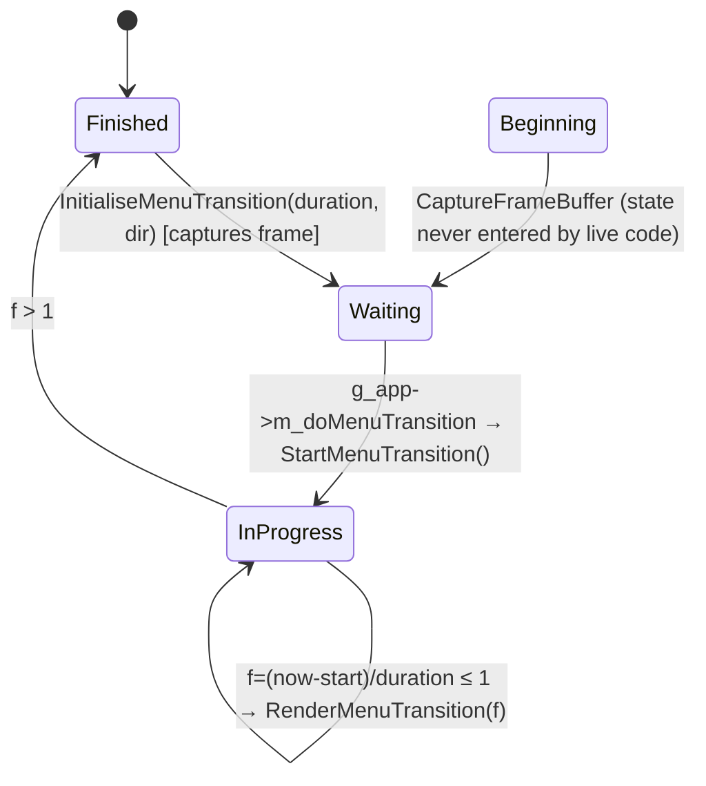
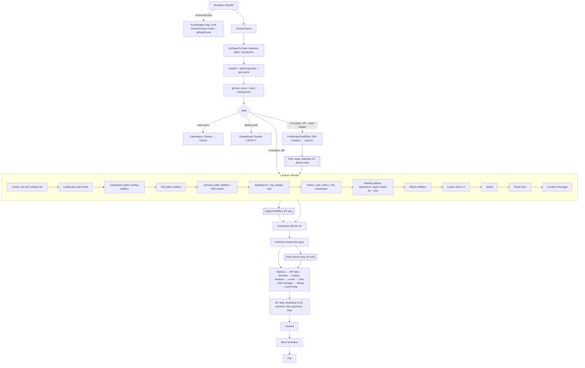

# P12_render_core — Renderer, effects, shapes, textures, text, resources
Scope: `code/renderer.*`, `code/particle_system.*`, `code/explosion.*`, `code/deform.*`, `code/effect_processor.*`, `code/3d_sierpinski_gasket.*`, `code/lib/{shape,3d_sprite,sphere_renderer,render_utils,debug_render,persisting_debug_render,text_renderer,bitmap,texture,texture_uv,resource,shader,FixedPipeline,targetcursor,poster_maker}.*`; plus `data/shaders/*` (deform*, water-meshwaves binding; FixedFunc* briefly — P13 owns the GL→D3D9 layer). Pass table built by reading `code/location.cpp` Render* and its callees (read outside scope, recorded in coverage). Build baseline: see build_matrix.md (`Release|Win32` OpenGL, `TARGET_PC_FULLGAME`). P11 owns landscape/water/clouds internals; P13 owns `lib/opengl_directx*`.

Conventions: GL state names are OpenGL 1.x fixed-function. "Default state" means the state set by `Renderer::SetOpenGLState` at frame start (§24.1.3); each pass is documented as the *delta* it applies and whether it restores. All file paths of assets are relative to `data/`.

<!-- SECTION ORDER: 24.1 backend/frame, 24.2 pass table, 24.3 components, 24.4 shaders, 24.5 style/options, 25 textures/resources, 26 VFX -->

## [→ 26_animation_and_vfx] Particle system

### Ownership and lifecycle
- One global `ParticleSystem` owned by `App` (`g_app->m_particleSystem`), created in `App::App` and emptied on location exit (`App` `m_particleSystem->Empty()`), [C] `code/app.cpp` (construction ~L389, `Empty` ~L1129).
- Storage: `SliceDArray<Particle>` with initial size 1500, step (growth) 200, sliced into `NUM_SLICES_PER_FRAME` (=10, `code/globals.h`) slices. [C] `code/particle_system.cpp:ParticleSystem::ParticleSystem`.
- **Advance** is called from the network client loop once per simulation slice (`ClientToServer::...` → `g_app->m_particleSystem->Advance(g_sliceNum)` immediately after `loc->Advance(g_sliceNum)`, only when not paused) [C] `code/network/clienttoserver.cpp` (~L1977). `ParticleSystem::Advance` does work only when `_slice == 0`, i.e. **once per server advance** (the per-slice path is commented out) [C] `code/particle_system.cpp:ParticleSystem::Advance`. So particles step with `SERVER_ADVANCE_PERIOD` (`g_gameTimer.GetServerAdvancePeriod()`, `code/gametimer.h`).
- **Render** is called once per frame from `Renderer::RenderFrame` after `g_explosionManager.Render()` (see pass table) [C] `code/renderer.cpp:Renderer::RenderFrame`.
- Particles are **not** simulation state: colour choice uses unsynced `frand()`; `CreateParticle` is ignored while `g_app->GamePaused()` [C] `code/particle_system.cpp:ParticleSystem::CreateParticle`, `Particle::Initialise`. [I] They are visual-only and need not be deterministic; creation sites are in sim code, so every peer spawns the same set but with different random colours.

### Particle record
| Field | Type | Meaning |
|---|---|---|
| `m_pos` | Vector3 | world position (world units) |
| `m_vel` | Vector3 | velocity (world units / s) |
| `m_birthTime` | float | `g_gameTimer.GetGameTime()` at creation |
| `m_typeId` | int | `Particle::Type*` |
| `m_size` | float | per-particle size; defaults to type size when `_size == -1` |
| `m_colour` | RGBAColour | lerp between type colours by random `amount=frand()`: `colour1*amount + colour2*(1-amount)`; overridden by explicit `col` argument when non-NULL |
[C] `code/particle_system.h:Particle`, `code/particle_system.cpp:Particle::Initialise`, `ParticleSystem::CreateParticle`.

### ParticleType defaults
`m_spin=0, m_fadeInTime=0, m_fadeOutTime=0, m_life=10.0, m_size=1000.0, m_friction=0, m_gravity=0, m_colour1=(0.5,0.5,0.5), m_colour2=(0.95,0.95,0.95)` [C] `code/particle_system.cpp:ParticleType::ParticleType`. **`m_spin`, `m_fadeInTime`, `m_fadeOutTime` are never read** — the render fade is hard-coded (below) [C] (no reads in `particle_system.cpp`).

### Every particle type (enum order = index) — `Particle::SetupParticles` [C]
| # | Enum | life (s) | size | gravity | friction | colour1 (RGB) | colour2 (RGB) | Special behaviour | Blend pass | Spawned from (files, [C] grep) |
|---|---|---|---|---|---|---|---|---|---|---|
| -1 | `TypeInvalid` | – | – | – | – | – | – | sentinel | – | – |
| 0 | `TypeRocketTrail` | 2.0 | 15.0 | 15.0 | 0.6 | 128,128,128 | 200,200,200 | – | additive | `worldobject/tentacle.cpp`, `wall.cpp`, `weapons.cpp` |
| 1 | `TypeExplosionCore` | 2.0 | 150.0 | 10.0 | 0.2 | 200,100,100 | 255,120,120 | – | additive | `location.cpp`, `worldobject/building.cpp`, `weapons.cpp` |
| 2 | `TypeExplosionDebris` | 6.0 | 40.0 | 20.0 | 0.2 | 200,128,128 | 250,200,200 | each advance, with probability `0.5*SERVER_ADVANCE_PERIOD*10` spawns a `TypeMissileTrail` at its pos with `vel/5`, size `m_size/1.5` | "smoke" (subtractive-ish) | `location.cpp`, `worldobject/lightning.cpp`, `triffid.cpp`, `weapons.cpp` |
| 3 | `TypeMuzzleFlash` | 1.0 | 10.0 | 0.0 | 0.2 | 255,128,128 | 200,100,100 | – | additive | `taskmanager_interface_icons.cpp`, `taskmanager_interface_multiwinia.cpp`, `taskmanager_interface_gestures.cpp`, `location.cpp`, `routing_system.cpp`, `worldobject/{armyant,shaman,officer,virii,randomiser,engineer,harvester,safearea,airstrike,lander}.cpp` |
| 4 | `TypeFire` | 4.0 | 50.0 | -4.0 | 0.0 | 150,50,50 | 150,120,50 | rises (negative gravity) | additive | `worldobject/{tree,lightning,nuke,spam,shaman,crate,meteor,triffid,weapons,rocket}.cpp` |
| 5 | `TypeControlFlash` | 1.0 | 30.0 | -2.0 | 0.0 | 50,50,150 | 50,50,250 | – | additive | `location.cpp`, `gamecursor.cpp`, `taskmanager.cpp`, `worldobject/{incubator,spirit,weapons,darwinian,rocket}.cpp` |
| 6 | `TypeSpark` | 4.0 | 15.0 | 15.0 | 1.5 | 250,200,0 | 250,200,50 | bounces on terrain | additive | `worldobject/laserfence.cpp` |
| 7 | `TypeBlueSpark` | 4.0 | 15.0 | 15.0 | 1.5 | 50,50,200 | 50,70,255 | bounces | additive | `worldobject/{spaceship,controltower,engineer,darwinian}.cpp` |
| 8 | `TypeBrass` | 2.0 | 4.0 | 30.0 | 0.5 | 250,200,0 | 250,200,50 | bounces | additive | `worldobject/insertion_squad.cpp` |
| 9 | `TypeMissileTrail` | 5.0 | 200.0 | 1.0 | 0.0 | 100,100,100 | 200,200,200 | – | "smoke" | `worldobject/{gunturret,spaceship,harvester,portal,armour,weapons,darwinian,rocket,smokemarker}.cpp` |
| 10 | `TypeMissileFire` | 0.5 | 300.0 | 0.0 | 0.0 | 150,50,50 | 150,120,50 | – | additive | `worldobject/{spaceship,harvester,weapons,rocket}.cpp` |
| 11 | `TypeDarwinianFire` | 1.0 | 25.0 | -10.0 | 0.0 | 150,50,50 | 150,120,50 | rises | additive | `worldobject/{darwinian,rocket}.cpp` |
| 12 | `TypeLeaf` | 60.0 | 25.0 | 5.0 | 1.5 | 50,150,50 | 50,200,50 | bounces | additive | `worldobject/tree.cpp` |
| 13 | `TypePlague` | 2.0 | 25.0 | -0.5 | 0.0 | 40,200,40 | 50,200,50 | – | additive | `worldobject/darwinian.cpp` |
| 14 | `TypeHotFeet` | 1.0 | 25.0 | 0.0 | 0.0 | 150,50,50 | 150,120,50 | – | additive | `worldobject/{portal,darwinian}.cpp` |
| 15 | `TypeSelectionMarker` | 0.3 | 10.0 | 0.0 | 0.2 | 255,128,128 | 200,100,100 | – | additive | `gamecursor.cpp`, `worldobject/jumppad.cpp` |
| 16 | `TypeFireball` | 1.0 | 25.0 | 0.0 | 0.0 | 150,50,50 | 150,120,50 | dies on terrain contact | additive | `worldobject/weapons.cpp` |
| 17 | `TypeVolcano` | 12.0 | 400.0 | 10.0 | 0.0 | 150,50,50 | 150,120,50 | dies on terrain contact | additive | `worldobject/eruptionmarker.cpp` |
| 18 | `TypePortalFire` | 2.0 | 50.0 | -4.0 | 0.0 | 100,50,50 | 120,100,50 | rises | additive | `worldobject/portal.cpp` |
| 19 | `TypeNumTypes` | – | – | – | – | – | – | count | – | – |

All particle types share **one texture**: `textures/particle.bmp` (mag filter NEAREST, min filter whatever the resource manager set — see §25) [C] `code/particle_system.cpp:ParticleSystem::Render`. Spin is not applied: billboards are always the same diamond orientation.

### Advance (per server tick, `dt = SERVER_ADVANCE_PERIOD`) [C] `code/particle_system.cpp:Particle::Advance`
1. If `gameTime >= birthTime + life` → remove.
2. `pos += vel*dt`.
3. Friction: `vel *= (1 - dt*friction)` (no clamp; friction 1.5 at dt 0.1 gives ×0.85/tick).
4. Gravity (if `gravity != 0`): `vel.y -= dt * gravity * (m_size / typeSize)` — **gravity scales with relative size** (a particle created with double size falls twice as fast).
5. `TypeFireball`, `TypeVolcano`: remove if `pos.y <= landscape height(pos.x,pos.z)`.
6. `TypeExplosionDebris`: emit a smoke puff as above (flagged `particleCreated`).
7. If no particle was created this step and type ∈ {Spark, Brass, BlueSpark, Leaf} and `pos.y <= height`: snap `pos.y` to terrain height, reflect `vel -= normal * 2 * (normal·vel) * 0.7` (note: the 0.7 restitution multiplies the reflection term, so the reflected normal component is `-0.4×` the incoming one, tangential unchanged) [C].

### Render [C] `code/particle_system.cpp:Particle::Render`, `ParticleSystem::Render`
- Time: `timeNow = gameTime + predictionTime`; particles updated this tick use `g_predictionTime`, ones beyond `GetLastUpdated()` use `g_predictionTime + SERVER_ADVANCE_PERIOD`. Position extrapolated: `pos + predictionTime*vel`.
- Alpha: 90 (of 255) until 75 % of life, then linear to 0 at death: `alpha = 90 - 90*(t - 0.75life)/(0.25life)`.
- Quad: billboard diamond with half-extent `size/16` along camera up and right; vertices `(p-up, uv 0,0)`, `(p+right, 0,1)`, `(p+up, 1,1)`, `(p-right, 1,0)`.
- Two batches inside one texture bind:
  1. **Smoke batch** (`TypeMissileTrail`, `TypeExplosionDebris`), only for particles whose *unpredicted* position passes `Camera::PosInViewFrustum`: blend `GL_SRC_ALPHA, GL_ONE_MINUS_SRC_COLOR`, vertex colour `rgb * alpha/100`, **vertex alpha 0** — with src alpha 0 the source contributes nothing and the destination is multiplied by `(1 - srcColour)`, i.e. the smoke *darkens* what is behind it (dark smoke without alpha sorting).
  2. **Glow batch** (all other types, no frustum test): blend `GL_SRC_ALPHA, GL_ONE` (additive), colour `rgb`, alpha as computed.
- State: `GL_CULL_FACE` off, `GL_BLEND` on, `GL_TEXTURE_2D` on, depth **write off** (depth test stays on), mag filter NEAREST. Restores: depth write on, texture off, mag LINEAR, blend off, blend func default, cull on.

### Pseudocode — particle step
```
for p in particles (only on slice 0):
    if now >= p.birth + T[p.type].life: remove; continue
    p.pos += p.vel*dt
    p.vel *= 1 - dt*T.friction
    if T.gravity: p.vel.y -= dt*T.gravity*(p.size/T.size)
    if p.type in {Fireball,Volcano} and p.pos.y <= H(p.pos.xz): remove
    spawned = p.type==ExplosionDebris and rand() < 0.5*dt*10 and spawn(MissileTrail, p.pos, p.vel/5, p.size/1.5)
    if not spawned and p.type in {Spark,Brass,BlueSpark,Leaf} and p.pos.y <= H:
        p.pos.y = H; n = N(p.pos.xz); p.vel -= n*2*(n·p.vel)*0.7
```

## [→ 26_animation_and_vfx] Explosions (shape shattering)

[C] `code/explosion.h`, `code/explosion.cpp`. Global `ExplosionManager g_explosionManager`. Explosions are **render-side only**: they use wall-clock `g_gameTime`/`g_advanceTime` (`code/main.cpp:UpdateAdvanceTime`, advance clamped to ≤0.25 s) and unsynced `sfrand`/`frand`/`AppRandom`.

### Constants (`#define` in `explosion.cpp`)
| Name | Value | Unit/meaning |
|---|---|---|
| `EXPLOSION_LIFETIME` | 5.0 | s; every triangle and the explosion die together |
| `MAX_INITIAL_SPEED` | 3.0 | multiplier on (triangle centre − fragment centre) |
| `MAX_ANG_VEL` | 4.0 | rad/s range of tumbler angular velocity per axis (`sfrand` → ±4) |
| `ACCEL_DUE_TO_GRAV` | `-GRAVITY` = −10.0 | world units/s² (`code/globals.h` `GRAVITY 10.0`) |
| `INITIAL_VERTICAL_SPEED` | 10.0 | world units/s added to vel.y |
| `MIN_FRAG_LIFE` | 0.0 | fraction (unused, per-triangle random life is commented out) |
| `FRICTION_COEF` | 0.05 | linear drag coefficient (speed-proportional) |
| `ROT_FRICTION_COEF` | 0.2 | angular drag |
| `NUM_TUMBLERS` | 5 | shared rotation matrices per explosion |
| triangle cut-off | circumference < 6.0 | skip small triangles (literal) |
| max triangles | stop after source index `j > 500` | literal |
Legacy commented-out set (Darwinia-era): lifetime 50, speed 0.01, ang vel 0.01, grav 0, vertical 0, min life 0.9.

### Algorithm
`ExplosionManager::AddExplosion(Shape*, transform, fraction=1.0)` → if `fraction > 0` recurse from the root fragment; for each `ShapeFragment` with `m_numTriangles > 0` create one `Explosion`; children use `childTransform = frag.m_transform * parentTransform` [C] `ExplosionManager::AddExplosion`.

`Explosion::Explosion(frag, transform, fraction)`:
1. Allocate 5 `Tumbler`s, each `rotMat = identity`, `angVel = (sfrand(4), sfrand(4), sfrand(4))`.
2. `total = frag.m_transform * transform`; `fragCentreWS = total * frag.m_centre`.
3. For each source triangle `j`: if `fraction < 1` keep with probability `fraction` (`frand(1.0) > fraction` → skip). Colour = colour of the **first vertex** (`m_colours[v1.colId]`). Transform the 3 positions to world space. Skip degenerate (two equal vertices) and small (perimeter < 6.0). Centre `c = (v1+v2+v3)*0.3333`; store vertices relative to `c`; normal `= normalize((v1-v2)×(v2-v3))`, **negated for odd j** (compensates strip winding alternation). `vel = (c - fragCentreWS) * 3.0; vel.y += 10.0`; `pos = c`; tumbler = random of 5; death time = now + 5 s. Stop after `j > 500`.
4. Copy to a flat array.

`Explosion::Advance` (per render frame, `dt = g_advanceTime`): advance tumblers (`rotMat *= Matrix33(angVel*dt)`; `angVel *= 1 - dt*0.2`); per live triangle `pos += vel*dt`; `friction = min(1, |vel|*0.05*dt)`; `vel *= 1-friction`; `vel.y += -10*dt`. Returns finished when `now > timeToDie`. Note: **no ground collision** — triangles fall through terrain [C].

`ExplosionManager::Advance` is skipped while `GamePaused()`; called from the main loop each render frame [C] `code/main.cpp` (main loop, after `m_script->Advance()`).

### Render [C] `ExplosionManager::Render`, `Explosion::Render`
- State: `GL_TEXTURE_2D` on with `textures/shapewireframe.bmp` (mag LINEAR, min LINEAR_MIPMAP_LINEAR), tex env **`GL_DECAL`**; `Renderer::SetObjectLighting()` (lighting + LIGHT0 + LIGHT1, material diffuse 1, spec 0, ambient 0, shininess 127); `GL_COLOR_MATERIAL` on; cull off; blend on with default `SRC_ALPHA, ONE_MINUS_SRC_ALPHA`; depth test/write default (on).
- Per triangle: `glColor4ub(r,g,b,(1-age)*255)` where `age = (5 + now - timeToDie)/5` (0→1), normal = `rotMat*norm`, vertices `rotMat*v + pos`, tex coords (0,0),(0,1),(1,1) — the wireframe texture's edge lines appear along the triangle edges. Restores tex env MODULATE, lighting off, colour material off, cull on, blend off.
- [I] Because GL_DECAL with an RGB(A) texture blends texture over the lit colour by texture alpha, the debris shows bright wire edges over lit facets — the same "wireframe" look as buildings (§24.3 Shape).

## [→ 24_rendering] Deform effect (screen-space distortion) [B:D3D]

Entire file is inside `#ifdef USE_DIRECT3D` [C] `code/deform.h`, `code/deform.cpp`. **Not present in the baseline OpenGL build.**

### Lifecycle
- `g_deformEffect = DeformEffect::Create()` in `CreateD3dPoolDefaultResources()`; deleted in `ReleaseD3DPoolDefaultResources()` (before device reset) [C] `code/lib/opengl_directx.cpp`. `Create` returns NULL if any of the 3 shaders or 2 render targets fail.
- Resources: `m_screenTexture` = render target at screen size, back-buffer format; `m_deformTexture` = render target at **half** screen size, `D3DFMT_A8R8G8B8`; shaders `deform.vs` + `deformFullscreen.ps` / `deformSphere.ps` / `deformDiamond.ps` [C] `DeformEffect::DeformEffect`.
- Per frame (only when `RenderPixelShader > 0` and **not** multiplayer, see pass table): `Start()` before `Location::Render`; `Stop()` after particles. With `STRETCH_RECT` defined (it is), `Start()` is a no-op; `Stop()` copies the back buffer into `m_screenTexture` with `StretchRect` (comment: makes FSAA possible) [C] `DeformEffect::Start`, `Stop`.

### Triggers (who adds deformations) [C]
| Caller | Call | Params | Build |
|---|---|---|---|
| `Location::Bang` (`code/location.cpp` ~L4652, right after `CreateShockwave`) | `AddPunch(pos, range)` | `m_range` forced to 1, `extraDepth` 1, type `DT_PUNCH`; only if `isVisible` (always true — the ray test is commented out) | D3D |
| `SoulDestroyer::Advance` | `AddTearingPath(hist[n-1], hist[n-2], 0.4)` every advance | | D3D |
| `Spider::AdvancePouncing` | `AddTearingPath(oldPos, newPos, 0.25)` | | D3D |
| `Centipede` segment advance | `AddTearing(...,0.3)` | **commented out** | dead |
| `EntityLeg` | `AddTearingSpider(...)` | **commented out** (and the method doesn't exist) | dead |
| Spirits (`Location::m_spirits`, state ≠ `StateAttached`) | drawn every frame as diamond deformers | width 0.32, depth 0.12, redux 1.3 | D3D |

`AddTearingPath(p1,p2,s)`: `n = (int)|p2-p1|` points (one per world unit), `strength *= 0.8`, each point `AddTearing(p2 + (p1-p2)*(i/n), strength)`. `AddTearing`: `range = strength`, `extraDepth = 3`, type `DT_TEAR`. Birth time = `GetTickCount()` (ms, wall clock) [C].

### Deform types
| Type | Table texture (`deformParams`) | Lifetime | width | depth | colour.r (shader "time") | redux |
|---|---|---|---|---|---|---|
| `DT_PUNCH` (0) | `textures/deform36c.bmp` | 1 s | 10 | `0.03*(1-a)^2` (a = age/maxage) | `sqrt(max(a,0.03))` | 0.8 |
| `DT_TEAR` (1) | `textures/deform3.bmp` | 1 s | `10*(maxage-(maxage-age)^2/maxage)` (ease-out 0→10) | `0.15*(1-a)` | `max(a,0.03)` | 0.6 |
| Spirit diamond | `textures/deform1c.bmp` | per frame | 0.32 | 0.12 | `(GetTickCount()%1000)/1000` | 1.3 |
Effective sprite depth passed = `range*extraDepth*depth` [C] `DeformEffect::Stop`.

### Stop() algorithm
1. Depth write/test off, cull off. StretchRect back buffer → `m_screenTexture`.
2. Set render target = `m_deformTexture`, viewport = half-res, clear colour, blend `ONE, ONE` (additive accumulation of displacement vectors).
3. Sort non-attached spirits by squared camera distance, **far-to-near** (`CompareSoulDistance` returns +1 when s1 < s2), render each with `deformDiamond.ps`, sampler `deformSampler` = `deform1c.bmp`.
4. For type in {PUNCH, TEAR}: bind `deformSphere.ps` with that type's table; iterate deformations newest-first; drop expired; render sprite.
5. Blend back to default, disabled. `g_pd3dDevice->Resolve(D3DRESOLVE_RENDERTARGET0, …)` into `m_deformTexture`. [I] `IDirect3DDevice9` on PC has no `Resolve` method and `D3DRESOLVE_RENDERTARGET0` is an Xbox 360 constant: this line would not compile against the PC D3D9 SDK, suggesting the D3D configuration of this tree does not build as-is (or a shim header exists that was not found — grep of `code/` found none) — see Contradictions.
6. Viewport full screen, clear colour, draw one full-screen quad with `deformFullscreen.ps` (samplers: `deformSampler`=`m_deformTexture`, `screenSampler`=`m_screenTexture`). Re-enable cull/depth.
   - [I] The render target is never explicitly reset to `m_oldRenderTarget` after step 2; on PC this would draw the final composite into the deform texture. Unresolved; documented as-is.

`RenderSprite(shader, posWorld, width, depth, redux)` [C]: project `posWorld` with `gluProject` into a unit viewport (0..1); if in front (`z<1`), project a point 1 world unit sideways (perpendicular to look dir in XZ) to get the on-screen size per world unit; `size = min(0.4, 10*|Δ|·(aspect,1))` (default 0.001 if off-screen by more than 1 screen); vertex attributes: `TEXCOORD0 = (sx, 1-sy)` (centre), `TEXCOORD1 = (1/(size*width), size*width*depth*4)` (invSize, height), `COLOR.r = time`; quad corners at clip-space `centre*2-1 ± (size*width, size*width*aspect)*redux`; depth==0 → full-screen quad (−1..1).

Sampler states: deformSampler LINEAR/LINEAR/no mip, U WRAP (time axis), V CLAMP (distance axis); screenSampler LINEAR/LINEAR/no mip, CLAMP/CLAMP. Uniform `aspect = ScreenW/ScreenH` [C] `DeformEffect::RenderSpritesBegin`.

## [→ 24_rendering] Shaders (`data/shaders/`) — all [B:D3D]

HLSL, compiled at runtime with `D3DXCompileShader` using entry points `vs_main` / `ps_main` and the **device's best profile** (`D3DXGetVertexShaderProfile`/`D3DXGetPixelShaderProfile`); `#include` resolved through the resource system under `shaders/` (`MyD3DXInclude`) [C] `code/lib/shader.cpp:Shader::Shader`. `Shader::Create` returns NULL and **raises `AppReleaseAssert`** ("Shader create error") on failure [C] `Shader::Create`. Constants are set through the D3DX constant table by name on both VS and PS tables. Only loaded in the D3D build; the baseline OpenGL build uses no programmable shaders at all [C] (all of `shader.cpp`, `FixedPipeline.cpp`, `deform.cpp`, `water_reflection.cpp` are `#ifdef USE_DIRECT3D`).

| File | Stage | Inputs | Outputs | Uniforms/constants | Effect | Bound by |
|---|---|---|---|---|---|---|
| `globals.h` | include | – | – | `#define DEFORM_PRECISION 10` (higher = less banding but max displacement 1/10 screen) | shared | deform*.ps |
| `deform.vs` | VS | POSITION (clip-space xy), TEXCOORD0 = centre (u,v), TEXCOORD1 = (invSize, height), COLOR.x = time | POSITION = input; COLOR = (centre.x, centre.y, invSize, height); TEXCOORD0.xy = screen UV `(0.5(1+x)+0.0003, 0.5(1-y)+0.0003)` (offset vs Radeon X300 interference), TEXCOORD0.z = time | none | passes per-sprite params via colour interpolator | `DeformEffect` (all 3) |
| `deformSphere.ps` | PS | TEXCOORD0 (uv,time), COLOR (centre, invSize, height) | float4(dx,dy,−dx,−dy) | `sampler deformSampler`, `float aspect` | radial displacement: `dir = uv-centre; dist = |dir·(aspect,1)|; delta = tex(deform,(time, dist*invSize)).x * height/dist * dir * 10`. Signed vector split into positive (xy) and negative (zw) channels so additive blending of unsigned RT works | `DeformEffect::Stop` (punch, tear) |
| `deformDiamond.ps` | PS | same | same; `clip(-1)` where delta==0 | `deformSampler`, `aspect`, unused `noiseSampler` | diamond (L1) distance metric `|dx|*aspect+|dy|`, lookup at `(time, 1-dist*invSize)`, **inward** (negated) displacement | spirits |
| `deformFullscreen.ps` | PS | TEXCOORD0 | colour | `screenSampler`, `deformSampler` | `screen(uv + (d.xy - d.zw)/10)` — pure refraction ("transparent"); commented alternatives: rainbow, darken, darken+brighten | full-screen composite |
| `water-meshwaves.vs` | VS | POSITION, NORMAL, COLOR | TEXCOORD1 = world pos, POSITION = pos·WVP, TEXCOORD0 = (pos+normal)·WVP (reflection coords), COLOR | `float4x4 worldViewProjMatrix` (set to `Renderer::GetTotalMatrix()`), shared `matCameraView` c0, `matCameraViewIT` c4 (unused) | projects water verts; perturbs reflection lookup by vertex normal | `WaterReflectionEffect::Start` (`code/water_reflection.cpp`) |
| `water-meshwaves.ps` | PS (ps_2) | TEXCOORD0, COLOR | COLOR | `sampler water` | `uv = 0.5*(1 - refl.xy/refl.w); uv.y += 0.004` (seam fix); `out = 0.7*col + 0.7*(r+g+b)*tex(water,uv); a = 0.7` | used when ps_3 unavailable |
| `water-meshwaves.ps3` | PS (≥ps_3) | + TEXCOORD1 world pos | COLOR | `water`, `float2 time` (x = seconds `(GetTickCount()%10000000)/1000`, y = small-wave amplitude `0.001*1024/ScreenW`) | adds screen-space ripple `uv += time.y * sin((0.2*pos.yy + pos.xz)*0.25 + time.x*4) / (|ddx(pos.x)|+|ddx(pos.z)|)` | chosen when `D3DXGetPixelShaderProfile` returns `ps_3+` |
| `FixedFunc0.vs` + `FixedFunc0Maps.ps` | VS/PS | POSITION, NORMAL, COLOR | POSITION, TEXCOORD0 = colour | `matProj`, `matWorldView`, `matWorldViewIT`, `bSpecular`, `fogRange(x=end, y=end-start)`, `numLights`, `lights[2]{vDir,vDiffuse,vSpecular}` | untextured fixed-function emulation: up to 2 directional lights (diffuse `N·L`, Blinn specular power 16 if bSpecular), alpha forced 1 when lit; **fog = colour × saturate((end − z)/(end−start)) — fades to black, not to fog colour** | `FixedPipeline::Bind` (P13) |
| `FixedFunc1.vs` + `FixedFunc1Maps.ps` | VS/PS | POSITION, COLOR, TEXCOORD0 | colour × tex(map0) | `matProj`, `matWorldView`, `fogRange` (no lighting) | 1 texture stage | `FixedPipeline::Bind` |
| `FixedFunc2.vs` + `FixedFunc2Maps.ps` | VS/PS | + TEXCOORD1 | colour × tex(map0) × tex(map1) | as above + unused `fogColour` | 2 texture stages modulate | `FixedPipeline::Bind` |

FixedPipeline selection: `shader = FixedFunc[tex0 ? (tex1 ? 2 : 1) : 0]` from `glIsEnabled(GL_TEXTURE_2D)` on units 0/1; lights counted only if `m_lighting && m_lightEnabled[0]` (+1 if light 1); fog range `(end, end-start)` or `(100000, 1000)` when fog off; textured shaders ignore lighting [C] `code/lib/FixedPipeline.cpp:FixedPipeline::Bind`. [I] Textured+lit geometry (explosion debris, lit textured shapes) therefore renders **unlit** under D3D.

## [→ 24_rendering] 24.1 Renderer object, initialisation and per-frame skeleton

### Renderer singleton [C] `code/renderer.h:Renderer`, `code/renderer.cpp:Renderer::Renderer`
| Member | Initial value | Meaning |
|---|---|---|
| `m_fps` | 60 | frames counted in the last wall-clock second (`FPSMeterAdvance`) |
| `m_displayFPS` | true, **forced false under `TARGET_PC_FULLGAME`** | FPS / entity-count overlay |
| `m_renderDebug` | false | unused flag in this partition |
| `m_displayInputMode` | false | "InputMode: keyboard/gamepad" debug box |
| `m_renderingPoster` | `PosterMakerInactive` | poster/screenshot state (enum `PosterMakerInactive, PosterMakerTiling, PosterMakerPixelEffect`) |
| `m_lastFrameBufferTexture` | -1 | GL texture holding the captured frame for menu transitions |
| `m_renderDarwinLogo` | -1.0 | start time (s) of the 10 s "research associates" logo overlay; <0 = off |
| `m_gamma` | 1.2 | only used by `SetScreenGamma` [B:D3D]; **never called** (grep) → unused |
| `m_nearPlane`, `m_farPlane` | 5.0, 150000.0 | overwritten every frame (see below) |
| `m_screenW/H` | prefs | back-buffer size in pixels |
| `m_texCoordW/H` | 0 | UV extent of captured frame inside a power-of-two texture |
| `m_tileIndex` | 0 | current poster tile |
| `m_totalMatrix[16]` | – | modelview×projection cache (double) for `Get2DScreenPos` |
| `m_fadedness`, `m_fadeRate`, `m_fadeDelay` | 0,0,0 | full-screen black fade (1 = black) |
| `m_pixelEffectTexId` | `glGenTextures` in `BuildOpenGlState` | pixel-effect grab texture |
| `m_pixelEffectGrid[16][16]` | – | per-cell nearest depth (1e9 = unused) |
| `m_pixelSize` | 256 | pixel-effect off-screen render size (px, square) |
| `m_menuTransition*` | Finished | menu slide transition state machine |

### Initialise [C] `Renderer::Initialise`
1. Read prefs: `ScreenWidth` (0), `ScreenHeight` (0), `ScreenWindowed` (0), `ScreenColourDepth` (32), `ScreenRefresh` (75), `ScreenZDepth` (24), `WaitVerticalRetrace` (1). `ScreenOverscan` is hard-coded to 0 (pref read commented out).
2. If width and height are both 0 → `WindowManager::SuggestDefaultRes` and save them.
3. `GetClosestResolution`, then `CreateWin(w,h,windowed,colourDepth,refresh,zDepth, waitVRT=true(literal), antiAlias/flag true, "Multiwinia")`. Note the first attempt passes literal `true` for the vsync argument, not the pref [C].
4. Fallback chain on failure: show a `MessageDialog` "Failed to set requested screen resolution…", retry with suggested default res, zDepth 24, vsync 0 → retry `800×600 windowed, 16-bit colour, 16-bit Z, 60 Hz` → retry with 24-bit Z → `AppReleaseAssert("Failed to set screen mode")`.
5. Write back all screen prefs, `ScreenOverscan=0`, `Save()`. `InitialiseOGLExtensions()` (P13) and `BuildOpenGlState()` (allocates the pixel-effect texture name).
App start then calls `SetOpenGLState()` and `BitmapRGBA::SetMaxTextureSize(GL_MAX_TEXTURE_SIZE)` [C] `code/app.cpp:App::App` (~L221-231).

### Baseline GL state (`Renderer::SetOpenGLState`, called at the start of every `RenderFrame`) [C]
| Group | State |
|---|---|
| Geometry | cull **on**, front face CCW, polygon mode FILL/FILL, **shade model FLAT**, normalize off |
| Colour | colour material off, `glColorMaterial(FRONT_AND_BACK, AMBIENT_AND_DIFFUSE)` |
| Lighting | lighting off; LIGHT0–7 off; `Location::SetupLights()` (or `GlobalWorld::SetupLights`); global ambient (0,0,0,0) |
| Blend | blend off, func `SRC_ALPHA, ONE_MINUS_SRC_ALPHA`; alpha test off, func `GREATER 0.01` |
| Fog | `Location::SetupFog()` (linear, density 1, start = fogEnd/3, end = max(4000, worldSizeX+1000, worldSizeZ+1000), colour = background colour, alpha 0) then fog **off** |
| AA | line smooth off, point smooth off |
| Texture | texture2D off; wrap S/T `GL_CLAMP` (on the currently bound texture); env MODULATE, env colour 0 |
| Framebuffer | depth test on, depth mask on, depth func LEQUAL, scissor off |
| Hints | fog hint DONT_CARE, polygon smooth hint DONT_CARE |
`CheckOpenGLState` asserts this baseline when `OPENGL_DEBUG_ASSERTS` is defined (not in any target) [C] `code/renderer.h`.

### Lighting model [C] `code/location.cpp:Location::SetupLights`, `SetupSpecialLights`, `code/renderer.cpp:Renderer::SetObjectLighting`
- Level-defined directional lights `Location::m_lights` (from the level file, P-agent for level files): light *i* → `GL_LIGHT0+i`, position `(normalised front, w=0)` (directional), diffuse = specular = `m_colour[0..3]`, ambient black. LIGHT1 is first zeroed (direction (0,0,-1), black). Christmas mode (`Location::ChristmasModEnabled`) overrides colour to (1.3,1.2,1.2).
- Only LIGHT0 and LIGHT1 are ever enabled (`SetObjectLighting`, landscape) → **max 2 effective lights**; FixedPipeline also supports only 2 [C].
- `SetObjectLighting`: material specular 0, diffuse 1, ambient 0, shininess 127; enable lighting + LIGHT0 + LIGHT1.
- Special lighting (`SetupSpecialLights`): one light from `normalise(0,1,0.5)`, diffuse=specular `(2.0,1.5,0.75)`, material specular 1, shininess 10. Enabled in `RenderBuildings` when pref `RenderSpecialLighting==1`, **or game type is Rocket Riot**, or the level has `LevelEffectSpecialLighting`, or Prologue.
- [I] Lights are specified (in `SetOpenGLState`) before `SetupMatricesFor3D`, so their direction is transformed by whatever modelview was current (the previous frame's camera matrix restored by `EndText2D`); with a slowly moving camera this is visually indistinguishable. A new engine should specify world-space light directions explicitly.
- No shadows of any kind exist in this partition or the passes it calls [C] (no stencil, no shadow maps; `glStencilMask` commented out).

### Matrices, viewport, aspect [C] `Renderer::SetupProjMatrixFor3D`, `SetupMatricesFor3D`, `SetupMatricesFor2D`, `code/camera.cpp:Camera::SetupModelviewMatrix`, `Camera::SetupProjectionMatrix`
- Per frame: if `m_locationId == -1` (main menu / global world) near=50, far=10 000 000; else near=5, far=15 000 (world units) [C] `RenderFrame`.
- Projection: `gluPerspective(camera FOV (vertical, degrees, clamped 1..180), screenW/screenH, near, far)`. Poster tiling uses `glFrustum` on a sub-rectangle: `scale = fov/78`, `left = -scale*near`, `top = -(H/W)*scale*near`, tile size `2|left|/N × 2|top|/N`, tile `(x,y) = (idx % N, idx / N)`.
- Modelview: `gluLookAt(pos, pos + front*|pos|, up*|pos|)`.
- Depth-bias trick: lasers re-set the projection with **near × 1.2** and Virii with **near × 1.05** (same far) so they win depth ties against terrain; restored afterwards [C] `Location::RenderWeapons`, `code/team.cpp:Team::RenderVirii`.
- 2D: `SetupMatricesFor2D` = identity modelview, `gluOrtho2D(vx, vx+vw, vy+vh, vy)` (y down, pixel units). Text uses its own ortho offset by −0.325 px for texel alignment [C] `TextRenderer::BeginText2D`.
- Aspect: always derived from window size; no letter-boxing, no fixed virtual resolution in the 3D path. UI code scales by `ScreenW/1280` (e.g. `Location::RenderCurrentMessage`, `RenderChatMessages`) [C].
- `Renderer::Clip(x,y,w,h)` projects two points with `Camera::Get2DScreenPos` and enables `GL_SCISSOR_TEST`; `EndClip` disables it [C].
- `Get2DScreenPos` multiplies by the cached `m_totalMatrix` (row-vector convention), divides by w, maps to `[0,W]×[0,H]`, z = w; returns early (output untouched) when w ≤ 0 [C].

### Frame entry `Renderer::Render` [C]
- If `ControlCreateScreenShot` fires and no Eclipse windows are open → poster path: `N = pref RenderPosterResolution (default 1)`; if N>1 set `PosterMakerTiling`; for N×N tiles: `RenderFrame(false)` (no flip), `PosterMaker::AddFrame()` (glReadPixels RGB), `Flip`; then `SavePoster()`. Else `RenderFrame()`.
- Profiler `RenderStarted/RenderEnded` bracket. `TARGET_OS_VISTA` thumbnail save [B:DEAD].

### Fade, pause, logo, transitions [C]
- **Fade** (`RenderFadeOut`, drawn every frame unless `IsFirsttimeSequencing()`): its own static wall-clock timer, dt clamped to 0.05 s; `m_fadeDelay` counts down first; then `m_fadedness += m_fadeRate*dt`, clamped 0..1 (rate cleared at the limits). `StartFadeOut`: rate +1/s, no delay. `StartFadeIn(delay)`: fadedness 1, rate −1/s. Draws a black quad with alpha `fadedness*255` (blend default, depth test/write off). `IsFadeComplete` ⇔ rate ≈ 0.
- **Paused banner** (`RenderPaused`): only if no Eclipse windows and (`gameMode != Multiwinia` and window unfocused) or `m_userRequestsPause`; "PAUSED" (literal English, not localised) centred at (W/2, 0.4H), size 80, outline pass (colour (1,1,1,0)) then white.
- **Darwin logo** (`m_renderDarwinLogo ≥ 0`): `icons/darwin_research_associates.bmp`, square h=0.7H at y=0.05H, alpha ramps 0→1 over 3 s, holds to 8 s, ramps down to 10 s; drawn as 9 offset copies (±4 px) with `SRC_ALPHA, ONE_MINUS_SRC_COLOR` (dark halo) then one additive copy; caption `launchpad_logo_1` at 0.8H size H/9 [B:LEGACY] (set by Darwinia-era scripts [I]).
- **Private-demo logo** (`RenderLogo`) only under `PROMOTIONAL_BUILD` (never defined) [B:DEAD]; `RenderFlatTexture` commented out [B:DEAD].
- **Menu transition** (state machine, `AdvanceMenuTransition` runs just before every `Flip`):

  `CaptureFrameBuffer`: one GL texture (NEAREST, CLAMP), `glCopyTexImage2D(GL_RGB)` of the back buffer at screen size, or at `nearestPowerOfTwo(W)×nearestPowerOfTwo(H)` when `RequirePowerOfTwoTextures()`; `m_texCoordW/H = min(1, W/pow2(W))`. `RenderMenuTransition(f)`: `fraction = f*1.2*3`; the quad shrinks inward by `0.2*fraction*dir` of W/H on each side and slides left by `W*fraction^6*dir`; alpha `max(0, 1-0.2*fraction)`; a 20 px black→transparent gradient strip is drawn at the right edge; texture sampled LINEAR; V coordinates flipped under D3D (`d3dOneMinus`) [C].

## [→ 24_rendering] 24.2 Frame composition — ordered pass table

Scope of the table: one frame of `Renderer::RenderFrame` while **in a Multiwinia match** in the baseline build; branches for other states are listed after. "Default" = baseline state of §24.1; a cell lists only what the pass changes. "Restores" = the pass returns the listed state to default before exiting. Owner column names the partition that specifies the drawn content in detail.

| # | Pass | Function ref | What is drawn | Blend | Depth test / write | Cull | Alpha test | Fog | Lighting | Texture / env / filter / wrap | Other (shade, poly, line, matrices) | Owner |
|---|---|---|---|---|---|---|---|---|---|---|---|---|
| 0 | State reset | `Renderer::SetOpenGLState` | – | sets default | on / on, LEQUAL | on (CCW) | off (GREATER 0.01) | configured, off | lights configured, off | off, MODULATE, CLAMP | FLAT, FILL | P12 |
| 1 | Camera | `Renderer::RenderFrame` → `FPSMeterAdvance`, `SetupMatricesFor3D` | – | – | – | – | – | – | – | – | perspective (fov, W/H, 5, 15000), lookAt | P12 |
| 2 | Clear | `RenderFrame` | colour+depth clear to `g_app->m_backgroundColour` (no location: (0.05,0,0.05,0.1)) | – | – | – | – | – | – | – | – | P12 |
| 3a | Sky grid | `Location::Render` → `RenderClouds` → `Clouds::RenderSky` | grid of thin textured quads at sky height | `SRC_ALPHA, ONE` additive | on / **off** | on (disable commented out) | off | **on**, start 2000, end 4000, colour per clouds | off | `textures/laser.bmp` | colour (0.5,0.5,1.0,0.3) | P11 |
| 3b | Blobby clouds | `Clouds::RenderBlobby` | 1–3 large quads (by `RenderCloudDetail`) | additive | **off / off** | default | off | on 2000–5000 | off | `textures/clouds.bmp` no-mip, MAG LINEAR, MIN NEAREST, REPEAT | colour (0.7,0.7,0.9,0.6); restores fog via `SetupFog` | P11 |
| 3c | Flat clouds | `Clouds::RenderFlat` | 1–2 scrolling quads | additive | off / off | default | off | on 2000–5000 | off | `clouds.bmp` NEAREST/NEAREST, REPEAT | colour (0.7,0.7,0.9,0.3) (0.5 at detail 3) | P11 |
| 3d | Cloud face | `Clouds::RenderFace` | timed face image in the clouds (5–30 s after trigger) | P11 | | | | | | | | P11 |
| 4a | Landscape main | `RenderLandscape` → `LandscapeRenderer::Render` → `RenderMainSlow` or display list | terrain triangle strips (vertex/normal/colour arrays or VBO) | off (negative mode: `SRC_ALPHA, ONE_MINUS_SRC_COLOR`) | on / on | on | off | **on** (`SetupFog`) | **on**, LIGHT0+1, COLOR_MATERIAL, material spec 0, amb+diff 1, shininess 100 | off | FLAT shading → faceted terrain | P11 |
| 4b | Landscape overlay | `LandscapeRenderer::RenderOverlaySlow` | same mesh again with triangle-outline texture → glowing wire grid | `SRC_ALPHA, ONE` (negative: ONE_MINUS_SRC_COLOR) | on / **off** | on | off | on | on, material spec 0.5, amb+diff 1.2, shininess 40 | `textures/triangleOutline.bmp` mip, LINEAR/LINEAR_MIPMAP_LINEAR, **REPEAT** | restores CLAMP, fog off at end of landscape | P11 |
| 5a | Flat water | `RenderWater` → `Water::Render` → `RenderFlatWater` | big flat water tiles | off (negative: ONE_MINUS_SRC_COLOR) | on / **off** | **off** | off | on | off | unit0 water texture REPEAT MODULATE; unit1 landscape lightmap `COMBINE_EXT/MODULATE` | multitexture | P11 |
| 5b | Dynamic water | `Water::RenderDynamicWater` (if `RenderWaterDetail > 0`; under D3D only if HW vertex processing) | wave mesh strips with vertex colours | `SRC_ALPHA, ONE` | on / on | on | off | on | off | none in GL; [B:D3D] `water-meshwaves` shader samples the reflection RT | `SetupFog` re-applied | P11 / P12 (shader) |
| 6 | Buildings (solid) | `Location::RenderBuildings` → `Building::Render` → `Shape::Render` | every in-view building's .shp mesh; subclasses add their own extras | off | on / on | on | off | **on** | `SetObjectLighting` (LIGHT0+1, diffuse 1, spec 0, shininess 127) or `SetupSpecialLights`; [B:D3D] FixedPipeline specular true | off (subclasses may bind) | `GL_COLOR_MATERIAL` on inside `Shape::Render`; push/mult/pop modelview per shape; display lists | P12 (shape) + worldobject agents |
| 7a | Units | `RenderTeams` → `Team::Render` (×6 teams) → `Unit::Render` | squads etc. | on (default func) | on / on | default | **on, GREATER 0.02** | off | per-entity | **on**, MAG LINEAR, MIN LINEAR_MIPMAP_LINEAR (no bind) | – | worldobject agents |
| 7b | Other entities | `Team::RenderOthers` → `Entity::Render` | all non-Darwinian, non-Virii entities (engineers, armour, officers, centipedes, …) | per entity | | | | | | | | worldobject agents |
| 7c | Virii | `Team::RenderVirii` | tail-sprite strips per Virii, LOD 1–4 by `RenderEntityDetail` and distance | additive; **monster team: `SRC_ALPHA, ONE_MINUS_SRC_COLOR`** | on / **off** | **off** | default | off | off | `sprites/viriifull.bmp` LINEAR/LINEAR_MIPMAP_LINEAR | projection near×1.05 | worldobject |
| 7d | Darwinians | `Team::RenderDarwinians` | camera-facing sprites, `highDetail = clamp(1 - d²/D², 0, 1)` with D = 99999.9 / 1000 / 500 for detail ≤1 / 2 / ≥3 | on (default func) | on / on | **off** | **on, GREATER 0.04** | off | off | `sprites/darwinian.bmp` LINEAR/LINEAR_MIPMAP_LINEAR | – | worldobject |
| 7e | Sync-error markers | `Team::RenderSyncErrors` → `SyncDiff::Render` | desync debug markers | | | | | | | | | P-network |
| 8 | Building alphas | `Location::RenderBuildingAlphas` → `Building::RenderAlphas` | non-sorted first (default: `RenderLights` + `RenderPorts`), then buildings whose `PerformDepthSort` is true, **far-to-near** by squared distance | per building; lights/ports: additive | ports/lights: on / **off** | off for lights/ports | off | **on** for the whole pass | off | lights/ports: `textures/starburst.bmp` mip | `RenderLights`: 10 nested camera-facing quads of half-size `6*i/10`, team colour, shown only when `(lastValidSequenceId % 10)/2 == teamId` (team-staggered blink) | P12 (sort) + worldobject |
| 9 | Particles (location) | `Location::RenderParticles` | **empty function** | | | | | | | | | – |
| 10a | Effects | `Location::RenderWeapons` (part 1) | all `m_effects` world objects (shockwaves, explosions-as-effects, lightning, pulse waves, spam infection, …) in view (PulseWave, SpamInfection, Lightning always) | `SRC_ALPHA, ONE` | on / **off** | **off** | default | off | off | per effect | – | worldobject |
| 10b | Lasers | `RenderWeapons` (part 2) → `Laser::Render` | laser bolt quads (one glBegin for all) | additive | on / off | off | default | off | off | `textures/laser.bmp` **no mip** (min filter left LINEAR_MIPMAP_LINEAR from upload → [I] see 25.2) | `GL_LINE_SMOOTH` on (irrelevant to quads); projection near×1.2 | worldobject |
| 11 | Spirits | `Location::RenderSpirits` → `Spirit::RenderWithoutGlBegin` | untextured inner/outer quads per spirit; monster-team spirits first | monster: `SRC_ALPHA, ONE_MINUS_SRC_COLOR` (dark); others additive | on / **off** | **off** | default | off | off | off | inner/outer size 1.0/3.0 (×0.5 in Multiwinia), alpha 255/100 (halved in MP) | worldobject |
| 12 | Route lines | `RoutingSystem::Render` | player route preview lines fading at 0.25/s | on (default func) | **off** / on | default | default | off | off | per line | line width 1 | P-routing |
| 13 | Location message | `Location::RenderCurrentMessage` | large centred caption (40 px, scaled to fit, grows by `sqrt(2-t)*15` in the last 2 s) at y = 370·W/1280, team-coloured, outline pass first | text (see 24.3 Text) | 2D | | | | | font | `BeginText2D/EndText2D` | P12 (text) / P-location |
| 14 | Explosion debris | `ExplosionManager::Render` | shattered triangles | default func | on / on | **off** | off | off | **on** (`SetObjectLighting`) + COLOR_MATERIAL | `textures/shapewireframe.bmp` mip, **GL_DECAL** | restores MODULATE | P12 |
| 15 | Particles | `ParticleSystem::Render` | smoke batch then glow batch | smoke: `SRC_ALPHA, ONE_MINUS_SRC_COLOR`; glow: `SRC_ALPHA, ONE` | on / **off** | **off** | default | off | off | `textures/particle.bmp`, MAG **NEAREST** (restored LINEAR) | billboards | P12 |
| 16 | Markers | `MarkerSystem::Render` | off-screen/on-screen location markers and labels | default func | per marker | off | | | | | `SetupMatricesFor3D` then 2D | P-UI |
| 17 | Multiwinia help | `MultiwiniaHelp::Render` | tutorial/help overlays, animated panel | default func | 2D | off | | | | | line width 8 / 2; `SetupMatricesFor2D/3D` | P-UI |
| 18 | Shaman interface | `ShamanInterface::Render` | shaman summon icons | text 2D | | | | | | | `BeginText2D` | P-UI |
| 19 | Eclipse windows | `UserInput::Render` → `EclRender()` | all menus/dialogs/lobby windows | on | **off / off** | off | | | | | `g_editorFont.BeginText2D` ortho | P-UI |
| 20 | Game cursor | `GameCursor::Render`, `RenderBasicCursorAlwaysOnTop` → `MouseCursor::Render` | 3D selection arrows/markers then the 2D mouse pointer (dark-halo pass `SRC_ALPHA, ONE_MINUS_SRC_COLOR` + additive pass); one sub-pass uses `GL_ONE, GL_SRC_COLOR` | as listed | off write | off | | | | cursor bitmaps (P-UI) | switches 2D/3D matrices, changes projection | P-UI |
| 21 | Chat | `Location::RenderChatMessages` (only when `renderChat`) | chat log, "press to talk" hint, 60 s life with 5 s fade from 55 s | text | 2D | | | | | font | `g_editorFont` | P-UI |
| 22 | Camera debug | `Camera::Render` | **empty** (arrow/sphere commented out) | | | | | | | | | – |
| 23 | Task manager | `TaskManagerInterface::Render` (Multiwinia variant) | crate/power-up icons, gestures | on | 2D | off | | | | | `BeginText2D` | P-UI |
| 24 | Persistent debug | `g_debugRenderer.Render()` [`DEBUG_RENDER_ENABLED`, on in all targets] | queued debug squares/markers/spheres/vectors (normally empty) | per item | | | | | | | | P12 |
| 25 | Control help | `ControlHelpSystem::Render` | contextual key/button hints | on | 2D | off | | | | | `BeginText2D` | P-UI |
| 26 | 2D block start | `g_editorFont.BeginText2D()` | – | on | off / off | off | | | lighting off | | ortho | P12 |
| 27 | Fade | `Renderer::RenderFadeOut` | black quad | default func | off/off | | | | | | | P12 |
| 28 | Match HUD | `Multiwinia::Render` (in location, not editing, not main menu, gameMode Multiwinia) | scores, timers, game-mode HUD | default func | 2D | | | | | | | P-multiwinia |
| 29 | Text overlays | `RenderFrame` | FPS (off in FULLGAME), version string (hidden in location in FULLGAME), `GameTimer::DebugRender` (returns immediately), input-mode box, editor banner, **sync-error banner** (`multiwinia_error_syncerror`, red, y=130, size 30) when any client is out of sync, **lost-connection banner** (`multiwinia_error_lostconnection`, y=170) when >5 s since last server letter (MP only) | text | 2D | | | | | | | P12 |
| 30 | Start sequence | `StartSequence::Render` | [I] intro/start caption effect (content owned by P-UI) | additive, line smooth | toggles | off | | **on** | off | | `SetupMatricesFor3D` | P-UI |
| 31 | Logo | `m_renderDarwinLogo` block | see 24.1 | | | | | | | | | P12 [B:LEGACY] |
| 32 | 2D block end | `g_editorFont.EndText2D()` | restores matrices; depth on, cull on, blend off | | | | | | | | | P12 |
| 33 | Paused | `RenderPaused` | "PAUSED" | text | | | | | | | | P12 |
| 34 | Transition + present | `AdvanceMenuTransition`, `WindowManager::Flip` | captured-frame slide | default func | off/off | off | | | | captured frame LINEAR CLAMP | 2D then 3D | P12 |

### Branches that replace passes 3–13
| Condition | Replacement | Build |
|---|---|---|
| `m_atMainMenu && m_gameMenu->m_menuCreated` | `GameMenu::Render`: fixed camera at (0,600,0), FOV 90, looking along a rotated front (`RotateAroundY(-1.899)`, `RotateAroundZ(-1.079)`), renders `m_clouds->Render(-wallTime)` (menu background sky); windows come from pass 19 | [B:FULL] |
| `m_editing` | `Location::Render` + `LocationEditor::Render` under `LOCATION_EDITOR`; or `GlobalWorld::Render` | [B:EDITOR] |
| `m_locationId == -1` (not menu) | `GlobalWorld::Render` (global internet + sphere world) | [B:LEGACY] [I] (Darwinia world map) |
| `RenderPixelShader > 0 && !Multiplayer()` | pixel-effect path: `PreRenderPixelEffect`; [D3D] `PreRenderWaterReflection` (if `RenderWaterEffect`), `DeformEffect::Start`; second colour+depth clear; `Location::Render`; `ApplyPixelEffect`; `SetupMatricesFor3D`; [D3D] `DeformEffect::Stop` after pass 15 | **[B:LEGACY]** — `App::Multiplayer()` ≡ `m_gameMode == GameModeMultiwinia` [C] `code/app.cpp:App::Multiplayer`, so this never runs in a Multiwinia match |
| poster tiling | `Location::Render` + `ApplyPixelEffect` per tile | dev |

Consequence [C]+[I]: in every Multiwinia match the **pixel effect, the D3D deform effect and the D3D water-reflection pre-render are all skipped**. Under D3D, `Water::RenderDynamicWater` still binds the `water-meshwaves` shader whenever `RenderWaterEffect && RenderPixelShader` (`code/water.cpp:Water::Render`), so it samples a reflection texture that is never re-rendered in Multiwinia (contents undefined) — see Contradictions.

### Pipeline diagram


## [→ 24_rendering] 24.3 Pixel effect (screen-space "pixelation" glow) [B:LEGACY in Multiwinia; code live]

[C] `Renderer::PreRenderPixelEffect`, `PaintPixels`, `ApplyPixelEffect`, `RasteriseSphere`, `MarkUsedCells`; `USE_PIXEL_EFFECT_GRID_OPTIMISATION` = 1 in both GL and D3D.
1. `UpdateTotalMatrix` (MV×P cache); reset 16×16 grid to 1e9.
2. "Blend old" block: binds the effect texture, enters/leaves 2D but the quad draw is commented out (dead residue).
3. `glViewport(0,0,256,256)`; for each team, units of type `TypeInsertionSquadie` or `TypeCentipede` in view within 1000 units of the camera: `entity->RenderPixelEffect(t)`; every team's `m_others` in view within 1000; every building within 1000 (`m_centrePos`). Each `RenderPixelEffect` override draws the object normally (into the small viewport) and calls `Renderer::MarkUsedCells(shape, transform)` which recursively, for each fragment whose bounding sphere is in the frustum and has radius > 0, rasterises its screen-space bounding square into the grid storing the nearest depth `centre.z - radius`. Overrides exist in [C grep]: `worldobject/{centipede,tank,insertion_squad,tentacle,officer,sporegenerator,entity_leg,engineer,souldestroyer,harvester,triffid,researchitem,spider}.cpp`, plus `meteor.cpp` calls `MarkUsedCells`. `Squadie::RenderPixelEffect` returns false in Multiplayer [C].
4. Restore viewport; `glCopyTexImage2D(GL_RGBA, 0,0, 256,256)` into `m_pixelEffectTexId` (NEAREST, CLAMP). `m_pixelSize` adaptation (128/256/512 by nearest distance) is commented out — fixed 256.
5. After `Location::Render`, `ApplyPixelEffect`: blend on, cull off, depth write off, depth test **on**, 3D projection with identity modelview; `PaintPixels` draws, for each used grid cell, a quad placed at the cell's stored depth in eye space (`z = -distance`, x/y scaled by distance, `scale = (0.017 + 0.000037*fov)*fov`, `step = scale*aspect/16`, skip rows beyond `ceil(16/aspect)`), textured with the matching region of the 256² capture. Four passes:

| Pass | MAG filter | Blend | Colour |
|---|---|---|---|
| 1 "additive blocky" | NEAREST | `SRC_ALPHA, ONE` | (1,1,1,1) |
| 2 "subtractive smooth" | LINEAR | `SRC_ALPHA, ONE_MINUS_SRC_COLOR` | (1,1,1,0) |
| 3 "subtractive smooth" | LINEAR | `SRC_ALPHA, ONE_MINUS_SRC_COLOR` | (1,1,1,0.2) |
| 4 "additive smooth" (labelled; actually NEAREST) | NEAREST | `SRC_ALPHA, ONE` | (1,1,1,0.9) |
Result: a blocky low-resolution additive ghost image of selected units overlaid at their depth (the "pixelated" look of Darwinia's soldiers). Two debug overlays exist behind `if (0)` [B:DEAD].

## [→ 24_rendering] 24.4 Visual style, graphics options, budgets

### How the look is produced [C] unless marked
- **Flat polygons**: `glShadeModel(GL_FLAT)` globally; `.shp` fragments carry **one normal per triangle** (`ShapeFragment::GenerateNormals`, face normal from `(b-a)×(c-b)`, normals in the file are parsed and then discarded); colours are per-vertex but flat shading takes the provoking vertex. [I] In OpenGL the provoking vertex of `GL_TRIANGLES` is the **last** vertex, in D3D9 flat shading it is the **first** — a triangle whose vertices have different colours renders differently in the two builds (explosion debris explicitly uses vertex 1's colour). New engine: bake one colour per triangle.
- **Shape colour attenuation**: every colour read from a `.shp` is multiplied by 0.85 at load; team conversion multiplies again by 0.7 (`Entity::ConvertFragmentColours`), armour by 0.1 (`code/worldobject/armour.cpp:ConvertShapeColours`) — "colours on 3d models appear brighter than 2d equivalents due to lighting".
- **Additive glow**: nearly every non-solid element uses `SRC_ALPHA, ONE` (sky grid, clouds, landscape outline, dynamic water, effects, lasers, spirits, particles, building lights/ports, text). Additive layers saturate toward white where they overlap; depth writes are off for all of them so draw order among them is irrelevant.
- **Dark/"negative" layers** use `SRC_ALPHA, ONE_MINUS_SRC_COLOR` with source alpha 0: result = `dst × (1 − srcRGB)` — a multiplicative darkening without needing sorted alpha. Used for smoke particles, monster-team Virii/spirits, text outlines and shadows, cursor halos, logo halos, pixel-effect passes 2–3.
- **Wireframe edges**: textures with bright edge lines (`textures/triangleOutline.bmp` on terrain with REPEAT so each terrain triangle shows its outline; `textures/shapewireframe.bmp` on explosion debris with DECAL).
- **Background/fog**: clear colour and fog colour = `App::m_backgroundColour` (level-defined; white in `RenderNegative` mode) [C] `code/app.cpp` ~L345; linear fog from `fogEnd/3` to `fogEnd = max(4000, worldSize+1000)`.
- **Team palette**: team colours come from `Team::m_colour` (lobby colour ids 0–7 named green, red, yellow, blue, orange, purple, cyan, pink — `code/team.cpp:Team::GetTeamName`); shapes are recoloured only where the source colour is "mostly red" (`r > 2g && r > 2b`) unless `convertAll` [C] `Entity::ConvertFragmentColours`. Green team (colourId 0) Darwinian shape is darkened ×0.5 [C] `Entity::ConvertShapeColoursToTeam`.
- **Negative renderer** (pref `RenderNegative`, default 0): background white, landscape/water switch to darkening blends [C] `code/app.cpp`, `landscape_renderer.cpp`, `water.cpp` — an undocumented alternative look.

### Graphics options (preferences) and their effect
| Pref key | Default | UI | Values | What it changes | Ref |
|---|---|---|---|---|---|
| `ScreenWidth`/`ScreenHeight` | 0 → suggested | screen options | px | back buffer, aspect | `Renderer::Initialise` |
| `ScreenWindowed` | 0 | yes | 0/1 | window mode; toggling recreates the renderer and calls `Resource::FlushOpenGlState`+`RegenerateOpenGlState` | `code/interface/prefs_screen_window.cpp` |
| `ScreenColourDepth` | 32 | | bits | pixel format | `Renderer::Initialise` |
| `ScreenRefresh` | 75 | `HAVE_REFRESH_RATES` | Hz | mode | same |
| `ScreenZDepth` | 24 | | 16/24 | depth buffer | same |
| `WaitVerticalRetrace` | 1 (`data/default_preferences.txt` sets 0) | | 0/1 | written back but the first `CreateWin` call passes literal `true` | same |
| `RenderLandscapeDetail` | 1 | **commented out of the menu** | 1–4 | reads replaced by literal 1 in `landscape.cpp`/`landscape_renderer.cpp` → no effect [C] | P11 |
| `RenderWaterDetail` | 1 | High/Med/Low (1/2/3) | >0 | `>0` builds and renders the dynamic wave mesh (`Water::Water` checks `detail > 0` before building it, ~L86); the menu never offers 0 | P11 |
| `RenderCloudDetail` | 1 | Sky detail 1/2/3 | | blobby layers: 3 at 1, 2 at 2, 1 at 3; flat layers: 2 at 1, 1 otherwise, alpha 0.5 at 3 | `code/clouds.cpp` |
| `RenderBuildingDetail` | 1 | 1/2/3 | | decorative counts at detail 1/2/3 — blobs: spam 20/10/0, spawn point 20/10/3, crate 20/10/0, construction yard 50/25/10, god dish 50/25/10, portal 50/25/10; stars: spam, crate, construction yard, god dish, portal 10/5/2; spawn-point spirit-link laser glow only at 1; tree fire particles `numFire /= detail`; building port control pads and a laser-fence texture layer only when detail < 3; spirit receiver extras only at 1 | `worldobject/{spam,spawnpoint,crate,constructionyard,goddish,portal,tree,building,laserfence,spiritreceiver}.cpp` (grep) |
| `RenderEntityDetail` | 1 | 1/2/3 | | Darwinian high-detail distance 99999.9/1000/500; Virii LOD thresholds | `Team::RenderDarwinians`, `RenderVirii`, `virii.cpp` |
| `RenderPixelShader` | 1 | checkbox **commented out** | 0/1 | enables pixel effect + D3D deform + water reflection (single-player only) and `m_renderWaterEffect` | `RenderFrame`, `Water::Render` |
| `RenderWaterEffect` | 1 | none | 0/1 | D3D reflective water | `Water::Render` |
| `RenderSpecialLighting` | 0 | none (cheat keys under `CHEATMENU_ENABLED`) | 0/1 | special warm key light on buildings | `Location::RenderBuildings` |
| `RenderPosterResolution` | 1 | none | N | screenshot = N×N tiles | `Renderer::Render`, `PosterMaker` |
| `RenderNegative` | 0 | none | 0/1 | negative look | `App` |
| `RenderLandscapeMode` | (Linux/Mac default 2) | none | | landscape VBO/display-list/slow path | P11 |
| `ManuallyScaleTextures` | 0 | none | 0/1 | force power-of-two rescale in GL | `BitmapRGBA::ConvertToTexture` |
| `DarwinianScaleFactor` | 2.00 | | | sprite scale (P-entities) | `code/lib/preferences.cpp` |
All "1" defaults come from `GetDefaultGraphicsDetail()` = 1 and `GetDefaultPixelShader()` = 1 on Windows [C] `code/lib/preferences.cpp:PrefsManager::CreateDefaultValues`. Applying graphics options rebuilds the landscape and water for the current location [C] `code/interface/prefs_graphics_window.cpp:ApplyGraphicsButton::MouseUp`.

Not present: anti-aliasing/FSAA option on Win32 (SDL path only requests 4× MSAA — `code/lib/window_manager_sdl.cpp`, not compiled on Win32), gamma option (only D3D `SetScreenGamma`, uncalled), anisotropic filtering, resolution scaling [C grep].

### Performance budgets (as coded)
| Budget | Value | Ref |
|---|---|---|
| Particle array | 1500 initial, +200 growth, no cap | `ParticleSystem::ParticleSystem` |
| Explosion triangles per fragment | ≤ ~501 source triangles scanned, small (<6 perimeter) skipped | `Explosion::Explosion` |
| Shape file | ≤ 100 fragments and ≤ 100 markers (`AppDebugAssert`, debug only) | `Shape::Load` |
| Pixel-effect | 256×256 capture, 16×16 grid, objects within 1000 units | `Renderer` |
| Deform RT | half-res A8R8G8B8 [D3D] | `DeformEffect` |
| Water reflection RT | half-res back-buffer format [D3D] | `WaterReflectionEffect` |
| Max texture size | `GL_MAX_TEXTURE_SIZE` (downscale only) | `App::App`, `BitmapRGBA::ConvertToTexture` |
| Display-list names | decimal strings, must be < 20 chars | `Resource::GetDisplayList` |
| Main-loop slow-frame reaction | `m_fps < 15` branch after render | `code/main.cpp` (P-architecture) |
| Frame time clamp | `g_advanceTime ≤ 0.25 s`; fade dt ≤ 0.05 s | `code/main.cpp:UpdateAdvanceTime`, `RenderFadeOut` |

