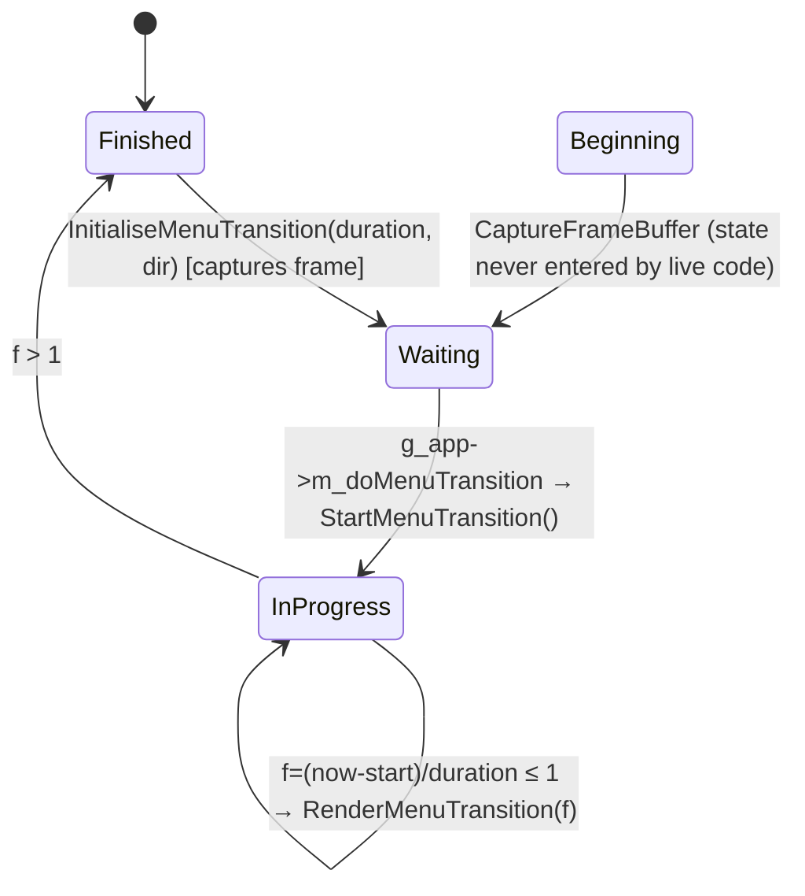
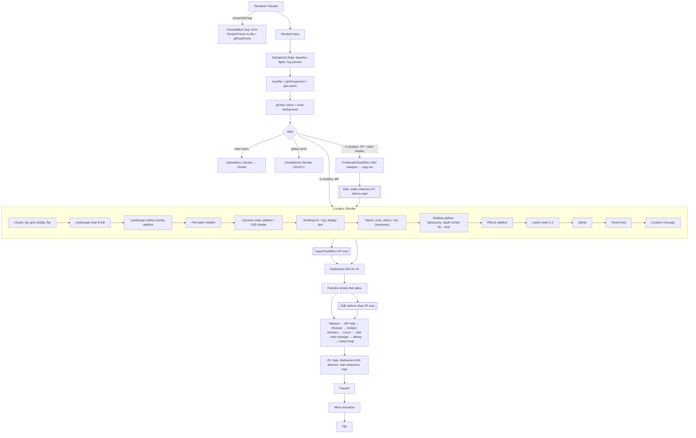

# P12_render_core — Renderer, effects, shapes, textures, text, resources
Scope: `code/renderer.*`, `code/particle_system.*`, `code/explosion.*`, `code/deform.*`, `code/effect_processor.*`, `code/3d_sierpinski_gasket.*`, `code/lib/{shape,3d_sprite,sphere_renderer,render_utils,debug_render,persisting_debug_render,text_renderer,bitmap,texture,texture_uv,resource,shader,FixedPipeline,targetcursor,poster_maker}.*`; plus `data/shaders/*` (deform*, water-meshwaves binding; FixedFunc* briefly — P13 owns the GL→D3D9 layer). Pass table built by reading `code/location.cpp` Render* and its callees (read outside scope, recorded in coverage). Build baseline: see build_matrix.md (`Release|Win32` OpenGL, `TARGET_PC_FULLGAME`). P11 owns landscape/water/clouds internals; P13 owns `lib/opengl_directx*`.

Conventions: GL state names are OpenGL 1.x fixed-function. "Default state" means the state set by `Renderer::SetOpenGLState` at frame start (§24.1.3); each pass is documented as the *delta* it applies and whether it restores. All file paths of assets are relative to `data/`.

<!-- SECTION ORDER: 24.1 backend/frame, 24.2 pass table, 24.3 components, 24.4 shaders, 24.5 style/options, 25 textures/resources, 26 VFX -->

## [→ 26_animation_and_vfx] Particle system

### Ownership and lifecycle
- One global `ParticleSystem` owned by `App` (`g_app->m_particleSystem`), created in `App::Initialise` (~L389) and emptied in `App::ShutdownCurrentGame` (~L1129) [C] `code/app.cpp`.
- Storage: `SliceDArray<Particle>` with initial size 1500, step (growth) 200, sliced into `NUM_SLICES_PER_FRAME` (=10, `code/globals.h`) slices. [C] `code/particle_system.cpp:ParticleSystem::ParticleSystem`.
- **Advance** is called from the network client loop once per simulation slice (`g_app->m_particleSystem->Advance(g_sliceNum)` immediately after `loc->Advance(g_sliceNum)`, only when not paused) [C] `code/network/clienttoserver.cpp:ClientToServer::ProcessAllServerLetters` (~L1977). `ParticleSystem::Advance` does work only when `_slice == 0`, i.e. **once per server advance** (the per-slice path is commented out) [C] `code/particle_system.cpp:ParticleSystem::Advance`. So particles step with `SERVER_ADVANCE_PERIOD` (`g_gameTimer.GetServerAdvancePeriod()`, `code/gametimer.h`).
- **Render** is called once per frame from `Renderer::RenderFrame` after `g_explosionManager.Render()` (see pass table) [C] `code/renderer.cpp:Renderer::RenderFrame`.
- Particles are **not** simulation state: colour choice uses unsynced `frand()`; `CreateParticle` is ignored while `g_app->GamePaused()` [C] `code/particle_system.cpp:ParticleSystem::CreateParticle`, `Particle::Initialise`. [I] They are visual-only and need not be deterministic; creation sites are in sim code, so every peer spawns the same set but with different random colours.

### Particle record
| Field | Type | Meaning |
|---|---|---|
| `m_pos` | Vector3 | world position (world units) |
| `m_vel` | Vector3 | velocity (world units / s) |
| `m_birthTime` | float | `g_gameTimer.GetGameTime()` at creation |
| `m_typeId` | int | `Particle::Type*` |
| `m_size` | float | per-particle size; defaults to type size when `_size == -1` |
| `m_colour` | RGBAColour | lerp between type colours by random `amount=frand()`: `colour1*amount + colour2*(1-amount)`; overridden by explicit `col` argument when non-NULL |
[C] `code/particle_system.h:Particle`, `code/particle_system.cpp:Particle::Initialise`, `ParticleSystem::CreateParticle`.

### ParticleType defaults
`m_spin=0, m_fadeInTime=0, m_fadeOutTime=0, m_life=10.0, m_size=1000.0, m_friction=0, m_gravity=0, m_colour1=(0.5,0.5,0.5), m_colour2=(0.95,0.95,0.95)` [C] `code/particle_system.cpp:ParticleType::ParticleType`. **`m_spin`, `m_fadeInTime`, `m_fadeOutTime` are never read** — the render fade is hard-coded (below) [C] (no reads in `particle_system.cpp`).

### Every particle type (enum order = index) — `Particle::SetupParticles` [C]
| # | Enum | life (s) | size | gravity | friction | colour1 (RGB) | colour2 (RGB) | Special behaviour | Blend pass | Spawned from (files, [C] grep) |
|---|---|---|---|---|---|---|---|---|---|---|
| -1 | `TypeInvalid` | – | – | – | – | – | – | sentinel | – | – |
| 0 | `TypeRocketTrail` | 2.0 | 15.0 | 15.0 | 0.6 | 128,128,128 | 200,200,200 | – | additive | `worldobject/tentacle.cpp`, `wall.cpp`, `weapons.cpp` |
| 1 | `TypeExplosionCore` | 2.0 | 150.0 | 10.0 | 0.2 | 200,100,100 | 255,120,120 | – | additive | `location.cpp`, `worldobject/building.cpp`, `weapons.cpp` |
| 2 | `TypeExplosionDebris` | 6.0 | 40.0 | 20.0 | 0.2 | 200,128,128 | 250,200,200 | each advance, with probability `0.5*SERVER_ADVANCE_PERIOD*10` spawns a `TypeMissileTrail` at its pos with `vel/5`, size `m_size/1.5` | "smoke" (subtractive-ish) | `location.cpp`, `worldobject/lightning.cpp`, `triffid.cpp`, `weapons.cpp` |
| 3 | `TypeMuzzleFlash` | 1.0 | 10.0 | 0.0 | 0.2 | 255,128,128 | 200,100,100 | – | additive | `taskmanager_interface_icons.cpp`, `taskmanager_interface_multiwinia.cpp`, `taskmanager_interface_gestures.cpp`, `location.cpp`, `routing_system.cpp`, `worldobject/{armyant,shaman,officer,virii,randomiser,engineer,harvester,safearea,airstrike,lander}.cpp` |
| 4 | `TypeFire` | 4.0 | 50.0 | -4.0 | 0.0 | 150,50,50 | 150,120,50 | rises (negative gravity) | additive | `worldobject/{tree,lightning,nuke,spam,shaman,crate,meteor,triffid,weapons,rocket}.cpp` |
| 5 | `TypeControlFlash` | 1.0 | 30.0 | -2.0 | 0.0 | 50,50,150 | 50,50,250 | – | additive | `location.cpp`, `gamecursor.cpp`, `taskmanager.cpp`, `worldobject/{incubator,spirit,weapons,darwinian,rocket}.cpp` |
| 6 | `TypeSpark` | 4.0 | 15.0 | 15.0 | 1.5 | 250,200,0 | 250,200,50 | bounces on terrain | additive | `worldobject/laserfence.cpp` |
| 7 | `TypeBlueSpark` | 4.0 | 15.0 | 15.0 | 1.5 | 50,50,200 | 50,70,255 | bounces | additive | `worldobject/{spaceship,controltower,engineer,darwinian}.cpp` |
| 8 | `TypeBrass` | 2.0 | 4.0 | 30.0 | 0.5 | 250,200,0 | 250,200,50 | bounces | additive | `worldobject/insertion_squad.cpp` |
| 9 | `TypeMissileTrail` | 5.0 | 200.0 | 1.0 | 0.0 | 100,100,100 | 200,200,200 | – | "smoke" | `worldobject/{gunturret,spaceship,harvester,portal,armour,weapons,darwinian,rocket,smokemarker}.cpp` |
| 10 | `TypeMissileFire` | 0.5 | 300.0 | 0.0 | 0.0 | 150,50,50 | 150,120,50 | – | additive | `worldobject/{spaceship,harvester,weapons,rocket}.cpp` |
| 11 | `TypeDarwinianFire` | 1.0 | 25.0 | -10.0 | 0.0 | 150,50,50 | 150,120,50 | rises | additive | `worldobject/{darwinian,rocket}.cpp` |
| 12 | `TypeLeaf` | 60.0 | 25.0 | 5.0 | 1.5 | 50,150,50 | 50,200,50 | bounces | additive | `worldobject/tree.cpp` |
| 13 | `TypePlague` | 2.0 | 25.0 | -0.5 | 0.0 | 40,200,40 | 50,200,50 | – | additive | `worldobject/darwinian.cpp` |
| 14 | `TypeHotFeet` | 1.0 | 25.0 | 0.0 | 0.0 | 150,50,50 | 150,120,50 | – | additive | `worldobject/{portal,darwinian}.cpp` |
| 15 | `TypeSelectionMarker` | 0.3 | 10.0 | 0.0 | 0.2 | 255,128,128 | 200,100,100 | – | additive | `gamecursor.cpp`, `worldobject/jumppad.cpp` |
| 16 | `TypeFireball` | 1.0 | 25.0 | 0.0 | 0.0 | 150,50,50 | 150,120,50 | dies on terrain contact | additive | `worldobject/weapons.cpp` |
| 17 | `TypeVolcano` | 12.0 | 400.0 | 10.0 | 0.0 | 150,50,50 | 150,120,50 | dies on terrain contact | additive | `worldobject/eruptionmarker.cpp` |
| 18 | `TypePortalFire` | 2.0 | 50.0 | -4.0 | 0.0 | 100,50,50 | 120,100,50 | rises | additive | `worldobject/portal.cpp` |
| 19 | `TypeNumTypes` | – | – | – | – | – | – | count | – | – |

All particle types share **one texture**: `textures/particle.bmp` (mag filter NEAREST, min filter whatever the resource manager set — see §25) [C] `code/particle_system.cpp:ParticleSystem::Render`. Spin is not applied: billboards are always the same diamond orientation.

### Advance (per server tick, `dt = SERVER_ADVANCE_PERIOD`) [C] `code/particle_system.cpp:Particle::Advance`
1. If `gameTime >= birthTime + life` → remove.
2. `pos += vel*dt`.
3. Friction: `vel *= (1 - dt*friction)` (no clamp; friction 1.5 at dt 0.1 gives ×0.85/tick).
4. Gravity (if `gravity != 0`): `vel.y -= dt * gravity * (m_size / typeSize)` — **gravity scales with relative size** (a particle created with double size falls twice as fast).
5. `TypeFireball`, `TypeVolcano`: remove if `pos.y <= landscape height(pos.x,pos.z)`.
6. `TypeExplosionDebris`: emit a smoke puff as above (flagged `particleCreated`).
7. If no particle was created this step and type ∈ {Spark, Brass, BlueSpark, Leaf} and `pos.y <= height`: snap `pos.y` to terrain height, reflect `vel -= normal * 2 * (normal·vel) * 0.7` (note: the 0.7 restitution multiplies the reflection term, so the reflected normal component is `-0.4×` the incoming one, tangential unchanged) [C].

### Render [C] `code/particle_system.cpp:Particle::Render`, `ParticleSystem::Render`
- Time: `timeNow = gameTime + predictionTime`; particles updated this tick use `g_predictionTime`, ones beyond `GetLastUpdated()` use `g_predictionTime + SERVER_ADVANCE_PERIOD`. Position extrapolated: `pos + predictionTime*vel`.
- Alpha: 90 (of 255) until 75 % of life, then linear to 0 at death: `alpha = 90 - 90*(t - 0.75life)/(0.25life)`.
- Quad: billboard diamond with half-extent `size/16` along camera up and right; vertices `(p-up, uv 0,0)`, `(p+right, 0,1)`, `(p+up, 1,1)`, `(p-right, 1,0)`.
- Two batches inside one texture bind:
  1. **Smoke batch** (`TypeMissileTrail`, `TypeExplosionDebris`), only for particles whose *unpredicted* position passes `Camera::PosInViewFrustum`: blend `GL_SRC_ALPHA, GL_ONE_MINUS_SRC_COLOR`, vertex colour `rgb * alpha/100`, **vertex alpha 0** — with src alpha 0 the source contributes nothing and the destination is multiplied by `(1 - srcColour)`, i.e. the smoke *darkens* what is behind it (dark smoke without alpha sorting).
  2. **Glow batch** (all other types, no frustum test): blend `GL_SRC_ALPHA, GL_ONE` (additive), colour `rgb`, alpha as computed.
- State: `GL_CULL_FACE` off, `GL_BLEND` on, `GL_TEXTURE_2D` on, depth **write off** (depth test stays on), mag filter NEAREST. Restores: depth write on, texture off, mag LINEAR, blend off, blend func default, cull on.

### Pseudocode — particle step
```
for p in particles (only on slice 0):
    if now >= p.birth + T[p.type].life: remove; continue
    p.pos += p.vel*dt
    p.vel *= 1 - dt*T.friction
    if T.gravity: p.vel.y -= dt*T.gravity*(p.size/T.size)
    if p.type in {Fireball,Volcano} and p.pos.y <= H(p.pos.xz): remove
    spawned = p.type==ExplosionDebris and rand() < 0.5*dt*10 and spawn(MissileTrail, p.pos, p.vel/5, p.size/1.5)
    if not spawned and p.type in {Spark,Brass,BlueSpark,Leaf} and p.pos.y <= H:
        p.pos.y = H; n = N(p.pos.xz); p.vel -= n*2*(n·p.vel)*0.7
```

## [→ 26_animation_and_vfx] Explosions (shape shattering)

[C] `code/explosion.h`, `code/explosion.cpp`. Global `ExplosionManager g_explosionManager`. Explosions are **render-side only**: they use wall-clock `g_gameTime`/`g_advanceTime` (`code/main.cpp:UpdateAdvanceTime`, advance clamped to ≤0.25 s) and unsynced `sfrand`/`frand`/`AppRandom`.

### Constants (`#define` in `explosion.cpp`)
| Name | Value | Unit/meaning |
|---|---|---|
| `EXPLOSION_LIFETIME` | 5.0 | s; every triangle and the explosion die together |
| `MAX_INITIAL_SPEED` | 3.0 | multiplier on (triangle centre − fragment centre) |
| `MAX_ANG_VEL` | 4.0 | rad/s range of tumbler angular velocity per axis (`sfrand` → ±4) |
| `ACCEL_DUE_TO_GRAV` | `-GRAVITY` = −10.0 | world units/s² (`code/globals.h` `GRAVITY 10.0`) |
| `INITIAL_VERTICAL_SPEED` | 10.0 | world units/s added to vel.y |
| `MIN_FRAG_LIFE` | 0.0 | fraction (unused, per-triangle random life is commented out) |
| `FRICTION_COEF` | 0.05 | linear drag coefficient (speed-proportional) |
| `ROT_FRICTION_COEF` | 0.2 | angular drag |
| `NUM_TUMBLERS` | 5 | shared rotation matrices per explosion |
| triangle cut-off | circumference < 6.0 | skip small triangles (literal) |
| max triangles | stop after source index `j > 500` | literal |
Legacy commented-out set (Darwinia-era): lifetime 50, speed 0.01, ang vel 0.01, grav 0, vertical 0, min life 0.9.

### Algorithm
`ExplosionManager::AddExplosion(Shape*, transform, fraction=1.0)` → if `fraction > 0` recurse from the root fragment; for each `ShapeFragment` with `m_numTriangles > 0` create one `Explosion`; children use `childTransform = frag.m_transform * parentTransform` [C] `ExplosionManager::AddExplosion`.

`Explosion::Explosion(frag, transform, fraction)`:
1. Allocate 5 `Tumbler`s, each `rotMat = identity`, `angVel = (sfrand(4), sfrand(4), sfrand(4))`.
2. `total = frag.m_transform * transform`; `fragCentreWS = total * frag.m_centre`.
3. For each source triangle `j`: if `fraction < 1` keep with probability `fraction` (`frand(1.0) > fraction` → skip). Colour = colour of the **first vertex** (`m_colours[v1.colId]`). Transform the 3 positions to world space. Skip degenerate (two equal vertices) and small (perimeter < 6.0). Centre `c = (v1+v2+v3)*0.3333`; store vertices relative to `c`; normal `= normalize((v1-v2)×(v2-v3))`, **negated for odd j** (compensates strip winding alternation). `vel = (c - fragCentreWS) * 3.0; vel.y += 10.0`; `pos = c`; tumbler = random of 5; death time = now + 5 s. Stop after `j > 500`.
4. Copy to a flat array.

`Explosion::Advance` (per render frame, `dt = g_advanceTime`): advance tumblers (`rotMat *= Matrix33(angVel*dt)`; `angVel *= 1 - dt*0.2`); per live triangle `pos += vel*dt`; `friction = min(1, |vel|*0.05*dt)`; `vel *= 1-friction`; `vel.y += -10*dt`. Returns finished when `now > timeToDie`. Note: **no ground collision** — triangles fall through terrain [C].

`ExplosionManager::Advance` is skipped while `GamePaused()`; called once per rendered frame [C] `code/main.cpp:LocationGameLoop` (after `m_script->Advance()`).

### Render [C] `ExplosionManager::Render`, `Explosion::Render`
- State: `GL_TEXTURE_2D` on with `textures/shapewireframe.bmp` (mag LINEAR, min LINEAR_MIPMAP_LINEAR), tex env **`GL_DECAL`**; `Renderer::SetObjectLighting()` (lighting + LIGHT0 + LIGHT1, material diffuse 1, spec 0, ambient 0, shininess 127); `GL_COLOR_MATERIAL` on; cull off; blend on with default `SRC_ALPHA, ONE_MINUS_SRC_ALPHA`; depth test/write default (on).
- Per triangle: `glColor4ub(r,g,b,(1-age)*255)` where `age = (5 + now - timeToDie)/5` (0→1), normal = `rotMat*norm`, vertices `rotMat*v + pos`, tex coords (0,0),(0,1),(1,1) — the wireframe texture's edge lines appear along the triangle edges. Restores tex env MODULATE, lighting off, colour material off, cull on, blend off.
- [I] Because GL_DECAL with an RGB(A) texture blends texture over the lit colour by texture alpha, the debris shows bright wire edges over lit facets — the same "wireframe" look as buildings (§24.3 Shape).

## [→ 24_rendering] Deform effect (screen-space distortion) [B:D3D]

Entire file is inside `#ifdef USE_DIRECT3D` [C] `code/deform.h`, `code/deform.cpp`. **Not present in the baseline OpenGL build.**

### Lifecycle
- `g_deformEffect = DeformEffect::Create()` in `CreateD3dPoolDefaultResources()`; deleted in `ReleaseD3DPoolDefaultResources()` (before device reset) [C] `code/lib/opengl_directx.cpp`. `Create` returns NULL if any of the 3 shaders or 2 render targets fail.
- Resources: `m_screenTexture` = render target at screen size, back-buffer format; `m_deformTexture` = render target at **half** screen size, `D3DFMT_A8R8G8B8`; shaders `deform.vs` + `deformFullscreen.ps` / `deformSphere.ps` / `deformDiamond.ps` [C] `DeformEffect::DeformEffect`.
- Per frame (only when `RenderPixelShader > 0` and **not** multiplayer, see pass table): `Start()` before `Location::Render`; `Stop()` after particles. With `STRETCH_RECT` defined (it is), `Start()` is a no-op; `Stop()` copies the back buffer into `m_screenTexture` with `StretchRect` (comment: makes FSAA possible) [C] `DeformEffect::Start`, `Stop`.

### Triggers (who adds deformations) [C]
| Caller | Call | Params | Build |
|---|---|---|---|
| `Location::Bang` (`code/location.cpp` ~L4652, right after `CreateShockwave`) | `AddPunch(pos, range)` | `m_range` forced to 1, `extraDepth` 1, type `DT_PUNCH`; only if `isVisible` (always true — the ray test is commented out) | D3D |
| `SoulDestroyer::Advance` | `AddTearingPath(hist[n-1], hist[n-2], 0.4)` every advance | | D3D |
| `Spider::AdvancePouncing` | `AddTearingPath(oldPos, newPos, 0.25)` | | D3D |
| `Centipede` segment advance | `AddTearing(...,0.3)` | **commented out** | dead |
| `EntityLeg` | `AddTearingSpider(...)` | **commented out** (and the method doesn't exist) | dead |
| Spirits (`Location::m_spirits`, state ≠ `StateAttached`) | drawn every frame as diamond deformers | width 0.32, depth 0.12, redux 1.3 | D3D |

`AddTearingPath(p1,p2,s)`: `n = (int)|p2-p1|` points (one per world unit), `strength *= 0.8`, each point `AddTearing(p2 + (p1-p2)*(i/n), strength)`. `AddTearing`: `range = strength`, `extraDepth = 3`, type `DT_TEAR`. Birth time = `GetTickCount()` (ms, wall clock) [C].

### Deform types
| Type | Table texture (`deformParams`) | Lifetime | width | depth | colour.r (shader "time") | redux |
|---|---|---|---|---|---|---|
| `DT_PUNCH` (0) | `textures/deform36c.bmp` | 1 s | 10 | `0.03*(1-a)^2` (a = age/maxage) | `sqrt(max(a,0.03))` | 0.8 |
| `DT_TEAR` (1) | `textures/deform3.bmp` | 1 s | `10*(maxage-(maxage-age)^2/maxage)` (ease-out 0→10) | `0.15*(1-a)` | `max(a,0.03)` | 0.6 |
| Spirit diamond | `textures/deform1c.bmp` | per frame | 0.32 | 0.12 | `(GetTickCount()%1000)/1000` | 1.3 |
Effective sprite depth passed = `range*extraDepth*depth` [C] `DeformEffect::Stop`.

### Stop() algorithm
1. Depth write/test off, cull off. StretchRect back buffer → `m_screenTexture`.
2. Set render target = `m_deformTexture`, viewport = half-res, clear colour, blend `ONE, ONE` (additive accumulation of displacement vectors).
3. Sort non-attached spirits by squared camera distance, **far-to-near** (`CompareSoulDistance` returns +1 when s1 < s2), render each with `deformDiamond.ps`, sampler `deformSampler` = `deform1c.bmp`.
4. For type in {PUNCH, TEAR}: bind `deformSphere.ps` with that type's table; iterate deformations newest-first; drop expired; render sprite.
5. Blend back to default, disabled. `g_pd3dDevice->Resolve(D3DRESOLVE_RENDERTARGET0, …)` into `m_deformTexture`. [I] `IDirect3DDevice9` on PC has no `Resolve` method and `D3DRESOLVE_RENDERTARGET0` is an Xbox 360 constant: this line would not compile against the PC D3D9 SDK, suggesting the D3D configuration of this tree does not build as-is (or a shim header exists that was not found — grep of `code/` found none) — see Contradictions.
6. Viewport full screen, clear colour, draw one full-screen quad with `deformFullscreen.ps` (samplers: `deformSampler`=`m_deformTexture`, `screenSampler`=`m_screenTexture`). Re-enable cull/depth.
   - [I] The render target is never explicitly reset to `m_oldRenderTarget` after step 2; on PC this would draw the final composite into the deform texture. Unresolved; documented as-is.

`RenderSprite(shader, posWorld, width, depth, redux)` [C]: project `posWorld` with `gluProject` into a unit viewport (0..1); if in front (`z<1`), project a point 1 world unit sideways (perpendicular to look dir in XZ) to get the on-screen size per world unit; `size = min(0.4, 10*|Δ|·(aspect,1))` (default 0.001 if off-screen by more than 1 screen); vertex attributes: `TEXCOORD0 = (sx, 1-sy)` (centre), `TEXCOORD1 = (1/(size*width), size*width*depth*4)` (invSize, height), `COLOR.r = time`; quad corners at clip-space `centre*2-1 ± (size*width, size*width*aspect)*redux`; depth==0 → full-screen quad (−1..1).

Sampler states: deformSampler LINEAR/LINEAR/no mip, U WRAP (time axis), V CLAMP (distance axis); screenSampler LINEAR/LINEAR/no mip, CLAMP/CLAMP. Uniform `aspect = ScreenW/ScreenH` [C] `DeformEffect::RenderSpritesBegin`.

## [→ 24_rendering] Shaders (`data/shaders/`) — all [B:D3D]

HLSL, compiled at runtime with `D3DXCompileShader` using entry points `vs_main` / `ps_main` and the **device's best profile** (`D3DXGetVertexShaderProfile`/`D3DXGetPixelShaderProfile`); `#include` resolved through the resource system under `shaders/` (`MyD3DXInclude`) [C] `code/lib/shader.cpp:Shader::Shader`. `Shader::Create` returns NULL and **raises `AppReleaseAssert`** ("Shader create error") on failure [C] `Shader::Create`. Constants are set through the D3DX constant table by name on both VS and PS tables. Only loaded in the D3D build; the baseline OpenGL build uses no programmable shaders at all [C] (all of `shader.cpp`, `FixedPipeline.cpp`, `deform.cpp`, `water_reflection.cpp` are `#ifdef USE_DIRECT3D`).

| File | Stage | Inputs | Outputs | Uniforms/constants | Effect | Bound by |
|---|---|---|---|---|---|---|
| `globals.h` | include | – | – | `#define DEFORM_PRECISION 10` (higher = less banding but max displacement 1/10 screen) | shared | deform*.ps |
| `deform.vs` | VS | POSITION (clip-space xy), TEXCOORD0 = centre (u,v), TEXCOORD1 = (invSize, height), COLOR.x = time | POSITION = input; COLOR = (centre.x, centre.y, invSize, height); TEXCOORD0.xy = screen UV `(0.5(1+x)+0.0003, 0.5(1-y)+0.0003)` (offset vs Radeon X300 interference), TEXCOORD0.z = time | none | passes per-sprite params via colour interpolator | `DeformEffect` (all 3) |
| `deformSphere.ps` | PS | TEXCOORD0 (uv,time), COLOR (centre, invSize, height) | float4(dx,dy,−dx,−dy) | `sampler deformSampler`, `float aspect` | radial displacement: `dir = uv-centre; dist = |dir·(aspect,1)|; delta = tex(deform,(time, dist*invSize)).x * height/dist * dir * 10`. Signed vector split into positive (xy) and negative (zw) channels so additive blending of unsigned RT works | `DeformEffect::Stop` (punch, tear) |
| `deformDiamond.ps` | PS | same | same; `clip(-1)` where delta==0 | `deformSampler`, `aspect`, unused `noiseSampler` | diamond (L1) distance metric `|dx|*aspect+|dy|`, lookup at `(time, 1-dist*invSize)`, **inward** (negated) displacement | spirits |
| `deformFullscreen.ps` | PS | TEXCOORD0 | colour | `screenSampler`, `deformSampler` | `screen(uv + (d.xy - d.zw)/10)` — pure refraction ("transparent"); commented alternatives: rainbow, darken, darken+brighten | full-screen composite |
| `water-meshwaves.vs` | VS | POSITION, NORMAL, COLOR | TEXCOORD1 = world pos, POSITION = pos·WVP, TEXCOORD0 = (pos+normal)·WVP (reflection coords), COLOR | `float4x4 worldViewProjMatrix` (set to `Renderer::GetTotalMatrix()`), shared `matCameraView` c0, `matCameraViewIT` c4 (unused) | projects water verts; perturbs reflection lookup by vertex normal | `WaterReflectionEffect::Start` (`code/water_reflection.cpp`) |
| `water-meshwaves.ps` | PS (ps_2) | TEXCOORD0, COLOR | COLOR | `sampler water` | `uv = 0.5*(1 - refl.xy/refl.w); uv.y += 0.004` (seam fix); `out = 0.7*col + 0.7*(r+g+b)*tex(water,uv); a = 0.7` | used when ps_3 unavailable |
| `water-meshwaves.ps3` | PS (≥ps_3) | + TEXCOORD1 world pos | COLOR | `water`, `float2 time` (x = seconds `(GetTickCount()%10000000)/1000`, y = small-wave amplitude `0.001*1024/ScreenW`) | adds screen-space ripple `uv += time.y * sin((0.2*pos.yy + pos.xz)*0.25 + time.x*4) / (|ddx(pos.x)|+|ddx(pos.z)|)` | chosen when `D3DXGetPixelShaderProfile` returns `ps_3+` |
| `FixedFunc0.vs` + `FixedFunc0Maps.ps` | VS/PS | POSITION, NORMAL, COLOR | POSITION, TEXCOORD0 = colour | `matProj`, `matWorldView`, `matWorldViewIT`, `bSpecular`, `fogRange(x=end, y=end-start)`, `numLights`, `lights[2]{vDir,vDiffuse,vSpecular}` | untextured fixed-function emulation: up to 2 directional lights (diffuse `N·L`, Blinn specular power 16 if bSpecular), alpha forced 1 when lit; **fog = colour × saturate((end − z)/(end−start)) — fades to black, not to fog colour** | `FixedPipeline::Bind` (P13) |
| `FixedFunc1.vs` + `FixedFunc1Maps.ps` | VS/PS | POSITION, COLOR, TEXCOORD0 | colour × tex(map0) | `matProj`, `matWorldView`, `fogRange` (no lighting) | 1 texture stage | `FixedPipeline::Bind` |
| `FixedFunc2.vs` + `FixedFunc2Maps.ps` | VS/PS | + TEXCOORD1 | colour × tex(map0) × tex(map1) | as above + unused `fogColour` | 2 texture stages modulate | `FixedPipeline::Bind` |

FixedPipeline selection: `shader = FixedFunc[tex0 ? (tex1 ? 2 : 1) : 0]` from `glIsEnabled(GL_TEXTURE_2D)` on units 0/1; lights counted only if `m_lighting && m_lightEnabled[0]` (+1 if light 1); fog range `(end, end-start)` or `(100000, 1000)` when fog off; textured shaders ignore lighting [C] `code/lib/FixedPipeline.cpp:FixedPipeline::Bind`. [I] Textured+lit geometry (explosion debris, lit textured shapes) therefore renders **unlit** under D3D.

## [→ 24_rendering] 24.1 Renderer object, initialisation and per-frame skeleton

### Renderer singleton [C] `code/renderer.h:Renderer`, `code/renderer.cpp:Renderer::Renderer`
| Member | Initial value | Meaning |
|---|---|---|
| `m_fps` | 60 | frames counted in the last wall-clock second (`FPSMeterAdvance`) |
| `m_displayFPS` | true, **forced false under `TARGET_PC_FULLGAME`** | FPS / entity-count overlay |
| `m_renderDebug` | false | unused flag in this partition |
| `m_displayInputMode` | false | "InputMode: keyboard/gamepad" debug box |
| `m_renderingPoster` | `PosterMakerInactive` | poster/screenshot state (enum `PosterMakerInactive, PosterMakerTiling, PosterMakerPixelEffect`) |
| `m_lastFrameBufferTexture` | -1 | GL texture holding the captured frame for menu transitions |
| `m_renderDarwinLogo` | -1.0 | start time (s) of the 10 s "research associates" logo overlay; <0 = off |
| `m_gamma` | 1.2 | only used by `SetScreenGamma` [B:D3D]; **never called** (grep) → unused |
| `m_nearPlane`, `m_farPlane` | 5.0, 150000.0 | overwritten every frame (see below) |
| `m_screenW/H` | prefs | back-buffer size in pixels |
| `m_texCoordW/H` | 0 | UV extent of captured frame inside a power-of-two texture |
| `m_tileIndex` | 0 | current poster tile |
| `m_totalMatrix[16]` | – | modelview×projection cache (double) for `Get2DScreenPos` |
| `m_fadedness`, `m_fadeRate`, `m_fadeDelay` | 0,0,0 | full-screen black fade (1 = black) |
| `m_pixelEffectTexId` | `glGenTextures` in `BuildOpenGlState` | pixel-effect grab texture |
| `m_pixelEffectGrid[16][16]` | – | per-cell nearest depth (1e9 = unused) |
| `m_pixelSize` | 256 | pixel-effect off-screen render size (px, square) |
| `m_menuTransition*` | Finished | menu slide transition state machine |

### Initialise [C] `Renderer::Initialise`
1. Read prefs: `ScreenWidth` (0), `ScreenHeight` (0), `ScreenWindowed` (0), `ScreenColourDepth` (32), `ScreenRefresh` (75), `ScreenZDepth` (24), `WaitVerticalRetrace` (1). `ScreenOverscan` is hard-coded to 0 (pref read commented out).
2. If width and height are both 0 → `WindowManager::SuggestDefaultRes` and save them.
3. `GetClosestResolution`, then `CreateWin(w,h,windowed,colourDepth,refresh,zDepth, waitVRT=true(literal), antiAlias/flag true, "Multiwinia")`. Note the first attempt passes literal `true` for the vsync argument, not the pref [C].
4. Fallback chain on failure: show a `MessageDialog` "Failed to set requested screen resolution…", retry with suggested default res, zDepth 24, vsync 0 → retry `800×600 windowed, 16-bit colour, 16-bit Z, 60 Hz` → retry with 24-bit Z → `AppReleaseAssert("Failed to set screen mode")`.
5. Write back all screen prefs, `ScreenOverscan=0`, `Save()`. `InitialiseOGLExtensions()` (P13) and `BuildOpenGlState()` (allocates the pixel-effect texture name).
App start then calls `SetOpenGLState()` and `BitmapRGBA::SetMaxTextureSize(GL_MAX_TEXTURE_SIZE)` [C] `code/app.cpp:App::App` (~L221-231).

### Baseline GL state (`Renderer::SetOpenGLState`, called at the start of every `RenderFrame`) [C]
| Group | State |
|---|---|
| Geometry | cull **on**, front face CCW, polygon mode FILL/FILL, **shade model FLAT**, normalize off |
| Colour | colour material off, `glColorMaterial(FRONT_AND_BACK, AMBIENT_AND_DIFFUSE)` |
| Lighting | lighting off; LIGHT0–7 off; `Location::SetupLights()` (or `GlobalWorld::SetupLights`); global ambient (0,0,0,0) |
| Blend | blend off, func `SRC_ALPHA, ONE_MINUS_SRC_ALPHA`; alpha test off, func `GREATER 0.01` |
| Fog | `Location::SetupFog()` (linear, density 1, start = fogEnd/3, end = max(4000, worldSizeX+1000, worldSizeZ+1000), colour = background colour, alpha 0) then fog **off** |
| AA | line smooth off, point smooth off |
| Texture | texture2D off; wrap S/T `GL_CLAMP` (on the currently bound texture); env MODULATE, env colour 0 |
| Framebuffer | depth test on, depth mask on, depth func LEQUAL, scissor off |
| Hints | fog hint DONT_CARE, polygon smooth hint DONT_CARE |
`CheckOpenGLState` asserts this baseline when `OPENGL_DEBUG_ASSERTS` is defined (not in any target) [C] `code/renderer.h`.

### Lighting model [C] `code/location.cpp:Location::SetupLights`, `SetupSpecialLights`, `code/renderer.cpp:Renderer::SetObjectLighting`
- Level-defined directional lights `Location::m_lights` (from the level file, P-agent for level files): light *i* → `GL_LIGHT0+i`, position `(normalised front, w=0)` (directional), diffuse = specular = `m_colour[0..3]`, ambient black. LIGHT1 is first zeroed (direction (0,0,-1), black). Christmas mode (`Location::ChristmasModEnabled`) overrides colour to (1.3,1.2,1.2).
- Only LIGHT0 and LIGHT1 are ever enabled (`SetObjectLighting`, landscape) → **max 2 effective lights**; FixedPipeline also supports only 2 [C].
- `SetObjectLighting`: material specular 0, diffuse 1, ambient 0, shininess 127; enable lighting + LIGHT0 + LIGHT1.
- Special lighting (`SetupSpecialLights`): one light from `normalise(0,1,0.5)`, diffuse=specular `(2.0,1.5,0.75)`, material specular 1, shininess 10. Enabled in `RenderBuildings` when pref `RenderSpecialLighting==1`, **or game type is Rocket Riot**, or the level has `LevelEffectSpecialLighting`, or Prologue.
- [I] Lights are specified (in `SetOpenGLState`) before `SetupMatricesFor3D`, so their direction is transformed by whatever modelview was current (the previous frame's camera matrix restored by `EndText2D`); with a slowly moving camera this is visually indistinguishable. A new engine should specify world-space light directions explicitly.
- No shadows of any kind exist in this partition or the passes it calls [C] (no stencil, no shadow maps; `glStencilMask` commented out).

### Matrices, viewport, aspect [C] `Renderer::SetupProjMatrixFor3D`, `SetupMatricesFor3D`, `SetupMatricesFor2D`, `code/camera.cpp:Camera::SetupModelviewMatrix`, `Camera::SetupProjectionMatrix`
- Per frame: if `m_locationId == -1` (main menu / global world) near=50, far=10 000 000; else near=5, far=15 000 (world units) [C] `RenderFrame`.
- Projection: `gluPerspective(camera FOV (vertical, degrees, clamped 1..180), screenW/screenH, near, far)`. Poster tiling uses `glFrustum` on a sub-rectangle: `scale = fov/78`, `left = -scale*near`, `top = -(H/W)*scale*near`, tile size `2|left|/N × 2|top|/N`, tile `(x,y) = (idx % N, idx / N)`.
- Modelview: `gluLookAt(pos, pos + front*|pos|, up*|pos|)`.
- Depth-bias trick: lasers re-set the projection with **near × 1.2** and Virii with **near × 1.05** (same far) so they win depth ties against terrain; restored afterwards [C] `Location::RenderWeapons`, `code/team.cpp:Team::RenderVirii`.
- 2D: `SetupMatricesFor2D` = identity modelview, `gluOrtho2D(vx, vx+vw, vy+vh, vy)` (y down, pixel units). Text uses its own ortho offset by −0.325 px for texel alignment [C] `TextRenderer::BeginText2D`.
- Aspect: always derived from window size; no letter-boxing, no fixed virtual resolution in the 3D path. UI code scales by `ScreenW/1280` (e.g. `Location::RenderCurrentMessage`, `RenderChatMessages`) [C].
- `Renderer::Clip(x,y,w,h)` projects two points with `Camera::Get2DScreenPos` and enables `GL_SCISSOR_TEST`; `EndClip` disables it [C].
- `Get2DScreenPos` multiplies by the cached `m_totalMatrix` (row-vector convention), divides by w, maps to `[0,W]×[0,H]`, z = w; returns early (output untouched) when w ≤ 0 [C].

### Frame entry `Renderer::Render` [C]
- If `ControlCreateScreenShot` fires and no Eclipse windows are open → poster path: `N = pref RenderPosterResolution (default 1)`; if N>1 set `PosterMakerTiling`; for N×N tiles: `RenderFrame(false)` (no flip), `PosterMaker::AddFrame()` (glReadPixels RGB), `Flip`; then `SavePoster()`. Else `RenderFrame()`.
- Profiler `RenderStarted/RenderEnded` bracket. `TARGET_OS_VISTA` thumbnail save [B:DEAD].

### Fade, pause, logo, transitions [C]
- **Fade** (`RenderFadeOut`, drawn every frame unless `IsFirsttimeSequencing()`): its own static wall-clock timer, dt clamped to 0.05 s; `m_fadeDelay` counts down first; then `m_fadedness += m_fadeRate*dt`, clamped 0..1 (rate cleared at the limits). `StartFadeOut`: rate +1/s, no delay. `StartFadeIn(delay)`: fadedness 1, rate −1/s. Draws a black quad with alpha `fadedness*255` (blend default, depth test/write off). `IsFadeComplete` ⇔ rate ≈ 0.
- **Paused banner** (`RenderPaused`): only if no Eclipse windows and (`gameMode != Multiwinia` and window unfocused) or `m_userRequestsPause`; "PAUSED" (literal English, not localised) centred at (W/2, 0.4H), size 80, outline pass (colour (1,1,1,0)) then white.
- **Darwin logo** (`m_renderDarwinLogo ≥ 0`): `icons/darwin_research_associates.bmp`, square h=0.7H at y=0.05H, alpha ramps 0→1 over 3 s, holds to 8 s, ramps down to 10 s; drawn as 9 offset copies (±4 px) with `SRC_ALPHA, ONE_MINUS_SRC_COLOR` (dark halo) then one additive copy; caption `launchpad_logo_1` at 0.8H size H/9 [B:LEGACY] (set by Darwinia-era scripts [I]).
- **Private-demo logo** (`RenderLogo`) only under `PROMOTIONAL_BUILD` (never defined) [B:DEAD]; `RenderFlatTexture` commented out [B:DEAD].
- **Menu transition** (state machine, `AdvanceMenuTransition` runs just before every `Flip`):

  `CaptureFrameBuffer`: one GL texture (NEAREST, CLAMP), `glCopyTexImage2D(GL_RGB)` of the back buffer at screen size, or at `nearestPowerOfTwo(W)×nearestPowerOfTwo(H)` when `RequirePowerOfTwoTextures()`; `m_texCoordW/H = min(1, W/pow2(W))`. `RenderMenuTransition(f)`: `fraction = f*1.2*3`; the quad shrinks inward by `0.2*fraction*dir` of W/H on each side and slides left by `W*fraction^6*dir`; alpha `max(0, 1-0.2*fraction)`; a 20 px black→transparent gradient strip is drawn at the right edge; texture sampled LINEAR; V coordinates flipped under D3D (`d3dOneMinus`) [C].

## [→ 24_rendering] 24.2 Frame composition — ordered pass table

Scope of the table: one frame of `Renderer::RenderFrame` while **in a Multiwinia match** in the baseline build; branches for other states are listed after. "Default" = baseline state of §24.1; a cell lists only what the pass changes. "Restores" = the pass returns the listed state to default before exiting. Owner column names the partition that specifies the drawn content in detail.

| # | Pass | Function ref | What is drawn | Blend | Depth test / write | Cull | Alpha test | Fog | Lighting | Texture / env / filter / wrap | Other (shade, poly, line, matrices) | Owner |
|---|---|---|---|---|---|---|---|---|---|---|---|---|
| 0 | State reset | `Renderer::SetOpenGLState` | – | sets default | on / on, LEQUAL | on (CCW) | off (GREATER 0.01) | configured, off | lights configured, off | off, MODULATE, CLAMP | FLAT, FILL | P12 |
| 1 | Camera | `Renderer::RenderFrame` → `FPSMeterAdvance`, `SetupMatricesFor3D` | – | – | – | – | – | – | – | – | perspective (fov, W/H, 5, 15000), lookAt | P12 |
| 2 | Clear | `RenderFrame` | colour+depth clear to `g_app->m_backgroundColour` (no location: (0.05,0,0.05,0.1)) | – | – | – | – | – | – | – | – | P12 |
| 3a | Sky grid | `Location::Render` → `RenderClouds` → `Clouds::RenderSky` | grid of thin textured quads at sky height | `SRC_ALPHA, ONE` additive | on / **off** | on (disable commented out) | off | **on**, start 2000, end 4000, colour per clouds | off | `textures/laser.bmp` | colour (0.5,0.5,1.0,0.3) | P11 |
| 3b | Blobby clouds | `Clouds::RenderBlobby` | 1–3 large quads (by `RenderCloudDetail`) | additive | **off / off** | default | off | on 2000–5000 | off | `textures/clouds.bmp` no-mip, MAG LINEAR, MIN NEAREST, REPEAT | colour (0.7,0.7,0.9,0.6); restores fog via `SetupFog` | P11 |
| 3c | Flat clouds | `Clouds::RenderFlat` | 1–2 scrolling quads | additive | off / off | default | off | on 2000–5000 | off | `clouds.bmp` NEAREST/NEAREST, REPEAT | colour (0.7,0.7,0.9,0.3) (0.5 at detail 3) | P11 |
| 3d | Cloud face | `Clouds::RenderFace` | timed face image in the clouds (5–30 s after trigger) | P11 | | | | | | | | P11 |
| 4a | Landscape main | `RenderLandscape` → `LandscapeRenderer::Render` → `RenderMainSlow` or display list | terrain triangle strips (vertex/normal/colour arrays or VBO) | off (negative mode: `SRC_ALPHA, ONE_MINUS_SRC_COLOR`) | on / on | on | off | **on** (`SetupFog`) | **on**, LIGHT0+1, COLOR_MATERIAL, material spec 0, amb+diff 1, shininess 100 | off | FLAT shading → faceted terrain | P11 |
| 4b | Landscape overlay | `LandscapeRenderer::RenderOverlaySlow` | same mesh again with triangle-outline texture → glowing wire grid | `SRC_ALPHA, ONE` (negative: ONE_MINUS_SRC_COLOR) | on / **off** | on | off | on | on, material spec 0.5, amb+diff 1.2, shininess 40 | `textures/triangleOutline.bmp` mip, LINEAR/LINEAR_MIPMAP_LINEAR, **REPEAT** | restores CLAMP, fog off at end of landscape | P11 |
| 5a | Flat water | `RenderWater` → `Water::Render` → `RenderFlatWater` | big flat water tiles | off (negative: ONE_MINUS_SRC_COLOR) | on / **off** | **off** | off | on | off | unit0 water texture REPEAT MODULATE; unit1 landscape lightmap `COMBINE_EXT/MODULATE` | multitexture | P11 |
| 5b | Dynamic water | `Water::RenderDynamicWater` (if `RenderWaterDetail > 0`; under D3D only if HW vertex processing) | wave mesh strips with vertex colours | `SRC_ALPHA, ONE` | on / on | on | off | on | off | none in GL; [B:D3D] `water-meshwaves` shader samples the reflection RT | `SetupFog` re-applied | P11 / P12 (shader) |
| 6 | Buildings (solid) | `Location::RenderBuildings` → `Building::Render` → `Shape::Render` | every in-view building's .shp mesh; subclasses add their own extras | off | on / on | on | off | **on** | `SetObjectLighting` (LIGHT0+1, diffuse 1, spec 0, shininess 127) or `SetupSpecialLights`; [B:D3D] FixedPipeline specular true | off (subclasses may bind) | `GL_COLOR_MATERIAL` on inside `Shape::Render`; push/mult/pop modelview per shape; display lists | P12 (shape) + worldobject agents |
| 7a | Units | `RenderTeams` → `Team::Render` (×6 teams) → `Unit::Render` | squads etc. | on (default func) | on / on | default | **on, GREATER 0.02** | off | per-entity | **on**, MAG LINEAR, MIN LINEAR_MIPMAP_LINEAR (no bind) | – | worldobject agents |
| 7b | Other entities | `Team::RenderOthers` → `Entity::Render` | all non-Darwinian, non-Virii entities (engineers, armour, officers, centipedes, …) | per entity | | | | | | | | worldobject agents |
| 7c | Virii | `Team::RenderVirii` | tail-sprite strips per Virii, LOD 1–4 by `RenderEntityDetail` and distance | additive; **monster team: `SRC_ALPHA, ONE_MINUS_SRC_COLOR`** | on / **off** | **off** | default | off | off | `sprites/viriifull.bmp` LINEAR/LINEAR_MIPMAP_LINEAR | projection near×1.05 | worldobject |
| 7d | Darwinians | `Team::RenderDarwinians` | camera-facing sprites, `highDetail = clamp(1 - d²/D², 0, 1)` with D = 99999.9 / 1000 / 500 for detail ≤1 / 2 / ≥3 | on (default func) | on / on | **off** | **on, GREATER 0.04** | off | off | `sprites/darwinian.bmp` LINEAR/LINEAR_MIPMAP_LINEAR | – | worldobject |
| 7e | Sync-error markers | `Team::RenderSyncErrors` → `SyncDiff::Render` | desync debug markers | | | | | | | | | P-network |
| 8 | Building alphas | `Location::RenderBuildingAlphas` → `Building::RenderAlphas` | non-sorted first (default: `RenderLights` + `RenderPorts`), then buildings whose `PerformDepthSort` is true, **far-to-near** by squared distance | per building; lights/ports: additive | ports/lights: on / **off** | off for lights/ports | off | **on** for the whole pass | off | lights/ports: `textures/starburst.bmp` mip | `RenderLights`: 10 nested camera-facing quads of half-size `6*i/10`, team colour, shown only when `(lastValidSequenceId % 10)/2 == teamId` (team-staggered blink) | P12 (sort) + worldobject |
| 9 | Particles (location) | `Location::RenderParticles` | **empty function** | | | | | | | | | – |
| 10a | Effects | `Location::RenderWeapons` (part 1) | all `m_effects` world objects (shockwaves, explosions-as-effects, lightning, pulse waves, spam infection, …) in view (PulseWave, SpamInfection, Lightning always) | `SRC_ALPHA, ONE` | on / **off** | **off** | default | off | off | per effect | – | worldobject |
| 10b | Lasers | `RenderWeapons` (part 2) → `Laser::Render` | laser bolt quads (one glBegin for all) | additive | on / off | off | default | off | off | `textures/laser.bmp` **no mip** (min filter left LINEAR_MIPMAP_LINEAR from upload → [I] see 25.2) | `GL_LINE_SMOOTH` on (irrelevant to quads); projection near×1.2 | worldobject |
| 11 | Spirits | `Location::RenderSpirits` → `Spirit::RenderWithoutGlBegin` | untextured inner/outer quads per spirit; monster-team spirits first | monster: `SRC_ALPHA, ONE_MINUS_SRC_COLOR` (dark); others additive | on / **off** | **off** | default | off | off | off | inner/outer size 1.0/3.0 (×0.5 in Multiwinia), alpha 255/100 (halved in MP) | worldobject |
| 12 | Route lines | `RoutingSystem::Render` | player route preview lines fading at 0.25/s | on (default func) | **off** / on | default | default | off | off | per line | line width 1 | P-routing |
| 13 | Location message | `Location::RenderCurrentMessage` | large centred caption (40 px, scaled to fit, grows by `sqrt(2-t)*15` in the last 2 s) at y = 370·W/1280, team-coloured, outline pass first | text (see 24.3 Text) | 2D | | | | | font | `BeginText2D/EndText2D` | P12 (text) / P-location |
| 14 | Explosion debris | `ExplosionManager::Render` | shattered triangles | default func | on / on | **off** | off | off | **on** (`SetObjectLighting`) + COLOR_MATERIAL | `textures/shapewireframe.bmp` mip, **GL_DECAL** | restores MODULATE | P12 |
| 15 | Particles | `ParticleSystem::Render` | smoke batch then glow batch | smoke: `SRC_ALPHA, ONE_MINUS_SRC_COLOR`; glow: `SRC_ALPHA, ONE` | on / **off** | **off** | default | off | off | `textures/particle.bmp`, MAG **NEAREST** (restored LINEAR) | billboards | P12 |
| 16 | Markers | `MarkerSystem::Render` | off-screen/on-screen location markers and labels | default func | per marker | off | | | | | `SetupMatricesFor3D` then 2D | P-UI |
| 17 | Multiwinia help | `MultiwiniaHelp::Render` | tutorial/help overlays, animated panel | default func | 2D | off | | | | | line width 8 / 2; `SetupMatricesFor2D/3D` | P-UI |
| 18 | Shaman interface | `ShamanInterface::Render` | shaman summon icons | text 2D | | | | | | | `BeginText2D` | P-UI |
| 19 | Eclipse windows | `UserInput::Render` → `EclRender()` | all menus/dialogs/lobby windows | on | **off / off** | off | | | | | `g_editorFont.BeginText2D` ortho | P-UI |
| 20 | Game cursor | `GameCursor::Render`, `RenderBasicCursorAlwaysOnTop` → `MouseCursor::Render` | 3D selection arrows/markers then the 2D mouse pointer (dark-halo pass `SRC_ALPHA, ONE_MINUS_SRC_COLOR` + additive pass); one sub-pass uses `GL_ONE, GL_SRC_COLOR` | as listed | off write | off | | | | cursor bitmaps (P-UI) | switches 2D/3D matrices, changes projection | P-UI |
| 21 | Chat | `Location::RenderChatMessages` (only when `renderChat`) | chat log, "press to talk" hint, 60 s life with 5 s fade from 55 s | text | 2D | | | | | font | `g_editorFont` | P-UI |
| 22 | Camera debug | `Camera::Render` | **empty** (arrow/sphere commented out) | | | | | | | | | – |
| 23 | Task manager | `TaskManagerInterface::Render` (Multiwinia variant) | crate/power-up icons, gestures | on | 2D | off | | | | | `BeginText2D` | P-UI |
| 24 | Persistent debug | `g_debugRenderer.Render()` [`DEBUG_RENDER_ENABLED`, on in all targets] | queued debug squares/markers/spheres/vectors (normally empty) | per item | | | | | | | | P12 |
| 25 | Control help | `ControlHelpSystem::Render` | contextual key/button hints | on | 2D | off | | | | | `BeginText2D` | P-UI |
| 26 | 2D block start | `g_editorFont.BeginText2D()` | – | on | off / off | off | | | lighting off | | ortho | P12 |
| 27 | Fade | `Renderer::RenderFadeOut` | black quad | default func | off/off | | | | | | | P12 |
| 28 | Match HUD | `Multiwinia::Render` (in location, not editing, not main menu, gameMode Multiwinia) | scores, timers, game-mode HUD | default func | 2D | | | | | | | P-multiwinia |
| 29 | Text overlays | `RenderFrame` | FPS (off in FULLGAME), version string (hidden in location in FULLGAME), `GameTimer::DebugRender` (returns immediately), input-mode box, editor banner, **sync-error banner** (`multiwinia_error_syncerror`, red, y=130, size 30) when any client is out of sync, **lost-connection banner** (`multiwinia_error_lostconnection`, y=170) when >5 s since last server letter (MP only) | text | 2D | | | | | | | P12 |
| 30 | Start sequence | `StartSequence::Render` | [I] intro/start caption effect (content owned by P-UI) | additive, line smooth | toggles | off | | **on** | off | | `SetupMatricesFor3D` | P-UI |
| 31 | Logo | `m_renderDarwinLogo` block | see 24.1 | | | | | | | | | P12 [B:LEGACY] |
| 32 | 2D block end | `g_editorFont.EndText2D()` | restores matrices; depth on, cull on, blend off | | | | | | | | | P12 |
| 33 | Paused | `RenderPaused` | "PAUSED" | text | | | | | | | | P12 |
| 34 | Transition + present | `AdvanceMenuTransition`, `WindowManager::Flip` | captured-frame slide | default func | off/off | off | | | | captured frame LINEAR CLAMP | 2D then 3D | P12 |

### Branches that replace passes 3–13
| Condition | Replacement | Build |
|---|---|---|
| `m_atMainMenu && m_gameMenu->m_menuCreated` | `GameMenu::Render`: fixed camera at (0,600,0), FOV 90, looking along a rotated front (`RotateAroundY(-1.899)`, `RotateAroundZ(-1.079)`), renders `m_clouds->Render(-wallTime)` (menu background sky); windows come from pass 19 | [B:FULL] |
| `m_editing` | `Location::Render` + `LocationEditor::Render` under `LOCATION_EDITOR`; or `GlobalWorld::Render` | [B:EDITOR] |
| `m_locationId == -1` (not menu) | `GlobalWorld::Render` (global internet + sphere world) | [B:LEGACY] [I] (Darwinia world map) |
| `RenderPixelShader > 0 && !Multiplayer()` | pixel-effect path: `PreRenderPixelEffect`; [D3D] `PreRenderWaterReflection` (if `RenderWaterEffect`), `DeformEffect::Start`; second colour+depth clear; `Location::Render`; `ApplyPixelEffect`; `SetupMatricesFor3D`; [D3D] `DeformEffect::Stop` after pass 15 | **[B:LEGACY]** — `App::Multiplayer()` ≡ `m_gameMode == GameModeMultiwinia` [C] `code/app.cpp:App::Multiplayer`, so this never runs in a Multiwinia match |
| poster tiling | `Location::Render` + `ApplyPixelEffect` per tile | dev |

Consequence [C]+[I]: in every Multiwinia match the **pixel effect, the D3D deform effect and the D3D water-reflection pre-render are all skipped**. Under D3D, `Water::RenderDynamicWater` still binds the `water-meshwaves` shader whenever `RenderWaterEffect && RenderPixelShader` (`code/water.cpp:Water::Render`), so it samples a reflection texture that is never re-rendered in Multiwinia (contents undefined) — see Contradictions.

### Pipeline diagram


## [→ 24_rendering] 24.3 Pixel effect (screen-space "pixelation" glow) [B:LEGACY in Multiwinia; code live]

[C] `Renderer::PreRenderPixelEffect`, `PaintPixels`, `ApplyPixelEffect`, `RasteriseSphere`, `MarkUsedCells`; `USE_PIXEL_EFFECT_GRID_OPTIMISATION` = 1 in both GL and D3D.
1. `UpdateTotalMatrix` (MV×P cache); reset 16×16 grid to 1e9.
2. "Blend old" block: binds the effect texture, enters/leaves 2D but the quad draw is commented out (dead residue).
3. `glViewport(0,0,256,256)`; for each team, units of type `TypeInsertionSquadie` or `TypeCentipede` in view within 1000 units of the camera: `entity->RenderPixelEffect(t)`; every team's `m_others` in view within 1000; every building within 1000 (`m_centrePos`). Each `RenderPixelEffect` override draws the object normally (into the small viewport) and calls `Renderer::MarkUsedCells(shape, transform)` which recursively, for each fragment whose bounding sphere is in the frustum and has radius > 0, rasterises its screen-space bounding square into the grid storing the nearest depth `centre.z - radius`. Overrides exist in [C grep]: `worldobject/{centipede,tank,insertion_squad,tentacle,officer,sporegenerator,entity_leg,engineer,souldestroyer,harvester,triffid,researchitem,spider}.cpp`, plus `meteor.cpp` calls `MarkUsedCells`. `Squadie::RenderPixelEffect` returns false in Multiplayer [C].
4. Restore viewport; `glCopyTexImage2D(GL_RGBA, 0,0, 256,256)` into `m_pixelEffectTexId` (NEAREST, CLAMP). `m_pixelSize` adaptation (128/256/512 by nearest distance) is commented out — fixed 256.
5. After `Location::Render`, `ApplyPixelEffect`: blend on, cull off, depth write off, depth test **on**, 3D projection with identity modelview; `PaintPixels` draws, for each used grid cell, a quad placed at the cell's stored depth in eye space (`z = -distance`, x/y scaled by distance, `scale = (0.017 + 0.000037*fov)*fov`, `step = scale*aspect/16`, skip rows beyond `ceil(16/aspect)`), textured with the matching region of the 256² capture. Four passes:

| Pass | MAG filter | Blend | Colour |
|---|---|---|---|
| 1 "additive blocky" | NEAREST | `SRC_ALPHA, ONE` | (1,1,1,1) |
| 2 "subtractive smooth" | LINEAR | `SRC_ALPHA, ONE_MINUS_SRC_COLOR` | (1,1,1,0) |
| 3 "subtractive smooth" | LINEAR | `SRC_ALPHA, ONE_MINUS_SRC_COLOR` | (1,1,1,0.2) |
| 4 "additive smooth" (labelled; actually NEAREST) | NEAREST | `SRC_ALPHA, ONE` | (1,1,1,0.9) |
Result: a blocky low-resolution additive ghost image of selected units overlaid at their depth (the "pixelated" look of Darwinia's soldiers). Two debug overlays exist behind `if (0)` [B:DEAD].

## [→ 24_rendering] 24.4 Visual style, graphics options, budgets

### How the look is produced [C] unless marked
- **Flat polygons**: `glShadeModel(GL_FLAT)` globally; `.shp` fragments carry **one normal per triangle** (`ShapeFragment::GenerateNormals`, face normal from `(b-a)×(c-b)`, normals in the file are parsed and then discarded); colours are per-vertex but flat shading takes the provoking vertex. [I] In OpenGL the provoking vertex of `GL_TRIANGLES` is the **last** vertex, in D3D9 flat shading it is the **first** — a triangle whose vertices have different colours renders differently in the two builds (explosion debris explicitly uses vertex 1's colour). New engine: bake one colour per triangle.
- **Shape colour attenuation**: every colour read from a `.shp` is multiplied by 0.85 at load; team conversion multiplies again by 0.7 (`Entity::ConvertFragmentColours`), armour by 0.1 (`code/worldobject/armour.cpp:ConvertShapeColours`) — "colours on 3d models appear brighter than 2d equivalents due to lighting".
- **Additive glow**: nearly every non-solid element uses `SRC_ALPHA, ONE` (sky grid, clouds, landscape outline, dynamic water, effects, lasers, spirits, particles, building lights/ports, text). Additive layers saturate toward white where they overlap; depth writes are off for all of them so draw order among them is irrelevant.
- **Dark/"negative" layers** use `SRC_ALPHA, ONE_MINUS_SRC_COLOR` with source alpha 0: result = `dst × (1 − srcRGB)` — a multiplicative darkening without needing sorted alpha. Used for smoke particles, monster-team Virii/spirits, text outlines and shadows, cursor halos, logo halos, pixel-effect passes 2–3.
- **Wireframe edges**: textures with bright edge lines (`textures/triangleOutline.bmp` on terrain with REPEAT so each terrain triangle shows its outline; `textures/shapewireframe.bmp` on explosion debris with DECAL).
- **Background/fog**: clear colour and fog colour = `App::m_backgroundColour` (level-defined; white in `RenderNegative` mode) [C] `code/app.cpp` ~L345; linear fog from `fogEnd/3` to `fogEnd = max(4000, worldSize+1000)`.
- **Team palette**: team colours come from `Team::m_colour` (lobby colour ids 0–7 named green, red, yellow, blue, orange, purple, cyan, pink — `code/team.cpp:Team::GetTeamName`); shapes are recoloured only where the source colour is "mostly red" (`r > 2g && r > 2b`) unless `convertAll` [C] `Entity::ConvertFragmentColours`. Green team (colourId 0) Darwinian shape is darkened ×0.5 [C] `Entity::ConvertShapeColoursToTeam`.
- **Negative renderer** (pref `RenderNegative`, default 0): background white, landscape/water switch to darkening blends [C] `code/app.cpp`, `landscape_renderer.cpp`, `water.cpp` — an undocumented alternative look.

### Graphics options (preferences) and their effect
| Pref key | Default | UI | Values | What it changes | Ref |
|---|---|---|---|---|---|
| `ScreenWidth`/`ScreenHeight` | 0 → suggested | screen options | px | back buffer, aspect | `Renderer::Initialise` |
| `ScreenWindowed` | 0 | yes | 0/1 | window mode; toggling recreates the renderer and calls `Resource::FlushOpenGlState`+`RegenerateOpenGlState` | `code/interface/prefs_screen_window.cpp` |
| `ScreenColourDepth` | 32 | | bits | pixel format | `Renderer::Initialise` |
| `ScreenRefresh` | 75 | `HAVE_REFRESH_RATES` | Hz | mode | same |
| `ScreenZDepth` | 24 | | 16/24 | depth buffer | same |
| `WaitVerticalRetrace` | 1 (`data/default_preferences.txt` sets 0) | | 0/1 | written back but the first `CreateWin` call passes literal `true` | same |
| `RenderLandscapeDetail` | 1 | **commented out of the menu** | 1–4 | reads replaced by literal 1 in `landscape.cpp`/`landscape_renderer.cpp` → no effect [C] | P11 |
| `RenderWaterDetail` | 1 | High/Med/Low (1/2/3) | >0 | `>0` builds and renders the dynamic wave mesh (`Water::Water` checks `detail > 0` before building it, ~L86); the menu never offers 0 | P11 |
| `RenderCloudDetail` | 1 | Sky detail 1/2/3 | | blobby layers: 3 at 1, 2 at 2, 1 at 3; flat layers: 2 at 1, 1 otherwise, alpha 0.5 at 3 | `code/clouds.cpp` |
| `RenderBuildingDetail` | 1 | 1/2/3 | | decorative counts at detail 1/2/3 — blobs: spam 20/10/0, spawn point 20/10/3, crate 20/10/0, construction yard 50/25/10, god dish 50/25/10, portal 50/25/10; stars: spam, crate, construction yard, god dish, portal 10/5/2; spawn-point spirit-link laser glow only at 1; tree fire particles `numFire /= detail`; building port control pads and a laser-fence texture layer only when detail < 3; spirit receiver extras only at 1 | `worldobject/{spam,spawnpoint,crate,constructionyard,goddish,portal,tree,building,laserfence,spiritreceiver}.cpp` (grep) |
| `RenderEntityDetail` | 1 | 1/2/3 | | Darwinian high-detail distance 99999.9/1000/500; Virii LOD thresholds | `Team::RenderDarwinians`, `RenderVirii`, `virii.cpp` |
| `RenderPixelShader` | 1 | checkbox **commented out** | 0/1 | enables pixel effect + D3D deform + water reflection (single-player only) and `m_renderWaterEffect` | `RenderFrame`, `Water::Render` |
| `RenderWaterEffect` | 1 | none | 0/1 | D3D reflective water | `Water::Render` |
| `RenderSpecialLighting` | 0 | none (cheat keys under `CHEATMENU_ENABLED`) | 0/1 | special warm key light on buildings | `Location::RenderBuildings` |
| `RenderPosterResolution` | 1 | none | N | screenshot = N×N tiles | `Renderer::Render`, `PosterMaker` |
| `RenderNegative` | 0 | none | 0/1 | negative look | `App` |
| `RenderLandscapeMode` | (Linux/Mac default 2) | none | | landscape VBO/display-list/slow path | P11 |
| `ManuallyScaleTextures` | 0 | none | 0/1 | force power-of-two rescale in GL | `BitmapRGBA::ConvertToTexture` |
| `DarwinianScaleFactor` | 2.00 | | | sprite scale (P-entities) | `code/lib/preferences.cpp` |
| `RenderFog` | 1 | none | 0/1/2 | read only under `FOG_PREFERENCE` / `FOG_LOGGING`, which are defined nowhere → no effect on Win32 [C grep] | `code/main.cpp:SetPreferenceOverrides` |
All "1" defaults come from `GetDefaultGraphicsDetail()` = 1 and `GetDefaultPixelShader()` = 1 on Windows [C] `code/lib/preferences.cpp:PrefsManager::CreateDefaultValues`. Applying graphics options rebuilds the landscape and water for the current location [C] `code/interface/prefs_graphics_window.cpp:ApplyGraphicsButton::MouseUp`.

Not present: anti-aliasing/FSAA option on Win32 (SDL path only requests 4× MSAA — `code/lib/window_manager_sdl.cpp`, not compiled on Win32), gamma option (only D3D `SetScreenGamma`, uncalled), anisotropic filtering, resolution scaling [C grep].

### Performance budgets (as coded)
| Budget | Value | Ref |
|---|---|---|
| Particle array | 1500 initial, +200 growth, no cap | `ParticleSystem::ParticleSystem` |
| Explosion triangles per fragment | ≤ ~501 source triangles scanned, small (<6 perimeter) skipped | `Explosion::Explosion` |
| Shape file | ≤ 100 fragments and ≤ 100 markers (`AppDebugAssert`, debug only) | `Shape::Load` |
| Pixel-effect | 256×256 capture, 16×16 grid, objects within 1000 units | `Renderer` |
| Deform RT | half-res A8R8G8B8 [D3D] | `DeformEffect` |
| Water reflection RT | half-res back-buffer format [D3D] | `WaterReflectionEffect` |
| Max texture size | `GL_MAX_TEXTURE_SIZE` (downscale only; lost when power-of-two rescale also applies, see 25.2) | `App::App`, `BitmapRGBA::ConvertToTexture` |
| Display-list names | decimal strings, must be < 20 chars | `Resource::GetDisplayList` |
| Main-loop slow-frame reaction | `m_fps < 15` branch after render | `code/main.cpp` (P-architecture) |
| Frame time clamp | `g_advanceTime ≤ 0.25 s`; fade dt ≤ 0.05 s | `code/main.cpp:UpdateAdvanceTime`, `RenderFadeOut` |

## [→ 24_rendering] 24.5 Shape rendering (`.shp` meshes)

[C] `code/lib/shape.h`, `code/lib/shape.cpp`. Generated per-shape statistics (fragments, depth, markers, triangle counts, format, heuristic code references): `OUT/_work/drafts/P12_shapes.csv` (140 shapes; script `OUT/_work/scripts/P12_shapes.py`; the `code_refs` column is a string grep and is [I] — shapes chosen through data or `sprintf` show no reference).

### File format (text, tokenised by `TextReader`; keywords case-insensitive; `:` acts as a separator) [C] `Shape::Load`, `ShapeFragment::ShapeFragment(TextReader*,…)`, `ShapeMarker::ShapeMarker(TextReader*,…)`
```
Fragment: <name>                 # repeated, up to 100 (debug assert)
    ParentName: <name|SceneRoot>
    up:    ux uy uz              # local orientation (normalised after parse)
    front: fx fy fz
    pos:   px py pz              # local translation relative to parent
    Positions: N   then N lines "i: x y z"       (ids must be 0..N-1 in order; a bad id aborts the block)
    Normals:   N   then N lines "i: x y z"       (parsed then DISCARDED – replaced by face normals)
    Colours:   N   then N lines "i: r g b"       (0..255; stored ×0.85, alpha 255)
    Vertices:  N   then N lines "i: posId colId"
    either  Strips: S   then S × { "Strip: k" ["Material: name" (ignored)] "Verts: n" then n tokens "v<idx>" }
    or      Triangles: T   then T lines "a,b,c"   (vertex indices)
    # parsing of a fragment stops after the Strips/Triangles block
Marker: <name>                   # up to 100
    ParentName: <fragment name>
    Depth: d                     # number of fragments from root (SceneRoot counts) to the parent
    up/front/pos as above
    MarkerEnd
```
- Strip → triangle conversion: sliding window over the strip index list; triangle emitted for i ≥ 2 when all three indices differ (degenerates dropped); **odd positions are emitted reversed** `(v3,v2,v1)` to keep CCW winding [C] `ShapeFragment::ParseStripBlock`. 39 shapes use strips, 98 use triangle lists, 1 (`battlecannonbase.shp`) has markers only (from `P12_shapes.csv`).
- Hierarchy: a synthetic root fragment `SceneRoot` (identity transform, no geometry) is created; fragments whose `ParentName` is `SceneRoot` (case-insensitive) attach to it, others to the fragment with matching name (duplicate names asserted). Markers attach to the fragment named by `ParentName`, and `m_parents[0..Depth-1]` is filled walking up to SceneRoot (`parents[0]` = SceneRoot) [C] `Shape::Load`.
- Per-fragment derived data [C] `ShapeFragment::RegisterPositions`: bounding-sphere centre = AABB centre, radius = max distance from centre; vertical extents `m_mostPositiveY/NegativeY`; a cylinder alternative is computed but the switch is commented out (`m_useCylinder` always false).

### Transforms
`Matrix34` uses row-vector convention: `world = local * (frag.m_transform * parentTransform)`. `ShapeMarker::GetWorldMatrix(root) = m_transform * parents[d-1].T * … * parents[0].T * root` [C].

### Rendering [C] `Shape::Render`, `ShapeFragment::Render`, `ShapeFragment::RenderSlow`
- `Shape::Render(predictionTime, transform)`: enable `GL_COLOR_MATERIAL`, push modelview, `glMultMatrixd(transform)`, then either `glCallList(shape display list)` or recursive `root->Render(t)`; disable colour material, pop.
- `ShapeFragment::Render(t)`: predicted local transform = `m_transform` rotated by `m_angVel * t` and translated by `m_vel * t` (fragment velocities are set by owners that animate parts); push/mult unless identity; fragment display list if one exists (**never**: `ShapeFragment::BuildDisplayList` has no callers [C grep]) else `RenderSlow`; recurse children; pop.
- `RenderSlow`: `GL_TRIANGLES`; per vertex `glNormal(faceNormal)`, `glColor4ub(colour, 255)`, `glVertex(position)`.
- Display lists: `Shape::BuildDisplayList` only for non-animating shapes; compiled from `RenderSlow` (= `root->Render(0)`) via `Resource::CreateDisplayListAsync` under an auto-generated name; deleted on destruction/flush; rebuilt by `Resource::RegenerateOpenGlState`. `USE_DISPLAY_LISTS` is `#define`d in `shape.cpp` [C]. Under D3D the display lists are emulated by P13's `opengl_directx_dlist*`.
- Lighting/fog are the caller's responsibility (buildings: §24.2 pass 6).

### Shared vs instanced shapes [C] `code/lib/resource.cpp:Resource::GetShape`, `GetShapeCopy`, `AddShape`
- `GetShape(name, makeNew=true)` returns a **shared** non-animating instance cached by name (loaded via `GetShapeCopy(name,false)`).
- `GetShapeCopy(name, animating, buildDisplayList=true)` always loads a fresh instance (loose `data/shapes/<lowercased name>` first, then archive) — required when a caller mutates fragment transforms or colours. Missing file → `AppReleaseAssert("Couldn't find shape file …")`.
- `AddShape(shape, name)` registers a derived instance under a synthetic name (used for team-coloured variants).

### Per-team colouring (implemented in `code/worldobject/entity.cpp`, documented here because it operates on shapes) [C]
- `Entity::SetupTeamShape(name, convertAll)`: in single-player or team 255 use the plain shared shape; otherwise look up `"<name>_<r>_<g>_<b>_<a>"` (team colour) and, if absent, `GetShapeCopy(name)` + `ConvertShapeColoursToTeam` + `AddShape` — so each colour variant is built once per process.
- `ConvertShapeColoursToTeam(shape, teamId, convertAll)`: skip team 255; team colour `Team::m_colour`, halved for colour id 0 on `data/shapes/darwinian.shp`; recolours **the root and its direct children only** (grandchild fragments are not converted); then `BuildDisplayList()`.
- `ConvertFragmentColours`: a palette entry converts if `r > 2g && r > 2b` (or `convertAll`); converted colour = team colour × `(r+g+b)/(teamR+teamG+teamB)` (brightness-preserving) or exactly the team colour when `convertAll`; then ×0.7. Non-converted entries copy through.
- Armour uses a different routine: every colour := team colour × 0.1, keyed `"armour.shp_<colourId>_<coopGroup>"` [C] `code/worldobject/armour.cpp:ConvertShapeColours`, `Armour::Begin`.
- Callers [C grep]: `centipede.cpp`, `tentacle.cpp`, `armyant.cpp`, `officer.cpp` (convertAll true), `souldestroyer.cpp`, `entity.cpp` (SetupTeamShape).

### Hit testing (CPU, used by simulation) [C]
| Function | Algorithm |
|---|---|
| `RayHit(RayPackage{start,dir,len}, transform, accurate)` | per fragment: ray vs world-space bounding sphere (`RaySphereIntersection`, radius > 0 only); if hit and `!accurate` → true; if accurate, transform all positions into `m_positionsInWS` and test every triangle (`RayTriIntersection`); otherwise recurse into children |
| `SphereHit(SpherePackage{pos,radius}, …)` | same with `SphereSphereIntersection` / `SphereTriangleIntersection` |
| `ShapeHit(other, otherT, ourT, accurate)` | each of our fragments' bounding spheres tested with `other->SphereHit` |
| `CalculateCentre(T)` | mean of all fragment centres (SceneRoot included) |
| `CalculateRadius(T, centre)` | max over fragments of `|fragCentre - centre| + fragRadius` |
| `ScaleRadius(s)` | multiplies every fragment radius |
[I] `m_positionsInWS` is sized `m_numVertices` but indexed by position id and filled for `m_numPositions` entries — correct only when positions ≤ vertices (true for exporter output); shared scratch makes hit tests non-reentrant. Hit tests run in simulation → they must be deterministic across peers (floating-point determinism handled by P-determinism).
Debug visualisers `RenderHitCheck` (spheres/cylinders) and `RenderMarkers` (arrows 20 front / 10 up, depth test off) exist under `DEBUG_RENDER_ENABLED` [B:FULL, unused by callers — `Building::Render` has the call commented].

## [→ 24_rendering] 24.6 Billboards, spheres, utility renderers

- **`Render3DSprite(pos, width, height, texId)`** [C] `code/lib/3d_sprite.cpp`: camera-facing quad anchored at bottom centre: `right = (camUp × camFront)*(width/2)`, `up = camUp*height`; texture LINEAR / LINEAR_MIPMAP_LINEAR; cull off during draw, restored on; blend/colour inherited from caller. UVs: top-left (1,1), top-right (0,1), bottom-right (0,0), bottom-left (1,0) (horizontally mirrored). Users [C grep]: `worldobject/dustball.cpp` (`textures/cloudyglow.bmp`), `worldobject/mine.cpp` (`textures/glow.bmp`, 50×50), `worldobject/snow.cpp` (`textures/starburst.bmp`). Most other billboards (particles, Darwinians, spirits, building lights) are drawn inline.
- **Starburst/glow/god-ray**: there is no dedicated starburst or god-ray pass in this partition; "glow" is entirely additive textured billboards (`starburst.bmp`, `glow.bmp`, `cloudyglow.bmp`) and the legacy pixel effect. [C] grep of this partition; per-object glows belong to the worldobject agents.
- **Sphere renderer** [C] `code/lib/sphere_renderer.*`: icosahedron (12 vertices with `x = 0.5257311121`, `z = 0.85065080835`; 20 faces), subdivided **once** (each face → 4 by normalised edge midpoints) → 80 triangles compiled into one display list (`GenerateDisplayList`, regenerated when `Sphere::s_regenerateDisplayList` is set by `Resource::RegenerateOpenGlState`). `Render(pos, r)`: translate/scale, **polygon mode LINE** (wireframe), line width 1, restore FILL. `RenderFilled` draws filled. Only user: `debug_render.cpp`.
- **Render utils** [C] `code/lib/render_utils.*`: `RenderSplitUpQuadTextured` / `RenderSplitUpQuadMultiTextured` tessellate a horizontal quad into `steps×steps` sub-quads "to prevent fog artifacts on Radeon cards". **No callers** in `code/` [C grep] — dead in baseline.
- **Debug renderers** [C] `code/lib/debug_render.*` (all under `DEBUG_RENDER_ENABLED`, defined globally): `RenderSquare2d` (own ortho, depth off), `RenderCube` (line loops, line smooth, width 2), `RenderSphereRings` (3 orthogonal 20-segment circles), `RenderSphere`/`RenderSphereFilled` (icosphere), `RenderVerticalCylinder` (16-edge, lighting off/on), `RenderArrow` (line width = `width / distToCamera * arrowLength`, two 20 % arrow-head lines), `RenderPointMarker` (arrow from +20,+20,+20 plus 3D text size 3), `PrintMatrix/PrintMatrices` (log ≤10 times). 
- **Persisting debug renderer** [C] `code/lib/persisting_debug_render.*`: global `g_debugRenderer`, `FastDArray<PersistRenderItem>` (initial 100). Items keyed by formatted label (≤63 chars, case-insensitive prefix compare): `Square2d`, `PointMarker`, `Sphere`, `Vector`; `life` in **frames** (0 = forever; decremented each `Render`, removed at 1). Rendered at pass 24. `Sphere`/`Vector` never store their label (find-by-label matches stale labels) [C].
- **TargetCursor** [C] `code/lib/targetcursor.*`: not a renderer — the abstract input cursor (`g_target`, created in `code/main.cpp:Initialise` ~L1108, advanced by `InputManager` `code/lib/input/input.cpp` ~L192). Holds screen X/Y/Z (Z = wheel) and per-frame deltas: on `ControlTargetMove` (or `ControlTargetMoveSecondary` when no windows and task manager hidden) with a 2D input, velocity = input delta, position += velocity (records `CondCameraAim` help condition in free-camera mode); Z from `ControlTargetMoveZ` unless windows/chat open. `SetMousePos`/`MoveCursor` warp the OS pointer (`WindowManager::NastySetMousePos/NastyMoveMouse`). The visible cursor is `MouseCursor`/`GameCursor` (P-UI).
- **PosterMaker** [C] `code/lib/poster_maker.*`: allocates `BitmapRGBA(W*N, H*N)` cleared black and a `W*H*3` byte buffer; `AddFrame` = `glReadPixels(0,0,W,H,RGB)` copied into tile `(m_x*W, m_y*H)` (bottom-up rows, tile 0 = bottom-left, matching the `glFrustum` tiling), advancing x then y; `SavePoster` writes `<App::GetScreenshotDirectory()>screenshot<i>.png` with the first unused i ≥ 1 (directory created). PNG is RGB (the `_saveAlpha` argument is dropped by `SavePng`), zlib `Z_BEST_SPEED`, rows flipped to top-down. `delete` on an array (should be `delete[]`) [C].
- **Sierpinski3D** [C] `code/3d_sierpinski_gasket.*`: chaos-game point cloud for a 5-vertex pyramid (apex (0,0,20), base corners (±20,±20,−20)); `Render(scale)`: additive, point size 3, depth test off, colour `(0.4,0.7,1.0)×128·scale/255`, alpha 128. Only user `code/loaders/amiga_loader.cpp` which is under `USE_LOADERS` (off) → compiled but unreachable [B:DEAD in practice].

## [→ 24_rendering] 24.7 Text rendering and font atlases

[C] `code/lib/text_renderer.*`, `code/app.cpp` (font setup ~L688-731).

### Fonts
| Global | Initialise arg | Role | Spacing factor |
|---|---|---|---|
| `g_gameFont` | `"speccy"` | in-game captions, banners | 1.0 |
| `g_editorFont` | `"editor"` | UI/body text, chat, FPS | 0.91 |
| `g_titleFont` | `"square"` | titles; **only font with CJK/Hangul atlases** | 1.03 |
| `g_oldGameFont`, `g_oldEditorFont` | – | saved copies when CJK swaps fonts | – |
Horizontal scale factor (glyph width / height): 0.6 for Latin/Cyrillic languages; for `chinese-trad`, `chinese-simp`, `korean`, `japanese` all three are set to 1.0 and `g_gameFont = g_editorFont = g_titleFont` (struct copies) [C] `App::SetLanguage`. `m_horizScaleFactorDefault` stays 0.6 and is used for every character `< 0x3000`, so Latin glyphs stay narrow inside CJK text.

### Atlas discovery (Unicode path — the only path used, because no font name ends in `.bmp`)
- `BuildUnicodeArray`: `Resource::ListResources("textures/unicode/", "<font>.*.*.bmp")`; each file named `<font>.<LOWERHEX>.<UPPERHEX>.bmp` covers code points `[lower, upper]`; loaded with `GetTexture(path)` (mipmapped, pink-masked); `lines = height / (width/16)` (16 glyph columns, square cells); `textHeight = (1/lines) * (1 - 26*(0.003*(height/448)))` (integer division: the margin term applies only to atlases ≥448 px tall).
- Atlases present (`data/textures/unicode`, 138 files, dims from `OUT/_work/scripts/P12_bmpinfo.py`):

| Range | Files | Size / format | Cell |
|---|---|---|---|
| U+0020–00FF (Latin-1) | editor, speccy, square | 512×448, 8-bit palettised | 32 px, 14 rows |
| U+0410–042F, U+0430–044F (Cyrillic) | editor, speccy, square | 512×64, 24-bit | 32 px, 2 rows |
| U+20A0–20AF (currency) | editor, speccy, square | 512×32, 24-bit | 32 px, 1 row |
| U+3000–30FF (CJK punctuation, kana) | square | 512×512, 8-bit | 32 px, 16 rows |
| U+4E00–9EFF (CJK ideographs, 81 blocks of 256) | square | 256×256, 24-bit | 16 px, 16 rows |
| U+AC00–D7FF (Hangul, 44 blocks) | square | 512×512, 4-bit | 32 px, 16 rows |
  Anomaly: the Hangul block for U+BB00 is named `square.bb00.bfff.bmp` (claims U+BB00–BFFF). Lookup returns the first atlas in alphabetical order whose range contains the char unless the currently bound atlas already matches, so U+BC00–BFFF may resolve to the U+BB00 atlas and sample outside it (wrong glyphs) depending on the previous character [I] `TextRenderer::GetTextureID`.
- Legacy single-bitmap path (`BuildOpenGlState`: load `m_filename`, upscale 2× nearest, upload mipmapped) remains for names ending `.bmp`; `textures/editor_font*.bmp`, `textures/speccy_font_*.bmp` are therefore unreferenced in baseline [I] (only a commented reference in `app.cpp`).

### Glyph UVs [C] `GetTexCoordX/Y`
- `TEX_MARGIN = 0.003`, `TEX_STRETCH = 1 - 26*0.003 = 0.922`, `TEX_WIDTH = (1/16)*0.922*0.9 ≈ 0.05187`, legacy `TEX_HEIGHT = (1/14)*0.922`.
- Unicode: `u = ((c - lower%16) % 16)/16 + 0.003*(width/512) + 0.002`; `row = (c>>4) - (lower>>4)`; `v = 1 - row/lines - 1/lines + 0.003*(height/448) + 0.001` (BMP rows bottom-up). Quad uses `[u, u+TEX_WIDTH] × [v, v+textHeight]`.
- Legacy: `u = (c%16)/16 + 0.003 + 0.002`, `row = (c>>4) - 2`, 14 rows.

### Drawing [C]
- `BeginText2D`: saves matrices, ortho over the viewport shifted −0.325 px, lighting off, colour white, blend on, cull off, depth test off, depth write off. `EndText2D`: restore matrices; depth mask/test on, cull on, **blend off**.
- `DrawText2DSimple(x, y, size, text)`: offsets `x -= 3, y -= 7` ("compatibility"); per char: skip ≤ 32 (space advances only); surrogate pairs combined (see below); switch atlas when needed (`glEnd/glBindTexture/glBegin`); glyph quad `size` tall, `size*scale` wide (scale 0.6 or 1.0 per the rule above); advance `x += width * m_horizSpacingFactor`. Texture filter LINEAR / LINEAR_MIPMAP_LINEAR.
- Blend: normal text `SRC_ALPHA, ONE` (additive — text brightens what is behind); **shadow/outline** `SRC_ALPHA, ONE_MINUS_SRC_COLOR`. Outline mode draws the glyph 8 times at ±1 px offsets (3D: ±5 % of size). Idiom used everywhere: draw with `SetRenderOutline(true)` and colour `(1,1,1,0)` (darkens a 1-px border), then normal pass in the desired colour. After drawing: blend func back to default, texture off; blend left enabled (comment: Eclipse needs it).
- Variants: `DrawText2D` (printf), `DrawText2DRight` / `DrawText2DCentre` / `DrawText2DJustified(<0 right, 0 centre, >0 left)` using `GetTextWidthReal`; `DrawText2DUp` / `DrawText2DDown` (rotated ±90°; `Up` ignores outline); `DrawText3DSimple/3D/3DCentre/3DRight` (camera-facing, depth test off, state saved/restored by RAII `SaveGLFontDrawAttributes`); `DrawText3D(pos, front, up, …)` oriented in world (depth test left on).
- `GetTextWidth(n, size) = n*size*scale` (approximate, ignores spacing); `GetTextWidthReal` sums per-char advances incl. spacing factor.
- Unicode details: UTF-16 `WCHAR`; chars in (0xD800, 0xE000) are treated as surrogates; `DecodeSurrogatePair` uses `((hi^0xD800)<<10 | (lo^0xDC00)) | 0x10000` (OR instead of ADD — wrong for planes ≥ 2) and the result is stored back into a 16-bit `WCHAR`, so **astral characters cannot render** [C]. `DrawText3DCentre/Right` compute the centring offset as `(scale*nonLatinCount)*(defaultScale*latinCount)*0.5*size` — a product, not a sum, so it is 0 for pure-Latin strings (3D text is effectively left-aligned) [C].
- `DEF_FONT_SIZE` = 12.0 (`#define`).

### Unicode/CJK path summary for a new engine
Glyphs are fixed-advance cells (two advances: 0.6·size for < U+3000, 1.0·size otherwise in CJK languages), no kerning, no shaping, no BiDi, BMP-only, atlases loaded at startup for all ranges (≈130 textures for `square`). Replace with a proper glyph cache.

## [→ 25_textures_and_assets] 25.1 Bitmap decoding (`BitmapRGBA`)

[C] `code/lib/bitmap.h`, `code/lib/bitmap.cpp`. In-memory format: `RGBAColour` 4 bytes (r,g,b,a) per pixel, `m_pixels` contiguous, `m_lines[y]` row pointers; **row 0 is the bottom row** (BMP order kept, which matches GL's texture origin).

### Input formats
- **Only BMP** is decoded (`Initialise` asserts extension `bmp`; `TEXTURE_EXTENSION` = "bmp" globally per build_matrix). PNG is write-only (libpng), used for screenshots.
- Headers: file header magic 19778 (`'BM'`, debug assert); info header size 40 (Windows) or 12 (OS/2). Palette entry count derived from `bfOffBits`: `(off-54)/4` (Win, BGRx) or `(off-26)/3` (OS/2, BGR). Compression must be `BI_RGB` (debug assert only — RLE files would decode as garbage in release).
- Bit depths: **4** (palette, high nibble = left pixel), **8** (palette), **24** (BGR, alpha 255, rows padded to 4 bytes), **32** (BGRA — the only way to ship a real alpha channel in a source file). Palette alpha = 255.
- [C] 4- and 8-bit rows do **not** skip end-of-row padding: such BMPs must have widths that are multiples of 8 (4-bit) / 4 (8-bit) pixels or rows shear. All shipped palettised textures checked in this partition have power-of-two widths.
- Negative (top-down) heights are not supported (unsigned).

### Output
- `SaveBmp/WriteBmp`: 24-bit Windows BMP, 2835 px/m. `SavePng/WritePng(file, saveAlpha=false)`: RGB or RGBA 8-bit, rows flipped to top-down, `Z_BEST_SPEED`, mem level 8, window 15, buffer 8192; `SavePng` never forwards `_saveAlpha` (always RGB) [C].

### Pixel operations (used by the resource system and by gameplay code to build runtime textures)
| Op | Behaviour |
|---|---|
| `ConvertPinkToTransparent` | exact (255,0,255) → (128,128,128,0) — the colour key; grey RGB avoids pink fringes under bilinear filtering |
| `ConvertColourToAlpha` | alpha := **green** channel; rgb := (255,255,255) (luminance-as-alpha masks) |
| `ConvertToGreyScale` | rgb := (r+g+b)/3 |
| `ConvertToColour(col, threshold)` | pixels with mean < threshold get `col * (255-mean)/255` |
| `ConvertColour(old,new)` | pixels within Euclidean RGB distance 10 of `old` → `new` |
| `ConvertRedChannel(col)` | pure-red pixels (g=b=0, r>0) → `col * r/255` (team tinting of icons, e.g. `code/worldobject/flag.cpp`) |
| `SwapRB` | swap red/blue |
| `ApplyBlurFilter(scale)` | separable 5-tap kernel `[2,4,7,4,2] * scale * 0.0526`, horizontal pass, then vertical pass with weights ×2; only non-black source pixels splat; saturating add; asserts ≤1024×1024; used with scale 10 to make `shadow_*` drop-shadow textures |
| `ApplyDilateFilter` | despite the name, replaces each interior pixel by the **mean of its 8 neighbours** |
| `Blit / BlitOr` | scaled copy (nearest via `GetPixelClipped`, or bilinear `GetInterpolatedPixel`); `BlitOr` ORs bytes; negative source height flips |
| `DrawLine`, `PutPixel(Clipped)`, `GetPixel(Clipped)` (clipped get returns black), `Clear` | |

## [→ 25_textures_and_assets] 25.2 Texture upload (`BitmapRGBA::ConvertToTexture`)

[C] `code/lib/bitmap.cpp:BitmapRGBA::ConvertToTexture`, `ConvertToTextureAsync`; helpers `code/lib/math_utils.cpp:RequirePowerOfTwoTextures`, `RequireSquareTextures`, `nearestPowerOfTwo`.
1. Decide constraints. GL build: `requirePowerOfTwo = !GL_ARB_texture_non_power_of_two || pref ManuallyScaleTextures`; `requireSquare = !GL_ARB_texture_rectangle` (extension strings, cached). D3D build: power-of-two always, square never.
2. `maxTextureSize = GL_MAX_TEXTURE_SIZE` (set at start-up; nonzero) → `requireScale = true` (the bool is otherwise uninitialised — UB if the max were 0).
3. New size: if larger than max, scale down preserving aspect by the smaller ratio. **Then**, if power-of-two is required, `newW = nearestPowerOfTwo(m_width)` / `newH = nearestPowerOfTwo(m_height)` computed from the **original** size (overriding the max-size downscale) — `nearestPowerOfTwo(x)` is the smallest power of two ≥ x (always rounds **up**). If square required: both = max.
4. If size changed: bilinear `Blit` into a new bitmap and recurse.
5. `glGenTextures`, bind, wrap S/T **CLAMP**, MAG **LINEAR**, MIN **LINEAR_MIPMAP_LINEAR**; upload RGBA8 with `gluBuild2DMipmaps` when mipmapping, else `glTexImage2D(level 0, internal 4)`. In the D3D build a `compressed` flag is passed to the emulated upload (P13).
   - [C] The MIN filter is set to a mipmap mode even for non-mipmapped uploads; GL then treats the texture as incomplete (samples black/white) unless the caller overrides MIN before drawing. Callers that request `mipmapping=false` and draw without resetting MIN: lasers (`textures/laser.bmp`, `Location::RenderWeapons` sets no filter), blobby clouds (sets MIN NEAREST — fine), deform tables (D3D sampler states set explicitly — fine). [I] Either the drivers of the day tolerated it or the laser texture is cached first by another request with mipmaps (the texture cache key ignores flags — see 25.3), which is the likely explanation since `Clouds::RenderSky` requests `textures/laser.bmp` with default (mipmapped) flags earlier in the same frame.
6. `ConvertToTextureAsync`: if called off the main thread (loading thread), queue a `Job` on `g_loadingScreen` and wait — GL calls always happen on the main/render thread [C].

## [→ 25_textures_and_assets] 25.3 Resource manager (`Resource`)

[C] `code/lib/resource.h`, `code/lib/resource.cpp`. One instance `g_app->m_resource`.

### Archives and lookup order
- `ParseArchive(file, password)`: if the file exists, decompress the **whole RAR archive into RAM** (`UncompressedArchive`, contrib/unrar), lowercase each entry name, and insert into `m_resourceFiles` (hash by name); an entry with the same name from a later archive **replaces** the earlier one ("Subsequent archives may override"). Missing archive → silently ignored; exception → ignored.
- Archive load order [C] `code/app.cpp`: `init.dat` (`App::App`, before preferences) → `language.dat` → `main.dat` → `patch.dat` → `menusounds.dat` → `branding.dat` (`App::Initialise`) → `sounds.dat` → `sounds2.dat` (`App::LoadSounds`). Packing scripts are P-tools (`tools/build_multiwinia_data.bat`).
- File lookup (`GetTextReader`, `GetBinaryReader`):
  1. [B:DEAD] mod directories (`USE_DARWINIA_MOD_SYSTEM` off).
  2. Loose file `data/<name>` on disk.
  3. Archive entry `data/<name>`.
  So **loose files override archives** — the development / modding path. Text files are opened as UTF-16 if a Unicode BOM is detected, else ANSI.
- Case: `GetTexture*`, `GetBitmap`, `GetShapeCopy`, `DoesTextureExist`, `DoesShapeExist` lowercase the path before reading; `GetTextReader`/`GetBinaryReader` do not, so text/binary assets inside archives must be requested in lower case [I from code].
- `ListResources(dir, filter, long)`: lists `data/<dir>` on disk plus every archive entry whose directory part equals `data/<dir>` and whose file part matches the wildcard (`*`, `?`) — ordered (alphabetical) insert; used for font atlases and level lists.
- Sounds: `SoundExists(name)` checks `sounds/<name>.ogg` then `mwsounds/<name>.ogg`; `GetSoundStreamDecoder(name)` opens `<name>.ogg` (P-audio).

### Texture cache [C] `GetTextureWithFlags`
| Flag | Value | Effect in `ProcessBmp` |
|---|---|---|
| `WithMipmaps` | 0x1 | `gluBuild2DMipmaps` |
| `WithMask` | 0x2 | `ConvertPinkToTransparent` |
| `WithAlpha` | 0x4 | `ConvertColourToAlpha` (green → alpha) |
| `WithCompression` | 0x8 | D3D compressed upload |
`GetTexture(name, mip=true, masked=true, compressed=false)`; `GetTextureWithAlpha(name)` = `WithAlpha|WithMipmaps`.
Lookup: (1) `m_textures` hash keyed by the **exact name string** (case-sensitive; flags are not part of the key → the first request's flags win for all later callers); (2) registered bitmap store `m_bitmaps` (runtime-generated images; `ProcessBmp` mutates the stored bitmap in place); (3) decode from file. Failure → `AppReleaseAssert("Failed to load texture %s")` (fatal). The `TextureInfo{id,width,height}` keeps the **source** size (pre-rescale) for `GetTextureInfo`. A mutex is taken only while the loading screen renders concurrently. `DeleteTexture(Async)` frees a single texture.

### Runtime-generated textures (bitmap store / render-to-texture)
| Name | Built by | How |
|---|---|---|
| `sprites/viriifull.bmp` | `Team::Initialise` (`code/team.cpp`) | 160×512 strip: 32 shrinking copies of `sprites/virii.bmp` (32→17 px) stacked vertically + `textures/glow.bmp` blitted at (32,0) 128×128 |
| `shadow_<file>` (e.g. `shadow_icons/nukesymbol.bmp`, `shadow_icons/target.bmp`, cursor shadows) | `worldobject/nuke.cpp`, `worldobject/crate.cpp`, `gamecursor.cpp` (`GameCursor`, `MouseCursor`) | `ApplyBlurFilter(10)` of the source |
| `<flag file>_<colourId>_<group>` | `worldobject/flag.cpp` | `ConvertRedChannel(teamColour/2)` |
| `LIGHTMAP_TEXTURE_NAME` | `Water::GenerateLightMap` (`code/water.cpp` ~L321) | P11 |
| map-file embedded textures | `code/mapfile.cpp` (~L248) | raw pixels from a map directory blob registered under the stored filename |
| pixel-effect capture | `Renderer::PreRenderPixelEffect` | `glCopyTexImage2D` 256² RGBA |
| menu-transition capture | `Renderer::CaptureFrameBuffer` | `glCopyTexImage2D` RGB, screen or next-pow2 size |
| font atlases (legacy path) | `TextRenderer::BuildOpenGlState` | 2× nearest upscale |
| gesture/task-manager textures | `taskmanager_interface_icons.cpp`, `taskmanager_interface_gestures.cpp` | direct `ConvertToTexture` (P-UI) |
| D3D render targets | `DeformEffect`, `WaterReflectionEffect` | `Texture::Create(TF_RENDERTARGET)` (below) |

### D3D `Texture` wrapper [B:D3D] [C] `code/lib/texture.*`
`TextureParams{w,h,D3DFORMAT,flags}`; flags `TF_RENDERTARGET` (1, `D3DUSAGE_RENDERTARGET`, `D3DPOOL_DEFAULT`), `TF_CUBE` (2, cube texture, must be square), `TF_LOCKABLE` (4, `D3DUSAGE_DYNAMIC`, POOL_DEFAULT; exclusive with RT); else `D3DPOOL_MANAGED`. Always 1 mip level. RT surfaces fetched per face. `Create` returns NULL on failure. POOL_DEFAULT objects are destroyed/recreated around device resets (`ReleaseD3DPoolDefaultResources` / `CreateD3dPoolDefaultResources`, P13).

### Shapes and display lists
- Shapes: see 24.5. `m_shapes` hash; destroyed with the resource manager.
- Display lists: `GenerateName()` returns a new decimal string (`m_nameSeed` from 1); `CreateDisplayList(name)` = `glGenLists(1)` stored under name (debug-asserted < 20 chars); `CreateDisplayList(name, render, before, after)` compiles with `GL_COMPILE`; `CreateDisplayListAsync` marshals to the main thread via a loading-screen job (the D3D "any thread" shortcut is disabled by a `USE_DIRECT3D_NOTTRUEANYMORE` guard); `GetDisplayList(name)` → id or −1; `DeleteDisplayList(Async)` by name or id (D3D deletes directly from any thread).

### Context loss / "hot reload" [C] `FlushOpenGlState`, `RegenerateOpenGlState`
- Flush: delete every cached GL texture and clear the cache; every shape `FlushDisplayList`; delete all named display lists; `Location::FlushOpenGlState` (tree display lists).
- Regenerate: fonts (`BuildUnicodeArray`/`BuildOpenGlState`), every shape `BuildDisplayList`, `Renderer::BuildOpenGlState` (new pixel-effect texture name), `Location::RegenerateOpenGlState` (landscape + water GL state), loading-screen sprite `sprites/darwinian.bmp`, `Sphere::s_regenerateDisplayList = true`, and re-layout of `MultiwiniaHelp`'s animated panel (`scale = ScreenH/1300`, centred, bottom at `H - 1.15*height*scale`, border 5, title 25, caption 15).
- Triggers [C grep]: screen-mode change (`code/interface/prefs_screen_window.cpp` ~L170), `code/interface/mainmenus.cpp` (~L668), cheat window (`code/interface/cheat_window.cpp`, cheat builds), D3D device reset (`code/lib/opengl_directx.cpp` ~L553).
- There is **no file watching / hot reload**. Because textures are evicted on flush and loose files override archives, editing a loose `data/` file and forcing a mode change reloads it [I].
- Mods [B:DEAD]: `LoadMod` body compiled out; `GetBaseDirectory()` = `"data/"` (shown in the editor banner); `GetTextFileWriter(name)` writes `data/<name>` (editor saves).

### Textures referenced by this partition
| Path | Size / format (file) | Mip | Mask | Filter / wrap at use | Consumer / pass |
|---|---|---|---|---|---|
| `textures/particle.bmp` | 16×16, 4-bit | yes | yes | MAG NEAREST | ParticleSystem (pass 15) |
| `textures/shapewireframe.bmp` | 128×128, 4-bit | yes | yes | LINEAR / LINEAR_MIPMAP_LINEAR, DECAL | ExplosionManager (pass 14) |
| `textures/deform36c.bmp` | 64×64, 24-bit | no | no | D3D LINEAR, U WRAP / V CLAMP | DeformEffect punch table [B:D3D] |
| `textures/deform3.bmp` | 64×64, 24-bit | no | no | same | DeformEffect tear table [B:D3D] |
| `textures/deform1c.bmp` | 32×32, 24-bit | no | no | same | DeformEffect spirit diamond [B:D3D] |
| `textures/privatedemo.bmp` | **file absent** | – | – | – | `RenderLogo`/`RenderFlatTexture` [B:DEAD] |
| `icons/darwin_research_associates.bmp` | 256×256, 24-bit | yes | yes | default | Darwin logo overlay [B:LEGACY] |
| `textures/laser.bmp` | 128×32, 8-bit | first requester's flags | | | sky grid, lasers, spawn-point links |
| `textures/triangleOutline.bmp` (file is `triangleoutline.bmp`; lowercased on load) | 128×128, 8-bit | yes | no | REPEAT | landscape overlay, editor water |
| `textures/clouds.bmp` | 16×16, 24-bit | requested with mip by `RenderFlat` and without by `RenderBlobby`; `RenderBlobby` runs first, so the cached texture is **non-mipmapped** (both passes set MIN NEAREST, so it stays complete) | yes | NEAREST/NEAREST (flat), LINEAR/NEAREST (blobby); REPEAT | clouds, main-menu sky |
| `textures/starburst.bmp` | 128×128, 8-bit | yes | yes | LINEAR/LINEAR_MIPMAP_LINEAR | building lights/ports, snow sprite |
| `textures/glow.bmp` | 128×128, 8-bit | yes | yes | same | mine sprite; viriifull composition |
| `textures/cloudyglow.bmp` | 128×128, 8-bit | yes | yes | same | dust ball sprite |
| `sprites/darwinian.bmp` | 128×128, 24-bit | yes | yes | same, alpha test 0.04 | Darwinians, loading screen |
| `sprites/virii.bmp` → `sprites/viriifull.bmp` | 32×32 → generated 160×512 | yes | yes | same | Virii |
| `textures/unicode/*.bmp` | see 24.7 | yes | yes | LINEAR/LINEAR_MIPMAP_LINEAR | text |
(Dimensions from `OUT/_work/scripts/P12_bmpinfo.py`; full asset catalogue is the 25-document owner's job.)

## [→ 26_animation_and_vfx] 26.1 VFX inventory owned by this partition

| VFX | Mechanism | Sim/render | Section |
|---|---|---|---|
| Particles (19 types) | CPU billboards, additive + darkening batches | spawned by sim, advanced per sim tick, unsynced randomness | Particle system |
| Shape shattering | per-triangle rigid debris with 5 shared tumblers | render-only, wall clock | Explosions |
| Screen distortion (punch, tear, spirit diamonds) | two-stage displacement RT + refraction composite | render-only [B:D3D], skipped in Multiwinia | Deform |
| Pixel ghosting | low-res capture re-projected per grid cell | render-only [B:LEGACY] | 24.3 |
| Fades and menu slide | full-screen quads, captured frame | UI | 24.1 |
| Glow sprites | `Render3DSprite`, additive | render | 24.6 |
| Effect processor | **not VFX**: a Pokey sound-chip envelope sequencer (below) | [B:DEBUG] | 26.2 |

## [→ 26_animation_and_vfx] 26.2 `EffectProcessor` (despite the name: audio envelope, `SOUND_EDITOR` only)

[C] `code/effect_processor.*` wholly inside `#ifdef SOUND_EDITOR` (defined only for `TARGET_DEBUG`); instance created in `App::Initialise` under the same guard. [B:DEBUG]
- `TimeValue{unsigned char m_value; unsigned short m_time}` with type enum `TypeNone=-1, TypeFreq=0, TypeCtrl=1, TypeVol=2, TypeNumParametersInAChannel=3, TypeTime=4`.
- `Channel`: three sorted point lists (freq, ctrl, vol), `m_duration` (= largest time inserted), `m_currentTime`, `m_looping` (true), `m_currentPoint[3]`. `Advance()` increments time; at `≥ duration` resets time and cursors and returns `m_looping`. `GetValue(type)`: ctrl = step (latest point ≤ time); freq/vol = linear interpolation between the current and next point (cursor advances when the next point's time ≤ now). `CreateTimeValue` inserts sorted (overwrites same time), `DeleteTimeValue` refuses index 0, `SetTimeValue` re-sorts and sets duration when the point moves to the end.
- `EffectProcessor` ctor builds a demo channel: vol 255@0, 255@60; freq 10@0, 40@15, 10@45, 40@60; ctrl 1@0, 2@10, 7@50. `Advance()` (intended 60 Hz) writes Pokey registers via `Update_pokey_sound(0xD200 + ch*2, freq, chip 0, gain 4)` and `(0xD201 + ch*2, (ctrl<<5) | (vol>>4), …)`. `Update_pokey_sound` is not defined in `code/` [C grep] → would only link with an external Pokey emulator; dead even in debug [I].

## [→ 24_rendering] 24.8 Render-time prediction (interpolation) convention

Every world container that is advanced in slices (`SliceDArray`/`FastDArray` with `GetLastUpdated()`) is rendered with an extrapolation time: objects at index ≤ `GetLastUpdated()` (already advanced this server tick) get `g_predictionTime`; objects beyond it (not yet advanced) get `g_predictionTime + SERVER_ADVANCE_PERIOD` [C] `Location::RenderBuildings`, `RenderBuildingAlphas`, `RenderWeapons`, `RenderSpirits`, `RenderClouds` (threshold `m_lastSliceProcessed >= 3`), `Team::RenderOthers/RenderVirii/RenderDarwinians`, `ParticleSystem::Render`, `Renderer::PreRenderPixelEffect`. Renderers extrapolate `pos + vel*t` (and fragment `angVel*t`) — there is no interpolation between two stored states. The definition of `g_predictionTime` lives in `code/gametimer.*` (P-architecture).

## Constants table (this partition)

| Constant | Value | Kind | Ref |
|---|---|---|---|
| `PIXEL_EFFECT_GRID_RES` | 16 | `#define` | `code/renderer.h` |
| `USE_PIXEL_EFFECT_GRID_OPTIMISATION` | 1 (GL and D3D) | `#define` | `code/renderer.cpp` |
| `m_pixelSize` | 256 px | member init | `Renderer::Renderer` |
| pixel-effect cutoff | 1000 world units | literal | `PreRenderPixelEffect` |
| pixel scale | `(0.017 + 0.000037*fov)*fov` | literal | `PaintPixels` |
| near/far in location | 5 / 15000 | literal | `RenderFrame` |
| near/far outside location | 50 / 10 000 000 | literal | `RenderFrame` |
| near/far ctor default | 5 / 150000 | member init | `Renderer::Renderer` |
| laser near multiplier | 1.2 | literal | `Location::RenderWeapons` |
| Virii near multiplier | 1.05 | literal | `Team::RenderVirii` |
| poster FOV reference | 78° | literal | `SetupProjMatrixFor3D` |
| no-location clear colour | (0.05, 0, 0.05, 0.1) | literal | `RenderFrame` |
| default alpha ref | GREATER 0.01 | literal | `SetOpenGLState` |
| unit alpha ref / Darwinian alpha ref | 0.02 / 0.04 | literal | `Team::Render`, `RenderDarwinians` |
| fog end | max(4000, worldX+1000, worldZ+1000); start = end/3 | literal | `Location::SetupFog` |
| sky fog | 2000–4000; clouds fog 2000–5000 | literal | `code/clouds.cpp` (P11) |
| fade clamp | dt ≤ 0.05 s, rate ±1/s | literal | `RenderFadeOut` |
| lost-connection banner delay | 5.0 s | literal | `RenderFrame` |
| menu transition speed | `f*1.2*3`, shrink 0.2, slide `fraction^6` | literal | `RenderMenuTransition` |
| Darwin logo timings | 3 s in, hold to 8 s, out by 10 s | literal | `RenderFrame` |
| `m_gamma` | 1.2 (D3D ramp `pow(i/255, 2-gamma)`) | member init | `Renderer::SetScreenGamma` |
| particle initial array / growth | 1500 / 200 | literal | `ParticleSystem::ParticleSystem` |
| particle alpha | 90/255, fade over last 25 % of life | literal | `Particle::Render` |
| particle billboard half-size | size/16 | literal | `Particle::Render` |
| bounce restitution term | 0.7 | literal | `Particle::Advance` |
| debris smoke spawn prob/tick | `0.5*dt*10` | literal | `Particle::Advance` |
| explosion constants | see Explosions table | `#define` | `code/explosion.cpp` |
| `DEFORM_PRECISION` | 10 | HLSL `#define` | `data/shaders/globals.h` |
| deform lifetimes | punch 1 s, tear 1 s | table | `deformParams` |
| deform sprite size cap | 0.4 (screen fraction) | literal | `DeformEffect::RenderSprite` |
| water ripple amplitude | `0.001*1024/ScreenW` | literal | `WaterReflectionEffect::Start` |
| water blend | `0.7*col + 0.7*(r+g+b)*refl`, a 0.7; seam +0.004 | HLSL | `water-meshwaves.ps*` |
| fixed-function specular power | 16 | HLSL | `FixedFunc0.vs` |
| shape colour scale | 0.85 | literal | `ShapeFragment::ParseColourBlock` |
| team recolour scale | 0.7 (armour 0.1; green Darwinian ×0.5) | literal | `code/worldobject/entity.cpp`, `armour.cpp` |
| "mostly red" test | `r > 2g && r > 2b` | literal | `Entity::ConvertFragmentColours` |
| max fragments / markers per shape | 100 / 100 | literal (debug assert) | `Shape::Load` |
| text margins | `TEX_MARGIN 0.003`, `TEX_STRETCH 0.922`, `TEX_WIDTH ≈0.05187` | `#define` | `code/lib/text_renderer.cpp` |
| text scale factors | 0.6 (default), 1.0 (CJK langs); spacing editor 0.91, title 1.03 | literal | `code/app.cpp:App::SetLanguage` |
| `DEF_FONT_SIZE` | 12.0 | `#define` | `code/lib/text_renderer.h` |
| `STARTING_FONT_ARRAY_SIZE` | 8 (doubles) | `#define` | `code/lib/text_renderer.cpp` |
| text 2D ortho offset | −0.325 px | literal | `BeginText2D` |
| blur kernel | `[2,4,7,4,2]*scale*0.0526`, vertical ×2 | literal | `BitmapRGBA::ApplyBlurFilter` |
| pink key | (255,0,255) → (128,128,128,0) | literal | `ConvertPinkToTransparent` |
| colour match radius | 10 | literal | `ConvertColour` |
| debug sphere | icosahedron ×1 subdivision = 80 tris | literal | `Sphere` |
| persisting debug item label | 64 chars, initial 100 items | literal | `PersistingDebugRenderer` |
| Sierpinski | 5-point pyramid size 20, point size 3 | literal | `Sierpinski3D` |
| Pokey registers | 0xD200 + 2ch (freq), 0xD201 + 2ch (ctrl<<5 \| vol>>4), gain 4 | literal | `EffectProcessor::Advance` |

## Cross-partition notes
- **P11 (landscape/water/clouds)**: pass-table rows 3–5 summarise their GL state only; `Water::RenderDynamicWater` calls `g_waterReflectionEffect->Start/Stop` (shader binding documented here); `Water::GenerateLightMap` registers `LIGHTMAP_TEXTURE_NAME` via `Resource::AddBitmap`; `Clouds::RenderFace` / `ShowDrSFace` (face in the sky) is theirs; `Location::RegenerateOpenGlState` → `Landscape::BuildOpenGlState`, `Water::BuildOpenGlState`; landscape uses `TextureUV` (`code/lib/texture_uv.*`) as its per-vertex UV type.
- **P13 (GL→D3D9)**: `FixedPipeline` + `FixedFunc*` shaders (selection rule documented here); `CreateD3dPoolDefaultResources`/`ReleaseD3DPoolDefaultResources` own `g_deformEffect`, `g_waterReflectionEffect`, `g_fixedPipeline`; display-list emulation used by `Shape`; `Shader::SetSamplerGLTextureId` / `SetSamplerGLFixedStage` are defined in `code/lib/opengl_directx.cpp`; `getWorldViewMatrix`/`getProjMatrix`; the D3D upload path receives the `compressed` flag; V-flip (`d3dOneMinus`) needed for `glCopyTexImage2D` captures; the `IDirect3DDevice9::Resolve` call in `deform.cpp` needs their verdict.
- **Worldobject agents**: `RenderPixelEffect` overrides (list in 24.3); `Entity::ConvertShapeColoursToTeam`/`SetupTeamShape` (described in 24.5); `Building::RenderLights` team-staggered blink `(lastValidSequenceId % 10)/2 == teamId`; every particle spawn site (table in Particle system); deform triggers (Bang, SoulDestroyer, Spider); `Laser::Render`, `Spirit::RenderWithoutGlBegin`, effects in `m_effects`.
- **P-UI**: passes 16–25 and 28–30 (MarkerSystem, MultiwiniaHelp, ShamanInterface, Eclipse, GameCursor/MouseCursor, chat, TaskManagerInterface, ControlHelpSystem, Multiwinia HUD, StartSequence) — this draft lists only their order and coarse GL state; the menu background is `GameMenu::Render` → clouds.
- **P-architecture**: render call site `code/main.cpp:LocationGameLoop` (camera/explosions/UI advance then `Renderer::Render`), `UpdateAdvanceTime` (g_gameTime/g_advanceTime, 0.25 s clamp), `g_predictionTime`, `TargetCursor` creation in `code/main.cpp:Initialise`.
- **P-network/determinism**: particles advance inside `ClientToServer::ProcessAllServerLetters` after `Location::Advance`, using unsynced `frand()` — must not feed back into sim. Shape hit tests (`RayHit`, `SphereHit`, `ShapeHit`) are simulation-relevant and float-based.
- **P-tools/data**: `.dat` archive order and override semantics (25.3); `ShapeExporter` is a friend of `ShapeFragment` (exporter-only constructors and `WriteToFile`).
- **P-audio**: `EffectProcessor` is a Pokey sound envelope tool (26.2); `Resource::SoundExists` lookup order `sounds/` then `mwsounds/`.
- **P-level/location**: `Location::m_lights`, `App::m_backgroundColour`, `LevelFile::LevelEffectSpecialLighting`, `m_christmasMode` feed the lighting and fog.

## Contradictions / open questions
1. **D3D deform does not compile on PC as written** [I]: `DeformEffect::Stop` calls `g_pd3dDevice->Resolve(D3DRESOLVE_RENDERTARGET0, …)`, an Xbox 360 API absent from `IDirect3DDevice9`. Either the `ReleaseDirect3D` configuration was not buildable at this commit or a shim existed outside the tree.
2. **Deform render target never restored** [I]: after building the deform table into `m_deformTexture`, `Stop()` never calls `SetRenderTarget(0, m_oldRenderTarget)` before the full-screen composite (and leaks the `GetRenderTarget` reference). On PC this would draw the composite into the deform texture.
3. **Pixel effect / deform / water reflection never run in Multiwinia** [C]: gated by `!g_app->Multiplayer()`; `Multiplayer()` is true for every Multiwinia game. The graphics-menu checkbox for `RenderPixelShader` is also commented out. Under D3D the dynamic water still samples the never-refreshed reflection RT.
4. **Flat-shading colour differs GL vs D3D** [I]: OpenGL's provoking vertex is the last vertex, D3D9's the first.
5. **Texture cache ignores flags** [C]: `GetTexture("x", false)` after `GetTexture("x")` silently returns the mipmapped texture (and vice versa); masking/alpha conversion likewise follows the first caller.
6. **Hangul atlas misnamed** `square.bb00.bfff.bmp` [C] → possible wrong glyphs U+BC00–BFFF [I].
7. **Lights specified before the camera matrix** each frame [C]/[I] (see 24.1).
8. **BMP 4/8-bit row padding ignored** [C].
9. **`WaitVerticalRetrace` not honoured** on the first `CreateWin` attempt (literal `true`) [C].
10. **Max-texture-size downscale discarded** when power-of-two rescaling is also required [C].
11. Explosion debris has **no terrain collision** and uses wall-clock time (pauses only via `GamePaused`) [C].
12. `ShapeFragment::m_positionsInWS` sized by vertex count, filled by position count [C].
13. `DecodeSurrogatePair` OR-vs-ADD bug and 16-bit storage [C].
14. `Renderer::m_pixelEffectGrid` declared `[y][x]` but indexed `[x][y]` everywhere [C] (consistent use, harmless).

## [U] Unknowns
1. [U] Whether `ReleaseDirect3D` builds at all (resolve: compile `code/deform.cpp` against the DirectX 9 SDK; check for an `IDirect3DDevice9` wrapper declaring `Resolve`).
2. [U] What D3D players actually saw on dynamic water in Multiwinia (reflection RT contents never written; resolve: run the D3D build and capture).
3. [U] Exact semantics of `g_predictionTime` (macro in `code/gametimer.h`, outside scope; resolve with P-architecture).
4. [U] Whether shipped data contains any RLE or top-down BMP (decoder would fail silently in release; resolve: scan all `data/**/*.bmp` headers with `OUT/_work/scripts/P12_bmpinfo.py` — the 25 owner's catalogue).
5. [U] Visual content of `StartSequence::Render`, `MultiwiniaHelp::Render`, `MouseCursor` passes (P-UI).
6. [U] Real per-frame cost / draw-call budget (no budgets are encoded beyond the caps listed; resolve: profile the shipped build with `g_profiler`).
7. [U] Whether any shipped level sets `LevelEffectSpecialLighting` (resolve with the level-file agent). `RenderSpecialLighting` defaults to 0 and `data/default_preferences.txt` has no Render* entries [C], so in practice special lighting comes from Rocket Riot or the level effect.

## Docs-vs-code discrepancies
| Doc | Doc says | Code does | Ref |
|---|---|---|---|
| `docs/OpenGLState.txt` | fog start 800, end 2000 | start `fogEnd/3`, end `max(4000, worldSize+1000)` | `Location::SetupFog` |
| `docs/OpenGLState.txt` | lights from `g_app->m_world->m_lights` (ambient/diffuse/position/specular per light) | `Location::m_lights` direction + colour, ambient forced black, LIGHT1 zeroed first, only 2 lights used | `Location::SetupLights` |
| `docs/OpenGLState.txt` | mag/min filter undefined | every textured pass sets its filters explicitly; upload default LINEAR / LINEAR_MIPMAP_LINEAR | passes in 24.2 |
| `docs/OpenGLState.txt` | (no alpha-test ref, no shade model change) | alpha ref 0.01 restored by passes; shade FLAT asserted | `Renderer::SetOpenGLState` |
| `docs/HardwareComplianceIssues.txt` | ARB multitexture unsupported on a Linux test machine | flat water requires `gglActiveTextureARB` multitexture with no fallback in the paths read | `code/water.cpp:Water::RenderFlatWater` (P11/P13) |
| comment `render_utils.h` | split quads needed for Radeon fog artefacts | functions have no callers | `code/lib/render_utils.cpp` |
| comment in `ApplyPixelEffect` | pass 4 "Additive smooth" | uses NEAREST (blocky) | `Renderer::ApplyPixelEffect` |
| method name `ApplyDilateFilter` | dilate | 8-neighbour mean (box blur without centre) | `code/lib/bitmap.cpp` |
| comment `ParticleType::m_spin` | spin rad/s; fade-in/out times | never read | `code/particle_system.cpp` |
| comment `deform.h` | `AddPunch(pos, range)` "creates punch effect" scaled by range | `m_range` forced to 1 | `DeformEffect::AddPunch` |

## IP register
| Item | Kind | Where (ref) | Neutral placeholder |
|---|---|---|---|
| "Multiwinia" window title | brand/name | `code/lib/universal_include.h` `APP_NAME_W`, `Renderer::Initialise` | `<GAME_TITLE>` |
| "Darwinian" (sprite `sprites/darwinian.bmp`, shape `data/shapes/darwinian.shp`) | name/art | `Team::RenderDarwinians`, `Entity::ConvertShapeColoursToTeam` | "Unit sprite" / `unit_basic` |
| Virii, Spirit, Soul Destroyer, Centipede, Spider, Squadie/Insertion Squad, Shaman, Officer, Armour, Triffid, Harvester (names in pixel-effect/deform/colour code) | names | 24.3, Deform, 24.5 | generic role names (swarm, soul orb, devourer, segmented crawler, leaper, squad, summoner, commander, transport, spore pod, collector) |
| `textures/particle.bmp`, `shapewireframe.bmp`, `triangleoutline.bmp`, `laser.bmp`, `clouds.bmp`, `starburst.bmp`, `glow.bmp`, `cloudyglow.bmp`, `deform1c.bmp`, `deform3.bmp`, `deform36c.bmp`, `sprites/virii.bmp` | art | tables in 25.3 | regenerate procedurally / new art with same roles |
| 140 `.shp` meshes (`data/shapes/*.shp`) | art | `OUT/_work/drafts/P12_shapes.csv` | new meshes |
| Font atlases `speccy`, `editor`, `square` (`data/textures/unicode/*.bmp`, incl. CJK/Hangul glyph art) and legacy `editor_font*.bmp`, `speccy_font*.bmp` | art (font) | 24.7 | licensed open fonts (e.g. an OFL pixel font + Noto CJK) rendered to a glyph cache |
| "Darwin Research Associates" logo (`icons/darwin_research_associates.bmp`) and caption `launchpad_logo_1` | brand/art/text | `RenderFrame` logo block | omit / studio placeholder |
| `privatedemo1/2` strings and `textures/privatedemo.bmp` | text/art | `Renderer::RenderLogo` [B:DEAD] | omit |
| `multiwinia_error_syncerror`, `multiwinia_error_lostconnection`, `multiwinia_presstotalk` | UI text keys | `RenderFrame`, `Location::RenderChatMessages` | `err_desync`, `err_connection_lost`, `hint_chat` |
| Team colour names green/red/yellow/blue/orange/purple/cyan/pink (`multiwinia_team_*`) | text | `Team::GetTeamName` | keep as generic colour names, new keys |
| Dr Sepulveda face in clouds (`Clouds::RenderFace`, `ShowDrSFace`) | character | P11 (noted) | none |
| Shader source files `data/shaders/*` | code (licence) | 24 Shaders | re-author in HLSL 6 |
| "Pokey" sound chip emulation hooks | third-party trademark (Atari POKEY) | `code/effect_processor.cpp` [B:DEBUG] | drop |
| "PAUSED" | UI text (generic, but hard-coded English) | `Renderer::RenderPaused` | localised `ui_paused` |

## Appendix — dead/legacy code
| Item | State | Ref |
|---|---|---|
| Pixel effect (`PreRenderPixelEffect`, `ApplyPixelEffect`, `PaintPixels`, `RasteriseSphere`, `MarkUsedCells`) | compiled, unreachable in Multiwinia (single-player only) [B:LEGACY] | `code/renderer.cpp` |
| `DeformEffect`, `Shader`, `FixedPipeline`, `Texture`, `WaterReflectionEffect` | [B:D3D] only; deform & reflection prerender additionally single-player only | `code/deform.cpp`, `code/lib/{shader,FixedPipeline,texture}.cpp`, `code/water_reflection.cpp` |
| `Renderer::RenderLogo` (`PROMOTIONAL_BUILD`), `RenderFlatTexture` (commented call), `privatedemo.bmp` (missing) | [B:DEAD] | `code/renderer.cpp` |
| Poster `PosterMakerPixelEffect` pre-pass (`#if 0`) | [B:DEAD] | `Renderer::Render` |
| Old `RenderMenuTransition` (`#if 0`) | [B:DEAD] | `code/renderer.cpp` |
| `USE_SEPULVEDA_HELP_TUTORIAL` calls (help system, tutorial, demo end sequence, Sepulveda) in `RenderFrame`; `GestureDemo` resource cache | [B:DEAD] | `code/renderer.cpp`, `code/lib/resource.cpp` |
| `LOCATION_EDITOR` branch (Location + editor render) | [B:EDITOR] | `RenderFrame` |
| `GlobalWorld::Render`, Darwin logo, `GameModePrologue` special lighting | [B:LEGACY] | `RenderFrame`, `Location::RenderBuildings` |
| `TARGET_OS_VISTA` thumbnail; `TESTBED_ENABLED` render gating in particles/explosions | [B:DEAD] | `Renderer::Render`, `ParticleSystem::Render`, `ExplosionManager::Render` |
| `EffectProcessor` (Pokey envelopes) | [B:DEBUG] (`SOUND_EDITOR`), unlinkable `Update_pokey_sound` | `code/effect_processor.cpp` |
| `Sierpinski3D` | compiled; only user `AmigaLoader` under `USE_LOADERS` (off) | `code/3d_sierpinski_gasket.cpp`, `code/loaders/amiga_loader.cpp` |
| `RenderSplitUpQuadTextured/MultiTextured` | compiled, no callers | `code/lib/render_utils.cpp` |
| `ShapeFragment::BuildDisplayList`, cylinder hit volumes, `RenderHitCheck`/`RenderMarkers` callers | compiled, unused | `code/lib/shape.cpp` |
| `Shape/ShapeFragment/ShapeMarker::WriteToFile`, exporter constructors (`EXPORTER_BUILD`) | exporter only; `ShapeMarker::WriteToFile` and fragment `up/front` lines use malformed `%5.2` formats (no conversion char) | `code/lib/shape.cpp` |
| Deform callers in `Centipede` and `EntityLeg` (`AddTearingSpider` does not exist) | commented out | `code/worldobject/centipede.cpp`, `entity_leg.cpp` |
| Legacy font path (`BuildOpenGlState` single bitmap, `m_oldTextureIds`) | compiled, unused (fonts use Unicode atlases) | `code/lib/text_renderer.cpp` |
| Mod system (`LoadMod`, mod lookup paths) | [B:DEAD] (`USE_DARWINIA_MOD_SYSTEM`) | `code/lib/resource.cpp` |
| `Renderer::SetScreenGamma` | [B:D3D], no callers | `code/renderer.cpp` |
| `CHECK_OPENGL_STATE` / `CheckOpenGLState(full)` | `OPENGL_DEBUG_ASSERTS` never defined | `code/renderer.h` |
| SDL MSAA request | non-Win32 | `code/lib/window_manager_sdl.cpp` |
