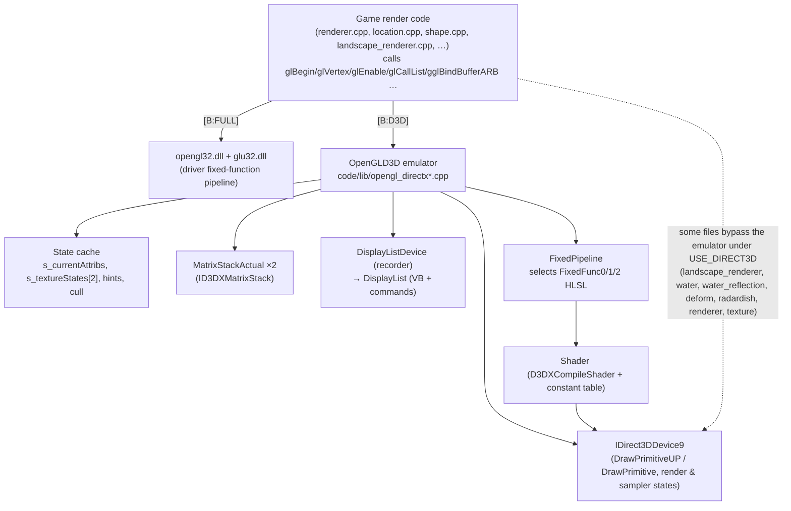

# P13_gfx_backend_math — GL/D3D9 backend, window managers, video capture, math library

Scope: `code/lib/opengl_directx{.cpp,.h,_inline.h,_internals.h,_stubs.cpp,_dlist*,_dlist_dev*,_matrix_stack*}`, `code/lib/ogl_extensions{.cpp,.h,_directx.cpp}`, `code/lib/opengl_trace.*`, `code/lib/safegl.*`, `code/lib/window_manager{,_directx,_win32}.*`, `code/lib/avi_generator.*`, `code/lib/avi_player.*`, `code/lib/math_utils.*`, `code/lib/matrix33.*`, `code/lib/matrix34.*`, `code/lib/vector2.*`, `code/lib/vector3.*`, `code/lib/plane.*`, `code/lib/invert_matrix.*`, `code/lib/rgb_colour.*`. Supporting evidence read in full: `data/shaders/FixedFunc{0,1,2}.vs`, `data/shaders/FixedFunc{0,1,2}Maps.ps`, `data/shaders/globals.h`, `code/globals.h`, `code/lib/FixedPipeline.*`, `code/lib/shader.*`, `contrib/systemiv/lib/math/math_stubs.*`, `docs/OpenGLState.txt`, `docs/HardwareComplianceIssues.txt`; partially: `code/renderer.cpp` (Initialise, SetScreenGamma, Check/SetOpenGLState), `code/interface/prefs_screen_window.cpp` (RestartWindowManagerAndRenderer), `code/landscape_renderer.cpp` (VBO path), `code/main.cpp` (StandardiseCPUPrecision), `code/lib/universal_include.h` (GL/D3D header switch, iv_* macros), `targets/vs2005/Darwinia.vcproj` (compiler FP flags). Build baseline: see build_matrix.md (`Release|Win32` OpenGL + `TARGET_PC_FULLGAME`; secondary `ReleaseDirect3D` = `USE_DIRECT3D`).

Conventions: all paths relative to the source root. "GL" = OpenGL 1.x fixed-function API as consumed by game code. "Emulator" = the `OpenGLD3D` layer that re-implements that API on Direct3D 9.

---

## [→ 24_rendering] Backend architecture — overview and build selection

### How the backend is chosen [C]

The game's renderer code is written once against the **OpenGL 1.x immediate-mode API** (plus two ARB extensions). The backend is chosen at compile time purely by which header set `code/lib/universal_include.h` pulls in:

| Build | Define | Headers included by `universal_include.h` | What `glXxx()` calls resolve to |
|---|---|---|---|
| `Release|Win32` / `Debug|Win32` **[B:FULL]** | (none) | `<GL/gl.h>`, `<GL/glu.h>` | Real `opengl32.dll` / `glu32.dll` entry points (WGL context created by `WindowManagerWin32`) |
| `ReleaseDirect3D|Win32` / `DebugDirect3D|Win32` **[B:D3D]** | `USE_DIRECT3D` | `<d3d9.h>`, `<d3dx9.h>`, `lib/opengl_directx.h`, `lib/safegl.h` | Free functions of the same names implemented in `code/lib/opengl_directx*.cpp` on top of `IDirect3DDevice9` + HLSL shaders |
| Mac OS X **[B:DEAD]** | `TARGET_OS_MACOSX` | `<OpenGL/gl.h>`, `<OpenGL/glu.h>`, `lib/safegl.h` | Apple OpenGL |

Evidence: `code/lib/universal_include.h` (block after the `TARGET_OS_MACOSX` section: `#ifdef USE_DIRECT3D … #include "lib/opengl_directx.h" … #else #include <GL/gl.h>`). [C]

`opengl_directx.h` re-declares every GL entry point the game uses **without `APIENTRY`/`__stdcall` DLL linkage** and with its own `#define`s for every GL enum used (the header comment explains the DLL-linkage reason) [C] `code/lib/opengl_directx.h`. Two signatures are *extended* relative to real GL: `glTexImage2D(…, bool _compressed = false)` and `gluBuild2DMipmaps(…, bool _compressed = false)` (the extra flag selects DXT1) [C].

### Compilation guards per file [C]

All files below are listed for **all four** VS configurations in `targets/vs2005/Darwinia.vcproj` (manifest `vcproj_build=all`); their bodies are switched by preprocessor guards:

| File | Guard | Content in baseline [B:FULL] |
|---|---|---|
| `code/lib/opengl_directx.cpp`, `_dlist.cpp`, `_dlist_dev.cpp`, `_matrix_stack.cpp`, `_stubs.cpp`, `opengl_trace.cpp`, `ogl_extensions_directx.cpp`, `window_manager_directx.cpp` | `#ifdef USE_DIRECT3D` | empty translation unit |
| `code/lib/FixedPipeline.cpp`, `code/lib/shader.cpp` (P12) | `#ifdef USE_DIRECT3D` | empty |
| `code/lib/ogl_extensions.cpp`, `code/lib/window_manager_win32.cpp` | `#if !defined USE_DIRECT3D` | live |
| `code/lib/safegl.cpp` | unguarded; inner `#ifndef USE_DIRECT3D` | compiled, but `safeGlNewList/EndList` are **never reached** in baseline because the `#define glNewList safeGlNewList` lives in `safegl.h`, which is only included for D3D/Mac |
| `code/lib/window_manager.cpp` | none | live (abstract base) |
| `code/lib/avi_generator.cpp` | `#ifdef AVI_GENERATOR` (defined only by `TARGET_DEBUG`) | empty in FULL ([B:DEBUG]) |
| `code/lib/avi_player.cpp` | `#ifdef EGAMESBUILD` (never defined) | empty ([B:DEAD]) |
| math files (`math_utils`, `matrix33`, `matrix34`, `vector2`, `vector3`, `plane`, `invert_matrix`, `rgb_colour`) | none | live in all builds |

Not in the build at all (manifest `vcproj_build` empty): `code/lib/ogl_extensions_sdl.cpp`, `code/lib/window_manager_sdl.{cpp,h}` → Appendix.

### Layer diagram

Files that talk to `OpenGLD3D::g_pd3dDevice` directly under `USE_DIRECT3D` (outside this partition): `code/landscape_renderer.cpp`, `code/water.cpp`, `code/water_reflection.cpp`, `code/deform.cpp`, `code/renderer.cpp`, `code/worldobject/radardish.cpp`, `code/lib/texture.cpp`, `code/lib/shader.cpp`, `code/lib/FixedPipeline.cpp` [C] (grep `OpenGLD3D::|g_pd3dDevice`). 46 files under `code/` contain `USE_DIRECT3D` [C].

### Is the D3D configuration buildable at this commit? [I]

Two pieces of evidence suggest `ReleaseDirect3D` does **not** compile unmodified at commit `f909630`:

1. `WindowManager::CreateWin` is pure-virtual with a `const wchar_t *_title` parameter [C] `code/lib/window_manager.h:WindowManager::CreateWin`, while `WindowManagerDirectX::CreateWin` takes `const char *_title` [C] `code/lib/window_manager_directx.h`. The derived function therefore *hides* rather than overrides; `WindowManagerDirectX` stays abstract and `new WindowManagerDirectX()` in `code/lib/window_manager_directx.cpp:WinMain` is ill-formed (MSVC C2259). `WindowManagerWin32` was updated to `wchar_t` and uses `RegisterClassW/CreateWindowW` [C]; the D3D variant was not.
2. `glLineWidth` sets `D3DRS_LINEWIDTH` [C] `code/lib/opengl_directx.cpp:glLineWidth`; to my knowledge this render state is not in the PC DirectX 9 SDK `D3DRENDERSTATETYPE` (it exists on Xbox-family D3D), and it is not defined anywhere in the tree [C grep]. Comment `// autogenmipmap ignored by xbox` in `d3dCreateTexture` corroborates Xbox-360 heritage of this layer.

Resolution: attempt a `ReleaseDirect3D` build with the DirectX SDK (March 2008) headers named in the vcproj include path. Logged in Unknowns. The D3D path is nevertheless documented in full below because the build matrix designates it the secondary configuration and it encodes Introversion's own "GL-on-D3D" design.

---

## [→ 24_rendering] Native OpenGL path [B:FULL]

### API surface used [C]

The baseline renders entirely with the OpenGL 1.1–1.3 fixed-function pipeline: immediate mode (`glBegin/glEnd`), display lists (`glNewList/glCallList`), client vertex arrays (`glVertexPointer` + `glDrawArrays`), fixed-function lighting (2 lights, `GL_COLOR_MATERIAL`), linear fog, alpha test, blending, `glCopyTexImage2D` render-to-texture, `glReadPixels`, `gluBuild2DMipmaps`, `gluPerspective`, `gluLookAt`, `gluOrtho2D`, `gluProject/gluUnProject`. No GLSL/ARB programs are used in the baseline [C] (P12 confirms all shader code is `USE_DIRECT3D`-only). The two extension families accessed through function pointers are `GL_ARB_multitexture` and `GL_ARB_vertex_buffer_object` (next section).

The default-state contract asserted by the renderer (`Renderer::SetOpenGLState`, `Renderer::CheckOpenGLState`, owned by P12) is cross-checked against `docs/OpenGLState.txt` under *Docs-vs-code discrepancies*.

### Extension handling — `code/lib/ogl_extensions.cpp` [B:FULL] [C]

`InitialiseOGLExtensions()` is called once per renderer creation from `Renderer::Initialise` immediately after window creation [C] `code/renderer.cpp:Renderer::Initialise`. It:

1. Loads every function pointer below with `wglGetProcAddress` (no check of the extension string first; a missing entry point simply leaves the pointer `NULL`).
2. Reads `glGetString(GL_VENDOR/GL_RENDERER/GL_VERSION/GL_EXTENSIONS)` into static buffers `s_glVendor[256]`, `s_glRenderer[256]`, `s_glVersion[256]`, `s_glExtensions[4096]` (`strncpy` + forced NUL ⇒ **extension string silently truncated at 4095 chars**) and logs them with `AppDebugOut`.

| Global pointer | Loaded name | Extension | Consumers (outside scope) | Behaviour if missing |
|---|---|---|---|---|
| `gglMultiTexCoord2fARB` | `glMultiTexCoord2fARB` | GL_ARB_multitexture | `render_utils.cpp`, `water.cpp`, `laserfence.cpp`, `feedingtube.cpp`, `radardish.cpp`, `taskmanager_interface_gestures.cpp`, `deform.cpp` | **No guard anywhere** — call through `NULL` ⇒ crash [C grep: no `if (gglActiveTextureARB)` in `code/`] |
| `gglActiveTextureARB` | `glActiveTextureARB` | GL_ARB_multitexture | same | same |
| `gglBindBufferARB` | `glBindBufferARB` | GL_ARB_vertex_buffer_object | `landscape_renderer.cpp` | `LandscapeRenderer` falls back to display lists if pointer is NULL or extension unsupported |
| `gglDeleteBuffersARB` | `glDeleteBuffersARB` | VBO | landscape | (as above) |
| `gglGenBuffersARB` | `glGenBuffersARB` | VBO | landscape | (as above) |
| `gglIsBufferARB` | `glIsBufferARB` | VBO | none found | — |
| `gglBufferDataARB` | `glBufferDataARB` | VBO | landscape | (as above) |
| `gglBufferSubDataARB` | `glBufferSubDataARB` | VBO | none found | — |
| `gglGetBufferSubDataARB` | `glGetBufferSubDataARB` | VBO | none found | — |
| `gglMapBufferARB` | `glMapBufferARB` | VBO | none found | — |
| `gglUnmapBufferARB` | `glUnmapBufferARB` | VBO | none found | — |
| `gglGetBufferParameterivARB` | `glGetBufferParameterivARB` | VBO | none found | — |
| `gglGetBufferPointervARB` | `glGetBufferPointervARB` | VBO | none found | — |
| `gglChoosePixelFormatARB` | `wglChoosePixelFormatARB` | WGL_ARB_pixel_format | **none** — loaded but never called [C grep] (so no FSAA pixel format is ever requested) | — |

Constants declared in `ogl_extensions.h` but used only as enum values: `GL_COMBINE_EXT 0x8570`, `GL_COMBINE_RGB_EXT 0x8571`, `GL_COMBINE_ALPHA_EXT 0x8572`, `GL_ADD_SIGNED_EXT 0x8574`, `GL_INTERPOLATE_EXT 0x8575`, `GL_CONSTANT_EXT 0x8576`, `GL_SOURCE0_ALPHA_ARB 0x8588`, `GL_TEXTURE0_ARB 0x84C0`, `GL_TEXTURE1_ARB 0x84C1`; `WGL_*_PBUFFER_*` (0x202D–0x2036, pbuffer API commented out); full `GL_*_BUFFER_*_ARB` enum set (0x8892–0x88EA, 0x8764/0x8765, 0x88B8–0x88BD); `WGL_SAMPLE_BUFFERS_ARB 0x2041`, `WGL_SAMPLES_ARB 0x2042`, `WGL_DOUBLE_BUFFER_ARB 0x2011`, `WGL_ACCELERATION_ARB 0x2003`, `WGL_FULL_ACCELERATION_ARB 0x2027`, `GL_MULTISAMPLE_ARB 0x809D`, `WGL_DRAW_TO_WINDOW_EXT 0x2001`, `WGL_SUPPORT_OPENGL_EXT 0x2010`, `WGL_COLOR_BITS_EXT 0x2014`, `WGL_ALPHA_BITS_EXT 0x201B`, `WGL_DEPTH_BITS_EXT 0x2022`, `WGL_STENCIL_BITS_EXT 0x2023` [C] `code/lib/ogl_extensions.h`.

**Query functions** [C]:

- `IsOGLExtensionSupported(name)`: returns 0 if `IsOGLExtensionBlacklisted(name)`; else performs a whole-word search of `s_glExtensions` (match must be preceded by start-of-string or space and followed by space or NUL); names containing a space or empty names return 0.
- `IsOGLExtensionBlacklisted(name)`: only ever blacklists `"GL_ARB_vertex_buffer_object"`, when `GL_VENDOR` contains `"Intel"` and `GL_RENDERER` contains any of the Intel list, or `GL_VENDOR` contains `"SiS"` and renderer contains any SiS list entry (substring match):

| Vendor | Renderer substrings (exact strings from `blacklistIntel[]` / `blacklistSiS[]`) | Source annotation in code |
|---|---|---|
| Intel | `Intel 945GM`, `Intel 965/963`, `Intel Bear Lake B` | "Reported by users" (Bear Lake B = G33/G31, GMA 3100) |
| Intel | `Intel 82810`, `Intel 82815`, `Intel 82830M`, `Intel 82845G`, `Intel 82845PE`, `Intel 82852`, `Intel 82855`, `Intel 82865G`, `Intel 82910GL`, `Intel 82915G`, `Intel 82945G`, `Intel 910GML`, `Intel 915GM`, `Intel 945`, `Intel 963`, `Intel 965` | "Untested" |
| SiS | `Mirage Graphics3` | "Reported by users" (SiS Mirage 3) |

(A second, commented-out list of full Windows driver names and a commented "Ok Intel card?" list — G965, 946GZ, Q35 — exist [C].)

- `IsOGLExtensionPerfectlySupported(name)`: `IsOGLExtensionSupported(name)`, but additionally returns 0 for `GL_ARB_vertex_buffer_object` whenever the vendor string contains `"Intel"` **or** `"SiS"` (any renderer) [C].

**Every extension query in the code and its fallback** [C]:

| Query site | Extension | Fallback when absent |
|---|---|---|
| `code/landscape_renderer.cpp:LandscapeRenderer::LandscapeRenderer` (pref `RenderLandscapeMode` = −1, the default) | `IsOGLExtensionPerfectlySupported("GL_ARB_vertex_buffer_object")` | `RenderModeDisplayList` instead of `RenderModeVertexBufferObject` (so all Intel/SiS GPUs get display lists by default) |
| same, after mode chosen | `!gglBindBufferARB || !IsOGLExtensionSupported("GL_ARB_vertex_buffer_object")` | forced to `RenderModeDisplayList` even if the pref asked for VBO |
| `code/lib/math_utils.cpp:RequirePowerOfTwoTextures` | `strstr(glGetString(GL_EXTENSIONS), "GL_ARB_texture_non_power_of_two")` (raw substring, cached in a function-static) | returns true ⇒ `code/lib/bitmap.cpp` rescales textures to `nearestPowerOfTwo`; `code/renderer.cpp` uses POT-sized `glCopyTexImage2D` and scales tex-coords by `screenW/nearestPowerOfTwo(screenW)` |
| `code/lib/math_utils.cpp:RequireSquareTextures` | `strstr(…, "GL_ARB_texture_rectangle")` | returns true ⇒ `bitmap.cpp` makes textures square |
| `GL_ARB_multitexture` | never queried | none (crash if absent; see table above) |
| pref `ManuallyScaleTextures` (default 0) | — | forces POT rescale regardless of extensions [C] `code/lib/bitmap.cpp` (P12) |

Under `USE_DIRECT3D` both `Require*Textures` return `false` immediately [C].

### WGL context [B:FULL]

Created by `WindowManagerWin32::EnableOpenGL` — documented in the 31 section below (pixel format, secondary context, no vsync control, no MSAA).

### `safegl` [C]

`code/lib/safegl.h` redefines `glNewList`→`safeGlNewList` and `glEndList`→`safeGlEndList`. `safeGlNewList` (non-D3D only) logs `"glNewList called from non-mainthread (bad for OpenGL)\n"` if `NetGetCurrentThreadId() != g_app->m_mainThreadId`, then **locks the global `NetMutex g_openGLMutex`** and calls the real `glNewList`; `safeGlEndList` calls `glEndList` then unlocks. The same mutex is taken by `LoadingScreen::RenderFrame` [C] `code/loading_screen.cpp` (P20). Purpose [I]: serialise display-list compilation (done on the loading thread) against the loading-screen renderer. Because `safegl.h` is included only for `USE_DIRECT3D` and Mac, **in the baseline the wrapper is inactive**: display lists compile without the lock, and the loading screen's lock protects nothing [C for include topology; I for consequence].

### Hardware-compatibility fallbacks summary [B:FULL]

| Problem | Mechanism | Ref |
|---|---|---|
| Intel/SiS VBO driver bugs | blacklist + "perfectly supported" ⇒ display lists | `ogl_extensions.cpp` |
| No NPOT textures | rescale to POT; POT copy-tex | `math_utils.cpp:RequirePowerOfTwoTextures` |
| No rectangle textures | square textures | `math_utils.cpp:RequireSquareTextures` |
| Requested mode fails | 4-stage `CreateWin` retry chain | `renderer.cpp:Renderer::Initialise` (see 31) |
| Long extension strings | truncated at 4095 chars (risk: late-listed extensions reported missing) | `InitialiseOGLExtensions` |
| Multitexture missing | **none** | — |

`docs/HardwareComplianceIssues.txt` contains only: *"Johnny's Linux Machine: – Multitexturing ARB not supported – Mouse pointer background not transparent"* [C]. Neither issue has a code-side fallback on Win32 (see discrepancies).

