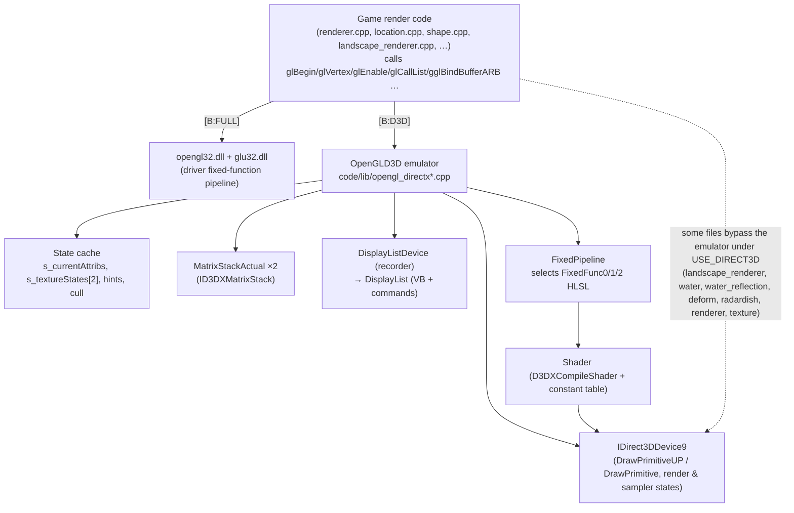
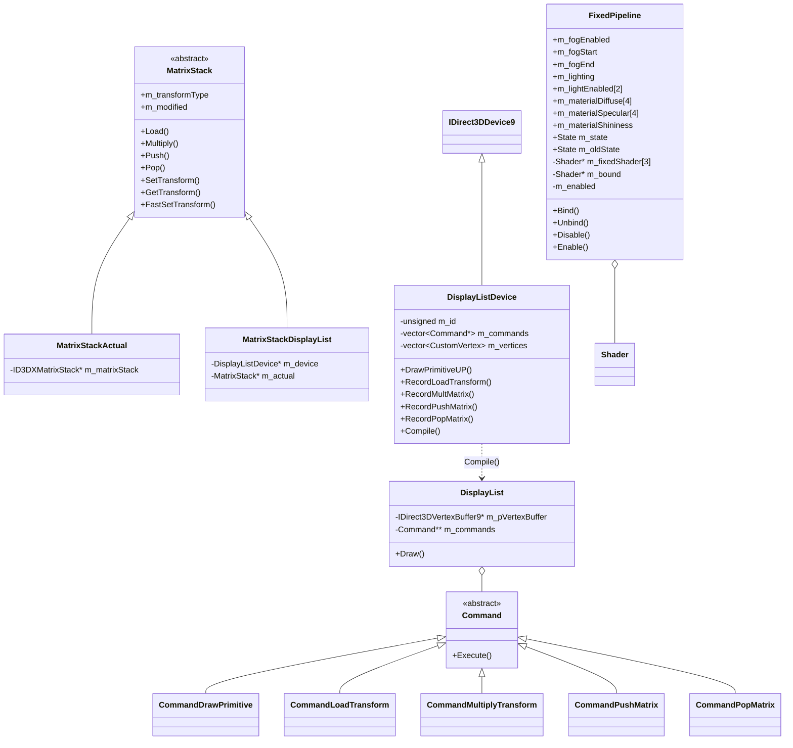
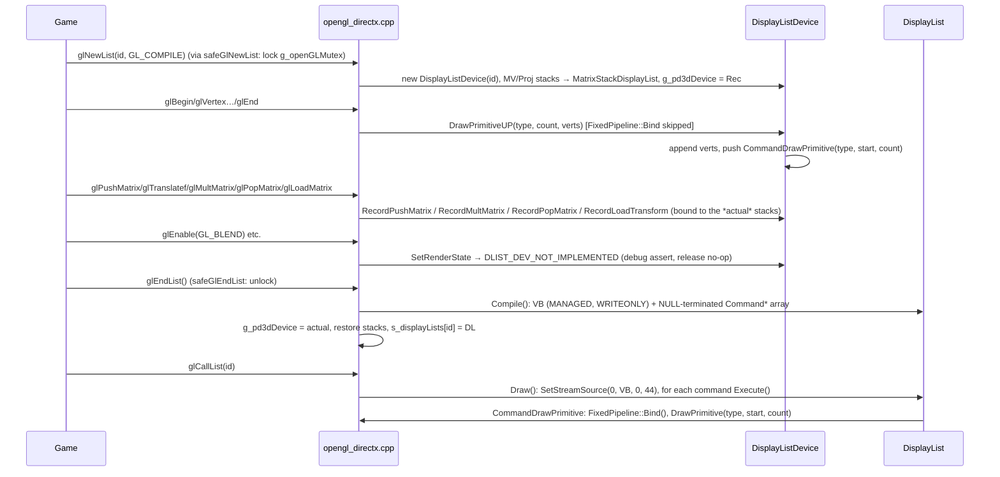
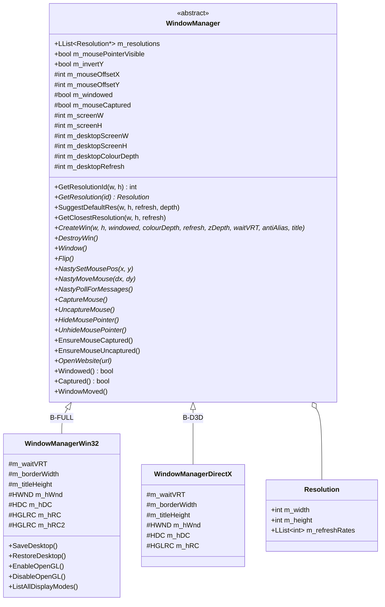
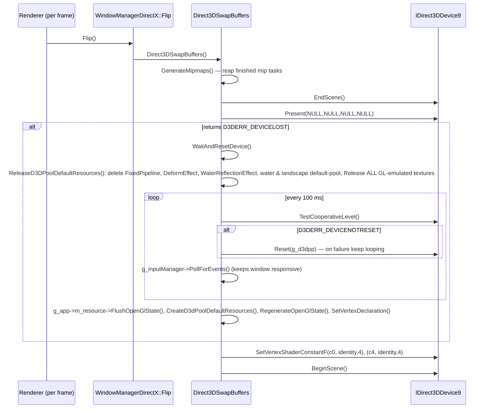

# P13_gfx_backend_math — GL/D3D9 backend, window managers, video capture, math library

Scope: `code/lib/opengl_directx{.cpp,.h,_inline.h,_internals.h,_stubs.cpp,_dlist*,_dlist_dev*,_matrix_stack*}`, `code/lib/ogl_extensions{.cpp,.h,_directx.cpp}`, `code/lib/opengl_trace.*`, `code/lib/safegl.*`, `code/lib/window_manager{,_directx,_win32}.*`, `code/lib/avi_generator.*`, `code/lib/avi_player.*`, `code/lib/math_utils.*`, `code/lib/matrix33.*`, `code/lib/matrix34.*`, `code/lib/vector2.*`, `code/lib/vector3.*`, `code/lib/plane.*`, `code/lib/invert_matrix.*`, `code/lib/rgb_colour.*`. Supporting evidence read in full: `data/shaders/FixedFunc{0,1,2}.vs`, `data/shaders/FixedFunc{0,1,2}Maps.ps`, `data/shaders/globals.h`, `code/globals.h`, `code/lib/FixedPipeline.*`, `code/lib/shader.*`, `contrib/systemiv/lib/math/math_stubs.*`, `docs/OpenGLState.txt`, `docs/HardwareComplianceIssues.txt`; partially: `code/renderer.cpp` (Initialise, SetScreenGamma, Check/SetOpenGLState), `code/interface/prefs_screen_window.cpp` (RestartWindowManagerAndRenderer), `code/landscape_renderer.cpp` (VBO path), `code/main.cpp` (StandardiseCPUPrecision), `code/lib/universal_include.h` (GL/D3D header switch, iv_* macros), `targets/vs2005/Darwinia.vcproj` (compiler FP flags). Build baseline: see build_matrix.md (`Release|Win32` OpenGL + `TARGET_PC_FULLGAME`; secondary `ReleaseDirect3D` = `USE_DIRECT3D`).

Conventions: all paths relative to the source root. "GL" = OpenGL 1.x fixed-function API as consumed by game code. "Emulator" = the `OpenGLD3D` layer that re-implements that API on Direct3D 9.

---

## [→ 24_rendering] Backend architecture — overview and build selection

### How the backend is chosen [C]

The game's renderer code is written once against the **OpenGL 1.x immediate-mode API** (plus two ARB extensions). The backend is chosen at compile time purely by which header set `code/lib/universal_include.h` pulls in:

| Build | Define | Headers included by `universal_include.h` | What `glXxx()` calls resolve to |
|---|---|---|---|
| `Release|Win32` / `Debug|Win32` **[B:FULL]** | (none) | `<GL/gl.h>`, `<GL/glu.h>` | Real `opengl32.dll` / `glu32.dll` entry points (WGL context created by `WindowManagerWin32`) |
| `ReleaseDirect3D|Win32` / `DebugDirect3D|Win32` **[B:D3D]** | `USE_DIRECT3D` | `<d3d9.h>`, `<d3dx9.h>`, `lib/opengl_directx.h`, `lib/safegl.h` | Free functions of the same names implemented in `code/lib/opengl_directx*.cpp` on top of `IDirect3DDevice9` + HLSL shaders |
| Mac OS X **[B:DEAD]** | `TARGET_OS_MACOSX` | `<OpenGL/gl.h>`, `<OpenGL/glu.h>`, `lib/safegl.h` | Apple OpenGL |

Evidence: `code/lib/universal_include.h` (block after the `TARGET_OS_MACOSX` section: `#ifdef USE_DIRECT3D … #include "lib/opengl_directx.h" … #else #include <GL/gl.h>`). [C]

`opengl_directx.h` re-declares every GL entry point the game uses **without `APIENTRY`/`__stdcall` DLL linkage** and with its own `#define`s for every GL enum used (the header comment explains the DLL-linkage reason) [C] `code/lib/opengl_directx.h`. Two signatures are *extended* relative to real GL: `glTexImage2D(…, bool _compressed = false)` and `gluBuild2DMipmaps(…, bool _compressed = false)` (the extra flag selects DXT1) [C].

### Compilation guards per file [C]

All files below are listed for **all four** VS configurations in `targets/vs2005/Darwinia.vcproj` (manifest `vcproj_build=all`); their bodies are switched by preprocessor guards:

| File | Guard | Content in baseline [B:FULL] |
|---|---|---|
| `code/lib/opengl_directx.cpp`, `_dlist.cpp`, `_dlist_dev.cpp`, `_matrix_stack.cpp`, `_stubs.cpp`, `opengl_trace.cpp`, `ogl_extensions_directx.cpp`, `window_manager_directx.cpp` | `#ifdef USE_DIRECT3D` | empty translation unit |
| `code/lib/FixedPipeline.cpp`, `code/lib/shader.cpp` (P12) | `#ifdef USE_DIRECT3D` | empty |
| `code/lib/ogl_extensions.cpp`, `code/lib/window_manager_win32.cpp` | `#if !defined USE_DIRECT3D` | live |
| `code/lib/safegl.cpp` | unguarded; inner `#ifndef USE_DIRECT3D` | compiled, but `safeGlNewList/EndList` are **never reached** in baseline because the `#define glNewList safeGlNewList` lives in `safegl.h`, which is only included for D3D/Mac |
| `code/lib/window_manager.cpp` | none | live (abstract base) |
| `code/lib/avi_generator.cpp` | `#ifdef AVI_GENERATOR` (defined only by `TARGET_DEBUG`) | empty in FULL ([B:DEBUG]) |
| `code/lib/avi_player.cpp` | `#ifdef EGAMESBUILD` (never defined) | empty ([B:DEAD]) |
| math files (`math_utils`, `matrix33`, `matrix34`, `vector2`, `vector3`, `plane`, `invert_matrix`, `rgb_colour`) | none | live in all builds |

Not in the build at all (manifest `vcproj_build` empty): `code/lib/ogl_extensions_sdl.cpp`, `code/lib/window_manager_sdl.{cpp,h}` → Appendix.

### Layer diagram



Files that talk to `OpenGLD3D::g_pd3dDevice` directly under `USE_DIRECT3D` (outside this partition): `code/landscape_renderer.cpp`, `code/water.cpp`, `code/water_reflection.cpp`, `code/deform.cpp`, `code/renderer.cpp`, `code/worldobject/radardish.cpp`, `code/lib/texture.cpp`, `code/lib/shader.cpp`, `code/lib/FixedPipeline.cpp` [C] (grep `OpenGLD3D::|g_pd3dDevice`). 46 files under `code/` contain `USE_DIRECT3D` [C].

### Is the D3D configuration buildable at this commit? [I]

Two pieces of evidence suggest `ReleaseDirect3D` does **not** compile unmodified at commit `f909630`:

1. `WindowManager::CreateWin` is pure-virtual with a `const wchar_t *_title` parameter [C] `code/lib/window_manager.h:WindowManager::CreateWin`, while `WindowManagerDirectX::CreateWin` takes `const char *_title` [C] `code/lib/window_manager_directx.h`. The derived function therefore *hides* rather than overrides; `WindowManagerDirectX` stays abstract and `new WindowManagerDirectX()` in `code/lib/window_manager_directx.cpp:WinMain` is ill-formed (MSVC C2259). `WindowManagerWin32` was updated to `wchar_t` and uses `RegisterClassW/CreateWindowW` [C]; the D3D variant was not.
2. `glLineWidth` sets `D3DRS_LINEWIDTH` [C] `code/lib/opengl_directx.cpp:glLineWidth`; to my knowledge this render state is not in the PC DirectX 9 SDK `D3DRENDERSTATETYPE` (it exists on Xbox-family D3D), and it is not defined anywhere in the tree [C grep]. Comment `// autogenmipmap ignored by xbox` in `d3dCreateTexture` corroborates Xbox-360 heritage of this layer.

Resolution: attempt a `ReleaseDirect3D` build with the DirectX SDK (March 2008) headers named in the vcproj include path. Logged in Unknowns. The D3D path is nevertheless documented in full below because the build matrix designates it the secondary configuration and it encodes Introversion's own "GL-on-D3D" design.

---

## [→ 24_rendering] Native OpenGL path [B:FULL]

### API surface used [C]

The baseline renders entirely with the OpenGL 1.1–1.3 fixed-function pipeline: immediate mode (`glBegin/glEnd`), display lists (`glNewList/glCallList`), client vertex arrays (`glVertexPointer` + `glDrawArrays`), fixed-function lighting (2 lights, `GL_COLOR_MATERIAL`), linear fog, alpha test, blending, `glCopyTexImage2D` render-to-texture, `glReadPixels`, `gluBuild2DMipmaps`, `gluPerspective`, `gluLookAt`, `gluOrtho2D`, `gluProject/gluUnProject`. No GLSL/ARB programs are used in the baseline [C] (P12 confirms all shader code is `USE_DIRECT3D`-only). The two extension families accessed through function pointers are `GL_ARB_multitexture` and `GL_ARB_vertex_buffer_object` (next section).

The default-state contract asserted by the renderer (`Renderer::SetOpenGLState`, `Renderer::CheckOpenGLState`, owned by P12) is cross-checked against `docs/OpenGLState.txt` under *Docs-vs-code discrepancies*.

### Extension handling — `code/lib/ogl_extensions.cpp` [B:FULL] [C]

`InitialiseOGLExtensions()` is called once per renderer creation from `Renderer::Initialise` immediately after window creation [C] `code/renderer.cpp:Renderer::Initialise`. It:

1. Loads every function pointer below with `wglGetProcAddress` (no check of the extension string first; a missing entry point simply leaves the pointer `NULL`).
2. Reads `glGetString(GL_VENDOR/GL_RENDERER/GL_VERSION/GL_EXTENSIONS)` into static buffers `s_glVendor[256]`, `s_glRenderer[256]`, `s_glVersion[256]`, `s_glExtensions[4096]` (`strncpy` + forced NUL ⇒ **extension string silently truncated at 4095 chars**) and logs them with `AppDebugOut`.

| Global pointer | Loaded name | Extension | Consumers (outside scope) | Behaviour if missing |
|---|---|---|---|---|
| `gglMultiTexCoord2fARB` | `glMultiTexCoord2fARB` | GL_ARB_multitexture | `render_utils.cpp`, `water.cpp`, `laserfence.cpp`, `feedingtube.cpp`, `radardish.cpp`, `taskmanager_interface_gestures.cpp`, `deform.cpp` | **No guard anywhere** — call through `NULL` ⇒ crash [C grep: no `if (gglActiveTextureARB)` in `code/`] |
| `gglActiveTextureARB` | `glActiveTextureARB` | GL_ARB_multitexture | same | same |
| `gglBindBufferARB` | `glBindBufferARB` | GL_ARB_vertex_buffer_object | `landscape_renderer.cpp` | `LandscapeRenderer` falls back to display lists if pointer is NULL or extension unsupported |
| `gglDeleteBuffersARB` | `glDeleteBuffersARB` | VBO | landscape | (as above) |
| `gglGenBuffersARB` | `glGenBuffersARB` | VBO | landscape | (as above) |
| `gglIsBufferARB` | `glIsBufferARB` | VBO | none found | — |
| `gglBufferDataARB` | `glBufferDataARB` | VBO | landscape | (as above) |
| `gglBufferSubDataARB` | `glBufferSubDataARB` | VBO | none found | — |
| `gglGetBufferSubDataARB` | `glGetBufferSubDataARB` | VBO | none found | — |
| `gglMapBufferARB` | `glMapBufferARB` | VBO | none found | — |
| `gglUnmapBufferARB` | `glUnmapBufferARB` | VBO | none found | — |
| `gglGetBufferParameterivARB` | `glGetBufferParameterivARB` | VBO | none found | — |
| `gglGetBufferPointervARB` | `glGetBufferPointervARB` | VBO | none found | — |
| `gglChoosePixelFormatARB` | `wglChoosePixelFormatARB` | WGL_ARB_pixel_format | **none** — loaded but never called [C grep] (so no FSAA pixel format is ever requested) | — |

Constants declared in `ogl_extensions.h` but used only as enum values: `GL_COMBINE_EXT 0x8570`, `GL_COMBINE_RGB_EXT 0x8571`, `GL_COMBINE_ALPHA_EXT 0x8572`, `GL_ADD_SIGNED_EXT 0x8574`, `GL_INTERPOLATE_EXT 0x8575`, `GL_CONSTANT_EXT 0x8576`, `GL_SOURCE0_ALPHA_ARB 0x8588`, `GL_TEXTURE0_ARB 0x84C0`, `GL_TEXTURE1_ARB 0x84C1`; `WGL_*_PBUFFER_*` (0x202D–0x2036, pbuffer API commented out); full `GL_*_BUFFER_*_ARB` enum set (0x8892–0x88EA, 0x8764/0x8765, 0x88B8–0x88BD); `WGL_SAMPLE_BUFFERS_ARB 0x2041`, `WGL_SAMPLES_ARB 0x2042`, `WGL_DOUBLE_BUFFER_ARB 0x2011`, `WGL_ACCELERATION_ARB 0x2003`, `WGL_FULL_ACCELERATION_ARB 0x2027`, `GL_MULTISAMPLE_ARB 0x809D`, `WGL_DRAW_TO_WINDOW_EXT 0x2001`, `WGL_SUPPORT_OPENGL_EXT 0x2010`, `WGL_COLOR_BITS_EXT 0x2014`, `WGL_ALPHA_BITS_EXT 0x201B`, `WGL_DEPTH_BITS_EXT 0x2022`, `WGL_STENCIL_BITS_EXT 0x2023` [C] `code/lib/ogl_extensions.h`.

**Query functions** [C]:

- `IsOGLExtensionSupported(name)`: returns 0 if `IsOGLExtensionBlacklisted(name)`; else performs a whole-word search of `s_glExtensions` (match must be preceded by start-of-string or space and followed by space or NUL); names containing a space or empty names return 0.
- `IsOGLExtensionBlacklisted(name)`: only ever blacklists `"GL_ARB_vertex_buffer_object"`, when `GL_VENDOR` contains `"Intel"` and `GL_RENDERER` contains any of the Intel list, or `GL_VENDOR` contains `"SiS"` and renderer contains any SiS list entry (substring match):

| Vendor | Renderer substrings (exact strings from `blacklistIntel[]` / `blacklistSiS[]`) | Source annotation in code |
|---|---|---|
| Intel | `Intel 945GM`, `Intel 965/963`, `Intel Bear Lake B` | "Reported by users" (Bear Lake B = G33/G31, GMA 3100) |
| Intel | `Intel 82810`, `Intel 82815`, `Intel 82830M`, `Intel 82845G`, `Intel 82845PE`, `Intel 82852`, `Intel 82855`, `Intel 82865G`, `Intel 82910GL`, `Intel 82915G`, `Intel 82945G`, `Intel 910GML`, `Intel 915GM`, `Intel 945`, `Intel 963`, `Intel 965` | "Untested" |
| SiS | `Mirage Graphics3` | "Reported by users" (SiS Mirage 3) |

(A second, commented-out list of full Windows driver names and a commented "Ok Intel card?" list — G965, 946GZ, Q35 — exist [C].)

- `IsOGLExtensionPerfectlySupported(name)`: `IsOGLExtensionSupported(name)`, but additionally returns 0 for `GL_ARB_vertex_buffer_object` whenever the vendor string contains `"Intel"` **or** `"SiS"` (any renderer) [C].

**Every extension query in the code and its fallback** [C]:

| Query site | Extension | Fallback when absent |
|---|---|---|
| `code/landscape_renderer.cpp:LandscapeRenderer::LandscapeRenderer` (pref `RenderLandscapeMode` = −1, the default) | `IsOGLExtensionPerfectlySupported("GL_ARB_vertex_buffer_object")` | `RenderModeDisplayList` instead of `RenderModeVertexBufferObject` (so all Intel/SiS GPUs get display lists by default) |
| same, after mode chosen | `!gglBindBufferARB || !IsOGLExtensionSupported("GL_ARB_vertex_buffer_object")` | forced to `RenderModeDisplayList` even if the pref asked for VBO |
| `code/lib/math_utils.cpp:RequirePowerOfTwoTextures` | `strstr(glGetString(GL_EXTENSIONS), "GL_ARB_texture_non_power_of_two")` (raw substring, cached in a function-static) | returns true ⇒ `code/lib/bitmap.cpp` rescales textures to `nearestPowerOfTwo`; `code/renderer.cpp` uses POT-sized `glCopyTexImage2D` and scales tex-coords by `screenW/nearestPowerOfTwo(screenW)` |
| `code/lib/math_utils.cpp:RequireSquareTextures` | `strstr(…, "GL_ARB_texture_rectangle")` | returns true ⇒ `bitmap.cpp` makes textures square |
| `GL_ARB_multitexture` | never queried | none (crash if absent; see table above) |
| pref `ManuallyScaleTextures` (default 0) | — | forces POT rescale regardless of extensions [C] `code/lib/bitmap.cpp` (P12) |

Under `USE_DIRECT3D` both `Require*Textures` return `false` immediately [C].

### WGL context [B:FULL]

Created by `WindowManagerWin32::EnableOpenGL` — documented in the 31 section below (pixel format, secondary context, no vsync control, no MSAA).

### `safegl` [C]

`code/lib/safegl.h` redefines `glNewList`→`safeGlNewList` and `glEndList`→`safeGlEndList`. `safeGlNewList` (non-D3D only) logs `"glNewList called from non-mainthread (bad for OpenGL)\n"` if `NetGetCurrentThreadId() != g_app->m_mainThreadId`, then **locks the global `NetMutex g_openGLMutex`** and calls the real `glNewList`; `safeGlEndList` calls `glEndList` then unlocks. The same mutex is taken by `LoadingScreen::RenderFrame` [C] `code/loading_screen.cpp` (P20). Purpose [I]: serialise display-list compilation (done on the loading thread) against the loading-screen renderer. Because `safegl.h` is included only for `USE_DIRECT3D` and Mac, **in the baseline the wrapper is inactive**: display lists compile without the lock, and the loading screen's lock protects nothing [C for include topology; I for consequence].

### Hardware-compatibility fallbacks summary [B:FULL]

| Problem | Mechanism | Ref |
|---|---|---|
| Intel/SiS VBO driver bugs | blacklist + "perfectly supported" ⇒ display lists | `ogl_extensions.cpp` |
| No NPOT textures | rescale to POT; POT copy-tex | `math_utils.cpp:RequirePowerOfTwoTextures` |
| No rectangle textures | square textures | `math_utils.cpp:RequireSquareTextures` |
| Requested mode fails | 4-stage `CreateWin` retry chain | `renderer.cpp:Renderer::Initialise` (see 31) |
| Long extension strings | truncated at 4095 chars (risk: late-listed extensions reported missing) | `InitialiseOGLExtensions` |
| Multitexture missing | **none** | — |

`docs/HardwareComplianceIssues.txt` contains only: *"Johnny's Linux Machine: – Multitexturing ARB not supported – Mouse pointer background not transparent"* [C]. Neither issue has a code-side fallback on Win32 (see discrepancies).

---

## [→ 24_rendering] Direct3D 9 path: OpenGL-API emulation layer [B:D3D]

### Module map [C]

| File | Namespace / classes | Role |
|---|---|---|
| `code/lib/opengl_directx.h` | — | GL type/enum `#define`s and prototypes for every emulated entry point; includes `_inline.h` |
| `code/lib/opengl_directx_inline.h` | — | `__forceinline` wrappers: `glColor*`, `glNormal*`, `glVertex*`, `glTexCoord*`, `glFogf/glFogi`, template `openGLMatrixToDirect3D` |
| `code/lib/opengl_directx_internals.h` | `OpenGLD3D::CustomVertex`, externs `g_pd3dDeviceActual`, `g_pd3dDevice`, `g_currentVertexBuffer`, `g_supportsHwVertexProcessing`, `glActiveTextureD3D`, `glMultiTexCoord2fD3D` | shared internals |
| `code/lib/opengl_directx.cpp` | `OpenGLD3D::TextureState`, `CurrentAttributes`, `Attributes`, `MipMapTask`; device globals | core emulator + device lifecycle |
| `code/lib/opengl_directx_stubs.cpp` | — | no-op stubs |
| `code/lib/opengl_directx_matrix_stack.*` | `MatrixStack` (abstract), `MatrixStackActual`, `MatrixStackDisplayList` | GL matrix stacks |
| `code/lib/opengl_directx_dlist_dev.*` | `DisplayListDevice : IDirect3DDevice9` | records draws while a list is open |
| `code/lib/opengl_directx_dlist.*` | `Command` (abstract) + `CommandDrawPrimitive`, `CommandLoadTransform`, `CommandMultiplyTransform`, `CommandPushMatrix`, `CommandPopMatrix`; `DisplayList` | compiled display list + playback |
| `code/lib/ogl_extensions_directx.cpp` | — | ARB multitexture + VBO emulation, extension query stubs |
| `code/lib/FixedPipeline.*` (P12 file, behaviour documented here) | `FixedPipeline` | fixed-function emulation: shader selection + uniform upload |
| `code/lib/shader.*` (P12) | `Shader` | HLSL compile/bind/constant-table helper |
| `code/lib/opengl_trace.*` | — | debug call tracing |



### Device globals [C] `code/lib/opengl_directx.cpp` (namespace `OpenGLD3D`)

| Global | Type | Meaning |
|---|---|---|
| `g_pD3D` | `LPDIRECT3D9` | `Direct3DCreate9(D3D_SDK_VERSION)`; created once, kept across window recreation |
| `g_d3dpp` | `D3DPRESENT_PARAMETERS` | last present parameters (reused for `Reset`) |
| `g_pd3dDevice` | `LPDIRECT3DDEVICE9` | **current command target** — the real device, or the `DisplayListDevice` recorder while `glNewList` is open |
| `g_pd3dDeviceActual` | `LPDIRECT3DDEVICE9` | the real device |
| `g_supportsHwVertexProcessing` | `bool` (default true) | `caps.DevCaps & D3DDEVCAPS_HWTRANSFORMANDLIGHT` |
| `g_currentVertexBuffer` | `IDirect3DVertexBuffer9 **` | slot of the VBO bound by `glBindBufferD3D` (in `ogl_extensions_directx.cpp`) |

### Vertex format [C]

`OpenGLD3D::CustomVertex` (44 bytes) and matching `D3DVERTEXELEMENT9 s_customVertexDesc[]` (vertex declaration created in `InitialiseData`, set after `BeginScene` and after every reset):

| Offset | Field(s) | Decl type | Usage |
|---|---|---|---|
| 0 | `float x, y, z` | FLOAT3 | POSITION0 |
| 12 | `float nx, ny, nz` | FLOAT3 | NORMAL0 |
| 24 | `unsigned char b8, g8, r8, a8` | D3DCOLOR (BGRA in memory = ARGB dword) | COLOR0 |
| 28 | `float u, v` | FLOAT2 | TEXCOORD0 |
| 36 | `float u2, v2` | FLOAT2 | TEXCOORD1 |

### State cache — what GL state is tracked and where it goes [C]

| GL state | Emulator storage | D3D9 target |
|---|---|---|
| Current colour (`glColor*`) | `s_currentAttribs.r8/g8/b8/a8` (float→byte: `x<0→0`, `x>1→255`, else `(unsigned char)(x*255)` truncation) | baked into each vertex's COLOR0 |
| Current normal (`glNormal*`) | `s_currentAttribs.nx/ny/nz` **negated** (comment: LH/RH) | NORMAL0 |
| Current texcoord unit 0 / 1 | `u,v` / `u2,v2` (`glTexCoord*`, `glMultiTexCoord2fD3D`) | TEXCOORD0 / TEXCOORD1 |
| Alpha reference | `s_currentAttribs.alphaRef` (clamped float) | `D3DRS_ALPHAREF = DWORD(clamp(ref,0,1)*255)` |
| Alpha func | — | `D3DRS_ALPHAFUNC` (`GL_LEQUAL→LESSEQUAL`, `GL_GREATER→GREATER`; others assert→LESSEQUAL) |
| Alpha test enable | — | `D3DRS_ALPHATESTENABLE` |
| Blend enable / func | — | `D3DRS_ALPHABLENDENABLE`, `D3DRS_SRCBLEND`, `D3DRS_DESTBLEND` |
| Depth test / func / mask | — | `D3DRS_ZENABLE` (`D3DZB_TRUE/FALSE`), `D3DRS_ZFUNC`, `D3DRS_ZWRITEENABLE` |
| Cull enable | `s_currentAttribs.backCullingEnabled` | `D3DRS_CULLMODE = s_cullMode` or `D3DCULL_NONE` |
| Front face | `s_ccwFrontFace` (default true) → `s_cullMode` (`GL_CCW→D3DCULL_CW`, `GL_CW→D3DCULL_CCW`) | `D3DRS_CULLMODE` when culling enabled |
| Polygon mode | — | `D3DRS_FILLMODE` (`GL_FILL→SOLID`, `GL_LINE→WIREFRAME`; face argument ignored) |
| Polygon offset enable / params | `polygonOffsetEnabled`, `depthBias=units`, `slopeDepthBias=factor` | `D3DRS_DEPTHBIAS`, `D3DRS_SLOPESCALEDEPTHBIAS` (see defect D11) |
| Scissor enable / rect | — | `D3DRS_SCISSORTESTENABLE`, `SetScissorRect` |
| Clip planes 0–2 enable / equation | — | `D3DRS_CLIPPLANEENABLE` bit `1<<(cap−GL_CLIP_PLANE0)`, `SetClipPlane` |
| Point size | — | `D3DRS_POINTSIZE` (float bits) |
| Line width | — | `D3DRS_LINEWIDTH` (float bits) — see build note |
| Viewport | — | `SetViewport` (MinZ/MaxZ preserved) |
| Clear colour | `s_clearColor` (default `D3DCOLOR_RGBA(0,0,0,255)`) | `Clear(…, colour, z=1.0f, stencil=0)` |
| Texture enable per unit | `s_currentAttribs.texturingEnabled[2]` | selects FixedFunc shader variant |
| Bound texture per unit | `s_textureStates[unit].target` (GL id) | `SetTexture(unit, s_textureIds[id])` |
| Active texture unit | `s_activeTexture` (0..1, `MAX_ACTIVE_TEXTURES = 2`) | stage/sampler index |
| Tex env mode / combine / colour | `TextureState.envMode` (default `GL_MODULATE`), `rgbCombineMode`, `envColour` | **stored only — no D3D effect** |
| Tex wrap / filters | — | sampler states of the **active stage** (`D3DSAMP_ADDRESSU/V`, `MAGFILTER`, `MINFILTER`, `MIPFILTER`) |
| Colour material enable / mode | `colorMaterialEnabled`, `colorMaterialMode` (default `GL_DIFFUSE`) | stored only |
| Lighting enable | `g_fixedPipeline->m_lighting` | shader `numLights` |
| Light 0/1 enable | `g_fixedPipeline->m_lightEnabled[0..1]` | shader `numLights` |
| Light params | `g_fixedPipeline->m_state.m_light[i]` (`D3DLIGHT9`) | shader `lights[i]` |
| Material diffuse/specular/shininess | `g_fixedPipeline->m_materialDiffuse[4]`, `m_materialSpecular[4]`, `m_materialShininess` | **stored only — never uploaded** |
| Fog enable/start/end | `g_fixedPipeline->m_fogEnabled/m_fogStart/m_fogEnd` | shader `fogRange` |
| Fog colour/mode/density | — | **ignored** |
| Hints | `s_fogHint`, `s_polygonSmoothHint` | stored only (readable via `glGetIntegerv`) |
| Matrix mode | `s_matrixMode`, `s_pTargetMatrixStack`, `s_targetMatrixTransformType` | — |
| Attribute stack | `class Attributes{CurrentAttributes, IDirect3DStateBlock9*}`, `std::stack<Attributes> s_attributeStack` | **declared, unused** — there is no `glPushAttrib/glPopAttrib` in the emulator, and none in game code [C grep] |

`CurrentAttributes` derives from `CustomVertex` and adds `alphaRef`, `texturingEnabled[2]`, `backCullingEnabled`, `polygonOffsetEnabled`, `depthBias`, `slopeDepthBias`, `colorMaterialEnabled`, `colorMaterialMode`; constructor zero-fills then sets `colorMaterialMode = GL_DIFFUSE`, `a8 = 255` [C]. `TextureState` = `{target=0, lastTarget=-1, envColour=0, envMode=GL_MODULATE, lastEnvMode=0, rgbCombineMode=0}` [C]. There is **no redundant-state filtering**: every `glEnable/glBlendFunc/…` issues a `SetRenderState` (the commented-out "lastEnvMode/lastTarget" optimisation in `setupTexturing` is disabled) [C].

### `glEnable` / `glDisable` / `glIsEnabled` capability table [C]

| Cap | `glEnable` | `glDisable` | `glIsEnabled` |
|---|---|---|---|
| `GL_ALPHA_TEST` | ALPHATESTENABLE=TRUE | FALSE | reads RS |
| `GL_BLEND` | ALPHABLENDENABLE=TRUE | FALSE | reads RS |
| `GL_CLIP_PLANE0..2` | set bit in CLIPPLANEENABLE (Get→Set) | clear bit | not handled (assert, returns 0) |
| `GL_COLOR_MATERIAL` | flag only | flag only | flag |
| `GL_CULL_FACE` | CULLMODE=`s_cullMode` | CULLMODE=NONE | `CULLMODE != NONE` |
| `GL_DEPTH_TEST` | ZENABLE=TRUE | FALSE | reads RS |
| `GL_FOG` | `m_fogEnabled=true` | false | flag |
| `GL_LIGHTING` | `m_lighting=true` | false | flag |
| `GL_LIGHT0`, `GL_LIGHT1` | `m_lightEnabled[i]=true` | false | flag |
| `GL_LIGHT2`..`GL_LIGHT7` | default branch (trace "not implemented") | same | assert, 0 |
| `GL_LINE_SMOOTH` | no-op | no-op | assert, 0 |
| `GL_NORMALIZE` | no-op | no-op | assert, 0 |
| `GL_POINT_SMOOTH` | default branch (trace) | no-op | FALSE |
| `GL_POLYGON_OFFSET_FILL` | flag + SLOPESCALEDEPTHBIAS/DEPTHBIAS from cache | flag + both 0 | assert, 0 |
| `GL_SCISSOR_TEST` | SCISSORTESTENABLE=TRUE | FALSE | reads RS |
| `GL_TEXTURE_2D` | `texturingEnabled[active]=true`; if bound texture pointer non-NULL → `SetTexture` | flag false | flag |

### Enum translation tables [C]

| GL | D3D9 |
|---|---|
| Blend `GL_ZERO`, `GL_ONE`, `GL_SRC_COLOR`, `GL_ONE_MINUS_SRC_COLOR`, `GL_SRC_ALPHA`, `GL_ONE_MINUS_SRC_ALPHA` | `D3DBLEND_ZERO`, `ONE`, `SRCCOLOR`, `INVSRCCOLOR`, `SRCALPHA`, `INVSRCALPHA`; any other factor → assert + `D3DBLEND_ONE` |
| Compare `GL_LEQUAL`, `GL_GREATER` | `D3DCMP_LESSEQUAL`, `D3DCMP_GREATER`; others (NEVER/LESS/EQUAL/NOTEQUAL/GEQUAL/ALWAYS commented out) → assert + LESSEQUAL |
| Filter `GL_LINEAR`, `GL_NEAREST`, `GL_LINEAR_MIPMAP_LINEAR` | `D3DTEXF_LINEAR`, `D3DTEXF_POINT`, `D3DTEXF_LINEAR`; any other (incl. `GL_NEAREST_MIPMAP_LINEAR`, which *is* `#define`d) → **`AppReleaseAssert`** (fatal in release) |
| MIN filter → MIPFILTER | `GL_LINEAR_MIPMAP_LINEAR → D3DTEXF_LINEAR`, else `D3DTEXF_NONE` |
| Wrap `GL_CLAMP`, `GL_REPEAT` | `D3DTADDRESS_CLAMP`, `D3DTADDRESS_WRAP`; other → `AppReleaseAssert` |
| Fill `GL_FILL`, `GL_LINE` | `D3DFILL_SOLID`, `D3DFILL_WIREFRAME` |
| Clear `GL_COLOR_BUFFER_BIT`, `GL_DEPTH_BUFFER_BIT` | `D3DCLEAR_TARGET`, `D3DCLEAR_ZBUFFER` (other bits → debug assert) |

### Complete emulated entry-point table [C]

Legend: **Impl** = implemented; **Stub** = compiled, does nothing (traces in `_DEBUG`); **Partial** = subset of GL semantics.

| GL / GLU / extension function | Status | D3D9 implementation summary (ref `code/lib/opengl_directx.cpp` unless noted) |
|---|---|---|
| `glBegin(mode)` | Impl | reset vertex cursor to `s_vertices[0]`, count 0, store `s_primitiveMode` |
| `glEnd()` | Impl | `FastSetTransform()` (no-op); if `g_fixedPipeline` and not recording → `FixedPipeline::Bind()`; convert primitive (table below) and `DrawPrimitiveUP` with stride 44 |
| `glVertex2i/2f/2fv/2dv/3d/3dv/3f/3fv` | Impl (inline) | `glVertex3f_impl`: grow buffer if `count+2 ≥ allocated` (×2, initial 1024); copy whole `s_currentAttribs` as the vertex, set xyz; quad expansion (below). 2D variants set z=0 |
| `glColor3ub/3ubv/3f/4ub/4ubv/4f/4fv` | Impl (inline + `glColor4ub`) | set current colour bytes (3-component variants alpha=255 / 1.0) |
| `glNormal3f/3fv/3dv` | Impl (inline) | current normal = **−n** |
| `glTexCoord2i/2f/2fv/2dv` | Impl (inline) | current `u,v` |
| `glEnable/glDisable/glIsEnabled` | Partial | capability table above |
| `glGetError()` | Stub-like | always returns 0 |
| `glGetString(name)` | Stub | returns NULL (`opengl_directx_stubs.cpp`) |
| `glHint(target, mode)` | Partial | stores `GL_FOG_HINT` / `GL_POLYGON_SMOOTH_HINT`; no effect |
| `glFrontFace(mode)` | Impl | updates `s_ccwFrontFace`, `s_cullMode`; re-applies CULLMODE if culling on |
| `glShadeModel(mode)` | Stub | ignored (flat look emulated only for strips, see conversion) |
| `glBlendFunc(s,d)` | Impl | SRCBLEND/DESTBLEND |
| `glAlphaFunc(func, ref)` | Impl | ALPHAFUNC; ALPHAREF = `DWORD(clamp(ref)*255)` (truncation) |
| `glDepthFunc(func)` | Impl | ZFUNC |
| `glDepthMask(flag)` | Impl | ZWRITEENABLE |
| `glClipPlane(plane, eq)` | Impl | normalise plane; transform by `(MV⁻¹)ᵀ` then `(P⁻¹)ᵀ` → clip-space plane; `SetClipPlane(plane−GL_CLIP_PLANE0)` |
| `glClear(mask)` | Impl | `Clear(0,NULL,flags,s_clearColor,1.0f,0)` |
| `glClearColor(r,g,b,a)` | Impl | `s_clearColor = D3DCOLOR_COLORVALUE(r,g,b,a)` |
| `glFinish()` | Stub | returns immediately (back-buffer lock code after `return` is dead) |
| `glLineWidth(w)` | Impl | `SetRenderState(D3DRS_LINEWIDTH, *(DWORD*)&w)` |
| `glPointSize(s)` | Impl | `D3DRS_POINTSIZE` float bits |
| `glViewport(x,y,w,h)` | Impl | Get/SetViewport, **no y-flip** |
| `glScissor(x,y,w,h)` | Impl | `RECT{left=x, right=x+w, bottom=ScreenH−y, top=bottom−h}` |
| `glPolygonMode(face, mode)` | Partial | FILLMODE; face ignored |
| `glPolygonOffset(factor, units)` | Partial | caches; applies DEPTHBIAS=units, SLOPESCALEDEPTHBIAS=factor if enabled (value conversion, see D11) |
| `glGetIntegerv(pname)` | Partial | `GL_ALPHA_TEST_FUNC`, `GL_BLEND_DST`, `GL_BLEND_SRC`, `GL_DEPTH_FUNC`, `GL_DEPTH_WRITEMASK` (read back from device RS); `GL_COLOR_MATERIAL_FACE` (always `GL_FRONT_AND_BACK`); `GL_COLOR_MATERIAL_PARAMETER`; `GL_FOG_HINT`; `GL_FRONT_FACE`; `GL_MATRIX_MODE`; `GL_POLYGON_MODE` (both entries = fill mode); `GL_POLYGON_SMOOTH_HINT`; `GL_VIEWPORT`. Others: trace only, output untouched |
| `glGetFloatv(pname)` | Partial | `GL_ALPHA_TEST_REF` (cached float), `GL_CURRENT_COLOR` (bytes × 1/255), `GL_FOG_COLOR` (no-op, output untouched), `GL_FOG_START`, `GL_FOG_END`; others assert |
| `glGetDoublev(pname)` | Partial | `GL_MODELVIEW_MATRIX`, `GL_PROJECTION_MATRIX` (top of stack, copied element-wise) |
| `glMatrixMode(mode)` | Impl | switch target stack (asserts MODELVIEW/PROJECTION) |
| `glLoadIdentity()` | Impl | `Load(identity)` |
| `glLoadMatrixd(m)` | Impl | `Load(openGLMatrixToDirect3D(m))` |
| `glMultMatrixd(m)`, `glMultMatrixf(m)` | Impl | `Multiply(converted)` |
| `glPushMatrix()`, `glPopMatrix()` | Impl | stack Push/Pop |
| `glTranslatef`, `glScalef` | Impl | `D3DXMatrixTranslation/Scaling` then Multiply |
| `glRotatef(angle,x,y,z)` | Impl | `D3DXMatrixRotationAxis(axis, D3DXToRadian(angle))` then Multiply |
| `glFrustum(...)` | Stub | no-op (`opengl_directx_stubs.cpp`) |
| `gluOrtho2D(l,r,b,t)` | Impl | `Load(D3DXMatrixOrthoOffCenterRH(l,r,b,t,−1,+1))` |
| `gluPerspective(fovy,aspect,zn,zf)` | Impl | `D3DXMatrixPerspectiveFovRH(rad(fovy),aspect,zn,zf)`, then **`_43 *= 2`**, Load |
| `gluLookAt(eye,center,up)` | Partial | `Load(D3DXMatrixLookAtRH(...))` — **replaces** the current matrix (GL multiplies) |
| `gluProject`, `gluUnProject` | Impl | D3DX vector/matrix maths with GL window conventions (x,y,z mapped [−1,1]↔[0,1], viewport offset; returns false on w=0 / singular) |
| `glLightfv(light, pname)` | Partial | `GL_POSITION` w=0 → directional: `Direction = xyz` transformed by current modelview (w=0) then normalised; w≠0 → `Type=POINT`, `Position=xyz` but **the code transforms `Direction` instead of `Position`** (D17); `GL_DIFFUSE`, `GL_SPECULAR`, `GL_AMBIENT` copied |
| `glGetLightfv` | Impl | returns stored values (POSITION as dir,w=0 or pos,w=1) |
| `glLightModelfv` | Stub | ignored (light-model ambient is not emulated) |
| `glMaterialfv(face, pname)` | Partial | `GL_SPECULAR`, `GL_DIFFUSE`/`GL_AMBIENT_AND_DIFFUSE`, `GL_SHININESS` stored; `GL_AMBIENT` ignored; face ignored; values never reach shaders |
| `glGetMaterialfv` | Stub | no-op |
| `glColorMaterial(face, mode)` | Partial | stores mode only |
| `glFogf(pname, v)` | Partial | `GL_FOG_START`, `GL_FOG_END` → FixedPipeline; `GL_FOG_DENSITY`, `GL_FOG_MODE` accepted & ignored; others assert |
| `glFogi(pname, v)` | Partial | `DENSITY/END/START`: converts as GL normalised integer (`v/INT_MAX` if v>0 else `v/INT_MIN`) then `glFogf`; `GL_FOG_MODE` silently ignored |
| `glFogfv(pname, v)` | Stub | ignored (**fog colour lost**) |
| `glGenTextures(n)` | Impl | ids = next indices of `std::vector s_textureIds`, initialised NULL (**id 0 is a real texture**) |
| `glDeleteTextures` | Stub | no-op (D3D textures leak until device reset/shutdown) |
| `glBindTexture(GL_TEXTURE_2D, id)` | Impl | `s_activeTextureState->target=id`; if unit enabled → `SetTexture(unit, s_textureIds[id])` |
| `glTexImage2D(…, _compressed)` | Partial | asserts target 2D, level 0, internalformat 4, format RGBA; `d3dCreateTexture(mipmaps=false)` |
| `gluBuild2DMipmaps(…, _compressed)` | Impl | `d3dCreateTexture(mipmaps=true)` |
| `glTexParameteri/f` | Partial | wrap/filter → sampler states of **active stage** |
| `glGetTexParameteriv` | Partial | MAG/MIN from sampler state; WRAP_S/T read from `D3DRS_WRAP0` bits (wrong state, D16) |
| `glGetTexLevelParameteriv` | Partial | `GL_TEXTURE_WIDTH/HEIGHT` from `GetTexture(stage)->GetLevelDesc(level)` (leaks the AddRef'd texture ref) |
| `glTexEnvf` | Partial | `GL_TEXTURE_ENV_MODE`, `GL_COMBINE_RGB_EXT` stored (+rebind); else assert |
| `glTexEnvi` | Partial | `GL_TEXTURE_ENV_MODE` stored; else assert |
| `glTexEnviv` | Partial | `GL_TEXTURE_ENV_COLOR` stored (/255); else assert |
| `glGetTexEnviv` | Partial | `GL_TEXTURE_ENV_COLOR` (×255), `GL_TEXTURE_ENV_MODE` |
| `glCopyTexImage2D(…, x,y,w,h)` | Partial | lazily `CreateTexture(w,h,1,RENDERTARGET, backbuffer fmt, DEFAULT)`; `StretchRect(backbuffer {x,y,x+w,y+h} → level 0, D3DTEXF_NONE)`; internalFormat ignored |
| `glReadPixels(x,y,w,h,GL_RGB,…)` | Partial | only GL_RGB; reads from (0,0) regardless of x,y; temp A8R8G8B8 render-target `Texture`, `StretchRect(POINT)` → `GetRenderTargetData` → SYSTEMMEM surface → BGRA→RGB with vertical flip, pitch assumed `w*4` |
| `glGenLists`, `glDeleteLists`, `glNewList`, `glEndList`, `glCallList` | Impl | display-list emulation (below) |
| `glEnableClientState`, `glDisableClientState`, `glVertexPointer`, `glColorPointer`, `glNormalPointer`, `glTexCoordPointer`, `glDrawArrays` | Stub | no-ops — callers needing arrays have `#ifdef USE_DIRECT3D` code that draws with the device directly (landscape, water) |
| `gluErrorString` | Stub-like | returns `"[Error Reporting Not Yet Implemented]"` |
| `gglActiveTextureARB` → `glActiveTextureD3D(target)` | Impl | `s_activeTexture = target − GL_TEXTURE0_ARB` (asserts 0..1) |
| `gglMultiTexCoord2fARB` → `glMultiTexCoord2fD3D(target,s,t)` | Impl | unit 0 → `u,v`; unit 1 → `u2,v2` |
| `gglGenBuffersARB` → `glGenBuffersD3D` | Impl | ids `++s_lastVertexBufferId` (start at 1) (`ogl_extensions_directx.cpp`) |
| `gglDeleteBuffersARB` → `glDeleteBuffersD3D` | Impl | Release + erase from `std::map s_vertexBuffers` |
| `gglBindBufferARB` → `glBindBufferD3D` | Partial | asserts `GL_ARRAY_BUFFER_ARB` (index buffers unsupported); `g_currentVertexBuffer = &s_vertexBuffers[id]` or NULL for 0 |
| `gglBufferDataARB` → `glBufferDataD3D` | Partial | releases old buffer, `CreateVertexBuffer(size, WRITEONLY[+SOFTWAREPROCESSING], FVF 0, MANAGED)`, Lock/memcpy/Unlock; usage hint ignored |
| `gglIsBufferARB`, `gglBufferSubDataARB`, `gglGetBufferSubDataARB`, `gglMapBufferARB`, `gglUnmapBufferARB`, `gglGetBufferParameterivARB`, `gglGetBufferPointervARB`, `gglChoosePixelFormatARB` | NULL | set to 0 by `InitialiseOGLExtensions` (D3D variant) |
| `IsOGLExtensionSupported(name)` (D3D) | Impl | returns 1 only for `"GL_ARB_multitexture"` and `"GL_ARB_vertex_buffer_object"`; `IsOGLExtensionPerfectlySupported` = same |

Non-GL helpers exported by the emulator: `Direct3DInit`, `Direct3DShutdown`, `Direct3DSwapBuffers`, `WaitAndResetDevice`, `CreateD3dPoolDefaultResources`, `ReleaseD3DPoolDefaultResources`, `CreateD3DResources`, `ReleaseD3DResources`, `SafeDeleteTexture`, `OpenGLRegisterD3DTexture` (wraps an external `IDirect3DTexture9` as a GL id; **no callers** [C grep]), `GenerateMipmaps`, `GeneratingMipmaps` (polled by `code/loading_screen.cpp` and declared in `code/lib/text_renderer.cpp`), `getWorldViewMatrix`, `getProjMatrix`, `Shader::SetSamplerGLTextureId(name, glId)`, `Shader::SetSamplerGLFixedStage(name, unit)` (binds the texture bound to GL unit `unit`) [C].

### Immediate mode and primitive conversion [C] `glVertex3f_impl`, `glEnd`

- Vertices are accumulated in a growable system-memory array `s_vertices` (`new CustomVertex[1024]`, doubled with `memcpy` when `count+2 ≥ allocated`), never shrunk.
- Each `glEnd` issues **one `DrawPrimitiveUP`** (user-pointer draw; no dynamic vertex buffer, no batching), preceded by a full `FixedPipeline::Bind` (constant uploads).

| GL mode | Conversion | D3D draw |
|---|---|---|
| `GL_POINTS` | none | `POINTLIST`, n |
| `GL_LINES` | none | `LINELIST`, n/2 |
| `GL_LINE_LOOP` | `v[n] = v[0]` appended | `LINESTRIP`, n |
| `GL_LINE_STRIP` | none | `LINESTRIP`, **n** (should be n−1 ⇒ one extra segment to stale `v[n]`, D9) |
| `GL_TRIANGLE_STRIP`, `GL_QUAD_STRIP` | expanded to a triangle list: for i = 0..n−3 emit `(v[i+2]; v[i] with v[i+2]'s colour+normal; v[i+1] with v[i+2]'s colour+normal)` — i.e. each triangle takes the **last vertex's colour/normal** (GL flat-shading provoking vertex). Positions and both UV sets come from their own vertex. n ≤ 2 → nothing drawn. The original smooth `TRIANGLESTRIP` call is commented out | `TRIANGLELIST`, n−2 |
| `GL_TRIANGLE_FAN` | none | `TRIANGLEFAN`, n−2 |
| `GL_TRIANGLES` | none | `TRIANGLELIST`, n/3 (skipped if 0 — "could be 0 in PaintPixels") |
| `GL_QUADS` | at submission: after the 3rd vertex of each quad, copies of quad vertices 0 and 2 are appended, so quad (a,b,c,d) → (a,b,c)(a,c,d). Uses a **function-static `vertexCount` (0..3) never reset by `glBegin`** (D10) | `TRIANGLELIST`, n/3 |
| other (`GL_POLYGON` not even `#define`d) | trace | none |

[I] Winding: GL renders odd strip triangles as (v[i+1], v[i], v[i+2]); the list conversion emits a rotation of (v[i], v[i+1], v[i+2]) for every i, so **odd triangles have reversed winding** and are removed when back-face culling is on (D8). (`USE_DIRECT3D_TRILIST` in landscape/water — P11 — avoids strips for exactly the flat-shading reason.)

### Matrix stacks [C] `code/lib/opengl_directx_matrix_stack.cpp`

- Two `MatrixStackActual` objects (modelview tagged `D3DTS_WORLD`, projection tagged `D3DTS_PROJECTION`) wrap `ID3DXMatrixStack` (`D3DXCreateMatrixStack(0, …)`); recreated by `InitialiseData` at every `Direct3DInit`.
- `Load`→`LoadMatrix`; `Multiply`→`MultMatrixLocal` (top = M × top, which in D3D's row-vector convention equals GL's post-multiplication top × M); `Push`/`Pop`; `GetTransform`→`GetTop()`.
- `SetTransform()` is **empty**: the device's fixed-function transforms are never set; matrices reach the GPU only as shader constants in `FixedPipeline::Bind` (`matWorldView` = modelview top, `matProj` = projection top). `m_modified` is set but never cleared, so `FastSetTransform` always calls the empty `SetTransform` [C].
- GL ↔ D3D matrix copies are element-for-element (`openGLMatrixToDirect3D`, `direct3DMatrixToOpenGL`): GL column-major storage with column vectors is bit-identical to D3D row-major storage with row vectors, so **no transpose** is needed [C comment + code].
- No stack-depth limit or `GL_STACK_OVERFLOW/UNDERFLOW` emulation (ID3DXMatrixStack grows dynamically) [I].
- Projection quirk [I, derived algebraically from `gluPerspective`]: D3DX RH perspective gives `_33 = zf/(zn−zf)`, `_43 = zn·zf/(zn−zf)` and maps eye depth [zn, zf] → [0,1]. After `_43 *= 2`, clip z = 0 occurs at eye depth **2·zn** and z = w at **2·zf**, i.e. the effective near/far planes are doubled relative to the GL build. The shader fog distance `oPos.z` then equals `zf·(e−2zn)/(zf−zn)` ≈ eye depth − 2zn for zf ≫ zn. Whether this was intentional (comment says "Preserve OpenGL compatibility") is [U].

### Display-list emulation [C] `glGenLists`…`glCallList`, `DisplayListDevice`, `DisplayList`



What a list can contain and how it behaves:

| Content recorded inside `glNewList…glEndList` | Emulator behaviour |
|---|---|
| Geometry (`glBegin/glEnd`, any primitive) | recorded (already converted to D3D primitive types; vertex counts per type: POINTLIST n, LINELIST 2n, LINESTRIP n+1, TRIANGLELIST 3n, TRIANGLESTRIP n+2, TRIANGLEFAN n+2) |
| Per-vertex colour/normal/texcoords | baked into the VB at record time (current colour at *record* time — a list without its own `glColor` cannot inherit the colour current at playback, unlike GL) |
| `glPushMatrix`, `glPopMatrix`, `glLoadMatrixd`, `glLoadIdentity`, `glMultMatrix*`, `glTranslatef`, `glScalef`, `glRotatef`, `gluOrtho2D`, `gluPerspective`, `gluLookAt` | recorded as commands against the stack that was current **when the matrix call was made** |
| Render/sampler/texture state (`glEnable`/`glDisable` of device states, `glBlendFunc`, `glDepthMask`, `glAlphaFunc`, `glBindTexture`, `glTexParameter*`, `glClear`, `glViewport`, `glPointSize`, `glScissor`, `glClipPlane`) | **dropped** (every non-draw `IDirect3DDevice9` method of the recorder is `DLIST_DEV_NOT_IMPLEMENTED`) |
| Emulator-side state (`glEnable(GL_LIGHTING/GL_FOG/GL_LIGHTx/GL_TEXTURE_2D/GL_COLOR_MATERIAL)`, `glFogf`, `glLightfv`, `glMaterialfv`, `glTexEnv*`) | applied **immediately at record time** (side effect), not recorded |
| `glGetDoublev`, `gluProject` (matrix queries) | `MatrixStackDisplayList::GetTransform` asserts and returns a static identity |
| Nested `glCallList` | its `SetStreamSource`/`DrawPrimitive` go to the recorder → dropped (nesting unsupported) |
| `GL_COMPILE_AND_EXECUTE` | mode argument ignored; lists are compile-only |

Other details: `glGenLists(range)` returns `s_lastDisplayId` (starts at **0**) and inserts `range` NULL entries; `glCallList` on an unknown id inserts a NULL entry via `std::map::operator[]` and draws nothing; `glDeleteLists` deletes and erases; MANAGED VBs survive device reset. Playback binds the fixed pipeline per recorded draw, so state current **at playback** (blend, texture, lights) applies — which is how game code uses lists (state set outside the list) [I].

### Vertex buffers (ARB VBO emulation) [C] `code/lib/ogl_extensions_directx.cpp`

GL VBO ids map to `IDirect3DVertexBuffer9*` in `std::map<unsigned, IDirect3DVertexBuffer9*> s_vertexBuffers`. There is no emulated `glDrawArrays`; the only VBO client, `LandscapeRenderer` (P11), under `USE_DIRECT3D` binds via `gglBindBufferARB`, then calls `g_pd3dDevice->SetVertexDeclaration(GetVertexDecl())`, `SetStreamSource(0, *g_currentVertexBuffer, 0, sizeof(LandVertex))`, `FixedPipeline::Bind()` and `DrawPrimitive(D3DPT_TRIANGLESTRIP or TRIANGLELIST, …)` directly [C] `code/landscape_renderer.cpp:LandscapeRenderer::RenderMainSlow`/`RenderOverlaySlow`. Landscape render mode is forced to `RenderModeVertexBufferObject` under D3D [C].

### Textures [C] `d3dCreateTexture`, `MipMapTask`, `GenerateMipmaps`

1. `glGenTextures` reserves a slot; texture object is created lazily on upload.
2. `d3dCreateTexture(target, components, w, h, format, type, data, mipmapping, compressed)`:
   - releases any previous texture in the slot;
   - debug-asserts power-of-two `w`, `h` (`w == 1 << ceil(log2 w)`), `format == GL_RGBA`, `type == GL_UNSIGNED_BYTE`;
   - `CreateTexture(w, h, Levels = mipmapping ? 0 : 1, Usage = D3DUSAGE_AUTOGENMIPMAP, Format = compressed ? D3DFMT_DXT1 : D3DFMT_A8R8G8B8, Pool = D3DPOOL_MANAGED)`;
   - fills level 0 with `D3DXLoadSurfaceFromMemory(src fmt D3DFMT_A8B8G8R8 (= R,G,B,A bytes), pitch w*4, D3DX_FILTER_NONE)` (on-the-fly DXT1 compression when `compressed`);
   - if `mipmapping`: wraps the texture in a `MipMapTask` (holds every level surface), **sets the GL slot to NULL** (texture invisible meanwhile), enqueues `MipMapTask::GenerateMipmaps` on `s_workQueue` (a `WorkQueue` thread whose first job pins it to CPUs 0,2,4,6: `SetThreadAffinityMask(0x01|0x04|0x10|0x40)`) and appends to `s_texturesToMipmap` under `s_texturesToMipmapMutex`;
   - finally calls `setupTexturing()` — the guard `if (s_currentAttribs.texturingEnabled)` tests an *array* (always true), so the active stage is always re-bound (D19).
3. Worker: `GenerateMipmaps` resamples level 0 directly into every level ≥ 1 with `D3DXLoadSurfaceFromSurface(…, D3DX_FILTER_TRIANGLE)` (each level from level 0, not from the previous level), then sets `m_complete = true` (plain `bool`, written outside the list mutex — benign race [I]).
4. Main thread: `GenerateMipmaps()` runs at the start of every `Direct3DSwapBuffers`; under the mutex it deletes completed tasks; `~MipMapTask` releases the surfaces and **restores the slot pointer**. `GeneratingMipmaps()` keeps `LoadingScreen` up while tasks are pending (P20).
5. [I/U] With `D3DUSAGE_AUTOGENMIPMAP`, D3D9 exposes only level 0 (`GetLevelCount()` = 1), so the worker loop likely runs zero iterations and the runtime/driver generates mips itself; the asynchronous machinery then only delays visibility by ≥ 1 frame. Resolve by checking `GetLevelCount()` at runtime.

Formats in use: `D3DFMT_A8R8G8B8` (default), `D3DFMT_DXT1` (callers passing `_compressed=true`), back-buffer format (copy-tex render targets) [C].

### Fixed-function emulation: `FixedPipeline` + `data/shaders/FixedFunc*` [C]

**Lifecycle.** `g_fixedPipeline = new FixedPipeline()` in `CreateD3dPoolDefaultResources` (at `Direct3DInit` and after every device reset); deleted in `ReleaseD3DPoolDefaultResources`. The constructor zero-fills the object (`memset(this,0,…)` ⇒ fog/light/enable state reset to 0/false on every reset), sets `m_enabled=true`, compiles three shader pairs, sets `D3DRS_LIGHTING=FALSE`, and writes identity into VS constants c0–c3 and c4–c7 [C] `code/lib/FixedPipeline.cpp:FixedPipeline::FixedPipeline`. `Direct3DSwapBuffers` re-writes the same identities after every `Present` ("JAKHACK") [C].

**Shader compilation** (P12 owns `Shader`): `D3DXCompileShader` of the file text with entry `vs_main`/`ps_main` and profile from `D3DXGetVertexShaderProfile/D3DXGetPixelShaderProfile(device)`; `#include` resolved under `shaders/` through the resource system; failure → `AppReleaseAssert("Shader create error…")` [C] `code/lib/shader.cpp`.

| Index | Files | Chosen when (`FixedPipeline::Bind`) |
|---|---|---|
| 0 | `shaders/FixedFunc0.vs` + `shaders/FixedFunc0Maps.ps` | texture unit 0 disabled (unit 1 state irrelevant) |
| 1 | `shaders/FixedFunc1.vs` + `shaders/FixedFunc1Maps.ps` | unit 0 enabled, unit 1 disabled |
| 2 | `shaders/FixedFunc2.vs` + `shaders/FixedFunc2Maps.ps` | units 0 and 1 enabled |

**`FixedPipeline::Bind()` algorithm** (called from every `glEnd`, every display-list draw, and directly by landscape/water D3D code):

```
if !m_enabled: return                       # Disable()/Enable() bracket custom shaders (deform, water reflection)
ActiveTexture(1); tex1 = IsEnabled(TEXTURE_2D)
ActiveTexture(0); tex0 = IsEnabled(TEXTURE_2D)   # side effect: active unit is left at 0
shader = fixed[tex0 ? (tex1 ? 2 : 1) : 0]
resetAll = (shader != m_bound); if so: Unbind old; bind shader (SetVertexShader+SetPixelShader)
upload matWorldView = MV.top; matWorldViewIT = inverse(MV.top); matProj = P.top      # every call
if resetAll or specular changed: bSpecular = m_state.m_specular
numLights = (m_lighting && m_lightEnabled[0]) ? 1 + (m_lightEnabled[1] ? 1 : 0) : 0
if resetAll or changed: numLights
for i < numLights: upload lights[i].vDir / vDiffuse / vSpecular when changed (memcmp vs m_oldState)
fogRange = m_fogEnabled ? (m_fogEnd, m_fogEnd − m_fogStart) : (100000, 1000); upload when changed
upload samplers environmentDiffuse/environmentSpecular when changed (never set; not declared by FixedFunc shaders → no-op)
m_oldState = m_state
```

Constants are set **by name** through the D3DX constant tables of both VS and PS (string lookup per call). `m_state.m_specular` is toggled only by `code/location.cpp` (true at L1999, false at L2041 — P11/P12 context) [C].

**Constant/uniform layout** [C for declarations; register numbers other than c0/c4 are compiler-assigned [U]]:

| Uniform | Declared in | Register | Set by |
|---|---|---|---|
| `shared float4x4 matCameraView` | FixedFunc0/1/2.vs | **c0–c3** (explicit) | identity (ctor, after each Present) |
| `shared float4x4 matCameraViewIT` | FixedFunc0/1/2.vs | **c4–c7** (explicit) | identity |
| `float4x4 matProj` | all VS | compiler | `Bind` |
| `float4x4 matWorldView` | all VS | compiler | `Bind` |
| `float4x4 matWorldViewIT` | all VS | compiler | `Bind` (plain inverse; HLSL `mul((float3x3)M, n)` applies it transposed) |
| `float2 fogRange` (x = end, y = end − start) | all VS | compiler | `Bind` |
| `bool bSpecular` | FixedFunc0.vs | compiler | `Bind` |
| `int numLights` | FixedFunc0.vs | compiler | `Bind` |
| `CLight lights[2] {float3 vDir; float4 vDiffuse; float4 vSpecular;}` | FixedFunc0.vs | compiler | `Bind` |
| `float4 fogColour` | FixedFunc2.vs | compiler | **never set, never used** |
| `sampler map0` | FixedFunc1Maps.ps, FixedFunc2Maps.ps | s0 [I] | texture bound by GL emulation on stage 0 |
| `sampler map1` | FixedFunc2Maps.ps | s1 [I] | stage 1 |

`data/shaders/globals.h` contains only `#define DEFORM_PRECISION 10` (deform-shader precision vs max-deformation trade-off) and is included by `deformDiamond.ps`, `deformSphere.ps`, `deformFullscreen.ps` — **not** by any FixedFunc shader [C].

**What each shader computes** (vertex input from `s_customVertexDesc`; `COLOR0` arrives as float4 RGBA in [0,1]):

| Shader | Vertex stage | Pixel stage |
|---|---|---|
| FixedFunc0 | `P = pos·(matWorldView·matCameraView)`; `oPos = P·matProj`. If `numLights ≤ 0`: `c = iColor`. Else `N = normalize((float3x3)(matCameraViewIT·matWorldViewIT) · normalize(iNormal) + (0, 0.0001, 0))`, `V = normalize(P)`, for each light i: `L = −vDir_i`, `d = N·L`; if `d > 0`: diffuse `d·vDiffuse_i`, specular (only if `bSpecular`) `pow(max(0, normalize(L+V)·N), 16)·vSpecular_i`; `c = Σ (diffuse_i·iColor + spec_i)`; then **`c.a = 1`** ("fixes world map"). Fog: `f = saturate((fogRange.x − oPos.z)/fogRange.y)`; output colour `c·f` (all four channels) in TEXCOORD0 | `return colour` |
| FixedFunc1 | same transform; `oTex0 = iTex0`; `oColor = iColor·f` (TEXCOORD1) — **no lighting** | `colour · tex2D(map0, tc0)` |
| FixedFunc2 | same; `oTex0`, `oTex1`; `oColor = iColor·f` (TEXCOORD2) — no lighting | `colour · tex2D(map0, tc0) · tex2D(map1, tc1)` |

Sign conventions [C/I]: normals are negated on input (`glNormal3f_impl`) and `L = −vDir` where `vDir` is the eye-space GL light "position" vector (pointing *towards* the light); the two negations cancel, so `N·L` equals the standard GL Lambert term. Likewise both `H` and `N` are negated in the specular term, so the Blinn term matches GL's sign. Colour is carried in a TEXCOORD interpolator, so `D3DRS_SHADEMODE` has no effect — everything is Gouraud-interpolated [I].

### Behavioural differences / defects of the emulator vs the GL baseline

| # | Area | D3D behaviour | GL baseline | Ref | Tag |
|---|---|---|---|---|---|
| D1 | Lighting + texture | textured draws are never lit (FixedFunc1/2 have no lighting) | lit | `FixedPipeline::Bind`, `FixedFunc1.vs` | [C] |
| D2 | Lighting model | no ambient (light or model), no material colours/shininess, specular exponent fixed 16, specular not × material, LIGHT1 ignored unless LIGHT0, LIGHT2–7 unsupported, directional only | full GL | `FixedFunc0.vs`, `glMaterialfv`, `glLightModelfv` | [C] |
| D3 | Lit alpha | forced to 1 | material/vertex alpha | `FixedFunc0.vs` | [C] |
| D4 | Fog | multiplies RGBA by fog factor → fades to **black and transparent**; fog colour ignored; distance = clip-space z | blends RGB to fog colour (background colour, `Location::SetupFog`), alpha kept; eye distance | `FixedFunc*.vs`, `glFogfv` | [C] |
| D5 | Texture env | always MODULATE; REPLACE/DECAL/COMBINE/env colour ignored | honoured | `TextureState`, shaders | [C] |
| D6 | Texture parameters | stored per **sampler stage**, not per texture object (rebinding a texture does not restore its filter/wrap) | per texture object | `glTexParameteri` | [C] |
| D7 | Shade model | ignored; strips emulate flat shading by provoking-vertex copy; triangles/quads/fans interpolate | `GL_FLAT` default (`Renderer::SetOpenGLState`) | `glShadeModel`, `glEnd` | [C]/[I] |
| D8 | Strip winding | odd triangles reversed → culled when culling enabled | correct | `glEnd` | [I] |
| D9 | `GL_LINE_STRIP` | draws n segments (one extra to stale vertex) | n−1 | `glEnd` | [C] |
| D10 | `GL_QUADS` | static counter not reset per `glBegin`: a quad batch with a vertex count not divisible by 4 corrupts the following batch | per-primitive | `glVertex3f_impl` | [C] |
| D11 | Polygon offset | float passed to `SetRenderState(DWORD)` by **value conversion** (not bit cast) and with GL units semantics → wrong bias | correct | `glPolygonOffset`, `glEnable` | [C] |
| D12 | `glFrustum` | no-op | works | stubs | [C] |
| D13 | `gluLookAt` | replaces current matrix | multiplies | `gluLookAt` | [C] |
| D14 | Texture/list ids | id 0 is a real texture / list | 0 reserved | `glGenTextures`, `glGenLists` | [C] |
| D15 | `glDeleteTextures` | no-op (leak) | frees | stubs | [C] |
| D16 | `glGetTexParameteriv(WRAP_*)` | reads `D3DRS_WRAP0` (wrong state) | correct | `glGetTexParameteriv` | [C] |
| D17 | Point-light position | transforms `Direction`, leaves `Position` in object space | eye-space | `glLightfv` | [C] |
| D18 | Active texture unit | reset to 0 by every `FixedPipeline::Bind` (every `glEnd`) | persistent | `FixedPipeline::Bind` | [C] |
| D19 | Texture upload | always rebinds active stage (array-as-bool) | — | `d3dCreateTexture` | [C] |
| D20 | Mip-mapped uploads | texture is NULL until its async task is reaped at a later `SwapBuffers` | immediate | `d3dCreateTexture` | [C] |
| D21 | `glViewport` | no y-flip (sub-viewports would be mirrored vertically) | bottom-left origin | `glViewport` | [C]/[I] |
| D22 | `glReadPixels` | ignores x,y; assumes pitch = w·4; RGB only | general | `glReadPixels` | [C] |
| D23 | Depth range | effective near/far doubled by `_43 *= 2` | [zn, zf] | `gluPerspective` | [I] |
| D24 | Errors | `glGetError` always 0; `gluErrorString` placeholder | real | — | [C] |
| D25 | Client arrays / `glDrawArrays` | no-ops | work | stubs | [C] |
| D26 | Blend/compare/filter coverage | only enumerated values; `GL_NEAREST_MIPMAP_LINEAR` is a **release-fatal** assert | full | translation tables | [C] |
| D27 | Line width / point smooth / line smooth / normalize / hints | `D3DRS_LINEWIDTH` (non-PC state), others ignored | driver | — | [C]/[I] |
| D28 | Device reset | all emulator-side GL state (`g_fixedPipeline` recreated, render states reset by `Reset`) is lost until game code re-issues it; `s_currentAttribs` cache is *not* re-applied | n/a | `WaitAndResetDevice` | [I] |

### `opengl_trace` [B:D3D] + `_DEBUG` [C] `code/lib/opengl_trace.*`

- `GL_TRACE(...)` expands to `if (g_tracingOpenGL) glTrace(...)` only when `_DEBUG`; `GL_TRACE_IMP(...)` (used on every successful call) is defined **empty in both debug and release** (the live variant is commented out). Net effect: only the "not implemented"/fallback paths trace, and only in `DebugDirect3D`.
- `glTrace(fmt, …)`: opens `gltrace.txt` (mode `"w"`) on first use, writes `"%8d "` line number + message + `\n`, `fflush` each line; after `MAX_LINES = 50000` lines writes `"Log closed after 50000 lines"`, closes, and clears `g_tracingOpenGL`.
- `glTraceEnable(bool)` toggles `g_tracingOpenGL` (default false). Only callers: `code/loaders/gameoflife_loader.cpp` (dead: `USE_LOADERS` off).
- Formatting helpers: `glEnumToString` (switch over every GL enum in `opengl_directx.h` plus the 8 ARB/EXT enums; else `"(unknown enum)"`), `glBooleanToString` (`"TRUE"/"FALSE"`), `glArrayToString<double|float|int>` (`"[a, b, …]"`) and a `GLubyte` hex overload, `glBitfieldToString` (`GL_CURRENT_BIT|GL_DEPTH_BUFFER_BIT|GL_ENABLE_BIT|GL_COLOR_BUFFER_BIT|GL_TEXTURE_BIT|(unknown_bit)`), backed by `rotatingStaticString` (ring of 32 heap buffers). `s_numberOfCalls` is a `bool` that is incremented (no effect).

---

## [→ 31_platform_build_and_tools] Window management

### Class hierarchy [C]



Single global `WindowManager *g_windowManager` (set in `WinMain`, asserted NULL on construction) [C] `code/lib/window_manager.cpp`. `PlatformWindow` is `typedef void*`; `Window()` returns the `HWND` cast to `PlatformWindow*` [C].

Base-class behaviour [C] `code/lib/window_manager.cpp`:

| Member | Behaviour |
|---|---|
| ctor | `m_mousePointerVisible=true`, `m_mouseOffsetX=INT_MAX` (sentinel = "recompute offset"), `m_mouseCaptured=false`; calls `ListAllDisplayModes()` via `AbstractListAllDisplayModes` — during base construction this dispatches to the **empty base version**, so derived constructors call their own `ListAllDisplayModes()` again |
| `SuggestDefaultRes` | returns the desktop width/height/refresh/bit depth captured by `SaveDesktop` |
| `GetResolutionId(w,h)` | index in `m_resolutions` with exact w,h, else −1 |
| `GetResolution(id)` | pointer or NULL |
| `GetClosestResolution(&w,&h,&refresh)` | exact (w,h) match → only snap refresh; else pick the resolution minimising `|Δw|+|Δh|` (first wins ties) and snap refresh. Refresh snapping: exact match, else entry minimising `|Δrefresh|`; if the resolution has no rates the requested value is kept |
| `EnsureMouseCaptured/Uncaptured` | capture/uncapture if state differs (called from `Camera::Advance`) |
| `WindowMoved` | resets `m_mouseOffsetX=INT_MAX` (called by `W32EventHandler` on window move — P10) |
| `m_invertY` | never initialised or read [C grep] |

### Display-mode enumeration [C] `ListAllDisplayModes` (identical in Win32 and DirectX variants)

Loop `EnumDisplaySettings(NULL, i, &devMode)` for i = 0,1,… until it fails; keep modes with `dmBitsPerPel ≥ 15 && dmPelsWidth ≥ 640 && dmPelsHeight ≥ 480`; de-duplicate by (width, height) regardless of bit depth; per resolution collect unique `dmDisplayFrequency` values. Order is driver enumeration order (not sorted). `devMode.dmSize` is not initialised before the call [C] (works in practice; strictly required by Win32). The list feeds the options screen (`code/interface/prefs_screen_window.cpp`, P17b) and `GetClosestResolution`. Colour depths are **not** stored per resolution; depth is a separate preference.

### WindowManagerWin32 — OpenGL window [B:FULL] [C] `code/lib/window_manager_win32.cpp`

**`WinMain`**: stores `HINSTANCE`, `g_windowManager = new WindowManagerWin32()`, calls `AppMain(cmdLine)`, returns `WM_QUIT` [C]. Constructor: `ListAllDisplayModes()`, `SaveDesktop()` (records `ENUM_CURRENT_SETTINGS` width, height, bpp, frequency).

**`CreateWin(w, h, windowed, colourDepth, refreshRate, zDepth, waitVRT, antiAlias, title)`**:

1. Store `m_screenW/H`, `m_windowed`. Register `WNDCLASSW{style=CS_OWNDC, WndProc, icon=IDI_APPLICATION, cursor=IDC_ARROW, background=BLACK_BRUSH, class name = title}`.
2. **Windowed**: `RestoreDesktop()` (if the current display mode differs from the saved desktop mode, `ChangeDisplaySettings(desktop, CDS_FULLSCREEN)`); style `WS_VISIBLE|WS_POPUPWINDOW|WS_CAPTION|WS_MINIMIZEBOX|WS_MAXIMIZEBOX`; `AdjustWindowRect` → `m_borderWidth = (Δwidth)/2`, `m_titleHeight = Δheight − 2·border`; **fail (return false) if the client size exceeds the desktop**; window centred on the desktop rect.
3. **Fullscreen**: style `WS_VISIBLE|WS_POPUP`; `ChangeDisplaySettings({bpp=colourDepth, w, h, freq=refreshRate}, CDS_FULLSCREEN)`; return false unless `DISP_CHANGE_SUCCESSFUL`; position (0,0); `m_borderWidth=1`, `m_titleHeight=0`.
4. `CreateWindowW(class, title, style, x, y, w(+borders), h(+borders+title))`; false on failure; reset mouse offset.
5. `EnableOpenGL(colourDepth, zDepth)` (return value ignored).

`waitVRT` and `antiAlias` are **ignored** by the Win32 GL window manager (`m_waitVRT` never assigned) [C].

**`EnableOpenGL`**: `GetDC`; `PIXELFORMATDESCRIPTOR{PFD_DRAW_TO_WINDOW|PFD_SUPPORT_OPENGL|PFD_DOUBLEBUFFER, PFD_TYPE_RGBA, cColorBits=colourDepth, cDepthBits=zDepth, PFD_MAIN_PLANE}` → `ChoosePixelFormat` + `SetPixelFormat` (results unchecked; no alpha, stencil or multisample bits requested); `wglCreateContext` ×2 — primary `m_hRC` and secondary `m_hRC2` "for loading thread" joined with `wglShareLists` (failure only logged with `FormatMessage`); `wglMakeCurrent(m_hDC, m_hRC)`; `glClear(GL_COLOR_BUFFER_BIT)`. `m_hRC2` is **never made current anywhere** and never deleted (`UseSecondaryContext/ReleaseSecondaryContext/DestroySecondaryContext` are declared but not defined) [C].

**`DisableOpenGL`**: `wglMakeCurrent(NULL,NULL)`, delete `m_hRC`, `ReleaseDC`. **`DestroyWin`**: `DisableOpenGL` + `DestroyWindow`. **`Flip`**: `SwapBuffers(m_hDC)`. **`NastyPollForMessages`**: `PeekMessage/TranslateMessage/DispatchMessageW` loop (called by `W32InputDriver` — P10). `WndProc` forwards to `W32EventHandler::WndProc`, falling back to `DefWindowProcW` when the handler returns −1 or is absent.

**Mouse**: `NastySetMousePos(x,y)` lazily computes the client-origin offset (`GetWindowRect` + border + title when windowed, 0 when fullscreen), `SetCursorPos(x+off, y+off)` and tells `W32InputDriver::SetMousePosNoVelocity(x,y)`; `NastyMoveMouse(dx,dy)` = relative `SetCursorPos` + `SetMousePosNoVelocity(dx,dy)` (passes the *delta* as a position [C]); `CaptureMouse`=`SetCapture`; `UncaptureMouse`=`ReleaseCapture`; `Hide/UnhideMousePointer`=`ShowCursor(false/true)` (OS cursor — the game draws its own, P12 `targetcursor`). `OpenWebsite(url)` = `ShellExecute(NULL,"open",url,…,SW_SHOWNORMAL)` (callers: demo-end window, main menu, script "buy now", `main.cpp`).

**Vsync (GL)**: no `wglSwapIntervalEXT` call exists anywhere [C grep] ⇒ swap interval is whatever the driver default/control panel says; the `WaitVerticalRetrace` preference has no effect in the baseline [C].

**Multisampling (GL)**: none — `wglChoosePixelFormatARB` is loaded but unused; the `antiAlias` argument (always passed `true` by the renderer) is ignored [C].

**Gamma (GL)**: no gamma-ramp code exists for the GL path [C grep `SetDeviceGammaRamp`/`SetGammaRamp`].

### WindowManagerDirectX — Direct3D window [B:D3D] [C] `code/lib/window_manager_directx.cpp`

Same structure as Win32 with these differences: ANSI `WNDCLASS/RegisterClass/CreateWindow/DefWindowProc/DispatchMessage`; icon = resource `MAKEINTRESOURCE(101)`, `hCursor = NULL`; `m_waitVRT = waitVRT` is stored; **`RestoreDesktop` body is commented out** and the fullscreen branch does **not** call `ChangeDisplaySettings` (D3D performs the mode switch); `EnableOpenGL` = `Direct3DInit(m_hWnd, m_windowed, m_screenW, m_screenH, colourDepth, zDepth, m_waitVRT)` + `glClear(GL_COLOR_BUFFER_BIT)`; on failure the window is destroyed and `CreateWin` returns false; `DisableOpenGL` = `Direct3DShutdown()`; `Flip` = `Direct3DSwapBuffers()`; `EnsureMouseCaptured/Uncaptured` overridden as no-ops; `Hide/UnhideMousePointer` only toggle the flag (no `ShowCursor`); destructor also `m_resolutions.EmptyAndDelete()`. `WinMain` additionally handles `TARGET_OS_VISTA` (`-mediacenter` → `g_mediaCenter=true` + `Sleep(7500)`; otherwise a save-file path argument → `g_saveFile`, `SetCurrentDirectory(exe dir)`) — `TARGET_OS_VISTA` is never defined ([B:DEAD]). Title parameter type mismatch: see build-viability note in 24.

### Direct3D device creation [B:D3D] [C] `code/lib/opengl_directx.cpp:Direct3DInit`

| Step | Value |
|---|---|
| D3D object | `Direct3DCreate9(D3D_SDK_VERSION)` once; failure → `AppReleaseAssert("Direct3D 9 not available.")` |
| Vertex processing | `GetDeviceCaps(DEFAULT, HAL)`: `D3DDEVCAPS_HWTRANSFORMANDLIGHT` ⇒ `D3DCREATE_HARDWARE_VERTEXPROCESSING`, else `SOFTWARE` (and VBs get `D3DUSAGE_SOFTWAREPROCESSING`) |
| Adapter / type | `D3DADAPTER_DEFAULT`, `D3DDEVTYPE_HAL` (NVPerfHUD variant commented) |
| Behaviour flags | only the vertex-processing flag — **no `D3DCREATE_FPU_PRESERVE`, no `D3DCREATE_MULTITHREADED`** (see 22 risks) |
| Windowed | `Windowed=TRUE`, back-buffer size 0 (= client area), `BackBufferFormat=D3DFMT_UNKNOWN` (desktop format) |
| Fullscreen | `Windowed=FALSE`, `BackBufferWidth/Height=w/h`; colour 24/32 → `X8R8G8B8`; 15/16 → `X1R5G5B5`; other → `AppReleaseAssert("Unexpected colourDepth.")`. `FullScreen_RefreshRateInHz` not set (0 = adapter default) ⇒ **refresh-rate preference ignored** |
| Format fallback (fullscreen) | `CheckDeviceType` fails → 15/16-bit: try `R5G6B5` ("Fixes 16bit modes on Radeon X300"), then `A1R5G5B5` (display `X1R5G5B5`); 24/32-bit: `A8R8G8B8` (display `X8R8G8B8`). If the final check still fails: revert to `X8R8G8B8` (≥24) or `X1R5G5B5` and hope |
| Depth buffer | if zDepth ≠ 0: `EnableAutoDepthStencil`; 16 → `D3DFMT_D16`; 24 → `D3DFMT_D24X8`; 32 → `D3DFMT_D32`; other → `AppReleaseAssert("Unexpected zDepth.")`. No stencil |
| Swap | `SwapEffect=DISCARD`, `BackBufferCount` default (1); triple-buffering block commented out |
| Vsync | `PresentationInterval = waitVRT ? D3DPRESENT_INTERVAL_ONE : D3DPRESENT_INTERVAL_IMMEDIATE` |
| Multisampling | `MultiSampleType` left 0 = `D3DMULTISAMPLE_NONE` |
| `CreateDevice` failure | returns false ("non fatal end, res change can help") |
| After creation | `g_pd3dDeviceActual = g_pd3dDevice`; `InitialiseData()` (matrix stacks, vertex decl, vertex array 1024, texture table cleared, cull/hints/attribs reset, mip work-queue created once); `BeginScene()`; `SetVertexDeclaration`; `CreateD3DResources()` → `DeformEffect::Create`, `WaterReflectionEffect::Create`, `new FixedPipeline` |

`Direct3DShutdown`: `ReleaseD3DResources()` (default-pool resources + water/landscape managed resources + `TaskManagerInterfaceGestures::ReleaseD3dResources`), release device and D3D object.

### Frame present and lost-device handling [B:D3D] [C]



Notes [C unless marked]: the loop exits only after a successful `Reset` (a `TestCooperativeLevel` returning `D3D_OK` without reset would spin forever [I]); managed-pool textures are released too and rebuilt through `Resource::RegenerateOpenGlState` (P12), which allocates **new** texture ids because `glDeleteTextures` is a no-op ⇒ `s_textureIds` grows on each reset [I]; a 5-second FPS counter (`FRAMES_PER_SECOND_COUNTER`) is computed but its output line is commented out.

### Window creation fallback chain and resolution switching [C] (code in P12/P17b files, behaviour owned here)

`Renderer::Initialise` (`code/renderer.cpp`) reads preferences, then:

| Attempt | Parameters | On failure |
|---|---|---|
| 0 (first run) | if `ScreenWidth`=`ScreenHeight`=0 → `SuggestDefaultRes` (desktop w,h,refresh,depth) and save to prefs | — |
| 1 | `GetClosestResolution(w,h,refresh)`; `CreateWin(w,h,windowed,depth,refresh,zDepth, waitVRT=true, antiAlias=true, L"Multiwinia")` | show `MessageDialog("Error", "Failed to set requested screen resolution of …")` at (100,100) and continue |
| 2 | desktop default res/refresh/depth, `zDepth=24`, `waitVRT` variable set 0 (but literal `true` still passed) | — |
| 3 | 800×600, windowed, 16-bit colour, 16-bit z, 60 Hz, `waitVRT` (=0) | — |
| 4 | same with 24-bit z | `AppReleaseAssert("Failed to set screen mode")` |

Afterwards all screen prefs are written back and saved; `InitialiseOGLExtensions()` and `BuildOpenGlState()` follow. Note that attempts 1–2 pass the literal `true` for `waitVRT`, so the `WaitVerticalRetrace` preference only matters on attempts 3–4 (and only in the D3D build) [C].

`RestartWindowManagerAndRenderer()` (`code/interface/prefs_screen_window.cpp`, used when applying screen options and by `SetWindowed`): records old size; if currently fullscreen and staying fullscreen (`hack`), first creates and destroys a temporary **640×480 windowed** renderer/window ("necessary for resolution change in fullscreen"); `DestroyWin()`, `delete m_renderer`, new `Renderer` + `Initialise()`, then `Resource::FlushOpenGlState()` + `RegenerateOpenGlState()` (all textures and display lists rebuilt), clear to black, reposition UI windows. On `TARGET_OS_LINUX` a "Restart Required" dialog is shown instead [B:DEAD].

### Preferences consumed by window/renderer creation [C] `code/renderer.cpp:Renderer::Initialise`, `code/lib/preference_names.h`

| Key | Default in code | Used by |
|---|---|---|
| `ScreenWidth` / `ScreenHeight` | 0 / 0 (→ desktop) | CreateWin |
| `ScreenWindowed` | 0 | CreateWin |
| `ScreenColourDepth` | 32 | GL: `ChangeDisplaySettings` bpp + PFD colour bits; D3D: back-buffer format |
| `ScreenRefresh` | 75 | GL fullscreen `dmDisplayFrequency`; ignored by D3D |
| `ScreenZDepth` | 24 | PFD depth bits / D3D depth format |
| `WaitVerticalRetrace` | 1 | D3D `PresentationInterval` (see caveat); no effect in GL |
| `ScreenOverscan` | forced 0 | written only |
| `RenderLandscapeMode` | −1 (auto) | VBO vs display list (GL) |
| `ManuallyScaleTextures` | 0 | POT rescale (`bitmap.cpp`) |

### Gamma [B:D3D] [C]

`Renderer::SetScreenGamma(gamma)` exists only under `USE_DIRECT3D`: exponent `g = 2.0 − gamma`; ramp `red[i]=green[i]=blue[i] = iv_pow(i/255, g) · 65535` for i = 0..255; `g_pd3dDevice->SetGammaRamp(0, 0, &ramp)`. **No caller exists** [C grep] ⇒ gamma control is dead in both builds.

### Video capture — `AVIGenerator` [B:DEBUG] [C] `code/lib/avi_generator.*`

Compiled only with `AVI_GENERATOR`, which only `TARGET_DEBUG` defines (and Linux/Mac `#undef`) [C] `code/lib/universal_include.h`. Based on Jonathan de Halleux's CodeProject "AVIGenerator" (header comment) using Video for Windows (`vfw.h`).

| Member | Behaviour |
|---|---|
| ctor | `m_motionBlurFactor = pref AVIMotionBlurFactor (1)`; `m_frameRate = pref DemoFrameRate (25) / m_motionBlurFactor`; `BITMAPINFOHEADER{size, w=ScreenW, h=ScreenH, planes 1, 24 bpp, BI_RGB, biSizeImage 0, 1000 ppm ×2}`; output file `"Untitled.avi"` |
| `InitEngine()` | requires VfW ≥ 1.10 (`VideoForWindowsVersion`), `AVIFileInit`, `AVIFileOpen(OF_WRITE|OF_CREATE)`, video stream header (`dwScale=1`, `dwRate=frameRate`), `AVIFileCreateStream`, `Setup()` = **interactive `AVISaveOptions` codec dialog**, `AVIMakeCompressedStream`, `AVIStreamSetFormat(m_bih)`; allocates `m_pixels` and `m_accumBuffer` of `w·h·(biBitCount / sizeof(unsigned char))` = `w·h·24` bytes (8× larger than needed); error strings in `m_error` |
| `AddFrame()` | `glReadPixels(0,0,w,h,GL_RGB)`; motion-blur accumulation: on frame `k % factor == 0` the accumulator is overwritten with `pixel·(1/factor)` (BGR swizzle), otherwise added; on `k % factor == factor−1` writes the accumulator via `AddFrame(bits)` |
| `AddFrame(bits)` | `CheckSanity()` (filename ends in "avi", w and h multiples of 4 — debug asserts), `AVIStreamWrite(compressed, outFrame++, 1, bits, biSizeImage (=0), AVIIF_KEYFRAME)` |
| `ReleaseEngine()` | release streams/file, free buffers (`delete` on arrays), `AVIFileExit` |
| dtor | if pref `RecordDemo == 2` → `ReleaseEngine()`; asserts all released |
| `GetRecordingFrameRate()` | `m_frameRate` |

Integration [C]: created by the debug **Grabber** window (`code/interface/grabber_window.cpp`, opened from `DebugKeyBindings::GrabberButton` in `code/interface/debugmenu.cpp`): *Start* sets fake-time mode and calls `InitEngine`; *Stop* restores real time and releases. `UpdateAdvanceTime` (`code/main.cpp`) uses a fixed step `1/DemoFrameRate` when pref `RecordDemo` is 1 or 2. **No code calls `AVIGenerator::AddFrame()`** [C grep] — in this tree a recording produces an AVI with no frames. `RecordDemo == 1` additionally saves `serverHistory.dat` on game shutdown (`App::ShutdownCurrentGame`, `main.cpp`) — P15/P20.

### Video playback — `AviPlayer` [B:DEAD] [C] `code/lib/avi_player.*`

Guarded by `EGAMESBUILD` (never defined; consumer `code/loaders/egames_loader.cpp`). `OpenAvi` opens video stream 0 + audio stream 0 via VfW, begins streaming at speed 2000, allocates a fixed **512×256×3** RGB frame buffer; `DecodeVideoFrame(int)` copies the DIB from `AVIStreamGetFrame` into the POT buffer with BGR→RGB swizzle (row stride 512·3; returns 1 at end, 0 otherwise, counts displayed/missed frames); `DecodeVideoFrame(float t)` → `AVIStreamTimeToSample(t·1000 ms)`; `GetAudioData(n, short*)` reads n PCM samples sequentially; `CloseAvi` releases everything. → Appendix only.

---

## [→ 22_determinism_and_networking] Math library and floating-point determinism

All math types in `code/lib` are live in every build [B:FULL][B:D3D]. **The simulation's geometric types are `double`**, not `float` (`Vector2`, `Vector3`, `Matrix33`, `Matrix34`, `Plane` all store `double`) [C]; `float` is used for rendering colours (`RGBAColour` scale factors), GL/D3D calls and many entity fields declared elsewhere. `FLOAT_NUMERICS` is defined globally; the fixed-point alternatives `USE_FIXED` / `FIXED64_NUMERICS` are never defined [C] `code/lib/universal_include.h` (build_matrix §4).

### Numeric environment [C unless marked]

| Item | Baseline `Release|Win32` | `ReleaseDirect3D` | Ref |
|---|---|---|---|
| Compiler FP model | `FloatingPointModel` not set ⇒ VS2005 default `/fp:precise` [I: VS default] | `FloatingPointModel="2"` ⇒ **`/fp:fast`** | `targets/vs2005/Darwinia.vcproj` (config blocks) |
| Instruction set | no `/arch:SSE2` ⇒ x87 code generation [I: VS2005 x86 default] | same | same |
| x87 precision control | `StandardiseCPUPrecision()` = `_control87(_PC_53, _MCW_PC)` (53-bit mantissa) called at the start of `AppMain` and at the start of every `WorkQueue` thread ("FPU precision flags are maintained on a per-thread basis") | same, **but** `IDirect3D9::CreateDevice` is called without `D3DCREATE_FPU_PRESERVE`; D3D9 then sets the calling thread's x87 control word to single precision [I: documented D3D9 behaviour], i.e. the main (simulation) thread runs at 24-bit precision after `Direct3DInit` and after every device recreation | `code/main.cpp:StandardiseCPUPrecision`, `code/lib/work_queue.cpp:WorkQueue::RunThread`, `code/lib/opengl_directx.cpp:Direct3DInit` |
| Mac precision | inline-asm `fldcw` variant for i386 [B:DEAD] | — | `code/main.cpp` |

Consequence [I]: a GL client and a D3D client would not stay bit-identical in lockstep; the D3D build is not a safe multiplayer peer for the baseline (in addition to the build-viability doubt in 24).

### `iv_*` wrappers and `iv_trunc_low_nibble` [C]

`code/lib/universal_include.h` (C++ only) defines:

| Macro | Expansion |
|---|---|
| `iv_sin(x)` | `iv_trunc_low_nibble(sin(double(x)))` |
| `iv_cos(x)` | `iv_trunc_low_nibble(cos(double(x)))` |
| `iv_tan(x)` | `iv_trunc_low_nibble(tan(double(x)))` |
| `iv_sqrt(x)` | `iv_trunc_low_nibble(sqrt(double(x)))` |
| `iv_pow(x,y)` | `iv_trunc_low_nibble(pow(double(x), double(y)))` |
| `iv_exp(x)` | `iv_trunc_low_nibble(exp(double(x)))` |
| `iv_log(x)` | `iv_trunc_low_nibble(log(double(x)))` |
| `iv_asin(x)` | `iv_trunc_low_nibble(asin(double(x)))` |
| `iv_acos(x)` | `iv_trunc_low_nibble(acos(double(x)))` |
| `iv_atan(x)` | `iv_trunc_low_nibble(atan(double(x)))` |
| `iv_abs(x)` (inline function) | `x >= 0.0 ? x : -x` (no truncation) |

(There is no `iv_atan2`, `iv_floor`, `iv_fmod`.) Related helpers in `contrib/systemiv/lib/math/math_stubs.cpp` (compiled; owned by P14): `iv_atof(s) = iv_trunc_low_nibble(atof(s))`, `iv_wtof(ws)` = `swscanf("%lf")` then `iv_trunc_low_nibble` (0 on failure), `iv_wtoi(ws)` = `swscanf("%d")` (0 on failure). `NetworkFloat::FromUnicodeString` and `NetworkDouble::FromUnicodeString` also pass parsed values through `iv_trunc_low_nibble` [C] `code/network/networkvalue.cpp`.

**Exact implementation** (non-Xbox):

> **Verbatim excerpt** — `contrib/systemiv/lib/math/math_stubs.cpp:iv_trunc_low_nibble` (Introversion licence, ≤15 lines)
```cpp
double iv_trunc_low_nibble(double x)
{
	volatile float f = (float)x;
	return f;
}
```

Semantics and purpose:
- It converts the double result to IEEE-754 **single precision** and back. Despite the name it neither truncates nor touches a "nibble": it discards the low **29** bits of the 53-bit significand, rounding with the current FPU rounding mode (default round-to-nearest-even) [C code; I for rounding-mode semantics of the C conversion]. Result precision ≈ 7.2 significant decimal digits; values outside float range become ±inf, tiny values flush through float denormals.
- `volatile` forces a real 32-bit memory store, defeating x87's habit of keeping 80-bit (or 53-bit) values in registers, so the rounding really happens [I].
- Purpose [I]: CRT transcendental functions (`sin`, `cos`, `pow`, `exp`, `log`, `asin`, `acos`, `atan`, `tan`) are not correctly rounded and differ in the last ulps across CRTs (MSVC vs Apple/GCC libm, x87 `fsin` vs software paths, CPU vendors). Rounding to float collapses those tiny differences to the same float in the vast majority of cases, giving cross-platform lockstep agreement (the code is credited to Ambrosia's Mac port, "Copyright 2007 Ambrosia Software"). It is **not a guarantee**: if two platforms' double results straddle a float rounding boundary, they still round to different floats (probability roughly k·2⁻²⁹ per call when the results differ by k double-ulps) [I]. `sqrt` is IEEE correctly rounded already, so `iv_sqrt` gains nothing for determinism but still loses precision.
- Call-site counts in `code/` (grep, approximate): `iv_sin` 295, `iv_cos` 159, `iv_abs` 84, `iv_sqrt` 69, `iv_pow` 19, `iv_acos` 7, `iv_asin` 5, `iv_exp` 3, `iv_log` 3, `iv_atan` 2, `iv_tan` 1. Raw CRT calls remain: `sinf` 52, `cosf` 23, `fabs` 27, `fabsf` 15, `fmod` 13, `floor` 13, `ceil` 12, `pow` 12, `sqrtf` 10, `sqrt` 6, `sin` 6, `atan2` 6 (including `Matrix33/34::DecomposeToYDR`), `asin` 2, `atan` 2, `cos` 2, `exp` 2, `acos` 1, `acosf` 1, `log` 1. A sample of the sim-file uses (`darwinian.cpp`, `crate.cpp`, `aiobjective.cpp`) are render-time animation terms driven by `g_gameTime`; `fmod` is exactly specified by IEEE (deterministic); `code/location.cpp:L4158` mixes `iv_pow` with raw `pow` [C sample]. Full audit belongs to 22 (P15).

### Deterministic RNG ordering inside `Vector3` [C] `code/lib/vector3.h`

C++ leaves argument evaluation order unspecified, so `Vector3(syncfrand(a), syncfrand(b), syncfrand(c))` could consume the synced RNG in different orders on different compilers. The code therefore provides marker types and a templated constructor:

- `FRAND(x)` → `RandomFloat(x)` (or `RandomFloat(x, __FILE__, __LINE__)` under `TRACK_SYNC_RAND`); `SFRAND(x)` → `SymmetricRandomFloat(x[, file, line])`. The marker only stores the range — no RNG call yet.
- `template<X,Y,Z> Vector3(X,Y,Z)` and `template<X,Y,Z> Set(X,Y,Z)` assign `x = FromRand(_x); y = FromRand(_y); z = FromRand(_z);` **in that order**.
- `FromRand(double d) = d`; `FromRand(RandomFloat r) = _syncfrand(r.v)` ∈ [0, v); `FromRand(SymmetricRandomFloat s) = _syncsfrand(s.v) = (_syncfrand(1) − 0.5)·v` ∈ [−v/2, v/2) [C] `code/lib/vector3.cpp`, `contrib/systemiv/lib/math/random_number.cpp`. Under `TRACK_SYNC_RAND`: `DebugSyncFrand(file, line, 0, v)` / `DebugSyncFrand(file, line, −v/2, v/2)` (logged).
- Non-template `(double,double,double)` constructor is chosen for plain doubles; integer literal arguments go through the template with `FromRand(double)`.

`code/lib/math_utils.cpp` also contains its own copy of MT19937 (`static mt[624]`, `init_genrand`, `unsigned long syncrand()` with default seed 5489). Every caller of `syncrand` includes `lib/math/random_number.h`, whose macro maps `syncrand` → `_syncrand` (or `DebugSyncRand`), so this copy is **unreferenced dead code** [I: grep shows no call site without the header]. The live synced RNG is `contrib/systemiv/lib/math/random_number.cpp` (P14/P15).

### `Vector3` — every member [C] `code/lib/vector3.h`, `code/lib/vector3.cpp`

| Member | Semantics |
|---|---|
| `double x, y, z` | components (world: y up) |
| `Vector3()` | (0,0,0) |
| `Vector3(double,double,double)` | direct |
| `Vector3(Vector2 const&)` | (v.x, 0, v.y) — 2D "y" maps to world z |
| `template Vector3(X,Y,Z)`, `template Set(X,Y,Z)` | ordered `FromRand` (above) |
| `Zero()`, `Set(double,double,double)` | — |
| `operator^(b)` | cross product (y·b.z − z·b.y, z·b.x − x·b.z, x·b.y − y·b.x) |
| `operator*(b)` | dot product |
| unary `-`, `+`, `-` | component-wise |
| `operator*(double)`, global `operator*(double, Vector3)` | scale |
| `operator/(double)`, `operator/=(double)` | multiply by `1.0/b` (one reciprocal, three multiplies — not bit-identical to three divisions) |
| `operator=`, `*=`, `+=`, `-=` | component-wise; return `const&` |
| `Normalise()` | `volatile double lenSqrd = x²+y²+z²` ("volatile for sync"); if `lenSqrd > 1e-10`: multiply by `1.0/iv_sqrt(lenSqrd)`; else **set to (0,0,1)**; returns `*this` |
| `SetLength(len)` | `mag = Mag()`; if `NearlyEquals(mag,0)`: `x = len` (y,z untouched); else scale by `len/mag` |
| `operator==`, `operator!=` | all components within `NearlyEquals` (|Δ| < 1e-6 absolute; header comment "Uses FLT_EPSILON" is wrong) |
| `RotateAroundX/Y/Z(angle)` | `FastRotateAround((1,0,0)/(0,1,0)/(0,0,1), angle)` |
| `FastRotateAround(n, angle)` | Rodrigues with unit n: `a = n·(v·n)`, `n1 = v − a`, `n2 = n × n1`, `v' = a + cos·n1 + sin·n2` (`iv_sin/iv_cos`); positive angle = counter-clockwise looking down −n (right-hand rule about n) [I] |
| `RotateAround(axis)` | angle = |axis| (skip if |axis|² < 1e-8); `FastRotateAround(axis/angle, angle)` |
| `Mag()` | `iv_sqrt(x²+y²+z²)` |
| `MagSquared()` | x²+y²+z² |
| `HorizontalAndNormalise()` | y = 0; scale x,z by `1/iv_sqrt(x²+z²)` — **no zero guard** (inf/NaN for vertical vectors) |
| `GetData()`, `GetDataConst()` | `&x` (double[3], used for `glVertex3dv`-style calls) |
| globals `g_upVector` (0,1,0), `g_zeroVector` (0,0,0) | `const` |

### `Vector2` [C] `code/lib/vector2.*`

`double x, y`; ctors `()`→(0,0), `(Vector3)`→(v.x, v.z), `(x,y)`; `Zero`, `Set`; `operator^` = 2D cross scalar `x·b.y − y·b.x`; `operator*` dot; unary −, +, −, `*(double)`, `/(double)` (reciprocal), global `double*Vector2`; `operator=(Vector2)` and `operator=(Vector3)` (takes x,z; both return `void`); `*=`, `/=` (reciprocal), `+=`, `-=` (return `void`); `==`/`!=` via `fabsf(x−b.x) < FLT_EPSILON && fabsf(y−b.y) < FLT_EPSILON` (**float** `fabsf` on a double difference, FLT_EPSILON ≈ 1.19e-7); `Normalise()` (if `lenSqrd > 0` scale by `1/iv_sqrt`, else (0,1)); `SetLength(len)` (no zero guard); `Mag()` (`iv_sqrt`), `MagSquared()`, `GetData()`.

### `Matrix33` [C] `code/lib/matrix33.*`

Rows `Vector3 r, u, f` = the object's right, up and forward axes expressed in parent/world coordinates. `static double m_openGLFormat[16]` (shared scratch → not thread-safe).

| Member | Semantics |
|---|---|
| `Matrix33()` | members default-constructed ⇒ all zero |
| `Matrix33(int)` | identity |
| copy ctor / `operator=` | `memcpy` |
| `Matrix33(r,u,f)`, `Matrix33(9 doubles)` | direct |
| `Matrix33(yaw, dive, roll)` | identity, then `RotateAroundZ(roll)`, `RotateAroundX(dive)`, `RotateAroundY(yaw)` |
| `OrientRU(r,u)` | `r=normalise(r)`; `f=normalise(r×u)`; `u=f×r` |
| `OrientRF(r,f)` | `r=normalise(r)`; `u=normalise(f×r)`; `f=r×u` |
| `OrientUF(u,f)` | `u=normalise(u)`; `r=normalise(u×f)`; `f=r×u` |
| `OrientUR(u,r)` | `u=normalise(u)`; `f=normalise(r×u)`; `r=u×f` |
| `OrientFR(f,r)` | `f=normalise(f)`; `u=normalise(f×r)`; `r=u×f` |
| `OrientFU(f,u)` | `f=normalise(f)`; `r=normalise(u×f)`; `u=f×r` |
| `RotateAroundX(θ)` (world X) | for each b∈{r,u,f}: `b.y' = b.y·c + b.z·s`, `b.z' = −b.y·s + b.z·c` |
| `RotateAroundY(θ)` | `b.z' = b.z·c + b.x·s`, `b.x' = −b.z·s + b.x·c` |
| `RotateAroundZ(θ)` | `b.x' = b.x·c + b.y·s`, `b.y' = −b.x·s + b.y·c` |
| `RotateAroundR(θ)` (local) | `u' = u·c + f·s`, `f' = −u·s + f·c` |
| `RotateAroundU(θ)` | `f' = f·c + r·s`, `r' = −f·s + r·c` |
| `RotateAroundF(θ)` | `r' = r·c + u·s`, `u' = −r·s + u·c` |
| `RotateAround(axisVec)` | angle = |axis|; no-op if |axis|² < (1e-5)²; `FastRotateAround(axis/|axis|, |axis|)` |
| `RotateAround(n, θ)` | normalises n, then Rodrigues on r, u, f |
| `FastRotateAround(n, θ)` | Rodrigues on r, u, f (n assumed unit) |
| `Transpose()` | swaps off-diagonal terms |
| `Invert()` | adjugate / determinant (`det = a1·r.x + a2·u.x + a3·f.x`); no singularity check |
| `DecomposeToYDR(&y,&d,&r)` | `yaw = −atan2(f.x, f.z)`; `dive = atan2(f.y, u.y)` (comment: avoids `asin(f.y)` precision problems); rotate a copy by `−yaw` about Y and `−dive` about X; `roll = −atan2(r.y, r.x)` — **raw `atan2`** |
| `DecomposeToYDR()` → Vector3 | returns `(yaw, dive, roll)` in (x,y,z) — the inline comment claims "x = dive, y = yaw" (contradiction in code) |
| `SetToIdentity()` | zero then r.x=u.y=f.z=1 |
| `Normalise()` | `f=normalise(f)`; `r=normalise(u×f)`; `u=f×r` |
| `InverseMultiplyVector(v)` | `v.x·r + v.y·u + v.z·f` (local → world) |
| global `Matrix33 * Vector3` and `Vector3 * Matrix33` | **both** `(r·v, u·v, f·v)` (world → local) |
| `operator*`, `operator*=` | `(A·B).r = A.r.x·B.r + A.r.y·B.u + A.r.z·B.f` (likewise u,f) — "A expressed in B's parent": apply A, then B |
| `ConvertToOpenGLFormat(pos*)` | column-major GL array `[r 0 u 0 f 0 pos|0 1]` in the static buffer |
| `OutputToDebugStream()` | broken format string `"%4.1 "` (prints nothing useful) |

### `Matrix34` [C] `code/lib/matrix34.*`

`Vector3 r, u, f, pos`; `static double m_openGLFormat[16]`; global `const Matrix34 g_identityMatrix34(0)`.

| Member | Semantics |
|---|---|
| ctors | `()` zeros; `(int)` identity; copy = `memcpy`; `(Matrix33, pos)`; `(f, u, pos)`: `r = normalise(u × f)`, `u = normalise(f × r)`, **f kept as given (not normalised)**; `(yaw, dive, roll)` as Matrix33 (pos = 0) |
| `Orient*`, `RotateAround*`, `FastRotateAround`, `DecomposeToYDR`, `SetToIdentity`, `Normalise` | identical formulas to Matrix33 (pos untouched) |
| `Transpose()` | `pos = (*this)·(−pos)` (forward transform incl. +pos) then transposes the 3×3 — **not** a rigid inverse (correct would be `pos' = −Rᵀ·pos`); no callers [C grep] |
| `IsNormalised()` | |r|²,|u|²,|f|² ∈ [0.999, 1.001] and |r·u|, |r·f|, |f·u| ≤ 0.001 (via `fabsf`) |
| `InverseMultiplyVector(s)` | `v = s − pos`, returns `v.x·r + v.y·u + v.z·f` — i.e. the **forward** rotation of (s−pos), not the inverse; only referenced from commented-out code in `code/lib/shape.cpp` |
| global `Matrix34 * Vector3` and `Vector3 * Matrix34` | **both** `v.x·r + v.y·u + v.z·f + pos` (local → world) — note the opposite convention to `Matrix33 * Vector3` |
| `operator*=`/`operator*` | rotation as Matrix33; `pos' = pos.x·o.r + pos.y·o.u + pos.z·o.f + o.pos` (child-in-parent composition: apply this, then `o`) |
| `operator==` | `Vector3::operator==` (1e-6) on r, u, f, pos |
| `ConvertToOpenGLFormat()` | `[r 0 u 0 f 0 pos 1]` (column-major model matrix for `glMultMatrixd`) |
| `GetOr()` | `Matrix33(r,u,f)` |
| `WriteToDebugStream()`, `Test()` | debug (broken `"%5.2 "` format) |

### `Plane` [C] `code/lib/plane.*`

`Vector3 m_normal; double m_distFromOrigin`, plane equation `n·p + d = 0` as returned by `GetCartesianDefinition(&a,&b,&c,&d)` (= n.x, n.y, n.z, d).
- `Plane(a, b, c)`: `n = normalise((a−b) × (a−c))`, `d = −n·a` (consistent with the equation).
- `Plane(n, point)`: `d = +n·point` — **opposite sign** (inconsistent); no callers in `code/` [C grep].
- `Plane(n, d)`: direct.

### `math_utils` [C] `code/lib/math_utils.*`

| Symbol | Kind | Semantics / constants |
|---|---|---|
| `M_PI` | `#define` | `3.1415926535897932384626` (redefined after `#undef`) |
| `sign(a)` / `signf(a)` | macro | `a<0 ? −1 : 1` / `a<0.0 ? −1.0 : 1.0` (sign(0) = +1) |
| `Round(a)` | macro | `(int)(a)` — C truncation toward zero (deterministic; the x87 `fistp` variant and its "depends on rounding mode" warning are commented out) |
| `clamp(a, low, high)` | statement macro | `if (a>high) a=high; else if (a<low) a=low;` (unsafe inside unbraced if/else) |
| `NearlyEquals(a,b)` | macro | `fabs(a−b) < 1e-6` |
| `ASSERT_FLOAT_IS_SANE(x)` | macro | `AppDebugAssert(x + 1.0 != x)` — catches ±inf and |x| ≥ 2⁵³; **NaN passes** |
| `ASSERT_VECTOR3_IS_SANE(v)` | macro | above on x, y, z |
| `Log2(x)` | fn | `iv_log(x) · (1/iv_log(2))`, reciprocal cached in a function-static |
| `RampUpAndDown(start, dur, now)` | fn | `now > start+dur → 1.0001`; `t=(now−start)/dur`; `t<0.5 → 2t²`; else `1 − 2(1−t)²` (ease-in/out; used by camera MoveToTarget) |
| `RequirePowerOfTwoTextures()` / `RequireSquareTextures()` | fn | see 24 extension section |
| `nearestPowerOfTwo(x)` | fn | smallest power of two ≥ x (x=0→1); x > 2³¹ → 2³¹ |
| `syncrand()` (+ static `init_genrand`) | fn | duplicate MT19937, unreferenced (above) |
| `GetPlaneMatrix(t1,t2,t3,&m)` | fn | `f = normalise(t1−t2)`, `r = t2−t3`, `u = normalise(f×r)`, `r = f×u`, `pos = t1` |
| `ProjectPointOntoPlane(p, m, &out)` | fn | `d = (p−m.pos)·m.u`; `out = p − m.u·d`; returns signed d |
| `ConvertWorldSpaceIntoPlaneSpace(p, m, &v2)` | fn | `(Δ·m.r, Δ·m.f)` with `Δ = p − m.pos` |
| `ConvertPlaneSpaceIntoWorldSpace(v2, m, &p)` | fn | `m.pos + m.f·v2.y + m.r·v2.x` |
| `CalcTriArea(t1,t2,t3)` | fn | `0.5·|shoelace|` computed with **`fabsf`** (float rounding) |
| `IsPointInTriangle(p,t1,t2,t3)` | fn | sub-triangle area sum ≤ `area·1.0001` (early exit after each sub-area) |
| `PointSegDist2D(p,l0,l1,&nearest)` | fn | projection parameter clamped to the segment; returns distance |
| `SegRayIntersection2D(s0,s1,r0,dir,&hit)` | fn | comp.graphics FAQ 1.03: segment parameter r ∈ [0,1] and ray parameter s ≥ 0; hit = r0 + dir·s; parallel ⇒ division by zero ⇒ NaN ⇒ false |
| `RayRayDist(a,aDir,b,bDir,&pA,&pB)` | fn | `c = aDir×bDir`; plane A through a ⊃ aDir,c; plane B through b ⊃ bDir,c; `pA = line A ∩ planeB`, `pB = line B ∩ planeA`; returns |pA−pB|. Parallel lines leave outputs untouched (zero if caller passed none) |
| `RaySegDist(p,dir,s0,s1,&pRay,&pSeg)` | fn | `RayRayDist` then segment parameter t from the first of x, y, z with `segDir > 0.0001` (positive only; else z — may divide by zero); returns dist if 0<t<1 else `dist·100000` |
| `RayTriIntersection(o,dir,v0,v1,v2,len=1e10,&hit)` | fn | Möller–Trumbore; `|det| < 1e-7` → false; barycentrics u (result.y), v (result.z) bounded; **t (result.x) not checked ≥ 0**; rejects if `|(t,u,v)|² > len²` (compares the (t,u,v) vector, not t); hit = o + dir·t |
| `RayPlaneIntersection(p,dir,plane,&hit)` | fn | returns 0 = parallel/no hit, 1 = line in plane, 2 = hit (writes `hit`, must be non-NULL); thresholds `|denominator| < 1e-7`, `|numerator| < 1e-7` |
| `RaySphereIntersection(o,dir,c,r,len=1e10,&pos,&normal)` | fn | geometric test, dir assumed unit; false if `tca<0`, `d²>r²`, `t<0` (origin inside) or `t>len`; normal needs `pos` non-NULL |
| `SphereSphereIntersection(c1,r1,c2,r2)` | fn | `|c1−c2|² ≤ (r1+r2)²` |
| `SphereTriangleIntersection(c,r,t1,t2,t3)` | fn | plane matrix; signed distance > r → false (only the positive side is rejected); inside-triangle test in plane space else nearest edge point; final `|c − nearest|² ≤ r²` |
| `TriTriIntersection(...)` | decl | defined in `code/lib/tri_tri.cpp`, which is excluded from the build; no callers [C grep] |

### `invert_matrix` [C] `code/lib/invert_matrix.*`

`InvertMatrix(double *in, double *out, int rows, int cols)` copies a row-major `rows×cols` array into a private heap `Matrix` class (1-based indexing, debug bounds asserts), calls `inv(A, Ainv)` — Gaussian elimination with **scaled partial pivoting** (row scale = max |a_ij|, pivot = max |a_ik|/scale), forward elimination storing multipliers, determinant sign tracking, back-substitution against the identity — and copies the result back. No singularity check (zero pivots ⇒ inf/NaN). Only caller: `code/gesture.cpp` (common covariance matrix of size `GESTURE_MAX_FEATURES+1 = 14`) — P09.

### `RGBAColour` [C] `code/lib/rgb_colour.*`

`unsigned char r, g, b, a` (memory order RGBA, matching `GL_RGBA`; `GetData()` returns `&r`). Default ctor leaves bytes **uninitialised**; `RGBAColour(r,g,b,a=255)`; `RGBAColour(int)` / `Set(int)`: r = bits 31–24, g = 23–16, b = 15–8, a = 7–0. `operator+`, `-`, `+=`, `-=`: byte arithmetic **wrapping modulo 256**; `operator*`/`/`/`*=`/`/=` (float): `(unsigned char)(c·k)` truncation, no clamping (values > 255 are undefined behaviour in C++); `|=` bitwise OR; `operator=` copies the 4 bytes through an `int*` type-pun ("only this one is inlined… 1% fps"); `==`, `!=`. `AddWithClamp(b)`: `c += int(b.c · b.a/255)` for r,g,b, clamped to [0,255], alpha unchanged. `MultiplyWithClamp(k)`: each of r,g,b,a = `c·k < 255 ? (uchar)(c·k) : 255`. Globals `g_colourBlack = (0,0,0,255)`, `g_colourWhite = (255,255,255,255)`.

### `code/globals.h` constants (determinism-relevant, owned by P01) [C]

| `#define` | Value | Unit / meaning |
|---|---|---|
| `NUM_TEAMS` | 6 | team slots ("If increased, location.cpp's IsFriend … must be updated") |
| `NUM_SLICES_PER_FRAME` | 10 | heavy physics split into 10 slices per frame |
| `IAMALIVE_PERIOD` | 0.1 | seconds between client IAmAlive messages |
| `MINIMUM_RENDER_PERIOD` | 1.0 | seconds — render at least this often |
| `GRAVITY` | 10.0 | world units / s² |

### Determinism risk register (this partition)

| # | Risk | Evidence | Severity for a lockstep re-implementation |
|---|---|---|---|
| R1 | x87 code + per-thread precision control; any thread/library that changes the control word (D3D9 without `FPU_PRESERVE`, some audio/driver DLLs) silently changes results | `StandardiseCPUPrecision`, `Direct3DInit` | High |
| R2 | `/fp:fast` in `ReleaseDirect3D` vs `/fp:precise` in baseline | vcproj | High (cross-build) |
| R3 | CRT transcendental last-ulp differences only *mostly* hidden by `iv_trunc_low_nibble` | `math_stubs.cpp` | Medium |
| R4 | Raw `atan2` (`DecomposeToYDR`), raw `pow`/`sinf`/`cosf` in a few sim-adjacent sites | grep counts | Medium (needs audit, P15) |
| R5 | Reciprocal-multiply division (`Vector3::operator/`), `volatile` placement and float-rounding helpers (`fabsf` in `Vector2::Compare`, `CalcTriArea`, `Matrix34::IsNormalised`) are part of the de-facto numeric spec | vector/matrix code | Low–Medium (must be replicated exactly for replay compatibility; irrelevant for a new game) |
| R6 | Order of synced-RNG consumption must be fixed (`FRAND`/`SFRAND` templated ctor) | `vector3.h` | High if violated |
| R7 | Unguarded degenerate cases produce NaN that `ASSERT_FLOAT_IS_SANE` cannot catch (`HorizontalAndNormalise`, `Vector2::SetLength`, `SegRayIntersection2D`, `Matrix33::Invert`, `InvertMatrix`) | math code | Medium (NaN propagates deterministically on the same platform but differs across platforms in sign/payload handling) |
| R8 | Static scratch buffers (`Matrix33/34::m_openGLFormat`) shared across threads | headers | Low (render only) |

---

## [→ 40_carry_forward_assessment] Backend concepts → Direct3D 12 equivalents (hints)

| Original concept | Where | D3D12 / modern equivalent | Verdict |
|---|---|---|---|
| GL 1.x immediate mode (`glBegin/glVertex/glEnd`) and its D3D9 emulation (`DrawPrimitiveUP` per `glEnd`) | `opengl_directx.cpp:glEnd` | per-frame **upload ring buffer** (UPLOAD heap, persistently mapped) + `IASetVertexBuffers` with offsets; batch many primitives per draw; quads → index buffer pattern (0,1,2,0,2,3) instead of vertex duplication | Replace |
| GL state machine + emulator state cache (`s_currentAttribs`, render/sampler states set eagerly) | state cache table | immutable **Pipeline State Objects** (blend, depth, raster, input layout, shaders) keyed by a hashed state descriptor + small dynamic state (viewport, scissor, blend factor); root constants for per-draw values | Replace (keep the *catalogue of states actually used* as the PSO list) |
| `FixedPipeline` + `FixedFunc0/1/2` shader variants selected by texture-unit enables | `FixedPipeline::Bind` | a handful of explicit HLSL (SM 6.x) material shaders compiled offline with DXC; permutations as PSOs (unlit/vertex-colour, 1 texture, 2 textures, lit) | Adapt (fix D1–D5: lit+textured, real fog colour, alpha preservation) |
| Shader constants set by name via `ID3DXConstantTable` every draw | `Shader::Set*` | root signature: root CBV for per-frame (view, proj, fog, lights), root constants or per-draw CBV slice for world matrix; no string lookups | Replace |
| Matrix stacks (`ID3DXMatrixStack`, GL post-multiply) | `opengl_directx_matrix_stack.cpp` | explicit CPU-side transform hierarchy (DirectXMath `XMMATRIX`), world matrices written into constant buffers | Replace |
| Display lists (recorder device → MANAGED VB + command list) | `opengl_directx_dlist*` | static **default-heap vertex/index buffers** created once (copy queue upload) + optional **bundles** or pre-recorded command lists for static geometry | Adapt (concept maps well to bundles; record state explicitly — the emulator's silent state dropping must not be replicated) |
| ARB VBO emulation (`glBufferDataD3D` → MANAGED VB) | `ogl_extensions_directx.cpp` | default-heap buffers + upload heap staging; `D3D12_VERTEX_BUFFER_VIEW` | Replace |
| MANAGED pool / lost-device `WaitAndResetDevice` | `Direct3DSwapBuffers` | no device-lost in the D3D9 sense; handle **`DXGI_ERROR_DEVICE_REMOVED/RESET`** by full device recreation; swap-chain `ResizeBuffers` on mode/size change | Replace |
| Async mip generation on a worker thread | `MipMapTask` | offline mip generation in the asset pipeline (BC-compressed DDS with full chains) or a compute-shader mip pass | Replace |
| `D3DFMT_A8R8G8B8` / DXT1 runtime compression | `d3dCreateTexture` | `DXGI_FORMAT_R8G8B8A8_UNORM(_SRGB)`, BC1/BC3/BC7 compressed offline | Replace |
| `glCopyTexImage2D` / `StretchRect` back-buffer copies (water reflection, deform) | emulator, P11/P12 | render to an offscreen render target texture, sample it (resource barriers RT→SRV) | Adapt |
| `glReadPixels` (screenshots, AVI capture) | emulator | `CopyTextureRegion` into a READBACK heap buffer, map after fence | Replace |
| Clip planes transformed to clip space | `glClipPlane` | `SV_ClipDistance` output from the vertex shader | Adapt |
| Polygon offset (broken in D3D9 path) | `glPolygonOffset` | PSO `DepthBias` / `SlopeScaledDepthBias` (integer/float fields, correct units) | Adapt |
| Fog computed per-vertex on clip z | FixedFunc VS | per-pixel fog on view-space distance in the material shader, colour from the level's background colour | Adapt |
| Vsync via `PresentationInterval` / driver default (GL) | `Direct3DInit` | `IDXGISwapChain::Present(syncInterval, flags)` with flip-model swap chain; `DXGI_PRESENT_ALLOW_TEARING` for VRR | Replace |
| Exclusive fullscreen via `ChangeDisplaySettings` / D3D9 fullscreen | window managers | borderless-windowed flip-model swap chain (recommended on Windows 10/11); optional `SetFullscreenState` | Replace |
| Display-mode enumeration (`EnumDisplaySettings`) | `ListAllDisplayModes` | `IDXGIOutput1::GetDisplayModeList1`; for borderless, render-resolution scaling instead of mode switching | Replace |
| MSAA (absent) | — | MSAA render targets + `ResolveSubresource`, or FXAA/TAA | New |
| Gamma ramp (dead) | `Renderer::SetScreenGamma` | sRGB swap-chain formats + a brightness constant in the final pass | Replace |
| Hardware blacklists (Intel/SiS VBO) | `ogl_extensions.cpp` | feature-level/`CheckFeatureSupport` gating; vendor blacklists generally unnecessary | Drop |
| `safegl` mutex for cross-thread display-list compile | `safegl.cpp` | multi-threaded command-list recording is native to D3D12 (per-thread allocators) | Replace |
| AVI capture via VfW | `avi_generator.cpp` | Media Foundation `IMFSinkWriter` or external capture tools | Drop/Replace |
| double-precision sim math with x87 precision control and `iv_trunc_low_nibble` | math library | for lockstep: SSE2-only build (`/arch:SSE2` is implicit on x64), `/fp:precise` or `/fp:strict`, no `FPU_PRESERVE` concerns on x64, and **own deterministic implementations** of sin/cos/atan2/sqrt (or fixed-point) instead of rounding CRT results | Adapt (keep the "wrap all transcendental calls" discipline; replace the mechanism) |

---

## Constants table (this partition)

| Constant | Value | Kind | Ref |
|---|---|---|---|
| `MAX_ACTIVE_TEXTURES` | 2 | `const int` | `opengl_directx.cpp` |
| Initial immediate-mode vertex capacity | 1024 vertices (×2 growth) | literal | `InitialiseData`, `reallocateVertexList` |
| `CustomVertex` stride | 44 bytes | struct | `opengl_directx_internals.h` |
| Mip worker CPU affinity mask | `0x01|0x04|0x10|0x40` (CPUs 0,2,4,6) | literal | `SetWorkingThreadProcessor` |
| Lost-device poll interval | 100 ms | literal `Sleep(100)` | `WaitAndResetDevice` |
| FPS counter window | 5000 ms | literal | `Direct3DSwapBuffers` |
| `gluPerspective` z-translation factor | `_43 *= 2.0f` | literal | `gluPerspective` |
| `gluOrtho2D` depth range | −1 … +1 | literal | `gluOrtho2D` |
| Clear depth / stencil | 1.0 / 0 | literal | `glClear` |
| Default clear colour | RGBA(0,0,0,255) | literal | `InitialiseData` |
| Alpha-ref quantisation | ×255, truncated | literal | `glAlphaFunc` |
| Colour float→byte | ×255 truncation, clamp [0,1] | macro `CLAMPF2B` | `opengl_directx_inline.h` |
| Fog range when fog disabled | (100000, 1000) | literal | `FixedPipeline::Bind` |
| Specular exponent | 16 | HLSL literal | `FixedFunc0.vs` |
| Normal epsilon | (0, 0.0001, 0) added before normalise | HLSL literal | `FixedFunc0.vs` |
| Shared VS constants | c0–c3 `matCameraView`, c4–c7 `matCameraViewIT` | HLSL `register` | `FixedFunc*.vs` |
| `DEFORM_PRECISION` | 10 | `#define` | `data/shaders/globals.h` |
| GL trace max lines | 50000 | `const unsigned MAX_LINES` | `opengl_trace.cpp:glTrace` |
| Trace rotating string slots | 32 | `const int MAX_STRINGS` | `rotatingStaticString` |
| Extension-string buffer | 4096 bytes (vendor/renderer/version 256 each) | static arrays | `ogl_extensions.cpp` |
| Display-mode filter | bpp ≥ 15, w ≥ 640, h ≥ 480 | literals | `ListAllDisplayModes` |
| Temporary window for fullscreen res change | 640×480 windowed | literals | `RestartWindowManagerAndRenderer` |
| Safety window mode | 800×600, windowed, 16-bit colour, 16/24-bit z, 60 Hz | literals | `Renderer::Initialise` |
| D3D depth formats | 16→D16, 24→D24X8, 32→D32 | switch | `Direct3DInit` |
| D3D colour formats | 24/32→X8R8G8B8 (fallback A8R8G8B8); 15/16→X1R5G5B5 (fallback R5G6B5, A1R5G5B5) | switch | `Direct3DInit` |
| Gamma exponent | `2.0 − gamma`; ramp scale 65535 | literals | `Renderer::SetScreenGamma` |
| AVI defaults | DemoFrameRate 25, AVIMotionBlurFactor 1, 24 bpp, 1000 ppm, `"Untitled.avi"`, VfW ≥ 0x010a | prefs/literals | `AVIGenerator::AVIGenerator`, `InitEngine` |
| AviPlayer frame buffer | 512×256×3 bytes; streaming speed 2000 | literals | `AviPlayer::OpenAvi` |
| `M_PI` | 3.1415926535897932384626 | `#define` | `math_utils.h` |
| `NearlyEquals` tolerance | 1e-6 | macro | `math_utils.h` |
| `Vector3::Normalise` threshold | lenSqrd > 1e-10 else (0,0,1) | literal | `vector3.h` |
| `Vector3::RotateAround` threshold | |axis|² < 1e-8 | literal | `vector3.cpp` |
| `Matrix33/34::RotateAround` threshold | |axis|² < (1e-5)² | literal | `matrix33.cpp`, `matrix34.cpp` |
| `Matrix34::IsNormalised` tolerances | length² ∈ [0.999, 1.001], dot ≤ 0.001 | literals | `matrix34.cpp` |
| `RampUpAndDown` overrun value | 1.0001 | literal | `math_utils.cpp` |
| `IsPointInTriangle` tolerance | ×1.0001 | literal | `math_utils.cpp` |
| `RaySegDist` direction threshold / miss multiplier | 0.0001 / ×100000 | literals | `math_utils.cpp` |
| `RayTriIntersection` det epsilon / default ray length | 1e-7 / 1e10 | literals | `math_utils.cpp` |
| `RayPlaneIntersection` epsilons | 1e-7 | literals | `math_utils.cpp` |
| `nearestPowerOfTwo` cap | 2³¹ | literal | `math_utils.cpp` |
| MT19937 (dead copy) | N 624, M 397, MATRIX_A 0x9908b0df, default seed 5489 | `#define` | `math_utils.cpp` |
| `Vector2::Compare` tolerance | `FLT_EPSILON` (float `fabsf`) | `<float.h>` | `vector2.cpp` |
| `code/globals.h` | NUM_TEAMS 6, NUM_SLICES_PER_FRAME 10, IAMALIVE_PERIOD 0.1 s, MINIMUM_RENDER_PERIOD 1.0 s, GRAVITY 10.0 | `#define` | `code/globals.h` |

---

## Cross-partition notes

- **P12 (render core)**: owns `FixedPipeline`/`Shader` files; this draft documents their emulation semantics. `Renderer::Initialise` (window creation retry chain), `Renderer::SetOpenGLState/CheckOpenGLState` (state contract), `Renderer::SetScreenGamma` (dead), `Resource::FlushOpenGlState/RegenerateOpenGlState` (called after device reset and window recreation) are P12 code with backend implications described here. `bitmap.cpp` POT/square rescaling depends on `RequirePowerOfTwoTextures/RequireSquareTextures`.
- **P11 (terrain/water)**: `LandscapeRenderer` render-mode selection (VBO vs display list, Intel/SiS blacklist), the D3D-native VBO path (`SetVertexDeclaration(GetVertexDecl())` + `DrawPrimitive`), `USE_DIRECT3D_TRILIST` (flat shading under D3D), and `ReleaseD3DPoolDefaultResources/ReleaseD3DResources` hooks for landscape and water. Whether the landscape restores `s_pCustomVertexDecl` after drawing is for P11 to confirm [U].
- **P10 (input)**: `W32EventHandler::WndProc` receives all window messages; `W32InputDriver` calls `NastyPollForMessages`, `CaptureMouse/UncaptureMouse`, and receives `SetMousePosNoVelocity` from `NastySetMousePos/NastyMoveMouse`; `Camera::Advance` calls `EnsureMouseCaptured/Uncaptured`; `win32_eventhandler.cpp` calls `WindowMoved`.
- **P17b (options)**: `PrefsScreenWindow` enumerates `g_windowManager->m_resolutions` and refresh rates (`HAVE_REFRESH_RATES`), applies via `RestartWindowManagerAndRenderer`; `SetWindowed` used by debug menu.
- **P17a (UI framework/editor)**: `GrabberWindow` drives `AVIGenerator` [B:DEBUG].
- **P20 (loaders/loading screen)**: `LoadingScreen::RenderFrame` locks `g_openGLMutex` and polls `GeneratingMipmaps()`; loaders call `g_windowManager->Flip()`; `gameoflife_loader.cpp` calls `glTraceEnable` (dead: `USE_LOADERS` off).
- **P14 (platform lib)**: `universal_include.h` (header switch, `iv_*` macros), `contrib/systemiv/lib/math/math_stubs.cpp` (`iv_trunc_low_nibble`, `iv_atof`, `iv_wtof`, `iv_wtoi`), `random_number.cpp` (live synced RNG), `work_queue.cpp` (per-thread `StandardiseCPUPrecision`).
- **P15 (network) / 22**: `NetworkFloat/NetworkDouble::FromUnicodeString` apply `iv_trunc_low_nibble`; cross-build (GL vs D3D) lockstep is unsafe (FP model + D3D9 FPU precision); recommend the 22 author audit the raw-CRT call list above.
- **P09 (gestures)**: only consumer of `InvertMatrix` (14×14).
- **P01 (app core)**: `code/globals.h` constants; `App::m_aviGenerator`; `AppMain` calls `StandardiseCPUPrecision`.

## Contradictions / open questions

1. `Matrix33/34::DecomposeToYDR()` comment says `x = dive, y = yaw`, but the code returns `(yaw, dive, roll)` in (x, y, z) [C]. Callers outside this partition must be checked by their owners.
2. `Matrix33 * Vector3` (world→local) and `Matrix34 * Vector3` (local→world) use opposite conventions; `Matrix34::InverseMultiplyVector` and `Matrix34::Transpose` are mathematically not inverses (both unused) [C].
3. `Plane(normal, point)` uses the opposite sign of `d` to `Plane(a,b,c)` (unused) [C].
4. `Renderer::Initialise` passes literal `true` for `waitVRT` on the first two attempts although it reads `WaitVerticalRetrace` — intent unclear (bug or deliberate "always vsync") [C/U].
5. `SetOpenGLState` sets `glShadeModel(GL_FLAT)` but the D3D emulator ignores shade model; the baseline look relies on flat shading (P12's visual-style section should note that D3D renders Gouraud except for strips) [C/I].
6. `gluPerspective`'s `_43 *= 2` ("Preserve OpenGL compatibility") doubles effective near/far distances [I]; deliberate?
7. Whether `ReleaseDirect3D` builds at all at this commit (see 24 build-viability) [I].

## [U] Unknowns

| # | Unknown | What would resolve it |
|---|---|---|
| U1 | Does `ReleaseDirect3D` compile (abstract `WindowManagerDirectX`, `D3DRS_LINEWIDTH`)? | Build with DirectX SDK March 2008 headers |
| U2 | Is `D3DRS_LINEWIDTH` present in any PC D3D9 SDK header? | Inspect `d3d9types.h` of the SDK in the vcproj include path |
| U3 | Register allocation of non-`register()` uniforms in FixedFunc shaders (and sampler registers s0/s1) | Disassemble compiled shaders (`fxc /Fc`) for the profile returned by `D3DXGetVertexShaderProfile` |
| U4 | Whether D3D9 exposes >1 mip level for `D3DUSAGE_AUTOGENMIPMAP` managed textures here (does `MipMapTask` do any work?) | Runtime check of `GetLevelCount()` on target hardware/driver |
| U5 | Whether `_43 *= 2` was intended (effective depth range [2zn, 2zf]) | Compare D3D vs GL builds at the near plane; author intent unavailable |
| U6 | Actual swap interval of the baseline GL build (driver default) | Runtime observation; no code sets it |
| U7 | Behaviour of `AVIStreamWrite` with `biSizeImage = 0` (moot: `AddFrame()` is never called) | Runtime test under a debug build |
| U8 | Exact x87 control-word change performed by D3D9 `CreateDevice` without `FPU_PRESERVE` on the shipped driver/runtime | `_control87(0,0)` readback after `Direct3DInit` |
| U9 | Whether `docs/HardwareComplianceIssues.txt` "mouse pointer background not transparent" was fixed in cursor code (P12 `targetcursor`) | P12 review of cursor texture alpha handling |
| U10 | Whether the landscape D3D path restores the emulator's vertex declaration after drawing | P11 reading of `LandscapeRenderer::Render*` end |

## Docs-vs-code discrepancies

| Doc statement | Code reality | Ref |
|---|---|---|
| `docs/OpenGLState.txt`: fog `GL_FOG_END 2000`, `GL_FOG_START 800` | `Location::SetupFog`: `fogEnd = max(4000, worldSizeX+1000, worldSizeZ+1000)`, `start = fogEnd/3`; `CheckOpenGLState` asserts `FOG_END ≥ 4000` | `code/location.cpp:Location::SetupFog`, `code/renderer.cpp:Renderer::CheckOpenGLState` |
| fog colour = `g_app->m_world->m_backgroundColour` | `g_app->m_backgroundColour` with alpha 0; and the D3D path ignores fog colour entirely (fades to black) | `Location::SetupFog`, `glFogfv` |
| lights from `g_app->m_world->m_lights[x]` | `m_location->SetupLights()` or `m_globalWorld->SetupLights()`; `m_world` is a Darwinia-era name | `Renderer::SetOpenGLState` |
| `glTexEnvf(GL_TEXTURE_ENV, GL_TEXTURE_ENV_MODE, GL_MODULATE)` | `glTexEnvi(…MODULATE)` plus `glTexEnviv(GL_TEXTURE_ENV_COLOR, {0,0,0,0})` | `Renderer::SetOpenGLState` |
| lists `GL_TEXTURE_MAG_FILTER` twice (MIN filter missing) | neither filter is part of the default state | `SetOpenGLState` |
| no mention of `GL_NORMALIZE`, `GL_LIGHT_MODEL_AMBIENT`, `GL_SCISSOR_TEST`, lights 2–7 | code disables NORMALIZE, sets light-model ambient {0,0,0,0}, disables scissor and all 8 lights | `SetOpenGLState` |
| trailing `glMaterialfv(GL_FRONT, GL_AMBIENT/DIFFUSE/SHININESS/SPECULAR…)` and `allegro_gl_set_texture_format(GL_INTENSITY8)` | no Allegro anywhere in `code/` [C grep]; materials set by `Renderer::SetObjectLighting` (specular 0, diffuse 1, shininess 127, ambient 0); under D3D `GL_AMBIENT` material is ignored and materials never reach shaders | `Renderer::SetObjectLighting`, `glMaterialfv` |
| (implied) the documented state is the API contract | under D3D, shade model, line/point smooth, fog colour/density, light-model ambient and material state are not emulated, so the contract holds only for the GL baseline | emulator tables |
| `docs/HardwareComplianceIssues.txt`: "Multitexturing ARB not supported" (Linux) | no Win32 fallback: multitexture function pointers are called unguarded; Linux build is dead | `ogl_extensions.cpp`, consumers |
| `docs/HardwareComplianceIssues.txt`: "Mouse pointer background not transparent" | no code in this partition addresses it (see U9) | — |
| Code comment `vector3.h`: `==`/`!=` "Uses FLT_EPSILON" | uses `NearlyEquals` (1e-6 absolute) | `Vector3::Compare` |
| Code comment `math_utils.h`: `Round` "may round up or down, depending on the current CPU rounding mode" | macro is `(int)(a)` = truncation (the rounding-mode-dependent asm is commented out) | `math_utils.h` |
| `random_number.h` comment: `_syncsfrand` "-range < result < range" | returns `(syncfrand(1) − 0.5)·range` ∈ [−range/2, range/2) | `random_number.cpp:_syncsfrand` |
| `Matrix33/34::DecomposeToYDR()` comment "x = dive, y = yaw, z = roll" | returns (yaw, dive, roll) | matrix files |
| `window_manager_win32.cpp` comment: secondary GL context "for loading thread" | never made current; no loading-thread GL use | `code/lib/window_manager_win32.cpp:WindowManagerWin32::EnableOpenGL` |

## IP register

| Item | Kind | Where (ref) | Neutral placeholder |
|---|---|---|---|
| "Multiwinia" (`APP_NAME_W`, used as window title **and** window-class name) | brand/name | `code/lib/universal_include.h`, `code/renderer.cpp:Renderer::Initialise` → `CreateWin` | `"<GameTitle>"` |
| `http://www.multiwinia.co.uk/` (opened via `OpenWebsite`) | brand/URL | `code/main.cpp` | studio/product URL from config |
| "Please restart Darwinia for the screen settings to take affect" (Linux-only dialog) | UI text / brand | `code/interface/prefs_screen_window.cpp:RestartWindowManagerAndRenderer` | "Please restart the game to apply display settings" |
| Application icon resource 101 (D3D window class) | art | `code/lib/window_manager_directx.cpp:CreateWin` | new icon |
| `iv_` prefix ("Introversion") on numeric wrappers | naming | `universal_include.h`, `math_stubs.cpp` | `det_` / `dmath::` |
| Shader file names `FixedFunc0/1/2(.vs, Maps.ps)` and `globals.h` content | asset (code-like) | `data/shaders/` | rewrite; names are generic |
| Third-party (not Introversion, but licence-relevant): MT19937 (Matsumoto/Nishimura BSD notice) in `math_utils.cpp`; "AVIGenerator" by Jonathan de Halleux (CodeProject) in `avi_generator.*` incl. its error strings ("…Come on, join the 21th century!"); `math_stubs.cpp` "Copyright 2007 Ambrosia Software"; comp.graphics FAQ 1.03 segment/ray algorithm; Möller–Trumbore ray/triangle | third-party code/text | as listed | use standard libraries / own implementations |

## Appendix — dead/legacy code

- **SDL window manager** `code/lib/window_manager_sdl.{cpp,h}`, `code/lib/ogl_extensions_sdl.cpp` — not in `Darwinia.vcproj` (Mac/Linux). Skimmed: `SDL_SetVideoMode` with RGB 8/8/8 or 5/5/5, double buffer, depth = zDepth, **antialias via `SDL_GL_MULTISAMPLEBUFFERS 2` / `SDL_GL_MULTISAMPLESAMPLES 4`** (retries without AA, then with 16-bit Z), `SDL_GL_SWAP_CONTROL 1` (vsync); extensions via `SDL_GL_GetProcAddress` + `gluCheckExtension`, no Intel blacklist [B:DEAD].
- **`AviPlayer`** (`EGAMESBUILD`) — VfW AVI playback into a 512×256 RGB buffer for the eGames distributor loader [B:DEAD].
- **`AVIGenerator`** (`AVI_GENERATOR`, `TARGET_DEBUG` only) — frame capture never fed (`AddFrame()` uncalled) [B:DEBUG, effectively non-functional].
- **`TARGET_OS_VISTA` block** in `WindowManagerDirectX` `WinMain` (`-mediacenter`, save-file argument) [B:DEAD].
- **Mac precision control** inline asm in `StandardiseCPUPrecision` [B:DEAD].
- **Unreferenced in live builds**: `code/lib/math_utils.cpp:syncrand` (+ `init_genrand`); `OpenGLRegisterD3DTexture`; `Attributes`/`s_attributeStack` (no `glPushAttrib`); `WindowManagerWin32::m_hRC2` secondary context and the declared-but-undefined `Use/Release/DestroySecondaryContext`; `gglChoosePixelFormatARB`; `Renderer::SetScreenGamma`; `glTraceEnable` callers (`USE_LOADERS` off); `TriTriIntersection` (implementation file excluded); `Matrix34::InverseMultiplyVector`, `Matrix34::Transpose`, `Matrix33::Invert`, `Plane(normal, point)`; `FixedPipeline::m_state.m_environmentDiffuse/Specular` (never assigned); `fogColour` uniform in `FixedFunc2.vs`; triple-buffering block and NVPerfHUD adapter selection in `Direct3DInit` (commented out); `glFinish` back-buffer lock (after `return`).
