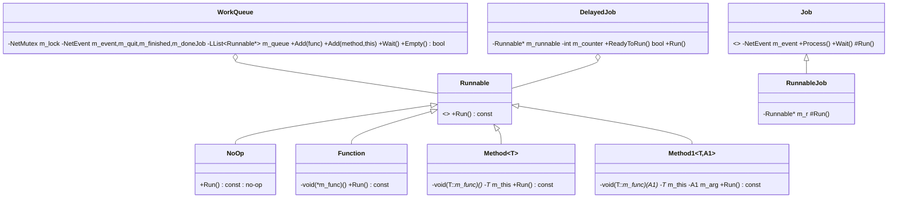

# P14_platform_lib — Platform/lib utilities, SystemIV core libs, targets, tools, root & docs

Scope: `code/lib/{hi_res_time, preferences, language_table, exception_handler, GetWinVer, MiniVersion, system_info, user_info, work_queue, runnable, auto_vector, 2d_array, 2d_surface_map, presized_array, slice_darray, universal_include}`, `code/unicode/unicode_text_file_writer`, `code/keygen`, `contrib/systemiv/lib/{filesys/*, math/{filecrc,hash,math_stubs,random_number}, profiler, string_utils, tosser/*, unicode/*, debug_utils, memory_leak}`, `targets/**` (64 files), `tools/**` (174 files), the 10 root files and `docs/**` (70 files, evidence only). Template bodies that the headers `#include` (`code/lib/{2d_array,2d_surface_map,slice_darray}.cpp`, `contrib/systemiv/lib/tosser/*.cpp`) and `contrib/systemiv/lib/network_stream*.cpp` (Directory wire helpers) were also read. Build baseline: see `_work/build_matrix.md` (`Release|Win32`, OpenGL, `TARGET_PC_FULLGAME`, shipped as `multiwinia.exe`).

Evidence tags: **[C]** read directly, **[I]** inferred (reason given), **[U]** unknown. Build tags as per brief (`[B:FULL]`, `[B:D3D]`, `[B:DEBUG]`, `[B:EDITOR]`, `[B:DEMO]`, `[B:LEGACY]`, `[B:DEAD]`).

---

## [→ 31_platform_build_and_tools] 31.1 Build system: solution, configurations, compiler and linker flags

### 31.1.1 Solution and projects

`targets/vs2005/Darwinia.sln` is a **Visual Studio 2008** solution (`Format Version 10.00`, `# Visual Studio 2008`) despite the folder name [C] `targets/vs2005/Darwinia.sln`. Projects: `darwinia` (the game, `Darwinia.vcproj`, `Version="9.00"`), `unrar`, `eclipse`, `vorbis_static`, `vorbisfile_static`, `ogg_static`, `libpng`, `zlib`; `darwinia` depends on all seven, `libpng` depends on `zlib` [C]. Solution configurations: `Debug`, `DebugDirect3D`, `PC OpenGL (Debug)` (→ project `Debug`), `PC OpenGL (Release)` (→ project `Release`), `Release`, `ReleaseDirect3D`. Sub-projects always build their own `Debug` or `Release` config (the D3D solution configs map sub-projects to Debug/Release) [C].

### 31.1.2 Property sheets (applied to every configuration)

| Sheet | Contents | Evidence |
|---|---|---|
| `Common.vsprops` | Include path **order**: `contrib/libogg-1.1.3/include`, `contrib/libvorbis-1.1.2/include`, `contrib/steam/`, **`code`**, `contrib`, `contrib/unrar`, `.\`, **`contrib/SystemIV`**, `contrib/SystemIV/lib/netlib`, `contrib/eclipse`, Windows SDK v6.0 and several DirectX SDK include dirs (Dec 2006 … June 2008), `contrib/lpng1215`, `contrib/zlib`. Defines `WIN32;TARGET_MSVC;_CRT_SECURE_NO_DEPRECATE`. Links `vfw32 winmm dxguid dxerr9 dsound wsock32 dbghelp xinput`; **delay-loads `xinput1_3.dll`**. RC include adds `code`. | [C] `targets/vs2005/Common.vsprops` |
| `OpenGL.vsprops` | Links `opengl32.lib glu32.lib`; macro `GraphicsLibrary=OpenGL` | [C] `targets/vs2005/OpenGL.vsprops` |
| `Direct3D.vsprops` | Defines `USE_DIRECT3D`; links `d3dxof.lib d3dx9.lib d3d9.lib`; `GraphicsLibrary=Direct3D` | [C] `targets/vs2005/Direct3D.vsprops` |

**Header shadowing rule (design-relevant).** Because `code` precedes `contrib/SystemIV` in the include path, every `#include "lib/X.h"` resolves to `code/lib/X.h` when it exists and to `contrib/systemiv/lib/X.h` otherwise [C] `targets/vs2005/Common.vsprops`. Hence the SystemIV duplicates `contrib/systemiv/lib/{preferences,language_table,hi_res_time}.{h,cpp}` are **not used** (not in the vcproj); Multiwinia uses `code/lib/{preferences,language_table,hi_res_time}`. Exception: files inside `contrib/systemiv/lib` that use a *same-directory* quoted include (e.g. `contrib/systemiv/lib/profiler.cpp` includes `"hi_res_time.h"`, `"debug_utils.h"`) pick up the SystemIV header first (MSVC searches the includer's directory first); the SystemIV `hi_res_time.h` declares the same `InitialiseHighResTime()`/`GetHighResTime()` signatures, so it links against `code/lib/hi_res_time.cpp` [I: MSVC quoted-include search order + identical prototypes].

### 31.1.3 The four project configurations (per-config tool settings)

| Setting | `Debug` | `Release` (baseline) | `DebugDirect3D` | `ReleaseDirect3D` |
|---|---|---|---|---|
| Property sheets | Common+OpenGL | Common+OpenGL | Common+Direct3D | Common+Direct3D |
| Pre-build event | `"../../tools/MapCRC/MapCRC.exe" ../../data/levels/ ../../code/mapcrc.h` ("Generating Map CRCs...") | same | same | same |
| `Optimization` | 0 (/Od) | 2 (/O2) | 0 | 2 (/O2) |
| `InlineFunctionExpansion` | – | 2 | – | 2 |
| `OmitFramePointers` | – | – (but /O2 implies /Oy on x86 [I: MSVC /O2 definition]) | – | **true** |
| `FloatingPointModel` | default (/fp:precise) | default (/fp:precise) | default | **2 = /fp:fast** |
| `BufferSecurityCheck` | default | default | default | **false** (/GS-) |
| `StringPooling` | – | false | – | true |
| `RuntimeLibrary` | 1 = /MTd | 0 = /MT (static CRT) | 1 = /MTd | 0 = /MT |
| `BasicRuntimeChecks` | 3 (/RTC1) | – | 3 | – |
| `TreatWChar_tAsBuiltInType` | false | false | default (true) | default (true) |
| Extra `PreprocessorDefinitions` | – | – | `_CRT_NON_CONFORMING_SWPRINTFS` | `_CRT_NON_CONFORMING_SWPRINTFS` |
| MIDL/RC define | `_DEBUG` | `NDEBUG` | `_DEBUG` | `NDEBUG` |
| Precompiled header | through `lib/universal_include.h`, PCH `darwinia_d_gl.pch` | `Darwinia.pch` | `Darwinia.pch` | `Darwinia.pch` |
| Warning level | 3 | 2 | 3 | 3 |
| Extra include | `contrib/XCrashReport` (+ DX SDK March/April 2008/2007) | `contrib/XCrashReport` | same | same |
| Output (relative to solution dir `..\..\..`, i.e. repo root `multiwinia/`) | `darwinia_d_gl.exe` (+ `.pdb`, `.map`) | `darwinia_gl.exe`, PDB `Darwinia.pdb`, map file generated | `darwinia_d.exe`, `Darwinia.pdb`, `Darwinia.map` | `darwinia.exe`, `darwinia.pdb`, manifest `darwinia.exe.intermediate.manifest`, **linker `Profile=true`** |
| Linker | incremental, `RandomizedBaseAddress=1`, `DataExecutionPrevention=0`, SubSystem Windows, MachineX86 | non-incremental, `OptimizeReferences=2` | incremental | non-incremental, OPT:REF |

[C] `targets/vs2005/Darwinia.vcproj` (Configurations block). The output directory `$(OutDir)\..\..\..` resolves to the repository root, which is why packaging scripts copy `darwinia_gl.exe` from the root [C] `tools/build_multiwinia.bat`.

**Determinism consequence:** the shipped GL build uses /fp:precise while the D3D build uses /fp:fast; mixing the two binaries in one network game is a desync risk (see 22 section below) [I: different FP code generation].

Per-file overrides in the vcproj (all others inherit) [C] (`_work/scripts/P14_vcproj_overrides.py` over `targets/vs2005/Darwinia.vcproj`):

| File | Override |
|---|---|
| `code/lib/universal_include.cpp` | `UsePrecompiledHeader=1` (creates the PCH; file is a single `#include`) in all 4 configs |
| `code/lib/input/xbox_eventhandler.cpp` | `ExcludedFromBuild` in all 4 configs |
| `code/network/x360_qnet.cpp` | `ExcludedFromBuild` in all 4 configs (file absent from tree) |
| `contrib/systemiv/lib/unicode/unicode_string.cpp`, `unicode_text_stream_reader.cpp` | object file renamed `$(InputName)1.obj` (avoids clash with same-named objects) |

### 31.1.4 Resource scripts compiled into the exe

| File | Content | Evidence |
|---|---|---|
| `targets/vs2005/version.rc` | `VS_VERSION_INFO`: `FILEVERSION/PRODUCTVERSION DARWINIA_EXE_VERSION` = **6,0,0,0**, strings `CompanyName "Introversion Software"`, `FileDescription/InternalName/ProductName APP_NAME` ("Multiwinia"), `FileVersion "6, 0, 0, 0"`, `LegalCopyright "Copyright (C) 2008"`, `OriginalFilename "Multiwinia.exe"`, translation 0x409/1200. Includes `lib/universal_include.h` and `afxres.h`. | [C] `targets/vs2005/version.rc`, `code/lib/universal_include.h` (`DARWINIA_EXE_VERSION`) |
| `targets/vs2005/GDF/Darwinia.rc` | Windows **Game Explorer** resources: `ID_GDF_XML DATA` and `ID_GDF_THUMBNAIL DATA` per language (NEU, DEU, ENU, ESP, FRA, ITA) pointing at `<LANG>\Darwinia.gdf.xml` / `boxart_<LANG>.png`; `ID_ICON ICON "NEU\gameicon_NEU.ico"`. These are **Darwinia: Vista Edition** definitions (Name "Darwinia", version 1.5.4.0, executable `darwinia.exe`, saved games `Darwinia\users`) still compiled into Multiwinia. | [C] `targets/vs2005/GDF/Darwinia.rc`, `targets/vs2005/GDF/*/Darwinia.gdf.xml` |
| `targets/vs2005/resource.h` | 622 `#define`s: an accidental Visual Studio resource-editor dump of CRT and OpenGL constants (`GL_*`, `SEEK_*`, `_IO*`…) plus `IDI_ICON1 101`; "Used by icon_resource.rc" (file absent). Functionally only `IDI_ICON1=101` matters (D3D window class loads icon `MAKEINTRESOURCE(101)`). | [C] `targets/vs2005/resource.h`; `code/lib/window_manager_directx.cpp` (LoadIcon 101) |
| `targets/vs2005/darwinia.ico` | 32×32 and 16×16 16-colour icon | [C] file inspection |
| `targets/vs2005/version_resource.h` | referenced by vcproj, **absent** from tree | [C] vcproj file list |

The Win32 OpenGL window class uses `LoadIcon(NULL, IDI_APPLICATION)` (generic icon), so the baseline GL build shows the default icon on its window while the exe file icon comes from the GDF resource `ID_ICON` [C] `code/lib/window_manager_win32.cpp` (wc.hIcon); [I] for the explorer icon (resource-ordering rule).

### 31.1.5 Global compile-time configuration (`code/lib/universal_include.h`)

Product-target macros and per-target feature macros are fully tabulated in `build_matrix.md` §3 [C]. Additional facts from a full read of the header:

| Item | Value / behaviour | Evidence |
|---|---|---|
| `DARWINIA_VERSION` / `APP_VERSION` | `"dev"` (used as network protocol/version string in lobby compatibility checks and crash reports) | [C] `code/lib/universal_include.h`; uses: `code/network/server.cpp` (`NET_DARWINIA_VERSION`), `code/UI/GameMenuWindow.cpp` (protocolMatch) |
| `DARWINIA_EXE_VERSION` | `6,0,0,0`; `STR_DARWINIA_EXE_VERSION "6, 0, 0, 0\0"` | [C] |
| `APP_NAME` / `APP_NAME_W` | `"Multiwinia"` / `L"Multiwinia"` | [C] |
| `APP_SYSTEM` | `"PC"` (MSVC), `"Mac (PPC)"`/`"Mac (Intel)"`, `"Linux"` | [C] |
| `DARWINIA_PLATFORM` | `"win32"`, `"linux"`, `"macosx"` | [C] |
| `DARWINIA_VERSION_STRING` | `DARWINIA_PLATFORM "-" DARWINIA_GAMETYPE "-" DARWINIA_VERSION` → baseline `"win32-multiwinia-dev"` | [C] |
| Target sanity | `#error` unless exactly one `TARGET_*` product macro is defined | [C] |
| Always-on | `DEBUG_RENDER_ENABLED`, `FLOAT_NUMERICS`, `USE_CRASHREPORTING` | [C] |
| `TEXTURE_EXTENSION` | `"bmp"` | [C] |
| `GRACE_TIME` | `3.0f` (20.0f under `TESTBED_ENABLED`) — consumer outside P14 | [C] |
| Deterministic math wrappers | `iv_sin, iv_cos, iv_tan, iv_sqrt, iv_pow, iv_exp, iv_log, iv_asin, iv_acos, iv_atan` = `iv_trunc_low_nibble(<crt fn>(double(x)))`; `iv_abs` inline | [C] (semantics in §22.4) |
| MSVC block | disables warnings 4244 4305 4800 4018 4996; **`#define for if (0) ; else for`** (VC6 for-scope emulation); `snprintf→_snprintf`, `stricmp/strupr/strnicmp/strlwr/strdup/itoa→_`-prefixed; `WIN32_LEAN_AND_MEAN`, `_WIN32_WINDOWS 0x0500`, `_WIN32_WINNT 0x500` (TryEnterCriticalSection); `NOMINMAX` + `using std::min/max`; includes `windows.h`; `HAVE_DSOUND`; `TRACK_MEMORY_LEAKS` → includes `lib/memory_leak.h` | [C] |
| Graphics headers | Mac: `OpenGL/gl.h`+`safegl.h`; `USE_DIRECT3D`: `d3d9.h`, `d3dx9.h`, `lib/opengl_directx.h`, `lib/safegl.h`; else `GL/gl.h`, `GL/glu.h` | [C] |
| Helpers | `SAFE_FREE`, `SAFE_DELETE`, `SAFE_DELETE_ARRAY`, `SAFE_RELEASE`, `GL_DEBUG()` (prints every pending `glGetError`) | [C] |
| Mac-only | `INVOKE_CALLBACK_FROM_SOUND_THREAD`, `SINGLE_THREADED_PROFILER`, `OPENGL_DEBUG_ASSERTS`, `acosf/asinf` → double versions, undef `AVI_GENERATOR`/`SOUND_EDITOR` | [C] [B:DEAD on PC] |

### 31.1.6 Non-Windows targets

| Target | What it builds | Status | Evidence |
|---|---|---|---|
| `targets/macosx/Multiwinia/Multiwinia.xcodeproj` | **Multiwinia 1.3.1 for Mac OS X** (Ambrosia Software port, bundle id `uk.co.introversion.multiwinia`, SDL + Cocoa, Sparkle updater). Defines `TARGET_OS_MACOSX`, `PROFILER_ENABLED`, `GUI`, `SILENT`; Release adds `NO_DEBUG_OUTPUT`; Debug `_DEBUG=1`. 1158 `.cpp` references. `data` is a symlink to `../../../data/`. | Maintained Mac port, not part of the Windows baseline [B:DEAD on PC] | [C] `targets/macosx/Multiwinia/Multiwinia.xcodeproj/project.pbxproj`, `Info.plist`, `English.lproj/InfoPlist.strings`, `data` |
| `targets/macosx/Multiwinia/SDLMain.mm`, `.h`, `MultiwiniaCocoaBridge.*`, `SDLApp_Prefix.pch`, nibs, rtfs, `Multiwinia.icns`, `UserManual.pdf` | Cocoa app shell: chdir to `Contents/Resources`, `SDL_ENABLEAPPEVENTS=1`, `SDL_HAS3BUTTONMOUSE=1`, Sparkle update checks, sleep/wake notifications (on wake: `Server::SkipToTime(GetHighResTime())` only when clients are connected), pause/fullscreen menu items | [B:DEAD on PC] | [C] `targets/macosx/Multiwinia/SDLMain.mm` (`setupWorkingDirectory`, `applicationDidFinishLaunching`, `awakeFromSleep`), `MultiwiniaCocoaBridge.cpp:WindowManagerSDLAwakeFromSleep` |
| `targets/macosx/Darwinia/*` | Darwinia-era Xcode 2 project and menu callbacks (debug menu, FPS, profiler toggles) | [B:LEGACY/DEAD] | [C] `targets/macosx/Darwinia/MainMenuCallbacks.cpp` |
| `targets/linux/Makefile` | Darwinia-era Linux build (`CXX=apg++` autopackage, SDL, GL, ogg/vorbis, `contrib/netclass`, `contrib/binreloc`); 17 of its 194 `code/*.cpp` sources no longer exist (e.g. `code/lib/text_stream_readers.cpp`, `code/network/networkupdate.cpp`) | Cannot build this tree [I: missing sources] [B:DEAD] | [C] `targets/linux/Makefile` |
| `targets/linux/Makefile.keygen-1` | Builds `keygen-1` from `code/keygen.cpp` + `tools/PasswordGenerator/main.cpp` (absent) and scp's it to the Introversion server (Darwinia beta registration) | [B:DEAD] | [C] `targets/linux/Makefile.keygen-1` |

---

## [→ 31_platform_build_and_tools] 31.2 Platform abstraction map

| Service | Win32 baseline implementation | Other platforms (not in baseline) | Notes |
|---|---|---|---|
| High-resolution timer | `code/lib/hi_res_time.cpp` (QPC) [B:FULL] | `code/lib/hi_res_time_gcc.cpp` (QPC, absolute), `code/lib/hi_res_time_sdl.cpp` (`gettimeofday`) [B:DEAD] | §31.3 |
| Window/GL context | `code/lib/window_manager_win32.cpp` (GL) / `window_manager_directx.cpp` [B:D3D] | `window_manager_sdl.cpp` [B:DEAD] | P13 |
| Input | `W32EventHandler`, InputManager drivers | `SDLEventHandler`, `code/lib/input_sdl.cpp` | P10; `code/main.cpp:Initialise` selects by `TARGET_MSVC` |
| Threads / mutex / event | `contrib/systemiv/lib/netlib/net_thread_win32.cpp` (`CreateThread`), `net_mutex_win32.cpp` (`CRITICAL_SECTION`, auto-reset `CreateEvent`) | `*_linux.cpp` (pthreads) | §20 below |
| Debug output | `OutputDebugString` or redirect file | `fputs(stderr)`; Mac log dir `~/Library/Logs/<app>/`, Linux `/tmp/` | §32.2 |
| Crash handling | SEH `__try/__except(RecordExceptionInfo…)` + minidump + `MultiwiniaSupport.exe` | Mac: suggestion to use Smart Crash Reports (no stack walk) | §31.13 |
| User data directory | `%LOCAL_APPDATA%\Introversion\Multiwinia\` | Linux `~/.multiwinia/<gametype>/`; Mac `~/Library/Application Support/Multiwinia/<gametype>/`, prefs `~/Library/Preferences/uk.co.introversion.Multiwinia.txt` | §31.4 |
| Case-insensitive file lookup | identity (`FindCaseInsensitive` returns input) | Linux: walks each path component with `ListDirectory` and takes the first case-insensitive match | [C] `contrib/systemiv/lib/filesys/filesys_utils.cpp:FindCaseInsensitive` |
| System info | `code/lib/system_info.cpp` (Win32 locale, waveOut, DirectX registry) | `code/lib/system_info_macosx.cpp` [B:DEAD] | §31.14 |
| FPU precision | `_control87(_PC_53, _MCW_PC)` | Mac i386: `fnstenv/fldenv` clearing bit 8 | `code/main.cpp:StandardiseCPUPrecision` (P01) |
| Unicode `wchar_t` | UTF-16 (2 bytes) | UTF-32 (4 bytes) on Mac/Linux; conversion via CoreFoundation/iconv | [C] `contrib/systemiv/lib/network_stream.cpp:WriteUnicodeString`, `code/unicode/unicode_text_file_writer.cpp` |

---

## [→ 31_platform_build_and_tools] 31.3 Timing — `hi_res_time`

API [C] `code/lib/hi_res_time.h`: `InitialiseHighResTime()`, `double GetHighResTime()` (seconds), `SetFakeTimeMode()`, `SetRealTimeMode()`, `IncrementFakeTime(double)`.

Mechanism [C] `code/lib/hi_res_time.cpp`:

1. `InitialiseHighResTime` reads `QueryPerformanceFrequency` and stores `g_tickInterval = 1/freq` (seconds per tick). Called once from `code/main.cpp:Initialise`, *after* `new SystemInfo` and before any timing use [C].
2. `GetLowLevelTime()` (QPC path, `USE_PENTIUM_COUNTER 0`): on first call latches `startTime = QPC`; returns `(QPC − startTime) × g_tickInterval`. Time therefore starts at **0.0 s on the first query** (process-relative), resolution = 1/QPC-frequency (typically 0.3–1 µs on 2008 hardware [I]). No wrap handling is needed (64-bit counter).
3. `GetHighResTime()`: if fake mode, returns `g_fakeTime`; otherwise `GetLowLevelTime() − g_timeShift`. A disabled block (commented) once clamped jumps > 1 s. No monotonicity guard: cross-core QPC skew would surface directly [I].
4. Fake time: `SetFakeTimeMode()` freezes `g_fakeTime = GetHighResTime()`; `IncrementFakeTime(dt)` advances it; `SetRealTimeMode()` sets `g_timeShift = realTime − g_fakeTime` so real time resumes continuously from the fake value. Used for offline frame-exact capture: AVI grabber window (`code/interface/grabber_window.cpp` toggles modes [B:DEBUG via AVI_GENERATOR]) and demo/AVI recording advancing `1.0/DemoFrameRate` per frame (`code/main.cpp` `IncrementFakeTime( 1.0 / (double)demoFrameRate )`, pref `DemoFrameRate` default 25) [C].
5. RDTSC path (`GetPentiumCounter`, inline asm `0F 31`, keeps bits 6..37 of the TSC; calibrated against QPC with a 1 s `Sleep`) is compiled out (`#define USE_PENTIUM_COUNTER 0`) [C] [B:DEAD].

Variants: `code/lib/hi_res_time_gcc.cpp` (QPC, *absolute* counter, no first-call latch) and `code/lib/hi_res_time_sdl.cpp` (`gettimeofday` relative to first call, µs resolution) [C] [B:DEAD].

Design notes for the new engine: keep a single monotonic clock (`QueryPerformanceCounter`/`std::chrono::steady_clock`) relative to process start, with an injectable fake clock for capture/replay; simulation time must never be derived from it directly (simulation ticks are driven by the network/game timer, P01/P15).

---

## [→ 31_platform_build_and_tools] 31.4 File locations (user data, logs, crash files)

### 31.4.1 Profile directory resolution [C] `code/app.cpp:App::GetProfileDirectory`, `code/main.cpp:Initialise`

```mermaid
flowchart TD
  A[GetProfileDirectory] --> B{TARGET_DEBUG?}
  B -- yes --> Z["return \"\" (current working directory)"]
  B -- no --> C{s_profileDirectory && IsRunningAtLeast2k}
  C -- no --> Z
  C -- yes --> D["SHGetFolderPath(CSIDL_LOCAL_APPDATA) + \\Introversion\\ (CreateDirectory) + Multiwinia\\ (CreateDirectory)"]
```

* `s_profileDirectory` defaults to `true`; the command-line switch **`--NoProfile`** calls `App::UseProfileDirectory(false)` → all user files go to the working directory [C] `code/main.cpp:Initialise`, `code/app.cpp` (`static bool s_profileDirectory = true`).
* `Initialise` then `CreateDirectoryRecursively(profileDir)` and `AppDebugLogPathPrefix(profileDir)` so `debug.txt`/`blackbox.txt` land in the profile dir [C].
* The working directory must be the install dir (or repo root in development: README says set the debugger working directory to `..\..`) because archives (`*.dat`) and loose `data/` are opened by relative path [C] `README.TXT`, `code/lib/resource.cpp:Resource::ParseArchive` (`DoesFileExist(_dataFile)`).

### 31.4.2 Files and folders (baseline Win32, `<P>` = profile directory)

| Path | Written/read by | Purpose | Evidence |
|---|---|---|---|
| `<P>preferences.txt` | `PrefsManager` | user preferences (UTF-16LE on save) | [C] `code/app.cpp:App::GetPreferencesPath` |
| `<P>debug.txt` | `AppDebugOut` | full debug log (truncated at start; `DUMP_DEBUG_LOG` is defined in FULL) | [C] `code/main.cpp:Initialise`, `contrib/systemiv/lib/debug_utils.cpp:AppDebugOutRedirect` |
| `<P>blackbox.txt` | `AppGenerateBlackBox` | assert/exit report with EBP stack walk | [C] `contrib/systemiv/lib/debug_utils.cpp:AppGenerateBlackBox` |
| `<P>ERRORLOG.TXT`, `<P>CRASH.DMP` | `RecordExceptionInfo` | SEH crash log (appended) and minidump (`MiniDumpWithIndirectlyReferencedMemory`) | [C] `code/lib/exception_handler.cpp:RecordExceptionInfo`, `contrib/XCrashReport/CrashFileNames.h` |
| `<P>authkey.dev` | `App::InitMetaServer`, `GameMenuWindow` | authentication key read path | [C] `code/app.cpp:App::InitMetaServer`, `code/UI/GameMenuWindow.cpp` |
| `<P>authkey` | `AuthInputField` | key **save** path (different name from the read path!) | [C] `code/UI/AuthInputField.h` — see Contradictions |
| `<P>users/<profile>/…`, `<P>users\<profile>.dsg` | App/LevelFile | per-user save data (Darwinia legacy campaign paths) | [C] `code/app.cpp` |
| `<P>mods/<mod>/…` | Resource (only under `USE_DARWINIA_MOD_SYSTEM`) | mod search path | [C] `code/lib/resource.cpp:GetTextReader` [B:DEAD] |
| `<P>maps/` | `App::GetMapDirectory` | custom maps | [C] `code/app.cpp` |
| `<P>screenshots/` | `App::GetScreenshotDirectory` (Desktop under `TARGET_OS_VISTA`) | screenshots | [C] |
| `<P>benchmarks/`, `<P>dxdiag.txt` | benchmark | hardware benchmark output | [C] `code/benchmark.cpp` (P20) |
| `<P>syncerror-…` style files `<prefix>-YYYY-MM-DD--HH-MM-SS-client<id>-team<id>.txt` | `ClientToServer::GetSyncFileName` | desync dumps | [C] `code/network/clienttoserver.cpp:GetSyncFileName` (P15) |
| `<P>inputprefs_debug.txt`, `input_preferences.txt`, `user_input_preferences.txt` | input system | bindings | [C] `code/lib/input/input.cpp`, `code/lib/input/file_paths.cpp` (P10) |
| `./language_errors.txt` (cwd) | `LangTable::TestAgainstEnglish` (pref `TextLanguageTest`) | translation QA | [C] `code/lib/language_table.cpp:TestAgainstEnglish` |
| `./version` (cwd) | `--write-version` | writes `DARWINIA_VERSION` and exits (packaging) | [C] `code/main.cpp:AppMain` |
| `./origin` (cwd) | `App::Initialise` | first line → `m_originVersion` (distributor tag, e.g. `buka`), sent to metaserver as `NET_METASERVER_ORIGINVERSION` | [C] `code/app.cpp:App::Initialise`, `code/network/clienttoserver.cpp` |

Mac/Linux equivalents: §31.2.

---

## [→ 31_platform_build_and_tools] 31.5 Data archives (`.dat`) and resource lookup

### 31.5.1 Archive set and load order (baseline)

| Order | Archive | Parsed in | Built by | Content | RAR options |
|---|---|---|---|---|---|
| 1 | `init.dat` | `App::App` (before prefs) | `build_multiwinia_data.bat` `:makeInit` from `tools/init.list` | 14 shader files, `sprites/darwinian.bmp` (loading spinner), `textures/ivlogo.bmp` (`xboxlivearcade.bmp` deleted on PC) | `a -m5 -s -idp` |
| 2 | `language.dat` | `App::Initialise` (before `InitLanguage`) | `build_language_dat.bat` | language text + font pages (`*.bmp *.dds *.tex *.txt`) chosen by `*language.list` | `-m5 -s` |
| 3 | `main.dat` | `App::Initialise` | `:makeMain` | all of `data/` minus exclusions minus `sounds/` paths, filtered to `*.tex *.bmp *.jpg *.shp *.txt *.vs *.ps *.ps3 *.h *.anim` (+`*.wmv` xbox) | `-m5 -s` |
| 4 | `patch.dat` | `App::Initialise` | none in tree (`tools/patch.full.list` is Darwinia-era) | patch overrides | – |
| 5 | `menusounds.dat` | `App::Initialise` | `:makeMenuSounds` from `tools/menu_sounds.txt` | 18 menu/lobby Oggs | `-m2 -s` |
| 6 | `branding.dat` | `App::Initialise` | none in tree | distributor branding overrides [I: name] | – |
| 7 | `sounds.dat` | `App::LoadSounds` (sounds worker thread) | `:makeSounds` from `tools/sounds.txt` | 1297 Oggs | `-m2 -s` |
| 8 | `sounds2.dat` | `App::LoadSounds` | `:makeSounds2` | every other `.ogg` in `listAll` (i.e. not in sounds.txt/menu_sounds.txt/exclusions) | `-m2 -s` |
| – | `ambx.dat` | not loaded by code | `build_ambx_dat` (absent) | amBX ambient-lighting data [I] | – |

[C] `code/app.cpp` (`ParseArchive` calls at L217, L334–L340, L502–L503), `tools/build_multiwinia_data.bat`, `tools/init.list`, `tools/sounds.txt`, `tools/menu_sounds.txt`.

RAR switches: `a` add, `-m5` best / `-m2` fast compression (Ogg is already compressed), `-s` **solid** archive, `-idp` no percentage output, `@file` list [C] scripts; [I] switch meanings from RAR CLI conventions. Paths are stored as `data\…` (the `sed "s_.*data\\_data\\_"` rewrite strips the absolute prefix) [C].

### 31.5.2 Archive semantics [C] `code/lib/resource.cpp:Resource::ParseArchive`, `contrib/unrar/unrar.cpp:MemMappedFile::MemMappedFile`, `contrib/unrar/unrar.h`

* A missing archive is silently skipped (`DoesFileExist`). Exceptions during decompression → archive ignored.
* The **whole archive is decompressed into memory** at load (`UncompressedArchive`); max `MAX_FILES = 16384` entries per archive.
* Entry names: `\` → `/` then `strlwr` (lower-case). **Zero-byte entries are dropped** (`m_size > 0` test).
* **Later archives override earlier ones** with the same name (old `MemMappedFile` deleted). Effective precedence: `sounds2 > sounds > branding > menusounds > patch > main > language > init`.
* Lookups are under a `NetMutex` (archives are parsed on worker threads).
* Unrar is not thread-safe, so sound archives are parsed on a dedicated serial worker queue on PC (`App::m_soundsWorkQueue`) [C] `code/app.cpp` comment "Can't unrar too files at once".

### 31.5.3 Lookup precedence for a resource name `N` [C] `code/lib/resource.cpp:GetTextReader/GetBinaryReader`

1. (`USE_DARWINIA_MOD_SYSTEM` only, [B:DEAD]) `<P>mods/<mod>/N`, then (Vista) `mods/<mod>/N`.
2. **Loose file `data/N`** (relative to cwd) — UTF-16 BOM → `UnicodeTextFileReader`, else `TextFileReader`; binary → `BinaryFileReader`.
3. Archive entry `data/N` (exact string; archive keys are lower-case, so callers must pass lower-case names) — BOM → `UnicodeTextDataReader`, else `TextDataReader`; binary → `BinaryDataReader`.
4. Not found → `NULL` (+ `AppDebugOut("Failed to find text resource…")`).

Consequence: loose `data/` always beats archives, which is how the development tree runs without archives and how users can override files [C].

**Important ordering consequence [I, strong]:** `PrefsManager` is constructed right after `init.dat` is parsed and **before** `main.dat` (`code/app.cpp:App::App`). On first run its `CreateDefaultValues()` looks up `default_preferences.txt`, which is not in `init.list` and so lives in `main.dat` in a packaged build; in a packaged install the file is therefore not found and only the hard-coded defaults apply (in the development tree the loose `data/default_preferences.txt` is found).

### 31.5.4 SystemIV `FileSystem` (compiled, unused)

`contrib/systemiv/lib/filesys/file_system.cpp:FileSystem` provides the same idea (search paths → raw path → archive BTree) but `g_fileSystem` is never instantiated by Multiwinia; only non-compiled SystemIV modules (`lib/sound`, `lib/resource`) use it [C] (grep: no `new FileSystem` in `code/`) → [B:FULL compiled, unreachable]. Quirks if re-used: archive lookup is case-sensitive on the requested name; `ListArchive` ignores `fullFilename` for archive results and its `OrderedInsert` never compares against the last element (duplicates possible) [C] `FileSystem::ListArchive`, `OrderedInsert`.

---

## [→ 31_platform_build_and_tools] 31.6 Data build pipeline (`tools/build_multiwinia_data.bat`)

Invocation: `build_multiwinia_data.bat [platform] [language]` from `tools\`; `%BUILD%` defaults to `build`; `PLATFORM=plat%1`, `LANGUAGE=lang%2` (default `all`; xbox forces `all`) [C].

Step sequence [C] `tools/build_multiwinia_data.bat`:

1. `cd` to repo root; `copy /b tools\sounds.txt+tools\menu_sounds.txt completeExclusions`; append the platform exclusion file: `xbox`→`multiwinia_exclusions_xbox.txt` (absent), `pchwcompat`/`pcassaultstress`→`multiwinia_exclusions_hwcompat.txt`, `pcbetatest`/`pcpreview`/`ambx`→`multiwinia_exclusions_beta_test.txt`, anything else (incl. `retail`)→`multiwinia_exclusions.txt`.
2. Delete old `main.dat`, `sounds.dat`, `sounds2.dat` in root; delete and recreate `%BUILD%`.
3. `call build_language_dat %PLATFORM% %LANGUAGE% %BUILD% %TOOLS%` → `%BUILD%\language.dat` (§31.11).
4. `call build_ambx_dat` (script absent → error, batch continues) [C absence].
5. **init.dat**: `perl copyfiles.pl data %BUILD%\data < tools\init.list`; (xbox: convert splash/ivlogo to DXT1 `.tex`); delete `xboxlivearcade.bmp`; list files → rar `init.dat`.
6. **main.dat**: `perl listfiles.pl data completeExclusions > listAll`; `grep -v sounds/ < listAll > listData`; copy; per-platform extra inclusions (`multiwinia_inclusions_hwcompat.txt`, `…_assaultstresstest.txt`, `…_beta_test_%2.txt` [note: uses the raw 2nd argument as group letter], `…_previewcopy.txt`, `…_ambx.txt` (absent)); xbox converts `mwhelp/*.bmp`, `thumbnails/*.bmp` to `.tex` (DXT1, DXT3 for `360_controller.bmp`); `dir` filter by extension; rar `main.dat`.
7. **menusounds.dat**: prefix `data/` onto `tools/menu_sounds.txt` lines; rar `-m2`.
8. **sounds.dat**: prefix `data/` onto `tools/sounds.txt`; rar `-m2`.
9. **sounds2.dat**: `grep .ogg < listAll` (so only Oggs *not* excluded by `completeExclusions`, which contains sounds.txt + menu_sounds.txt + exclusions); rar `-m2`.
10. Non-xbox: `..\darwinia_gl.exe --write-version` inside `%BUILD%` (writes `build\version`) and `tools\save_symbols.cmd` (archives PDB+exe per version/date).

**Exclusion/inclusion list grammar** [C] `tools/listfiles.pl`, `tools/copyfiles.pl`:
```
list      := { line NEWLINE }
line      := short_excl | glob_excl            (exclusion files)
short_excl:= "**/" name        ; prunes any file or directory whose basename equals name (exact, case-sensitive)
glob_excl := bsd_glob pattern relative to data/ ; expanded against the file system; a visited path is pruned if it
             equals (case-insensitively) one of the expanded paths (directories prune their whole subtree)
inclusion := relative path under data/ (one per line, exact file, no globs) ; copyfiles.pl dies if missing
```
`\` in exclusion lines are normalised to `/`; CRLF is stripped [C].

Per-target exclusion contents (every entry):

* `tools/multiwinia_exclusions.txt` (retail): `**/.svn`, `**/.DS_Store`, `shapes/source`, `language`, `purity`, `english_demo.txt`, `egames.txt`, `textures/editor_font*`, `textures/speccy_font*`, `textures/unicode`, `shaders/FixedFunc0.vs`, `shaders/FixedFunc0Maps.ps`, `shaders/FixedFunc1.vs`, `shaders/FixedFunc1Maps.ps`, `shaders/FixedFunc2.vs`, `shaders/FixedFunc2Maps.ps`, `sprites/darwinian.bmp`, `textures/xboxlivearcade.bmp`, `textures/ivlogo.bmp`, `textures/ambrosia_logo.bmp`, `levels/old/*`, `levels/pdlc/*`, `levels/level_enum.txt`, `levels/map_*`, `levels/mission_*`, `sounds/tresk*`, `sounds/trash80*`, `sounds/dma_sc*`, `sounds/twoataris*`, `sounds/pang*`, `sounds/speccyloader.ogg`, `sounds/matrix.ogg`, `sounds/fodder.ogg`, `gesture_demos/*`, `Marketing/LogitechG15/landrotate.bmp`, `scripts/*`, `textures/plusmenu/*`, `textures/msn_oberon_combosplash.bmp`, `textures/dmacrew.bmp`, `textures/speccy_screen.bmp`, `mwhelp/360_controller.bmp`, `levels/mp_assault_stress.txt`, `levels/mp_benchmark_*`, `levels/mp_sandbox*`, `levels/mp_tankbattle_*`, `thumbnails/mp_benchmark_*`, `thumbnails/mp_tankbattle_*`, `levels/mp_cts_3p_3.txt`, `thumbnails/mp_cts_3p_3.bmp` [C].
* `tools/multiwinia_exclusions_beta_test.txt`: identical to the retail list from `**/.svn` through `mwhelp/360_controller.bmp` except it lacks `textures/ambrosia_logo.bmp`, and ends with `levels/mp_*`, `thumbnails/mp_*` (all MP maps excluded; group inclusion files add the permitted ones back) [C].
* `tools/multiwinia_exclusions_hwcompat.txt`: `**/.svn`, `**/.DS_Store`, `shapes/source`, `language`, `purity`, `english_demo.txt`, `egames.txt`, `textures/editor_font*`, `textures/speccy_font*`, `textures/unicode`, the six `shaders/FixedFunc*` files, `sprites/darwinian.bmp`, `textures/xboxlivearcade.bmp`, `textures/ivlogo.bmp`, `levels/old/*`, `levels/level_enum.txt`, `levels/map_*`, `levels/mission_*`, `levels/mp_*`, `thumbnails/mp_*`, `sounds/tresk*`, `sounds/trash80*`, `sounds/dma_sc*`, `sounds/twoataris*`, `sounds/pang*` [C].
* Inclusion lists: see the tools table (§31.17) rows for `multiwinia_inclusions_*.txt`; they mirror the `PERMITTED_MAPS` of the corresponding `TARGET_*` in `code/lib/universal_include.h` (hwcompat: KOTH_2P_1, BENCHMARK_1, KOTH_4P_1; preview: KOTH_2P_1, KOTH_4P_1, CTS_2P_1; beta B: BLITZKRIEG 2P_2/3P_2/4P_2; beta C: ROCKETRIOT 2P_4/2P_3/3P_1) [C]. Beta group A's inclusion list (13 maps) does **not** match `TARGET_BETATEST_GROUP_A`'s `PERMITTED_MAPS` (CTS_2P_1, CTS_3P_1, CTS_4P_3) but matches the commented-out list in `TARGET_BETATEST_GROUP_ALL` [C] → contradiction logged.

All list entries resolve to existing `data/` files when compared case-insensitively (e.g. `mp_koth_2p_1.txt` vs on-disk `mp_koth_2P_1.txt`); on a case-sensitive file system 30 entries would fail [C] (scripted check).

---

## [→ 31_platform_build_and_tools] 31.7 Packaging scripts (build → `build\`)

| Script | Data build args | Copies into `build\` | Post-processing |
|---|---|---|---|
| `build_multiwinia.bat` | (none → retail exclusions, all languages) | `darwinia_gl.exe`→`multiwinia.exe`, `contrib\systemIV\contrib\XCrashReport\dbghelp.dll` | `upx --best multiwinia.exe` |
| `build_multiwinia_crashreporter.bat` | (none) | exe, dbghelp, `MultiwiniaSupport.ini`, `MultiwiniaSupport.exe` (from root — absent) | none (UPX "causes problems with debugging tools") |
| `build_multiwinia_gold.bat` | (none) | exe, dbghelp, `MultiwiniaSupport.ini`, `tools\multiwiniasupport\MultiwiniaSupport.exe`, `tools\autopatcher\autopatch.exe`, `copy_assist.exe`, `tools\profilelocatorwin32\profilelocator.exe`, `docs\multiwinia_manual.pdf`→`manual.pdf` | none |
| `build_multiwinia_retail.bat [lang]` | `retail <lang>` (default English) | as gold, autopatch per language (`autopatch_fr/it/de/es.exe` → `autopatch.exe`; English/all/efigs/russian use `autopatch.exe`) | none |
| `build_multiwinia_retail_efigs.bat` | → `build_multiwinia_retail efigs` | | |
| `build_multiwinia_retail_russian.bat` | → `build_multiwinia_retail russian` | | binary patch `subst.pl ..\darwinia_gl.exe retail\... retail.ru`; `echo buka > ..\build\origin` |
| `build_multiwinia_hwcompat.bat` | `pchwcompat` | exe, `ncftpput.exe` (absent) | UPX |
| `build_multiwinia_hwcompat_crashreporter.bat` | `pchwcompat` | exe, ncftpput, MultiwiniaSupport.*, dbghelp | none |
| `build_multiwinia_pc_preview.bat [lang]` | `pcpreview <lang>` | exe | none |

[C] each script. Absent referenced inputs: `tools/autopatcher/*`, `tools/profilelocatorwin32/*`, root `MultiwiniaSupport.exe`, `ncftpput.exe`, `tools/build_ambx_dat.bat`, `tools/convert_bmp_to_tex.cmd`, `tools/multiwinia_exclusions_xbox.txt`, `tools/multiwinia_inclusions_ambx.txt` [C absence]. The scripts expect the **baseline `Release|Win32` output `darwinia_gl.exe`** [C].

Darwinia-era `tools/` scripts (`build_demo.bat`, `build_demo2.bat`, `build_final.bat`, `build_vista.bat`, `build_tools.bat`) use `rsx rar32`, `grep_dos`, `sed_dos`, `sort_dos` (absent) and produce `darwinia.exe`-based Darwinia packages [C] [B:LEGACY].

---

## [→ 31_platform_build_and_tools] 31.8 Installers

### 31.8.1 Inno Setup scripts (Multiwinia)

Common skeleton [C] `tools/InstallerScript_gold_crashreporter.iss`: `AppPublisher=Introversion Software Ltd`, `Compression=zip/5`, `DefaultDirName={pf}\Multiwinia`, `LicenseFile=..\docs\IntroversionEULA.txt`, `OutputBaseFilename=setup`, `SetupIconFile=..\targets\vs2005\darwinia.ico`; optional desktop icon task; files from `..\build\` installed to `{app}` with `ignoreversion` (`origin` uses `onlyifdoesntexist`); **all shortcuts launch `autopatch.exe`** (the auto-patcher then starts the game), plus "Repair Multiwinia" (`autopatch.exe --repair`), website/support URLs, "Open Multiwinia Profile" (`ProfileLocator.exe`), uninstall.

| Script | AppName / version | Differences |
|---|---|---|
| `InstallerScript.iss` | Multiwinia v1.9.20 | no crash reporter; ships `ambx.dat`; no manual |
| `InstallerScript_crashreporter.iss` | Multiwinia v1.9.20 | + `MultiwiniaSupport.exe/.ini`; no ambx |
| `InstallerScript_gold_crashreporter.iss` | Multiwinia v1.0.3 | + `manual.pdf` + Manual shortcut |
| `InstallerScript_retail_crashreporter.iss` | Multiwinia v1.0.4 | = gold |
| `InstallerScript_retail_crashreporter_euro.iss` | Multiwinia v1.2.3 | `[Languages]` en/fr/it/de/es + `[CustomMessages]` for shortcut names, `ShowLanguageDialog=no` |
| `InstallerScript_retail_crashreporter_euro_preload.iss` | Multiwinia (PRELOAD) | as euro but `multiwinia.exe` and `main.dat` commented out (pre-load before release) |
| `InstallerScript_retail_crashreporter_russian.iss` | Multiwinia v1.0.0 | ru/en, `LanguageDetectionMethod=none`, Buka Russian EULA, CP1251 |
| `InstallerScript_multiwinia_beta_test_crashreporter.iss` | Multiwinia Beta Test v1.9.33 | own folder; `ambx.dat`; "Revert to previous Multiwinia" (`autopatch.exe --revert`); forum support link; commented-out `[Code]` DirectX check (`d3dx9_32.dll` and `xinput1_3.dll` in System32, skippable with `--NoDirectXCheck`) |
| `InstallerScript_multiwinia_hwcompat_crashreporter.iss` | Multiwinia Hardware Compatibility v1.9.7 | launches `multiwinia.exe` directly; ships `ncftpput.exe`; deletes `multiwinia.zip.0001`–`.0032` |

`[UninstallDelete]` (gold, superset): `{app}\users`, `benchmarks`, `screenshots` (dirs); files `preferences.txt`, `authkey`, `debug.txt`, `syncerror-*.txt`, `inputprefs_debug.txt`, `userprefs.txt`, `game-history.txt`, `blackbox.txt`, `dxdiag.txt`, `stdout.txt`, `autopatch_debug.txt`, `copier_stdout.txt`, `copier_debug.txt`, `backup_*`, `revert_*` (dirs), `CRASH.DMP`, `ERRORLOG.TXT`, `dxdiag_info.txt`, `multiwinia.zip`, `multiwinia.zip.*` [C]. These target `{app}` although the game writes them to `%LOCALAPPDATA%\Introversion\Multiwinia\` on Windows 2000+ (only `--NoProfile`/pre-2000 installs write to `{app}`) → docs-vs-code discrepancy.

### 31.8.2 Darwinia-era installers [B:LEGACY]
`DemoInstallerScript.iss` (Darwinia Demo2), `InstallerScriptEGames.iss` (Darwinia v1.42 for eGames/Cinemaware Marquee), `tools/NSIS Installer/darwiniainstall.nsi` (Darwinia: Vista Edition: Vista-only, DirectX redistributable install when `d3dx9_32.dll`/`xinput1_3.dll` missing, `GESetup` plugin for Game Explorer + rich saved games `.dsg` + Media Center shortcut using root `darwinia.mcl`/`darwinia.png`, Perdition mod, per-user/all-users registry uninstall keys) [C].

Loki Setup (`tools/loki/*`) — Darwinia Linux installer (demo and full, CD-ROM data copy) [C] [B:LEGACY].

---

## [→ 31_platform_build_and_tools] 31.9 MapCRC tool and map IDs

`tools/MapCRC/main.cpp:GenerateMapCRCs(targetDir, outputFile)` [C]:

1. `ListDirectory(targetDir, "*.txt", false)` (Win32 `_findfirst` order).
2. For each file: `FileCRC(BinaryFileReader(targetDir+name))` (§29.9).
3. Name sanitising: strip the last 4 characters (`.txt`), replace `.`, `-`, space with `_`, uppercase.
4. Emit `#define   MAPID_%-40s 0x%08x\n` lines between a header (`#ifndef _included_mapcrc_h`, comment "Auto-generated IDs for each map. DO NOT MODIFY") and `#endif`.
5. Compare line-by-line with the existing output; rewrite only if different ("No map changes found.").
6. Win32 entry: `WinMain` splits the command line at the first space into `<dir> <outfile>`.

It runs as the vcproj **pre-build step** on `data/levels/` → `code/mapcrc.h` (87 `MAPID_*` defines in the checked-in header) [C] `targets/vs2005/Darwinia.vcproj`, `code/mapcrc.h`. At run time `LevelFile::CalculeCRC` computes the same CRC over `levels/<file>` via the resource system (`FileCRC`), so map identity = content CRC; editing a map changes its ID and therefore `PERMITTED_MAPS`, demo-map lists and lobby map matching [C] `code/level_file.cpp:LevelFile::CalculeCRC`, `code/network/demo_limitations.cpp`.

---

## [→ 31_platform_build_and_tools] 31.10 ShapeExporter (3ds Max → `.shp`)

`tools/ShapeExporter/*` is a 3ds Max 5 SDK `SceneExport` plugin (`ShapeExporter.dle`, extension `shp`, "Futurewar Shape Format v1.0", ClassID `0x3288038e,0x40eff553`) [C] `tools/ShapeExporter/ShapeExporter.cpp`.

Algorithm [C] `ShapeExporter::DoExport/ExportNode/ExportMesh/ExportMarker/BuildShapeFragment`:

* Root `ShapeFragment("scene root")`; for each child of the Max root node, `ExportNode(node, root, depth=1)`; abort recursion of a subtree on failure.
* Only `GEOMOBJECT_CLASS_ID` nodes (targets skipped). Node names starting with `marker` (case-insensitive) → `ShapeMarker(name, parentName, depth, localTM)`; others → mesh fragment (converted to TriObject; empty meshes skipped) whose children are recursed with `depth+1`.
* Local transform = `nodeTM × inverse(parentTM)` at time 0; **axis conversion Max (x,y,z) → game (x, z, −y)** for positions and the right/up rows; the front row is converted as `(−f.x, −f.z, f.y)` for fragments but `(f.x, f.z, −f.y)` for markers (sign inconsistency); matrices normalised.
* Positions de-duplicated with squared-distance threshold `0.001² = 1e-6`; colours de-duplicated exactly on RGB (per-vertex colours ×255, else material diffuse, else node wire colour); vertices = unique (posId, colId) pairs; triangles copied from Max faces (no stripping despite including NvTriStrip).
* Output written by the engine's own `Shape::WriteToFile` (text `.shp`, grammar owned by X1b/P12).
* The VC6 projects reference `code/lib/{debug_utils,text_stream_readers,…}.cpp` that no longer exist → the exporter cannot be rebuilt from this tree [C absence]; the prebuilt `tools/binaries/ShapeExporter.dle` remains.

---

## [→ 31_platform_build_and_tools] 31.11 Localisation build and QA

* **Runtime selection**: `App::InitLanguage` tries, in order, pref `TextLanguage` (default "unknown"), the OS locale English language name (`SystemInfo::m_localeInfo.m_language`, e.g. "French"), `"english"`, and the first file in `language/`; `TrySetLanguage` lower-cases `language/<name>.txt`, requires the file to exist, stores `TextLanguage`, then `SetLanguage(name, TextLanguageTest)`; fatal `AppReleaseAssert` "Failed to load language file" if all fail [C] `code/app.cpp:InitLanguage/TrySetLanguage/SetLanguage`. `SetLanguage` additionally overlays `strings_<lang>.txt` or `strings_default.txt` if present and calls `setlocale(LC_CTYPE, lang)` [C].
* **language.dat build** (`tools/build_language_dat.bat`): copies the files of the selected list(s) (`language.list` for `all`, five lists for `efigs`, one per named language; any non-`retail` non-`xbox` platform → English only) then packs `*.bmp *.dds *.tex *.txt` [C].
* **Font pages**: `textures/unicode/<font>.<first>.<last>.bmp`, fonts `editor`, `speccy`, `square`; Latin-1 page `0020.00ff`; Cyrillic `0410.042f`, `0430.044f`; CJK `square.3000.30ff` and `square.4e00.4eff`…`square.9e00.9eff`; Hangul `square.ac00.acff`…`square.d700.d7ff` (one list entry is the odd range `square.bb00.bfff.bmp`, matching the on-disk file name) [C] `tools/*language.list`, `data/textures/unicode/`.
* **Text encodings shipped**: `english.txt` ASCII; French/German/Italian/Korean/Portuguese/Spanish UTF-16 **BE**; Japanese and Russian UTF-16 **LE** — the reader accepts both BOMs [C] file inspection of `data/language/*`, `contrib/systemiv/lib/unicode/unicode_text_stream_reader.cpp`.
* **Translation tooling**: `tools/language/report.pl` (change tracker, UCS-2BE in/out), `make_reports*.bat`, `test_translation.tcl/.exe` (markup emulator), `copystrings.pl` + `build-data-english.mk` (demo string subset up to `demo_endoffile`, a key still present in `data/language/english.txt`) [C] — roles in §31.17.
* **In-game QA**: pref `TextLanguageTest=1` → `LangTable::TestAgainstEnglish` writes `language_errors.txt` listing missing translations, untranslated (identical) strings and keys absent from English [C] `code/lib/language_table.cpp:TestAgainstEnglish`.

---

## [→ 31_platform_build_and_tools] 31.12 Audit scripts (`FindUnusedResources.sh` and friends)

`tools/FindUnusedResources.sh` logic [C]:
1. Must be run from a directory named `Darwinia`/`darwinia` (stale guard).
2. In `code/`: for each of `shape`, `sound`, `texture`, collect lines matching case-insensitive `get<kind>[ \t]*(` from all `*.cpp`/`*.h`, keep only lines containing `"`, strip everything up to the call's opening quote, strip any directory prefix (`.*[/\\]`), then strip from the closing quote; sort/uniq case-insensitively → list A (names referenced in code).
3. In `data/`: `find` all `*.BMP *.SHP *.OGG *.JPG *.WAV` (both cases), strip paths, sort/uniq case-insensitively → list B.
4. `diff -i A B`: lines only in A → `Missing:`, only in B → `Reduntant:` (sic); filter out lines matching any regex in `FindUnusedResourcesExceptions.txt` (`editor_font.bmp`, `landscape.bmp`, `viriifull.bmp`).

Limitations (for the asset-catalogue cross-check): names built at run time (`sprintf`, string concatenation, data-file references such as `sounds.txt`, level files, `effects.txt`, shape names in `.shp` hierarchies) are reported as "Reduntant"; calls split across lines are missed; only the basename is compared, so same-named files in different directories collapse [I: from the regex pipeline].

Others [C]: `findAllOpts.sh` (prefs key literals), `unused_samples.sh`, `unused_sample_groups.sh` (sounds.txt cross-checks, Darwinia `data/sounds` layout), `FindErrors.sh` (`grep -i ERROR test_log.txt`).

---

## [→ 31_platform_build_and_tools] 31.13 Crash handling

Three independent mechanisms, all [B:FULL] (`USE_CRASHREPORTING` global, `TARGET_MSVC`):

### 31.13.1 SEH crash report (`RecordExceptionInfo`)
`code/main.cpp:AppMain` wraps the whole game (`RunTheGame`) in `__try { … } __except( RecordExceptionInfo( GetExceptionInformation(), profile, "AppMain", "0B9432AF", DARWINIA_VERSION ) )`, where `profile` = profile directory captured before running [C]. Only the main thread is covered; worker threads (`WorkQueue`, network) have no SEH wrapper [I: no `__try` in `code/lib/work_queue.cpp`, `net_thread_win32.cpp`].

`code/lib/exception_handler.cpp:RecordExceptionInfo` (Bruce Dawson / Hans Dietrich XCrashReport derivative) [C]:
1. Re-entrancy guard (`static bFirstTime`) → second call returns `EXCEPTION_CONTINUE_SEARCH`.
2. Log path = `<profile>ERRORLOG.TXT` (exe directory if profile empty); opened `CREATE_ALWAYS|WRITE_THROUGH`, then seek to end ("append", effectively overwrite because of CREATE_ALWAYS [I]).
3. Writes (no CRT, `wvsprintf` via 8 KiB buffered `hprintf`): header `"<exe> caused <description> (0x%08x) in module <module> at %04x:%08x"`; `"Exception handler called in AppMain."`; system info: **crash reference code** = low 32 bits of current FILETIME in hex (`_ltot_s` base 16), local time, exe path + Windows user name, `GetWinVer` OS name and `major.minor.build`, processor count/type, memory load %, physical/page/virtual totals and free (MB, rounded up); for access violations `"Read from"/"Write to location %08x"`; registers EDI ESI EAX EBX ECX EDX EIP EBP SegCs EFlags ESP SegSs; 16 code bytes at EIP (`??` if unreadable); stack dump from ESP up to the TIB stack top (`fs:[4]`), max 3072 DWORDs, 4 per row with ASCII; module list by walking the 4 GiB address space with `VirtualQuery` and printing for each loaded image: path, image base/size, checksum, timestamp, file size/time, version info (company, product, description, file/product version via `CMiniVersion`); trailer `===== [end of ERRORLOG.TXT] =====`.
4. Minidump `<profile>CRASH.DMP` via `MiniDumpWriteDump(..., MiniDumpWithIndirectlyReferencedMemory, …)` (`XCRASHREPORT_WRITE_MINIDUMP 1`).
5. If a debugger is attached → `EXCEPTION_CONTINUE_SEARCH`. Else launch `MultiwiniaSupport.exe` (exe directory) with command line `"<exe dir>\MultiwiniaSupport.exe" "<exe name>" <crashID> 0B9432AF dev "<profile with \ doubled>"`; success → `EXCEPTION_EXECUTE_HANDLER` (suppresses the Windows dialog, process ends), failure → `EXCEPTION_CONTINUE_SEARCH`.

Exception descriptions table (24 codes) [C] `GetExceptionDescription`: 0x40010005 Control-C, 0x40010008 Control-Break, 0x80000002 Datatype Misalignment, 0x80000003 Breakpoint, 0xC0000005 Access Violation, 0xC0000006 In Page Error, 0xC0000017 No Memory, 0xC000001D Illegal Instruction, 0xC0000025 Noncontinuable Exception, 0xC0000026 Invalid Disposition, 0xC000008C Array Bounds Exceeded, 0xC000008D Float Denormal Operand, 0xC000008E Float Divide by Zero, 0xC000008F Float Inexact Result, 0xC0000090 Float Invalid Operation, 0xC0000091 Float Overflow, 0xC0000092 Float Stack Check, 0xC0000093 Float Underflow, 0xC0000094 Integer Divide by Zero, 0xC0000095 Integer Overflow, 0xC0000096 Privileged Instruction, 0xC00000FD Stack Overflow, 0xC0000142 DLL Initialization Failed, 0xE06D7363 Microsoft C++ Exception; otherwise "an Unknown exception type".

### 31.13.2 Support/crash reporter (`MultiwiniaSupport.exe` + `MultiwiniaSupport.ini`)
Prebuilt binary `tools/multiwiniasupport/MultiwiniaSupport.exe` (strings reference `crashreports.introversion.co.uk`) [C]. Its INI (root `MultiwiniaSupport.ini`) lists `[RegistryToAdd]` (none) and `[FilesToAdd]` entries `FileNNN=<file>,<description>,<type>`: `CRASH.DMP` "Crash Dump"/"DMP File", `ERRORLOG.TXT` "Crash log", `DXDIAG.TXT` and `DXDIAG_INFO.TXT` "System Information", `BLACKBOX.TXT` "Blackbox Information", `PREFERENCES.TXT` and `userprefs.txt` "User Preferences", `authkey` "User authkey", `debug.txt` "Debug Information" [C] `MultiwiniaSupport.ini`. File-name constants come from `contrib/XCrashReport/CrashFileNames.h` (`CRASH.DMP`, `ERRORLOG.TXT`, `REGISTRY.TXT`, `MultiwiniaSupport.exe`) [C]. **Privacy note for the new game:** the report bundles the authentication key file.

### 31.13.3 Assert black box
`AppReleaseAssert` failures (also every `DArray`/`BoundedArray` bounds assert — they are release asserts) show a `MessageBox "Fatal Error"`, write `blackbox.txt`, then execute `throw;` with no active exception (§32.2); [I] on MSVC this raises an SEH C++ exception that reaches the `RecordExceptionInfo` filter, producing ERRORLOG/CRASH.DMP and the support tool as well. The black box stack trace walks the EBP chain; the Release build omits frame pointers (/O2 ⇒ /Oy), so the trace is usually truncated [I]. `tools/trace.pl` + `traceblackbox.bat` symbolise `retAddress = …` lines against a `.map` file [C].

---

## [→ 31_platform_build_and_tools] 31.14 System information collection

`code/lib/system_info.cpp:SystemInfo` (`g_systemInfo`, created first thing in `Initialise`) [C]:

| Field | Source | Notes |
|---|---|---|
| `m_localeInfo.m_language` | `GetLocaleInfo(LOCALE_USER_DEFAULT, LOCALE_SENGLANGUAGE)` (English name, e.g. "German") | fatal assert on failure; used as 2nd language preference |
| `m_localeInfo.m_country` | `LOCALE_SENGCOUNTRY` | collected, no consumer found in `code/` [C grep] |
| `m_audioInfo.m_deviceNames[]`, `m_numDevices` | `waveOutGetNumDevs`, `waveOutGetDevCaps.szPname` | |
| `m_audioInfo.m_preferredDevice` | score = +1 per supported `WAVE_FORMAT_{1,2,4}{M,S}{08,16}` (12 flags), −10 if `WAVECAPS_SYNC`, +1 each for `LRVOLUME`, `PITCH`, `PLAYBACKRATE`, `VOLUME`, `SAMPLEACCURATE` | **bug**: `bestScore` is never updated, so the *last* device with score > −1000 (i.e. the last device) wins; −1 if there are no devices → sound system disabled (`code/sound/soundsystem.cpp`) |
| `m_directXVersion` (int) | registry `HKLM\SOFTWARE\Microsoft\DirectX` value `InstalledVersion` (binary) byte[3], fallback value `Version` byte[3] | fatal assert if the key is missing; DirectSound 3D library asserts `>= 9.0f` ("Multiwinia requires DirectX9 or Greater") [C] `code/sound/sound_library_3d_dsound.cpp` |

Crash-report helpers (only used inside `RecordExceptionInfo`): `code/lib/GetWinVer.cpp:GetWinVer` (maps `GetVersionEx` platform/major/minor/build to Windows 95…2003 Server/CE names, codes `W95=1…WME=7`, `WNT351=101…W2003SERVER=105`, `WCE=201`; Vista/7 report "unknown Windows version") and `code/lib/MiniVersion.cpp:CMiniVersion` (version-resource reader) [C].

`code/lib/user_info.cpp:GetUserInfoData(file, &username, &email)` parses a two-line file `Username <rest>` / `Email <rest>` (tokens case-insensitive, rest-of-line values, cached in statics) — not called by any live code (`code/renderer.cpp` only includes the header) [C grep] [B:LEGACY].

---

## [→ 31_platform_build_and_tools] 31.15 Root files

| File | Role | Evidence |
|---|---|---|
| `EULA.txt` | Source-code licence (copying/distribution terms of the Darwinia/Multiwinia source; derivative works must require a purchased copy; no non-English or non-PC/Mac/Linux versions without permission) | [C] |
| `README.TXT` | Development readme: VS2008, solution in `targets\vs2005`, configuration→exe list, DirectX SDK requirement, optional Vista SDK for `TARGET_OS_VISTA`, set working dir to `..\..` | [C] |
| `MultiwiniaSupport.ini` | Support-tool file list (§31.13.2) | [C] |
| `animator.exe` | Introversion sprite-animation tool (PE32 GUI) [I: name + data] | [C] file type |
| `animator.dat` | Solid RAR v4 data for animator.exe: 15 files `data\animations\{cloudyglow,darwinian,laser,plusone,spawnpoint,zone-back,zone-front,zone}.bmp`, `data\fonts\verdana-bold.bmp`, `data\dialogs\{animator-controlpanel,animator-mainmenu,animator-panel,file-dialog,mainmenu}.txt`, `data\english.txt` | [C] `_work/scripts/P14_rar_list.py` header walk |
| `darwinia.gdf` | Darwinia Vista Game Definition File (UTF-16; v1.5.4.0, release 2005-03-04, executable `darwinia.exe`) | [C] |
| `darwinia.mcl` | Windows Media Center application descriptor for Darwinia (installed by the NSIS Vista installer) | [C] |
| `darwinia.png` | 256×256 Media Center/box image (listed in the vcproj as a non-built file) | [C] |
| `testbedconfig.txt` | Example test-bed script: `SetProgression RANDOM`, `SetTestBedName TESTBED_GodOfCode`, `AddSequenceItem <gameIndex> <randSeed>` ×2 (`TESTBED_ENABLED` only; grammar owned by X1a/P20) | [C] [B:DEAD] |
| `.emacs-dirvars` | Emacs settings (`tab-width: 4`, `c-file-style: "stroustrup"`) | [C] |

---

## [→ 31_platform_build_and_tools] 31.16 `targets/` inventory (one row per file)

| # | File | Role | Build tag |
|---|---|---|---|
| 1 | `targets/linux/Makefile` | Darwinia-era Linux makefile (apg++, SDL) | [B:DEAD] |
| 2 | `targets/linux/Makefile.keygen-1` | Builds Darwinia `keygen-1` registration tool | [B:DEAD] |
| 3 | `targets/macosx/Darwinia/Darwinia.xcode/project.pbxproj` | Darwinia Xcode 2 project | [B:DEAD] |
| 4 | `targets/macosx/Darwinia/English.lproj/InfoPlist.strings` | Darwinia bundle strings | [B:DEAD] |
| 5 | `targets/macosx/Darwinia/MainMenu.nib/classes.nib` | Darwinia menu nib | [B:DEAD] |
| 6 | `targets/macosx/Darwinia/MainMenu.nib/info.nib` | Darwinia menu nib | [B:DEAD] |
| 7 | `targets/macosx/Darwinia/MainMenu.nib/objects.nib` | Darwinia menu nib | [B:DEAD] |
| 8 | `targets/macosx/Darwinia/MainMenuCallbacks.cpp` | Mac menu → debug menu/FPS/profiler/fullscreen/quit | [B:DEAD] |
| 9 | `targets/macosx/Darwinia/MainMenuCallbacks.h` | prototypes | [B:DEAD] |
| 10 | `targets/macosx/Darwinia/SDLMain.h` | SDL Cocoa main (Darwinia) | [B:DEAD] |
| 11 | `targets/macosx/Darwinia/SDLMain.m` | SDL Cocoa main (Darwinia) | [B:DEAD] |
| 12 | `targets/macosx/Multiwinia/English.lproj/AboutCredits1.rtf` | Mac About box credits (Introversion / Ambrosia port developers) | [B:DEAD] |
| 13 | `targets/macosx/Multiwinia/English.lproj/AboutCredits2.rtf` | Mac About box credits page 2 | [B:DEAD] |
| 14 | `targets/macosx/Multiwinia/English.lproj/Acknowledgements.rtf` | Third-party notices (SDL LGPL, …) | [B:DEAD] |
| 15 | `targets/macosx/Multiwinia/English.lproj/InfoPlist.strings` | "Multiwinia 1.3.1", ©2009-2010 Introversion & Ambrosia | [B:DEAD] |
| 16 | `targets/macosx/Multiwinia/English.lproj/Release Notes.rtf` | Mac release notes 1.3.0 (3/5/2009), 1.3.1 (2/18/2010) | [B:DEAD] |
| 17 | `targets/macosx/Multiwinia/English.lproj/SDLMain.nib/classes.nib` | Mac main nib | [B:DEAD] |
| 18 | `targets/macosx/Multiwinia/English.lproj/SDLMain.nib/info.nib` | Mac main nib | [B:DEAD] |
| 19 | `targets/macosx/Multiwinia/English.lproj/SDLMain.nib/keyedobjects.nib` | Mac main nib | [B:DEAD] |
| 20 | `targets/macosx/Multiwinia/English.lproj/UserManual.pdf` | Mac user manual (same structure as docs/multiwinia_manual.pdf) | [B:DEAD] |
| 21 | `targets/macosx/Multiwinia/Info.plist` | bundle plist (`uk.co.introversion.multiwinia`, 1.3.1, principal class SDLApplication) | [B:DEAD] |
| 22 | `targets/macosx/Multiwinia/MainMenu.nib/classes.nib` | legacy menu nib | [B:DEAD] |
| 23 | `targets/macosx/Multiwinia/MainMenu.nib/info.nib` | legacy menu nib | [B:DEAD] |
| 24 | `targets/macosx/Multiwinia/MainMenu.nib/objects.nib` | legacy menu nib | [B:DEAD] |
| 25 | `targets/macosx/Multiwinia/Multiwinia.icns` | Mac icon (IP art) | [B:DEAD] |
| 26 | `targets/macosx/Multiwinia/Multiwinia.xcodeproj/project.pbxproj` | Multiwinia Mac Xcode project (defines in §31.1.6) | [B:DEAD] |
| 27 | `targets/macosx/Multiwinia/MultiwiniaCocoaBridge.cpp` | Cocoa→game bridge (fullscreen, pause, wake skip) | [B:DEAD] |
| 28 | `targets/macosx/Multiwinia/MultiwiniaCocoaBridge.h` | bridge prototypes | [B:DEAD] |
| 29 | `targets/macosx/Multiwinia/SDLApp_Prefix.pch` | prefix header (SDL.h, Cocoa) | [B:DEAD] |
| 30 | `targets/macosx/Multiwinia/SDLMain.h` | SDL Cocoa app delegate interface | [B:DEAD] |
| 31 | `targets/macosx/Multiwinia/SDLMain.mm` | SDL Cocoa app delegate (Sparkle, sleep/wake, working dir) | [B:DEAD] |
| 32 | `targets/macosx/Multiwinia/data` | symlink to `../../../data/` (developer machine path) | [B:DEAD] |
| 33 | `targets/vs2005/Common.vsprops` | common compiler/linker settings (§31.1.2) | [B:FULL] |
| 34 | `targets/vs2005/Darwinia.sln` | VS2008 solution | [B:FULL] |
| 35 | `targets/vs2005/Darwinia.vcproj` | game project, 4 configs | [B:FULL] |
| 36 | `targets/vs2005/DarwiniaVista.ico` | Darwinia Vista 256×256 icon (used by build_vista.bat) | [B:LEGACY] |
| 37 | `targets/vs2005/Direct3D.vsprops` | `USE_DIRECT3D` sheet | [B:D3D] |
| 38 | `targets/vs2005/GDF/DEU/Darwinia.gdf.xml` | German Game Explorer GDF (Darwinia) | [B:FULL resource, LEGACY content] |
| 39 | `targets/vs2005/GDF/DEU/boxart_DEU.png` | GDF thumbnail 256×256 | same |
| 40 | `targets/vs2005/GDF/DEU/gameicon_DEU.ico` | GDF icon | not referenced by .rc [C] |
| 41 | `targets/vs2005/GDF/Darwinia.aps` | VS resource-editor binary cache | n/a |
| 42 | `targets/vs2005/GDF/Darwinia.h` | `ID_ICON 101` | n/a (rc includes `..\resource.h`) |
| 43 | `targets/vs2005/GDF/Darwinia.rc` | Game Explorer resource script (§31.1.4) | [B:FULL] |
| 44 | `targets/vs2005/GDF/ENU/Darwinia.gdf.xml` | English GDF | [B:FULL resource] |
| 45 | `targets/vs2005/GDF/ENU/boxart_ENU.png` | thumbnail | [B:FULL resource] |
| 46 | `targets/vs2005/GDF/ENU/gameicon_ENU.ico` | icon | not referenced |
| 47 | `targets/vs2005/GDF/ESP/Darwinia.gdf.xml` | Spanish GDF | [B:FULL resource] |
| 48 | `targets/vs2005/GDF/ESP/boxart_ESP.png` | thumbnail | [B:FULL resource] |
| 49 | `targets/vs2005/GDF/ESP/gameicon_ESP.ico` | icon | not referenced |
| 50 | `targets/vs2005/GDF/FRA/Darwinia.gdf.xml` | French GDF | [B:FULL resource] |
| 51 | `targets/vs2005/GDF/FRA/boxart_FRA.png` | thumbnail | [B:FULL resource] |
| 52 | `targets/vs2005/GDF/FRA/gameicon_FRA.ico` | icon | not referenced |
| 53 | `targets/vs2005/GDF/ITA/Darwinia.gdf.xml` | Italian GDF | [B:FULL resource] |
| 54 | `targets/vs2005/GDF/ITA/boxart_ITA.png` | thumbnail | [B:FULL resource] |
| 55 | `targets/vs2005/GDF/ITA/gameicon_ITA.ico` | icon | not referenced |
| 56 | `targets/vs2005/GDF/NEU/Darwinia.gdf.xml` | neutral GDF | [B:FULL resource] |
| 57 | `targets/vs2005/GDF/NEU/boxart_NEU.png` | thumbnail | [B:FULL resource] |
| 58 | `targets/vs2005/GDF/NEU/gameicon_NEU.ico` | **exe icon** (`ID_ICON`) | [B:FULL resource] |
| 59 | `targets/vs2005/GDF/darwinia.GDFMakerProject` | GDF Maker project (UTF-16) mapping languages to GDF files | n/a |
| 60 | `targets/vs2005/OpenGL.vsprops` | OpenGL sheet | [B:FULL] |
| 61 | `targets/vs2005/darwinia.exe.intermediate.manifest` | empty assembly manifest (ReleaseDirect3D) | [B:D3D] |
| 62 | `targets/vs2005/darwinia.ico` | installer/setup icon; listed in vcproj | [B:FULL file] |
| 63 | `targets/vs2005/resource.h` | resource-editor constant dump (§31.1.4) | [B:FULL] |
| 64 | `targets/vs2005/version.rc` | VERSIONINFO 6.0.0.0 | [B:FULL] |

---

## [→ 31_platform_build_and_tools] 31.17 `tools/` inventory (one row per file, 174 rows)

Status column: *live* = used for the Multiwinia PC build/release; *variant* = non-baseline SKU; *legacy* = Darwinia-era; *third-party*; *authoring* = content tool; *dev audit*; *unreferenced*. Generated from `_work/scripts/P14_tools_table.py` with roles written from a reading of each file (binaries: by `file`/`strings` and script references) [C unless noted].

| # | File | Category | Role | Status |
|---|---|---|---|---|
| 1 | `tools/3DGeometry/.cvsignore` | 3DGeometry | CVS ignore list | n/a |
| 2 | `tools/3DGeometry/3DGeometry.dsp` | 3DGeometry | VC6 project (Allegro, fmod paths) | dev sandbox |
| 3 | `tools/3DGeometry/3DGeometry.dsw` | 3DGeometry | VC6 workspace | dev sandbox |
| 4 | `tools/3DGeometry/main.cpp` | 3DGeometry | Allegro/AllegroGL OpenGL sandbox to visualise ray/sphere/triangle maths (debugging math_utils intersection code) | dev sandbox (stale) |
| 5 | `tools/DemoInstallerScript.iss` | installer | Darwinia Demo2 Inno script (darwinia.exe, main/sounds/ambx.dat) | legacy |
| 6 | `tools/EnglishDate.exe` | binary | Prints the date as dd/mm/yyyy regardless of locale (consumed by save_symbols.cmd) | live helper |
| 7 | `tools/FindErrors.sh` | audit script | Lists unique ERROR lines from test_log.txt (test harness output) | dev audit |
| 8 | `tools/FindUnusedResources.sh` | audit script | Cross-checks Get(Shape/Sound/Texture)("...") literals in code against bmp/shp/ogg/jpg/wav basenames in data (case-insensitive) and prints Missing:/Reduntant: lines, filtered by FindUnusedResourcesExceptions.txt | dev audit |
| 9 | `tools/FindUnusedResourcesExceptions.txt` | audit script | Regex exceptions for FindUnusedResources.sh: editor_font.bmp, landscape.bmp, viriifull.bmp | dev audit |
| 10 | `tools/InstallerScript.iss` | installer | Inno Setup: Multiwinia v1.9.20 (no crash reporter) - installs exe, 7 .dat (incl. ambx.dat), dbghelp, autopatch, copy_assist, version, origin (onlyifdoesntexist), ProfileLocator; shortcuts launch autopatch.exe; long UninstallDelete list | live (beta era) |
| 11 | `tools/InstallerScriptEGames.iss` | installer | Darwinia v1.42 for distributor eGames/Cinemaware Marquee (cinemaware.avi) | legacy |
| 12 | `tools/InstallerScript_crashreporter.iss` | installer | As InstallerScript.iss (no ambx.dat) + MultiwiniaSupport.exe/.ini; extra uninstall deletes (dxdiag_info.txt, multiwinia.zip*) | live (beta era) |
| 13 | `tools/InstallerScript_gold_crashreporter.iss` | installer | Gold master v1.0.3 with manual.pdf and Manual shortcut | live (release) |
| 14 | `tools/InstallerScript_multiwinia_beta_test_crashreporter.iss` | installer | Beta test v1.9.33 into "Multiwinia Beta Test": adds ambx.dat, Revert shortcut (`autopatch --revert`), forum support link; commented-out DirectX check [Code] (d3dx9_32.dll + xinput1_3.dll, --NoDirectXCheck) | variant |
| 15 | `tools/InstallerScript_multiwinia_hwcompat_crashreporter.iss` | installer | HW-compat v1.9.7: runs multiwinia.exe directly, ships ncftpput.exe, deletes multiwinia.zip.0001-0032 | variant |
| 16 | `tools/InstallerScript_retail_crashreporter.iss` | installer | Retail v1.0.4 (otherwise = gold) | live (release) |
| 17 | `tools/InstallerScript_retail_crashreporter_euro.iss` | installer | Retail v1.2.3 EFIGS: Languages en/fr/it/de/es, localised CustomMessages for shortcut names | live (release) |
| 18 | `tools/InstallerScript_retail_crashreporter_euro_preload.iss` | installer | EFIGS preload installer: same but multiwinia.exe and main.dat commented out (pre-release download without playable content) | live (release) |
| 19 | `tools/InstallerScript_retail_crashreporter_russian.iss` | installer | Russian (Buka) v1.0.0: Russian+English languages, Buka EULA, CP1251 custom messages | live (release) |
| 20 | `tools/MapCRC/MapCRC.exe` | binary | Prebuilt MapCRC invoked by Darwinia.vcproj pre-build event `MapCRC.exe ../../data/levels/ ../../code/mapcrc.h` | live |
| 21 | `tools/MapCRC/MapCRC.sln` | MapCRC | VS2005 solution for MapCRC | live |
| 22 | `tools/MapCRC/MapCRC.vcproj` | MapCRC | VS project: main.cpp + contrib unrar crc.cpp + systemIV filecrc/binary_stream_readers/filesys_utils/debug_utils/string_utils | live |
| 23 | `tools/MapCRC/lib/universal_include.h` | MapCRC | Stub universal include (APP_NAME "MapCRC", APP_VERSION "1.0") | live |
| 24 | `tools/MapCRC/main.cpp` | MapCRC | Generates code/mapcrc.h: for every *.txt in the levels dir emits `#define MAPID_<NAME> 0x<crc>` (name = filename minus .txt, `.`/`-`/space -> `_`, uppercased); rewrites only if content changed | live (pre-build step) |
| 25 | `tools/NSIS Installer/Contrib/ExDLL/exdll.c` | installer | NSIS SDK sample plugin source | third-party |
| 26 | `tools/NSIS Installer/Contrib/ExDLL/exdll.dpr` | installer | NSIS SDK Delphi sample | third-party |
| 27 | `tools/NSIS Installer/Contrib/ExDLL/exdll.dsp` | installer | NSIS SDK sample project | third-party |
| 28 | `tools/NSIS Installer/Contrib/ExDLL/exdll.dsw` | installer | NSIS SDK sample workspace | third-party |
| 29 | `tools/NSIS Installer/Contrib/ExDLL/exdll.h` | installer | NSIS plugin API header (stack/variables) | third-party |
| 30 | `tools/NSIS Installer/Contrib/ExDLL/exdll_with_unit.dpr` | installer | NSIS SDK Delphi sample | third-party |
| 31 | `tools/NSIS Installer/Contrib/ExDLL/extdll.inc` | installer | NSIS plugin API header variant | third-party |
| 32 | `tools/NSIS Installer/Contrib/ExDLL/nsis.pas` | installer | NSIS SDK Delphi unit | third-party |
| 33 | `tools/NSIS Installer/DXInstall/DEC2006_d3dx9_32_x64.cab` | binary | DirectX redistributable component (Dec 2006 D3DX9_32 / Oct 2006 XInput 1.3) installed silently by darwiniainstall.nsi `DXSETUP.exe /silent` | third-party redist |
| 34 | `tools/NSIS Installer/DXInstall/DEC2006_d3dx9_32_x86.cab` | binary | DirectX redistributable component (Dec 2006 D3DX9_32 / Oct 2006 XInput 1.3) installed silently by darwiniainstall.nsi `DXSETUP.exe /silent` | third-party redist |
| 35 | `tools/NSIS Installer/DXInstall/DSETUP.dll` | binary | DirectX redistributable component (Dec 2006 D3DX9_32 / Oct 2006 XInput 1.3) installed silently by darwiniainstall.nsi `DXSETUP.exe /silent` | third-party redist |
| 36 | `tools/NSIS Installer/DXInstall/DXSETUP.exe` | binary | DirectX redistributable component (Dec 2006 D3DX9_32 / Oct 2006 XInput 1.3) installed silently by darwiniainstall.nsi `DXSETUP.exe /silent` | third-party redist |
| 37 | `tools/NSIS Installer/DXInstall/OCT2006_xinput_x64.cab` | binary | DirectX redistributable component (Dec 2006 D3DX9_32 / Oct 2006 XInput 1.3) installed silently by darwiniainstall.nsi `DXSETUP.exe /silent` | third-party redist |
| 38 | `tools/NSIS Installer/DXInstall/OCT2006_xinput_x86.cab` | binary | DirectX redistributable component (Dec 2006 D3DX9_32 / Oct 2006 XInput 1.3) installed silently by darwiniainstall.nsi `DXSETUP.exe /silent` | third-party redist |
| 39 | `tools/NSIS Installer/DXInstall/dsetup32.dll` | binary | DirectX redistributable component (Dec 2006 D3DX9_32 / Oct 2006 XInput 1.3) installed silently by darwiniainstall.nsi `DXSETUP.exe /silent` | third-party redist |
| 40 | `tools/NSIS Installer/DXInstall/dxdllreg_x86.cab` | binary | DirectX redistributable component (Dec 2006 D3DX9_32 / Oct 2006 XInput 1.3) installed silently by darwiniainstall.nsi `DXSETUP.exe /silent` | third-party redist |
| 41 | `tools/NSIS Installer/DXInstall/dxupdate.cab` | binary | DirectX redistributable component (Dec 2006 D3DX9_32 / Oct 2006 XInput 1.3) installed silently by darwiniainstall.nsi `DXSETUP.exe /silent` | third-party redist |
| 42 | `tools/NSIS Installer/GESetup.dll` | binary | Prebuilt GESetup NSIS plugin | legacy |
| 43 | `tools/NSIS Installer/GESetup/GESetup.sln` | installer | Solution for GESetup | legacy |
| 44 | `tools/NSIS Installer/GESetup/GESetup/GESetup.cpp` | installer | NSIS plugin DLL: IsUserAdmin, CheckForVista, SetupGameExplorerRequirements (IGameExplorer::AddGame + PlayTasks shortcut + rich saved games .dsg), RemoveFromGameExplorer, CreateMediaCenterShortcut, GetMediaCenterPath | legacy |
| 45 | `tools/NSIS Installer/GESetup/GESetup/GESetup.vcproj` | installer | VS project for GESetup.dll | legacy |
| 46 | `tools/NSIS Installer/GESetup/GESetup/ReadMe.txt` | installer | VS AppWizard boilerplate readme | legacy |
| 47 | `tools/NSIS Installer/GESetup/GESetup/stdafx.cpp` | installer | PCH source | legacy |
| 48 | `tools/NSIS Installer/GESetup/GESetup/stdafx.h` | installer | PCH header (WINVER 0x0501) | legacy |
| 49 | `tools/NSIS Installer/darwinia.bmp` | installer | NSIS welcome/finish page bitmap 164x314 (Darwinia art) | legacy (IP) |
| 50 | `tools/NSIS Installer/darwiniainstall.nsi` | installer | NSIS installer for Darwinia: Vista Edition (Vista-only check, DirectX redist if d3dx9_32/xinput1_3 missing, Games Explorer registration, Media Center shortcut, Perdition mod, per-user/all-users) | legacy |
| 51 | `tools/NSIS Installer/header.bmp` | installer | NSIS header bitmap 150x57 | legacy (IP) |
| 52 | `tools/NSIS Installer/licence.txt` | installer | Introversion EULA text shown by NSIS | legacy (IP text) |
| 53 | `tools/Rar.exe` | binary | RARLAB command-line archiver used to create all .dat archives (`a -m5/-m2 -s -idp @list`) | live |
| 54 | `tools/ReplaceVistaIcon.exe` | binary | Replaces the exe icon with targets/vs2005/DarwiniaVista.ico (build_vista.bat) | legacy |
| 55 | `tools/ShapeExporter/.cvsignore` | ShapeExporter | CVS ignore list | n/a |
| 56 | `tools/ShapeExporter/DllEntry.cpp` | ShapeExporter | Max plugin DLL entry points (LibDescription, LibNumberClasses, LibClassDesc, LibVersion) | authoring |
| 57 | `tools/ShapeExporter/ShapeExporter.cpp` | ShapeExporter | 3ds Max 5 scene exporter to .shp: walks node tree; nodes named marker* become ShapeMarkers, other geometry becomes ShapeFragments (local TM, unique positions/colours, vertices, triangles); writes via Shape::WriteToFile | authoring (stale build refs) |
| 58 | `tools/ShapeExporter/ShapeExporter.def` | ShapeExporter | DLL export definitions (LIBRARY exporter1) | authoring |
| 59 | `tools/ShapeExporter/ShapeExporter.dsp` | ShapeExporter | VC6 project (Max SDK 5 paths; references code/lib files that have since moved to SystemIV) | authoring (stale) |
| 60 | `tools/ShapeExporter/ShapeExporter.dsw` | ShapeExporter | VC6 workspace | authoring |
| 61 | `tools/ShapeExporter/ShapeExporter.h` | ShapeExporter | SceneExport subclass declaration (max 256 fragments) | authoring |
| 62 | `tools/ShapeExporter/ShapeExporter.rc` | ShapeExporter | Plugin resources (string table IDS_CLASS_NAME "Exporter1", dialog) | authoring |
| 63 | `tools/ShapeExporter/ShapeExporterDLL.dsp` | ShapeExporter | Alternate VC6 DLL project | authoring (stale) |
| 64 | `tools/ShapeExporter/resource.h` | ShapeExporter | Resource IDs for the plugin | authoring |
| 65 | `tools/SlashSort.exe` | binary | Console utility (usage banner only; no script references it) [U] | unreferenced |
| 66 | `tools/binaries/ShapeExporter.dle` | binary | Prebuilt 3ds Max exporter plugin | authoring |
| 67 | `tools/build-data-english.mk` | Darwinia localisation | Make rule producing data/english_demo.txt via copystrings.pl | legacy |
| 68 | `tools/build_demo.bat` | Darwinia packaging | Darwinia demo 1 build (mine level only, english.txt truncated by copystrings.pl), rar32 via rsx | legacy |
| 69 | `tools/build_demo2.bat` | Darwinia packaging | Darwinia demo 2 build (launchpad + purity placeholder maps) | legacy |
| 70 | `tools/build_figs_languages.bat` | MW localisation | Builds four separate language.dat files (French, Italian, German, Spanish) into build\<lang>\ | live helper |
| 71 | `tools/build_final.bat` | Darwinia packaging | Darwinia final: language.dat, sounds.dat, main.dat, darwinia.exe (ReleaseDirect3D output), UPX | legacy |
| 72 | `tools/build_language_dat.bat` | MW data build | Builds language.dat: copies the language file + font bitmaps selected by a *language.list for the requested language (all/efigs/english/french/german/italian/spanish/korean/russian/portuguese/japanese; xbox converts fonts to .tex), RAR -m5 solid | live |
| 73 | `tools/build_multiwinia.bat` | MW packaging | Data build + copy darwinia_gl.exe -> build\multiwinia.exe + dbghelp.dll; UPX --best compress | live (plain) |
| 74 | `tools/build_multiwinia_crashreporter.bat` | MW packaging | Data build + multiwinia.exe + dbghelp.dll + MultiwiniaSupport.ini/.exe (from repo root, absent); no UPX (breaks debugging) | live (refs absent file) |
| 75 | `tools/build_multiwinia_data.bat` | MW data build | Master data build: assembles exclusion list (sounds.txt+menu_sounds.txt+per-target exclusions), builds language.dat (via build_language_dat), init.dat, main.dat, menusounds.dat, sounds.dat, sounds2.dat into %BUILD%; runs `darwinia_gl.exe --write-version`; saves symbols. Args: %1 platform (retail/pchwcompat/pcbetatest/pcpreview/pcassaultstress/ambx/xbox), %2 language | live (Multiwinia) |
| 76 | `tools/build_multiwinia_gold.bat` | MW packaging | Gold-master package: data + exe + dbghelp + MultiwiniaSupport.ini/.exe + autopatch.exe + copy_assist.exe + profilelocator.exe + docs/multiwinia_manual.pdf as manual.pdf | live (autopatcher/profilelocator dirs absent) |
| 77 | `tools/build_multiwinia_hwcompat.bat` | MW packaging | Hardware-compatibility test SKU: data build `pchwcompat`, exe + ncftpput.exe (benchmark upload), UPX | variant (TARGET_PC_HARDWARECOMPAT) |
| 78 | `tools/build_multiwinia_hwcompat_crashreporter.bat` | MW packaging | As hwcompat + MultiwiniaSupport + dbghelp, no UPX | variant |
| 79 | `tools/build_multiwinia_pc_preview.bat` | MW packaging | PC preview SKU: data build `pcpreview %1`, exe only | variant (TARGET_PC_PREVIEW) |
| 80 | `tools/build_multiwinia_retail.bat` | MW packaging | Retail package per language (%1, default English): data build `retail <lang>`, exe + support tools, language-specific autopatch_<fr/it/de/es>.exe, manual | live (autopatcher absent) |
| 81 | `tools/build_multiwinia_retail_efigs.bat` | MW packaging | One-liner: `build_multiwinia_retail efigs` (English+French+Italian+German+Spanish) | live |
| 82 | `tools/build_multiwinia_retail_russian.bat` | MW packaging | Binary-patches darwinia_gl.exe via subst.pl (regex `retail\...` -> `retail.ru`), builds Russian retail, writes `buka` into build\origin (distributor tag read by App::Initialise) | live (Russian/Buka SKU) |
| 83 | `tools/build_tools.bat` | Darwinia packaging | Very early Darwinia build (all data into main.dat, ogg into sounds.dat, userid.txt) | legacy |
| 84 | `tools/build_vista.bat` | Darwinia packaging | Darwinia Vista edition build: dats, icon replace, Authenticode sign, archive exe+pdb | legacy |
| 85 | `tools/copy-same-dats.pl` | pipeline helper | For each *.dat in from-dir: if rarcmp says content-identical but bytes differ, copies it over to-dir (keeps patcher diffs minimal) | live helper |
| 86 | `tools/copyfiles.pl` | pipeline helper | Copies every relative path read from stdin from <srcdir> to <destdir>, creating directories; dies if a source is missing | live |
| 87 | `tools/copystrings.pl` | Darwinia localisation | Copies a language file up to the `demo_endoffile` marker (demo string subset) | legacy (marker still in data/language/english.txt) |
| 88 | `tools/demo2_exclusions.txt` | list | Darwinia demo 2 exclusions (build_demo2.bat) | legacy |
| 89 | `tools/demo_exclusions.txt` | list | Darwinia demo 1 exclusions (build_demo.bat) | legacy |
| 90 | `tools/englishlanguage.list` | list | english.txt + Latin-1 pages of editor/speccy/square fonts | live |
| 91 | `tools/findAllOpts.sh` | audit script | Extracts every string literal used with g_prefsManager (preference key inventory) | dev audit |
| 92 | `tools/frenchlanguage.list` | list | french.txt + Latin-1 font pages | live |
| 93 | `tools/full_exclusions.txt` | list | Darwinia full-game exclusions (build_final.bat) | legacy |
| 94 | `tools/germanlanguage.list` | list | german.txt + Latin-1 font pages | live |
| 95 | `tools/grep.exe` | binary | GNU grep for Win32 (pipeline filtering) | live helper |
| 96 | `tools/init.list` | list | Files packed into init.dat (loaded first, before preferences): 14 shaders (deform*, FixedFunc0-2 vs/Maps.ps, globals.h, water-meshwaves.*), sprites/darwinian.bmp, textures/xboxlivearcade.bmp (deleted on PC), textures/ivlogo.bmp | live |
| 97 | `tools/italianlanguage.list` | list | italian.txt + Latin-1 font pages | live |
| 98 | `tools/japaneselanguage.list` | list | japanese.txt + Latin-1 pages + square font pages 3000-30ff and 4e00-9eff (CJK) | live |
| 99 | `tools/koreanlanguage.list` | list | korean.txt + Latin-1 pages + square font Hangul pages ac00-d7ff | live |
| 100 | `tools/language.list` | list | All-languages language.dat contents: 9 language files + 130 font pages (Latin-1, Cyrillic speccy, CJK square pages) | live |
| 101 | `tools/language/7za.exe` | binary | 7-Zip command line used by make_reports*.bat | live helper |
| 102 | `tools/language/README.txt` | MW localisation | Says inputs to make_reports must be UCS-2 BE; required files english.old.txt, english.txt, french/german/italian/spanish.txt | live helper |
| 103 | `tools/language/make_reports.bat` | MW localisation | Runs report.pl -a for French (also emits english-strings.txt), Italian, German, Spanish; zips per-language packs with 7za | live helper |
| 104 | `tools/language/make_reports_russian.bat` | MW localisation | Same for Russian | live helper |
| 105 | `tools/language/report.pl` | MW localisation | Translation change tracker: reads old English, new English, old translation (UCS-2 BE); applies key/markup substitutions, expands [part]/[ part] references into _kbd/_xin variants, drops part_ keys, detects renames, classifies inserted/deleted/changed (ignoring typo-level edits: same word count, same first/last letters, Levenshtein <=2), writes <lang>-strings.txt, <lang>-report.txt, summary | live helper |
| 106 | `tools/language/test_translation.exe` | binary | Self-contained (zip-wrapped Tcl) build of test_translation.tcl | live helper |
| 107 | `tools/language/test_translation.tcl` | MW localisation | Tcl emulator of the in-game caption markup ([key], [ key], [KEYx], [IFMODE x]..[ELSE]..[ENDIF]) to print/compare/report expanded strings per input mode (_kbd/_xin) and flag errors as ANSI or HTML | live helper |
| 108 | `tools/libiconv2.dll` | binary | Runtime DLL for GnuWin32 grep/sed | live helper |
| 109 | `tools/libintl3.dll` | binary | Runtime DLL for GnuWin32 grep/sed | live helper |
| 110 | `tools/listfiles.pl` | pipeline helper | Recursively lists files under <dir> excluding entries of an exclusion file: lines `**/X` prune any path component named X; other lines are bsd_glob patterns (relative to dir) matched case-insensitively against the full relative path and pruned (directories pruned recursively) | live |
| 111 | `tools/loki/common/setup.data/bin/Linux/x86/glibc-2.1/setup.gtk` | binary | Loki Setup GTK installer (ELF x86) | third-party |
| 112 | `tools/loki/common/setup.data/bin/Linux/x86/glibc-2.1/xsu` | binary | Loki xsu graphical su helper (ELF x86) | third-party |
| 113 | `tools/loki/common/setup.data/bin/Linux/x86/setup` | binary | Loki Setup console installer (ELF x86) | third-party |
| 114 | `tools/loki/common/setup.data/bin/Linux/x86/uninstall` | binary | Loki uninstaller (ELF x86) | third-party |
| 115 | `tools/loki/common/setup.data/config.sh` | Linux installer | Loki bootstrap overrides (all commented) | third-party |
| 116 | `tools/loki/common/setup.data/locale/de/LC_MESSAGES/loki-uninstall.mo` | Linux installer | Loki Setup gettext catalogue (de) for loki-uninstall.mo | third-party |
| 117 | `tools/loki/common/setup.data/locale/de/LC_MESSAGES/setup.mo` | Linux installer | Loki Setup gettext catalogue (de) for setup.mo | third-party |
| 118 | `tools/loki/common/setup.data/locale/en_GB/LC_MESSAGES/loki-uninstall.mo` | Linux installer | Loki Setup gettext catalogue (en_GB) for loki-uninstall.mo | third-party |
| 119 | `tools/loki/common/setup.data/locale/en_GB/LC_MESSAGES/setup.mo` | Linux installer | Loki Setup gettext catalogue (en_GB) for setup.mo | third-party |
| 120 | `tools/loki/common/setup.data/locale/es/LC_MESSAGES/loki-uninstall.mo` | Linux installer | Loki Setup gettext catalogue (es) for loki-uninstall.mo | third-party |
| 121 | `tools/loki/common/setup.data/locale/es/LC_MESSAGES/setup.mo` | Linux installer | Loki Setup gettext catalogue (es) for setup.mo | third-party |
| 122 | `tools/loki/common/setup.data/locale/fr/LC_MESSAGES/loki-uninstall.mo` | Linux installer | Loki Setup gettext catalogue (fr) for loki-uninstall.mo | third-party |
| 123 | `tools/loki/common/setup.data/locale/fr/LC_MESSAGES/setup.mo` | Linux installer | Loki Setup gettext catalogue (fr) for setup.mo | third-party |
| 124 | `tools/loki/common/setup.data/locale/it/LC_MESSAGES/loki-uninstall.mo` | Linux installer | Loki Setup gettext catalogue (it) for loki-uninstall.mo | third-party |
| 125 | `tools/loki/common/setup.data/locale/it/LC_MESSAGES/setup.mo` | Linux installer | Loki Setup gettext catalogue (it) for setup.mo | third-party |
| 126 | `tools/loki/common/setup.data/locale/nl/LC_MESSAGES/loki-uninstall.mo` | Linux installer | Loki Setup gettext catalogue (nl) for loki-uninstall.mo | third-party |
| 127 | `tools/loki/common/setup.data/locale/nl/LC_MESSAGES/setup.mo` | Linux installer | Loki Setup gettext catalogue (nl) for setup.mo | third-party |
| 128 | `tools/loki/common/setup.data/locale/ru/LC_MESSAGES/loki-uninstall.mo` | Linux installer | Loki Setup gettext catalogue (ru) for loki-uninstall.mo | third-party |
| 129 | `tools/loki/common/setup.data/locale/ru/LC_MESSAGES/setup.mo` | Linux installer | Loki Setup gettext catalogue (ru) for setup.mo | third-party |
| 130 | `tools/loki/common/setup.data/locale/sv/LC_MESSAGES/loki-uninstall.mo` | Linux installer | Loki Setup gettext catalogue (sv) for loki-uninstall.mo | third-party |
| 131 | `tools/loki/common/setup.data/locale/sv/LC_MESSAGES/setup.mo` | Linux installer | Loki Setup gettext catalogue (sv) for setup.mo | third-party |
| 132 | `tools/loki/common/setup.data/setup.glade` | Linux installer | Loki Setup GTK UI definition | third-party |
| 133 | `tools/loki/common/setup.data/splash.xpm` | Linux installer | Installer splash image 653x189 | legacy (IP art) |
| 134 | `tools/loki/common/setup.sh` | Linux installer | Loki Setup bootstrap shell script (arch/libc detection, optional root) | third-party |
| 135 | `tools/loki/setup.demo.xml` | Linux installer | Loki Setup product description for Darwinia demo (darwinia.bin.x86, main/sounds.dat, SDL/ogg/vorbis libs) | legacy (Linux Darwinia) |
| 136 | `tools/loki/setup.full.xml` | Linux installer | Loki Setup for Darwinia full (patch.dat + main/sounds.dat copied from CD) | legacy |
| 137 | `tools/menu_sounds.txt` | list | List of 18 Ogg files (lobby ambience + menu clicks) packed into menusounds.dat (loaded early so menus have sound before sounds.dat) | live |
| 138 | `tools/mkdmg` | Mac packaging | Shell script creating a compressed (UDZO, encrypted) Mac OS X .dmg from a folder via hdiutil/newfs_hfs | legacy (Mac) |
| 139 | `tools/multiwinia_exclusions.txt` | list | Retail main.dat exclusions (Darwinia campaign maps/scripts, language, fonts, init.dat shaders, test maps: mp_assault_stress, mp_benchmark_*, mp_sandbox*, mp_tankbattle_*, mp_cts_3p_3, Darwinia music) | live |
| 140 | `tools/multiwinia_exclusions_beta_test.txt` | list | Beta/preview exclusions: as retail but excludes ALL levels/mp_* and thumbnails/mp_* (maps re-added from inclusion lists) | variant |
| 141 | `tools/multiwinia_exclusions_hwcompat.txt` | list | HW-compat/assault-stress exclusions (all mp_* maps excluded, re-added by inclusion lists) | variant |
| 142 | `tools/multiwinia_inclusions_assaultstresstest.txt` | list | Adds levels/mp_assault_stress.txt | variant |
| 143 | `tools/multiwinia_inclusions_beta_test_group_a.txt` | list | Adds 13 maps + thumbnails for beta group A (KOTH/Assault/RocketRiot/CTS) | variant |
| 144 | `tools/multiwinia_inclusions_beta_test_group_b.txt` | list | Adds 3 Blitzkrieg maps + thumbnails for beta group B | variant |
| 145 | `tools/multiwinia_inclusions_beta_test_group_c.txt` | list | Adds 3 Rocket Riot maps + thumbnails for beta group C | variant |
| 146 | `tools/multiwinia_inclusions_hwcompat.txt` | list | Adds mp_koth_2P_1, mp_benchmark_1, mp_koth_4P_1 (+ thumbnails) - matches PERMITTED_MAPS of TARGET_PC_HARDWARECOMPAT | variant |
| 147 | `tools/multiwinia_inclusions_previewcopy.txt` | list | Adds mp_koth_2P_1, mp_koth_4P_1, mp_cts_2P_1 (+ thumbnails) - matches TARGET_PC_PREVIEW PERMITTED_MAPS | variant |
| 148 | `tools/multiwiniasupport/MultiwiniaSupport.exe` | binary | Crash/support reporter (XCrashReport-derived) launched by RecordExceptionInfo; collects files listed in MultiwiniaSupport.ini and submits to crashreports.introversion.co.uk | live |
| 149 | `tools/oggdec.exe` | binary | Ogg Vorbis decoder (audio authoring; not referenced by scripts) | authoring |
| 150 | `tools/oggenc.exe` | binary | Ogg Vorbis encoder (audio authoring; not referenced by scripts) | authoring |
| 151 | `tools/open-www.sh` | Linux runtime | Launches a browser (kfmclient/firefox/mozilla/galeon/opera) with a URL; shipped with Linux builds | legacy (Linux) |
| 152 | `tools/patch.full.list` | list | Darwinia-era patch.dat content list (sounds.txt, icons, map_containment/temple, mp_*.txt, chesspiece.shp...) - no script in tree consumes it [I] | legacy |
| 153 | `tools/pcre.dll` | binary | Runtime DLL for GnuWin32 grep | live helper |
| 154 | `tools/pdlc_exclusions.txt` | list | Only .svn/.DS_Store exclusions (premium DLC map packaging; no consuming script in tree) | unreferenced |
| 155 | `tools/portugueselanguage.list` | list | portuguese.txt + Latin-1 font pages | live |
| 156 | `tools/pscp.exe` | binary | PuTTY scp client (uploads; not referenced by scripts) | unreferenced |
| 157 | `tools/rarcmp.pl` | pipeline helper | Compares two RAR archives by listing (`rar v`) name+size+CRC of every entry; exit 0 if identical | live helper |
| 158 | `tools/readme-linux.txt` | Linux docs | Darwinia Linux readme: requirements, ~/.darwinia/{demo,full}/preferences.txt, RenderLandscapeMode, ManuallyScaleTextures, XineramaHack, SDL_AUDIODRIVER | legacy |
| 159 | `tools/rsx.exe` | binary | RSX DPMI DOS extender used to run 32-bit DOS tools (rar32) in Darwinia-era scripts | legacy |
| 160 | `tools/russianlanguage.list` | list | russian.txt + Latin-1 and Cyrillic (0410-042f, 0430-044f) pages for all three fonts | live |
| 161 | `tools/save_symbols.cmd` | pipeline helper | Archives Darwinia.pdb + darwinia_gl.exe to build\..\symbols\<version>\<yyyy.mm.dd>\<n>\ and \latest\ when the PDB timestamp/size changed (uses EnglishDate.exe and build\version) | live |
| 162 | `tools/sed.exe` | binary | GNU sed for Win32 (path rewriting `s_.*data\\_data\\_`) | live helper |
| 163 | `tools/set-origin.pl` | pipeline helper | Replaces the 24-byte placeholder `MWORIGINMWORIGINMWORIGIN` in a binary with a NUL-padded origin string (placeholder not present in this source tree) | stale |
| 164 | `tools/signtool.exe` | binary | Microsoft Authenticode signing tool (build_vista.bat) | legacy (Darwinia Vista) |
| 165 | `tools/sounds.txt` | list | List of 1297 Ogg files (362 mwsounds/*, 935 sounds/*) packed into sounds.dat; also part of the main.dat exclusion list | live |
| 166 | `tools/spanishlanguage.list` | list | spanish.txt + Latin-1 font pages | live |
| 167 | `tools/subst.pl` | pipeline helper | Generic in-place binary regex substitution (used by Russian build) | live helper |
| 168 | `tools/trace.pl` | crash tooling | Symbolises `retAddress = 0x...` lines of blackbox.txt against a linker .map file | live helper |
| 169 | `tools/traceblackbox.bat` | crash tooling | Runs trace.pl blackbox.txt darwinia.map > traceblackbox.txt | live helper |
| 170 | `tools/uniq_dos.exe` | binary | DJGPP uniq (Darwinia-era build_tools.bat) | legacy |
| 171 | `tools/unused_sample_groups.sh` | audit script | Compares SAMPLEGROUP definitions with SOUNDNAME references in sounds.txt | dev audit |
| 172 | `tools/unused_samples.sh` | audit script | Compares SOUNDNAME/SAMPLE entries in data/sounds.txt against files in data/sounds | dev audit (Darwinia layout) |
| 173 | `tools/upx.exe` | binary | UPX executable packer (`--best`) used by some packaging scripts | live (optional) |
| 174 | `tools/vista_exclusions.txt` | list | Darwinia Vista exclusions (build_vista.bat) | legacy |

---

## [→ 20_architecture] 20.T Threading primitives and thread map

### 20.T.1 Primitive classes [C] `code/lib/runnable.h`, `code/lib/runnable.cpp`, `code/lib/work_queue.h`, `code/lib/work_queue.cpp`



| Primitive | Exact semantics |
|---|---|
| `NetMutex` (Win32) | `CRITICAL_SECTION` (recursive), `TryLock` = `TryEnterCriticalSection`; `m_locked` flag is informational only. `NetLockMutex` = RAII scope lock [C] `contrib/systemiv/lib/netlib/net_mutex_win32.cpp` |
| `NetEvent` (Win32) | **auto-reset**, initially non-signalled (`CreateEvent(NULL,false,false,NULL)`); `Signal` = `SetEvent` (multiple signals coalesce); `Wait(ms)`: negative → `INFINITE`; returns true iff signalled [C] same file |
| `NetStartThread(fn,arg)` | `CreateThread(NULL,0,fn,arg,0,&id)` — fire-and-forget, handle not kept/closed [C] `contrib/systemiv/lib/netlib/net_thread_win32.cpp` |
| `WorkQueue::WorkQueue()` | starts **one dedicated worker thread** (`RunThread`), which first calls `StandardiseCPUPrecision()` (x87 precision is per-thread) then `Run()` [C] |
| `WorkQueue::Add(f)` / `Add(&T::m, this)` | under `m_lock`, appends `new Function` / `new Method<T>` at the tail and signals `m_event` [C] |
| `WorkQueue::Run()` | loop: while queue empty → wait `m_event` (infinite), then if `m_quit.Wait(0)` → signal `m_finished` and return; take item 0 under lock; **run it outside the lock**; remove item 0 under lock; delete it; signal `m_doneJob`. FIFO, strictly serial, one item at a time [C] |
| `WorkQueue::Empty()` | `m_queue.Size()==0` under lock. The running item stays in the queue until it finishes, so "empty" means "idle" [C] |
| `WorkQueue::Wait()` | `while(!Empty()) m_doneJob.Wait(-1)` — blocks until the queue is idle [C] |
| `WorkQueue::~WorkQueue()` | signal `m_quit` and `m_event`, wait `m_finished` (worker drains remaining items first, because it only checks quit when the queue is empty) [C] |
| `Job::Process()` / `Wait()` | `Run()` then signal its event / block on it — a one-shot synchronous hand-off between threads [C] |
| `DelayedJob` | `ReadyToRun()` decrements `m_counter` and returns false while it was > 0; true when 0; destructor deletes the runnable [C] |

Hazards recorded for the new design:
* `NetStartThread` casts a `void(WorkQueue*)` cdecl function to a `DWORD WINAPI(LPVOID)` thread routine (calling-convention mismatch, works only because the routine never returns normally except at shutdown) [C] `code/lib/work_queue.cpp` (`(NetThreadFunc) &WorkQueue::RunThread`); [I] consequence.
* `LList` read accessors mutate a cached cursor (`mutable m_previous`), so even concurrent *reads* of the same list are unsafe [C] `contrib/systemiv/lib/tosser/llist.cpp:GetItem`; the queue is only touched under `m_lock`.
* SystemIV path helpers return a shared static buffer (`s_filePathBuffer`) — not re-entrant [C] `contrib/systemiv/lib/filesys/filesys_utils.cpp:GetDirectoryPart/GetFilenamePart/RemoveExtension`.

### 20.T.2 Threads that exist in the baseline build

| Thread | Created by | Runs | Affinity mask | Evidence |
|---|---|---|---|---|
| **Main thread** | process | input, simulation, rendering, network pump, sound `Advance`, executes queued GL `Job`s while the loading screen renders | `0x02|0x08|0x20|0x80` (CPUs 1,3,5,7) set in `App::App` | [C] `code/app.cpp:App::App` (SetThreadAffinityMask) |
| Loading-screen worker (`g_loadingScreen->m_workQueue`) | `LoadingScreen::LoadingScreen` | `SetWorkingThreadProcessor`, `App::Initialise` (archives, language, subsystem construction, metaserver init), `DoEnterLocation` (level loading), `GameMenuWindow::PreloadThumbnails`; on Mac also `App::LoadSounds` | `0x01|0x04|0x10|0x40` (CPUs 0,2,4,6) | [C] `code/loading_screen.cpp`, `code/app.cpp` L241, `code/main.cpp` L1367, `code/UI/GameMenuWindow.cpp` L4341 |
| Sounds loader (`App::m_soundsWorkQueue`) | `App::App` | `SetWorkingThreadProcessor`, `App::LoadSounds` (parses `sounds.dat`, `sounds2.dat`) — serial because unrar is not thread-safe | 0x55 | [C] `code/app.cpp` L191, L250–L251, L502 |
| Sound preloader (`SoundSystem::m_PreloadQueue`) | `SoundSystem` ctor | `SoundSystem::BackgroundSoundLoad` | inherits | [C] `code/sound/soundsystem.cpp` L388–L389 (P16) |
| Client listener (`ClientToServer::m_listenThread`) | `ClientToServer::OpenConnections` | `ListenThread` (UDP receive) | inherits | [C] `code/network/clienttoserver.cpp` L199–L201 (P15) |
| Server listener | `Server::Initialise` | `ListenThread` via `NetStartThread` | inherits | [C] `code/network/server.cpp` L194 (P15) |
| D3D mip-map worker | `opengl_directx` init | `MipMapTask::GenerateMipmaps` | 0x55 | [C] `code/lib/opengl_directx.cpp` L296–L299, L1338 [B:D3D] |
| Metaserver / authentication threads | SystemIV metaserver | P15 | – | P15 |

Cross-thread GL rule [C] `code/lib/resource.cpp:DeleteTextureAsync/CreateDisplayListAsync`, `code/landscape_renderer.cpp`, `code/loading_screen.cpp:QueueJob/TryDequeueJob/RunJobs`: any GL/D3D call needed by a worker (texture upload/delete, display-list build, VBO bind) is wrapped as a stack-allocated `Job` (`RunnableJob(Method<…>)` or a custom `Job` subclass), pushed with `LoadingScreen::QueueJob` (mutex-protected `LList<Job*>`), and the worker blocks on `Job::Wait()`; the main thread pops and `Process()`es jobs while rendering the loading screen (one job per frame plus as many as fit before the 1/60 s frame deadline) and via `LoadingScreen::RunJobs()` from the main loop [C] `code/loading_screen.cpp` (frame loop), `code/main.cpp` L496. Callers on the main thread run the operation directly (`NetGetCurrentThreadId() == g_app->m_mainThreadId`).

Deferred deletion: when the language changes, the old `LangTable` is kept for 5 main-loop iterations via `DelayedJob(Method<App>(&App::DeleteOldLangTable), 5)` so other threads/frames holding references finish first; `App::HandleDelayedJobs()` (called once per main-loop iteration) only looks at the head job, under `TryLock` [C] `code/app.cpp:SetLanguage/HandleDelayedJobs`, `code/main.cpp` L282.

Network/loader interlock: while the loading screen renders, network keep-alive and server advance run only if `g_app->m_networkMutex.TryLock()` succeeds [C] `code/loading_screen.cpp` (frame loop).

### 20.T.3 Design guidance
Replace with a job system that has (a) a main/render thread affinity tag for GPU work instead of the GL-job hand-off, (b) per-thread FP environment initialisation (or, better, deterministic simulation that does not rely on x87 control words), (c) no thread affinity hard-coding (the masks assume ≤8 logical CPUs and SMT layouts of 2008).

---

## [→ 29_data_formats_reference] 29.T Text-file tokeniser (`TextReader` family) — rules used by every text format

Classes [C] `contrib/systemiv/lib/filesys/text_stream_readers.{h,cpp}`, `contrib/systemiv/lib/unicode/unicode_text_stream_reader.{h,cpp}`:

| Class | Source | Encoding | Created when |
|---|---|---|---|
| `TextFileReader` | disk (`fopen "r"`, text mode: CRLF→LF) | 8-bit | loose file without UTF-16 BOM |
| `TextDataReader` | memory (archive entry) | 8-bit | archive entry without BOM |
| `UnicodeTextFileReader` | disk (`"rb"`) | UTF-16 LE/BE by BOM | loose file with BOM `FF FE` / `FE FF` |
| `UnicodeTextDataReader` | memory | UTF-16 LE/BE by BOM | archive entry with BOM |

Selection is done by the caller: `code/lib/resource.cpp:Resource::GetTextReader` (and `PrefsManager::Load`) first constructs the Unicode reader and falls back to the 8-bit reader when `IsUnicode()` is false [C].

### 29.T.1 Line acquisition

* 8-bit file reader: `fgets` into a buffer that starts at 128 chars and doubles until the line (up to and including `\n`) fits; lines longer than 65536 chars → fatal `AppReleaseAssert` "Text file contains line with more than 65536 characters". `ReadLine()` returns **false only when nothing could be read** (so the final line is processed even without a trailing newline) [C] `TextFileReader::ReadLine`, `TextReader::DoubleMaxLineLen`.
* 8-bit memory reader: scans to the next `\n`; if none, takes the rest and sets EOF; **returns false for the last line when the data does not end with `\n`** — callers that loop `while (reader->ReadLine())` drop that line. Files packed in archives must therefore end with a newline, whereas the same file loose on disk is parsed fully [C] `TextDataReader::ReadLine`; [I] consequence (all parsers use the `while(ReadLine())` idiom, e.g. `code/lib/language_table.cpp:ParseLanguageFile`).
* UTF-16 readers: same contracts on 16-bit units (BE: `(b0<<8)|b1`, LE: `(b1<<8)|b0`); the memory reader also returns false on the last line. The wide line is converted to a parallel narrow `char` line where every code unit > 255 becomes `'?'` and ≤ 255 is truncated to its low byte (Latin-1 preserved), index-aligned with the wide line [C] `contrib/systemiv/lib/unicode/unicode_string.cpp:CopyUnicodeToCharArray`.

### 29.T.2 Line cleaning (`CleanLine`), applied once per line, in this order

1. **Decryption** (only if the file is encrypted, §29.T.4).
2. **Comment removal**: scanning left to right, the first `#` that is not itself `<`/`>` terminates the line (replaced by NUL). There is **no quoting or escaping** — `#` can never appear in a value. Three or more consecutive `<`/`>` characters (merge-conflict marker) trigger `AppDebugAssert` (no effect in release).
3. The **first** `\n` and the **first** `\r` (searching from the start, stopping at the first NUL) are replaced by NUL.
[C] `TextReader::CleanLine`, `UnicodeTextReader::CleanLine`.

Edge case [C, derived]: because step 3 stops at the comment NUL, in `abc#comment\n` the `\n` survives after the NUL; `GetNextToken` treats the string terminator as a separator and moves *past* it (§29.T.3), so a comment glued to the last token (no separator before `#`) is returned as further tokens. Always put whitespace before `#`.

For `UnicodeTextFileReader` the narrow copy is made *before* cleaning (`CopyUnicodeToCharArray` precedes `CleanLine`), so 8-bit tokenisation (`GetNextToken`) of a loose UTF-16 file sees the raw, uncommented line, while `GetRestOfUnicodeLine`/`TokenAvailable` use the cleaned wide line; `UnicodeTextDataReader` cleans first [C] `UnicodeTextFileReader::ReadLine` vs `UnicodeTextDataReader::ReadLine`.

### 29.T.3 Tokenisation

Separator set (default, never changed by any Multiwinia parser — no call to `SetSeperatorChars` exists in `code/`) [C grep]:
* 8-bit: `" \t\n\r:,"` (space, tab, LF, CR, colon, comma);
* UTF-16 readers: `L" \f\t\n\r:,"` (adds form feed) for `TokenAvailable`/`GetNextUnicodeToken`/`GetRestOfUnicodeLine`; but `GetNextToken` (narrow) still uses the 8-bit set.

```
line        := { sep } [ token { sep { sep } token } ] { sep }
sep         := " " | "\t" | "\n" | "\r" | ":" | ","            (8-bit)   ; + "\f" (UTF-16 wide calls)
token       := char { char }      char := any non-separator, non-NUL character
```

| Call | Behaviour |
|---|---|
| `TokenAvailable()` | true iff a non-separator char exists at or after the cursor |
| `GetNextToken()` | returns NULL if cursor at NUL; skips separators; returns NULL if none left; otherwise scans to the next separator **or the NUL terminator** (strchr matches NUL), writes NUL there and advances the cursor *one past it*. Consecutive separators collapse; empty tokens are impossible; `a::b` → `a`,`b` |
| `GetRestOfLine()` / `GetRestOfUnicodeLine()` | skips separators at the cursor, returns the remainder **verbatim** (internal separators, trailing spaces kept); NULL / empty string when at end |
| `GetNextUnicodeToken()` (UTF-16 readers) | same algorithm on the wide line, returns a `UnicodeString` copy |

Consequences: colon and comma are interchangeable with whitespace in every format (`x: 1, 2` ≡ `x 1 2`); values cannot contain spaces unless the consumer reads rest-of-line; numeric parsing is done by the consumer (`atoi`, `iv_atof` → float-rounded, §22.4).

`UnicodeTextReader::SetSeperatorChars` copies the new characters over the start of the wide separator array without terminating it (old trailing separators stay active) [C] — unused by Multiwinia.

### 29.T.4 Encrypted text files ("redshirt2")

Writer [C] `contrib/systemiv/lib/filesys/text_file_writer.cpp:TextFileWriter` (8-bit) and `code/unicode/unicode_text_file_writer.cpp:UnicodeTextFileWriter` (UTF-16):

```
file        := "redshirt2" encrypted_text          ; marker written once, no newline after it
offsets[16] := 31 7 9 1 11 2 5 5 3 17 40 12 35 22 27 2
state       := idx = 0 (persists across lines and printf calls)
encrypt(c)  := if c > 32 (signed char / wchar):  idx = (idx+1) mod 16;  e = c + offsets[idx];  if e >= 128: e -= 95;  emit e
               else emit c unchanged (space, control chars; and bytes >= 128 in the 8-bit writer, which are negative)
```
Reader [C] `TextReader::CleanLine`: on the **first line**, if it starts (case-insensitively, `strnicmp`) with `redshirt2`, the file is marked encrypted and the 9 characters are removed; each later character `c > 32` is decrypted with `idx = (idx+1) mod 16; j = c − offsets[idx]; if j < 33: j += 95`. The mapping is a bijection on printable ASCII 33…127. Decryption happens before comment stripping, so `#` inside encrypted text is a real comment only after decryption.
UTF-16 reader bug: it tests `StrOffsetCmp(L"redshirt2", 9, true)`, i.e. compares characters 9…17 of the first line, so encrypted UTF-16 files are not recognised [C] `UnicodeTextReader::CleanLine`. No Multiwinia call site writes encrypted files (`Resource::GetTextFileWriter(_, _encrypt)` exists; prefs use `encrypt=false`) [C] `code/lib/preferences.cpp:Save`.

### 29.T.5 UTF-16 text writer
`UnicodeTextFileWriter` opens `"w"`, switches the CRT stream to `_O_U16TEXT` and writes BOM U+FEFF; output is UTF-16LE with `\n` translated to CRLF by the CRT; `printf(UnicodeString)` uses the string as a **format string** (a `%` in a value corrupts output) [C] `code/unicode/unicode_text_file_writer.cpp`. Mac writes UTF-16LE explicitly via CoreFoundation [B:DEAD].

---

## [→ 29_data_formats_reference] 29.P Preferences file (`preferences.txt`)

Owner: `code/lib/preferences.cpp:PrefsManager` (`g_prefsManager`), constructed in `code/app.cpp:App::App` with `App::GetPreferencesPath()` [C].

### 29.P.1 Grammar (as parsed by `PrefsItem::PrefsItem(UnicodeString line)` after `TextReader` cleaning)

```
file      := { line }
line      := blank | item | other
blank     := a line with no alphanumeric character before the first '#'  (kept verbatim as template text)
item      := { non_alnum } key value_sep value
key       := alnum { alnum }                      ; iswalnum — letters/digits only; '_' or '.' END the key
value_sep := ' ' { ' ' | '\t' | '=' }             ; the char right after the key is consumed unconditionally,
                                                  ; then any whitespace or '=' is skipped
value     := rest of line (after TextReader comment stripping; trailing spaces kept)
```
Value typing [C] `PrefsItem::PrefsItem`:

| Condition on `value` | Type | Stored as |
|---|---|---|
| first char is `-` or a digit, and contains 0 `.` | `TypeInt` | `wtoi` = `std::wistringstream >> int` (leading integer; `"1024x768"` → 1024; unparsable → 0) |
| first char `-`/digit and exactly 1 `.` | `TypeFloat` | `wtof` (`wistringstream >> float`) |
| first char `-`/digit and ≥ 2 `.` | `TypeString` | e.g. `127.0.0.1` |
| anything else (incl. empty) | `TypeString` | `UnicodeString(value)` |

Lookup is **strictly typed**: `GetInt` on a float- or string-typed item returns the caller's default; `GetFloat` on an int item (e.g. `DarwinianScaleFactor = 2`) returns the default; `GetString` returns the narrow (`'?'`-substituted) copy [C] `PrefsManager::GetInt/GetFloat/GetString/GetUnicodeString`. Keys are case-sensitive (`std::map<UnicodeString>` ordered by `wcscmp`) [C].

### 29.P.2 Load / defaults / overrides [C] `PrefsManager::PrefsManager`, `Load`, `CreateDefaultValues`, `AddLine`

1. `Load()`: clears; opens the file as UTF-16 (`UnicodeTextFileReader`) else 8-bit; if not openable → `CreateDefaultValues()`.
2. Otherwise every line's `GetRestOfUnicodeLine()` is passed to `AddLine`. **Corruption check:** on the first line, every character before the first space or `=` must be in `L'A'…L'z'`; otherwise the whole file is discarded, defaults recreated and immediately saved.
3. `AddLine(line)`: if not blank, all `\r`/`\n` are stripped, a `PrefsItem` is parsed; a **duplicate key is ignored** (first occurrence wins, debug message "Duplicate preference item %s. Ignoring") unless the static `s_overwrite` flag is set, in which case the new value replaces the old; the line text is appended to the template list `m_fileText` (also for blanks).
4. `CreateDefaultValues()` adds, in order (PC values):
   `ServerAddress = 127.0.0.1`, `BypassNetwork = 0`, `ServerPort = 4000`, blank, `TextLanguage = unknown`, `TextSpeed = 15`, `HelpEnabled = 1`, blank, `SoundLibrary = dsound`, `SoundMixFreq = 22050` (Mac 44100), `SoundMasterVolume = 255`, `SoundChannels = 32` (slow Mac 16), `SoundHW3D = 0`, `SoundSwapStereo = 0`, `SoundMemoryUsage = 1`, `SoundBufferSize = 512`, `SoundDSP = 0`, blank, `RenderLandscapeDetail = 1`, `RenderWaterDetail = 1`, `RenderBuildingDetail = 1`, `RenderEntityDetail = 1`, `RenderCloudDetail = 1`, `RenderPixelShader = 1`, blank, `DarwinianScaleFactor = 2.00`, `ControlMouseButtons = 3` (Mac 1), `ControlMethod = 1`, `MultiwiniaControlMethod = 1`, (Linux/Mac: `RenderLandscapeMode = 2`, `ManuallyScaleTextures = 0`), then non-demo: `BootLoader = firsttime`, `UserProfile = AccessAllAreas`, `ScreenOverscan = 0`, `RenderSpecialLighting = 0`, `Difficulty = 1` (`OTHER_DIFFICULTY`). (`DEMOBUILD` variants set `StartMap`, `UserProfile = DemoUser`, `RenderSpecialLighting` [B:DEAD].)
   Then, with `s_overwrite = true`, each line of resource `default_preferences.txt` (via `g_app->m_resource`) is added, overriding the hard-coded values — but see §31.5.3: in a packaged install this file is in `main.dat`, which is not yet loaded, so it is not found [I].
5. After loading: `SetInt("MultiwiniaControlMethod", 1)` is forced ("Hack by Chris to disable old-style control"); the constructor adds `ControlMethod = 1` if `GetInt("ControlMethod")` returns −1 [C].
6. Defaults for keys absent from an existing file are **the caller's default argument** at each `Get*` site — there is no merge with the hard-coded list once a file exists. Inventory of keys and call-site defaults: `_work/drafts/P14_platform_lib_pref_keys.csv` (≈75 distinct keys, 100 key/macro spellings; regex-based, multi-line calls may be missed [I]).
7. `App::SetPreferenceOverrides()` (P01) runs immediately after construction [C] `code/app.cpp:App::App`.

### 29.P.3 Save [C] `PrefsManager::Save/SaveItem`
* Writer: `UnicodeTextFileWriter(m_filename, encrypt=false, assertOnFail=false)` → UTF-16LE with BOM, CRLF; silently returns if the file cannot be opened.
* Template pass: for each stored line in original order: blank → written verbatim (note: blank lines read from a file were stored as empty strings and are written as nothing, so blank lines collapse after the first save; hard-coded `"\n"` blanks survive); item line → the key is re-extracted (first alnum run up to the first non-alnum before `=`) and the current item is written once as `key = value` (`%ls = %d`, `%ls = %.2f`, `%ls = %ls`, each + `\n`); a line whose key is directly followed by `=` (no space) has no detectable key end and is re-emitted verbatim **without newline**, and the item is then written again at the end (duplication bug); a non-blank line without `=` makes the key scan run past the end of the string (crash risk).
* Then every item not yet written is appended in `std::map` order (`wcscmp`).
* Floats are written with **2 decimals** (`%.2f`) — precision loss on round trip.
* Values are passed through `vswprintf` as part of the format string, so `%` in a string value is interpreted.

Recommendation: replace with a strictly-typed key/value store (TOML/JSON), explicit schema with defaults in one table, atomic save.

---

## [→ 29_data_formats_reference] 29.L Language files and caption markup (`LANGUAGEPHRASE`)

### 29.L.1 File format [C] `code/lib/language_table.cpp:LangTable::ParseLanguageFile`
```
file   := { line }                        ; UTF-16 LE/BE with BOM, or 8-bit (english.txt is ASCII)
line   := key rest | comment-or-blank      ; '#' comments and separators per §29.T
key    := first token (no space, ':' or ',')
rest   := GetRestOfLine (leading separators removed — a value cannot start with ':' or ',')
```
* Each `\` immediately followed by `n` is replaced by **space + newline** (`"a\nb"` → `"a \nb"`); other backslashes stay.
* A trailing `\n` and, at length−2, a `\r` or `\f` are removed (indexes computed from the string length; an empty value reads index −1/−2 — every key must have a non-empty value; in an 8-bit file a key with no value makes `GetRestOfLine` return NULL and the `UnicodeString(const char*)` constructor dereferences it [I: crash]).
* **Duplicate keys: the later definition replaces the earlier** (opposite of preferences) [C].
* Raw store: `BTree<LangPhrase*>` keyed case-insensitively (`stricmp`).
* Overlay: after `language/<lang>.txt`, `App::SetLanguage` parses `strings_<lang>.txt` or else `strings_default.txt` into the same table (overrides) [C] `code/app.cpp:SetLanguage`.

### 29.L.2 Input-mode variants and final tables [C] `RebuildTables`, `RebuildTable`, `wrong_suffix`, `chomp_mode_suffix`, `specific_key_exists`

Two final tables (`HashTable<UnicodeString*>`, case-insensitive) are built: keyboard (`INPUT_MODE_KEYBOARD`, suffix `_kbd`) and gamepad (`INPUT_MODE_GAMEPAD`, suffix `_xin`). For each raw key not starting with `part_`:

| Raw key form | Entry added to table for mode M |
|---|---|
| `foo` and no `foo_<M>` exists | `foo` → caption(`foo`, M) |
| `foo` and `foo_<M>` exists | skipped (the specific one wins) |
| `foo_<M>` | `foo` → caption(`foo_<M>`, M) |
| `foo_<other>` and neither `foo` nor `foo_<M>` exists | `foo` → empty string (feature hidden in mode M) |
| `foo_<other>` otherwise | skipped |
| `part_*` | never in final tables; only usable as `[part_x]` references |

Tables are (re)built lazily on first lookup and explicitly after `SetLanguage` [C].

### 29.L.3 Caption markup (expanded at table-build time) [C] `buildCaption`, `consumeMarker`, `consumeIfMarker`, `consumeKeyMarker`, `consumeOtherMarker`, `buildPhrase`, `markerLength`
Output limit `SEPULVEDA_MAX_PHRASE_LENGTH = 1024` wide chars (truncated); key names ≤ `MAX_READ_KEY_LENGTH = 64`, final key buffer `MAX_FINAL_KEY_LENGTH = 96`.

```
text      := { char | marker }
marker    := "[IFMODE " "KEYBOARD]"         ; case-insensitive. If mode != keyboard: stop writing until matching [ELSE]/[ENDIF]
           | "[ELSE]" | "[ENDIF]"            ; nesting tracked by ifdepth / writingStopDepth
           | "[KEY" control_name "]"         ; replaced by the noun of the input currently bound to control_name
                                             ; (g_inputManager->getControlID + getBoundInputDescription); if unresolved,
                                             ; falls through to phrase reference "KEY<name>"
           | "[" [" "] phrase_key "]"        ; phrase reference: key lower-cased, looked up raw (key_<mode> first, then key),
                                             ; expanded recursively with a fresh parser state; a leading space in the marker
                                             ; emits one space before the expansion (always, even if empty)
```
Rules: `[IFMODE X]` for any X other than `KEYBOARD` while writing still increments `ifdepth` but is then consumed as a phrase reference `ifmode x`; unknown phrase references vanish silently; `[]` is consumed. **An unterminated `[`** makes `markerLength` return 0, `consumeOtherMarker` add −1 to the input offset, and the loop re-read the same `[` forever (hang during `RebuildTables`) [I: derived from code arithmetic]. There is no escape for a literal `[`.

### 29.L.4 Lookup API and fallback [C] `LookupPhrase`, `RawLookupPhrase`, `DoesPhraseExist`, `code/lib/language_table.h`
* `LANGUAGEPHRASE(k)` ≡ `g_app->m_langTable->LookupPhrase(k)`; `ISLANGUAGEPHRASE(k)`/`ISLANGUAGEPHRASE_ANY(k)` ≡ `DoesPhraseExist(k)`; `RAWLANGUAGEPHRASE(k)` ≡ `RawLookupPhrase(k)`.
* `LookupPhrase`: current table by `g_inputManager->getInputMode()`; NULL key or no table → `"ERROR (null)"`; **missing key → the key text itself** is returned (no fallback to English at phrase level; language-level fallback only at load, §31.11).
* `RawLookupPhrase(k, mode)`: `k_<mode>` then `k`, else `"ERROR (k)"`.
* The returned reference for misses points into a shared `m_notFound` member (overwritten by the next miss — not thread-safe).
* Narrow access (`(const char*)UnicodeString`) maps non-Latin-1 chars to `?`.

### 29.L.5 Word wrapping [C] `WordWrapText(UnicodeString…)` / `WordWrapText(const char*…)`
Line width in characters = `int(lineWidth / fontWidth)`. Explicit `\n` always break. Over-long lines break at the last space within the width (or exactly at the width if that char is a space), else at the last CJK character (U+3000–U+D7FF, `LastHanCharacter`), else either `_forceWrap` (hyphenate: `width−1` chars + `"-"`) or leave the line unbroken.

### 29.L.6 Unicode string type [C] `contrib/systemiv/lib/unicode/unicode_string.{h,cpp}`
`UnicodeString` owns a `wchar_t` buffer plus a parallel narrow copy (`?` for > 255); `m_linelength` = buffer size incl. NUL; `Length()` = buffer size − 1 (not `wcslen`); comparisons `wcscmp`; case ops `_wcsupr/_wcslwr` (locale-dependent); `ReplaceStringFlag(flag, s)` replaces every `*<flag>` with `s` (substitution syntax used in UI strings); `LastHanCharacter`; `Trim()` advances the buffer pointer past leading spaces (heap-corruption bug on later `delete[]` if leading spaces existed); `swprintf` via `wvsprintfW` (no float support, 1024-char limit on Win32 [I: API limit]).

---

## [→ 29_data_formats_reference] 29.D `Directory` binary format (network letters, metaserver data)

`contrib/systemiv/lib/tosser/directory.{h,cpp}` with `contrib/systemiv/lib/network_stream*.cpp` [C]. Used for every client/server letter and metaserver message (P15).

```
directory    := '<' name:dynstring  numData:packedint  { dirdata }×numData  numSubdirs:packedint  { directory }×numSubdirs  '>'
dirdata      := name:dynstring  type:u8  payload
payload      := type 1 INT:    i32 (LE)
              | type 2 FLOAT:  f32 (LE, raw IEEE bits)
              | type 3 CHAR:   u8
              | type 4 STRING: dynstring
              | type 5 BOOL:   u8 (0/1)
              | type 6 VOID:   len:i32 (LE, raw) bytes×len
              | type 7 FIXED:  (only under USE_FIXED; not compiled)
              | type 8 INTS:   count:packedint  i32×count
              | type 9 ULLONG: u64 (LE)
              | type 10 UNICODE: count:packedint  u16×count (UTF-16LE code units; -1 = NULL)
dynstring    := len:packedint  bytes×len           ; len = -1 → NULL string; len > 10240 (DIRECTORY_MAXSTRINGLENGTH) or < -1 → replaced by "[SAFESTRING]"
packedint    := u8 v (0..254) | 0xFF i32(LE)        ; values < 0 or >= 255 use the 5-byte form
```
* Writer emits only used `DArray` slots, in slot order (indices are not preserved: "Indexes are not important and can be forgotten") [C] `Directory::Write`.
* Reader limits: `numData` must be 0…1024 (`DIRECTORY_MAXDIRSIZE`), otherwise fail; **the subdirectory count is not validated** (the check re-tests `numData`); VOID length is unbounded; INTS count asserts (`AppAssert`, fatal) if `count×4 ≥ 10240` — all three are remote-input robustness bugs [C] `Directory::Read`, `ReadVoidData`, `ReadNumbersData`.
* Getters return safe values on missing/mistyped data: INT −1, FLOAT −1.0, CHAR `'?'`, STRING `"[SAFESTRING]"`, UNICODE `L"[SAFESTRING"` (sic, missing `]`), BOOL false, ULLONG `0xFFFFFFFFFFFFFFFF`, VOID → `"[SAFESTRING]"` pointer; `HasData(name, type)` [C].
* `CreateData(name, …)` replaces existing data of that name; DArray/LList helpers serialise as sub-directories `tID`, `Size`, `[i N]` (`[Used]`, `[Data]`); `GetDataLList(LList<int>)` reads the literal key `"indexName"` (bug → all −1) [C].
* Name lookup is linear `strcmp` (case-sensitive); sub-directory paths use `/`.
* `Directory::Write(int&)` returns a heap buffer (`ostrstream`) with a trailing NUL not counted in `length`.

---

## [→ 29_data_formats_reference] 29.B Binary readers, CRCs, hashes, keys

### 29.B.1 BinaryReader conventions [C] `contrib/systemiv/lib/filesys/binary_stream_readers.cpp`
All multi-byte reads are **little-endian** (`ReadS16 = b1|b2<<8`, `ReadS32 = b1|b2<<8|b3<<16|b4<<24`). EOF semantics differ by backend:

| Operation | `BinaryFileReader` (disk) | `BinaryDataReader` (archive) |
|---|---|---|
| `ReadU8/ReadS8` at end | returns `(char)EOF` = 0xFF, sets `m_eof` | same |
| `ReadS16/ReadS32` short | returns partial composite, sets `m_eof` | returns 0, sets `m_eof` (no partial read) |
| `ReadBytes(n)` | `fread`; `m_eof` only if fewer than n bytes | sets `m_eof` when the **last byte of the data** is consumed even if all n bytes were read; returns 0 immediately if already EOF |
| `Seek(SEEK_END, off)` | `fseek` | `offset = size − off` |
| `GetSize()` | Tell/Seek/Tell | same |
| `GetFileType()` | extension after last `.` | same |

Parsers that test `m_eof` after a successful final `ReadBytes` behave differently for loose and archived files [I].

### 29.B.2 `FileCRC` (map identity) [C] `contrib/systemiv/lib/math/filecrc.cpp`, `contrib/unrar/crc.cpp:CRC`
```
buffer = read bytes until m_eof: each iteration stores ReadU8() then index++, stopping after index > 100000
       => n+1 bytes for an n-byte file with n <= 100000 (the extra 0xFF comes from the EOF read);
          the first 100001 bytes of the file when n > 100000
          (in both cases index 100000 may be written one past the 100000-byte static buffer s_buffer)
crc    = CRC32 reflected, polynomial 0xEDB88320, initial value 0, NO final inversion, over buffer[0..count)
result = (int) crc ; formatted as 0x%08x in mapcrc.h
```
Equivalently `crc = ~zlib_crc32(~0 … )`-style relations do **not** hold; reimplement with init 0/no xorout. Identical for disk and archive readers (both append one 0xFF) [C].

### 29.B.3 `HashData` / authentication key hash [C] `contrib/systemiv/lib/math/hash.cpp`, `contrib/systemiv/lib/metaserver/authentication.cpp`
* `HashData(data, token, out)`: SHA-1 (unrar `hash_*`) of the ASCII string `"<data>-<token>"` (≤ 511 chars); output `"hsh"` + the five 32-bit words each printed with `%04x` (**at least** 4 hex digits, so 23–43 chars total, variable length).
* `HashData(data, out)`: SHA-1 of `data` (strlen), same output format. `HashDataVoid`: raw 5-word digest.
* Authentication keys: 31 visible characters (`AUTHENTICATION_KEYLEN 32` incl. NUL), format observed `XXXXXX-XXXXXX-XXXXXX-XXXXXX-XXX` (the open-source `Authentication_GenerateKey` always returns the fixed demo key `DEMOTP-AXYVLW-SGIZLU-DNLXPK-OJS`); keys starting with `hsh` are hashed keys (`Authentication_IsHashKey`), sent instead of the raw key using the server-supplied hash token; `Authentication_SetKey` trims trailing characters that are not `[A-Za-z-]`; `Authentication_LoadKey` reads one whitespace-delimited word (`fscanf %s`) or yields `"authkey not found"` [C]. Full validation protocol: P15.

### 29.B.4 `keygen` (Darwinia-era registration; compiled, never called) [C] `code/keygen.cpp` [B:LEGACY]
Inputs: a *system info* text (184–500 bytes) whose lines must start, in order, with `SysInfoGenVersion` (value at offset 18 must parse as 2), `CpuVendor:`, `CpuModel:`, `Num Processors:`, `Country:`, `Language:`, `Num sound devices:`, `Primary sound device:`, `Graphics Card:`, `Operating System:`, `Computer Name:`; and a *user info* text (28–200 bytes) with lines `Username:` then `Email:`. `GenerateKey(data,len)`: treat the buffer as `len/4` little-endian u32 words; `rv = 28477717`; for `i = 0…1709`: `rv ^= word[(rv + i) mod (len/4)]`; password = `printf("%08x%08x", userKey, sysKey)` (16 hex chars). Error strings are returned in place of the password on validation failure. No caller in `code/` (only `#include "keygen.h"` in `code/app.cpp`); `targets/linux/Makefile.keygen-1` built it as a server tool [C].

### 29.B.5 Other small formats owned here
* **User info file** (`GetUserInfoData`): line 1 `Username <value>`, line 2 `Email <value>` (§31.14) [B:LEGACY].
* **MultiwiniaSupport.ini**: INI, sections `[RegistryToAdd]`, `[FilesToAdd]`, entries `FileNNN=<filename>,<description>,<type>` (§31.13.2).
* **Exclusion/inclusion lists**: §31.6.
* **mapcrc.h**: §31.9.
* **testbedconfig.txt**: commands `SetProgression RANDOM`, `SetTestBedName <name>`, `AddSequenceItem <gameIndex> <seed>` (parser owned by P20/X1a) [C file].
