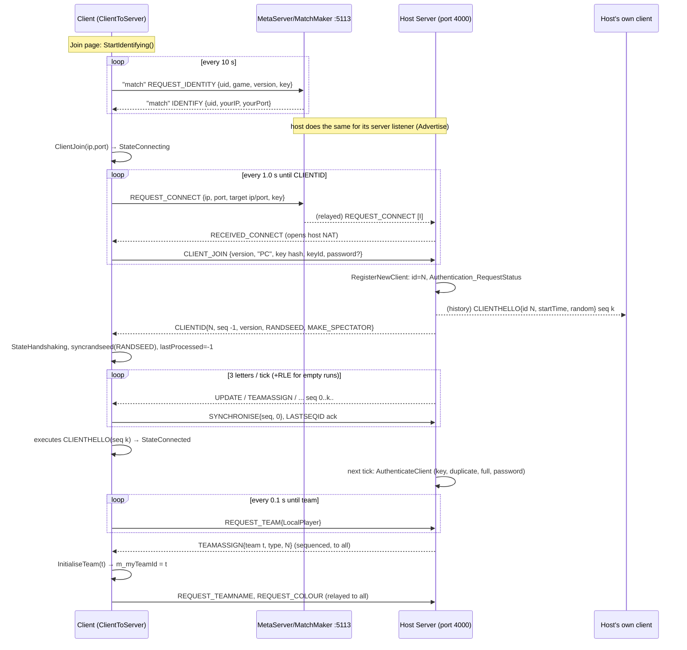

# P15_network — Networking, metaserver, netlib
Scope: `code/network/*` (all 30 files incl. the uncompiled `network_defines_debug.h`, `networkupdate.inc`), `contrib/systemiv/lib/metaserver/*` (12 files; 6 compiled), `contrib/systemiv/lib/netlib/*` (20 files; 16 compiled), `contrib/systemiv/lib/network_stream*` (3 files). Supporting evidence read: `docs/Network.txt`, `docs/NetworkThreads.txt`, `docs/network overview.txt`, `docs/integrating virtual players into network system.txt`. Out-of-scope files read to resolve questions are listed in the coverage CSV (Directory wire format, GameTimer, TeamControls packing, main loop, App network entry points, lobby/browser UI call sites). Build baseline: see build_matrix.md (`Release|Win32`, `TARGET_PC_FULLGAME`, `LAN_PLAY_ENABLED`, `WAN_PLAY_ENABLED`, `NETWORK_STATS_ENABLED`, `AUTHENTICATION_LEVEL 1`; `TARGET_DEBUG`, `TARGET_BETATEST_GROUP`, `TESTBED_ENABLED`, `TRACK_SYNC_RAND`, `LOCATION_EDITOR` all **off**).

Path convention: all refs relative to `SRC=multiwinia/`. Tags: [C] confirmed by reading, [I] inferred (reason given), [U] unknown.

---

## [→ 22_determinism_and_networking] 1. Network model at a glance

| Question | Answer | Evidence |
|---|---|---|
| Topology | **Star, client/server over UDP.** One process hosts a `Server`; every participant (including the host) runs a `ClientToServer`. Clients never talk to each other. | [C] `code/app.cpp:App::StartNetwork`, `code/network/server.cpp:Server::Initialise`, `code/network/clienttoserver.cpp:ClientToServer::ClientJoin` |
| Is the host also a client? | **Yes.** `App::StartNetwork(true,…)` creates `m_server` and then calls `m_clientToServer->ClientJoin()` on the same process. Host-client ↔ server traffic bypasses sockets: the host client hands letters straight to `Server::ReceiveLetter` (tagged with the host's LAN IP + client listen port), and the server hands letters for `m_receiverId == m_clientToServer->m_clientId` straight to `ClientToServer::ReceiveLetter`. The host client nevertheless goes through exactly the same sequencing/ack pipeline as remote clients. | [C] `code/network/clienttoserver.cpp:ClientToServer::AdvanceSender` (`if( g_app->m_server ) g_app->m_server->ReceiveLetter(…)`), `code/network/server.cpp:Server::AdvanceSender` |
| Dedicated server? | **No.** No headless mode exists; the server is always embedded in a game client. | [C] only construction site of `Server` is `App::StartNetwork` (`code/app.cpp`) |
| Single player | Uses the identical pipeline: `App::StartSinglePlayerServer` → `StartNetwork(true, NULL, -1)` → server IP `"127.0.0.1"`, server port **-1**. `ClientToServer::GetServerPort() == -1` is the game-wide "single player" flag (no advertising, rejects other joiners, no kicking on auth failure). | [C] `code/app.cpp:App::StartSinglePlayerServer`, `App::StartNetwork`; `code/network/server.cpp:Server::RegisterNewTeam`, `Server::Advertise`, `Server::AuthenticateClients` |
| Multiplayer host | `App::StartMultiPlayerServer` → `StartNetwork(true, NULL, NULL)`; port `NULL`(=0) ≠ -1 so the host client joins its own LAN IP (`GetLocalHostIP`) at the server listener's port. | [C] `code/app.cpp:App::StartMultiPlayerServer`, `App::StartNetwork` |
| Lockstep vs state sync | **Deterministic lockstep with a server-sequenced command stream ("relay lockstep").** The server never simulates authoritatively and never sends world state. Every 0.1 s it packages all client commands received since the previous tick into one *UPDATE letter* with a monotonically increasing sequence id, appends it to an unbounded history, and sends it to every client. Each client executes the letters strictly in sequence-id order; one UPDATE letter = one simulation frame of 0.1 s × game speed, split into 10 slices. Only a 1-byte checksum per frame flows back for desync detection. | [C] `code/network/server.cpp:Server::Advance`, `Server::SendLetter`; `code/network/clienttoserver.cpp:ClientToServer::ProcessAllServerLetters`, `ClientToServer::GetNextLetter` |
| Input delay | Not a fixed number of frames. Input becomes effective at the start of the first UPDATE frame generated after the server receives it: delay = (time to next server tick, 0–100 ms) + one-way latency to server + one-way latency back + client-side buffering (see §2.4). The local host experiences zero network latency but the same tick quantisation and buffering. | [C] pipeline; [I] composition of delays |
| Lobby | The lobby runs **inside the same lockstep channel**: game options, team assignments, names, colours, chat, ready flags and the START_GAME command are all sequenced commands in the history. A late joiner reconstructs lobby state by replaying the full history from sequence id 0. | [C] `code/network/clienttoserver.cpp:ClientToServer::ProcessServerUpdates` (SETGAMEOPTION*, START_GAME, REQUEST_TEAMNAME…); `code/UI/WaitingButton.h` (connect progress = `g_lastProcessedSequenceId / m_serverSequenceId`) |
| Transport reliability | Custom over UDP: sequence ids + cumulative acks (every client letter carries `LASTSEQID` = highest contiguous id received) + server-side resend window of 3 letters per tick + one piggy-backed copy of the oldest unacknowledged letter + run-length encoding of empty frames. Client→server messages are **not** acknowledged or resent (they are re-sent at the application level where it matters: ALIVE 10 Hz, team requests, joins). | [C] `code/network/server.cpp:Server::UpdateClients`; `code/network/clienttoserver.cpp:ClientToServer::ReceiveLetter` |

### 1.1 Peer roles

| Role | Object | Count | Responsibilities |
|---|---|---|---|
| Server | `Server` (`g_app->m_server`) | 0 or 1 per process | Accept/authenticate clients, assign client ids and team slots, sequence and broadcast commands, keep full history, resend lost letters, compare sync bytes, relay IFrame files, advertise to metaserver/LAN, kick |
| Client | `ClientToServer` (`g_app->m_clientToServer`) | exactly 1 per process (created at app start) | Connect/handshake, send commands, receive/order letters, execute simulation slices, generate sync bytes, display desync/lag |
| Per-client server record | `ServerToClient` | one per connected (and per disconnected) client | IP/port, socket session, auth key/key id, password, client id, spectator flag, last known/sent seq id, caught-up flag, last-message time, sync byte array, saved last ALIVE/SELECTUNIT/REQUEST_COLOUR, FTP manager |
| Team slot (server side) | `ServerTeam {m_clientId, m_teamType}` in `Server::m_teams` (DArray, index = team id 0..5) | ≤ `NUM_TEAMS` = 6 | Which client owns which team; a client may own several (e.g. host owns its own + all CPU teams) |

[C] `code/network/server.h`, `code/network/servertoclient.h`, `code/globals.h:NUM_TEAMS`. This two-level client/team split is exactly what `docs/integrating virtual players into network system.txt` proposed ("DArray of Teams … DArray of Clients") [C].

---

## [→ 22_determinism_and_networking] 2. Timing model

### 2.1 Server tick
- `Server::Initialise`: `m_nextServerAdvanceTime = GetHighResTime() + 0.1`. [C]
- `Server::AdvanceIfNecessary(now)`: if `now > m_nextServerAdvanceTime` → `Advance()` once, then `m_nextServerAdvanceTime += 0.1`. At most **one** tick per call; if the main loop stalls, ticks are produced back-to-back on subsequent calls until the schedule catches up (no tick skipping). `Server::SkipToTime` exists to jump the schedule ("waking from sleep") but has no caller. [C] `code/network/server.cpp:Server::AdvanceIfNecessary`, `Server::SkipToTime`
- Callers: every main loop — `code/main.cpp:LocationGameLoop`, `GlobalWorldGameLoop` (and the front-end menu loop at `code/main.cpp` ~L1465), and the loading screen loop under `m_networkMutex.TryLock()` (`code/loading_screen.cpp:LoadingScreen::Render`). So the server ticks at **10 Hz real time** regardless of game speed or pause. [C]

### 2.2 Client frame and slices
- One UPDATE letter ⇒ one *frame*. On taking a letter (`g_sliceNum == -1`) the client applies its commands (`ProcessServerUpdates`), sets `g_lastProcessedSequenceId = seqId`, `g_sliceNum = 0`, calls `g_gameTimer.Tick()`, then `GenerateSyncValue()` + `SendSyncronisation()`. Subsequent slice steps call `Location::Advance(g_sliceNum)` and `ParticleSystem::Advance(g_sliceNum)` (skipped while `App::GamePaused()`), and **at slice 8** `Multiwinia::Advance()` (always, even when paused, if `App::Multiplayer()`); after slice 9 `g_sliceNum = -1`. `NUM_SLICES_PER_FRAME = 10` (`code/globals.h`). [C] `code/network/clienttoserver.cpp:ClientToServer::ProcessAllServerLetters`
- Non-UPDATE sequenced letters (CLIENTHELLO, CLIENTGOODBYE, TEAMASSIGN, NETSYNCERROR, …) consume a sequence id but do **not** start a frame, tick the timer, or produce a sync byte. Unsequenced letters (`SEQID == -1`) are processed as soon as they reach the inbox head. [C] same function.
- `GameTimer::Tick` adds `GetServerAdvancePeriod() = 0.1 × m_gameSpeed` to `m_gameTime` (network time) unless paused, and moves `m_gameSpeed` toward a requested speed by `diff × speedOfChange` per tick (snap when within 0.01). `GameTimer::Reset` sets speed **0** in multiplayer (game starts frozen until the grace countdown finishes), 1 otherwise. [C] `code/gametimer.cpp:GameTimer::Tick`, `GameTimer::Reset`

### 2.3 Slices per render frame (client pacing controller)
`ClientToServer::GetNumSlicesToAdvance(catchUp)` [C]:
```
if catchUp: return 20
pending = (m_lastValidSequenceIdFromServer - g_lastProcessedSequenceId) * 10
if g_sliceNum != -1: pending += 10 - g_sliceNum
n = floor(pending * 0.3)
// (a branch for pending <= 10 computes a time-based value into a shadowed local and has no effect)
return clamp(n, 0, 20)
```
`ClientToServer::AdvanceAndCatchUp` [C]:
```
if loadingLocation: KeepAlive(); return
start = now
loop:
   catchUp = g_lastProcessedSequenceId < m_lastValidSequenceIdFromServer - 20  and  m_clientId != -1
   Advance()                       // connection logic, FTP, send outbox
   ProcessAllServerLetters(catchUp)
   if loadingLocation: return      // a START_GAME was just processed
while catchUp and (now - start) <= 0.3 s
```
So a client more than 20 frames behind runs 20 slices (2 frames) per iteration for up to 0.3 s per render frame; otherwise it drains 30 % of its pending slices per render frame, at most 20.

### 2.4 Effective buffering / input latency [I]
Derived from §2.3: the server injects 100 slices/s; at render rate R fps the client consumes ⌊0.3·P⌋ slices per frame, so the steady-state backlog is P ≈ 100/(0.3·R) slices: ≈ 5.6 slices (56 ms) at 60 fps, ≈ 11 slices (110 ms) at 30 fps; and because ⌊0.3·P⌋ = 0 for P ≤ 3, a backlog of up to 3 slices is never drained until the next letter arrives. Total command latency ≈ U(0,100 ms) tick wait + RTT + backlog. A replacement design should use an explicit, fixed input-delay/jitter buffer instead.

### 2.5 Estimated latency (stats only)
`GetEstimatedServerSeqId = max( floor((now - g_gameTimer.m_estimatedServerStartTime)/0.1), m_serverSequenceId )`; `m_estimatedServerStartTime` = min over received letters of `now - seqId×0.1`. `GetEstimatedLatency = max(0, est - g_lastProcessedSequenceId) × 0.1` s. Used only by the network stats window and benchmark upload. `m_latency` (PING round trip) is computed from relayed PING commands, but `SendPing` has no caller. [C] `code/network/clienttoserver.cpp:GetEstimatedServerSeqId`, `GetEstimatedLatency`, `ReceiveLetter`; `code/interface/network_window.cpp`; `code/benchmark.cpp`

---

## [→ 22_determinism_and_networking] 3. Transport layer — NetLib (contrib/systemiv/lib/netlib)

NetLib is "a very thin portable UDP network library" [C] `contrib/systemiv/lib/netlib/net_lib.h`.

| Class / function | Behaviour | Ref |
|---|---|---|
| `NetLib::Initialise` | `WSAStartup(2.2)`; fails if 2.2 unavailable. Called once from `MetaServer_Initialise`. | [C] `net_lib.cpp:NetLib::Initialise`, `metaserver.cpp:MetaServer_Initialise` |
| `NetSocketListener(port, name, iface="")` | Owns one UDP socket. `Bind()`: `socket(AF_INET, SOCK_DGRAM, IPPROTO_UDP)`, bind to `INADDR_ANY:port` (or resolved interface via `getaddrinfo`), up to 6 attempts with sleep `attempts×100 ms` while the address is in use; port 0 ⇒ OS-assigned, read back with `getsockname`. Mutex-guarded, idempotent. | [C] `net_socket_listener.cpp:NetSocketListener::Bind` |
| `NetSocketListener::StartListening(cb)` | **Blocking loop** on the calling thread: `recvfrom` into a fresh `NetUdpPacket` (buffer `MAX_PACKET_SIZE` = **1500** bytes); on success calls `cb(packet)` (callee owns/deletes it); errors (`length <= 0`) are logged (except `WSAEINTR`, `WSAECONNRESET` = ICMP port unreachable) and the packet is reused. Runs until `StopListening` (sets flag, `shutdown`+`closesocket`, `Sleep(250)`). | [C] `NetSocketListener::StartListening`, `StopListening` |
| `NetSocketListener::EnableBroadcast` | `setsockopt(SO_BROADCAST)` | [C] |
| `NetSocketSession(listener, host, port)` | A *send endpoint* that reuses the listener's bound socket (so replies come back to the same port — essential for NAT hole punching). Resolves `host` with `getaddrinfo` (AF_INET). `WriteData` = one `sendto` (no fragmentation, no retry). | [C] `net_socket_session.cpp` |
| `NetSocket` | A separately-created "connected" UDP socket with a select-based write loop (timeout 10 000 ms, poll 100 ms). Only used by `GetLocalHostIP` to discover the default-route local address by `connect("80.175.29.66", 5000)` + `getsockname` (no packet sent); fallback `gethostbyname(gethostname())`, then `"127.0.0.1"`. | [C] `net_socket.cpp`, `net_lib.cpp:GetLocalHostIP` |
| `NetUdpPacket` | `{int m_length; sockaddr_in m_clientAddress; char m_data[1500];}`; `GetPort()` = `ntohs(sin_port)`. | [C] `net_udp_packet.h/.cpp` |
| `NetMutex` | Win32 `CRITICAL_SECTION` (recursive); `NetLockMutex` RAII guard; `NetEvent` (auto-reset Win32 event, `Wait(ms)`, -1 = infinite); `NetSemaphore`. | [C] `net_mutex.h`, `net_mutex_win32.cpp` |
| `NetStartThread(fn, arg)` | `CreateThread`, never joined. | [C] `net_thread_win32.cpp` |
| `GetLocalHost`, `StrToIpAddress`, `IpAddressToStr` | host-name resolution helpers; `IpToString` (`code/network/generic.cpp`) is the game-side equivalent. | [C] |

Hazard [I]: Windows `recvfrom` with a 1500-byte buffer fails with `WSAEMSGSIZE` for larger datagrams, which `StartListening` treats as an error and drops. Any letter whose serialised size exceeds 1500 bytes (e.g. a busy UPDATE plus its piggy-backed PREVUPDATE copy) can therefore never be delivered, and the same letter is resent forever → that client stalls. The server only logs "Largest datagram sent". The new design must enforce an MTU budget or fragment.

---

## [→ 22_determinism_and_networking] 4. Encoding

### 4.1 Primitive wire encoding — `contrib/systemiv/lib/network_stream*`
All multi-byte values are written as their in-memory bytes; on big-endian hosts they are byte-reversed, so **the wire format is little-endian**. [C] `contrib/systemiv/lib/network_stream_inlines.cpp:ReadNetworkValue/WriteNetworkValue` (`#ifndef __BIG_ENDIAN__`).

| Primitive | Encoding | Bytes | Ref |
|---|---|---|---|
| `int`, `unsigned` | LE 32-bit | 4 | [C] `WriteNetworkValue<T>` |
| `float` | IEEE-754 binary32 LE | 4 | [C] |
| `double` | IEEE-754 binary64 LE | 8 | [C] |
| `unsigned long long` | LE 64-bit | 8 | [C] |
| `short` / `unsigned short` | LE 16-bit | 2 | [C] (used by `TeamControls::Pack`) |
| `char`, `bool` | 1 byte (bool written as 0/1) | 1 | [C] |
| `Vector3` | x, y, z as **double** | 24 | [C] `network_stream.cpp:WriteNetworkValue(Vector3)`; `code/lib/vector3.h` and `contrib/systemiv/lib/math/vector3.h` both declare `double x, y, z` under the same include guard `VECTOR3_H` |
| Packed int | value 0..254 → 1 byte; otherwise byte `0xFF` + 4-byte int (so −1 = 5 bytes) | 1 or 5 | [C] `network_stream.cpp:WritePackedInt` |
| Dynamic string | packed-int length (−1 = NULL) + raw bytes, no terminator; on read a length < 0 (≠ −1) or > max ⇒ substitute safe string | 1/5 + n | [C] `WriteDynamicString`, `ReadDynamicString` |
| Unicode string | packed-int length in UTF-16 code units (−1 = NULL) + 2 bytes per unit (Win32 `wchar_t`); Linux/Mac convert to/from UTF-16LE | 1/5 + 2n | [C] `WriteUnicodeString`, `ReadUnicodeString` |
| Void (blob) | 4-byte int length + bytes | 4 + n | [C] `WriteVoidData` |
| Number array | packed-int count + each element via `WriteNetworkValue` | 1/5 + 4n for ints | [C] `WriteNumbersData` |

### 4.2 Message container — `Directory` (tosser; read from `contrib/systemiv/lib/tosser/directory.cpp`, outside this partition)
Every network message in the game, the metaserver protocol and the matchmaker is a `Directory`: a named node with a list of typed named fields and a list of child Directories. Wire layout [C] `Directory::Write`, `DirectoryData::Write`:

```
Directory     := '<' DynString(name) PackedInt(numFields) Field* PackedInt(numSubdirs) Directory* '>'
Field         := DynString(fieldName) u8(type) Value(type)
Value(1 INT)      := i32
Value(2 FLOAT)    := f32
Value(3 CHAR)     := u8          (unsigned char fields are stored as CHAR)
Value(4 STRING)   := DynString
Value(5 BOOL)     := u8 (0/1)
Value(6 VOID)     := i32 length, bytes
Value(7 FIXED)    := 8 bytes     (only with USE_FIXED — dead in baseline)
Value(8 INTS)     := PackedInt count, i32*
Value(9 ULLONG)   := u64
Value(10 UNICODE) := UnicodeString
```
Limits on read: ≤ 1024 fields per node (`DIRECTORY_MAXDIRSIZE`; the subdirectory count check mistakenly re-tests the field count), strings ≤ 10240 chars (`DIRECTORY_MAXSTRINGLENGTH`). Start/end markers `'<'`/`'>'` must match or the whole datagram is rejected ("bogus letter"). `CreateData` replaces an existing field of the same name. Missing-field reads return safe values: int −1, float −1.0, char `'?'` (63), string `"[SAFESTRING]"`, bool false, ullong `0xFFFF…`. [C] `contrib/systemiv/lib/tosser/directory.h` (`DIRECTORY_SAFE*`), `directory.cpp:Directory::Read`.

Consequence used by the server filter (§7): `GetDataUChar(NET_DARWINIA_TEAMID)` on a message without a TEAMID field returns 63, not 255. [C]

Field names are deliberately 1–4 character codes ("optimised network symbols"); an uncompiled alternative header `code/network/network_defines_debug.h` maps them to readable names ("much higher bandwidth usage") [C]. `TRACK_SYNC_RAND` builds contain a decoder table `DecodeCmd` (`code/network/clienttoserver.cpp`) that lists every code → name pair [C] [B:DEBUG].

### 4.3 Size budget of common messages [I computed from §4.1/§4.2]
| Message | Size (bytes, excl. 28-byte IP+UDP header; code accounts `UDP_HEADER_SIZE` = 32) |
|---|---|
| Node overhead ('<', name "ba", counts, '>') | 7 |
| COMMAND field (e.g. "cd") | 7 |
| char field | 5; int field 8; Vector3 blob field 32 |
| Client ALIVE letter | 61 (flags + mouse only) … 69 (with both direct vectors) |
| Client SYNCHRONISE letter | 35 |
| UPDATE header as stored in history (COMMAND + SEQID) | 22; as sent (+LASTSEQID) 30 |
| ALIVE as relayed inside UPDATE (FROMIP/FROMPORT/LASTSEQID stripped) | 53–61 |
| 4-player in-game UPDATE with only ALIVEs | 30 + 4×53 = 242; with piggy-backed PREVUPDATE copy ≈ 476 |
| RLE "N empty updates" letter | 38 |
⇒ ≈ 5 KB/s per client downstream and ≈ 1 KB/s upstream in a quiet 4-player game.

### 4.4 `NetworkValue` family — UI ↔ network option binding (`code/network/networkvalue.*`)
Despite the name these classes are not a wire encoding; they adapt lobby UI input fields (`InputField::Type` order: Nowt, Char, Bool, Int, Float, String, UnicodeString) to network requests. [C] `code/network/networkvalue.h`.

| Class | Get() reads | Set() does | Ref |
|---|---|---|---|
| `NetworkValue` (abstract) | — | `ToLatinString`/`FromLatinString` via Unicode; abstract `To/FromUnicodeString` | [C] |
| `BoundedNetworkValue` | — | optional `[min,max]` clamp `Bound()` (the constructor initialises `m_max` with itself — uninitialised value) | [C] `networkvalue.cpp:BoundedNetworkValue` |
| `NetworkInt`, `NetworkBool`, `NetworkChar` | `%d` text | parse `%d` | [C] |
| `NetworkFloat`, `NetworkDouble` | `%.2f` text | parse `%lf`, then `iv_trunc_low_nibble` (determinism truncation, see 22) | [C] `NetworkFloat::FromUnicodeString` |
| `NetworkString`, `NetworkUnicodeString`, `LocalString` (bounded copy), `LocalUnicodeString`, `LocalType<…>` (`LocalInt/Float/Double/Char/Bool/IntAsBool`), `NetworkIntAsBool`, `NetworkIntAsString` | local variable | local variable (no network) | [C] |
| `NetworkGameOptionInt(option, int&)` | bound int | `RequestSetGameOptionInt(option, Bound(v))` | [C] |
| `NetworkGameOptionBool(option, bool&)` | bound bool | `RequestSetGameOptionInt(option, Bound(v))` | [C] |
| `NetworkGameOptionString(option, const char*&)` | bound string | `RequestSetGameOptionString(option, v)` | [C] |
| `NetworkGameOptionMapId` | index of `g_app->m_requestedMap` in `m_gameMenu->m_maps[gameType]` (case-insensitive file name match), −1 if none | `RequestSetGameOptionString(GAMEOPTION_MAPNAME, maps[v]->m_fileName)` | [C] `GetMapId`, `SetMapId` |
| `NetworkGameParam(index)` | `m_multiwinia->m_params[index]` | `RequestSetGameOptionArrayElementInt(GAMEOPTION_GAME_PARAM, index, v)` | [C] |
| `NetworkGameResearchLevel(index)` | `m_globalWorld->m_research->m_researchLevel[index]` | `RequestSetGameOptionArrayElementInt(GAMEOPTION_GAME_RESEARCH_LEVEL, index, v)` | [C] |
| `NetworkIntArray(size, factory)` | array of the above | — | [C] |

Lobby bindings instantiated by `GameMenuWindow`: `m_gameType`(GAMEOPTION_GAME_TYPE), `m_requestedMapId`(map), `m_aiMode`(GAMEOPTION_AIMODE), `m_coopMode`(GAMEOPTION_COOPMODE, bool), `m_singleAssaultRound`(GAMEOPTION_SINGLEASSAULT, bool), `m_basicCrates`(GAMEOPTION_BASICCRATES, bool), `m_params[64]`, `m_researchLevel[NumResearchItems]`. [C] `code/UI/GameMenuWindow.h`, `code/UI/GameMenuWindow.cpp:GameMenuWindow::GameMenuWindow`

## [→ 22_determinism_and_networking] 5. Message catalogue — common fields and identifiers

All game messages: Directory name `NET_DARWINIA_MESSAGE` = `"ba"`, command field `NET_DARWINIA_COMMAND` = `"bb"` (string). [C] `code/network/network_defines.h`. The server adds `FROMIP "ga"` (string) and `FROMPORT "gb"` (int) to every received letter (`Server::ReceiveLetter`) and strips them, together with `LASTSEQID`, before relaying (`ServerToClientLetter::AddUpdate`). [C] `code/network/server.cpp`.

### 5.1 Data-field codes (complete list from `code/network/network_defines.h`)
| Code | Symbol | Wire type as used | Meaning |
|---|---|---|---|
| da | TEAMTYPE | int | requested/assigned team type (`TeamTypeUnused=-1, LocalPlayer=0, RemotePlayer=1, CPU=2, Spectator=3`, `code/team.h`) |
| db | DESIREDTEAMID | int | always −1; server ignores (code commented out) |
| dc | LASTPROCESSEDSEQID | int | seq id the sync byte refers to |
| dd | SYNCVALUE | char | 1-byte sync value |
| de | TEAMID | char (int in TEAMASSIGN) | team slot 0..5, 255 = none |
| df | POSITION | void (24-byte Vector3) | world position |
| dg | ALIVE_DATA | void | packed `TeamControls` (§5.4) |
| dl | UNITID | int | |
| dm | ENTITYID | int | entity index (or unique id for SHAMANSUMMON) |
| dn | BUILDINGID | int | building unique id |
| do | ENTITYTYPE | char | shaman summon type |
| dp | RADIUS | float | selection radius |
| dq | PROGRAM | char | task-manager program/task id; 255 = "entity" in TERMINATE |
| dr | RANDSEED | int | sync RNG seed |
| ds | TEAMNAME | unicode | |
| dt | COLOURID | int | colour 0..7, −1 = none |
| dw | UNICODEMESSAGE | unicode | chat text |
| dx | ENCRYPTION_PADDING_CTS | — | **unused** |
| dy | SERVER_PASSWORD | unicode | join password |
| dz | CHRISTMASMODE | (used as a *command* code) | |
| ea | DISCONNECT | int (reason) / also a command code | |
| ed | CLIENTID | int (char in chat/spectator msgs) | |
| ei | SYNCERRORID | string | `"YYYY-MM-DD H.MM.S <seq>"` local time |
| ej | SYNCERRORSEQID | int | |
| el | VERSION | string | `APP_VERSION` |
| em | SYSTEMTYPE | string | `APP_SYSTEM` = `"PC"` |
| en | PREVUPDATE | (subdirectory name) | piggy-backed earlier letter |
| eo | NUMEMPTYUPDATES | int | run-length of empty frames |
| ep | SEQID | int | sequence id; −1 = unsequenced/direct |
| eq | LASTSEQID | int | client→server: highest contiguous id received (ack); server→client: server's next seq id at send time |
| er | XUID | — | **unused** (Xbox Live) |
| et | CLIENTISDEMO | bool | client uses a demo key |
| eu | ENCRYPTION_PADDING_STC | — | **unused** |
| ev | SERVER_FULL | (command code) | handled by client, never sent |
| ew | MAKE_SPECTATOR | int | 0/1 in CLIENTID reply |
| ey | SET_PLAYERACHIEVEMENTS | (command code) | |
| ez | PLAYERACHIEVEMENTS | char | "viral achievement" bit mask |
| fa | FILESEND | (command code) | FTP block/ack |
| fb | FILENAME | string | |
| fc | FILESIZE | int | |
| fd | BLOCKNUMBER | int (data) / ints (ack list) | |
| fe | BLOCKDATA | void (≤ 1024 bytes) | |
| ga | FROMIP | string | added by server on receipt |
| gb | FROMPORT | int | added by server on receipt |
| gc | FROMPLAYER | — | **unused** |
| he | GAMEOPTION_NAME | int | option id (§5.3) |
| hf | GAMEOPTION_INDEX | int | array index (or element count for ARRAYINT) |
| hg | GAMEOPTION_VALUE | int / string / ints | |
| hi | GAMEOPTION_VERSION | int | per-option version counter |
| hj | GAMEOPTION_PDLC_BITMASK | — | **unused** (downloadable content, console remnant) |
| hk | JOIN_VIA_INVITE | — | **unused** |
| c3 | TEAM_SCORES | ints[6] (also the command code) | |
| cob | DIRECTROUTE | char (bool in armour orders) | |
| cod | FORCEONLYMOVE | char | |
| coe | SECONDARYFUNCTION | char | |
| (metaserver) dq AUTHKEY, dr AUTHKEYID, di GAMEVERSION, dB RANDOM, dC STARTTIME | see §15 | | also embedded in game messages |

Preference names defined here: `NetworkClientPort` (default 4001), `NetworkServerPort` (default 4000), `NetworkUsePortForwarding` (default 0), `NetworkTrackSynchronisation` (unused in code). [C] `code/network/network_defines.h`, `ClientToServer::OpenConnections`, `Server::Initialise`.

### 5.2 Team controls payload (`ALIVE_DATA`) — `code/team.cpp:TeamControls::Pack` (outside partition, read for layout)
| Offset | Field | Bytes | Present when |
|---|---|---|---|
| 0 | flags (u16): 0x0001 unitMove, 0x0002 directUnitMove, 0x0004 primaryFireTarget, 0x0008 secondaryFireTarget, 0x0010 targetDirected, 0x0020 secondaryFireDirected, 0x0040 cameraEntityTracking, 0x0080 unitSecondaryMode, 0x0100 endSetTarget, 0x0200 consoleController, 0x0400 leftButtonPressed | 2 | always |
| 2 | directUnitMoveDx, Dy (i16 each) | 4 | flag 0x0002 |
| +0 | directUnitTargetDx, Dy (i16 each) | 4 | flag 0x0010 or 0x0020 |
| +0 | mousePos (Vector3, 3×double) | 24 | always |
[C] `code/team.cpp:TeamControls::GetFlags`, `Pack`, `Unpack`. Sent every `IAMALIVE_PERIOD` = 0.1 s from `code/main.cpp:SendTeamControlsToNetwork` while in a location (flags cleared when a window/task manager/chat log is open). Applied on every client by `Location::UpdateTeam(teamId, controls)` (P03/P09).

### 5.3 Lobby game-option ids (`GAMEOPTION_*`, `code/network/network_defines.h`)
| Id | Symbol | Message used | Client effect on receipt (`ProcessServerUpdates`) |
|---|---|---|---|
| 0 | GAME_TYPE | SETGAMEOPTIONINT | if 0 ≤ v < `Multiwinia::NumGameTypes` (7): zero all 64 params and all research levels, `SetGameResearch(zeros)`, `SetGameOptions(v, zeros)` |
| 1 | GAME_PARAM | SETGAMEOPTIONARRAYELEMENTINT (index 0..63) | if `ValidGameOption(index)`: `SetGameOption(index, v)` |
| 2 | GAME_RESEARCH_LEVEL | SETGAMEOPTIONARRAYELEMENTINT (index < `GlobalResearch::NumResearchItems`) | `m_researchLevel[index] = v` |
| 3 | MAPNAME | SETGAMEOPTIONSTRING | `strcpy(g_app->m_requestedMap, v)`; on the host: `m_server->m_noAdvertise = (singlePlayer or map "null"/empty)` |
| 4 | AIMODE | SETGAMEOPTIONINT | if 0 ≤ v ≤ `NumAITypes` (3; note off-by-one allows 3): `m_aiType = v` (`AITypeEasy=0, Standard=1, Hard=2`) |
| 5 | COOPMODE | SETGAMEOPTIONINT | `m_coopMode = v`; when enabled clears every team colour to −1 and the local requested colour; restores the menu's previously requested colour when disabled |
| 6 | SINGLEASSAULT | SETGAMEOPTIONINT | `m_assaultSingleRound = v` |
| 7 | BASICCRATES | SETGAMEOPTIONINT | `m_basicCratesOnly = v` |
| 8..13 | TEAMSSTATUS_LBOUND..UBOUND (8 + NUM_TEAMS−1) | SETGAMEOPTIONINT | `m_teamsStatus[id-8] = v` (no sender found in baseline) |
| 14 | NUMGAMEOPTIONS | — | array size |
Versioning [C] `ClientToServer::RequestSetGameOption*`, `GameOptionVersion`, `SetGameOptionVersion`: every option (and every array element of options 1 and 2, arrays of 64) carries a version; a request is sent with `localVersion+1`; a receiver applies an update only if `version > localVersion`, then stores the version. Because all clients apply the same sequenced stream, conflicting simultaneous edits resolve deterministically (the first one in the stream wins; later ones with an equal version are discarded). Versions reset to 0 on handshake (`ResetGameOptionVersions` on CLIENTID). `SETGAMEOPTIONARRAYINT` ignores versions and has no caller ("TODO: Delete this method").

### 5.4 Client → server commands (every value of `COMMAND` a client can send)
"Relay" = copied into the next UPDATE letter and executed by **every** client in sequence (the deterministic command stream). "Server" = consumed by the server. Field types per §4.2. All letters also carry `LASTSEQID` (ack). Sender functions are in `code/network/clienttoserver.cpp`; server handling in `code/network/server.cpp:Server::Advance`; client execution in `ClientToServer::ProcessServerUpdates`. [C] for every row unless marked.

| # | Code | Symbol | Fields | Sender (call site) | Handling | Effect when executed by each client |
|---|---|---|---|---|---|---|
| 1 | ca | CLIENT_JOIN | GAMEVERSION `di` str, SYSTEMTYPE `em` str, AUTHKEY `dq` str (full key if the sender hosts the server or is a demo key, else `hsh…` hash), AUTHKEYID `dr` int (hash case only), SERVER_PASSWORD `dy` unicode (if set), [B:EDITOR] REQUESTMAP | `ClientToServer::Advance` every 1.0 s while `StateConnecting` | Server: unknown ip:port → `RegisterNewClient` + `SendClientId`; known → ignored; from a *disconnected* ip:port → treated as a brand-new client (old record removed). No version check server-side. | — |
| 2 | cb | CLIENT_LEAVE | — | `ClientLeave` (sent ×3, flushed immediately) | Server: `RemoveClient(id, Disconnect_ClientLeave)` | — |
| 3 | cba | REQUEST_SPECTATOR | TEAMID char, CLIENTID char | `RequestToRegisterAsSpectator` (lobby `CSpectatorButton`, `code/UI/CSpectatorButton.h`) | Server: removes the first `ServerTeam` owned by that client (not deleted), rejects in single player (`RemoveClient(ServerFull)` and **returns from `Advance`**, so that tick emits no UPDATE), then makes the *host's local client* send ASSIGN_SPECTATOR (row 40) | — |
| 4 | cc | REQUEST_TEAM | TEAMTYPE int, DESIREDTEAMID int (−1) | `ClientToServer::Advance` every 0.1 s while connected with `m_myTeamId == 255` and not spectator (type LocalPlayer); lobby/quick-start code for CPU teams | Server: `RegisterNewTeam` (§9.3) → TEAMASSIGN | — |
| 5 | cca | TOGGLE_READY | TEAMID | `RequestToggleReady` (in-game grace period key `ControlToggleReady`, `code/location_input.cpp`; `PlayGameButton`, `FinishMultiwiniaButton`) | Relay | at main menu: lobby team `m_ready ^= 1`; in game: `Team::m_ready ^= 1` |
| 6 | ccb | SET_TEAM_READY | TEAMID | `RequestSetTeamReady` ([B:DEBUG] testbed only) | Relay | `Team::m_ready = true` |
| 7 | cd | ALIVE | TEAMID, ALIVE_DATA void | `SendIAmAlive` every 0.1 s in a location | Relay, **only the latest per client per tick** | `Location::UpdateTeam(teamId, TeamControls)` |
| 8 | ce | SELECTUNIT | TEAMID, UNITID int, ENTITYID int, BUILDINGID int | `RequestSelectUnit` | Relay, latest-only per client per tick | `Team::SelectUnit(unit, entity, building)`; `TaskManager::SelectTask(WorldObjectId(team, unit, entity, -1))` |
| 9 | cf | AIMBUILDING | TEAMID, BUILDINGID int, POSITION | `RequestAimBuilding` (`code/location_input.cpp`) | Relay | if building exists, belongs to team and is a RadarDish: `RadarDish::Aim(pos)` |
| 10 | cg | TOGGLELASERFENCE | BUILDINGID | `RequestToggleFence` (no TEAMID: passes the filter because a missing char reads as 63) | Relay | if LaserFence: `Toggle()` |
| 11 | ch | RUNPROGRAM | TEAMID, PROGRAM char | `RequestRunProgram` | Relay | `TaskManager::RunTask(program)` |
| 12 | ci | TARGETPROGRAM | TEAMID, PROGRAM, POSITION | `RequestTargetProgram` | Relay | `TaskManager::TargetTask(program, pos)` |
| 13 | cj | SELECTPROGRAM | TEAMID, PROGRAM | `RequestSelectProgram` | Relay | `TaskManager::SelectTask(program)` |
| 14 | ck | TERMINATE | TEAMID, PROGRAM (255 ⇒ entity), ENTITYID (−1 for programs) | `RequestTerminateProgram`, `RequestTerminateEntity` | Relay | program ≠ 255: `TerminateTask(program)`; else `team->m_others[entityId]->ChangeHealth(-999)` |
| 15 | cl | SHAMANSUMMON | TEAMID, ENTITYID (shaman unique id), ENTITYTYPE char | `RequestShamanSummon` (`code/shaman_interface.cpp`) | Relay | find shaman in `team->m_specials` by unique id → `Shaman::SummonEntity(type)` |
| 16 | cm | SELECTDGS | TEAMID, RADIUS float, POSITION | `RequestSelectDarwinians` | Relay | `Location::SelectDarwinians(team, pos, radius)` |
| 17 | cn | ORDERDGS | TEAMID, DIRECTROUTE char, POSITION | `RequestIssueDarwinanOrders` | Relay | `Location::IssueDarwinianOrders(team, pos, directRoute)` |
| 18 | co | PROMOTE | TEAMID, ENTITYID | `RequestPromoteDarwinian` | Relay | if `m_others[id]` is an Officer: `DemoteOfficer`, `SelectUnit(-1,-1,-1)`; else `PromoteDarwinian` and select the new officer |
| 19 | coa | ORDERGOTO | TEAMID, DIRECTROUTE, FORCEONLYMOVE char, POSITION | `RequestOfficerOrders`; `RequestArmourOrders` (DIRECTROUTE written as **bool**, read back with `GetDataChar` ⇒ `'?'` ⇒ true) | Relay | current entity Officer: forceOnlyMove ? `SetWaypoint(pos)` : `SetOrders(pos, directRoute)`; Armour: forceOnlyMove ? `SetWayPoint(pos)` : `SetOrders(pos)`, plus an orders marker if the team is a friend of the local team |
| 20 | coc | TOGGLEENTITY | TEAMID, ENTITYID, SECONDARYFUNCTION char | `RequestToggleEntity` | Relay | Armour: secondary ? `ToggleConversionAction()` : `ToggleLoading()`; Officer: if in formation or `OrderGoto` → `CancelOrders()`, else `SetOrders(pos+front)` **and the executing client sends a new SELECTUNIT** (a command generated during simulation — every client does it, so N extra SELECTUNITs, all identical) |
| 21 | cp | PAUSE | — | `App::ToggleGamePaused` (only if no RemotePlayer team, not in grace period, not game over) | Relay | toggle `m_userRequestsPause`; `RequestSpeedChange(0 or 1, 0.2, -1)` |
| 22 | cq | SYNCHRONISE | LASTPROCESSEDSEQID int, SYNCVALUE char | after every executed UPDATE frame; `KeepAlive` once per second while loading | Server: `HandleSyncMessage` (§8) | — |
| 23 | cr | PING | TEAMID | `SendPing` (**no caller**) | Relay | sender: `m_latency = now - m_pingSentTime` |
| 24 | cs | START_GAME | — | `RequestStartGame` (host lobby / quick start) | Relay, **only the first START_GAME per server lifetime** (`SecondMessage`, flag reset only in `Server::Initialise`) | `m_loadingLocation = true`, `m_requestedLocationId = 999`, `m_gameMode = GameModeMultiwinia`, `m_requestedMission = "null"`, `g_gameTimer.Reset()`, leave main menu/lobby; processing stops until the level is loaded |
| 25 | cx | NEXTWEAPON | TEAMID | `RequestNextWeapon` | Relay | Officer: `SetNextMode()`; Armour: `SetDirectOrders()` |
| 26 | cy | PREVWEAPON | TEAMID | `RequestPreviousWeapon` | Relay | Officer: `SetPreviousMode()`; Armour: `SetDirectOrders()` |
| 27 | cya | FOLLOW | TEAMID | `RequestOfficerFollow` | Relay | Officer: `SetFollowMode()` |
| 28 | cyb | NONE | TEAMID | `RequestOfficerNone` | Relay | Officer: `CancelOrders()` |
| 29 | cz | REQUEST_TEAMNAME | TEAMNAME unicode, TEAMID | `ClientToServer::Advance` at most once per second while the lobby name differs from `m_requestedTeamDetails.m_name` | Relay | set lobby team name; if it was empty and at main menu, post chat "PLAYERJOIN" |
| 30 | czz | REQUEST_COLOUR | COLOURID int, TEAMID | `ClientToServer::Advance` every 0.1 s while colour differs (blocked in co-op/Assault unless at main menu with no location) | Relay, latest-only per client per tick | if `colourId < MULTIWINIA_NUM_TEAMCOLOURS` (8): `Multiwinia::SetTeamColour` |
| 31 | cczz | SEND_CHATMESSAGE | UNICODEMESSAGE, CLIENTID char (sender's client id) | `SendChatMessage` (`code/interface/chatinput_window.cpp`) | Relay | lobby `GameMenuWindow::NewChatMessage` or in-game `Location::NewChatMessage` |
| 32 | c3 | TEAM_SCORES | TEAM_SCORES ints[6], TEAMID (winner) | `SendTeamScores` (`Multiwinia` game-over, `code/multiwinia.cpp` ~L4217) | Relay | **ignored** ("Ignore this") |
| 33 | ey | SET_PLAYERACHIEVEMENTS | PLAYERACHIEVEMENTS char mask, TEAMID | `ClientToServer::Advance` every 60 s once a team is held | Relay | `m_teams[team].m_achievementMask = mask` |
| 34 | ha | SETGAMEOPTIONINT | VERSION, NAME, VALUE int | `NetworkGameOptionInt/Bool::Set` | Relay | §5.3 |
| 35 | hb | SETGAMEOPTIONARRAYELEMENTINT | VERSION, NAME, INDEX, VALUE | `NetworkGameParam/ResearchLevel::Set` | Relay | §5.3 |
| 36 | hc | SETGAMEOPTIONARRAYINT | VERSION, NAME, INDEX(=count), VALUE ints | **no caller** | Relay | replace params / research arrays wholesale |
| 37 | hd | SETGAMEOPTIONSTRING | VERSION, NAME, VALUE string | `NetworkGameOptionString/MapId::Set` | Relay | §5.3 |
| 38 | dz | CHRISTMASMODE | — | `ClientToServer::Advance` when `App::UseChristmasMode()` and at main menu | Relay | at main menu: `m_christmasMode = true` |
| 39 | fa | FILESEND | FTP fields (§12.4) | `FTPManager::MakeSendLetters` | Server: per-client `FTPManager` | — |
| 40 | es | ASSIGN_SPECTATOR | TEAMID char, CLIENTID char | sent by the **host's** client on behalf of the server (row 3) | Relay | `Multiwinia::RemoveTeams(clientId)`; if `m_myTeamId == teamId`: `g_app->m_spectator = true`, `m_myTeamId = 255` |

Server relay filter [C] `Server::Advance`: a non-server command is relayed only if the sender is a registered client **and** `GetDataUChar(TEAMID) != 255`. Commands without a TEAMID read 63 and pass; a client whose own team id is 255 cannot inject team commands. There is **no ownership check** — any client may send commands for any team id, and any client may send game-option changes (the UI only offers them to the host) [I from absence of checks]. A new design must validate sender ↔ team ownership and host-only options on the server.

Defined but never sent in baseline: `ct` MAPNAME, `cu` GAMETYPE, `cv` GAMEPARAMS, `cw` RESEARCHLEVEL (Darwinia-era; superseded by SETGAMEOPTION*), `cr` PING (no caller), `hc` (no caller), `ccb` (testbed only). [C] grep of all call sites.

### 5.5 Server → client letters (`ServerToClientLetter`, every COMMAND the server emits)
`ServerToClientLetter {int m_receiverId=-1; bool m_clientDisconnected=false; Directory *m_data;}`; `SERVERTOCLIENTLETTER_BYTESTREAMSIZE 1024` is defined but unused. [C] `code/network/servertoclientletter.h`.
Two delivery classes [C] `code/network/server.cpp`:
- **Sequenced** (`Server::SendLetter`): gets `SEQID = m_sequenceId++`, appended to `m_history`, delivered to every client by `UpdateClients` (each client gets a private copy with `m_receiverId` set), i.e. part of the lockstep stream and replayed to late joiners.
- **Direct** (`SEQID = -1`, put straight into `m_outbox` for one receiver): not in history, no ordering, processed by the client as soon as it is at the head of its inbox.
`Server::AdvanceSender` stamps `LASTSEQID = m_sequenceId` on every outgoing copy.

| # | Code | Symbol | Class | Fields | Produced by | Client handling (`ProcessServerLetters` unless noted) |
|---|---|---|---|---|---|---|
| 1 | ek | UPDATE | Sequenced | SEQID; subdirectories = relayed commands (each named "ba"), in arrival order, then per client (array order) its latest ALIVE, SELECTUNIT, REQUEST_COLOUR | `Server::Advance` every tick (also when empty) | `ProcessServerUpdates` executes each subdirectory; starts a frame (§2.2) |
| 1a | ek + en | UPDATE with PREVUPDATE | copy of #1 | as #1 plus one subdirectory named `en` = full copy of an older history letter | `UpdateClients` | `ReceiveLetter` detaches `en`, renames it "ba" and feeds it through `ReceiveLetter` first (duplicate filter discards it if already held) |
| 1b | ek + eo | UPDATE run-length | Direct-ish (carries a real SEQID, not stored in history) | SEQID = first id, NUMEMPTYUPDATES = N, no subdirectories | `UpdateClients` when > 5 consecutive empty UPDATEs are pending and the client spoke within 5 s | counts as frames s…s+N−1: on execution, if N > 1 a copy with SEQID+1, N−1 is pushed to the inbox head |
| 2 | eb | CLIENTHELLO | Sequenced | CLIENTID, STARTTIME `dC` u64 (`time(NULL)` at server init), RANDOM `dB` int, CLIENTISDEMO bool (if demo key) | `RegisterNewClient` | if CLIENTID == mine: `StateConnected`; store server start time and random (used for sync-log file names and server identity) |
| 3 | ec | CLIENTGOODBYE | Sequenced | CLIENTID, DISCONNECT reason | `RemoveClient` | `Multiwinia::RemoveTeams(clientId)` (lobby: free slot; in game: convert to CPU, §11); if mine, clear spectator flag; `SetSyncState(clientId, true)` |
| 4 | ed | CLIENTID | Direct, placed at the **front** of the outbox | CLIENTID, SEQID −1, VERSION str, RANDSEED int, MAKE_SPECTATOR int (only when the map's max players ≠ 0: 1 if `m_clients.NumUsed() > maxPlayers`) | `SendClientId` (reply to JOIN) | if I already have an id: `ClientLeave` + error "multiwinia_error_connection". Else store id; if MAKE_SPECTATOR = 1: `ClientLeave` + "multiwinia_error_serverfull"; else `StateHandshaking`, `g_lastProcessedSequenceId = -1`, store server version, `syncrandseed(RANDSEED)`, `Multiwinia::Reset()`, reset option versions |
| 5 | ef | TEAMASSIGN | Sequenced | TEAMID int, TEAMTYPE int, CLIENTID int, CLIENTISDEMO (if `m_clients[clientId]` uses a demo key — indexes the array by client id) | `RegisterNewTeam` | non-CPU, non-spectator teams of other clients become `TeamTypeRemotePlayer`; `Multiwinia::InitialiseTeam(team, type, clientId)` (sets `m_myTeamId` for LocalPlayer; initialises the in-world team if the game is already running); demo flag |
| 6 | eg | NETSYNCERROR | Sequenced | CLIENTID (**array index** of the desynced client, not its id), SYNCERRORID string, SYNCERRORSEQID int | `HandleSyncMessage` → `NotifyNetSyncError` | §8.4 |
| 7 | eh | NETSYNCFIXED | Sequenced | CLIENTID | `NotifyNetSyncFixed` — **call commented out** ("If we have a sync error, we want to stay with it") | `SetSyncState(id, true)` |
| 8 | ea | DISCONNECT | Direct | DISCONNECT reason, SEQID −1 | `RemoveClient` (reason ≠ ClientLeave); `HandleDisconnectedClient` (re-sent whenever a removed ip:port keeps talking) | inserted at inbox head and `m_lastValidSequenceIdFromServer++` ("hack" so the pacing controller lets it be processed); `ClientLeave()` then dialogue by reason (§9.6) |
| 9 | ex | SPECTATORASSIGN | Sequenced | CLIENTID | `RegisterSpectator` — only called under `TESTBED_ENABLED` [B:DEBUG] | `RemoveTeams(clientId)`; if mine `m_bSpectator = true` |
| 10 | fa | FILESEND | Direct | FTP block or ack (§12.4) | per-client `FTPManager` in `UpdateClients` | `ProcessFTPLetter` |
| 11 | ev | SERVER_FULL | — | CLIENTID | **never produced** | if mine: `ClientLeave` + "multiwinia_error_serverfull" |

Disconnect reasons (`code/network/server.h` anonymous enum; log strings from `Server::RemoveClient`) [C]:
| Value | Symbol | Log text | Produced when |
|---|---|---|---|
| 0 | Disconnect_ClientLeave | "client left" | CLIENT_LEAVE received |
| 1 | Disconnect_ClientDrop | "client dropped" | no message for > 20.0 s |
| 2 | Disconnect_ClientNeedsPDLC | "client needed pdlc" | never (console DLC remnant) |
| 3 | Disconnect_ServerFull | "server full" | teams full / single-player server / spectator request in single player |
| 4 | Disconnect_InvalidKey | "invalid key" | basic key check failed (auth −1, also default) |
| 5 | Disconnect_DuplicateKey | "duplicate key" | another connected client uses the same key or its hash (auth −2) |
| 6 | Disconnect_BadPassword | "bad password" | password mismatch (auth −4) |
| 7 | Disconnect_DemoFull | "demo full" | auth −6 — never assigned |
| 8 | Disconnect_KeyAuthFailed | "key authentication failed" | metaserver status < 0 (auth −3) |
| 9 | Disconnect_KickedByServer | "kicked by server" | host pressed kick (`code/UI/KickPlayerButton.h` → `Server::KickClient`) |

## [→ 22_determinism_and_networking] 6. Server: sequencing of client commands into frames

### 6.1 `Server::Advance()` — one tick (every 0.1 s) [C] `code/network/server.cpp:Server::Advance`
```
letter = new UPDATE {COMMAND="ek"}
while (msg = inbox.pop_front()):              // inbox filled by listener thread, FIFO
    if msg.name != "ba" or no string COMMAND: discard
    cmd, ack = msg.COMMAND, msg.LASTSEQID
    clientId = lookup(msg.FROMIP, msg.FROMPORT)            // -1 if unknown
    if ip:port is in disconnectedClients and cmd != JOIN:  HandleDisconnectedClient  // re-send DISCONNECT
    elif cmd == JOIN:          if clientId == -1: forget disconnected record; RegisterNewClient; SendClientId
    elif cmd == LEAVE:         if known: RemoveClient(id, ClientLeave)
    elif cmd == REQUEST_TEAM:  if known: RegisterNewTeam(id, TEAMTYPE, DESIREDTEAMID)
    elif cmd == REQUEST_SPECTATOR: (see 5.4 row 3)   // may 'return' early
    elif cmd == SYNCHRONISE:   if known: HandleSyncMessage
    elif cmd == FILESEND:      if known: client.ftp.ReceiveLetter(msg)
    else:
        if known and GetDataUChar(TEAMID) != 255:
            if cmd == ALIVE:        client.lastAlive      = msg  (replace)
            elif cmd == SELECTUNIT: client.lastSelectUnit = msg  (replace)
            elif cmd == REQUEST_COLOUR: client.lastTeamColour = msg (replace)
            elif cmd == START_GAME and already relayed one: drop
            else letter.addSubdir(copy(msg) minus FROMIP/FROMPORT/LASTSEQID)
    if known (still registered): client.lastMessageReceived = now; client.lastKnownSeq = max(client.lastKnownSeq, ack)
for client in clients (array order): append lastAlive, lastSelectUnit, lastTeamColour (then clear them)
SendLetter(letter)          // SEQID = m_sequenceId++; history.append
UpdateClients()             // §6.2
AuthenticateClients()       // §9.4
AdvanceSender()             // serialise and send outbox (main thread)
if !m_noAdvertise: Advertise()   // §15.2
```
Properties [C]: (1) command order inside a frame = server arrival order, except the three "latest-only" kinds which come last in client order; (2) every tick produces exactly one UPDATE, even if empty; (3) the history (`m_history`, LList) is **never trimmed** — 10 letters/s for the whole server lifetime (lobby + match), and `ServerToClient::m_sync` grows the same way [C]; (4) `Server::ReceiveLetter` routes Directories named `"match"` to the matchmaker instead of the inbox.

### 6.2 `Server::UpdateClients()` — per-client resend/ack window [C]
For each registered client `c` (`H = m_history.Size()`, threshold `T = 10`):
```
if (not _DEBUG) and now - c.lastMessageReceived > 20.0: RemoveClient(c, ClientDrop); continue
c.lastSent = max(c.lastSent, c.lastKnown)
from = c.lastSent + 1 ;  to = min(H, from + 3)
if c.lastKnown < H - T:           c.caughtUp = false
elif c.lastKnown > H - T/2 - 1:   c.caughtUp = true          // i.e. > H - 6
if !c.caughtUp:
    if c.lastKnown < c.lastSent - T: from = c.lastKnown + 1   // rewind
    to = from + 3
n = number of consecutive empty UPDATE letters in history starting at 'from'
if n > 5 and now - c.lastMessageReceived < 5.0:
    queue {UPDATE, NUMEMPTYUPDATES=n, SEQID=from}; c.lastSent = from + n - 1
else for l in [from, to) if history[l] exists:
    copy = history[l] (+receiver c)
    p = c.lastKnown + (l - from) + 1 ;  if !c.caughtUp: p -= 9
    if p < l and history[p] exists: attach copy of history[p] renamed "en"
    queue copy ; c.lastSent = l
FTP: queue c.ftp.MakeSendLetters()
IFrame relay: if c.syncErrorSeq != -1 and c.ftp has completed file "IFrame <c.id> <seq>": SendFile to every other client's FTP manager
```
Net effect: steady state sends 1 new letter per tick with a copy of the oldest unacknowledged letter; a lagging client receives 3 letters per tick (30/s, so it gains 20 frames/s on the 10/s production); long idle (lobby) stretches collapse into one RLE letter.

### 6.3 `Server::AdvanceSender()` [C]
Locks `m_outboxMutex`; for each queued letter: stamp `LASTSEQID`; if receiver = local client id → `ClientToServer::ReceiveLetter` directly; else look up the receiver among connected, then disconnected clients, `Directory::Write` and `NetSocketSession::WriteData` (one `sendto`), count `size + 32` in `m_sendRate`; delete.
Note [C]: before the host client knows its own id (`m_clientId == -1`), its CLIENTID reply is sent through the real socket to its own LAN IP:client port and arrives via its listener thread.

## [→ 22_determinism_and_networking] 7. Client: receive, order, execute

### 7.1 Connection states [C] `code/network/clienttoserver.h` enum
| State | Entered by | Behaviour |
|---|---|---|
| StateDisconnected (0) | construction; `ClientLeave` | inbox flushed every Advance, `g_sliceNum = -1`; all received game letters discarded |
| StateConnecting (1) | `ClientJoin(ip, port)` (resets seq ids, creates `NetSocketSession` unless hosting) | every 1.0 s: matchmaker REQUEST_CONNECT (if own public identity known) + CLIENT_JOIN; attempts counted (shown in UI); unlimited in baseline (`CTOS_MAX_CONNECTION_ATTEMPTS` = 50 enforced only under `TESTBED_ENABLED`) |
| StateHandshaking (2) | CLIENTID received | replaying history; only messages, no team yet |
| StateConnected (3) | own CLIENTHELLO executed (reached in the replayed stream) | periodic RequestTeam / name / colour / achievements / Christmas |

### 7.2 `ClientToServer::ReceiveLetter` (listener thread, or main thread for host) [C]
```
count bytes; [B:DEBUG] drop if ControlDebugDropPacket
if name == "match": MatchMaker_ReceiveMessage; return
if state == Disconnected: drop
require name "ba" and int SEQID else drop
if has subdir "en": detach, rename "ba", ReceiveLetter(it)   (recursion)
m_serverSequenceId = max(m_serverSequenceId, LASTSEQID)
if SEQID == -1: inbox.push_front; if COMMAND == DISCONNECT: m_lastValidSequenceIdFromServer++ ; return
if SEQID <= m_lastValidSequenceIdFromServer: drop (duplicate)
estimatedServerStartTime = min(it, now - SEQID*0.1)
sorted insert by SEQID from the back; equal SEQID ⇒ drop
recompute m_lastValidSequenceIdFromServer = highest contiguous SEQID in inbox (an RLE letter counts as SEQID..SEQID+N-1)
```
### 7.3 `GetNextLetter` [C]
Returns the inbox head only if: (`m_clientId == -1` ⇒ only `SEQID == -1`); `SEQID == g_lastProcessedSequenceId + 1` or `-1`. Stale heads (`SEQID ≤ last processed`) are deleted; future heads wait.
### 7.4 Outgoing [C] `ClientToServer::AdvanceSender`
Only when `state > Disconnected`. Stamps `LASTSEQID = m_lastValidSequenceIdFromServer`. Host: hand to `Server::ReceiveLetter(letter, GetOurIP_String(), GetLocalPort())`. Remote: `Directory::Write` into a 16 384-byte buffer, single `sendto`. A compile-time switch `NETWORKQUALITY_TESTING` (commented out) routes writes through `NetworkQuality(200 ms, 0.25 loss, 8000 B/s)` (§12.3).

## [→ 22_determinism_and_networking] 8. Sync checking and desync handling

### 8.1 What is hashed — two build variants of `IFrame::Generate` [C] `code/network/iframe.cpp`
| Build | Sync value per frame | IFrame payload |
|---|---|---|
| **Baseline FULLGAME** (neither `TARGET_DEBUG` nor `TARGET_BETATEST_GROUP`) | `m_hashValue = (unsigned char)(255 * syncfrand(1))` — i.e. the next number of the synchronised Mersenne-Twister stream scaled to 0..254. Detects only divergence of the **count/order of sync-RNG draws**, not world-state divergence. In the lobby (no location) Generate returns early and the value stays 0. | none (`m_data = NULL`, `m_length = 0`, `m_sequenceId = 0`) |
| [B:DEBUG] / beta-test groups | low 8 bits of word 0 of SHA-1 over the serialised world snapshot below | full snapshot (≤ 50 kept) |

Both variants consume exactly one sync-RNG draw per frame on every client (`syncfrand(1)` vs `syncfrand(255)` inside the snapshot), so the RNG stream stays aligned between builds of the same kind [C]. The sync RNG is MT19937 (`contrib/systemiv/lib/math/random_number.cpp:syncrandseed/_syncrand`), seeded exactly once per connection from CLIENTID.RANDSEED (`ClientToServer::ProcessServerLetters`) — the only `syncrandseed` call in `code/` [C].

Seed generation [C] `code/network/server.cpp:MakeRandom`, `GenSyncRandSeed`: `m_random = GetCurrentThreadId() XOR (low 32 bits of the bit pattern of the double GetHighResTime())`; `m_syncRandSeed = (int) SHA1( LE32(m_random) ‖ LE64(bits(m_startTime)) )[word 0]` (`contrib/systemiv/lib/hash.h:Hash`). `m_random` and the wall-clock start time are also published (CLIENTHELLO, metaserver STARTTIME/RANDOM) and used as the server's identity key in the browser (`code/UI/GameMenuWindow.cpp:ServerKey`).

### 8.2 IFrame snapshot layout ([B:DEBUG]/beta only; all values via §4.1) [C] `IFrame::Generate`, `ReadIFrameData`
| # | Field | Type / bytes |
|---|---|---|
| 1 | `g_lastProcessedSequenceId` | int 4 |
| 2 | `GetNetworkTime()` | double 8 |
| 3 | tag `"Teams"` | 5 ASCII bytes |
| 4 | for t = 0..5: `teamUsed` (= teamType ≠ Unused) | bool 1 |
| 4a | if used: `unitsSize` | int 4 |
| 4b | per unit slot: `valid` bool 1; if valid: `centrePos` Vector3 24, `entitiesSize` int 4, per entity slot: `valid` bool 1; if valid: `pos`, `vel`, `front` (3×24) + `uniqueId` int 4 | |
| 4c | `othersSize` int 4; per slot: `valid` bool 1; if valid: `pos`, `vel`, `front` (72) + `uniqueId` 4 | |
| 5 | tag `"Lasers"` (6), `size` int, per slot: valid bool; if valid `pos`, `vel` (48) | |
| 6 | tag `"Effects"` (7), `size` int, per slot: valid bool; if valid `pos`, `vel` (48) | |
| 7 | tag `"Buildings"` (9), `size` int, per slot: valid bool; if valid `pos`, `vel` (48), `radius` double 8, `uniqueId` int 4, `front`, `up`, `centrePos` (72; three zero vectors for crates) | |
| 8 | tag `"RandValue"` (9), `syncfrand(255)` | double 8 |
Hash: SHA-1 (unrar's `hash_process`, run on a copy because it scribbles the buffer); `m_hashValue = word0 & 0xFF`; `m_sequenceId = g_lastProcessedSequenceId` (also overwrites the id read from received frames — harmless quirk). History: `ClientToServer::AddIFrame` keeps the newest **50**.

### 8.3 Exchange and detection [C] `ClientToServer::GenerateSyncValue`, `SendSyncronisation`; `Server::HandleSyncMessage`
- Every client sends SYNCHRONISE {LASTPROCESSEDSEQID, SYNCVALUE} once per executed UPDATE frame (10 Hz in game, also 10 Hz in the lobby with value 0) plus a keep-alive copy once per second while loading.
- Server: reject if the seq id is not in history; store `client.m_sync[seq] = value`. Count clients that have a value for `seq` (`numResults`) and whether all equal the incoming value.
- When `numResults == m_clients.NumUsed()` and values differ: for every client A not already flagged, count clients B ≠ A (unflagged, or flagged at a later seq) whose value equals A's; if none → `A.m_syncErrorSeqId = seq` and broadcast NETSYNCERROR(A's **array index**, seq). In a 2-client game both are flagged (cannot tell who is wrong); in ≥ 3 clients only the odd ones out.
- When all agree and some client is flagged at ≤ seq: the "fixed" notification is commented out — **a desync is permanent**.

### 8.4 Client reaction [C] `ClientToServer::ProcessServerLetters` (NETSYNCERROR), `App::GamePaused`, `Renderer` (`code/renderer.cpp`), `Multiwinia::SaveIFrame`
1. `SetSyncState(id, false)` → id appended to `m_outOfSyncClients`.
2. On the first notification only: `SendIFrame(seq)` (FTP upload "IFrame <myClientId> <seq>" + keep own copy via `Multiwinia::SaveIFrame`), `m_syncErrorSeqId = seq`, write `<profile>syncerror-<YYYY-MM-DD--HH-MM-SS of server start>-client<id>-team<team>.txt` via `Location::DumpWorldToSyncLog` ([B:DEBUG] plus the sync-rand call log).
3. **The simulation freezes for everyone who received it**: `App::GamePaused()` is true while `m_outOfSyncClients` is non-empty, so `Location::Advance`/particles stop and game time stops; the server keeps sequencing; a red centred "multiwinia_error_syncerror" banner is drawn.
4. Each `ClientToServer::Advance` while desynced: retrieve completed "IFrame <otherClient> <seq>" files → `SaveIFrame` → for local vs remote frames with different hashes compute `IFrame::CalculateDiff` (index-aligned diff of units/entities/others/lasers/effects/buildings; descriptions "Local only", "Remote only", "[POS][VEL][FRONT][UP][CENTRE][RADIUS]", "[CENTREPOS]", "[n ENTITY DIFFS]", "Network Time Different", "Sync Rand Different") → `DumpSyncDiffs` to `syncdiff-…txt` and `Team::RenderSyncErrors` draws each `SyncDiff` (arrow from 500 units above down to the object, size 20, two text lines size 5).
5. The server relays each uploaded IFrame file to all other clients' FTP managers (§6.2).
6. Recovery: none. When a client leaves, CLIENTGOODBYE calls `SetSyncState(id, true)`; if the list empties, the remaining players resume. Because NETSYNCERROR carries the server's array index while GOODBYE carries the client id, this only matches when no earlier client left [I].

In the baseline build steps 2 (upload) and 4 are inert: no snapshot exists and `SendIFrame` matches frames by `SequenceId()`, which stays 0 [C]. A replacement should hash real state (or a cheap rolling state checksum), keep it per frame, and support resync/rejoin.

`SyncDiff` record [C] `code/network/syncdiff.h`: `{WorldObjectId m_id; Vector3 m_pos; char *m_name; char *m_description; RGBAColour m_colour;}`; `Print` format `syncdiff: id: (team: T, unit: U, index: I, uniqueId: N) (x, y, z)  - name - description`.

## [→ 22_determinism_and_networking] 9. Session lifecycle: join, team, leave, timeouts, rejoin, spectators

### 9.1 Join and handshake [C] `ClientToServer::ClientJoin/Advance/ProcessServerLetters`, `Server::RegisterNewClient/SendClientId`
1. `ClientJoin(ip, port)`: state Connecting, seq ids −1, send socket bound to the client listener (port 4001 or OS-chosen).
2. Every 1.0 s: matchmaker REQUEST_CONNECT (if the client's public identity is known, §15.4) and CLIENT_JOIN.
3. Server on first JOIN from an ip:port: new `ServerToClient` (next client id, counting from 0 per server lifetime), copy auth key/key id/password, `Authentication_RequestStatus(key, 4, keyId, ip)` (asynchronous metaserver check), sequenced CLIENTHELLO broadcast, then direct CLIENTID (front of outbox).
4. Client on CLIENTID: Handshaking, `g_lastProcessedSequenceId = -1`, seed sync RNG, `Multiwinia::Reset()`, reset option versions, then executes the **entire history from seq 0** (lobby options, existing teams, chat, and — if the match already started — START_GAME and every frame since). The connecting page shows `100 × lastProcessed / serverSeq` % (`code/UI/WaitingButton.h`).
5. When the replay reaches its own CLIENTHELLO: Connected. From then every 0.1 s while `m_myTeamId == 255` (and not spectator): REQUEST_TEAM(LocalPlayer). The in-code comment says "once a second" but the gate is the 0.1 s timer [C].
6. Next server tick: `AuthenticateClient` (§9.4) may kick the newcomer.

### 9.2 Lobby identity upkeep [C] `ClientToServer::Advance`
While Connected with a team: REQUEST_TEAMNAME at most 1/s while the lobby name differs from `ReliableSetTeamName` value; REQUEST_COLOUR every 0.1 s while the colour differs from `ReliableSetTeamColour` (not in co-op or Assault unless at the main menu with no location); SET_PLAYERACHIEVEMENTS every 60 s; CHRISTMASMODE once when `App::UseChristmasMode()` at the main menu. Every Advance also refreshes metaserver client properties (key, game name, version, origin version).

### 9.3 Team assignment — `Server::RegisterNewTeam(client, type, desired)` [C]
`maxPlayers = App::GetMaxNumberofPlayers()` = `m_numPlayers` of the currently requested map in the current game type, or 0 if none (`code/app.cpp`).
```
if client is spectator: ignore
LocalPlayer:  ignore if client already owns a LocalPlayer team
              single-player server and any Local/Remote team exists → RemoveClient(ServerFull)
              maxPlayers != 0 and teams >= maxPlayers                 → RemoveClient(ServerFull)
CPU:          ignore if teams >= maxPlayers   (so CPU requests are ignored while no map is chosen)
other types:  ignore if client owns any team; single-player or full → RemoveClient(ServerFull)
teamId = first free slot in m_teams (0..5); broadcast TEAMASSIGN(teamId, type, client, [demo])
```
On receipt every client: `Multiwinia::InitialiseTeam` (remote humans → RemotePlayer). `docs/integrating virtual players…` design realised: one client may hold several teams.

### 9.4 Server-side admission checks — `AuthenticateClients` every tick [C] `code/network/server.cpp`
| Step | Condition | `m_basicAuthCheck` | Kick reason |
|---|---|---|---|
| once (`m_basicAuthCheck == 0`) | `Authentication_SimpleKeyCheck(key) < 0` (hash keys "hsh…" always pass; otherwise length must be 31) | −1 | InvalidKey |
| once | another client has the same key string, or another client's plain key hashed with the current hash token equals this key (skipped under `TESTBED_ENABLED`/`TARGET_DEBUG`) | −2 | DuplicateKey |
| once | `maxPlayers != 0 && teams != 0 && teams >= maxPlayers` | −5 | ServerFull |
| once | server password non-empty and client password differs (exact UnicodeString compare) | −4 | BadPassword |
| once | otherwise | 1 | — |
| **every tick** | `Authentication_GetStatus(key) < 0` (metaserver verdict, §15.5) | −3 | KeyAuthFailed |
| every tick | `m_basicAuthCheck < 0` and not single-player | — | `RemoveClient(reason)` (`AUTHENTICATION_LEVEL == 1`) |
Unknown status (metaserver unreachable) never kicks. A key revoked mid-game kicks the player mid-game.

### 9.5 Leaving, timeouts, lag [C]
- Graceful: `ClientLeave()` sends CLIENT_LEAVE ×3, flushes immediately under `g_app->m_networkMutex`, sleeps 100 ms, then resets everything (`g_lastProcessedSequenceId = -2`, `m_myTeamId = 255`, `m_requestedMap = "null"`, FTP reset, stop identity requests). Called from `App::ShutdownCurrentGame`, DISCONNECT handling and error paths.
- Server drop timeout: **20.0 s** without any message (`Server::UpdateClients`, only `#ifndef _DEBUG`; a `TESTBED` 60 s variant uses a macro that is never defined).
- `RemoveClient`: sequenced CLIENTGOODBYE to all; direct DISCONNECT to the victim unless it left voluntarily; immediate send; move record to `m_disconnectedClients` (kept for the server's lifetime) with the reason; in the lobby delete all `ServerTeam`s owned by that client; in game the slot stays reserved on the server.
- Client has no timeout of its own: after **5.0 s** without a server letter it draws "multiwinia_error_lostconnection" (lobby or location, not single player) (`code/renderer.cpp`), and the post-game "finish" button treats > 5 s as lagged (`code/UI/FinishMultiwiniaButton.h`).
- Packets from a removed ip:port (other than JOIN) get the DISCONNECT re-sent (`HandleDisconnectedClient`).

### 9.6 Client reaction to DISCONNECT [C] `ProcessServerLetters`
`ClientLeave()` then, if the main menu window exists: ServerFull → dialogue "multiwinia_error_serverfull", back to Join page; DuplicateKey → "dialog_duplicate_key", main page; KickedByServer → "multiwinia_error_kickedbyserver", main page; BadPassword → "multiwinia_error_badpass", Join page; any other reason → main page without dialogue.

### 9.7 Reconnect and late join
- No session resumption [C]: a JOIN from a previously removed ip:port deletes the old record and registers a **new** client id; the player replays the whole history and must obtain a new team (the old in-game team was turned into a CPU team, §11).
- Joining a match in progress is not refused anywhere (server never checks `GameRunning()`; the browser shows in-progress games and only blocks full/incompatible/missing-map/demo-restricted ones) [C]. A late joiner replays from seq 0; network catch-up is bounded at +20 frames/s (§6.2), so joining a 20-minute match (12 000 frames) would need ≈ 10 minutes of replay [I computed]. If a slot is free, its LocalPlayer team is created mid-game (`Multiwinia::InitialiseTeam` → `Location::InitialiseTeam` when teams are already initialised) [C]; otherwise the server-full rules kick it.
- Spectators: joining a server whose client count exceeds the map's player count yields CLIENTID.MAKE_SPECTATOR = 1, which the client treats as "server full" and leaves [C]. In the lobby a seated player can convert to spectator (REQUEST_SPECTATOR → ASSIGN_SPECTATOR, `g_app->m_spectator = true`, team removed) [C]. Advertised spectator counts are always 0/0 [C]. `JoinServerAsSpectator` only sets a menu flag and joins normally [C].
- Kick: host-only `KickPlayerButton` → `Server::KickClient(clientId)` → `RemoveClient(KickedByServer)` [C].
- Password: host sets it via `Server::SetPassword` (`code/UI/GameMenuWindow.h`), joiner types it on the password page; sent in clear text in CLIENT_JOIN [C].

## [→ 22_determinism_and_networking] 10. Pause and game speed
- `App::ToggleGamePaused` allows a pause only when no team is `TeamTypeRemotePlayer` (i.e. effectively vs-CPU/single-player), not in the grace period and not game over; it sends PAUSE [C] `code/app.cpp`.
- Every client executing PAUSE toggles `m_userRequestsPause` and requests speed 0 (or 1) with rate 0.2 per frame: speed after n frames = 0.8ⁿ (stop) or 1 − 0.8ⁿ (resume); snapped when within 0.01, i.e. **21 frames ≈ 2.1 s** of slow-down/speed-up [C] `GameTimer::Tick`; [I] arithmetic.
- `App::GamePaused()` = location exists and (`GameTimer::IsPaused()` (speed < 0.01) or any out-of-sync client or (lost focus and single player)) [C]. While paused the server keeps producing frames; clients consume them (sequence ids advance) but skip `Location::Advance`.
- Other deterministic speed changes come from the simulation (crate effects, meteor slow-mo; P04/P08) and the grace countdown: `Multiwinia::AdvanceGracePeriod` decrements `GRACE_TIME` (3.0 s) by 0.1 per frame while every Local/Remote/Spectator team is ready, then requests speed 1.0 immediately (`code/multiwinia.cpp`) [C].

## [→ 22_determinism_and_networking] 11. Virtual (CPU) players in the network model
- A CPU player is a **team slot** of `TeamTypeCPU` owned by the client that requested it (the host's client in practice: quick start requests `numPlayers − 1` CPU teams then START_GAME, `code/UI/GameMenuWindow.cpp:UpdateGameOptions`) [C].
- The AI is not a network participant: when a CPU team is initialised in the world, every client spawns one `Entity::TypeAI` for it at (−100, 0, −100) [C] `code/location.cpp:Location::InitialiseTeam`; that entity is simulated **identically on every client** as part of the lockstep simulation and sends no commands over the network [I: it is advanced by `Location::Advance` like any entity and no `ClientToServer::Request*` call is made on behalf of CPU teams; AI internals in P08].
- When a human leaves mid-game, every client executing CLIENTGOODBYE converts that team to CPU, spawns an `Entity::TypeAI` at (−100, 0, −100) for it, records `m_accurateCPUTakeOverTime`, and shows "multiwinia_player_left" — deterministic because GOODBYE is sequenced [C] `code/multiwinia.cpp:Multiwinia::RemoveTeams`. In the lobby the slot is freed instead.
- Server checks: CPU requests are ignored once `teams >= maxPlayers`; CPU teams count toward "server full" for humans (browser `NUMTEAMS` includes CPU teams) [C].

## [→ 22_determinism_and_networking] 12. Bandwidth, network quality, file transfer, demo limits, replay

### 12.1 `BandwidthCounter` (`code/network/bandwidth.*`) [C]
Fields `m_since` (s), `m_count` (bytes), `m_rate` (bytes/s). `Count(n)`: if `now − m_since > 5.0` then `m_rate = m_count / (now − m_since)`, reset count, `m_since = now`; then `m_count += n`. `operator float` / `Rate()` return the last 5-second average (bytes/s). Note the rate only updates when `Count` is called. Instances: `Server::m_sendRate` (payload + 32 per datagram), `Server::m_receiveRate` (payload), `ClientToServer::m_sendRate` (payload per Advance, no header), `ClientToServer::m_receiveRate` (payload + 32). Consumers: network stats window and the benchmark report (`code/benchmark.cpp`). There is **no bandwidth limiting or adaptation** anywhere — only measurement [C].

### 12.2 Network stats window [B:FULL] (`NETWORK_STATS_ENABLED`; `code/interface/network_window.cpp`, toggled by `ControlToggleNetworkStats` in `code/user_input.cpp`)
Shows: server seq id and send/receive KB/s; per client id, IP:port, last acked seq id, player name, status caption, "out of sync"; a strip of upcoming inbox sequence ids ("Ideal is 0 or 1 filled, no gaps", via `IsSequenceIdInQueue`); client last processed / server known / estimated server seq ids, estimated latency, client seq id and send/receive KB/s [C].

### 12.3 `NetworkQuality` (`code/network/network_quality.*`) — a link *simulator*, not a measurement [C]
Constructed as `NetworkQuality(latencyMs, packetLossProbability, bandwidthBytesPerSec)`. `Write(socket, data, len)`: calls `Advance()`; reports `len` written; if bytes queued in the last second exceed the budget the packet is silently dropped; otherwise with probability `1 − loss` (test `AppRandom() % 1000 > loss×1000`) the packet is queued with a timestamp and counted. `Advance()`: forget packets older than 1 s from the bandwidth window; send every queued packet whose age ≥ latency. Only used when `NETWORKQUALITY_TESTING` is defined in `clienttoserver.cpp` (commented out) with `(200 ms, 0.25, 8000 B/s)` → **dead in baseline**. Network "quality" shown to players is only the 5 s lag banner (§9.5).

### 12.4 FTP manager (`code/network/ftp_manager.*`) — reliable blob transfer over the letter channel [C]
Purpose in baseline: transfer **IFrame sync snapshots** between client and server after a desync (file name `"IFrame <clientId> <seqId>"`). It does not transfer maps, demos or benchmark results (`BENCHMARK_AND_FTP` refers to an external `ftp.introversion.co.uk` upload in `code/benchmark.cpp`, unrelated). One `FTPManager("CLIENT")` per client; one `FTPManager("SERVER:<id>")` per `ServerToClient`, created lazily.
- `FTP` (outgoing or incoming file): name, data, size, `numBlocks = ceil(size/1024)` (`FTP_BLOCK_SIZE` 1024), per-block `{sendTime=-1, done=false, timedOut=true}`.
- Data letter: {COMMAND "fa", SEQID −1, FILENAME, FILESIZE int, BLOCKNUMBER int, BLOCKDATA void}. Ack letter: {COMMAND "fa", SEQID −1, FILENAME, BLOCKNUMBER ints[≤256]}. A letter is data iff it has BLOCKDATA.
- Sender (`MakeSendLetters`, called each client Advance / server tick): per file, blocks unacked for > 3 × RTT become "timed out", each such block shrinks `m_windowSize` by 1 (min 1) and frees a window slot; then sends not-done & timed-out blocks while `windowUsed < windowSize`. Initial window 10, initial RTT 0.1 s.
- Receiver: copy block if size matches; mark ack-to-send ×3 (`NUM_ACKS_TO_SEND`); a file is retrievable (`Retrieve`) once complete, after which duplicates are discarded via `m_finished`.
- Ack emission (`MakeSendLettersAck`): `m_lastAckTime` is set to *now* before the timing test, so non-urgent re-acks never pass the "one RTT since last ack" test; in practice, whenever a newly received block is pending, the loop emits ack letters back-to-back until every pending counter (3) is exhausted (3 identical ack letters), and an ack set is deleted on the first call where it had nothing left.
- On ack: block done; if it had not timed out: `windowUsed−−`, `windowSize++`; RTT ← 0.9·RTT + 0.1·max(sample); completed outgoing files are removed.
- `Reset` (on `ClientLeave`) cancels everything; `Lock/Unlock` mutex exists but is not used by callers.

### 12.5 Demo limitations (`code/network/demo_limitations.*`) [C]
Filled from metaserver data type `"Demo2Limits"` (`ClientToServer::GetDemoLimitations` → `MetaServer_RequestData`), else defaults:
| Field (metaserver key) | Default | Used by |
|---|---|---|
| `m_maxGameSize` ("MaxDemoGameSize", int) | 4 | (no reader in baseline) |
| `m_maxDemoPlayers` ("MaxDemoPlayers", int) | 4 | `App::MultiplayerPermitted` (demo may play online iff > 0) |
| `m_allowDemoServers` ("AllowDemoServers", bool) | true | `App::HostGamePermitted`; WAN registration thread refuses to register a demo-key server when false |
| `m_allowedGameModes` ("DMo", int bit mask by `Multiwinia::GameType`) | (1<<1)\|(1<<2)\|(1<<4) = 22 = KingOfTheHill, CaptureTheStatue, RocketRiot | `App::IsGameModePermitted` (demo only) |
| `m_allowedMapCRCs` ("DMa", ints) | `0xfa61f648` MP_KOTH_2P_1, `0x88897d17` MP_KOTH_4P_1, `0x00486fb0` MP_CTS_2P_1, `0xc5dbe61e` MP_KOTH_3P_1, `0x847aae73` MP_ROCKETRIOT_3P_1 | `App::IsMapPermitted` (demo only, unless `PERMITTED_MAPS`) |
All five keys must be present with the right types or the defaults are used. Demo = runtime `IS_DEMO` gate [B:DEMO runtime] (`!App::IsFullVersion()` = own key is a demo key).

### 12.6 Record / replay of the command stream [C]
Preference `RecordDemo`: 1 ⇒ `Server::SaveHistory("serverHistory.dat")` on game shutdown (`code/app.cpp:App::ShutdownCurrentGame`; also `code/main.cpp:LocationEditorLoop` [B:EDITOR]); 2 ⇒ `Server::LoadHistory("ServerHistory.dat")` after a location loads (`code/main.cpp:DoEnterLocation`). File = int count + `Directory::Write` of every history letter. Because the lockstep stream fully determines the game, replaying the history replays the match (subject to identical code/data and sync seed). [I] the loaded history is then streamed to the local client by the normal `UpdateClients` path; `m_sequenceId` is set to `lastSeq + 1` (the comparison `seqId > m_sequenceId` makes it skip the update when equal — quirk).

### 12.7 Unused helpers in scope [C]
`code/network/listener.*` (`Listener`, `EventListener`, `ListenerList` observer classes) — no users. `code/network/bytestream.h` and `contrib/systemiv/lib/netlib/bytestream.h` (raw pointer READ_/WRITE_ macros) — no users. `code/network/generic.*` `IpToString(in_addr, char*)` — used by both listen callbacks.

## [→ 22_determinism_and_networking] 13. Threads and locking

| Thread | Created by | Loop | Shared data touched | Lock |
|---|---|---|---|---|
| Main (game) thread | process | menus/lobby/location loops call `Server::AdvanceIfNecessary` then `ClientToServer::AdvanceAndCatchUp`; all simulation, all sends (`AdvanceSender` of both sides), server sequencing, sync checks, advertising property updates | everything | `m_inboxMutex`/`m_outboxMutex` around queue ops |
| Loading-screen pump | runs on the main thread while a `WorkQueue` worker loads the level [I: `LoadingScreen::Render` loops until its work queue is empty] | renders, `ClientToServer::KeepAlive` (SYNCHRONISE 1/s) and `Server::AdvanceIfNecessary` | client/server | `g_app->m_networkMutex.TryLock()` (skips if busy) |
| Server listener | `Server::Initialise` → `NetStartThread(ListenThread)` | blocking `recvfrom` on server port (pref `NetworkServerPort`, default 4000); parse Directory; `Server::ReceiveLetter` | `Server::m_inbox`, matchmaker listener table, `m_receiveRate` (unlocked) | `m_inboxMutex`; `s_listenersMutex` |
| Client listener | `ClientToServer::OpenConnections` → `WorkQueue::Add(ListenThread)` (once at app start) | blocking `recvfrom` on client port (pref `NetworkClientPort`, default 4001, else OS-chosen); `ClientToServer::ReceiveLetter` (sorted insert) | `m_inbox`, `m_lastValidSequenceIdFromServer`, `m_serverSequenceId` (written unlocked), `g_gameTimer.m_estimatedServerStartTime` (unlocked) | `m_inboxMutex` for the inbox only |
| MetaServer listener | `MetaServer_Connect` | blocking `recvfrom` on port 5009 (else OS-chosen); `ReceiveDirectory` | server list, data cache, auth results | `s_serverListMutex`, `s_metaServerDataMutex`, `s_authResultsMutex` |
| WAN registration | `MetaServer_StartRegisteringOverWAN` | send REGISTER, wait `TTL/3 + sfrand(3.0)` s or until properties change | `s_serverProperties` | `s_serverPropertiesMutex`; `s_wanRegisterEvent` |
| LAN registration | `MetaServer_StartRegisteringOverLAN` | broadcast REGISTER, wait 5 s or until change | `s_serverProperties`, `s_socketToLAN` | `s_serverPropertiesMutex`, `s_socketToLANMutex`; `s_lanRegisterEvent` |
| Authentication | first `Authentication_RequestStatus` | every 2 s: next Unknown key (< 5 tries) | `s_authResults` | `s_authResultsMutex` |
| Matchmaker identity (one per identified listener) | `MatchMaker_StartRequestingIdentity` | every 10 s send REQUEST_IDENTITY from that listener's socket | `MatchMakerListener` record | `s_listenersMutex` (the thread later deletes its record without the lock) |
`g_app->m_networkMutex` additionally guards `App::StartSinglePlayerServer` and the forced flush in `ClientLeave` [C] `code/app.cpp`, `code/network/clienttoserver.cpp`.
Docs-vs-code: `docs/NetworkThreads.txt` describes dedicated send threads that suspend when queues are empty; the code sends synchronously from the main thread [C].

## [→ 22_determinism_and_networking] 14. Sequence diagrams

### 14.1 Connect and join (remote client, WAN)


### 14.2 Game start
```mermaid
sequenceDiagram
    participant HU as Host UI
    participant S as Server
    participant A as Every client (incl. host)
    HU->>S: SETGAMEOPTION* (type, map, params...) via host client
    S-->>A: UPDATE{SETGAMEOPTION*} (versioned, applied in order)
    HU->>S: [quick start] REQUEST_TEAM{CPU} × (numPlayers-1)
    S-->>A: TEAMASSIGN{CPU} ...
    HU->>S: START_GAME
    S-->>A: UPDATE seq n {START_GAME}
    A->>A: m_loadingLocation=true, gameMode=Multiwinia, GameTimer.Reset (speed 0)
    Note over A: level loads on worker thread; loading screen keeps<br/>KeepAlive (SYNCHRONISE 1/s) and host server ticking
    S-->>A: UPDATE n+1, n+2, ... (buffered in inbox)
    A->>A: load done → Location::InitialiseTeam (CPU → spawn AI entity)<br/>catch up 20 slices/iteration, ≤0.3 s per frame
    A->>S: TOGGLE_READY{team} (key during grace period)
    S-->>A: UPDATE{TOGGLE_READY}
    A->>A: when all human/spectator teams ready: grace 3.0 s countdown (0.1/frame)<br/>then RequestSpeedChange(1.0) → simulation runs
```

### 14.3 One frame of input flow
```mermaid
sequenceDiagram
    participant P as Player client P
    participant S as Server
    participant Q as Other client Q
    P->>P: TeamControls.Advance (input) / UI click → Request*()
    P->>S: ALIVE{team, packed controls} (every 0.1 s) + commands, LASTSEQID ack
    Q->>S: ALIVE{...}, LASTSEQID ack
    Note over S: tick (every 0.1 s real time)
    S->>S: drain inbox → commands in arrival order,<br/>latest ALIVE/SELECTUNIT/COLOUR per client appended
    S->>S: SendLetter → seq k into history
    S-->>P: UPDATE k (+ copy of oldest un-acked letter)
    S-->>Q: UPDATE k (+ copy of oldest un-acked letter)
    P->>P: inbox sorted; when k = lastProcessed+1 and g_sliceNum == -1:<br/>execute commands, GameTimer.Tick, sync byte
    P->>S: SYNCHRONISE{k, sync}
    P->>P: slices 0..9 of Location::Advance spread over render frames<br/>(slice 8: Multiwinia::Advance)
    Q->>Q: identical execution of UPDATE k
    Q->>S: SYNCHRONISE{k, sync}
```

### 14.4 Desync detection
```mermaid
sequenceDiagram
    participant A as Client A
    participant B as Client B
    participant C as Client C
    participant S as Server
    A->>S: SYNCHRONISE{k, 0x5A}
    B->>S: SYNCHRONISE{k, 0x5A}
    C->>S: SYNCHRONISE{k, 0x13}
    S->>S: all 3 responses for k, not all equal → C matches nobody
    S->>S: C.m_syncErrorSeqId = k
    S-->>A: NETSYNCERROR{index(C), "date time k", k} (sequenced)
    S-->>B: NETSYNCERROR{...}
    S-->>C: NETSYNCERROR{...}
    A->>A: outOfSync += C → GamePaused() (freeze), red banner,<br/>first time: dump syncerror-*.txt, SendIFrame(k)
    C->>S: FTP "IFrame idC k" blocks ([B:DEBUG]/beta snapshot)
    S-->>A: FTP relay of C's IFrame (and B's, A's to others)
    A->>A: SaveIFrame → CalculateDiff → syncdiff-*.txt, 3-D markers
    Note over A,C: no NETSYNCFIXED in baseline; game stays frozen until<br/>the desynced client leaves (CLIENTGOODBYE → SetSyncState(true))
```

## [→ 09_meta_systems] 15. Lobby, server discovery and matchmaking

### 15.1 Components and endpoints [C] `code/app.cpp:App::InitMetaServer`, `contrib/systemiv/lib/metaserver/metaserver_defines.h`
| Component | Role | Endpoint |
|---|---|---|
| MetaServer (WAN directory, external service, not in this tree) | server registration/listing, key authentication, small data items (MOTD, latest version…) | host `metaserver-mwdev.introversion.co.uk`, UDP port `PORT_METASERVER_LISTEN` = **5113** |
| MatchMaker (same host and port) | tells a socket its public IP:port (STUN-like) and relays hole-punch requests | same as above |
| MetaServer client listener (in game) | receives list results, auth results, data, and LAN broadcasts | local UDP **5009** (`PORT_METASERVER_CLIENT_LISTEN`), falls back to an OS-chosen port (then LAN discovery cannot work) |
| LAN discovery | game servers broadcast REGISTER every 5 s | destination `255.255.255.255:5009`, sent from the metaserver listener socket with `SO_BROADCAST` |
| Game server / client | lockstep traffic | UDP 4000 / 4001 (prefs `NetworkServerPort` / `NetworkClientPort`) |
Startup [C]: `Authentication_LoadKey("<profile>authkey.dev")`, `SetKey`, `RequestStatus(key, METASERVER_GAMETYPE_MULTIWINIA=4)`, `MetaServer_Initialise` (WinSock), `MetaServer_Connect(host, 5009)`, `MatchMaker_LocateService(host, 5113)`. Game type ids: Defcon 2, Multiwinia 4. A Defcon port 5008 constant also exists.

All metaserver traffic is Directory-encoded (§4.2) with node name `NET_METASERVER_MESSAGE` = `"m"` and command field `"c"`; matchmaker node name is `"match"`. [C]

### 15.2 Metaserver/matchmaker message catalogue [C] `metaserver.cpp`, `matchmaker.cpp`, `authentication.cpp`
| Code | Symbol | Direction | Fields | Notes |
|---|---|---|---|---|
| ma | REGISTER | game server → metaserver (WAN, every TTL/3 ± 1.5 s or on change) and → LAN broadcast (every 5 s or on change) | server properties (§15.3) + COMMAND | demo-key servers skip WAN registration when Demo2Limits.AllowDemoServers is false |
| mb | REQUEST_LIST | client → metaserver | client properties: AUTHKEY, GAMENAME, GAMEVERSION, [ORIGINVERSION "dH"] | refused locally if own key fails the simple check |
| mc | LISTRESULT | metaserver → client | one server's properties incl. IP "da", PORT "db" [+ metaserver-added fields, I: PROTOCOLMATCH "dp", DEMORESTRICTED "demo", DEMOSERVER "dz"] | `MetaServer_UpdateServerList(ip, port, WAN, dir)` |
| mg | LISTRESULT_ENVELOPE | metaserver → client | any number of VOID fields, each a serialised LISTRESULT Directory | unpacked recursively |
| md | REQUEST_AUTH | client/server → metaserver | AUTHKEY, AUTHKEYID, GAMENAME, GAMEVERSION, [IP of the joining client] | from the authentication thread |
| me | AUTHRESULT | metaserver → requester | AUTHRESULT "me" int status, AUTHKEY, AUTHKEYID, [HASHTOKEN "ds" int] | sets key status and hash token |
| mf | REQUEST_DATA | both directions | request: DataType, [LANGUAGE "ec"], GAMENAME, GAMEVERSION, AUTHKEY, ORIGINVERSION; reply: DataType + payload fields + optional DataTTL (s; < 0 never expires) | cached per type |
| mh | REQUESTSERVERDETAILS | client → metaserver | client properties + IP, PORT | `MetaServer_RequestServerDetails` — no caller in `code/` |
| mi | UNREGISTER | game server → metaserver (×3) and LAN (×3) | PORT (WAN: advertised port; LAN: the local port value under key PORT) | receiver expects LOCALPORT and an AUTHKEY, neither of which is sent → LAN delisting never matches; entries simply expire [C] |
| aa | REQUEST_IDENTITY ("match") | any listener → matchmaker, every 10 s | UNIQUEID "ae" int, GAMENAME, GAMEVERSION, AUTHKEY | keeps the NAT mapping alive |
| ab | IDENTIFY ("match") | matchmaker → listener | UNIQUEID, YOURIP "af" str, YOURPORT "ag" int | first answer per request id wins |
| ac | REQUEST_CONNECT ("match") | joining client → matchmaker (every 1 s while connecting), relayed to the target server [I] | GAMENAME, GAMEVERSION, AUTHKEY, IP (client public IP), PORT (public port, or local listener port with port forwarding), TARGETIP "ah", TARGETPORT "ai" | server side requires IP and PORT |
| ad | RECEIVED_CONNECT ("match") | game server → client's public ip:port | — | the outbound packet punches the server's NAT; client only logs it. Any other "match" command ⇒ `AppAbort` (remote crash vector) |
| sa…sh | STEAM_* | — | Steam auth | **dead** (files not compiled) |
Field key table for server/client properties: IP da, PORT db, FROMIP dc, FROMPORT dd, LOCALIP de, LOCALPORT df, SERVERNAME dg, GAMENAME dh, GAMEVERSION di, NUMTEAMS dj, NUMDEMOTEAMS dk (unused), MAXTEAMS dl, NUMSPECTATORS dm, MAXSPECTATORS dn, PROTOCOL do (unused), PROTOCOLMATCH dp, AUTHKEY dq, AUTHKEYID dr, HASHTOKEN ds, PASSWORD dt (unused), RECEIVETIME du (unused), GAMEINPROGRESS dv, GAMEMODE dw, SCOREMODE dx (unused), GAMETIME dy (unused), DEMOSERVER dz, DELISTED dA, RANDOM dB, STARTTIME dC, SEARCHRESULT dD (unused), MAPCRC dE, MAPINDEX dF (unused), MASTERPLAYER dG (unused), ORIGINVERSION dH, HASPASSWORD dI, CUSTOMMAPNAME dJ ([B:EDITOR]), DEMORESTRICTED "demo", LANGAME "lan", PLAYERNAME pn / PLAYERSCORE ps / PLAYERALLIANCE pa (unused), NUMHUMANTEAMS ea, MODPATH eb (unused), LANGUAGE ec. [C] `metaserver_defines.h`; "unused" = no reader/writer in compiled code [C grep].
Data types (`DataType` values): Time, MOTD (`code/UI/motdButton.h`, requested with language), DemoLimits (unused), Demo2Limits (§12.5), KeyLimits (unused), LatestVersion (main menu shows "update available" and an update page when ≠ `APP_VERSION`, `code/UI/GameMenuWindow.cpp`), UpdateURL (`code/UI/update_page_buttons.h`), StressServers/StressClients (unused), ServerTTL (string seconds; default 60, minimum 10). Reply fields DataTTL, DataExpired, TimeHours, TimeMinutes, MaxDemoGameSize, MaxDemoPlayers, AllowDemoServers, AllowDemoLanPlay (unused), DMo, DMa. [C]
`MetaServer_RequestData` caching [C]: first call creates an empty entry expiring in 1 s and returns NULL; a request is only sent when an existing entry has expired (so the first network request goes out on a call ≥ 1 s after the first); retry interval 1 s, 60 s after more than 10 failed retries; expired-but-present data is still returned with a `DataExpired` counter.

### 15.3 What a hosting server advertises — `Server::Advertise` (every server tick) [C]
Not advertised when: no map chosen (`m_requestedMap` "null"/empty), `m_noAdvertise` (set at server start; cleared when a non-null map is chosen on a multiplayer host), game type −1, own key fails the simple check, or single player. Otherwise both LAN and WAN registration run.
| Field | Value |
|---|---|
| SERVERNAME | pref `ServerName`, default pref `PlayerName`, default `"NewServer"` |
| GAMENAME / GAMEVERSION | `"Multiwinia"` / `APP_VERSION` (`DARWINIA_VERSION` = `"dev"` in this tree) |
| STARTTIME / RANDOM | server wall-clock start (u64) / `m_random` — the browser's de-duplication key |
| LOCALIP / LOCALPORT | `GetLocalHostIP()` / server listener port |
| NUMTEAMS | `m_teams.NumUsed()` (humans + CPU), uchar |
| MAXTEAMS | requested map's `m_numPlayers` (1 if map not found), uchar |
| NUMHUMANTEAMS | `m_clients.NumUsed()` (connected clients, incl. host), uchar |
| NUMSPECTATORS / MAXSPECTATORS | 0 / 0 |
| GAMEINPROGRESS | `Multiwinia::GameRunning()` (0/1) |
| GAMEMODE | `Multiwinia::m_gameType` (0 Domination/Skirmish, 1 KotH, 2 CtS, 3 Assault, 4 Rocket Riot, 5 Blitzkrieg, 6 Tank Battle) |
| HASPASSWORD | 1 if a password is set (field absent otherwise) |
| MAPCRC | map id/CRC of the requested map |
| AUTHKEY | the host's **full plaintext key** |
| PORT | local port if `NetworkUsePortForwarding`, else the matchmaker-identified public port if known, else absent |
`MetaServer_SetServerProperties` stores a copy and signals both registration threads only when the properties changed (`Directory::operator!=`), so changes propagate immediately while unchanged properties are re-sent at the normal period.

### 15.4 NAT traversal [C] `matchmaker.cpp`, `Server::Advertise`, `ClientToServer::Advance`, `code/UI/GameMenuWindow.cpp`
1. When a host starts WAN advertising it starts identity requests for its game listener; when a player opens the Join Game or Quick Match page the client starts identity requests for its client listener (stopped when leaving those pages unless moving to the connecting page, and on `ClientLeave`).
2. The public IP:port learned through IDENTIFY becomes the server's advertised PORT and the client's "our details".
3. While connecting, the client sends REQUEST_CONNECT via the matchmaker and CLIENT_JOIN directly every second; the server's RECEIVED_CONNECT reply to the client's public address opens the server-side NAT so the next JOIN gets through [I standard UDP hole punch; matchmaker behaviour is server-side and not in the tree].
4. LAN shortcut: when joining, if the client's own public IP equals the server's listed IP, it connects to the server's LOCALIP:LOCALPORT instead (`GameMenuWindow::JoinServer`).
5. `NetworkUsePortForwarding` = 1 bypasses identity for the advertised/declared port.

### 15.5 Authentication keys [C] `authentication.*`, `contrib/systemiv/lib/math/hash.cpp:HashData`
Status codes: −10 UnknownGame, −9 WrongPlatform, −8 KeyDead, −7 VersionNotFound, −6 KeyInactive, −5 VersionRevoked, −4 KeyNotFound, −3 KeyRevoked, −2 KeyBanned, −1 KeyInvalid, 0 Unknown, 1 Accepted (UI phrases `dialog_auth_*`).
- Key format: `AUTHENTICATION_KEYLEN` 32 incl. NUL ⇒ 31 characters (e.g. `XXXXXX-XXXXXX-XXXXXX-XXXXXX-XXX`). In this source release `Authentication_SimpleKeyCheck` only checks the length and `Authentication_GenerateKey` always yields a fixed demo key — the real algorithm was stripped [C].
- Demo key ⇔ in a two-entry blacklist, or metaserver says KeyNotFound, or (not a hash and) starts with `"DEMO"`. Ambrosia keys start with `"AMBR"` (unused).
- Hash for transmission: `"hsh" + 5 × %04x` of SHA-1(`"<key>-<hashToken>"`), token supplied by the metaserver in AUTHRESULT. Remote joiners send the hash + key id; the host's own client and demo keys send the plain key.
- Authentication thread: every 2 s, the first key with status Unknown and < 5 tries: simple-check failure ⇒ that status; demo key ⇒ Accepted locally; else REQUEST_AUTH. Results are cached per key string for the session.
- Server use: §9.4. UI use: key entry/validation and status button (`code/UI/GameMenuWindow.cpp`, `code/UI/AuthStatusButton.h` — P18).

### 15.6 Client-side server list [C] `metaserver.cpp`
- Entries `GameServer {identity "ip:port", updateTime, authResult, receivedWan, receivedLan, Directory *data}` under `s_serverListMutex`.
- Update: matched by identity, or by equal AUTHKEY (unless the entry is demo-restricted — "one key can only run one server at once"); LAN receipt adds `"lan" = true`. LAN identity = broadcast source IP + LOCALPORT.
- Purge on every `GetServerList`: drop entries not refreshed within `s_serverTTL` = **30 s** (`MetaServer_SetServerTTL` has no caller).
- `GetServerList(authRequired, wan, lan, max)`: copies, adds AUTHRESULT, skips WAN entries without PORT.
- `MetaServer_GraduallySortList` (one bubble pass; no caller in `code/`): score 0 open lobby with room, 10/20 otherwise; running 30 − players or 40; game over 50 (spectator terms read the team fields — bug).

### 15.7 Server browser (Join Game page) — data and rules [C] `code/UI/GameMenuWindow.cpp:UpdateServerList/ApplyServerFilters/ApplyBasicServerListSort/JoinServer`, `code/UI/GameServerButton.h`
- List = LAN entries + WAN entries, minus WAN duplicates of LAN entries (same STARTTIME+RANDOM), minus delisted entries; WAN list requested on page entry (and periodically by the page update, P18).
- Filters (menu toggles): invalid game types (only under `HIDE_INVALID_GAMETYPES`, not baseline), game-type filter, hide full (`NUMTEAMS ≥ MAXTEAMS`), hide incompatible (`PROTOCOLMATCH` if present, else `GAMEVERSION == APP_VERSION`), hide demo servers (`DEMOSERVER`), hide missing maps (MAPCRC not installed), hide passworded (tests field `"dy"` — the *game* password key — while servers advertise `HASPASSWORD "dI"`, so this filter never removes anything [C]).
- Sort: compatible & joinable first, then full or demo-restricted, incompatible last.
- Row shows: host name (SERVERNAME), game-mode short caption, map name (from MAPCRC; "unknown map"; "INCOMPATIBLE : <version>"; demo-restricted text), players `NUMTEAMS/MAXTEAMS` (human count `NUMHUMANTEAMS` when running), colour coding for incompatible / LAN / demo-restricted / joinable / full / missing map, password indicator.
- Click: incompatible → error; demo-restricted → "buy now" page; full → error; missing map → error; has password → password page; else `JoinServer`.

### 15.8 Quick match [C] `GameMenuWindow::SetupQuickMatchGamePage`, `UpdateQuickMatchGamePage`
Starts identity discovery; every 1.0 s rebuilds the filtered list; joins the **first** entry that is protocol-compatible and not full (no regard to ping, mode, password or map availability beyond the active filters); requests a fresh WAN list every 10 s. There is no skill/region matchmaking.

### 15.9 Lobby/game-setup synchronisation between host and clients [C]
- Everything is a sequenced command (§5.3–§5.4): game type, map name, parameters, research levels, AI mode, co-op, single-round Assault, basic crates (host UI controls bound through `NetworkValue`), team names/colours (each player's own), ready toggles, chat, spectator conversion, achievements masks, START_GAME.
- Late joiners obtain the lobby by history replay; versions make each option converge.
- The host's "versus CPU"/quick start fills remaining slots with CPU teams before START_GAME (§11). The server enforces only slot counts; host-only rules for options are UI-side [I].
- Game-mode/map availability for demo keys is limited by Demo2Limits (§12.5); in-progress games remain listed (GAMEINPROGRESS) and joinable (§9.7).

## [→ 22_determinism_and_networking] 16. Constants

| Constant | Value | Kind | Ref |
|---|---|---|---|
| Server tick / frame period | 0.1 s real time (10 Hz) | literal `0.1f` | [C] `Server::AdvanceIfNecessary`, `Server::Initialise` |
| Game time per frame | 0.1 × game speed s | `GameTimer::GetServerAdvancePeriod` | [C] `code/gametimer.cpp` |
| Slices per frame | 10 (`NUM_SLICES_PER_FRAME`) | #define | [C] `code/globals.h` |
| Multiwinia::Advance slice | 8 | literal | [C] `ProcessAllServerLetters` |
| ALIVE period | 0.1 s (`IAMALIVE_PERIOD`) | #define | [C] `code/globals.h`, `code/main.cpp` |
| Slice pacing gain / cap | 0.3 × pending, max 20 per render frame | literal | [C] `GetNumSlicesToAdvance` |
| Catch-up trigger / per-iteration slices / time budget | > 20 frames behind / 20 / 0.3 s | literal | [C] `AdvanceAndCatchUp` |
| Server resend window | 3 letters per client per tick | literal | [C] `UpdateClients` |
| Fallen-behind threshold | 10 letters (caught-up again at > H−6); rewind −9 for piggy-back | literal | [C] `UpdateClients` |
| RLE trigger | > 5 consecutive empty UPDATEs and client heard within 5.0 s | literal | [C] `UpdateClients` |
| Server client timeout | 20.0 s (`#ifndef _DEBUG`) | literal | [C] `UpdateClients` |
| Client lag banner | 5.0 s since last server letter | literal | [C] `code/renderer.cpp` |
| Connect retry | 1.0 s | literal | [C] `ClientToServer::Advance` |
| Team request / colour retry | 0.1 s | literal | [C] |
| Team name retry | 1.0 s | literal | [C] |
| Achievement mask resend | 60.0 s | literal | [C] |
| Keep-alive while loading | 1.0 s | literal | [C] `KeepAlive` |
| Leave burst | 3 × CLIENT_LEAVE then 100 ms sleep | literal | [C] `ClientLeave` |
| Max connection attempts | 50 (`CTOS_MAX_CONNECTION_ATTEMPTS`), TESTBED only | #define | [C] `clienttoserver.h` |
| IFrame history | 50 | literal | [C] `AddIFrame` |
| Max UDP payload received | 1500 bytes (`MAX_PACKET_SIZE`) | #define | [C] `net_lib.h` |
| Client send buffer | 16 384 bytes | literal | [C] `ClientToServer::AdvanceSender` |
| Accounted UDP/IP header | 32 bytes (`UDP_HEADER_SIZE`) | #define | [C] `server.h`, `metaserver.cpp` |
| Bandwidth averaging interval | 5.0 s | literal | [C] `BandwidthCounter::Count` |
| FTP block / initial window / initial RTT / timeout / acks / ack list | 1024 B / 10 / 0.1 s / 3×RTT / 3 / 256 | #define/literal | [C] `ftp_manager.cpp` |
| Network-quality test profile | 200 ms, 25 % loss, 8000 B/s (dead) | literal | [C] `clienttoserver.cpp` |
| Default ports | server 4000, client 4001, metaserver 5113, metaserver client/LAN 5009, Defcon metaserver 5008 | prefs default / #define | [C] |
| LAN register period | 5 s (`PERIOD_SERVER_REGISTER_LAN`) | #define | [C] |
| WAN register period | ServerTTL/3 + U(−1.5, +1.5) s; ServerTTL default 60, min 10 | computed | [C] `ServerRegisterWANThread`, `MetaServer_GetServerTTL` |
| Auth retry period / max tries per key | 2 s (`PERIOD_AUTHENTICATION_RETRY`) / 5 | #define/literal | [C] |
| Matchmaker identity period | 10 s (`PERIOD_MATCHMAKER_REQUESTID`) | #define | [C] |
| `PERIOD_MATCHMAKER_REQUESTCONNECTION` | 3 s — **unused** (client retries every 1 s) | #define | [C] |
| Local server-list TTL | 30 s (`s_serverTTL`) | static | [C] |
| Data request retry | 1 s; 60 s after > 10 retries | literal | [C] `MetaServer_RequestData` |
| Bind retries | 6 attempts, sleep n×100 ms | literal | [C] `NetSocketListener::Bind` |
| `NetSocket` timeout / poll | 10 000 ms / 100 ms | literal | [C] |
| Listener stop delay | 250 ms | literal | [C] |
| Quick match list refresh / WAN request | 1.0 s / 10.0 s | literal | [C] `UpdateQuickMatchGamePage` |
| Grace countdown | `GRACE_TIME` 3.0 s (20.0 s under `TESTBED_ENABLED`) | #define | [C] `code/lib/universal_include.h`, `code/multiwinia.cpp` |
| Pause ramp | 0.2 of remaining difference per frame | literal | [C] `ProcessServerUpdates` (PAUSE) |
| Max teams | 6 (`NUM_TEAMS`) | #define | [C] |
| Team colours | 8 (`MULTIWINIA_NUM_TEAMCOLOURS`) | #define | [C] |
| Game params | 64 (`MULTIWINIA_MAXPARAMS`) | #define | [C] |
| Key length | 31 chars (`AUTHENTICATION_KEYLEN` 32) | #define | [C] |

## Cross-partition notes
- **P01_app_core**: `App::StartNetwork/StartSinglePlayerServer/StartMultiPlayerServer/ShutdownCurrentGame/ToggleGamePaused/GamePaused/GetMaxNumberofPlayers/IsFullVersion/MultiplayerPermitted/HostGamePermitted/IsGameModePermitted/IsMapPermitted/InitMetaServer` (`code/app.cpp`); main loops call order `Server::AdvanceIfNecessary` → `TeamControls::Advance` → `SendTeamControlsToNetwork` → `ClientToServer::AdvanceAndCatchUp` (`code/main.cpp:LocationGameLoop`); `GameTimer` (`code/gametimer.cpp`) is driven exclusively by `ClientToServer::ProcessAllServerLetters`. `g_lastProcessedSequenceId`, `g_sliceNum` globals live in main.
- **P02_game_modes**: `Multiwinia::Advance` runs at slice 8 of every frame even while paused; `Multiwinia::InitialiseTeam/RemoveTeams/Reset/SetGameOption(s)/SetGameResearch/SetTeamColour/SaveIFrame/GameInLobby/GameRunning/GameInGracePeriod/AdvanceGracePeriod`; `SendTeamScores` at game over (relayed, ignored).
- **P03/P09**: `Location::UpdateTeam(teamId, TeamControls)`, `SelectDarwinians`, `IssueDarwinianOrders`, `PromoteDarwinian`, `DemoteOfficer`, `InitialiseTeam`, `DumpWorldToSyncLog`, `NewChatMessage`; `Team::SelectUnit`, `TaskManager::RunTask/TargetTask/SelectTask/TerminateTask`; `Team::RenderSyncErrors`. Simulation code must only use `syncrand/syncfrand` for gameplay randomness and only `GetNetworkTime()`/`SERVER_ADVANCE_PERIOD` for time.
- **P04/P05/P08**: Officer (`SetNextMode/SetPreviousMode/SetFollowMode/CancelOrders/SetOrders/SetWaypoint`), Armour (`SetDirectOrders/SetOrders/SetWayPoint/ToggleLoading/ToggleConversionAction`), Shaman `SummonEntity`, RadarDish `Aim`, LaserFence `Toggle` are invoked only from network commands; CPU teams = `Entity::TypeAI` (`code/location.cpp:Location::InitialiseTeam`, `code/multiwinia.cpp:RemoveTeams`).
- **P10_input_camera**: `TeamControls` packing (§5.2), `ControlToggleReady`, `ControlToggleNetworkStats`, `ControlDebugDropPacket` [B:DEBUG].
- **P13_gfx_backend_math**: `syncrandseed/_syncrand/_syncfrand` (MT19937), `sfrand`, `AppRandom`, SHA-1 helpers `HashData` and `contrib/systemiv/lib/hash.h:Hash`; `iv_trunc_low_nibble` used by `NetworkFloat/NetworkDouble`.
- **P14_platform_lib**: `Directory` (tosser) is the universal message container — its byte format (§4.2) is part of the protocol; `WorkQueue` runs the client listener.
- **P17b/P18 (menus, game menu)**: `GameMenuWindow` owns the lobby option bindings, server list filters/sort, Join/Quick Match/password/connecting pages, `KickPlayerButton`, `CSpectatorButton`, `WaitingButton`, `GameServerButton`, `FinishMultiwiniaButton`, `motdButton`, `update_page_buttons`; `interface/network_window.cpp` (stats); `interface/chatinput_window.cpp` (chat).
- **P20 (benchmark)**: `code/benchmark.cpp` reads bandwidth/latency counters and uploads via external FTP (`ftp.introversion.co.uk`, `BENCHMARK_AND_FTP` off) — not this partition's FTPManager.

## Contradictions / open questions
1. NETSYNCERROR's CLIENTID is the server's `m_clients` array index while every other message uses client ids; `RegisterNewTeam` also indexes `m_clients[_clientId]` to look up the demo flag. Equivalent only while no client has left. Intended: client id [I].
2. Server `REQUEST_SPECTATOR` handling `return`s from `Server::Advance` in single player, skipping that tick's UPDATE (frame gap is not created — the sequence id simply isn't consumed — but the letter object leaks) [C].
3. Comment in `ClientToServer::Advance` says team requests are sent "once a second"; the timer gate actually fires every 0.1 s [C].
4. `GetNumSlicesToAdvance` contains a dead time-based branch (shadowed variable); unknown whether the intended pacing was time-based [U: intent only].
5. `HandleDisconnectedClient` and `RemoveClient` append to `m_outbox` without `m_outboxMutex` (benign: only the main thread touches the outbox) [C].
6. Late joining in progress is technically possible but impractically slow; whether it was intended for release is unclear [U: release notes or UI that greys in-progress games would resolve; `GameServerButton` does not].
7. In-game the server does not remove a departed client's `ServerTeam`; whether the CPU-converted slot can be re-occupied by a rejoiner depends on `RegisterNewTeam` counting it (it does count it), so a rejoin into a full match is refused [I].

## [U] Unknowns
1. **MetaServer/MatchMaker server-side behaviour** (which fields it adds to LISTRESULT such as PROTOCOLMATCH/DEMORESTRICTED/DEMOSERVER, how it relays REQUEST_CONNECT, how it validates keys, hash token policy). Resolve: the metaserver source (not in this tree) or packet captures.
2. Real key algorithm (`Authentication_SimpleKeyCheck`, `GenerateKey` stubbed in this release). Resolve: original authentication.cpp. Irrelevant for a new game (replace with platform auth).
3. The exact host-only gating of lobby option controls (UI side). Resolve: P18 (`GameMenuWindow` page setup).
4. Steady-state backlog/latency numbers in §2.4 are analytic; measured values would need instrumentation.
5. Whether `DEBUG_RENDER_ENABLED` sync-diff markers are visible to players in baseline (they only appear after an IFrame diff, which never happens in baseline) — effectively never.

## Docs-vs-code discrepancies
| Doc | Doc says | Code does |
|---|---|---|
| `docs/Network.txt` | Server ticks at **25 FPS** | 10 Hz (0.1 s) [C] `Server::AdvanceIfNecessary` |
| `docs/Network.txt` | each chunk also sends copies of the previous two frames | at most one piggy-backed copy (oldest unacked) + up to 3 letters per tick [C] `UpdateClients` |
| `docs/Network.txt` | watchdog: client dead after 1.0 s silence | 20.0 s [C] |
| `docs/Network.txt` | client sends a "ResyncMe" message on gaps; I'm-alive only when idle | no resync message — cumulative ack `LASTSEQID` on every letter; ALIVE always every 0.1 s in game [C] |
| `docs/Network.txt` | heavy physics at 25 fps on a separate thread | 10 frames/s × 10 slices on the main thread [C] |
| `docs/NetworkThreads.txt` | separate client/server send threads | sends happen synchronously on the main thread [C] |
| `docs/NetworkThreads.txt` | "light weight advance" extrapolates positions from last received velocity | there is no state reception; rendering interpolates locally via `g_predictionTime` (P12) [C for no state; I for rendering] |
| `docs/network overview.txt` | lobby over **TCP**, broadcast "Are you a server?" query, LOAD MAP + confirm handshake, then UDP 4000/4001 | everything is UDP in one channel; servers broadcast REGISTER every 5 s (clients never query); START_GAME is just a sequenced command — no confirm; clients catch up after loading [C] |
| `docs/network overview.txt` | ports 4000 server / 4001 client | matches defaults [C] |
| `docs/integrating virtual players…` | `ServerToClient` index = team id; proposes separate team and client arrays | implemented as proposed (`m_teams` + `m_clients`) [C] |

## IP register
| Item | Kind | Where (ref) | Neutral placeholder |
|---|---|---|---|
| `metaserver-mwdev.introversion.co.uk` | brand / service hostname | `code/app.cpp:App::InitMetaServer` | `directory.example.net` |
| `80.175.29.66` (route-probe address) | Introversion-owned IP [I] | `contrib/systemiv/lib/netlib/net_lib.cpp:GetLocalHostIP` | use OS interface enumeration |
| `ftp.introversion.co.uk`, user/password `multiwinia_stats` | brand / credentials | `code/benchmark.cpp` (P20) | none — do not reuse |
| `http://store.introversion.co.uk` | brand URL | `code/app.cpp:App::GetBuyNowURL` | store URL of new title |
| `"Multiwinia"` (`APP_NAME`, GAMENAME on the wire) | name | `code/lib/universal_include.h` | `<NewTitle>` |
| `METASERVER_GAMETYPE_MULTIWINIA` = 4, `_DEFCON` = 2, "defcon-steam3" | product ids / names | `metaserver_defines.h`, `steamauth_server.cpp` | new product id |
| Fixed demo key `DEMOTP-AXYVLW-SGIZLU-DNLXPK-OJS`; blacklisted keys `ATHETA-DKFOPQ-OGPUSS-CCKOPL-TNF`, `OWRGIO-CLMQEE-URWUDL-SUVUCC-WYQ` | key strings | `authentication.cpp` | none |
| Key prefixes `"DEMO"`, `"AMBR"` (Ambrosia distributor), hash prefix `"hsh"` | text / partner brand | `authentication.cpp` | platform entitlements |
| `authkey.dev` / `authkey` file names | text | `code/app.cpp`, `steamauth_client.cpp` | — |
| Steam app id 1520 | partner id | `steamauth_client.cpp` (dead) | — |
| UI phrases `multiwinia_error_serverfull`, `_kickedbyserver`, `_badpass`, `_connection`, `_syncerror`, `_lostconnection`, `_incompatible`, `_missingmap`, `_unknownmap`, `multiwinia_player_left`, `multiwinia_menu_connected`, `multiwinia_menu_attempts`, `multiwinia_update_available`, `dialog_duplicate_key`, `dialog_auth_*`, `dialog_steam_progress_*`, `authentication_demorestricted`, chat tokens `PLAYERJOIN`/`PLAYERLEAVE` | UI string ids (text in data/language) | `clienttoserver.cpp`, `renderer.cpp`, `GameServerButton.h`, `multiwinia.cpp`, `authentication.cpp` | neutral ids, new text |
| Default server name `"NewServer"`, fallback `"Multiwinia"` | text | `Server::Advertise` | `"New Server"` |
| Map ids `MAPID_MP_KOTH_2P_1`, `_KOTH_3P_1`, `_KOTH_4P_1`, `_CTS_2P_1`, `_ROCKETRIOT_3P_1` (demo map list) | level names | `demo_limitations.cpp`, `code/mapcrc.h` | new map ids |
| Game-mode names (Domination/Skirmish, King of the Hill, Capture the Statue, Assault, Rocket Riot, Blitzkrieg, Tank Battle) in `GAMEMODE` | names | `code/multiwinia.h` | generic mode names |
| Message code names "DARWINIA" etc. (`NET_DARWINIA_*`) | brand in identifiers | `network_defines*.h` | `NET_GAME_*` |

## Appendix — dead/legacy code
- `code/network/network_defines_debug.h` [B:DEAD]: human-readable alternative codes ("DARWINIA", "CMD", "ClientJoin", …, incl. obsolete fields X/Y/Z/Flags/DUMoveDX…); not included anywhere.
- `code/network/networkupdate.inc` [B:DEAD]: inline accessors for a removed `NetworkUpdate` class (Darwinia).
- `contrib/systemiv/lib/metaserver/metaserver_defines_old.h` [B:DEAD]: older readable protocol (metaserver port 5008, LAN period 2 s, WAN 10 s, discard 20 s, names "METASERVER"/"Register"/…).
- `contrib/systemiv/lib/metaserver/steamauth_client.*`, `steamauth_server.*` [B:DEAD]: Steam authentication state machine (NotStarted → Started → StartingSteam → StartingSteamAPI → LoggingOnToSteam → GettingSteamId → GettingSteam3Auth → RequestAuthentication → Success/SuccessDemo/Failed; ≤ 10 retries with n×100 ms backoff), STEAM_AUTHENTICATE "sa" carrying the Steam3 ticket; server side wraps Steam GameServer auth (approve ⇒ Accepted, `k_EDenyNoLicense` ⇒ Demo, else Failed). Not in the vcproj; requires Steam SDK headers.
- `contrib/systemiv/lib/netlib/net_lib_linux.h`, `net_lib_apple.h`, `net_mutex_linux.cpp`, `net_thread_linux.cpp` [B:DEAD on PC]: pthread/BSD-socket ports (recursive pthread mutex, cond-var events, POSIX semaphores, detached threads).
- `contrib/systemiv/lib/network_stream_inlines.cpp`: not a compilation unit but `#include`d by `network_stream.h` — live.
- `code/network/network_quality.*` (simulator), `code/network/listener.*`, both `bytestream.h` [compiled, unused].
- [B:DEBUG]/`TARGET_BETATEST_GROUP`: full IFrame snapshots and diffs (§8.2); `TRACK_SYNC_RAND` per-letter logging (`DecodeCmd`, `WriteSummary`, `SyncRandLog`, `DumpSyncRandLog`); `ControlDebugDropPacket`.
- [B:DEBUG] `TESTBED_ENABLED`: rand-seed override, spectator auto-registration (`RegisterSpectator` → SPECTATORASSIGN), SET_TEAM_READY, 50-attempt connect limit, testbed server names.
- [B:EDITOR] `LOCATION_EDITOR`: REQUESTMAP join flag, CUSTOMMAPNAME advertising/browser display.
- Console remnants: XUID, PDLC bit mask, JOIN_VIA_INVITE, ENCRYPTION_PADDING_*, `Disconnect_ClientNeedsPDLC`, `IQNetPlayer` forward declarations (Xbox 360 QNet).
