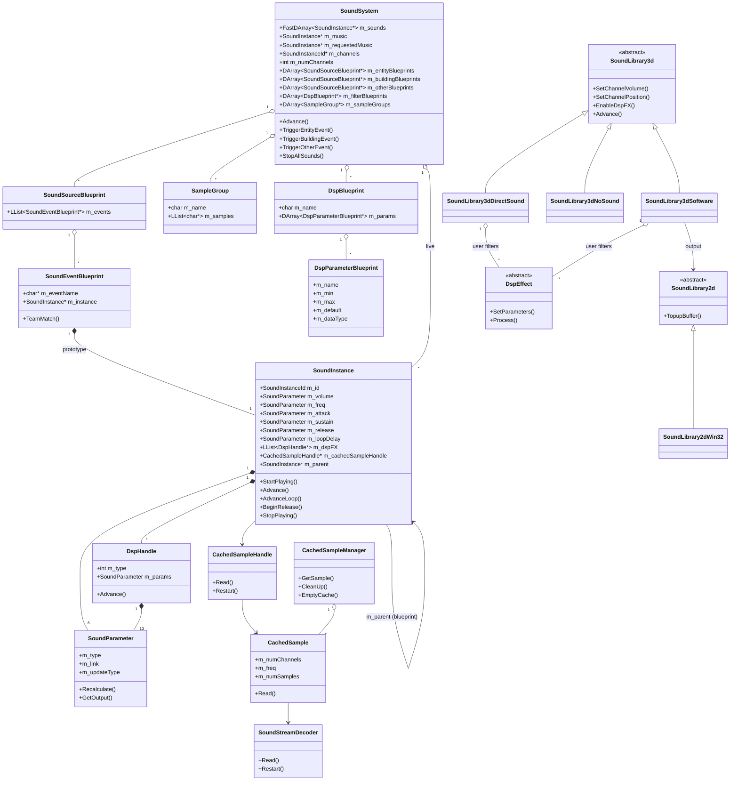
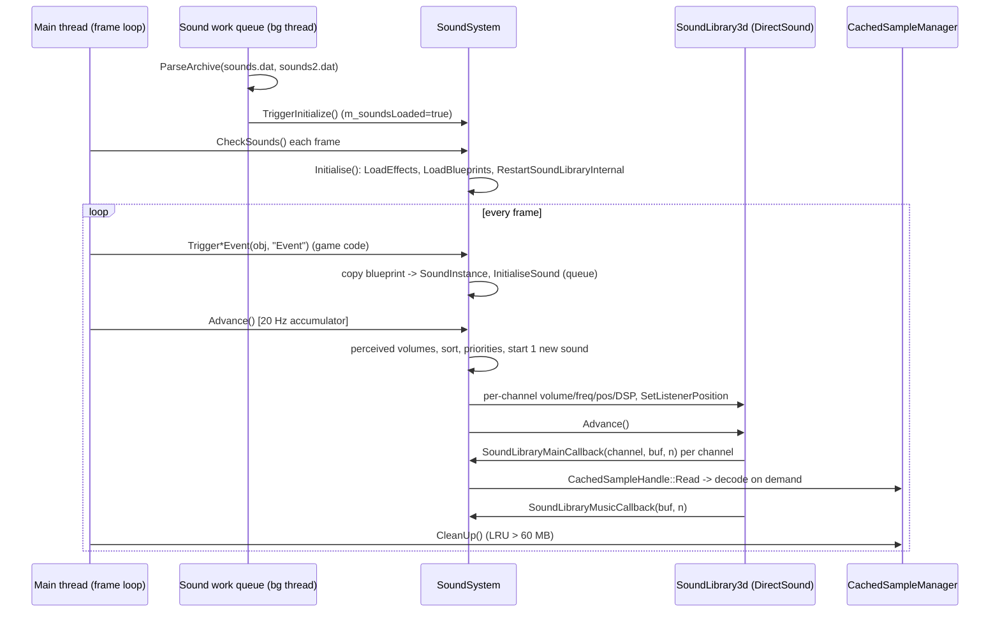
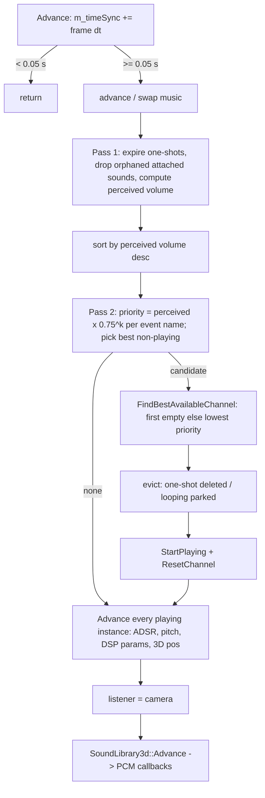
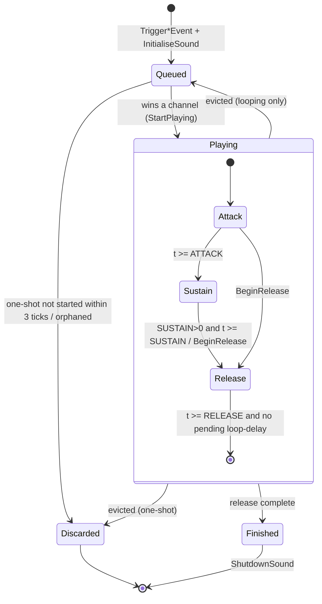
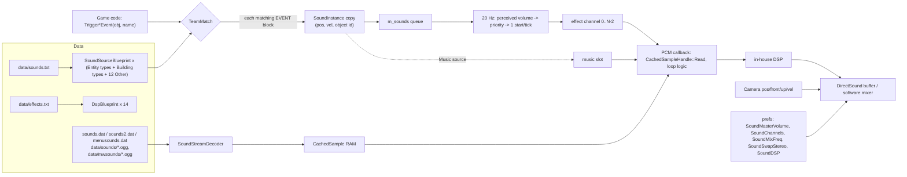

# P16_sound — Sound engine and sound tooling windows
Scope: all of `code/sound/*` (incl. `sound_library_2d_sdl.*`, which is outside the vcproj), `code/interface/soundeditor_window.*`, `soundparameter_window.*`, `sound_profile_window.*`, `soundstats_window.*`, `prefs_sound_window.*`. Supporting evidence: `data/sounds.txt` (structure only — X1b owns the formal grammar, X2b owns the per-sample catalogue), `data/effects.txt`, `docs/ThoughtsOnSoundSystem.txt`, `docs/sound changes.txt`, `docs/retro music.txt`, `docs/MinDistAndVolume.jpg`, `docs/adsr.gif`. Build baseline: see build_matrix.md (`Release|Win32` + `TARGET_PC_FULLGAME`, `HAVE_DSOUND`, no `USE_SOUND_DSPEFFECTS` / `USE_SOUND_HW3D` / `USE_SOUND_MEMORY`, no `SOUND_EDITOR`, no `INVOKE_CALLBACK_FROM_SOUND_THREAD`, no `HAVE_XAUDIO`).

Conventions in this draft: "vol units" = the engine's logarithmic 0.0–10.0 volume scale; "mB" = millibels (1/100 dB, DirectSound units); "wu" = world units (the engine treats them as metres: `code/sound/sound_instance.h:SoundInstance::m_minDistance` comment "Distance (m)"). All timing in the sound system uses the **wall clock** (`GetHighResTime()`) and the **frame delta** `g_advanceTime`, never the simulation clock, except the multiplayer pitch modifier (§27.9) which *reads* game speed.

---

## [→ 27_audio_engine] 27.1 Layering and build reality

The audio stack has four layers [C]:

| Layer | Class(es) | File(s) | Role |
|---|---|---|---|
| L4 Game binding | `SoundSystem`, `SoundSourceBlueprint`, `SoundEventBlueprint`, `SampleGroup`, `DspBlueprint`, `DspParameterBlueprint` | `code/sound/soundsystem.*` | Loads `data/sounds.txt` + `data/effects.txt`; turns `Trigger*Event(object,eventName)` calls into `SoundInstance`s; runs the 20 Hz voice-allocation pass; owns the channel table and the single music slot |
| L3 Voice/instance | `SoundInstance`, `SoundInstanceId`, `SoundParameter`, `DspHandle` | `code/sound/sound_instance.*`, `code/sound/sound_parameter.*` | Per-sound state: ADSR envelope, loop/loop-delay, pitch, position tracking, parameter evaluation, DSP parameter feeding |
| L2 Sample data | `CachedSampleManager` (`g_cachedSampleManager`), `CachedSample`, `CachedSampleHandle`, `SoundStreamDecoder` | `code/sound/sample_cache.*`, `code/sound/sound_stream_decoder.*` | Lazy, incremental decode-to-RAM cache of mono 16-bit PCM, LRU eviction at 60 MB; WAV and Ogg Vorbis decoding |
| L1 Device ("3D library") | abstract `SoundLibrary3d` (`g_soundLibrary3d`); `SoundLibrary3dDirectSound`, `SoundLibrary3dSoftware`, `SoundLibrary3dNoSound`, `SoundLibrary3dXAudio` | `code/sound/sound_library_3d*.{h,cpp}` | N mono streaming "channels" + 1 music channel; per-channel volume/frequency/3D position/min-distance/DSP; pulls PCM through two callbacks |
| L0 Device ("2D library") | abstract `SoundLibrary2d` (`g_soundLibrary2d`); `SoundLibrary2dWin32`, `SoundLibrary2dSDL`, `SoundLibrary2dNoSound` | `code/sound/sound_library_2d*.{h,cpp}` | Stereo 16-bit output stream used only by the software 3D library |
| DSP | abstract `DspEffect`; `DspResLowPass`, `DspBitCrusher`, `DspGargle`, `DspEcho`, `DspReverb` | `code/sound/sound_filter.*` | In-house per-channel filters (run on mono 16-bit blocks) |

Library selection per build [C] `code/sound/soundsystem.cpp:SoundSystem::RestartSoundLibraryInternal`:

| Build | 2D library | 3D library | Tag |
|---|---|---|---|
| Win32 (`TARGET_MSVC`), pref `SoundLibrary`="dsound" (default) and an audio device present | `SoundLibrary2dWin32` (waveOut — opened but idle) | `SoundLibrary3dDirectSound` | **[B:FULL] [B:D3D]** — this is what ships |
| Win32, pref `SoundLibrary` = anything other than "dsound"/"none" (the options screen writes "software") | `SoundLibrary2dWin32` | `SoundLibrary3dSoftware` | [B:FULL] reachable only by editing `preferences.txt` — the options screen offers only DirectSound under `HAVE_DSOUND` (§09.1) |
| Win32, `g_systemInfo->m_audioInfo.m_preferredDevice == -1` (no device) or pref `SoundLibrary`="none" | `SoundLibrary2dNoSound` | `SoundLibrary3dNoSound` | [B:FULL] |
| Non-MSVC (Mac/Linux) | `SoundLibrary2dSDL` | `SoundLibrary3dSoftware` | [B:DEAD] for PC |
| Xbox 360 (`HAVE_XAUDIO`) | — | `SoundLibrary3dXAudio` (compiled to an empty TU on PC: whole file inside `#ifdef HAVE_XAUDIO`; `RestartSoundLibraryInternal` never instantiates it) | [B:DEAD] |

`SoundLibrary2dWin32` is constructed even when DirectSound is selected [C] (`RestartSoundLibraryInternal`: `g_soundLibrary2d = new SoundLibrary2dWin32` before the 3D choice). Its callback is only installed by `SoundLibrary3dSoftware`'s constructor, so under DirectSound the waveOut device sits open with its first 4 buffers of silence [C] `code/sound/sound_library_2d_win32.cpp:SoundLib2dBuf::SoundLib2dBuf`, `WaveOutProc`.



## [→ 27_audio_engine] 27.2 Class roles (every class)

| Class | Role | Key members / behaviour | Ref |
|---|---|---|---|
| `SoundSystem` | Singleton (`g_app->m_soundSystem`). Blueprint store, live-instance store, channel allocator, music slot, profiler host | see §27.4–27.8 | [C] `code/sound/soundsystem.h:SoundSystem` |
| `SoundSourceBlueprint` | All event bindings for one sound *source*: an Entity type, a Building type, or one of 12 "Other" sources | `m_events` list; static name table for Other sources (§10.2) | [C] `soundsystem.h:SoundSourceBlueprint` |
| `SoundEventBlueprint` | One `EVENT` block: event name + a prototype `SoundInstance` | `TeamMatch(teamId)`: true if teamId==255, or by `m_teamMatchType` (§10.4) | [C] `soundsystem.cpp:SoundEventBlueprint::TeamMatch` |
| `SampleGroup` | Named list of sample filenames (lower-cased, extension stripped) for random selection | `m_name[256]`, `m_samples` | [C] `soundsystem.cpp:SampleGroup::AddSample` |
| `DspBlueprint` | One filter type from `data/effects.txt`: name + parameter descriptors | index in `m_filterBlueprints` **is** the filter type id (must match `SoundLibrary3d` FX enum order) | [C] `soundsystem.cpp:SoundSystem::LoadEffects` |
| `DspParameterBlueprint` | Parameter descriptor: name, min, max, default, data type (0=float, 1=long) | used by the editor sliders and by `DspHandle::Advance` to pack the parameter array | [C] `soundsystem.h:DspParameterBlueprint` |
| `SoundInstanceId` | Weak handle `{m_index, m_uniqueId}`; equality = both equal; invalid = (-1,-1). `m_uniqueId` from a global counter `++m_nextUniqueId` (starts 0, so first id is 1) | [C] `sound_instance.cpp:SoundInstanceId::GenerateUniqueId` |
| `SoundInstance` | Both the blueprint prototype (owned by a `SoundEventBlueprint`) and the live playing/queued voice (copied from the prototype; `m_parent` points back) | §27.6 | [C] `sound_instance.h:SoundInstance` |
| `SoundParameter` | A scalar control: fixed, ranged-random or linked to a world quantity, with optional smoothing | §10.5 | [C] `sound_parameter.h:SoundParameter` |
| `DspHandle` | One DSP effect attached to an instance: filter type id + up to `MAX_PARAMS`=13 `SoundParameter`s | `Advance()` evaluates each param, packs as float or long per blueprint data type, calls `g_soundLibrary3d->UpdateDspFX(channel, type, 13, params)` | [C] `sound_instance.cpp:DspHandle::Advance` |
| `CachedSampleManager` | Global sample cache keyed by sample name (`stdext::hash_map<std::string, CachedSample*>`), mutex-protected | §27.10 | [C] `sample_cache.cpp` |
| `CachedSample` | Fully-allocated PCM buffer for one file, filled incrementally on demand from a decoder; lock count + last-used time for LRU | §27.10 | [C] `sample_cache.cpp:CachedSample` |
| `CachedSampleHandle` | A read cursor into a `CachedSample` (one per instance); constructor locks, destructor unlocks the sample | `Read(dst,n)` clamps to remaining samples; `Restart()` rewinds | [C] `sample_cache.cpp:CachedSampleHandle` |
| `SoundStreamDecoder` | WAV (8/16-bit PCM) and Ogg Vorbis decoder to signed 16-bit | §27.11 | [C] `sound_stream_decoder.cpp` |
| `SoundLibrary3d` | Abstract device: channel count, sample rate, master volume (stored as mB attenuation), listener pos, callbacks, `m_musicChannelId`, `m_hw3dDesired`, `m_forceVolumeUpdate` | FX enum (§10.7); `SetMasterVolume(0..255)` → `m_masterVolume = (255-v)×-32` mB; `WriteSilence` = memset 0 | [C] `sound_library_3d.cpp:SoundLibrary3d::SetMasterVolume` |
| `SoundLibrary3dDirectSound` | DirectSound 8 implementation: one looping secondary buffer per channel (+1 music buffer), streamed by polling play cursors | §27.12 | [C] `sound_library_3d_dsound.cpp` |
| `SoundLibrary3dSoftware` | In-house mixer: pulls each channel into a mono buffer, applies user DSP, pans/attenuates to stereo float, normalises, outputs via `SoundLibrary2d` | §27.13 | [C] `sound_library_3d_software.cpp` |
| `SoundLibrary3dNoSound` / `SoundLibrary2dNoSound` | Null devices (all calls no-ops; `Initialise` returns true; `GetNumMainChannels()` returns 0) | | [C] `sound_library_3d.h:SoundLibrary3dNoSound`, `sound_library_2d.cpp` |
| `SoundLibrary2dWin32` | waveOut stereo 16-bit output: 10 ring buffers of `SoundBufferSize` (default 2000) stereo samples; `WOM_DONE` increments `m_fillsRequested`; `TopupBuffer()` (main thread) refills | also supports record-to-WAV-file at 20 updates/s | [C] `sound_library_2d_win32.cpp` |
| `SoundLibrary2dSDL` | SDL audio + ring buffer (Mac/Linux) | [B:DEAD] appendix | [C] `sound_library_2d_sdl.cpp` |
| `SoundLibrary3dXAudio` | Xbox 360 XAudio + X3DAudio 5.1 | [B:DEAD] appendix | [C] `sound_library_3d_xaudio.cpp` |
| `DirectSoundData`, `DirectSoundChannel`, `SoundLibFilter` | DSound-private: device/primary buffer/caps; per-channel buffer state; per-filter slot {user filter ptr, DX filter flag} | | [C] `sound_library_3d_dsound.cpp` |
| `SoftwareChannel`, `SoundLibFilterSoftware` | Software-private: per-channel mono buffer, cached params, ramp state; per-filter slot {chain index, user filter} | | [C] `sound_library_3d_software.cpp` |
| `StereoSample` | `{int16 left, right}` | | [C] `sound_library_2d.h` |
| `DspEffect` + 5 subclasses | In-house DSP (§10.7) | | [C] `sound_filter.h` |

## [→ 27_audio_engine] 27.3 Lifecycle, loading and threading model

**Construction and loading** [C] `code/app.cpp:App::App`, `App::LoadSounds`, `App::CheckSounds`; `code/main.cpp:HandleCommonConditions`:

1. `App` constructor parses `menusounds.dat` together with `main.dat`, `patch.dat`, `language.dat`, `branding.dat` on the main thread, then `new SoundSystem()` (allocates two `Profiler`s and a `NetEvent`; no device yet).
2. On PC the sample archives are loaded on a **background work queue** (`m_soundsWorkQueue`): `App::LoadSounds` parses `sounds.dat` then `sounds2.dat`, sets `App::m_soundsLoaded = true` and calls `SoundSystem::TriggerInitialize()` (signals `m_initializedEvent`). Comment: serialised because unrar is not thread-safe [C] `code/app.cpp` (block after `g_loadingScreen->m_workQueue->Add( &App::Initialise, this )`).
3. Every frame `HandleCommonConditions()` calls `App::CheckSounds()`: if `!SoundSystem::IsInitialized()` → `SoundSystem::Initialise()` = `LoadEffects()` (`data/effects.txt`) + `LoadBlueprints()` (`data/sounds.txt`) + `RestartSoundLibraryInternal()` (creates the devices, §27.1). Once initialised, every frame also runs `g_cachedSampleManager.CleanUp()` (LRU eviction, §27.7).
4. `SoundSystem::WaitIsInitialized()` (called before starting a game from the lobby, e.g. `code/UI/GameMenuWindow.cpp`, `code/UI/PlayGameButton.h`, `code/UI/RollingDemoButton.h`) loops `m_initializedEvent->Wait(1000 ms)` + `App::CheckSounds()` until `m_isInitialized`.
5. Shutdown: `Finalise()` stops the 2D library and deletes both libraries; `g_cachedSampleManager.EmptyCache()` [C] `code/main.cpp:Finalise`.

**Game-sound gate** [C] `code/sound/soundsystem.cpp:SoundSystem::NotReadyForGameSoundsYet`: every `Trigger*Event` returns silently when `m_channels == NULL` or when any of: `!g_app->m_soundsLoaded`, `g_loadingScreen->IsRendering()`, or the caller is **not the main thread** (`NetGetCurrentThreadId() != g_app->m_mainThreadId`). (`TESTBED_ENABLED` additionally mutes when testbed rendering is off — [B:DEAD].) Design consequence: sounds requested from worker threads or during loading screens are dropped, not queued.

**Threading** (baseline Win32, `INVOKE_CALLBACK_FROM_SOUND_THREAD` undefined) [C]:
- All sound logic, all `SoundLibrary3d` calls **and the PCM fill callbacks** run on the **main thread** inside `SoundSystem::Advance()` → `g_soundLibrary3d->Advance()` (DirectSound polls its ring buffers; the software mixer is pulled by `SoundLibrary2d::TopupBuffer()`, also called from the main loop). There is no audio thread in the baseline; the only concurrency is the background archive loading and the waveOut driver callback `WaveOutProc`, which only increments `m_fillsRequested`.
- `CachedSampleManager` holds a `NetMutex m_lock` around its hash map (because Mac preloading runs on a worker thread) [C] `code/sound/sample_cache.h`.
- Under `INVOKE_CALLBACK_FROM_SOUND_THREAD` (Mac) every public `SoundSystem` mutator locks `SoundSystem::m_mutex`, and the SDL callback locks it while mixing [B:DEAD] for PC.
- Consequence for the audio engine: underruns happen if the main loop stalls longer than one channel buffer (DirectSound 20000 samples ≈ 0.45 s at 44.1 kHz / 0.91 s at 22.05 kHz playback rate). The main loop compensates when rendering is slow: if `m_renderer->m_fps < 15`, `SoundSystem::Advance()` is called a **second time** in the same frame (it re-adds `g_advanceTime`, so it may run two 20 Hz ticks) [C] `code/main.cpp:LocationGameLoop` (end of frame). Loading screens also pump `SoundSystem::Advance()` [C] `code/loading_screen.cpp`.



## [→ 27_audio_engine] 27.4 The 20 Hz update (`SoundSystem::Advance`)

Rate: `#define SOUNDSYSTEM_UPDATEPERIOD 0.05f` (s) — accumulator `m_timeSync += g_advanceTime`; when `m_timeSync >= 0.05` exactly **one** tick runs and `m_timeSync -= 0.05` (no catch-up loop; excess time carries over to the next frame) [C] `code/sound/soundsystem.cpp:SoundSystem::Advance`. `g_advanceTime` is the real frame delta (not sim time). Before the accumulator: if `g_app->m_requestQuit && !m_quitWithoutSave` and `AreBlueprintsModified()` → cancel quit (always returns false in practice, see §27.13); if `!m_channels` or no audio device → return.

Tick steps, in order [C]:

1. **Music**: if `m_music` → `m_music->Advance()`; if it reports done → `ShutdownSound(m_music)`, `m_music = NULL`. Then if `m_music == NULL && m_requestedMusic` → promote: `OpenStream(false)`, `m_channelIndex = g_soundLibrary3d->m_musicChannelId`, `ResetChannel(music)`, `SetChannelFrequency(music, sample native rate)` (§27.10).
2. **Propagate blueprints** if `m_propagateBlueprints` (only true while the Sound Editor window exists [B:DEBUG]).
3. **Pass 1 – perceived volume and culling**, over every live instance in `m_sounds`:
   - if `!IsPlaying() && m_loopType == SinglePlay` → `m_restartAttempts--`;
   - if `m_restartAttempts < 0` → `ShutdownSound` (discard);
   - else if `m_positionType == Type3DAttachedToObject && GetAttachedObject() == NULL` → `ShutdownSound` (hard stop, no release);
   - else `CalculatePerceivedVolume()` and append its id to a sort array (static array, initial size 128, doubled while too small).
4. **Sort** ids by `m_perceivedVolume` **descending** (`qsort`, `SoundInstanceCompare`).
5. **Pass 2 – priorities**: walk the sorted list keeping a per-event-name multiplier table (`BTree<float>` keyed by the instance's full event name, e.g. `"Darwinian Attack"`): `m_calculatedPriority = m_perceivedVolume × M[event]` where `M` starts at 1.0 for the loudest instance of that event and is multiplied by 0.75 after each use (1, 0.75, 0.5625, 0.421875, …). Track the **not-playing** instance with the highest `m_calculatedPriority` strictly greater than 0.0 → `newInstance`.
6. **Start at most one new sound** (if `newInstance`): `ch = FindBestAvailableChannel()` (§27.5); evict the instance on `ch` (one-shot → `ShutdownSound`; looping → `StopPlaying()` so it stays queued); `newInstance->StartPlaying(ch)`; on success `m_channels[ch] = newInstance->m_id`, else `ShutdownSound(newInstance)`; always `g_soundLibrary3d->ResetChannel(ch)`.
7. **Advance all channels**: for each channel with a live instance → `instance->Advance()`; if it reports finished → `ShutdownSound`.
8. `g_soundLibrary3d->m_forceVolumeUpdate = false` (set by a master-volume change so every channel re-sends its volume once).
9. **Listener** = camera: position `camera->GetPos()`, front `GetFront()`, up `GetUp()` **negated unless pref `SoundSwapStereo` = 1**, velocity `camera->GetVel() × 0.2` → `SetListenerPosition`.
10. `g_soundLibrary3d->Advance()` (device pump; this is where PCM callbacks run, §27.11).



## [→ 27_audio_engine] 27.5 Voice (channel) management — exact rules

| Rule | Value / formula | Ref |
|---|---|---|
| Requested channels | pref `SoundChannels` (default 32; UI options 8/16/32/64) | [C] `soundsystem.cpp:RestartSoundLibraryInternal`; `code/lib/preferences.cpp:GetDefaultSoundChannels` |
| DirectSound effect channels | `min(SoundChannels, GetMaxChannels()) − 1`; `GetMaxChannels()` = 64, or `dwMaxHw3DStreamingBuffers − 2` when HW3D is desired **and** the card reports > 3 HW 3D streaming buffers; the music channel is a separate extra buffer | [C] `sound_library_3d_dsound.cpp:Initialise`, `GetMaxChannels`, `Hardware3DSupport` |
| Software effect channels | `SoundChannels` must be a power of two (release-assert); last channel (index N−1) is music; effect channels = N−1 | [C] `sound_library_3d_software.cpp:Initialise`, `GetNumMainChannels` |
| Baseline result | 31 effect voices + 1 music voice | [I] from defaults above |
| Live instances | unbounded `FastDArray<SoundInstance*>`; every trigger that passes team matching creates one instance (except monophonic merge) | [C] `soundsystem.cpp:InitialiseSound` |
| Perceived volume | 2D or in-editor: 10.0. 3D: `d = |pos − cameraPos|`; `f = 1` if `d ≤ minDistance` else `minDistance / d`; `base = m_channelVolume` if playing else `m_volume.GetOutput()`; `perceived = base × f` (vol units × linear factor) | [C] `sound_instance.cpp:SoundInstance::CalculatePerceivedVolume` |
| Priority | `perceived × 0.75^k`, k = number of louder instances (this tick) with the same full event name | [C] `soundsystem.cpp:SoundSystem::Advance` |
| Starts per tick | **max 1** new sound per 0.05 s tick → ≤ 20 starts/s system-wide | [C] same |
| Candidate | highest-priority instance that is not playing and has priority > 0 (a sound whose volume evaluates to 0 never starts) | [C] same |
| Channel choice | first channel whose id does not resolve to a live instance; otherwise the channel with the **lowest** `m_calculatedPriority` (ties → lowest index). The candidate's priority is **not** compared with the victim's — the candidate always steals | [C] `soundsystem.cpp:FindBestAvailableChannel` |
| Victim handling | one-shot (`SinglePlay`) victim → destroyed; looping victim → `StopPlaying()` (DSP disabled, channel id cleared) and stays in `m_sounds` as a candidate; when it later restarts, `OpenStream(false)` rewinds a single sample or picks a new random member of a sample group | [C] `soundsystem.cpp:Advance`; `sound_instance.cpp:OpenStream` |
| One-shot patience | `m_restartAttempts = 3` at `InitialiseSound`; decremented each tick while not playing → a one-shot that has not won a channel within **3 ticks (0.10–0.15 s)** is discarded on the 4th. Looping sounds wait indefinitely | [C] `soundsystem.cpp:InitialiseSound`, `Advance` |
| Monophonic merge | if the new instance is `MonophonicRandom` or `MonophonicNearest` and any existing non-polyphonic instance has the same event name (case-insensitive), the new object ids are appended to that instance and no new instance is created | [C] `soundsystem.cpp:InitialiseSound` |
| Monophonic emitter choice | each tick (`GetAttachedObject`): dead ids are pruned; `Polyphonic` → first id; `MonophonicRandom` → `AppRandom() % n`, re-chosen only when the current object is gone or right after a (re)start; `MonophonicNearest` → id whose object is nearest the camera (squared distance), re-chosen every tick | [C] `sound_instance.cpp:SoundInstance::GetAttachedObject` |
| Orphans | attached sound whose object(s) are all gone, or any attached sound while not in a location (`g_app->m_locationId == -1`) → hard `ShutdownSound` at the next tick | [C] `soundsystem.cpp:Advance`; `sound_instance.cpp:GetAttachedObject` |
| Discard statistics | `NumSoundsDiscarded()` = live instances − channels in use (editor stats only) | [C] `soundsystem.cpp:NumSoundsDiscarded` |

Design notes [I]: the stealing rule means that in a dense battle the quietest voice is replaced by the loudest queued sound every 50 ms regardless of relative loudness; the per-event 0.75 decay is the only "voice limit per sound type" (there is no hard per-event cap). A looping victim and a looping candidate can alternate on a channel every tick (each tick the parked loop is the best candidate again) — nothing prevents this ping-pong.

## [→ 27_audio_engine] 27.6 `SoundInstance` life cycle, envelope and looping

States (derived; the code stores only `m_adsrState` ∈ {`StateAttack`=0, `StateDecay`=1 (never used), `StateSustain`=2, `StateRelease`=3}, `m_channelIndex`, `m_loopDelayTimer`) [C] `code/sound/sound_instance.h`:



Envelope [C] `sound_instance.cpp:SoundInstance::UpdateChannelVolume` (evaluated every tick while playing; all times from `GetHighResTime()`, wall clock):
- `m_adsrTimer` is initialised in the **constructor** (i.e. at trigger time), not at `StartPlaying` — time spent queued eats into the attack.
- Attack: `frac = (ATTACK > 0) ? min(t/ATTACK, 1) : 1`; `vol = VOLUME × frac`; when `frac` is within 1e-6 of 1 → timer reset, state Sustain.
- Sustain: `vol = VOLUME`; if `SUSTAIN > 0` and `t ≥ SUSTAIN` → `BeginRelease(false)`. `SUSTAIN = 0` means "hold until the sample ends / until stopped". (SUSTAIN is a **duration**, not a level.)
- Release: `frac = (RELEASE > 0) ? min(t/RELEASE, 1) : 1`; `vol = VOLUME × (1 − frac)`; finished when `frac ≈ 1` **and** `m_loopDelayTimer ≈ 0`.
- `m_channelVolume = clamp(vol, 0, 10)` → `SetChannelVolume`. Ramps are linear in vol units, i.e. **exponential in amplitude** (§27.11 mapping), and quantised to the 20 Hz tick.
- `NearlyEquals(a,b)` ≡ `|a−b| < 1e-6` [C] `code/lib/math_utils.h`.

`BeginRelease(final)` [C] `sound_instance.cpp:SoundInstance::BeginRelease`: if not already releasing → state Release, timer = now, and for `LoopedADSR` with `final == false`: if `LOOPDELAY ≈ 0` spawn a duplicate immediately (`SoundSystem::TriggerDuplicateSound`: fresh instance copied from this one, same parent/pos/vel/object ids, goes through normal queueing) else arm `m_loopDelayTimer = now`. `final == true` on a `LoopedADSR` cancels a pending re-trigger (`m_loopDelayTimer = 0`). Callers: envelope sustain timeout (non-final), end of a one-shot's silence tail (non-final), `StopAllSounds` (final), music replacement (final), attached object lost in `Update3DPosition` (final, looping only), editor Stop (final).

Loop types and what happens when the sample data runs out (inside the PCM callback, `SoundSystem::SoundLibraryMainCallback`) [C] `soundsystem.cpp`; `sound_instance.cpp:SoundInstance::AdvanceLoop`:

| LOOPTYPE | Name (editor) | End-of-sample behaviour |
|---|---|---|
| 0 `SinglePlay` | PlayOnce | Write silence for the rest of the block and set `silenceRemaining = channelBufferSize − remainder`; keep writing silence on later fills; when `silenceRemaining ≤ 0` → `BeginRelease(false)` → instance finishes after RELEASE seconds. Effect: the voice is held for ≈ one device buffer of silence (flushes the DirectSound ring) plus RELEASE |
| 1 `Looped` | Loop | If `LOOPDELAY ≈ 0` → `OpenStream(false)` and keep filling (a `Sample` source rewinds; a `SampleGroupRandom` source **picks a new random member**). Else set `m_loopDelayTimer = now`, write silence; on each later fill, once `now ≥ timer + LOOPDELAY` → `OpenStream(false)`, timer = 0, continue. Runs until stopped |
| 2 `LoopedADSR` | LoopADSR | Each pass: if a loop-delay re-trigger is pending and due → spawn duplicate, timer = 0. Then `OpenStream(true)` (rewind the **same** sample) and keep filling. Combined with SUSTAIN > 0 this produces repeated, overlapping envelope "notes": at the start of each Release a fresh duplicate is spawned (after LOOPDELAY), so successive notes cross-fade; with a SAMPLEGROUP source each duplicate picks a new random sample |

`OpenStream(keepCurrent)` [C] `sound_instance.cpp:SoundInstance::OpenStream`: sets `m_restartOccured = true` (drives `UpdateOncePerLoop` parameters and `MonophonicRandom` re-selection); if a handle exists and (`keepCurrent` or source is `Sample`) → `Restart()` (rewind); else delete the handle and, for `SampleGroupRandom`, choose `index = AppRandom() % n` where `n = groupSize`, halved (×0.5) when pref `SoundMemoryUsage` = 2 and quartered (×0.25) when 3, minimum 1 — i.e. lower memory settings only ever use the first ½ or ¼ of each group; then `g_cachedSampleManager.GetSample(name)`.

`StartPlaying(ch)` [C] `sound_instance.cpp:SoundInstance::StartPlaying`: refuses (returns false) if the sound name still contains `"???"` (unset editor event); `OpenStream(false)`; 3D mode = 1 (head-relative) for `Type2D`/`TypeInEditor`, else 0 (world); `SetChannelMinDistance`; frequency = sample native rate × FREQUENCY × multiplayer pitch modifier (§27.9); `UpdateChannelVolume`; `Update3DPosition` + `SetChannelPosition`; if the instance carries DSP handles → `EnableDspFX(ch, n, types[])` (array of 16).

`Advance()` per tick while playing [C] `sound_instance.cpp:SoundInstance::Advance`: envelope (return true = finished); recompute frequency (skipped with a debug log if `< 0` or `> 144000` Hz); `DspHandle::Advance()` for each effect (re-evaluates its 13 parameters and calls `UpdateDspFX`); `Update3DPosition()`; clear `m_restartOccured`.

`Update3DPosition()` [C]: `Type2D` → pos = vel = 0 (no device call); `Type3DStationary` → unchanged; `Type3DAttachedToObject` → follow the selected object's `m_pos`/`m_vel` (buildings use `Building::m_centrePos`); if the object is gone → convert to `Type3DStationary`, vel 0, and loops get `BeginRelease(true)` (normally pre-empted by the hard orphan cull in Pass 1, §27.4); `TypeInEditor` → `(editorPos.x, 0, editorPos.z)`.

`StopPlaying()` disables DSP on the channel (if any), sets `m_channelIndex = -1`, and invalidates every channel slot that holds this id. `IsPlaying()` ≡ `GetChannelIndex() != -1`, which also verifies `m_channels[m_channelIndex] == m_id` [C].

## [→ 27_audio_engine] 27.7 Sample cache (memory policy)

[C] `code/sound/sample_cache.cpp`:
- Key: the sample name as passed (lower-cased, extension stripped by the blueprint parser). Lookup path: `"sounds/<name>"` first, then `"mwsounds/<name>"`; the resource layer resolves the extension (`.ogg`/`.wav`) and the archive. Failure is a release-assert ("Failed to open sound stream decoder"). Archive files on disk have mixed-case names (e.g. `data/mwsounds/CrateFall1.ogg`) while blueprint names are lower-case — lookups therefore rely on a **case-insensitive** resource layer [I] (owned by P14/X1).
- `CachedSample` construction opens a `SoundStreamDecoder`, reads header info and **allocates the full PCM buffer immediately** (`channels × numSamples × 2` bytes) but decodes nothing. Sanity release-asserts: `0 < channels ≤ 8`, `0 < numSamples ≤ 268435456`, `0 < freq ≤ 192000`, `channels × numSamples ≤ 1073741824/2`.
- Decoding is **incremental and on demand**: `CachedSample::Read(start, n)` decodes forward until `start+n−1` is cached; when the whole file has been decoded the decoder is deleted. Playback therefore "streams" from disk/archive the first time and plays from RAM afterwards; a second handle to the same sample shares the decoded data.
- **Mono only**: `Read` release-asserts `m_numChannels == 1` ("%s is not mono audio") — this applies to music too. Every shipped asset is mono (1332 of 1332 Ogg files; all 44.1 kHz except one 22.05 kHz file in each folder) [C] header scan of `data/sounds/*.ogg`, `data/mwsounds/*.ogg`.
- `CachedSampleHandle` = read cursor; constructor `Lock()`s the sample, destructor `Unlock()`s it and stamps `m_lastUsedTime = GetHighResTime()` when the lock count reaches 0. Every `SoundInstance` owns at most one handle; deleting an instance or switching sample releases it.
- **Eviction** `CachedSampleManager::CleanUp()` (called every frame from `App::CheckSounds`): `maxSize = 60 × 1024 × 1024` bytes (comment: "Largest song takes 13 MB"); while total > max, evict the **unlocked** sample with the oldest `m_lastUsedTime` (strictly older than now); stop if none is evictable. Locked (in-use) samples are never evicted. Mac build disables LRU (`maxSize = 0`) [B:DEAD].
- `EmptyCache()` deletes everything (shutdown; and on a `SoundMemoryUsage` change under `USE_SOUND_MEMORY` [B:DEAD]). `GetMemoryUsage(total, unused)` feeds a debug log printed every 60 s (`code/main.cpp:PrintAvailableMemory`).
- Mac-only `Preload()` (decodes in 2048- or 512-sample chunks on a low-priority thread, first member of each group on the main thread) [B:DEAD].

## [→ 27_audio_engine] 27.8 Streaming decoder

[C] `code/sound/sound_stream_decoder.cpp:SoundStreamDecoder`:
- Format chosen by the reader's file extension: `wav` → RIFF/WAVE parser; `ogg` → libvorbisfile (`ov_open_callbacks` with read/seek/tell callbacks over the engine's `BinaryReader`, close = no-op); anything else → release-assert.
- WAV: accepts only PCM (`fmt` tag 1), 1 or 2 channels, 8- or 16-bit; 8-bit is converted to signed 16-bit (`(u8 − 128) << 8`); other chunks skipped; `numSamples = dataBytes / (channels × bits/8)`; `Restart()` seeks to the data chunk.
- Ogg: `numSamples = ov_pcm_total`, `freq = vi->rate`, `channels = vi->channels`; `ov_read(…, 16-bit, signed, host endianness)` loop until the request is satisfied or EOF; `OV_HOLE`/`OV_EBADLINK` → release-assert "Ogg file corrupt"; `Restart()` = `ov_raw_seek(0)`.
- Output is always signed 16-bit. The 16-bit WAV path divides bytes by 2 regardless of channel count (only correct for mono — moot because of the mono rule).
- Libraries: `vorbis_static`, `vorbisfile_static`, `ogg_static` sub-projects [C] build_matrix §1.

## [→ 27_audio_engine] 27.9 Pitch, and the game-speed pitch modifier

Channel frequency (Hz) = `sample native rate × FREQUENCY.GetOutput() × GetFrequencyModifier(positionType)` [C] `sound_instance.cpp:StartPlaying`, `Advance`.

`GetFrequencyModifier` [C] `sound_instance.cpp:GetFrequencyModifier`:
- 1.0 if not `App::Multiplayer()` (≡ `m_gameMode == GameModeMultiwinia`, i.e. any Multiwinia match incl. vs-AI), or during the pre-game grace period (`Multiwinia::GameInGracePeriod()`), or for `Type2D` sounds.
- Otherwise a function-static smoother `s = 0.99·s + 0.01·gameSpeed` (initial 1.0) is updated **on every call** (i.e. once per playing 3D instance per tick plus once per start — the smoothing rate depends on the number of active voices), and the modifier is `sqrt(max(s, 0.01))`.
- Effect [I]: world sounds pitch-bend with game speed changes — slow-motion/fast-forward crate effects and the end-of-game slow-down to speed 0 (`Multiwinia` game-over requests speed 0 over 0.2 s, `code/multiwinia.cpp` game-over block) produce a "tape stop" down to `sqrt(0.01)` = 0.1× pitch. 2D/UI sounds are unaffected.
- Device clamps: software mixer clamps to 3 × 48000 = 144000 Hz; instance code skips values outside [0, 144000]; editor slider for FREQUENCY is 0.0–3.0 [C].

## [→ 27_audio_engine] 27.10 Music channel

[C] `soundsystem.cpp:SoundSystem::TriggerOtherEvent(WorldObject*,…)`, `SoundSystem::Advance`, `SoundLibraryMusicCallback`, `StopAllSounds`:
- Exactly one music instance (`m_music`) plus one pending request (`m_requestedMusic`). Music = any blueprint in the `OTHER Music` source. Music instances never enter `m_sounds`, never compete for effect channels, never pass through `StartPlaying` (so no 3D, no DSP enable, no pitch modifier on start).
- Trigger: if the current music has the **same sound file name** → ignore (keeps playing); else store as `m_requestedMusic` (a previous pending request is overwritten — and leaked [I]) and `BeginRelease(true)` the current music (fades by its own RELEASE; all shipped music entries have RELEASE 0 → immediate cut).
- Swap happens at the next tick after the old music reports finished; there is no cross-fade and no gap beyond ≤ 1 tick. The new music's ATTACK gives a fade-in (shipped values 0–5.23 s, §10.6).
- Stop: `StopAllSounds(id, name)` with `strstr(name, "Music")` → `m_music->BeginRelease(true)` regardless of which music is playing; `StopAllSounds(…, NULL)` does **not** stop music.
- Fill: the music channel is filled by `SoundLibraryMusicCallback` with the same loop/one-shot logic as effect channels; DirectSound music buffer = `bufSize × 10` = 200000 samples (≈ 4.5 s at 44.1 kHz); `m_musicChannelId` = −1 on DirectSound (separate buffer), N−1 on the software mixer; 3D disabled, initial volume 10, initial frequency 44100 Hz.
- Volume: music uses the same 0–10 VOLUME/ADSR and the global master volume; there is **no separate music volume** setting.
- Reachability in the Multiwinia baseline: see §10.9 — every music trigger site is either compiled out (`USE_LOADERS`) or Darwinia-campaign script content, so the music channel is effectively silent in Multiwinia [I].

## [→ 27_audio_engine] 27.11 Device back-ends

### DirectSound (`SoundLibrary3dDirectSound`) — baseline [B:FULL]
[C] `code/sound/sound_library_3d_dsound.cpp`:
- Requires DirectX ≥ 9 (release-assert). `CoInitialize`, `DirectSoundCreate8(default device)`, cooperative level `DSSCL_PRIORITY` on the game window; caps cached.
- Primary buffer: stereo, 16-bit, `SoundMixFreq` Hz (`LOCHARDWARE` only if HW3D desired+available). Listener Doppler factor set to **0** (velocities have no audible effect). Rolloff factor and max distance are left at DirectSound defaults (rolloff 1.0, max distance 1e9) [I from absence of calls].
- One **mono 16-bit looping secondary buffer per channel** (flags `CTRL3D | CTRLFX | CTRLFREQUENCY | CTRLVOLUME | GETCURRENTPOSITION2`, software unless HW3D), size `_mainBufNumSamples` = 20000 samples; music buffer 200000 samples. Buffers are zero-filled and started looping at creation; samples are written at the sound's native rate and `SetFrequency` sets the playback rate.
- **Streaming**: `Advance()` → `CommitDeferredSettings()`, then for every channel and the music channel `AdvanceChannel()`: the real play cursor is queried on alternate ticks per channel (`(channel & 1) == (frame & 1)`, frame counter 0..3), otherwise a simulated cursor is extrapolated (`+ elapsed × freq × 2` bytes, wrapped, even-aligned) minus a 1000-byte safety margin and never behind the last written sample. The region from `lastWritten+1` to `playCursor−1` is refilled through the callback (buffer kept almost full ahead); user DSP filters (types ≥ 9) are applied in place to the freshly written block; `channelHealth = 1 − written/bufferSize`.
- `ResetChannel()` (on every new sound) refills from the **write cursor** up to the play cursor, so a new sound starts with minimal latency and overwrites the previous occupant's buffered audio.
- `SetChannelPosition` is skipped unless the new position differs from the last sent one by more than 5 % of the listener distance (`|Δ|² > 0.0025·|pos − listener|²`); position/velocity/min-distance use `DS3D_DEFERRED`. `SetChannel3DMode`: 0 = `DS3DMODE_NORMAL`, 1 = `HEADRELATIVE`, 2 = `DISABLE`. `SetChannelMinDistance` release-asserts `1.0 ≤ d ≤ 1e9` (`DS3D_DEFAULTMINDISTANCE`..`DS3D_DEFAULTMAXDISTANCE`). Values are cached per channel; device calls only on change (volume also when `m_forceVolumeUpdate`).
- Lost buffers (`DSERR_BUFFERLOST`) → `Restore()`; most other errors are debug-logged (release) or asserted (debug).
- DirectX FX (types 0–8) are attached with `SetFX` (buffer must be stopped and restarted; any existing FX are removed first); in-house filters (9–13) are host-side objects per channel slot.

### Volume mapping (identical semantic input 0–10 vol units)

| Back-end | Formula | 10 → | 5 → | 0 → | Master `SoundMasterVolume` m ∈ 0..255 |
|---|---|---|---|---|---|
| DirectSound | `mB = clamp(−(5 − v/2)·1000 + M, −10000, 0)`, `M = (255 − m)·(−32)` mB | 0 dB | −25 dB | −50 dB | 255 → 0 dB, 0 → −81.6 dB (5 dB per vol unit; 0.32 dB per master step) |
| Software | `amp = exp(clamp(−(5 − v/2) + M/1000, −10, 0))` | 1.0 (0 dB) | e^−2.5 (−21.7 dB) | e^−5 (−43.4 dB) | 0 → additional e^−8.16 (−70.9 dB) |
| XAudio [B:DEAD] | same mB formula as DirectSound | | | | |

[C] `sound_library_3d.cpp:SetMasterVolume`, `sound_library_3d_dsound.cpp:SetChannelVolume`, `sound_library_3d_software.cpp:CalcChannelVolumes`. A new implementation should pick one curve; the DirectSound one is what shipped.

### Software mixer (`SoundLibrary3dSoftware` + `SoundLibrary2dWin32`) [B:FULL, non-default]
[C] `code/sound/sound_library_3d_software.cpp`, `sound_library_2d_win32.cpp`:
- Pull model: `TopupBuffer()` (main thread) services each pending waveOut buffer (10 buffers × `SoundBufferSize` stereo samples; default line written by the prefs generator is 512, code fallback 2000) by calling `Callback(buf, n)`.
- `Callback`: `duration = n / outputRate`; per channel fetch `ceil(freq × duration ± 0.5)` source samples through the main/music callback into a per-channel mono buffer sized `samplesPerBuffer × (48000 / outputRate) × 3.1`; apply in-house DSP filters; mix to float L/R.
- Pan/attenuation per channel: 3D mode 0 → `to = normalize(pos − listener)` (skip normalise at distance 0), `right = (to · listenerRight + 1)/2`, `left = 1 − right` (linear pan law); if `dist > minDist` both × `minDist/dist`; listener right = `up × front` (cross product). Modes 1/2 → L = R = 1. Then × channel amplitude (above).
- Resampling: nearest-lower-sample (`index = (int)(j × freq/outRate)`), no interpolation. Volume ramps: fixed-volume mixer unless the channel was just reset, in which case a linear ramp from the previous to the new gain across the block (the intended "no ramp on new sound" logic is inverted in code).
- Output: block peak normalisation — if any |sample| > 32766 the **whole block** is scaled by `32766/peak` (acts as a block-rate limiter); then rounded to int16.
- Record-to-WAV hook (`StartRecordToFile`, 20 blocks/s of `SoundMixFreq/20` samples) exists for video capture (`AVI_GENERATOR`, [B:DEBUG]).
- After a library restart the waveOut buffers are not re-primed (static counter in `SoundLib2dBuf` only primes the first 4 buffers ever created), so a software-mixer restart may be silent [I].

### Null device
`SoundLibrary3dNoSound`/`SoundLibrary2dNoSound` when no device or pref `SoundLibrary = none`. Note `GetNumMainChannels()` is 0 → `RestartSoundLibraryInternal` release-asserts "Too few channels" if a device *is* present but `SoundLibrary = none` [I from code path].

## [→ 27_audio_engine] 27.12 DSP chain implementation

- Per instance: up to any number of `DspHandle`s in data (editor UI shows 3 slots, `StartPlaying` packs up to 16 types); each handle holds 13 `SoundParameter`s evaluated every tick (they can be ranged-random or linked like any other parameter) [C] `sound_instance.h:MAX_PARAMS`, `DspHandle::Advance`.
- DSP is instantiated only if pref `SoundDSP` ≠ 0 at copy time (`SoundInstance::Copy`); default `SoundDSP = 0` on PC (`code/lib/preferences.cpp:GetDefaultSoundDSP`) and the toggle is compiled out of the options screen (`USE_SOUND_DSPEFFECTS` undefined) → **DSP is off in the shipped configuration** unless `preferences.txt` is edited [C].
- Each channel holds one slot per filter type (`NUM_FILTERS` = 14); filters run in **type-index order**, not data order; two effects of the same type on one sound share a slot (only one instance) [C] `sound_library_3d_dsound.cpp:PopulateBuffer`, `sound_library_3d_software.cpp:ApplyDspFX`.
- DirectSound bug notes [C]: `EnableDspFX` marks DX filters in slot `i` (loop index) instead of slot `type`, and `DSEFFECTDESC desc[DSP_DSOUND_WAVESREVERB]` has 8 entries for up to 9 DX types; parameters are passed by reinterpreting the 13-float array as the DirectX FX parameter struct (so `effects.txt` parameter order must equal the DX struct field order); `I3DL2Reverb` quality from param 12.
- In-house filter algorithms are specified in §10.7.

## [→ 27_audio_engine] 27.13 Profiling, statistics and sound editor tooling [B:DEBUG]

All windows below are compiled only with `SOUND_EDITOR` (defined by `TARGET_DEBUG` only). They are opened from the debug menu (`code/interface/debugmenu.cpp`: "Sound Stats (F7)", "Sound Editor (F8)", "Sound Profile (F9)", plus "Pokey Playground") and the cheat window (`code/interface/cheat_window.cpp`: "Sound Editor", "Sound Stats"); the F7/F9/F11 hot-keys in `code/user_input.cpp` are commented out [C].

Always-compiled profiling [B:FULL]: `SoundSystem::m_mainProfiler` (sections `TriggerEntityEvent`, `TriggerBuildingEvent`, `TriggerOtherEvent`) and `m_eventProfiler` (one entry per event name, measured inside the PCM callback) are advanced every frame; the global profiler records "Advance SoundSystem" and sub-sections ("Shutdown Music", "Propagate Blueprints", "Allocate Sorted Array", "Perceived Volumes", "Sort Samples", "Recalculate Priorities", "Find best Channel", "Stop Old Sound", "Start New Sound", "Reset Channel", "Advance All Channels", "Shutdown Sound", "UpdateListener", "SoundLibrary3d Advance") [C] `soundsystem.cpp:Advance`.

| Window | Class(es) | Function | Ref |
|---|---|---|---|
| Sound Editor (`"Sound Editor"`) | `SoundEditorWindow`, `SoundEventButton`, `ObjectGroupMenu`, `ObjectTypeMenu`, `NewSoundEventMenu`, `SoundPositionButton` (unused), `PlayButton`, `PlayRepeatButton` (unused), `StopButton`, `SelectObjectButton`, `SaveAllButton`, `DeleteEventButton`, `SoundSelector` (file dialog on `sounds/`), `SoundSelectorButton`, `DspEffectButton`, `DeleteDspEffectButton`, `PurgeSoundsButton` (unused), `ConvertVolumesButton` (unused) | Pick Entity/Building/Other → type → event (or click an object in the world when both menus are unset); add events from the type's `ListSoundEvents` list; edit PositionType, LoopType, InstanceType, TeamMatchType, SourceType, sound name / sample group, MinDistance (value control, step 0.5, range 1–10000), and the 6 parameters (output ranges Volume 0–10, Frequency 0–3, Attack 0–60, Sustain 0–300, Release 0–60, LoopDelay 0–60); up to 3 DSP effects; Play (spawns a `TypeInEditor` copy at the camera), Stop (final release); Save → `SaveBlueprints("sounds.txt")`. While open, `m_propagateBlueprints = true` → every live instance re-syncs from its blueprint each tick (`SoundInstance::PropagateBlueprints`: restart if the sample or DSP list changed; copy min-distance, types, params). Renders every playing 3D voice as a camera-facing `sprites/sound.bmp` billboard sized `0.5·√d·√vol` | [C] `code/interface/soundeditor_window.cpp` |
| Effect editor (`"Effect Editor"`) | `DspEffectEditor`, `DspEffectTypeMenu` | Choose filter type from `m_filterBlueprints`; one `SoundParameterButton` per parameter with min/max from `effects.txt`; changing type resets params to the type defaults | same |
| Sample-group editor | `SampleGroupEditor`, `SampleGroupSelector`, `NewSampleGroupButton` (auto-names `newsamplegroup<N>`), `RenameSampleGroupButton`/`RenameSampleGroupWindow`/`RenameSampleGroupCommit` (unique-name check; updates every blueprint using the group), `SampleGroupAddSample`/`SampleGroupFileDialog`, `SampleGroupSampleName`, `SampleGroupSampleDelete` | Manage groups; file adds are validated by `IsSoundSourceOK` | same |
| Purge sounds (`"Purge Sounds"`) | `PurgeSoundsWindow`, `DeleteSoundButton`, `RefreshFileListButton`, `DeleteAllButton` | Lists files in `data/sounds/` not referenced by any blueprint/group (`IsSampleUsed`) and deletes them (two-click confirm). Button to open it is commented out | same |
| Parameter editor | `SoundParameterButton`, `SoundParameterEditor`, `SoundParameterGraph`, `SoundParameterGraphScaleToggle` (unused), `LinkTypeMenu`, `UpdateTypeMenu` | Graph editor for one `SoundParameter`: type, link, smooth (0–0.99, step 0.05), update type; LMB/RMB set lower/upper points; clicking left of the axis forces the linked input on the playing editor instance (`ForceParameter`). Input axis ranges: HeightAboveGround/Ypos 0–1000, Xpos/Zpos/CameraDistance 0–5000, Velocity 0–100, fixed/random 0–1 | [C] `code/interface/soundparameter_window.cpp` |
| Sound Stats (`"Sound Stats"`) | `SoundStatsWindow` | CPU overhead, max channels, channels used, live sounds, discarded, HW3D Enabled/Disabled/Unavailable, device name, one row per channel with health swatch and `SoundInstance::GetDescriptor()` (`name pri vol fxN looptype editor`) | [C] `code/interface/soundstats_window.cpp` |
| Sound Profile (`"Sound Profile"`) | `SoundProfileWindow`, `ResetHistoryButton` | Per-section and per-event timings (calls × ms/call = ms, history average), "Other" remainder vs global "Advance SoundSystem", library profiler; reset buttons | [C] `code/interface/sound_profile_window.cpp` |

Load/save tooling in `SoundSystem` [C]: `SaveBlueprints(filename)` writes ENTITY, BUILDING, OTHER (only sources with ≥ 1 event) and SAMPLEGROUP blocks in canonical form (§10.3); `AreBlueprintsModified()` returns false unconditionally ("Currently broken due to mod support") so the save-on-quit prompt (`SaveOnQuitWindow`) never appears; `LoadtimeVerify()` (writes `sounderrors.txt`, release-asserts on errors) exists but its call is commented out; `IsSoundSourceOK` checks spaces/existence/mono only in `_DEBUG` builds; `RuntimeVerify` only under `SOUNDSYSTEM_VERIFY` (undefined). Editor defects worth not copying: new events get a doubled event name (`"<Type> <Event> <Event>"`) until reload (`NewSoundEventMenu`); new DSP effects are initialised from each parameter's **min** instead of default (`DspEffectButton::MouseUp` passes the default pointer as `_min`); the stats window reads channel health for row `i` instead of `channelIndex`.

## [→ 27_audio_engine] 27.14 Data flow



---

## [→ 10_audio_design] 10.1 Binding model: sources × events

Sounds are never played by file name from game code. Game code fires a **named event on a sound source**; data decides what (if anything) plays [C] `code/sound/soundsystem.h`, `soundsystem.cpp:Trigger*Event`:

| Call | Source key | Instance initial position | Team used for matching | Ref |
|---|---|---|---|---|
| `TriggerEntityEvent(Entity*, "Event")` | `ENTITY <Entity::GetTypeName(type)>` | entity `m_pos`, `m_vel`; object id attached | entity's team | [C] `soundsystem.cpp:TriggerEntityEvent` |
| `TriggerBuildingEvent(Building*, "Event")` | `BUILDING <Building::GetTypeName(type)>` | building `m_pos` (attached sounds then track `m_centrePos`) | building's team | [C] `TriggerBuildingEvent` |
| `TriggerOtherEvent(WorldObject* or NULL, "Event", OtherType)` | `OTHER <name>` (12 fixed names, §10.2) | object `m_pos` and id if an object is passed, else origin/none | object's team, or 255 (= always matches) when NULL | [C] `TriggerOtherEvent(WorldObject*,…)` |
| `TriggerOtherEvent(Vector3 pos, "Event", OtherType, teamId)` | `OTHER <name>` | given position (no object) | given team | [C] `TriggerOtherEvent(Vector3,…)` |

Rules [C]:
- Event names match **case-insensitively** (`stricmp`). **Every** `EVENT` block in the source whose name matches and whose team filter passes produces its own instance — several blocks with the same name are how the data **layers** sounds (e.g. a body sound + a voice) or provides **team-specific variants** (a `MyTeamOnly` block and an `EnemyTeamOnly` block). 30 (source, event) pairs in the shipped data use 2–4 blocks (see table §10.2, "×n").
- An event with no matching block is silently ignored; a source type with no data gets an empty blueprint. Unknown type names in `sounds.txt` are only debug-asserted.
- The live instance's identifier for priority grouping, `StopAllSounds` and monophonic merging is `"<SourceName> <EventName>"` (e.g. `"Darwinian Attack"`, `"MultiwiniaInterface LobbyAmbience"`) [C] `sound_instance.cpp:SetEventName`.
- `StopAllSounds(objectId, partialName)`: for every instance whose current emitter id equals `objectId` (an invalid id matches sounds with no object) and whose event name **contains** `partialName` (substring) — or all of that object's sounds when `partialName == NULL` — playing ones get a final release, queued ones are destroyed. Names containing `"Music"` stop the music instead [C] `soundsystem.cpp:StopAllSounds`.
- Query helpers used by game code: `NumInstancesPlaying(id, name)` (on channels) and `NumInstances(id, name)` (queued + playing), `IsSoundPlaying(id)` [C].

Where entity/building event names come from: each `Entity`/`Building` subclass enumerates its supported names in `ListSoundEvents()` (used by the editor) and fires them with `TriggerEntityEvent`/`TriggerBuildingEvent` — those lists live in the owning P03–P07 partitions. Dynamic names: crates fire `Capturing_0pc`, `Capturing_20pc`, `Capturing_40pc`, `Capturing_60pc`, `Capturing_80pc` built with `sprintf` [C] `code/worldobject/crate.cpp` (TriggerBuildingEvent with `newSound`); the escape rocket fires `requiredSoundName` (data has `Happy`, `Unhappy`, `Flight`, `Malfunction`) [C] `code/worldobject/rocket.cpp`.

## [→ 10_audio_design] 10.2 Sound sources and their events (shipped data)

`data/sounds.txt` defines **68 sources** (21 ENTITY, 35 BUILDING, 12 OTHER) with **296 EVENT blocks** (108/96/92) and **130 SAMPLEGROUPs** referencing **1120** sample entries (2–43 per group) [C] generated by `_work/scripts/P16_parse_sounds.py` → `_work/drafts/P16_sound_events.csv` (one row per EVENT block: source, event, sound/group name, all type fields, min distance, every parameter, effects, group size). X2b owns the per-sample catalogue; this table gives the binding structure.

The 12 "Other" source types (enum order = file name) [C] `soundsystem.h:SoundSourceBlueprint`, `soundsystem.cpp:GetSoundSourceName`, `ListSoundEvents`:

| # | Enum | Name in file | Events the editor offers (`ListSoundEvents`) |
|---|---|---|---|
| 0 | `TypeLaser` | `Laser` | Create, Richochet, HitGround, HitEntity, KilledEntity, InjuredEntity, HitBuilding |
| 1 | `TypeGrenade` | `Grenade` | Create, Bounce, Flash, Explode, ExplodeController |
| 2 | `TypeRocket` | `Rocket` | Create, Explode |
| 3 | `TypeAirstrikeBomb` | `AirStrikeBomb` | Create, Bounce, Flash, Explode |
| 4 | `TypeSpirit` | `Spirit` | Create, PickedUp, Dropped, PlacedIntoEgg, EggDestroyed, BeginAscent |
| 5 | `TypeSepulveda` | `Sepulveda` | Appear, Disappear, TextAppear |
| 6 | `TypeGesture` | `Gesture` | GestureBegin, GestureEnd, GestureSuccess, GestureFail |
| 7 | `TypeAmbience` | `Ambience` | EnterLocation, ExitLocation, EnterGlobalWorld |
| 8 | `TypeMusic` | `Music` | Cutscene1, Cutscene2, Cutscene3, Cutscene4, Cutscene5, LoaderRaytrace, LoaderSoul, LoaderFodder, LoaderSpeccy, LoaderMatrix, LoaderGameOfLife, StartSequence, EndSequence, Credits, Demo2Intro, Demo2Mid |
| 9 | `TypeInterface` | `Interface` | Show, Hide, Slide, DeleteTask, MouseOverIcon, ShowLogo |
| 10 | `TypeCratePowerup` | `CratePowerup` | one per crate reward: `Crate::GetName(i)` for i in 0..`NumCrateRewards`−1 |
| 11 | `TypeMultiwiniaInterface` | `MultiwiniaInterface` | CountdownTick, CountdownZeroTick, GameOver, YouWon, YouLost, SelectionCircle, SelectUnit, ToggleUnitState, LobbyAmbience, MenuRollOver, MenuSelect, MenuCancel, MouseError, ChatMessage |

Per-source event inventory (position: 2D / Stat = 3D stationary / Att = 3D attached / Ed = in-editor; loop; instance type; team filter) [C] `data/sounds.txt`:

| Group | Source (type name) | Blocks | Events (position; loop; instance; team; ×n = n layered EVENT blocks) |
|---|---|---|---|
| ENTITY | LaserTroop | 2 | Attack (Stat); Die (Stat) |
| ENTITY | Engineer | 5 | Create (Att/Loop); BeginReprogramming (Att/Loop); EndReprogramming (Stat); LoseHealth (Stat); Die (Stat) |
| ENTITY | Virii | 4 | Attack (Att); LoseHealth (Stat); ChangeDirection (Att); Die (Att) |
| ENTITY | Squadie | 8 | Create (Att/Loop/MonoRandom); LoseHealth (Att); WeaponReturns (Att/MonoRandom); ThrowAirStrike (Att); FireLaser (Att); Die (Att); EnterTeleport (Stat); ExitTeleport (Att) |
| ENTITY | Egg | 1 | Die (Stat) |
| ENTITY | SporeGenerator | 4 | Create (Att/Loop); LoseHealth (Att); Die (Stat); LayEgg (Att) |
| ENTITY | Tripod | 4 | Create (Att); Attack (Att); LoseHealth (Att); Die (Att) |
| ENTITY | Centipede | 4 | Attack (Att); Create (Att/LoopADSR); Die (Stat); LoseHealth (Att) |
| ENTITY | SpaceInvader | 2 | DropGrenade (Att); Create (Att/Loop) |
| ENTITY | Spider | 7 | Create (Att/Loop); Die (Att); Attack (Att); Pounce (Att); LayEgg (Att); LoseHealth (Att); FootFall (Att) |
| ENTITY | Darwinian | 17 | Die (Stat) ×2; LoseHealth (Att) ×2; Create (Att/MonoNearest); GivenOrders (Att); SeenThreatRunAway (Att) ×2; Attack (Att, Att/MonoNearest) ×2; VictoryJump (Att); OnFire (Stat); Selected (Att); GivenOrdersFromPlayer (Att); LiftBuilding (Att); SeenThreatAttack (Att); SeenThreatAttackHorn (Att) |
| ENTITY | Officer | 11 | Create (2D/MyTeam, Att) ×2; LoseHealth (Att); Die (Att); Attack (Att); EnterTeleport (Att); SetOrderGoto (Att/Loop, Att/MyTeam) ×2; Selected (2D/MyTeam); SetOrderFormation (Att/Loop, Att/MyTeam) ×2 |
| ENTITY | ArmyAnt | 4 | Attack (Att); Create (Att/Loop); LoseHealth (Att); Die (Att) |
| ENTITY | Armour | 5 | Create (Att, Att/Loop) ×2; LoseHealth (Att); Die (Stat); SetOrders (Att) |
| ENTITY | SoulDestroyer | 6 | Create (Att, Att/Loop) ×2; LoseHealth (Att); Die (Att); Attack (Att); EnemySighted (Att/Loop) |
| ENTITY | TriffidEgg | 4 | Create (Att); Bounce (Stat); BurstOpen (Stat); Die (Stat) |
| ENTITY | Harvester | 4 | Create (Att/Loop) ×3; DropSpirit (Stat) |
| ENTITY | Nuke | 3 | Create (Att/Loop); Explode (Stat) ×2 |
| ENTITY | Meteor | 4 | Land (Stat) ×2; Create (Att/Loop) ×2 |
| ENTITY | Tank | 4 | Create (Att, Att/Loop) ×2; LoseHealth (Att); Die (Stat) |
| ENTITY | SpaceShip | 5 | Create (Att/Loop) ×4; TractorBeam (Att/Loop) |
| BUILDING | RadarDish | 6 | BeginRotation (Att, Att/Loop) ×2; EndRotation (Att); ReprogramComplete (Att); ConnectionEstablished (Att/Loop); ConnectionLost (Att) |
| BUILDING | LaserFence | 3 | Create (Att/Loop); Spark (Att); Damage (Att) |
| BUILDING | GunTurret | 5 | FireShell (Att); Damage (Att); Create (Stat); FireFlame (Stat); RegisterKill (Att) |
| BUILDING | Powerstation | 1 | Create (Att/Loop) |
| BUILDING | Tree | 5 | CreateNormal (Att/LoopADSR); CreateMagic (Att/LoopADSR); Burn (Att/Loop); Create (Att); CreateEvil (Att/Loop) |
| BUILDING | TrunkPort | 1 | ReprogramComplete (Att/Loop) |
| BUILDING | ResearchItem | 2 | Create (Att/Loop); AquireResearch (Stat) |
| BUILDING | Library | 1 | Create (Att) |
| BUILDING | Generator | 2 | ReprogramComplete (Stat/Loop); TriggerSurge (Att) |
| BUILDING | Pylon | 1 | TriggerSurge (Att) |
| BUILDING | SolarPanel | 2 | TriggerSurge (Att); Operate (Att/Loop) |
| BUILDING | TrackLink | 1 | CogTurn (Stat) |
| BUILDING | Refinery | 2 | CogTurn (Att); Create (Att/Loop) |
| BUILDING | Mine | 1 | CogTurn (Att) |
| BUILDING | Yard | 1 | Create (Att/Loop/MonoRandom) |
| BUILDING | Incubator | 3 | Reprogramming (Att); SpawnEntity (Stat); AddSpirit (Att) |
| BUILDING | AntHill | 2 | Damage (Att); Explode (Stat) |
| BUILDING | Triffid | 2 | Damage (Stat); Burn (Att/Loop) |
| BUILDING | SpiritReceiver | 1 | Create (Att/LoopADSR) |
| BUILDING | SpiritProcessor | 1 | Create (Att/LoopADSR) |
| BUILDING | SpawnPoint | 2 | TurnOn (Att); TurnOff (Att) |
| BUILDING | BlueprintStore | 1 | Create (Att/Loop) |
| BUILDING | BlueprintConsole | 1 | Create (Att/Loop) |
| BUILDING | BlueprintRelay | 1 | Create (Att/Loop) |
| BUILDING | Spam | 5 | Create (Att/Loop); Damage (Att); Attack (Stat); Explode (Stat); CreateResearch (Att/Loop) |
| BUILDING | GodDish | 3 | ConnectToGod (Att/Loop); DisconnectFromGod (Att); Create (Att/Loop) |
| BUILDING | FuelGenerator | 4 | PumpUp (Att) ×2; PumpDown (Att) ×2 |
| BUILDING | FuelPipe | 1 | PumpFuel (Att/Loop) |
| BUILDING | FuelStation | 1 | LoadPassenger (Stat) |
| BUILDING | EscapeRocket | 10 | Happy (Att/Loop) ×2; Malfunction (Att/Loop); Explode (Att) ×2; Damage (Stat); EngineBurn (Att, Att/Loop) ×2; Unhappy (Att/Loop/MonoNearest); Flight (Att/Loop) |
| BUILDING | MultiwiniaZone | 6 | CaptureStatue (2D, 2D/Enemy, 2D/MyTeam) ×3; ChangeTeam (Att/Enemy, Att/MyTeam) ×2; Create (Att/Loop) |
| BUILDING | ControlStation | 1 | Create (Att/Loop) |
| BUILDING | Crate | 12 | Land (Att); BeginCapture (Att/Enemy, Att/Loop, Att/MyTeam) ×3; LostCapture (Att); Capturing_0pc (Att/LoopADSR); Capturing_20pc (Att/LoopADSR); Capturing_40pc (Att/LoopADSR); Capturing_60pc (Att/LoopADSR); Capturing_80pc (Att/LoopADSR); Captured (Stat); Falling (Att/LoopADSR) |
| BUILDING | Statue | 4 | ChangeTeam (2D/Enemy, 2D/MyTeam) ×2; Drop (Att); Create (Stat) |
| BUILDING | PulseBomb | 1 | Create (Stat/Loop) |
| OTHER | Laser | 1 | InjuredEntity (Att) |
| OTHER | Grenade | 5 | Explode (Stat); Create (Att); Flash (Att); ExplodeController (Att/Loop); Bounce (Att) |
| OTHER | Rocket | 3 | Explode (Stat); Create (Att, Att/Loop) ×2 |
| OTHER | AirStrikeBomb | 2 | Explode (Stat); Flash (Att) |
| OTHER | Spirit | 1 | PickedUp (Att) |
| OTHER | Sepulveda | 3 | Appear (Ed); Disappear (Ed); TextAppear (Att) |
| OTHER | Gesture | 3 | GestureBegin (2D); GestureSuccess (2D); GestureFail (2D) |
| OTHER | Ambience | 8 | EnterLocation (2D/Loop, 2D/LoopADSR) ×3; EnterGlobalWorld (2D/Loop, 2D/LoopADSR) ×5 |
| OTHER | Music | 17 | Cutscene1 (2D/Loop); Cutscene2 (2D/Loop); Cutscene3 (2D/Loop); Cutscene4 (2D/Loop); LoaderRaytrace (2D/Loop); LoaderFodder (2D); LoaderSoul (2D/Loop); EndSequence (2D); Credits (2D); StartSequence (2D); Cutscene5 (2D); LoaderSpeccy (2D); LoaderAmiga (2D); LoaderMatrix (2D); LoaderGameOfLife (2D); Demo2Intro (2D); Demo2Mid (2D) |
| OTHER | Interface | 5 | Show (2D); Hide (2D); Slide (2D); DeleteTask (2D); MouseOverIcon (2D) |
| OTHER | CratePowerup | 29 | Squad (2D); Harvester (2D); Armour (2D); Darwinians (2D); AntNest (2D); Eggs (2D); Airstrike (2D); MagicalForest (2D); DarkForest (2D); CrateMania (2D); GunTurret (2D); Meteor (2D); HotFeet (2D); Nuke (2D); Plague (2D); Randomiser (2D); PersonalShield (2D); Subversion (2D); SpawnMania (2D); Bitzkreig (2D); FormationBooster (2D); Rocketwinians (2D); FireExtinguisher (2D); Infection (2D); Rage (2D); Tank (2D); FlameTurret (2D); Triffids (2D); SpaceShip (2D) |
| OTHER | MultiwiniaInterface | 15 | CountdownTick (2D); CountdownZeroTick (2D); SelectionCircle (2D, 2D/Loop) ×2; LobbyAmbience (2D/Loop, 2D/LoopADSR) ×3; MenuRollOver (2D); MenuSelect (2D); MenuCancel (2D); UnitHighlight (Stat); SelectUnit (2D); MouseError (2D); ToggleUnitState (2D); ChatMessage (2D) |

Observations [C]: `PRIORITY` is never present in the data (the field is parsed and discarded for backwards compatibility, `soundsystem.cpp:ParseSoundEvent`); `OTHER Sepulveda Appear/Disappear` are the only `TypeInEditor` (3) blocks (legacy data error — they play head-relative at the editor position); `OTHER Sepulveda TextAppear` still has the placeholder name `[???]` and can never start.

## [→ 10_audio_design] 10.3 `sounds.txt` structure (summary — X1b owns the grammar)

Line/token oriented, `#` comments, CRLF in the shipped file, case-insensitive keywords [C] `soundsystem.cpp:LoadBlueprints`, `ParseSoundEvent`, `ParseSoundEffect`, `ParseSampleGroup`, `WriteSoundEvent`, `WriteSampleGroup`; `sound_parameter.cpp:Read`, `Write`:

```
ENTITY|BUILDING|OTHER <TypeName>
    EVENT <EventName>
        SOUNDNAME      <sample or samplegroup name>   (lower-cased, extension stripped on load)
        SOURCETYPE     <int>      POSITIONTYPE <int>   INSTANCETYPE <int>
        LOOPTYPE       <int>      TEAMMATCHTYPE <int>  MINDISTANCE <float>
        [PRIORITY      <int>]     (ignored)
        VOLUME         PARAMETER <param-spec>
        [FREQUENCY|ATTACK|SUSTAIN|RELEASE|LOOPDELAY  PARAMETER <param-spec>]
        [EFFECT <EffectName>
            <ParamName> PARAMETER <param-spec>      (one line per effect parameter, positional)
         END]...
    END
END
SAMPLEGROUP <GroupName>
    SAMPLE <name>  ...
END
```

`<param-spec>` = `TypeFixedValue <v>` | `TypeRangedRandom <lo> <hi> <smooth>` | `TypeLinked <inLo> <outLo> <inHi> <outHi> <smooth> <LinkName>`, optionally followed by `UpdateConstantly` | `UpdateOncePerLoop` (absent → UpdateConstantly; tolerance for files older than 22 March 2004). The writer omits FREQUENCY when fixed 1.0 and ATTACK/SUSTAIN/RELEASE/LOOPDELAY when fixed 0.0. Unknown field names are debug-asserted only. Effect parameters are matched by **position**, not by the parameter name written in the file. The loader keeps an object-name buffer of 128 chars.

## [→ 10_audio_design] 10.4 Instance fields (every field, semantics and domain)

| Field (file) | Member | Domain / enum | Default (constructor) | Semantics | Shipped usage (296 blocks) |
|---|---|---|---|---|---|
| SOUNDNAME | `m_soundName[256]` | file stem or group name | `"[???]"` (never plays) | Sample file under `sounds/` or `mwsounds/`, or a SAMPLEGROUP name (when SOURCETYPE=1, lookup case-insensitive) | 143 samples, 153 groups |
| SOURCETYPE | `m_sourceType` | 0 `Sample`, 1 `SampleGroupRandom` | 0 | 1 = choose a random group member (uniform, `AppRandom() % n`) at every start/restart (Looped: every loop; LoopedADSR: every duplicate note) | 0:143, 1:153 |
| POSITIONTYPE | `m_positionType` | 0 `Type2D`, 1 `Type3DStationary`, 2 `Type3DAttachedToObject`, 3 `TypeInEditor` | 2 | 0: head-relative at listener, perceived volume 10, no pitch modifier. 1: world position fixed at trigger time (survives the emitter). 2: follows the emitter object every tick; hard-stopped when the emitter disappears. 3: editor preview position | 0:83, 1:42, 2:169, 3:2 |
| INSTANCETYPE | `m_instanceType` | 0 `Polyphonic`, 1 `MonophonicRandom`, 2 `MonophonicNearest` | 0 | 0: one instance per trigger. 1/2: one shared instance per event name for all emitters; emitter chosen randomly per (re)start, or nearest to camera continuously | 0:290, 1:3 (Squadie Create, Squadie WeaponReturns, Yard Create), 2:3 (Darwinian Create, Darwinian Attack, EscapeRocket Unhappy) |
| LOOPTYPE | `m_loopType` | 0 `SinglePlay` ("PlayOnce"), 1 `Looped` ("Loop"), 2 `LoopedADSR` ("LoopADSR") | 0 | §27.6 | 0:210, 1:70, 2:16 |
| TEAMMATCHTYPE | `m_teamMatchType` | 0 `AllTeams`, 1 `MyTeamOnly`, 2 `EnemyTeamOnly` | 0 | Evaluated at trigger time against `g_app->m_globalWorld->m_myTeamId` (the local player's team); team 255 always passes. Lets one event have different sounds for friend and foe, or be audible only to the owner | 0:284, 1:8, 2:4 |
| MINDISTANCE | `m_minDistance` | float wu, editor 1–10000, DirectSound requires 1..1e9 | 100.0 | Distance within which the sound is at full volume; beyond it amplitude ∝ min/d (§10.6) | 5.98–10000; 100.0 in 170 blocks, 200.0 in 39 |
| PRIORITY | — | int | — | Ignored (legacy) | 0 |
| VOLUME | `m_volume` | SoundParameter, 0–10 vol units (log scale, §27.11) | fixed 7.0 | Peak channel volume (envelope target) and the base for priority | fixed 282 (3.00–10.00, mean 9.00), linked 12, random 2 |
| FREQUENCY | `m_freq` | SoundParameter, multiplier of native rate, editor 0–3 | fixed 1.0 | Pitch/speed multiplier (re-evaluated every tick unless UpdateOncePerLoop) | absent 177, random 63, fixed 45 (0.30–2.00), linked 11 |
| ATTACK | `m_attack` | SoundParameter, seconds, editor 0–60 | 0 | Linear (in vol units) fade-in time | 27 blocks, 0.19–10.84 s |
| SUSTAIN | `m_sustain` | SoundParameter, seconds, editor 0–300 | 0 | Hold time after attack before automatic release; 0 = hold | 10 blocks, 0.97–16.45 s |
| RELEASE | `m_release` | SoundParameter, seconds, editor 0–60 | 0 | Linear fade-out time once released | 64 blocks, 0.39–20.71 s |
| LOOPDELAY | `m_loopDelay` | SoundParameter, seconds, editor 0–60 | 0 | Silence between loops (Looped) or delay before the next note (LoopedADSR) | 18 blocks, 0–23.61 s |
| EFFECT … END | `m_dspFX` (`DspHandle`s) | 0..n | none | DSP chain (§10.7) — only instantiated if pref `SoundDSP` ≠ 0 | 22 effect uses in 21 blocks |

Parameter usage of `UpdateOncePerLoop`: VOLUME 21, FREQUENCY 64, ATTACK 5, SUSTAIN 4, RELEASE 4, LOOPDELAY 9 blocks [C] summary of `data/sounds.txt`.

## [→ 10_audio_design] 10.5 `SoundParameter` — the universal control value

[C] `code/sound/sound_parameter.cpp`, `sound_instance.cpp:SoundInstance::UpdateParameter`:

| Type (file token) | Inputs | Output each evaluation |
|---|---|---|
| 0 `TypeFixedValue` | `v` | `out = v` |
| 1 `TypeRangedRandom` | `lo hi smooth` | `target = lo + frand(hi − lo)` (uniform, non-synced RNG, `frand(r) = r·AppRandom()/32767`, inclusive of `hi`); `out = target·(1 − √smooth) + out_prev·√smooth` |
| 2 `TypeLinked` | `inLo outLo inHi outHi smooth link` | input `x` from `link`; if `x` is ≤ both `inLo` and `inHi` → `target = (inLo < inHi) ? outLo : outHi`; if ≥ both → `target = (inLo < inHi) ? outHi : outLo`; else linear interpolation `outLo + (x − inLo)/(inHi − inLo)·(outHi − outLo)` (works for decreasing input ranges); `out = target·(1 − √smooth) + out_prev·√smooth` |

Links (input `x`), evaluated at the instance position (2D sounds use the camera position/velocity instead):

| # | Name (file) | x |
|---|---|---|
| 0 | `Nothing` | 0 |
| 1 | `HeightAboveGround` | `pos.y − landscape height(pos.x, pos.z)` (0 height if no location) |
| 2 | `Xpos` | `pos.x` |
| 3 | `Ypos` | `pos.y` (absolute altitude) |
| 4 | `Zpos` | `pos.z` |
| 5 | `Velocity` | `|vel|` (wu/s of the emitter) |
| 6 | `CameraDistance` | `|camera − pos|` |

Update types: 0 `UpdateConstantly` — re-evaluated every 20 Hz tick (so ranged-random values jitter every tick, smoothed by `smooth`); 1 `UpdateOncePerLoop` (written `UpdateOncePerLoop`, enum `UpdateOnceEveryRestart`) — evaluated only on ticks where `m_restartOccured` is set, i.e. at start and after each loop restart [C].

Smoothing: `smooth` ∈ [0, 0.99] (editor), effective per-tick retention factor `√smooth` (e.g. 0.6 → 0.775 per 50 ms). Note `SoundParameter::Copy` does not copy the previous output, so a smoothed parameter starts from 0 on a fresh instance and converges upwards [C] `sound_parameter.cpp:Copy`.

Shipped links: VOLUME on Velocity (7), HeightAboveGround (1), CameraDistance (1), Ypos (3); FREQUENCY on Velocity (5), HeightAboveGround (5), CameraDistance (1); LOOPDELAY on Velocity (3), HeightAboveGround (1). Examples: vehicle engines (`Armour Create`, `Tank Create`: volume 8.39/9.55 → 10 and pitch 1.10 → 1.68 as speed goes 0 → 2.4/22.4 wu/s), flyers (`Harvester`/`SpaceShip Create`: pitch 0.32 → 2.47 with height 0 → 984), level ambience by camera altitude (`Ambience EnterLocation`: `highaltitude` volume 0.06 → 5.97 over Ypos 0 → 988; `white_noise` 3.03 → 7.03 over Ypos 0 → 992 with Echo; a sample group 9.58 → 0.10 as Ypos rises 232 → 736), `Meteor Land` volume 0 → 9.9 over camera distance 100 → 320 [C] `P16_sound_events.csv`.

## [→ 10_audio_design] 10.6 Positional rules

- **Listener = game camera** every tick: position, facing (`front`), `up` (negated by default, §09.1 Swap Stereo), velocity × 0.2 (irrelevant: Doppler factor 0) [C] `soundsystem.cpp:Advance`; `sound_library_3d_dsound.cpp:Initialise`.
- **Distance model** (both back-ends): amplitude factor `g(d) = 1` for `d ≤ minDistance`, `g(d) = minDistance / d` beyond (inverse distance, −6 dB per doubling), no maximum distance (DirectSound default max distance 1e9 wu), no cone/occlusion/obstruction/air absorption. DirectSound applies it in hardware/software 3D (`DS3DMODE_NORMAL`, rolloff 1.0); the software mixer applies the same factor per channel [C] `sound_library_3d_software.cpp:CalcChannelVolumes`. This matches `docs/MinDistAndVolume.jpg` (flat to the min distance, then hyperbolic fall-off; illustrates a 100 m airplane vs a 2 cm bee, and a quieter waterfall with the same min distance) [C].
- The same `minDistance/d` factor (with camera position) is used for **priority** (perceived volume) [C] `sound_instance.cpp:CalculatePerceivedVolume`.
- **Panning**: DirectSound HRTF/pan per its 3D algorithm `DS3DALG_DEFAULT`; software: linear pan `right = (dir·listenerRight + 1)/2`, `left = 1 − right` [C].
- **2D sounds** (`POSITIONTYPE 0`): head-relative at the listener origin — centred, unattenuated, never pitch-shifted by game speed, always perceived volume 10 (so they out-prioritise every 3D sound with volume < 10 at distance) [C].
- **Stationary vs attached**: use `Type3DStationary` for anything that must outlive its emitter (deaths, explosions, impacts) — the shipped data does so for most `Die`/`Explode`/`Land` events — because attached sounds are hard-cut on the first tick after the emitter is removed from the location [C] `soundsystem.cpp:Advance` + data. Attached sounds on buildings track `m_centrePos` [C].
- **Height/altitude dependence** is expressed only through linked parameters (`HeightAboveGround`, `Ypos`, `CameraDistance`), e.g. the level ambience bed that changes with camera altitude (§10.5).
- Shipped min distances: 5.98 (tree creation) … 10000 (one ambience block); 170 blocks at 100.0, 39 at 200.0; ≥ 450: `Meteor Land`, `Refinery Create`, `EscapeRocket Flight`, `Ambience EnterLocation` [C] `P16_sound_events.csv`.
- World scale note [I]: the code comment calls min distance "metres"; the game's world units are used directly (landscape heights up to ~1000 wu per the linked ranges).

## [→ 10_audio_design] 10.7 Filters / DSP

Filter types (enum order = `effects.txt` order = DSP type id) [C] `code/sound/sound_library_3d.h:SoundLibrary3d` enum, `data/effects.txt`:

| Id | Enum | `effects.txt` name | Implementation | Parameters (name min..max default, dataType 0=float 1=long) |
|---|---|---|---|---|
| 0 | `DSP_DSOUND_CHORUS` | DSound_Chorus | DirectX FX (DirectSound back-end only) | WetDryMix 0..100 50; Depth 0..100 10; Feedback −99..99 25; Frequency 0..10 1.1; Waveform 0..1 1 (long); Delay 0..20 16; Phase 0..4 3 (long) |
| 1 | `DSP_DSOUND_COMPRESSOR` | DSound_Compressor | DirectX FX | Gain −60..60 0; Attack 0.01..500 10; Release 50..3000 200; Threshold −60..0 −20; Ratio 1..100 3; PreDelay 0..4 4 |
| 2 | `DSP_DSOUND_DISTORTION` | DSound_Distortion | DirectX FX | Gain −60..0 −18; Edge 0..100 15; PostEQCentreFreq 100..8000 2400; PostEQBandwidth 100..8000 2400; PreLowpassCutoff 100..8000 8000 |
| 3 | `DSP_DSOUND_ECHO` | DSound_Echo | DirectX FX | WetDryMix 0..100 50; Feedback 0..100 50; LeftDelay 1..2000 500; RightDelay 1..2000 500; PanDelay 0..1 0 (long) |
| 4 | `DSP_DSOUND_FLANGER` | DSound_Flanger | DirectX FX | WetDryMix 0..100 50; Depth 0..100 100; Feedback −99..99 −50; Frequency 0..10 0.25; Waveform 0..1 1 (long); Delay 0..4 2; Phase 0..4 2 (long) |
| 5 | `DSP_DSOUND_GARGLE` | DSound_Gargle | DirectX FX | RateHz 1..100 20 (long); WaveShape 0..1 0 (long) |
| 6 | `DSP_DSOUND_I3DL2REVERB` | DSound_I3DL2Reverb | DirectX FX (+ `SetQuality(param 12)`) | Room −10000..0 −1000 (long); RoomHF −10000..0 −100 (long); RoomRolloffFactor 0..10 0; DecayTime 0.1..20 1.49; DecayHFRatio 0.1..2 0.83; Reflections −10000..1000 −2602 (long); ReflectionsDelay 0..0.3 0.01; Reverb −10000..2000 200 (long); ReverbDelay 0..0.1 0.01; Diffusion 0..100 100; Density 0..100 100; HFReference 20..20000 5000; Quality 0..3 2 (long) |
| 7 | `DSP_DSOUND_PARAMEQ` | DSound_ParamEQ | DirectX FX | Centre 80..16000 8000; Bandwidth 1..36 12; Gain −15..15 0 |
| 8 | `DSP_DSOUND_WAVESREVERB` | DSound_WavesReverb | DirectX FX | InGain −96..0 0; ReverbMix −96..0 0; ReverbTime 0.01..3000 1000; HighFreqRTRatio 0.01..0.99 0.01 |
| 9 | `DSP_RESONANTLOWPASS` | ResonantLowPass | in-house `DspResLowPass` | CutoffFrequency 100..20000 2500; Resonance 0.1..20 7; Gain 0..10 1 |
| 10 | `DSP_BITCRUSHER` | BitCrusher | in-house `DspBitCrusher` | BitRate 1..16 16 |
| 11 | `DSP_GARGLE` | Gargle | in-house `DspGargle` | WetDryMix 0..100 50; RateHz 0.01..100 20; WaveShape 0..1 0 (long) |
| 12 | `DSP_ECHO` | Echo | in-house `DspEcho` | WetDryMix 0..100 50; Delay 1..3000 (ms) 200; Attenuation 0..100 50 |
| 13 | `DSP_SIMPLE_REVERB` | SimpleReverb | in-house `DspReverb` | WetDryMix 0..100 50 (ignored) |

In-house algorithms (mono int16 in place, per channel block) [C] `code/sound/sound_filter.cpp`:
- **ResonantLowPass**: biquad RBJ low-pass. `f = exp(p0/3850 + 4.7)` Hz (p0 = 100 → 113 Hz, 20000 → 19.9 kHz), `Q = exp(p1/4) − 1` (min 1e-5), `gain = p2`; `ω = 2π·min(f/44100, 0.499)` — **the 44100 is hard-coded** regardless of the channel rate; `α = sin ω/(2Q)`; `a0 = a2 = (1−cos ω)/2/(1+α)`, `a1 = (1−cos ω)/(1+α)`, `b1 = −2cos ω/(1+α)`, `b2 = (1−α)/(1+α)`; `y = a0x + a1x₁ + a2x₂ − b1y₁ − b2y₂`, output `clamp(y·gain, ±32765)`; denormal guard `y₁ += 1e-26` per block. Initial coefficients for 1000 Hz, Q 1, gain 1.
- **BitCrusher**: `step = 65536 / 2^bits`; `out = step·trunc(x/step)` clamped ±32767.
- **Gargle** (amplitude modulation): phase 0..2 advances `2·rate/sampleRate` per sample; triangle: `x·(1−w) + x·tri(phase)·w` with `w = mix/100`, `tri` rising 0→1 then falling 1→0; square: zero the second half of each period (wet/dry ignored). Defaults mix 50, 20 Hz, triangle.
- **Echo**: float delay line of `3 × sampleRate` samples, delay `D = delay_ms·sampleRate/1000`; `out = x·(1−w) + buf[j]·w` (clamp ±32766), `buf[j] = buf[j]·(att/100) + x` (feedback = attenuation %). The circular index wraps at `D` (not at the buffer length).
- **SimpleReverb**: 6 parallel taps on a shared 3 s int16 history: delays {1.1, 3, 11, 19, 29, 46} ms, gains {0.36, 0.25, 0.34, 0.23, 0.32, 0.21}; `y = 0.23·x + 0.67·Σ gainᵢ·hist[i − delayᵢ]` clamped ±32766 and written back to history (feedback). Wet/dry parameter unused.

Gating and usage [C]:
- `USE_SOUND_DSPEFFECTS` (undefined in all targets) only controls the **options-screen toggle** ("dialog_realtimeeffects") and the Apply logic; the runtime switch is the preference `SoundDSP` (default 0 on PC) read in `SoundInstance::Copy`. With the shipped defaults no DSP runs. Toggling `SoundDSP` via Apply (only possible with `USE_SOUND_DSPEFFECTS`) calls `PropagateBlueprints()` (on) or `StopAllDSPEffects()` (off).
- Shipped usage (if enabled): Echo ×12, DSound_Echo ×5, Gargle ×3, DSound_I3DL2Reverb ×1, DSound_WavesReverb ×1 on: Virii LoseHealth/Die, Squadie Create/LoseHealth, SporeGenerator Die, Centipede Die, Darwinian LoseHealth/Create (Echo); Spider Die, BlueprintStore Create, Spam Damage/Explode, Crate Falling (DSound_Echo); Armour Create, Harvester DropSpirit, Incubator AddSpirit (Gargle); Mine CogTurn (I3DL2Reverb); Grenade Explode (WavesReverb); RadarDish ConnectionLost, Ambience EnterLocation (white_noise), Ambience EnterGlobalWorld ×2 (Echo) [C] `P16_sound_events.csv`.
- DirectX FX types (0–8) do nothing on the software mixer and on XAudio; `docs/ThoughtsOnSoundSystem.txt` explains why Distortion, ParamEq and Compressor were not reimplemented in software and why in-house Gargle/Echo replaced the DirectX ones.

## [→ 10_audio_design] 10.8 Priorities, voice limits, mix groups

- **No authored priority**: the `PRIORITY` field is ignored; effective priority is computed every 50 ms from loudness at the listener with a 0.75 per-duplicate penalty per event name (§27.5). Implications for content: louder (VOLUME), closer (MINDISTANCE) and 2D sounds win; many simultaneous copies of one event self-limit.
- **Voice limit**: `SoundChannels − 1` simultaneous effect voices (31 by default; 7/15/31/63 for the 8/16/32/64 options) + 1 music voice; at most one new voice per 50 ms; queued one-shots expire after 3 ticks; looping sounds wait.
- **Per-event voice limiting** is otherwise done with `INSTANCETYPE` 1/2 (one shared voice per event, used for crowd sounds such as `Darwinian Create`/`Attack` and `Squadie Create`).
- **Mix groups / buses / categories: none.** There is a single master volume (pref `SoundMasterVolume`, 0–255) applied to every channel including music; there are no separate music/SFX/voice/UI volumes, no ducking, no snapshots [C] (no other gain stage exists in `code/sound`). The only "group-like" controls are: `TEAMMATCHTYPE` (audience filter by local team), `POSITIONTYPE 0` (UI/2D bed), and the music slot.
- Requests noted in `docs/sound changes.txt` ("possibility of dropping all volumes to highlight a single sound event", microphone positioning) and `docs/multiwinia audio.docx` ("Investigate new Parameter Link: Age of object") were **not** implemented [C by absence in code].

## [→ 10_audio_design] 10.9 Music and ambience system

Music selection is entirely event-driven; there is no playlist, no in-match music logic and no game-state-driven music [C] (all `TypeMusic` call sites enumerated):

| Trigger site | Event | Build reality |
|---|---|---|
| Script command `TriggerSound <event>` (`Script::RunCommand_TriggerSound`: plays `Music <event>` unless `NumInstancesPlaying(-, "Music <event>") > 0` — always 0 for music because music never occupies an effect channel) | any Music event; shipped scripts use cutscene1–cutscene5, endsequence, Demo2Intro, Demo2Mid (`data/scripts/*.txt`) | [B:LEGACY] Darwinia campaign/cutscene scripts (P19 owns script reachability) |
| Script command `StopSound <event>` → `StopAllSounds(-, "Music <event>")` (stops whatever music plays); cutscene escape → `StopAllSounds(-, "Music")` | — | [B:LEGACY] |
| Loaders (`code/loaders/*_loader.cpp`): LoaderSpeccy, LoaderAmiga, LoaderMatrix, LoaderRaytrace, LoaderGameOfLife, LoaderFodder, LoaderSoul, Credits | per loader | [B:DEAD] whole files inside `#ifdef USE_LOADERS` |
| `StartSequence::Advance` (first-run boot sequence, 90 s max, skippable) | StartSequence | [B:DEAD] only constructed in `RunBootloader` under `USE_LOADERS` [C] `code/main.cpp` |

Therefore [I]: in a Multiwinia session the music channel stays silent; the "music" the player hears in the front end is the **lobby ambience** (below). Shipped Music entries (all `POSITIONTYPE 0`, single sample, Loop for Cutscene1–4/LoaderRaytrace/LoaderSoul, PlayOnce otherwise, VOLUME 9.0–10.0, ATTACK on Cutscene3 5.23 s, Cutscene4 2.90 s, Cutscene5 3.10 s, EndSequence 5.23 s, Credits 2.71 s) reference licensed third-party tracks (IP register).

Ambience beds [C]:
| Event | Fired by | Stopped by | Data |
|---|---|---|---|
| `Ambience EnterLocation` | `LocationGameLoop()` start (every Multiwinia match) | `StopAllSounds(-, "Ambience EnterLocation")` when the loop exits; then `Ambience ExitLocation` is fired (no data → silent) | 3 blocks, all 2D: (a) group `newsamplegroup8` (alien_lands3, rumble1, evil) LoopADSR, attack 10.00 s, sustain 10.84 s, release 10.00 s, volume linked to camera Ypos 232 → 736 : 9.58 → 0.10; (b) `white_noise` Loop, volume Ypos 0 → 992 : 3.03 → 7.03, Echo, min distance 500; (c) group `highaltitude` (7 files) LoopADSR, pitch random 0.75–1.35 per note (smooth 0.66), attack 10.84 s, sustain random 1.94–16.45 s per note, release 10.45 s, volume Ypos 0 → 988 : 0.06 → 5.97 — i.e. ground-level rumble fades out and a high-altitude wind bed fades in as the camera climbs |
| `Ambience EnterGlobalWorld` | `GlobalWorldGameLoop()` start [B:LEGACY] | `StopAllSounds(-, "Ambience EnterGlobalWorld")` | 5 blocks (world-view beds, altitude, rumble) |
| `MultiwiniaInterface LobbyAmbience` | `GameMenuWindow::Update` once sounds are ready (and commented-out in `App::CheckSounds`) | `StopAllSounds(-, "MultiwiniaInterface LobbyAmbience")` when `MainMenuLoop()` exits (`code/main.cpp`) | 3 blocks, 2D: (a) group `newsamplegroup8` LoopADSR vol 8.0, attack 9.29 s, sustain 10.65 s, release 10.84 s; (b) `shipheartbeat1` Loop vol 8.5 at pitch 0.5; (c) group `MultiLobbyAmbiences` (10 files `multilobbyamb1..10`) LoopADSR vol 9.0, pitch random 0.67–1.01 per note, no attack, sustain 10.65 s, release 10.26 s — i.e. an endless sequence of ~10.65 s random ambient pads, each new note starting at full volume while the previous one fades over ~10 s |

## [→ 10_audio_design] 10.10 Menu, UI and game-state sounds

All are `OTHER` sources, 2D unless noted [C] call sites and `data/sounds.txt`:

| Event | Fired from | Data (sample; vol) |
|---|---|---|
| `MultiwiniaInterface MenuRollOver` | menu buttons on hover (`code/game_menu.cpp`, `code/UI/FancyColourButton.h`, `code/UI/LevelSelectButton.h`, `code/interface/leaderboards_window.cpp`) | group `mouseovericon`; 5.03 |
| `MultiwiniaInterface MenuSelect` | button activation (`code/game_menu.cpp`, `code/interface/mainmenus.cpp`, `helpandoptions_windows.cpp`, `multiwinia_window.cpp`, `code/UI/LevelSelectButton.h`, `MultiwiniaEditorButton.h`) | `menuscroll2`; 9.00 |
| `MultiwiniaInterface MenuCancel` | back/cancel (`code/game_menu.cpp`, `code/interface/mainmenus.h`) | `menuscroll1`; 8.00 |
| `MultiwiniaInterface ChatMessage` | chat line received (`Location::NewChatMessage`, `code/UI/GameMenuWindow.cpp`) | `chat`; 8.00 |
| `MultiwiniaInterface CountdownTick` / `CountdownZeroTick` | pre-game grace-period countdown (`Multiwinia::AdvanceGracePeriod`) and the last 10 s of a timed game (`Multiwinia::Render`, timer display — a render-driven trigger) | `countdownbeep3`; 7.03 / 7.10 |
| `MultiwiniaInterface SelectUnit`, `ToggleUnitState`, `MouseError`, `SelectionCircle` | unit selection / state toggle / invalid order / selection-circle drag (`LocationInput::SelectObjectUnderMouse`, `LocationInput::AdvanceTeamControl`) | `mouseclick1` 6.97; `mouseclick1` 9.03; `beep_harsh_malfunction` 8.55; `filtersweep` 7.00 + `droneloop` (Loop) 8.84 |
| `MultiwiniaInterface UnitHighlight` | cursor hovering a unit, at the unit position, team 255 (`code/gamecursor.cpp`) | group `unithighlight`, **3D stationary**; 7.00 |
| `MultiwiniaInterface GameOver`, `YouWon`, `YouLost` | match end (`code/multiwinia.cpp` winner block) | **no data — silent** |
| `Interface Show`/`Hide`/`Slide`/`MouseOverIcon`/`DeleteTask` | task-manager UI (`code/taskmanager_interface_*.cpp`, `code/shaman_interface.cpp`) | `taskin` 8.48 / `taskout` 8.52 / `menuscroll2` 9.48 / group `mouseovericon` 7.00 / `deselect1` 9.13 |
| `Gesture GestureBegin`/`GestureSuccess`/`GestureFail` | task-manager gestures/selection (`code/taskmanager*.cpp`, `code/location_input.cpp`) | `filtersweep` 6.97 / `gesturesuccess` 10 / `gesturefail` 10 |
| `CratePowerup <RewardName>` | when a crate reward is run, at the crate position with the collecting team (`Crate::TriggerSoundEvent`) | 29 blocks (one per reward name) |

## [→ 10_audio_design] 10.11 Event coverage cross-check (code ↔ data)

Fired by code but **no data** (silent in the shipped game) [C] literal search of `Trigger*Event` call sites vs `data/sounds.txt`:
- ENTITY/BUILDING names: Carry, Electrocute, Enable, EscapedControl, Expired, FireGrenade, FireRocket, Grow, LaunchEgg, Lift, LoadDarwinian, Panic, PounceLand, PowerUp, ReprogrammingComplete, SetOrderAbsorb, SetOrderFollow, SetOrderNone, TakenControl, TargetSighted, ThrowController, ThrowGrenade, TriggerSpirit, UnloadDarwinian (name-level check; per-type pairing is owned by the entity/building partitions).
- OTHER: Interface SelectTask, SetOrderGoto, ShowLogo, TaskManagerSelectTask, TaskManagerDeselectTask; Gesture GestureEnd; MultiwiniaInterface GameOver, YouWon, YouLost; Laser Create, HitBuilding, KilledEntity; Ambience ExitLocation; CratePowerup Engineer, RocketTurret, NapalmStrike, SlowDown, SpeedUp, TheBeast (`Crate::GetName` values without blocks).

Data that **no code path fires** (dead data): CratePowerup FireExtinguisher, FormationBooster, Tank (their `GetName` cases are commented out); sample groups never referenced: aye, darwinnianonfire, lasercock, laserhitbuild, laserhitentity, laserhitgnd, laserricochet, offciersetordergoto, officerabsorb, officerselected, officersetorderfollow, officersetorderformation [C] `P16_parse_sounds.py` summary. Grenade/AirStrikeBomb events are fired with a variable name through `ThrowableWeapon::TriggerSoundEvent` (`code/worldobject/weapons.cpp`).

Design caveat for game-side "keep a loop alive" code [C]: `SoundInstance::m_objId` (the emitter id used by `StopAllSounds`, `NumInstances`, `NumInstancesPlaying`) is only filled by `GetAttachedObject()` during the first tick after triggering, and **never** for 2D/stationary sounds (they keep only `m_objIds`). Game code such as `FuelPipe::Advance` and `EscapeRocket` (`code/worldobject/rocket.cpp`) polls `NumInstances(m_id, "…")` every sim tick and re-triggers when it reads 0 — this works for attached sounds once a sound tick has passed, but cannot see stationary/2D instances or instances created earlier in the same frame [I: possible duplicate loops when several sim ticks run between two sound ticks]. A new engine should record the emitter id at trigger time.

---

## [→ 09_meta_systems] 09.1 Sound options screen (`PrefsSoundWindow`)

[C] `code/interface/prefs_sound_window.cpp`, `code/UI/soundsliderbutton.h:VolumeControl`, `code/lib/preferences.cpp:PrefsManager::CreateDefaultValues`, `code/sound/soundsystem.cpp:RestartSoundLibraryInternal`. Window name `dialog_soundoptions` (a `GameOptionsWindow`, full screen, not movable, title string `multiwinia_mainmenu_title`). Controls in on-screen order (all labels are language-table keys unless noted):

| # | Control (string id) | Pref key | Values | Default (prefs file generated on first run / code fallback) | Applied | Effect | Build |
|---|---|---|---|---|---|---|---|
| 1 | Drop-down `dialog_soundlibrary` | `SoundLibrary` | option list contains **only** `dialog_directsound` (=1) under `HAVE_DSOUND` (`dialog_softwaresound` (=0) otherwise); Apply writes `"dsound"` (1) or `"software"` (0) | `dsound` / `dsound` | Apply → library restart | Back-end selection (§27.1). `"none"` (hand-edited) disables audio | [B:FULL] |
| 2 | Drop-down (cycle) `dialog_mixfrequency` | `SoundMixFreq` | `dialog_11khz` 11025, `dialog_22khz` 22050, `dialog_44khz` 44100 | 22050 / 22050 (2D waveOut fallback 44100) | Apply → restart | Primary-buffer/mixer output rate; in-house DSP sample rate | [B:FULL] |
| 3 | Slider `volume` (caption hard-coded English **"Master Volume"**) | `SoundMasterVolume` | 0–255 (slider fraction × 255, truncated; track spans 50 %–95 % of the button width) | 255 / 255 | **Immediately** on mouse-down (`SetMasterVolume`, forces all channel volumes to refresh); written + `prefs.Save()` on mouse-up; independent of Apply | Global attenuation `(255−m)×0.32 dB` (§27.11) for all sounds and music | [B:FULL] |
| 4 | Drop-down (cycle) `dialog_numchannels` | `SoundChannels` | `dialog_8channels` 8, `dialog_16channels` 16, `dialog_32channels` 32, `dialog_64channels` 64 (a 48 option is commented out: software mixer needs powers of 2) | 32 / 32 in the sound system, but the window's `ReadValues` fallback is **16** | Apply → restart | Voice count (N−1 effect voices + music) | [B:FULL] |
| 5 | Check box `dialog_swapstereo` | `SoundSwapStereo` | 0/1 | 0 / 0 | Apply (value read every sound tick) | 0 = listener up vector negated (normal orientation for DirectSound's handedness [I]); 1 = not negated → left/right swapped | [B:FULL] |
| 6 | Drop-down `dialog_memoryusage` | `SoundMemoryUsage` | `dialog_high` 1, `dialog_medium` 2, `dialog_low` 3 | 1 / 1 | Apply → `EmptyCache()` and reopen every stream | Limits random choice to the first 100 % / 50 % / 25 % of each sample group (§27.6). The pref is still honoured at runtime in the baseline if hand-edited | UI [B:DEAD] (`USE_SOUND_MEMORY`) |
| 7 | Check box `dialog_hw3dsound` (`HW3DDropDownMenu`; shows `dialog_unavailable` when no HW support) | `SoundHW3D` | 0/1 | 0 / 0 | Apply → restart | Requests `DSBCAPS_LOCHARDWARE` buffers; on init failure: message box "Failed to set requested sound settings" (English literal), pref reset to 0, retry | UI [B:DEAD] (`USE_SOUND_HW3D`); pref read in baseline |
| 8 | Check box `dialog_realtimeeffects` | `SoundDSP` | 0/1 | 0 / 0 | Apply → `PropagateBlueprints()` (on) or `StopAllDSPEffects()` (off) | Enables per-sound DSP chains (§10.7) | UI [B:DEAD] (`USE_SOUND_DSPEFFECTS`); pref read in baseline |
| — | Button `dialog_apply` (`RestartSoundButton`) | — | — | — | — | Greyed (inactive) while every control equals the stored prefs (compares with fallbacks 22050 / 16 / 0 / 0 / 1 and library match where a missing/empty `SoundLibrary` counts as matching either choice). On click: write prefs, `SoundSystem::RestartSoundLibrary()`, cache/DSP handling as above, `prefs.Save()`, `RefreshValues()` | [B:FULL] |
| — | Button `dialog_close`, caption `multiwinia_menu_back` (`MenuCloseButton`) | — | — | — | — | Back | [B:FULL] |

Hidden prefs (no UI) [C]: `SoundBufferSize` (waveOut buffer length in stereo samples for the software path; default line 512 "Must be a power of 2 for Linux", code fallback 2000), `Sound` (SDL only, [B:DEAD]). `SoundLibrary` default on Mac is `software`, and `SoundMixFreq` 44100, `SoundChannels` 16 on slow Macs [B:DEAD].

Library restart semantics [C] `soundsystem.cpp:RestartSoundLibraryInternal`: deletes channel table and both devices, recreates them with the new prefs; live `SoundInstance`s survive but all lose their channels (looping sounds re-queue and restart from the beginning of their sample; one-shots expire after 3 ticks); the music instance keeps its read position and resumes on the new music buffer [I].

`PrefsSoundWindow::Render` returns right after `GameOptionsWindow::Render`; the code after the `return` (audio device name, sound CPU % from the "Advance SoundSystem" profile with red text above 15 %, sample-cache memory "Mb (unused …)") is unreachable [C].

---

## [→ 27_audio_engine] 27.15 Constants

| Constant | Value | Kind | Ref |
|---|---|---|---|
| Sound tick period | 0.05 s (20 Hz) | `#define SOUNDSYSTEM_UPDATEPERIOD` | `code/sound/soundsystem.cpp` |
| New voices per tick | 1 | code structure | `SoundSystem::Advance` |
| Same-event priority decay | ×0.75 per louder duplicate | literal | `SoundSystem::Advance` |
| Sort array initial size | 128 (doubles) | static | `SoundSystem::Advance` |
| One-shot restart attempts | 3 (ticks) | literal | `SoundSystem::InitialiseSound` |
| Default min distance | 100.0 wu | ctor | `SoundInstance::SoundInstance` |
| Default volume / frequency | 7.0 vol units / 1.0 | ctor | same |
| Initial calculated priority | 128.0 | ctor | same |
| Volume scale | 0.0–10.0 (clamped) | code | `SoundInstance::UpdateChannelVolume` |
| Perceived volume of 2D/editor sounds | 10.0 | literal | `CalculatePerceivedVolume` |
| Max DSP params per effect | 13 (`MAX_PARAMS`) | `#define` | `code/sound/sound_instance.h` |
| Max DSP types per instance at start | 16 (array) | literal | `SoundInstance::StartPlaying` |
| DSP filter types | 14 (`NUM_FILTERS`) | enum | `code/sound/sound_library_3d.h` |
| Frequency sanity window | 0–144000 Hz (3 × 48000) | literal | `SoundInstance::Advance`; `SoundLibrary3dSoftware::SetChannelFrequency` |
| Game-speed pitch smoothing | `s = 0.99 s + 0.01 speed` per call; floor 0.01; pitch √s | literals | `GetFrequencyModifier` |
| DirectSound main buffer | 20000 samples/channel (`bufSize`) | literal | `RestartSoundLibraryInternal` |
| DirectSound music buffer | 200000 samples (`bufSize × 10`) | literal | same |
| DirectSound max channels (software buffers) | 64 | literal | `SoundLibrary3dDirectSound::GetMaxChannels` |
| HW3D threshold | `dwMaxHw3DStreamingBuffers > 3`; usable = that − 2 | literal | `Hardware3DSupport`, `GetMaxChannels` |
| Position update threshold | 5 % of listener distance (`0.0025` squared) | literal | `SetChannelPosition` |
| Simulated play-cursor margin | 1000 bytes | literal | `AdvanceChannel` |
| Real play-cursor polling | every other tick per channel (4-phase counter) | literal | `AdvanceChannel`, `Advance` |
| Volume → mB | `−(5 − v/2)·1000 + master`, clamp [−10000, 0] | formula | `SetChannelVolume` |
| Master volume → mB | `(255 − m)·(−32)` | formula | `SoundLibrary3d::SetMasterVolume` |
| Listener velocity scale | 0.2 | literal | `SoundSystem::Advance` |
| Doppler factor | 0.0 | literal | `SoundLibrary3dDirectSound::Initialise` |
| Sample cache limit | 60 MiB (62914560 bytes) LRU, unlocked only | `const` | `CachedSampleManager::CleanUp` |
| Sample sanity limits | ≤ 8 channels, ≤ 268435456 samples, ≤ 192000 Hz, ≤ 1 GiB PCM | literals | `CachedSample::CachedSample` |
| waveOut buffers | 10 × `SoundBufferSize` stereo samples, 4 primed | literals | `SoundLibrary2dWin32`, `SoundLib2dBuf` |
| Software mixer channel buffer | `samplesPerBuffer × 48000/outRate × 3.1` | formula | `SoftwareChannel::SoftwareChannel` |
| Software output limiter | block peak > 32766 → scale | literal | `SoundLibrary3dSoftware::Callback` |
| Record-to-file rate | 20 blocks/s | literal | `SoundLibrary2dWin32::TopupBuffer` |
| Low-pass mapping | `f = e^(p/3850 + 4.7)`, `Q = e^(r/4) − 1`, ref rate 44100, ratio ≤ 0.499 | literals | `DspResLowPass` |
| Echo buffer | 3 s; default 200 ms, 50 % wet, 50 % feedback | literals | `DspEcho` |
| Reverb taps | 1.1/3/11/19/29/46 ms × 0.36/0.25/0.34/0.23/0.32/0.21; dry 0.23, wet 0.67 | literals | `DspReverb` |
| Gargle defaults | 50 % wet, 20 Hz, triangle | literals | `DspGargle` |
| Pref defaults | `SoundLibrary` dsound, `SoundMixFreq` 22050, `SoundMasterVolume` 255, `SoundChannels` 32, `SoundHW3D` 0, `SoundSwapStereo` 0, `SoundMemoryUsage` 1, `SoundBufferSize` 512, `SoundDSP` 0 | prefs file | `PrefsManager::CreateDefaultValues` |

---

## Determinism notes (sound must not affect the simulation)

- **Write direction**: the sound system never writes simulation state. It reads world objects (`Location::GetWorldObject`), positions/velocities, team ids, `m_myTeamId`, landscape height, game speed (`g_gameTimer.GetGameSpeed()`), grace-period state and the camera [C] (`sound_instance.cpp`, `soundsystem.cpp`).
- **Random numbers**: all audio randomness (sample-group choice, `MonophonicRandom` emitter choice, `TypeRangedRandom` parameters) uses `AppRandom()`/`frand()` — the non-synchronised LCG (`holdrand = holdrand·214013 + 2531011`, 15-bit output), separate from the network-synchronised Mersenne-Twister `syncrand` [C] `contrib/systemiv/lib/math/random_number.cpp`. The LCG is a **shared** global: any non-synced consumer elsewhere sees a sequence perturbed by audio [I]; the new game should give audio its own RNG.
- **Per-peer divergence by design**: team-matched sounds depend on the local team; camera-relative priority, monophonic-nearest selection, linked `CameraDistance` parameters, discarded voices and loading-time drops (`NotReadyForGameSoundsYet`) all differ between peers. Nothing in the sim may branch on sound state. Existing game code only queries sound state to decide whether to (re)trigger sounds (`FuelPipe::Advance`, `EscapeRocket`, `Script::RunCommand_TriggerSound`) [C].
- **Clocks**: the sound system uses wall-clock (`GetHighResTime`) for envelopes/loop delays and the frame delta (`g_advanceTime`) for its 20 Hz accumulator — never the sim tick. Triggers originate inside sim `Advance()` calls but are executed immediately on the main thread (the trigger only enqueues).
- **Floating point**: audio math uses the CRT `expf`/`ceil`/`fabsf` and `iv_*` wrappers; none of it feeds back into the sim.

---

## Cross-partition notes

- **P03–P07 (entities/buildings)**: every `Entity`/`Building` subclass implements `ListSoundEvents(LList<char*>*)` (editor list) and fires `TriggerEntityEvent`/`TriggerBuildingEvent` with literal or `sprintf`-built names; the per-type pairing of fired names vs `data/sounds.txt` (§10.11 is name-level only) should be checked by those agents. Dynamic names: `Crate` `Capturing_<0|20|40|60|80>pc` (`code/worldobject/crate.cpp`), `EscapeRocket` state sounds via `requiredSoundName` and the "keep alive" `NumInstances` polling (`code/worldobject/rocket.cpp`), `FuelPipe::Advance`.
- **P08 (crates)**: `Crate::TriggerSoundEvent(type, pos, team)` → `OTHER CratePowerup <Crate::GetName(type)>` at the crate position with the collector's team (team filter applies); reward names without data are silent (§10.11).
- **P02 (game modes) / P18 (UI)**: countdown ticks are fired from `Multiwinia::AdvanceGracePeriod` and from `Multiwinia::Render` (render-driven, last 10 s); `GameOver`/`YouWon`/`YouLost` have no data. Grace period and game speed feed the pitch modifier (§27.9). Lobby ambience starts in `GameMenuWindow::Update` and stops when `MainMenuLoop()` exits; `GameMenuWindow` calls `SoundSystem::WaitIsInitialized()` before launching a game.
- **P01 (app core/main loop)**: `App::LoadSounds` (background archive load), `App::CheckSounds` (lazy init + cache LRU each frame), double `SoundSystem::Advance()` when fps < 15, loading screen pumping `Advance()`, `Finalise` teardown, the "Advance SoundSystem" profile entry.
- **P10 (camera/input)**: listener = camera pos/front/up/vel; `LocationInput` fires selection/UI sounds; `GameCursor` fires `UnitHighlight` at unit positions.
- **P14 (platform lib)**: `g_systemInfo->m_audioInfo.m_preferredDevice` (−1 = no audio device) and `m_deviceNames`, `g_systemInfo->m_directXVersion` (DirectSound requires ≥ 9.0), `NetMutex`/`NetEvent`, `GetHighResTime`, `Resource::GetSoundStreamDecoder` (path resolution, `.ogg/.wav`, archives `sounds.dat`, `sounds2.dat`, `menusounds.dat`, case-insensitive names), `PrefsManager`.
- **P17b (options menus)**: `PrefsSoundWindow` is a `GameOptionsWindow`; master volume slider class `VolumeControl` lives in `code/UI/soundsliderbutton.h` (P18 file list).
- **P19 (scripts)**: `TriggerSound`/`StopSound` script op-codes (`Script::RunCommand_TriggerSound`, `RunCommand_StopSound`) drive music; cutscene escape stops music. Reachability of scripts in Multiwinia decides whether any music plays at all.
- **P20 (sequences/loaders)**: all loader music and `StartSequence` music are inside `USE_LOADERS` (off).
- **X1b / X2b**: formal `sounds.txt`/`effects.txt` grammar and the per-sample catalogue. This draft's generated `_work/drafts/P16_sound_events.csv` (296 rows) and `_work/scripts/P16_parse_sounds.py` can be reused for cross-checks.
- **22 (determinism)**: audio consumes the shared non-synced `AppRandom` LCG.

## Contradictions / open questions

1. Channel-count default: prefs generator writes 32 and the sound system falls back to 32, but `PrefsSoundWindow::ReadValues` and the Apply-button comparison fall back to 16 — only visible when the key is missing from `preferences.txt` (the Apply button then shows as active) [C].
2. `SoundMixFreq` fallback: 22050 in the sound system and options window, 44100 in `SoundLibrary2dWin32` [C].
3. `SoundBufferSize`: generated default 512 vs code fallback 2000 [C].
4. Volume curve differs between DirectSound (5 dB per vol unit) and the software mixer (4.34 dB per unit) — which is "the design"? Proposal: DirectSound's (shipped) [I].
5. The software-mixer volume-ramp flag is inverted relative to its comment; a new mixer should ramp gain every block (de-click) except on a fresh voice [C/I].
6. Is music reachable at all in Multiwinia? All `TypeMusic` triggers are `USE_LOADERS` code or Darwinia scripts [I] — P19/P20 to confirm.
7. Attached sounds hard-cut when their emitter dies (§27.4) although `Update3DPosition` contains a graceful "convert to stationary and release" path that is effectively dead — intended behaviour was probably the graceful one [I].
8. DirectSound head-relative 2D sounds: `SetChannelPosition` skips updates closer than 5 % of the listener distance, measured in world space, so a 2D sound (position 0,0,0 in head space) inherits a stale world position when the channel's previous position was near the world origin relative to the camera distance [I from code; not observed].

## [U] Unknowns

1. [U] Exact DirectSound 3D panning/HRTF of `DS3DALG_DEFAULT` on the shipping drivers — resolve by measuring the shipped game; a new engine can use a simple equal-power pan + inverse-distance curve.
2. [U] Whether any Multiwinia path executes Darwinia scripts containing `TriggerSound` (music) — resolve with P19's reachability analysis.
3. [U] Whether `menusounds.dat` contains assets not in `data/mwsounds` (the archive build is in `tools/build_multiwinia_data.bat`, owned by P20/X) — resolve by inspecting the packaging script/archive manifests.
4. [U] Runtime behaviour after a library restart with the software mixer (waveOut buffers not re-primed) — needs a run; not reachable from the shipped UI.
5. [U] Intended meaning of `docs/multiwinia audio.docx` "Lobby: Sounds + music ?" — whether lobby music was ever planned beyond the ambience beds.

## Docs-vs-code discrepancies

| Doc | Doc says | Code/data does | Ref |
|---|---|---|---|
| `docs/adsr.gif` | Classic ADSR: Attack → **Decay** → Sustain **level** → Release on key-off | No decay stage (`StateDecay` never entered); SUSTAIN is a hold **duration**; peak = sustain level = VOLUME | `sound_instance.cpp:UpdateChannelVolume` |
| `docs/ThoughtsOnSoundSystem.txt` | 2D buffer fixed at 2000 samples "probably needs to be adjustable"; wants linear/log toggle on the parameter graph; "Sort out SetChannelVolume / SetChannel3dMode for software mixer" | Buffer is pref `SoundBufferSize`; graph has a sqrt ("log") mode but the toggle button is commented out; both software-mixer functions implemented | `sound_library_2d_win32.cpp`; `soundparameter_window.cpp:SoundParameterGraph`; `sound_library_3d_software.cpp` |
| `docs/sound changes.txt` (28 Aug 2007) | New CRATE event `Expired` | Code fires it; data has no block → silent | `data/sounds.txt` Crate block |
| `docs/sound changes.txt` (19 Sep 2007) | CARRYABLE BUILDING events `Lift`, `Carry (loop)`, `Drop` | Code fires Lift/Carry/Drop; data has only `Statue Drop` | same |
| `docs/sound changes.txt` (28 Aug 2007) | CratePowerup event list includes Infection etc. | Data adds FireExtinguisher/FormationBooster/Tank (never fired) and lacks Engineer, RocketTurret, NapalmStrike, SlowDown, SpeedUp, TheBeast | §10.11 |
| `docs/sound changes.txt` (Requested) | Microphone position, "drop all volumes to highlight a single sound" | Not implemented | — |
| `docs/multiwinia audio.docx` | Game Over / You've won / You've lost sounds; Age-of-object parameter link | Events fired but no data; link not implemented | §10.10, §10.5 |
| `code/sound/sample_cache.cpp` comment | "Largest song takes 13 MB" | Largest shipped track decodes to 29.0 MiB (`tresk_-_excuses.ogg`, 344.6 s mono 44.1 kHz); whole PCM buffer is allocated on open | header scan of `data/sounds/*.ogg` |
| `code/sound/sound_instance.h` comment | VOLUME 0.0 = "silence" | 0.0 = −50 dB on DirectSound (−43 dB software); only master 0 + vol 0 reaches the −100 dB floor | `SetChannelVolume` |
| `code/sound/sound_library_3d.h` comment | "Currently two implementations" | Three (+ null): DirectSound, software, XAudio | `code/sound/` |
| `contrib/systemiv/lib/math/random_number.h` comment | `frand`: 0 ≤ result < range | can return exactly `range` (AppRandom max 32767 / 32767) | `random_number.cpp:frand` |
| `docs/MinDistAndVolume.jpg` | Flat to min distance, then fall-off | Consistent (inverse distance) | §10.6 |

## IP register

| Item | Kind | Where (ref) | Neutral placeholder |
|---|---|---|---|
| All 1332 audio samples (954 in `data/sounds/`, 378 in `data/mwsounds/`, e.g. `darwiniandie`, `CrateFall1`, `MultiLobbyAmb1..10`, `countdownbeep3`, `koh_zone_captured`) | audio | `data/sounds/`, `data/mwsounds/`, `sounds.dat`, `sounds2.dat`, `menusounds.dat` | Commission/record new assets; name by function (`unit_die_01`, `crate_fall_01`, `lobby_pad_01`) |
| Licensed music: `tresk_-_excuses`, `tresk_-_faces-of-a-fashion`, `tresk_-_impact-of-silence`, `tresk_-weeklies-_schroeders-failure`, `trash80_-_pain-fade-down`, `dma_sc-visitors_from_dreams` | audio (third-party artists) | `data/sounds/*.ogg`; `OTHER Music` blocks | New licensed/commissioned tracks `music_cutscene_01..` |
| Retro-homage loader tunes `fodder`, `speccyloader`, `pang`, `matrix`, `twoataris` | audio (possibly third-party game music) | `data/sounds/*.ogg` | Drop or replace with original chiptunes |
| Artist/track list in `docs/retro music.txt` (trash80 catalogue: "impact of silence", "schroeders failure", …) | text (third-party) | `docs/retro music.txt` | Do not reuse |
| Sound-source/type names "Darwinian", "Officer", "Squadie", "Sepulveda", "MultiwiniaInterface", "MultiwiniaZone", "SoulDestroyer", "Virii", reward names "Rocketwinians", "Futurewinians" (sample `CrateReward_Futurewinians`), "Bitzkreig" | name | `data/sounds.txt`, `soundsystem.cpp:GetSoundSourceName` | Generic: `Unit`, `Commander`, `Trooper`, `Narrator`, `MatchUI`, `CaptureZone`, `reward_rocket_units` |
| Sample-group names embedding IP names (`darwiniandie`, `darwiniancreate`, `officercreate`, `darwinnianonfire`, …) | name | `data/sounds.txt` SAMPLEGROUPs | Functional names |
| UI strings: "Master Volume" (hard-coded English), "Failed to set requested sound settings", language keys `dialog_soundoptions`, `dialog_soundlibrary`, `dialog_directsound`, `dialog_softwaresound`, `dialog_mixfrequency`, `dialog_11khz`, `dialog_22khz`, `dialog_44khz`, `dialog_numchannels`, `dialog_8channels`, `dialog_16channels`, `dialog_32channels`, `dialog_64channels`, `dialog_memoryusage`, `dialog_high`, `dialog_medium`, `dialog_low`, `dialog_swapstereo`, `dialog_hw3dsound`, `dialog_unavailable`, `dialog_realtimeeffects`, `dialog_apply`, `dialog_close`, `multiwinia_menu_back`, `multiwinia_mainmenu_title`, `dialog_cpuusage`, `dialog_cpuusageunknown` | text | `code/interface/prefs_sound_window.cpp`, `code/UI/soundsliderbutton.h`, `soundsystem.cpp` | New string table: "Audio", "Output device", "Mix rate", "Voices", "Swap L/R", "Master volume", "Apply", "Back" |
| Editor debug labels "Pokey Playground", window titles "Sound Editor", "Sound Stats", "Sound Profile", "Purge Sounds", "Effect Editor" | text | `code/interface/debugmenu.cpp`, `soundeditor_window.*` | Generic tool names |
| Editor billboard `sprites/sound.bmp` | art | `soundeditor_window.cpp:SoundEditorWindow::Render` | Any speaker icon |
| `docs/MinDistAndVolume.jpg` (airplane/bee/waterfall chart, apparently from DirectX documentation) | art (third-party) | `docs/` | Redraw own chart |
| Planning notes `docs/multiwinia audio.docx` (crate reward commentary, "voice of the devil" etc.) | text | `docs/` | Do not reuse |

## Appendix — dead/legacy code

- **[B:DEAD] `SoundLibrary3dXAudio`** (`code/sound/sound_library_3d_xaudio.*`, Xbox 360): whole TU under `HAVE_XAUDIO`; 6-channel (5.1) X3DAudio emitters with positions divided by min distance (`CurveDistanceScaler` 10000), 3 packets per channel sized for an assumed 15 Hz update, music voice at 44100 Hz with 10/15 s packets, `GetMaxChannels` 32, DSP functions empty, pitch via `XAudioSampleRateToPitch`, music channel topped up twice per Advance.
- **[B:DEAD] `SoundLibrary2dSDL`** (`code/sound/sound_library_2d_sdl.*`, not in the vcproj; needs `sound/macosx/ASWSDLRingBuffer.h`): SDL audio at `min(SoundMixFreq, 44100)`, 512-sample device buffer, ring buffer of 1/15 s pre-filled with 1/10 s of silence, filled from `TopupBuffer` by elapsed wall time; with `INVOKE_CALLBACK_FROM_SOUND_THREAD` the mixer runs inside the SDL callback under `SoundSystem::m_mutex`; pref `Sound` (default 1) un-pauses.
- **[B:DEAD] `code/unicode/sound_library_*`** — older copies, not built (build_matrix §6).
- **[B:DEAD] Mac preloading** (`SoundSystem::PreloadSounds`, `BackgroundSoundLoad`, `LoadSound`, `CachedSample::Preload`, `SampleLoadState`): preload every blueprint sample except Music/Gesture/Sepulveda/Interface/MultiwiniaInterface; first group member on the main thread, the rest on a low-priority thread; fall back to the first group member while loading; LRU disabled.
- **[B:DEAD] `INVOKE_CALLBACK_FROM_SOUND_THREAD`** locking variant (Mac).
- **[B:DEAD] Options UI for `USE_SOUND_MEMORY`, `USE_SOUND_HW3D`, `USE_SOUND_DSPEFFECTS`** (§09.1 rows 6–8) and the unreachable tail of `PrefsSoundWindow::Render`.
- **[B:DEAD] Loader/boot-sequence music** (`USE_LOADERS`): LoaderSpeccy, LoaderAmiga, LoaderMatrix, LoaderRaytrace, LoaderGameOfLife, LoaderFodder, LoaderSoul, Credits, StartSequence.
- **[B:DEAD] `SOUNDSYSTEM_VERIFY` / `RuntimeVerify`**, `LoadtimeVerify` (call commented out), `TESTBED_ENABLED` mute.
- **[B:DEBUG]** Sound editor family (§27.13), `ConvertVolume` legacy migration (maps old 0–3+ volume scale to 0–10: ≤1→0, ≤1.25→0.5, ≤1.5→1.8, ≤1.75→3.6, ≤2.0→5.0, ≤2.25→6.1, ≤2.5→7.0, ≤2.75→7.65, ≤3.0→8.5, else 10), Purge Sounds, record-to-WAV (`AVI_GENERATOR`).
- **[B:LEGACY]** Darwinia-only sources/events compiled and loaded but unreachable or blocked in Multiwinia: `OTHER Sepulveda` (Sepulveda code under `USE_SEPULVEDA_HELP_TUTORIAL`), `OTHER Spirit` (only `PickedUp` live), `Ambience EnterGlobalWorld` (global world), Music cutscenes (scripts), and BUILDING blocks for types listed in `Building::BuildingIsBlocked` (`BLOCK_OLD_DARWINIA_OBJECTS`, blocks creation by name from level files) [C] `code/worldobject/building.cpp:BuildingIsBlocked`: BlueprintConsole, BlueprintRelay, BlueprintStore, Generator, GodDish, Library, Mine, Powerstation, Refinery, ResearchItem, SpiritProcessor, SpiritReceiver, TrackLink, Yard are Darwinia-only [I]; Crate, Statue and Spam are also in that list but are spawned at runtime by Multiwinia game modes/crates and are live [I] (owned by P06–P08). EscapeRocket and the Fuel* buildings (Rocket Riot) are not blocked.
