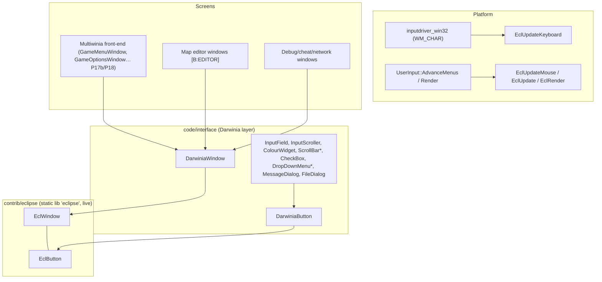
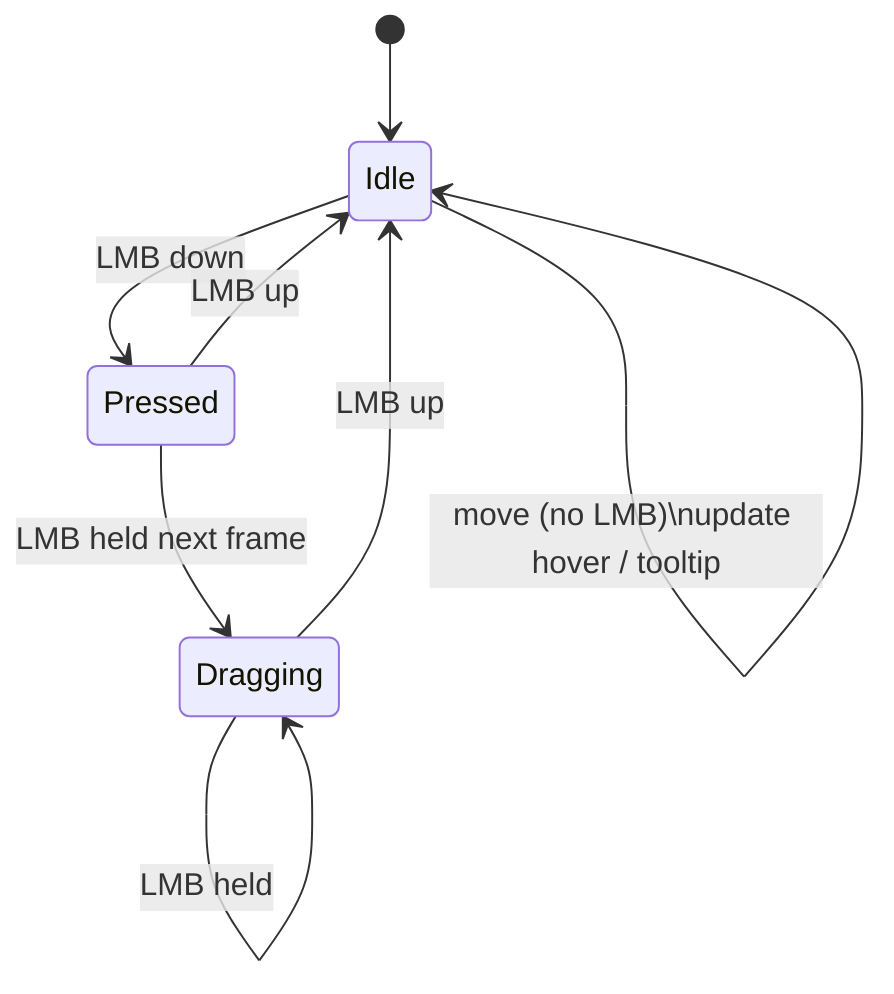

# P17a_ui_framework_editor — Window framework (Eclipse + Darwinia layer), map editor, debug windows

Scope: `contrib/eclipse/{eclipse,eclwindow,eclbutton}.{h,cpp}`; `code/interface/{darwinia_window, input_field, scrollbar, checkbox, drop_down_menu, message_dialog, filedialog, multiwinia_filedialog, multiwinia_window, editor_window, buildings_window, camera_anim_window, camera_mount_window, landscape_window, lights_window, globalworldeditor_window, instant_unit_window, tree_window, invalidcrates_window, cheat_window, debugmenu, network_window, gesture_window, grabber_window}.{h,cpp}`; `code/location_editor.{h,cpp}` (56 files, 12 237 lines, all read in full). Build baseline: see `build_matrix.md` (`Release|Win32` + `TARGET_PC_FULLGAME`; `LOCATION_EDITOR` off in every target).

Supporting files read outside scope (to resolve reachability/semantics, not re-specified here): `code/main.cpp` (editor loops), `code/user_input.cpp` (Eclipse pump + debug hot-keys), `code/lib/input/inputdriver_win32.cpp` (WM_CHAR routing), `data/input/input_preferences.txt` (bindings), `code/network/networkvalue.{h,cpp}` (value binding), `code/lib/text_renderer.{h,cpp}` (font blend modes), `code/lib/language_table.{h,cpp}` (`LookupPhrase` fallback), `contrib/systemiv/lib/unicode/unicode_string.cpp` (`Truncate`), `contrib/systemiv/lib/tosser/llist.cpp` (`GetData` null on bad index), `code/interface/multiwiniaoptions_window.cpp` (editor "Other Options" window, P17b file), `code/UI/MultiwiniaEditorButton.h`, `code/UI/GameMenuWindow.cpp` (editor button gating), `code/interface/mainmenus.{h,cpp}` (`GameOptionsWindow`, `MultiwiniaButton`), `code/game_menu.cpp` (layout helpers), `code/level_file.h`, `code/landscape.cpp`, `code/location.cpp:Location::GetBuilding`, `code/global_world.cpp:GlobalWorld::Advance`, `targets/vs2005/Darwinia.vcproj`, `contrib/eclipse/eclipse.vcproj`.

Generated table: `OUT/_work/drafts/P17a_ui_framework_editor_ui_strings.csv` (221 rows: every `LANGUAGEPHRASE` key with English text, every literal `UnicodeString("…")` caption, every `CreateValueControl` name key in scope) produced by `OUT/_work/scripts/P17a_ui_strings.py`.

---

## [→ 28_ui_framework] 1. Layering and build status



| Component | Files | Compiled in FULL? | Reachable in FULL? | Tag |
|---|---|---|---|---|
| Eclipse core | `contrib/eclipse/*` | Yes — separate static-lib project `eclipse` linked by `Darwinia.sln`; compiled with only `WIN32;NDEBUG;_LIB;_CRT_SECURE_NO_DEPRECATE;TARGET_MSVC` and include path `..\..\code;..\..\contrib\SystemIV` (so `lib/…` resolves to `code/lib` first) [C] `contrib/eclipse/eclipse.vcproj` | Yes (every window) | [B:FULL] |
| DarwiniaWindow/Button family | `darwinia_window.*` | Yes [C] vcproj | Yes | [B:FULL] |
| InputField / InputScroller / ColourWidget / ColourWindow | `input_field.*` | Yes | InputField yes (subclassed by `GameMenuInputField`, `ChatInputField`, `AuthInputField`, P17b/P18); InputScroller/ColourWidget only via `CreateValueControl`/`CreateColourControl` callers (editor, sound editor) | [B:FULL] (scroller/colour: effectively editor/debug) |
| ScrollBar | `scrollbar.*` | Yes | Yes (`GameMenuWindow`, `HelpAndOptions`, `SoundStatsWindow`) [C] grep `new ScrollBar` | [B:FULL] |
| CheckBox | `checkbox.*` | Yes | Yes (subclassed by `GameMenuCheckBox`, `code/game_menu.h`) | [B:FULL] |
| DropDownMenu | `drop_down_menu.*` | Yes | Yes (`GameMenuDropDown`, `ControlMethodDropDownMenu`) | [B:FULL] |
| MessageDialog | `message_dialog.*` | Yes | Yes — `Renderer` resolution-failure dialog (`code/renderer.cpp`), sound-settings failure (`code/sound/soundsystem.cpp`), "Restart Required" (`code/interface/prefs_screen_window.cpp`) [C] | [B:FULL] |
| FileDialog | `filedialog.*` | Yes | Only from editor landscape window and sound editor | [B:EDITOR]/[B:DEBUG] usage |
| MultiwiniaFileDialog, MultiwiniaWindow, NewMapWindow | `multiwinia_filedialog.*`, `multiwinia_window.*` | Yes (no `#ifdef`) [C] | **No** — see §E1 | [B:EDITOR] (compiled-in, unreachable in FULL) |
| LocationEditor + editor windows | `location_editor.*`, `editor_window.*`, `buildings_window.*`, `camera_anim_window.*`, `camera_mount_window.*`, `landscape_window.*`, `lights_window.*`, `instant_unit_window.*`, `tree_window.*` | Bodies wrapped in `#ifdef LOCATION_EDITOR` → compile to empty TUs [C] | No | [B:EDITOR] |
| InvalidCratesWindow | `invalidcrates_window.*` | Yes (no `#ifdef`) | No (only `LocationEditor::CreateEditWindowForMode` creates it) | [B:EDITOR] (compiled-in) |
| GlobalWorldEditorWindow | `globalworldeditor_window.*` | Yes (no `#ifdef`) | No (only `GlobalWorldEditorLoop`, which needs `m_editing`) | [B:LEGACY] (Darwinia world editor) |
| DebugMenu ("Tools Menu") | `debugmenu.*` | Yes | No — only opener `DebugKeyBindings::DebugMenu` has no live caller (`code/user_input.cpp:UserInput::AdvanceMenus` F1 call commented out) [C] | compiled, unreachable |
| DebugKeyBindings::NetworkButton | `debugmenu.cpp` | Yes | **Yes** — `ToggleNetworkStats` (F9) under `NETWORK_STATS_ENABLED` (on in FULL) [C] `code/user_input.cpp:UserInput::Advance`, `data/input/input_preferences.txt` | [B:FULL] |
| NetworkWindow | `network_window.*` | Yes | **Yes** (F9) | [B:FULL] |
| CheatWindow | `cheat_window.*` | Yes, but `Create()` is empty unless `CHEATMENU_ENABLED` [C] | Only `TARGET_DEBUG` (F11) | [B:DEBUG] |
| GrabberWindow | `grabber_window.*` | `#ifdef AVI_GENERATOR` (TARGET_DEBUG only) | Not even in DEBUG — `DebugKeyBindings::GrabberButton` has no caller [C] grep | [B:DEBUG] (unreachable) |
| GestureWindow | `gesture_window.*` | `#if defined(GESTURE_EDITOR) && defined(USE_SEPULVEDA_HELP_TUTORIAL)` — the second macro is never defined | No | [B:DEAD] |

---

## [→ 28_ui_framework] 2. Eclipse core (`contrib/eclipse`)

"ECLIPSE version 2.0, Generic Interface Library" [C] `contrib/eclipse/eclipse.h` header comment. Immediate-mode-rendered, retained-hierarchy window manager. Exactly two levels: windows contain buttons; all button coordinates are relative to their window [C] `contrib/eclipse/eclwindow.h` comment.

### 2.1 Data model

**EclWindow** [C] `contrib/eclipse/eclwindow.h:EclWindow`, `eclwindow.cpp:EclWindow::EclWindow`

| Field | Type | Default | Meaning |
|---|---|---|---|
| `m_x, m_y, m_w, m_h` | int | 0 | Screen-space rect (pixels, origin top-left) |
| `m_name` | char[256] (`SIZE_ECLWINDOW_NAME`) | ctor arg | Unique key; **all lookups are by name string** |
| `m_title` | UnicodeString (≤256 chars, `SIZE_ECLWINDOW_TITLE`; longer titles silently rejected) | "New Window" | Title |
| `m_movable` | bool | true | Drag-to-move allowed |
| `m_resizable` | bool | true | Drag-edge-to-resize allowed |
| `m_dirty` | bool | false | Needs redraw (see §2.9) |
| `m_buttons` | `LList<EclButton*>` | empty | Owned children; **index 0 = most recently registered** (`PutDataAtStart`) |
| `m_currentTextEdit` | char[256] | "None" | Name of button currently receiving keystrokes |

Virtuals: `Create`, `Remove`, `Update`, `Render(bool hasFocus)`, `Keypress(keyCode, shift, ctrl, alt, ascii)`, `MouseEvent(lmb, rmb, up, down)`, `GetButton(name)`, `GetButton(x,y)`.

**EclButton** [C] `contrib/eclipse/eclbutton.h:EclButton`, `eclbutton.cpp`

| Field | Type | Default |
|---|---|---|
| `m_name` | char[256] (`SIZE_ECLBUTTON_NAME`) | "New Button" (names longer than 256 are silently ignored by `SetProperties`) |
| `m_x, m_y, m_w, m_h` | int (window-relative) | 0 |
| `m_caption`, `m_tooltip` | UnicodeString | caption empty, tooltip " " |
| `m_inactive` | bool | false (used by Darwinia keyboard navigation to skip) |
| `m_parent` (protected) | EclWindow* | NULL, set by `RegisterButton` |

Virtuals: `SetProperties(name,x,y,w,h,caption,tooltip)`, `SetCaption`, `SetTooltip`, `SetParent`, `Render(realX, realY, highlighted, clicked)`, `MouseUp`, `MouseDown`, `MouseMove` (never called by Eclipse), `Keypress`.

**Module globals** [C] `contrib/eclipse/eclipse.cpp` (file statics)

| Static | Initial | Role |
|---|---|---|
| `windows` (`LList<EclWindow*>`) | empty | Z-ordered window list, **index 0 = front-most** |
| `dirtyrects` (`LList<DirtyRect*>`) | empty | Accumulated dirty rectangles |
| `clearDraw` fn-ptr | NULL | Optional background-clear callback (never registered by Multiwinia) |
| `tooltipCallback` fn-ptr | NULL | Optional tooltip callback (never registered by Multiwinia) |
| `mouseX, mouseY, lmb, rmb` | 0/false | Last mouse state |
| `buttonDownMouseX/Y` | 0 | Position used to resolve the MouseUp target |
| `mouseDownWindowX/Y` | 0 | Grab offset for window dragging |
| `tooltipTimer` | 0 | ms timestamp when tooltip becomes due |
| `maximiseOldX/Y/W/H` | 0 | Saved rect for un-maximise |
| `mouseDownWindow`, `windowFocus`, `popupWindow`, `maximisedWindow` | "None" | Window-name state slots |
| `currentButton` | "None" | Highlighted/pressed button name |
| `screenW, screenH` | 0 | From `EclInitialise` |

The sentinel string `"None"` means "no window/button" everywhere [C].

### 2.2 Initialisation, pump and shutdown in Multiwinia

| Call | Where | Behaviour |
|---|---|---|
| `EclInitialise(screenW, screenH)` | `code/user_input.cpp:UserInput::UserInput` | Stores screen size; dirties full screen [C] |
| `EclUpdateMouse(x, y, lmb, rmb)` + `EclUpdate()` | `code/user_input.cpp:UserInput::AdvanceMenus`, once per `UserInput::Advance` | `lmb` = `ControlEclipseLMousePressed` (= `mouse left pressed`, i.e. level-held), `rmb` = `ControlEclipseRMousePressed` (= `mouse right down`, edge) [C] `data/input/input_preferences.txt`. After pumping, if `ControlEclipseLMouseDown` fired over any window, the event is suppressed (`suppressEvent`) so the game world does not also receive the click [C] |
| `EclUpdateKeyboard(keyCode, shift, ctrl, alt, ascii)` | `code/lib/input/inputdriver_win32.cpp` `WM_CHAR` case | `keyCode` **and** `ascii` are both the WM_CHAR character code (`wParam`), modifier flags from `g_keys` [C]. Consequence: key codes seen by widgets are *characters*, not virtual keys (see §4.1) |
| `EclRender()` | `code/user_input.cpp:UserInput::Render`, inside `g_editorFont.BeginText2D()/EndText2D()` with `GL_BLEND` on, cull off, depth test off, depth writes off | 2D ortho = viewport with −0.325 px offset (`code/lib/text_renderer.cpp:TextRenderer::BeginText2D`) [C] |
| `EclShutdown()` | `code/main.cpp` shutdown | Deletes all windows and dirty rects [C] |

Controller mouse emulation: `EclipseLMouseDown/Pressed` are additionally bound to `alias ShowMouseCursor && XInput a down/pressed`, `ShowMouseCursor = XInput leftbumper pressed` [C] `data/input/input_preferences.txt`.

### 2.3 Registration, removal and z-order [C] `contrib/eclipse/eclipse.cpp`

`EclRegisterWindow(window, parent=NULL)`:
1. (No duplicate check — the `if (EclGetWindow(name))` block is empty; duplicate names are allowed but only the front-most is findable.)
2. If `parent` given **and** window is at (0,0): auto-place using `AppRandom()`:
   - `left = screenW/2 − parent.x`; `above = screenH/2 − parent.y`
   - `x = left > w/2 ? parent.x + parent.w·r1 : parent.x − w·r1`
   - `y = above > h/2 ? parent.y + parent.h·r2 : parent.y − (h/2)·r2`, with `r = AppRandom()/APP_RAND_MAX`.
   (`AppRandom` is the local, non-synchronised RNG — distinct from `syncrand`/`syncfrand` — so this placement does not affect lockstep [C] `contrib/systemiv/lib/math/random_number.h`.)
3. `MakeAllOnScreen()`: clamp `x,y ≥ 0`, then `x ≤ screenW−w`, `y ≤ screenH−h` (so a window larger than the screen ends with negative origin).
4. `windows.PutDataAtStart(window)` → **new windows are always front-most**.
5. `window->Create()` (subclasses build buttons here).
6. `EclDirtyWindow(window)`.

`EclRemoveWindow(name)`: finds by name; dirties its rect; removes from list; clears `mouseDownWindow`/`windowFocus` if they named it; `delete window` (destructor deletes all its buttons). Unknown names are a silent no-op.

`EclBringWindowToFront(name)`: move to index 0 and dirty. Called on every left-press on a window (§2.4).

`EclSetWindowPosition(name,x,y)`: dirty old rect, move, dirty new rect. `EclSetWindowSize(name,w,h)`: `Remove()`, dirty, set size, **`Create()` again** (all buttons rebuilt), dirty. Contrast `EclWindow::SetPosition/SetSize`, which only assign and dirty (no rebuild).

`EclWindow::RegisterButton(b)`: `b->SetParent(this)`; `m_buttons.PutDataAtStart(b)`; **auto-grow**: if `b.y + b.h + 10 > m_h` then `SetSize(m_w, b.y + b.h + 10)` and `MakeAllOnScreen()`; dirty. Windows therefore grow downward to fit content and are pushed up to stay on-screen [C] `eclwindow.cpp:EclWindow::RegisterButton`.

`EclWindow::RemoveButton(name)`: iterates from the back, deletes the **first** match and breaks — despite the comment "removing ALL buttons with this name" [C]. `EclWindow::GetButton(name)` returns the first match from index 0, i.e. the most recently registered button with that name.

`EclGenerateUniqueWindowName(name)`: returns `name`, `name2`, `name3`, … first unused, in a static buffer [C]. Unused by `code/` [C] grep.

### 2.4 Hit testing

- `EclGetWindow(x,y)`: first window from index 0 (front) with `x ∈ [m_x, m_x+m_w]` and `y ∈ [m_y, m_y+m_h]` — **inclusive** of the far edges [C].
- `EclWindow::GetButton(x,y)` (window-relative): first button from index 0 with inclusive bounds [C]. Overlapping buttons: the later-registered wins input and is drawn on top (render iterates back-to-front, §2.9).
- `EclMouseInButton(window, button)`: window must be the top window under the mouse **and** mouse within the button's inclusive rect [C].
- `EclMouseInWindow(window)`: `EclGetWindow(mouseX, mouseY) == window`.

### 2.5 Mouse state machine [C] `contrib/eclipse/eclipse.cpp:EclUpdateMouse`

Every call first dirties the window under the cursor. Then exactly one LMB branch runs (comparing new `_lmb` with stored `lmb`); RMB branches are empty stubs (right-click is ignored by Eclipse).



| Branch | Condition | Actions |
|---|---|---|
| **Move/hover** | `!_lmb && !lmb && !_rmb && !rmb` | Only the *focused* window is considered. Button under cursor: if name ≠ `currentButton` → `currentButton = name`, dirty window, `tooltipTimer = now + 1000 ms`; else if `now > tooltipTimer` → `tooltipCallback(window, button)` (every frame while hovering). No button: if `currentButton ≠ "None"` → reset to "None", dirty, `tooltipCallback(NULL,NULL)`. No focused window: same reset. (So hover tracking only happens inside the focused window; un-focused windows still get visual hover via `EclMouseInButton` in rendering.) |
| **LMB down** (edge) | `_lmb && !lmb` | `buttonDownMouse = mouse`. Window under cursor: dirty old focus, **focus = this window**, **bring to front**, `mouseDownWindow = this`. Button under cursor → `currentButton = name`, `button->MouseDown()`. No button → `currentButton = "None"`, `window->MouseEvent(lmb=true, rmb=false, up=false, down=true)`, and if movable record grab offset `mouse − window.xy`. No window under cursor: focus = "None". Set `lmb = true`. |
| **LMB drag** (held) | `_lmb && lmb` | `buttonDownMouse = mouse` (**updated every frame**). If `mouseDownWindow` valid: button under cursor → `button->MouseDown()` **again (every frame)**. Else if `currentButton == "None"` (press began on background): resize test on *previous* mouse pos: within ±4 px (exclusive) of bottom edge → `newH = mouseY − y`; within ±4 px of right edge → `newW = mouseX − x`; if either and window resizable → clamp `newW ≥ 60`, `newH ≥ 40`, `EclSetWindowSize` (→ Remove/Create rebuild every frame of the drag). Otherwise if movable → `EclSetWindowPosition(mouse − grabOffset)` (no clamping to screen while dragging). |
| **LMB up** (edge) | `!_lmb && lmb` | `mouseDownWindow = "None"`, `lmb = false`. Window under **last `buttonDownMouse`**: button there → dirty, `button->MouseUp()`; no button → `window->MouseEvent(lmb, rmb, up=true, down=false)` then `EclRemovePopup()`. No window → `EclRemovePopup()`. |

Design-relevant consequences [C-derived]:
- **`MouseUp` is the "click" event** and fires on whichever button lies under the release point — the press need not have started on it (no capture-and-cancel semantics). A new implementation should capture on press and fire click only if released over the same widget (or deliberately preserve this behaviour).
- **`MouseDown` is a held/repeat event** (called on the press frame and on every frame the button is held over that button); widgets that want an edge must test `ControlEclipseLMouseDown` themselves (as `InputScroller::MouseDown` does).
- There is **no mouse capture**: dragging a widget (e.g. scroll thumb) only continues while the cursor stays over that widget.
- Window dragging only starts when the press lands on the window background (not on a button).
- `MouseEvent` is the only window-level mouse hook; no Darwinia window overrides it in scope.

### 2.6 Focus rules

| Event | Focus result | Ref |
|---|---|---|
| LMB press on a window | that window (and it goes to front) | [C] `EclUpdateMouse` |
| LMB press on empty screen | "None" | [C] |
| `DarwiniaWindow` constructed | `EclSetCurrentFocus(m_name)` — new Darwinia windows take focus at construction (before registration) | [C] `code/interface/darwinia_window.cpp:DarwiniaWindow::DarwiniaWindow` |
| `DarwiniaWindow` destroyed | focus = name of `windows[0]` if any (the window has already been unlinked by `EclRemoveWindow`, so this is the new front window) | [C] `DarwiniaWindow::~DarwiniaWindow` |
| `EclRemoveWindow` of focused window | "None" (then the Darwinia destructor above re-assigns) | [C] |
| `EclMaximiseWindow(name)` | that window | [C] |
| `EclSetCurrentFocus(name)` | name (if `< 256` chars; no existence check) | [C] |

Only the focused window receives keyboard input (§2.7), hover/tooltip tracking (§2.5) and Darwinia controller navigation (§3.3). `EclRender` passes `hasFocus = (name == windowFocus)`; `clicked` highlighting in `EclWindow::Render` requires focus.

### 2.7 Keyboard routing

`EclUpdateKeyboard(...)` → focused window's `Keypress(...)` → default `EclWindow::Keypress` forwards to the button named `m_currentTextEdit` (if any) [C] `eclwindow.cpp:EclWindow::Keypress`. `BeginTextEdit(name)` / `EndTextEdit()` set/reset that name. `EclIsTextEditing()` = focused window exists and its `m_currentTextEdit ≠ "None"` — used by chat/lobby code to stop game hot-keys while typing [C] `code/interface/chatinput_window.cpp`, `code/UI/GameMenuWindow.cpp`. There is no tab-order or focus-traversal at the Eclipse level; keyboard navigation between buttons is a Darwinia-layer feature driven by controller bindings (§3.3, §6).

### 2.8 Popups and maximise

- `EclRegisterPopup(w)`: remove existing popup, record name, register. `EclRemovePopup()` is called on every LMB-up that does not land on a button (including clicks on any window background) and on clicks outside all windows → popups close on any non-button click [C]. No Multiwinia code registers popups [C] grep (drop-down menus use their own singleton, §4.6).
- `EclMaximiseWindow(name)`: saves rect, sets focus/mouseDown, `SetPosition(0,0)`, `SetSize(screenW, screenH)` (no rebuild). `EclRender` then renders only that window after calling `clearDraw(...)` — **`clearDraw` is NULL in Multiwinia, so maximising would crash** [C/I]; unused in `code/` [C] grep. `EclUnMaximise` restores and dirties full screen.

### 2.9 Dirty rectangles and render order

- `EclDirtyRectangle(x,y,w,h)` allocates a `DirtyRect`, appends to `dirtyrects`, and marks every overlapping window dirty (`EclRectangleOverlap` treats touching edges as overlapping: `maxtop <= minbottom && maxleft <= minright`).
- `EclDirtyWindow(w)`: if not already dirty → dirty + add its rect.
- `EclRender()` (non-maximised): calls `clearDraw` for each dirty rect if registered (never in Multiwinia), then **for i = Size−1 down to 0** renders each window whose `m_dirty` is set → back-most first, front-most last (painter's order). The line that would clear `m_dirty` after rendering is commented out [C].
- `EclResetDirtyRectangles()` (frees rects, clears flags) is never called from `code/` [C] grep.

Net effect in Multiwinia [C-derived]: every window is dirty from registration onward and is **re-rendered every frame**; the dirty-rect list grows by one entry per `EclSetWindowPosition`/`SetWindowSize`/`RemoveWindow`/`EclDirtyRectangle` call and is only freed at `EclShutdown` (unbounded but small leak, e.g. while dragging a window). A new implementation should treat the UI as fully immediate-mode redraw each frame and drop dirty rectangles entirely.

### 2.10 Tooltips

Tooltip delay **1000 ms** of hovering the same button in the focused window (`EclGetAccurateTime()` = Win32 `GetTickCount()`, ms) [C]. The callback mechanism exists but `EclRegisterTooltipCallback` is never called in `code/` → **no tooltips are ever shown**; `m_tooltip` strings (e.g. "Close this window", "Value left") are dead data [C] grep.

### 2.11 Remaining API surface

| Function | Behaviour | Used in code/ |
|---|---|---|
| `EclGetWindowIndex(name)` | index or −1 | internal |
| `EclGetWindows()` | pointer to the z-ordered list | yes (`RemoveAllWindows`, `WindowsOnScreen`, cheat hot-key) |
| `EclGetCurrentButton()` | `currentButton` | no |
| `EclGetCurrentClickedButton()` | `currentButton` if LMB held else "None" | yes (`EclWindow::Render`, `GameMenuWindow`) |
| `EclGetCurrentFocus()/EclSetCurrentFocus()` | §2.6 | yes |
| `EclGetAccurateTime()` | `GetTickCount()` (Win32) / `gettimeofday` ms since first call (other) | internal |
| `EclGetScreenW/H()` | stored size | internal |
| `EclRegisterClearFunction`, `EclGetDirtyRects`, `EclResetDirtyRectangles`, `EclRegisterTooltipCallback`, `EclMaximiseWindow`, `EclUnMaximise`, `EclRegisterPopup`, `EclRemovePopup` (external), `EclGenerateUniqueWindowName` | §2.8–2.10 | no |

`main.cpp` helpers built on Eclipse [C] `code/main.cpp`: `WindowsOnScreen()` = list non-empty; `RemoveAllWindows()` = (if in a location, warp cursor to screen centre) then remove windows[0] until empty.

### 2.12 Eclipse defects/quirks to not replicate

| # | Quirk | Ref |
|---|---|---|
| Q1 | Click fires on release target, not press target; no capture | `EclUpdateMouse` |
| Q2 | `MouseDown` fires every held frame | `EclUpdateMouse` drag branch |
| Q3 | Dirty flags never cleared; dirty-rect list leaks | `EclRender`, `EclDirtyRectangle` |
| Q4 | Resize rebuilds all buttons every drag frame (`Remove`+`Create`) — widget state not stored outside the window is lost | `EclSetWindowSize` |
| Q5 | `RemoveButton` removes only one of several same-named buttons | `EclWindow::RemoveButton` |
| Q6 | Name-keyed lookup everywhere; duplicate names silently shadow | `EclRegisterWindow`, `GetButton` |
| Q7 | `EclButton::SetProperties` tests `!&_caption` (address of a reference — always false), so the "caption defaults to name" fallback never triggers at this level | `eclbutton.cpp:EclButton::SetProperties` |
| Q8 | Tooltip machinery present but unregistered | §2.10 |
| Q9 | Maximise path dereferences NULL `clearDraw` | `EclRender` |

---

## [→ 28_ui_framework] 3. Darwinia layer: `DarwiniaWindow` and `DarwiniaButton` (`code/interface/darwinia_window.*`) [B:FULL]

### 3.1 DarwiniaWindow fields [C] `code/interface/darwinia_window.h:DarwiniaWindow`

| Field | Type | Default | Meaning |
|---|---|---|---|
| `m_buttonOrder` | `LList<EclButton*>` | empty | Ordered list for controller/keyboard navigation; **opt-in** — screens must `PutData` each navigable button (editor windows never do) |
| `m_currentButton` | int | 0 | Index into `m_buttonOrder` of the navigation cursor |
| `m_buttonChangedThisUpdate` | bool | false | Set when navigation moved this update (cancels mouse-hover highlight) |
| `m_skipUpdate` | bool | false | One-shot: skip the next `Update` (then auto-clears) |
| `m_closeable` | bool | true | Whether `MenuClose` triggers `m_backButton` |
| `m_lockMenu` | bool | false | When true `Update` returns immediately (navigation frozen) |
| `m_details` | `InputDetails` | default | Details of the last activate event (re-initialised each update) |
| `m_backButton` | EclButton* | NULL | Button whose `MouseUp` is invoked by `MenuClose` |

Constructor [C] `DarwiniaWindow::DarwiniaWindow`: title = `LANGUAGEPHRASE(name)` if the language table exists else the raw name, then `StrUpr()` (upper-cased); `EclSetCurrentFocus(name)`. Because `LangTable::LookupPhrase` returns the key itself when missing [C] `code/lib/language_table.cpp:LangTable::LookupPhrase`, window names double as phrase keys with a readable fallback. **However the title is never drawn** when a language table exists — see §3.4.

### 3.2 Create / Remove / client rect / scaling

- `Create()`: registers a `CloseButton` named `"Close"` at `(m_w−12, 2, 10, 10)`, caption "Close", tooltip "Close this window", `m_iconised = true` [C] `DarwiniaWindow::Create`. Subclasses that do not call the base `Create` (e.g. `MessageDialog`, `MainEditWindow`, `LandscapeGuideGridWindow` calls it *last*) have no or a late close box.
- `Remove()`: remove buttons one by one by name until none remain; empty `m_buttonOrder`; `m_currentButton = 0`; `EndTextEdit()` [C].
- Client rect: `X1 = 2`, `X2 = m_w − 2`, `Y1 = GetMenuSize(15) + 1`, `Y2 = m_h − 2` [C].
- **Large-menu scaling** [C] `DarwiniaWindow::GetMenuSize`, `SetMenuSize`: when `g_app->m_largeMenus` (set iff preference `LargeMenus == 2`, [C] `code/app.cpp`; also toggled from Other Options, `code/interface/prefs_other_window.cpp`):
  `scale = 0.96 × screenH / 460`; `GetMenuSize(v) = (int)(v × scale)`; `SetMenuSize(w,h)` multiplies both by `scale` before `SetSize`. Otherwise identity.

### 3.3 Update: controller/keyboard navigation [C] `DarwiniaWindow::Update`

Executed every frame by `EclUpdate` for every window, but navigation acts only on the focused window:

```text
if m_lockMenu: return
m_buttonChangedThisUpdate = false
if m_skipUpdate: m_skipUpdate = false; return
if focus == me:
  if m_buttonOrder non-empty:
    if MenuDown:   b = m_buttons[m_currentButton]   # NB indexes m_buttons, not m_buttonOrder (bug)
                   if !b or !b.SpecialScroll(+1):
                     changed = true; advance index cyclically (wrap to 0), skipping m_inactive,
                     at most Size+1 steps
    if MenuUp:     same with -1 (wrap to Size-1); loop counter never incremented → infinite loop
                   if every entry is m_inactive (bug)
  m_details = InputDetails()
  if (atMainMenu and MainMenuActivate) or MenuActivate: m_buttonOrder[m_currentButton].MouseUp()
  if m_closeable and MenuClose and m_backButton: m_backButton.MouseUp()
```

`SpecialScroll(direction)` is a hook (default returns false) letting a widget consume up/down (e.g. lists that scroll internally) [C] `DarwiniaButton::SpecialScroll`.

`SetCurrentButton(b)`: set `m_currentButton` to `b`'s index in `m_buttonOrder` if present, else unchanged [C].

### 3.4 Window chrome rendering [C] `DarwiniaWindow::Render`

Order and exact parameters (all coordinates screen pixels):

| Step | Primitive | Colour / state |
|---|---|---|
| 1 Body | Textured quad over full rect, texture `textures/interface_red.bmp` (actual asset 64×510, 8-bit [C] file header), min filter `GL_LINEAR_MIPMAP_LINEAR`, mag `GL_LINEAR`, wrap `GL_REPEAT` both axes; tex-coords s∈[0, 8] (code assumes a 512×64 image: `texW = 1.0 × 512/64`), t∈[0,1] | `glColor4f(1,1,1,0.96)`; blend func inherited (normally `SRC_ALPHA, ONE_MINUS_SRC_ALPHA`, restored by the text renderer after each string [C] `code/lib/text_renderer.cpp`) |
| 2 Title bar | Quad from `m_y` to `m_y + (GetClientRectY1() − 1)` = `GetMenuSize(15)` px high, smooth shaded | top `(199,214,220,255)` → bottom `(112,141,168,255)` |
| 3 Border | Four 2 px lines on the rect edges | `(199,214,220,255)` |
| 4 Outer frame | 1 px line loop at `(x−2, y−2)…(x+w+1, y+h+1)` | `(42,56,82,255)` |
| 5 Title text | `g_gameFont` ("speccy" font), shadow mode on, centred at `x + w/2`, baseline `y + 9` (large menus: `y + fontSize/2`), size `GetMenuSize(12)`, drawn **twice** | `glColor4ub(255,255,150,30)`; text = `LANGUAGEPHRASE("multiwinia_mainmenu_title")` ("MULTIWINIA") whenever a language table exists, **ignoring `m_title`** (original title-draw lines are commented out); `m_title` only when no language table |
| 6 Buttons | `EclWindow::Render` → each button back-to-front with `highlighted = EclMouseInButton || name == m_currentTextEdit`, `clicked = hasFocus && name == EclGetCurrentClickedButton()` | — |

Text blend modes (from `TextRenderer`, [C] `code/lib/text_renderer.cpp`): normal text `GL_SRC_ALPHA, GL_ONE` (additive); shadow/outline text `GL_SRC_ALPHA, GL_ONE_MINUS_SRC_COLOR` (darkening "ink" over light backgrounds); after drawing, `GL_SRC_ALPHA, GL_ONE_MINUS_SRC_ALPHA` is restored. Fonts: `g_gameFont = "speccy"`, `g_editorFont = "editor"` (horizontal spacing factor 0.91), `g_titleFont = "square"` (spacing 1.03); for chinese-trad/simp, korean, japanese both game and editor fonts are replaced by copies of the title font [C] `code/app.cpp` font init. Font atlas/glyph details: see 24/25 (P12/P13).

### 3.5 DarwiniaButton [C] `DarwiniaButton::*`

Fields: `m_fontSize` 11.0, `m_centered` false, `m_disabled` false, `m_highlightedThisFrame` false, `m_mouseHighlightMode` false.

`SetShortProperties(name, x, y, w, h, caption, tooltip)`: caption defaults to `UnicodeString(name)` if empty; `w == −1` → `captionLength × 7 + 9` (or `strlen(name) × 7 + 9` if caption empty); `h == −1` → 15; then `SetProperties`.

`UpdateButtonHighlight()` (called from `Render`): if the parent changed button via navigation this update → `m_mouseHighlightMode = false`. If the mouse is in the button **and** input mode is `INPUT_MODE_KEYBOARD`: on entry (first frame) → `parent->SetCurrentButton(this)`, `m_highlightedThisFrame = m_mouseHighlightMode = true`; when the mouse leaves → `m_highlightedThisFrame = false`.

Highlight decision in `Render`: `highlighted` from Eclipse is discarded unless `m_mouseHighlightMode`; forced true if this button is `m_buttonOrder[m_currentButton]` (navigation cursor). So mouse-hover and controller cursor share one visual state.

| State | Background | Edges | Caption |
|---|---|---|---|
| normal | quad `(107,37,39,64)` | 1 px: left+top `(100,34,34,200)`, right+bottom `(0.1,0,0,1)` | white `(1,1,1,1)` additive; disabled `(0.5,0.5,0.5,1)` |
| highlighted | smooth vertical gradient `(199,214,220,255)`→`(112,141,168,255)` | none | shadow mode, `(255,255,150,30)` drawn twice; disabled `(128,128,75,30)` |
| clicked | gradient `(255,255,255,255)`→`(162,191,208,255)` | none | as highlighted |

Caption font `g_editorFont`, size `m_fontSize` (not menu-scaled), baseline `y = 7.5 + realY + (m_h − m_fontSize)/2`, x = `realX + 5` or centred at `realX + m_w/2`. `SetDisabled(b)` only affects colours — **disabled buttons still receive `MouseUp`** (each subclass must check `m_disabled`, as `DropDownMenu::MouseUp` does) [C].

### 3.6 DarwiniaButton subclasses in `darwinia_window.*` [C]

| Class | Behaviour | Render |
|---|---|---|
| `BorderlessButton` | `SetShortProperties`: auto-width from **name** length only (`strlen(name)×7+9`), h 15, no caption fallback | Forced "clicked" when it is the nav cursor. Clicked: gradient as DarwiniaButton highlight, shadow caption `(255,255,150,30)` ×2. Otherwise: no fill; if `highlighted` → calls `parent->SetCurrentButton(this)` (render-time side effect) and draws 1 px edges left/top `(100,34,34,250)`, right/bottom black; caption white, plus an extra 50 %-alpha white pass when highlighted. Caption size `GetMenuSize(m_fontSize)`, baseline `realY + 10` |
| `CloseButton` | `MouseUp` → `EclRemoveWindow(parent)` | iconised: quad `(60,37,39,64)` (`(160,137,139,64)` when highlighted/clicked), edges left/top `(0,0,150,100)`, right/bottom `(0.1,0,0,1)`; non-iconised → DarwiniaButton look |
| `GameExitButton` | `MouseUp` → `m_atMainMenu = true; renderer->StartFadeOut()` | DarwiniaButton |
| `InvertedBox` | none (decorative inset panel) | quad `(0.05,0,0,0.4)`; top/left black, right/bottom `(100,34,34,150)` |
| `LabelButton` | none | caption only, editor font size 11.0 at `(realX+5, realY+10)`, white / grey if disabled |

### 3.7 Value-control factory [C] `DarwiniaWindow::CreateValueControl`, `RemoveValueControl`, `CreateColourControl`

`CreateValueControl(name, T *value, y, change, low, high, callback=NULL, x=-1, w=-1)` overloads map the pointer type to an `InputField` type:

| Pointer type | InputField type | Value object |
|---|---|---|
| `bool*` | `TypeBool` (but see defect F1 in §10: `RegisterBool` stores `TypeChar`) | `LocalBool` |
| `unsigned char*` | `TypeChar` | `LocalChar` |
| `int*` | `TypeInt` | `LocalInt` |
| `float*` | `TypeFloat` | `LocalFloat` |
| `double*` | `TypeDouble` | `LocalDouble` |
| `char*` (buffer) | `TypeString` — `high` is reused as the **buffer size** | `LocalString(buf, size)` |

Layout: `x` default 10; `w` default `m_w − 2x`. Field height `GetMenuSize(15)`. Label = `LANGUAGEPHRASE(name)` if the phrase exists else the raw name. For string types the field spans `w`; for numeric types it spans `w − 37` and two `InputScroller` buttons are added: `"<name> left"` at `(field.x + field.w + 5, y, 15, 15)` caption "<", `m_change = −change`; `"<name> right"` at `(+22)` caption ">", `m_change = +change`. `callback` (any DarwiniaButton) is "clicked" (`MouseUp`) on every value refresh (§4.1). `RemoveValueControl(name)` removes the field and both scrollers.

`CreateColourControl(name, int *rgba, y, callback, x=10, w=m_w−x)`: a `ColourWidget` of width `w − 13`, auto height (15) (§4.3).

---

## [→ 28_ui_framework] 4. Widgets

### 4.1 InputField (`code/interface/input_field.*`) [B:FULL]

`class InputField : BorderlessButton`. Fields: `m_buf` (UnicodeString display/edit buffer), `m_type` ∈ {`TypeNowt`=0, `TypeChar`, `TypeBool`, `TypeInt`, `TypeFloat`, `TypeDouble`, `TypeString`, `TypeUnicodeString`} [C] `input_field.h`, `m_value` (`NetworkValue*`), `m_ownsValue`, `m_inputBoxWidth`, `m_callback`.

**Binding** [C] `InputField::Register*`: each `Register*` asserts the field is unbound, wraps the caller's storage in a `Local*` adaptor (`LocalChar/Bool/Int/Float/Double` with `SetBounds(low, high)`; `LocalString(buf, size)`; `LocalUnicodeString(ref)`) that the field owns, or `RegisterNetworkValue(type, v)` (not owned — used by lobby option fields that write through `ClientToServer`, P15/P18). Default bounds `[0, 1.0e4]`. `NetworkValue` text conversions [C] `code/network/networkvalue.cpp`: int/bool/char → `"%d"`; float/double → `"%.2f"`; parse with `swscanf("%d"|"%lf")`, float/double results passed through `iv_trunc_low_nibble`; string `Set` = `snprintf(buf, size, "%s")` with forced terminator.

**Editing state machine**:

```mermaid
stateDiagram-v2
  [*] --> Display
  Display --> Editing: MouseUp (parent.BeginTextEdit(name))
  Editing --> Editing: printable char / digit / backspace
  Editing --> Display: Enter or Esc → parse m_buf into value, Refresh()
  Editing --> Display: parent window Remove() (EndTextEdit, no commit)
  Editing --> Display: MouseUp on another InputField of the same window (that field becomes the edit target; this one is NOT committed — its typed text is discarded at the next 1 s buffer refresh)
```



**Keypress** (`keyCode` = WM_CHAR character code, §2.2) [C] `InputField::Keypress`:

| Input | Effect |
|---|---|
| no active text edit in parent | ignored |
| `'%'` | ignored (protects printf-style text drawing) |
| Backspace (8) | delete last character (`Truncate(Length())` shrinks by one [C] `contrib/systemiv/lib/unicode/unicode_string.cpp:UnicodeString::Truncate`); string types write-through + `Refresh` |
| Enter (13) **or** Esc (27) | `EndTextEdit`; `m_value->FromUnicodeString(m_buf)`; `Refresh` — **Esc commits, it does not cancel** |
| `KEY_STOP` (190) | append "." (only reachable for character 190 "¾" under WM_CHAR — dead in practice [I]) |
| '0'–'9' (48–57) | append digit; string types write-through |
| 'A'–'Z' (65–90) on `TypeString` | append, lower-cased unless Shift held (so Caps-Lock letters become lower-case) |
| anything else, Ctrl not held | append the raw character (this is how '.', '-', lower-case letters arrive) |
| anything else with Ctrl held | ignored |

After every key `m_inputBoxWidth = len × 7 + 7` (`PIXELS_PER_CHAR = 7`).

**Validation** [C]: numeric fields accept any characters while typing; on commit the buffer is parsed with `swscanf`; on parse failure the stored value is unchanged and `Refresh` re-displays it. **Typed values are not clamped to the bounds** — only the scrollers apply `Bound()` [C] `NetworkValue::FromUnicodeString` vs `InputScroller::CheckInput`. String fields write-through on every keystroke (callback fires every keystroke). No maximum-length check beyond the target buffer's `snprintf` truncation.

`Refresh()`: `m_buf = value text`; if `m_callback` → `m_callback->MouseUp()` [C].

**Render** [C] `InputField::Render`:
- Edit well = right 40 % of the field (`m_w × 0.4`): quad `(0.1,0,0,0.5)`, top/left black lines, right/bottom `(100,34,34,150)`.
- Label via `BorderlessButton::Render` (forced highlighted while editing).
- Caret while editing: 1 px vertical line at `fieldX + WcsLen × 7 + 2` from `y+2` to `y+h−2`, visible when `fmod(time, 1.0) < 0.5` (1 Hz, 50 % duty).
- When not highlighted and in the first half of each second, `m_buf` is re-read from the value (external changes appear within ≤ 1 s).
- Value text: `g_editorFont` at `x = realX + m_w − GetMenuSize(m_inputBoxWidth) + 2`, `y = realY + 10`, size `GetMenuSize(DEF_FONT_SIZE = 12.0)` — i.e. right-aligned by estimated width.

### 4.2 InputScroller (hold-to-repeat increment buttons) [C] `InputScroller::*`

- `MouseDown` (called every held frame): only when `ControlEclipseLMouseDown` (edge) fires → `m_mouseDownStartTime = now − INTEGER_INCREMENT_PERIOD` (0.1 s), so the first step happens immediately.
- `CheckInput` (called from `Render` every frame): active if start time > 0, LMB still held (`ControlEclipseLMousePressed`), cursor inside the scroller (half-open rect). `change = m_change × (5 if ControlScrollSpeedup [Shift] held)`. `elapsed = now − start`.
  - `TypeChar`: if `elapsed > 0.1` → `v += change` (**no bound applied**), `start += 0.1` (→ 10 steps/s).
  - `TypeInt`, `TypeBool`: same cadence with `Bound()` clamp.
  - `TypeFloat`, `TypeDouble`: every frame `v = Bound(v + change × elapsed × 0.2)` — continuous and *accelerating* (rate grows linearly with hold time; frame-rate dependent).
  - Then `m_inputField->Refresh()` every active frame (fires the callback every frame).
- `MouseUp` → start = −1. Releasing outside the scroller leaves start > 0, so a later held press that drags back over it resumes stepping (quirk).

### 4.3 ColourWidget / ColourWindow [C] `input_field.cpp`

- `ColourWidget` (DarwiniaButton): renders normally plus a swatch quad `[w−30, w−5] × [4, h−3]` in the bound `int` reinterpreted as 4 bytes RGBA. `MouseUp` → new `ColourWindow("editor_coloureditor")`, `SetSize(200,100)`, registered with the widget's window as parent (random placement §2.3).
- `ColourWindow::Create`: base close box, then four value controls on the bytes: `editor_red` (y 25), `editor_green` (43), `editor_blue` (61), `editor_alpha` (79); step 1, range [0,255], width `m_w − 80`, sharing the widget's callback. Render adds a swatch `[w−60, w−10] × [25, h−10]`.

### 4.4 ScrollBar (`code/interface/scrollbar.*`) [B:FULL]

`ScrollBar` is a non-widget controller object that owns three buttons registered in a parent window (looked up by name each time) [C] `ScrollBar::Create`:

| Button | Name | Rect (window-relative) | Class |
|---|---|---|---|
| up | `"<name> up"` | `(x, y, w, 18)` | `ScrollChangeButton(−stepSize)` |
| track/thumb | `"<name> bar"` | `(x, y+18, w, h−36)` | `ScrollBarButton` |
| down | `"<name> down"` | `(x, y+h−18, w, 18)` | `ScrollChangeButton(+stepSize)` |

Model: `m_numRows` (content rows), `m_winSize` (visible rows), `m_currentValue` (first visible row). `SetCurrentValue(v)`: if `numRows ≤ winSize` → 0; else clamp to `[0, numRows − winSize]`; dirty parent. `ChangeCurrentValue(d)` = `SetCurrentValue(cur + d)`.

`ScrollBarButton::Render`: track quad `(85,93,78)`, outline `(187,187,187)`; thumb `barTop = h × cur/numRows`, `barEnd = min(h × (cur+win)/numRows, h−1)`; thumb colour `(50,55,120)` clicked, `(55,60,120)` highlighted, `(65,71,120)` normal, inset 1 px left/top. (Division by `numRows` = 0 when the list is empty → NaN/inf rect [I].)

Interaction [C]:
- `MouseDown` (every held frame): if not grabbing and the cursor is within the thumb → `grabOffset = winSize × (mouseY − barTop)/(barEnd − barTop)` (int rows). If grabbing → `value = floor((mouseY − trackTop)/h × numRows) − grabOffset`.
- `MouseUp`: if not grabbing → page: cursor above thumb → `−winSize`; below → `+winSize` (the `barEnd` clamp compares an absolute screen y against `m_h`, so effectively any click not above the thumb pages down — benign because thumb clicks set a grab first). If grabbing → stop grab.
- `ScrollChangeButton::MouseDown` → `ChangeCurrentValue(amount)` **every held frame** (frame-rate-dependent auto-repeat, no initial delay). Render: DarwiniaButton look plus `icons/selectionarrow.bmp` (64×64, [C]) quad inset 5 %, flipped vertically for the up arrow, white, with `glBlendFunc(SRC_ALPHA, ONE)` additive and depth writes off — **blend mode is left additive afterwards** (state leak) [C].
- `Remove()` unregisters the three buttons. The object itself is owned by the parent window class (deleted in its destructor).

### 4.5 CheckBox (`code/interface/checkbox.*`) [B:FULL]

Binds a `NetworkBool*` via `RegisterBool(bool*)` (owned `LocalBool`), `RegisterInt(int*)` (owned `LocalIntAsBool`), `RegisterNetworkInt(NetworkInt*)` (owned `NetworkIntAsBool` adaptor), `RegisterNetworkBool(NetworkBool*)` (not owned); the first registration wins, later calls are ignored [C]. `MouseUp` → `Toggle()` (`v = !v`); `Set(int|bool)`; `IsChecked()` (false if unbound).

Render [C] `CheckBox::Render`: highlighted → full-rect quad `(199,214,220,255)` with `SRC_ALPHA, ONE_MINUS_SRC_ALPHA`, caption in shadow mode with alpha 0 (ink cut-out); normal → white additive caption. Caption at `(x+5, y + h/2 − fontSize/2 + 7)`. Box: side `s = 0.75h` at `x = right − 2s`, `y = top + (h − s)/2`, grey `(0.3,0.3,0.3,1)` fill, white 1 px outline; when checked a tick texture `icons/tick.bmp` (50×50 32-bit [C]) tinted `(0.6,1.0,0.4,1)` inset `0.05h`, size `0.65h`.

### 4.6 DropDownMenu (`code/interface/drop_down_menu.*`) [B:FULL]

Classes [C]: `DropDownOptionData {char *m_word; int m_value}`; `DropDownMenu : DarwiniaButton`; `DropDownWindow : DarwiniaWindow` (the open list; **process-wide singleton** `s_window`); `DropDownMenuOption : BorderlessButton` (one per row).

Option list: `AddOption(word, value = INT_MIN)` — `INT_MIN` means "auto": `value = m_nextValue++` (counter increments in *call order*, independent of sorting). If constructed with `_sortItems = true`, the option is inserted before the first existing option that compares greater with `stricmp` (case-insensitive, stable for ties); else appended. `Empty()` clears and resets the counter. So a sorted menu displays alphabetically while values still follow insertion order (used to keep enum values correct, e.g. laser-fence modes §E4.7).

Selection: `SelectOption(value)`: `m_currentOption = FindValue(value)` (index or −1); caption = `LANGUAGEPHRASE(m_name)` if not found, else `LANGUAGEPHRASE(word)` if `word` is a phrase key, else raw word; **always** writes `*m_int = value` (even if not found). `SelectOption2(word)` selects by case-insensitive word. `GetSelectionValue()` (−1 if none), `GetSelectionName()` (LANGUAGEPHRASE of word; bounds check uses `>` — off-by-one). `RegisterInt(int*)` (owned `LocalInt`) / `RegisterNetworkInt(NetworkInt*)` bind storage and immediately `SelectOption(current)` — callers that register before adding options get the "not found" caption until re-selected.

Open/close [C] `DropDownMenu::CreateMenu`, `MouseUp`, `IsMenuVisible`:
- `MouseUp` (ignored if `m_disabled`): toggle; "visible" ≡ a window named exactly the menu button's `m_name` exists.
- `CreateMenu`: `DropDownWindow::CreateDropDownWindow(name = menu name, parent = owning window name)` removes any previous drop-down first (one open list at a time); positioned at `(parent.x + m_x + m_w, parent.y + m_y)` (to the right of the button); registered (front-most, takes focus).
  - Columns: `numCols = 1 + int((m_h × N) / (screenH × 0.8))`; `perCol = ceil(N / numCols)`.
  - Option `index` at `(col × m_w + 2, (row + 1) × m_h)`, size `(m_w − 4, m_h)`, named `"<menu> <index>"`, caption = **raw `m_word`** (keys are *not* translated inside the open list — they are only translated in the closed button caption) [C], added to the window's `m_buttonOrder`; the option whose value equals the current selection becomes the nav cursor.
  - Window size `(m_w × numCols, (perCol + 1) × m_h)` (row 0 is under the title bar).
- `DropDownWindow::Update`: base navigation, then self-removes if its parent window no longer exists.
- `DropDownMenuOption::MouseUp` → `menu->SelectOption(m_value)`, `menu->RemoveMenu()`. Render: BorderlessButton look, forced "clicked" when it is the nav cursor.
- Closed-button render: DarwiniaButton (forced highlighted while open) + white triangle `(w−12,5),(w−3,5),(w−7,9)`.

### 4.7 MessageDialog (`code/interface/message_dialog.*`) [B:FULL]

`MessageDialog(name, message)` [C]: splits `message` on `'\n'` into at most **20** lines (fixed array, no bound check → overflow on >20 lines); `m_w = g_editorFont.GetTextWidth(longestLineChars) + 10` where `GetTextWidth(n, size=13) = n × 13 × horizScale` (horizScale 0.6 for Latin/Cyrillic languages → 7.8 px/char, 1.0 for CJK → 13 px/char [C] `code/lib/text_renderer.cpp:TextRenderer::TextRenderer`, `code/app.cpp` font init), min 100; `m_h = 65 + lines × 12`, min 85; `SetMenuSize(w,h)`; centred on screen. `Create()` (does **not** call the base, so no close box): one `OKButton` named `"dialog_close"` captioned `LANGUAGEPHRASE("dialog_close")` ("Close"), `w = GetMenuSize(40)`, `h = GetMenuSize(18)`, at `((m_w − w)/2, m_h − GetMenuSize(30))`, font `GetMenuSize(11)`; `MouseUp` removes the dialog. Render: base chrome + each line with `g_editorFont` at `(x+10, y + GetMenuSize(32) + i × GetMenuSize(12))`, size `GetMenuSize(12)`. The button is not in `m_buttonOrder` and `m_backButton` is unset → **a controller cannot dismiss it** [C]. Message lines are drawn raw (callers pass literal or pre-translated text, e.g. `MessageDialog("Error", "Failed to set requested sound settings")` in `code/sound/soundsystem.cpp`).

### 4.8 FileDialog (`code/interface/filedialog.*`) [B:EDITOR]/[B:DEBUG] use

`FileDialog(name, parentName, path = "c:\\", filter = "*", multiSelect = false)` [C]: `SetDirectory(path)` sets the (undrawn) title to the path and lists files via `g_app->m_resource->ListResources(path, filter, false)` (resource system: archives + data dir, P14). `Create()`:

| Element | Name | Rect | Behaviour |
|---|---|---|---|
| close box | `Close` | base | — |
| rows ×`numRows = (m_h − 60)/13` | `"File <i>"` | `(5, 25 + 13i, m_w − 25, 12)` | shows `files[i + scroll]` at `(+30, +8)` size 11; selected → fill `(0.3,0.3,1.0,0.5)`; hover/click → white outline; `MouseUp` → `FileClicked`; second `MouseUp` on the same row-button within **0.2 s** → acts as OK (double-click) |
| selection label | `Selected` | `(10, h−30, w−140, 20)` | caption = filename, `LANGUAGEPHRASE("dialog_multiplefiles")` for >1, " " for none |
| Cancel | `dialog_cancel` | `(w−60, h−30, 55, 20)` | close |
| OK | `dialog_ok` | `(w−120, h−30, 55, 20)` | call virtual `FileSelected(filename)` for each selected index in selection order, then close |
| scrollbar | `FileScroll` | `(w−20, 25, 15, numRows × 13)`, rows = file count, window = numRows | §4.4 |

`FileClicked(index)`: if not multi-select or Ctrl (`FileMultiSelect = key control pressed`) not held → clear selection; if already selected and multi-select → deselect; else append. Subclasses override `FileSelected` (§E4.3). The double-click timer is per row-button, not per file.

### 4.9 MultiwiniaFileDialog (`code/interface/multiwinia_filedialog.*`) [B:EDITOR, compiled-in]

Same model as FileDialog but derives from `GameOptionsWindow` (front-end styled full-screen page, `code/interface/mainmenus.h`, P17b) [C]:
- Layout from `GetPosition_LeftBox`, `GetFontSizes`, `GetButtonSizes` (`code/game_menu.cpp`: font large = 0.095 H, med = 0.04 H, small = 0.022 H; button `w = 0.9 × leftBoxW`, `h = 1.3 × fontMed`, `gap = 0.1 × fontMed`) [C].
- Title button `title` = `LANGUAGEPHRASE("multiwinia_editor_selectmap")` ("Select Map"); 10 fixed rows (`MultiwiniaFileButton`, height `0.65 × buttonH`, `g_titleFont`, outline+fill passes) — **not** added to `m_buttonOrder` (line commented) so a controller cannot pick a file; scrollbar `scrollBar` at the left box's right edge (width `0.5 × rowH`); OK (`dialog_ok`) and Back (`MenuCloseButton("dialog_back")`, `m_backButton`) are navigable.
- `RefreshFileList`: resource listing first; if empty, `ListDirectory(path, filter)` on disk [C].
- `FileSelected(f)`: `((MultiwiniaWindow*)EclGetWindow(m_parent))->m_mapFilename.Set(f)` [C].
- The constructor creates a `ScrollBar` that `Create` replaces with a new one (first leaks) [C].

### 4.10 Other widget-level facts

- `GameMenuButton`, `GameMenuTitleButton`, `GameMenuInputField`, `GameMenuDropDown`, `GameMenuCheckBox`, `MenuCloseButton`, `GameOptionsWindow` are front-end subclasses of the classes above (`code/game_menu.h`, `code/interface/mainmenus.h`) — specified by P17b/P18.
- No widget implements clipping/scissoring; long captions overflow their rect [I] (no scissor calls in scope).

---

## [→ 28_ui_framework] 5. Window rendering summary (palette, fonts, textures, GL state)

Palette (RGBA bytes unless stated) used by the Darwinia layer — a "red glass panel + steel-blue highlight" look [C] (refs in §3–4):

| Token (proposed name) | Value | Used for |
|---|---|---|
| `panel.bodyTint` | (255,255,255,245) × texture `textures/interface_red.bmp` | window body |
| `accent.light` | (199,214,220,255) | title-bar top, window border, button highlight top, checkbox highlight |
| `accent.dark` | (112,141,168,255) | title-bar bottom, highlight gradient bottom |
| `accent.pressedTop/Bottom` | (255,255,255,255) / (162,191,208,255) | pressed button gradient |
| `frame.outer` | (42,56,82,255) | 1 px outer window frame |
| `button.fill` | (107,37,39,64) | idle button |
| `button.edgeLight` | (100,34,34,200) (borderless: 250; inverted/edit-well: 150) | top/left bevel |
| `button.edgeDark` | (25.5,0,0,255) i.e. `glColor4f(0.1,0,0,1)` | bottom/right bevel |
| `text.normal` | (255,255,255,255) additive | captions |
| `text.disabled` | (128,128,128,255) | disabled captions |
| `text.ink` | (255,255,150,30) in shadow blend; disabled (128,128,75,30) | captions on highlighted backgrounds, window title |
| `well.fill` | (25.5,0,0,127) | input-field edit well |
| `inset.fill` | (12.75,0,0,102) | `InvertedBox` |
| `close.fill/hot` | (60,37,39,64) / (160,137,139,64), edge (0,0,150,100) | close box |
| `scroll.track/outline` | (85,93,78) / (187,187,187) | scrollbar |
| `scroll.thumb` normal/hot/pressed | (65,71,120) / (55,60,120) / (50,55,120) | scrollbar thumb |
| `list.selected` | (76,76,255,127) (Multiwinia file dialog: (191,191,255,127)) | selected file rows |
| `check.box/tick` | (76,76,76,255) / tint (153,255,102,255) | checkbox |

Textures: `textures/interface_red.bmp` (body), `icons/selectionarrow.bmp` (scroll arrows), `icons/tick.bmp` (checkbox), `icons/button_b.bmp` (gamepad "B" hint on `MenuCloseButton`, `code/interface/mainmenus.h`) [C]. Shapes: `camera.shp` (editor camera-mount gizmo). Fonts: §3.4.

GL state contract [C] `code/user_input.cpp:UserInput::Render`, `code/lib/text_renderer.cpp:BeginText2D`: UI pass runs in a 2D ortho matching the viewport, blending on, depth test/write off, culling off; smooth shading is enabled only for gradients and reset to flat. Widgets set `glLineWidth` ad hoc (1 or 2). Known leaks: `ScrollChangeButton::Render` leaves `GL_SRC_ALPHA, GL_ONE`; `GuideGrid::RenderMouse` resets properly; text drawing always restores `SRC_ALPHA, ONE_MINUS_SRC_ALPHA`.

New-game note: all of this is fixed-function immediate mode; a DX12 port should batch UI quads/lines into a single dynamic vertex buffer per frame with two blend states (alpha, additive) plus a "multiply-by-inverse-src-colour" state for ink text.

## [→ 28_ui_framework] 6. Controller and keyboard navigation

Bindings consumed by the framework [C] `data/input/input_preferences.txt` (PC):

| Control | Binding(s) | Consumer |
|---|---|---|
| `MenuUp` / `MenuDown` | XInput dpad up/down (repeat), left & right thumbstick up/down (repeat) | `DarwiniaWindow::Update` |
| `MenuLeft` / `MenuRight` | XInput dpad / thumbsticks left/right (repeat) | front-end widgets (P18) |
| `MenuActivate` | XInput A (down) | activate nav cursor (`MouseUp`) |
| `MainMenuActivate` | XInput Start (down) — only while `g_app->m_atMainMenu` | same |
| `MenuClose` | XInput Back, XInput B (down) | `m_backButton->MouseUp()` if `m_closeable` |
| `MenuEscape` | key Esc (down), XInput Start (down) | screen-level (e.g. leave editor loop) |
| `EclipseLMouseDown` / `EclipseLMousePressed` | mouse left down / pressed; `ShowMouseCursor && XInput a down/pressed` | Eclipse pump, scrollers |
| `EclipseRMousePressed` | mouse right **down** (edge) | guide-grid painting |
| `ScrollSpeedup` | key Shift pressed | ×5 scroller step |
| `FileMultiSelect` | key Control pressed | file dialogs |

There are **no keyboard bindings for `MenuUp/Down/Activate`** in the PC file — keyboard users navigate with the mouse; arrow-key navigation exists only on controller [C]. Mouse hover moves the navigation cursor only in `INPUT_MODE_KEYBOARD` (`DarwiniaButton::UpdateButtonHighlight`), and navigation input clears hover mode for one update, so the two never fight [C].

## [→ 28_ui_framework] 7. Localisation integration

| Pattern | Mechanism | Ref |
|---|---|---|
| Phrase lookup | `LANGUAGEPHRASE(key)` = `g_app->m_langTable->LookupPhrase(key)` → `const UnicodeString&`; **missing key → returns the key text itself** | [C] `code/lib/language_table.h`, `language_table.cpp:LangTable::LookupPhrase` |
| Existence test | `ISLANGUAGEPHRASE(key)` = `DoesPhraseExist` | [C] |
| Window names as keys | `DarwiniaWindow` ctor title = upper-cased `LANGUAGEPHRASE(name)` (but drawn title is always `multiwinia_mainmenu_title`, §3.4) | [C] |
| Value-control labels | label = phrase if `ISLANGUAGEPHRASE(name)` else raw name (so editor names like `"R0"`, `"Y0"`, mount names show raw) | [C] `CreateValueControl` |
| Drop-down captions | closed caption translated if the option word is a key; open list shows raw words | [C] §4.6 |
| Placeholders | `UnicodeString::ReplaceStringFlag('F', text)` replaces `*F` (e.g. "Map *F has been successfully created") | [C] `code/interface/multiwinia_window.cpp:CreateMapButton::MouseUp` |
| Implicit narrowing | `UnicodeString → const char*` conversion operator (non-ANSI → '?') lets translated strings be passed where `char*` keys/words are expected (e.g. `menu->AddOption(LANGUAGEPHRASE("buildingname_gunturret"), …)`, `CreateValueControl(LANGUAGEPHRASE("editor_threshold"), …)`) — lossy for non-Latin languages | [C] `contrib/systemiv/lib/unicode/unicode_string.h` |
| Untranslated debug UI | Cheat window, debug menu, network window, camera-anim window, gesture/grabber windows use literal English | [C]; matches `docs/detailed schedule.txt` "Translation System… Missed out" list |
| Printf safety | `InputField` rejects '%' so user text can be passed to printf-style `DrawText2D` | [C] `InputField::Keypress` |

Font substitution for CJK languages: §3.4.

## [→ 28_ui_framework] 8. How a new screen is built (walkthrough)

### 8.1 Darwinia-style tool window (editor/debug pattern)

```cpp
// Pseudocode distilled from LightsEditWindow / TreeWindow / CheatWindow (not verbatim)
class MyWindow : DarwiniaWindow {
  MyWindow() : DarwiniaWindow("my_window_key") {}   // name = unique id + phrase key; takes focus
  void Create() override {
    DarwiniaWindow::Create();                         // adds the "Close" box (x = w-12, y = 2)
    int y = 5, pitch = 17;                            // rows start below the 15 px title bar
    auto *b = new MyActionButton();                   // subclass DarwiniaButton, override MouseUp()
    b->SetShortProperties("my_action", 10, y += pitch, m_w - 20, -1, LANGUAGEPHRASE("my_action"));
    RegisterButton(b);                                // window auto-grows to fit
    m_buttonOrder.PutData(b);                         // optional: controller navigation
    CreateValueControl("my_value", &m_someFloat, y += pitch, 0.1, 0.0, 10.0, /*callback*/ b);
  }
};
auto *w = new MyWindow(); w->m_w = 220; w->m_x = 0; w->m_y = screenH - 100;
EclRegisterWindow(w);                                 // front-most; Create() runs now
```

Rules of thumb recovered from the code [C]:
1. Choose a unique `m_name`; it is the lookup key, the phrase key for the (undrawn) title, and the target for `EclRemoveWindow`. Use `EclGetWindow(name)` to make "toggle" openers idempotent (all `DebugKeyBindings::*` do this).
2. Set `m_w` (and optionally `m_h`, `m_x`, `m_y`) **before** `EclRegisterWindow`; height grows automatically with content; position is clamped on-screen at registration.
3. Build all buttons in `Create()`; `Remove()` must undo them (the base removes all buttons) because resizing calls `Remove()`+`Create()`. Never keep raw pointers to buttons across a resize.
4. Behaviour lives in tiny `DarwiniaButton` subclasses overriding `MouseUp` (click) or `MouseDown` (held). Use `m_parent` (cast) to reach the window.
5. Bind data with `CreateValueControl`/`InputField::Register*`/`CheckBox::Register*`/`DropDownMenu::RegisterInt` — the widget writes straight into the target variable; pass a callback button to react (e.g. regenerate terrain).
6. Rebuild dynamic lists by `Remove(); Create();` (e.g. `NewLightButton`, `NewMountButton`).
7. Close via `EclRemoveWindow(m_name)`; put teardown side effects in the destructor (editor windows reset `m_selectionId` or call `RequestMode(ModeNone)` there).

### 8.2 Multiwinia front-end page pattern (GameOptionsWindow) — used by MultiwiniaWindow/NewMapWindow/MultiwiniaFileDialog

1. Derive from `GameOptionsWindow` (`code/interface/mainmenus.h`, P17b); in the ctor `SetMenuSize(screenW, screenH)`, `SetPosition(0,0)`, `SetMovable(false)` (full-screen page) [C] `MultiwiniaWindow::MultiwiniaWindow`.
2. In `Create()`: call base; `SetTitle(LANGUAGEPHRASE("multiwinia_mainmenu_title"))`; obtain layout with `GetPosition_LeftBox`, `GetFontSizes`, `GetButtonSizes`; `x = leftX + (leftW − buttonW)/2`; add a `GameMenuTitleButton` at `(leftX+10, leftY+10, leftW−20, 1.5 × buttonH)`; stack `GameMenuButton`s with `y += buttonH + gap`, `m_fontSize = fontMed`; `m_buttonOrder.PutData(...)` each; put a `MenuCloseButton("dialog_back")` at `leftY + leftH − 2 × buttonH` and assign `m_backButton` [C] `MultiwiniaWindow::Create`, `NewMapWindow::Create`.
3. Text inputs via `CreateMenuControl(name, InputField::TypeString, &localString, y, 0, NULL, x, buttonW, fontSize)` returning a `GameMenuInputField` [C] `NewMapWindow::Create`.
4. Errors/success via `CreateErrorDialogue(text, success)` (in-page dialogue owned by `GameOptionsWindow`) [C] `CreateMapButton::MouseUp`.
5. Page transitions: button `MouseUp` plays `"MenuSelect"` (`SoundSourceBlueprint::TypeMultiwiniaInterface`), calls `g_app->m_renderer->InitialiseMenuTransition(1.0f, dir)` (dir = +1 forward, −1 back), registers the next page, sets `g_app->m_doMenuTransition = true`; Back plays `"MenuCancel"` and removes the page [C] `SelectMapButton::MouseUp`, `MenuCloseButton::MouseUp`.

## [→ 28_ui_framework] 9. Class diagram


(Front-end subclasses `GameMenuWindow`, `GameMenuButton`, `GameMenuInputField`, `GameMenuDropDown`, `GameMenuCheckBox`, `ChatInputField`, `AuthInputField`: P17b/P18.)

## [→ 28_ui_framework] 10. Framework defects and edge cases (do not carry forward)

| # | Defect | Effect | Ref |
|---|---|---|---|
| F1 | `InputField::RegisterBool` sets `m_type = TypeChar`; `InputScroller` then casts the `LocalBool` to `NetworkChar*` | Works only because both vtables have the same layout [I]; bool increments are unbounded | `code/interface/input_field.cpp:InputField::RegisterBool`, `InputScroller::CheckInput` |
| F2 | `TypeChar` scroller ignores bounds | colour bytes wrap 255→0 | `InputScroller::CheckInput` |
| F3 | Esc commits instead of cancelling | — | `InputField::Keypress` |
| F4 | Typed numbers not clamped | out-of-range values reach game data | `NetworkValue::FromUnicodeString` |
| F5 | `DarwiniaWindow::Update` uses `m_buttons[m_currentButton]` for `SpecialScroll` | wrong widget gets scroll hook | `DarwiniaWindow::Update` |
| F6 | `MenuUp` loop never increments its counter | hang if every nav entry is inactive | `DarwiniaWindow::Update` |
| F7 | Window title always "MULTIWINIA" | `m_title`/window phrase never shown | `DarwiniaWindow::Render` |
| F8 | `BorderlessButton::Render` mutates navigation state | render-order-dependent focus | `BorderlessButton::Render` |
| F9 | `MessageDialog` fixed 20-line array | overflow | `MessageDialog::MessageDialog` |
| F10 | `MessageDialog` not controller-dismissable | gamepad soft-lock until mouse | §4.7 |
| F11 | Drop-down open list shows raw phrase keys | untranslated list items | `DropDownMenu::CreateMenu` |
| F12 | `ScrollChangeButton` leaves additive blend | later UI drawn additive until reset | `ScrollChangeButton::Render` |
| F13 | Scroll repeat & float scrollers are frame-rate dependent | inconsistent feel | §4.2, §4.4 |
| F14 | `ScrollBarButton::Render` divides by `m_numRows` (0 for empty list) | degenerate thumb | `ScrollBarButton::Render` |
| F15 | `SetMenuSize(screenW, screenH)` under large menus scales full-screen pages beyond the screen (then clamped to negative origin) | — | `DarwiniaWindow::SetMenuSize`, `MultiwiniaWindow::MultiwiniaWindow` |
