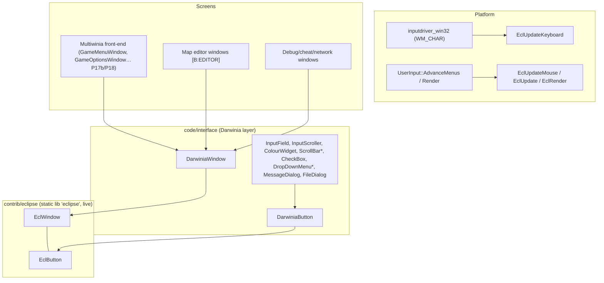
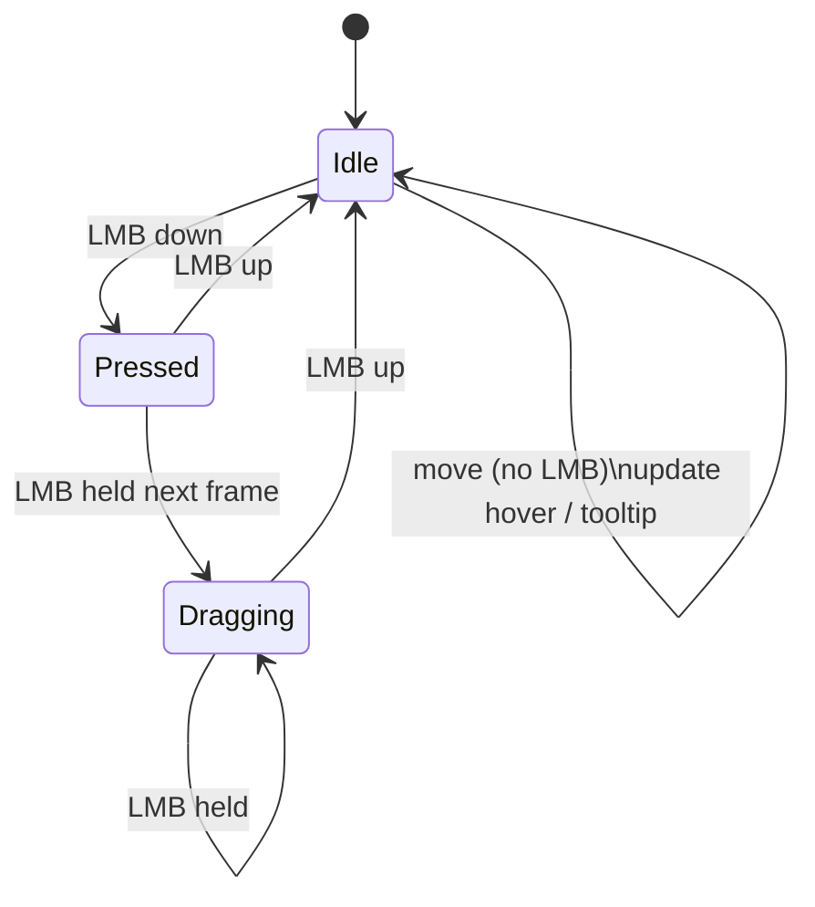

# P17a_ui_framework_editor — Window framework (Eclipse + Darwinia layer), map editor, debug windows

Scope: `contrib/eclipse/{eclipse,eclwindow,eclbutton}.{h,cpp}`; `code/interface/{darwinia_window, input_field, scrollbar, checkbox, drop_down_menu, message_dialog, filedialog, multiwinia_filedialog, multiwinia_window, editor_window, buildings_window, camera_anim_window, camera_mount_window, landscape_window, lights_window, globalworldeditor_window, instant_unit_window, tree_window, invalidcrates_window, cheat_window, debugmenu, network_window, gesture_window, grabber_window}.{h,cpp}`; `code/location_editor.{h,cpp}` (56 files, 12 237 lines, all read in full). Build baseline: see `build_matrix.md` (`Release|Win32` + `TARGET_PC_FULLGAME`; `LOCATION_EDITOR` off in every target).

Supporting files read outside scope (to resolve reachability/semantics, not re-specified here): `code/main.cpp` (editor loops), `code/user_input.cpp` (Eclipse pump + debug hot-keys), `code/lib/input/inputdriver_win32.cpp` (WM_CHAR routing), `data/input/input_preferences.txt` (bindings), `code/network/networkvalue.{h,cpp}` (value binding), `code/lib/text_renderer.{h,cpp}` (font blend modes), `code/lib/language_table.{h,cpp}` (`LookupPhrase` fallback), `contrib/systemiv/lib/unicode/unicode_string.cpp` (`Truncate`), `contrib/systemiv/lib/tosser/llist.cpp` (`GetData` null on bad index), `code/interface/multiwiniaoptions_window.cpp` (editor "Other Options" window, P17b file), `code/UI/MultiwiniaEditorButton.h`, `code/UI/GameMenuWindow.cpp` (editor button gating), `code/interface/mainmenus.{h,cpp}` (`GameOptionsWindow`, `MultiwiniaButton`), `code/game_menu.cpp` (layout helpers), `code/level_file.h`, `code/landscape.cpp`, `code/location.cpp:Location::GetBuilding`, `code/global_world.cpp:GlobalWorld::Advance`, `targets/vs2005/Darwinia.vcproj`, `contrib/eclipse/eclipse.vcproj`.

Generated table: `OUT/_work/drafts/P17a_ui_framework_editor_ui_strings.csv` (221 rows: every `LANGUAGEPHRASE` key with English text, every literal `UnicodeString("…")` caption, every `CreateValueControl` name key in scope) produced by `OUT/_work/scripts/P17a_ui_strings.py`.

---

## [→ 28_ui_framework] 1. Layering and build status

| Component | Files | Compiled in FULL? | Reachable in FULL? | Tag |
|---|---|---|---|---|
| Eclipse core | `contrib/eclipse/*` | Yes — separate static-lib project `eclipse` linked by `Darwinia.sln`; compiled with only `WIN32;NDEBUG;_LIB;_CRT_SECURE_NO_DEPRECATE;TARGET_MSVC` and include path `..\..\code;..\..\contrib\SystemIV` (so `lib/…` resolves to `code/lib` first) [C] `contrib/eclipse/eclipse.vcproj` | Yes (every window) | [B:FULL] |
| DarwiniaWindow/Button family | `darwinia_window.*` | Yes [C] vcproj | Yes | [B:FULL] |
| InputField / InputScroller / ColourWidget / ColourWindow | `input_field.*` | Yes | InputField yes (subclassed by `GameMenuInputField`, `ChatInputField`, `AuthInputField`, P17b/P18); InputScroller/ColourWidget only via `CreateValueControl`/`CreateColourControl` callers (editor, sound editor) | [B:FULL] (scroller/colour: effectively editor/debug) |
| ScrollBar | `scrollbar.*` | Yes | Yes (`GameMenuWindow`, `HelpAndOptions`, `SoundStatsWindow`) [C] grep `new ScrollBar` | [B:FULL] |
| CheckBox | `checkbox.*` | Yes | Yes (subclassed by `GameMenuCheckBox`, `code/game_menu.h`) | [B:FULL] |
| DropDownMenu | `drop_down_menu.*` | Yes | Yes (`GameMenuDropDown`, `ControlMethodDropDownMenu`) | [B:FULL] |
| MessageDialog | `message_dialog.*` | Yes | Yes — `Renderer` resolution-failure dialog (`code/renderer.cpp`), sound-settings failure (`code/sound/soundsystem.cpp`), "Restart Required" (`code/interface/prefs_screen_window.cpp`) [C] | [B:FULL] |
| FileDialog | `filedialog.*` | Yes | Only from editor landscape window and sound editor | [B:EDITOR]/[B:DEBUG] usage |
| MultiwiniaFileDialog, MultiwiniaWindow, NewMapWindow | `multiwinia_filedialog.*`, `multiwinia_window.*` | Yes (no `#ifdef`) [C] | **No** — see §E1 | [B:EDITOR] (compiled-in, unreachable in FULL) |
| LocationEditor + editor windows | `location_editor.*`, `editor_window.*`, `buildings_window.*`, `camera_anim_window.*`, `camera_mount_window.*`, `landscape_window.*`, `lights_window.*`, `instant_unit_window.*`, `tree_window.*` | Bodies wrapped in `#ifdef LOCATION_EDITOR` → compile to empty TUs [C] | No | [B:EDITOR] |
| InvalidCratesWindow | `invalidcrates_window.*` | Yes (no `#ifdef`) | No (only `LocationEditor::CreateEditWindowForMode` creates it) | [B:EDITOR] (compiled-in) |
| GlobalWorldEditorWindow | `globalworldeditor_window.*` | Yes (no `#ifdef`) | No (only `GlobalWorldEditorLoop`, which needs `m_editing`) | [B:LEGACY] (Darwinia world editor) |
| DebugMenu ("Tools Menu") | `debugmenu.*` | Yes | No — only opener `DebugKeyBindings::DebugMenu` has no live caller (`code/user_input.cpp:UserInput::AdvanceMenus` F1 call commented out) [C] | compiled, unreachable |
| DebugKeyBindings::NetworkButton | `debugmenu.cpp` | Yes | **Yes** — `ToggleNetworkStats` (F9) under `NETWORK_STATS_ENABLED` (on in FULL) [C] `code/user_input.cpp:UserInput::Advance`, `data/input/input_preferences.txt` | [B:FULL] |
| NetworkWindow | `network_window.*` | Yes | **Yes** (F9) | [B:FULL] |
| CheatWindow | `cheat_window.*` | Yes, but `Create()` is empty unless `CHEATMENU_ENABLED` [C] | Only `TARGET_DEBUG` (F11) | [B:DEBUG] |
| GrabberWindow | `grabber_window.*` | `#ifdef AVI_GENERATOR` (TARGET_DEBUG only) | Not even in DEBUG — `DebugKeyBindings::GrabberButton` has no caller [C] grep | [B:DEBUG] (unreachable) |
| GestureWindow | `gesture_window.*` | `#if defined(GESTURE_EDITOR) && defined(USE_SEPULVEDA_HELP_TUTORIAL)` — the second macro is never defined | No | [B:DEAD] |

---

## [→ 28_ui_framework] 2. Eclipse core (`contrib/eclipse`)

"ECLIPSE version 2.0, Generic Interface Library" [C] `contrib/eclipse/eclipse.h` header comment. Immediate-mode-rendered, retained-hierarchy window manager. Exactly two levels: windows contain buttons; all button coordinates are relative to their window [C] `contrib/eclipse/eclwindow.h` comment.

### 2.1 Data model

**EclWindow** [C] `contrib/eclipse/eclwindow.h:EclWindow`, `eclwindow.cpp:EclWindow::EclWindow`

| Field | Type | Default | Meaning |
|---|---|---|---|
| `m_x, m_y, m_w, m_h` | int | 0 | Screen-space rect (pixels, origin top-left) |
| `m_name` | char[256] (`SIZE_ECLWINDOW_NAME`) | ctor arg | Unique key; **all lookups are by name string** |
| `m_title` | UnicodeString (≤256 chars, `SIZE_ECLWINDOW_TITLE`; longer titles silently rejected) | "New Window" | Title |
| `m_movable` | bool | true | Drag-to-move allowed |
| `m_resizable` | bool | true | Drag-edge-to-resize allowed |
| `m_dirty` | bool | false | Needs redraw (see §2.9) |
| `m_buttons` | `LList<EclButton*>` | empty | Owned children; **index 0 = most recently registered** (`PutDataAtStart`) |
| `m_currentTextEdit` | char[256] | "None" | Name of button currently receiving keystrokes |

Virtuals: `Create`, `Remove`, `Update`, `Render(bool hasFocus)`, `Keypress(keyCode, shift, ctrl, alt, ascii)`, `MouseEvent(lmb, rmb, up, down)`, `GetButton(name)`, `GetButton(x,y)`.

**EclButton** [C] `contrib/eclipse/eclbutton.h:EclButton`, `eclbutton.cpp`

| Field | Type | Default |
|---|---|---|
| `m_name` | char[256] (`SIZE_ECLBUTTON_NAME`) | "New Button" (names longer than 256 are silently ignored by `SetProperties`) |
| `m_x, m_y, m_w, m_h` | int (window-relative) | 0 |
| `m_caption`, `m_tooltip` | UnicodeString | caption empty, tooltip " " |
| `m_inactive` | bool | false (used by Darwinia keyboard navigation to skip) |
| `m_parent` (protected) | EclWindow* | NULL, set by `RegisterButton` |

Virtuals: `SetProperties(name,x,y,w,h,caption,tooltip)`, `SetCaption`, `SetTooltip`, `SetParent`, `Render(realX, realY, highlighted, clicked)`, `MouseUp`, `MouseDown`, `MouseMove` (never called by Eclipse), `Keypress`.

**Module globals** [C] `contrib/eclipse/eclipse.cpp` (file statics)

| Static | Initial | Role |
|---|---|---|
| `windows` (`LList<EclWindow*>`) | empty | Z-ordered window list, **index 0 = front-most** |
| `dirtyrects` (`LList<DirtyRect*>`) | empty | Accumulated dirty rectangles |
| `clearDraw` fn-ptr | NULL | Optional background-clear callback (never registered by Multiwinia) |
| `tooltipCallback` fn-ptr | NULL | Optional tooltip callback (never registered by Multiwinia) |
| `mouseX, mouseY, lmb, rmb` | 0/false | Last mouse state |
| `buttonDownMouseX/Y` | 0 | Position used to resolve the MouseUp target |
| `mouseDownWindowX/Y` | 0 | Grab offset for window dragging |
| `tooltipTimer` | 0 | ms timestamp when tooltip becomes due |
| `maximiseOldX/Y/W/H` | 0 | Saved rect for un-maximise |
| `mouseDownWindow`, `windowFocus`, `popupWindow`, `maximisedWindow` | "None" | Window-name state slots |
| `currentButton` | "None" | Highlighted/pressed button name |
| `screenW, screenH` | 0 | From `EclInitialise` |

The sentinel string `"None"` means "no window/button" everywhere [C].

### 2.2 Initialisation, pump and shutdown in Multiwinia

| Call | Where | Behaviour |
|---|---|---|
| `EclInitialise(screenW, screenH)` | `code/user_input.cpp:UserInput::UserInput` | Stores screen size; dirties full screen [C] |
| `EclUpdateMouse(x, y, lmb, rmb)` + `EclUpdate()` | `code/user_input.cpp:UserInput::AdvanceMenus`, once per `UserInput::Advance` | `lmb` = `ControlEclipseLMousePressed` (= `mouse left pressed`, i.e. level-held), `rmb` = `ControlEclipseRMousePressed` (= `mouse right down`, edge) [C] `data/input/input_preferences.txt`. After pumping, if `ControlEclipseLMouseDown` fired over any window, the event is suppressed (`suppressEvent`) so the game world does not also receive the click [C] |
| `EclUpdateKeyboard(keyCode, shift, ctrl, alt, ascii)` | `code/lib/input/inputdriver_win32.cpp` `WM_CHAR` case | `keyCode` **and** `ascii` are both the WM_CHAR character code (`wParam`), modifier flags from `g_keys` [C]. Consequence: key codes seen by widgets are *characters*, not virtual keys (see §4.1) |
| `EclRender()` | `code/user_input.cpp:UserInput::Render`, inside `g_editorFont.BeginText2D()/EndText2D()` with `GL_BLEND` on, cull off, depth test off, depth writes off | 2D ortho = viewport with −0.325 px offset (`code/lib/text_renderer.cpp:TextRenderer::BeginText2D`) [C] |
| `EclShutdown()` | `code/main.cpp` shutdown | Deletes all windows and dirty rects [C] |

Controller mouse emulation: `EclipseLMouseDown/Pressed` are additionally bound to `alias ShowMouseCursor && XInput a down/pressed`, `ShowMouseCursor = XInput leftbumper pressed` [C] `data/input/input_preferences.txt`.

### 2.3 Registration, removal and z-order [C] `contrib/eclipse/eclipse.cpp`

`EclRegisterWindow(window, parent=NULL)`:
1. (No duplicate check — the `if (EclGetWindow(name))` block is empty; duplicate names are allowed but only the front-most is findable.)
2. If `parent` given **and** window is at (0,0): auto-place using `AppRandom()`:
   - `left = screenW/2 − parent.x`; `above = screenH/2 − parent.y`
   - `x = left > w/2 ? parent.x + parent.w·r1 : parent.x − w·r1`
   - `y = above > h/2 ? parent.y + parent.h·r2 : parent.y − (h/2)·r2`, with `r = AppRandom()/APP_RAND_MAX`.
   (`AppRandom` is the local, non-synchronised RNG — distinct from `syncrand`/`syncfrand` — so this placement does not affect lockstep [C] `contrib/systemiv/lib/math/random_number.h`.)
3. `MakeAllOnScreen()`: clamp `x,y ≥ 0`, then `x ≤ screenW−w`, `y ≤ screenH−h` (so a window larger than the screen ends with negative origin).
4. `windows.PutDataAtStart(window)` → **new windows are always front-most**.
5. `window->Create()` (subclasses build buttons here).
6. `EclDirtyWindow(window)`.

`EclRemoveWindow(name)`: finds by name; dirties its rect; removes from list; clears `mouseDownWindow`/`windowFocus` if they named it; `delete window` (destructor deletes all its buttons). Unknown names are a silent no-op.

`EclBringWindowToFront(name)`: move to index 0 and dirty. Called on every left-press on a window (§2.4).

`EclSetWindowPosition(name,x,y)`: dirty old rect, move, dirty new rect. `EclSetWindowSize(name,w,h)`: `Remove()`, dirty, set size, **`Create()` again** (all buttons rebuilt), dirty. Contrast `EclWindow::SetPosition/SetSize`, which only assign and dirty (no rebuild).

`EclWindow::RegisterButton(b)`: `b->SetParent(this)`; `m_buttons.PutDataAtStart(b)`; **auto-grow**: if `b.y + b.h + 10 > m_h` then `SetSize(m_w, b.y + b.h + 10)` and `MakeAllOnScreen()`; dirty. Windows therefore grow downward to fit content and are pushed up to stay on-screen [C] `eclwindow.cpp:EclWindow::RegisterButton`.

`EclWindow::RemoveButton(name)`: iterates from the back, deletes the **first** match and breaks — despite the comment "removing ALL buttons with this name" [C]. `EclWindow::GetButton(name)` returns the first match from index 0, i.e. the most recently registered button with that name.

`EclGenerateUniqueWindowName(name)`: returns `name`, `name2`, `name3`, … first unused, in a static buffer [C]. Unused by `code/` [C] grep.

### 2.4 Hit testing

- `EclGetWindow(x,y)`: first window from index 0 (front) with `x ∈ [m_x, m_x+m_w]` and `y ∈ [m_y, m_y+m_h]` — **inclusive** of the far edges [C].
- `EclWindow::GetButton(x,y)` (window-relative): first button from index 0 with inclusive bounds [C]. Overlapping buttons: the later-registered wins input and is drawn on top (render iterates back-to-front, §2.9).
- `EclMouseInButton(window, button)`: window must be the top window under the mouse **and** mouse within the button's inclusive rect [C].
- `EclMouseInWindow(window)`: `EclGetWindow(mouseX, mouseY) == window`.

### 2.5 Mouse state machine [C] `contrib/eclipse/eclipse.cpp:EclUpdateMouse`

Every call first dirties the window under the cursor. Then exactly one LMB branch runs (comparing new `_lmb` with stored `lmb`); RMB branches are empty stubs (right-click is ignored by Eclipse).

| Branch | Condition | Actions |
|---|---|---|
| **Move/hover** | `!_lmb && !lmb && !_rmb && !rmb` | Only the *focused* window is considered. Button under cursor: if name ≠ `currentButton` → `currentButton = name`, dirty window, `tooltipTimer = now + 1000 ms`; else if `now > tooltipTimer` → `tooltipCallback(window, button)` (every frame while hovering). No button: if `currentButton ≠ "None"` → reset to "None", dirty, `tooltipCallback(NULL,NULL)`. No focused window: same reset. (So hover tracking only happens inside the focused window; un-focused windows still get visual hover via `EclMouseInButton` in rendering.) |
| **LMB down** (edge) | `_lmb && !lmb` | `buttonDownMouse = mouse`. Window under cursor: dirty old focus, **focus = this window**, **bring to front**, `mouseDownWindow = this`. Button under cursor → `currentButton = name`, `button->MouseDown()`. No button → `currentButton = "None"`, `window->MouseEvent(lmb=true, rmb=false, up=false, down=true)`, and if movable record grab offset `mouse − window.xy`. No window under cursor: focus = "None". Set `lmb = true`. |
| **LMB drag** (held) | `_lmb && lmb` | `buttonDownMouse = mouse` (**updated every frame**). If `mouseDownWindow` valid: button under cursor → `button->MouseDown()` **again (every frame)**. Else if `currentButton == "None"` (press began on background): resize test on *previous* mouse pos: within ±4 px (exclusive) of bottom edge → `newH = mouseY − y`; within ±4 px of right edge → `newW = mouseX − x`; if either and window resizable → clamp `newW ≥ 60`, `newH ≥ 40`, `EclSetWindowSize` (→ Remove/Create rebuild every frame of the drag). Otherwise if movable → `EclSetWindowPosition(mouse − grabOffset)` (no clamping to screen while dragging). |
| **LMB up** (edge) | `!_lmb && lmb` | `mouseDownWindow = "None"`, `lmb = false`. Window under **last `buttonDownMouse`**: button there → dirty, `button->MouseUp()`; no button → `window->MouseEvent(lmb, rmb, up=true, down=false)` then `EclRemovePopup()`. No window → `EclRemovePopup()`. |

Design-relevant consequences [C-derived]:
- **`MouseUp` is the "click" event** and fires on whichever button lies under the release point — the press need not have started on it (no capture-and-cancel semantics). A new implementation should capture on press and fire click only if released over the same widget (or deliberately preserve this behaviour).
- **`MouseDown` is a held/repeat event** (called on the press frame and on every frame the button is held over that button); widgets that want an edge must test `ControlEclipseLMouseDown` themselves (as `InputScroller::MouseDown` does).
- There is **no mouse capture**: dragging a widget (e.g. scroll thumb) only continues while the cursor stays over that widget.
- Window dragging only starts when the press lands on the window background (not on a button).
- `MouseEvent` is the only window-level mouse hook; no Darwinia window overrides it in scope.

### 2.6 Focus rules

| Event | Focus result | Ref |
|---|---|---|
| LMB press on a window | that window (and it goes to front) | [C] `EclUpdateMouse` |
| LMB press on empty screen | "None" | [C] |
| `DarwiniaWindow` constructed | `EclSetCurrentFocus(m_name)` — new Darwinia windows take focus at construction (before registration) | [C] `code/interface/darwinia_window.cpp:DarwiniaWindow::DarwiniaWindow` |
| `DarwiniaWindow` destroyed | focus = name of `windows[0]` if any (the window has already been unlinked by `EclRemoveWindow`, so this is the new front window) | [C] `DarwiniaWindow::~DarwiniaWindow` |
| `EclRemoveWindow` of focused window | "None" (then the Darwinia destructor above re-assigns) | [C] |
| `EclMaximiseWindow(name)` | that window | [C] |
| `EclSetCurrentFocus(name)` | name (if `< 256` chars; no existence check) | [C] |

Only the focused window receives keyboard input (§2.7), hover/tooltip tracking (§2.5) and Darwinia controller navigation (§3.3). `EclRender` passes `hasFocus = (name == windowFocus)`; `clicked` highlighting in `EclWindow::Render` requires focus.

### 2.7 Keyboard routing

`EclUpdateKeyboard(...)` → focused window's `Keypress(...)` → default `EclWindow::Keypress` forwards to the button named `m_currentTextEdit` (if any) [C] `eclwindow.cpp:EclWindow::Keypress`. `BeginTextEdit(name)` / `EndTextEdit()` set/reset that name. `EclIsTextEditing()` = focused window exists and its `m_currentTextEdit ≠ "None"` — used by chat/lobby code to stop game hot-keys while typing [C] `code/interface/chatinput_window.cpp`, `code/UI/GameMenuWindow.cpp`. There is no tab-order or focus-traversal at the Eclipse level; keyboard navigation between buttons is a Darwinia-layer feature driven by controller bindings (§3.3, §6).

### 2.8 Popups and maximise

- `EclRegisterPopup(w)`: remove existing popup, record name, register. `EclRemovePopup()` is called on every LMB-up that does not land on a button (including clicks on any window background) and on clicks outside all windows → popups close on any non-button click [C]. No Multiwinia code registers popups [C] grep (drop-down menus use their own singleton, §4.6).
- `EclMaximiseWindow(name)`: saves rect, sets focus/mouseDown, `SetPosition(0,0)`, `SetSize(screenW, screenH)` (no rebuild). `EclRender` then renders only that window after calling `clearDraw(...)` — **`clearDraw` is NULL in Multiwinia, so maximising would crash** [C/I]; unused in `code/` [C] grep. `EclUnMaximise` restores and dirties full screen.

### 2.9 Dirty rectangles and render order

- `EclDirtyRectangle(x,y,w,h)` allocates a `DirtyRect`, appends to `dirtyrects`, and marks every overlapping window dirty (`EclRectangleOverlap` treats touching edges as overlapping: `maxtop <= minbottom && maxleft <= minright`).
- `EclDirtyWindow(w)`: if not already dirty → dirty + add its rect.
- `EclRender()` (non-maximised): calls `clearDraw` for each dirty rect if registered (never in Multiwinia), then **for i = Size−1 down to 0** renders each window whose `m_dirty` is set → back-most first, front-most last (painter's order). The line that would clear `m_dirty` after rendering is commented out [C].
- `EclResetDirtyRectangles()` (frees rects, clears flags) is never called from `code/` [C] grep.

Net effect in Multiwinia [C-derived]: every window is dirty from registration onward and is **re-rendered every frame**; the dirty-rect list grows by one entry per `EclSetWindowPosition`/`SetWindowSize`/`RemoveWindow`/`EclDirtyRectangle` call and is only freed at `EclShutdown` (unbounded but small leak, e.g. while dragging a window). A new implementation should treat the UI as fully immediate-mode redraw each frame and drop dirty rectangles entirely.

### 2.10 Tooltips

Tooltip delay **1000 ms** of hovering the same button in the focused window (`EclGetAccurateTime()` = Win32 `GetTickCount()`, ms) [C]. The callback mechanism exists but `EclRegisterTooltipCallback` is never called in `code/` → **no tooltips are ever shown**; `m_tooltip` strings (e.g. "Close this window", "Value left") are dead data [C] grep.

### 2.11 Remaining API surface

| Function | Behaviour | Used in code/ |
|---|---|---|
| `EclGetWindowIndex(name)` | index or −1 | internal |
| `EclGetWindows()` | pointer to the z-ordered list | yes (`RemoveAllWindows`, `WindowsOnScreen`, cheat hot-key) |
| `EclGetCurrentButton()` | `currentButton` | no |
| `EclGetCurrentClickedButton()` | `currentButton` if LMB held else "None" | yes (`EclWindow::Render`, `GameMenuWindow`) |
| `EclGetCurrentFocus()/EclSetCurrentFocus()` | §2.6 | yes |
| `EclGetAccurateTime()` | `GetTickCount()` (Win32) / `gettimeofday` ms since first call (other) | internal |
| `EclGetScreenW/H()` | stored size | internal |
| `EclRegisterClearFunction`, `EclGetDirtyRects`, `EclResetDirtyRectangles`, `EclRegisterTooltipCallback`, `EclMaximiseWindow`, `EclUnMaximise`, `EclRegisterPopup`, `EclRemovePopup` (external), `EclGenerateUniqueWindowName` | §2.8–2.10 | no |

`main.cpp` helpers built on Eclipse [C] `code/main.cpp`: `WindowsOnScreen()` = list non-empty; `RemoveAllWindows()` = (if in a location, warp cursor to screen centre) then remove windows[0] until empty.

### 2.12 Eclipse defects/quirks to not replicate

| # | Quirk | Ref |
|---|---|---|
| Q1 | Click fires on release target, not press target; no capture | `EclUpdateMouse` |
| Q2 | `MouseDown` fires every held frame | `EclUpdateMouse` drag branch |
| Q3 | Dirty flags never cleared; dirty-rect list leaks | `EclRender`, `EclDirtyRectangle` |
| Q4 | Resize rebuilds all buttons every drag frame (`Remove`+`Create`) — widget state not stored outside the window is lost | `EclSetWindowSize` |
| Q5 | `RemoveButton` removes only one of several same-named buttons | `EclWindow::RemoveButton` |
| Q6 | Name-keyed lookup everywhere; duplicate names silently shadow | `EclRegisterWindow`, `GetButton` |
| Q7 | `EclButton::SetProperties` tests `!&_caption` (address of a reference — always false), so the "caption defaults to name" fallback never triggers at this level | `eclbutton.cpp:EclButton::SetProperties` |
| Q8 | Tooltip machinery present but unregistered | §2.10 |
| Q9 | Maximise path dereferences NULL `clearDraw` | `EclRender` |
