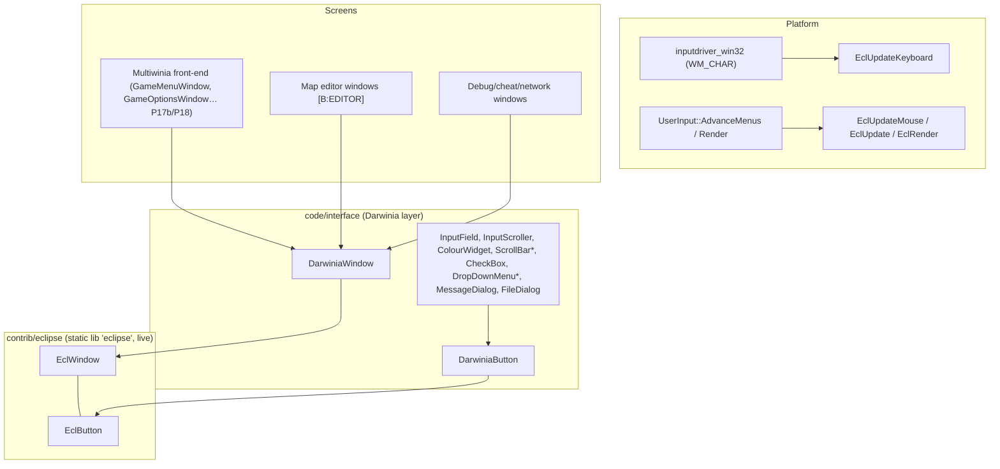
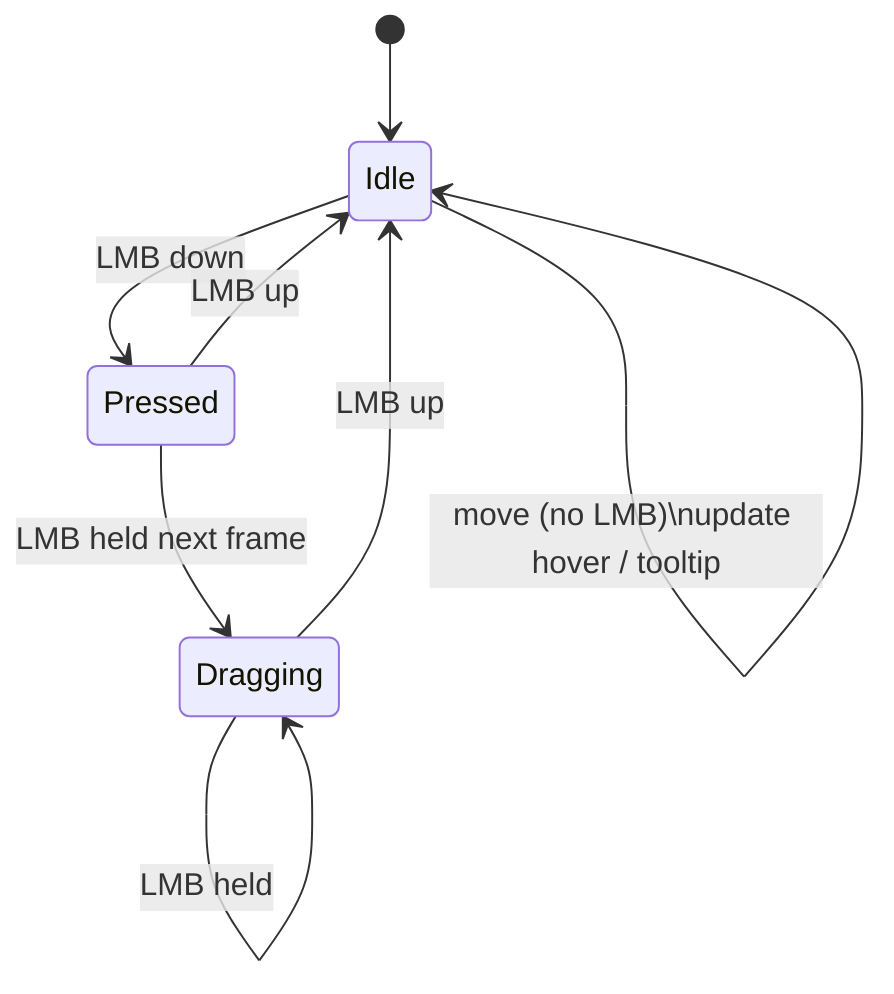

# P17a_ui_framework_editor — Window framework (Eclipse + Darwinia layer), map editor, debug windows

Scope: `contrib/eclipse/{eclipse,eclwindow,eclbutton}.{h,cpp}`; `code/interface/{darwinia_window, input_field, scrollbar, checkbox, drop_down_menu, message_dialog, filedialog, multiwinia_filedialog, multiwinia_window, editor_window, buildings_window, camera_anim_window, camera_mount_window, landscape_window, lights_window, globalworldeditor_window, instant_unit_window, tree_window, invalidcrates_window, cheat_window, debugmenu, network_window, gesture_window, grabber_window}.{h,cpp}`; `code/location_editor.{h,cpp}` (56 files, 12 237 lines, all read in full). Build baseline: see `build_matrix.md` (`Release|Win32` + `TARGET_PC_FULLGAME`; `LOCATION_EDITOR` off in every target).

Supporting files read outside scope (to resolve reachability/semantics, not re-specified here): `code/main.cpp` (editor loops), `code/user_input.cpp` (Eclipse pump + debug hot-keys), `code/lib/input/inputdriver_win32.cpp` (WM_CHAR routing), `data/input/input_preferences.txt` (bindings), `code/network/networkvalue.{h,cpp}` (value binding), `code/lib/text_renderer.{h,cpp}` (font blend modes), `code/lib/language_table.{h,cpp}` (`LookupPhrase` fallback), `contrib/systemiv/lib/unicode/unicode_string.cpp` (`Truncate`), `contrib/systemiv/lib/tosser/llist.cpp` (`GetData` null on bad index), `code/interface/multiwiniaoptions_window.cpp` (editor "Other Options" window, P17b file), `code/UI/MultiwiniaEditorButton.h`, `code/UI/GameMenuWindow.cpp` (editor button gating), `code/interface/mainmenus.{h,cpp}` (`GameOptionsWindow`, `MultiwiniaButton`), `code/game_menu.cpp` (layout helpers), `code/level_file.h`, `code/landscape.cpp`, `code/location.cpp:Location::GetBuilding`, `code/global_world.cpp:GlobalWorld::Advance`, `targets/vs2005/Darwinia.vcproj`, `contrib/eclipse/eclipse.vcproj`.

Generated table: `OUT/_work/drafts/P17a_ui_framework_editor_ui_strings.csv` (221 rows: every `LANGUAGEPHRASE` key with English text, every literal `UnicodeString("…")` caption, every `CreateValueControl` name key in scope) produced by `OUT/_work/scripts/P17a_ui_strings.py`.

---

## [→ 28_ui_framework] 1. Layering and build status



| Component | Files | Compiled in FULL? | Reachable in FULL? | Tag |
|---|---|---|---|---|
| Eclipse core | `contrib/eclipse/*` | Yes — separate static-lib project `eclipse` linked by `Darwinia.sln`; compiled with only `WIN32;NDEBUG;_LIB;_CRT_SECURE_NO_DEPRECATE;TARGET_MSVC` and include path `..\..\code;..\..\contrib\SystemIV` (so `lib/…` resolves to `code/lib` first) [C] `contrib/eclipse/eclipse.vcproj` | Yes (every window) | [B:FULL] |
| DarwiniaWindow/Button family | `darwinia_window.*` | Yes [C] vcproj | Yes | [B:FULL] |
| InputField / InputScroller / ColourWidget / ColourWindow | `input_field.*` | Yes | InputField yes (subclassed by `GameMenuInputField`, `ChatInputField`, `AuthInputField`, P17b/P18); InputScroller/ColourWidget only via `CreateValueControl`/`CreateColourControl` callers (editor, sound editor) | [B:FULL] (scroller/colour: effectively editor/debug) |
| ScrollBar | `scrollbar.*` | Yes | Yes (`GameMenuWindow`, `HelpAndOptions`, `SoundStatsWindow`) [C] grep `new ScrollBar` | [B:FULL] |
| CheckBox | `checkbox.*` | Yes | Yes (subclassed by `GameMenuCheckBox`, `code/game_menu.h`) | [B:FULL] |
| DropDownMenu | `drop_down_menu.*` | Yes | Yes (`GameMenuDropDown`, `ControlMethodDropDownMenu`) | [B:FULL] |
| MessageDialog | `message_dialog.*` | Yes | Yes — `Renderer` resolution-failure dialog (`code/renderer.cpp`), sound-settings failure (`code/sound/soundsystem.cpp`), "Restart Required" (`code/interface/prefs_screen_window.cpp`) [C] | [B:FULL] |
| FileDialog | `filedialog.*` | Yes | Only from editor landscape window and sound editor | [B:EDITOR]/[B:DEBUG] usage |
| MultiwiniaFileDialog, MultiwiniaWindow, NewMapWindow | `multiwinia_filedialog.*`, `multiwinia_window.*` | Yes (no `#ifdef`) [C] | **No** — see §E1 | [B:EDITOR] (compiled-in, unreachable in FULL) |
| LocationEditor + editor windows | `location_editor.*`, `editor_window.*`, `buildings_window.*`, `camera_anim_window.*`, `camera_mount_window.*`, `landscape_window.*`, `lights_window.*`, `instant_unit_window.*`, `tree_window.*` | Bodies wrapped in `#ifdef LOCATION_EDITOR` → compile to empty TUs [C] | No | [B:EDITOR] |
| InvalidCratesWindow | `invalidcrates_window.*` | Yes (no `#ifdef`) | No (only `LocationEditor::CreateEditWindowForMode` creates it) | [B:EDITOR] (compiled-in) |
| GlobalWorldEditorWindow | `globalworldeditor_window.*` | Yes (no `#ifdef`) | No (only `GlobalWorldEditorLoop`, which needs `m_editing`) | [B:LEGACY] (Darwinia world editor) |
| DebugMenu ("Tools Menu") | `debugmenu.*` | Yes | No — only opener `DebugKeyBindings::DebugMenu` has no live caller (`code/user_input.cpp:UserInput::AdvanceMenus` F1 call commented out) [C] | compiled, unreachable |
| DebugKeyBindings::NetworkButton | `debugmenu.cpp` | Yes | **Yes** — `ToggleNetworkStats` (F9) under `NETWORK_STATS_ENABLED` (on in FULL) [C] `code/user_input.cpp:UserInput::Advance`, `data/input/input_preferences.txt` | [B:FULL] |
| NetworkWindow | `network_window.*` | Yes | **Yes** (F9) | [B:FULL] |
| CheatWindow | `cheat_window.*` | Yes, but `Create()` is empty unless `CHEATMENU_ENABLED` [C] | Only `TARGET_DEBUG` (F11) | [B:DEBUG] |
| GrabberWindow | `grabber_window.*` | `#ifdef AVI_GENERATOR` (TARGET_DEBUG only) | Not even in DEBUG — `DebugKeyBindings::GrabberButton` has no caller [C] grep | [B:DEBUG] (unreachable) |
| GestureWindow | `gesture_window.*` | `#if defined(GESTURE_EDITOR) && defined(USE_SEPULVEDA_HELP_TUTORIAL)` — the second macro is never defined | No | [B:DEAD] |

---

## [→ 28_ui_framework] 2. Eclipse core (`contrib/eclipse`)

"ECLIPSE version 2.0, Generic Interface Library" [C] `contrib/eclipse/eclipse.h` header comment. Immediate-mode-rendered, retained-hierarchy window manager. Exactly two levels: windows contain buttons; all button coordinates are relative to their window [C] `contrib/eclipse/eclwindow.h` comment.

### 2.1 Data model

**EclWindow** [C] `contrib/eclipse/eclwindow.h:EclWindow`, `eclwindow.cpp:EclWindow::EclWindow`

| Field | Type | Default | Meaning |
|---|---|---|---|
| `m_x, m_y, m_w, m_h` | int | 0 | Screen-space rect (pixels, origin top-left) |
| `m_name` | char[256] (`SIZE_ECLWINDOW_NAME`) | ctor arg | Unique key; **all lookups are by name string** |
| `m_title` | UnicodeString (≤256 chars, `SIZE_ECLWINDOW_TITLE`; longer titles silently rejected) | "New Window" | Title |
| `m_movable` | bool | true | Drag-to-move allowed |
| `m_resizable` | bool | true | Drag-edge-to-resize allowed |
| `m_dirty` | bool | false | Needs redraw (see §2.9) |
| `m_buttons` | `LList<EclButton*>` | empty | Owned children; **index 0 = most recently registered** (`PutDataAtStart`) |
| `m_currentTextEdit` | char[256] | "None" | Name of button currently receiving keystrokes |

Virtuals: `Create`, `Remove`, `Update`, `Render(bool hasFocus)`, `Keypress(keyCode, shift, ctrl, alt, ascii)`, `MouseEvent(lmb, rmb, up, down)`, `GetButton(name)`, `GetButton(x,y)`.

**EclButton** [C] `contrib/eclipse/eclbutton.h:EclButton`, `eclbutton.cpp`

| Field | Type | Default |
|---|---|---|
| `m_name` | char[256] (`SIZE_ECLBUTTON_NAME`) | "New Button" (names longer than 256 are silently ignored by `SetProperties`) |
| `m_x, m_y, m_w, m_h` | int (window-relative) | 0 |
| `m_caption`, `m_tooltip` | UnicodeString | caption empty, tooltip " " |
| `m_inactive` | bool | false (used by Darwinia keyboard navigation to skip) |
| `m_parent` (protected) | EclWindow* | NULL, set by `RegisterButton` |

Virtuals: `SetProperties(name,x,y,w,h,caption,tooltip)`, `SetCaption`, `SetTooltip`, `SetParent`, `Render(realX, realY, highlighted, clicked)`, `MouseUp`, `MouseDown`, `MouseMove` (never called by Eclipse), `Keypress`.

**Module globals** [C] `contrib/eclipse/eclipse.cpp` (file statics)

| Static | Initial | Role |
|---|---|---|
| `windows` (`LList<EclWindow*>`) | empty | Z-ordered window list, **index 0 = front-most** |
| `dirtyrects` (`LList<DirtyRect*>`) | empty | Accumulated dirty rectangles |
| `clearDraw` fn-ptr | NULL | Optional background-clear callback (never registered by Multiwinia) |
| `tooltipCallback` fn-ptr | NULL | Optional tooltip callback (never registered by Multiwinia) |
| `mouseX, mouseY, lmb, rmb` | 0/false | Last mouse state |
| `buttonDownMouseX/Y` | 0 | Position used to resolve the MouseUp target |
| `mouseDownWindowX/Y` | 0 | Grab offset for window dragging |
| `tooltipTimer` | 0 | ms timestamp when tooltip becomes due |
| `maximiseOldX/Y/W/H` | 0 | Saved rect for un-maximise |
| `mouseDownWindow`, `windowFocus`, `popupWindow`, `maximisedWindow` | "None" | Window-name state slots |
| `currentButton` | "None" | Highlighted/pressed button name |
| `screenW, screenH` | 0 | From `EclInitialise` |

The sentinel string `"None"` means "no window/button" everywhere [C].

### 2.2 Initialisation, pump and shutdown in Multiwinia

| Call | Where | Behaviour |
|---|---|---|
| `EclInitialise(screenW, screenH)` | `code/user_input.cpp:UserInput::UserInput` | Stores screen size; dirties full screen [C] |
| `EclUpdateMouse(x, y, lmb, rmb)` + `EclUpdate()` | `code/user_input.cpp:UserInput::AdvanceMenus`, once per `UserInput::Advance` | `lmb` = `ControlEclipseLMousePressed` (= `mouse left pressed`, i.e. level-held), `rmb` = `ControlEclipseRMousePressed` (= `mouse right down`, edge) [C] `data/input/input_preferences.txt`. After pumping, if `ControlEclipseLMouseDown` fired over any window, the event is suppressed (`suppressEvent`) so the game world does not also receive the click [C] |
| `EclUpdateKeyboard(keyCode, shift, ctrl, alt, ascii)` | `code/lib/input/inputdriver_win32.cpp` `WM_CHAR` case | `keyCode` **and** `ascii` are both the WM_CHAR character code (`wParam`), modifier flags from `g_keys` [C]. Consequence: key codes seen by widgets are *characters*, not virtual keys (see §4.1) |
| `EclRender()` | `code/user_input.cpp:UserInput::Render`, inside `g_editorFont.BeginText2D()/EndText2D()` with `GL_BLEND` on, cull off, depth test off, depth writes off | 2D ortho = viewport with −0.325 px offset (`code/lib/text_renderer.cpp:TextRenderer::BeginText2D`) [C] |
| `EclShutdown()` | `code/main.cpp` shutdown | Deletes all windows and dirty rects [C] |

Controller mouse emulation: `EclipseLMouseDown/Pressed` are additionally bound to `alias ShowMouseCursor && XInput a down/pressed`, `ShowMouseCursor = XInput leftbumper pressed` [C] `data/input/input_preferences.txt`.

### 2.3 Registration, removal and z-order [C] `contrib/eclipse/eclipse.cpp`

`EclRegisterWindow(window, parent=NULL)`:
1. (No duplicate check — the `if (EclGetWindow(name))` block is empty; duplicate names are allowed but only the front-most is findable.)
2. If `parent` given **and** window is at (0,0): auto-place using `AppRandom()`:
   - `left = screenW/2 − parent.x`; `above = screenH/2 − parent.y`
   - `x = left > w/2 ? parent.x + parent.w·r1 : parent.x − w·r1`
   - `y = above > h/2 ? parent.y + parent.h·r2 : parent.y − (h/2)·r2`, with `r = AppRandom()/APP_RAND_MAX`.
   (`AppRandom` is the local, non-synchronised RNG — distinct from `syncrand`/`syncfrand` — so this placement does not affect lockstep [C] `contrib/systemiv/lib/math/random_number.h`.)
3. `MakeAllOnScreen()`: clamp `x,y ≥ 0`, then `x ≤ screenW−w`, `y ≤ screenH−h` (so a window larger than the screen ends with negative origin).
4. `windows.PutDataAtStart(window)` → **new windows are always front-most**.
5. `window->Create()` (subclasses build buttons here).
6. `EclDirtyWindow(window)`.

`EclRemoveWindow(name)`: finds by name; dirties its rect; removes from list; clears `mouseDownWindow`/`windowFocus` if they named it; `delete window` (destructor deletes all its buttons). Unknown names are a silent no-op.

`EclBringWindowToFront(name)`: move to index 0 and dirty. Called on every left-press on a window (§2.4).

`EclSetWindowPosition(name,x,y)`: dirty old rect, move, dirty new rect. `EclSetWindowSize(name,w,h)`: `Remove()`, dirty, set size, **`Create()` again** (all buttons rebuilt), dirty. Contrast `EclWindow::SetPosition/SetSize`, which only assign and dirty (no rebuild).

`EclWindow::RegisterButton(b)`: `b->SetParent(this)`; `m_buttons.PutDataAtStart(b)`; **auto-grow**: if `b.y + b.h + 10 > m_h` then `SetSize(m_w, b.y + b.h + 10)` and `MakeAllOnScreen()`; dirty. Windows therefore grow downward to fit content and are pushed up to stay on-screen [C] `eclwindow.cpp:EclWindow::RegisterButton`.

`EclWindow::RemoveButton(name)`: iterates from the back, deletes the **first** match and breaks — despite the comment "removing ALL buttons with this name" [C]. `EclWindow::GetButton(name)` returns the first match from index 0, i.e. the most recently registered button with that name.

`EclGenerateUniqueWindowName(name)`: returns `name`, `name2`, `name3`, … first unused, in a static buffer [C]. Unused by `code/` [C] grep.

### 2.4 Hit testing

- `EclGetWindow(x,y)`: first window from index 0 (front) with `x ∈ [m_x, m_x+m_w]` and `y ∈ [m_y, m_y+m_h]` — **inclusive** of the far edges [C].
- `EclWindow::GetButton(x,y)` (window-relative): first button from index 0 with inclusive bounds [C]. Overlapping buttons: the later-registered wins input and is drawn on top (render iterates back-to-front, §2.9).
- `EclMouseInButton(window, button)`: window must be the top window under the mouse **and** mouse within the button's inclusive rect [C].
- `EclMouseInWindow(window)`: `EclGetWindow(mouseX, mouseY) == window`.

### 2.5 Mouse state machine [C] `contrib/eclipse/eclipse.cpp:EclUpdateMouse`

Every call first dirties the window under the cursor. Then exactly one LMB branch runs (comparing new `_lmb` with stored `lmb`); RMB branches are empty stubs (right-click is ignored by Eclipse).



| Branch | Condition | Actions |
|---|---|---|
| **Move/hover** | `!_lmb && !lmb && !_rmb && !rmb` | Only the *focused* window is considered. Button under cursor: if name ≠ `currentButton` → `currentButton = name`, dirty window, `tooltipTimer = now + 1000 ms`; else if `now > tooltipTimer` → `tooltipCallback(window, button)` (every frame while hovering). No button: if `currentButton ≠ "None"` → reset to "None", dirty, `tooltipCallback(NULL,NULL)`. No focused window: same reset. (So hover tracking only happens inside the focused window; un-focused windows still get visual hover via `EclMouseInButton` in rendering.) |
| **LMB down** (edge) | `_lmb && !lmb` | `buttonDownMouse = mouse`. Window under cursor: dirty old focus, **focus = this window**, **bring to front**, `mouseDownWindow = this`. Button under cursor → `currentButton = name`, `button->MouseDown()`. No button → `currentButton = "None"`, `window->MouseEvent(lmb=true, rmb=false, up=false, down=true)`, and if movable record grab offset `mouse − window.xy`. No window under cursor: focus = "None". Set `lmb = true`. |
| **LMB drag** (held) | `_lmb && lmb` | `buttonDownMouse = mouse` (**updated every frame**). If `mouseDownWindow` valid: button under cursor → `button->MouseDown()` **again (every frame)**. Else if `currentButton == "None"` (press began on background): resize test on *previous* mouse pos: within ±4 px (exclusive) of bottom edge → `newH = mouseY − y`; within ±4 px of right edge → `newW = mouseX − x`; if either and window resizable → clamp `newW ≥ 60`, `newH ≥ 40`, `EclSetWindowSize` (→ Remove/Create rebuild every frame of the drag). Otherwise if movable → `EclSetWindowPosition(mouse − grabOffset)` (no clamping to screen while dragging). |
| **LMB up** (edge) | `!_lmb && lmb` | `mouseDownWindow = "None"`, `lmb = false`. Window under **last `buttonDownMouse`**: button there → dirty, `button->MouseUp()`; no button → `window->MouseEvent(lmb, rmb, up=true, down=false)` then `EclRemovePopup()`. No window → `EclRemovePopup()`. |

Design-relevant consequences [C-derived]:
- **`MouseUp` is the "click" event** and fires on whichever button lies under the release point — the press need not have started on it (no capture-and-cancel semantics). A new implementation should capture on press and fire click only if released over the same widget (or deliberately preserve this behaviour).
- **`MouseDown` is a held/repeat event** (called on the press frame and on every frame the button is held over that button); widgets that want an edge must test `ControlEclipseLMouseDown` themselves (as `InputScroller::MouseDown` does).
- There is **no mouse capture**: dragging a widget (e.g. scroll thumb) only continues while the cursor stays over that widget.
- Window dragging only starts when the press lands on the window background (not on a button).
- `MouseEvent` is the only window-level mouse hook; no Darwinia window overrides it in scope.

### 2.6 Focus rules

| Event | Focus result | Ref |
|---|---|---|
| LMB press on a window | that window (and it goes to front) | [C] `EclUpdateMouse` |
| LMB press on empty screen | "None" | [C] |
| `DarwiniaWindow` constructed | `EclSetCurrentFocus(m_name)` — new Darwinia windows take focus at construction (before registration) | [C] `code/interface/darwinia_window.cpp:DarwiniaWindow::DarwiniaWindow` |
| `DarwiniaWindow` destroyed | focus = name of `windows[0]` if any (the window has already been unlinked by `EclRemoveWindow`, so this is the new front window) | [C] `DarwiniaWindow::~DarwiniaWindow` |
| `EclRemoveWindow` of focused window | "None" (then the Darwinia destructor above re-assigns) | [C] |
| `EclMaximiseWindow(name)` | that window | [C] |
| `EclSetCurrentFocus(name)` | name (if `< 256` chars; no existence check) | [C] |

Only the focused window receives keyboard input (§2.7), hover/tooltip tracking (§2.5) and Darwinia controller navigation (§3.3). `EclRender` passes `hasFocus = (name == windowFocus)`; `clicked` highlighting in `EclWindow::Render` requires focus.

### 2.7 Keyboard routing

`EclUpdateKeyboard(...)` → focused window's `Keypress(...)` → default `EclWindow::Keypress` forwards to the button named `m_currentTextEdit` (if any) [C] `eclwindow.cpp:EclWindow::Keypress`. `BeginTextEdit(name)` / `EndTextEdit()` set/reset that name. `EclIsTextEditing()` = focused window exists and its `m_currentTextEdit ≠ "None"` — used by chat/lobby code to stop game hot-keys while typing [C] `code/interface/chatinput_window.cpp`, `code/UI/GameMenuWindow.cpp`. There is no tab-order or focus-traversal at the Eclipse level; keyboard navigation between buttons is a Darwinia-layer feature driven by controller bindings (§3.3, §6).

### 2.8 Popups and maximise

- `EclRegisterPopup(w)`: remove existing popup, record name, register. `EclRemovePopup()` is called on every LMB-up that does not land on a button (including clicks on any window background) and on clicks outside all windows → popups close on any non-button click [C]. No Multiwinia code registers popups [C] grep (drop-down menus use their own singleton, §4.6).
- `EclMaximiseWindow(name)`: saves rect, sets focus/mouseDown, `SetPosition(0,0)`, `SetSize(screenW, screenH)` (no rebuild). `EclRender` then renders only that window after calling `clearDraw(...)` — **`clearDraw` is NULL in Multiwinia, so maximising would crash** [C/I]; unused in `code/` [C] grep. `EclUnMaximise` restores and dirties full screen.

### 2.9 Dirty rectangles and render order

- `EclDirtyRectangle(x,y,w,h)` allocates a `DirtyRect`, appends to `dirtyrects`, and marks every overlapping window dirty (`EclRectangleOverlap` treats touching edges as overlapping: `maxtop <= minbottom && maxleft <= minright`).
- `EclDirtyWindow(w)`: if not already dirty → dirty + add its rect.
- `EclRender()` (non-maximised): calls `clearDraw` for each dirty rect if registered (never in Multiwinia), then **for i = Size−1 down to 0** renders each window whose `m_dirty` is set → back-most first, front-most last (painter's order). The line that would clear `m_dirty` after rendering is commented out [C].
- `EclResetDirtyRectangles()` (frees rects, clears flags) is never called from `code/` [C] grep.

Net effect in Multiwinia [C-derived]: every window is dirty from registration onward and is **re-rendered every frame**; the dirty-rect list grows by one entry per `EclSetWindowPosition`/`SetWindowSize`/`RemoveWindow`/`EclDirtyRectangle` call and is only freed at `EclShutdown` (unbounded but small leak, e.g. while dragging a window). A new implementation should treat the UI as fully immediate-mode redraw each frame and drop dirty rectangles entirely.

### 2.10 Tooltips

Tooltip delay **1000 ms** of hovering the same button in the focused window (`EclGetAccurateTime()` = Win32 `GetTickCount()`, ms) [C]. The callback mechanism exists but `EclRegisterTooltipCallback` is never called in `code/` → **no tooltips are ever shown**; `m_tooltip` strings (e.g. "Close this window", "Value left") are dead data [C] grep.

### 2.11 Remaining API surface

| Function | Behaviour | Used in code/ |
|---|---|---|
| `EclGetWindowIndex(name)` | index or −1 | internal |
| `EclGetWindows()` | pointer to the z-ordered list | yes (`RemoveAllWindows`, `WindowsOnScreen`, cheat hot-key) |
| `EclGetCurrentButton()` | `currentButton` | no |
| `EclGetCurrentClickedButton()` | `currentButton` if LMB held else "None" | yes (`EclWindow::Render`, `GameMenuWindow`) |
| `EclGetCurrentFocus()/EclSetCurrentFocus()` | §2.6 | yes |
| `EclGetAccurateTime()` | `GetTickCount()` (Win32) / `gettimeofday` ms since first call (other) | internal |
| `EclGetScreenW/H()` | stored size | internal |
| `EclRegisterClearFunction`, `EclGetDirtyRects`, `EclResetDirtyRectangles`, `EclRegisterTooltipCallback`, `EclMaximiseWindow`, `EclUnMaximise`, `EclRegisterPopup`, `EclRemovePopup` (external), `EclGenerateUniqueWindowName` | §2.8–2.10 | no |

`main.cpp` helpers built on Eclipse [C] `code/main.cpp`: `WindowsOnScreen()` = list non-empty; `RemoveAllWindows()` = (if in a location, warp cursor to screen centre) then remove windows[0] until empty.

### 2.12 Eclipse defects/quirks to not replicate

| # | Quirk | Ref |
|---|---|---|
| Q1 | Click fires on release target, not press target; no capture | `EclUpdateMouse` |
| Q2 | `MouseDown` fires every held frame | `EclUpdateMouse` drag branch |
| Q3 | Dirty flags never cleared; dirty-rect list leaks | `EclRender`, `EclDirtyRectangle` |
| Q4 | Resize rebuilds all buttons every drag frame (`Remove`+`Create`) — widget state not stored outside the window is lost | `EclSetWindowSize` |
| Q5 | `RemoveButton` removes only one of several same-named buttons | `EclWindow::RemoveButton` |
| Q6 | Name-keyed lookup everywhere; duplicate names silently shadow | `EclRegisterWindow`, `GetButton` |
| Q7 | `EclButton::SetProperties` tests `!&_caption` (address of a reference — always false), so the "caption defaults to name" fallback never triggers at this level | `eclbutton.cpp:EclButton::SetProperties` |
| Q8 | Tooltip machinery present but unregistered | §2.10 |
| Q9 | Maximise path dereferences NULL `clearDraw` | `EclRender` |

---

## [→ 28_ui_framework] 3. Darwinia layer: `DarwiniaWindow` and `DarwiniaButton` (`code/interface/darwinia_window.*`) [B:FULL]

### 3.1 DarwiniaWindow fields [C] `code/interface/darwinia_window.h:DarwiniaWindow`

| Field | Type | Default | Meaning |
|---|---|---|---|
| `m_buttonOrder` | `LList<EclButton*>` | empty | Ordered list for controller/keyboard navigation; **opt-in** — screens must `PutData` each navigable button (editor windows never do) |
| `m_currentButton` | int | 0 | Index into `m_buttonOrder` of the navigation cursor |
| `m_buttonChangedThisUpdate` | bool | false | Set when navigation moved this update (cancels mouse-hover highlight) |
| `m_skipUpdate` | bool | false | One-shot: skip the next `Update` (then auto-clears) |
| `m_closeable` | bool | true | Whether `MenuClose` triggers `m_backButton` |
| `m_lockMenu` | bool | false | When true `Update` returns immediately (navigation frozen) |
| `m_details` | `InputDetails` | default | Details of the last activate event (re-initialised each update) |
| `m_backButton` | EclButton* | NULL | Button whose `MouseUp` is invoked by `MenuClose` |

Constructor [C] `DarwiniaWindow::DarwiniaWindow`: title = `LANGUAGEPHRASE(name)` if the language table exists else the raw name, then `StrUpr()` (upper-cased); `EclSetCurrentFocus(name)`. Because `LangTable::LookupPhrase` returns the key itself when missing [C] `code/lib/language_table.cpp:LangTable::LookupPhrase`, window names double as phrase keys with a readable fallback. **However the title is never drawn** when a language table exists — see §3.4.

### 3.2 Create / Remove / client rect / scaling

- `Create()`: registers a `CloseButton` named `"Close"` at `(m_w−12, 2, 10, 10)`, caption "Close", tooltip "Close this window", `m_iconised = true` [C] `DarwiniaWindow::Create`. Subclasses that do not call the base `Create` (e.g. `MessageDialog`, `MainEditWindow`, `LandscapeGuideGridWindow` calls it *last*) have no or a late close box.
- `Remove()`: remove buttons one by one by name until none remain; empty `m_buttonOrder`; `m_currentButton = 0`; `EndTextEdit()` [C].
- Client rect: `X1 = 2`, `X2 = m_w − 2`, `Y1 = GetMenuSize(15) + 1`, `Y2 = m_h − 2` [C].
- **Large-menu scaling** [C] `DarwiniaWindow::GetMenuSize`, `SetMenuSize`: when `g_app->m_largeMenus` (set iff preference `LargeMenus == 2`, [C] `code/app.cpp`; also toggled from Other Options, `code/interface/prefs_other_window.cpp`):
  `scale = 0.96 × screenH / 460`; `GetMenuSize(v) = (int)(v × scale)`; `SetMenuSize(w,h)` multiplies both by `scale` before `SetSize`. Otherwise identity.

### 3.3 Update: controller/keyboard navigation [C] `DarwiniaWindow::Update`

Executed every frame by `EclUpdate` for every window, but navigation acts only on the focused window:

```text
if m_lockMenu: return
m_buttonChangedThisUpdate = false
if m_skipUpdate: m_skipUpdate = false; return
if focus == me:
  if m_buttonOrder non-empty:
    if MenuDown:   b = m_buttons[m_currentButton]   # NB indexes m_buttons, not m_buttonOrder (bug)
                   if !b or !b.SpecialScroll(+1):
                     changed = true; advance index cyclically (wrap to 0), skipping m_inactive,
                     at most Size+1 steps
    if MenuUp:     same with -1 (wrap to Size-1); loop counter never incremented → infinite loop
                   if every entry is m_inactive (bug)
  m_details = InputDetails()
  if (atMainMenu and MainMenuActivate) or MenuActivate: m_buttonOrder[m_currentButton].MouseUp()
  if m_closeable and MenuClose and m_backButton: m_backButton.MouseUp()
```

`SpecialScroll(direction)` is a hook (default returns false) letting a widget consume up/down (e.g. lists that scroll internally) [C] `DarwiniaButton::SpecialScroll`.

`SetCurrentButton(b)`: set `m_currentButton` to `b`'s index in `m_buttonOrder` if present, else unchanged [C].

### 3.4 Window chrome rendering [C] `DarwiniaWindow::Render`

Order and exact parameters (all coordinates screen pixels):

| Step | Primitive | Colour / state |
|---|---|---|
| 1 Body | Textured quad over full rect, texture `textures/interface_red.bmp` (actual asset 64×510, 8-bit [C] file header), min filter `GL_LINEAR_MIPMAP_LINEAR`, mag `GL_LINEAR`, wrap `GL_REPEAT` both axes; tex-coords s∈[0, 8] (code assumes a 512×64 image: `texW = 1.0 × 512/64`), t∈[0,1] | `glColor4f(1,1,1,0.96)`; blend func inherited (normally `SRC_ALPHA, ONE_MINUS_SRC_ALPHA`, restored by the text renderer after each string [C] `code/lib/text_renderer.cpp`) |
| 2 Title bar | Quad from `m_y` to `m_y + (GetClientRectY1() − 1)` = `GetMenuSize(15)` px high, smooth shaded | top `(199,214,220,255)` → bottom `(112,141,168,255)` |
| 3 Border | Four 2 px lines on the rect edges | `(199,214,220,255)` |
| 4 Outer frame | 1 px line loop at `(x−2, y−2)…(x+w+1, y+h+1)` | `(42,56,82,255)` |
| 5 Title text | `g_gameFont` ("speccy" font), shadow mode on, centred at `x + w/2`, baseline `y + 9` (large menus: `y + fontSize/2`), size `GetMenuSize(12)`, drawn **twice** | `glColor4ub(255,255,150,30)`; text = `LANGUAGEPHRASE("multiwinia_mainmenu_title")` ("MULTIWINIA") whenever a language table exists, **ignoring `m_title`** (original title-draw lines are commented out); `m_title` only when no language table |
| 6 Buttons | `EclWindow::Render` → each button back-to-front with `highlighted = EclMouseInButton || name == m_currentTextEdit`, `clicked = hasFocus && name == EclGetCurrentClickedButton()` | — |

Text blend modes (from `TextRenderer`, [C] `code/lib/text_renderer.cpp`): normal text `GL_SRC_ALPHA, GL_ONE` (additive); shadow/outline text `GL_SRC_ALPHA, GL_ONE_MINUS_SRC_COLOR` (darkening "ink" over light backgrounds); after drawing, `GL_SRC_ALPHA, GL_ONE_MINUS_SRC_ALPHA` is restored. Fonts: `g_gameFont = "speccy"`, `g_editorFont = "editor"` (horizontal spacing factor 0.91), `g_titleFont = "square"` (spacing 1.03); for chinese-trad/simp, korean, japanese both game and editor fonts are replaced by copies of the title font [C] `code/app.cpp` font init. Font atlas/glyph details: see 24/25 (P12/P13).

### 3.5 DarwiniaButton [C] `DarwiniaButton::*`

Fields: `m_fontSize` 11.0, `m_centered` false, `m_disabled` false, `m_highlightedThisFrame` false, `m_mouseHighlightMode` false.

`SetShortProperties(name, x, y, w, h, caption, tooltip)`: caption defaults to `UnicodeString(name)` if empty; `w == −1` → `captionLength × 7 + 9` (or `strlen(name) × 7 + 9` if caption empty); `h == −1` → 15; then `SetProperties`.

`UpdateButtonHighlight()` (called from `Render`): if the parent changed button via navigation this update → `m_mouseHighlightMode = false`. If the mouse is in the button **and** input mode is `INPUT_MODE_KEYBOARD`: on entry (first frame) → `parent->SetCurrentButton(this)`, `m_highlightedThisFrame = m_mouseHighlightMode = true`; when the mouse leaves → `m_highlightedThisFrame = false`.

Highlight decision in `Render`: `highlighted` from Eclipse is discarded unless `m_mouseHighlightMode`; forced true if this button is `m_buttonOrder[m_currentButton]` (navigation cursor). So mouse-hover and controller cursor share one visual state.

| State | Background | Edges | Caption |
|---|---|---|---|
| normal | quad `(107,37,39,64)` | 1 px: left+top `(100,34,34,200)`, right+bottom `(0.1,0,0,1)` | white `(1,1,1,1)` additive; disabled `(0.5,0.5,0.5,1)` |
| highlighted | smooth vertical gradient `(199,214,220,255)`→`(112,141,168,255)` | none | shadow mode, `(255,255,150,30)` drawn twice; disabled `(128,128,75,30)` |
| clicked | gradient `(255,255,255,255)`→`(162,191,208,255)` | none | as highlighted |

Caption font `g_editorFont`, size `m_fontSize` (not menu-scaled), baseline `y = 7.5 + realY + (m_h − m_fontSize)/2`, x = `realX + 5` or centred at `realX + m_w/2`. `SetDisabled(b)` only affects colours — **disabled buttons still receive `MouseUp`** (each subclass must check `m_disabled`, as `DropDownMenu::MouseUp` does) [C].

### 3.6 DarwiniaButton subclasses in `darwinia_window.*` [C]

| Class | Behaviour | Render |
|---|---|---|
| `BorderlessButton` | `SetShortProperties`: auto-width from **name** length only (`strlen(name)×7+9`), h 15, no caption fallback | Forced "clicked" when it is the nav cursor. Clicked: gradient as DarwiniaButton highlight, shadow caption `(255,255,150,30)` ×2. Otherwise: no fill; if `highlighted` → calls `parent->SetCurrentButton(this)` (render-time side effect) and draws 1 px edges left/top `(100,34,34,250)`, right/bottom black; caption white, plus an extra 50 %-alpha white pass when highlighted. Caption size `GetMenuSize(m_fontSize)`, baseline `realY + 10` |
| `CloseButton` | `MouseUp` → `EclRemoveWindow(parent)` | iconised: quad `(60,37,39,64)` (`(160,137,139,64)` when highlighted/clicked), edges left/top `(0,0,150,100)`, right/bottom `(0.1,0,0,1)`; non-iconised → DarwiniaButton look |
| `GameExitButton` | `MouseUp` → `m_atMainMenu = true; renderer->StartFadeOut()` | DarwiniaButton |
| `InvertedBox` | none (decorative inset panel) | quad `(0.05,0,0,0.4)`; top/left black, right/bottom `(100,34,34,150)` |
| `LabelButton` | none | caption only, editor font size 11.0 at `(realX+5, realY+10)`, white / grey if disabled |

### 3.7 Value-control factory [C] `DarwiniaWindow::CreateValueControl`, `RemoveValueControl`, `CreateColourControl`

`CreateValueControl(name, T *value, y, change, low, high, callback=NULL, x=-1, w=-1)` overloads map the pointer type to an `InputField` type:

| Pointer type | InputField type | Value object |
|---|---|---|
| `bool*` | `TypeBool` (but see defect F1 in §10: `RegisterBool` stores `TypeChar`) | `LocalBool` |
| `unsigned char*` | `TypeChar` | `LocalChar` |
| `int*` | `TypeInt` | `LocalInt` |
| `float*` | `TypeFloat` | `LocalFloat` |
| `double*` | `TypeDouble` | `LocalDouble` |
| `char*` (buffer) | `TypeString` — `high` is reused as the **buffer size** | `LocalString(buf, size)` |

Layout: `x` default 10; `w` default `m_w − 2x`. Field height `GetMenuSize(15)`. Label = `LANGUAGEPHRASE(name)` if the phrase exists else the raw name. For string types the field spans `w`; for numeric types it spans `w − 37` and two `InputScroller` buttons are added: `"<name> left"` at `(field.x + field.w + 5, y, 15, 15)` caption "<", `m_change = −change`; `"<name> right"` at `(+22)` caption ">", `m_change = +change`. `callback` (any DarwiniaButton) is "clicked" (`MouseUp`) on every value refresh (§4.1). `RemoveValueControl(name)` removes the field and both scrollers.

`CreateColourControl(name, int *rgba, y, callback, x=10, w=m_w−x)`: a `ColourWidget` of width `w − 13`, auto height (15) (§4.3).

---

## [→ 28_ui_framework] 4. Widgets

### 4.1 InputField (`code/interface/input_field.*`) [B:FULL]

`class InputField : BorderlessButton`. Fields: `m_buf` (UnicodeString display/edit buffer), `m_type` ∈ {`TypeNowt`=0, `TypeChar`, `TypeBool`, `TypeInt`, `TypeFloat`, `TypeDouble`, `TypeString`, `TypeUnicodeString`} [C] `input_field.h`, `m_value` (`NetworkValue*`), `m_ownsValue`, `m_inputBoxWidth`, `m_callback`.

**Binding** [C] `InputField::Register*`: each `Register*` asserts the field is unbound, wraps the caller's storage in a `Local*` adaptor (`LocalChar/Bool/Int/Float/Double` with `SetBounds(low, high)`; `LocalString(buf, size)`; `LocalUnicodeString(ref)`) that the field owns, or `RegisterNetworkValue(type, v)` (not owned — used by lobby option fields that write through `ClientToServer`, P15/P18). Default bounds `[0, 1.0e4]`. `NetworkValue` text conversions [C] `code/network/networkvalue.cpp`: int/bool/char → `"%d"`; float/double → `"%.2f"`; parse with `swscanf("%d"|"%lf")`, float/double results passed through `iv_trunc_low_nibble`; string `Set` = `snprintf(buf, size, "%s")` with forced terminator.

**Editing state machine**:

```mermaid
stateDiagram-v2
  [*] --> Display
  Display --> Editing: MouseUp (parent.BeginTextEdit(name))
  Editing --> Editing: printable char / digit / backspace
  Editing --> Display: Enter or Esc → parse m_buf into value, Refresh()
  Editing --> Display: parent window Remove() (EndTextEdit, no commit)
  Editing --> Display: MouseUp on another InputField of the same window (that field becomes the edit target; this one is NOT committed — its typed text is discarded at the next 1 s buffer refresh)
```



**Keypress** (`keyCode` = WM_CHAR character code, §2.2) [C] `InputField::Keypress`:

| Input | Effect |
|---|---|
| no active text edit in parent | ignored |
| `'%'` | ignored (protects printf-style text drawing) |
| Backspace (8) | delete last character (`Truncate(Length())` shrinks by one [C] `contrib/systemiv/lib/unicode/unicode_string.cpp:UnicodeString::Truncate`); string types write-through + `Refresh` |
| Enter (13) **or** Esc (27) | `EndTextEdit`; `m_value->FromUnicodeString(m_buf)`; `Refresh` — **Esc commits, it does not cancel** |
| `KEY_STOP` (190) | append "." (only reachable for character 190 "¾" under WM_CHAR — dead in practice [I]) |
| '0'–'9' (48–57) | append digit; string types write-through |
| 'A'–'Z' (65–90) on `TypeString` | append, lower-cased unless Shift held (so Caps-Lock letters become lower-case) |
| anything else, Ctrl not held | append the raw character (this is how '.', '-', lower-case letters arrive) |
| anything else with Ctrl held | ignored |

After every key `m_inputBoxWidth = len × 7 + 7` (`PIXELS_PER_CHAR = 7`).

**Validation** [C]: numeric fields accept any characters while typing; on commit the buffer is parsed with `swscanf`; on parse failure the stored value is unchanged and `Refresh` re-displays it. **Typed values are not clamped to the bounds** — only the scrollers apply `Bound()` [C] `NetworkValue::FromUnicodeString` vs `InputScroller::CheckInput`. String fields write-through on every keystroke (callback fires every keystroke). No maximum-length check beyond the target buffer's `snprintf` truncation.

`Refresh()`: `m_buf = value text`; if `m_callback` → `m_callback->MouseUp()` [C].

**Render** [C] `InputField::Render`:
- Edit well = right 40 % of the field (`m_w × 0.4`): quad `(0.1,0,0,0.5)`, top/left black lines, right/bottom `(100,34,34,150)`.
- Label via `BorderlessButton::Render` (forced highlighted while editing).
- Caret while editing: 1 px vertical line at `fieldX + WcsLen × 7 + 2` from `y+2` to `y+h−2`, visible when `fmod(time, 1.0) < 0.5` (1 Hz, 50 % duty).
- When not highlighted and in the first half of each second, `m_buf` is re-read from the value (external changes appear within ≤ 1 s).
- Value text: `g_editorFont` at `x = realX + m_w − GetMenuSize(m_inputBoxWidth) + 2`, `y = realY + 10`, size `GetMenuSize(DEF_FONT_SIZE = 12.0)` — i.e. right-aligned by estimated width.

### 4.2 InputScroller (hold-to-repeat increment buttons) [C] `InputScroller::*`

- `MouseDown` (called every held frame): only when `ControlEclipseLMouseDown` (edge) fires → `m_mouseDownStartTime = now − INTEGER_INCREMENT_PERIOD` (0.1 s), so the first step happens immediately.
- `CheckInput` (called from `Render` every frame): active if start time > 0, LMB still held (`ControlEclipseLMousePressed`), cursor inside the scroller (half-open rect). `change = m_change × (5 if ControlScrollSpeedup [Shift] held)`. `elapsed = now − start`.
  - `TypeChar`: if `elapsed > 0.1` → `v += change` (**no bound applied**), `start += 0.1` (→ 10 steps/s).
  - `TypeInt`, `TypeBool`: same cadence with `Bound()` clamp.
  - `TypeFloat`, `TypeDouble`: every frame `v = Bound(v + change × elapsed × 0.2)` — continuous and *accelerating* (rate grows linearly with hold time; frame-rate dependent).
  - Then `m_inputField->Refresh()` every active frame (fires the callback every frame).
- `MouseUp` → start = −1. Releasing outside the scroller leaves start > 0, so a later held press that drags back over it resumes stepping (quirk).

### 4.3 ColourWidget / ColourWindow [C] `input_field.cpp`

- `ColourWidget` (DarwiniaButton): renders normally plus a swatch quad `[w−30, w−5] × [4, h−3]` in the bound `int` reinterpreted as 4 bytes RGBA. `MouseUp` → new `ColourWindow("editor_coloureditor")`, `SetSize(200,100)`, registered with the widget's window as parent (random placement §2.3).
- `ColourWindow::Create`: base close box, then four value controls on the bytes: `editor_red` (y 25), `editor_green` (43), `editor_blue` (61), `editor_alpha` (79); step 1, range [0,255], width `m_w − 80`, sharing the widget's callback. Render adds a swatch `[w−60, w−10] × [25, h−10]`.

### 4.4 ScrollBar (`code/interface/scrollbar.*`) [B:FULL]

`ScrollBar` is a non-widget controller object that owns three buttons registered in a parent window (looked up by name each time) [C] `ScrollBar::Create`:

| Button | Name | Rect (window-relative) | Class |
|---|---|---|---|
| up | `"<name> up"` | `(x, y, w, 18)` | `ScrollChangeButton(−stepSize)` |
| track/thumb | `"<name> bar"` | `(x, y+18, w, h−36)` | `ScrollBarButton` |
| down | `"<name> down"` | `(x, y+h−18, w, 18)` | `ScrollChangeButton(+stepSize)` |

Model: `m_numRows` (content rows), `m_winSize` (visible rows), `m_currentValue` (first visible row). `SetCurrentValue(v)`: if `numRows ≤ winSize` → 0; else clamp to `[0, numRows − winSize]`; dirty parent. `ChangeCurrentValue(d)` = `SetCurrentValue(cur + d)`.

`ScrollBarButton::Render`: track quad `(85,93,78)`, outline `(187,187,187)`; thumb `barTop = h × cur/numRows`, `barEnd = min(h × (cur+win)/numRows, h−1)`; thumb colour `(50,55,120)` clicked, `(55,60,120)` highlighted, `(65,71,120)` normal, inset 1 px left/top. (Division by `numRows` = 0 when the list is empty → NaN/inf rect [I].)

Interaction [C]:
- `MouseDown` (every held frame): if not grabbing and the cursor is within the thumb → `grabOffset = winSize × (mouseY − barTop)/(barEnd − barTop)` (int rows). If grabbing → `value = floor((mouseY − trackTop)/h × numRows) − grabOffset`.
- `MouseUp`: if not grabbing → page: cursor above thumb → `−winSize`; below → `+winSize` (the `barEnd` clamp compares an absolute screen y against `m_h`, so effectively any click not above the thumb pages down — benign because thumb clicks set a grab first). If grabbing → stop grab.
- `ScrollChangeButton::MouseDown` → `ChangeCurrentValue(amount)` **every held frame** (frame-rate-dependent auto-repeat, no initial delay). Render: DarwiniaButton look plus `icons/selectionarrow.bmp` (64×64, [C]) quad inset 5 %, flipped vertically for the up arrow, white, with `glBlendFunc(SRC_ALPHA, ONE)` additive and depth writes off — **blend mode is left additive afterwards** (state leak) [C].
- `Remove()` unregisters the three buttons. The object itself is owned by the parent window class (deleted in its destructor).

### 4.5 CheckBox (`code/interface/checkbox.*`) [B:FULL]

Binds a `NetworkBool*` via `RegisterBool(bool*)` (owned `LocalBool`), `RegisterInt(int*)` (owned `LocalIntAsBool`), `RegisterNetworkInt(NetworkInt*)` (owned `NetworkIntAsBool` adaptor), `RegisterNetworkBool(NetworkBool*)` (not owned); the first registration wins, later calls are ignored [C]. `MouseUp` → `Toggle()` (`v = !v`); `Set(int|bool)`; `IsChecked()` (false if unbound).

Render [C] `CheckBox::Render`: highlighted → full-rect quad `(199,214,220,255)` with `SRC_ALPHA, ONE_MINUS_SRC_ALPHA`, caption in shadow mode with alpha 0 (ink cut-out); normal → white additive caption. Caption at `(x+5, y + h/2 − fontSize/2 + 7)`. Box: side `s = 0.75h` at `x = right − 2s`, `y = top + (h − s)/2`, grey `(0.3,0.3,0.3,1)` fill, white 1 px outline; when checked a tick texture `icons/tick.bmp` (50×50 32-bit [C]) tinted `(0.6,1.0,0.4,1)` inset `0.05h`, size `0.65h`.

### 4.6 DropDownMenu (`code/interface/drop_down_menu.*`) [B:FULL]

Classes [C]: `DropDownOptionData {char *m_word; int m_value}`; `DropDownMenu : DarwiniaButton`; `DropDownWindow : DarwiniaWindow` (the open list; **process-wide singleton** `s_window`); `DropDownMenuOption : BorderlessButton` (one per row).

Option list: `AddOption(word, value = INT_MIN)` — `INT_MIN` means "auto": `value = m_nextValue++` (counter increments in *call order*, independent of sorting). If constructed with `_sortItems = true`, the option is inserted before the first existing option that compares greater with `stricmp` (case-insensitive, stable for ties); else appended. `Empty()` clears and resets the counter. So a sorted menu displays alphabetically while values still follow insertion order (used to keep enum values correct, e.g. laser-fence modes §E4.7).

Selection: `SelectOption(value)`: `m_currentOption = FindValue(value)` (index or −1); caption = `LANGUAGEPHRASE(m_name)` if not found, else `LANGUAGEPHRASE(word)` if `word` is a phrase key, else raw word; **always** writes `*m_int = value` (even if not found). `SelectOption2(word)` selects by case-insensitive word. `GetSelectionValue()` (−1 if none), `GetSelectionName()` (LANGUAGEPHRASE of word; bounds check uses `>` — off-by-one). `RegisterInt(int*)` (owned `LocalInt`) / `RegisterNetworkInt(NetworkInt*)` bind storage and immediately `SelectOption(current)` — callers that register before adding options get the "not found" caption until re-selected.

Open/close [C] `DropDownMenu::CreateMenu`, `MouseUp`, `IsMenuVisible`:
- `MouseUp` (ignored if `m_disabled`): toggle; "visible" ≡ a window named exactly the menu button's `m_name` exists.
- `CreateMenu`: `DropDownWindow::CreateDropDownWindow(name = menu name, parent = owning window name)` removes any previous drop-down first (one open list at a time); positioned at `(parent.x + m_x + m_w, parent.y + m_y)` (to the right of the button); registered (front-most, takes focus).
  - Columns: `numCols = 1 + int((m_h × N) / (screenH × 0.8))`; `perCol = ceil(N / numCols)`.
  - Option `index` at `(col × m_w + 2, (row + 1) × m_h)`, size `(m_w − 4, m_h)`, named `"<menu> <index>"`, caption = **raw `m_word`** (keys are *not* translated inside the open list — they are only translated in the closed button caption) [C], added to the window's `m_buttonOrder`; the option whose value equals the current selection becomes the nav cursor.
  - Window size `(m_w × numCols, (perCol + 1) × m_h)` (row 0 is under the title bar).
- `DropDownWindow::Update`: base navigation, then self-removes if its parent window no longer exists.
- `DropDownMenuOption::MouseUp` → `menu->SelectOption(m_value)`, `menu->RemoveMenu()`. Render: BorderlessButton look, forced "clicked" when it is the nav cursor.
- Closed-button render: DarwiniaButton (forced highlighted while open) + white triangle `(w−12,5),(w−3,5),(w−7,9)`.

### 4.7 MessageDialog (`code/interface/message_dialog.*`) [B:FULL]

`MessageDialog(name, message)` [C]: splits `message` on `'\n'` into at most **20** lines (fixed array, no bound check → overflow on >20 lines); `m_w = g_editorFont.GetTextWidth(longestLineChars) + 10` where `GetTextWidth(n, size=13) = n × 13 × horizScale` (horizScale 0.6 for Latin/Cyrillic languages → 7.8 px/char, 1.0 for CJK → 13 px/char [C] `code/lib/text_renderer.cpp:TextRenderer::TextRenderer`, `code/app.cpp` font init), min 100; `m_h = 65 + lines × 12`, min 85; `SetMenuSize(w,h)`; centred on screen. `Create()` (does **not** call the base, so no close box): one `OKButton` named `"dialog_close"` captioned `LANGUAGEPHRASE("dialog_close")` ("Close"), `w = GetMenuSize(40)`, `h = GetMenuSize(18)`, at `((m_w − w)/2, m_h − GetMenuSize(30))`, font `GetMenuSize(11)`; `MouseUp` removes the dialog. Render: base chrome + each line with `g_editorFont` at `(x+10, y + GetMenuSize(32) + i × GetMenuSize(12))`, size `GetMenuSize(12)`. The button is not in `m_buttonOrder` and `m_backButton` is unset → **a controller cannot dismiss it** [C]. Message lines are drawn raw (callers pass literal or pre-translated text, e.g. `MessageDialog("Error", "Failed to set requested sound settings")` in `code/sound/soundsystem.cpp`).

### 4.8 FileDialog (`code/interface/filedialog.*`) [B:EDITOR]/[B:DEBUG] use

`FileDialog(name, parentName, path = "c:\\", filter = "*", multiSelect = false)` [C]: `SetDirectory(path)` sets the (undrawn) title to the path and lists files via `g_app->m_resource->ListResources(path, filter, false)` (resource system: archives + data dir, P14). `Create()`:

| Element | Name | Rect | Behaviour |
|---|---|---|---|
| close box | `Close` | base | — |
| rows ×`numRows = (m_h − 60)/13` | `"File <i>"` | `(5, 25 + 13i, m_w − 25, 12)` | shows `files[i + scroll]` at `(+30, +8)` size 11; selected → fill `(0.3,0.3,1.0,0.5)`; hover/click → white outline; `MouseUp` → `FileClicked`; second `MouseUp` on the same row-button within **0.2 s** → acts as OK (double-click) |
| selection label | `Selected` | `(10, h−30, w−140, 20)` | caption = filename, `LANGUAGEPHRASE("dialog_multiplefiles")` for >1, " " for none |
| Cancel | `dialog_cancel` | `(w−60, h−30, 55, 20)` | close |
| OK | `dialog_ok` | `(w−120, h−30, 55, 20)` | call virtual `FileSelected(filename)` for each selected index in selection order, then close |
| scrollbar | `FileScroll` | `(w−20, 25, 15, numRows × 13)`, rows = file count, window = numRows | §4.4 |

`FileClicked(index)`: if not multi-select or Ctrl (`FileMultiSelect = key control pressed`) not held → clear selection; if already selected and multi-select → deselect; else append. Subclasses override `FileSelected` (§E4.3). The double-click timer is per row-button, not per file.

### 4.9 MultiwiniaFileDialog (`code/interface/multiwinia_filedialog.*`) [B:EDITOR, compiled-in]

Same model as FileDialog but derives from `GameOptionsWindow` (front-end styled full-screen page, `code/interface/mainmenus.h`, P17b) [C]:
- Layout from `GetPosition_LeftBox`, `GetFontSizes`, `GetButtonSizes` (`code/game_menu.cpp`: font large = 0.095 H, med = 0.04 H, small = 0.022 H; button `w = 0.9 × leftBoxW`, `h = 1.3 × fontMed`, `gap = 0.1 × fontMed`) [C].
- Title button `title` = `LANGUAGEPHRASE("multiwinia_editor_selectmap")` ("Select Map"); 10 fixed rows (`MultiwiniaFileButton`, height `0.65 × buttonH`, `g_titleFont`, outline+fill passes) — **not** added to `m_buttonOrder` (line commented) so a controller cannot pick a file; scrollbar `scrollBar` at the left box's right edge (width `0.5 × rowH`); OK (`dialog_ok`) and Back (`MenuCloseButton("dialog_back")`, `m_backButton`) are navigable.
- `RefreshFileList`: resource listing first; if empty, `ListDirectory(path, filter)` on disk [C].
- `FileSelected(f)`: `((MultiwiniaWindow*)EclGetWindow(m_parent))->m_mapFilename.Set(f)` [C].
- The constructor creates a `ScrollBar` that `Create` replaces with a new one (first leaks) [C].

### 4.10 Other widget-level facts

- `GameMenuButton`, `GameMenuTitleButton`, `GameMenuInputField`, `GameMenuDropDown`, `GameMenuCheckBox`, `MenuCloseButton`, `GameOptionsWindow` are front-end subclasses of the classes above (`code/game_menu.h`, `code/interface/mainmenus.h`) — specified by P17b/P18.
- No widget implements clipping/scissoring; long captions overflow their rect [I] (no scissor calls in scope).

---

## [→ 28_ui_framework] 5. Window rendering summary (palette, fonts, textures, GL state)

Palette (RGBA bytes unless stated) used by the Darwinia layer — a "red glass panel + steel-blue highlight" look [C] (refs in §3–4):

| Token (proposed name) | Value | Used for |
|---|---|---|
| `panel.bodyTint` | (255,255,255,245) × texture `textures/interface_red.bmp` | window body |
| `accent.light` | (199,214,220,255) | title-bar top, window border, button highlight top, checkbox highlight |
| `accent.dark` | (112,141,168,255) | title-bar bottom, highlight gradient bottom |
| `accent.pressedTop/Bottom` | (255,255,255,255) / (162,191,208,255) | pressed button gradient |
| `frame.outer` | (42,56,82,255) | 1 px outer window frame |
| `button.fill` | (107,37,39,64) | idle button |
| `button.edgeLight` | (100,34,34,200) (borderless: 250; inverted/edit-well: 150) | top/left bevel |
| `button.edgeDark` | (25.5,0,0,255) i.e. `glColor4f(0.1,0,0,1)` | bottom/right bevel |
| `text.normal` | (255,255,255,255) additive | captions |
| `text.disabled` | (128,128,128,255) | disabled captions |
| `text.ink` | (255,255,150,30) in shadow blend; disabled (128,128,75,30) | captions on highlighted backgrounds, window title |
| `well.fill` | (25.5,0,0,127) | input-field edit well |
| `inset.fill` | (12.75,0,0,102) | `InvertedBox` |
| `close.fill/hot` | (60,37,39,64) / (160,137,139,64), edge (0,0,150,100) | close box |
| `scroll.track/outline` | (85,93,78) / (187,187,187) | scrollbar |
| `scroll.thumb` normal/hot/pressed | (65,71,120) / (55,60,120) / (50,55,120) | scrollbar thumb |
| `list.selected` | (76,76,255,127) (Multiwinia file dialog: (191,191,255,127)) | selected file rows |
| `check.box/tick` | (76,76,76,255) / tint (153,255,102,255) | checkbox |

Textures: `textures/interface_red.bmp` (body), `icons/selectionarrow.bmp` (scroll arrows), `icons/tick.bmp` (checkbox), `icons/button_b.bmp` (gamepad "B" hint on `MenuCloseButton`, `code/interface/mainmenus.h`) [C]. Shapes: `camera.shp` (editor camera-mount gizmo). Fonts: §3.4.

GL state contract [C] `code/user_input.cpp:UserInput::Render`, `code/lib/text_renderer.cpp:BeginText2D`: UI pass runs in a 2D ortho matching the viewport, blending on, depth test/write off, culling off; smooth shading is enabled only for gradients and reset to flat. Widgets set `glLineWidth` ad hoc (1 or 2). Known leaks: `ScrollChangeButton::Render` leaves `GL_SRC_ALPHA, GL_ONE`; `GuideGrid::RenderMouse` resets properly; text drawing always restores `SRC_ALPHA, ONE_MINUS_SRC_ALPHA`.

New-game note: all of this is fixed-function immediate mode; a DX12 port should batch UI quads/lines into a single dynamic vertex buffer per frame with two blend states (alpha, additive) plus a "multiply-by-inverse-src-colour" state for ink text.

## [→ 28_ui_framework] 6. Controller and keyboard navigation

Bindings consumed by the framework [C] `data/input/input_preferences.txt` (PC):

| Control | Binding(s) | Consumer |
|---|---|---|
| `MenuUp` / `MenuDown` | XInput dpad up/down (repeat), left & right thumbstick up/down (repeat) | `DarwiniaWindow::Update` |
| `MenuLeft` / `MenuRight` | XInput dpad / thumbsticks left/right (repeat) | front-end widgets (P18) |
| `MenuActivate` | XInput A (down) | activate nav cursor (`MouseUp`) |
| `MainMenuActivate` | XInput Start (down) — only while `g_app->m_atMainMenu` | same |
| `MenuClose` | XInput Back, XInput B (down) | `m_backButton->MouseUp()` if `m_closeable` |
| `MenuEscape` | key Esc (down), XInput Start (down) | screen-level (e.g. leave editor loop) |
| `EclipseLMouseDown` / `EclipseLMousePressed` | mouse left down / pressed; `ShowMouseCursor && XInput a down/pressed` | Eclipse pump, scrollers |
| `EclipseRMousePressed` | mouse right **down** (edge) | guide-grid painting |
| `ScrollSpeedup` | key Shift pressed | ×5 scroller step |
| `FileMultiSelect` | key Control pressed | file dialogs |

There are **no keyboard bindings for `MenuUp/Down/Activate`** in the PC file — keyboard users navigate with the mouse; arrow-key navigation exists only on controller [C]. Mouse hover moves the navigation cursor only in `INPUT_MODE_KEYBOARD` (`DarwiniaButton::UpdateButtonHighlight`), and navigation input clears hover mode for one update, so the two never fight [C].

## [→ 28_ui_framework] 7. Localisation integration

| Pattern | Mechanism | Ref |
|---|---|---|
| Phrase lookup | `LANGUAGEPHRASE(key)` = `g_app->m_langTable->LookupPhrase(key)` → `const UnicodeString&`; **missing key → returns the key text itself** | [C] `code/lib/language_table.h`, `language_table.cpp:LangTable::LookupPhrase` |
| Existence test | `ISLANGUAGEPHRASE(key)` = `DoesPhraseExist` | [C] |
| Window names as keys | `DarwiniaWindow` ctor title = upper-cased `LANGUAGEPHRASE(name)` (but drawn title is always `multiwinia_mainmenu_title`, §3.4) | [C] |
| Value-control labels | label = phrase if `ISLANGUAGEPHRASE(name)` else raw name (so editor names like `"R0"`, `"Y0"`, mount names show raw) | [C] `CreateValueControl` |
| Drop-down captions | closed caption translated if the option word is a key; open list shows raw words | [C] §4.6 |
| Placeholders | `UnicodeString::ReplaceStringFlag('F', text)` replaces `*F` (e.g. "Map *F has been successfully created") | [C] `code/interface/multiwinia_window.cpp:CreateMapButton::MouseUp` |
| Implicit narrowing | `UnicodeString → const char*` conversion operator (non-ANSI → '?') lets translated strings be passed where `char*` keys/words are expected (e.g. `menu->AddOption(LANGUAGEPHRASE("buildingname_gunturret"), …)`, `CreateValueControl(LANGUAGEPHRASE("editor_threshold"), …)`) — lossy for non-Latin languages | [C] `contrib/systemiv/lib/unicode/unicode_string.h` |
| Untranslated debug UI | Cheat window, debug menu, network window, camera-anim window, gesture/grabber windows use literal English | [C]; matches `docs/detailed schedule.txt` "Translation System… Missed out" list |
| Printf safety | `InputField` rejects '%' so user text can be passed to printf-style `DrawText2D` | [C] `InputField::Keypress` |

Font substitution for CJK languages: §3.4.

## [→ 28_ui_framework] 8. How a new screen is built (walkthrough)

### 8.1 Darwinia-style tool window (editor/debug pattern)

```cpp
// Pseudocode distilled from LightsEditWindow / TreeWindow / CheatWindow (not verbatim)
class MyWindow : DarwiniaWindow {
  MyWindow() : DarwiniaWindow("my_window_key") {}   // name = unique id + phrase key; takes focus
  void Create() override {
    DarwiniaWindow::Create();                         // adds the "Close" box (x = w-12, y = 2)
    int y = 5, pitch = 17;                            // rows start below the 15 px title bar
    auto *b = new MyActionButton();                   // subclass DarwiniaButton, override MouseUp()
    b->SetShortProperties("my_action", 10, y += pitch, m_w - 20, -1, LANGUAGEPHRASE("my_action"));
    RegisterButton(b);                                // window auto-grows to fit
    m_buttonOrder.PutData(b);                         // optional: controller navigation
    CreateValueControl("my_value", &m_someFloat, y += pitch, 0.1, 0.0, 10.0, /*callback*/ b);
  }
};
auto *w = new MyWindow(); w->m_w = 220; w->m_x = 0; w->m_y = screenH - 100;
EclRegisterWindow(w);                                 // front-most; Create() runs now
```

Rules of thumb recovered from the code [C]:
1. Choose a unique `m_name`; it is the lookup key, the phrase key for the (undrawn) title, and the target for `EclRemoveWindow`. Use `EclGetWindow(name)` to make "toggle" openers idempotent (all `DebugKeyBindings::*` do this).
2. Set `m_w` (and optionally `m_h`, `m_x`, `m_y`) **before** `EclRegisterWindow`; height grows automatically with content; position is clamped on-screen at registration.
3. Build all buttons in `Create()`; `Remove()` must undo them (the base removes all buttons) because resizing calls `Remove()`+`Create()`. Never keep raw pointers to buttons across a resize.
4. Behaviour lives in tiny `DarwiniaButton` subclasses overriding `MouseUp` (click) or `MouseDown` (held). Use `m_parent` (cast) to reach the window.
5. Bind data with `CreateValueControl`/`InputField::Register*`/`CheckBox::Register*`/`DropDownMenu::RegisterInt` — the widget writes straight into the target variable; pass a callback button to react (e.g. regenerate terrain).
6. Rebuild dynamic lists by `Remove(); Create();` (e.g. `NewLightButton`, `NewMountButton`).
7. Close via `EclRemoveWindow(m_name)`; put teardown side effects in the destructor (editor windows reset `m_selectionId` or call `RequestMode(ModeNone)` there).

### 8.2 Multiwinia front-end page pattern (GameOptionsWindow) — used by MultiwiniaWindow/NewMapWindow/MultiwiniaFileDialog

1. Derive from `GameOptionsWindow` (`code/interface/mainmenus.h`, P17b); in the ctor `SetMenuSize(screenW, screenH)`, `SetPosition(0,0)`, `SetMovable(false)` (full-screen page) [C] `MultiwiniaWindow::MultiwiniaWindow`.
2. In `Create()`: call base; `SetTitle(LANGUAGEPHRASE("multiwinia_mainmenu_title"))`; obtain layout with `GetPosition_LeftBox`, `GetFontSizes`, `GetButtonSizes`; `x = leftX + (leftW − buttonW)/2`; add a `GameMenuTitleButton` at `(leftX+10, leftY+10, leftW−20, 1.5 × buttonH)`; stack `GameMenuButton`s with `y += buttonH + gap`, `m_fontSize = fontMed`; `m_buttonOrder.PutData(...)` each; put a `MenuCloseButton("dialog_back")` at `leftY + leftH − 2 × buttonH` and assign `m_backButton` [C] `MultiwiniaWindow::Create`, `NewMapWindow::Create`.
3. Text inputs via `CreateMenuControl(name, InputField::TypeString, &localString, y, 0, NULL, x, buttonW, fontSize)` returning a `GameMenuInputField` [C] `NewMapWindow::Create`.
4. Errors/success via `CreateErrorDialogue(text, success)` (in-page dialogue owned by `GameOptionsWindow`) [C] `CreateMapButton::MouseUp`.
5. Page transitions: button `MouseUp` plays `"MenuSelect"` (`SoundSourceBlueprint::TypeMultiwiniaInterface`), calls `g_app->m_renderer->InitialiseMenuTransition(1.0f, dir)` (dir = +1 forward, −1 back), registers the next page, sets `g_app->m_doMenuTransition = true`; Back plays `"MenuCancel"` and removes the page [C] `SelectMapButton::MouseUp`, `MenuCloseButton::MouseUp`.

## [→ 28_ui_framework] 9. Class diagram

```mermaid
classDiagram
  class EclWindow { +m_x,m_y,m_w,m_h; +m_name; +m_title; +m_movable; +m_resizable; +m_dirty; +m_buttons; +m_currentTextEdit; +Create(); +Remove(); +Update(); +Render(hasFocus); +Keypress(); +MouseEvent(); +RegisterButton(); +RemoveButton(); +GetButton(); +BeginTextEdit(); +EndTextEdit(); +MakeAllOnScreen() }
  class EclButton { +m_name; +m_x,m_y,m_w,m_h; +m_caption; +m_tooltip; +m_inactive; #m_parent; +SetProperties(); +Render(); +MouseUp(); +MouseDown(); +MouseMove(); +Keypress() }
  EclWindow "1" o-- "*" EclButton
  class DarwiniaWindow { +m_buttonOrder; +m_currentButton; +m_backButton; +m_closeable; +m_lockMenu; +m_skipUpdate; +CreateValueControl(); +CreateColourControl(); +GetMenuSize(); +SetMenuSize(); +SetCurrentButton() }
  class DarwiniaButton { +m_fontSize; +m_centered; +m_disabled; +SetShortProperties(); +SetDisabled(); +SpecialScroll() }
  EclWindow <|-- DarwiniaWindow
  EclButton <|-- DarwiniaButton
  DarwiniaButton <|-- BorderlessButton
  DarwiniaButton <|-- CloseButton
  DarwiniaButton <|-- GameExitButton
  DarwiniaButton <|-- InvertedBox
  DarwiniaButton <|-- LabelButton
  BorderlessButton <|-- InputField
  BorderlessButton <|-- DropDownMenuOption
  DarwiniaButton <|-- InputScroller
  DarwiniaButton <|-- ColourWidget
  DarwiniaButton <|-- CheckBox
  DarwiniaButton <|-- DropDownMenu
  DarwiniaButton <|-- ScrollChangeButton
  EclButton <|-- ScrollBarButton
  EclButton <|-- FileButton
  EclButton <|-- GuideGrid
  class ScrollBar { +m_parentWindow; +m_numRows; +m_winSize; +m_currentValue; +Create(); +Remove(); +SetCurrentValue() }
  ScrollBar ..> ScrollBarButton : owns via parent
  ScrollBar ..> ScrollChangeButton : owns via parent
  DarwiniaWindow <|-- ColourWindow
  DarwiniaWindow <|-- DropDownWindow
  DarwiniaWindow <|-- MessageDialog
  DarwiniaWindow <|-- FileDialog
  FileDialog <|-- TerrainSelectorFileDialog
  FileDialog <|-- WaterSelectorFileDialog
  FileDialog <|-- WavesSelectorFileDialog
  DarwiniaWindow <|-- GameOptionsWindow
  GameOptionsWindow <|-- MultiwiniaFileDialog
  GameOptionsWindow <|-- MultiwiniaWindow
  GameOptionsWindow <|-- NewMapWindow
  DarwiniaWindow <|-- MainEditWindow
  DarwiniaWindow <|-- LandscapeEditWindow
  DarwiniaWindow <|-- LandscapeTileEditWindow
  DarwiniaWindow <|-- LandscapeFlattenAreaEditWindow
  DarwiniaWindow <|-- LandscapeGuideGridWindow
  DarwiniaWindow <|-- LightsEditWindow
  DarwiniaWindow <|-- BuildingsCreateWindow
  DarwiniaWindow <|-- BuildingEditWindow
  DarwiniaWindow <|-- TreeWindow
  DarwiniaWindow <|-- InstantUnitCreateWindow
  DarwiniaWindow <|-- InstantUnitEditWindow
  DarwiniaWindow <|-- CameraMountEditWindow
  DarwiniaWindow <|-- CameraAnimMainEditWindow
  DarwiniaWindow <|-- CameraAnimSecondaryEditWindow
  DarwiniaWindow <|-- InvalidCratesWindow
  DarwiniaWindow <|-- GlobalWorldEditorWindow
  DarwiniaWindow <|-- MultiwiniaOptionsWindow
  DarwiniaWindow <|-- DebugMenu
  DarwiniaWindow <|-- CheatWindow
  DarwiniaWindow <|-- NetworkWindow
  DarwiniaWindow <|-- GestureWindow
  DarwiniaWindow <|-- GrabberWindow
```



(Front-end subclasses `GameMenuWindow`, `GameMenuButton`, `GameMenuInputField`, `GameMenuDropDown`, `GameMenuCheckBox`, `ChatInputField`, `AuthInputField`: P17b/P18.)

## [→ 28_ui_framework] 10. Framework defects and edge cases (do not carry forward)

| # | Defect | Effect | Ref |
|---|---|---|---|
| F1 | `InputField::RegisterBool` sets `m_type = TypeChar`; `InputScroller` then casts the `LocalBool` to `NetworkChar*` | Works only because both vtables have the same layout [I]; bool increments are unbounded | `code/interface/input_field.cpp:InputField::RegisterBool`, `InputScroller::CheckInput` |
| F2 | `TypeChar` scroller ignores bounds | colour bytes wrap 255→0 | `InputScroller::CheckInput` |
| F3 | Esc commits instead of cancelling | — | `InputField::Keypress` |
| F4 | Typed numbers not clamped | out-of-range values reach game data | `NetworkValue::FromUnicodeString` |
| F5 | `DarwiniaWindow::Update` uses `m_buttons[m_currentButton]` for `SpecialScroll` | wrong widget gets scroll hook | `DarwiniaWindow::Update` |
| F6 | `MenuUp` loop never increments its counter | hang if every nav entry is inactive | `DarwiniaWindow::Update` |
| F7 | Window title always "MULTIWINIA" | `m_title`/window phrase never shown | `DarwiniaWindow::Render` |
| F8 | `BorderlessButton::Render` mutates navigation state | render-order-dependent focus | `BorderlessButton::Render` |
| F9 | `MessageDialog` fixed 20-line array | overflow | `MessageDialog::MessageDialog` |
| F10 | `MessageDialog` not controller-dismissable | gamepad soft-lock until mouse | §4.7 |
| F11 | Drop-down open list shows raw phrase keys | untranslated list items | `DropDownMenu::CreateMenu` |
| F12 | `ScrollChangeButton` leaves additive blend | later UI drawn additive until reset | `ScrollChangeButton::Render` |
| F13 | Scroll repeat & float scrollers are frame-rate dependent | inconsistent feel | §4.2, §4.4 |
| F14 | `ScrollBarButton::Render` divides by `m_numRows` (0 for empty list) | degenerate thumb | `ScrollBarButton::Render` |
| F15 | `SetMenuSize(screenW, screenH)` under large menus scales full-screen pages beyond the screen (then clamped to negative origin) | — | `DarwiniaWindow::SetMenuSize`, `MultiwiniaWindow::MultiwiniaWindow` |

---

## [→ 08_levels_and_level_design] E1. Map editor — build status and reachability [B:EDITOR]

### E1.1 Per-file gating [C]

| File | Gate | Notes |
|---|---|---|
| `code/location_editor.h/.cpp` | whole class inside `#ifdef LOCATION_EDITOR` | |
| `code/interface/editor_window.*`, `buildings_window.*`, `camera_anim_window.*`, `camera_mount_window.*`, `landscape_window.*`, `lights_window.*`, `instant_unit_window.*`, `tree_window.*` | whole body inside `#ifdef LOCATION_EDITOR` | compile to empty objects in every shipped target |
| `code/interface/multiwiniaoptions_window.*` (P17b file) | `#ifdef LOCATION_EDITOR` | the editor's "Other Options" page |
| `code/interface/invalidcrates_window.*` | **none** | compiled into FULL; only instantiated by `LocationEditor` |
| `code/interface/multiwinia_window.*`, `multiwinia_filedialog.*` | **none** | compiled into FULL; openers gated (below) |
| `code/interface/globalworldeditor_window.*` | **none** | Darwinia global-world editor; [B:LEGACY] |
| `code/interface/filedialog.*` | none | generic; editor & sound editor use it |
| External: `code/main.cpp` (`LocationEditorLoop`, editor branch of `EnterLocation`), `code/renderer.cpp` (editor render path), `code/UI/GameMenuWindow.cpp` (main-menu "Map Editor" button), `code/game_menu.cpp` (listing user `.mwm` maps for play), `code/network/clienttoserver.cpp` / `server.cpp` / `code/UI/GameServerButton.h` (custom-map request / advertise `NET_METASERVER_CUSTOMMAPNAME`), `code/interface/debugmenu.*` (`EditorButton`), `code/user_input.cpp` (F9 `ToggleEditor`, commented out even inside the `#ifdef`), `code/worldobject/{ai,aiobjective,eruptionmarker,gunturret,jumppad,restrictionzone,smokemarker,spawnpoint,triffid}.cpp` (selected-building gizmos) | `#ifdef LOCATION_EDITOR` | — |

`LOCATION_EDITOR` is commented out in every target of `code/lib/universal_include.h` (FULLGAME, DEBUG, and two other blocks) [C] (`build_matrix.md` §3).

### E1.2 Is any editor functionality reachable in FULL? — **No** [C chain]

1. The Multiwinia main-menu entry `MultiwiniaEditorButton` (caption `taskmanager_mapeditor` = "Map Editor"; `m_inactive` in demo → click goes to `PageBuyMeNow`) is created only under `#ifdef LOCATION_EDITOR` in `code/UI/GameMenuWindow.cpp` [C].
2. The only other opener of `MultiwiniaWindow` is `MultiwiniaButton` in the Darwinia-era `MainMenuWindow` (`code/interface/mainmenus.cpp`), which is only registered by the Esc handler inside `GlobalWorldGameLoop` (`code/main.cpp`); that loop sets `g_app->m_atMainMenu = true` and then breaks on its first check `if (g_app->m_atMainMenu) break;` → never runs its body [C].
3. Every other setter of `m_requestToggleEditing = true` is gated: `DebugKeyBindings::EditorButton` (`LOCATION_EDITOR`, and its menu button additionally needs `modsEnabled`, which is hard-wired false without `USE_DARWINIA_MOD_SYSTEM`), `code/interface/mods_window.cpp` (`USE_DARWINIA_MOD_SYSTEM`) [C].
4. Even if `m_editing` became true, `EnterLocation()` would load the level and skip the compiled-out editor branch, returning straight to the caller [C] `code/main.cpp:EnterLocation`.
5. Consequently FULL players cannot create, edit, list or host custom `.mwm` maps (the `.mwm` listing in `code/game_menu.cpp` and the network custom-map request are also `LOCATION_EDITOR`-only) [C].

Design stance for the new game: treat the editor as a first-class capability recovered from code (it is complete enough to author every Multiwinia map feature listed in E4), but note it never shipped.

### E1.3 Entry and exit flow (EDITOR build)

```mermaid
sequenceDiagram
  participant MM as Main menu (GameMenuWindow)
  participant MW as MultiwiniaWindow "dialog_multiwinia"
  participant FD as MultiwiniaFileDialog "Select File"
  participant NM as NewMapWindow "new_map"
  participant App as main loop
  participant LE as LocationEditor
  MM->>MW: MultiwiniaEditorButton.MouseUp (sound "MenuSelect", menu transition +1)
  alt Edit existing
    MW->>FD: SelectMapButton (path = <profile>/maps/, filter "*.mwm") [DEBUG: 2nd button "Edit Official Maps", levels/, "mp_*"]
    FD->>MW: OK/double-click → m_mapFilename.Set(file)
    MW->>App: next Update: requestedMap=file, requestedMission="null", m_requestToggleEditing=true, requestedLocationId=999, RemoveAllWindows()
  else Create new
    MW->>NM: NewMapWindowButton
    NM->>NM: CreateMapButton: file exists? error "multiwinia_editor_mapexists" : LevelFile{map=lower(name), mission="null"}.Save(); success "multiwinia_editor_mapcreated"
  end
  App->>App: MainMenuLoop exits: m_editing=true, m_atMainMenu=false
  App->>LE: EnterLocation(): new LocationEditor(); camera DebugModeAlways; LocationEditorLoop()
  loop until MenuEscape (Esc / pad Start)
    App->>LE: UserInput.Advance, Camera.Advance, LocationEditor.Advance, Sound, Renderer.Render
  end
  App->>App: RemoveAllWindows; if map ext == "mwm": reload into game-menu map list; delete editor & location; m_editing=false; m_atMainMenu=true
```

[C] `code/interface/multiwinia_window.cpp:SelectMapButton::MouseUp`, `MultiwiniaWindow::Update`, `NewMapWindow::Create`, `CreateMapButton::MouseUp`; `code/UI/MultiwiniaEditorButton.h`; `code/main.cpp:MainMenuLoop`, `EnterLocation`, `LocationEditorLoop`.

Notes [C]: the editor loop does **not** advance the simulation (no `Location::Advance`) — the world is static while editing; there is no save prompt on exit; `MultiwiniaWindow::Update` treats any non-`mp_blank.txt` filename as found because its fallback `new TextFileReader(...)` is never NULL; `requestedLocationId = 999` is the magic id for editor/custom maps; a map created by `NewMapWindow` defaults to `mp_newmap.txt` while "Edit Existing Map" lists only `*.mwm`, so a new map is only editable if the user typed a `.mwm` name [C] (whether `MapFile` can then read a plain `LevelFile` text written to a `.mwm` path is [U] — resolve in P11 `code/mapfile.cpp`).

`MultiwiniaWindow` other state [C]: full-screen non-movable page; `m_gameType = 0`; `m_researchLevel[i] = 3` for all research items; `m_params[MULTIWINIA_MAXPARAMS]`; unused buttons `PlayMapButton`, `EditMapButton`, `CurrentMapButton` (creation commented out) would have started a test game with those options.

## [→ 08_levels_and_level_design] E2. LocationEditor core (`code/location_editor.*`) [B:EDITOR]

### E2.1 State [C] `code/location_editor.h:LocationEditor`

| Member | Type | Initial | Meaning |
|---|---|---|---|
| `m_mode` | int (Mode enum) | `ModeNone` | current editing mode |
| `m_tool` | int (Tool enum) | `ToolNone` | current manipulation tool |
| `m_selectionId` | int | −1 | building unique id (ModeBuilding), tile/flatten-area/instant-unit **list index**, light index, camera-animation index |
| `m_subSelectionId` | int | −1 | declared for routes/waypoints; unused in scope |
| `m_waitingForRelease` | bool | false | swallow the drag/release that follows a selecting click |
| `m_landscapeGrabX/Z` | int | — | grab offset between mouse and tile/area origin |
| `m_newLandscapeX/Z` | int | — | pending (dragged) tile origin, applied on release |
| `m_moveBuildingsWithLandscape` | int | 1 | move buildings with dragged tiles |

| Mode | Value | Edit window created | Window name | Width |
|---|---|---|---|---|
| `ModeNone` | 0 | none | — | — |
| `ModeLandTile` | 1 | `LandscapeEditWindow` | `editor_landscape` | 220 |
| `ModeLandFlat` | 2 | `LandscapeEditWindow` | `editor_landscape` | 220 |
| `ModeBuilding` | 3 | `BuildingsCreateWindow` | `editor_buildings` | 220 |
| `ModeLight` | 4 | `LightsEditWindow` | `editor_lights` | 220 |
| `ModeInstantUnit` | 5 | `InstantUnitCreateWindow` | `editor_instantunits` | 220 |
| `ModeCameraMount` | 6 | `CameraMountEditWindow` | `editor_cameramounts` | 320 |
| `ModeMultiwinia` | 7 | `MultiwiniaOptionsWindow` | `multiwiniaoptions_window` | 300 |
| `ModeInvalidCrates` | 8 | `InvalidCratesWindow` | `InvalidCratesWindow` | 300 |
| `ModeNumModes` | 9 | (also `MainEditWindowButton::TypeSave`) | | |

| Tool | Value | Used by |
|---|---|---|
| `ToolNone` | 0 | default |
| `ToolMove` | 1 | buildings, instant units, (tiles: set on select) |
| `ToolRotate` | 2 | buildings, lights |
| `ToolLink` | 3 | buildings |
| `ToolCreate` | 4 | declared, unused [C] grep |
| `ToolNumTypes` | 5 | — |

Construction [C] `LocationEditor::LocationEditor`: creates `MainEditWindow("editor_mainedit")`, `w = 150`, `h = 140`, `x = ScreenW` (clamped on registration to `ScreenW − 150`, i.e. top-right), `y = 0`. Destruction removes the current edit window and the main window.

`RequestMode(m)`: no-op if unchanged; if `m ≠ ModeNone` → `CreateEditWindowForMode(m)` (removes the previous edit window, creates the new one with `h = 100`, `x = 0`, `y = ScreenH − 100` — bottom-left, growing upward as buttons are added, and records it as `MainEditWindow::m_currentEditWindow`); then `m_mode = m`, `m_selectionId = −1`. Every mode window's destructor (except Multiwinia/InvalidCrates) calls `RequestMode(ModeNone)`, so closing it with its close box returns to ModeNone.

### E2.2 Input gating and per-frame dispatch [C] `LocationEditor::Advance`

```text
if a UI window is under the cursor: return              # UI has priority, nothing reaches the world
if m_waitingForRelease and (TileDrag held or TileDrop this frame): return
m_waitingForRelease = false
dispatch on m_mode: None | LandTile | LandFlat | Building | Light | InstantUnit | CameraMount
(Multiwinia, InvalidCrates: no viewport interaction)
```

Bindings [C] `data/input/input_preferences.txt`: `SelectLocation` = mouse left down (also pad A); `TileSelect` = mouse left down; `TileDrag` = mouse left pressed (held); `TileDrop` = mouse left up. Mouse world position = `UserInput::GetMousePos3d()` (terrain hit, P10); pick rays = `Camera::GetClickRay(cursor)`. All *create/clone* buttons instead ray-cast from the **screen centre**, marked by a white ±30 px crosshair drawn by the editor (§E2.5).

### E2.3 Picking [C]

| Function | Test | Returns |
|---|---|---|
| `DoesRayHitBuilding` | `Building::DoesRayHit(ray)` over `levelFile->m_buildings` in list order | unique id of **first** hit (not nearest), −1 |
| `DoesRayHitInstantUnit` | ray–sphere, centre `(posX, terrainH(posX,posZ), posZ)`, radius `√number × INSTANT_UNIT_SIZE_FACTOR (6.0)` | list index of first hit |
| `DoesRayHitCameraMount` | ray–sphere, radius = bounding radius of `camera.shp` (identity transform) around mount position | list index |
| `IsPosInLandTile(pos)` | `posX < x < posX+size` and same for z (strict) | index of the **smallest** containing tile |
| `IsPosInFlattenArea(pos)` | `|x − cx| < size` and `|z − cz| < size` (`m_size` is a half-extent) | index of first |

### E2.4 Per-mode behaviour [C] `LocationEditor::AdvanceMode*`

**ModeNone** — on `SelectLocation`: building hit → `RequestMode(ModeBuilding)`; else instant unit → `ModeInstantUnit`; else camera mount → `ModeCameraMount`; else land tile under mouse → `ModeLandTile`; else flatten area → **`ModeLandTile`** (sic, not LandFlat). The clicked object is not selected (selection reset by `RequestMode`); a second click selects it.

**ModeLandTile** (tiles = `levelFile->m_landscape.m_tiles`):
```text
newSel = TileSelect ? IsPosInLandTile(mouse3D) : -1
if no selection and newSel != -1:
    select newSel; m_tool = ToolMove; m_newLandscape = tile origin; waitingForRelease = true
    open LandscapeTileEditWindow "editor_landscapetile" (w = landscape window w, h = 150, x = its x, y = its y - 150 - 10)
if selection:
    if TileDrop and m_newLandscape != tile origin:
        if m_moveBuildingsWithLandscape: every building with tile.pos <= b.pos.xz <= tile.pos+size moves by delta
        tile origin = m_newLandscape; Landscape::Init(levelFile landscape); rebuild Water
    if TileSelect:
        if newSel == selection: grab = mouse3D - tile origin           (start drag)
        else: deselect; tool None; close "editor_landscapetile" and "editor_guidegrid"
    elif TileDrag: m_newLandscape = mouse3D - grab                     (preview only; ints)
```

**ModeLandFlat** (areas = `m_flattenAreas`): select on `TileSelect` → window `"Flatten Area"` (`LandscapeFlattenAreaEditWindow`, w = landscape window w, h = 100, x = 0, y above). With selection: `TileSelect` on same area → grab offset from centre; on another/none → `m_selectionId = newSel` and close the window (so selecting a different area leaves it selected without a window — quirk); `TileDrag` → centre.xz = mouse − grab **live** (no regeneration until *Generate*).

**ModeBuilding**:
```text
if "editor_buildingid" window exists and cursor in it: return
newSel = TileSelect ? DoesRayHitBuilding(cursor ray) : -1
if no selection and newSel != -1:
    select; open BuildingEditWindow "editor_buildingid" (w = create window w, h = 140, above it); waitingForRelease
    if building is TypeTree: open TreeWindow "editor_treeditor" (h = 230) above that
elif selection:
    if TileSelect:
        newSel == -1        -> close "editor_buildingid", deselect
        m_tool == ToolLink  -> building.SetBuildingLink(newSel); m_tool = ToolNone
        (clicking another building otherwise does nothing — must click empty ground first)
    elif TileDrag (newSel is -1 on drag frames):
        ToolMove   -> building.m_pos = mouse3D (y = terrain height)
        ToolRotate -> building.m_front.RotateAroundY(cursor dX × 0.01 rad/pixel)
```
In editor mode `Location::GetBuilding(id)` resolves against `levelFile->GetBuilding(id)` [C] `code/location.cpp:Location::GetBuilding`, so all edits act on the level-file objects that `LevelFile::Save` writes.

**ModeLight**: if `m_selectionId` is a valid index into `location->m_lights` and `TileDrag` → front vector rotated about Y by `dX × 0.05 rad/pixel`, `Light::SetFront` [C]. Selection is made only from the Lights window.

**ModeInstantUnit**: select on `TileSelect` hit → `InstantUnitEditWindow "editor_instantuniteditor"` (h = 160, above create window); with selection: `TileSelect` not on the selected unit → deselect + close; `TileDrag` with `ToolMove` → `posX/posZ = mouse3D.xz`.

**ModeCameraMount**: on `TileSelect`, only if window `"editor_cameraanim"` exists and its `m_newNodeArmed`: hit mount → append `CamAnimNode{mountName = strdup(mount name)}` to animation `m_selectionId`, disarm, rebuild that window. Since nothing creates `"editor_cameraanim"` (§E4.10), this path is unreachable even in an EDITOR build [C].

### E2.5 Editor rendering [C] `LocationEditor::Render` (called after `Location::Render` from `code/renderer.cpp` when `m_editing`)

Order:
1. Object lighting on; every level-file building `Render(0.0)`; lighting off. In ModeBuilding additionally every building `RenderAlphas(0.0)` and `RenderLink()` (link lines); selected buildings of several types draw their own gizmos (AI target link range sphere, objective spheres, turret target, triffid egg arc, spawn-point search radius…) [C] `code/worldobject/*.cpp` `LOCATION_EDITOR` blocks (P06/P07).
2. Camera mounts: `camera.shp` at each mount oriented by (front, up), skipped when the camera is within **20.0** units.
3. Instant units (`RenderUnit`): 3D label `"%d %s(s)"` (count, entity type name) at terrain + 15, size 15; a dot grid `maxX = ⌊√n⌋`, `maxZ = n / maxX`, pitch **10**, centred, each dot a camera-facing quad half-size 5 at terrain + 2, team colour with alpha 200 (additive, no depth write, no cull); in ModeInstantUnit a 30-segment spread circle of radius `m_spread` at terrain + 10 (min y 2), alpha 100, line width 2.
4. Mode overlays:
   - LandTile: every tile under the mouse (except the selected one) → translucent cube `RGBA(128,255,128,99)` with footprint origin `(posX − cellSizeX, posZ − cellSizeY)`, size `(size, desiredHeight − outsideHeight, size)`; selected tile → opaque cube `(128,255,128)`; pending move → blue `(0,0,255)` outline at `(newX, 1.0, newZ)`. If `"editor_guidegrid"` is open: guide-grid cells drawn as quads at heights `desiredHeight × value/256` over `posY`, cell size `size/(N+1)`, offset by one cell; two passes: no depth, width 1, `(1,0,0,0.2)`; depth, width 3, `(1,0,0,0.8)`.
   - LandFlat: all areas as cubes centred at `centre`, size `(2·size, centre.y + 20, 2·size)`, alpha 99 (selected 255).
   - Building: selected building → white bounding sphere of its shape (or `RenderHitCheck()` if no shape); ToolLink → line from `pos + (0,10,0)` to the mouse with a two-stroke arrowhead (10 % back, ±3 up), colour `(1,0.5,0.5)`, no depth test.
   - InstantUnit: selected → sphere radius `√n × 6.0`.
   - CameraMount: arrows between consecutive animation nodes' mounts (segments touching `"CamPosBefore"` skipped), bright `(255,255,0)` for animation index `m_selectionId`, else `(90,90,0)`.
5. World axes: arrow `(10,200,0)→(worldSizeX/2,200,0)` width 4 with an "X" glyph made of two lines at `x = sizeX…sizeX+90`, `y = 150…250`; arrow `(0,200,10)→(0,200,worldSizeZ/2)` with a "Z" glyph.
6. 2D crosshair: white lines ±30 px through the screen centre.

## [→ 08_levels_and_level_design] E3. MainEditWindow (`code/interface/editor_window.*`) [B:EDITOR]

`MainEditWindow("editor_mainedit")` (top-right, 150 wide). `Create()` does not call the base → **no close box** [C]. Buttons are `MainEditWindowButton` (BorderlessButton), x = 7, w = 135, auto h 15, y = 3 + 18k; the button whose `m_type` equals the current mode renders pressed:

| # | Name | Caption (EN) | y | Action |
|---|---|---|---|---|
| 1 | `editor_editlandtiles` | Edit Land Tiles | 21 | `RequestMode(ModeLandTile)` |
| 2 | `editor_editflattenareas` | Edit Flatten Areas | 39 | `ModeLandFlat` |
| 3 | `editor_editlights` | Edit Lights | 57 | `ModeLight` |
| 4 | `editor_editbuildings` | Edit Buildings | 75 | `ModeBuilding` |
| 5 | `editor_editinstantunits` | Edit Instant Units | 93 | `ModeInstantUnit` |
| 6 | `editor_editcameramounts` | Edit Camera Mounts | 111 | `ModeCameraMount` |
| 7 | `editor_multiwiniaoptions` | `dialog_otheroptions` "Other Options" | 129 | `ModeMultiwinia` |
| 8 | `editor_invalidcrates` | `dialog_invalidcrates` "Invalid Crates" | 147 | `ModeInvalidCrates` |
| 9 | `editor_save` [TARGET_DEBUG only] | Save | 171 | `levelFile->Save()` (mission file unless "null"; map file to `levels/<map>` in DEBUG builds, to `<profile>/maps/<map>` otherwise [C] `code/level_file.cpp:LevelFile::Save`) |
| 10 | `editor_publish` | "Publish" (DEBUG) / "Save" (non-DEBUG) | 171/189 | `MapFile().Save(<profile>/maps/<levelFile->m_mapFilename>)` — packaged `.mwm` (format: P11/29) |

`TypeSave = ModeNumModes (9)`, `TypePublish = 255` [C]. A commented-out guard once refused saving without a loaded MOD.

## [→ 08_levels_and_level_design] E4. Editor windows — every control [B:EDITOR]

Conventions in the tables: *VC* = `CreateValueControl` (label + numeric/text field + `<`/`>` scrollers for numbers, §3.7); "step" = scroller change per tick; "gen" = the control's callback is the window's *Generate* button, so **every value change (each scroller tick, every frame for float scrollers) re-runs `Landscape::Init`** (plus water rebuild where noted); all windows have the standard close box unless stated. Layout pitch in px. [C] for every row unless marked.

### E4.1 LandscapeEditWindow `"editor_landscape"` (`code/interface/landscape_window.cpp`) — modes LandTile and LandFlat

Rows from y = 5, pitch 17, x = 10, w = 200:

| Control | Type | Target / action | Step | Range |
|---|---|---|---|---|
| `editor_generate` (Generate) | button | `Landscape::Init(levelFile landscape)`; delete and recreate `Water` | | |
| `editor_newtile` (New Tile) | button | new `LandscapeTile` appended: `m_size = 384`, origin = crosshair hit − 192 (x,z), `posY = 0`; other fields from the constructor (`fractalDimension 1.2`, `heightScale 1.0`, `desiredHeight 200`, `generationMethod 1`, `randomSeed 1`, `lowlandSmoothingFactor 1.0`, `outsideHeight 0`, `guideGridPower 0`) [C] `code/landscape.cpp:LandscapeTile::LandscapeTile`; then `Init` (no water rebuild) | | |
| `editor_newflattenarea` (New Flatten Area) | button | new `LandscapeFlattenArea` at crosshair hit (incl. y), `m_size = 40` (defaults: type Absolute, threshold 40); `Init` | | |
| (gap 8) | | | | |
| `editor_scaledown` / `editor_scaleup` | button | uniform horizontal rescale by **0.95 / 1.05**: tiles `posX, posZ, size` (ints, truncated), `worldSizeX/Z` (ints), `Init`; buildings `pos.x/z`; instant units `posX/Z` and `spread`; camera mounts `pos.x/z`. **Not** scaled: tile heights, flatten areas, lights, routes [C] `ScaleLandscapeButton::MouseUp` | | |
| (gap 8) | | | | |
| `editor_outsideheight` | VC double, gen | `LandscapeDef::m_outsideHeight` | 1.0 | [−100, 100] |
| `editor_cellsize` | VC double, gen | `m_cellSize` | 1 | [1, 100] |
| `editor_worldsizex` | VC int, gen | `m_worldSizeX` | 10 | [1, 1e6] |
| `editor_worldsizez` | VC int, gen | `m_worldSizeZ` | 10 | [1, 1e6] |
| `editor_maxheight` | VC float, gen | `m_maxHeight` | 1.0 | [0, 2000] |
| `editor_movebuildings` | VC int | `LocationEditor::m_moveBuildingsWithLandscape` | 1 | [0, 1] |
| `terrain_dialog` "Select Terrain Colour" | button | `TerrainSelectorFileDialog("Select Terrain", path "terrain/", filter "landscape_*")`, 300×300 at (0,0); OK → `levelFile->m_landscapeColourFilename = file`; `Init` | | |
| `waves_dialog` "Select Wave Colour" | button | filter `"waves_*"` → `m_wavesColourFilename`; recreate `Water` | | |
| `water_dialog` "Select Water Colour" | button | filter `"water_*"` → `m_waterColourFilename` (no rebuild) | | |

Commented-out controls (moved to E4.11): population cap, number of players, level options. Destructor: `RequestMode(ModeNone)`, close `"editor_landscapetile"` and `"editor_guidegrid"`. Defaults of `LandscapeDef`: cellSize 12.0, worldSize 2000×2000, outsideHeight −10, maxHeight 0.0 [C] `code/level_file.h:LandscapeDef`. Semantics of every parameter (fractal generation, colour ramps, water): 23 (P11).

### E4.2 LandscapeTileEditWindow `"editor_landscapetile"` (selected tile; w 220, h 150)

| Control | Type | Target / action | Step | Range |
|---|---|---|---|---|
| `editor_generate` | button | `Init` + recreate water | | |
| `editor_randomise` | button | `m_randomSeed = (int)(GetHighResTime() × 1000)`; refresh `editor_seed`; `Init` | | |
| `editor_delete` | button | `Landscape::DeleteTile(tileId)`; close window | | |
| `editor_clone` | button | new tile at crosshair − size/2 copying `size, posY, fractalDimension, heightScale, desiredHeight, randomSeed, lowlandSmoothingFactor, generationMethod` (not guide grid, not outsideHeight); `Init` | | |
| `editor_guidegrid` | button | open `LandscapeGuideGridWindow("editor_guidegrid")` 300×330 at (window.x + w + 10, window.y) | | |
| `editor_noiseperiod` | VC double, gen | `m_fractalDimension` | 0.01 | [0, 10] |
| `editor_noisescale` | VC double, gen | `m_heightScale` | 0.02 | [0, 10] |
| `editor_height` | VC double, gen | `m_desiredHeight` | 5.0 | [0, 1000] |
| `editor_method` | VC int, gen | `m_generationMethod` | 1 | [0, 2] |
| `editor_lowlandsmooth` | VC double, gen | `m_lowlandSmoothingFactor` | 0.02 | [0, 3] |
| `editor_posX` | VC int, gen | `m_posX` | ⌊cellSizeX⌋ of the main height map | [−10000, 10000] |
| `editor_posY` | VC double, gen | `m_posY` | 0.5 | [−1000, 1000] |
| `editor_posZ` | VC int, gen | `m_posZ` | ⌊cellSizeX⌋ | [−10000, 10000] |
| `editor_size` | VC int, gen | `m_size` | 10 | [0, 10000] |
| `editor_seed` | VC int, gen | `m_randomSeed` | 1 | [0, 1e10] |

Destructor resets `m_selectionId = −1` (tool stays `ToolMove`).

### E4.3 LandscapeFlattenAreaEditWindow `"Flatten Area"` (w 220, h 100)

| Control | Type | Target | Step | Range |
|---|---|---|---|---|
| `editor_generate` | button | `Init` + water | | |
| `editor_size` | VC double, gen | `m_size` (half-extent) | 1 | [0, 1000] |
| `editor_height` | VC double, gen | `m_centre.y` | 1 | [−1000, 1000] |
| `FlattenType` (label `editor_flattentype`) | DropDownMenu (sorted, translated texts) → `m_flattenType` | Absolute = 0, Add = 1, Subtract = 2, Subtract 2 = 4, Smooth = 3 (`LandscapeFlattenArea::FlattenType*`) — no callback | | |
| "Threshold" | VC double, gen (name passed as the translated string) | `m_heightThreshold` | 1 | [0, 1000] |
| `editor_delete` | button | remove from `m_flattenAreas` (object not deleted — leak), deselect, close | | |

### E4.4 LandscapeGuideGridWindow `"editor_guidegrid"` (300×330) — hand-painted height guide for a tile

`Create()` builds controls first and calls `DarwiniaWindow::Create()` last. `m_guideGridPower = tile.GuideGridGetPower()`; `gridW = m_w − 80` (220), `gridH = m_h − 100` (230); `pixelsPerSample = min(gridW, gridH) / numColumns` (0 if power is 0).

| Control | Pos | Type | Target / action | Step | Range |
|---|---|---|---|---|---|
| `editor_generate` | (10,25) w 75 | button | `tile.GuideGridSetPower(power)` (re-allocates grid, P11), `Init` + water, rebuild window | | |
| `editor_resolution` | (100,25) w 150 | VC int, callback = generate | `m_guideGridPower` (log₂ resolution) | 1 | [0, 5] |
| `editor_toolsize` | (100,45) | VC float | `m_toolSize` (brush diameter in samples), default 1 | 1 | [1, 40] |
| `editor_maxheight` | (100,65) | VC float | `m_maxHeight` (write multiplier), default 1.0 | 0.01 | [0, 1] |
| `editor_guidegrid` | (10,90, gridW, gridH) | `GuideGrid` canvas (EclButton) | paint, below | | |
| `editor_freehand` / `editor_flatten` / `editor_binary` | x = gridW+15 = 235, y = 90/107/124, w 60 | tool buttons | `m_tool` = Freehand (default) / Flatten / Binary; active tool drawn pressed | | |

Canvas rendering: each sample a grey quad (value 0–255 → grey), blue `(0,0,0.8)` lines through sample centres, white border, and yellow outlines (intensity = brush effect) for samples under the brush, additive.

Painting algorithm (runs inside `Render`, i.e. once per rendered frame) [C] `GuideGrid::HandleMouseInput`, `GetToolEffect`:
```text
m = (cursor - canvasOrigin) / pixelsPerSample                       # in samples
effect(x,z) = 1                     if toolSize == 1 and floor(m) == (x,z)
            = 0                     if |(x+0.5, z+0.5) - m| > toolSize/2
            = 1 - d / (toolSize/2)  otherwise
active if (LMB held [EclipseLMousePressed] or RMB pressed this frame [EclipseRMousePressed = mouse right down])
          and cursor inside the canvas
for each sample with effect > 0:
  Freehand: new = cur + toolSize*effect (LMB) | cur - toolSize*effect (RMB)
  Flatten:  new = cur - toolSize*effect if cur > 20 else cur + toolSize*effect   # pulls toward 20
  Binary:   new = 255 (LMB) | 0 (RMB)
  new = clamp(new, 0, 255) * m_maxHeight → stored (unsigned char)
```
Notes: left-button painting is continuous and frame-rate dependent; right-button only applies one step per click (edge-bound); `m_maxHeight < 1` rescales every touched sample on every application. Painting changes terrain only after *Generate*. How the guide grid shapes the tile: 23 (P11 `LandscapeTile`).

### E4.5 LightsEditWindow `"editor_lights"` (w 220)

| Control | Type | Action | Step | Range |
|---|---|---|---|---|
| `editor_newlight` | button | `new Light()` appended to `location->m_lights` (defaults colour (1.3,1.3,1.3,0), front (0,0,1) [C] `code/worldobject/worldobject.cpp:Light::Light`); rebuild window | | |
| `editor_deselectlights` | LightButton(−1) | `m_selectionId = −1`, tool None | | |
| per light *i*: `editor_selectlight` | LightButton(i) | select light *i*, `ToolRotate` (then drag in viewport rotates it, §E2.4); drawn pressed when selected | | |
| per light: `editor_adjustbrightness` | LabelButton | — | | |
| per light: `down i` "<" / `up i` ">" (x = w−42 / w−25, w 15) | LightGammaButton | multiply `m_colour[0..2]` by **0.9 / 1.1** | | |
| per light: `Y<i>` | VC double | `m_front[1]` (direct write; not renormalised) | 0.01 | [−20, 20] |
| per light: `R<i>`, `G<i>`, `B<i>` | VC double | `m_colour[0]`, `[1]`, `[2]` | 0.02 | [0, 5] |

There is no delete-light control. Lights are saved from `location->m_lights` by `LevelFile` [C] `code/level_file.cpp` (lights writer). All "select light" buttons share one name (`editor_selectlight`) — harmless because clicks are hit-tested, but name lookups are ambiguous.

### E4.6 BuildingsCreateWindow `"editor_buildings"` (w 220)

| Control | Pos | Action |
|---|---|---|
| `editor_buildingtype` | (10,25) w 200 | DropDownMenu (sorted) of every `Building` type id in `(TypeInvalid, NumBuildingTypes)` for which `!Building::BuildingIsBlocked(i)`, label `Building::GetTypeName(i)`, bound to `m_buildingType` (initially 0) — the blocked list (Darwinia-only types under `BLOCK_OLD_DARWINIA_OBJECTS`) is specified in 03 (P06) |
| `editor_createbuilding` | (10,45) | `Building::CreateBuilding(type)` placed at the crosshair terrain hit, unique id `GlobalWorld::GenerateBuildingId()`, team 255 (neutral), appended to `levelFile->m_buildings` (no `Initialise`/`SetDetail` call — constructor defaults) |

Destructor: `RequestMode(ModeNone)`, close `"editor_buildingid"`.

### E4.7 BuildingEditWindow `"editor_buildingid"` (selected building; w 220, h 140)

Title bar additionally shows the building's unique id (editor font 13.2, ink colour, at `x + w − 43`). Common rows (x 10, w 200, pitch 18 from y 6):

| y | Control | Action |
|---|---|---|
| 24 | `editor_move` ToolButton | `m_tool = ToolMove` (pressed while active) |
| 42 | `editor_rotate` ToolButton | `ToolRotate` |
| 60 | `editor_clone` | `CreateBuilding(same type)`, `Initialise(source)` (copies the source's level parameters), `SetDetail(1)`, new unique id, position = crosshair hit, appended |
| 78 | `editor_delete` | 1st click: caption → "!DELETE!" (`editor_deletenow`); 2nd click: `levelFile->RemoveBuilding(id)`, close, tool None, deselect |
| 96 | `editor_link` ToolButton | `ToolLink`; renders the current `GetBuildingLink()` id right-aligned (size 14). Next click on another building sets the link (§E2.4) |
| 114 | team buttons `T-1, T0, T1, T2, T3` | width `m_w/5 − 7`, x = `50 + i·(m_w/5 − 4)` for i = −1…3; `T-1` → team **255** (neutral); click → `m_id.SetTeamId(team)`; swatch `x+20…x+30` in team colour (grey (100,100,100) for 255); current team drawn highlighted |
| 132 | `editor_dynamic` VC bool | `Building::m_dynamic` ("only on this level, not all levels for this map") step 1 [0,1] |
| 150 | `editor_isglobal` VC bool | `Building::m_isGlobal` [0,1] |

Type-specific rows (appended below, pitch 18) [C] `BuildingEditWindow::Create`:

| Building type | Control | Field (C++ type) | Step | Range / options |
|---|---|---|---|---|
| Factory | `editor_spirits` InputField (no scrollers) | `Factory::m_initialCapacity` (int) | — | default bounds [0, 1e4] |
| TrunkPort | `editor_targetlocation` InputField | `TrunkPort::m_targetLocationId` (int) | — | [0, 1e4] |
| LaserFence | `editor_scale` | `m_scale` (double) | 0.01 | [0, 100] |
| LaserFence | `editor_mode` DropDown (sorted) | `m_mode` (int) | | Disabled 0, Enabling 1, Enabled 2, Disabling 3, NeverOn 4, AlwaysOn 5 (keys `editor_disabled…editor_alwayson`; auto values follow insertion = `LaserFence::Mode*` order) |
| AntHill | `editor_numants` | `m_numAntsInside` (int) | 1 | [0, 1000] |
| SafeArea | `editor_size` | `m_size` (double) | 1.0 | [0, 1000] |
| SafeArea | `editor_capacity` | `m_entitiesRequired` (int) | 1 | [0, 10000] |
| SafeArea | `editor_entitytype` DropDown (sorted) | `m_entityTypeRequired` (int) | | every `Entity` type by name |
| TrackStart, TrackEnd, PylonStart | `editor_toggledby` | `m_reqBuildingId` (int) | 1 | [−1, 1000] |
| ResearchItem | `editor_research` DropDown (sorted) | `m_researchType` (int) | | every `GlobalResearch` type by name |
| ResearchItem | `editor_level` | `m_level` (int) | 1 | [0, 4] |
| Triffid | `editor_size` | `m_size` (double) | 0.1 | [0, 50] |
| Triffid | `editor_pitch` | `m_pitch` (double, rad) | 0.1 | [−π, π] |
| Triffid | `editor_force` | `m_force` (double) | 1.0 | [0, 1000] |
| Triffid | `editor_variance` | `m_variance` (double, rad) | 0.01 | [0, π] |
| Triffid | `editor_reload` | `m_reloadTime` (double, s) | 1.0 | [0, 1000] |
| Triffid | one per spawn type (label `Triffid::GetSpawnName(i)`) | `m_spawn[i]` (bool) | 1 | [0, 1] |
| Triffid | `editor_usetrigger` | `m_useTrigger` (int) | 1 | [0, 1] |
| Triffid | `editor_triggerX` / `editor_triggerZ` | `m_triggerLocation.x/.z` (offset from pos) | 1.0 | [−1e4, 1e4] |
| Triffid | `editor_triggerrad` | `m_triggerRadius` (double) | 1.0 | [0, 1000] |
| BlueprintRelay | `editor_altitude` | `m_altitude` (double) | 1.0 | [0, 1000] |
| BlueprintConsole | `editor_segment` | `m_segment` (int) | 1 | [0, 3] |
| AISpawnPoint | `editor_entitytype` DropDown (unsorted) | `m_entityType` (int) | | every Entity type |
| AISpawnPoint | `editor_count` / `editor_period` / `editor_spawnlimit` | `m_count`, `m_period`, `m_spawnLimit` (int) | 1 | [0, 1000] each |
| SpawnPopulationLock | `editor_searchradius` | `m_searchRadius` (double) | 1.0 | [0, 10000] |
| SpawnPopulationLock | `editor_maxpopulation` | `m_maxPopulation` (int) | 1 | [0, 10000] |
| SpawnLink, SpawnPointMaster, SpawnPoint | `editor_clearlinks` button | `SpawnBuilding::ClearLinks()` | | |
| ScriptTrigger | `editor_range` | `m_range` (double) | 0.5 | [0, 1000] |
| ScriptTrigger | `editor_script` (text) | `m_scriptFilename` char[256] | | |
| ScriptTrigger | `editor_entitytype` DropDown (sorted) | `m_entityType` (int) | | Always 999, Never 998, CameraEnter 997, CameraView 996 (`SCRIPTRIGGER_RUN*`), + every Entity type |
| StaticShape | `editor_scale` | `m_scale` (double) | 0.1 | [0, 100] |
| StaticShape | `editor_shape` (text) | `m_shapeName` char[256] | | |
| Incubator, CloneLab | `editor_spirits` | `Incubator::m_numStartingSpirits` (int) | 1 | [0, 1000] |
| EscapeRocket | `editor_fuel` | `m_fuel` (double) | 0.1 | [0, 100] |
| EscapeRocket | `editor_passengers` | `m_passengers` (int) | 1 | [0, 100] |
| EscapeRocket | `editor_spawnport` | `m_spawnBuildingId` (int) | 1 | [0, 9999] |
| DynamicHub | `editor_shape` (text) / `editor_requiredscore` / `editor_minlinks` | `m_shapeName`, `m_requiredScore` (int, [0,100000]), `m_minActiveLinks` (int, [0,100]) | 1 | |
| DynamicNode | `editor_shape` (text) / `editor_pointspersec` | `m_shapeName`, `m_scoreValue` (int, points per second) | 1 | [0, 1000] |
| FenceSwitch | `editor_switchonce` | `m_lockable` (int) | **0** | **[1, 0]** (inverted bounds, zero step → scrollers inert; value only typeable) |
| FenceSwitch | `editor_script` (text) | `m_script` char[256] | | |
| MultiwiniaZone | `editor_size` | `m_size` (double) | 1.0 | [0, 1000] |
| ChessBase | `editor_width` / `editor_depth` | `m_width`, `m_depth` (double) | 1.0 | [0, 99999.9] |
| AITarget | `editor_priority` | `m_priorityModifier` (double) | 0.05 | [−1, 1] |
| AITarget | `editor_checkcliffs` | `m_checkCliffs` (int) | 1 | [0, 1] |
| RadarDish | `editor_clearlinks` button | `RadarDish::ClearLinks()` | | |
| RadarDish | `editor_forceconnection` / `editor_autoconnect` | `m_forceConnection`, `m_autoConnectAtStart` (int) | 1 | [0, 1] |
| Portal | `editor_clearlinks` button | **no-op** (body commented out) | | |
| PulseBomb | `editor_timer` | `m_startTime` (double, seconds) | 60 | [300, 1800] |
| RestrictionZone | `editor_size` | `m_size` (double) | 1.0 | [0, 10000] |
| RestrictionZone | `editor_blockpowerups` | `m_blockPowerups` (int) | 1 | [0, 1] |
| GunTurret | `editor_turrettype` DropDown (sorted) | `m_state` (int) | | GunTurret 0 (Standard), RocketTurret 1, GrenadeTurret 2 (Mortar), FlameTurret 3, Subversion Turret 4 |
| GunTurret | `editor_triggerX` / `editor_triggerZ` | `m_targetPos.x/.z` | 1.0 | [−1e4, 1e4] |
| GunTurret | `editor_triggerrad` / `editor_force` | `m_targetRadius`, `m_targetForce` (double) | 1.0 | [0, 1000] |
| JumpPad | `editor_pitch` / `editor_force` | `m_angle` (rad, [−π, π], step 0.1), `m_force` ([0,1000], step 1) | | |
| AIObjectiveMarker | `editor_searchradius` | `m_scanRange` (double) | 1.0 | [1, 500] |
| AIObjectiveMarker | `editor_armourtarget` | `m_armourObjective` (int) | 1 | [0, 1] |
| AIObjectiveMarker | `editor_pickuponly` | `m_pickupOnly` (int) | 1 | [−1, 1] |
| Tree | (TreeWindow, E4.8) | | | |

Field semantics: 03 (P06/P07). Unused class: `IsGlobalButton` (defined, never instantiated).

### E4.8 TreeWindow `"editor_treeditor"` (selected `TypeTree`; w 220, h 230)

| y | Control | Type | Target / action | Step | Range |
|---|---|---|---|---|---|
| 25 | `editor_generate` | button | `Tree::Generate()` | | |
| 43 | `editor_randomise` | button | `m_seed = (int) frand(99999)` (local RNG); `Generate` | | |
| 61 | `editor_clonesimilar` | button | `CreateBuilding(TypeTree)`, `Initialise(source)`, `SetDetail(1)`, new id, appended; **`AppSeedRandom(time(NULL))`**; position = crosshair hit; `m_seed = frand(99999)`; `m_height = source height × (1 + sfrand(0.3))` (×0.7…1.3); `Generate` | | |
| 79 | `editor_branchcolour` | ColourWidget | `m_branchColour` (packed RGBA int) — no regenerate callback | | 0–255 per byte |
| 97 | `editor_leafcolour` | ColourWidget | `m_leafColour` | | |
| 115 | `editor_height` | VC double | `m_height` | 1.0 | [1, 1000] |
| 133 | `editor_budsize` | VC double, gen | `m_budsize` | 0.05 | [0, 50] |
| 151 | `editor_pushup` | VC double, gen | `m_pushUp` | 0.01 | [0, 5] |
| 169 | `editor_pushout` | VC double, gen | `m_pushOut` | 0.01 | [0, 5] |
| 187 | `editor_iterations` | VC int, gen | `m_iterations` | 1 | [1, 10] |
| 205 | `editor_seed` | VC int, gen | `m_seed` | 1 | [0, 99999] |
| 223 | `editor_leafdrop` | VC int | `m_leafDropRate` | 1 | [0, 50] |
| 241 | `editor_spiritdrop` | VC int | `m_spiritDropRate` | 1 | [0, 50] |
| 259 | `editor_evil` | VC bool | `m_evil` | 1 | [0, 1] |

(Here "gen" = `Tree::Generate`.) `Update` closes the window when the editor is gone, the selection changes, or the selected building is no longer a tree; it does not call the base `Update` (no pad navigation). Tree generation algorithm: 03/26 (P07).

### E4.9 Instant units — `InstantUnitCreateWindow "editor_instantunits"` and `InstantUnitEditWindow "editor_instantuniteditor"`

Create window (w 220): one button per Entity type, ordered alphabetically by type name (repeated case-insensitive minimum search, so two types with identical names would collapse — [I] none exist), skipping `Entity::EntityIsBlocked(type)`; name = caption = type name; y = 3 + 18k. Click → `ToolMove`; close any open unit editor; new `InstantUnit{type, number = 40, pos = crosshair hit (x,z), teamId = 0, inAUnit = false}` with other fields at constructor defaults (`spread 200.0`, `state −1`, `routeId −1`, `routeWaypointId −1`, `runAsTask false`, waypoint (0,0)) [C] `code/level_file.h:InstantUnit`; select it (index = old list size) and open the edit window. Destructor: `RequestMode(ModeNone)`, close the edit window.

Edit window (w 220, h 160):

| y | Control | Action / target | Step | Range |
|---|---|---|---|---|
| 22 | `editor_move` | `ToolMove` (drag in viewport moves x,z) | | |
| 40 | `editor_clone` | new unit at crosshair copying `number, spread, teamId, type, inAUnit` (not `runAsTask`, route, state); debug-asserts that a *building* with the unit's index exists (copy-paste bug) | | |
| 58 | `editor_delete` | two-click "!DELETE!": delete unit, remove index, close, tool None, deselect | | |
| 76 | `T0…T3` (caption = `LANGUAGEPHRASE("T<i>")`, falls back to "T<i>") | `m_teamId = i`; swatch `x+30…x+40`; width `m_w/4 − 8`, x = `10 + i·(w+2)`; no neutral option | | |
| 101 | `editor_numentities` | `m_number` (int) | 1 | [1, 1000] |
| 119 | `editor_spread` | `m_spread` (double, world units radius) | 1.0 | [0, 1000] |
| 137 | `editor_inunit` | `m_inAUnit` (bool) | 1 | [0, 1] |
| 155 | `editor_runastask` | `m_runAsTask` (bool) | 1 | [0, 1] |

Instant units are identified by list index; deleting shifts later indices (no stale-selection guard beyond closing the window).

### E4.10 Camera mounts and animations

**CameraMountEditWindow `"editor_cameramounts"`** (w 320):

| Control | Pos | Action |
|---|---|---|
| `editor_createnewmount` | (10,22) | new `CameraMount` = current camera position/front/up, name `"blah<AppRandom()>"`, appended; rebuild window |
| per mount *m* (rows from y 49, pitch 17): `Name:<m>` InputField (label "Name:", w 150) | x 10 | edits `m_name` (char[64], `CAMERA_MOUNT_MAX_NAME_LEN` 63) in place |
| `Delete:<m>` | x 170 | remove and delete mount; rebuild |
| `Goto:<m>` | x 220 | `Camera::SetTarget(pos, front, up)` + `CutToTarget()` |
| `Update:<m>` | x 260 | overwrite mount pose with the current camera pose |

Destructor: close `"editor_cameraanims"` and `"editor_cameraanim"`; `RequestMode(ModeNone)`. Mount usage in game (start sequences, `"start"` mount): 30 (P19/P20).

**CameraAnimMainEditWindow / CameraAnimSecondaryEditWindow** (`code/interface/camera_anim_window.*`) — compiled in EDITOR builds but **never opened**: the creation in `CreateEditWindowForMode(ModeCameraMount)` and in `SelectAnimButton::MouseUp` is commented out [C]. Designed behaviour (for completeness):
- Main: "Create New Anim" → `CameraAnimation` named `"CamAnim<AppRandom() & 0x3ff>"`; per animation: name field (`name:<anim>`, w 150), "Del" (x 170, deletes), "Select" (x 210, sets `m_selectionId` to the animation index).
- Secondary (310×100, bottom-right): "Add Link" toggles `m_newNodeArmed` (blinks at 2 Hz on `g_gameTime`); "CameStart" (sic) appends a node with mount `"CamPosBefore"` (`MAGIC_MOUNT_NAME_START_POS`) when armed; "Preview" → `Camera::PlayAnimation(anim)`; "Stop" → `StopAnimation()`; per node: transition DropDown (`Move` = 0, `Cut` = 1) bound to `m_transitionMode`, duration VC (double, step 0.5, [0.1, 100] s, label blanked), mount label, "Del" (removes first node with that mount name). While armed, clicking a mount in the viewport appends a node (§E2.4). Node defaults: Move, duration 1.0 s [C] `code/level_file.h:CamAnimNode`.

### E4.11 MultiwiniaOptionsWindow `"multiwiniaoptions_window"` (w 300) — `code/interface/multiwiniaoptions_window.cpp` (P17b file; read here for completeness)

Section labels are `TextTab`s (plain text, size 12). Rows pitch 17 from y 5 [C]:

| Section | Control | Target (`LevelFile` member) | Step | Range / options |
|---|---|---|---|---|
| Basic (`editor_basic`) | `map_name` InputField (label "Name:") | `m_levelName` (32-byte limit passed) | | |
| | `map_description` InputField | `m_description` char[512] | | |
| | `gametype` DropDown (label `multiwinia_gametype`) | `m_gameTypes` (int) | | each `Multiwinia` game type `i` with `g_app->IsGameModePermitted(i)`, caption = translated blueprint name, value `i` (game modes: 01) |
| | `editor_popcap` | `m_populationCap` | 10 | [1, 5000] |
| | `editor_numplayers` | `m_numPlayers` | 1 | [1, 4] |
| | `dialog_playtime` | `m_defaultPlayTime` (minutes [I]) | 1 | [5, 30] |
| Co-op (`editor_coop_options`) | `editor_coop` CheckBox | `m_coop` | | |
| | `editor_forcecoop` CheckBox | `m_forceCoop` | | |
| | `coop_group_1_t0…t3` / `coop_group_2_t0…t3` toggles (35×15 at x = 135 + 40i) | `m_coopGroup1Positions` / `m_coopGroup2Positions` (lists of team ids) | | a group holds ≤ 2 teams; a team cannot be in both; team must be < `m_numPlayers` (else inactive, grey) |
| Assault (`editor_assault_options`) | `editor_defenderpopcap` | `m_defenderPopulationCap` | 10 | [50, 5000] |
| | `attacking_team_t0…t3` toggles | `m_attacking[team]` | | ≤ 2 attackers; team < `m_numPlayers` |
| Map options (`editor_map_options`) | `editor_leveloption_<i>` per `LevelFile::LevelOption*` | `m_levelOptions[i]` (int) | | see next table |
| Effects (`editor_effects`) | CheckBoxes `editor_effects_snow`, `editor_effects_lightning`, `editor_effects_dustwind`, `editor_effects_soulrain`, `editor_effects_speciallights` | `m_effects[LevelEffectSnow, Lightning, DustStorm, SoulRain, SpecialLighting]` | | |

| Level option (index) | Control | Step | Range / options |
|---|---|---|---|
| `NoHandicap` (0) | CheckBox | | 0/1 |
| `InstantSpawnPointCapture` (1) | CheckBox | | 0/1 |
| `TrunkPortReinforcements` (2) | VC int | 10 | [0, 300] |
| `TrunkPortArmour` (3) | VC int | 1 | [0, 5] |
| `NoGunTurrets` (4) | CheckBox | | 0/1 |
| `AttackerReinforcements` (5) | VC int | 10 | [0, 300] |
| `DefenderReinforcements` (6) | VC int | 10 | [0, 300] |
| `DefenderReinforcementType` (7), `AttackerReinforcementType` (8) | DropDown | | GlobalResearch types AirStrike, AntsNest, Armour, Booster, DarkForest, EggSpawn, Engineer, GunTurret, Harvester, HotFeet, MagicalForest, MeteorShower, Nuke, Rage, Squad, Subversion (value = research type id) |
| `ForceRadarTeamMatch` (9) | CheckBox | | 0/1 |
| `NoRadarControl` (10) | CheckBox | | 0/1 |
| `AirstrikeCaptureZones` (11) | VC int | 1 | [0, 20] |
| `FuturewinianTeam` (12) | VC int | 1 | [0, 3] |
| `AttackReinforcementMode` (13), `DefendReinforcementMode` (14) | DropDown | | airstrike = 0, napalm strike = 1, flame turret = `GunTurretTypeFlame` (3), rocket turret = `GunTurretTypeRocket` (1), gun turret = `GunTurretTypeStandard` (0) — values collide (0 and 1 used twice); meaning depends on the reinforcement type [I] |

Option semantics: 01/08 (P02/P11).

### E4.12 InvalidCratesWindow `"InvalidCratesWindow"` (w 300) [compiled in FULL, editor-only use]

One `CheckBox` per crate reward `i ∈ [0, Crate::NumCrateRewards)`: name `crate_<i>`, caption `Crate::GetNameTranslated(i)`, rows from y 22 pitch 17, bound to `levelFile->m_invalidCrates[i]` (bool); **checked = this crate outcome is excluded on this map** [C]. Crate list and exclusion semantics: 04 (P08).

### E4.13 GlobalWorldEditorWindow `"editor_globalworldeditor"` (200×100 at (20,20)) [B:LEGACY]

Darwinia campaign-world editor: `editor_editlocations` (GlobalWorld `m_editorMode = 0`: clicking a location loads it for editing), `editor_movelocations` (mode 1: drag locations on the sphere) [C] `code/global_world.cpp:GlobalWorld::Advance`; `editor_createnewlocation` (non-DEBUG requires a loaded MOD else `MessageDialog(dialog_newlocationfail1/2)`; writes `map_<name>.txt` + `mission_<name>.txt` via `LevelFile::Save`, adds a `GlobalLocation` at fixed position (−96.25, −274.02, 75.16), saves `game.txt` and `locations.txt`); `dialog_name` text field (`s_locationName[256]`, default "NewLevel"); `editor_savelocations` → `SaveLocations("locations.txt")`. `Update` self-closes if not editing or a location is loaded. Non-functional even in EDITOR builds: `GlobalWorldEditorLoop` registers it and immediately returns (`if (true) { m_editing = false; return; }`) [C] `code/main.cpp:GlobalWorldEditorLoop`.

### E4.14 Window naming/geometry summary

| Window | Name | Default size | Placement |
|---|---|---|---|
| Main edit | `editor_mainedit` | 150 × 140 (+growth) | top-right |
| Mode window | per E2.1 | 220/300/320 × 100 (+growth) | bottom-left, grows up |
| Selection window (tile / flatten / building / unit) | `editor_landscapetile` / `Flatten Area` / `editor_buildingid` / `editor_instantuniteditor` | w = mode window, h 150/100/140/160 | stacked 10 px above the mode window |
| Tree | `editor_treeditor` | 220 × 230 | above building window |
| Guide grid | `editor_guidegrid` | 300 × 330 | right of tile window |
| File dialogs | `Select Terrain/Waves/Water` | 300 × 300 | (0,0) |
| Colour editor | `editor_coloureditor` | 200 × 100 | random near parent |

## [→ 08_levels_and_level_design] E5. Editor defects and gaps (relevant when designing the new editor)

| # | Defect / gap | Ref |
|---|---|---|
| D-E1 | Closing a mode window with its close box leaves `MainEditWindow::m_currentEditWindow` dangling; the next `CreateEditWindowForMode` reads `m_name` from the freed window (use-after-free) | `LocationEditor::CreateEditWindowForMode`, mode-window destructors |
| D-E2 | Ray picking returns first list hit, not nearest | §E2.3 |
| D-E3 | With a building selected, clicking another building does nothing (must deselect first) | `AdvanceModeBuilding` |
| D-E4 | ModeNone click on a flatten area enters ModeLandTile | `AdvanceModeNone` |
| D-E5 | Index-based selection for tiles/areas/units/lights/animations; deletions shift indices | §E2.1 |
| D-E6 | Landscape regenerates on every value tick (float scrollers: every frame) — expensive | E4.1–E4.3 |
| D-E7 | Scale up/down truncates int tile coordinates and ignores flatten areas, lights, routes | `ScaleLandscapeButton` |
| D-E8 | Tree "clone similar" reseeds the app RNG with wall-clock time | `TreeButton::MouseUp` |
| D-E9 | `CamBeforeMountButton` stores a string literal in `m_mountName`, which `~CamAnimNode` `free()`s | `camera_anim_window.cpp`, `code/level_file.h:CamAnimNode` |
| D-E10 | FenceSwitch "switch once" control has step 0 and bounds [1,0] | `BuildingEditWindow::Create` |
| D-E11 | Portal "clear links" button is a no-op; `IsGlobalButton` unused; `ToolCreate` unused | buildings_window.cpp, location_editor.h |
| D-E12 | `CloneInstantUnitButton` asserts a building exists with the unit's index | instant_unit_window.cpp |
| D-E13 | Flatten-area delete leaks the object | `LandscapeFlattenAreaDeleteButton` |
| D-E14 | No undo, no dirty flag, no save prompt on Esc; simulation frozen while editing (no in-editor play-test) | `LocationEditorLoop` |
| D-E15 | Camera-animation authoring and the global-world editor are unreachable even in editor builds | E4.10, E4.13 |
| D-E16 | New-map flow defaults to `.txt` while the edit list filters `*.mwm` | E1.3 |
| D-E17 | No editing UI for routes, waypoints, `m_subSelectionId`, flags/statues/other per-mode objects beyond generic building params (routes exist in level files — see 08/23 P11) [I: no route controls in scope] | location_editor.h comment |
