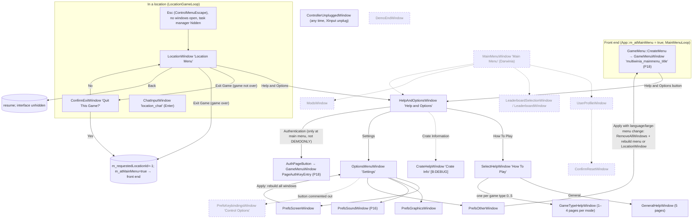

# P17b_menus_options — Menus, options, profiles, leaderboards, in-game menu

Scope: `code/game_menu.{h,cpp}`; `code/interface/` `mainmenus`, `helpandoptions_windows`, `leaderboards_window`, `multiwiniaoptions_window`, `prefs_graphics_window`, `prefs_keybindings_window`, `prefs_other_window`, `prefs_screen_window`, `profilewindow`, `userprofile_window`, `mods_window`, `chatinput_window`, `controllerunplugged_window`, `demoend_window`, `reallyquit_window`, `save_on_quit_window` (`.h` + `.cpp` each); plus `data/default_preferences.txt`. All 34 source files are in `Darwinia.vcproj` for every configuration (manifest `vcproj_build=all`). Build baseline: see build_matrix.md (`Release|Win32`, OpenGL, `TARGET_PC_FULLGAME`).

Supporting generated tables (same directory):
- `P17b_prefs_accesses.csv` — every `g_prefsManager->…` call in `code/` + `contrib/eclipse` (341 accesses, 76 distinct keys), with file, heuristic enclosing function, line and enclosing `#if` stack. Generated by `_work/scripts/P17b_prefs_scan.py`. NB the "function" column is a heuristic: for methods of classes defined inline inside a `.cpp` (e.g. `ApplyOtherButton::MouseUp`) it shows the preceding top-level function or blank — the tables in this draft give the corrected symbol.
- `P17b_strings.csv` — every string id used by LANGUAGEPHRASE/AddOption/button constructors in the scope files, with its `data/language/english.txt` text (166 distinct ids). Generated by `_work/scripts/P17b_strings.py`.

---

## [→ 09_meta_systems] 1. Inventory and reachability of every window in scope

"Reachable" = there is a call chain from the shipped game loop to `EclRegisterWindow(new X)` in the baseline build. Each entry was traced with `grep "new X"` over `code/`.

| Class (window name string) | File | Opened from | Build / reachability tag |
|---|---|---|---|
| `GameMenu` (not a window; front-end controller) | `code/game_menu.cpp` | `App::Initialise` creates it (`m_gameMenu = new GameMenu()`); `MainMenuLoop` calls `CreateMenu()` | [B:FULL] live [C] `code/app.cpp:App::Initialise`, `code/main.cpp:MainMenuLoop` |
| `GameOptionsWindow` (abstract-ish base) | `mainmenus.cpp` | base class of almost every window below | [B:FULL] |
| `OptionsMenuWindow` ("dialog_options") — "Settings" | `mainmenus.cpp` | `OptionsButton::MouseUp` in `HelpAndOptionsWindow`; also re-created by `SetScreenButton::MouseUp` | [B:FULL] live [C] |
| `PrefsScreenWindow` ("dialog_screenoptions") | `prefs_screen_window.cpp` | `ScreenOptionsButton` in `OptionsMenuWindow`; `SetScreenButton` re-creates it; `DebugMenu` (unreachable) | [B:FULL] live |
| `PrefsGraphicsWindow` ("dialog_graphicsoptions") | `prefs_graphics_window.cpp` | `GraphicsOptionsButton` in `OptionsMenuWindow` | [B:FULL] live |
| `PrefsSoundWindow` ("dialog_soundoptions") | P16 (`prefs_sound_window.cpp`) | `SoundOptionsButton` in `OptionsMenuWindow` | [B:FULL] live — **documented by P16** |
| `PrefsOtherWindow` ("dialog_otheroptions") | `prefs_other_window.cpp` | `OtherOptionsButton` in `OptionsMenuWindow` | [B:FULL] live |
| `PrefsKeybindingsWindow` ("dialog_inputoptions") — "Control Options" | `prefs_keybindings_window.cpp` | `KeybindingsOptionsButton` — its only instantiation in `OptionsMenuWindow::Create` is **commented out** | [B:LEGACY] compiled, unreachable [C] `code/interface/mainmenus.cpp:OptionsMenuWindow::Create` |
| `HelpAndOptionsWindow` ("multiwinia_menu_helpandoptions") | `helpandoptions_windows.cpp` | `HelpAndOptionsButton::MouseUp` — instantiated by `GameMenuWindow::SetupMainPage` (front-end, P18) and by `LocationWindow::Create` (in-game) | [B:FULL] live [C] `code/UI/GameMenuWindow.cpp:GameMenuWindow::SetupMainPage` |
| `SelectHelpWindow` ("multiwinia_menu_selecthelp") — "How To Play" | `helpandoptions_windows.cpp` | `HelpWindowButton` in `HelpAndOptionsWindow` | [B:FULL] live |
| `GeneralHelpWindow` ("multiwinia_help_general") | `helpandoptions_windows.cpp` | `HelpTypeButton` (`m_helpType == -1`) | [B:FULL] live |
| `GameTypeHelpWindow` (name = game-type blueprint name) | `helpandoptions_windows.cpp` | `HelpTypeButton` (`m_helpType = i`) | [B:FULL] live |
| `CrateHelpWindow` ("multiwinia_menu_selecthelp") — "Crate Information" | `helpandoptions_windows.cpp` | `CrateHelpWindowButton`, created only `#ifdef INCLUDE_CRATE_HELP_WINDOW` | [B:DEBUG] (macro set only by `TARGET_DEBUG`) [C] |
| `LocationWindow` ("dialog_locationmenu") — in-game Esc menu | `mainmenus.cpp` | `LocationGameLoop` on `ControlMenuEscape`; re-created by Other/Screen-options apply when not at main menu | [B:FULL] live [C] `code/main.cpp:LocationGameLoop` |
| `ConfirmExitWindow` ("multiwinia_confirmexit") | `mainmenus.cpp` | `ConfirmExitButton` in `LocationWindow` (only while the game is not over) | [B:FULL] live |
| `ChatInputWindow` ("location_chat") | `chatinput_window.cpp` | `LocationInput::Advance` on `ControlLobbyChat` (Enter) when no windows open and not gamepad | [B:FULL] live [C] `code/location_input.cpp:LocationInput::Advance` |
| `ChatInputField` (button) | `chatinput_window.cpp` | inside `ChatInputWindow`, and embedded directly in `GameMenuWindow`'s lobby page (P18) | [B:FULL] live [C] `code/UI/GameMenuWindow.cpp:GameMenuWindow::SetupMultiplayerPage` |
| `ControllerUnpluggedWindow` ("controller_unplugged") | `controllerunplugged_window.cpp` | `HandleCommonConditions` on `ControlControllerUnplugged` (XInput "plug up"), `#ifdef TARGET_MSVC` | [B:FULL] live [C] `code/main.cpp:HandleCommonConditions` |
| `MainMenuWindow` ("dialog_mainmenu") | `mainmenus.cpp` | `GlobalWorldGameLoop` on Esc — but that loop sets `m_atMainMenu = true` and then `break`s on its first iteration | [B:LEGACY] unreachable [C] `code/main.cpp:GlobalWorldGameLoop` |
| `UserProfileWindow` ("dialog_profile") | `userprofile_window.cpp` | `MainMenuUserProfileButton` in `MainMenuWindow` | [B:LEGACY] |
| `NewUserProfileWindow` ("dialog_newprofile") | `userprofile_window.cpp` | `NewProfileWindowButton` — its only instantiation in `UserProfileWindow::Create` is commented out | [B:LEGACY] unreachable |
| `ConfirmResetWindow` ("multiwinia_confirmreset") | `mainmenus.cpp` | `ConfirmResetButton` in `UserProfileWindow` | [B:LEGACY] |
| `LeaderboardSelectionWindow` ("leaderboardselection") | `leaderboards_window.cpp` | `LeaderBoardButton` in `MainMenuWindow` — created with `m_inactive = true`, and `MouseUp` returns when inactive | [B:LEGACY] doubly unreachable |
| `LeaderboardWindow` ("leaderboards") | `leaderboards_window.cpp` | `LeaderBoardTypeButton` in `LeaderboardSelectionWindow` | [B:LEGACY] stub (no data source) |
| `ResetLocationWindow` ("dialog_resetlocation") | `mainmenus.cpp` | `ResetLevelButton` — never instantiated anywhere | [B:LEGACY] unreachable |
| `AboutDarwiniaWindow` ("about_darwinia") | `mainmenus.cpp` | `AboutDarwiniaButton`, only `#ifdef OBERONBUILD` | [B:DEAD] (macro never defined) |
| `ModsWindow` ("dialog_mods"), `NewModWindow` ("dialog_createnewmod") | `mods_window.cpp` | whole `.cpp` body is `#ifdef USE_DARWINIA_MOD_SYSTEM`; `ModsButton` also requires that macro and pref `ModSystemEnabled` | [B:DEAD] |
| `DemoEndWindow` ("DemoEnd") | `demoend_window.cpp` | `ExitLevelButton::MouseUp` only `#ifdef DEMO2` | [B:DEAD] (DEMO2 never defined) — compiled, never instantiated |
| `ReallyQuitWindow` ("Really Quit?") | `reallyquit_window.cpp` | `DebugKeyBindings::ReallyQuitButton` — no caller anywhere | [B:LEGACY] unreachable |
| `SaveOnQuitWindow` ("editor_savesettings") | `save_on_quit_window.cpp` | `SoundSystem::AreBlueprintsModified`, after an unconditional `return false;` and inside `#ifdef SOUND_EDITOR` | [B:DEAD] |
| `ProfileWindow` ("Profiler") — CPU profiler, not a user profile | `profilewindow.cpp` | `DebugKeyBindings::ProfileButton`, called from `CheatWindow` (`CHEATMENU_ENABLED`) and `DebugMenu` (whose F1 hotkey is commented out) | [B:DEBUG] |
| `MultiwiniaOptionsWindow` ("multiwiniaoptions_window") | `multiwiniaoptions_window.cpp` | `LocationEditor` mode `ModeMultiwinia`; whole file `#ifdef LOCATION_EDITOR` | [B:EDITOR] — see §10 |

**Key consequence for the new game:** the only live option screens in the shipped Multiwinia are Settings → {Screen, Graphics, Sound, Other}, reached via *Help and Options* from both the front end and the in-game Esc menu. Profiles, leaderboards, mods, key-rebinding, the Darwinia "main menu", demo-end and about screens are compiled but unreachable or dead.

---

## [→ 09_meta_systems] 2. Preferences system (storage of every user option)

### 2.1 Storage and lifecycle

| Aspect | Behaviour | Evidence |
|---|---|---|
| Singleton | `PrefsManager *g_prefsManager`, created in `App::App` right after `init.dat` is parsed and before the renderer: `new PrefsManager(App::GetPreferencesPath())`, then `SetPreferenceOverrides()` | [C] `code/app.cpp:App::App` |
| File path (Win32, non-debug, Windows 2000+) | `SHGetFolderPath(CSIDL_LOCAL_APPDATA)` + `\Introversion\Multiwinia\preferences.txt` (directories created on demand) | [C] `code/app.cpp:App::GetProfileDirectory`, `App::GetPreferencesPath` |
| File path (TARGET_DEBUG or pre-2k) | `preferences.txt` in the current directory | [C] same |
| File path (Mac) | `$HOME/Library/Preferences/uk.co.introversion.Multiwinia.txt` | [C] same (platform appendix) |
| Load | `PrefsManager::Load`: read the file as UTF-16 if it is Unicode, else as 8-bit text; every line → `AddLine` | [C] `code/lib/preferences.cpp:PrefsManager::Load` |
| First run | If the file cannot be opened → `CreateDefaultValues()` (built-in defaults, then `data/default_preferences.txt` lines with overwrite enabled) | [C] `PrefsManager::CreateDefaultValues` |
| Corruption check | Only the first line is checked: scanning from the start until the first `' '` or `'='`, any character outside `L'A'..L'z'` marks the file corrupt → `CreateDefaultValues()` + `Save()` immediately | [C] `PrefsManager::Load` |
| Forced value after every load | `SetInt("MultiwiniaControlMethod", 1)` ("Hack by Chris to disable old-style control") | [C] `PrefsManager::Load` |
| Constructor fix-up | If `GetInt("ControlMethod") == -1` (missing or non-int) → `AddLine("ControlMethod = 1")` | [C] `PrefsManager::PrefsManager` |
| Line syntax | `Key = value`. Key = the first run of alphanumerics (`iswalnum`; `_` is **not** allowed) after leading non-alphanumerics. Value starts after any whitespace/`=` | [C] `PrefsItem::PrefsItem(UnicodeString)` |
| Typing rule | Value beginning with `-` or a digit → count `.` characters: 0 → Int (`wtoi`), 1 → Float (`wtof`), ≥2 → String (so `127.0.0.1` is a String). Anything else → String | [C] `PrefsItem::PrefsItem` |
| Comments / blank | A line is "empty" if a `#` appears before any alphanumeric, or it has no alphanumeric at all; empty lines are kept verbatim for re-saving but not parsed | [C] `PrefsManager::IsLineEmpty` |
| Duplicate keys | Normal load: first occurrence wins, later ones logged "Duplicate preference item … Ignoring". With `s_overwrite` (default-file merge): later value replaces earlier | [C] `PrefsManager::AddLine` |
| Typed getters | `GetInt(key, default=-1)`, `GetFloat(key, default=-1.0f)`, `GetString(key, default=NULL)`, `GetUnicodeString(key, default)`. If the key is missing **or the stored type differs** the default is returned (e.g. `RenderWaterDetail = 1.0` is a Float, so `GetInt` returns the caller's default) | [C] `PrefsManager::GetInt` etc. |
| Setters | `SetInt/SetFloat/SetString` update in place (changing the type) or create | [C] |
| Save | Re-emits the originally loaded text line-by-line as a template: comment/blank lines verbatim; each key line replaced by the current item (`%ls = %d`, `%ls = %.2f`, `%ls = %ls`), each item at most once; then appends every item not yet written. Silently does nothing if the file cannot be opened | [C] `PrefsManager::Save`, `SaveItem` |
| Who saves | Every options *Apply*; `PlayerNameString::Set`; `App::SetProfileName`; `Renderer::Initialise` (always, after mode set); `SetWindowed(…, permanent)` | [C] respective symbols |

### 2.2 First-run default set (built-in, before `default_preferences.txt`)

Order and values exactly as `PrefsManager::CreateDefaultValues` emits them in the baseline (`DEMOBUILD` undefined, not Mac/Linux, `HAVE_DSOUND` defined):

| Key | Built-in first-run value | Notes |
|---|---|---|
| ServerAddress | `127.0.0.1` (String) | no live reader |
| BypassNetwork | `0` | no live reader |
| ServerPort | `4000` | no live reader |
| TextLanguage | `unknown` | |
| TextSpeed | `15` | |
| HelpEnabled | `1` (`GetDefaultHelpEnabled`; 0 only under DEMOBUILD) | |
| SoundLibrary | `dsound` (`GetDefaultSoundLibrary`) | P16 |
| SoundMixFreq | `22050` (44100 on Mac) | P16 |
| SoundMasterVolume | `255` | P16 |
| SoundChannels | `32` | P16 |
| SoundHW3D | `0` | P16 |
| SoundSwapStereo | `0` | P16 |
| SoundMemoryUsage | `1` | P16 |
| SoundBufferSize | `512` | P16; note runtime readers default to 2000 |
| SoundDSP | `0` | P16 |
| RenderLandscapeDetail | `1` (`GetDefaultGraphicsDetail`) | |
| RenderWaterDetail | `1` | |
| RenderBuildingDetail | `1` | |
| RenderEntityDetail | `1` | |
| RenderCloudDetail | `1` | |
| RenderPixelShader | `1` (`GetDefaultPixelShader`; Mac may give 0) | |
| DarwinianScaleFactor | `2.00` (Float) | |
| ControlMouseButtons | `3` (1 on Mac) | |
| ControlMethod | `1` | |
| MultiwiniaControlMethod | `1` | |
| BootLoader | `firsttime` | |
| UserProfile | `AccessAllAreas` | |
| ScreenOverscan | `0` | |
| RenderSpecialLighting | `0` | |
| Difficulty | `1` | (`OTHER_DIFFICULTY`) |

Then every line of `data/default_preferences.txt` is added with overwrite (see §4.1), then `Load` forces `MultiwiniaControlMethod = 1`, then `Renderer::Initialise` writes the screen keys and saves (see §3.1). Keys **not** in the first-run set (e.g. `ScreenWidth`, `LargeMenus`, `AutomaticCamera`, `NetworkUsePortForwarding`, `PlayerName`) take the per-call-site default until first written — and those call-site defaults are not always consistent (§4.3).

### 2.3 Related but separate stores (not `preferences.txt`)

| Store | Path | Written by | Evidence |
|---|---|---|---|
| User key bindings | `<profile dir>user_input_preferences.txt` (own `PrefsManager` instance) | `ApplyKeybindingsButton::MouseUp` (legacy window) | [C] `code/lib/input/file_paths.cpp:InputPrefs::GetUserPrefsPath`; `prefs_keybindings_window.cpp` |
| System bindings | `data/input/input_preferences.txt` (MultiwiniaControlMethod=1) or `input_preferences_darwinia.txt` (=0); per-keyboard overrides `data/input/keyboards/<layout>.txt` (`de_DE`, `fr_FR`) | data files (P10) | [C] `InputPrefs::GetSystemPrefsPath`, `code/main.cpp:ReadInputPreferences` |
| Darwinia user profile | `<profile dir>users/<name>/` (global world `game.txt` + mission files) | `App::SaveProfile` — returns false unless full version **and** `IsSinglePlayer()` (Campaign/Prologue) and name not `none`/`AccessAllAreas`/`AttractMode` | [C] `code/app.cpp:App::SaveProfile` → never saves in Multiwinia modes |

---

## [→ 09_meta_systems] 3. Every user option, per options window

Navigation: *Help and Options* → *Settings* (`OptionsMenuWindow`, title "Settings") lists, in order: **Screen Options**, **Graphics Options**, **Sound Options** (P16), **Other Options**, then **Back** at the bottom [C] `code/interface/mainmenus.cpp:OptionsMenuWindow::Create`. (A fifth button "Control Options" exists in source but is commented out.)

All four live option windows share the pattern: controls edit *copies* held in the window object; an **Apply** button (greyed/inactive while the copy equals the stored prefs) writes the prefs, `Save()`s, and applies; **Back** (`MenuCloseButton`) discards. See §11.4.

### 3.1 Screen Options (`PrefsScreenWindow`) [B:FULL]

Window members initialised in the constructor from prefs [C] `code/interface/prefs_screen_window.cpp:PrefsScreenWindow::PrefsScreenWindow`. Order on screen = `m_buttonOrder` order: Resolution, Windowed, Refresh Rate, Colour Depth, Z Buffer Depth, Apply, Back.

| # | Control (label id → English) | Widget | Pref key | Window default if key missing | Choices / range | What it changes in the engine |
|---|---|---|---|---|---|---|
| 1 | `dialog_resolution` "Resolution" | `ScreenResDropDownMenu` (opens full-screen option list) | `ScreenWidth` + `ScreenHeight` (stored as two ints; window holds `m_resId` index) | `GetResolutionId(ScreenWidth, ScreenHeight)`; **`AppReleaseAssert` if −1** | every distinct W×H reported by `EnumDisplaySettings` with bpp ≥ 15, W ≥ 640, H ≥ 480, in enumeration order; caption `"%d x %d"` | Window/back-buffer size passed to `WindowManagerWin32::CreateWin`; all UI layout is proportional to it (§11.1). Selecting a resolution (including the initial `RegisterInt`, which calls `SelectOption`) repopulates the Refresh list with that mode's rates (`"%d Hz"`) and re-selects `m_refreshRate`; if that rate is not offered the caption falls back to the label and the stored value is kept [C] `ScreenResDropDownMenu::SelectOption`, `DropDownMenu::RegisterInt/SelectOption` |
| 2 | `dialog_windowed` "Windowed" | `GameMenuCheckBox` (int) | `ScreenWindowed` | 0 | 0/1 | Windowed: `WS_POPUPWINDOW|WS_CAPTION|WS_MINIMIZEBOX|WS_MAXIMIZEBOX`, centred on desktop, fails if larger than desktop. Fullscreen: `ChangeDisplaySettings(CDS_FULLSCREEN)` with bpp/W/H/refresh, `WS_POPUP` at 0,0 [C] `code/lib/window_manager_win32.cpp:WindowManagerWin32::CreateWin` |
| 3 | `dialog_refreshrate` "Refresh Rate" (`#ifdef HAVE_REFRESH_RATES`, defined for `TARGET_MSVC` at top of the file) | `FullscreenRequiredMenu` in cycle mode | `ScreenRefresh` | 60 | the selected resolution's refresh list | `dmDisplayFrequency` of the fullscreen mode. Disabled (drawn grey with "(windowed mode)") when Windowed is ticked [C] `FullscreenRequiredMenu::Render/MouseUp` |
| 4 | `dialog_colourdepth` "Colour Depth" | `FullscreenRequiredMenu`, cycle mode | `ScreenColourDepth` | 16 | 16 / 24 / 32 ("16 bit", "24 bit", "32 bit") | `dmBitsPerPel` for fullscreen and the pixel format colour bits (`EnableOpenGL(colourDepth, zDepth)`); disabled when windowed |
| 5 | `dialog_zbufferdepth` "Z Buffer Depth" | `GameMenuDropDown`, cycle mode | `ScreenZDepth` | 24 | 16 / 24 (labels reuse "16 bit"/"24 bit") | depth-buffer bits of the GL pixel format / D3D device |
| — | (not shown) | — | `ScreenOverscan` | 0 (`m_overscan` read, never used) | — | none: `Renderer::Initialise` hard-codes `overscan = 0` and writes it back; the only other reader is inside `#if 0` [C] `code/renderer.cpp:Renderer::Initialise`, `Renderer::RenderMenuTransition` |
| 6 | `dialog_apply` "Apply" | `SetScreenButton` | — | — | inactive when W, H, refresh, windowed, colour, z all equal the stored prefs | see apply flow below |
| 7 | "Back" | `MenuCloseButton` | — | — | — | closes window (no save) |

**Apply flow** [C] `code/interface/prefs_screen_window.cpp:SetScreenButton::MouseUp`, `RestartWindowManagerAndRenderer`, `AdjustWindowPositions`:
1. Write `ScreenWidth`, `ScreenHeight` (from `GetResolution(m_resId)`), `ScreenRefresh`, `ScreenWindowed`, `ScreenColourDepth`, `ScreenZDepth`.
2. `RestartWindowManagerAndRenderer()`: remember old W/H; `hack = !currentlyWindowed && !pref ScreenWindowed` (fullscreen→fullscreen change). `DestroyWin()`, delete renderer. If `hack`: temporarily set prefs to windowed 640×480, create+initialise a throw-away `Renderer`, destroy it, restore prefs (W/H/windowed=0) — forces a real display-mode switch. Then `new Renderer(); Initialise();` `Resource::FlushOpenGlState(); RegenerateOpenGlState();` (all textures/display lists rebuilt), `glClear`. Then `AdjustWindowPositions`: if size changed, `EclInitialise(newW,newH)` and every Eclipse window is moved so its centre keeps the same proportional position (`newCentre = oldCentre × new/old`).
3. `Save()`; re-read the prefs into the window (asserting the resolution id exists); remove **all** windows; if at main menu `GameMenu::DestroyMenu()+CreateMenu()`, else register a new `LocationWindow`; then register a fresh `OptionsMenuWindow` and `PrefsScreenWindow` (so the user lands back on Screen Options at the new resolution).

**What `Renderer::Initialise` does with these keys** [C] `code/renderer.cpp:Renderer::Initialise`:

| Key | Call-site default | Use |
|---|---|---|
| ScreenWidth / ScreenHeight | 0 / 0 → if both 0: `SuggestDefaultRes` = desktop W, H, refresh, colour depth (also written to prefs) | then `GetClosestResolution(&w,&h,&refresh)` |
| ScreenWindowed | 0 | |
| ScreenColourDepth | 32 | |
| ScreenRefresh | 75 | |
| ScreenZDepth | 24 | |
| WaitVerticalRetrace | 1 | passed only to the 3rd/4th fallback `CreateWin` calls; the first two calls pass literal `true` for `_waitVRT`. `WindowManagerWin32::CreateWin` (OpenGL baseline) ignores `_waitVRT` and `_antiAlias` entirely → **no vsync control in the GL build** [C]. Under `USE_DIRECT3D`, `WindowManagerDirectX::CreateWin` stores `_waitVRT` and passes it to `Direct3DInit` [B:D3D] [C] `code/lib/window_manager_directx.cpp` |

Fallback chain on `CreateWin` failure: (a) show `MessageDialog` "Failed to set requested screen resolution of …" at (100,100); retry with desktop default res, z=24, waitVRT=0; (b) retry 800×600 windowed, 16-bit colour, z16, 60 Hz; (c) same with z24; (d) `AppReleaseAssert("Failed to set screen mode")`. Afterwards all of W, H, windowed, colour, z, refresh, `WaitVerticalRetrace`, `ScreenOverscan`(=0) are written back and saved.

### 3.2 Graphics Options (`PrefsGraphicsWindow`) [B:FULL]

[C] `code/interface/prefs_graphics_window.cpp`. Shown controls (in order): Water Detail, Sky Detail, Building Detail, Entity Detail, Apply, Back. All four drop-downs are `GameMenuDropDown` in **cycle mode** (click advances to next option, wrapping) with options `dialog_high`=1 "High", `dialog_medium`=2 "Medium", `dialog_low`=3 "Low". Two further controls exist only as commented-out code: Landscape Detail (options High 1 / Medium 2 / Low 3 / "I need to upgrade" 4) and Pixel Effect (checkbox).

| Control | Pref key (`#define`) | Window default | Range | Engine effect (followed to readers) |
|---|---|---|---|---|
| Water Detail | `RenderWaterDetail` (`GRAPHICS_WATERDETAIL`) | 1 | 1–3 | `Water::Water`: `detail = GetInt("RenderWaterDetail")` (**no default → −1 if missing**). If `detail > 0`: `m_cellSize = detail × max(worldSizeX, worldSizeZ)/100` — i.e. dynamic-water grid cell = 1 %, 2 %, 3 % of the larger world dimension for High/Medium/Low; colour table loaded, triangle strips and wave tables built. `Water::Render`/`Advance`: `RENDER_WATER_DETAIL > 0` → flat water + animated dynamic water; else flat water only [C] `code/water.cpp:Water::Water`, `Water::Render`, `Water::Advance`. Takes effect when `Water` is re-created (Apply does this if a location is loaded). |
| Sky Detail | `RenderCloudDetail` (`GRAPHICS_CLOUDDETAIL`) | 1 | 1–3 | `Clouds::RenderBlobby` (3 textured quads at heights 1200, 1000, 800): detail 1 → all three; 2 → first two; 3 → only the 1000 layer. `Clouds::RenderFlat` (heights 1200 then 1000): detail 1 → both, alpha 0.3; 2 → only the 1200 layer at alpha 0.3; 3 → only the 1200 layer at alpha 0.5 [C] `code/clouds.cpp:Clouds::RenderBlobby`, `Clouds::RenderFlat`. Read every frame (immediate effect). Clouds are drawn both in-game and as the front-end background (`GameMenu::Render`). |
| Building Detail | `RenderBuildingDetail` (`GRAPHICS_BUILDINGDETAIL`) | 1 | 1–3 | Read every frame by 24 render sites; see table 3.2a. |
| Entity Detail | `RenderEntityDetail` (`GRAPHICS_ENTITYDETAIL`) | 1 | 1–3 | Darwinians: `Team::RenderDarwinians` computes `H = 99999.9` (detail ≤1), `1000` (2), `500` (≥3); per Darwinian `highDetail = clamp(1 − d²/H², 0, 1)` with `d` = camera distance; `Darwinian::Render` uses `highDetail > 0` to enable terrain-snapped prediction (also needs d < 1300) and ground shadows (alpha `150 × highDetail`, ×0.3 for monsters, needs d < 2000) and God-Dish shadows [C] `code/team.cpp:Team::RenderDarwinians`, `code/worldobject/darwinian.cpp:Darwinian::Render`. Virii (`Team::RenderVirii`): render detail level 1 by default; entity 1 & d > 1000 → 2; entity 2 & d > 1000 → 3, entity 2 & d > 500 → 2; entity 3 & d > 1000 → 4, > 600 → 3, > 300 → 2. `Virii::Render`: level 1 → ground-snapped position and land-normal; level > 1 → tail shortened by `0.25 × min(level−1, 2)`; level < 4 → glow quads drawn [C] `code/worldobject/virii.cpp:Virii::Render`. (`ViriiUnit::Render` uses a variant with entity 3 → level 4 always.) |
| Apply | — | — | inactive when all six window values equal stored prefs | Writes all six keys (Landscape and PixelShader written back unchanged because their controls are commented out), `Save()`, and if `g_app->m_location`: `m_landscape.Init(levelFile->m_landscape)` and delete/re-create `m_water` [C] `ApplyGraphicsButton::MouseUp`. Docs record an earlier bug "Graphics Options not applying when not in game" (`docs/multiwiniachanges-beta.txt`); in this code, out-of-game apply just stores the prefs — render-time readers pick them up, `Water` reads at construction. |
| Back | — | — | — | close |

Hidden (no UI) graphics keys and their effect:

| Key | Default at readers | Effect |
|---|---|---|
| `RenderLandscapeDetail` | 1 | **None in the baseline**: both readers are commented out and replaced by the constant 1 (`Landscape::Init`: `detailScaleFactor = 1`, cell size ×`(1 + (f−1)×0.5)`; `LandscapeRenderer::Render`: overlay drawn if `landscapeDetail < 4`). The D3D water-reflection pass temporarily sets it to 3 and the restore line is commented out [B:D3D] [C] `code/landscape.cpp:Landscape::Init`, `code/landscape_renderer.cpp:LandscapeRenderer::Render`, `code/water_reflection.cpp:WaterReflectionEffect::PreRenderWaterReflection` |
| `RenderPixelShader` | (no default in `Renderer::RenderFrame` → −1 if missing; first-run value 1) | `Renderer::RenderFrame`: the Darwinia full-screen pixel effect (`PreRenderPixelEffect`/`ApplyPixelEffect`) runs only if `> 0 && !g_app->Multiplayer()`. `App::Multiplayer()` is true for **every** `GameModeMultiwinia` game, so the effect never runs in Multiwinia [B:LEGACY] [C] `code/renderer.cpp:Renderer::RenderFrame`, `code/app.cpp:App::Multiplayer`. Also gates the D3D water reflection: `Water::Render` sets `m_renderWaterEffect = RenderWaterEffect>0 && RenderPixelShader>0`, used only under `USE_DIRECT3D` [B:D3D] |
| `RenderWaterEffect` | 1 | D3D water reflection only [B:D3D] (see above) |
| `RenderTreeDetail` | 1 | `Tree::Generate`: if > 1, leaf alpha ×`1.3^detail`, capped 255 [C] `code/worldobject/tree.cpp:Tree::Generate` |
| `RenderLandscapeMode` | −1 | OpenGL only: −1 → VBO if `GL_ARB_vertex_buffer_object` "perfectly supported", else display lists; explicit value overrides. D3D always VBO [C] `code/landscape_renderer.cpp:LandscapeRenderer::LandscapeRenderer` |
| `RenderSpecialLighting` | (none → −1) | `Location::RenderBuildings`: `== 1` forces `SetupSpecialLights()` (also forced for Rocket Riot, level effect SpecialLighting, Prologue). Cheat keys toggle it under `CHEATMENU_ENABLED` [C] `code/location.cpp:Location::RenderBuildings` |
| `RenderNegative` | 0 | `App::Initialise`: negative renderer, background colour white instead of black [C] `code/app.cpp:App::Initialise` |
| `RenderPosterResolution` | 1 | poster/screenshot tiling multiplier (`PosterMaker`, `Renderer::Render`, `SetupProjMatrixFor3D`) — P12 |
| `ManuallyScaleTextures` | 0 | OpenGL: force power-of-two texture rescale [C] `code/lib/bitmap.cpp:BitmapRGBA::ConvertToTexture` |
| `RenderFog` | 1 | read only under `FOG_LOGGING`/`FOG_PREFERENCE`, neither defined → no effect [C] `code/main.cpp:SetPreferenceOverrides` |

Table 3.2a — `RenderBuildingDetail` readers (all [C], values: 1 High, 2 Medium, 3 Low):

| Reader | Effect by detail |
|---|---|
| `code/worldobject/building.cpp:Building::RenderPorts` | per-port extra render only if `< 3` (no default arg → −1 if missing, which counts as `< 3`) |
| `code/worldobject/constructionyard.cpp:ConstructionYard::RenderAlphas` | max glow blobs 50 / 25 / 10 |
| `code/worldobject/goddish.cpp:GodDish::RenderAlphas` | 50 / 25 / 10 |
| `code/worldobject/portal.cpp:Portal::RenderExplosionBuildup` | 50 / 25 / 10 |
| `code/worldobject/rocket.cpp:EscapeRocket::RenderAlphas` | 50 / 20 / 10 |
| `code/worldobject/rocket.cpp:FuelBuilding::RenderAlphas` | fuel-pipe loops `clamp(4 − detail, 1, 3)` = 3 / 2 / 1 (no default arg) |
| `code/worldobject/pulsebomb.cpp:PulseBomb::RenderAlphas` | 20 / 10 / 2 |
| `code/worldobject/researchitem.cpp:ResearchItem::RenderAlphas` | 20 / 10 / 0 |
| `code/worldobject/spam.cpp:Spam::RenderAlphas` | 20 / 10 / 0 |
| `code/worldobject/spawnpoint.cpp:SpawnPoint::RenderAlphas` | 20 / 10 / 3 |
| `code/worldobject/spawnpoint.cpp:SpawnBuilding::RenderAlphas` | extra branch only at 1 |
| `code/worldobject/crate.cpp:Crate::RenderGlow` | stars 10 / 5 / 2; blobs (default) / 10 / 0 |
| `code/worldobject/laserfence.cpp:LaserFence::RenderAlphas` | extra effect only if `< 3` |
| `code/worldobject/mine.cpp:MineBuilding::RenderAlphas`, `MineBuilding::RenderCart` | track size 1.0 when `> 1`; extra branch at 1; cart extra if `< 3` |
| `code/worldobject/spiritreceiver.cpp` (`ReceiverBuilding::RenderAlphas` ×2, `BeginRenderUnprocessedSpirits`, `RenderUnprocessedSpirit`, `SpiritProcessor::RenderAlphas`, `UnprocessedSpirit::Render`) | textured glow variants only at 1 (spirit receiver is a Darwinia building; blocked in Multiwinia [I] via `BLOCK_OLD_DARWINIA_OBJECTS`) |
| `code/worldobject/tree.cpp:Tree::Advance` | burning-tree fire particles `numFire /= detail` |
| `code/water_reflection.cpp:WaterReflectionEffect::PreRenderWaterReflection` | [B:D3D] forced to 3 during the reflection pass, then restored |

### 3.3 Sound Options — owned by P16 (`prefs_sound_window.cpp`). Keys: `SoundLibrary`, `SoundMixFreq`, `SoundChannels`, `SoundHW3D`, `SoundSwapStereo`, `SoundDSP`, `SoundMemoryUsage`, `SoundMasterVolume`, `SoundBufferSize`. Only the entry point (`SoundOptionsButton` in `OptionsMenuWindow`) is in this partition.

### 3.4 Other Options (`PrefsOtherWindow`) [B:FULL]

[C] `code/interface/prefs_other_window.cpp`. Shown controls in order: Help System, Port Forwarding, Server Port, Client Port, Language (not on Mac), Apply, Back.

| Control (id → English) | Widget | Pref key (`#define` in `prefs_other_window.h`) | Window default | Range / choices | Engine effect |
|---|---|---|---|---|---|
| `dialog_helpsystem` "Help System" | `GameMenuCheckBox` | `HelpEnabled` (`OTHER_HELPENABLED`) | 1 | 0/1 | In-game contextual hints in `MultiwiniaHelp::Render` outside the grace period (space-to-deselect, RMB help, shift-to-speed-up, turret/officer hints) [C] `code/multiwiniahelp.cpp:MultiwiniaHelp::Render`; also read (with no remaining effect) in `TaskManagerInterfaceMultiwinia::Advance` and `LocationInput::AdvanceTeamControl` (their bodies are commented out). P19 owns help content. |
| `dialog_useportforwarding` "Port Forwarding" | `GameMenuCheckBox` | `NetworkUsePortForwarding` (`PREFS_NETWORKUSEPORTFORWARDING`) | 0 | 0/1 | Disabled while hosting (`g_app->m_server != NULL`). When 1: the client reports its local listener port instead of the hole-punched port (`ClientToServer::Advance`), and the server advertises its local port to the metaserver (`Server::Advertise`, `NET_METASERVER_PORT`) [C] `code/network/clienttoserver.cpp:ClientToServer::Advance`, `code/network/server.cpp:Server::Advertise` (P15) |
| `dialog_serverport` "Server Port" | `GameMenuInputField` showing an int as a string (`NetworkIntAsString(LocalInt)`, bounds 0 – 65535.1) | `NetworkServerPort` (`PREFS_NETWORKSERVERPORT`) | 4000 | 0–65535 | UDP listen port of the hosted server (`Server::Initialise` → `NetSocketListener(ourPort)`) and default port of manual `ServerN` entries [C] `code/network/server.cpp:Server::Initialise`, `code/UI/GameMenuWindow.cpp:GameMenuWindow::UpdateJoinGamePage`. Disabled while hosting. |
| `dialog_clientport` "Client Port" | as above | `NetworkClientPort` (`PREFS_NETWORKCLIENTPORT`) | 4001 | 0–65535 | Client listener port; if bind fails and port ≠ 0, retried with port 0 (any) [C] `code/network/clienttoserver.cpp:ClientToServer::OpenConnections`. Disabled while hosting. |
| `dialog_language` "Language" (`#ifndef TARGET_OS_MACOSX`) | `GameMenuDropDown` (full-screen list) | `TextLanguage` (`OTHER_LANGUAGE`) | index of the file whose base name equals the pref (case-insensitive), else −1 | one entry per file in `language/` (base name before `.`): `english`, `french`, `german`, `italian`, `japanese`, `korean`, `portuguese`, `russian`, `spanish`. Caption `language_<name>` if that phrase exists (english/french/german/italian/spanish have one), else the raw name | `App::SetLanguage(name, false)`: loads `language/<name>.txt` into a new `LangTable`, `setlocale(LC_CTYPE, name)`, merges `strings_<name>.txt` or `strings_default.txt` if present; then all windows are removed and the menu rebuilt (§ apply) [C] `code/app.cpp:App::SetLanguage` |
| Apply | `ApplyOtherButton` | — | — | inactive when Help, Language, PortForwarding, ServerPort, ClientPort all match stored prefs (note: does **not** compare the hidden keys below) | see apply flow |
| Back | `MenuCloseButton` | — | — | — | close |

Hidden members that Apply also writes (no visible control in the Multiwinia build; values round-trip from what the constructor read) [C] `ApplyOtherButton::MouseUp`, `PrefsOtherWindow::PrefsOtherWindow`:

| Member | Pref key | Constructor read (default) | What Apply writes | Engine effect |
|---|---|---|---|---|
| `m_controlHelpEnabled` | `ControlHelpEnabled` | 1 | same value | Gamepad button-prompt overlays: `ControlHelpSystem::Advance/Render` only run when input mode is gamepad **and** pref ≠ 0; `TaskManagerInterfaceIcons::Render*` draw 360-pad prompts under the same condition [C] `code/control_help.cpp`, `code/taskmanager_interface_icons.cpp` |
| `m_difficulty` | `Difficulty` | at top level (`m_locationId == -1`): `GetInt(…,1) − 1`, clamped ≥ 0; else `g_app->m_difficultyLevel` | only at top level: pref = `m_difficulty + 1` and `g_app->m_difficultyLevel = m_difficulty` | Darwinia campaign difficulty; `App::UpdateDifficultyFromPreferences` body is commented out [B:LEGACY] |
| `m_bootLoader` | `BootLoader` | string, default `"random"`: `none`→0, `random`→1, anything else→2 | 0→`"none"`, 1→`"random"`, 2→`"firsttime"` | `RunBootloader` only `#ifdef USE_LOADERS` (off) → no effect [B:DEAD] |
| `m_automaticCamera` | `AutomaticCamera` | 0 | same | `Camera::UpdateEntityTrackingMode`: value 1 = off, 2 = on, anything else = auto (on iff gamepad input mode); `SwitchEntityTracking(on)` (suppressed while free-look control held). `Task::TargetSquad`: if 0 and gamepad → 2; if 2, camera `RequestEntityTrackMode` on the newly spawned squad [C] `code/camera.cpp:Camera::UpdateEntityTrackingMode`, `code/taskmanager.cpp:Task::TargetSquad`. **This is the closest thing to "auto-zoom/auto-camera" in the game.** |
| `m_largeMenus` | `LargeMenus` | 0 | same; `g_app->m_largeMenus = (value == 2)` (Vista media-center branch dead) | "Ten-foot" UI scale for `DarwiniaWindow::GetMenuSize/SetMenuSize`: `scale = 0.96 × screenH / 460` [C] `code/interface/darwinia_window.cpp:DarwiniaWindow::GetMenuSize`. Also applied at start-up in `App::Initialise`. Full-screen `GameOptionsWindow`s are sized from screen fractions, so this only affects the small legacy-style windows. |
| `m_christmas` | `ChristmasEnabled` | 1 | **not written** | none |

**Other Options apply flow** [C] `ApplyOtherButton::MouseUp`: (1) write HelpEnabled, ControlHelpEnabled; (2) Difficulty (top level only); (3) BootLoader string; (4) if a location is loaded: `Landscape::Init` + re-create `Water` (copied from the graphics apply, harmless); (5) if any of PortForwarding/ServerPort/ClientPort changed → write them and `g_app->m_clientToServer->OpenConnections()` (re-binds the client listener); (6) if language changed → `SetString(TextLanguage)`, `App::SetLanguage`, `removeWindows = true`; (7) AutomaticCamera; (8) LargeMenus, `removeWindows |= (largeMenus changed)`; (9) if `removeWindows`: `RemoveAllWindows()` then at main menu `GameMenu::CreateMenu()` else `EclRegisterWindow(new LocationWindow())`; (10) `Save()`.

Edge cases: [C] If `TextLanguage` matches no file, `m_language = −1`; Apply indexes `m_languages[-1]`, which `LList` returns as NULL, then `stricmp(NULL, …)` — undefined behaviour. [I] In practice `App::InitLanguage` always stores a language that loaded successfully, so a match exists. [C] Port changes are applied even when not hosting; the listener is re-opened immediately.

### 3.5 Control Options (`PrefsKeybindingsWindow`) [B:LEGACY — unreachable]

[C] `code/interface/prefs_keybindings_window.cpp`. A small centred `DarwiniaWindow` (380 × (125 + 25 × 13) before large-menu scaling). Controls:

| Control | Pref / store | Choices | Effect |
|---|---|---|---|
| `newcontrols_prefsoption` "Control Mode" (`ControlMethodDropDownMenu`) | `ControlMethod` (window reads `GetInt("ControlMethod")` with no default) | 0 `newcontrols_prefs_gestures` "Gesture based", 1 `newcontrols_prefs_icons` "Icon based" | Changing it rebuilds the window with the matching control list. Engine readers: `TaskManagerInterface::CreateTaskManager` — gesture interface only if not gamepad **and** `IsSinglePlayer()` **and** `ControlMethod == 0`; Multiwinia always gets `TaskManagerInterfaceMultiwinia`. `Camera::ChatLogVisible`: method 1 → `ControlIconsChatLog`, 0 → `ControlGesturesChatLog`. `TaskManagerInterface::AdvanceTab`: gestures-switch-unit only if 0 [C] `code/taskmanager_interface.cpp`, `code/camera.cpp:Camera::ChatLogVisible` |
| One `ChangeKeybindingButton` per control (list below); click toggles "listening"; while listening the caption blinks at 3 Hz (`(int)(g_gameTime×3) & 1`) and the first active input (`getFirstActiveInput(spec, instant)`) becomes the new binding | `user_input_preferences.txt` | any input the InputManager can describe | Apply writes each control's string to the user input prefs file and `replacePrimaryBinding`; if `IconsTaskManagerDisplay` was bound to "…down", `IconsTaskManagerHide` is bound to the same input with "up" |
| Mouse buttons (`#ifdef TARGET_OS_MACOSX`) | `ControlMouseButtons` | 1 / 3 | read by `SendTeamControlsToNetwork` (default 3) |
| `dialog_restoredefaults` "Restore Defaults" | — | — | `g_inputManager->Clear()` + re-parse `InputPrefs::GetSystemPrefsPath()`; re-read ControlMouseButtons |
| `dialog_close` "Close", `dialog_apply` "Apply" | — | — | Apply also: `SetInt(ControlMouseButtons)`, `SetInt(ControlMethod)`, `TaskManagerInterface::CreateTaskManager()`, `Save()` both stores, `LangTable::RebuildTables()` |

Bindable controls (`s_controls`, label id → English; `instant` flag): 0 CameraLeft "Left"; 1 CameraRight "Right"; 2 CameraForwards "Forwards"; 3 CameraBackwards "Backwards"; 4 CameraUp "Up"; 5 CameraDown "Down"; 6 CameraZoom "Zoom"; 7 UnitDeselect "Deselect" (instant); 8 SkipMessage "Skip Message" (instant); 9 GesturesChatLog "Chat Log" (instant); 10 IconsChatLog "Chat Log" (instant); 11 IconsTaskManagerDisplay "Display Task Manager" (instant); 12 IconsTaskManagerEndTask "End Task" (instant). Gesture mode shows indices 0–9; icon mode shows 0–8, 10, 11, 12.

### 3.6 Options requested by the spec that do **not** exist in the code

Verified by grep over `code/` for the option names and for any `g_prefsManager` key containing them [C] (see `P17b_prefs_accesses.csv`):

| Option | Status |
|---|---|
| Multisampling / anti-aliasing | No pref key is read. `CreateWin(..., _antiAlias)` is always passed `true` and `WindowManagerWin32::CreateWin` ignores it. (`PREFS_SCREEN_ANTIALIAS "ScreenAntiAliasing"` exists only in the uncompiled `contrib/systemiv`.) |
| Gamma | No pref, no UI. `Renderer::SetScreenGamma` (D3D gamma ramp, `g = 2 − gamma`, `m_gamma` initial 1.2) exists only under `USE_DIRECT3D` and has **no caller** [C] `code/renderer.cpp:Renderer::SetScreenGamma` |
| Invert mouse / invert Y | No pref, no UI. Inversion is only expressible in the input-binding syntax via `InvertInputDriver` (P10); no binding in `data/input/*.txt` uses it |
| Auto-zoom | No such option; the related setting is `AutomaticCamera` (hidden, §3.4) |
| V-sync | `WaitVerticalRetrace` key exists (default file sets 0) but has no UI and no effect in the OpenGL baseline (§3.1) |
| Game difficulty for Multiwinia AI | Not here: Multiwinia AI difficulty is a per-game lobby option (P18/P02). `Difficulty` pref is Darwinia-only |

---

## [→ 09_meta_systems] 4. Preference-key register

### 4.1 Every key in `data/default_preferences.txt` (one row per line; generated by `grep -n . data/default_preferences.txt` and traced with `P17b_prefs_scan.py`)

`data/default_preferences.txt` is consulted **only on first run** (or after the corruption reset): `CreateDefaultValues` adds each of its lines with `s_overwrite = true`, so its values replace the built-in first-run values (§2.2). An existing `preferences.txt` is never merged with it [C] `code/lib/preferences.cpp:PrefsManager::CreateDefaultValues`.

| Line | Key = value | Type as parsed | Meaning | Live reader(s) (code that reads it) | Effective? |
|---|---|---|---|---|---|
| 1 | `NetworkServerPort = 4000` | Int | UDP port the hosted server listens on | `code/network/server.cpp:Server::Initialise` (default 4000); `code/interface/prefs_other_window.cpp:PrefsOtherWindow::PrefsOtherWindow` + `ApplyOtherButton`; `code/UI/GameMenuWindow.cpp:GameMenuWindow::UpdateJoinGamePage` (default port for manual `ServerN` lines) | Yes [B:FULL] |
| 2 | `NetworkClientPort = 4001` | Int | UDP port the client listener binds (falls back to 0) | `code/network/clienttoserver.cpp:ClientToServer::OpenConnections` (default 4001); Other Options | Yes |
| 3 | (blank) | — | — | — | — |
| 4 | `ServerAddress = 127.0.0.1` | String (3 dots) | Darwinia-era direct-connect address | **none** in `code/` (only the `AddLine` in `CreateDefaultValues`) [C] grep | No — legacy |
| 5 | `BypassNetwork = 0` | Int | Darwinia-era network bypass flag | **none** [C] | No — legacy |
| 6 | `ServerPort = 4000` | Int | old name of the server port | **none** [C] (superseded by `NetworkServerPort`) | No — legacy |
| 7 | (blank) | — | — | — | — |
| 8 | `#TextLanguage = english` | comment (`#` before first alphanumeric → `IsLineEmpty`) | would force English | — (built-in `TextLanguage = unknown` stays; `App::InitLanguage` then tries `unknown` → OS locale language (`g_systemInfo->m_localeInfo.m_language`) → `english` → first file in `language/`, storing the first that loads) | No (commented) [C] `code/app.cpp:App::InitLanguage`, `App::TrySetLanguage` |
| 9 | (blank) | — | — | — | — |
| 10 | `TextSpeed = 15` | Int | Dr Sepulveda text speed | `code/sepulveda.cpp:Sepulveda::CalculateTextTime`, `CalculatePauseTime` — inside `USE_SEPULVEDA_HELP_TUTORIAL` | No — [B:DEAD] |
| 11 | (blank) | — | — | — | — |
| 12 | `ControlMethod = 1` | Int | 0 = Darwinia gesture control, 1 = icon control | `code/taskmanager_interface.cpp:TaskManagerInterface::CreateTaskManager` (gesture UI only in single-player Darwinia), `TaskManagerInterface::AdvanceTab`, `code/camera.cpp:Camera::ChatLogVisible`; legacy keybindings window | Partly: in Multiwinia only the chat-log binding choice (`IconsChatLog` vs `GesturesChatLog`, both "key l pressed") is affected |
| 13–14 | (blank) | — | — | — | — |
| 15 | `WaitVerticalRetrace = 0` | Int | v-sync request | `code/renderer.cpp:Renderer::Initialise` (default 1; only used in fallback `CreateWin` calls; ignored by the GL Win32 window manager; written back) | No in GL baseline; partly in [B:D3D] |
| 16 | `DarwinianScaleFactor = 2.0` | Float (one dot) | distance-based enlargement of unit sprites | `code/worldobject/darwinian.cpp:Darwinian::Begin` (cached to `m_scaleFactor`, used in `Darwinian::Render`: if > 0 and camera distance d > 100, `size = 3.0 × (1 + k × (d − 100)/1000)`; beyond d = 300 the sprite's up-vector blends to camera-up by `clamp((d−300)/1000,0,1)`), `code/worldobject/officer.cpp:Officer::RenderShape` and `Officer::CalculateBoundingSphere` (`× (1 + k(d−100)/1000)`), `Officer::RenderFlag` (multiplayer: `× (1 + k(d−100)/1500)`), `code/worldobject/multiwiniazone.cpp:MultiwiniaZone::RenderBlitzkrieg` (`× (1 + k(d−100)/1500)`) | Yes — gameplay-readability tuning (no UI). If written as an int (e.g. `= 2`) `GetFloat` returns −1.0 → scaling disabled |
| 17 | `MultiwiniaControlMethod = 1` | Int | 1 = Multiwinia RTS controls (`input_preferences.txt`), 0 = Darwinia-style (`input_preferences_darwinia.txt`, click-on-nothing = move order) | `code/lib/input/file_paths.cpp:InputPrefs::GetSystemPrefsPath`; `code/location_input.cpp:LocationInput::SelectObjectUnderMouse`, `LocationInput::AdvanceTeamControl` (×2) | Fixed at 1: `PrefsManager::Load` forces `SetInt("MultiwiniaControlMethod", 1)` on every load |

### 4.2 Every preference key read or written by compiled code (full register)

"UI" column: where a player can change it in the shipped build. Defaults: **FR** = first-run value (§2.2/§4.1); **site** = per-call default argument (multiple values listed when call sites disagree). Build tag reflects the reader's `#if` state.

| Key | Type | FR default | Site default(s) | UI | Readers → effect | Tag |
|---|---|---|---|---|---|---|
| `AccessAllAreasUnlocked` | Int | — | −1 | — | `UserProfileWindow::Create`: ==1 shows "Access All Areas" button | [B:LEGACY] |
| `AIInfoTeam` | Int | — | 1 | — | `AITarget::Render`: team position whose AI debug info is drawn | debug render |
| `AutomaticCamera` | Int | — | 0 | hidden (round-tripped by Other Options) | §3.4 | [B:FULL] |
| `AVIMotionBlurFactor`, `AVIOptions` | Int | — | 1 | — | `AVIGenerator` (`AVI_GENERATOR` only) | [B:DEBUG] |
| `BootLoader` | String | `firsttime` | `random` (Other Options), `none` (`RunBootloader`) | hidden | `RunBootloader` (`USE_LOADERS`, off); `RunBootloader` would also rewrite it to `random` | [B:DEAD] |
| `BypassNetwork` | Int | 0 | — | — | none | unused |
| `ChristmasEnabled` | Int | — | 1 | — | read into `PrefsOtherWindow::m_christmas`, never used | unused |
| `ControlHelpEnabled` | Int | — | 1 | hidden | §3.4 | [B:FULL] |
| `ControlMethod` | Int | 1 | none (−1), 0 | legacy window | §3.5, §4.1 | [B:FULL]/[B:LEGACY] |
| `ControlMouseButtons` | Int | 3 | 3 | legacy (Mac) | `code/main.cpp:SendTeamControlsToNetwork` (`numMouseButtons`, P10) | [B:FULL] |
| `ControlRemap` | Int | — | none (−1) | — | `LocationInput::SelectObjectUnderMouse`: if `== 0`, cannot select a new object while something is selected; default −1 → feature off | [B:FULL] |
| `DarwinianScaleFactor` | Float | 2.00 → 2.0 | none (−1.0) | — | §4.1 | [B:FULL] |
| `DemoFrameRate` | Int | — | 25 | — | `UpdateAdvanceTime`: fixed timestep `1/DemoFrameRate` when `RecordDemo` is 1 or 2 | [B:FULL] (dev) |
| `Difficulty` | Int | 1 | 1 | hidden | §3.4 (Darwinia) | [B:LEGACY] |
| `FilterShowCustomMaps`, `FilterShowDemos`, `FilterShowFullGames`, `FilterShowIncompatible`, `FilterShowPassworded` | Int | — | 1 | front-end server-browser filters | `GameMenuWindow::GameMenuWindow` reads; `FinishMultiwiniaButton` writes | P18 |
| `HelpEnabled` | Int | 1 | 1 (none in apply-button compare) | Other Options | §3.4 | [B:FULL] |
| `KeyboardLayout` | String | — | Windows keyboard-layout locale name from `data/input/locales.txt` | — | `InputPrefs::GetKeyboardLayout` → selects `input/keyboards/<layout>.txt` (P10) | [B:FULL] |
| `LargeMenus` | Int | — | 0 | hidden | §3.4 | [B:FULL] |
| `ManuallyScaleTextures` | Int | — (FR only on Linux/Mac) | 0 | — | §3.2 hidden table | [B:FULL] GL |
| `Mod`, `ModSystemEnabled` | String / Int | — | `none` / 0 | — | mod system (`USE_DARWINIA_MOD_SYSTEM`) | [B:DEAD] |
| `MultiwiniaControlMethod` | Int | 1 (forced) | 1 | — | §4.1 | [B:FULL] |
| `NetworkClientPort` | Int | 4001 | 4001 | Other Options | §3.4 | [B:FULL] |
| `NetworkServerPort` | Int | 4000 | 4000 | Other Options | §3.4 | [B:FULL] |
| `NetworkUsePortForwarding` | Int | — | 0 | Other Options | §3.4 | [B:FULL] |
| `PlayerName` | String | — | `multiwina_playername_default` phrase ("NewPlayer") in `GameMenuWindow`; `"NewServer"` in `Server::Advertise` | front-end name field (P18) | written by `PlayerNameString::Set` (§5.1) and `ApplyNameButton`; default server name | [B:FULL] |
| `PlayerPreferedColour` | Int | — | −1 | front-end colour picker (P18) | `FancyColourButton` writes; `GameMenuWindow::SetTeamNameAndColour`, `SetupMultiplayerPage` read | [B:FULL] |
| `RecordDemo` | Int | — | none (−1) | — | 1 = record server history to `serverHistory.dat` at `App::ShutdownCurrentGame`; 2 = replay `ServerHistory.dat` at `DoEnterLocation`; both force fixed timestep | [B:FULL] (dev) |
| `RenderAIInfo` | Int | — | 0 | — | AI debug overlays (`AITarget`, `AIObjective`) | debug render |
| `RenderBuildingDetail` | Int | 1 | 1 / none | Graphics Options | §3.2a | [B:FULL] |
| `RenderCloudDetail` | Int | 1 | 1 | Graphics Options | §3.2 | [B:FULL] |
| `RenderEntityDetail` | Int | 1 | 1 | Graphics Options | §3.2 | [B:FULL] |
| `RenderFog` | Int | — | 1 | — | only under undefined macros | [B:DEAD] |
| `RenderLandscapeDetail` | Int | 1 | 1 | commented-out control | none (§3.2) | no effect |
| `RenderLandscapeMode` | Int | — (FR only Linux/Mac: 2) | −1 | — | §3.2 hidden table | [B:FULL] GL |
| `RenderNegative` | Int | — | 0 | — | §3.2 hidden table | [B:FULL] |
| `RenderPixelShader` | Int | 1 | none / 1 | commented-out control | §3.2 hidden table | [B:LEGACY]/[B:D3D] |
| `RenderPosterResolution` | Int | — | 1 | — | poster tiling (P12) | [B:FULL] |
| `RenderSpecialLighting` | Int | 0 | none | — | §3.2 hidden table | [B:FULL] |
| `RenderTreeDetail` | Int | — | 1 | — | §3.2 hidden table | [B:FULL] |
| `RenderWaterDetail` | Int | 1 | **none (−1)** in `Water`; 1 in window | Graphics Options | §3.2 | [B:FULL] |
| `RenderWaterEffect` | Int | — | 1 | — | D3D reflection | [B:D3D] |
| `ScreenColourDepth` | Int | — | 32 (renderer) / 16 (window) | Screen Options | §3.1 | [B:FULL] |
| `ScreenHeight`, `ScreenWidth` | Int | — | 0 → desktop (renderer); none (window, asserts) | Screen Options | §3.1; also forced to 800×600 by `WebsiteButton` and 1024×768 by `UnlockFullGameButton` (P18) when switching to windowed | [B:FULL] |
| `ScreenOverscan` | Int | 0 | 0 | — | always rewritten 0 | no effect |
| `ScreenRefresh` | Int | — | 75 (renderer) / 60 (window) | Screen Options | §3.1 | [B:FULL] |
| `ScreenWindowed` | Int | — | 0 (renderer, window); 1 (`WebsiteButton`, `UnlockFullGameButton` read) | Screen Options | §3.1; `SetWindowed()` helper used by the (unreachable) debug fullscreen toggle | [B:FULL] |
| `ScreenZDepth` | Int | — | 24 | Screen Options | §3.1 | [B:FULL] |
| `Server1` … `Server30` | String | — | — | hand-edited | `GameMenuWindow::UpdateJoinGamePage`: manual server list entries added to the LAN/WAN browser (P18) | [B:FULL] |
| `ServerAddress`, `ServerPort` | — | see §4.1 | — | — | none | unused |
| `ServerName` | String | — | value of `PlayerName` (else `"NewServer"`, else `"Multiwinia"`) | — | `Server::Advertise` advertised server name | [B:FULL] |
| `Sound*` (9 keys) | — | §2.2 | — | Sound Options | P16 | P16 |
| `Sound` | Int | — | 1 | — | SDL sound library only (not compiled) | [B:DEAD] |
| `StartMap` | String | — | none | — | `Initialise` (main.cpp): jump straight into a Darwinia location by name | [B:LEGACY] dev |
| `TestHarness`, `TestbedServerName` | — | — | — | — | `TEST_HARNESS_ENABLED` / `TESTBED_ENABLED` only | [B:DEAD] |
| `TextLanguage` | String | `unknown` | `unknown` (InitLanguage), OS locale (`motdButton`), `english` (help/taskmanager image selection) | Other Options | §3.4; also MOTD request language (`motdButton.h`) and choosing localised control-help images (`MultiwiniaHelp::RenderControlHelp`, `TaskManagerInterfaceMultiwinia::RenderRecentRunTask`) | [B:FULL] |
| `TextLanguageTest` | Int | — | 0 | — | `App::TrySetLanguage`: compare loaded language against English (missing-string report) | [B:FULL] dev |
| `TextSpeed` | Int | 15 | 15 | — | Sepulveda only | [B:DEAD] |
| `UserProfile` | String | `AccessAllAreas` | `none` | — | `App::Initialise` → `SetProfileName`; `App::SetProfileName` writes it (except `AttractMode`) | [B:LEGACY] (profiles unused in Multiwinia) |
| `WaitVerticalRetrace` | Int | 0 (file) | 1 | — | §3.1 | [B:D3D] effective only |
| `XineramaHack` | Int | — | 1 | — | `lib/input_sdl.cpp` (not compiled) | [B:DEAD] |

### 4.3 Inconsistent call-site defaults (a re-implementation should centralise defaults)

| Key | Disagreeing defaults | Consequence |
|---|---|---|
| `ScreenRefresh` | 75 in `Renderer::Initialise`, 60 in `PrefsScreenWindow` | Only matters before the first `Renderer::Initialise` save, which always writes the key |
| `ScreenColourDepth` | 32 vs 16 | as above |
| `RenderWaterDetail` | none (−1) in `Water` vs 1 in the window | If the key is missing or not an int, in-game water is flat-only while the window shows "High" |
| `RenderPixelShader`, `RenderBuildingDetail` (two sites), `HelpEnabled` (apply compare) | no default vs 1 | missing key → −1 |
| `BootLoader` | `random` vs `none` vs FR `firsttime` | no effect (loaders compiled out) |
| `SoundBufferSize` | FR 512 vs readers 2000 | P16 |
| `SoundMixFreq` | FR 22050 vs Win32 library readers 44100 | P16 |

---

## [→ 09_meta_systems] 5. Screen flow for the screens in this partition

### 5.1 Flow diagram (baseline build; dashed = compiled but unreachable/dead)

Back/Esc behaviour: every full-screen window registers a Back `MenuCloseButton` as `m_backButton`; `DarwiniaWindow::Update` calls it on `ControlMenuClose` (gamepad Back/B) [C] `code/interface/darwinia_window.cpp:DarwiniaWindow::Update`. Keyboard Esc (`ControlMenuEscape`) in `LocationGameLoop` removes **all** windows at once (and unhides the interface) rather than going back one level [C] `code/main.cpp:LocationGameLoop`. Windows stack: each new window is registered on top (often with `m_parent` as the "parent" argument for focus) and closing one reveals the one beneath.

### 5.2 `GameMenu` (`code/game_menu.cpp`) versus `GameMenuWindow` (`code/UI/GameMenuWindow.cpp`, P18)

`GameMenu` is **not a window**. It is a persistent controller object owned by `App` (`g_app->m_gameMenu`, created once in `App::Initialise`) [C] `code/app.cpp:App::Initialise`. `GameMenuWindow` (P18) is the actual front-end Eclipse window named `"multiwinia_mainmenu_title"` with ~38 pages. Responsibilities of `GameMenu`:

| Member / function | Behaviour | Evidence |
|---|---|---|
| `GameMenu()` | zero `m_numDemoMaps[7]`; `CreateMapList()`; `m_clouds = new Clouds(); m_clouds->Advance()` | [C] `GameMenu::GameMenu` |
| `CreateMenu()` | `Renderer::StartFadeIn(0.25)`; `RemoveAllWindows()`; `g_app->m_multiwinia->Reset()`; `EclRegisterWindow(new GameMenuWindow())`; camera `RequestMode(ModeSphereWorldFocus)`, `SetTarget((-900,3000,3970), front (0,0.5,−1))`, `CutToTarget()`, `SetDebugMode(0)`; `g_app->m_gameMode = GameModeNone`; if `g_app->m_multiwiniaTutorial` was set (returning from a tutorial) → `gmw->m_newPage = PageTutorials`; clear the flag; `m_menuCreated = true` | [C] `GameMenu::CreateMenu` |
| `DestroyMenu()` | `m_menuCreated = false`; remove `"multiwinia_mainmenu_title"`; `StartFadeOut()` unless editing | [C] `GameMenu::DestroyMenu` |
| Called from | `MainMenuLoop` creates the menu whenever `!m_menuCreated && IsFadeComplete()`; `MainMenuLoop` exit stops `"MultiwiniaInterface LobbyAmbience"` sounds and destroys it; Other/Screen-options apply and `UnlockFullGameButton` re-create it | [C] `code/main.cpp:MainMenuLoop` |
| `Render()` | Front-end 3D background, called by `Renderer::RenderFrame` when `m_atMainMenu && m_menuCreated` and by the loading screen. `Camera::Advance`; camera pos = origin; FOV 90; look-at eye (0, 600, 0), front (0,0,1) and up (0,1,0) each rotated about Y by −1.899 rad then about Z by −1.079 rad; focus = eye + front×100; `m_clouds->Render(−GetHighResTime())` (sky grid + cloud layers; sky detail applies) | [C] `GameMenu::Render`; `code/renderer.cpp:Renderer::RenderFrame`; `code/loading_screen.cpp` |
| `CreateMapList()` | see §5.3 | |
| `GetNumPlayers()` | `m_maps[gmw->m_gameType][gmw->m_requestedMapId]->m_numPlayers`, −1 if invalid | [C] |
| `GetMapIndex(gameMode, crc)`, `GetMapIndex(gameMode, filename)` (case-insensitive), `GetMap(...)`, `GetMapName(...)` (returns the string id `<file-without-.txt>_name`) | lookup helpers used by P18 buttons, `App`, `Multiwinia`, `Server`, `networkvalue` | [C] |
| Free functions | `GetMapNameId(f)` → `"<f minus 4 chars>_name"`, `GetMapDescriptionId(f)` → `"…_description"` (static buffers); `GameTypeToCaption(t)` → blueprint `GetName()`; `GameTypeToShortCaption(t)` → `"multiwinia_gametypeshort_<blueprint m_name>"` (DOM, KOTH, CTS, ASLT, ROCKET, BLITZ); `GetTimeOption()` → index of the blueprint param named `TimeLimit` for the current (or custom) game type; `RemoveDelistedServers(list)` → delete entries carrying `NET_METASERVER_DELISTED`; `s_pageNames[38]` debug names of the `GameMenuWindow` pages (asserted equal to `NumPages`) | [C] `code/game_menu.cpp` |
| `IS_DEMO` | `#define IS_DEMO !g_app->IsFullVersion()` — runtime authentication gate used across P18 | [C] `code/game_menu.h` |
| Constants | `SERVERS_ON_SCREEN 13`, `MAX_GAME_TYPES 7`, `GAMETYPE_PROLOGUE 254`, `GAMETYPE_CAMPAIGN 255` | [C] `code/game_menu.h` |
| `PlayerNameString` (a `NetworkUnicodeString`) | max length 16 (constructor default). `Set(x)`: store `x` truncated to 16; persisted name = `x`, or the phrase `multiwina_playername_default` ("NewPlayer") if `x` is empty; `SetString("PlayerName")` + `Save()`; if connected → `ClientToServer::ReliableSetTeamName(name)` | [C] `PlayerNameString::Set` |

Coordination note for P18: `GameMenuWindow` owns pages, page transitions and all lobby logic; `GameMenu` only owns the map catalogue, the background, and creation/destruction of the window. The widget classes in `game_menu.cpp` (§11) are the shared look of both `GameMenuWindow` pages and every `GameOptionsWindow`.

### 5.3 Map catalogue (`GameMenu::CreateMapList`, `GameMenu::AddMap`) [B:FULL]

1. `Resource::ListResources("levels/", "mp_*", false)`; for each name ending in `.txt`, open a `TextReader` and call `AddMap`.
2. `AddMap` creates a `MapData` with `m_fileName`, then reads tokenised lines until `MultiwiniaOptions_EndDefinition`:

| Token | Field |
|---|---|
| `Name` | `m_levelName` = rest of line |
| `GameTypes` | each following token compared (`strcmp`, case-sensitive) with each blueprint's `m_name`; on match the map is appended to `m_maps[j]` and `m_gameTypes[j] = true` |
| `NumPlayers` | `m_numPlayers = atoi(next)` |
| `Author` | rest of line |
| `Description` | rest of line |
| `PlayTime` | `atoi(next)` |
| `Difficulty` | next token (string) |
| `CoopMode` | `m_coop = true` |
| `ForceCoop` | `m_forceCoop = true` |
| `OfficialLevel` | `m_officialMap = true` |

3. `MapData::CalculeMapId()` → `m_mapId = LevelFile::CalculeCRC(filename)` = `FileCRC` of `levels/<file>`; `−1` (unreadable) marks `m_customMap` [C] `code/UI/MapData.cpp:MapData::CalculeMapId`, `code/level_file.cpp:LevelFile::CalculeCRC`.
4. If `IS_DEMO`: for each game type the map supports, `m_numDemoMaps[j]++` when `App::IsMapAvailableInDemo(j, mapId)` (server-supplied `DemoLimitations`) [C] `code/app.cpp:App::IsMapAvailableInDemo`.
5. A map with no recognised game type is discarded (log "Discarded map … because it didn't contain a game type"); otherwise added to `m_allMaps`. Count of `OfficialLevel` maps → `AchievementTracker::SetNumLevels(n)`.
6. Per game type, bubble sort (n passes): ascending `m_numPlayers`, ties by difficulty rank (substring `basic`=1, `inter`=2, `advan`=3, else 0).
7. `#ifdef LOCATION_EDITOR` [B:EDITOR]: also load player maps `*.mwm` from `App::GetMapDirectory()` via `MapFile`.

Quirk [C]: a map whose `GameTypes` line lists one type twice is appended to `m_maps[j]` twice.

### 5.4 Help and Options branch [B:FULL]

All are full-screen `GameOptionsWindow`s laid out with the left box (§11.1). Button order is top-to-bottom; Back is at `leftY + leftH − 2×buttonH`.

| Window | Buttons / content |
|---|---|
| `HelpAndOptionsWindow` | title "Help and Options"; **How To Play** → `SelectHelpWindow`; (**Crate Information** → `CrateHelpWindow`, `INCLUDE_CRATE_HELP_WINDOW` only); **Settings** → `OptionsMenuWindow` (if not already open); **Authentication** (`AuthPageButton`, P18) only `#if !defined MULTIWINIA_DEMOONLY` and only if `g_app->m_atMainMenu`; **Back** |
| `SelectHelpWindow` | title "How To Play"; **General** (`multiwinia_helppage_1`) → `GeneralHelpWindow`; then one button per game blueprint `i = 0 … Size()−2` (the last blueprint, TankBattle, is excluded) captioned with the blueprint name: Domination, King Of The Hill, Capture The Statue, Assault, Rocket Riot, Blitzkrieg; skipped if `!IsGameModePermitted(i)` only under `HIDE_INVALID_GAMETYPES`/`MULTIWINIA_DEMOONLY` → `GameTypeHelpWindow`; **Back** |
| `GeneralHelpWindow` | full-width (`m_renderWholeScreen`); title "General Help"; page `m_page` ∈ 1…`MAX_PAGES`=5: image `mwhelp/general
.bmp` (square, side `leftH/3.5`) at left, word-wrapped text `multiwinia_helppage_general
` (Mac: `…_mac` variant if present) in `g_editorFont` at `fontSmall`; **Previous**/**Next** (half-width each) change page by ∓1 via `Remove()`+`Create()`; leaving the range 1…5 closes the window; **Back** |
| `GameTypeHelpWindow` | title `multiwinia_help_gametypetitle_<t>` ("How to play Domination" …); image `mwhelp/help_<t>_
.bmp` (t 0-based); text `multiwinia_helppage_<t+1>_
`; page exists iff the text phrase exists (`LangTable::DoesPhraseExist`) — otherwise the window closes itself. Pages in English data: Domination 1, KOTH 2, CTS 3, Assault 3, Rocket Riot 4, Blitzkrieg 3 [C] `data/language/english.txt` |
| `CrateHelpWindow` [B:DEBUG] | title "Crate Info"; one `CrateButton` per `Crate::NumCrateRewards`, built in reverse order with icon `icons/icon_<crate name>.bmp` (fallback `icons/icon_template.bmp`), caption = `cratename_<n>` + newline + `crate_tooltip_<n>` + optional `crate_hint_message` with `*H` replaced by `crate_hint_<n>`; rows slide in at 750 px/s, clipped to a scroll region with a `ScrollBar` (rows ÷ 4 units) |

`GameTypeHelpWindow::GetLabelPos(gameType, labelId)` returns hard-coded pixel positions for overlay labels on help images (unused by any caller in scope [I] — no call found by grep in `code/`): Assault {0:(175,65),1:(530,125),2:(60,225),3:(350,400)}; Blitzkrieg {0:(170,140),1:(360,345)}; CTS {0:(260,120),1:(320,105),2:(365,295)}; KOTH {0:(385,130),1:(420,200)}; Rocket Riot {0:(200,50),1:(460,50),2:(70,300),3:(455,350)}; Domination {0:(370,100),1:(430,195),2:(160,270)}.

### 5.5 In-game menu (`LocationWindow`, `ConfirmExitWindow`) [B:FULL]

Opened by `LocationGameLoop` on `ControlMenuEscape` once the fade is complete and no script is running, when no Eclipse window is open and the task-manager overlay is hidden; it sets camera `DebugModeAuto` and `m_hideInterface = true` [C] `code/main.cpp:LocationGameLoop`. Note `LocationWindow` does **not** pause a multiplayer game (pause only on lost focus in single-player, `App::GamePaused`).

| Button (id → English) | Action |
|---|---|
| title: `dialog_locationmenu` "Location Menu" | `GameMenuTitleButton` |
| `multiwinia_menu_helpandoptions` "Help and Options" | `HelpAndOptionsButton` → `HelpAndOptionsWindow` |
| `multiwinia_menu_leavegame` "Exit Game" | if `g_app->m_multiwinia->GameOver()` → `ExitLevelButton` immediately; else `ConfirmExitButton` → `ConfirmExitWindow` |
| `multiwinia_menu_back` "Back" (`MainCloseButton`) | if in a location, warp the mouse to screen centre; remove the window; `m_hideInterface = false` |

`ConfirmExitWindow`: title "Quit This Game?"; **Yes** (`ExitLevelButton`), **No** (`MenuCloseButton`, back). `ExitLevelButton::MouseUp`: `RemoveAllWindows()`; `g_app->m_requestedLocationId = −1` (`DEMO2`: show `DemoEndWindow` instead — dead); Vista thumbnail flag (dead); if `m_gameMode != GameModeCampaign` → `m_atMainMenu = true` [C] `code/interface/mainmenus.cpp:ExitLevelButton::MouseUp`. The network/game teardown happens when `LocationGameLoop` sees the request (P01) [I].

### 5.6 Chat input (`ChatInputWindow`, `ChatInputField`) [B:FULL]

| Aspect | Behaviour | Evidence |
|---|---|---|
| Open (in game) | `LocationInput::Advance`: `ControlLobbyChat` (= `key enter down`) while chat not visible, not toggled this update, input mode ≠ gamepad, and **no Eclipse windows open** → register `ChatInputWindow`, set `m_chatToggledThisUpdate`. If the input mode becomes gamepad while open → `CloseChat()` | [C] `code/location_input.cpp`; `data/input/input_preferences.txt` |
| Open (lobby) | the lobby page of `GameMenuWindow` embeds a `ChatInputField` named `chat_input`; `UpdateMultiplayerPage` starts text edit on `ControlLobbyChat` | [C] `code/UI/GameMenuWindow.cpp:GameMenuWindow::UpdateMultiplayerPage` (P18) |
| Geometry (in game) | font = `0.015 × screenH`; scale = W/1280 (W ≤ 800 → W/1024; W ≤ 640 → 0.75); position x = 10×scale, y = H − 10×scale − 1.5×font; size = (0.25 W, 1.5 × font) | [C] `ChatInputWindow::ChatInputWindow` |
| Field | single `ChatInputField` filling the window, `RegisterString(m_currentChatMessage, 255)` (initial "none", cleared on click); `BeginTextEdit` immediately unless in the lobby | [C] `ChatInputWindow::Create` |
| Render | black 50 % box, 2 px white outline; text height `0.75 × h` in `g_editorFont`; when not editing shows `multiwinia_presstotalk` "Press Enter To Chat" in grey (0.4); right-aligns (scrolls) when text wider than box; caret blinks 0.5 s on / 0.5 s off | [C] `ChatInputField::Render` |
| Auto-close | in game, `Update()` removes the window as soon as it loses Eclipse focus | [C] `ChatInputWindow::Update` |
| Submit (Enter, not in the same update as the toggle) | if text non-empty: unless it contains `//`, a message containing `/rename ` takes characters from index 8, or `/name ` from index 6, as the new name (buffer 16, max 15 chars) — in the lobby → `gmw->m_teamName.Set(name)` + `SetTeamNameAndColour()`, in game → `ClientToServer::ReliableSetTeamName(name)`; otherwise `ClientToServer::SendChatMessage(msg, myClientId)` (letter `NET_DARWINIA_SEND_CHATMESSAGE` with `NET_DARWINIA_UNICODEMESSAGE`, `NET_DARWINIA_CLIENTID`). Then clear the field; in lobby re-begin edit; in game close the window. Set the toggled-this-update flag on the menu window or `LocationInput` | [C] `ChatInputField::Keypress`, `code/network/clienttoserver.cpp:ClientToServer::SendChatMessage` |
| Quirk | the command test uses `StrStr` (substring) but extraction assumes the command is at index 0, so `"hi /name x"` renames to garbage from index 6 [C] | |

Chat *display* (chat log) is P10/P19/P15 territory (`Camera::ChatLogVisible`, `location.cpp` render).

### 5.7 Controller unplugged (`ControllerUnpluggedWindow`) [B:FULL]

`HandleCommonConditions` (every loop) on `ControlControllerUnplugged` (XInput "plug up") while the static flag `controllerPlugged` is true → register the window and clear the flag; on `ControlControllerPlugged` ("plug down") → remove `"controller_unplugged"` and set the flag. While unplugged **and** input mode is gamepad, the app treats the window as unfocused → `m_lostFocusPause = true` (pauses single-player only) [C] `code/main.cpp:HandleCommonConditions`, `code/app.cpp:App::GamePaused`. The window itself: on first `Update` `CreateErrorDialogue("dialog_unplugged_pc")` ("Your control pad has been unplugged. Please plug it back in or press Esc to continue."); removes itself when the dialogue is dismissed (`ControlCloseTaskHelp`: mouse-left/space/enter/esc/pad-A) or on `ControlMenuEscape`; renders only the dialogue box (no title/left box) [C] `code/interface/controllerunplugged_window.cpp`.

### 5.8 Demo gating and the demo-end / buy-now window

| Item | Status |
|---|---|
| Runtime gate | `IS_DEMO` = `!IsFullVersion()` (authentication key) [B:DEMO]; in scope it only affects `GameMenu::AddMap` demo-map counting. All demo UI (Buy-me-now page, unlock-full-game button, demo map/mode limits) is in `GameMenuWindow` and `UI/*` (P18) |
| `DemoEndWindow` | [B:DEAD] Darwinia "Demo 2" end screen. 800×600 centred; background `textures/interface_red.bmp` tiled (u 0…8) fading in: `alpha = clamp((now − t0)/fadeIn, 0, 0.9)`; texts `launchpad_buyme_1..5` ("WANT MORE?", "Buy Darwinia online and", "DOWNLOAD THE GAME IMMEDIATELY!", "Just a 30Mb download stands", "between you and the full game.") at (centre+20, y+50, size 70) and size 20 lines at y+150/180/250/280; `BuyOnlineButton` 300×100 at (centre−150, 360) caption "BUY NOW" + URL; `ExitDemoButton` 140×40 at (centre−70, 520) "EXIT DEMO", usable only after 4 s (`ShowExitButton`, alpha ≤ 0.1 before). Buy: optional `SaveProfile(true,true)`, stop & delete sound libraries, delete resources, `OpenWebsite(App::GetBuyNowURL())` = `http://store.introversion.co.uk`, delete window manager, `exit(0)`. Exit: same without the website. Only creator is `ExitLevelButton` under `DEMO2` [C] `code/interface/demoend_window.cpp`, `code/app.cpp:App::GetBuyNowURL` |

### 5.9 Leaderboards [B:LEGACY — Xbox Live Arcade remnant, no data source]

`LeaderBoardButton` ("Leaderboards") appears only in the unreachable `MainMenuWindow` and is created `m_inactive = true`. `LeaderboardLoader` is a stub: `IsNewSearchNeeded()` → false, `ScrollUp/Down()` → false, `DoLeaderboardSearch()` empty, `GetRowsToShow()` → true without filling anything, `m_searchIndexOffset` never initialised; `LeaderboardWindow::Update()` is empty; `GameMenuWindow::SetupLeaderBoardSelectPage/SetupLeaderboardPage` are `return;` [C] `code/interface/leaderboards_window.cpp`, `code/UI/GameMenuWindow.cpp`. The UI that exists (useful only as a spec of intent):

| Window | Content |
|---|---|
| `LeaderboardSelectionWindow` | title "Leaderboards"; four `LeaderBoardTypeButton`s: **Darwinia** (`LeaderboardTypeSP`=1), **Multiwinia (CPU)** (`TypeCPU`=2), **Multiwinia (ranked)** (`TypeMPRanked`=3), **Multiwinia (standard)** (`TypeMPStandard`=4) (`LeaderboardTypeNone`=0); each opens `LeaderboardWindow(type)` and also asks `GameMenuWindow` to `SetupNewPage(PageLeaderBoard)`; **Back** |
| `LeaderboardWindow(type)` | full width. Board selector `LeaderBoardListButton` cycled with `ControlXBoxMenuCycleUp/Down` (LB/RB) with an alpha-fade/slide caption animation (alpha step ±0.1 every 0.025 s, offset ±1 px per step, cubic offset displacement `offset³ × 0.5`): SP boards = All levels, Garden, Containment, Mine, Generator, Yard, Escort, Pattern Buffer, Biosphere, Receiver, Temple, Prologue; other types = All Games, Domination, King Of The Hill, Rocket Riot, Capture The Statue, Blitzkrieg (no Assault). View selector cycled with `ControlLeaderboardLTrigger/RTrigger`: Friends, My Score, Overall. `ToggleCaptions` would relabel a `"multiwinia_leaderboard_score"` column header to "TrueSkill rank" (half font) when the board caption is "TrueSkill rankings", else "Points" — but neither that header button nor a "TrueSkill rankings" board is ever created, so this is dead logic [C]. "Loading" message; "Showing rows *R to *S of *T total entries" with 0/0/0; weekly toggle (`ControlLeaderboardWeekly` = pad Y) between "Show weekly stats"/"Show all stats"; Back. `GetRankTextBit(rank)` returns English ordinal suffix st/nd/rd/th (11–19 → th) |

Design takeaway: leaderboards were planned (TrueSkill ranked + standard + vs-CPU, weekly/all-time, friends/mine/overall) but there is **no backend**: a case-insensitive grep for "leaderboard" over `code/` and `contrib/systemiv/lib/metaserver` finds only these UI files, `code/lib/input/control_types.inc` (control ids), and the Darwinia single-player level-time stats (`LevelFile::ParseLeaderboardStats`, `LevelFile::m_leaderboardLevelTime`, `GlobalWorld::m_spLevelTimes` updated in `TaskManagerInterfaceIcons`) which no UI displays [C]. Whether the metaserver protocol could carry rankings is [U] (U5).

### 5.10 User profiles [B:LEGACY]

Profiles are a Darwinia mechanism (campaign save directory). In Multiwinia: `App::Initialise` sets the profile from pref `UserProfile` (first-run value `AccessAllAreas`); `App::LoadProfile` with `AccessAllAreas`/`AttractMode` loads `game_unlockall.txt` and makes every global location available and trunk ports online, else loads `m_gameDataFile` (`game.txt`); `App::SaveProfile` refuses unless the game mode is Campaign/Prologue → never saves in Multiwinia [C] `code/app.cpp:App::LoadProfile`, `App::SaveProfile`, `App::SetProfileName`.

| Window | Content |
|---|---|
| `UserProfileWindow` (title "Profile") | lists `users/*` subdirectories of the profile dir but the list/"Load Profile"/"Create New Profile" buttons are commented out. If pref `AccessAllAreasUnlocked == 1`: "Access All Areas" button (`LoadUserProfileButton`; inactive and captioned "Access All Areas (loaded)" when current) — it has **no `MouseUp` override**, so clicking only plays the menu sound. "Reset Profile" (`ConfirmResetButton`, inactive when AAA) → `ConfirmResetWindow` ("Reset This Profile?" No / Yes); **Close** |
| `ResetProfileButton` (Yes) | delete every file in `users/<profile>/` (relative path, not prefixed by the profile directory [C] — differs from `SaveProfile`'s `GetProfileDirectory()` prefix), `LoadProfile()`, `SaveProfile(true,false)`, close the window and `"dialog_mainmenu"` |
| `NewUserProfileWindow` (unreachable) | 300×110; name field (default "NewUser", 256 chars); Cancel / Create → `SetProfileName`, `m_loadingNewProfile = true`, `LoadProfile()`, `SaveProfile(true,true)` |
| `LoadUserProfileButton::SetShortProperties` | caption post-processing: if the caption contains `-`, the number after the last `-` is incremented by 1 (e.g. "Profile-1" → "Profile-2") [C] |

### 5.11 Mods [B:DEAD]

Everything is inside `#ifdef USE_DARWINIA_MOD_SYSTEM` (never defined) and additionally gated by pref `ModSystemEnabled`. `ModsWindow`: 300 × (210 + 30×mods), shows "Current Mod: <name|none>", one "Load Mod: '<name>'" button per subdirectory of `<profile dir>mods/` (`LoadModButton`: `Resource::LoadMod(name)`, `SetProfileName(name)`, `LoadProfile()`), "Unload Mod" (loads "none"), "Create New Mod" → `NewModWindow` (name default "MyNewMod"; Create: `LoadMod`, profile "none", new `GlobalWorld` with every research item at level 2, `SaveGame("game.txt")`, toggle editor), "Toggle Editor (F9)" (`m_requestToggleEditing`), Close [C] `code/interface/mods_window.cpp`.

### 5.12 Other in-scope windows

| Window | Behaviour | Tag |
|---|---|---|
| `MainMenuWindow` "Main Menu" (Darwinia global-world Esc menu) | buttons: Resume Game (`MainCloseButton`), Profile, (Mods if enabled), Help and Options, Leaderboards (inactive), Achievements (`AchievementsButton`: no `MouseUp` → does nothing), About Darwinia (OBERON) **or** Visit Website (`http://www.multiwinia.co.uk/`, EGAMES: `http://www.savedarwinia.com`) + Multiwinia (→ `MultiwiniaWindow`, P17a), Leave Darwinia (`MenuGameExitButton`: `m_atMainMenu = true`, fade out) | [B:LEGACY] |
| `WebsiteButton` | if fullscreen: switch to windowed 800×600 (destroy window, new renderer, reset event-handler window handle, flush/regenerate GL state, save, `EclInitialise(800,600)`, recentre parent) then `OpenWebsite(url)` | [B:LEGACY] |
| `ResetLocationWindow` "Reset Location" | text `dialog_reset1..5`; Yes → close it and `"dialog_locationmenu"`, `App::ResetLevel(false)` (`DEMO2`: true); No | [B:LEGACY] |
| `AboutDarwiniaWindow` | 350×250; `sprites/darwinian.bmp` icon; `APP_NAME " " DARWINIA_VERSION`, "Produced by Introversion Software", `http://www.introversion.co.uk` | [B:DEAD] |
| `ReallyQuitWindow` "Really Quit?" | 160×90 centred; "Leave Multiwinia" (`GameExitButton`: `m_atMainMenu = true`, fade out) and "No. Player On!" (sic; name "No. Play On!") close | [B:LEGACY] |
| `SaveOnQuitWindow` | 200×100; "! Save changes to sounds.txt?" Yes (`SoundSystem::SaveBlueprints`, quit) / No (quit without save) / Cancel | [B:DEAD] |
| `ProfileWindow` "Profiler" | 570×600 at top-right; per-element table "name: calls x avg = total" (ms), brightness ∝ time/largest (105–255), click to expand/collapse, bar width `sqrt(ms) × 10`; Min/Avg/Max cycling column; "Toggle glFinish" (forces `glFinish` for accurate GPU timing; turned on when the window opens); "Reset History"; frame-time graph with 200/100/50 ms guide lines, 200 most recent frames. Constructor `Profiler::Start()`, destructor `Profiler::Stop()`. Defect: the `sprintf` format `"%*s%-*s:%5d x%4.1 = %4.0"` lacks conversion letters after `%4.1`/`%4.0` so the average/total are not printed as intended [C] | [B:DEBUG] (→ 32_debug) |

---

## [→ 08_levels_and_level_design] 10. Editor-only map options window (`MultiwiniaOptionsWindow`) [B:EDITOR]

Whole file is `#ifdef LOCATION_EDITOR` (off in all shipped targets). Opened by `LocationEditor` in mode `ModeMultiwinia` with width 300 [C] `code/location_editor.cpp`. It edits the loaded level's `LevelFile` directly (no Apply). Row pitch 17 px, controls 15 px high, starting y = 5. `CreateValueControl(name, int*, y, change, min, max)` = numeric field with </> steppers.

| Section / control (label → English) | Bound field | Widget / range (change, min, max) |
|---|---|---|
| "Basic Options" | — | `TextTab` heading (white `g_editorFont` 12 px) |
| `dialog_name` "Name:" | `m_levelName` | string, 32 chars |
| `editor_description` "Description" | `m_description` | string, 512 chars |
| `multiwinia_gametype` "Game Type" | `m_gameTypes` | drop-down of every permitted game type `0…NumGameTypes−1` (incl. TankBattle if permitted) |
| `editor_popcap` "Population Cap" | `m_populationCap` | (10, 1, 5000) |
| `editor_numplayers` "Num Players" | `m_numPlayers` | (1, 1, 4) |
| `dialog_playtime` "Play Time" | `m_defaultPlayTime` | (1, 5, 30) minutes [I] unit from label |
| "Co-op Options": `editor_coop` "Co-op", `editor_forcecoop` "Force Co-op" | `m_coop`, `m_forceCoop` | checkboxes |
| "Co-op Group 1", "Co-op Group 2" | `m_coopGroup1Positions`, `m_coopGroup2Positions` | 4 colour swatches each (35×15 at x = 135 + 40·i); toggle membership; max 2 per group, a team cannot be in both, teams ≥ `m_numPlayers` greyed (RGB 100,100,100); swatch colour = `Multiwinia::GetColour(team)` |
| "Assault Options": `editor_defenderpopcap` "Defender Pop. Cap" | `m_defenderPopulationCap` | (10, 50, 5000) |
| "Attacking Teams" | `m_attacking[4]` | 4 swatches; at most 2 attackers; teams ≥ numPlayers inactive |
| "Map Options" — `editor_leveloption_<i>` for each `LevelFile::LevelOption*` | `m_levelOptions[i]` | see below |
| "Effects": Snow, Lightning, Dust Storm, Soul Rain, Special Lighting | `m_effects[LevelEffectSnow…SpecialLighting]` | checkboxes |

Level options (index, English label, control):

| i | Enum | Label | Control |
|---|---|---|---|
| 0 | `LevelOptionNoHandicap` | NoHandicap | checkbox |
| 1 | `LevelOptionInstantSpawnPointCapture` | InstantSpawnCapture | checkbox |
| 2 | `LevelOptionTrunkPortReinforcements` | Trunkport Reinforcements | (10, 0, 300) |
| 3 | `LevelOptionTrunkPortArmour` | Trunkport Armour | (1, 0, 5) |
| 4 | `LevelOptionNoGunTurrets` | No GunTurrets | checkbox |
| 5 | `LevelOptionAttackerReinforcements` | Attacker Reinforcements | (10, 0, 300) |
| 6 | `LevelOptionDefenderReinforcements` | Defender Reinforcements | (10, 0, 300) |
| 7 | `LevelOptionDefenderReinforcementType` | Def. Reinforcement Type | drop-down of `GlobalResearch` types: AirStrike, AntsNest, Armour, Booster, DarkForest, EggSpawn, Engineer, GunTurret, Harvester, HotFeet, MagicalForest, MeteorShower, Nuke, Rage, Squad, Subversion |
| 8 | `LevelOptionAttackerReinforcementType` | Att. Reinforcement Type | same list |
| 9 | `LevelOptionForceRadarTeamMatch` | Force Radar Team Match | checkbox |
| 10 | `LevelOptionNoRadarControl` | No Radar Control | checkbox |
| 11 | `LevelOptionAirstrikeCaptureZones` | Num Zones for Airstrike (BK) | (1, 0, 20) |
| 12 | `LevelOptionFuturewinianTeam` | Futurewinian Team | (1, 0, 3) |
| 13 | `LevelOptionAttackReinforcementMode` | Att. Reinforcement Mode | drop-down: AirStrike 0, Napalm Strike 1, FlameTurret `GunTurretTypeFlame`, RocketTurret `GunTurretTypeRocket`, GunTurret `GunTurretTypeStandard` |
| 14 | `LevelOptionDefendReinforcementMode` | Def. Reinforcement Mode | same list |

(Option semantics are documented by P11/P02 from `level_file.h` comments.) [C] `code/interface/multiwiniaoptions_window.cpp:MultiwiniaOptionsWindow::Create`, `code/level_file.h`.

---

## [→ 28_ui_framework] 11. UI patterns used by these windows

### 11.1 Full-screen "game options" layout (`GameOptionsWindow` + layout helpers in `game_menu.cpp`)

Every live menu/options screen is a `GameOptionsWindow` (subclass of `DarwiniaWindow`) sized to the whole screen at (0,0), not movable, not resizable [C] `code/interface/mainmenus.cpp:GameOptionsWindow::GameOptionsWindow`. Layout is computed from screen size W×H each `Create()` — no absolute pixels:

| Helper | Formula [C] `code/game_menu.cpp` |
|---|---|
| `GetPositions` | `horizSplit = 0.26 H`; `vertSplit = 0.6 W`; `gap = 0.05 × vertSplit = 0.03 W`; `left = top = gap`; `right = W − gap`; `bottom = H − gap`; if `W/H > 1.4` (widescreen): `left += 0.08 W`, `right −= 0.08 W` |
| `GetPosition_TitleBar` | x = left, y = top, w = right − left, h = horizSplit − gap/2 − top |
| `GetPosition_LeftBox` | x = left, y = horizSplit + gap/2, w = vertSplit − gap/2 − left, h = bottom − y |
| `GetPosition_RightBox` | x = vertSplit + gap/2, y = horizSplit + gap/2, w = right − x, h = bottom − y |
| `GetFontSizes` | large = 0.095 H; medium = 0.04 H; small = 0.022 H |
| `GetButtonSizes` | width = 0.9 × leftW; height = 1.3 × medium = 0.052 H; gap = 0.1 × medium = 0.004 H |

Standard composition of a screen (`GameOptionsWindow::Render`, only when the window has focus — windows underneath are not drawn): `GameMenuWindow::RenderBigDarwinian()` backdrop (P18) → title bar `DrawFillBox` with "MULTIWINIA" (large) and subtitle "Survival of the flattest" (medium, one large-line below, both outlined then filled, at `titleY + 0.2 titleH`) and the `icons/mwlogo.bmp` logo (aspect 277/194, height 0.8 titleH) at 5 % from the left and mirrored at 5 % from the right → left box `DrawFillBox` (or left box spanning the title width if `m_renderWholeScreen`, plus right box if `m_renderRightBox`) → buttons (`EclWindow::Render`) → error dialogue if showing. Button column: x = leftX + (leftW − buttonW)/2; first content row after a `GameMenuTitleButton` at (leftX+10, leftY+10, leftW−20, 1.5 buttonH); rows advance `buttonH + gap`; Back/Apply anchored to the bottom (`leftY + leftH − 2 buttonH` or `− 3 buttonH` for Apply+Back pairs). Options windows shrink rows to `0.65 × buttonH` and use `fontSmall`.

`DrawFillBox(x,y,w,h)` [C]: (1) soft shadow frame `0.01 W` wide, four gradient quads from (255,255,255,0) to (0,0,0,0) with `glBlendFunc(SRC_ALPHA, ONE_MINUS_SRC_COLOR)`; (2) `textures/interface_blur.bmp`, colour (0.8,0.8,1.0,0.9), u from 0 to w/64, v 0…1, normal alpha blend; (3) `textures/cloudyglow.bmp` additive, colour (0.3,0.6,0.9,0.4), tex origin (−0.01 t, −0.02 t), extent (w/W + 0.01 sin t, h/H + 0.02 sin t); (4) outline 2 px (0.8,0.7,1.0,0.8) additive; inner outline inset 3 px, 1 px, alpha 0.4.

### 11.2 Widget family (`game_menu.h/.cpp`) — the look shared with `GameMenuWindow`

| Widget | Behaviour and visuals [C] |
|---|---|
| `GameMenuButton` (from `DarwiniaButton`) | font size default 20 (callers override); `m_inactive` colour (0.5,0.5,0.5,1). **Birth animation** (`m_birthTime` = creation time): `showTime = birth + 0.6 × realY/H`; `flashShowTime = birth + (5/numButtons) × realY/H`; until `flashShowTime` the button is drawn shifted left by `(showTime − now) × 0.1 W` with an additive white box of alpha `clamp(flashShowTime − now, 0, 0.9)` — so rows cascade in top-to-bottom. After `showTime` a 0.1 s white flash of the caption (left-aligned buttons add a ghost at 1.3× size, alpha 0.5→0). Highlight when mouse-highlighted (if `m_mouseHighlightMode`) **or** it is `m_buttonOrder[m_currentButton]`: translucent box (0.75,0.75,1.0,0.5); caption in `g_titleFont` drawn twice (outline pass with alpha 0, then fill): normal (0.6,1.0,0.4), highlighted (1.0,0.3,0.3), editor-font variant (1.0,1.0,0.3), inactive (m_ir,m_ig,m_ib,m_ia). Caption left at x + 0.05 w or centred; baseline `y + h/2 − size/2 + 7`. On highlight change plays `MenuRollOver`. `MouseUp`: plays `MenuSelect` (direction +1) or `MenuCancel` (−1) and `Renderer::InitialiseMenuTransition(1.0, direction)` |
| `BackPageButton(page)` | caption "Back"; `MouseUp` first runs `GameMenuButton::MouseUp` (so `MenuSelect` + transition +1 fire), then `MenuCancel` + `InitialiseMenuTransition(1.0, −1)`, then `GameMenuWindow::m_newPage = page`. In gamepad mode draws `icons/button_b.bmp` after the caption and triggers itself on `ControlMenuClose` |
| `MenuCloseButton` (`mainmenus.h`) | `MenuCancel`, transition −1, `EclRemoveWindow(parent)`, `g_app->m_doMenuTransition = true`; same gamepad B icon |
| `GameMenuTitleButton` | `RenderHighlightBeam` behind; caption upper-cased, size `1.5 × m_fontSize` shrunk to fit `w/(textWidth × 1.05)`; outline (0.75,1.0,0.45) then shadow pass |
| `RenderHighlightBeam(x, centreY, w, h)` | `textures/menuhighlight.bmp` quad, vertex colours top (0.6,1.0,0.4,0.8) bottom (0.3,0.5,0.2,0.7), thin black outline alpha 0.5 |
| `GameMenuDropDown` | label left, current value right-aligned; `m_cycleMode` → click selects next option (wrap); otherwise click opens a full-screen `GameMenuDropDownWindow` (title bar + left box) with one `GameMenuDropDownMenuOption` per option laid out in columns: `available = leftH − 1.5 bH − 1.8 bH`; `columns = 1 + (bH × n)/available` (integer); `perColumn = ceil(n/columns)`; option width `0.95 × buttonW/columns`; row y = `leftY + 1.8 bH + (i+1) × h × 1.05`; current option pre-highlighted; picking one plays transition −1. Inactive grey (0.5,0.5,0.5) |
| `GameMenuInputField` | string fields: text right-aligned, caret blinking (0.5 s period half) at the right edge; `m_renderStyle2` = black box with white outline, centred text and caret. Integer fields: value right-aligned at 0.8× size; when focused, `ControlMenuLeft/Right` add the matching `"<name> left/right"` scroller's `m_change` (so gamepad can adjust numbers). Enter sets the parent's `m_skipUpdate` so the same key does not also activate a button. `MouseUp` only starts editing for string types. `PIXELS_PER_CHAR = 25` used for the input box width |
| `GameMenuInputScroller` | the "<" / ">" stepper glyphs (outline + fill text, highlighted red); holding the mouse on one repeats the step every `INTEGER_INCREMENT_PERIOD` = 0.1 s (×5 with `ControlScrollSpeedup`), clamped to the value's bounds [C] `code/interface/input_field.cpp:InputScroller::CheckInput` |
| `GameMenuCheckBox` | row box like a field; square `0.75 h` at `x + w − 1.5 h`… drawn grey (0.3) with white outline; tick `icons/tick.bmp` in (0.6,1.0,0.4) when checked |
| `GameOptionsWindow::CreateMenuControl(name, type, NetworkValue*, y, change, callback, x, w, font)` | builds a `GameMenuInputField` (height 30) bound to a `NetworkValue`, plus `<`/`>` scrollers at `x+w−4·font` and `x+w−font` for numeric types |
| Error dialogue (`CreateErrorDialogue(msg, success)`) | locks the menu (`m_lockMenu`), draws a centred `DrawFillBox` W/3 × H/3 with header "Error" or "Success" (`multiwinia_editor_success`) and the message word-wrapped at `1.5 × boxW`; dismissed by `ControlCloseTaskHelp` |

### 11.3 Input/focus pattern

- Keyboard/gamepad navigation is list-based: `m_buttonOrder` (registration order) + `m_currentButton`; `ControlMenuDown/Up` move to the next non-inactive entry with wrap; `ControlMenuActivate` (and `ControlMainMenuActivate` at the main menu) calls `MouseUp()` of the current entry; `ControlMenuClose` triggers `m_backButton` [C] `code/interface/darwinia_window.cpp:DarwiniaWindow::Update`. Title buttons, text labels and help images are registered but kept out of `m_buttonOrder`, so they are skipped. [C] Defect: the Up loop never increments its guard counter, so it would spin forever if every entry were inactive.
- Mouse and pad coexist: a button highlights if the mouse is over it (only when `m_mouseHighlightMode`) or if it is the current pad selection.
- Windows are identified by unique string names; opening code checks `EclGetWindow(name)` first to avoid duplicates. Back/close removes by name.
- Menu transitions: buttons call `Renderer::InitialiseMenuTransition(1.0, ±1)` and set `g_app->m_doMenuTransition` (P12 renders the swipe); sounds `MenuSelect` / `MenuCancel` / `MenuRollOver` from `SoundSourceBlueprint::TypeMultiwiniaInterface` (P16).

### 11.4 Options-window pattern (recipe for a new screen)

1. Derive from `GameOptionsWindow("<string id of title>")`; in the constructor copy every pref into a member (`m_x = GetInt(key, default)`).
2. In `Create()`: title button, then one control per member using the cycle-mode drop-down / checkbox / input-field widgets, registering each in `m_buttonOrder`, then an Apply button and a `MenuCloseButton` Back (set `m_backButton`).
3. Apply button `Render()` compares members against stored prefs each frame and sets `m_inactive` (greyed and skipped by navigation) when nothing changed; `MouseUp()` returns if inactive, else writes prefs, `Save()`s, and performs the minimum re-initialisation (screen: full renderer restart + window rebuild; graphics: landscape + water re-init; other: listener re-open, language reload, full window rebuild).
4. Live readers query `g_prefsManager` directly at render/advance time (no change notification), so most options take effect next frame; anything cached at construction (water grid, landscape, renderer mode, language table) needs the explicit re-init in step 3.

New-game recommendation [I]: replace the scattered string-keyed `GetInt` calls and inconsistent call-site defaults (§4.3) with a typed settings schema (key, type, default, range, apply-scope = immediate / rebuild-renderer / restart) and change notifications.

### 11.5 Older "Darwinia" small-window pattern

Used by the legacy windows (keybindings, new profile, mods, really quit, save-on-quit, about, profiler): fixed pixel sizes passed through `DarwiniaWindow::SetMenuSize`/`GetMenuSize` (scaled by `0.96 × H/460` only when Large Menus = 2), centred, `InvertedBox` panels, `CloseButton`, `CreateValueControl` numeric/string fields, `g_editorFont`. Not used by any live Multiwinia options screen except the Darwinia-style `MessageDialog` raised by the renderer on mode-set failure.

---

## Constants table

| Constant | Value | Kind | Where |
|---|---|---|---|
| `SERVERS_ON_SCREEN` | 13 | `#define` | `code/game_menu.h` |
| `MAX_GAME_TYPES` | 7 | `#define` | `code/game_menu.h` |
| `GAMETYPE_PROLOGUE`, `GAMETYPE_CAMPAIGN` | 254, 255 | `#define` | `code/game_menu.h` |
| `PlayerNameString` max length | 16 chars | ctor default | `code/game_menu.h` |
| Chat rename max | 15 chars (buffer 16) | literal | `ChatInputField::Keypress` |
| Chat message buffer | 255 chars | literal | `ChatInputWindow::Create` |
| `PIXELS_PER_CHAR` | 25 | `#define` | `code/game_menu.cpp` |
| `INTEGER_INCREMENT_PERIOD` | 0.1 s | `#define` | `code/game_menu.cpp` |
| Menu fade-in on create | 0.25 s | literal | `GameMenu::CreateMenu` |
| Menu transition | duration arg 1.0, direction ±1 | literal | `GameMenuButton::MouseUp` etc. |
| Button cascade | 0.6 × y/H s slide; (5/numButtons) × y/H s flash; 0.1 s caption flash; slide distance 0.1 W per s | literals | `GameMenuButton::Render` |
| Caret blink | 1 s period, on for 0.5 s | literal | input fields |
| Layout fractions | 0.26 H, 0.6 W, 0.05, 1.4 aspect, 0.08 W | literals | `GetPositions` |
| Font fractions | 0.095 H, 0.04 H, 0.022 H | literals | `GetFontSizes` |
| Button sizes | 0.9 leftW, 1.3 × med, 0.1 × med | literals | `GetButtonSizes` |
| Options row shrink | 0.65 | literal | prefs windows |
| Logo aspect | 277/194 | literal | title bar |
| Front-end camera | eye (0,600,0); yaw −1.899 rad, roll −1.079 rad; FOV 90; sphere-world target (−900,3000,3970) front (0,0.5,−1) | literals | `GameMenu::Render`, `CreateMenu` |
| Large-menu scale | 0.96 × H/460 | literal | `DarwiniaWindow::GetMenuSize` |
| General help pages | `MAX_PAGES` 5 | `#define` | `helpandoptions_windows.cpp` |
| Crate help slide speed | 750 px/s | literal | `CrateButton::Render` |
| Leaderboard caption anim | alpha ±0.1 per 0.025 s | members | `LeaderBoardListButton` |
| Demo-end exit delay | 4 s; fade alpha cap 0.9 | literal | `DemoEndWindow` |
| Screen fallback mode | 800×600 windowed, 16-bit, z16→z24, 60 Hz | literal | `Renderer::Initialise` |
| Mode-switch hack temp mode | 640×480 windowed | literal | `RestartWindowManagerAndRenderer` |
| Resolution filter | bpp ≥ 15, W ≥ 640, H ≥ 480 | literal | `WindowManagerWin32::ListAllDisplayModes` |
| Port bounds | 0 … 65535.1 | literal | `PrefsOtherWindow::Create` |
| Default ports | server 4000, client 4001 | data + literal | `data/default_preferences.txt` |
| Water cell size | detail × max(worldX,worldZ)/100 | formula | `Water::Water` |
| Darwinian high-detail radius | 99999.9 / 1000 / 500 | literal | `Team::RenderDarwinians` |
| Virii detail distance thresholds | 300 / 500 / 600 / 1000 | literal | `Team::RenderVirii`, `Virii::Render` |
| Darwinian scale formula | `1 + k(d−100)/1000` (units, officers), `/1500` (flags, blitz zones); k = `DarwinianScaleFactor` = 2.0 | data | §4.1 |
| Cloud layer heights | 1200 / 1000 / 800 | literal | `Clouds::RenderBlobby/RenderFlat` |
| Chat box | font 0.015 H; width 0.25 W; reference widths 1280/1024, scale 0.75 at ≤640 | literal | `ChatInputWindow` |
| Error dialogue | W/3 × H/3 | literal | `GameOptionsWindow::RenderErrorDialogue` |
| Profiler window | 570×600; history 200 frames | literal | `DebugKeyBindings::ProfileButton`, `ProfileWindow::RenderFrameTimes` |

---

## Cross-partition notes

- **P18 (GameMenuWindow / UI buttons):** `GameMenuWindow::SetupMainPage` instantiates `HelpAndOptionsButton` (this partition) — the only front-end entry to Settings. `AuthPageButton` (P18) is placed in `HelpAndOptionsWindow`. `LeaderBoardTypeButton::MouseUp` calls `GameMenuWindow::SetupNewPage(PageLeaderBoard)` whose setup is an empty stub. The lobby page embeds `ChatInputField` from `chatinput_window.cpp`. `s_pageNames[38]` (debug page names) lives in `code/game_menu.cpp`. All `GameMenu*` widgets and layout helpers (§11) are defined here and used by P18's pages. `PlayerNameString` (§5.2) is the type of `GameMenuWindow::m_teamName`. `UnlockFullGameButton` and `WebsiteButton` both force windowed mode before opening a URL (different sizes: 1024×768 vs 800×600).
- **P16 (sound):** `PrefsSoundWindow` is opened from `OptionsMenuWindow`; `code/UI/soundsliderbutton.h` (writes `SoundMasterVolume`) is not in the vcproj and not `#include`d anywhere → dead. `SaveOnQuitWindow` is unreachable (`SoundSystem::AreBlueprintsModified` returns false first). Menu sounds `MenuSelect`, `MenuCancel`, `MenuRollOver` (type `MultiwiniaInterface`) and the stop of `"MultiwiniaInterface LobbyAmbience"` on leaving the front end come from this partition's callers.
- **P12 (render core):** Screen-option apply calls `Renderer` destroy/`Initialise` + `Resource::FlushOpenGlState/RegenerateOpenGlState`; graphics prefs read by `Clouds`, `Water`, `Team`, `Virii`, buildings (§3.2); `RenderPixelShader` gate in `Renderer::RenderFrame` is never satisfied in Multiwinia (`App::Multiplayer()`). `Renderer::SetScreenGamma` has no caller. `Renderer::InitialiseMenuTransition` renders the menu swipe used by every button here.
- **P13/P14 (platform):** `WindowManagerWin32::CreateWin` ignores `_waitVRT` and `_antiAlias`; `ListAllDisplayModes` filter (bpp ≥ 15, ≥ 640×480). `PrefsManager` is in `code/lib/preferences.cpp` (§2 documents it fully; P14 may also).
- **P10 (input/camera):** `AutomaticCamera` pref drives `Camera::UpdateEntityTrackingMode` and `Task::TargetSquad` tracking; `MultiwiniaControlMethod` selects the input-prefs file; `ControlMethod` picks the chat-log control; `ControlRemap` (default −1) gates re-selection; `KeyboardLayout` pref selects keyboard override files; user rebinding file `user_input_preferences.txt` is only written by the unreachable keybindings window. Controls used here: `ControlMenuEscape`, `ControlMenuClose`, `ControlMenuUp/Down/Left/Right`, `ControlMenuActivate`, `ControlMainMenuActivate`, `ControlCloseTaskHelp`, `ControlLobbyChat`, `ControlControllerUnplugged/Plugged`, `ControlLeaderboardWeekly`, `ControlLeaderboardLTrigger/RTrigger`, `ControlXBoxMenuCycleUp/Down`.
- **P15 (network):** Other Options writes `NetworkServerPort`, `NetworkClientPort`, `NetworkUsePortForwarding` and calls `ClientToServer::OpenConnections()`; chat sends `NET_DARWINIA_SEND_CHATMESSAGE`; rename uses `ReliableSetTeamName`; `RemoveDelistedServers` filters `NET_METASERVER_DELISTED`; `ServerName`/`PlayerName` prefs feed `Server::Advertise`; manual `Server1…Server30` prefs feed the browser.
- **P19 (help/tutorial):** `HelpEnabled` gates `MultiwiniaHelp::Render` hints; `ControlHelpEnabled` gates `ControlHelpSystem`; `TextLanguage` selects localised help images. The help *content* windows (§5.4) live here; image assets in `data/mwhelp/`.
- **P01 (app core):** `GameMenu` lifecycle in `MainMenuLoop`; `App::Multiplayer()` vs `IsSinglePlayer()` definitions decide that profiles, pixel effect and gesture control are inert in Multiwinia; `App::LoadProfile`/`SaveProfile`/`SetProfileName`; `App::GetBuyNowURL` = `http://store.introversion.co.uk`; `GlobalWorldGameLoop` breaks immediately (so `MainMenuWindow` is dead).
- **P11/P02 (levels/game modes):** Map catalogue tokens (§5.3) parsed from `levels/mp_*.txt` headers; editor `MultiwiniaOptionsWindow` (§10) is the only UI for `LevelFile` multiwinia options. Darwinia SP "leaderboard" level times exist in `LevelFile::ParseLeaderboardStats` / `GlobalWorld::m_spLevelTimes` (written by `TaskManagerInterfaceIcons`) — no UI reads them.
- **P17a (framework/editor):** relies on `DarwiniaWindow::Update` navigation, `GetMenuSize` large-menu scaling (driven by the `LargeMenus` pref documented here), `MessageDialog`, `ScrollBar`, `InputField`, `DropDownMenu`, `CheckBox`. `MultiwiniaWindow` is opened by the dead `MainMenuWindow`'s "Multiwinia" button. Navigation Up-loop defect noted in §11.3.
- **P20 / 32_debug:** `ProfileWindow` is the in-game CPU profiler (debug-only reachability).

## Contradictions / open questions

1. `HelpAndOptionsWindow` and `OptionsMenuWindow` exist both at the front end and in game, but the Other-Options apply rebuilds windows assuming one of two contexts (`m_atMainMenu` → `GameMenu::CreateMenu()`, else `LocationWindow`) — after a language change in game the user lands on the Location menu, not back in Other Options (unlike Screen Options, which re-opens itself). Intentional? [I] probably not; harmless.
2. `PrefsOtherWindow` Apply-button dirty check ignores `ControlHelpEnabled`, `AutomaticCamera`, `LargeMenus`, `Difficulty`, `BootLoader`; since none has a visible control this is consistent with the shipped UI, but it shows the Darwinia window had more rows (labels still rendered in the unreachable second half of `PrefsOtherWindow::Render`: Help System, Control Pad Help, Boot Loaders, Language, Difficulty, Large Menus, Automatic Camera, version string).
3. `PrefsGraphicsWindow::Render` returns immediately after `GameOptionsWindow::Render`, leaving dead code that would draw labels and an FPS readout (`"%d FPS"`); same in `PrefsOtherWindow::Render`.
4. `ResetProfileButton` deletes `users/<name>/` relative to the working directory while profiles are saved under `GetProfileDirectory()` (`%LOCALAPPDATA%\Introversion\Multiwinia\`) — would delete the wrong (usually non-existent) folder. Legacy only.
5. `TextButton(UnicodeString)` constructor calls `TextButton(NULL)` as a statement (creates a temporary) — `m_string`, `m_rightAligned`, `m_shadow` are left uninitialised for unicode-caption TextButtons [C] `code/interface/helpandoptions_windows.cpp:TextButton::TextButton`. Only the `char*` constructor is used in scope.
6. `english.txt` defines `multiwinia_helppage_3_2` twice; which one the `LangTable` keeps is P19/P14 territory [U].

## [U] Unknowns

| # | Unknown | What would resolve it |
|---|---|---|
| U1 | Exact visual change for the `buildingDetail == 1` / `< 3` branches in `Building::RenderPorts`, `LaserFence::RenderAlphas`, `MineBuilding::*`, `SpawnBuilding::RenderAlphas` (only the gating was read) | read those functions in full (P06/P07 own them) |
| U2 | (resolved) `InputScroller::CheckInput` repeats while the mouse is held on the glyph every `INTEGER_INCREMENT_PERIOD` = 0.1 s, change ×5 while `ControlScrollSpeedup` is held, ints clamped by `NetworkInt::Bound` [C] `code/interface/input_field.cpp:InputScroller::CheckInput` | — |
| U3 | (resolved) `DropDownMenu::RegisterInt` wraps the member in a `LocalInt` **reference** and immediately calls `SelectOption(*value)`, so `ScreenResDropDownMenu` populates the refresh list at creation; selections write straight into the window member [C] `code/interface/drop_down_menu.cpp:DropDownMenu::RegisterInt`, `code/network/networkvalue.h:LocalType` | — |
| U4 | (resolved) `LList::operator[]` → `GetData` → `GetItem` returns NULL for an invalid index, so `m_languages[-1]` is NULL and the following `stricmp(NULL, …)` is undefined behaviour (crash) [C] `contrib/systemiv/lib/tosser/llist.cpp:LList::GetItem` | — |
| U5 | Whether the metaserver protocol (P15) carries any leaderboard/TrueSkill data despite the UI stub | P15 review of metaserver message types |
| U6 | Duplicate-key behaviour of `LangTable` (`multiwinia_helppage_3_2`) | P14/P19 `code/lib/language_table.cpp` |

## Docs-vs-code discrepancies

| Doc | Says | Code |
|---|---|---|
| `docs/multiwinia-changes.txt` | "Port forwarding configuration in Help and Options \| Settings \| Other Options." | Matches [C] (`PrefsOtherWindow`) — no discrepancy |
| `docs/multiwiniachanges-beta.txt` | "Game Menu: Leaderboards and Achievements appear in the in-game menu (Issue 412)" (listed as fixed) | The current in-game `LocationWindow` has neither; the only Leaderboards/Achievements buttons are in the unreachable Darwinia `MainMenuWindow` |
| `docs/todo.txt` | "Water reflection linked to pixel effect option" | True only under D3D (`Water::Render` combines `RenderWaterEffect` and `RenderPixelShader`); the pixel-effect control itself is commented out |
| `docs/todo.txt` | "Leaderboards — DONE (?) : Show ranked game leaderboard(s)?" | No leaderboard backend; UI unreachable stub |
| `docs/todo.txt` | keybindings-window issues | The Control Options window is unreachable in the shipped build |

## IP register

| Item | Kind | Where (ref) | Neutral placeholder |
|---|---|---|---|
| "MULTIWINIA" title and "Survival of the flattest" subtitle | brand/text | `multiwinia_mainmenu_title`, `multiwinia_mainmenu_subtitle`; `GameOptionsWindow::Render` | "<GAME TITLE>", "<tagline>" |
| `icons/mwlogo.bmp` (title-bar logo, drawn twice mirrored) | art/brand | `GameOptionsWindow::Render`, `GameMenuDropDownWindow::Render` | own logo |
| `GameMenuWindow::RenderBigDarwinian` backdrop (big Darwinian sprite) | art/character | called by every `GameOptionsWindow::Render` | own mascot/backdrop |
| `textures/interface_blur.bmp`, `textures/cloudyglow.bmp`, `textures/menuhighlight.bmp`, `textures/interface_red.bmp`, `icons/tick.bmp`, `icons/button_*.bmp` (360 pad glyphs a/b/x/y, lb/rb/lt/rt, shadows), `sprites/virii.bmp` (used as arrow), `sprites/darwinian.bmp`, `icons/icon_<crate>.bmp`, `icons/icon_template.bmp`, `icons/icon_shadow.bmp` | art | §11, §5.4, §5.9 | new UI texture set; controller glyphs from platform guidelines |
| `mwhelp/general1-5.bmp`, `mwhelp/help_<t>_
.bmp` | art | §5.4 | new help illustrations |
| "Darwinia", "Darwinian", "Multiwinian(s)", "Futurewinian" in strings and help pages | name | `multiwinia_helppage_general*`, `about_darwinia`, `dialog_leavedarwinia`, `multiwinia_leaderboards_sp_title` "Darwinia" | "<world name>", "<unit>" |
| Darwinia location names Garden, Containment, Mine, Generator, Yard, Escort, Pattern Buffer, Biosphere, Receiver, Temple, Prologue | name | `LeaderboardWindow::SetUpBoardButton` | campaign level placeholders |
| Game-mode names Domination, King Of The Hill, Capture The Statue, Assault, Rocket Riot, Blitzkrieg, Tank Battle; short forms DOM/KOTH/CTS/ASLT/ROCKET/BLITZ | name/text | blueprints; `multiwinia_gametypeshort_*` | generic: Control Points, Hill, Relic Carry, Siege, Launch Race, Flag Assault (or new names) |
| Help texts `multiwinia_helppage_*`, `multiwinia_help_gametypetitle_*`, crate names/tooltips/hints | text | §5.4 | rewrite |
| Demo-end copy "WANT MORE?", "Buy Darwinia online and DOWNLOAD THE GAME IMMEDIATELY!", "Just a 30Mb download stands between you and the full game.", "BUY NOW", "EXIT DEMO" | text | `launchpad_buyme_*`, `launchpad_button_*` | own store copy |
| URLs `http://www.multiwinia.co.uk/`, `http://www.savedarwinia.com`, `http://www.introversion.co.uk`, `http://store.introversion.co.uk` | brand | `WebsiteButton`, `AboutDarwiniaWindow`, `App::GetBuyNowURL` | own URLs from config |
| "Introversion Software" / "Produced by" credit, `uk.co.introversion.<APP>` Mac prefs id, `%LOCALAPPDATA%\Introversion\Multiwinia\` path | brand | `AboutDarwiniaWindow`, `App::GetPreferencesPath`, `App::GetProfileDirectory` | own company / bundle id / folder |
| "Access All Areas" cheat profile name and `game_unlockall.txt` | name | `UserProfileWindow`, `App::LoadProfile` | "UnlockAll" |
| "NewPlayer", "NewServer", "NewUser", "MyNewMod" defaults | text | §4.2, §5.10, §5.11 | keep generic or rename |
| UI strings ("Help and Options", "How To Play", "Settings", "Screen/Graphics/Sound/Other Options", "Press Enter To Chat", "Your control pad has been unplugged…", "Quit This Game?", "Location Menu", "Resume Game", "Exit Game", "Show weekly stats", "TrueSkill rankings") | text | `P17b_strings.csv` (all 166 ids) | generic equivalents (short UI labels are not distinctive, but do not copy the string table verbatim) |
| "TrueSkill" | third-party brand (Microsoft) | `multiwinia_leaderboards_tslb/tsr` | "Skill rating" |
| Xbox 360 controller glyph art and Xbox terminology (`ControlXBoxMenuCycle*`, "XBLA" pages) | third-party brand | §5.9, `s_pageNames` | platform-neutral glyphs |

## Appendix — dead/legacy code

| Code | Why dead/legacy | Tag |
|---|---|---|
| `MainMenuWindow` + its buttons (`MainMenuUserProfileButton`, `ModsButton`, `MultiwiniaButton`, `LeaderBoardButton`, `AchievementsButton`, `WebsiteButton`, `MenuGameExitButton`, `AboutDarwiniaButton`) | only opener is `GlobalWorldGameLoop`, which exits on its first iteration | [B:LEGACY] |
| `UserProfileWindow`, `ConfirmResetWindow`, `ResetProfileButton`, `NewUserProfileWindow`, `NewProfileButton`, `LoadUserProfileButton` | reachable only from `MainMenuWindow`; new-profile button commented out | [B:LEGACY] |
| `LeaderboardSelectionWindow`, `LeaderboardWindow`, `LeaderboardLoader` and button classes | inactive button in dead window; loader stub | [B:LEGACY] |
| `ResetLocationWindow`, `ResetLevelButton`, `ResetLocationButton` | `ResetLevelButton` never instantiated | [B:LEGACY] |
| `PrefsKeybindingsWindow`, `KeybindingsOptionsButton` | button creation commented out | [B:LEGACY] |
| `ReallyQuitWindow` | `DebugKeyBindings::ReallyQuitButton` has no caller | [B:LEGACY] |
| `ProfileWindow` | cheat/debug menus only | [B:DEBUG] |
| `CrateHelpWindow`, `CrateHelpWindowButton`, `CrateButton` | `INCLUDE_CRATE_HELP_WINDOW` (TARGET_DEBUG) | [B:DEBUG] |
| `MultiwiniaOptionsWindow` (+ `TextTab`, `AttackersButton`, `CoopGroupButton`) | `LOCATION_EDITOR` | [B:EDITOR] |
| `ModsWindow`, `NewModWindow`, `LoadModButton`, `ToolsButton`, `NewModButton` | `USE_DARWINIA_MOD_SYSTEM` | [B:DEAD] |
| `AboutDarwiniaWindow` | `OBERONBUILD` | [B:DEAD] |
| `DemoEndWindow`, `BuyOnlineButton`, `ExitDemoButton`, `ReturnToGameButton` | only created under `DEMO2` | [B:DEAD] (compiled, never instantiated) |
| `SaveOnQuitWindow` | after unconditional return; `SOUND_EDITOR` | [B:DEAD] |
| `GameMenuOptionsButton` (`code/UI/GameMenuOptionsButton.h`, P18) — opens `OptionsMenuWindow` | never instantiated | [B:LEGACY] |
| `game_menu.cpp` `#ifdef USE_SEPULVEDA_HELP_TUTORIAL` blocks in `CreateMenu` (delete tutorial/demo-end sequence) | macro undefined | [B:DEAD] |
| `game_menu.cpp` `#ifdef _DEBUG` font-spacing tweak block in `GameMenu::Render` (commented) | debug only, body commented | [B:DEBUG] |
| `GameMenu::CreateMapList` `.mwm` custom-map loading | `LOCATION_EDITOR` | [B:EDITOR] |
| `RestartWindowManagerAndRenderer` Linux branch ("Please restart Darwinia for the screen settings to take affect") | `TARGET_OS_LINUX` | [B:DEAD] platform |
| `PrefsKeybindingsWindow` Mac mouse-button drop-down; `GeneralHelpWindow` `_mac` help text; `PrefsOtherWindow` language control omitted on Mac | `TARGET_OS_MACOSX` | [B:DEAD] platform |
| `TARGET_OS_VISTA` branches (`g_mediaCenter` large menus, thumbnail save, extra mods dir) | macro undefined | [B:DEAD] |
