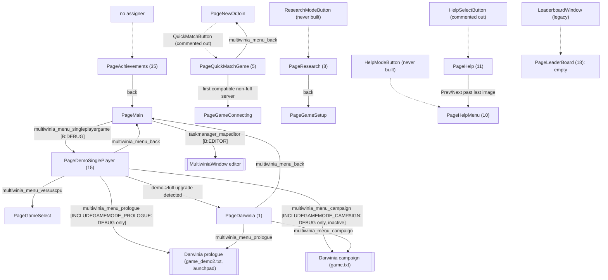
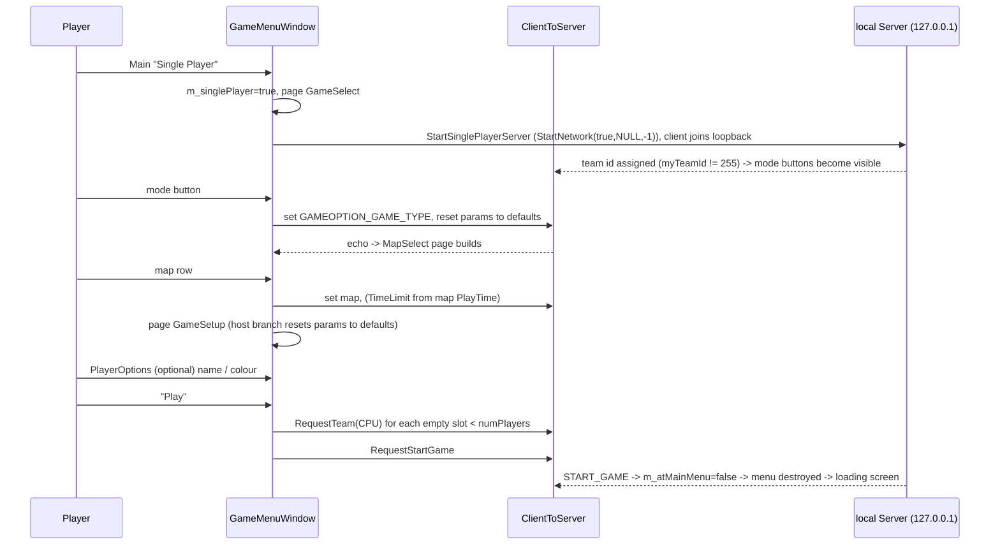
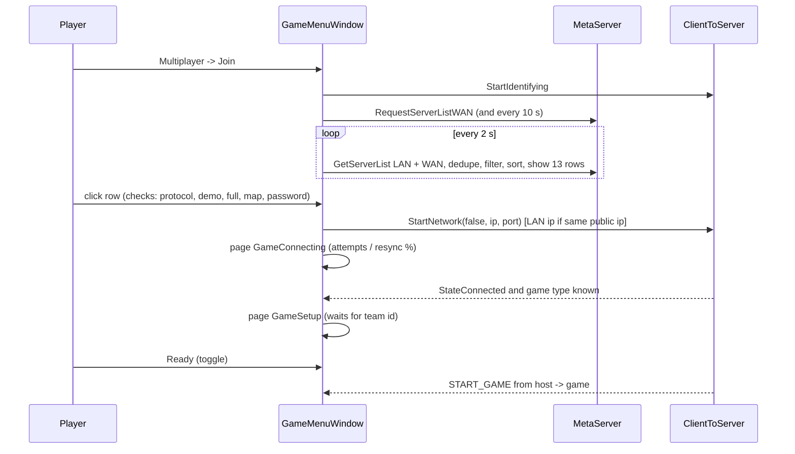

# P18_ui_gamemenu — Front-end GameMenuWindow and all UI buttons
Scope: `code/UI/*` — `GameMenuWindow.cpp/.h` (5629 + 325 lines), `ImageButton.cpp/.h`, `MapData.cpp/.h` and 66 header-only button classes (every file listed for P18 in `partitions.json`, plus three unlisted files in the same directory noted in the appendix). Build baseline: see build_matrix.md (`Release|Win32` + `TARGET_PC_FULLGAME`; `TESTBED_ENABLED`, `LOCATION_EDITOR`, `TARGET_DEBUG`, `INCLUDEGAMEMODE_PROLOGUE/_CAMPAIGN`, `HIDE_INVALID_GAMETYPES`, `SPECTATOR_ONLY`, `PERMITTED_MAPS`, `MULTIPLAYER_DISABLED`, `MULTIWINIA_DEMOONLY` all **off**; `LAN_PLAY_ENABLED`, `WAN_PLAY_ENABLED`, `INCLUDE_TUTORIAL`, `INCLUDE_CRATES_ADVANCED`, `TARGET_MSVC` **on**).

Supporting reads outside scope (for context, not owned): `code/game_menu.cpp/.h` (P17b — base buttons, layout helpers, map list), `code/interface/darwinia_window.cpp` (P17a — navigation), `code/multiwinia.cpp/.h` + `data/multiwinia.txt` (P02 — option tables), `code/app.cpp` permission functions (P01), `code/network/demo_limitations.cpp`, `code/network/networkvalue.*`, `code/network/clienttoserver.cpp` (P15), `code/interface/helpandoptions_windows.cpp`, `code/interface/chatinput_window.cpp`, `code/interface/mainmenus.*` (P17b), `contrib/systemiv/lib/metaserver/authentication.*` (P15), `data/language/english.txt`.

Reading guide: §1–§11 route to **09_meta_systems** (functional: what the player sees and does), §12–§13 route to **28_ui_framework** (technical: how the screen is built). All statements are for `[B:FULL]` unless tagged otherwise.

---

## [→ 09_meta_systems] 1. Front-end lifecycle and global structure

### 1.1 Where the front end lives
- The whole Multiwinia front end (title, mode select, map select, lobby, server browser, auth key, buy-now, credits, tutorials entry) is **one full-screen Eclipse window** of class `GameMenuWindow` registered under the window name `"multiwinia_mainmenu_title"` (the name doubles as the phrase id of the title) [C] `code/UI/GameMenuWindow.cpp:GameMenuWindow::GameMenuWindow`. Other code finds it with `EclGetWindow("multiwinia_mainmenu_title")` [C] (e.g. `code/network/clienttoserver.cpp`, `code/game_menu.cpp:GetTimeOption`).
- The window is a state machine over **pages**; each page is built from scratch (all buttons destroyed and re-created) when the page changes (§12.2).
- Two secondary front-end windows are opened *on top of* `GameMenuWindow` by its buttons but are owned by P17b: `HelpAndOptionsWindow` (Help and Options) [C] `code/interface/mainmenus.cpp:HelpAndOptionsButton::MouseUp`, and `MultiwiniaWindow` (map editor, `[B:EDITOR]` only) [C] `code/UI/MultiwiniaEditorButton.h:MouseUp`.

### 1.2 Creation, destruction and return from a game
| Step | Behaviour | Ref |
|---|---|---|
| Main loop | `MainMenuLoop` runs while `g_app->m_atMainMenu`; when `!m_gameMenu->m_menuCreated` and the renderer fade is complete it calls `GameMenu::CreateMenu()` | [C] `code/main.cpp:MainMenuLoop` |
| CreateMenu | fade in 0.25 s, remove all windows, `m_multiwinia->Reset()`, `EclRegisterWindow(new GameMenuWindow())`, camera set to sphere-world focus; `m_gameMode = GameModeNone`; if `g_app->m_multiwiniaTutorial` was set (returning from a tutorial game) the new window's `m_newPage = PageTutorials`; then `m_multiwiniaTutorial = false` | [C] `code/game_menu.cpp:GameMenu::CreateMenu` |
| Constructor | full-screen (0,0,ScreenW,ScreenH), not resizable/movable/closeable; `m_currentPage=-1`, `m_newPage=PageMain`; **auth gate**: reads the key, `Authentication_SimpleKeyCheck(key, METASERVER_GAMETYPE_MULTIWINIA)`; if not `AuthenticationAccepted` → `m_newPage = PageAuthKeyEntry` (a stored value `"authkey not found"` is blanked) — compiled out under `MULTIWINIA_DEMOONLY` | [C] `GameMenuWindow::GameMenuWindow` |
| Constructor (name) | player name from pref `PlayerName` (default token `multiwina_playername_default` → localised default); every `%` replaced by space; stored in `m_teamName` (max 16 chars) | [C] same |
| Constructor (filters) | browser filter booleans loaded from prefs `FilterShowDemos`, `FilterShowIncompatible`, `FilterShowFullGames`, `FilterShowCustomMaps`, `FilterShowPassworded` (all default 1) | [C] same |
| Constructor check | release-asserts `sizeof(s_pageNames)/sizeof(char*) == NumPages` (38) | [C] same |
| First Update | page −1 → `SetupNewPage(m_newPage)` | [C] `GameMenuWindow::Update` |
| Leaving to a game | the server's `NET_DARWINIA_START_GAME` sets `m_atMainMenu=false`, `m_atLobby=false`, `m_gameMode=GameModeMultiwinia`, `m_requestedLocationId=999`; `MainMenuLoop` exits, stops sound `"MultiwiniaInterface LobbyAmbience"`, calls `GameMenu::DestroyMenu()` (removes the window, fade out) | [C] `code/network/clienttoserver.cpp` (START_GAME handler), `code/main.cpp:MainMenuLoop`, `code/game_menu.cpp:GameMenu::DestroyMenu` |
| Returning | the in-game menu's leave button sets `m_requestedLocationId=-1` and `m_atMainMenu=true` (P17b); the main-menu loop then re-creates a **fresh** `GameMenuWindow` at `PageMain` (or `PageTutorials` after a tutorial, or `PageAuthKeyEntry` if the key has become invalid). No lobby state survives except prefs. (The automatic game-over → menu return in `code/location_input.cpp` is compiled only under `TESTBED_ENABLED`.) | [C] `code/interface/mainmenus.cpp` (leave-game button), `code/location_input.cpp` game-over block; [I] fresh object ⇒ no carried state |
| Results/stats | **not part of `GameMenuWindow`**: the end-of-game scoreboard is rendered in-game by the Multiwinia rules/HUD code (P02/P17b). The front end has no results page. | [C] absence of any results page in `GameMenuWindow.h` enum; [I] ownership |

### 1.3 Screen layout (shared by every page)
The screen is divided into a title bar and two content boxes by helper functions in `code/game_menu.cpp` (P17b owns them; reproduced here because every page depends on them) [C] `code/game_menu.cpp:GetPositions/GetPosition_TitleBar/GetPosition_LeftBox/GetPosition_RightBox/GetFontSizes/GetButtonSizes`:

| Quantity | Formula (W=screen width px, H=screen height px) |
|---|---|
| `horizSplit` | 0.26·H |
| `vertSplit` | 0.6·W |
| `gap` | 0.05·vertSplit (=0.03·W) |
| outer edges | left = top = gap; right = W−gap; bottom = H−gap; if W/H > 1.4 (widescreen): left += 0.08·W, right −= 0.08·W |
| Title bar | x=left, y=top, w=right−left, h=horizSplit−0.5·gap−top |
| Left box | x=left, y=horizSplit+0.5·gap, w=vertSplit−0.5·gap−left, h=bottom−y |
| Right box | x=vertSplit+0.5·gap, y=horizSplit+0.5·gap, w=right−x, h=bottom−y |
| Fonts | large=0.095·H, med=0.04·H, small=0.022·H |
| Standard button | w=0.9·leftW, h=1.3·med (=0.052·H), gap=0.1·med (=0.004·H) |

Standard page skeleton used by almost every `Setup*Page` [C] (e.g. `GameMenuWindow::SetupNewOrJoinPage`):
1. `buttonX = leftX + (leftW−buttonW)/2` (buttons centred in the left box).
2. Page title: `GameMenuTitleButton` named `"title"` at (leftX+10, leftY+10, leftW−20, 1.5·buttonH), font = med. Title is rendered upper-cased, shrunk to fit width, over a highlight beam [C] `code/game_menu.cpp:GameMenuTitleButton::Render`.
3. `yPos = leftY + 0.5·buttonH + 1.3·buttonH`; each stacked button is placed at `yPos += buttonH+gap` (i.e. the first button is one full step below that).
4. The back button sits at `leftY + leftH − 2·buttonH`.
5. The right box carries an information panel (image/description/MOTD/chat) that is not in the navigation order.

### 1.4 Persistent background (rendered behind every page)
`GameMenuWindow::Render` [C] draws, in order:
1. **`RenderBigDarwinian()`** (static; also used by other menus, `code/interface/mainmenus.cpp`, `code/game_menu.cpp:GameMenuDropDownWindow::Render`):
   - full-screen additive quad, black at three corners and RGB(1.0,0.5,0.1) at the bottom-left vertex (smooth-shaded glow);
   - a giant sprite (`sprites/darwinian.bmp`, nearest filtering, tint (1,0,0,1)) centred at (0.75·W, 0.7·H), half-size `0.3·W + 5·sin(t)` px (breathing), quad rotated 0.2 rad;
   - if high detail: 10 echo copies, each `size *= 1.02`, centre shifted by (−6,−6) px, tint (1,0.2,0.2) alpha `0.2·(1−i/10)`;
   - a rotating gear (`mwhelp/gear.bmp`), half-size 0.6·W, centred on screen, angle `0.2·t` rad, additive white alpha 0.06, drawn 10 times each rotated a further 0.02 rad (0 times in low detail).
   - Detail switch (only evaluated while `Multiwinia::GameInLobby()`): `smoothFps = smoothFps·(1−k) + fps·k` with `k = g_advanceTime·0.5`; low detail when `smoothFps < 20`, high again when `≥ 60` (hysteresis), initial 60 [C] `GameMenuWindow::RenderBigDarwinian`.
2. Title bar fill box; title: if the localised `multiwinia_mainmenu_title` equals `"MULTIWINIA"` the bitmap `textures/mwtitle.bmp` is drawn (width = title-font text width for that many characters at large size × 1.1, height = width/5.4, top at titleY+0.1·titleH), otherwise the text is drawn with outline. Subtitle `multiwinia_mainmenu_subtitle` at med size one large line below. Logo `icons/mwlogo.bmp` (aspect 277/194, height 0.8·titleH) drawn at the left (x = titleX+0.05·titleW) and mirrored at the right [C] `GameMenuWindow::Render`.
3. Per-page content boxes (`DrawFillBox`, shadowed panel): GameSetup → left+right; JoinGame and Achievements → one box of title-bar width; GameConnecting → left; GameSelect/MapSelect/LeaderBoardSelect/AdvancedOptions/DemoSinglePlayer/BuyMeNow → left+right; Main → left, plus MOTD box (right, height rightH, or 0.75·rightH when the auth box is shown) if a MOTD arrived, plus auth box (rightY+0.8·rightH, height 0.2·rightH) when `ShowAuthBox()`; all others → left only [C].
4. Overlays: JoinGame with an empty list → blinking "requesting list"/"no servers found" caption (§4.9); Achievements → blinking "loading achievements" caption [C] `RenderRequestingEffect`, `RenderLoadingAchievementsEffect` (blink: alpha 1.0 for the first 0.5 s of each second, 0.5 otherwise).
5. Buttons (`EclWindow::Render`); if a drop-down is open (`GameMenuDropDownWindow::s_window`) **only the button owning it** is rendered [C].
6. Lobby ambience: on the first `Update` after the sound system is ready the window triggers interface sound event `LobbyAmbience` [C] `GameMenuWindow::Update`.

---

## [→ 09_meta_systems] 2. Page enumeration (every slot)

`GameMenuWindow` declares an anonymous enum of pages with **gaps**; the debug-name table `s_pageNames[38]` (`code/game_menu.cpp:s_pageNames`) has one string per slot 0–37 including the gaps (removed Xbox Live Arcade, PDLC and Darwinia+ pages). `NumPages = 38`. Setup dispatch is `GameMenuWindow::SetupNewPage`; per-frame dispatch is `GameMenuWindow::Update` [C].

| Value | Enum | `s_pageNames` | Setup function | Per-frame update | Reachable in `[B:FULL]`? | Entered from |
|---|---|---|---|---|---|---|
| 0 | `PageMain` | "Main" | `SetupMainPage` | `UpdateGameOptions(false)` if `m_quickStart`; `UpdateMainPage` | **Yes** (default) | ctor; Back from NewOrJoin, Credits, Tutorials, Update, Achievements; GameSelect back (SP); EnterAuthkey/PlayDemo/Enter key; network errors |
| 1 | `PageDarwinia` | "Darwinia" | `SetupDarwiniaPage` | — | No — only from `PageDemoSinglePlayer` when demo→full status changes | `Update` demo-upgrade check `[B:DEBUG]` |
| 2 | `PageGameSelect` | "GameSelect" | `SetupGameSelectPage` | `UpdateGameOptions(true)` | **Yes** | Main "Single Player" (`DarwiniaModeButton`); NewOrJoin "Host"; MapSelect Back; lobby Back (host) |
| 3 | `PageNewOrJoin` | "NewOrJoin" | `SetupNewOrJoinPage` | — | **Yes** | Main "Multiplayer"; JoinGame Back; GameSelect Back (MP); GameConnecting Back; lobby Back (client) |
| 4 | `PageJoinGame` | "JoinGame" | `SetupJoinGamePage` | `UpdateJoinGamePage` | **Yes** | NewOrJoin "Join"; Filters Back; Password Back; Error Back; GameConnecting Back |
| 5 | `PageQuickMatchGame` | "QuickMatchGame" | `SetupQuickMatchGamePage` | `UpdateQuickMatchGamePage` | No — its button is commented out ("Removed by Chris. It doesn't work.") | (`QuickMatchButton`, never created) `[B:LEGACY]` |
| 6 | `PageGameSetup` | "GameSetup" | `SetupMultiplayerPage(m_gameType)` | `UpdateMultiplayerPage` then (fall-through) `UpdateGameOptions(true)` | **Yes** (the lobby) | MapSelect level click; GameConnecting on connect; PlayerOptions colour/back; AdvancedOptions back |
| 7 | `PageGameConnecting` | "GameConnecting" | `SetupGameConnectingPage` | `UpdateGameOptions(false)`; `UpdateGameConnectingPage` | **Yes** | `JoinServer` (browser row, password Connect) |
| 8 | `PageResearch` | "Research" | `SetupResearchPage` | — | No (`ResearchModeButton` never created) | `[B:LEGACY]` |
| 9 | `PageMapSelect` | "MapSelect" | `SetupMapSelectPage` | `UpdateGameOptions(true)` → `UpdateMapSelectPage` | **Yes** | GameSelect game-type click; lobby Back (single player) |
| 10 | `PageHelpMenu` | "HelpMenu" | `SetupHelpMenuPage` | — | No (`HelpModeButton` never created; Prev/Next only on PageHelp) | `[B:LEGACY]` |
| 11 | `PageHelp` | "Help" | `SetupHelpPage` | — | No (`HelpSelectButton` creation commented out) | `[B:LEGACY]` |
| 12 | `PageAdvancedOptions` | "AdvancedOptions" | `SetupAdvancedOptionsPage` | `UpdateAdvancedOptionsPage` | **Yes** (host, non-demo key) | lobby "Advanced Options" |
| 13 | *(gap)* | "XBLASelectSessionType" | — | — | No | — `[B:DEAD]` |
| 14 | `PageXBLASignIn` | "XBLASignIn" | *(none — `SetupNewPage` default case release-asserts "Game menu invalid page")* | — | No | — `[B:DEAD]` |
| 15 | `PageDemoSinglePlayer` | "DemoSinglePlayer" | `SetupSPDemoPage` | `UpdatePageSinglePlayer` | No in FULL; yes under `TARGET_DEBUG` (Main "Single Player") | `[B:DEBUG]` |
| 16 | `PageBuyMeNow` | "BuyMeNow" | `SetupBuyMePage` | — | **Yes** `[B:DEMO]` (runtime demo key) | Main "Buy full game"; any demo-restricted mode/map/server; inactive Multiplayer button |
| 17 | `PageLeaderBoardSelect` | "LeaderBoardSelect" | `SetupLeaderBoardSelectPage` (empty `return`) | — | No | — `[B:LEGACY]` |
| 18 | `PageLeaderBoard` | "Leaderboards" | `SetupLeaderboardPage` (empty `return`) | — | No (only `LeaderboardWindow`, itself only reachable from an inactive legacy button) | `code/interface/leaderboards_window.cpp` `[B:LEGACY]` |
| 19 | *(gap)* | "XBLASelectGameType" | — | — | No | `[B:DEAD]` |
| 20 | *(gap)* | "XBLASelectCustomMatchtype" | — | — | No | `[B:DEAD]` |
| 21 | *(gap)* | "Downloaded PDLC" | — | — | No | `[B:DEAD]` |
| 22 | *(gap)* | "PDLC Upsell" | — | — | No | `[B:DEAD]` |
| 23 | `PageAuthKeyEntry` | "AuthKeyEntry" | `SetupAuthKeyPage` | — | **Yes** | ctor (bad/missing key); Help&Options "Authentication key" (`AuthPageButton`) |
| 24 | `PagePlayerOptions` | "PlayerOptions" | `SetupPlayerOptionsPage` | `UpdateGameOptions(true)` | **Yes** | lobby: click own gamer tag |
| 25 | `PageSearchFilters` | "SearcHFilters" (sic) | `SetupFiltersPage` | — | **Yes** | JoinGame "Filters" |
| 26 | *(gap)* | "DarwiniaPlus SP Page" | — | — | No | `[B:DEAD]` |
| 27 | *(gap)* | "DarwiniaPlus MP Page" | — | — | No | `[B:DEAD]` |
| 28 | *(gap)* | "DarwiniaPlus Darwinia Page" | — | — | No | `[B:DEAD]` |
| 29 | *(gap)* | "DarwiniaPlus Darwinia SP Page" | — | — | No | `[B:DEAD]` |
| 30 | *(gap)* | "DarwiniaPlus Darwinia MP Page" | — | — | No | `[B:DEAD]` |
| 31 | `PageUpdateAvailable` | "Updates Available Page" | `SetupUpdatePage` | — | **Yes** (metaserver reports a newer version) | Main "Update available" |
| 32 | `PageCredits` | "Credits Page" | `SetupCreditsPage` | — | **Yes** | Main "Credits" |
| 33 | `PageTutorials` | "Tutorial Page" | `SetupTutorialPage` | `UpdateGameOptions(false)`; `UpdateMainPage` | **Yes** (`INCLUDE_TUTORIAL`) | Main "Tutorial"; `GameMenu::CreateMenu` after a tutorial game |
| 34 | `PageError` | "Error Page" | `SetupErrorPage` | — | **Yes** | `CreateErrorDialogue` (browser row checks, network disconnect reasons) |
| 35 | `PageAchievements` | "Achievements Page" | `SetupAchievementsPage` | `UpdateAchievementsPage` | **No** — no code anywhere assigns `m_newPage = PageAchievements`, and no `AchievementButton` is ever constructed | `[B:LEGACY]` [C] grep of `code/` |
| 36 | `PageEnterPassword` | "Password Entry" | `SetupPageEnterPassword` | — | **Yes** | browser row on a passworded server |
| 37 | `PageWaitForGameToStart` | "Wait for Game to Start" | *(none — `SetupNewPage` only calls `Remove()`, leaving an empty page)* | nothing | **Yes** (host only, after it sends Start) | `UpdateMultiplayerPage` |

Help-page sub-enum (used only by the unreachable `PageHelp`): `HelpPageGeneral=1, HelpPageSkirmish=2, HelpPageKoth=3, HelpPageCts=4, HelpPageRR=5, NumHelpPages=6` [C] `GameMenuWindow.h`.

Counts: **18 live pages** in `[B:FULL]` (values 0, 2, 3, 4, 6, 7, 9, 12, 16, 23, 24, 25, 31, 32, 33, 34, 36, 37), **10 compiled-but-unreachable pages** (1, 5, 8, 10, 11, 14, 15, 17, 18, 35), **10 gap slots** with no enum constant (13, 19, 20, 21, 22, 26, 27, 28, 29, 30); 18+10+10 = 38 = `NumPages` [C] table above.

---

## [→ 09_meta_systems] 3. Screen-flow diagram

### 3.1 Live flow `[B:FULL]`
Edge labels are the button caption phrase id (or the condition). "Back(prev)" = `BackPageButton(m_currentPage)`: because `m_currentPage` still holds the *previous* page while the new page is being set up, such a button returns to whatever page was showing before (§12.2) [C] `GameMenuWindow::SetupNewPage` (assigns `m_currentPage` last).

Notes on the diagram [C] unless stated:
- `GSANY` is the same page as `GSSP`/`GSMP`; it is drawn separately only to keep the diagram readable. Single-player vs multiplayer is the boolean `m_singlePlayer` (set by `DarwiniaModeButton`, cleared by `SetupMainPage`/`SetupNewOrJoinPage` because LAN/WAN play is compiled in) [C] `SetupMainPage`, `SetupNewOrJoinPage`, `DarwiniaModeButton.h`.
- `PageBuyMeNow` "Back(prev)" returns to whichever page opened it (Main, GameSelect, MapSelect, JoinGame or Main for the inactive-MP case) — only the Main edge is drawn.
- `PageError` stores its back page in `m_errorBackPage` (default `PageMain`); browser-row errors and "server full"/"bad password" disconnects use `PageJoinGame`; kick/duplicate key/connection errors use `PageMain` [C] `GameServerButton.h:MouseUp`, `code/network/clienttoserver.cpp` (disconnect handler).
- Any other disconnect reason sends the window straight to `PageMain` [C] same handler.

### 3.2 Compiled-but-unreachable / non-baseline flow

---

## [→ 09_meta_systems] 4. Page-by-page specification (live pages)

Conventions for the button tables: **#** = position in the controller navigation list `m_buttonOrder` (— = not navigable: decorative/info widgets); **Name** = Eclipse button name (unique per page; used for look-ups and for `<name>_description` help text); **Caption** = phrase id passed to `LANGUAGEPHRASE`; geometry uses the §1.3 symbols (`bx` = buttonX, `bw`/`bh` = standard button width/height, `lX/lY/lW/lH`, `rX/rY/rW/rH` = left/right box). Every stacked button advances `y += bh+gap` unless stated. "Base MouseUp" = `GameMenuButton::MouseUp` (plays `MenuSelect`, or `MenuCancel` when `m_transitionDirection == -1`, and starts a 1.0 s menu transition in that direction) [C] `code/game_menu.cpp:GameMenuButton::MouseUp`.

### 4.1 PageMain (0) — title screen
[C] `GameMenuWindow::SetupMainPage`, `UpdateMainPage`. Sets `m_singlePlayer=false` (LAN/WAN compiled in), `m_settingUpCustomGame=false`, `m_localSelectedLevel=-1`, window title `multiwinia_mainmenu_title`.

| # | Class | Name | Caption | Shown when | Action on click |
|---|---|---|---|---|---|
| — | `GameMenuTitleButton` | `title` | `multiwinia_menu_mainmenutitle` | always | — |
| 1 | `TutorialPageButton` | `multiwinia_menu_tutorial_short` | `multiwinia_menu_tutorial_short` | `INCLUDE_TUTORIAL` **and demo key** (tutorial is listed first for demo users) | base MouseUp; → `PageTutorials` |
| 2 | `DarwiniaModeButton` | `multiwinia_menu_singleplayergame` | same | always | base MouseUp; `m_singlePlayer=true`; → `PageGameSelect` (`[B:DEBUG]`: → `PageDemoSinglePlayer`) [C] `DarwiniaModeButton.h` |
| 3 | `NewOrJoinButton` | `multiwinia_menu_multiplayergame` | same | always; `m_inactive = !App::MultiplayerPermitted()` | base MouseUp; inactive → `PageBuyMeNow`, else → `PageNewOrJoin`; (`MULTIPLAYER_DISABLED` builds: inactive click ignored) [C] `NewOrJoinButton.h` |
| 4 | `TutorialPageButton` | `multiwinia_menu_tutorial_short` | same | `INCLUDE_TUTORIAL` **and full key** | → `PageTutorials` |
| 5 | `HelpAndOptionsButton` (P17b) | `helpandoptions` | `multiwinia_menu_helpandoptions` | always | base MouseUp; opens `HelpAndOptionsWindow` as child; `m_doMenuTransition=true` [C] `code/interface/mainmenus.cpp:HelpAndOptionsButton::MouseUp` |
| (6) | `StartTestbedButton` ×2 | both `start_testbed_server` | `start_testbed_server`, `start_testbed_client` | `TESTBED_ENABLED` `[B:DEAD]` | appendix |
| (7) | `MultiwiniaEditorButton` | `editor` | `taskmanager_mapeditor` | `LOCATION_EDITOR` `[B:EDITOR]`; inactive with demo key | inactive → `PageBuyMeNow`; else sound `MenuSelect`, transition, open `MultiwiniaWindow` |
| 8 | `UpdatePageButton` | `multiwinia_update` | `multiwinia_update_available` | metaserver datum `LatestVersion` is present and ≠ `APP_VERSION` | → `PageUpdateAvailable`, base MouseUp |
| 9 | `CreditsButton` | `credits_button` | `dialog_credits` | always | base MouseUp; → `PageCredits` |
| 10 | `BuyNowModeButton` | `multiwinia_menu_buyfullgame` | same | `IS_DEMO` | base MouseUp; → `PageBuyMeNow` |
| 11 | `QuitButton` | `multiwinia_menu_quit` | same | always, at `lY+lH−2bh` | `g_app->m_requestQuit = true` (no sound/transition) |
| — | `MOTDButton` | `multiwinia_motd` | — | right box (rX+0.05rW, rY+0.05rH, 0.9rW, 0.675rH), small font | §10.1 |
| — | `AuthStatusButton` | `multiwinia_authStatus` | — | right box (rX+0.05rW, rY+0.85rH, 0.9rW, 0.18rH), med font; draws only if `ShowAuthBox()` | none (`MouseUp` empty) — §10.3 |

`UpdateMainPage` (also run on `PageTutorials`, and on `PageDemoSinglePlayer` during a tutorial): (a) if `m_singlePlayer` and no local server → `App::StartMultiPlayerServer()`; (b) once per process (function-static flag) polls `MetaServer_RequestData(NET_METASERVER_DATA_LATESTVERSION)`; when it first arrives and differs from `APP_VERSION`, the main page is rebuilt so the Update button appears [C].

### 4.2 PageTutorials (33) `[B:FULL]` (`INCLUDE_TUTORIAL`)
[C] `SetupTutorialPage`, `TutorialButton.h`. On setup also sets `g_app->m_multiwiniaHelp->m_currentTutorialHelp = -1`.

| # | Class | Name | Caption | Condition | Action |
|---|---|---|---|---|---|
| — | `GameMenuTitleButton` | `title` | `multiwinia_menu_tutorial_short` | | |
| 1 | `TutorialButton` (`m_tutorialType = App::MultiwiniaTutorial1`) | `multiwinia_menu_tutorial1` | same | inactive if the map `MAPID_MP_KOTH_2P_1` is not in the KOTH list or not permitted (also always inactive under `TARGET_PC_HARDWARECOMPAT`) | if inactive or `m_quickStart` → ignore; base MouseUp; `m_singlePlayer=true`, `m_quickStart=true`, `g_app->m_multiwiniaTutorial=true`, `g_app->m_multiwiniaTutorialType=type`, `m_lockMenu=true` (freezes navigation) |
| 2 | `TutorialButton` (`MultiwiniaTutorial2`) | `multiwinia_menu_tutorial2` | same | needs `MAPID_MP_KOTH_3P_1` | same |
| 3 | `BackPageButton(PageMain)` | `multiwinia_menu_back` | same | | → Main |

The tutorial launch sequence is in §5.4.

### 4.3 PageNewOrJoin (3) — host or join
[C] `SetupNewOrJoinPage`. Sets `m_xblaSessionType=-1`, `m_singlePlayer=false`, `m_settingUpCustomGame=false`.

| # | Class | Name | Caption | Condition | Action |
|---|---|---|---|---|---|
| — | `GameMenuTitleButton` | `title` | `multiwinia_neworjoin_title` | | |
| 1 | `NewServerButton` | `multiwinia_menu_hostgame` | same | `m_disabled = !App::HostGamePermitted()` | base MouseUp; → `PageGameSelect` (the GameSelect setup starts the advertised server) |
| 2 | `JoinGameButton` | `multiwinia_menu_joingame` | same | always | base MouseUp; → `PageJoinGame` |
| — | (`QuickMatchButton`, `quickmatch`, `multiwinia_menu_quickmatch`) | | | **commented out** "It doesn't work" | `[B:LEGACY]` |
| 3 | `BackPageButton(PageMain)` | `multiwinia_menu_back` | same | | |

### 4.4 PageGameSelect (2) — game-mode select
[C] `SetupGameSelectPage`, `GameTypeButton.h`, `GameTypeImageButton.h`, `GameTypeInfoButton.h`.
- **Server start**: if there is no local server: single player → `App::StartSinglePlayerServer()` (server reachable on 127.0.0.1 only, client joins via loopback); multiplayer → `App::StartMultiPlayerServer()` (listens on the local host IP / listener port). Both reset AI type to `AITypeStandard` unless a tutorial is running [C] `code/app.cpp:StartSinglePlayerServer/StartMultiPlayerServer/StartNetwork`.
- One `GameTypeButton` per entry of `Multiwinia::s_gameBlueprints` (loaded from `data/multiwinia.txt` in file order: Domination 0, KingOfTheHill 1, CaptureTheStatue 2, Assault 3, RocketRiot 4, Blitzkrieg 5, TankBattle 6). Name = caption phrase = `MultiwiniaGameBlueprint::GetName()` = `multiwinia_gametype_<lower-case name>` if that phrase exists, else the raw name.
  - A button whose *name* is literally `"TankBattle"` (i.e. phrase missing — it is missing from `english.txt`) is flagged inactive **before registration and is never registered** → Tank Battle is invisible [C].
  - Every other button is registered and navigable; afterwards, if `!App::IsGameModePermitted(i)` it is marked inactive (visible greyed, skipped by pad navigation).
  - `HIDE_INVALID_GAMETYPES` builds skip non-permitted modes entirely `[B:HWCOMPAT/ASSAULT_STRESSTEST/BETATEST]`.
- Each `GameTypeButton` renders **only after the local client has a team** (`myTeamId != 255`, or spectator) — i.e. the list appears once the just-started local server has accepted the local player [C] `GameTypeButton::Render`. It draws a complexity icon at the right edge (width 0.1·w, height 0.05·w): `icons/menu_basic.bmp` (Domination, KOTH), `icons/menu_intermediate.bmp` (CTS, TankBattle, Assault), `icons/menu_advanced.bmp` (Rocket Riot, Blitzkrieg) from `MultiwiniaGameBlueprint::GetDifficulty` [C] `code/multiwinia.cpp:GetDifficulty`. When it has controller focus it sets `m_highlightedGameType`.
- `GameTypeButton::MouseUp`: demo key and mode not permitted → base MouseUp, → `PageBuyMeNow`; inactive → ignore; if team assigned: → `PageMapSelect`, `m_gameType = type` (network request), `m_uiGameType=-1`, `m_clickGameType=type`, and every parameter of that blueprint reset to its default (network requests) [C].

| # | Class | Name | Caption | Notes |
|---|---|---|---|---|
| — | `GameMenuTitleButton` | `title` | `multiwinia_gameselect_title` | |
| 1–6 | `GameTypeButton` | `multiwinia_gametype_domination`, `_kingofthehill`, `_capturethestatue`, `_assault`, `_rocketriot`, `_blitzkrieg` | same as name | see above |
| 7 | `FinishMultiwiniaButton(page)` | `multiwinia_menu_back` | same | page = `PageMain` if single player else `PageNewOrJoin`; shuts the local game/server down (§4.6.6) |
| — | `GameTypeImageButton` | `gametype` | — | right box (rX+0.1rW, rY+0.1rW, 0.8rW, 0.8rW·2/3): picture `mwhelp/mode_<lower name>.bmp` of the highlighted mode, alpha 0.8, outline alpha 0.5; "Full Game Only" (`dialog_fullonly`) overlay for non-permitted modes on demo |
| — | `GameTypeInfoButton` | `gametypeinfo` | — | below the image (height 0.85rH − imageH), small font; auto-scrolling text `multiwinia_help_<lower name>` (or `multiwinia_help_prologue` / `_campaign`) |

All `mwhelp/mode_*.bmp` textures are pre-loaded at setup "to avoid laggy interface" [C].

### 4.5 PageMapSelect (9) — map list
[C] `SetupMapSelectPage`, `UpdateMapSelectPage`, `LevelSelectButton.h`, `LevelSelectButtonBase.h`, `MapListTitlesButton.h`, `MapImageButton.h`, `MapInfoButton.h`.
- Thumbnails of the current mode are preloaded on the loading-screen worker (`g_loadingScreen->m_workQueue->Add(&PreloadThumbnails)` then `g_loadingScreen->Render()`; the loading screen is shown while caching) [C].
- **Network echo wait**: if `m_clickGameType != -1` and the networked `m_gameType` has not yet changed to it, setup returns with an empty page; `UpdateMapSelectPage` re-runs setup every frame until they match [C].
- Rows: one `LevelSelectButton` per map of the mode (`g_app->m_gameMenu->m_maps[gameType]`, pre-sorted by player count then difficulty basic<intermediate<advanced, P17b `GameMenu::CreateMapList`). Row height 0.7·bh, row step 0.7·(bh+gap), width bw, font small. Button name = map `Name` field or file name; inactive if `!App::IsMapPermitted(mode, crc)`.

| # | Class | Name | Caption | Notes |
|---|---|---|---|---|
| — | `GameMenuTitleButton` | `title` | `multiwinia_gametype_<mode>` | |
| — | `MapListTitlesButton` (`m_screenId=PageMapSelect`) | `Titles` | — | header strip at (bx, lY+10+1.8bh, bw, 0.7bh), black 50%: columns `multiwinia_mapname` / `multiwinia_playtime` / `multiwinia_players` (grey 0.6) |
| (1) | `AnyLevelSelectButton` | `multiwinia_level_any` | same | only when `m_settingUpCustomGame` — never true in this code `[B:LEGACY]` |
| 1..n | `LevelSelectButton` | `<map name or file>` | localised `<file-without-ext>_name` | see row rendering below |
| n+1 | `BackPageButton(PageGameSelect)` | `multiwinia_menu_back` | same | always to GameSelect (all three branches of the code pick the same page) |
| — | `MapImageButton` | `MapThumbnail` | — | right (rX+0.1rW, rY+0.1rW, 0.8rW, 0.6rW) |
| — | `MapInfoButton` | `MapInfo` | — | below thumbnail (height 0.85rH − thumbH), font 1.1·small |

Row rendering [C] `LevelSelectButton::Render`:
- Columns from `LevelSelectButtonBase::GetColumnPositions(x,w)`: name at x+0.025w, time at x+0.65w, players at x+0.83w (coop x+0.93w and difficulty x+1.03w are computed but unused).
- Name: localised `<file>_name` (custom maps: raw level name); colour green (0.65,1,0.4), red (1,0.3,0.3) when focused, dark grey (0.3) when demo-restricted. The currently requested map is drawn "clicked".
- Play time: map `PlayTime` (minutes) or, if 0, the mode's `TimeLimit` default, printed `"0:%02d"` (so 10 → "0:10"); "-" if still 0.
- Players: up to 4 Darwinian icons (`textures/darwinian.bmp`, height 0.9·rowH, spacing 0.55·iconW, rotated −π/8), coloured `Multiwinia::GetColour(i)`; for `ForceCoop` maps colour index = i/2 (3-player: icon 1 uses index 1); grey (75,75,75) when demo-restricted.
- Slide-in: each row appears `1.0·rowY/H` s after creation, sliding from `−0.1·W·(remaining s)` with an additive white flash of alpha = remaining s [C] `LevelSelectButtonBase::RenderMapName`.
- Rollover sound `MenuRollOver` when focus moves onto a row; focusing sets `m_highlightedLevel` (drives the thumbnail and description).

`LevelSelectButton::MouseUp` [C]: start transition (+1); reject invalid indices; sound `MenuSelect`; demo-restricted → `PageBuyMeNow`; (custom-game branch dead); `m_requestedMapId = index` (network), `m_localSelectedLevel = index`; → `PageGameSetup`; if co-op is on and the map is not `CoopMode` → co-op off; if the map is `ForceCoop` → co-op on; if the mode has a `TimeLimit` parameter: set it to the map's `PlayTime` if non-zero, else to the blueprint default. (See §8.4 for why the PlayTime value is immediately overwritten.)

Thumbnail [C] `MapImageButton::Render`: map index = focused row, else requested map; texture `thumbnails/<file-without-ext>.bmp` (lower-cased), drawn only if it exists (the `thumbnails/default.bmp` fallback name is computed but only used if loading an existing file fails); demo-restricted maps get a centred "Full Game Only" (`dialog_fullonly`, font w/10) overlay; white outline. Description [C] `MapInfoButton::Render`: custom maps → the map file's `Description` text; official maps → phrase `<file-without-ext>_description`, auto-scrolling.

### 4.6 PageGameSetup (6) — the lobby (single-player setup, host lobby and client lobby share one page)
[C] `GameMenuWindow::SetupMultiplayerPage`, `UpdateMultiplayerPage`, `PlayGameButton.h`, `GamerTagButton.h`, `KickPlayerButton.h`, `MapSelectModeButton.h`, `AdvancedOptionsModeButton.h`, `FinishMultiwiniaButton.h`.

#### 4.6.1 Preconditions and state on entry
1. `_gameType == -1` → nothing is built.
2. `mapId = m_localSelectedLevel` (or networked `m_requestedMapId` if −1). If `mapId == -1` **or** the local player has no team yet (`myTeamId == 255` and not spectator) → set `m_waitingForTeamID=true`, remember the type, return with an empty page; `UpdateMultiplayerPage` calls setup again once a team id (or spectator flag) arrives [C].
3. Coming from MapSelect with a different `m_uiGameType` → rebuild MapSelect instead. Coming from any page other than Research/AdvancedOptions/PlayerOptions (and not MapSelect): `m_uiGameType = _gameType` and, **on the host**, `m_requestedMapId = 0` [C]; [I] in practice this branch is only reached by the game-type-changed rebuild of the lobby (§12.2), because every normal entry comes from MapSelect, PlayerOptions, AdvancedOptions or (clients) GameConnecting.
4. `g_app->m_atLobby = true`.
5. Returning from PlayerOptions with an empty name → name reset to the localised default.
6. Unless returning from PlayerOptions/AdvancedOptions: colour request initialised — Assault or co-op: remember the old request in `m_previousRequestedColour`, request `-1` (no colour; side chosen later); otherwise request pref `PlayerPreferedColour` if that colour is free, else `Multiwinia::GetNextAvailableColour()` (lowest id 0–7 not used by any non-unused team) [C] + `code/multiwinia.cpp:GetNextAvailableColour`.
7. **Host only, unless returning from Research/AdvancedOptions/PlayerOptions**: every blueprint parameter is reset to its default (`m_params[i] = default`, network requests) [C].

#### 4.6.2 Widgets
Fonts: stacked controls use small; title, Play and Back use med.

| # | Class | Name | Caption | Who sees it | Geometry | Action |
|---|---|---|---|---|---|---|
| — | `GameMenuTitleButton` | `title` | `multiwinia_gametype_<mode>` | all | standard | — |
| 1 (initial focus) | `PlayGameButton` | `Play` | `multiwinia_menu_ready` (MP) / `multiwinia_menu_play` (SP) | all; **not drawn** when demo key and map demo-restricted | (bx, lY+bh+1.8bh, bw, bh) | §4.6.4 |
| 2 | `AdvancedOptionsModeButton` | `Advanced Options` | `multiwinia_menu_advanceoptions` | host only (`g_app->m_server`), not in `SPECTATOR_ONLY` builds | height 0.66bh | demo key → ignored (and the button is created disabled+inactive); else base MouseUp, → `PageAdvancedOptions` |
| 3 | `GameMenuDropDown` | `multiwinia_menu_aimode` | `multiwinia_menu_aimode` | host only | height 0.66bh; no background; cycle mode (left/right cycles values) | options: `dialog_easy_difficulty`=0 (`AITypeEasy`), `multiwinia_menu_normal`=1 (`AITypeStandard`), `multiwinia_menu_hard`=2 (`AITypeHard`); bound to networked `m_aiMode` (`GAMEOPTION_AIMODE`); disabled+inactive with demo key |
| 4.. | `GamertagButton` ×`numPlayers` | `tag0`…`tag<n-1>` | dynamic (§4.6.3) | all | column at (bx, lY+6bh), w=0.45bw, h=0.75bh, row step 1.125bh (1.5×0.75bh) | own row → `PagePlayerOptions` (base MouseUp); other rows no-op |
| (interleaved) | `KickPlayerButton` | `kick1`…`kick<n-1>` (none for slot 0) | — | host in multiplayer only | (bx+1.05·0.45bw, rowY, 0.75bh, 0.75bh) | visible only while that slot is a `TeamTypeRemotePlayer`; click → `Server::KickClient(team.m_clientId)` if not disconnected |
| last | `FinishSinglePlayerButton(PageMapSelect)` (SP) / `FinishMultiwiniaButton(PageGameSelect)` (MP host) / `FinishMultiwiniaButton(PageNewOrJoin)` (MP client) | `multiwinia_menu_back` | same | all | (bx, lY+lH−2bh) | §4.6.6 |
| — | `GameTypeImageButton` | `gametype` | — | all | (lX+lW−0.45bw−(lW−bw)/2, lY+6bh, 0.45bw, 0.3bw) — beside the gamer tags | mode picture |
| — | `MapImageButton` | `MapThumbnail` | — | all | right (rX+0.1rW, rY+0.1rW, 0.8rW, 0.6rW) | thumbnail |
| — | `MapSelectModeButton` | `Map` | (" ") | all | under thumbnail, height 0.66bh, small font | shows the requested map's localised name over a highlight beam; **click does nothing** (`MouseUp` returns immediately — the in-lobby map change is disabled) |
| — | `MapInfoButton` (SP) **or** `GameMenuChatButton` (MP, font 0.8·small) | `chat_button` (both) | — | all | under map name; height = rH − thumbH − 0.5·small − 2(bh+gap) − gap | SP: map description; MP: chat log (§9) |
| — | `ChatInputField` (P17b) | `chat_input` | — | MP only | (rX+0.1rW, rY+0.95rH, 0.8rW, 1.2·small) | bound to `m_currentChatMessage` (§9) |
| (dead) | `CSpectatorButton` ×n | `tag` | `teamtype_2` | `#ifdef TESTBED` (never defined) `[B:DEAD]` | second column +280 px | register as spectator |
| (dead) | `MapDetailsButton` | `MapDetails` | — | commented out | | appendix |

#### 4.6.3 Gamer tag (player slot) rendering [C] `GamertagButton::Render`
Caption, by priority:
1. If the lobby team has a non-empty name: the name; if `m_demoPlayer` prefix with trimmed `teamtype_demo` + space; if `m_ready` the caption becomes `name + " (" + multiwinia_ready + ")"` (the demo prefix is dropped in this case).
2. Else by team type: `TeamTypeLocalPlayer` → `teamtype_0`; `TeamTypeRemotePlayer` → `teamtype_1`; `TeamTypeCPU` → `teamtype_2`; `TeamTypeSpectator` → phrase `Spectator` (not present in `english.txt`); unused → `teamtype_2` in single player, `multiwinia_open_or_cpu` in multiplayer.
3. If the focused button is this slot's kick button and the mouse is over it → `multiwinia_clicktokick`.

Visuals: CPU/unused slots are inactive (not navigable) with colour ×0.25 and border alpha 0.3; colour-less teams (`m_colourId == -1`, e.g. Assault/co-op before choosing) are grey 0.7. Background is a horizontal gradient from the team colour (left) to black (right) — or to 50 % team colour/50 % white when focused. When a slot's team type changes, its colour flashes from white back to the team colour over 1.0 s (linear) — except for the unused→CPU change. Text: white if inactive, red (1,0.3,0.3) if focused, else green (0.6,1,0.4).

#### 4.6.4 Ready / Play and starting the game
- **Single player** (`m_singlePlayer`): `PlayGameButton::MouseUp` — ignore if demo-restricted map, or if `m_localSelectedLevel != m_requestedMapId` (the server has not echoed the map yet), or the map is not permitted; wait for sound-system init; for every slot `i < numPlayers` that is unused request a CPU team (`RequestTeam(TeamTypeCPU, -1)`); `UpdateGameOptions(true)`; `RequestStartGame()` [C].
- **Multiplayer** (host and clients): `PlayGameButton::MouseUp` → `RequestToggleReady(myTeamId)` [C]. The host also has to ready up.
- **Host auto-start** (`UpdateMultiplayerPage`, every frame on the host, MP and SP alike): `notReady` = any slot whose team type is neither unused nor CPU and is not ready; also `notReady` if demo key and map demo-restricted. When everyone is ready and mode/map are valid and permitted: wait for sound init, fill empty slots `< numPlayers` with CPU teams, `UpdateGameOptions(true)`, `RequestStartGame()`, go to `PageWaitForGameToStart` (an empty page, so the request is sent once) [C]. In single player the local team is never "ready", so only the Play button starts the game [I] (follows from the ready test).
- The game actually starts when the server broadcasts `NET_DARWINIA_START_GAME` (§1.2) — P15/P01.

#### 4.6.5 Kick
Host-only kick buttons appear beside slots 1..n−1 while the slot holds a remote human; clicking calls `Server::KickClient`. The kicked client receives a disconnect with reason `Disconnect_KickedByServer` and is sent to `PageError` with `multiwinia_error_kickedbyserver`, back → Main [C] `KickPlayerButton.h`, `code/network/clienttoserver.cpp`.

#### 4.6.6 Leaving the lobby
- `FinishMultiwiniaButton(page)` [C]: on a client (no local server) whose team is **ready** and whose server is not lagging (last server letter < 5.0 s ago) it does not leave immediately: it sets `m_disconnectFromGame=true` and toggles ready off; `UpdateMultiplayerPage` then waits until some used team and the local team are not ready, and finally calls `App::ShutdownCurrentGame()`, clears `m_atLobby`, sets `m_requestedMapId=-1`, goes to **`PageMain`** (not the button's page), clears chat and the password [C]. Otherwise it immediately `ShutdownCurrentGame()` (client leaves; on the host the server object is deleted — [C] `code/app.cpp:ShutdownCurrentGame` deletes `m_server`), `m_atLobby=false`, `m_requestedMapId=-1`, goes to its page (Back sound + reverse transition), clears chat and password.
- `FinishSinglePlayerButton(PageMapSelect)` [C]: locally clears `m_multiwinia->m_coopMode` and `m_basicCratesOnly`, requests team colour −1, sets every lobby team's `m_colourId=-1`, goes back to MapSelect (the local server stays up), clears chat and password.

#### 4.6.7 Who can change what (host vs client)
| Setting | Host | Client | Mechanism |
|---|---|---|---|
| Game mode | GameSelect page (before lobby) | no | `m_gameType` network option |
| Map | MapSelect page (before lobby); not changeable inside the lobby | no | `m_requestedMapId` |
| AI difficulty | lobby drop-down (full key) | no (control not created) | `m_aiMode` |
| Mode parameters, basic crates, co-op, password | Advanced Options page (full key) | no (button not created) | `m_params[]`, `m_basicCrates`, `m_coopMode`, `m_serverPassword` |
| Own name and colour/side | PlayerOptions | PlayerOptions | team-name / team-colour reliable requests |
| Ready | yes (required) | yes | `RequestToggleReady` |
| Kick | yes | no | `Server::KickClient` |
| Start | automatic when all humans ready | no | `RequestStartGame` |
Restriction is enforced in the UI by not creating the controls. [U] Whether the server also rejects option-change requests from non-host clients is not visible in P18 files — resolve in P15 (`code/network/server.cpp` handling of `NET_DARWINIA_SETGAMEOPTION*`).

### 4.7 PageAdvancedOptions (12) — host-only mode parameters
[C] `SetupAdvancedOptionsPage`, `UpdateAdvancedOptionsPage`, `OptionDetailsButton.h`. Control height = 0.65·bh, font small.

| # | Widget | Name | Caption | Created when | Binding |
|---|---|---|---|---|---|
| — | `GameMenuTitleButton` | `title` | `multiwinia_menu_advanceoptions` | always | |
| 1..k | one control per blueprint parameter *i* (type chosen by the parameter's `Change` column, §8.1) | `multiwinia_param_<lower name>` | checkbox: `multiwinia_param_<name>`; drop-down: `LANGUAGEPHRASE(<raw name>)` (see §8.1 note); numeric: translated `multiwinia_param_<name>` | `m_gameType != -1` | `m_params[i]` (network) |
| k+1 | `GameMenuCheckBox` | `multiwinia_param_basiccrates` | same | `INCLUDE_CRATES_ADVANCED` (on in FULL) | `m_basicCrates` (`GAMEOPTION_BASICCRATES`) |
| k+2 | `GameMenuCheckBox` | `multiwinia_menu_coop` | same | map has `CoopMode` and full key | `m_coopMode` (`GAMEOPTION_COOPMODE`) |
| k+3 | `GameMenuInputField` (text) | `multiwinia_menu_serverpassword` | same | host and **not** single player (one blank row gap before it) | `m_serverPassword` (≤16 chars; setting it on the host calls `Server::SetPassword`) [C] `GameMenuWindow.h:ServerPasswordString` |
| last | `BackPageButton(PageGameSetup)` | `multiwinia_menu_back` | same | always | |
| — | `OptionDetailsButton` | `option_details` | — | right box (5 % inset, 90 % size), small font | help text for the focused control: phrase `<focused button name>_description_<gameType>` if it exists, else `<name>_description`; auto-scrolling |

Per-frame rule (`UpdateAdvancedOptionsPage`): the `SuddenDeath` control is inactive whenever the `TimeLimit` option is 0; on every change of that inactive state the control is **forced** to 0 (when becoming inactive) or 1 (when becoming active) — checkbox via `Set`, drop-down via `SelectOption` [C].

### 4.8 PagePlayerOptions (24) — name and colour/side
[C] `SetupPlayerOptionsPage`, `FancyColourButton.h`, `ApplyNameButton.h`, `GameMenuWindow::SetTeamNameAndColour`. Height 0.65·bh, font small (title also small).

| # | Widget | Name | Caption | When | Action |
|---|---|---|---|---|---|
| — | `GameMenuTitleButton` | `title` | `multiwinia_playeroptions` | | |
| 1 | `GameMenuInputField` (text, ≤16 chars) | `multiwinia_player_name` | same | always | `m_teamName` — `PlayerNameString::Set` truncates, stores pref `PlayerName` (empty → default phrase) and sends `ReliableSetTeamName` [C] `code/game_menu.cpp:PlayerNameString::Set` |
| 2–4 | `FancyColourButton(-1)`, `(1)`, `(0)` | `multiwinia_random`, `multiwinia_attackers`, `multiwinia_defenders` | `multiwinia_option_0_7_0` ("Random"), `multiwinia_attackers`, `multiwinia_defenders` | Assault (`ASSAULT_ATTACKER_COLOURID = 1`, `ASSAULT_DEFENDER_COLOURID = 0`) | choose side |
| 2–9 | `FancyColourButton(i)` i = 0..7 | `multiwinia_colour_green, _red, _yellow, _blue, _orange, _cyan, _purple, _pink` (by i) | `multiwinia_colour_green, _red, _yellow, _blue, _orange, _purple, _cyan, _pink` (by i) | all other modes (`MULTIWINIA_NUM_TEAMCOLOURS = 8`) | choose colour |
| last | `ApplyNameButton(prev)` | `multiwinia_menu_back` | same | | saves pref `PlayerName` + prefs file, then Back (to the lobby) |

Colour ids and RGB (`code/multiwinia.cpp:teamColours`, P02): 0 (100,255,100) green, 1 (255,50,50) red, 2 (255,255,50) yellow, 3 (120,180,255) blue, 4 (255,150,0) orange, 5 (150,0,255) purple, 6 (70,200,200) cyan, 7 (255,150,255) pink. The button **names** for ids 5 and 6 are swapped relative to their colours (`GetColourNameChar` lists cyan before purple) while captions are correct (`GetColourName`) [C] `GameMenuWindow.cpp:GetColourNameChar/GetColourName`.

"Taken" rule (`FancyColourButton::MouseUp`/`Render`) [C]:
- Assault: count teams already on that side (in `MouseUp` including the local team; in `Render` excluding it). 3-player map: Defenders (0) taken if ≥1 team on it; Attackers (1) taken if 2 on it. Other maps: taken if `count ≥ numPlayers/2` (integer division). Random (−1) is never taken.
- Co-op on: taken if `!Multiwinia::IsValidCoopColour(id)` — invalid when ≥2 colours are in use and nobody is on this one, or ≥2 teams are already on it [C] `code/multiwinia.cpp:IsValidCoopColour`.
- Otherwise: taken if any team (other than self, in Render) already has that colour id.
- Taken buttons are inactive (grey swatch 0.5, caption in inactive grey); the local team's current colour is drawn "clicked" (red caption).

Click on a free colour: `m_currentRequestedColour = id`; outside Assault/co-op store pref `PlayerPreferedColour`; reverse transition; → `PageGameSetup`. The actual request is sent by `SetTeamNameAndColour()` (called each frame by `UpdateGameOptions(true)` on GameSetup/MapSelect/GameSelect/PlayerOptions): if (team assigned, a colour is requested, it differs from the team's colour, it is taken by someone, not co-op, not Assault) the request falls back to the preferred colour (if free) or the next available; then on GameSetup/PlayerOptions (or while starting a tutorial) `ReliableSetTeamColour(request)` is sent when request ≠ −1 or co-op or Assault; and the team name is sent once if not yet requested [C].
Visual: row background white 0.1 (or (0.75,0.75,1,0.5) when focused/clicked); caption at 0.05w; colour swatch in the right quarter (x = w·3/4, width 0.95·w/4, height 0.8h) with a left-to-right gradient to black; rollover sound `MenuRollOver`.

### 4.9 PageJoinGame (4) — LAN/WAN server browser
[C] `SetupJoinGamePage`, `UpdateJoinGamePage`, `UpdateServerList`, `ApplyServerFilters`, `ApplyBasicServerListSort`, `JoinServer`, `GameServerButton.h`, `ServerTitleInfoButton.h`, `code/game_menu.cpp:RemoveDelistedServers`.

#### 4.9.1 Layout
- Setup calls `ClientToServer::StartIdentifying()` (public-address discovery, P15) and requests the WAN list `MetaServer_RequestServerListWAN(METASERVER_GAMETYPE_MULTIWINIA)`; clears `m_highlightedGameType/m_highlightedLevel`.
- The page uses the **title-bar width** for its box. Row geometry: x = bx, width `m_serverW = 0.9·titleW`, row height = row step = `0.6·bh`, small font; first row at y = lY + 0.5bh + 1.3bh + 0.8bh. At most **13** rows (`SERVERS_ON_SCREEN`, `code/game_menu.h`).
- Column header `ServerTitleInfoButton` "Titles" at (bx, lY+10+1.6bh, 0.9titleW, 0.6bh), black 50 % strip: `multiwinia_join_host` at x+0.05w; `multiwinia_join_type` at +0.25w (cumulative 0.30w); `multiwinia_join_map` at +0.1w (0.40w); `multiwinia_join_players` right-aligned at 0.98w.
- `ScrollBar` "scrollBar" (P17a) at x = lX + titleW − (bh/2 + 10), y = first row, w = bh/2, h = 13 rows; created with numRows 0, window size 10 (rows are 13 — mismatch [C]); `SetNumRows(list size)` on every refresh.
- Bottom row: `BackPageButton(PageNewOrJoin)` "multiwinia_menu_back" (width 0.45·titleW) and `FiltersPageButton` "filters_page" caption `multiwinia_menu_filters` at x + 1.1·(0.45 titleW) → `PageSearchFilters`.
- A right-hand map preview (`MapImageButton`/`MapInfoButton`) is commented out; rows still set `m_highlightedGameType/Level` on hover [C].
- Empty list overlay: blinking `multiwinia_error_requestinglist`, replaced by `multiwinia_error_noserversfound` once a WAN list has been received and processed (`MetaServer_HasReceivedListWAN() && s_gotListFromMetaserver`) [C] `RenderRequestingEffect`.

#### 4.9.2 Refresh timing
| Event | Interval | Ref |
|---|---|---|
| Rebuild list & rows | every **2.0 s**, or after **1.0 s** if the list is empty and a WAN list has arrived | [C] `UpdateJoinGamePage` (function-static timer starts at 0) |
| Re-request WAN list from metaserver | every **10.0 s** (also clears `s_gotListFromMetaserver`) | [C] same |

#### 4.9.3 List pipeline (`UpdateServerList`, then manual entries)
1. LAN list `MetaServer_GetServerList(false,false,true)`, WAN list `MetaServer_GetServerList(false,true,false)` (argument semantics: P15).
2. **De-duplicate**: drop WAN entries whose key (`NET_METASERVER_STARTTIME` u64, `NET_METASERVER_RANDOM` int; ordered lexicographically) matches a LAN entry; append WAN to LAN [C] `RemoveDuplicateWANServers`.
3. Drop entries carrying `NET_METASERVER_DELISTED` [C] `RemoveDelistedServers`.
4. Filters (§4.10) then sort (§4.9.4).
5. **Manual servers**: for i = 0..29, pref `Server<i+1>` = `"<host> <port> <name>"` (sscanf; defaults host `0.0.0.0`, port pref `NetworkServerPort` default 4000, name = whole line) → synthetic entry: name, `NUMTEAMS 0`, `MAXTEAMS 4`, `GAMEINPROGRESS 0`, `GAMEMODE = i mod 6`, IP/LOCALIP = host, PORT/LOCALPORT = port, inserted at the **top** [C]. They carry no version/protocol/map CRC, so the row click path reports "incompatible" [I] (from `IsProtocolMatch` requiring `PROTOCOLMATCH` or `GAMEVERSION`) — manual entries are effectively unjoinable in this build.
6. Row buttons: created/removed so that count = min(list, 13); each `GameServerButton(rowIndex)` is named `server<row><global counter>`, positioned at row y, and inserted into `m_buttonOrder` before the last entry (so rows sit between Back and Filters) [C]. (Removal uses `m_serverButtonOrderStartIndex + row`, which does not match the insertion index — see §Contradictions.)

#### 4.9.4 Sorting [C] `ApplyBasicServerListSort`
Single pass over the filtered list building a new list: protocol-incompatible → appended at the end; full (`NUMTEAMS == MAXTEAMS`) or demo-restricted (`NET_METASERVER_DEMORESTRICTED`) → inserted at index `numGood`; otherwise → inserted at the front and `numGood++`. Resulting order: good servers (reverse of arrival), then full/demo-restricted (reverse of arrival), then incompatible (arrival order). A scored alternative `ApplyBetterSlowerServerListSort` (full = 1, incompatible = 10, stable insertion) exists but is never called `[B:LEGACY]`. There is **no user-selectable sort column**.

#### 4.9.5 Row rendering [C] `GameServerButton::Render`
Row r shows list entry `r + scrollBar.m_currentValue`; rows without an entry are blank and inactive.
- Columns: host name (`NET_METASERVER_SERVERNAME`) at 0.05w; short mode name `multiwinia_gametypeshort_<name>` (DOM/KOTH/CTS/ASLT/ROCKET/BLITZ) at 0.30w; map at 0.40w; `"(%d/%d)"` players at 0.90w; player boxes — `MAXTEAMS` outlined boxes starting 80 px left of the count, each (0.66·(h−8)) × (h−8) px, 2 px apart, filled for occupied slots: full colour for humans, ×0.6 for AI. Human count = `NET_METASERVER_NUMHUMANTEAMS`, except when it is `'?'` or the game is not in progress → equals `NUMTEAMS`.
- Map column text: localised `<file>_name` for a known map (mode + `MAPCRC` found in local list), else `multiwinia_error_unknownmap` (custom-map name only under `LOCATION_EDITOR`); replaced by `authentication_demorestricted` when demo-restricted; replaced by the literal `"INCOMPATIBLE : <version>"` when protocol-incompatible.
- Padlock `icons/locked.bmp` (0.8h square at 0.01w) when `NET_METASERVER_HASPASSWORD`.
- Colours (RGB 0–255):

| State (first match wins) | Text, unfocused | Text, focused | Focus background (α 0.5) |
|---|---|---|---|
| protocol mismatch | (128,0,0) | (77,0,0) | (77,0,0) |
| LAN game (`"lan"` key) | (150,150,255) | (by the rows below) | (by the rows below) |
| demo-restricted | (255,255,102) | (by the rows below) | (by the rows below) |
| not full | (153,255,102) | (255,77,77) | (191,191,255) |
| full, map unknown | (100,100,100) | (100,100,100) | (77,77,77) |
| full | (128,128,128) | (77,77,77) | (77,77,77) |
(The LAN and demo-restricted colours apply only when unfocused; the focused branch tests mismatch → not-full → unknown-map → else [C].)
- Controller scrolling: `SpecialScroll(+1)` on row 0 with ≥13 more entries below advances the scroll bar instead of moving focus; `SpecialScroll(−1)` on the last row (12) scrolls up if possible [C]. (The window calls it on `m_buttons[m_currentButton]`, see §12.4.)

#### 4.9.6 Clicking a row [C] `GameServerButton::MouseUp`, `GameMenuWindow::JoinServer`
Base MouseUp, then the first matching rule:
1. protocol mismatch → `PageError` "multiwinia_error_incompatible", back → JoinGame;
2. `NET_METASERVER_DEMORESTRICTED` → `PageBuyMeNow`;
3. full → `PageError` "multiwinia_error_serverfull", back → JoinGame;
4. map (mode, CRC) not installed → `PageError` "multiwinia_error_missingmap", back → JoinGame;
5. `NET_METASERVER_HASPASSWORD` → remember list index in `m_serverIndex`, → `PageEnterPassword`;
6. else `JoinServer(index)`.

`JoinServer(n)`: `m_bSpectator=false`; copy the entry into `m_joinServer` (used by the Connecting page); target = `NET_METASERVER_IP`/`PORT` (port −1 if absent); if our own public identity is known and equals the server's public IP, use `LOCALIP`/`LOCALPORT` instead (same-LAN case); port −1 → silently do nothing; if a password has been typed copy it to `ClientToServer::m_password`; `App::StartNetwork(false, ip, port)` (client join); → `PageGameConnecting` [C]. (`JoinServerAsSpectator` exists — same but `m_bSpectator=true`, no port check — and is never called `[B:LEGACY]`.)

Leaving the page (`ShutdownJoinGamePage`): `StopIdentifying()` unless the next page is GameConnecting; forget row buttons [C].

### 4.10 PageSearchFilters (25) — browser filters
[C] `SetupFiltersPage`, `ApplyServerFilters` and `ApplyFilter*`, `FinishMultiwiniaButton.h:SaveFiltersButton`. Controls height 0.65·bh, font small.

| # | Widget | Name | Caption | Variable | Persisted pref | Filter effect when **unchecked** / value |
|---|---|---|---|---|---|---|
| — | title | `title` | `multiwinia_menu_filters` | | | |
| 1 | `GameMenuDropDown` (unsorted) | `multiwinia_gametype` | `multiwinia_gametype` | `m_gameTypeFilter` (int) | **not persisted** (resets to −1 with every new window) | ≠ −1: keep only entries with `NET_METASERVER_GAMEMODE == value`. Options: `multiwinia_gametype_any` −1, `_domination` 0, `_kingofthehill` 1, `_capturethestatue` 2, `_assault` 3, `_rocketriot` 4, `_blitzkrieg` 5 |
| 2 | `GameMenuCheckBox` | `check_box` | `multiwinia_menu_showdemogames` | `m_showDemosFilter` | `FilterShowDemos` | remove entries with bool `NET_METASERVER_DEMOSERVER` |
| 3 | `GameMenuCheckBox` | `check_box2` | `multiwinia_menu_showincompatible` | `m_showIncompatibleGamesFilter` | `FilterShowIncompatible` | remove protocol mismatches **and** entries whose map is not installed |
| 4 | `GameMenuCheckBox` | `check_box3` | `multiwinia_menu_showfull` | `m_showFullGamesFilter` | `FilterShowFullGames` | remove `NUMTEAMS ≥ MAXTEAMS` |
| 5 | `GameMenuCheckBox` | `check_box5` | `multiwinia_menu_showpasswords` | `m_showPasswordedFilter` | `FilterShowPassworded` | remove entries containing key `NET_DARWINIA_SERVER_PASSWORD` (`"dy"`) — **does not match** the advertised `NET_METASERVER_HASPASSWORD` (`"dI"`) and collides with `NET_METASERVER_GAMETIME` (`"dy"`, never set) ⇒ removes nothing [I] |
| — | (none) | | | `m_showCustomMapsFilter` | `FilterShowCustomMaps` | no checkbox and no filter function — dead setting [C] |
| 6 | `SaveFiltersButton(prev)` | `multiwinia_menu_back` | same | | writes all 5 prefs + save | back to JoinGame |

Filter order: invalid game types (only `HIDE_INVALID_GAMETYPES`, off) → game type → full → protocol → demos → missing maps → passwords [C].

### 4.11 PageEnterPassword (36)
[C] `SetupPageEnterPassword`, `ConnectButton.h`.

| # | Widget | Name | Caption | Notes |
|---|---|---|---|---|
| — | title | `title` | `multiwinia_enterpassword` | |
| — | `TextButton` (P17b) | `passrequired_text` | `multiwinia_passwordrequired` | small, centred, shadow |
| 1 | `GameMenuInputField` (text, style 2, height 0.65bh) | `multiwinia_enterpassword` | same | bound to `m_serverPassword` (≤16); text edit starts immediately |
| 2 | `ServerConnectButton` | `multiwinia_menu_connect` | same | at lY+lH−3bh; inactive while the password is empty; click → `JoinServer(m_serverIndex)` (no sound) |
| 3 | `BackPageButton(PageJoinGame)` | `multiwinia_menu_back` | same | |
A wrong password comes back from the server as disconnect reason `Disconnect_BadPassword` → `PageError` "multiwinia_error_badpass", back → JoinGame [C] `code/network/clienttoserver.cpp`.

### 4.12 PageGameConnecting (7)
[C] `SetupGameConnectingPage`, `UpdateGameConnectingPage`, `ShutdownGameConnectingPage`, `WaitingButton.h`.
- Title `multiwinia_menu_joining`; `WaitingButton("multiwinia_menu_connecting")` named `connecting` (med font); `FinishMultiwiniaButton(page)` back where page = JoinGame if arriving from JoinGame, otherwise NewOrJoin (e.g. from the password page).
- `WaitingButton` text by `ClientToServer::m_connectionState`: Connecting → `multiwinia_menu_connecting` + 0–3 dots (`(int)(t·2) mod 4`, i.e. one step per 0.5 s), second line (0.6× font) `multiwinia_menu_attempts` with flag `T` replaced by `m_connectionAttempts`; Handshaking/Connected → `multiwinia_menu_connected`, second line `multiwinia_menu_resyncing` with `T` = `100·lastProcessedSequenceId / serverSequenceId` formatted `"%2.0f"`; Disconnected → blank. If `m_joinServer` is set, a details block (0.5× font, rows 0.7× font apart, values at x+200 px): `multiwinia_join_host` name; `multiwinia_join_address` `"<ip>, port <port>"` (actual connection target); `multiwinia_gametype` full mode name; `multiwinia_join_map` map name; `multiwinia_join_players` `"n/max"`. Text drawn twice (outline then fill).
- Transition: when state is Connected **and** the networked `m_gameType != -1` → `PageGameSetup` (which may then wait for a team id, §4.6.1). No timeout in `[B:FULL]` (a 10 s timeout exists only under `TESTBED_ENABLED`).
- Leaving the page stops identification.

### 4.13 PageWaitForGameToStart (37)
Empty page (no buttons; default left fill box) shown on the host between `RequestStartGame()` and the server's start broadcast; prevents the auto-start block from firing twice [C] `UpdateMultiplayerPage`, `SetupNewPage`.

### 4.14 PageError (34)
[C] `CreateErrorDialogue`, `SetupErrorPage`. `CreateErrorDialogue(msg, back=PageMain)` stores the message and back page, sets `m_newPage=PageError`, clears `m_atLobby` and the chat log. Page: title `error`; `TextButton(message)` `error_text` (small, centred) at lY+0.5bh+2bh; `BackPageButton(m_errorBackPage)`; back page then reset to −1.
Error sources and messages (all phrase ids):

| Trigger | Message | Back page | Ref |
|---|---|---|---|
| browser row: protocol mismatch | `multiwinia_error_incompatible` | JoinGame | [C] `GameServerButton::MouseUp` |
| browser row: full | `multiwinia_error_serverfull` | JoinGame | same |
| browser row: map not installed | `multiwinia_error_missingmap` | JoinGame | same |
| disconnect `Disconnect_ServerFull` | `multiwinia_error_serverfull` | JoinGame | [C] `code/network/clienttoserver.cpp` |
| disconnect `Disconnect_DuplicateKey` | `dialog_duplicate_key` | Main | same |
| disconnect `Disconnect_KickedByServer` | `multiwinia_error_kickedbyserver` | Main | same |
| disconnect `Disconnect_BadPassword` | `multiwinia_error_badpass` | JoinGame | same |
| client id received twice | `multiwinia_error_connection` | Main | same |
| joined as spectator when not allowed / server-side removal of our client id | `multiwinia_error_serverfull` | JoinGame / Main | same |
| any other disconnect reason | (no error page) | → Main directly | same |

A second, overlay-style error dialog (`m_showingErrorDialogue`, `RenderErrorDialogue`: centred box W/3 × H/3, `error` title, word-wrapped text, dismissed with `ControlCloseTaskHelp`) is never switched on (assignments commented out) `[B:LEGACY]` [C].

### 4.15 PageAuthKeyEntry (23) — authentication key
[C] `SetupAuthKeyPage`, `AuthInputField.h`, `PasteKeyButton.h`, `EnterAuthKeyButton.h`, `PlayDemoAuthkeyButton.h`, `QuitAuthKeyButton.h`, `GameMenuWindow::PasteFromClipboard/CheckNewAuthKeyStatus`, `contrib/systemiv/lib/metaserver/authentication.h` (`AUTHENTICATION_KEYLEN = 32`).

| # | Widget | Name | Caption | Position | Build |
|---|---|---|---|---|---|
| — | title | `title` | `multiwinia_enterauthkey` | | all |
| — | `AuthInputField` | `auth_input` | — | (bx, lY+0.5bh+1.3bh+bh+gap, bw, bh/2); char cell width = font = bw/31; text editing starts immediately | all |
| 1 | `PasteKeyButton` | `paste` | `multiwinia_menu_paste` (tooltip `multiwinia_menu_paste_tooltip`) | lY+lH−5bh | `TARGET_MSVC` / `TARGET_OS_MACOSX` |
| 2 | `PlayDemoAuthkeyButton` | `multiwinia_menu_play_demo` | same | lY+lH−3bh | all except HWCOMPAT/BETATEST/ASSAULT_STRESSTEST targets |
| 3 | `EnterAuthkeyButton` | `multiwinia_menu_done` | same | lY+lH−2bh | all |
| (4) | `QuitAuthkeyButton` | `multiwinia_menu_quit_auth_key` | `multiwinia_menu_quit` | lY+lH−2bh, right half | HWCOMPAT/BETATEST/ASSAULT_STRESSTEST only `[B:DEAD]` for FULL |
There is no Back button.

Key field behaviour [C] `AuthInputField`:
- Displays 31 character cells (`KEYLEN−1`), upper-case; cell separator lines alpha 100/255, brighter (255) for cells where `i mod 7 ≥ 5` (marks every 6+1 group); a blinking block cursor (on for the first 0.5 s of each second) while editing and length < 32.
- Typing: accepted only while length < 31 (Backspace always); the buffer is upper-cased, stored and **saved on every keystroke** to `<profile dir>authkey`; after a non-backspace key, when the length becomes 6, 13, 20 or 27 a `-` is appended automatically → format `XXXXXX-XXXXXX-XXXXXX-XXXXXX-XXX` (31 chars).
- Enter: `CheckNewAuthKeyStatus()` — local algorithmic check `Authentication_SimpleKeyCheck`; if accepted and not a demo key also asks the metaserver for the real status (`Authentication_RequestStatus`); returns true when locally accepted → `PageMain`.
- Status line once ≥31 chars: phrase `authentication_result` with flag `S` replaced by the status phrase (`dialog_auth_accepted`, `dialog_auth_unknown`, `dialog_auth_key_invalid`, `dialog_auth_key_banned`, `dialog_auth_key_revoked`, `dialog_auth_key_not_found`, `dialog_auth_version_revoked`, `dialog_auth_key_inactive`, `dialog_auth_version_not_found`, `dialog_auth_key_dead`, `dialog_auth_wrong_platform`, `dialog_auth_unknown_game` for statuses 1, 0, −1 … −10) or `dialog_auth_status_demo_user` for demo keys; green, 1.5× font, 6 field-heights below [C] + `authentication.cpp:Authentication_GetStatusStringLanguagePhrase`.
- Mouse click on a field still holding `"authkey not found"` clears it.
- Mac only: Ctrl/Cmd-V pastes.
Buttons: **Paste** reads up to 31 chars of `CF_TEXT` from the Windows clipboard, upper-cases, sets and saves the key to `<profile dir>authkey.dev`, runs `CheckNewAuthKeyStatus()` (stays on page). **Done** (reverse transition) → if locally accepted: `CheckNewAuthKeyStatus()` and → Main. **Play Demo** (reverse transition) generates a demo key `Authentication_GenerateKey(buf, 4, true)`; if it passes the simple check it is set and saved to `<profile dir>authkey.dev` and → Main, otherwise the buffer is cleared.

### 4.16 PageBuyMeNow (16) `[B:DEMO]` — upsell
[C] `SetupBuyMePage`, `UnlockFullGameButton.h`, `ImageButton.cpp`.

| # | Widget | Name | Caption / content | Geometry |
|---|---|---|---|---|
| — | title | `title` | `launchpad_buyme_1` | |
| — | `TextButton` | `info` | `multiwinia_buy_prices` (1.3·small, shadow, centred) | y0 = lY+bh+0.5bh+0.5bh+bh |
| — | `ImageButton("textures/prices.bmp")` (no border) | `image` | price artwork | (bx+0.2bw, y0+3bh, 0.6bw, (40/300)·0.6bw) |
| 1 | `UnlockFullGameButton` | `launchpad_button_buynow` | same (centred, 1.2·med) | (bx+0.2bw, y0+4.5bh, 0.6bw, 2bh); `m_url = App::GetBuyNowURL()` |
| 2 | `BackPageButton(prev)` | `multiwinia_menu_back` | same | lY+lH−2bh |
| — | `ImageButton("textures/multiwinia.bmp")` (border) | `image` | box art | right (rX+0.1rW, rY+0.1rH, 0.8rW, (149/394)·0.8rW) |
| — | `TextButton` | `info` | `multiwinia_buynow` (small, shadow) | below box art, rW × rH |
`UnlockFullGameButton`: vertical gradient white→black (α 0.5), outline, caption, own additive highlight (α 0.2) on hover/click, URL printed at the bottom (font 0.13·h), gamepad "A" icon `icons/button_a.bmp` in gamepad mode. Click: open the URL in the browser; if running full-screen (`ScreenWindowed`=0) switch to windowed 1024×768 (prefs `ScreenWindowed`, `ScreenWidth`, `ScreenHeight`), recreate the GL window/renderer, flush/regenerate GL state, save prefs, re-initialise Eclipse at 1024×768, remove all windows and rebuild the front end from scratch [C].
`BuyNowInfoButton` (five lines `multiwinia_buynow_1`…`_5`) exists but is never placed `[B:LEGACY]`.

### 4.17 PageUpdateAvailable (31)
[C] `SetupUpdatePage`, `update_page_buttons.h`. Title `multiwinia_update_available`; `RunAutoPatcherButton` `multiwinia_menu_autopatch` with **hard-coded caption "Update"** ("FIXME: localize"; macOS uses `RunSparkleButton` with the phrase) — click (Win32): `CreateProcess("autopatch.exe")` and `exit(0)`; `VisitWebsiteButton` `dialog_visitwebsite` — lazily fetches metaserver datum `UpdateURL` while rendering and opens it on click (no-op until fetched); `BackPageButton(prev)`.

### 4.18 PageCredits (32)
[C] `SetupCreditsPage`, `ReadCredits`, `ReadMultiwiniaBetaTesters`, `ScrollingTextButton.h`. Title `dialog_credits`; one `ScrollingTextButton` `credits_box` (small font) at (bx, lY+1.8bh, bw, lH − 1.5bh − 1.3bh − bh − 2gap); text = phrases `multiwinia_credits_1`, `_2`, … concatenated with `" \n"` until the first missing index; a phrase whose text is exactly `*BETATESTERS` is replaced by every line of the resource file `multiwinia_betatesters.txt` (`data/multiwinia_betatesters.txt`). Lines starting with `-` render 1.25× larger without the dash (section headings). Scrolling per §12.6. `BackPageButton(prev)`.

### 4.19 Compiled-but-unreachable pages (behaviour if revived)
| Page | Contents [C] | Why unreachable |
|---|---|---|
| `PageDarwinia` (1) | `PrologueButton("Prologue")` `prologue`/`multiwinia_menu_prologue`; `CampaignButton("Campaign")` `campaign`/`multiwinia_menu_campaign`; `BackPageButton(PageMain)` | only entered from `PageDemoSinglePlayer` `[B:DEBUG]` |
| `PageDemoSinglePlayer` (15) | title `multiwinia_singleplayer_title`; `MultiwiniaVersusCpuButton` `versus`/`multiwinia_menu_versuscpu` (→ GameSelect, transition +1); Prologue (`INCLUDEGAMEMODE_PROLOGUE`); Campaign (`INCLUDEGAMEMODE_CAMPAIGN`, created inactive, navigable only with full key); `FinishMultiwiniaButton(PageMain)`; right: `GameTypeImageButton` + `GameTypeInfoButton` (1.2·small) | `DarwiniaModeButton` targets it only under `TARGET_DEBUG` |
| `PageQuickMatchGame` (5) | title `multiwinia_setup_quick_match`; `WaitingButton("multiwinia_menu_searching")`; Back → NewOrJoin. Update: rebuild list every 1.0 s; join the first entry that is protocol-compatible and not full; WAN re-request every 10 s | button commented out |
| `PageResearch` (8) | one numeric `InputField` per `GlobalResearch` item (range 0–4, step 1) using `GetDefaultPositions`; Back → GameSetup | `ResearchModeButton` never instantiated (Darwinia research) `[B:LEGACY]` |
| `PageHelpMenu` (10) | only `BackPageButton(m_currentPage)` (the per-topic `HelpSelectButton` loop over `multiwinia_helppage_1..5` is commented out) | `HelpModeButton` never instantiated |
| `PageHelp` (11) | `HelpImageButton` 600×400 px centred showing `mwhelp/helppage_<helpPage>_<image>.bmp`; `PrevHelpButton` (caption `multiwinia_menu_back`) / `NextHelpButton` (`dialog_next`) step the image index while the next file exists, else return to HelpMenu | no live entry. Live help is `HelpAndOptionsWindow` → `HelpWindow`/`GameTypeHelpWindow` (P17b/P19) |
| `PageAchievements` (35) | title `multiwinia_menu_achievements`; scroll bar; Back → Main; "loading achievements" overlay until `AchievementTracker::HasLoaded()`; `m_achievementButtons` list never filled | no assigner; the in-game `AchievementsButton` (P17b) has no MouseUp override |
| `PageLeaderBoardSelect` (17), `PageLeaderBoard` (18) | setup functions are empty `return;` | leaderboards unimplemented on PC |
| `PageXBLASignIn` (14) | none (would assert) | Xbox remnant |

`AchievementButton` (if ever created): per-achievement row named `achievement<N>`, slides down into place at 750 px/s after the menu transition completes, scrolls 4 px per scroll-bar step, clipped to the scroll-bar band, draws only a grey (0.4, α 0.5) background — the image/text drawing has been removed; it marks itself disabled+inactive; helper `MakeNumberHumanReadable` formats thousands with commas [C] `AchievementButton.h`.

---

## [→ 09_meta_systems] 5. Start sequences driven from the front end

### 5.1 Single-player (versus CPU) game

[C] `DarwiniaModeButton.h`, `SetupGameSelectPage`, `GameTypeButton.h`, `LevelSelectButton.h`, `PlayGameButton.h`, `code/network/clienttoserver.cpp` START_GAME.

### 5.2 Hosting a multiplayer game
Main → Multiplayer → Host → GameSelect (`StartMultiPlayerServer`: listens on the local host IP and the listener's port; the server is created with `m_noAdvertise = true` and its later advertising is P15's concern) → mode → map → lobby. The host waits for clients, may change AI/advanced options, presses **Ready**; when every human team is ready the host auto-fills empty slots with CPU teams and requests the start (§4.6.4) [C] `code/app.cpp:StartNetwork`, `UpdateMultiplayerPage`.

### 5.3 Joining a multiplayer game

[C] `SetupJoinGamePage`, `UpdateJoinGamePage`, `GameServerButton::MouseUp`, `JoinServer`, `UpdateGameConnectingPage`, `SetupMultiplayerPage`.

### 5.4 Tutorial launch ("quick start" path)
1. Tutorials page → `TutorialButton`: `m_singlePlayer=true`, `m_quickStart=true`, `g_app->m_multiwiniaTutorial=true`, tutorial type stored, menu input locked [C].
2. Next frames (page Tutorials runs `UpdateGameOptions(false)` then `UpdateMainPage()`): `UpdateMainPage` starts a server via `StartMultiPlayerServer()` (because `m_singlePlayer` and no server) [C].
3. `UpdateGameOptions`: with a server, tutorial flag and not yet started → `SetupTutorial()` (type 1) or `SetupTutorial2()` (type 2): mode = King of the Hill (also set directly on `g_app->m_multiwinia`), AI = Easy, map = index of CRC `MAPID_MP_KOTH_2P_1` (tutorial 1) or `MAPID_MP_KOTH_3P_1` (tutorial 2), requested colour 0, all KOTH params at defaults; tutorial 2 also pre-assigns lobby colours 0,1,2 to teams 0,1,2; `m_startingTutorial=true`; renderer fade-out [C].
4. When the local team id arrives: wait for sound init, send name/colour (`SetTeamNameAndColour` — the "starting tutorial" flag makes it send the colour), request `numPlayers−1` CPU teams, `RequestStartGame()`, `m_quickStart=false` [C] `UpdateGameOptions`.
5. After the tutorial game, `GameMenu::CreateMenu` re-opens the front end on `PageTutorials` [C].

### 5.5 Dead quick-start variants
`QuickStartButton` (KOTH, map index 0, colour 0, defaults, `m_quickStart=true`, fade-out — then step 4 above requests `numPlayers−1` CPU teams; its render is hidden until a team id exists) and `RollingDemoButton` (KOTH, map index 0, colour 0, defaults, fade-out, two CPU teams, immediate start; ignored if `m_quickStart`) are never instantiated — headers not even included [C] `QuickStartButton.h`, `RollingDemoButton.h`. `MultiwiniaModeButton` (→ GameSelect, starts an MP server) and `RequestAIButton` ("Add AI Player" → `RequestTeam(TeamTypeCPU,-1)`) likewise unused `[B:LEGACY]`.

---

## [→ 09_meta_systems] 6. Lobby state model (what the front end owns)

### 6.1 Networked game options held by `GameMenuWindow`
Assigning to these members sends a request to the (local or remote) server; reading returns the local mirror that the server's echo updates [C] `code/network/networkvalue.cpp:NetworkGameOptionInt::Set/NetworkGameParam::Set/NetworkGameOptionBool::Set/NetworkGameOptionMapId::Set`, `code/network/network_defines.h` (`GAMEOPTION_*`).

| Member | Class | Option id (value) | Mirror | Set by |
|---|---|---|---|---|
| `m_gameType` | `NetworkGameOptionInt` | `GAMEOPTION_GAME_TYPE` (0) | `Multiwinia::m_gameType` | `GameTypeButton`, tutorial setup |
| `m_params[64]` | `NetworkIntArray` of `NetworkGameParam` (`MULTIWINIA_MAXPARAMS = 64`) | `GAMEOPTION_GAME_PARAM` (1) [index] | `Multiwinia::m_params[i]` | GameType click (defaults), map click (TimeLimit), lobby entry on host (defaults), Advanced Options, tutorials |
| `m_researchLevel[]` | `NetworkIntArray` of `NetworkGameResearchLevel` | `GAMEOPTION_GAME_RESEARCH_LEVEL` (2) | `GlobalWorld::m_research->m_researchLevel[i]` | Research page (unreachable) |
| `m_requestedMapId` | `NetworkGameOptionMapId` | `GAMEOPTION_MAPNAME` (3) (map stored by file name, converted to index for the current mode) | `g_app->m_requestedMap` | map click, tutorial, lobby (host reset to 0), Finish (−1) |
| `m_aiMode` | `NetworkGameOptionInt` | `GAMEOPTION_AIMODE` (4) | `Multiwinia::m_aiType` | lobby drop-down, tutorial (Easy) |
| `m_coopMode` | `NetworkGameOptionBool` | `GAMEOPTION_COOPMODE` (5) | `Multiwinia::m_coopMode` | Advanced checkbox; map click (ForceCoop on / non-coop map off) |
| `m_singleAssaultRound` | `NetworkGameOptionBool` | `GAMEOPTION_SINGLEASSAULT` (6) | `Multiwinia::m_assaultSingleRound` | **no UI** in this build |
| `m_basicCrates` | `NetworkGameOptionBool` | `GAMEOPTION_BASICCRATES` (7) | `Multiwinia::m_basicCratesOnly` | Advanced checkbox |
Team status options occupy ids 8 .. 8+NUM_TEAMS−1 (`GAMEOPTION_TEAMSSTATUS_LBOUND/UBOUND`) — not touched by P18.

When the server echoes co-op on, the client clears all team colours and the window's requested colour (remembering the previous one); co-op off restores it [C] `code/network/clienttoserver.cpp` (GAMEOPTION_COOPMODE handler).

### 6.2 Local (non-networked) front-end state
| Member | Meaning | Initial |
|---|---|---|
| `m_currentPage` / `m_newPage` | current / requested page | −1 / `PageMain` (or AuthKeyEntry) |
| `m_singlePlayer` | single-player flow (local server, Play instead of Ready, no chat, no kick) | false |
| `m_quickStart`, `m_startingTutorial` | quick-start in progress / tutorial configured | false |
| `m_localSelectedLevel` | map chosen locally, used to avoid starting before the network echo | −1 |
| `m_uiGameType`, `m_clickGameType` | game type the current page was built for / clicked type awaiting echo | −1 / uninitialised (commented out in ctor; set before use) [C] |
| `m_highlightedLevel`, `m_highlightedGameType` | focused map / mode for preview panels (`GAMETYPE_PROLOGUE`=254, `GAMETYPE_CAMPAIGN`=255 for the Darwinia buttons) | −1 / 0 |
| `m_currentRequestedColour`, `m_previousRequestedColour` | colour/side request | −1 |
| `m_teamName` | `PlayerNameString`, ≤16 chars | pref |
| `m_serverPassword` | `ServerPasswordString`, ≤16 chars | empty |
| `m_waitingForTeamID`, `m_waitingGameType` | lobby build deferred until team id | false, −1 |
| `m_disconnectFromGame` | leaving while ready — waiting for un-ready | false |
| `m_joinServer`, `m_serverIndex`, `m_serverList`, `m_serverButtons` | browser state | NULL / −1 |
| filter booleans, `m_gameTypeFilter` | §4.10 | prefs / −1 |
| `m_authKey[256]` | key edit buffer | loaded key |
| `m_chatMessages`, `m_currentChatMessage`, `m_chatToggledThisUpdate` | §9 | empty |
| `m_errorMessage`, `m_errorBackPage` | §4.14 | — |
| `m_motdFound` | MOTD arrived (draws MOTD box) | false |
| `m_demoUpgradeCheck` | last seen `IS_DEMO` value | false |
Vestigial members with no effect in `[B:FULL]`: `m_xblaSessionType`, `m_xblaSelectSessionTypeNextPage`, `m_xblaSignInNextPage`, `m_xblaOfferSplitscreen`, `m_clickedCampaign`, `m_clickedPrologue`, `m_showingDeviceSelector`, all `m_darwiniaPlus*` and `m_initedDarwiniaSelection`, `m_screenTexture`, `m_teamNameChanged`, `m_helpPage`/`m_currentHelpImage` (only unreachable Help page), `m_settingUpCustomGame`/`m_customGameType`/`m_customMapId` (never set true), `m_bSpectator` (written, never read), `m_reloadPage` (never set true), `m_setupNewPage` (written only), `m_showingErrorDialogue` (never set true), `m_setupAchievementsPage` [C] `GameMenuWindow.h` + grep of `code/`.

---

## [→ 09_meta_systems] 7. Demo / full-game gating in the front end

### 7.1 Definitions
- **Demo user** ≡ `IS_DEMO` ≡ `!App::IsFullVersion()` ≡ the stored auth key is a *demo key* (`Authentication_IsDemoKey`). Under `MULTIWINIA_DEMOONLY` the game is always demo; under `GIVE_ALL_LEVELS` (not defined) always full [C] `code/game_menu.h`, `code/app.cpp:IsFullVersion`.
- **Demo limitations** are fetched from the metaserver datum `Demo2Limits` (`NET_METASERVER_DATA_DEMO2LIMITS`) on every query; if the datum is absent or incomplete the defaults apply [C] `code/network/clienttoserver.cpp:GetDemoLimitations`, `code/network/demo_limitations.cpp:DemoLimitations::Initialise`:

| Field | Metaserver key | Default |
|---|---|---|
| `m_maxGameSize` | `NET_METASERVER_MAXDEMOGAMESIZE` (int) | 4 |
| `m_maxDemoPlayers` | `NET_METASERVER_MAXDEMOPLAYERS` (int) | 4 |
| `m_allowDemoServers` | `NET_METASERVER_ALLOWDEMOSERVERS` (bool) | true |
| `m_allowedGameModes` (bit mask, bit = game type) | `NET_METASERVER_DEMOMODES` (int) | KOTH (bit 1) | CTS (bit 2) | Rocket Riot (bit 4) = 0x16 |
| `m_allowedMapCRCs` | `NET_METASERVER_DEMOMAPS` (int list) | `MAPID_MP_KOTH_2P_1`, `MAPID_MP_KOTH_4P_1`, `MAPID_MP_CTS_2P_1`, `MAPID_MP_KOTH_3P_1`, `MAPID_MP_ROCKETRIOT_3P_1` |

- Derived predicates [C] `code/app.cpp`: `IsGameModePermitted(m)` = (full or demo mask has m) **and** m compiled in (`INCLUDEGAMEMODE_*`: in FULL Domination, KOTH, CTS, Rocket Riot, Assault, Blitzkrieg; **not** Tank Battle); `IsMapPermitted(m, crc)` = mode permitted and (full, or crc in demo list) (`PERMITTED_MAPS` builds use a fixed list instead); `IsMapAvailableInDemo(m, crc)` = demo mask has m and crc in list; `MultiplayerPermitted()` = full or `maxDemoPlayers > 0`; `HostGamePermitted()` = full or `allowDemoServers`.

### 7.2 Every gate the UI applies
| Where | Gate | Effect | Ref |
|---|---|---|---|
| Startup | key fails local check | forced to `PageAuthKeyEntry` | [C] ctor |
| Main | demo | Tutorial button listed first; "Buy full game" button added | [C] `SetupMainPage` |
| Main | `!MultiplayerPermitted()` | Multiplayer button inactive → click opens BuyMeNow | [C] `NewOrJoinButton.h` |
| Main | auth status | status box shown while demo or not accepted (§10.3) | [C] `ShowAuthBox` |
| NewOrJoin | `!HostGamePermitted()` | Host button disabled | [C] `SetupNewOrJoinPage` |
| GameSelect | mode not permitted | button inactive (greyed); click on demo → BuyMeNow; "Full Game Only" over the mode picture | [C] `GameTypeButton.h`, `GameTypeImageButton.h` |
| MapSelect | map not permitted | row inactive; demo-restricted row greyed (name, time, icons); click → BuyMeNow; "Full Game Only" over thumbnail | [C] `LevelSelectButton.h`, `MapImageButton.h`, `SetupMapSelectPage` |
| Lobby | demo key | Advanced Options and AI drop-down created disabled+inactive; Advanced click ignored | [C] `SetupMultiplayerPage`, `AdvancedOptionsModeButton.h` |
| Lobby | demo + restricted map | Play/Ready button hidden; host never auto-starts | [C] `PlayGameButton.h`, `UpdateMultiplayerPage` |
| Lobby | demo player on a team | gamer tag prefixed `teamtype_demo` | [C] `GamerTagButton.h` |
| Advanced | demo | co-op checkbox not offered | [C] `SetupAdvancedOptionsPage` |
| Browser | `NET_METASERVER_DEMORESTRICTED` on entry | yellow row, map column `authentication_demorestricted`, sorted after good servers, click → BuyMeNow | [C] `GameServerButton.h` |
| Browser filter | "show demo games" off | hides `NET_METASERVER_DEMOSERVER` entries | [C] `ApplyFilterShowDemos` |
| Auth page | "Play Demo" | generates and stores a demo key | [C] `PlayDemoAuthkeyButton.h` |
| Runtime upgrade | `IS_DEMO` changes while on `PageDemoSinglePlayer` | jump to `PageDarwinia` (`[B:DEBUG]` path) | [C] `Update` |
| Campaign | demo | Campaign button ignored / not navigable `[B:DEBUG]` | [C] `CampaignButton.h`, `SetupSPDemoPage` |
| Editor | demo | editor button → BuyMeNow `[B:EDITOR]` | [C] `MultiwiniaEditorButton.h` |

(Demo users can host/join only on demo maps; LAN games hosted by full users are joinable on any map per `docs/multiwinia-changes.txt` v1.2.0 — that rule is implemented server/metaserver-side via the demo-restricted flag, not in P18 [I].)

---

## [→ 09_meta_systems] 8. Game-setup options as data (per game type)

### 8.1 Source table and widget mapping
Options come from `data/multiwinia.txt` (`GAMETYPE <name>` blocks of `Name Min Max Default Change`, terminated by `END`), parsed into `MultiwiniaGameBlueprint::m_params` (P02 owns semantics) [C] `code/multiwinia.cpp:Multiwinia::LoadBlueprints` (reads `multiwinia-testbed.txt` under `TESTBED_ENABLED`). The **Change** column selects the lobby widget [C] `SetupAdvancedOptionsPage`:

| Change | Widget | Caption | Values |
|---|---|---|---|
| −1 | `GameMenuCheckBox` | `multiwinia_param_<lower name>` | 0/1 |
| 0 | `GameMenuDropDown` (cycle mode) | `LANGUAGEPHRASE(<raw Name>)` — raw names such as `ScoreMode` are not phrase ids in `english.txt` [I: caption falls back to the raw id / framework default] | one entry per integer p in [Min, Max], label phrase `multiwinia_option_<gameType>_<paramIndex>_
` |
| > 0 | `GameMenuInputField` (int) with `<` and `>` scroller buttons | translated `multiwinia_param_<lower name>` | clamped to [Min, Max] (`SetBounds`), `<`/`>` step = ±Change |
Help text for each control: `multiwinia_param_<name>_description_<gameType>` if present, else `multiwinia_param_<name>_description` (§4.7).

### 8.2 Parameters by game type (all shown on the host's Advanced Options page in this order)
Index = parameter index *i* within the mode (used by `multiwinia_option_<g>_<i>_
` and by `m_params[i]`). Units per the description phrases in `english.txt` (P02 confirms semantics).

**Domination** (game type 0, short `DOM`)
| i | Name | Min | Max | Default | Change → widget | Drop-down labels / notes |
|---|---|---|---|---|---|---|
| 0 | ScoreMode | 0 | 1 | 0 | 0 → drop-down | 0 `multiwinia_option_0_0_0` ("Total Spawn Points"), 1 `_0_0_1` ("Spawn Points per Second") |
| 1 | TimeLimit | 0 | 60 | 10 | 1 → numeric (minutes; 0 = unlimited) | lobby value overridden by map PlayTime on map click (but see §8.4) |
| 2 | Handicap | 0 | 90 | 90 | 10 → numeric (%) | |
| 3 | CrateDropRate | 0 | 300 | 40 | 10 → numeric (seconds, "Crate Drop Period") | |
| 4 | StartingPowerups | 0 | 3 | 0 | 1 → numeric | |
| 5 | RetributionMode | 0 | 1 | 1 | −1 → checkbox | |
| 6 | SuddenDeath | 0 | 1 | 1 | −1 → checkbox | inactive & forced 0 when TimeLimit = 0 |
| 7 | CrateDropMode | 0 | 1 | 1 | 0 → drop-down | 0 `multiwinia_option_0_7_0` ("Random"), 1 `_0_7_1` ("Weighted") |

**King of the Hill** (1, `KOTH`)
| i | Name | Min | Max | Default | Change → widget | Labels / notes |
|---|---|---|---|---|---|---|
| 0 | ScoreMode | 0 | 3 | 0 | 0 → drop-down | `multiwinia_option_1_0_0` ("Zones controlled per second"), `_1_0_1` ("Zone Population per second"), `_1_0_2` ("Final Zone population"), `_1_0_3` ("Total zone control") |
| 1 | TimeLimit | 1 | 60 | 5 | 1 → numeric | min 1 ⇒ SuddenDeath never auto-disabled |
| 2 | Handicap | 0 | 90 | 90 | 10 → numeric | |
| 3 | CrateDropRate | 0 | 300 | 40 | 10 → numeric | |
| 4 | StartingPowerups | 0 | 3 | 0 | 1 → numeric | |
| 5 | RetributionMode | 0 | 1 | 1 | −1 → checkbox | |
| 6 | SuddenDeath | 0 | 1 | 1 | −1 → checkbox | |
| 7 | CrateDropMode | 0 | 1 | 1 | 0 → drop-down | `multiwinia_option_1_7_0` Random, `_1_7_1` Weighted |

**Capture the Statue** (2, `CTS`)
| i | Name | Min | Max | Default | Change → widget | Labels / notes |
|---|---|---|---|---|---|---|
| 0 | TimeLimit | 1 | 60 | 10 | 1 → numeric | |
| 1 | CrateDropRate | 0 | 300 | 40 | 10 → numeric | |
| 2 | RetributionMode | 0 | 1 | 1 | −1 → checkbox | |
| 3 | SuddenDeath | 0 | 1 | 1 | −1 → checkbox | |
| 4 | CrateDropMode | 0 | 1 | 1 | 0 → drop-down | `multiwinia_option_2_4_0` Random, `_2_4_1` Weighted |

**Assault** (3, `ASLT`)
| i | Name | Min | Max | Default | Change → widget |
|---|---|---|---|---|---|
| 0 | Handicap | 0 | 90 | 90 | 10 → numeric |
| 1 | CrateDropRate | 0 | 300 | 40 | 10 → numeric |
(No TimeLimit ⇒ `GetTimeOption()` = −1, map PlayTime ignored; colour page shows Random/Attackers/Defenders; the networked "single assault round" option has no UI.)

**Rocket Riot** (4, `ROCKET`)
| i | Name | Min | Max | Default | Change → widget |
|---|---|---|---|---|---|
| 0 | CrateDropRate | 0 | 300 | 40 | 10 → numeric |
| 1 | ReinforcementTimer | 10 | 300 | 60 | 10 → numeric (seconds between waves) |
| 2 | ReinforcementCount | 1 | 100 | 40 | 1 → numeric (units per wave) |
| 3 | MaxArmour | 1 | 10 | 2 | 1 → numeric |
| 4 | TurretFrequency | 0 | 10 | 7 | 1 → numeric |
| 5 | MaxTurrets | 0 | 5 | 3 | 1 → numeric |

**Blitzkrieg** (5, `BLITZ`)
| i | Name | Min | Max | Default | Change → widget | Notes |
|---|---|---|---|---|---|---|
| 0 | TimeLimit | 0 | 60 | 15 | 1 → numeric | 0 = unlimited |
| 1 | CrateDropRate | 0 | 300 | 40 | 10 → numeric | |
| 2 | ReinforcementTimer | 10 | 300 | 60 | 10 → numeric | |
| 3 | ReinforcementCount | 1 | 100 | 40 | 1 → numeric | |
| 4 | MaxArmour | 1 | 10 | 2 | 1 → numeric | |
| 5 | TurretFrequency | 0 | 10 | 2 | 1 → numeric | |
| 6 | RetributionMode | 0 | 1 | 1 | −1 → checkbox | |
| 7 | SuddenDeath | 0 | 1 | 1 | −1 → checkbox | forced 0/inactive when TimeLimit = 0 |
| 8 | MaxTurrets | 0 | 5 | 2 | 1 → numeric | |
(`english.txt` contains `multiwinia_option_5_6_*`, `_5_7_*` (No/Yes) and `_5_8_*` (Random/Weighted) — stale labels from an older parameter order; no drop-down uses them [C].)

**Tank Battle** (6) — `NumTanks` 3..10, default 3, change 1. Mode compiled out of `[B:FULL]` (`INCLUDEGAMEMODE_TANKBATTLE` off) and its button never registered (§4.4) `[B:DEAD]`.

### 8.3 Lobby-level options outside the blueprint
| Option | Widget / page | Values | Who | Condition |
|---|---|---|---|---|
| AI type | drop-down `multiwinia_menu_aimode` (lobby) | Easy 0 / Standard 1 / Hard 2; server start resets to Standard (except tutorials: Easy) | host | full key |
| Basic crates only | checkbox `multiwinia_param_basiccrates` (Advanced) | 0/1 | host | `INCLUDE_CRATES_ADVANCED` |
| Co-op | checkbox `multiwinia_menu_coop` (Advanced) | 0/1; auto-on for `ForceCoop` maps, auto-off when picking a non-`CoopMode` map | host | map `CoopMode`, full key |
| Server password | text field `multiwinia_menu_serverpassword` (Advanced) | ≤16 chars | host | multiplayer |
| Player name | text field `multiwinia_player_name` (PlayerOptions); chat `/name` or `/rename` | ≤16 chars | each player | |
| Colour / side | PlayerOptions rows | 8 colours or Random/Attackers/Defenders | each player | taken rules §4.8 |
| Map | MapSelect | maps of the mode | host | permitted |

### 8.4 Ordering issue with map PlayTime (design note)
`LevelSelectButton::MouseUp` requests `TimeLimit = map PlayTime`, then the next frame the host's `SetupMultiplayerPage` (entered from MapSelect, which is not in its exclusion list) requests every parameter back to the blueprint default. Requests are applied in order, so the lobby ends with the **default** TimeLimit, while the map row displayed the map's PlayTime [I] (from request ordering in `code/network/networkvalue.cpp:NetworkGameParam::Set`; P02/P15 to confirm the server applies requests in arrival order).

---

## [→ 09_meta_systems] 9. Lobby chat
[C] `GameMenuWindow::NewChatMessage`, `UpdateMultiplayerPage`, `GameMenuChatButton::Render`, `code/interface/chatinput_window.cpp:ChatInputField::Keypress`, `code/multiwinia.cpp:RemoveTeams`, `code/network/clienttoserver.cpp`.
- Present only in multiplayer lobbies (right box, under the map name). Opening: control `ControlLobbyChat` (when not already editing text) starts editing `chat_input` and clears its buffer. While the chat field is visible, window navigation is suspended (§12.4).
- Sending (ChatInputField, P17b): Enter sends `ClientToServer::SendChatMessage(text, clientId)`; if the text contains `/rename ` or `/name ` (and no `//`) the following up-to-15 characters become the new player name (`m_teamName.Set` + `SetTeamNameAndColour` in the lobby, `ReliableSetTeamName` in game) instead of a message.
- Receiving: `NET_DARWINIA_SEND_CHATMESSAGE` while `m_atMainMenu` → `NewChatMessage(text, clientId)`; the message is put at the **front** of `m_chatMessages` with receive time, sender name and colour copied from the lobby team whose `m_clientId` matches; sound `ChatMessage` (not for joins). Join notifications: when a team-name update arrives with the "show message" flag, `"PLAYERJOIN"` is posted; `Multiwinia::RemoveTeams` in the lobby posts `"PLAYERLEAVE"`.
- Rendering (`GameMenuChatButton`): black box α 200/255 with white α 0.5 outline (height = button h − 1.5·font); messages from newest (bottom) upwards; per message: re-resolve the sender's current team (name/colour), fallback name `"Player"` in grey (150,150,150) when unknown; `PLAYERJOIN` → `multiwinia_player_join`, `PLAYERLEAVE` → `multiwinia_player_leave` (flag `P` = name), else `"<name>: <text>"`; word-wrapped at 1.75·w; drawn in the sender's colour with outline; stops when reaching 5 % from the top. Messages never expire (expiry code commented out); the log is cleared on lobby exit, errors and Finish buttons.
- The "press Enter to talk" hint (`multiwinia_lobbypresstotalk`) is commented out [C].

---

## [→ 09_meta_systems] 10. Metaserver-driven front-end content

### 10.1 Message of the day (MOTD)
[C] `motdButton.h:MOTDButton::Render`. On the Main page's right box. Each render, until found, requests metaserver datum `MOTD` for language = pref `TextLanguage` (default `App::GetDefaultLanguage()`); when a non-empty value (not `DIRECTORY_SAFESTRING`) arrives it becomes the scrolling text, scrolling starts 5.0 s later, and `m_motdFound=true` makes the window draw the MOTD panel box; polling stops after the first answer (even an empty one). `m_ignoreButtons=true` (scroll timer not reset by focus changes).

### 10.2 Update check
[C] `SetupMainPage`, `UpdateMainPage`, `update_page_buttons.h`. Datum `LatestVersion` compared with `APP_VERSION` (=`DARWINIA_VERSION`, `code/lib/universal_include.h`) by string equality; mismatch ⇒ "Update available" button on Main → `PageUpdateAvailable` (autopatcher / website `UpdateURL`).

### 10.3 Authentication status box
[C] `GameMenuWindow::ShowAuthBox`, `AuthStatusButton.h`. `ShowAuthBox()` is true when (a) the auth status (`Authentication_GetStatus(key)`) or the demo-key flag has changed within the last **2.0 s** (function-static tracking), or (b) status ≠ `AuthenticationAccepted`, or (c) the key is a demo key; always false under `MULTIWINIA_DEMOONLY`. The box shows `dialog_auth_status` (small) and the status phrase (med) — `dialog_auth_status_demo_user` for a demo key whose status ≥ Unknown, otherwise the phrase for the status code (§4.15); Unknown is drawn at α 0.66.

---

## [→ 09_meta_systems] 11. Map metadata, thumbnails and game-type presentation

### 11.1 `MapData` record
[C] `code/UI/MapData.h`, `code/UI/MapData.cpp`; filled by P17b's `GameMenu::AddMap` from the header of each `levels/mp_*.txt` file (keys `Name`, `GameTypes`, `NumPlayers`, `Author`, `Description`, `PlayTime`, `Difficulty`, `CoopMode`, `ForceCoop`, `OfficialLevel`, ending at `MultiwiniaOptions_EndDefinition`).

| Field | Type | Default | Meaning |
|---|---|---|---|
| `m_fileName` | char* | NULL | level file name (e.g. `mp_koth_2p_1.txt`); basis of phrase ids `<name>_name`, `<name>_description` and thumbnail `thumbnails/<name>.bmp` |
| `m_levelName` | char* | NULL | `Name` line (used as button name; custom-map display name) |
| `m_description` | char* | NULL | `Description` (displayed only for custom maps) |
| `m_author` | char* | NULL | `Author` (not displayed by P18) |
| `m_difficulty` | char* | NULL | `basic` / `intermediate` / `advanced` (sorting; display code commented out) |
| `m_numPlayers` | int | 0 | slot count (lobby rows, CPU fill, player icons) |
| `m_playTime` | int | 0 | suggested minutes (row display, TimeLimit request) |
| `m_coop` | bool | false | co-op allowed |
| `m_forceCoop` | bool | false | co-op forced |
| `m_officialMap` | bool | false | counts toward achievement level total |
| `m_mapId` | int | −1 | CRC-32 identity, `CalculeMapId()` = `LevelFile::CalculeCRC(m_fileName)`; −1 ⇒ `m_customMap = true` |
| `m_customMap` | bool | false | custom (non-CRC) map |
| `m_gameTypes[7]` | bool[`MAX_GAME_TYPES`=7] | all false | modes listed in `GameTypes` |
`MapData::~MapData` frees the five strings. `CalculeMapId` is re-run before every start/permission check in the lobby [C] `UpdateMultiplayerPage`, `PlayGameButton::MouseUp`.

### 11.2 Images and texts used for modes and maps
| Purpose | Asset / phrase pattern | Ref |
|---|---|---|
| mode picture | `mwhelp/mode_<lower blueprint name>.bmp` (`…_prologue`, `…_campaign` for Darwinia buttons) | [C] `GameTypeImageButton.h` |
| mode blurb | `multiwinia_help_<lower name>`, `multiwinia_help_prologue`, `multiwinia_help_campaign` | [C] `GameTypeInfoButton.h` |
| mode name / short name | `multiwinia_gametype_<lower name>` / `multiwinia_gametypeshort_<lower name>` | [C] `code/multiwinia.cpp:MultiwiniaGameBlueprint` ctor, `code/game_menu.cpp:GameTypeToShortCaption` |
| complexity icon | `icons/menu_basic.bmp`, `icons/menu_intermediate.bmp`, `icons/menu_advanced.bmp` | [C] `GameTypeButton.h` |
| map thumbnail | `thumbnails/<file-without-ext>.bmp` (fallback name `thumbnails/default.bmp`) | [C] `MapImageButton.h`, `PreloadThumbnails` |
| map name / description | `<file-without-ext>_name`, `<file-without-ext>_description` | [C] `code/game_menu.cpp:GetMapNameId/GetMapDescriptionId` |
| player icons | `textures/darwinian.bmp` | [C] `LevelSelectButton.h` |
| padlock | `icons/locked.bmp` | [C] `GameServerButton.h` |
| kick icon | `icons/mouse_disabled.bmp`, `shadow_icons/mouse_disabled.bmp` | [C] `KickPlayerButton.h` |
| buy-now art | `textures/prices.bmp`, `textures/multiwinia.bmp` | [C] `SetupBuyMePage` |
| title/logo | `textures/mwtitle.bmp`, `icons/mwlogo.bmp` | [C] `Render` |
| background | `sprites/darwinian.bmp`, `mwhelp/gear.bmp` | [C] `RenderBigDarwinian` |
| gamepad glyphs | `icons/button_a.bmp`, `icons/button_b.bmp` (+ `button_lb`, `button_rb`, shadows, `textures/interface_blur.bmp`, `textures/laser.bmp`, `textures/clouds.bmp` preloaded) | [C] `PreloadTextures`, `UnlockFullGameButton.h`, `code/game_menu.cpp:BackPageButton::Render` |
| (dead) map details | `icons/menu_<n>player.bmp`, difficulty icons, `"%d mins"` | [C] `mapDetailsButton.h` (never instantiated) |
| (dead) help pages | `mwhelp/helppage_<page>_<image>.bmp` | [C] `HelpImageButton.h` |
`GameMenuWindow::PreloadTextures()` (called once at startup by `code/app.cpp`) loads `icons/button_b.bmp`, `icons/button_lb_shadow.bmp`, `icons/button_rb_shadow.bmp`, `icons/button_lb.bmp`, `icons/button_rb.bmp`, `icons/button_a.bmp`, `textures/interface_blur.bmp`, `sprites/darwinian.bmp`, `mwhelp/gear.bmp`, `textures/laser.bmp`, `textures/clouds.bmp` [C].

### 11.3 Front-end audio events (all `SoundSourceBlueprint::TypeMultiwiniaInterface`)
| Event | When | Ref |
|---|---|---|
| `LobbyAmbience` | first update once sounds are ready (stopped when leaving the main-menu loop) | [C] `Update`, `code/main.cpp:MainMenuLoop` |
| `MenuSelect` | forward button press (base MouseUp), level row click, editor button | [C] `code/game_menu.cpp:GameMenuButton::MouseUp`, `LevelSelectButton.h` |
| `MenuCancel` | buttons whose `m_transitionDirection == -1` and that call the base `MouseUp` (Done, Play Demo) play it instead of `MenuSelect` (Paste and the auth status box set −1 but never call the base, so they are silent); every `BackPageButton` (direction left at +1) plays `MenuSelect` via the base call **and then** `MenuCancel`, and re-initialises the transition with direction −1 | [C] same, `BackPageButton::MouseUp` |
| `MenuRollOver` | focus moves to a new button (base render, level rows, colour rows) | [C] `GameMenuButton::Render`, `LevelSelectButton.h`, `FancyColourButton.h` |
| `ChatMessage` | lobby chat received (not joins) | [C] `NewChatMessage` |

---

## [→ 28_ui_framework] 12. How `GameMenuWindow` is built

### 12.1 Class structure

```mermaid
classDiagram
    EclWindow <|-- DarwiniaWindow
    DarwiniaWindow <|-- GameMenuWindow
    EclButton <|-- DarwiniaButton
    DarwiniaButton <|-- GameMenuButton
    DarwiniaButton <|-- GameMenuTitleButton
    DarwiniaButton <|-- ImageButton
    DarwiniaButton <|-- ScrollingTextButton
    DarwiniaButton <|-- LevelSelectButtonBase
    DarwiniaButton <|-- MapImageButton
    DarwiniaButton <|-- GameTypeImageButton
    DarwiniaButton <|-- HelpImageButton
    DarwiniaButton <|-- MapListTitlesButton
    DarwiniaButton <|-- ServerTitleInfoButton
    DarwiniaButton <|-- WaitingButton
    DarwiniaButton <|-- KickPlayerButton
    DarwiniaButton <|-- BuyNowInfoButton
    DarwiniaButton <|-- MapDetailsButton
    DarwiniaButton <|-- GameMenuChatButton
    ScrollingTextButton <|-- GameTypeInfoButton
    ScrollingTextButton <|-- MapInfoButton
    ScrollingTextButton <|-- OptionDetailsButton
    ScrollingTextButton <|-- MOTDButton
    LevelSelectButtonBase <|-- LevelSelectButton
    LevelSelectButtonBase <|-- AnyLevelSelectButton
    GameMenuButton <|-- BackPageButton
    BackPageButton <|-- FinishMultiwiniaButton
    BackPageButton <|-- FinishSinglePlayerButton
    BackPageButton <|-- SaveFiltersButton
    BackPageButton <|-- ApplyNameButton
    GameMenuButton <|-- GameServerButton
    GameMenuButton <|-- GamertagButton
    GameMenuButton <|-- FancyColourButton
    GameMenuButton <|-- GameTypeButton
    GameMenuButton <|-- PlayGameButton
    GameMenuButton <|-- UnlockFullGameButton
    GameMenuButton <|-- AuthStatusButton
    GameMenuButton <|-- OtherSimpleNavButtons
    InputField <|-- AuthInputField
    InputField <|-- GameMenuInputField
    InputField <|-- ChatInputField
    NetworkUnicodeString <|-- ServerPasswordString
    NetworkUnicodeString <|-- PlayerNameString
    GameMenuWindow o-- MapData : via GameMenu.m_maps
    class GameMenuWindow {
      +int m_currentPage
      +int m_newPage
      +NetworkGameOptionInt m_gameType
      +NetworkGameOptionMapId m_requestedMapId
      +NetworkIntArray m_params
      +SetupNewPage(int)
      +Update()
      +Render(bool)
    }
```

`OtherSimpleNavButtons` stands for the `GameMenuButton` subclasses that only override `MouseUp` (listed in §12.8). `GameMenuButton`, `BackPageButton`, `GameMenuTitleButton`, `GameMenuInputField`, `GameMenuInputScroller`, `GameMenuDropDown`, `GameMenuCheckBox`, `TextButton`, `HelpAndOptionsButton`, `ChatInputField` are defined outside `code/UI` (P17a/P17b) [C] `code/game_menu.h`, `code/interface/*.h`.

### 12.2 Page lifecycle (state machine)

```mermaid
stateDiagram-v2
    [*] --> Pending : ctor sets m_newPage (Main or AuthKeyEntry), m_currentPage = -1
    Pending --> Building : Update() sees m_currentPage != m_newPage
    Building --> Live : ShutdownPage(old); SetupNewPage(new): Remove() all buttons, delete scroll bar, call Setup*, StartMenuTransition, m_currentPage = new
    Building --> Deferred : Setup* returned early (waiting for network echo / team id)
    Deferred --> Building : per-page Update re-calls Setup* when the condition holds
    Live --> Live : per-page Update*(); buttons set m_newPage
    Live --> Building : next Update() (one-frame latency; last write to m_newPage wins)
    Live --> Building : game type changed under GameSetup/MapSelect (rebuild same page)
    Live --> [*] : DestroyMenu (window removed)
```

Ordered behaviour of `GameMenuWindow::Update` each frame [C]:
1. Start `LobbyAmbience` once sounds are ready.
2. Navigation: `DarwiniaWindow::Update()` only if the page has navigable buttons, no overlay error dialog, chat not visible and chat not toggled this frame; else, if the (dead) overlay dialog is up, `ControlCloseTaskHelp` dismisses it.
3. Page switch: if `m_currentPage != m_newPage` → `ShutdownPage(current)`, `SetupNewPage(new)`, re-assert full-screen position/size; else if `m_reloadPage` → rebuild current (flag never set).
4. Demo-status change check (§7.2).
5. Per-page update switch (table in §2). Note the deliberate fall-through: `PageGameSetup` runs `UpdateMultiplayerPage()` **and** `UpdateGameOptions(true)`.
6. If a page change was requested during this frame, `m_setupNewPage = true` (unused).

Key properties [C] `SetupNewPage`:
- **Destroy-and-rebuild**: every page change deletes all buttons (`DarwiniaWindow::Remove`: removes buttons, empties `m_buttonOrder`, resets focus to index 0, ends text edit) and the scroll bar; nothing persists in widgets — persistent state lives in `GameMenuWindow` members, `g_app`, network options and prefs.
- `m_currentPage` is assigned **after** the `Setup*` call, so inside a setup function `m_currentPage` is the page being left. Pages use this for "return to caller" (`BackPageButton(m_currentPage)`) and for conditional set-up (lobby re-entry from PlayerOptions/AdvancedOptions keeps parameters).
- A transition animation is started on every page build once the menu exists (`GameMenu::m_menuCreated`); the outgoing frame was captured earlier by the button's `InitialiseMenuTransition(1.0 s, ±1)` (P12 renders it).
- Teardown hooks (`ShutdownPage`) exist only for JoinGame (stop identifying unless going to GameConnecting; forget server rows), GameConnecting (stop identifying), Achievements (forget rows).
- An unknown page value release-asserts ("Game menu invalid page").

### 12.3 Building widgets — registration pattern
Every widget on every page is created with the same five steps [C] (all `Setup*Page` functions):
1. `new <Class>(ctor args)` — ctor args are a caption/icon string for `GameMenuButton`s, a page id for `BackPageButton`s, a texture path for `ImageButton`, a phrase id for `WaitingButton`/`TextButton`, a colour id for `FancyColourButton`, a row index for `GameServerButton`/`AchievementButton`.
2. `SetShortProperties(name, x, y, w, h, caption)` (or `SetProperties(…, caption, tooltip)` for the paste button and input scrollers). Names identify widgets (`GetButton(name)`), drive help-text look-ups (`<name>_description[_<mode>]`) and must be unique for `GetButton` to be meaningful: Eclipse `RegisterButton` prepends to the window's list and `GetButton` returns the most recently registered match, `RemoveButton` removes all matches [C] `contrib/eclipse/eclwindow.cpp`. (Duplicates do occur: `image` and `info` twice on BuyMeNow; `start_testbed_server` twice under TESTBED.)
3. Set appearance/behaviour fields: `m_fontSize` (px), `m_inactive` (greyed, skipped by pad navigation, many `MouseUp`s early-out), `m_disabled` (Eclipse-level disable), `m_centered`, and widget-specific flags (`m_noBackground`, `m_cycleMode` for drop-downs; `m_shadow`, `m_centered` for `TextButton`; `m_border` for `ImageButton`; `m_renderStyle2` for input fields; `m_transitionDirection` = −1 for "cancel-like" buttons).
4. Bind data where applicable: `RegisterNetworkInt(&networkValue)` (drop-down/checkbox on a network option), `RegisterInt(&int)` / `RegisterBool(&bool)` (local), `RegisterNetworkValue(type, value)` (input field), `RegisterString(buf, len)` (auth field), `RegisterUnicodeString(str)` (chat).
5. `RegisterButton(widget)`; then `m_buttonOrder.PutData(widget)` **iff** it should be reachable by controller (titles, images, info panels, MOTD, status and chat log are not).

Helper `CreateMenuControl(name, dataType, value, y, change, callback, x, w, fontSize)` [C]: creates a `GameMenuInputField` named and captioned `name` (height 30, callers then override `m_h`), registers it; for non-string types also creates two `GameMenuInputScroller`s named `"<name> left"` / `"<name> right"`, captions `<` / `>`, tooltips "Value left"/"Value right", size font×font at (x+w−4·font, y+font/2) and (x+w−font, y+font/2), `m_change = −change / +change`. Defaults: x = −1 → 10; w = −1 → window width − 2x. It returns the field; the caller adds it to `m_buttonOrder`. Value ranges come from `NetworkValue::SetBounds(min,max)`.

Legacy helper `GetDefaultPositions(&x,&y,&gap)` (only the Research page uses it) [C]: x = min(200, W/1152·200); Main/Darwinia: y = H/864·200, gap = y; NewOrJoin/JoinGame/GameConnecting/GameSelect: y = H/864·175, gap = y/1.5; GameSetup/Research: y = H/864·70, gap = (H/864 integer-divided)·60; other pages leave y/gap unset.

Dynamic rows (server browser) are created/destroyed incrementally inside the page's update, registered at runtime and inserted into `m_buttonOrder` before the last element [C] `UpdateJoinGamePage`.

### 12.4 Controller / keyboard / mouse navigation (`m_buttonOrder`)
Implemented by `DarwiniaWindow::Update` and `DarwiniaButton::UpdateButtonHighlight` (P17a owns them) and relied on by every P18 widget [C] `code/interface/darwinia_window.cpp`:
- Active only while the window has Eclipse focus and `m_lockMenu` is false.
- `ControlMenuDown` / `ControlMenuUp`: first offer the move to the current widget's `SpecialScroll(±1)` — **looked up as `m_buttons[m_currentButton]`, i.e. by index into the registration list (which Eclipse keeps newest-first), not into `m_buttonOrder`** — if it does not consume the move, step `m_currentButton` through `m_buttonOrder` with wrap-around, skipping `m_inactive` entries (at most Size+1 steps). Sets `m_buttonChangedThisUpdate`.
- `ControlMenuActivate` (or `ControlMainMenuActivate` while at the main menu): `MouseUp()` on `m_buttonOrder[m_currentButton]`.
- Back: the window is not closeable, so `ControlMenuClose` is handled by every `BackPageButton` itself — in gamepad mode its `Render` draws the "B" glyph (`icons/button_b.bmp`) after the caption and calls its own `MouseUp()` when `ControlMenuClose` fires [C] `code/game_menu.cpp:BackPageButton::Render`. (Pages without a BackPageButton — Main, AuthKeyEntry — have no pad "back".)
- Mouse: in keyboard/mouse input mode, hovering a widget makes it the current button (`SetCurrentButton`) and sets `m_mouseHighlightMode`; a pad move clears mouse-highlight mode for all widgets. A widget draws as focused when (mouse-highlight mode and hovered) or it is `m_buttonOrder[m_currentButton]`. Several custom widgets ignore mouse hover entirely in gamepad mode (`KickPlayerButton`, `LevelSelectButtonBase::RenderBackground`).
- Initial focus = first navigable widget (index 0) except the lobby, which focuses Play.
- While the lobby chat input is visible (`ChatInputWindow::IsChatVisible()`) or was toggled this frame, the whole navigation step is skipped [C] `GameMenuWindow::Update`.
- Text-entry pages begin editing immediately (`BeginTextEdit`: auth key, password); `EndTextEdit` happens in `Remove()`.
- Open drop-down: only the owning button is rendered and it captures input (P17b `GameMenuDropDownWindow`).
- `m_lockMenu` is set by `TutorialButton` (freeze while the tutorial launches) and cleared by the overlay-dialog dismissal path.

### 12.5 Rendering conventions and animations
- Text is drawn twice: an outline pass (`SetRenderOutline(true)`, colour alpha 0) and a fill pass. Fonts: `g_titleFont` (buttons, titles), `g_editorFont` (rows, chat, scrolling text), `g_gameFont` (server header, gamer tags, overlays) (P12).
- Palette (RGBA 0–1): normal caption (0.6,1.0,0.4,1); focused caption (1.0,0.3,0.3,1); inactive caption = `m_ir,m_ig,m_ib,m_ia` = (0.5,0.5,0.5,1); `m_useEditorFont` caption (1,1,0.3,1); focus band (0.75,0.75,1.0,0.5); unfocused row band (1,1,1,0.1); title (0.75,1.0,0.45) outline + shadow pass [C] `code/game_menu.cpp:GameMenuButton::Render/GameMenuTitleButton::Render`, `LevelSelectButtonBase.h`.
- **Button birth animation** (every `GameMenuButton`, `m_birthTime` = creation time) [C] `GameMenuButton::Render`: `showTime = birth + 0.6·y/H`; `flashTime = birth + (5/numNavigableButtons)·y/H`; while `now < flashTime` the button is shifted left by `(showTime−now)·0.1·W` px and covered by an additive white box of alpha `clamp(flashTime−now, 0, 0.9)`; once `now ≥ showTime` a 0.1 s "pop" redraws the caption in white with alpha `1−t/0.1` (left-aligned buttons also draw a 1.3×-size ghost with alpha `0.5−t/0.1`), then the animation is finished (`m_birthTime = −1000`). Buttons lower on screen therefore appear later (a top-to-bottom cascade).
- **Level row cascade**: same idea with `1.0·y/H` s (§4.5).
- **Menu transition**: buttons call `Renderer::InitialiseMenuTransition(1.0, direction)` (captures the current frame); `SetupNewPage` calls `StartMenuTransition()`; direction +1 for forward, −1 for back (P12 draws the captured frame sliding/fading over the new page) [C] `code/renderer.cpp:InitialiseMenuTransition/StartMenuTransition`.
- Gamer-tag colour flash (1.0 s), achievement slide (750 px/s), connecting dots (2 Hz), blink (1 Hz, 50 % duty) for overlay captions and the auth cursor, background breathing (5·sin t px) and gear rotation (0.2 rad/s) — see §1.4, §4.6.3, §4.12, §4.19.
- **Highlight beam**: `RenderHighlightBeam(x, centreY, w, h)` (P17b) behind titles and the lobby map name.
- **Fill box**: `DrawFillBox` (P17b) — shadowed panel used for page regions.

### 12.6 Scrolling text widget (`ScrollingTextButton`)
[C] `code/UI/ScrollingTextButton.h`. Used by credits, MOTD, game-type info, map info and option details.
- Clips drawing to its rectangle (`Renderer::Clip`/`EndClip`).
- Unless `m_ignoreButtons`, whenever the parent's `m_currentButton` changes the scroll timer restarts (so descriptions start from the top when focus moves).
- Layout: line gap = 1.2·font; top margin = 0.05·h, raised to 1.1·font if smaller than one font height; left margin 0.05·w.
- Wrapping: `WordWrapText(text, 0.95·w, charWidth)`, cached in `m_wrapped`; `ClearWrapped()` invalidates it — the dynamic subclasses set `m_string` and call `ClearWrapped()` **every frame**, re-wrapping each frame.
- Auto-scroll when content height (0.05·h + lines·gap) exceeds h: hold 1.5 s, then move up at `m_scrollSpeed` = 30 px/s; when the last line has scrolled above the original top, snap back and restart the timer (endless loop). MOTD sets the timer 5.0 s in the future for a longer initial hold.
- A line starting with `-` is drawn at 1.25× size without the dash (heading markup).

### 12.7 Image widgets
- `ImageButton(filename)` [C] `code/UI/ImageButton.cpp`: draws the texture (if `Resource::DoesTextureExist`) as a full quad, linear filtering, white, alpha-blended; white outline unless `m_border = false`. Filename is `strdup`ed (never freed).
- Specialised image widgets compute their texture from window state each frame: `GameTypeImageButton` (mode picture of `m_gameType`, or of `m_highlightedGameType` in single player / on GameSelect), `MapImageButton` (thumbnail of the focused or requested map), `HelpImageButton` (help page image) — all add the "Full Game Only" overlay where relevant and an outline.

### 12.8 Inventory of every class in `code/UI`
Status: **Live** = instantiated in `[B:FULL]`; **Unreached** = instantiated only on unreachable pages; **Unused** = compiled (header included) but never instantiated; **Uncompiled** = header not included anywhere (never compiled, though listed in the `.vcproj`) [C] include/instantiation grep over `code/`.

| Class | File | Base | Overrides | Status | Purpose / action |
|---|---|---|---|---|---|
| `GameMenuWindow` | GameMenuWindow.h/.cpp | `DarwiniaWindow` | Create (empty), Update, Render | Live | the front end |
| `ServerPasswordString` | GameMenuWindow.h | `NetworkUnicodeString` | Get/Set | Live | ≤16-char password; on host proxies `Server::Get/SetPassword` |
| `GameMenuChatButton` | GameMenuWindow.cpp | `DarwiniaButton` | Render | Live | lobby chat log |
| `AchievementButton` | AchievementButton.h | `GameMenuButton` | Render, MouseUp (empty) | Unused | achievement row |
| `AdvancedOptionsModeButton` | AdvancedOptionsModeButton.h | `GameMenuButton` | MouseUp | Live | → AdvancedOptions unless demo key |
| `AnyLevelSelectButton` | AnyLevelSelectButton.h | `LevelSelectButtonBase` | Render, MouseUp | Unreached (custom-game mode never on) | "any map" → JoinGame |
| `ApplyNameButton` | ApplyNameButton.h | `BackPageButton` | MouseUp | Live | save PlayerName pref, back |
| `AuthInputField` | AuthInputField.h | `InputField` | Render, Keypress, MouseUp | Live | key entry |
| `AuthPageButton` | AuthPageButton.h | `GameMenuButton` | MouseUp | Live (in HelpAndOptionsWindow) | close parent window, menu → AuthKeyEntry |
| `AuthStatusButton` | AuthStatusButton.h | `GameMenuButton` | Render, MouseUp (empty) | Live | auth status box |
| `BuyNowInfoButton` | BuyNowInfoButton.h | `DarwiniaButton` | Render | Unused | 5 upsell lines |
| `BuyNowModeButton` | BuyNowModeButton.h | `GameMenuButton` | MouseUp | Live (demo) | → BuyMeNow |
| `CSpectatorButton` | CSpectatorButton.h | `GameMenuButton` | Render, MouseUp | Unused (`#ifdef TESTBED`) | request spectator |
| `CampaignButton` | CampaignButton.h | `GameMenuButton` | MouseUp, Render, static LoadCampaign | Unreached `[B:DEBUG]` | Darwinia campaign (`game.txt`, `GameModeCampaign`) |
| `ServerConnectButton` | ConnectButton.h | `GameMenuButton` | Render, MouseUp | Live | password Connect |
| `DarwiniaModeButton` | DarwiniaModeButton.h | `GameMenuButton` | MouseUp | Live | "Single Player" |
| `DarwiniaPlusMPButton` | DarwiniaPlusMPButton.h | `GameMenuButton` | MouseUp | Unused `[B:LEGACY]` | → NewOrJoin / BuyMeNow |
| `DarwiniaPlusSPButton` | DarwiniaPlusSPButton.h | `GameMenuButton` | MouseUp | Unused `[B:LEGACY]` | sets single player |
| `EnterAuthkeyButton` | EnterAuthKeyButton.h | `GameMenuButton` | MouseUp | Live | auth Done |
| `FancyColourButton` | FancyColourButton.h | `GameMenuButton` | MouseUp, Render | Live | colour/side row |
| `FiltersPageButton` | FiltersPageButton.h | `GameMenuButton` | MouseUp | Live | → Filters |
| `FinishMultiwiniaButton` | FinishMultiwiniaButton.h | `BackPageButton` | MouseUp | Live | leave game/lobby (§4.6.6) |
| `FinishSinglePlayerButton` | FinishMultiwiniaButton.h | `BackPageButton` | MouseUp | Live | SP lobby back |
| `SaveFiltersButton` | FinishMultiwiniaButton.h | `BackPageButton` | MouseUp | Live | save filter prefs, back |
| `GameMenuOptionsButton` | GameMenuOptionsButton.h | `GameMenuButton` | MouseUp | Uncompiled | open `OptionsMenuWindow` |
| `GameServerButton` | GameServerButton.h | `GameMenuButton` | MouseUp, Render, SpecialScroll | Live | browser row |
| `GameTypeAnyButton` | GameTypeAnyButton.h | `GameMenuButton` | MouseUp | Unused | "any mode" → JoinGame |
| `GameTypeButton` | GameTypeButton.h | `GameMenuButton` | Render, MouseUp | Live | mode row |
| `GameTypeImageButton` | GameTypeImageButton.h | `DarwiniaButton` | Render | Live | mode picture |
| `GameTypeInfoButton` | GameTypeInfoButton.h | `ScrollingTextButton` | Render | Live | mode blurb |
| `GamertagButton` | GamerTagButton.h | `GameMenuButton` | MouseUp, Render | Live | lobby slot |
| `HelpImageButton` | HelpImageButton.h | `DarwiniaButton` | Render | Unreached | help image |
| `HelpModeButton` | HelpModeButton.h | `GameMenuButton` | MouseUp | Uncompiled | → HelpMenu |
| `HelpSelectButton` | HelpSelectButton.h | `GameMenuButton` | MouseUp | Unused | → Help page n |
| `ImageButton` | ImageButton.h/.cpp | `DarwiniaButton` | Render | Live | static image |
| `JoinGameButton` | JoinGameButton.h | `GameMenuButton` | MouseUp | Live | → JoinGame |
| `KickPlayerButton` | KickPlayerButton.h | `DarwiniaButton` | MouseUp, Render | Live | kick |
| `LevelSelectButton` | LevelSelectButton.h | `LevelSelectButtonBase` | MouseUp, Render | Live | map row |
| `LevelSelectButtonBase` | LevelSelectButtonBase.h | `DarwiniaButton` | (helpers) | Live (base) | column layout, row background, animated name |
| `MapData` | MapData.h/.cpp | — | — | Live | map metadata (§11.1) |
| `MapImageButton` | MapImageButton.h | `DarwiniaButton` | Render | Live | thumbnail |
| `MapInfoButton` | MapInfoButton.h | `ScrollingTextButton` | Render | Live | map description |
| `MapListTitlesButton` | MapListTitlesButton.h | `DarwiniaButton` | Render | Live | map list header (also a GameSelect variant, unused) |
| `MapSelectModeButton` | MapSelectModeButton.h | `GameMenuButton` | MouseUp (returns at once), Render | Live | lobby map name |
| `MultiwiniaEditorButton` | MultiwiniaEditorButton.h | `GameMenuButton` | MouseUp | `[B:EDITOR]` | open editor |
| `MultiwiniaModeButton` | MultiwiniaModeButton.h | `GameMenuButton` | MouseUp | Uncompiled | → GameSelect + MP server |
| `MultiwiniaVersusCpuButton` | MultiwiniaVersusCpuButton.h | `GameMenuButton` | MouseUp | Unreached `[B:DEBUG]` | → GameSelect |
| `NewOrJoinButton` | NewOrJoinButton.h | `GameMenuButton` | MouseUp | Live | "Multiplayer" |
| `NewServerButton` | NewServerButton.h | `GameMenuButton` | MouseUp | Live | "Host" |
| `NextHelpButton` | NextHelpButton.h | `GameMenuButton` | MouseUp | Unreached | next help image |
| `OptionDetailsButton` | OptionDetailsButton.h | `ScrollingTextButton` | Render | Live | option help |
| `PasteKeyButton` | PasteKeyButton.h | `GameMenuButton` | MouseUp | Live | paste key |
| `PlayDemoAuthkeyButton` | PlayDemoAuthkeyButton.h | `GameMenuButton` | MouseUp | Live (not in HWCOMPAT/BETA/ASSAULT targets) | demo key |
| `PlayGameButton` | PlayGameButton.h | `GameMenuButton` | Render, MouseUp | Live | Play / Ready |
| `PrevHelpButton` | PrevHelpButton.h | `GameMenuButton` | MouseUp | Unreached | previous help image |
| `PrologueButton` | PrologueButton.h | `GameMenuButton` | MouseUp, Render, static LoadPrologue | Unreached `[B:DEBUG]` | Darwinia prologue (`game_demo2.txt`, location `launchpad`) |
| `QuickMatchButton` | QuickMatchButton.h | `GameMenuButton` | MouseUp | Unused | → QuickMatch |
| `QuickStartButton` | QuickStartButton.h | `GameMenuButton` | Render, MouseUp | Uncompiled | quick KOTH game |
| `QuitAuthkeyButton` | QuitAuthKeyButton.h | `GameMenuButton` | MouseUp | `[B:DEAD]` in FULL (HWCOMPAT/BETATEST/ASSAULT only) | quit |
| `QuitButton` | QuitButton.h | `GameMenuButton` | MouseUp | Live | quit |
| `RequestAIButton` | RequestAIButton.h | `GameMenuButton` | MouseUp | Uncompiled | add CPU team |
| `ResearchModeButton` | ResearchModeButton.h | `GameMenuButton` | MouseUp | Uncompiled | → Research |
| `RollingDemoButton` | RollingDemoButton.h | `GameMenuButton` | MouseUp | Uncompiled | attract/rolling demo game |
| `ScrollingTextButton` | ScrollingTextButton.h | `DarwiniaButton` | Render | Live | §12.6 |
| `ServerTitleInfoButton` | ServerTitleInfoButton.h | `DarwiniaButton` | Render | Live | browser header |
| `StartTestbedButton` | TestBedButtons.h | `GameMenuButton` | MouseUp | `[B:DEAD]` (`TESTBED_ENABLED`) | start testbed |
| `TutorialPageButton` | TutorialButton.h | `GameMenuButton` | MouseUp | Live (`INCLUDE_TUTORIAL`) | → Tutorials |
| `TutorialButton` | TutorialButton.h | `GameMenuButton` | Render, MouseUp | Live | launch tutorial |
| `UnlockFullGameButton` | UnlockFullGameButton.h | `GameMenuButton` | Render, MouseUp | Live (demo) | open store |
| `WaitingButton` | WaitingButton.h | `DarwiniaButton` | Render | Live | connection status |
| `CreditsButton` | credits_button.h | `GameMenuButton` | MouseUp | Live | → Credits |
| `MapDetailsButton` | mapDetailsButton.h | `DarwiniaButton` | Render | Uncompiled | playtime/difficulty/players panel |
| `MOTDButton` | motdButton.h | `ScrollingTextButton` | Render | Live | MOTD |
| `UpdatePageButton` | update_page_buttons.h | `GameMenuButton` | MouseUp | Live (when update) | → UpdateAvailable |
| `RunAutoPatcherButton` | update_page_buttons.h | `GameMenuButton` | MouseUp (Win32 only) | Live | run autopatch.exe, exit |
| `RunSparkleButton` | update_page_buttons.h | `GameMenuButton` | MouseUp | macOS only `[B:DEAD]` | Sparkle update |
| `VisitWebsiteButton` | update_page_buttons.h | `GameMenuButton` | MouseUp, Render | Live | open UpdateURL |
Totals: 77 rows = 74 widget classes + `GameMenuWindow` + `ServerPasswordString` + `MapData` (plus the file-local `ServerKey` struct, §4.9.3). Of the 74 widget classes: 47 live in `[B:FULL]` (counting the base `LevelSelectButtonBase`), 7 unreached, 8 unused, 8 uncompiled, 4 other-build only (2 `[B:DEAD]`, 1 `[B:EDITOR]`, 1 macOS).

### 12.9 Recipe — how a new screen is built in this framework
1. Add a page constant (keep `s_pageNames` in step — the constructor asserts the counts match).
2. Write `SetupXPage()`: fetch layout with `GetPosition_LeftBox/RightBox/TitleBar`, `GetFontSizes`, `GetButtonSizes`; add a `GameMenuTitleButton` "title"; stack widgets with the five-step pattern (§12.3); put the Back button (`BackPageButton(target)` or `BackPageButton(m_currentPage)` for "return to caller") at `lY+lH−2bh`; add info panels on the right box without adding them to `m_buttonOrder`.
3. Add the `case` to `SetupNewPage`; add an `UpdateXPage()` and a `case` in `Update` if the page polls anything (network echo, metaserver, timers); add a `ShutdownXPage()` + `case` in `ShutdownPage` if it starts a service that must stop.
4. Add a `case` in `Render` if the page needs non-default fill boxes or overlays.
5. Navigation to the page: a small `GameMenuButton` subclass whose `MouseUp` calls `GameMenuButton::MouseUp()` (sound + transition) and sets `((GameMenuWindow*)m_parent)->m_newPage`.
6. Any state that must survive the page rebuild goes in a `GameMenuWindow` member, a networked option (for lobby settings shared with clients) or a pref.
7. Remember that setup can be deferred: if the page needs data that arrives via the network, return early and re-call setup from the page's update when it arrives (pattern used by MapSelect and GameSetup).

### 12.10 Re-implementation notes for the new engine (non-normative, [I])
- Replace "rebuild on change + `m_currentPage` as caller" with an explicit page stack and a declarative page description (widgets, focus order, bindings), keeping the one-frame deferred page switch.
- Keep the split between *requested* (local) and *echoed* (server-confirmed) lobby values, but make the echo wait explicit (pending state) rather than empty pages.
- Give navigation its own focus list object; do not index the registration list (`SpecialScroll` defect, §12.4).
- Move all magic layout ratios into a layout table (see §13).

---

## [→ 28_ui_framework] 13. Constants table
All values [C] at the cited symbol; "derived" = computed from screen size at run time.

| Constant | Value | Kind | Ref |
|---|---|---|---|
| `SERVERS_ON_SCREEN` | 13 rows | `#define` | `code/game_menu.h` |
| `MAX_GAME_TYPES` | 7 | `#define` | `code/game_menu.h` |
| `GAMETYPE_PROLOGUE`, `GAMETYPE_CAMPAIGN` | 254, 255 (pseudo game types for preview panels) | `#define` | `code/game_menu.h` |
| `IS_DEMO` | `!g_app->IsFullVersion()` | macro | `code/game_menu.h` |
| `NumPages` | 38 | enum | `GameMenuWindow.h` |
| `MULTIWINIA_MAXPARAMS` | 64 | `#define` | `code/multiwinia.h` |
| `MULTIWINIA_NUM_TEAMCOLOURS` | 8 | `#define` | `code/multiwinia.h` |
| `ASSAULT_ATTACKER_COLOURID` / `ASSAULT_DEFENDER_COLOURID` | 1 / 0 | `#define` | `code/multiwinia.h` |
| `AUTHENTICATION_KEYLEN` | 32 (31 visible chars; dashes after 6, 13, 20, 27) | `#define` | `contrib/systemiv/lib/metaserver/authentication.h`, `AuthInputField::Keypress` |
| Player name / server password max length | 16 chars each | ctor default | `code/game_menu.h:PlayerNameString`, `GameMenuWindow.h:ServerPasswordString` |
| Chat `/name` length | ≤15 chars | literal | `code/interface/chatinput_window.cpp` |
| Browser rebuild interval | 2.0 s (1.0 s when empty and WAN list received) | literal | `UpdateJoinGamePage` |
| WAN list request interval | 10.0 s (browser and quick match) | literal | `UpdateJoinGamePage`, `UpdateQuickMatchGamePage` |
| Quick-match rebuild interval | 1.0 s | literal | `UpdateQuickMatchGamePage` |
| Manual server prefs | `Server1`…`Server30`; default port pref `NetworkServerPort` = 4000; synthetic max teams 4; mode `i mod 6` | literal | `UpdateJoinGamePage` |
| Auth-box "recent change" window | 2.0 s | literal | `ShowAuthBox` |
| Client lag threshold on leave | 5.0 s since last server letter | literal | `FinishMultiwiniaButton::MouseUp` |
| Menu transition duration | 1.0 s (direction ±1) | literal | `code/game_menu.cpp:GameMenuButton::MouseUp`, many buttons |
| Front-end fade-in | 0.25 s | literal | `code/game_menu.cpp:GameMenu::CreateMenu` |
| Button birth cascade | slide until `0.6·y/H` s, flash until `(5/numButtons)·y/H` s, slide distance `0.1·W` per remaining second, flash α ≤ 0.9, pop 0.1 s, ghost 1.3× | literal | `GameMenuButton::Render` |
| Level-row cascade | `1.0·y/H` s, slide `0.1·W` per remaining second | literal | `LevelSelectButtonBase::RenderMapName` |
| Gamer-tag type-change flash | 1.0 s | literal | `GamertagButton::Render` |
| Scrolling text | hold 1.5 s; 30 px/s; line gap 1.2·font; heading 1.25×; MOTD extra hold 5.0 s | literal / member default | `ScrollingTextButton.h`, `motdButton.h` |
| Achievement row | height (H/16)·1.6 ("64 px images"); slide-in 750 px/s; 4 px per scroll step | literal | `SetupAchievementsPage`, `AchievementButton.h` |
| Blink | period 1.0 s, 50 % duty (α 1.0 / 0.5) | literal | `RenderRequestingEffect`, `RenderLoadingAchievementsEffect`, `AuthInputField::Render` |
| Connecting dots | 2 steps/s, 0–3 dots | literal | `WaitingButton::Render` |
| Background detail switch | smoothed fps < 20 → low, ≥ 60 → high; k = advanceTime·0.5; start 60 | literal | `RenderBigDarwinian` |
| Background sprite | centre (0.75W, 0.7H); half-size 0.3W + 5·sin t; 0.2 rad; 10 echoes ×1.02, (−6,−6) px, α 0.2·(1−i/10) | literal | `RenderBigDarwinian` |
| Background gear | half-size 0.6W; 0.2 rad/s; α 0.06 additive; 10 copies +0.02 rad | literal | `RenderBigDarwinian` |
| Title bitmap | width = textWidth·1.1, aspect 5.4:1 | literal | `Render` |
| Logo | aspect 277/194, height 0.8·titleH, inset 0.05·titleW | literal | `Render` |
| Layout ratios | §1.3 table (0.26H, 0.6W, 0.05, widescreen > 1.4 → ±0.08W, fonts 0.095/0.04/0.022 H, button 0.9·leftW × 1.3·med, gap 0.1·med) | literal | `code/game_menu.cpp` |
| Compact control height | 0.65·bh (advanced, player options, filters, password) | literal | setup functions |
| Lobby gamer-tag column | origin lY+6bh; w 0.45bw; h 0.75bh; step 1.5×h; kick at +1.05w | literal | `SetupMultiplayerPage` |
| Lobby small controls | 0.66·bh (Advanced button, AI drop-down, map name) | literal | `SetupMultiplayerPage` |
| Thumbnail | 0.8·rW × 0.6·rW (aspect 4:3); mode image 0.8·rW × (2/3)·0.8·rW | literal | `SetupMultiplayerPage`, `SetupGameSelectPage` |
| Browser row | 0.6·bh high; 0.9·titleW wide; header 0.6bh | literal | `SetupJoinGamePage` |
| Browser columns | host 0.05w, type 0.30w, map 0.40w, count 0.90w, header players right at 0.98w; player boxes from count−80 px, (0.66·(h−8)) × (h−8), 2 px gap | literal | `GameServerButton::Render`, `ServerTitleInfoButton::Render` |
| Map-list columns | name 0.025w, time 0.65w, players 0.83w | literal | `LevelSelectButtonBase::GetColumnPositions` |
| Chat box | fill α 200/255; wrap width 1.75·w; stop 5 % from top; line 1.1·font | literal | `GameMenuChatButton::Render` |
| Buy-now art | prices 40/300 aspect at 0.6·bw; box art 149/394 at 0.8·rW | literal | `SetupBuyMePage` |
| Windowed fallback for store | 1024 × 768 | literal | `UnlockFullGameButton::MouseUp` |
| Store URL | `http://store.introversion.co.uk` | literal | `code/app.cpp:GetBuyNowURL` |
| Error overlay (dead) | W/3 × H/3 centred | literal | `RenderErrorDialogue` |
| Help image (dead) | 600 × 400 px | literal | `SetupHelpPage` |
| Prefs read/written | `PlayerName`, `PlayerPreferedColour` (default −1), `FilterShowDemos`, `FilterShowIncompatible`, `FilterShowFullGames`, `FilterShowCustomMaps`, `FilterShowPassworded` (default 1), `Server1..30`, `NetworkServerPort`, `TextLanguage`, `ScreenWindowed`, `ScreenWidth`, `ScreenHeight` | pref keys | ctor, `SaveFiltersButton`, `ApplyNameButton`, `FancyColourButton`, `UpdateJoinGamePage`, `MOTDButton`, `UnlockFullGameButton` |
| Files | `<profile>authkey`, `<profile>authkey.dev`, `multiwinia_betatesters.txt`, `autopatch.exe`; (dead) `testbedconfig.txt` | literal | `AuthInputField.h`, `PasteFromClipboard`, `PlayDemoAuthkeyButton.h`, `ReadMultiwiniaBetaTesters`, `update_page_buttons.h` |

---

## Cross-partition notes
- **P17b (menus/options)**: owns `code/game_menu.cpp/.h` — `GameMenuButton` (sound + transition + birth animation), `BackPageButton` (gamepad B handling), `GameMenuTitleButton`, `GameMenuInputField/InputScroller/DropDown/CheckBox`, layout helpers (§1.3), `GameMenu::CreateMenu/DestroyMenu/CreateMapList/AddMap` (map header keys feed `MapData`), `s_pageNames`, `PlayerNameString::Set`, `GetTimeOption`, `GameTypeToCaption/ShortCaption`, `RemoveDelistedServers`. Also `HelpAndOptionsWindow` (hosts `AuthPageButton`, the live help entry), `TextButton`, `ChatInputField` (`/name`, `/rename`), `HelpAndOptionsButton`, in-game leave button that sets `m_atMainMenu`, the inactive `LeaderBoardButton` and handler-less `AchievementsButton`, `LeaderboardWindow` → `SetupNewPage(PageLeaderBoard)`.
- **P17a (framework)**: `DarwiniaWindow::Update` navigation over `m_buttonOrder`, `SpecialScroll` looked up via `m_buttons[m_currentButton]` (index mismatch — Eclipse `RegisterButton` prepends, so the looked-up widget is unrelated to focus), `UpdateButtonHighlight`, `Remove()`, `InputField`, `DropDownMenu`, `CheckBox`, `ScrollBar(…, numRows, winSize)`; Eclipse duplicate-name behaviour.
- **P15 (network)**: `ClientToServer` calls used here: `StartIdentifying/StopIdentifying/GetIdentity`, `RequestTeam`, `RequestStartGame`, `RequestToggleReady`, `ReliableSetTeamColour/Name`, `RequestSetGameOption*` (via `NetworkGameOption*`), `SendChatMessage`, `m_connectionState/m_connectionAttempts/m_serverSequenceId/m_password/m_lastServerLetterReceivedTime`, `GetDemoLimitations`, disconnect reasons → `CreateErrorDialogue`; `Server::KickClient`, `Get/SetPassword`, advertised keys (`NET_METASERVER_HASPASSWORD` "dI", `NET_METASERVER_DEMORESTRICTED` "demo", `NET_METASERVER_LANGAME` "lan", `NET_METASERVER_NUMHUMANTEAMS`); MetaServer API (`GetServerList`, `RequestServerListWAN`, `HasReceivedListWAN`, `RequestData` for `MOTD`, `LatestVersion`, `UpdateURL`, `Demo2Limits`); Authentication API. **Key collision**: `NET_DARWINIA_SERVER_PASSWORD` and `NET_METASERVER_GAMETIME` are both `"dy"`.
- **P02 (game modes)**: `data/multiwinia.txt` semantics of every parameter in §8.2; colour helpers `IsColourTaken`, `IsValidCoopColour`, `GetNextAvailableColour`, `teamColours`; `RemoveTeams` posts `PLAYERLEAVE`; `GameInLobby`; end-of-game results screen; `m_assaultSingleRound` has no front-end control.
- **P01 (app)**: permission predicates (§7.1), `StartNetwork/StartSinglePlayerServer/StartMultiPlayerServer/ShutdownCurrentGame`, `m_requestQuit`, `m_atMainMenu`, `m_atLobby`, `m_multiwiniaTutorial(Type)`, `MainMenuLoop`, `GameMenuWindow::PreloadTextures` call at start-up.
- **P12 (render)**: `InitialiseMenuTransition/StartMenuTransition/IsMenuTransitionComplete`, `StartFadeIn/Out`, `Clip/EndClip`, fonts; `GameMenuWindow::RenderBigDarwinian` is reused by other menus.
- **P16 (sound)**: interface events `LobbyAmbience`, `MenuSelect`, `MenuCancel`, `MenuRollOver`, `ChatMessage`.
- **P19 (help/tutorial)**: tutorials 1 and 2 are KOTH games on `MAPID_MP_KOTH_2P_1` / `MAPID_MP_KOTH_3P_1` with Easy AI; `MultiwiniaHelp::m_currentTutorialHelp` reset on the Tutorials page.
- **P20 (loaders)**: `g_loadingScreen->m_workQueue` used for thumbnail preload and Darwinia prologue/campaign loads.
- **P11/29 (level format)**: header keys of `levels/mp_*.txt` → `MapData`; `LevelFile::CalculeCRC` = map identity; `mapcrc.h` `MAPID_*` constants.
- **P14/31 (platform)**: Win32 clipboard (`CF_TEXT`), `WindowManager::OpenWebsite`, `autopatch.exe` launch + `exit(0)`, macOS Sparkle/pasteboard variants.

## Contradictions / open questions
1. **Map PlayTime is overwritten** (§8.4): the map click requests `TimeLimit = PlayTime`, then the host's lobby setup resets every parameter to defaults [C both calls; I outcome].
2. **"Show passworded games" filter is ineffective**: it tests key `"dy"` (`NET_DARWINIA_SERVER_PASSWORD`), servers advertise `"dI"` (`NET_METASERVER_HASPASSWORD`); `"dy"` is also `NET_METASERVER_GAMETIME`, which nobody sets [C keys; I effect].
3. **Manual server entries are unjoinable**: synthetic entries lack version/protocol and map CRC, so clicking reports "incompatible" [I].
4. **Server-row bookkeeping**: rows are inserted into `m_buttonOrder` at `Size()−1` but removed at `m_serverButtonOrderStartIndex + row` (start index 0 = Back button's slot), so shrinking the list removes the wrong order entries (possibly the Back button) [C mechanics; I consequence].
5. **`SpecialScroll` target** is fetched by focus index from the registration list (§12.4) [C].
6. Colour button **names** for ids 5/6 swapped (cyan/purple) relative to colours and captions [C].
7. Typed keys are saved to `<profile>authkey`, pasted and demo keys to `<profile>authkey.dev` [C].
8. Kick buttons exist only for slots 1..n−1; a remote player occupying slot 0 cannot be kicked [C/I].
9. Scroll bar created with window size 10 for a 13-row list [C].
10. Phrase `Spectator` used by gamer tags does not exist in `english.txt`; drop-down captions use raw parameter names as phrase ids; Update button caption hard-coded "Update" [C].
11. Leaving a multiplayer lobby as host always destroys the server (`ShutdownCurrentGame`) and returns to GameSelect — there is no way to change map/mode without dropping clients [C].
12. No timeouts: Connecting page has none in FULL; a lobby waiting for a team id stays blank indefinitely [C/I].
13. Constructor auth gate uses only the local algorithmic check; metaserver-rejected keys are only surfaced via the status box [C].
14. `m_clickGameType` is not initialised in the constructor (commented out) though read in `SetupMapSelectPage` — always written by `GameTypeButton` before MapSelect is first reached [C/I].
15. The single-player lobby's map-description widget is named `chat_button` (same name as the MP chat log) [C].

## [U] Unknowns
- U1: Does the server reject game-option requests from non-host clients? → read P15 `code/network/server.cpp` handlers for `NET_DARWINIA_SETGAMEOPTION*`.
- U2: Which key file (`authkey` or `authkey.dev`) is loaded at start-up, and with what precedence? → P15 `Authentication_GetKey` / app initialisation.
- U3: Could the metaserver inject key `"dy"` into listings (which would make the password filter hide those servers)? → metaserver protocol docs/P15.
- U4: Meaning of the three boolean arguments of `MetaServer_GetServerList` (LAN/WAN/… selection) → P15 `contrib/systemiv/lib/metaserver/metaserver.cpp`.
- U5: `LANGUAGEPHRASE` fallback for missing ids (raw parameter-name captions, `Spectator`) → P14 language table.
- U6: Exact visual of the menu transition (slide vs fade, curve) → P12 `Renderer::RenderMenuTransition`.
- U7: Are option requests applied strictly in arrival order (affects contradiction 1)? → P15 server letter processing.
- U8: Semantic difference of Eclipse `m_disabled` vs Darwinia `m_inactive` for click handling → P17a.
- U9: Visual appearance of art assets referenced (mode pictures, thumbnails, icons) → data partition (art not inspected by P18).

## Docs-vs-code discrepancies
- `docs/multiwinia-changes.txt` (v1.1.0) "Server filter settings are now saved": code saves the four visible checkboxes (plus the dead custom-maps flag) but **not** the game-type filter drop-down [C] `SaveFiltersButton::MouseUp`.
- Same file: "Server hosts may now password their servers": hosting works, but the browser's "show passworded" filter does not detect passworded servers (contradiction 2).
- `docs/multiwiniachanges-beta.txt` issue 264 text "Pressing back on the map selection screen takes you into the game lobby. Pressing back on that takes you back to game mode": in code MapSelect Back → GameSelect; lobby Back → GameSelect (host), MapSelect (single player), NewOrJoin (client) [C].
- `docs/multiwiniachanges-beta.txt` issue 412 "Leaderboards and Achievements appear in the in-game menu": the front-end Achievements/Leaderboard pages exist in `GameMenuWindow` but are unreachable/empty; the in-game buttons (P17b) are inactive or handler-less [C].
- `docs/multiwinia-changes.txt` v1.2.0 demo LAN rule ("join any LAN game on ANY map if hosted by a full-game player") is not implemented in P18 code; the client only reacts to the `demo` (demo-restricted) flag supplied by server/metaserver [I].

## IP register
All English strings behind the phrase ids below are Introversion text (`data/language/*.txt`); the ids themselves may be reused as neutral keys but the texts, names and art may not.

| Item | Kind | Where (ref) | Neutral placeholder |
|---|---|---|---|
| "MULTIWINIA" title, `multiwinia_mainmenu_title`, `textures/mwtitle.bmp` | brand/text/art | `GameMenuWindow::Render` | "GAME TITLE" + new logotype |
| Subtitle "Survival of the flattest" (`multiwinia_mainmenu_subtitle`) | brand text | `Render` | new tagline |
| Logo `icons/mwlogo.bmp`, box art `textures/multiwinia.bmp`, price art `textures/prices.bmp` | art/brand | `Render`, `SetupBuyMePage` | new logo, store art |
| Giant Darwinian sprite `sprites/darwinian.bmp`, player icons `textures/darwinian.bmp`, gear `mwhelp/gear.bmp` | character art | `RenderBigDarwinian`, `LevelSelectButton.h` | generic unit silhouette, abstract cog |
| Darwinia / Darwinia+ / Prologue / Campaign / "launchpad" location, `game.txt`, `game_demo2.txt` | brand/level names | `PrologueButton.h`, `CampaignButton.h`, `DarwiniaPlus*Button.h` | omit |
| Game-mode names Domination, King of the Hill, Capture the Statue, Assault, Rocket Riot, Blitzkrieg, Tank Battle (+ short forms DOM/KOTH/CTS/ASLT/ROCKET/BLITZ) | names/text | `multiwinia_gametype_*`, `multiwinia_gametypeshort_*` | Mode A…G / descriptive generic names |
| Mode blurbs `multiwinia_help_<mode>`, `multiwinia_help_prologue`, `multiwinia_help_campaign` | text | `GameTypeInfoButton.h` | new copy |
| Mode pictures `mwhelp/mode_*.bmp`, help images `mwhelp/helppage_*`, complexity icons `icons/menu_basic/intermediate/advanced.bmp`, padlock `icons/locked.bmp`, kick icon `icons/mouse_disabled.bmp` (+shadow) | art | §11.2 | new icon set |
| Map names/descriptions `<mapfile>_name`, `<mapfile>_description`, thumbnails `thumbnails/*.bmp` | level names/text/art | `LevelSelectButton.h`, `MapInfoButton.h`, `MapImageButton.h` | new maps |
| Credits `multiwinia_credits_1..N`, beta-tester list `multiwinia_betatesters.txt` (real people's names) | text/personal names | `ReadCredits` | own credits |
| Store URL `http://store.introversion.co.uk`, UpdateURL, autopatch.exe | brand/URL/tool | `code/app.cpp:GetBuyNowURL`, `update_page_buttons.h` | own store/updater |
| Controller glyphs `icons/button_a.bmp`, `button_b.bmp`, `button_lb/rb(_shadow).bmp` | third-party (console) glyph art | `PreloadTextures`, `BackPageButton::Render` | platform-neutral glyphs |
| Interface sounds `LobbyAmbience`, `MenuSelect`, `MenuCancel`, `MenuRollOver`, `ChatMessage` (sample assets) | audio | §11.3 | new SFX |
| Front-end UI phrase ids — titles: `multiwinia_menu_mainmenutitle`, `multiwinia_neworjoin_title`, `multiwinia_gameselect_title`, `multiwinia_join_game_title`, `multiwinia_menu_joining`, `multiwinia_setup_quick_match`, `multiwinia_singleplayer_title`, `multiwinia_menu_advanceoptions`, `multiwinia_playeroptions`, `multiwinia_menu_filters`, `multiwinia_enterpassword`, `multiwinia_enterauthkey`, `multiwinia_update_available`, `dialog_credits`, `multiwinia_menu_tutorial_short`, `multiwinia_menu_achievements`, `launchpad_buyme_1`, `error` | UI text | setup functions | own strings |
| Buttons: `multiwinia_menu_singleplayergame`, `_multiplayergame`, `_helpandoptions`, `_buyfullgame`, `_quit`, `_hostgame`, `_joingame`, `_quickmatch`, `_quickstart`, `_back`, `_ready`, `_play`, `_aimode`, `_coop`, `_serverpassword`, `_connect`, `_paste`, `_paste_tooltip`, `_play_demo`, `_done`, `_tutorial1`, `_tutorial2`, `_versuscpu`, `_prologue`, `_campaign`, `_autopatch`, `_searching`, `_connecting`, `_connected`, `_attempts`, `_resyncing`, `_showdemogames`, `_showincompatible`, `_showfull`, `_showpasswords`; `dialog_visitwebsite`, `dialog_next`, `launchpad_button_buynow`, `taskmanager_mapeditor`, `start_testbed_server`, `start_testbed_client` | UI text | §4 | own strings |
| Lobby/browser/status: `multiwinia_join_host`, `_join_type`, `_join_map`, `_join_players`, `_join_address`, `multiwinia_gametype`, `_gametype_any`, `multiwinia_mapname`, `_playtime`, `_players`, `_gamemode`, `_difficulty`, `_coop`, `multiwinia_ready`, `multiwinia_open_or_cpu`, `multiwinia_clicktokick`, `teamtype_0`, `teamtype_1`, `teamtype_2`, `teamtype_demo`, `Spectator`, `multiwinia_player_join`, `multiwinia_player_leave`, `multiwinia_lobbypresstotalk`, `multiwinia_player_name`, `multiwina_playername_default`, `multiwinia_attackers`, `multiwinia_defenders`, `multiwinia_colour_green/red/yellow/blue/orange/cyan/purple/pink`, `multiwinia_passwordrequired`, `multiwinia_buy_prices`, `multiwinia_buynow`, `multiwinia_buynow_1..5`, `dialog_fullonly`, `dialog_easy_difficulty`, `multiwinia_menu_normal`, `multiwinia_menu_hard`, `multiwinia_param_*`, `multiwinia_param_*_description[_<mode>]`, `multiwinia_menu_coop_description`, `multiwinia_menu_aimode_description`, `multiwinia_menu_serverpassword_description`, `multiwinia_option_<g>_<i>_
`, `multiwinia_complexity_basic/intermediate/advanced`, `multiwinia_level_any` | UI text | §4, §8 | own strings |
| Errors/auth: `multiwinia_error_incompatible`, `_serverfull`, `_missingmap`, `_unknownmap`, `_requestinglist`, `_noserversfound`, `_loadingachievement`, `_kickedbyserver`, `_badpass`, `_connection`, `dialog_duplicate_key`, `authentication_demorestricted`, `authentication_result`, `dialog_auth_status`, `dialog_auth_status_demo_user`, `dialog_auth_*` status phrases (12) | UI text | §4.14, §4.15 | own strings |

## Appendix — dead/legacy code
- **Testbed** (`TESTBED_ENABLED`, never defined) `[B:DEAD]`: `GameMenuWindow::UpdateTestBed/AdvanceTestBedGame/ReadTestBedConfig`, `StartTestbedButton`. Automates the menus by calling buttons' `MouseUp` (server: Main → Multiplayer → Host → mode → map → register as spectator → wait for >1 clients → auto-ready; client: Main → Multiplayer → Join → pick the server named after the testbed → spectator). Game table = every (mode, map) pair except mode index 6. Progressions `LINEAR` / `RANDOM` / `SEQUENCE`. Config file `testbedconfig.txt` commands: `SetProgression LINEAR|RANDOM|SEQUENCE`, `SetRandSeed <n>`, `SetTestBedName <s>`, `AddSequenceItem <index> <seed>`, `SequenceIDToTerminateOn <n>`. Delays: server game-over 10 s, client game-over 40 s, server-pick poll 3 s, connecting timeout 10 s, option delay 5 sequence ids, spectator/play delays 10 sequence ids. Uses blueprint data file `multiwinia-testbed.txt`.
- `#ifdef TESTBED` (a different, never-defined macro): `CSpectatorButton` column in the lobby `[B:DEAD]`.
- `FAKE_SERVERS` (commented-out `#define`, `NUM_FAKE_SERVER 100`): fabricates random browser entries `[B:DEAD]`.
- `TARGET_DEBUG` `RenderNetworkStatus`: 15 px, α 0.2 overlay on GameSetup/GameConnecting listing server clients "IP:Port [Sent/Known/CaughtUp]" and client connection state (Disconnected / Connecting (attempts) / Handshaking (processed/valid seq) / Connected) `[B:DEBUG]`.
- Xbox Live Arcade remnants: page slots 13, 14, 19, 20; members `m_xbla*`, `m_showingDeviceSelector`; `.vcproj` lists `UI/XBLASelectSessionType.h`, `UI/CustomGameTypeSelection.h`, `UI/InvitePlayersButton.h` which are absent from the tree `[B:DEAD]`.
- PDLC remnants: slots 21, 22; `.vcproj` lists absent `UI/DownloadPDLCButton.h`, `UI/PDLCOptionsButton.h`; comment in `SetupGameSelectPage` about showing PDLC/tank unlocks `[B:DEAD]`.
- Darwinia+ remnants: slots 26–30; `m_darwiniaPlus*`; `DarwiniaPlusSPButton`, `DarwiniaPlusMPButton` `[B:LEGACY]`.
- Darwinia single-player: `PageDarwinia`, `PageDemoSinglePlayer`, `PrologueButton` (`game_demo2.txt`, `GameModePrologue`, location `launchpad`, Sepulveda tutorial only under `USE_SEPULVEDA_HELP_TUTORIAL`), `CampaignButton` (`RequestBootloaderSequence`, `game.txt`, `GameModeCampaign`) `[B:DEBUG]`/`[B:LEGACY]`.
- Research page and `ResearchModeButton` (Darwinia research levels 0–4) `[B:LEGACY]`.
- Old help pages (`PageHelpMenu`, `PageHelp`, `HelpModeButton`, `HelpSelectButton`, `HelpImageButton`, `PrevHelpButton`, `NextHelpButton`) `[B:LEGACY]` — superseded by `HelpAndOptionsWindow`.
- Achievements and leaderboard pages, `AchievementButton` `[B:LEGACY]`.
- Quick match (`PageQuickMatchGame`, `QuickMatchButton`), quick start (`QuickStartButton`), rolling demo (`RollingDemoButton`), `MultiwiniaModeButton`, `RequestAIButton`, `GameMenuOptionsButton`, `MapDetailsButton`, `BuyNowInfoButton`, custom-game browsing (`AnyLevelSelectButton`, `GameTypeAnyButton`, `m_settingUpCustomGame`), `JoinServerAsSpectator`, `ApplyBetterSlowerServerListSort`, overlay error dialog (`RenderErrorDialogue`) `[B:LEGACY]`.
- `HIDE_INVALID_GAMETYPES`, `SPECTATOR_ONLY`, `PERMITTED_MAPS`, `MULTIPLAYER_DISABLED`, `MULTIWINIA_DEMOONLY`, HWCOMPAT/BETATEST/ASSAULT_STRESSTEST layout of the auth page and `QuitAuthkeyButton`: other product targets only.
- macOS: `RunSparkleButton`, pasteboard paste, Cmd-V in the key field.
- `LOCATION_EDITOR`: `MultiwiniaEditorButton`, custom-map name column, custom-map request flag in `GameServerButton::MouseUp` `[B:EDITOR]`.
- Files in `code/UI` outside the P18 list: `ErrorDialog.cpp/.h` (empty `DarwiniaWindow` subclass, not in the `.vcproj`) `[B:DEAD]`; `soundsliderbutton.h` (`VolumeControl` master-volume slider reading pref `SoundMasterVolume`, never included) `[B:DEAD]`.
