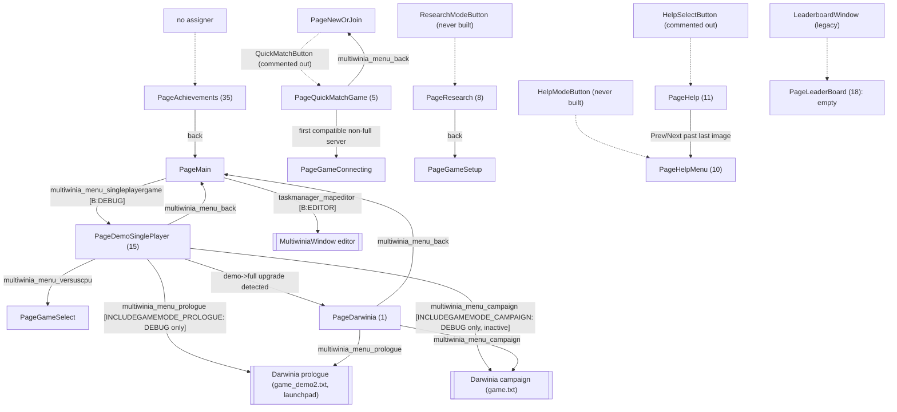

# P18_ui_gamemenu — Front-end GameMenuWindow and all UI buttons
Scope: `code/UI/*` — `GameMenuWindow.cpp/.h` (5629 + 325 lines), `ImageButton.cpp/.h`, `MapData.cpp/.h` and 66 header-only button classes (every file listed for P18 in `partitions.json`, plus three unlisted files in the same directory noted in the appendix). Build baseline: see build_matrix.md (`Release|Win32` + `TARGET_PC_FULLGAME`; `TESTBED_ENABLED`, `LOCATION_EDITOR`, `TARGET_DEBUG`, `INCLUDEGAMEMODE_PROLOGUE/_CAMPAIGN`, `HIDE_INVALID_GAMETYPES`, `SPECTATOR_ONLY`, `PERMITTED_MAPS`, `MULTIPLAYER_DISABLED`, `MULTIWINIA_DEMOONLY` all **off**; `LAN_PLAY_ENABLED`, `WAN_PLAY_ENABLED`, `INCLUDE_TUTORIAL`, `INCLUDE_CRATES_ADVANCED`, `TARGET_MSVC` **on**).

Supporting reads outside scope (for context, not owned): `code/game_menu.cpp/.h` (P17b — base buttons, layout helpers, map list), `code/interface/darwinia_window.cpp` (P17a — navigation), `code/multiwinia.cpp/.h` + `data/multiwinia.txt` (P02 — option tables), `code/app.cpp` permission functions (P01), `code/network/demo_limitations.cpp`, `code/network/networkvalue.*`, `code/network/clienttoserver.cpp` (P15), `code/interface/helpandoptions_windows.cpp`, `code/interface/chatinput_window.cpp`, `code/interface/mainmenus.*` (P17b), `contrib/systemiv/lib/metaserver/authentication.*` (P15), `data/language/english.txt`.

Reading guide: §1–§11 route to **09_meta_systems** (functional: what the player sees and does), §12–§13 route to **28_ui_framework** (technical: how the screen is built). All statements are for `[B:FULL]` unless tagged otherwise.

---

## [→ 09_meta_systems] 1. Front-end lifecycle and global structure

### 1.1 Where the front end lives
- The whole Multiwinia front end (title, mode select, map select, lobby, server browser, auth key, buy-now, credits, tutorials entry) is **one full-screen Eclipse window** of class `GameMenuWindow` registered under the window name `"multiwinia_mainmenu_title"` (the name doubles as the phrase id of the title) [C] `code/UI/GameMenuWindow.cpp:GameMenuWindow::GameMenuWindow`. Other code finds it with `EclGetWindow("multiwinia_mainmenu_title")` [C] (e.g. `code/network/clienttoserver.cpp`, `code/game_menu.cpp:GetTimeOption`).
- The window is a state machine over **pages**; each page is built from scratch (all buttons destroyed and re-created) when the page changes (§12.2).
- Two secondary front-end windows are opened *on top of* `GameMenuWindow` by its buttons but are owned by P17b: `HelpAndOptionsWindow` (Help and Options) [C] `code/interface/mainmenus.cpp:HelpAndOptionsButton::MouseUp`, and `MultiwiniaWindow` (map editor, `[B:EDITOR]` only) [C] `code/UI/MultiwiniaEditorButton.h:MouseUp`.

### 1.2 Creation, destruction and return from a game
| Step | Behaviour | Ref |
|---|---|---|
| Main loop | `MainMenuLoop` runs while `g_app->m_atMainMenu`; when `!m_gameMenu->m_menuCreated` and the renderer fade is complete it calls `GameMenu::CreateMenu()` | [C] `code/main.cpp:MainMenuLoop` |
| CreateMenu | fade in 0.25 s, remove all windows, `m_multiwinia->Reset()`, `EclRegisterWindow(new GameMenuWindow())`, camera set to sphere-world focus; `m_gameMode = GameModeNone`; if `g_app->m_multiwiniaTutorial` was set (returning from a tutorial game) the new window's `m_newPage = PageTutorials`; then `m_multiwiniaTutorial = false` | [C] `code/game_menu.cpp:GameMenu::CreateMenu` |
| Constructor | full-screen (0,0,ScreenW,ScreenH), not resizable/movable/closeable; `m_currentPage=-1`, `m_newPage=PageMain`; **auth gate**: reads the key, `Authentication_SimpleKeyCheck(key, METASERVER_GAMETYPE_MULTIWINIA)`; if not `AuthenticationAccepted` → `m_newPage = PageAuthKeyEntry` (a stored value `"authkey not found"` is blanked) — compiled out under `MULTIWINIA_DEMOONLY` | [C] `GameMenuWindow::GameMenuWindow` |
| Constructor (name) | player name from pref `PlayerName` (default token `multiwina_playername_default` → localised default); every `%` replaced by space; stored in `m_teamName` (max 16 chars) | [C] same |
| Constructor (filters) | browser filter booleans loaded from prefs `FilterShowDemos`, `FilterShowIncompatible`, `FilterShowFullGames`, `FilterShowCustomMaps`, `FilterShowPassworded` (all default 1) | [C] same |
| Constructor check | release-asserts `sizeof(s_pageNames)/sizeof(char*) == NumPages` (38) | [C] same |
| First Update | page −1 → `SetupNewPage(m_newPage)` | [C] `GameMenuWindow::Update` |
| Leaving to a game | the server's `NET_DARWINIA_START_GAME` sets `m_atMainMenu=false`, `m_atLobby=false`, `m_gameMode=GameModeMultiwinia`, `m_requestedLocationId=999`; `MainMenuLoop` exits, stops sound `"MultiwiniaInterface LobbyAmbience"`, calls `GameMenu::DestroyMenu()` (removes the window, fade out) | [C] `code/network/clienttoserver.cpp` (START_GAME handler), `code/main.cpp:MainMenuLoop`, `code/game_menu.cpp:GameMenu::DestroyMenu` |
| Returning | in-game menu / game-over sets `m_atMainMenu=true` → loop re-creates a **fresh** `GameMenuWindow` at `PageMain` (or `PageTutorials` after a tutorial, or `PageAuthKeyEntry` if the key has become invalid). No lobby state survives except prefs. | [C] `code/interface/mainmenus.cpp` (leave-game button), `code/main.cpp` game-over branch; [I] fresh object ⇒ no carried state |
| Results/stats | **not part of `GameMenuWindow`**: the end-of-game scoreboard is rendered in-game by the Multiwinia rules/HUD code (P02/P17b). The front end has no results page. | [C] absence of any results page in `GameMenuWindow.h` enum; [I] ownership |

### 1.3 Screen layout (shared by every page)
The screen is divided into a title bar and two content boxes by helper functions in `code/game_menu.cpp` (P17b owns them; reproduced here because every page depends on them) [C] `code/game_menu.cpp:GetPositions/GetPosition_TitleBar/GetPosition_LeftBox/GetPosition_RightBox/GetFontSizes/GetButtonSizes`:

| Quantity | Formula (W=screen width px, H=screen height px) |
|---|---|
| `horizSplit` | 0.26·H |
| `vertSplit` | 0.6·W |
| `gap` | 0.05·vertSplit (=0.03·W) |
| outer edges | left = top = gap; right = W−gap; bottom = H−gap; if W/H > 1.4 (widescreen): left += 0.08·W, right −= 0.08·W |
| Title bar | x=left, y=top, w=right−left, h=horizSplit−0.5·gap−top |
| Left box | x=left, y=horizSplit+0.5·gap, w=vertSplit−0.5·gap−left, h=bottom−y |
| Right box | x=vertSplit+0.5·gap, y=horizSplit+0.5·gap, w=right−x, h=bottom−y |
| Fonts | large=0.095·H, med=0.04·H, small=0.022·H |
| Standard button | w=0.9·leftW, h=1.3·med (=0.052·H), gap=0.1·med (=0.004·H) |

Standard page skeleton used by almost every `Setup*Page` [C] (e.g. `GameMenuWindow::SetupNewOrJoinPage`):
1. `buttonX = leftX + (leftW−buttonW)/2` (buttons centred in the left box).
2. Page title: `GameMenuTitleButton` named `"title"` at (leftX+10, leftY+10, leftW−20, 1.5·buttonH), font = med. Title is rendered upper-cased, shrunk to fit width, over a highlight beam [C] `code/game_menu.cpp:GameMenuTitleButton::Render`.
3. `yPos = leftY + 0.5·buttonH + 1.3·buttonH`; each stacked button is placed at `yPos += buttonH+gap` (i.e. the first button is one full step below that).
4. The back button sits at `leftY + leftH − 2·buttonH`.
5. The right box carries an information panel (image/description/MOTD/chat) that is not in the navigation order.

### 1.4 Persistent background (rendered behind every page)
`GameMenuWindow::Render` [C] draws, in order:
1. **`RenderBigDarwinian()`** (static; also used by other menus, `code/interface/mainmenus.cpp`, `code/game_menu.cpp:GameMenuDropDownWindow::Render`):
   - full-screen additive quad, black at three corners and RGB(1.0,0.5,0.1) at the bottom-left vertex (smooth-shaded glow);
   - a giant sprite (`sprites/darwinian.bmp`, nearest filtering, tint (1,0,0,1)) centred at (0.75·W, 0.7·H), half-size `0.3·W + 5·sin(t)` px (breathing), quad rotated 0.2 rad;
   - if high detail: 10 echo copies, each `size *= 1.02`, centre shifted by (−6,−6) px, tint (1,0.2,0.2) alpha `0.2·(1−i/10)`;
   - a rotating gear (`mwhelp/gear.bmp`), half-size 0.6·W, centred on screen, angle `0.2·t` rad, additive white alpha 0.06, drawn 10 times each rotated a further 0.02 rad (0 times in low detail).
   - Detail switch (only evaluated while `Multiwinia::GameInLobby()`): `smoothFps = smoothFps·(1−k) + fps·k` with `k = g_advanceTime·0.5`; low detail when `smoothFps < 20`, high again when `≥ 60` (hysteresis), initial 60 [C] `GameMenuWindow::RenderBigDarwinian`.
2. Title bar fill box; title: if the localised `multiwinia_mainmenu_title` equals `"MULTIWINIA"` the bitmap `textures/mwtitle.bmp` is drawn (width = title-font text width for that many characters at large size × 1.1, height = width/5.4, top at titleY+0.1·titleH), otherwise the text is drawn with outline. Subtitle `multiwinia_mainmenu_subtitle` at med size one large line below. Logo `icons/mwlogo.bmp` (aspect 277/194, height 0.8·titleH) drawn at the left (x = titleX+0.05·titleW) and mirrored at the right [C] `GameMenuWindow::Render`.
3. Per-page content boxes (`DrawFillBox`, shadowed panel): GameSetup → left+right; JoinGame and Achievements → one box of title-bar width; GameConnecting → left; GameSelect/MapSelect/LeaderBoardSelect/AdvancedOptions/DemoSinglePlayer/BuyMeNow → left+right; Main → left, plus MOTD box (right, height rightH, or 0.75·rightH when the auth box is shown) if a MOTD arrived, plus auth box (rightY+0.8·rightH, height 0.2·rightH) when `ShowAuthBox()`; all others → left only [C].
4. Overlays: JoinGame with an empty list → blinking "requesting list"/"no servers found" caption (§4.9); Achievements → blinking "loading achievements" caption [C] `RenderRequestingEffect`, `RenderLoadingAchievementsEffect` (blink: alpha 1.0 for the first 0.5 s of each second, 0.5 otherwise).
5. Buttons (`EclWindow::Render`); if a drop-down is open (`GameMenuDropDownWindow::s_window`) **only the button owning it** is rendered [C].
6. Lobby ambience: on the first `Update` after the sound system is ready the window triggers interface sound event `LobbyAmbience` [C] `GameMenuWindow::Update`.

---

## [→ 09_meta_systems] 2. Page enumeration (every slot)

`GameMenuWindow` declares an anonymous enum of pages with **gaps**; the debug-name table `s_pageNames[38]` (`code/game_menu.cpp:s_pageNames`) has one string per slot 0–37 including the gaps (removed Xbox Live Arcade, PDLC and Darwinia+ pages). `NumPages = 38`. Setup dispatch is `GameMenuWindow::SetupNewPage`; per-frame dispatch is `GameMenuWindow::Update` [C].

| Value | Enum | `s_pageNames` | Setup function | Per-frame update | Reachable in `[B:FULL]`? | Entered from |
|---|---|---|---|---|---|---|
| 0 | `PageMain` | "Main" | `SetupMainPage` | `UpdateGameOptions(false)` if `m_quickStart`; `UpdateMainPage` | **Yes** (default) | ctor; Back from NewOrJoin, Credits, Tutorials, Update, Achievements; GameSelect back (SP); EnterAuthkey/PlayDemo/Enter key; network errors |
| 1 | `PageDarwinia` | "Darwinia" | `SetupDarwiniaPage` | — | No — only from `PageDemoSinglePlayer` when demo→full status changes | `Update` demo-upgrade check `[B:DEBUG]` |
| 2 | `PageGameSelect` | "GameSelect" | `SetupGameSelectPage` | `UpdateGameOptions(true)` | **Yes** | Main "Single Player" (`DarwiniaModeButton`); NewOrJoin "Host"; MapSelect Back; lobby Back (host) |
| 3 | `PageNewOrJoin` | "NewOrJoin" | `SetupNewOrJoinPage` | — | **Yes** | Main "Multiplayer"; JoinGame Back; GameSelect Back (MP); GameConnecting Back; lobby Back (client) |
| 4 | `PageJoinGame` | "JoinGame" | `SetupJoinGamePage` | `UpdateJoinGamePage` | **Yes** | NewOrJoin "Join"; Filters Back; Password Back; Error Back; GameConnecting Back |
| 5 | `PageQuickMatchGame` | "QuickMatchGame" | `SetupQuickMatchGamePage` | `UpdateQuickMatchGamePage` | No — its button is commented out ("Removed by Chris. It doesn't work.") | (`QuickMatchButton`, never created) `[B:LEGACY]` |
| 6 | `PageGameSetup` | "GameSetup" | `SetupMultiplayerPage(m_gameType)` | `UpdateMultiplayerPage` then (fall-through) `UpdateGameOptions(true)` | **Yes** (the lobby) | MapSelect level click; GameConnecting on connect; PlayerOptions colour/back; AdvancedOptions back |
| 7 | `PageGameConnecting` | "GameConnecting" | `SetupGameConnectingPage` | `UpdateGameOptions(false)`; `UpdateGameConnectingPage` | **Yes** | `JoinServer` (browser row, password Connect) |
| 8 | `PageResearch` | "Research" | `SetupResearchPage` | — | No (`ResearchModeButton` never created) | `[B:LEGACY]` |
| 9 | `PageMapSelect` | "MapSelect" | `SetupMapSelectPage` | `UpdateGameOptions(true)` → `UpdateMapSelectPage` | **Yes** | GameSelect game-type click; lobby Back (single player) |
| 10 | `PageHelpMenu` | "HelpMenu" | `SetupHelpMenuPage` | — | No (`HelpModeButton` never created; Prev/Next only on PageHelp) | `[B:LEGACY]` |
| 11 | `PageHelp` | "Help" | `SetupHelpPage` | — | No (`HelpSelectButton` creation commented out) | `[B:LEGACY]` |
| 12 | `PageAdvancedOptions` | "AdvancedOptions" | `SetupAdvancedOptionsPage` | `UpdateAdvancedOptionsPage` | **Yes** (host, non-demo key) | lobby "Advanced Options" |
| 13 | *(gap)* | "XBLASelectSessionType" | — | — | No | — `[B:DEAD]` |
| 14 | `PageXBLASignIn` | "XBLASignIn" | *(none — `SetupNewPage` default case release-asserts "Game menu invalid page")* | — | No | — `[B:DEAD]` |
| 15 | `PageDemoSinglePlayer` | "DemoSinglePlayer" | `SetupSPDemoPage` | `UpdatePageSinglePlayer` | No in FULL; yes under `TARGET_DEBUG` (Main "Single Player") | `[B:DEBUG]` |
| 16 | `PageBuyMeNow` | "BuyMeNow" | `SetupBuyMePage` | — | **Yes** `[B:DEMO]` (runtime demo key) | Main "Buy full game"; any demo-restricted mode/map/server; inactive Multiplayer button |
| 17 | `PageLeaderBoardSelect` | "LeaderBoardSelect" | `SetupLeaderBoardSelectPage` (empty `return`) | — | No | — `[B:LEGACY]` |
| 18 | `PageLeaderBoard` | "Leaderboards" | `SetupLeaderboardPage` (empty `return`) | — | No (only `LeaderboardWindow`, itself only reachable from an inactive legacy button) | `code/interface/leaderboards_window.cpp` `[B:LEGACY]` |
| 19 | *(gap)* | "XBLASelectGameType" | — | — | No | `[B:DEAD]` |
| 20 | *(gap)* | "XBLASelectCustomMatchtype" | — | — | No | `[B:DEAD]` |
| 21 | *(gap)* | "Downloaded PDLC" | — | — | No | `[B:DEAD]` |
| 22 | *(gap)* | "PDLC Upsell" | — | — | No | `[B:DEAD]` |
| 23 | `PageAuthKeyEntry` | "AuthKeyEntry" | `SetupAuthKeyPage` | — | **Yes** | ctor (bad/missing key); Help&Options "Authentication key" (`AuthPageButton`) |
| 24 | `PagePlayerOptions` | "PlayerOptions" | `SetupPlayerOptionsPage` | `UpdateGameOptions(true)` | **Yes** | lobby: click own gamer tag |
| 25 | `PageSearchFilters` | "SearcHFilters" (sic) | `SetupFiltersPage` | — | **Yes** | JoinGame "Filters" |
| 26 | *(gap)* | "DarwiniaPlus SP Page" | — | — | No | `[B:DEAD]` |
| 27 | *(gap)* | "DarwiniaPlus MP Page" | — | — | No | `[B:DEAD]` |
| 28 | *(gap)* | "DarwiniaPlus Darwinia Page" | — | — | No | `[B:DEAD]` |
| 29 | *(gap)* | "DarwiniaPlus Darwinia SP Page" | — | — | No | `[B:DEAD]` |
| 30 | *(gap)* | "DarwiniaPlus Darwinia MP Page" | — | — | No | `[B:DEAD]` |
| 31 | `PageUpdateAvailable` | "Updates Available Page" | `SetupUpdatePage` | — | **Yes** (metaserver reports a newer version) | Main "Update available" |
| 32 | `PageCredits` | "Credits Page" | `SetupCreditsPage` | — | **Yes** | Main "Credits" |
| 33 | `PageTutorials` | "Tutorial Page" | `SetupTutorialPage` | `UpdateGameOptions(false)`; `UpdateMainPage` | **Yes** (`INCLUDE_TUTORIAL`) | Main "Tutorial"; `GameMenu::CreateMenu` after a tutorial game |
| 34 | `PageError` | "Error Page" | `SetupErrorPage` | — | **Yes** | `CreateErrorDialogue` (browser row checks, network disconnect reasons) |
| 35 | `PageAchievements` | "Achievements Page" | `SetupAchievementsPage` | `UpdateAchievementsPage` | **No** — no code anywhere assigns `m_newPage = PageAchievements`, and no `AchievementButton` is ever constructed | `[B:LEGACY]` [C] grep of `code/` |
| 36 | `PageEnterPassword` | "Password Entry" | `SetupPageEnterPassword` | — | **Yes** | browser row on a passworded server |
| 37 | `PageWaitForGameToStart` | "Wait for Game to Start" | *(none — `SetupNewPage` only calls `Remove()`, leaving an empty page)* | nothing | **Yes** (host only, after it sends Start) | `UpdateMultiplayerPage` |

Help-page sub-enum (used only by the unreachable `PageHelp`): `HelpPageGeneral=1, HelpPageSkirmish=2, HelpPageKoth=3, HelpPageCts=4, HelpPageRR=5, NumHelpPages=6` [C] `GameMenuWindow.h`.

Counts: **18 live pages** in `[B:FULL]` (values 0, 2, 3, 4, 6, 7, 9, 12, 16, 23, 24, 25, 31, 32, 33, 34, 36, 37), **10 compiled-but-unreachable pages** (1, 5, 8, 10, 11, 14, 15, 17, 18, 35), **10 gap slots** with no enum constant (13, 19, 20, 21, 22, 26, 27, 28, 29, 30); 18+10+10 = 38 = `NumPages` [C] table above.

---

## [→ 09_meta_systems] 3. Screen-flow diagram

### 3.1 Live flow `[B:FULL]`
Edge labels are the button caption phrase id (or the condition). "Back(prev)" = `BackPageButton(m_currentPage)`: because `m_currentPage` still holds the *previous* page while the new page is being set up, such a button returns to whatever page was showing before (§12.2) [C] `GameMenuWindow::SetupNewPage` (assigns `m_currentPage` last).

```mermaid
flowchart TD
    START(["MainMenuLoop: GameMenu::CreateMenu -> new GameMenuWindow"]) --> AUTHCHK{"auth key passes<br/>SimpleKeyCheck?"}
    AUTHCHK -- no --> AUTH["PageAuthKeyEntry (23)"]
    AUTHCHK -- "yes, returning from a tutorial game" --> TUT["PageTutorials (33)"]
    AUTHCHK -- yes --> MAIN["PageMain (0)"]

    AUTH -- "multiwinia_menu_done (key accepted) / Enter key" --> MAIN
    AUTH -- "multiwinia_menu_play_demo (generate demo key)" --> MAIN
    AUTH -- "multiwinia_menu_paste" --> AUTH

    MAIN -- "multiwinia_menu_singleplayergame" --> GSSP["PageGameSelect (2)<br/>single player: local server 127.0.0.1"]
    MAIN -- "multiwinia_menu_multiplayergame" --> NOJ["PageNewOrJoin (3)"]
    MAIN -- "multiwinia_menu_multiplayergame (inactive: demo w/o MP)" --> BUY["PageBuyMeNow (16)"]
    MAIN -- "multiwinia_menu_tutorial_short" --> TUT
    MAIN -- "multiwinia_menu_helpandoptions" --> HOW[["HelpAndOptionsWindow (P17b)"]]
    HOW -- "multiwinia_auth (AuthPageButton)" --> AUTH
    MAIN -- "multiwinia_update_available (only if newer version)" --> UPD["PageUpdateAvailable (31)"]
    MAIN -- "dialog_credits" --> CRED["PageCredits (32)"]
    MAIN -- "multiwinia_menu_buyfullgame (demo only)" --> BUY
    MAIN -- "multiwinia_menu_quit" --> QUIT(["m_requestQuit = true"])

    TUT -- "multiwinia_menu_tutorial1 / tutorial2" --> QS[["quick-start: server + CPU teams + RequestStartGame"]]
    TUT -- "multiwinia_menu_back" --> MAIN

    NOJ -- "multiwinia_menu_hostgame (HostGamePermitted)" --> GSMP["PageGameSelect (2)<br/>multiplayer: advertised server"]
    NOJ -- "multiwinia_menu_joingame" --> JOIN["PageJoinGame (4) server browser"]
    NOJ -- "multiwinia_menu_back" --> MAIN

    GSSP -- "multiwinia_gametype_* (permitted)" --> MAPSEL["PageMapSelect (9)"]
    GSMP -- "multiwinia_gametype_* (permitted)" --> MAPSEL
    GSSP -- "demo & mode not permitted" --> BUY
    GSMP -- "demo & mode not permitted" --> BUY
    GSSP -- "multiwinia_menu_back (ShutdownCurrentGame)" --> MAIN
    GSMP -- "multiwinia_menu_back (ShutdownCurrentGame)" --> NOJ

    MAPSEL -- "<map>_name (level row)" --> LOBBY["PageGameSetup (6) lobby"]
    MAPSEL -- "demo-restricted map" --> BUY
    MAPSEL -- "multiwinia_menu_back" --> GSANY["PageGameSelect (2)"]

    LOBBY -- "multiwinia_menu_advanceoptions (host, full key)" --> ADV["PageAdvancedOptions (12)"]
    ADV -- "multiwinia_menu_back" --> LOBBY
    LOBBY -- "own gamer tag" --> PO["PagePlayerOptions (24)"]
    PO -- "colour row (not taken)" --> LOBBY
    PO -- "multiwinia_menu_back (ApplyNameButton)" --> LOBBY
    LOBBY -- "multiwinia_menu_play (single player)" --> LOAD
    LOBBY -- "multiwinia_menu_ready (MP: toggle ready)" --> LOBBY
    LOBBY -- "host: all human teams ready" --> WAIT["PageWaitForGameToStart (37)"]
    WAIT -- "NET START_GAME" --> LOAD
    LOBBY -- "client: NET START_GAME" --> LOAD
    LOBBY -- "back, single player (FinishSinglePlayerButton)" --> MAPSEL
    LOBBY -- "back, host (FinishMultiwiniaButton)" --> GSANY
    LOBBY -- "back, client (FinishMultiwiniaButton)" --> NOJ

    JOIN -- "server row: compatible, not full, map known, no password" --> CONN["PageGameConnecting (7)"]
    JOIN -- "server row: passworded" --> PASS["PageEnterPassword (36)"]
    JOIN -- "server row: incompatible / full / missing map" --> ERR["PageError (34)"]
    JOIN -- "server row: demo-restricted" --> BUY
    JOIN -- "multiwinia_menu_filters" --> FILT["PageSearchFilters (25)"]
    JOIN -- "multiwinia_menu_back" --> NOJ
    FILT -- "multiwinia_menu_back (SaveFiltersButton)" --> JOIN
    PASS -- "multiwinia_menu_connect (password non-empty)" --> CONN
    PASS -- "multiwinia_menu_back" --> JOIN
    CONN -- "connected and game type received" --> LOBBY
    CONN -- "multiwinia_menu_back" --> JOIN
    CONN -- "network: server full / bad password" --> ERR
    CONN -- "network: kicked / duplicate key / connection error" --> ERR
    ERR -- "multiwinia_menu_back (to stored back page: JoinGame or Main)" --> JOIN
    ERR -- "multiwinia_menu_back" --> MAIN

    BUY -- "launchpad_button_buynow (open store URL)" --> BUY
    BUY -- "Back(prev)" --> MAIN
    UPD -- "multiwinia_menu_autopatch (run autopatch.exe, exit)" --> QUIT
    UPD -- "dialog_visitwebsite" --> UPD
    UPD -- "Back(prev)" --> MAIN
    CRED -- "Back(prev)" --> MAIN

    QS --> LOAD[["loading screen + game (location)"]]
    LOAD --> GAME[["in game; game over -> in-game results (P02/P17b)"]]
    GAME -- "leave game: m_atMainMenu = true" --> START
```

Notes on the diagram [C] unless stated:
- `GSANY` is the same page as `GSSP`/`GSMP`; it is drawn separately only to keep the diagram readable. Single-player vs multiplayer is the boolean `m_singlePlayer` (set by `DarwiniaModeButton`, cleared by `SetupMainPage`/`SetupNewOrJoinPage` because LAN/WAN play is compiled in) [C] `SetupMainPage`, `SetupNewOrJoinPage`, `DarwiniaModeButton.h`.
- `PageBuyMeNow` "Back(prev)" returns to whichever page opened it (Main, GameSelect, MapSelect, JoinGame or Main for the inactive-MP case) — only the Main edge is drawn.
- `PageError` stores its back page in `m_errorBackPage` (default `PageMain`); browser-row errors and "server full"/"bad password" disconnects use `PageJoinGame`; kick/duplicate key/connection errors use `PageMain` [C] `GameServerButton.h:MouseUp`, `code/network/clienttoserver.cpp` (disconnect handler).
- Any other disconnect reason sends the window straight to `PageMain` [C] same handler.

### 3.2 Compiled-but-unreachable / non-baseline flow

---

## [→ 09_meta_systems] 4. Page-by-page specification (live pages)

Conventions for the button tables: **#** = position in the controller navigation list `m_buttonOrder` (— = not navigable: decorative/info widgets); **Name** = Eclipse button name (unique per page; used for look-ups and for `<name>_description` help text); **Caption** = phrase id passed to `LANGUAGEPHRASE`; geometry uses the §1.3 symbols (`bx` = buttonX, `bw`/`bh` = standard button width/height, `lX/lY/lW/lH`, `rX/rY/rW/rH` = left/right box). Every stacked button advances `y += bh+gap` unless stated. "Base MouseUp" = `GameMenuButton::MouseUp` (plays `MenuSelect`, or `MenuCancel` when `m_transitionDirection == -1`, and starts a 1.0 s menu transition in that direction) [C] `code/game_menu.cpp:GameMenuButton::MouseUp`.

### 4.1 PageMain (0) — title screen
[C] `GameMenuWindow::SetupMainPage`, `UpdateMainPage`. Sets `m_singlePlayer=false` (LAN/WAN compiled in), `m_settingUpCustomGame=false`, `m_localSelectedLevel=-1`, window title `multiwinia_mainmenu_title`.

| # | Class | Name | Caption | Shown when | Action on click |
|---|---|---|---|---|---|
| — | `GameMenuTitleButton` | `title` | `multiwinia_menu_mainmenutitle` | always | — |
| 1 | `TutorialPageButton` | `multiwinia_menu_tutorial_short` | `multiwinia_menu_tutorial_short` | `INCLUDE_TUTORIAL` **and demo key** (tutorial is listed first for demo users) | base MouseUp; → `PageTutorials` |
| 2 | `DarwiniaModeButton` | `multiwinia_menu_singleplayergame` | same | always | base MouseUp; `m_singlePlayer=true`; → `PageGameSelect` (`[B:DEBUG]`: → `PageDemoSinglePlayer`) [C] `DarwiniaModeButton.h` |
| 3 | `NewOrJoinButton` | `multiwinia_menu_multiplayergame` | same | always; `m_inactive = !App::MultiplayerPermitted()` | base MouseUp; inactive → `PageBuyMeNow`, else → `PageNewOrJoin`; (`MULTIPLAYER_DISABLED` builds: inactive click ignored) [C] `NewOrJoinButton.h` |
| 4 | `TutorialPageButton` | `multiwinia_menu_tutorial_short` | same | `INCLUDE_TUTORIAL` **and full key** | → `PageTutorials` |
| 5 | `HelpAndOptionsButton` (P17b) | `helpandoptions` | `multiwinia_menu_helpandoptions` | always | base MouseUp; opens `HelpAndOptionsWindow` as child; `m_doMenuTransition=true` [C] `code/interface/mainmenus.cpp:HelpAndOptionsButton::MouseUp` |
| (6) | `StartTestbedButton` ×2 | both `start_testbed_server` | `start_testbed_server`, `start_testbed_client` | `TESTBED_ENABLED` `[B:DEAD]` | appendix |
| (7) | `MultiwiniaEditorButton` | `editor` | `taskmanager_mapeditor` | `LOCATION_EDITOR` `[B:EDITOR]`; inactive with demo key | inactive → `PageBuyMeNow`; else sound `MenuSelect`, transition, open `MultiwiniaWindow` |
| 8 | `UpdatePageButton` | `multiwinia_update` | `multiwinia_update_available` | metaserver datum `LatestVersion` is present and ≠ `APP_VERSION` | → `PageUpdateAvailable`, base MouseUp |
| 9 | `CreditsButton` | `credits_button` | `dialog_credits` | always | base MouseUp; → `PageCredits` |
| 10 | `BuyNowModeButton` | `multiwinia_menu_buyfullgame` | same | `IS_DEMO` | base MouseUp; → `PageBuyMeNow` |
| 11 | `QuitButton` | `multiwinia_menu_quit` | same | always, at `lY+lH−2bh` | `g_app->m_requestQuit = true` (no sound/transition) |
| — | `MOTDButton` | `multiwinia_motd` | — | right box (rX+0.05rW, rY+0.05rH, 0.9rW, 0.675rH), small font | §10.1 |
| — | `AuthStatusButton` | `multiwinia_authStatus` | — | right box (rX+0.05rW, rY+0.85rH, 0.9rW, 0.18rH), med font; draws only if `ShowAuthBox()` | none (`MouseUp` empty) — §10.3 |

`UpdateMainPage` (also run on `PageTutorials`, and on `PageDemoSinglePlayer` during a tutorial): (a) if `m_singlePlayer` and no local server → `App::StartMultiPlayerServer()`; (b) once per process (function-static flag) polls `MetaServer_RequestData(NET_METASERVER_DATA_LATESTVERSION)`; when it first arrives and differs from `APP_VERSION`, the main page is rebuilt so the Update button appears [C].

### 4.2 PageTutorials (33) `[B:FULL]` (`INCLUDE_TUTORIAL`)
[C] `SetupTutorialPage`, `TutorialButton.h`. On setup also sets `g_app->m_multiwiniaHelp->m_currentTutorialHelp = -1`.

| # | Class | Name | Caption | Condition | Action |
|---|---|---|---|---|---|
| — | `GameMenuTitleButton` | `title` | `multiwinia_menu_tutorial_short` | | |
| 1 | `TutorialButton` (`m_tutorialType = App::MultiwiniaTutorial1`) | `multiwinia_menu_tutorial1` | same | inactive if the map `MAPID_MP_KOTH_2P_1` is not in the KOTH list or not permitted (also always inactive under `TARGET_PC_HARDWARECOMPAT`) | if inactive or `m_quickStart` → ignore; base MouseUp; `m_singlePlayer=true`, `m_quickStart=true`, `g_app->m_multiwiniaTutorial=true`, `g_app->m_multiwiniaTutorialType=type`, `m_lockMenu=true` (freezes navigation) |
| 2 | `TutorialButton` (`MultiwiniaTutorial2`) | `multiwinia_menu_tutorial2` | same | needs `MAPID_MP_KOTH_3P_1` | same |
| 3 | `BackPageButton(PageMain)` | `multiwinia_menu_back` | same | | → Main |

The tutorial launch sequence is in §5.4.

### 4.3 PageNewOrJoin (3) — host or join
[C] `SetupNewOrJoinPage`. Sets `m_xblaSessionType=-1`, `m_singlePlayer=false`, `m_settingUpCustomGame=false`.

| # | Class | Name | Caption | Condition | Action |
|---|---|---|---|---|---|
| — | `GameMenuTitleButton` | `title` | `multiwinia_neworjoin_title` | | |
| 1 | `NewServerButton` | `multiwinia_menu_hostgame` | same | `m_disabled = !App::HostGamePermitted()` | base MouseUp; → `PageGameSelect` (the GameSelect setup starts the advertised server) |
| 2 | `JoinGameButton` | `multiwinia_menu_joingame` | same | always | base MouseUp; → `PageJoinGame` |
| — | (`QuickMatchButton`, `quickmatch`, `multiwinia_menu_quickmatch`) | | | **commented out** "It doesn't work" | `[B:LEGACY]` |
| 3 | `BackPageButton(PageMain)` | `multiwinia_menu_back` | same | | |

### 4.4 PageGameSelect (2) — game-mode select
[C] `SetupGameSelectPage`, `GameTypeButton.h`, `GameTypeImageButton.h`, `GameTypeInfoButton.h`.
- **Server start**: if there is no local server: single player → `App::StartSinglePlayerServer()` (server reachable on 127.0.0.1 only, client joins via loopback); multiplayer → `App::StartMultiPlayerServer()` (listens on the local host IP / listener port). Both reset AI type to `AITypeStandard` unless a tutorial is running [C] `code/app.cpp:StartSinglePlayerServer/StartMultiPlayerServer/StartNetwork`.
- One `GameTypeButton` per entry of `Multiwinia::s_gameBlueprints` (loaded from `data/multiwinia.txt` in file order: Domination 0, KingOfTheHill 1, CaptureTheStatue 2, Assault 3, RocketRiot 4, Blitzkrieg 5, TankBattle 6). Name = caption phrase = `MultiwiniaGameBlueprint::GetName()` = `multiwinia_gametype_<lower-case name>` if that phrase exists, else the raw name.
  - A button whose *name* is literally `"TankBattle"` (i.e. phrase missing — it is missing from `english.txt`) is flagged inactive **before registration and is never registered** → Tank Battle is invisible [C].
  - Every other button is registered and navigable; afterwards, if `!App::IsGameModePermitted(i)` it is marked inactive (visible greyed, skipped by pad navigation).
  - `HIDE_INVALID_GAMETYPES` builds skip non-permitted modes entirely `[B:HWCOMPAT/ASSAULT_STRESSTEST/BETATEST]`.
- Each `GameTypeButton` renders **only after the local client has a team** (`myTeamId != 255`, or spectator) — i.e. the list appears once the just-started local server has accepted the local player [C] `GameTypeButton::Render`. It draws a complexity icon at the right edge (width 0.1·w, height 0.05·w): `icons/menu_basic.bmp` (Domination, KOTH), `icons/menu_intermediate.bmp` (CTS, TankBattle, Assault), `icons/menu_advanced.bmp` (Rocket Riot, Blitzkrieg) from `MultiwiniaGameBlueprint::GetDifficulty` [C] `code/multiwinia.cpp:GetDifficulty`. When it has controller focus it sets `m_highlightedGameType`.
- `GameTypeButton::MouseUp`: demo key and mode not permitted → base MouseUp, → `PageBuyMeNow`; inactive → ignore; if team assigned: → `PageMapSelect`, `m_gameType = type` (network request), `m_uiGameType=-1`, `m_clickGameType=type`, and every parameter of that blueprint reset to its default (network requests) [C].

| # | Class | Name | Caption | Notes |
|---|---|---|---|---|
| — | `GameMenuTitleButton` | `title` | `multiwinia_gameselect_title` | |
| 1–6 | `GameTypeButton` | `multiwinia_gametype_domination`, `_kingofthehill`, `_capturethestatue`, `_assault`, `_rocketriot`, `_blitzkrieg` | same as name | see above |
| 7 | `FinishMultiwiniaButton(page)` | `multiwinia_menu_back` | same | page = `PageMain` if single player else `PageNewOrJoin`; shuts the local game/server down (§4.6.6) |
| — | `GameTypeImageButton` | `gametype` | — | right box (rX+0.1rW, rY+0.1rW, 0.8rW, 0.8rW·2/3): picture `mwhelp/mode_<lower name>.bmp` of the highlighted mode, alpha 0.8, outline alpha 0.5; "Full Game Only" (`dialog_fullonly`) overlay for non-permitted modes on demo |
| — | `GameTypeInfoButton` | `gametypeinfo` | — | below the image (height 0.85rH − imageH), small font; auto-scrolling text `multiwinia_help_<lower name>` (or `multiwinia_help_prologue` / `_campaign`) |

All `mwhelp/mode_*.bmp` textures are pre-loaded at setup "to avoid laggy interface" [C].

### 4.5 PageMapSelect (9) — map list
[C] `SetupMapSelectPage`, `UpdateMapSelectPage`, `LevelSelectButton.h`, `LevelSelectButtonBase.h`, `MapListTitlesButton.h`, `MapImageButton.h`, `MapInfoButton.h`.
- Thumbnails of the current mode are preloaded on the loading-screen worker (`g_loadingScreen->m_workQueue->Add(&PreloadThumbnails)` then `g_loadingScreen->Render()`; the loading screen is shown while caching) [C].
- **Network echo wait**: if `m_clickGameType != -1` and the networked `m_gameType` has not yet changed to it, setup returns with an empty page; `UpdateMapSelectPage` re-runs setup every frame until they match [C].
- Rows: one `LevelSelectButton` per map of the mode (`g_app->m_gameMenu->m_maps[gameType]`, pre-sorted by player count then difficulty basic<intermediate<advanced, P17b `GameMenu::CreateMapList`). Row height 0.7·bh, row step 0.7·(bh+gap), width bw, font small. Button name = map `Name` field or file name; inactive if `!App::IsMapPermitted(mode, crc)`.

| # | Class | Name | Caption | Notes |
|---|---|---|---|---|
| — | `GameMenuTitleButton` | `title` | `multiwinia_gametype_<mode>` | |
| — | `MapListTitlesButton` (`m_screenId=PageMapSelect`) | `Titles` | — | header strip at (bx, lY+10+1.8bh, bw, 0.7bh), black 50%: columns `multiwinia_mapname` / `multiwinia_playtime` / `multiwinia_players` (grey 0.6) |
| (1) | `AnyLevelSelectButton` | `multiwinia_level_any` | same | only when `m_settingUpCustomGame` — never true in this code `[B:LEGACY]` |
| 1..n | `LevelSelectButton` | `<map name or file>` | localised `<file-without-ext>_name` | see row rendering below |
| n+1 | `BackPageButton(PageGameSelect)` | `multiwinia_menu_back` | same | always to GameSelect (all three branches of the code pick the same page) |
| — | `MapImageButton` | `MapThumbnail` | — | right (rX+0.1rW, rY+0.1rW, 0.8rW, 0.6rW) |
| — | `MapInfoButton` | `MapInfo` | — | below thumbnail (height 0.85rH − thumbH), font 1.1·small |

Row rendering [C] `LevelSelectButton::Render`:
- Columns from `LevelSelectButtonBase::GetColumnPositions(x,w)`: name at x+0.025w, time at x+0.65w, players at x+0.83w (coop x+0.93w and difficulty x+1.03w are computed but unused).
- Name: localised `<file>_name` (custom maps: raw level name); colour green (0.65,1,0.4), red (1,0.3,0.3) when focused, dark grey (0.3) when demo-restricted. The currently requested map is drawn "clicked".
- Play time: map `PlayTime` (minutes) or, if 0, the mode's `TimeLimit` default, printed `"0:%02d"` (so 10 → "0:10"); "-" if still 0.
- Players: up to 4 Darwinian icons (`textures/darwinian.bmp`, height 0.9·rowH, spacing 0.55·iconW, rotated −π/8), coloured `Multiwinia::GetColour(i)`; for `ForceCoop` maps colour index = i/2 (3-player: icon 1 uses index 1); grey (75,75,75) when demo-restricted.
- Slide-in: each row appears `1.0·rowY/H` s after creation, sliding from `−0.1·W·(remaining s)` with an additive white flash of alpha = remaining s [C] `LevelSelectButtonBase::RenderMapName`.
- Rollover sound `MenuRollOver` when focus moves onto a row; focusing sets `m_highlightedLevel` (drives the thumbnail and description).

`LevelSelectButton::MouseUp` [C]: start transition (+1); reject invalid indices; sound `MenuSelect`; demo-restricted → `PageBuyMeNow`; (custom-game branch dead); `m_requestedMapId = index` (network), `m_localSelectedLevel = index`; → `PageGameSetup`; if co-op is on and the map is not `CoopMode` → co-op off; if the map is `ForceCoop` → co-op on; if the mode has a `TimeLimit` parameter: set it to the map's `PlayTime` if non-zero, else to the blueprint default. (See §8.4 for why the PlayTime value is immediately overwritten.)

Thumbnail [C] `MapImageButton::Render`: map index = focused row, else requested map; texture `thumbnails/<file-without-ext>.bmp` (lower-cased), drawn only if it exists (the `thumbnails/default.bmp` fallback name is computed but only used if loading an existing file fails); demo-restricted maps get a centred "Full Game Only" (`dialog_fullonly`, font w/10) overlay; white outline. Description [C] `MapInfoButton::Render`: custom maps → the map file's `Description` text; official maps → phrase `<file-without-ext>_description`, auto-scrolling.

### 4.6 PageGameSetup (6) — the lobby (single-player setup, host lobby and client lobby share one page)
[C] `GameMenuWindow::SetupMultiplayerPage`, `UpdateMultiplayerPage`, `PlayGameButton.h`, `GamerTagButton.h`, `KickPlayerButton.h`, `MapSelectModeButton.h`, `AdvancedOptionsModeButton.h`, `FinishMultiwiniaButton.h`.

#### 4.6.1 Preconditions and state on entry
1. `_gameType == -1` → nothing is built.
2. `mapId = m_localSelectedLevel` (or networked `m_requestedMapId` if −1). If `mapId == -1` **or** the local player has no team yet (`myTeamId == 255` and not spectator) → set `m_waitingForTeamID=true`, remember the type, return with an empty page; `UpdateMultiplayerPage` calls setup again once a team id (or spectator flag) arrives [C].
3. Coming from MapSelect with a different `m_uiGameType` → rebuild MapSelect instead. Coming from any page other than Research/AdvancedOptions/PlayerOptions (and not MapSelect): `m_uiGameType = _gameType` and, **on the host**, `m_requestedMapId = 0` [C] (only reachable via the game-type-changed rebuild, §12.2).
4. `g_app->m_atLobby = true`.
5. Returning from PlayerOptions with an empty name → name reset to the localised default.
6. Unless returning from PlayerOptions/AdvancedOptions: colour request initialised — Assault or co-op: remember the old request in `m_previousRequestedColour`, request `-1` (no colour; side chosen later); otherwise request pref `PlayerPreferedColour` if that colour is free, else `Multiwinia::GetNextAvailableColour()` (lowest id 0–7 not used by any non-unused team) [C] + `code/multiwinia.cpp:GetNextAvailableColour`.
7. **Host only, unless returning from Research/AdvancedOptions/PlayerOptions**: every blueprint parameter is reset to its default (`m_params[i] = default`, network requests) [C].

#### 4.6.2 Widgets
Fonts: stacked controls use small; title, Play and Back use med.

| # | Class | Name | Caption | Who sees it | Geometry | Action |
|---|---|---|---|---|---|---|
| — | `GameMenuTitleButton` | `title` | `multiwinia_gametype_<mode>` | all | standard | — |
| 1 (initial focus) | `PlayGameButton` | `Play` | `multiwinia_menu_ready` (MP) / `multiwinia_menu_play` (SP) | all; **not drawn** when demo key and map demo-restricted | (bx, lY+bh+1.8bh, bw, bh) | §4.6.4 |
| 2 | `AdvancedOptionsModeButton` | `Advanced Options` | `multiwinia_menu_advanceoptions` | host only (`g_app->m_server`), not in `SPECTATOR_ONLY` builds | height 0.66bh | demo key → ignored (and the button is created disabled+inactive); else base MouseUp, → `PageAdvancedOptions` |
| 3 | `GameMenuDropDown` | `multiwinia_menu_aimode` | `multiwinia_menu_aimode` | host only | height 0.66bh; no background; cycle mode (left/right cycles values) | options: `dialog_easy_difficulty`=0 (`AITypeEasy`), `multiwinia_menu_normal`=1 (`AITypeStandard`), `multiwinia_menu_hard`=2 (`AITypeHard`); bound to networked `m_aiMode` (`GAMEOPTION_AIMODE`); disabled+inactive with demo key |
| 4.. | `GamertagButton` ×`numPlayers` | `tag0`…`tag<n-1>` | dynamic (§4.6.3) | all | column at (bx, lY+6bh), w=0.45bw, h=0.75bh, row step 1.125bh (1.5×0.75bh) | own row → `PagePlayerOptions` (base MouseUp); other rows no-op |
| (interleaved) | `KickPlayerButton` | `kick1`…`kick<n-1>` (none for slot 0) | — | host in multiplayer only | (bx+1.05·0.45bw, rowY, 0.75bh, 0.75bh) | visible only while that slot is a `TeamTypeRemotePlayer`; click → `Server::KickClient(team.m_clientId)` if not disconnected |
| last | `FinishSinglePlayerButton(PageMapSelect)` (SP) / `FinishMultiwiniaButton(PageGameSelect)` (MP host) / `FinishMultiwiniaButton(PageNewOrJoin)` (MP client) | `multiwinia_menu_back` | same | all | (bx, lY+lH−2bh) | §4.6.6 |
| — | `GameTypeImageButton` | `gametype` | — | all | (lX+lW−0.45bw−(lW−bw)/2, lY+6bh, 0.45bw, 0.3bw) — beside the gamer tags | mode picture |
| — | `MapImageButton` | `MapThumbnail` | — | all | right (rX+0.1rW, rY+0.1rW, 0.8rW, 0.6rW) | thumbnail |
| — | `MapSelectModeButton` | `Map` | (" ") | all | under thumbnail, height 0.66bh, small font | shows the requested map's localised name over a highlight beam; **click does nothing** (`MouseUp` returns immediately — the in-lobby map change is disabled) |
| — | `MapInfoButton` (SP) **or** `GameMenuChatButton` (MP, font 0.8·small) | `chat_button` (both) | — | all | under map name; height = rH − thumbH − 0.5·small − 2(bh+gap) − gap | SP: map description; MP: chat log (§9) |
| — | `ChatInputField` (P17b) | `chat_input` | — | MP only | (rX+0.1rW, rY+0.95rH, 0.8rW, 1.2·small) | bound to `m_currentChatMessage` (§9) |
| (dead) | `CSpectatorButton` ×n | `tag` | `teamtype_2` | `#ifdef TESTBED` (never defined) `[B:DEAD]` | second column +280 px | register as spectator |
| (dead) | `MapDetailsButton` | `MapDetails` | — | commented out | | appendix |

#### 4.6.3 Gamer tag (player slot) rendering [C] `GamertagButton::Render`
Caption, by priority:
1. If the lobby team has a non-empty name: the name; if `m_demoPlayer` prefix with trimmed `teamtype_demo` + space; if `m_ready` the caption becomes `name + " (" + multiwinia_ready + ")"` (the demo prefix is dropped in this case).
2. Else by team type: `TeamTypeLocalPlayer` → `teamtype_0`; `TeamTypeRemotePlayer` → `teamtype_1`; `TeamTypeCPU` → `teamtype_2`; `TeamTypeSpectator` → phrase `Spectator` (not present in `english.txt`); unused → `teamtype_2` in single player, `multiwinia_open_or_cpu` in multiplayer.
3. If the focused button is this slot's kick button and the mouse is over it → `multiwinia_clicktokick`.

Visuals: CPU/unused slots are inactive (not navigable) with colour ×0.25 and border alpha 0.3; colour-less teams (`m_colourId == -1`, e.g. Assault/co-op before choosing) are grey 0.7. Background is a horizontal gradient from the team colour (left) to black (right) — or to 50 % team colour/50 % white when focused. When a slot's team type changes, its colour flashes from white back to the team colour over 1.0 s (linear) — except for the unused→CPU change. Text: white if inactive, red (1,0.3,0.3) if focused, else green (0.6,1,0.4).

#### 4.6.4 Ready / Play and starting the game
- **Single player** (`m_singlePlayer`): `PlayGameButton::MouseUp` — ignore if demo-restricted map, or if `m_localSelectedLevel != m_requestedMapId` (the server has not echoed the map yet), or the map is not permitted; wait for sound-system init; for every slot `i < numPlayers` that is unused request a CPU team (`RequestTeam(TeamTypeCPU, -1)`); `UpdateGameOptions(true)`; `RequestStartGame()` [C].
- **Multiplayer** (host and clients): `PlayGameButton::MouseUp` → `RequestToggleReady(myTeamId)` [C]. The host also has to ready up.
- **Host auto-start** (`UpdateMultiplayerPage`, every frame on the host, MP and SP alike): `notReady` = any slot whose team type is neither unused nor CPU and is not ready; also `notReady` if demo key and map demo-restricted. When everyone is ready and mode/map are valid and permitted: wait for sound init, fill empty slots `< numPlayers` with CPU teams, `UpdateGameOptions(true)`, `RequestStartGame()`, go to `PageWaitForGameToStart` (an empty page, so the request is sent once) [C]. In single player the local team is never "ready", so only the Play button starts the game [I] (follows from the ready test).
- The game actually starts when the server broadcasts `NET_DARWINIA_START_GAME` (§1.2) — P15/P01.

#### 4.6.5 Kick
Host-only kick buttons appear beside slots 1..n−1 while the slot holds a remote human; clicking calls `Server::KickClient`. The kicked client receives a disconnect with reason `Disconnect_KickedByServer` and is sent to `PageError` with `multiwinia_error_kickedbyserver`, back → Main [C] `KickPlayerButton.h`, `code/network/clienttoserver.cpp`.

#### 4.6.6 Leaving the lobby
- `FinishMultiwiniaButton(page)` [C]: on a client (no local server) whose team is **ready** and whose server is not lagging (last server letter < 5.0 s ago) it does not leave immediately: it sets `m_disconnectFromGame=true` and toggles ready off; `UpdateMultiplayerPage` then waits until some used team and the local team are not ready, and finally calls `App::ShutdownCurrentGame()`, clears `m_atLobby`, sets `m_requestedMapId=-1`, goes to **`PageMain`** (not the button's page), clears chat and the password [C]. Otherwise it immediately `ShutdownCurrentGame()` (client leaves; on the host the server object is deleted — [C] `code/app.cpp:ShutdownCurrentGame` deletes `m_server`), `m_atLobby=false`, `m_requestedMapId=-1`, goes to its page (Back sound + reverse transition), clears chat and password.
- `FinishSinglePlayerButton(PageMapSelect)` [C]: locally clears `m_multiwinia->m_coopMode` and `m_basicCratesOnly`, requests team colour −1, sets every lobby team's `m_colourId=-1`, goes back to MapSelect (the local server stays up), clears chat and password.

#### 4.6.7 Who can change what (host vs client)
| Setting | Host | Client | Mechanism |
|---|---|---|---|
| Game mode | GameSelect page (before lobby) | no | `m_gameType` network option |
| Map | MapSelect page (before lobby); not changeable inside the lobby | no | `m_requestedMapId` |
| AI difficulty | lobby drop-down (full key) | no (control not created) | `m_aiMode` |
| Mode parameters, basic crates, co-op, password | Advanced Options page (full key) | no (button not created) | `m_params[]`, `m_basicCrates`, `m_coopMode`, `m_serverPassword` |
| Own name and colour/side | PlayerOptions | PlayerOptions | team-name / team-colour reliable requests |
| Ready | yes (required) | yes | `RequestToggleReady` |
| Kick | yes | no | `Server::KickClient` |
| Start | automatic when all humans ready | no | `RequestStartGame` |
Restriction is enforced in the UI by not creating the controls. [U] Whether the server also rejects option-change requests from non-host clients is not visible in P18 files — resolve in P15 (`code/network/server.cpp` handling of `NET_DARWINIA_SETGAMEOPTION*`).

### 4.7 PageAdvancedOptions (12) — host-only mode parameters
[C] `SetupAdvancedOptionsPage`, `UpdateAdvancedOptionsPage`, `OptionDetailsButton.h`. Control height = 0.65·bh, font small.

| # | Widget | Name | Caption | Created when | Binding |
|---|---|---|---|---|---|
| — | `GameMenuTitleButton` | `title` | `multiwinia_menu_advanceoptions` | always | |
| 1..k | one control per blueprint parameter *i* (type chosen by the parameter's `Change` column, §8.1) | `multiwinia_param_<lower name>` | checkbox: `multiwinia_param_<name>`; drop-down: `LANGUAGEPHRASE(<raw name>)` (see §8.1 note); numeric: translated `multiwinia_param_<name>` | `m_gameType != -1` | `m_params[i]` (network) |
| k+1 | `GameMenuCheckBox` | `multiwinia_param_basiccrates` | same | `INCLUDE_CRATES_ADVANCED` (on in FULL) | `m_basicCrates` (`GAMEOPTION_BASICCRATES`) |
| k+2 | `GameMenuCheckBox` | `multiwinia_menu_coop` | same | map has `CoopMode` and full key | `m_coopMode` (`GAMEOPTION_COOPMODE`) |
| k+3 | `GameMenuInputField` (text) | `multiwinia_menu_serverpassword` | same | host and **not** single player (one blank row gap before it) | `m_serverPassword` (≤16 chars; setting it on the host calls `Server::SetPassword`) [C] `GameMenuWindow.h:ServerPasswordString` |
| last | `BackPageButton(PageGameSetup)` | `multiwinia_menu_back` | same | always | |
| — | `OptionDetailsButton` | `option_details` | — | right box (5 % inset, 90 % size), small font | help text for the focused control: phrase `<focused button name>_description_<gameType>` if it exists, else `<name>_description`; auto-scrolling |

Per-frame rule (`UpdateAdvancedOptionsPage`): the `SuddenDeath` control is inactive whenever the `TimeLimit` option is 0; on every change of that inactive state the control is **forced** to 0 (when becoming inactive) or 1 (when becoming active) — checkbox via `Set`, drop-down via `SelectOption` [C].

### 4.8 PagePlayerOptions (24) — name and colour/side
[C] `SetupPlayerOptionsPage`, `FancyColourButton.h`, `ApplyNameButton.h`, `GameMenuWindow::SetTeamNameAndColour`. Height 0.65·bh, font small (title also small).

| # | Widget | Name | Caption | When | Action |
|---|---|---|---|---|---|
| — | `GameMenuTitleButton` | `title` | `multiwinia_playeroptions` | | |
| 1 | `GameMenuInputField` (text, ≤16 chars) | `multiwinia_player_name` | same | always | `m_teamName` — `PlayerNameString::Set` truncates, stores pref `PlayerName` (empty → default phrase) and sends `ReliableSetTeamName` [C] `code/game_menu.cpp:PlayerNameString::Set` |
| 2–4 | `FancyColourButton(-1)`, `(1)`, `(0)` | `multiwinia_random`, `multiwinia_attackers`, `multiwinia_defenders` | `multiwinia_option_0_7_0` ("Random"), `multiwinia_attackers`, `multiwinia_defenders` | Assault (`ASSAULT_ATTACKER_COLOURID = 1`, `ASSAULT_DEFENDER_COLOURID = 0`) | choose side |
| 2–9 | `FancyColourButton(i)` i = 0..7 | `multiwinia_colour_green, _red, _yellow, _blue, _orange, _cyan, _purple, _pink` (by i) | `multiwinia_colour_green, _red, _yellow, _blue, _orange, _purple, _cyan, _pink` (by i) | all other modes (`MULTIWINIA_NUM_TEAMCOLOURS = 8`) | choose colour |
| last | `ApplyNameButton(prev)` | `multiwinia_menu_back` | same | | saves pref `PlayerName` + prefs file, then Back (to the lobby) |

Colour ids and RGB (`code/multiwinia.cpp:teamColours`, P02): 0 (100,255,100) green, 1 (255,50,50) red, 2 (255,255,50) yellow, 3 (120,180,255) blue, 4 (255,150,0) orange, 5 (150,0,255) purple, 6 (70,200,200) cyan, 7 (255,150,255) pink. The button **names** for ids 5 and 6 are swapped relative to their colours (`GetColourNameChar` lists cyan before purple) while captions are correct (`GetColourName`) [C] `GameMenuWindow.cpp:GetColourNameChar/GetColourName`.

"Taken" rule (`FancyColourButton::MouseUp`/`Render`) [C]:
- Assault: count teams already on that side (in `MouseUp` including the local team; in `Render` excluding it). 3-player map: Defenders (0) taken if ≥1 team on it; Attackers (1) taken if 2 on it. Other maps: taken if `count ≥ numPlayers/2` (integer division). Random (−1) is never taken.
- Co-op on: taken if `!Multiwinia::IsValidCoopColour(id)` — invalid when ≥2 colours are in use and nobody is on this one, or ≥2 teams are already on it [C] `code/multiwinia.cpp:IsValidCoopColour`.
- Otherwise: taken if any team (other than self, in Render) already has that colour id.
- Taken buttons are inactive (grey swatch 0.5, caption in inactive grey); the local team's current colour is drawn "clicked" (red caption).

Click on a free colour: `m_currentRequestedColour = id`; outside Assault/co-op store pref `PlayerPreferedColour`; reverse transition; → `PageGameSetup`. The actual request is sent by `SetTeamNameAndColour()` (called each frame by `UpdateGameOptions(true)` on GameSetup/MapSelect/GameSelect/PlayerOptions): if (team assigned, a colour is requested, it differs from the team's colour, it is taken by someone, not co-op, not Assault) the request falls back to the preferred colour (if free) or the next available; then on GameSetup/PlayerOptions (or while starting a tutorial) `ReliableSetTeamColour(request)` is sent when request ≠ −1 or co-op or Assault; and the team name is sent once if not yet requested [C].
Visual: row background white 0.1 (or (0.75,0.75,1,0.5) when focused/clicked); caption at 0.05w; colour swatch in the right quarter (x = w·3/4, width 0.95·w/4, height 0.8h) with a left-to-right gradient to black; rollover sound `MenuRollOver`.
