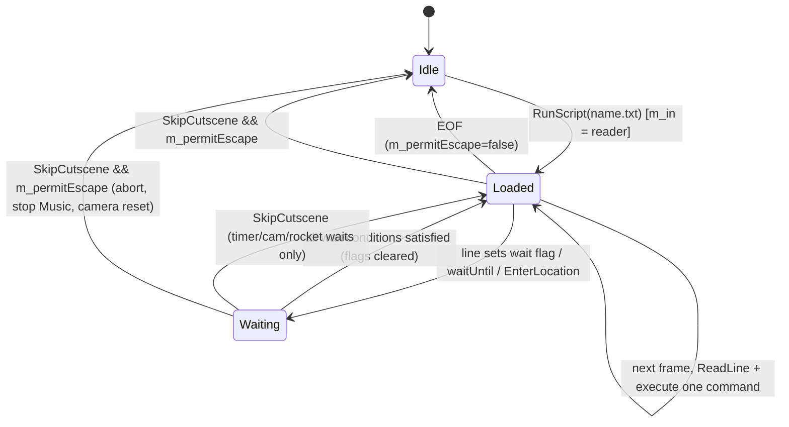

# P19_help_tutorial_script — Help system, tutorials, script engine, Sepulveda
Scope: `code/multiwiniahelp.{cpp,h}`, `code/helpsystem.{cpp,h}`, `code/tutorial.{cpp,h}`, `code/tutorial_demo1.cpp`, `code/tutorial_demo2.cpp`, `code/script.{cpp,h}`, `code/sepulveda.{cpp,h}`, `code/sepulveda_strings.cpp`; data: `data/scripts/*` (42 files), `data/mwhelp/*` (51 bitmaps — there are **no** `.txt` files in `data/mwhelp/`), `data/sepulveda/*` (5 bitmaps), help phrase ids in `data/language/english.txt`. Build baseline: see build_matrix.md (`Release|Win32` + `TARGET_PC_FULLGAME`; `USE_SEPULVEDA_HELP_TUTORIAL` is **never defined**; `INCLUDE_TUTORIAL` **is** defined in FULLGAME; `ATTRACTMODE_ENABLED`, `SCRIPT_TEST_ENABLED` are never defined).

## Summary of build reality for this partition

| Component | Files | Compiled in FULL? | Reachable in Multiwinia? | Tag |
|---|---|---|---|---|
| Script interpreter (`Script`) | `code/script.{h,cpp}` | Yes (only `Say`/`ShutUp`/`Highlight`/`ClearHighlights`/`DemoGesture`/`SetCutsceneMode`/`WaitPlayerNotBusy` bodies and `ShowDemoEndSequence` are hollowed out by `USE_SEPULVEDA_HELP_TUTORIAL`) | Ticked every frame in the location loop, but **no Multiwinia path ever loads a script** (see §1.5), and `scripts/*` is excluded from the PC data archive (`tools/multiwinia_exclusions.txt` L36) | **[B:FULL] engine, [B:LEGACY] content** |
| Multiwinia in-game help tabs + the two Multiwinia tutorials (`MultiwiniaHelp`) | `code/multiwiniahelp.{h,cpp}` | Yes; tutorial logic under `INCLUDE_TUTORIAL` (defined in FULLGAME) | Yes | **[B:FULL]** |
| Darwinia help system (`HelpSystem`) | `code/helpsystem.{h,cpp}` | Whole file inside `#ifdef USE_SEPULVEDA_HELP_TUTORIAL` | No | **[B:DEAD]** |
| Dr Sepulveda dialogue (`Sepulveda`) | `code/sepulveda.{h,cpp}`, `code/sepulveda_strings.cpp` | Whole files inside `#ifdef USE_SEPULVEDA_HELP_TUTORIAL` | No | **[B:DEAD]** |
| Darwinia demo tutorials (`Tutorial`, `Demo1Tutorial`, `Demo2Tutorial`) | `code/tutorial.{h,cpp}`, `code/tutorial_demo1.cpp`, `code/tutorial_demo2.cpp` | Whole files inside `#ifdef USE_SEPULVEDA_HELP_TUTORIAL` | No | **[B:DEAD]** |

Evidence: [C] `code/tutorial.h` L5 `#ifdef USE_SEPULVEDA_HELP_TUTORIAL` … L88 `#endif`; `code/tutorial.cpp` L3/L240; (the same whole-file wrapping for `sepulveda*`, `tutorial_demo*` and `helpsystem*` is cited in §4, §5 and §6 below). `INCLUDE_TUTORIAL` defined for FULLGAME: [C] `code/lib/universal_include.h` (L97 FULLGAME block).

**Design consequence.** The *Multiwinia* tutorial is not the Darwinia `Tutorial` class family in `tutorial*.cpp`; it is a context-sensitive "help tab" director implemented inside `MultiwiniaHelp` (`AttachTutorialTo3d` / `AttachTutorial2To3d`) and running on ordinary KOTH maps (`mp_koth_2P_1`, `mp_koth_3P_1`). There is no narrator character, no voice, no script file and no cutscene in the shipped Multiwinia tutorials. [C] `code/multiwiniahelp.cpp:MultiwiniaHelp::Advance` (L1232–1244), `code/UI/GameMenuWindow.cpp:GameMenuWindow::SetupTutorial`, `SetupTutorial2`.

---

## [→ 30_scripting_tutorial_and_cutscenes] 1. Cutscene script language (`Script`)

### 1.1 Ownership, lifetime and tick
- One global instance `g_app->m_script`, created in `App::App` (`m_script = new Script()`), deleted in `App::~App`. [C] `code/app.cpp` (L392, L598).
- `Script::Advance()` is called **once per rendered frame**:
  - in the location game loop, after `TaskManagerInterface::Advance` and before (dead) `Sepulveda::Advance`. [C] `code/main.cpp` location loop (L568).
  - in `GlobalWorldGameLoop` (Darwinia world-map loop) after `ClientToServer::AdvanceAndCatchUp`. [C] `code/main.cpp:GlobalWorldGameLoop` (L742). That loop exits immediately when `m_atMainMenu` is true, which is always the case in Multiwinia [I] (Multiwinia returns to `MainMenuLoop`).
- The interpreter is **client-local and not networked**: it never sends network messages; its timers use wall-clock time (`g_gameTime` is set from `GetHighResTime()` each frame by `UpdateAdvanceTime`, frozen while paused). [C] `code/main.cpp:UpdateAdvanceTime`; `code/script.cpp:Script::RunCommand_Wait`. A new multiplayer game must therefore never let a script mutate simulation state on one peer only (several legacy commands do: `DestroyBuilding`, `ActivateTrunkPort*`, `GodDish*`, `GiveResearch`). [I]

### 1.2 File format
- Location: `data/scripts/<name>.txt`, opened through the resource system (`g_app->m_resource->GetTextReader("scripts/"+name)`), so it is served from the packed data archive. [C] `code/script.cpp:Script::RunScript`.
- Line oriented; one command per line; tokens separated by any of `space`, `TAB`, `\n`, `\r`, `:`, `,` (TextReader default separators). [C] `contrib/systemiv/lib/filesys/text_stream_readers.cpp` `DEFAULT_SEPERATOR_CHARS " \t\n\r:,"`.
- `#` starts a comment to end of line (also mid-line, e.g. `GodDishSpawnResearch  # Research comes through`). A line containing three or more adjacent `<`/`>` characters asserts (merge-conflict guard). Optional "redshirt2" line-encryption header is supported by the reader (not used by any script). [C] `text_stream_readers.cpp:TextReader::CleanLine`.
- Command keywords are matched **case-insensitively** (`stricmp`) against `g_opCodeNames` (e.g. `CamFOV` in `launchpad_purpose.txt` resolves to `CamFov`). Unknown keyword → opcode −1 → `AppDebugAssert(false)` (no-op in release). [C] `code/script.cpp:Script::GetOpCode`, `Script::AdvanceScript` default branch.
- Leading whitespace is allowed (indented comment lines in `launchpad_intro.txt`); `GetNextToken` skips leading separators. [C] `text_stream_readers.cpp:TextReader::GetNextToken`.
- Argument parsing: the token after the keyword is read as both a string (`nextWord`) and a float (`nextFloat = iv_atof(nextWord)`); further arguments are pulled on demand with `GetNextToken()`. Missing numeric args parse as 0 (`Wait` with no argument = `Wait 0`, as in `temple_intro.txt`). Extra trailing tokens are ignored (`CamCut booster1 1`). [C] `Script::AdvanceScript`.

EBNF:
```
script      = { line } ;
line        = [ ws ] [ command ] [ ws ] [ comment ] EOL ;
comment     = "#" { any-char } ;
command     = keyword { sep arg } ;
sep         = ( " " | TAB | ":" | "," ) { " " | TAB | ":" | "," } ;
keyword     = (* one of the 43 names in §1.3, case-insensitive *) ;
arg         = token ;            (* interpreted per command *)
```

Alternative invocation (no `.txt` in the name): `RunScript("cutscenealpha")` would push every language phrase `cutscenealpha_1`, `cutscenealpha_2`, … (until the first missing id) into Sepulveda's queue. That branch is inside `#ifdef USE_SEPULVEDA_HELP_TUTORIAL` → **[B:DEAD]**; in FULL a non-`.txt` name is silently ignored. [C] `code/script.cpp:Script::RunScript`.

Demo gate: when `!g_app->IsFullVersion()` and the file name starts with `launchpad_purpose` (17-char `strnicmp`), `RunScript` returns without running it. [C] `Script::RunScript`. [B:DEMO runtime gate] — but the file is Darwinia-only content so it is [B:LEGACY] regardless.

### 1.3 Command table (complete `Script::Op*` enum, 43 opcodes + `OpNumOps`)

"Blocking" = whether the command makes `Advance` stop reading further lines until a condition holds. Only the `Wait*` family and `EnterLocation` block; every other command executes and the interpreter proceeds to the next line on the **next frame** (see §1.4). Column *Build* is the build in which the command has an effect.

| # | Keyword | Arguments (types) | Semantics | Blocking | Build | Ref |
|---|---|---|---|---|---|---|
| 0 | `CamCut` | `mount` (string) | Requires a location. `Camera::SetTarget(mount)` (looks up level-file camera mount by name, case-insensitive; magic name `CamPosBefore` = camera pose recorded before the last animation) then `CutToTarget` (instant pose change). Debug-asserts if mount missing. | No | FULL (legacy content) | [C] `Script::RunCommand_CamCut`; `code/camera.cpp:Camera::SetTarget(char const*)`, `CutToTarget`; `code/level_file.h` `MAGIC_MOUNT_NAME_START_POS "CamPosBefore"` |
| 1 | `CamMove` | `mount` (string), `duration` (float, s) | Requires a location. If mount found: `SetTarget(mount)`, `SetMoveDuration(duration)`, `RequestMode(ModeMoveToTarget)`. Move profile: speed ramps up linearly over first half and down over second half (peak speed `2·dist/duration`), front vector slerped via a mid-orientation; at end camera switches to `ModeDoNothing`. Silently ignored if mount not found. | No (pair with `WaitCam`) | FULL | [C] `Script::RunCommand_CamMove`; `Camera::AdvanceMoveToTargetMode` |
| 2 | `CamAnim` | `animName` (string) | Requires a location. Looks up a level-file camera animation by name (`LevelFile::GetCameraAnimId`), release-asserts if missing, then `Camera::PlayAnimation` (node 0: Move or Cut transition; remembers pre-anim mode/pose). | No (pair with `WaitCam`) | FULL | [C] `Script::RunCommand_CamAnim`; `Camera::PlayAnimation` |
| 3 | `CamFov` | `fov` (float, degrees), optional `immediate` (int, default **true**) | `immediate≠0` → `Camera::SetFOV(fov)`; `immediate=0` → `SetTargetFOV(fov)` (smoothed). Works in or out of a location. | No | FULL | [C] `Script::AdvanceScript` `OpCamFov`; `Script::RunCommand_CamFov` |
| 4 | `CamBuildingFocus` | `buildingId` (int), `range` (float, world units), `height` (float, world units) | Requires a location. `Camera::RequestBuildingFocusMode(b, range, height)`: orbit around `b->m_centrePos` at angular rate −0.15 rad/s, radius `|range|·(1+0.3·sin(0.3·t))`, height `height·(1+0.5·sin(0.3·t))`; negative `range` flips the look direction (camera looks away from building in x/z); first 2 s lift camera by `0.75·dist·(2−t)` capped at y=1000; resets target FOV to 60. Logs "SCRIPT ERROR" if building missing. | No (never completes on its own) | FULL | [C] `Script::RunCommand_CamBuildingFocus`; `Camera::RequestBuildingFocusMode`, `Camera::AdvanceBuildingFocusMode` |
| 5 | `CamBuildingApproach` | `buildingId` (int), `range`, `height` (float), `duration` (float, s) | Requires a location. `Camera::SetTarget(centrePos, range, height)` (target = point at distance `range` from the building along current camera→building line, raised by `height`, looking at the building) + `SetMoveDuration` + `ModeMoveToTarget`. | No (pair with `WaitCam`) | FULL | [C] `Script::RunCommand_CamBuildingApproach`; `Camera::SetTarget(Vector3,float,float)` |
| 6 | `CamLocationFocus` | `locationName` (string; `heaven` = world origin), `fov` (float) | **Only when not in a location** (global world). Enter `ModeSphereWorldScripted` if not already, `SetTargetFOV(fov)`, target = location position on the world sphere, front (0,0,1). | No | FULL code, world map unreachable in MW | [C] `Script::RunCommand_LocationFocus` |
| 7 | `CamGlobalWorldFocus` | — | `Camera::RequestSphereFocusMode()`. | No | FULL | [C] `Script::RunCommand_CamGlobalWorldFocus` |
| 8 | `CamReset` | — | Stops any camera animation; in a location → `ModeFreeMovement` and `m_hideInterface=false`; else `ModeSphereWorld`. | No | FULL | [C] `Script::RunCommand_CamReset` |
| 9 | `EnterLocation` | `locationName` (string) | Sets `g_app->m_requestedLocationId` from `GlobalWorld::GetLocationId`, **reloads the profile** (`App::LoadProfile`, which rebuilds `GlobalWorld` from `game.txt`), copies the location's mission/map filenames into `m_requestedMission/m_requestedMap`; records `m_requestedLocationId` so the interpreter blocks until `g_app->m_locationId` equals it. | **Yes** (until location loaded) | FULL code; MW never has global locations | [C] `Script::RunCommand_EnterLocation`; `Script::Advance` (L700–710) |
| 10 | `ExitLocation` | — | Clears requested location/mission/map (main loop then leaves the location). | No (but usually followed by `WaitFade`) | FULL | [C] `Script::RunCommand_ExitLocation` |
| 11 | `Say` | `stringId` (language phrase id) | `g_app->m_sepulveda->Say(id)` — queue a Sepulveda line. | No (pair with `WaitSay`) | **no-op in FULL** (body under `USE_SEPULVEDA_HELP_TUTORIAL`) → [B:DEAD] | [C] `Script::RunCommand_Say` |
| 12 | `ShutUp` | — | `Sepulveda::ShutUp()` — clear queue. | No | no-op in FULL → [B:DEAD] | [C] `Script::RunCommand_ShutUp` |
| 13 | `Wait` | `seconds` (float) | `m_waitUntil = max(m_waitUntil, now + seconds)`; waits accumulate with `max`, they do not add. | **Yes** (until `g_gameTime ≥ m_waitUntil`) | FULL | [C] `Script::RunCommand_Wait` |
| 14 | `WaitSay` | — | Block until Sepulveda stops talking. | Flag set, but the check `m_sepulveda->IsTalking()` is compiled out → in FULL it **does not block** | [B:DEAD] effect | [C] `Script::Advance` L670–672 |
| 15 | `WaitCam` | — | Block while `Camera::IsAnimPlaying()` (true while an anim is playing **or** mode is `ModeMoveToTarget`). | **Yes** | FULL | [C] `Script::Advance` L673; `Camera::IsAnimPlaying` |
| 16 | `WaitFade` | — | Block while `!Renderer::IsFadeComplete()`. | **Yes** | FULL | [C] `Script::Advance` L668 |
| 17 | `WaitRocket` | `buildingId` (int), `state` (one of `Refueling, Loading, Ignition, Ready, Countdown, Exploding, Flight`, case-insensitive), `data` (int) | Block until the EscapeRocket's `m_state ≥ state`; if `state==Countdown` additionally until `(int)m_countdown ≤ data`. If the building is missing or not an EscapeRocket the wait is cancelled. Unknown state name → −1 (wait passes immediately). | **Yes** | FULL | [C] `Script::RunCommand_WaitRocket`, `Script::Advance` L678–698; `code/worldobject/rocket.cpp:EscapeRocket::GetStateId` |
| 18 | `WaitPlayerNotBusy` | — | Starts `Demo2Tutorial::BeginPlayerBusyCheck` and blocks while `Demo2Tutorial::IsPlayerBusy()`. | Flag set but both calls compiled out → **does not block** in FULL | [B:DEAD] effect | [C] `Script::RunCommand_WaitPlayerNotBusy`; `Script::Advance` L674–676 |
| 19 | `Highlight` | `buildingId` (int) | `Sepulveda::HighlightBuilding(id, "ScriptHighlight")`. | No | no-op in FULL → [B:DEAD] | [C] `Script::RunCommand_Highlight` |
| 20 | `ClearHighlights` | — | `Sepulveda::ClearHighlights("ScriptHighlight")`. | No | no-op in FULL → [B:DEAD] | [C] `Script::RunCommand_ClearHighlights` |
| 21 | `TriggerSound` | `event` (string) | **Music command.** If no instance of sound event `"Music <event>"` is playing, `SoundSystem::TriggerOtherEvent(NULL, event, SoundSourceBlueprint::TypeMusic)`. (Idempotent start.) | No | FULL | [C] `Script::RunCommand_TriggerSound` |
| 22 | `StopSound` | `event` (string) | **Music command.** `SoundSystem::StopAllSounds(WorldObjectId(), "Music <event>")`. | No | FULL | [C] `Script::RunCommand_StopSound` |
| 23 | `DemoGesture` | `gestureFile` (string, e.g. `officer.txt`) | `Sepulveda::DemoGesture(name, 2.0)` — loop-replay a recorded mouse gesture (`data/gesture_demos/<name>`) starting after a 2.0 s delay. | No | no-op in FULL → [B:DEAD] | [C] `Script::RunCommand_DemoGesture` |
| 24 | `GiveResearch` | `name` (string) | `modsystem` → set pref `ModSystemEnabled=1` (only under `USE_DARWINIA_MOD_SYSTEM`), save prefs, task-manager message id 999 for 4.0 s; `accessallareas` → create `<profileDir>users/AccessAllAreas/`, message 998 for 4.0 s; otherwise `GlobalResearch::GetType(name)` → `AddResearch`, message `MessageResearch` for 4.0 s. | No | FULL (legacy) | [C] `Script::RunCommand_GiveResearch` |
| 25 | `SetMission` | `locationName`, `missionFile` (strings) | Set a global location's mission file and mark it not completed. | No | FULL (legacy) | [C] `Script::RunCommand_SetMission` |
| 26 | `GameOver` | — | Camera → `ModeSphereWorldOutro`; stop `"Ambience EnterGlobalWorld"`. | No | FULL (legacy) | [C] `Script::RunCommand_GameOver` |
| 27 | `ResetResearch` | — | Save Darwinian research level, set it to 1. | No | FULL (legacy) | [C] `Script::RunCommand_ResetResearch` |
| 28 | `RestoreResearch` | — | Restore saved Darwinian research level. | No | FULL (legacy) | [C] `Script::RunCommand_RestoreResearch` |
| 29 | `RunCredits` | — | Create and synchronously `Run()` the `credits` Loader. | Synchronous (blocks the whole app until loader returns) | FULL (loader availability: see P20) | [C] `Script::RunCommand_RunCredits` |
| 30 | `SetCutsceneMode` | `mode` (int) | `Sepulveda::SetCutsceneMode(mode)`. | No | no-op in FULL → [B:DEAD] | [C] `Script::AdvanceScript` `OpSetCutsceneMode` |
| 31 | `GodDishActivate` | — | First `GodDish` building in location → `Activate()`. | No | FULL code; GodDish blocked → [B:LEGACY] | [C] `Script::RunCommand_GodDishActivate`, `GetGodDish` |
| 32 | `GodDishDeactivate` | — | `GodDish::DeActivate()`. | No | [B:LEGACY] | [C] |
| 33 | `GodDishSpawnSpam` | — | `GodDish::SpawnSpam(false)`. | No | [B:LEGACY] | [C] |
| 34 | `GodDishSpawnResearch` | — | `GodDish::SpawnSpam(true)`. | No | [B:LEGACY] | [C] |
| 35 | `TriggerSpam` | — | `GodDish::TriggerSpam()`. | No | [B:LEGACY] | [C] `Script::RunCommand_SpamTrigger` |
| 36 | `PurityControl` | — | Deletes every file in `users/<profile>/`, opens the buy-now URL in a browser, `exit(0)`. Anti-piracy/demo kill switch. | Terminates process | FULL code (unused by any script) | [C] `Script::RunCommand_PurityControl` |
| 37 | `ShowDarwinLogo` | — | `Renderer::m_renderDarwinLogo = now`; trigger interface sound `ShowLogo`. | No | FULL (legacy) | [C] `Script::RunCommand_ShowDarwinLogo` |
| 38 | `ShowDemoEndSequence` | — | `new DemoEndSequence()`. | No | no-op in FULL → [B:DEAD] | [C] `Script::RunCommand_ShowDemoEndSequence` |
| 39 | `PermitEscape` | — | Allows `SkipCutscene` to abort the whole script (see §1.4). Cleared at end of script. | No | FULL | [C] `Script::RunCommand_PermitEscape` |
| 40 | `DestroyBuilding` | `buildingId` (int), `intensity` (float) | `Building::Destroy(intensity)`. | No | FULL (no script uses it) | [C] `Script::RunCommand_DestroyBuilding` |
| 41 | `ActivateTrunkPort` | `buildingId` (int) | If TrunkPort: set its `GlobalBuilding::m_online = true` (partial activation). | No | FULL (no script uses it) | [C] `Script::RunCommand_ActivateTrunkPort` |
| 42 | `ActivateTrunkPortFull` | `buildingId` (int) | If TrunkPort: `ReprogramComplete()`. | No | FULL (no script uses it) | [C] same |

`g_opCodeNames` has 43 entries and `GetOpCode` asserts `sizeof(g_opCodeNames)/sizeof(char*) == OpNumOps`. [C] `code/script.cpp:Script::GetOpCode`.

### 1.4 Interpreter execution model

State (all public members of `Script`): `m_in` (open TextReader or NULL), `m_waitUntil` (double, init −1.0), `m_waitForSpeech`, `m_waitForCamera`, `m_waitForFade`, `m_waitForPlayerNotBusy`, `m_waitForRocket` (+`m_rocketId`, `m_rocketState`, `m_rocketData`), `m_requestedLocationId` (init −1), `m_darwinianResearchLevel`, `m_permitEscape`. [C] `code/script.h`.

`RunScript(name)` only opens the file and returns; it **replaces** any running script's reader pointer without deleting it (leak) and without resetting wait flags. [C] `Script::RunScript`. `IsRunningScript()` = `m_in != NULL` (forced false when a test harness exists). [C] `Script::IsRunningScript`.

Per-frame `Advance()` algorithm [C] `Script::Advance`:
```
if SkipCutscene control event this frame:
    m_waitUntil = g_gameTime; clear waitForCamera, waitForRocket, waitForPlayerNotBusy
    renderer.m_renderDarwinLogo = -1
    if m_permitEscape:                      # abort the whole script
        delete m_in; m_in = NULL; (Sepulveda.ShutUp — dead)
        stop all "Music" sounds; m_permitEscape = false
        camera -> FreeMovement (in location) or SphereWorld (global)
        return
if waitForFade and fade not complete: return
if m_waitUntil > g_gameTime: return
(if waitForSpeech and Sepulveda talking: return)          # dead in FULL
if waitForCamera and camera.IsAnimPlaying(): return
(if waitForPlayerNotBusy and Demo2Tutorial.IsPlayerBusy(): return)   # dead in FULL
if waitForRocket: (see WaitRocket row) possibly return
if m_requestedLocationId != -1:
    if app.m_locationId != m_requestedLocationId: return
    else m_requestedLocationId = -1
clear waitForSpeech/Camera/Fade/Rocket/PlayerNotBusy
if m_in:
    if ReadLine(): AdvanceScript()          # execute exactly ONE line
    else: delete m_in; m_in = NULL; m_permitEscape = false
```
Consequences (all [C] from the above):
- **One line per frame.** Blank and comment-only lines also consume a frame. A sequence of non-blocking commands executes over consecutive frames, not atomically.
- Wait conditions are evaluated in the fixed order fade → timer → speech → camera → player-busy → rocket → location; all wait flags are cleared together once every condition passes.
- `SkipCutscene` without `PermitEscape` fast-forwards only the current `Wait`, `WaitCam`, `WaitRocket` and `WaitPlayerNotBusy` (not `WaitFade`, not `WaitSay`, not `EnterLocation`). Bindings: `SkipCutscene = key enter down`, `XInput b down`. [C] `data/input/input_preferences.txt` L39–40.
- `ESC` (`ControlMenuEscape`) while a script runs is routed to `Sepulveda::PlayerSkipsMessage` (dead in FULL) instead of opening the in-game menu, i.e. in FULL ESC does nothing during a script. [C] `code/main.cpp` location loop (L469–474).
- `GlobalWorld::EvaluateEvents` is suspended while a script runs (returns "actions remain"). [C] `code/global_world.cpp:GlobalWorld::EvaluateEvents`.
- `ControlHelpSystem` checks `IsRunningScript` to suppress control hints. [C] `code/control_help.cpp` (L943) (owned by another partition).



### 1.5 Triggers that start a script (all call sites of `Script::RunScript`)

| # | Trigger | Call site | Script source | Reachable in MW FULL? | Evidence |
|---|---|---|---|---|---|
| T1 | `ScriptTrigger` building (radius/entity-type trigger placed in a level) | `code/worldobject/scripttrigger.cpp` (L55) | building's `m_scriptFilename` | No — `TypeScriptTrigger` is in `Building::BuildingIsBlocked` (cannot be created from level files) and no `mp_*` map contains one | [C] `code/worldobject/building.cpp:Building::BuildingIsBlocked`; grep of `data/levels/mp_*.txt` |
| T2 | `FenceSwitch` building with `m_script` containing `.txt` | `code/worldobject/switch.cpp` (L227–229) | per-building | No — `TypeFenceSwitch` blocked | [C] same |
| T3 | Global-world event action `RunScript` | `code/global_world.cpp:GlobalEventAction::Execute` (L361–363) | `data/game*.txt` `Action RunScript …` | No — in Multiwinia `m_globalWorld` is a bare `new GlobalWorld` at start-up (`LoadProfile` call is commented out), so no `game.txt` events are loaded [I: `LoadProfile` is called only from Darwinia-era profile/mod windows, attract mode and `Script::EnterLocation`] | [C] `code/app.cpp` L453–454 (`// bool profileLoaded = LoadProfile();`) |
| T4 | Player clicks an objective in the task manager ("Objective" screen zone) whose `GlobalEventCondition::m_cutScene` is set | `code/taskmanager_interface_multiwinia.cpp` (L929), `taskmanager_interface_icons.cpp` (L1415), `taskmanager_interface_gestures.cpp` (L771) | level `PrimaryObjectives` 3rd column | No — every `mp_*.txt` objective block is `NeverTrue` (45 maps) or `BuildingOnline :sandbox,2` (2 maps) with no cutscene column | [C] grep of `data/levels/mp_*.txt` `PrimaryObjectives_StartDefinition` |
| T5 | EscapeRocket reaches the end of `StateIgnition` countdown in single-player with spawn completed | `code/worldobject/rocket.cpp` (L1196–1198) → `launchpad_victory.txt` | hard-coded | No — guarded by `!g_app->Multiplayer()` | [C] `rocket.cpp` (the `else` branch of `if( g_app->Multiplayer() )`) |
| T6 | Attract mode start/stop → `attractmode.txt`, `endattract.txt` | `code/attract.cpp:AttractMode::StartAttractMode`, `EndAttractMode` | hard-coded | No — `AttractMode::Advance` is only called under `#ifdef ATTRACTMODE_ENABLED` (never defined) | [C] `code/main.cpp` L583–588, L752–754 |

Conclusion [C+I]: the interpreter is compiled and ticked in Multiwinia but has **no reachable entry point**; all 42 script files are content for the Darwinia campaign / Darwinia demos / attract mode. A new game that wants scripted cutscenes must design its own trigger set; the six triggers above are the reference design.

### 1.6 Per-script reachability register (one row per file in `data/scripts/`)

Columns: *Lines* = executable (non-blank, non-comment) lines; *Commands used* = opcode × count; *Says* = number of `Say` phrase ids (Darwinia Sepulveda dialogue, all dead in FULL); *Started by* = trigger and the data file that names it. Tag rule: `[B:LEGACY]` = reachable only through Darwinia-campaign triggers T1–T5 that exist in the FULL binary but cannot fire in Multiwinia; `[B:DEAD]` = only reachable via code that is not compiled/called in any PC config; *orphan* = referenced by nothing.

| Script file | Lines | Commands used | Says (first..last id) | Started by | Tag | Evidence |
|---|---|---|---|---|---|---|
| `attractmode.txt` | 44 | SetMission×3, EnterLocation×3, CamMove×17, WaitCam×14, Wait×3, ExitLocation×3, CamReset×1 | 0 | T6 attract mode (tours mine, pattern_buffer, biosphere with mounts `attract1..6`) | [B:DEAD] | [C] `code/attract.cpp:AttractMode::StartAttractMode` |
| `biosphere_intro.txt` | 25 | TriggerSound×1 (`cutscene5`), CamMove×3, WaitFade×1, Say×10, WaitSay×4, CamBuildingFocus×2, Wait×1, WaitCam×1, CamReset×1, StopSound×1 | 10 (`biosphere_primary_1..10`) | T1 ScriptTrigger (id 138, `always`) in `mission_biosphere_recapture.txt`; T4 objective (`BuildingOnline :biosphere,90`) in `mission_biosphere_attract.txt` and `mission_biosphere_recapture.txt` | [B:LEGACY] | [C] `data/levels/mission_biosphere_*.txt` |
| `biospherealpha_primary.txt` | 17 | CamBuildingFocus×3, WaitFade×1, Say×5, WaitSay×4, CamMove×2, WaitCam×1, CamReset×1 | 5 (`biospherealpha_primary1..5`) | T1 + T4 in `mission_escort_escort.txt` | [B:LEGACY] | [C] |
| `containment_end.txt` | 71 | TriggerSound×1 (`cutscene2`), WaitFade×5, CamLocationFocus×5, Say×26, WaitSay×12, EnterLocation×2, Highlight×7, ClearHighlights×4, CamMove×2, CamBuildingFocus×3, ExitLocation×2, StopSound×1, CamReset×1 | 26 (`containmentend_1..8`, `_mine*`, `_generator*`) | T3 `Action RunScript` in `data/game.txt`, `data/game_unlockall.txt` | [B:LEGACY] | [C] |
| `containment_intro.txt` | 27 | TriggerSound×1 (`cutscene1`), Highlight×3, CamBuildingFocus×3, WaitFade×1, Say×11, WaitSay×4, ClearHighlights×1, CamMove×1, CamReset×1, StopSound×1 | 11 (`containment_intro1..rescuedw4`) | T1 in `mission_containment_enable.txt` | [B:LEGACY] | [C] |
| `containment_officer.txt` | 8 | Say×3, WaitSay×2, DemoGesture×2 (`officer.txt`), Highlight×1 | 3 (`containment_officer_1..3`) | T3 in `data/game.txt`, `data/purity/game.txt` | [B:LEGACY] | [C] |
| `containment_primary1.txt` | 16 | Highlight×3, CamBuildingFocus×2, Say×5, WaitSay×3, CamMove×1, ClearHighlights×1, CamReset×1 | 5 | T4 in `mission_containment_enable.txt` | [B:LEGACY] | [C] |
| `endattract.txt` | 2 | CamReset×1, ExitLocation×1 | 0 | T6 | [B:DEAD] | [C] `code/attract.cpp:AttractMode::EndAttractMode` |
| `gameover.txt` | 55 | TriggerSound×1 (`endsequence`), ExitLocation×4, EnterLocation×3, CamCut×3, CamMove×3, Wait×9, Say×19, WaitSay×7, WaitCam×2, GiveResearch×2 (`accessallareas`, `modsystem`), WaitFade×1, GameOver×1 | 19 (`outro_biosphere_1..outro_4`) | T3 in `data/game.txt`, `data/game_unlockall.txt` | [B:LEGACY] | [C] |
| `gamestart.txt` | 1 | EnterLocation×1 (`labs`) | 0 | none (no reference in code or data) | orphan → [B:DEAD] | [C] grep `data/`, `code/` |
| `garden_intro.txt` | 11 | WaitFade×1, Wait×2, Say×5, WaitSay×3 | 5 | T1 in `mission_garden_liberate.txt` | [B:LEGACY] | [C] |
| `garden_opentrunkport.txt` | 10 | Say×4, WaitSay×3, Highlight×2, ClearHighlights×1 | 4 | T1 (entity type `Squadie`) in `mission_garden_liberate.txt` | [B:LEGACY] | [C] |
| `generator_primary1.txt` | 26 | CamBuildingFocus×5, Say×9, WaitSay×5, ClearHighlights×5, Highlight×1, CamReset×1 | 9 | T4 in `mission_generator_enable.txt` | [B:LEGACY] | [C] |
| `launchpad_finalisland.txt` | 29 | WaitPlayerNotBusy×1, ShutUp×1, PermitEscape×1, CamMove×2, CamCut×1, CamFov×3, Say×9, Wait×1, WaitSay×5, CamBuildingFocus×4, CamReset×1 | 9 | T3 in `data/game_demo2.txt` (Darwinia demo 2) | [B:LEGACY] | [C] |
| `launchpad_intro.txt` | 69 | PermitEscape×1, TriggerSound×1 (`Demo2Intro`), CamCut×8, CamMove×11, WaitFade×1, Say×15, WaitCam×1, Wait×13, CamFov×11, CamBuildingFocus×1, StopSound×1, ShutUp×1, WaitRocket×1 (`0 exploding 0`), ShowDarwinLogo×1, WaitSay×1, CamReset×1 | 15 | T1 in `mission_launchpad.txt` | [B:LEGACY] | [C] |
| `launchpad_primary1.txt` | 14 | PermitEscape×1, CamBuildingFocus×3, Say×6, WaitSay×3, CamReset×1 | 6 | T4 in `mission_launchpad.txt` (building 1) | [B:LEGACY] | [C] |
| `launchpad_primary2.txt` | 14 | as primary1 (buildings 2, 26) | 6 | T4 in `mission_launchpad.txt` | [B:LEGACY] | [C] |
| `launchpad_primary3.txt` | 14 | as primary1 (buildings 3, 42) | 6 | T4 in `mission_launchpad.txt` | [B:LEGACY] | [C] |
| `launchpad_primary_rocket.txt` | 13 | PermitEscape×1, Highlight×3, CamBuildingFocus×1, Say×5, WaitSay×1, ClearHighlights×1, CamReset×1 | 5 | T4 in `mission_launchpad.txt` (building 0) | [B:LEGACY] | [C] |
| `launchpad_purpose.txt` | 36 | WaitPlayerNotBusy×1, PermitEscape×1, ShutUp×1, TriggerSound×1 (`Demo2Mid`), CamMove×2, CamFov×1, Wait×3, Say×13, WaitSay×3, ExitLocation×1, WaitFade×2, CamLocationFocus×2, CamGlobalWorldFocus×1, EnterLocation×1, CamCut×1, CamReset×1, StopSound×1 | 13 | Only reference is a **commented-out** `#ScriptTrigger 23 … launchpad_purpose.txt Engineer` line in `mission_launchpad.txt` L55; name also hard-coded in the `RunScript` demo gate | orphan → [B:LEGACY] (dead content) | [C] |
| `launchpad_victory.txt` | 33 | ShutUp×1, CamMove×8, CamCut×4, CamFov×5, Wait×7, Say×4, CamBuildingFocus×1, WaitRocket×1 (`0 Countdown 0`), CamBuildingApproach×1, ShowDemoEndSequence×1 | 4 | T5 hard-coded in `EscapeRocket` (single-player only) | [B:LEGACY] | [C] `code/worldobject/rocket.cpp` |
| `mine_demo_intro.txt` | 21 | CamMove×3, WaitFade×1, Say×10 (`tutorial_intro_1..10`), WaitSay×3, Wait×1, CamBuildingFocus×1, WaitCam×1, CamReset×1 | 10 | T1 in `mission_mine_demo.txt` (Darwinia demo 1) | [B:LEGACY] | [C] |
| `mine_minehelp.txt` | 11 | Say×4, WaitSay×2, Highlight×4, ClearHighlights×1 | 4 | T1 (entity type `Darwinian`) in `mission_mine_demo.txt`, `mission_mine_enable.txt` | [B:LEGACY] | [C] |
| `mine_primary1.txt` | 21 | Highlight×5, CamBuildingFocus×1, Say×8, WaitSay×2, CamMove×2, WaitCam×1, ClearHighlights×1, CamReset×1 | 8 | T4 in `mission_mine_demo/attract/enable.txt` | [B:LEGACY] | [C] |
| `mine_primary2.txt` | 7 | Highlight×1, CamBuildingFocus×1, Say×2, WaitSay×1, ClearHighlights×1, CamReset×1 | 2 | T4 in same three missions | [B:LEGACY] | [C] |
| `music1.txt` | 1 | TriggerSound×1 (`cutscene1`) | 0 | T3 in `data/game.txt`, `data/purity/game.txt` | [B:LEGACY] | [C] |
| `music2.txt` | 1 | TriggerSound×1 (`cutscene2`) | 0 | T3 in `game.txt`, `purity/game.txt`, `game_unlockall.txt` | [B:LEGACY] | [C] |
| `music3.txt` | 1 | TriggerSound×1 (`cutscene3`) | 0 | T3 in `game.txt`, `game_unlockall.txt` | [B:LEGACY] | [C] |
| `music4.txt` | 1 | TriggerSound×1 (`cutscene4`) | 0 | T3 — reference in `game.txt` L107 is commented out; still referenced by `game_unlockall.txt` | [B:LEGACY] | [C] |
| `music5.txt` | 1 | TriggerSound×1 (`cutscene5`) | 0 | T3 in `game.txt` | [B:LEGACY] | [C] |
| `patternbuffer_primary1.txt` | 20 | ClearHighlights×2, CamBuildingFocus×1, Say×7, WaitSay×2, Highlight×4, CamMove×2, WaitCam×1, CamReset×1 | 7 | T4 in `mission_pattern_buffer_attract/recapture.txt` | [B:LEGACY] | [C] |
| `patternbuffer_primary2.txt` | 7 | Highlight×1, CamBuildingFocus×1, Say×2, WaitSay×1, ClearHighlights×1, CamReset×1 | 2 | T4 in same | [B:LEGACY] | [C] |
| `receiver_primary1.txt` | 10 | CamBuildingFocus×2 (one with negative range −600), Say×5, WaitSay×2, CamReset×1 | 5 | T4 in `mission_receiver_recapture.txt` | [B:LEGACY] | [C] |
| `receiver_primary2.txt` | 7 | Highlight×1, CamBuildingFocus×1, Say×2, WaitSay×1, ClearHighlights×1, CamReset×1 | 2 | T4 in same | [B:LEGACY] | [C] |
| `temple_intro.txt` | 89 | ResetResearch×1, GodDishActivate×1, CamMove×7, WaitFade×3, Say×21, WaitSay×10, WaitCam×4, Wait×13, CamCut×3, GodDishSpawnResearch×5, GodDishSpawnSpam×3, GodDishDeactivate×1, CamBuildingFocus×3, TriggerSpam×4, ClearHighlights×2, ExitLocation×1, SetMission×1, EnterLocation×1, RestoreResearch×1, Highlight×3, CamReset×1 | 21 | T1 in `mission_temple_cutscene.txt` | [B:LEGACY] | [C] |
| `temple_primary.txt` | 13 | CamMove×2, WaitCam×1, Highlight×3, Say×4, WaitSay×1, ClearHighlights×1, CamReset×1 | 4 | T4 in `mission_temple_recapture.txt` | [B:LEGACY] | [C] |
| `yard_armour.txt` | 7 | GiveResearch×1 (`armour`), DemoGesture×2 (`armour.txt`), Say×2, WaitSay×2 | 2 | T3 in `game.txt`, `game_unlockall.txt` | [B:LEGACY] | [C] |
| `yard_end.txt` | 53 | TriggerSound×1 (`cutscene4`), CamLocationFocus×8 (incl. `heaven`), WaitFade×5, Say×21, WaitSay×10, EnterLocation×2, CamMove×1, ExitLocation×2, CamBuildingFocus×1 (range 800, height −200), StopSound×1, CamReset×1 | 21 | T3 in `game.txt`, `game_unlockall.txt` | [B:LEGACY] | [C] |
| `yard_intro.txt` | 30 | TriggerSound×1 (`cutscene3`), CamMove×2, WaitFade×1, Say×11, WaitSay×5, Highlight×1, CamBuildingFocus×3, Wait×1, ClearHighlights×2, WaitCam×1, CamReset×1, StopSound×1 | 11 | T1 in `mission_yard_enable.txt` | [B:LEGACY] | [C] |
| `yard_primary1.txt` | 7 | Highlight×1, CamBuildingFocus×1, Say×2, WaitSay×1, ClearHighlights×1, CamReset×1 | 2 | T4 in `mission_yard_enable.txt` | [B:LEGACY] | [C] |
| `yard_primary2.txt` | 6 | CamBuildingFocus×1, Say×3, WaitSay×1, CamReset×1 | 3 | T4 in same | [B:LEGACY] | [C] |
| `yard_primary3.txt` | 5 | CamBuildingFocus×1, Say×2, WaitSay×1, CamReset×1 | 2 | T4 in same | [B:LEGACY] | [C] |

Totals: 42 files; 39 [B:LEGACY] (of which `launchpad_purpose.txt` has no live reference even in Darwinia data), 3 [B:DEAD] (`attractmode.txt`, `endattract.txt`, orphan `gamestart.txt`). Note: `ScriptTrigger` entries whose script name has no `.txt` (e.g. `launchpad_tutorial_defend`, `launchpad_finalintro`, `launchpad_dgupgrade`, `launchpad_reprogram`, `launchpad_reprogram2`, `pixelmines_yardport`, `pixelmines_refinery` in `mission_launchpad.txt` / `mission_mine_*.txt`) use the phrase-dump form of `RunScript` and are [B:DEAD] twice over. Counts generated by `OUT/_work/scripts/P19_scripts.py` over `data/scripts/`. [C]

Music events used by scripts: `cutscene1`…`cutscene5`, `endsequence`, `Demo2Intro`, `Demo2Mid` — all still defined (case-insensitively) in the `OTHER Music` block of `data/sounds.txt` (L2951–3141: `Cutscene1`–`Cutscene5`, `EndSequence`, `Demo2Intro`, `Demo2Mid`, plus non-script cues `Credits`, `StartSequence`, `Loader*`). The Sepulveda sounds `Appear`/`Disappear`/`TextAppear` are in `OTHER Sepulveda` (L2758–2790). [C] `data/sounds.txt`; [I] event-name matching is case-insensitive (sound-system partition to confirm).

Shipping: the PC data build excludes `scripts/*` from `main.dat` (`tools/multiwinia_exclusions.txt` L36), so none of the 42 files is present in a retail install. [C]

### 1.7 Script-related constants

| Constant | Value | Kind | Ref |
|---|---|---|---|
| Script folder | `scripts/` | literal | [C] `Script::RunScript` |
| Token separators | `" \t\n\r:,"` | `#define DEFAULT_SEPERATOR_CHARS` | [C] `text_stream_readers.cpp` |
| Comment char | `#` | literal | [C] `TextReader::CleanLine` |
| `DemoGesture` replay duration | 2.0 s | literal | [C] `Script::RunCommand_DemoGesture` |
| `GiveResearch` message duration | 4.0 s | literal | [C] `Script::RunCommand_GiveResearch` |
| `GiveResearch` special message ids | 999 (`modsystem`), 998 (`accessallareas`) | literal | [C] same |
| Demo-gated script prefix | `launchpad_purpose` (17 chars) | literal | [C] `Script::RunScript` |
| `SCRIPT_TEST_ENABLED` validation ranges | `CamMove` duration 0.01–20.0 s; `Wait` 0.01–20.0 s | literal (dead) | [C] `Script::TestScript` |
| `CamFov` default immediate flag | true | literal | [C] `Script::AdvanceScript` |
| Building-focus orbit | rate −0.15 rad/s; range wobble ±30 % and height wobble ±50 % at ω=0.3 rad/s; lift-in phase 2.0 s, factor 0.75, cap y≤1000; target FOV reset 60° | literal | [C] `Camera::AdvanceBuildingFocusMode`, `RequestBuildingFocusMode` |
| Move-to-target min time fraction | 0.2 | literal | [C] `Camera::AdvanceMoveToTargetMode` |


---

## [→ 30_scripting_tutorial_and_cutscenes] 2. Multiwinia tutorials (the live tutorials) [B:FULL]

### 2.1 Overview and entry
Two tutorials exist, both implemented as a *help-tab director* inside `MultiwiniaHelp` that runs on top of an ordinary single-player King-of-the-Hill match against an Easy CPU. There is no chapter counter: every frame the director re-evaluates the world state and picks **at most one** context-sensitive instruction tab to show. All tutorial code is under `#ifdef INCLUDE_TUTORIAL` (defined in FULLGAME). [C] `code/multiwiniahelp.cpp:MultiwiniaHelp::Advance` (L1232–1244), `MultiwiniaHelp::Render` (L2304–2315).

| Item | Tutorial 1 "Part 1: The Basics" | Tutorial 2 "Part 2: Advanced Concepts" | Ref |
|---|---|---|---|
| Enum | `App::MultiwiniaTutorial1` | `App::MultiwiniaTutorial2` | [C] `code/app.h` (L256–257) |
| Menu button phrase | `multiwinia_menu_tutorial1` | `multiwinia_menu_tutorial2` | [C] `code/UI/GameMenuWindow.cpp:GameMenuWindow::SetupTutorialPage` |
| Game type | KingOfTheHill | KingOfTheHill | [C] `GameMenuWindow::SetupTutorial`, `SetupTutorial2` |
| Map | `MAPID_MP_KOTH_2P_1` (CRC `0xfa61f648`) = `data/levels/mp_koth_2P_1.txt` (2 players, PopulationCap 2000) | `MAPID_MP_KOTH_3P_1` (CRC `0xc5dbe61e`) = `data/levels/mp_koth_3P_1.txt` (3 players, PopulationCap 1800) | [C] `code/mapcrc.h`; [I] CRC→file mapping by name |
| AI | `m_aiMode = AITypeEasy` (not overridden to Standard because `StartSinglePlayerServer`/`StartMultiPlayerServer` skip the override when `m_multiwiniaTutorial`) | same; switched to `AITypeStandard` at the final step | [C] `code/app.cpp:App::StartSinglePlayerServer`, `StartMultiPlayerServer` |
| Game options | every KOTH blueprint parameter reset to its default (`data/multiwinia.txt` `GAMETYPE KingOfTheHill`, columns min/max/default/step per `Multiwinia::LoadBlueprints`): ScoreMode 0, TimeLimit 5 min (→ `m_timeRemaining` 300 s), Handicap 90, CrateDropRate 40, StartingPowerups 0, RetributionMode 1, SuddenDeath 1, CrateDropMode 1 | same; team colour ids forced to 0,1,2 | [C] `SetupTutorial*`; `code/multiwinia.cpp:Multiwinia::LoadBlueprints`, `GameOptionsChanged` |
| Menu path | Main menu → "Tutorials" (`TutorialPageButton`, phrase `multiwinia_menu_tutorial_short`; placed *above* "single player" for demo/unauthenticated users, *below* "multiplayer" for full version) → `PageTutorials` → button | same | [C] `GameMenuWindow` main-page setup (L3026–3066) |
| Button disabled when | map id not found or `!IsMapPermitted(KOTH, map)`; always under `TARGET_PC_HARDWARECOMPAT` | same | [C] `SetupTutorialPage` |

Start sequence [C] `code/UI/TutorialButton.h:TutorialButton::MouseUp`, `GameMenuWindow` quick-start update (L1639–1665):
1. Button sets `m_singlePlayer = m_quickStart = true`, `g_app->m_multiwiniaTutorial = true`, `m_multiwiniaTutorialType`, `m_lockMenu = true` (ignored if inactive or a quick start is already pending).
2. Main-page update starts a local server (`StartMultiPlayerServer`).
3. When the server exists and `!m_startingTutorial`: `SetupTutorial()`/`SetupTutorial2()` (sets the above and starts a fade-out).
4. Once the local team id is assigned: request `numPlayers−1` CPU teams and `RequestStartGame`.
5. On returning to the menu after the game, `GameMenu` switches the menu to `PageTutorials` and clears `m_multiwiniaTutorial`. [C] `code/game_menu.cpp` (L596–604).

Opening `PageTutorials` resets `m_currentTutorialHelp = -1`. [C] `SetupTutorialPage` (last line). `MultiwiniaHelp::Reset()` (called when a location is shut down, `code/app.cpp` L1131) clears `m_tutorialCrateId`, the four `m_tutorial2*` flags and the tab state, but **not** `m_showingScoreHelpTime`, `m_showingScoreCheck`, `m_setScoreHelpTime` (so a second run of Tutorial 1 in the same session never shows the "Scores" tab). [C] `MultiwiniaHelp::Reset`; [I] consequence.

### 2.2 Director mechanics (shared by both tutorials)

Per frame, `MultiwiniaHelp::Advance` (only when `g_app->Multiplayer()`) [C]:
1. Sets `m_appropriate = false` for every tutorial tab, except `HelpTutorialScores` and `HelpTutorial2End`, which stay set while they are `m_currentTutorialHelp`. [C] `Advance` switch (L1190–1218).
2. Calls `AttachTutorialTo3d()` (T1) or `AttachTutorial2To3d()` (T2), which call `RunTutorialHelp(helpId, worldPos, offset)` for the chosen instruction.
3. `MultiwiniaHelp::Render` draws, **after** the grace period only, every tab with `m_appropriate` via `RenderTutorialHelp` → `RenderTab3d(worldPos + up·offset, 8, title, message)`.

`RunTutorialHelp` rate limiter [C] `MultiwiniaHelp::RunTutorialHelp`:
```
if helpId != m_currentTutorialHelp:
    if now < m_tutorialTimer + 0.5: return                         # min gap between different tabs
    if current in {MoveToSpawnPoint, MoveToMainZone, SendToZone, CaptureZone} and now < m_tutorialTimer + 10.0: return
    if current == UseAirstrike and now < m_tutorialTimer + 20.0: return
tab[helpId].worldPos = pos; .worldOffset = offset; .appropriate = true
m_currentTutorialHelp = helpId; m_tutorialTimer = now            # refreshed every frame the same tab is requested
```
Because all tabs were cleared in step 1, a rate-limited switch shows **nothing** for the cool-down: the player gets a 10 s (or 20 s after the airstrike) "breather" after completing a movement objective. `now` is `GetHighResTime()` (wall clock). [C]

Tab rendering (`RenderTab3d(pos, width, title, message)`) [C] `code/multiwiniahelp.cpp:MultiwiniaHelp::RenderTab3d` (the title/message overload, L1558–1841):
- Projects the anchor with `MarkerSystem::CalculateScreenPosition`; if off-screen, `screenY` is mirrored (`H − y`). Special anchors: `HelpTutorialSelectTask` and `HelpTutorial2SelectArmour` → screen (W/2, 0.85·H); `HelpTutorialDismissInfoBox` → (W/2, 0.65·H). Callers pass `Vector3(500,500,500)` for those.
- Width = `8 × 35 × (1 + 0.02·sin(8t))` px (≈280 px, ±2 % pulsing); title font size 0.12·width (g_titleFont, wrapped at 0.6·size per char), body 0.06·width (g_editorFont, wrapped at 0.55·size).
- Box height = `titleSize·titleLines + helpSize·bodyLines + 25`; half-extents `tabW = width/2`, `tabH = height/2`; arrow size `tabH/2`; title bar height `titleSize·titleLines + 10`.
- Clamped to screen: left edge → arrow points left; right edge → right; top (`y ≤ 2·tabH`) → arrow up, only title bar drawn (body text hidden); bottom (`y ≥ H`) → arrow down. Box is drawn 1.5·tabH above the anchor.
- Colours: fill black α=0.72; 2-px border in the local team colour α=128/255 (255 while `sin(8t) > 0`, i.e. ~4 Hz flash); title bar team colour α=64 (≈255 when flashing); arrow triangle in border colour; text white with outline pass.
- The "scores" layout branch (`pos == g_zeroVector`) is unreachable because callers always add `up·offset`; [C] (the only zero-vector caller is commented out).

Grace period (pre-game countdown) during a tutorial: instead of the game-mode animated panel, `RenderGracePeriodHelp` draws the camera-controls picture `mwhelp/control_camera.bmp` (or `control_camera_french.bmp` when `InputPrefs::IsKeyboardFrenchLocale()`) centred at 0.70·H, width 0.3·H (0.2·H × 1.5), height = width·128/304, source rect u ∈ [0.203, 0.797]; background black α 0.6 flashing to grey (0.4, α 0.8) for 0.3 s of every second; not drawn in gamepad mode. [C] `MultiwiniaHelp::RenderGracePeriodHelp`.

Global gameplay changes while `g_app->m_multiwiniaTutorial` (owned by other partitions; listed so the tutorial can be re-implemented) [C each]:

| Effect | T1 | T2 before End | T2 after End | Ref |
|---|---|---|---|---|
| Random crate drops | off | off | on (basic crates only, CrateDropMode 0 = random placement) | `code/location.cpp:Location::AdvanceCrates`; `CreateRandomCrate` |
| Uncaptured crates decay | no | no | yes | `code/worldobject/crate.cpp` crate advance (L698–702) |
| Airstrike marker count | 10 (normal: 3 + rand%5) | 10 | 10 | `crate.cpp:Crate::RunAirStrike` |
| Player may terminate tasks | no | no | yes | `code/taskmanager.cpp:TaskManager::TerminateTask` |
| Armour task `Stop` | blocked | blocked | blocked | `taskmanager.cpp:Task::Stop` (TypeArmour case) |
| Officer formations | disabled (`FormationFull` true, `IsFormationToggle` false, `SetFormation` no-op) | enabled | enabled | `code/worldobject/officer.cpp` |
| Darwinian grenades | normal | disabled | normal | `code/worldobject/darwinian.cpp` (L1211–1212) |
| Spawn points | normal | locked when: own counter `m_numSpawned ≥ 100`, or owner not neutral(255)/player(0), or owner = player and player has > 200 `m_others` | normal | `code/worldobject/spawnpoint.cpp:SpawnPoint::PopulationLocked`, spawn counter (L1006) |
| AI random movement | always on | blocked until `m_tutorial2AICanAct`; then team 1 frozen and team 2 may only move to radar targets | normal | `code/worldobject/ai.cpp` (L120–212) |
| AI target restrictions (T1) | avoid targets whose score zone is 9 while zone 9 is neutral (until first captured: `m_tutorialCentreZoneCaptured`), important targets owned by a team, AITarget 41, crate targets | — | — | `ai.cpp` (L163–190) |
| AI radar use (T2, once AICanAct) | — | only dishes {7, 9, 10, 12, 13, 15} or targets with priority | same | `ai.cpp:AI::AdvanceRadarDishAI` |
| AITarget 92 team-2 priority | — | forced 1.0 | 0.0 when team 2 owns exactly 1 spawn | `ai.cpp:AITarget::RecalculatePriority` |
| AI creates officers | never | never | never | `ai.cpp` (L1136) |
| Radar dish 11 as receiver | invalid | invalid | invalid | `code/worldobject/radardish.cpp:RadarDish::ValidReceiverDish` |
| CPU team colours | colour id = team index ("green and red") | same | same | `location.cpp` (L259–263) |
| Team start positions | fixed: position = team id | same | same | `location.cpp:Location::GetTeamPosition` |
| Score box | hidden until somebody scores | same | same | `code/multiwinia.cpp:Multiwinia::Render` (L3208) |
| Time-limit display | normal | hidden; `m_timeRemaining` forced to 300 s every frame | normal | `multiwinia.cpp` (L3632–3637); `AttachTutorial2To3d` |

### 2.3 Tutorial 1 (map `mp_koth_2P_1`) — instruction graph

Fixed building ids used [C] `MultiwiniaHelp::AttachTutorialTo3d`; types from [C] `data/levels/mp_koth_2P_1.txt`:

| Role in code | Id | Type / owner at start / position (x, z) |
|---|---|---|
| `spawns[0]` (player home) | 3 | SpawnPoint, team 0, (652.31, 858.62) |
| `spawns[1]` | 4 | SpawnPoint, neutral, (1157.24, 845.36) |
| `spawns[2]` | 8 | SpawnPoint, neutral, (1570.37, 686.83) |
| `aiTargets[0]` (gathering point near spawn 3) | 30 | AITarget, (699.05, 906.38) |
| `aiTargets[1]` (near spawn 4) | 25 | AITarget, (1163.51, 912.70) |
| `aiTargets[2]` (near spawn 8) | 40 | AITarget, (1599.06, 724.60) |
| `zones[0]` main score zone | 9 | MultiwiniaZone radius 150, (1208.74, 1400.50) |
| `zones[1]` final score zone | 23 | MultiwiniaZone radius 150, (1844.11, 749.73) |
| crate drop reference | 43 | AITarget, (1466.79, 1083.31) |
| airstrike target | 0 | SpawnPoint, team 1 (CPU home), (629.54, 2014.80) |

Helper counts [C]: `CountIdleDarwinians(pos, r, team)` = own Darwinians within r (entity grid) that are alive, on ground and `StateIdle`; `CountDarwiniansGoingHere(pos, team)` = team Darwinians whose `m_orders` target is within 80 of pos; `CountOfficersWithGotoHere(pos, target)` = own officers within 100 of pos with `OrderGoto` whose order position is within 100 of target.

Evaluation order each frame (first rule that sets a tab wins, except where noted) [C]:

| # | Rule (condition) | Tab shown (anchor, offset) | What the player must do |
|---|---|---|---|
| S | **Scores window**: active from the moment rule D3 fires until 40 s later (returns early, nothing else evaluated) | `HelpTutorialScores` (zone 9 pos + 50 up, 20) | Read scoring explanation |
| — | Abort silently if spawn 3, 4 or 8 is missing | — | — |
| A | `firstSpawnTaken` (spawn 4 owned by player **or** ≥ 10 player Darwinians ordered to it) **and** < 10 Darwinians ordered to zone 9: if nothing selected and > 15 idle near AITarget 30 (r 100) → | `HelpTutorialGroupSelect` (AITarget 30, 40) | Hold LMB to group-select |
| | … else if Darwinians selected → | `HelpTutorialMoveToMainZone` (zone 9, 40) | RMB in zone 9 |
| B | (no entity selected) for i = 0,1: spawn[i] owned and spawn[i+1] not owned: nothing selected, ≥ 20 idle near AITarget[i], < 10 ordered to spawn[i+1] → | `HelpTutorialGroupSelect` (AITarget[i], 40) | Group-select |
| | … else if Darwinians selected → | `HelpTutorialMoveToSpawnPoint` (spawn[i+1], 40) | RMB on next spawn point |
| C | zone 9 owned **or** player `m_teamCount` in zone 9 > 5; for i = 0,1 with spawn[i] owned and spawn[i+1] "dealt with" (owned or > 10 ordered there) and no officer at AITarget[i] with goto→zone 9: nothing selected, ≥ 10 idle, no entity selected → | `HelpTutorialPromote` (i=0) / `HelpTutorialPromoteAdvanced` (i=1) (AITarget[i], 40) | RMB a Darwinian to promote an officer |
| | … else if selected entity is an Officer → | `HelpTutorialSendToZone` (zone 9, 20) | RMB in zone 9 to give the officer a goto order |
| D | all 3 spawns owned **and** ≥ 2 of AITargets 30/25/40 have a goto-officer → | | |
| D1 | final zone not yet "taken" (taken = zone 23 owned by player or ≥ 10 Darwinians ordered there) and > 10 idle near AITarget 40 → | `HelpTutorialCaptureZone` (zone 23, 20) | Send Darwinians to zone 23 |
| D2 | else, crate help not done (`doneCrateHelp` = crate spawned **and** gone **and** player owns 0 airstrike tasks): (a) if no tutorial crate yet and ≥ 10 s since last tab change → spawn crate (see below); (b) crate exists and on ground → | `HelpTutorialCrateCollect` (crate pos + vel·`SERVER_ADVANCE_PERIOD`, 80) | Move Darwinians onto crate |
| | crate exists, falling → | `HelpTutorialCrateFalling` (crate pos, 80) | Watch |
| | crate collected, no power-up info box (`m_mostRecentTaskId == −1`), no current task → | `HelpTutorialSelectTask` (screen 0.5W, 0.85H) | Press TAB / right bumper |
| | … current task selected → | `HelpTutorialUseAirstrike` (spawn 0, 20) | LMB on enemy spawn |
| D3 | else if final zone taken and scores not yet shown → start Scores window (rule S) | — | — |

Tutorial crate spawn [C]: a `Crate` building is created client-side with template position = building 43 position + (−100, +800, −200) (x, y, z), id `(team 255, UNIT_BUILDINGS, −1, GenerateBuildingId())`, `SetDetail(1)`, reward forced to `Crate::CrateRewardAirstrike`, crate marker registered, location message `crate_drop` ("Crate Drop!").

There is no explicit "tutorial complete" event: the KOTH match continues to its normal end (time limit / score) and the menu returns to the Tutorials page. [C] `code/game_menu.cpp`; [I] no other end hook found.

```mermaid
stateDiagram-v2
    direction LR
    [*] --> Grace: match loads (camera-controls picture)
    Grace --> CaptureSpawn4: countdown ends
    state "Capture spawn 4\n(GroupSelect @AITarget30 → MoveToSpawnPoint @spawn4)" as CaptureSpawn4
    state "Take main zone 9\n(GroupSelect @AITarget30 → MoveToMainZone @zone9)" as MainZone
    state "Capture spawn 8\n(GroupSelect @AITarget25 → MoveToSpawnPoint @spawn8)" as CaptureSpawn8
    state "Officers at AITarget30 & 25\n(Promote / PromoteAdvanced → SendToZone @zone9)" as Officers
    state "Capture zone 23\n(CaptureZone)" as FinalZone
    state "Crate → airstrike\n(CrateFalling → CrateCollect → SelectTask → UseAirstrike @spawn0)" as Crate
    state "Scores (40 s)" as Scores
    CaptureSpawn4 --> MainZone: spawn4 owned or ≥10 heading
    MainZone --> CaptureSpawn8: ≥10 heading to zone9 and spawn4 owned
    CaptureSpawn8 --> Officers: zone9 owned or >5 inside, next spawn dealt with
    Officers --> FinalZone: 3 spawns owned and ≥2 goto-officers
    FinalZone --> Crate: zone23 owned or ≥10 heading (or ≤10 idle at AITarget40)
    Crate --> Scores: crate used and zone23 taken
    Scores --> [*]: 40 s elapsed (match continues normally)
```


The diagram is the *typical* path; the real director is stateless and can jump back (e.g. if spawn 4 is lost, rule B fires again). [I from the rule table]

### 2.4 Tutorial 2 (map `mp_koth_3P_1`) — phase machine

Tutorial 2 does keep state, in four latched flags: `m_tutorial2RadarHelpDone`, `m_tutorial2FormationHelpDone`, `m_tutorial2AICanAct`, `m_tutorial2ArmourHelpDone`, plus `m_tutorial2AICanSpawn` (end). [C] `code/multiwiniahelp.h`.

Fixed building ids [C] `MultiwiniaHelp::AttachTutorial2To3d`; types from [C] `data/levels/mp_koth_3P_1.txt`:

| Id | Type / owner / (x, z) | Role |
|---|---|---|
| 3 | SpawnPoint, team 0, (2744.23, 1627.55) | player home |
| 4 | RadarDish, neutral, (2469.69, 1702.33) | first radar (`b`) |
| 9 | RadarDish, neutral, (2007.97, 1819.35) | its target dish |
| 0 | MultiwiniaZone r 160, (1594.59, 1595.19) | central score zone |
| 83 | SpawnPoint, neutral, (1262.11, 1643.24) | formation-attack target ("enemySpawn") |
| 66 | AITarget, (1806.21, 1758.78) | armour-crate drop reference |
| 20 | SpawnPoint, neutral, (1938.30, 2824.31) | armour destination ("freeSpawn") |
| 84 | SpawnPoint, neutral, (1846.76, 1927.39) | where to place the armour |
| 52 | ControlStation linked to dish 11, (1892.22, 2507.58) | final capture |
| 11 | RadarDish, (1809.98, 2558.16) | final radar |
| 12 | RadarDish, (1669.89, 1877.06) | final radar's target |

Pre-amble each frame: if `m_tutorial2AICanSpawn && m_currentTutorialHelp == -1` → return (tutorial finished). Abort if building 4 or 9 missing. While `!m_tutorial2AICanSpawn`: `m_multiwinia->m_timeRemaining = 300`. [C]

**Phase R — Radar** (runs while `!RadarHelpDone`; blocks later phases). First, if dish 4 has more than one valid link, its links are reset to only dish 9. Instructions are only given once dish 4 is owned by team 0 (until then no tab). [C]

| Condition (dish 4 owned by player) | Tab (anchor, offset) |
|---|---|
| not connected to 9, dish 4 not the selected building | `HelpTutorial2SelectRadar` (dish 4, 40) |
| not connected to 9, dish 4 selected | `HelpTutorial2AimRadar` (dish 9, 60) |
| connected; > 10 idle player Darwinians within 50 of dish 9 | → set `RadarHelpDone` |
| connected; Darwinians in transit | `HelpTutorial2RadarTransit` (dish 9, 60) |
| connected; any Darwinians ordered to dish 4 | (none; wait) |
| connected; a building still selected | `HelpTutorial2Deselect` (dish 4, 40) |
| connected; no Darwinians selected | `HelpTutorialGroupSelect` (spawn 3 + front·100, 20) |
| connected; Darwinians selected | `HelpTutorial2UseRadar` (dish 4, 40) |

**Phase F — Officer & formation** (while `!FormationHelpDone`; later phases blocked until `AICanAct`). `numOfficers` = officers within 100 of spawn 3 with a goto order to within 100 of dish 4. `formationPos` = first own officer in formation: `pos + front·30` (zero if none). [C]

| Condition | Tab (anchor, offset) / effect |
|---|---|
| no entity selected, numOfficers = 0, > 10 idle near spawn 3 (r 100) | `HelpTutorialPromote` (spawn 3 + front·100, 20) |
| entity selected, numOfficers = 0 | `HelpTutorial2OrderInRadar` (dish 4, 40) |
| numOfficers > 0 and zone 0 owned by player and a formation exists | `AICanAct = true`, `FormationHelpDone = true` (fail-safe) — then the sub-rules below still run this frame |
| numOfficers > 0, a formation officer's waypoint within 150 of zone 0 | `HelpTutorial2FormationInfo` (formationPos, 30); `AICanAct = true` |
| … selected officer not in formation | `HelpTutorial2FormationSetup` (officer, 40) |
| … no formation exists | `HelpTutorialPromote` (dish 9 + front·30, 20) |
| … selected officer (in formation) | `HelpTutorial2FormationMove` (zone 0 + (0,0,100), 20) |

**Phase A — Armour** (after `AICanAct`, while `!ArmourHelpDone`). Abort if building 83 missing. `numEnemies` = enemies within 100 of spawn 83 (entity grid, from team 0's view). [C]

| Condition | Tab (anchor, offset) / effect |
|---|---|
| formation within 200 of spawn 83, numEnemies < 10, spawn 83 not player-owned | `HelpTutorial2BreakFormation` (formationPos, 40) |
| spawn 83 owned by a CPU team (not 255/0) and a formation exists | `HelpTutorial2FormationAttack` (spawn 83, 40) — AITarget 92 at (1309.43, 1645.08), next to spawn 83, gets team-2 priority 1.0 while `!AICanSpawn`, so CPU team 2 (home spawn 1) is steered there [C data, I behaviour] |
| spawn 83 owned by player: spawn armour crate once (no tutorial crate yet and ≥ 10 s since last tab change) | crate at building 66 + (+100, +300, 0), reward `CrateRewardArmour`, marker, message `crate_drop` |
| … crate on ground | `HelpTutorialCrateCollect` (crate, 80) (falling: no tab) |
| … crate gone; spawn 20 owned by player | → `ArmourHelpDone = true` |
| … armour selected, ≥ 20 passengers, speed 0, and (armour > 150 from spawn 20 or waypoint > 150 from it) | `HelpTutorial2MoveArmour` (spawn 20, 40) |
| … armour selected within 200 of spawn 20 | `HelpTutorial2UnloadArmour` (armour waypoint, 80) |
| … armour selected, `StateIdle`, speed 0, 0 passengers | `HelpTutorial2LoadArmour` (armour, 80) |
| … none of the above, player owns ≥ 1 armour task, no info box, no current task | `HelpTutorial2SelectArmour` (screen 0.5W, 0.85H) |
| … current task selected and no armour entity alive | `HelpTutorial2PlaceArmour` (spawn 84, 20) |

**Phase E — Final** (after `ArmourHelpDone`). Abort if station 52 missing or 11 not a RadarDish. [C]

| Condition | Tab / effect |
|---|---|
| station 52 not owned by player | `HelpTutorial2CaptureStation` (station 52, 40) |
| dish 11 not selected, aligned, not connected | `HelpTutorial2SelectRadar` (dish 11, 40) |
| dish 11 not connected | `HelpTutorial2AimRadar` (dish 12, 40) |
| connected (first time) | `HelpTutorial2End` (zone 0, 60); `m_basicCratesOnly = true`; `SetGameOption(7, 0)` (KOTH option 7 = CrateDropMode → 0); `m_aiType = AITypeStandard`; `AICanSpawn = true` |
| 20 s after End was first shown | `m_currentTutorialHelp = −1` → tutorial over; normal 3-player KOTH continues |

```mermaid
stateDiagram-v2
    [*] --> Radar
    state Radar {
        [*] --> WaitOwn: dish 4 neutral (no tab)
        WaitOwn --> SelectRadar: dish 4 owned by player
        SelectRadar --> AimRadar: dish 4 selected
        AimRadar --> Deselect: connected to dish 9
        Deselect --> GroupSelect: nothing selected
        GroupSelect --> UseRadar: Darwinians selected
        UseRadar --> RadarTransit: in transit
        RadarTransit --> [*]: >10 idle at dish 9 (RadarHelpDone)
    }
    Radar --> Formation
    state Formation {
        [*] --> Promote
        Promote --> OrderInRadar: officer selected
        OrderInRadar --> FormationSetup: officer has goto→dish4, selected, not formed
        FormationSetup --> FormationMove: formation exists
        FormationMove --> FormationInfo: formation heading to zone 0 (AICanAct)
        FormationInfo --> [*]: zone 0 owned + formation (FormationHelpDone)
    }
    Formation --> Armour
    state Armour {
        [*] --> FormationAttack: spawn 83 owned by CPU
        FormationAttack --> BreakFormation: formation near 83, <10 enemies
        BreakFormation --> CrateDrop: spawn 83 owned by player
        CrateDrop --> CrateCollect: crate landed
        CrateCollect --> SelectArmour: crate collected
        SelectArmour --> PlaceArmour: task selected
        PlaceArmour --> LoadArmour: armour idle, empty
        LoadArmour --> MoveArmour: ≥20 aboard
        MoveArmour --> UnloadArmour: within 200 of spawn 20
        UnloadArmour --> [*]: spawn 20 owned (ArmourHelpDone)
    }
    Armour --> Final
    state Final {
        [*] --> CaptureStation
        CaptureStation --> SelectRadar11: station 52 owned
        SelectRadar11 --> AimRadar12: dish 11 selected
        AimRadar12 --> End: dish 11 connected
    }
    Final --> [*]: End shown 20 s (AI spawns, crates on)
```



### 2.5 Tutorial instruction tabs (complete list of tutorial `Help*` ids)

Phrase ids are resolved with `LANGUAGEPHRASE`; where code chooses `…_xbox` that happens when `g_inputManager->getInputMode() == INPUT_MODE_GAMEPAD`. English text from [C] `data/language/english.txt` (truncated after ~110 chars here; IP — see register).

| Enum (value) | Used in | Title phrase → English | Body phrase (keyboard / gamepad) → English (start) |
|---|---|---|---|
| `HelpTutorialGroupSelect` (18) | T1, T2 | `multiwinia_help_title_groupselect` → "SELECT SOME MULTIWINIANS" | `multiwinia_help_groupselect` / `_xbox` → "Click and Hold the Left Mouse Button here to group select a batch of Multiwinians" |
| `HelpTutorialMoveToSpawnPoint` (19) | T1 | `multiwinia_help_title_movetospawnpoint` → "CAPTURE SPAWN POINT" | `multiwinia_help_movetospawnpoint` / `_xbox` (Mac: `_mac`) → "Right Click here to capture this Spawn Point with your selected Multiwinians" |
| `HelpTutorialMoveToMainZone` (20) | T1 | `multiwinia_help_title_movetomainzone` → "MOVE TO SCORE ZONE" | `multiwinia_help_movetomainzone` / `_xbox` → "This game is 'King Of The Hill' - score points by occupying these score zones. Right Click in the Score Zone…" |
| `HelpTutorialPromote` (21) | T1, T2 | `multiwinia_help_title_promote` → "PROMOTE AN OFFICER" | `multiwinia_help_promote` / `_xbox` → "Instead of ordering Darwinians around directly, you can use Officers to give standing orders…" |
| `HelpTutorialPromoteAdvanced` (22) | T1 | `multiwinia_help_title_promote` | `multiwinia_help_promote_advanced` / `_xbox` → "Officers take away the micromanagement by automatically giving standing orders…" |
| `HelpTutorialSendToZone` (23) | T1 | `multiwinia_help_title_sendtozone` → "CAPTURE SCORE ZONE" | `multiwinia_help_sendtozone` / `_xbox` → "Right Click here to make your Officer send Multiwinians into this Score Zone" |
| `HelpTutorialCaptureZone` (24) | T1 | `multiwinia_help_title_capturezone` → "CAPTURE SCORE ZONE" | `multiwinia_help_capturezone` → "Send some Multiwinians into this Score Zone to score more points" |
| `HelpTutorialScores` (25) | T1 | `multiwinia_help_title_scores` → "SCORES" | `multiwinia_help_scores` → "You will score 1 point per second for every zone you control…" |
| `HelpTutorialCrateFalling` (26) | T1 | `multiwinia_help_title_crates` → "CRATES" | `multiwinia_help_cratefalling` → "Crates will randomly fall to the ground during the game…" |
| `HelpTutorialCrateCollect` (27) | T1, T2 | `multiwinia_help_title_cratecapture` → "CAPTURE CRATE" | `multiwinia_help_cratecollect` → "To collect the crate, move a group of Multiwinians close to its location…" |
| `HelpTutorialSelectTask` (28) | T1 | `multiwinia_help_title_taskselect` → "SELECT AIRSTRIKE" | `multiwinia_help_selecttask` / `_xbox` → "Press the TAB key to select your new Airstrike power-up." |
| `HelpTutorialUseAirstrike` (29) | T1 | `multiwinia_help_title_airstrike` → "LAUNCH AIRSTRIKE" | `multiwinia_help_useairstrike` / `_xbox` → "Left Click here to launch a devestating Airstrike against the enemy Spawn Point!" |
| `HelpTutorial2SelectRadar` (30) | T2 | `multiwinia_help_title_radardish` → "RADAR DISH" | `multiwinia_help_radardish` / `_xbox` → "This is a Radar Dish. You can use it to move Multiwinians between islands…" |
| `HelpTutorial2AimRadar` (31) | T2 | `multiwinia_help_title_aimdish` → "AIM DISH" | `multiwinia_help_aimdish` / `_xbox` → "This is the target dish. Left Click on it to connect the two…" |
| `HelpTutorial2Deselect` (32) | T2 | `multiwinia_help_title_deselect` → "DESELECT" | `multiwinia_help_deselect` / `_xbox` → "The Dishes are now connected. Press Space Bar to deselect…" |
| `HelpTutorial2UseRadar` (33) | T2 | `multiwinia_help_title_useradar` → "USE RADAR" | `multiwinia_help_useradar` / `_xbox` → "Right Click the Radar Dish to order your Multiwinians inside." |
| `HelpTutorial2RadarTransit` (34) | T2 | `multiwinia_help_title_radartransit` → "RADAR" | `multiwinia_help_radartransit` → "Your Multiwinians will now travel across the connection…" |
| `HelpTutorial2OrderInRadar` (35) | T2 | `multiwinia_help_title_useradar` | `multiwinia_help_orderradar` / `_xbox` → "Right Click the Radar to make your Officer automatically order Multiwinians inside." |
| `HelpTutorial2FormationSetup` (36) | T2 | `multiwinia_help_title_makeformation` → "CREATE FORMATION" | `multiwinia_help_makeformation` / `_xbox` → "Right Click the ground close to the Officer to set up a Formation…" |
| `HelpTutorial2FormationMove` (37) | T2 | `multiwinia_help_title_moveformation` → "MOVE FORMATION" | `multiwinia_help_moveformation` / `_xbox` → "Right Click here to move your Formation into the Score Zone." |
| `HelpTutorial2FormationInfo` (38) | T2 | `multiwinia_help_title_formations` → "FORMATIONS" | `multiwinia_help_formationsinfo` → "Formations have a lot of firepower when facing forwards…" |
| `HelpTutorial2FormationAttack` (39) | T2 | `multiwinia_help_title_fattack` → "ATTACK" | `multiwinia_help_fattack` → "Use your Formation to attack the enemy Spawn Point…" |
| `HelpTutorial2SelectArmour` (40) | T2 | `multiwinia_help_title_selectarmour` → "SELECT ARMOUR" | `multiwinia_help_selectarmour` / `_xbox` → "Press the TAB key to select your new Armour unit." |
| `HelpTutorial2PlaceArmour` (41) | T2 | `multiwinia_help_title_placearmour` → "PLACE ARMOUR" | `multiwinia_help_placearmour` / `_xbox` → "Units must be placed next to a building you already own…" |
| `HelpTutorial2LoadArmour` (42) | T2 | `multiwinia_help_title_loadarmour` → "LOAD ARMOUR" | `multiwinia_help_loadarmour` / `_xbox` → "Armour units can carry groups of Multiwinians quickly over any terrain…" |
| `HelpTutorial2MoveArmour` (43) | T2 | `multiwinia_help_title_movearmour` → "MOVE ARMOUR" | `multiwinia_help_movearmour` / `_xbox` → "Right Click near this Spawn Point to move your Armour here…" |
| `HelpTutorial2UnloadArmour` (44) | T2 | `multiwinia_help_title_unloadarmour` → "UNLOAD ARMOUR" | `multiwinia_help_unloadarmour` / `_xbox` → "Right Click on the Armour or its Marker to tell it to Unload…" |
| `HelpTutorial2CaptureStation` (45) | T2 | `multiwinia_help_title_station` → "CAPTURE RADAR" | `multiwinia_help_station` → "Move Multiwinians to this Control Station to capture the Radar Dish…" |
| `HelpTutorial2End` (46) | T2 | `multiwinia_help_title_win` → "WIN THE GAME" | `multiwinia_help_win` → "Now, use your Officers, Armour and the Radar Dishes to capture as many Score Zones as you can…" |
| `HelpTutorial2BreakFormation` (47) | T2 | `multiwinia_help_title_breakformation` → "CANCEL FORMATION" | `multiwinia_help_breakformation` / `_xbox` → "To release your Multiwinians from the Formation, Right Click on the Officer or its Flag…" |
| `HelpTutorialDismissInfoBox` (48) | none (callers commented out) | `multiwinia_help_title_clearinfo` → "PRESS SPACE" | `multiwinia_help_clearinfo` / `_xbox` → "Press the Space Bar or Left Click to dismiss the Power-up info box." |

Every phrase id above (keyboard and `_xbox` variants) exists in `data/language/english.txt` (checked by `OUT/_work/scripts/P19_phrases.py`). [C]

Note on multiple `RunTutorialHelp` calls in one frame (rules B and C loop over i): the first call sets `m_tutorialTimer = now`, so a second call in the same frame with a *different* tab is rejected by the 0.5 s limiter, while a second call with the *same* tab just moves its anchor. [C] `MultiwiniaHelp::RunTutorialHelp`.

### 2.6 Determinism / networking caveat
The tutorial director runs in the *client* frame loop and directly mutates simulation state: it inserts `Crate` buildings into `Location::m_buildings` with a fresh `GlobalWorld::GenerateBuildingId()`, rewrites `RadarDish` links, and changes `Multiwinia::m_timeRemaining`, `m_basicCratesOnly`, `m_aiType` and a game option — none via the network layer. This is safe only because tutorials are single-player (local server) [I]. A new implementation should drive tutorial side-effects through the authoritative simulation (e.g. scripted server-side events). [I]


---

## [→ 09_meta_systems] 3. In-game help (`MultiwiniaHelp`, non-tutorial) [B:FULL]

### 3.1 Lifecycle
- Single instance `g_app->m_multiwiniaHelp`, created in `App::App`, deleted in `App::~App`; `Reset()` on location shutdown. [C] `code/app.cpp` (L355, L608, L1131).
- `Advance()` called once per frame in the location loop (after `MarkerSystem::Advance`); returns immediately unless `g_app->Multiplayer()` (i.e. `m_gameMode == GameModeMultiwinia`) and the local team exists. [C] `code/main.cpp` (L578); `MultiwiniaHelp::Advance`.
- `Render()` called from the renderer's 2D overlay pass after `MarkerSystem::Render` and before `ShamanInterface`/`UserInput`/cursor. Skipped when: no location, not multiplayer, `m_hideInterface`, game over, Assault victory timer running, no local team. [C] `code/renderer.cpp` (L646); `MultiwiniaHelp::Render`.
- Input-mode change (keyboard ↔ gamepad) reloads tab icon filenames. [C] `Advance`, `LoadIcons`.

### 3.2 What the player actually sees (live outputs)

| # | Output | When shown | Content (phrase id → English) | Duration / frequency rule | Ref |
|---|---|---|---|---|---|
| H1 | Game-mode **animated panel** | grace period, not tutorial, `m_gracePeriodTimer ≥ GRACE_TIME` (i.e. while waiting for all players to be ready, before the 3.0 s countdown starts) | title = blueprint name phrase upper-cased; caption `multiwinia_animdesc_<blueprint>` (domination: "Capture all Spawn Points to win the game"; kingofthehill: "Occupy key zones to score points every second"; capturethestatue: "Lift heavy statues back to your home base to score points"; assault: "Defend your weapon of mass destruction against waves of incoming attackers"; rocketriot: "Be the first team to refuel and Launch your rocket"; blitzkrieg: "Capture all flags between you and your enemy to knock them out"); animation `data/animations/{domination,koth,cts,assault_defend,rocket,blitz}.anim` | loaded lazily on first grace-period frame (`InitialiseAnimatedPanel`), freed by `Reset`; TankBattle has no panel | [C] `MultiwiniaHelp::InitialiseAnimatedPanel`, `RenderAnimatedPanel`; `code/multiwinia.cpp:Multiwinia::GameInGracePeriod` and grace countdown (L2381–2414); `data/language/english.txt` L2356–2361 |
| H2 | Camera-controls picture | grace period **in a tutorial**, keyboard mode | `mwhelp/control_camera.bmp` / `_french` | whole grace period | §2.2 |
| H3 | "Deselect" hint after a mis-click | post-grace, pref `HelpEnabled` ≠ 0 (default 1), `m_showSpaceDeselectHelp > 0` | `multiwinia_rmbhelp` "Right mouse button to move\npress SPACE to deselect" (`_xbox`, Mac `_mac`) when triggered by an LMB-on-nothing; `multiwinia_deselect` "press SPACE to deselect" (`_xbox`) when triggered by RMB while placing a task | see state machine below | [C] `MultiwiniaHelp::ShowSpaceDeselectHelp`, `Render` |
| H4 | "Hold SHIFT to move faster" | post-grace, `HelpEnabled`, keyboard mode, `m_showShiftToSpeedUpHelp > 0` | `multiwinia_shiftspeedhelp` | set to 3.0 s every frame once the camera-forward key has been held alone (no left/right/back, no speed-up) for > 4.0 s, so it stays up while holding and for 3 s after release; counts down by real frame time | [C] `code/camera.cpp` (L695–707); `MultiwiniaHelp::ShowShiftSpeedupHelp`, `Render` |
| H5 | Deselect-building hint | post-grace, `HelpEnabled`, local team's selected building is a GunTurret or RadarDish | `multiwinia_deselect` / `_xbox`, drawn in the *building position* layout (left of screen) | every frame while selected; box flashes white while camera keys are pressed | [C] `Render` |
| H6 | Terminate-officer hint | post-grace, `HelpEnabled`, entity under the cursor is an Officer with `OrderNone` | `multiwinia_officerterminate` "press c to terminate a unit" / `_xbox` "press b…" | every frame while hovered | [C] `Render` |
| H7 | Toggle-armour-orders hint | post-grace, `HelpEnabled`, an order marker is under the mouse and belongs to an Armour whose `m_conversionOrder == Armour::StateIdle` | `multiwinia_armourtoggle` "Right Click to toggle orders" / `_xbox` | every frame while hovered | [C] `Render` |
| H8 | Tutorial tabs | tutorial only | §2.5 | §2.2 | §2 |

H3 state machine (`m_showSpaceDeselectHelp`, float seconds) [C] `ShowSpaceDeselectHelp`, `Render`:
```
on trigger(immediate, showRMB):
    if v > 0:  v = min(v + 1.0, 3.0)                    # extend while showing
    else:
        v -= 0.75
        if v < -1.0 or immediate: rmbFlag = showRMB; v = 3.0
per rendered frame (HelpEnabled, post-grace):
    if v > 0: draw with alpha = min(1, v); v -= dt
    elif v < 0: v = min(v + 0.33*dt, 0)                 # "suspicion" decays back to 0
```
So a single stray click is tolerated; two stray clicks within ≈1.5 s (−0.75 then −0.75 again before it decays by 0.5) show the hint for 3 s; the RMB-while-placing trigger shows it immediately. [C+I arithmetic]
Triggers [C] `code/location_input.cpp`: (1) LMB on empty ground with pref `MultiwiniaControlMethod == 1` while something is selected and not placing a task, not controlling an insertion squad, not a gamepad move of an officer/armour, and not `ControlUnitSetTarget` → plays `MouseError` (TypeMultiwiniaInterface) and `ShowSpaceDeselectHelp()`; (2) `ControlIssueSpecialOrders` (RMB) while a task is in `StateStarted` (being placed) on keyboard → `MouseError` + `ShowSpaceDeselectHelp(true, false)`.

`RenderHelpMessage(alpha, caption, buildingPosition, oversize)` layout [C]: width 0.35·H (0.55·H if `oversize`, Mac-only RMB case), font height 0.02·H (g_editorFont, outline + fill), box height (lines + 1)·font; centred at x = W/2, y = 0.78·H; building layout: x = 0.1·W, y = H − 1.5·boxH; box black α·0.75, border white α·0.5; additive white α·0.6 fill while any camera direction key is pressed (building layout only).

### 3.3 Help-tab model (`MultiwiniaHelpItem` × 49) — computed but not displayed outside tutorials

`MultiwiniaHelp::Advance` computes, for every enum value, `m_appropriate`, a world anchor and a stacked screen layout, and cycles a highlight every 5.0 s; **but the only renderer for non-tutorial tabs is inside `#ifdef THIS_IS_FUCKING_SHIT_AND_IT_ALWAYS_HAS_BEEN` (never defined), and `RenderCurrentTaskHelp`/`RenderCurrentUnitHelp` call sites are commented out** (`code/taskmanager_interface_multiwinia.cpp` L1721, L1736). The grace-period/objective tabs therefore have no visible effect in any build. [C] `MultiwiniaHelp::Render` (L2317–2385). They are documented as the designed-but-cut "objective cards" feature:

| Enum (value) | Icon (`mwhelp/…bmp`) | Appropriate when | Anchor (nearest to camera) / world size / offset | Title → body (English) | "Accomplished" notification |
|---|---|---|---|---|---|
| `HelpStartHere` (0) | `starthere` | grace period and mode ∉ {RocketRiot, Assault, Blitzkrieg} | own SpawnPoint (any occupancy) / 6 / 0 | YOU → Start Here | — |
| `HelpReinforcements` (1) | `reinforcements` | mode ∈ {RocketRiot, Assault, Blitzkrieg} | own TrunkPort / 6 / 0 | TRUNKPORT → Give Reinforcements | `NotifyReinforcements` (from `Multiwinia` reinforcement arrival) ×3 → accomplished |
| `HelpSpawnPoints` (2) | `spawnpoint` | grace, any spawn points exist, ≥ 1 neutral spawn, not tutorial | SpawnPoint any team with nobody within 100 / 6 / 0 | CAPTURE → Creates Multiwinians | `max(accomplished, SpawnPointsOwned − 1)` each frame |
| `HelpKoth` (3) | `koth` | grace, KOTH, not tutorial | nearest MultiwiniaZone / 10 / 0 | CONTROL → Gives Points | `NotifyCapturedKothZone(n)` → max |
| `HelpLiftStatue` (4) | `liftstatues` | grace, CTS | nearest Statue of team 255 / 10 / 80 | LIFT → Using Multiwinians | `NotifyLiftedStatue` (`code/worldobject/statue.cpp`) |
| `HelpCaptureStatue` (5) | `capturestatues` | grace, CTS | own MultiwiniaZone / 6 / 10 | CAPTURE → Gives Points | `NotifyCapturedStatue` (`multiwiniazone.cpp`) |
| `HelpSolarPanels` (6) | `rocketriot2` | mode RocketRiot | nearest SolarPanel / 9 / 50 | CAPTURE → Refuels Rocket | `NotifyFueledUp` (`rocket.cpp`) |
| `HelpRocketRiot` (7) | `rocketriot1` | mode RocketRiot | own EscapeRocket / 12 / 100 | LOAD → Multiwinians to Launch | `NotifyFueledUp` |
| `HelpSpawnPointsConquer` (8) | `spawnpoint_assault` | grace, Domination (`GameTypeSkirmish`) | SpawnPoint not owned by me with people within 100 / 10 / 0 | CAPTURE → To Win | — |
| `HelpCrates` (9) | `crates` | grace, `Crate::s_crates > 0` | — (no anchor case) | CRATES → Random Powerup | `NotifyCapturedCrate` (`crate.cpp`, own team capture) ++ |
| `HelpDarwinians` (10) | `darwinian` (**file absent** from `data/mwhelp`) | never (hard-coded false) | — | (no strings) | group-select ≥ 1 and promote ≥ 1 |
| `HelpWallBuster` (11) | `wallbuster` | my position is an attacker and the map has a WallBuster | nearest WallBuster (`m_pos`) / 6 / 0 | CARRY → Destroys Walls | — |
| `HelpStationAttack` (12) | `pulsebomb_attack` | Assault and I attack | nearest ControlStation / 6 / 0 | CAPTURE → all to Win | — |
| `HelpStationDefend` (13) | `pulsebomb_defend` | Assault and I defend | nearest ControlStation / 6 / 0 | DEFEND → Hold to Win | — |
| `HelpPulseBombAttack` (14) | `pulsebomb` | Assault and I attack | nearest PulseBomb / 12 / 100 | WIN → Before Detonation | — |
| `HelpPulseBombDefend` (15) | `pulsebomb` | Assault and I defend | nearest PulseBomb / 12 / 100 | DEFEND → Until Detonation | — |
| `HelpBlitzkrieg1` (16) | `blitzkrieg1` | Blitzkrieg | nearest MultiwiniaZone / 10 / 0 | CAPTURE → Gives Points | — |
| `HelpBlitzkrieg2` (17) | `blitzkrieg2` | Blitzkrieg | base zone `MultiwiniaZone::s_blitzkriegBaseZone[t]` of a random other team (`rand()`, non-synced) / 10 / 0 | WIN → Capture Enemy Flag | — |
| 18–48 | — | tutorial tabs (§2.5) | — | — | — |

Anchors are only (re)computed during the grace period when the anchor is still zero. Layout (unused): tab size = min(0.2·H, 200) px, stacked from (W − size − 10, 10) with 10 px gaps; after grace they would shrink to 0.66·size, move at `2·dt` (×3 horizontally) clamped to H/5 per frame, alpha 0.5 when accomplished; highlight link circle radius `10000·worldSize/camDist`. Highlight blink alpha: 0 for 1 s, then alternating 1.0/0.3 every 0.2 s until 2 s, then 1. [C] `MultiwiniaHelp::Advance`, `RenderTabLink`, `CalculateHighlightAlpha`.

Unused helpers compiled in FULL [C]: `RenderControlHelp()` (contextual LMB/RMB/C-key boxes with captions `multiwinia_control_{close,select,grenade,move,formation,order,unload,load,laser,destroy,place,promote}`, `control_help_secondaryfire`, icons `icons/<name>.bmp`) and `RenderBasicControlHelp()` (`mwhelp/basic_select*.bmp`, `mwhelp/basic_promote*.bmp` — files absent) have no callers; `RenderCurrentUnitHelp` (`mwhelp/officercontrol*.bmp`, `mwhelp/darwiniancontrol*.bmp` — absent) and `RenderCurrentTaskHelp` call sites are commented out; `GetHelpType`/`GetResearchType` return −1; `HighlightingDarwinian` has no caller. Control hints actually shown in Multiwinia come from `ControlHelpSystem` (`code/control_help.cpp`, other partition). [C] grep of `code/`.

### 3.4 Help pages in the menus ("Help and Options" → "How To Play") [B:FULL]

Navigation [C] `code/interface/helpandoptions_windows.cpp`, `code/interface/mainmenus.cpp:HelpAndOptionsButton::MouseUp`:
- `HelpAndOptionsButton` (main menu page in `GameMenuWindow`, and the in-game menus in `mainmenus.cpp` L859/L1064) opens `HelpAndOptionsWindow` ("multiwinia_menu_helpandoptions") with buttons: How To Play (`multiwinia_menu_howtoplay`) → `SelectHelpWindow`; Crate help (`multiwinia_menu_cratehelp` → `CrateHelpWindow`, **only** under `INCLUDE_CRATE_HELP_WINDOW` = TARGET_DEBUG → [B:DEBUG]); Settings (`multiwinia_menu_settings` → `OptionsMenuWindow`); Authentication (`multiwinia_auth`, main menu only, not under `MULTIWINIA_DEMOONLY`); Back.
- `SelectHelpWindow`: "General" (`multiwinia_helppage_1`) → `GeneralHelpWindow`; then one button per game blueprint index 0 … `s_gameBlueprints.Size()−2` (i.e. every mode except the last blueprint, TankBattle), labelled with the blueprint name phrase → `GameTypeHelpWindow(i)`. Under `HIDE_INVALID_GAMETYPES`/`MULTIWINIA_DEMOONLY`, non-permitted modes are hidden.
- `GeneralHelpWindow`: pages 1…`MAX_PAGES` (= 5); each page = image `mwhelp/general<p>.bmp` (square, side = leftBoxH/3.5) + text `multiwinia_helppage_general<p>` (Mac: `_mac` variant if present); Previous/Next buttons; going below 1 or above 5 closes the window.
- `GameTypeHelpWindow(gt)`: title `multiwinia_help_gametypetitle_<gt>`; page p shows image `mwhelp/help_<gt>_<p>.bmp` and text `multiwinia_helppage_<gt+1>_<p>`; if that text id does not exist the window closes (so the number of pages is data-driven by the language file). `GetLabelPos` holds per-mode label coordinates but has no caller (dead).
- A second, older help-page implementation inside `GameMenuWindow` (`PageHelpMenu`=10, `PageHelp`=11, images `mwhelp/helppage_<type>_<n>.bmp`) is unreachable: its only entry button `HelpModeButton` is never instantiated and no `helppage_*` image exists. [C] grep `code/UI/*`.

Page → asset map (game-type index from `code/multiwinia.h` enum: 0 Domination/`GameTypeSkirmish`, 1 KingOfTheHill, 2 CaptureTheStatue, 3 Assault, 4 RocketRiot, 5 Blitzkrieg):

| Page | Image | Text phrase | English (first words) |
|---|---|---|---|
| General 1 | `general1.bmp` (150×150) | `multiwinia_helppage_general1` (`_mac`, `_xin`) | "These are Multiwinians. They inhabit Darwinia, and make up your entire army…" |
| General 2 | `general2.bmp` | `multiwinia_helppage_general2` (`_xin`) | "Multiwinians can be promoted to Officers using the Right Mouse button…" |
| General 3 | `general3.bmp` (150×149) | `multiwinia_helppage_general3` | "Multiwinians are created at Spawn Points…" |
| General 4 | `general4.bmp` | `multiwinia_helppage_general4` | "When they get close enough, enemy Multiwinians will automatically attack…" |
| General 5 | `general5.bmp` | `multiwinia_helppage_general5` (`_xin`) | "Crates containing a random powerup will fall from the sky…" |
| Domination 1 | `help_0_1.bmp` | `multiwinia_helppage_1_1` | "In Domination, the goal is to capture as many Spawn Points as you can…" |
| KOTH 1 | `help_1_1.bmp` | `multiwinia_helppage_2_1` | "In King of the Hill, your goal is to control as many of the Hill-Zones…" |
| KOTH 2 | `help_1_2.bmp` | `multiwinia_helppage_2_2` | "In order to capture a Hill-Zone, simply move your Multiwinians inside of it…" |
| CTS 1 | `help_2_1.bmp` | `multiwinia_helppage_3_1` | "In Capture the Statue, you score points by lifting the giant statues…" |
| CTS 2 | `help_2_2.bmp` | `multiwinia_helppage_3_2` (`_xin`) | "To lift a statue and carry it away, you need to move a large number…" |
| CTS 3 | `help_2_3.bmp` | `multiwinia_helppage_3_3` | "If there are enemy Multiwinians already at the statue…" |
| Assault 1 | `help_3_1.bmp` | `multiwinia_helppage_4_1` | "In Assault, players are divided into 2 groups - Attackers and Defenders…" |
| Assault 2 | `help_3_2.bmp` | `multiwinia_helppage_4_2` | "On each Assault map, there is a WMD belonging to the Defending team…" |
| Assault 3 | `help_3_3.bmp` | `multiwinia_helppage_4_3` | "Some Assault maps have large mobile explosives called Wall Busters…" |
| Rocket Riot 1 | `help_4_1.bmp` | `multiwinia_helppage_5_1` | "Rocket Riot has 3 objectives…" |
| Rocket Riot 2 | `help_4_2.bmp` | `multiwinia_helppage_5_2` | "Solar Panels are captured in the same way as Spawn Points…" |
| Rocket Riot 3 | `help_4_3.bmp` | `multiwinia_helppage_5_3` | "Once your Rocket's fuel level reaches 95, you can begin loading…" |
| Rocket Riot 4 | `help_4_4.bmp` | `multiwinia_helppage_5_4` | "Defending your Rocket is a very important task - once your Fuel level reaches 70…" |
| Blitzkrieg 1 | `help_5_1.bmp` | `multiwinia_helppage_6_1` | "In Blitzkrieg, the goal is to eliminate enemy teams by capturing their flags…" |
| Blitzkrieg 2 | `help_5_2.bmp` | `multiwinia_helppage_6_2` | "The first flag that you capture is your home flag…" |
| Blitzkrieg 3 | `help_5_3.bmp` | `multiwinia_helppage_6_3` | "If you eliminate all the other teams on the map, you will win the game…" |

Text pages from [C] `data/language/english.txt` L2514–2586 (the `_xin` variants are chosen by the language table in gamepad mode [I: suffix resolution lives in `code/lib/language_table.cpp`, other partition]).

### 3.5 Complete `data/mwhelp/` usage map (51 files, all 24-bit/32-bit BMP)

| File | Size (px, bpp) | Consumer | Status |
|---|---|---|---|
| `360_controller.bmp` | 600×389, 32 | none in code; excluded from PC data build (`tools/multiwinia_exclusions.txt` L41); converted DXT3 only for Xbox (`tools/build_multiwinia_data.bat`) | unused on PC [B:DEAD] |
| `background.bmp` | 200×200, 24 | none | orphan (shipped, unused) |
| `blitzkrieg1.bmp`, `blitzkrieg2.bmp` | 200×200, 24 | `MultiwiniaHelp::LoadIcons` (tabs 16, 17) | loaded name only; never rendered (§3.3) |
| `capturestatues.bmp`, `liftstatues.bmp` | 200×200, 24 | tabs 5, 4 | never rendered |
| `control_camera.bmp`, `control_camera_french.bmp` | 512×128, 32 (alpha) | `MultiwiniaHelp::RenderGracePeriodHelp` (tutorial grace period) | **live** |
| `crates.bmp` | 200×200, 24 | tab 9 | never rendered |
| `gear.bmp` | 426×406, 24 | `GameMenuWindow::PreloadTextures`; `GameMenuWindow::RenderBigDarwinian` ("gear effect" behind the menu mascot) | **live** |
| `general1.bmp` … `general5.bmp` | 150×150 (general3 150×149), 24 | `GeneralHelpWindow` pages 1–5 | **live** |
| `help_0_1.bmp` … `help_5_3.bmp` (16 files: 0_1; 1_1–1_2; 2_1–2_3; 3_1–3_3; 4_1–4_4; 5_1–5_3) | 150×150, 24 | `GameTypeHelpWindow` (see §3.4) | **live** |
| `koth.bmp` | 200×200, 24 | tab 3 | never rendered |
| `mode_assault.bmp`, `mode_blitzkrieg.bmp`, `mode_capturethestatue.bmp`, `mode_domination.bmp`, `mode_kingofthehill.bmp`, `mode_rocketriot.bmp`, `mode_tankbattle.bmp` | 300×200, 24 | `GameTypeImageButton::Render` (`mwhelp/mode_<lower(blueprint m_name)>`), preloaded in `GameMenuWindow::SetupGameSelectPage`/`SetupSPDemoPage` | **live** (tankbattle only if that mode is offered — it is compiled out in FULL) |
| `mode_campaign.bmp`, `mode_prologue.bmp` | 400×300, 24 | `GameTypeImageButton` for `GAMETYPE_CAMPAIGN`/`GAMETYPE_PROLOGUE` | [B:DEBUG] (those menu entries only under `INCLUDEGAMEMODE_PROLOGUE/_CAMPAIGN`) |
| `pulsebomb.bmp`, `pulsebomb_attack.bmp`, `pulsebomb_defend.bmp` | 200×200, 24 | tabs 14/15, 12, 13 | never rendered |
| `reinforcements.bmp` | 200×200, 24 | tab 1 | never rendered |
| `rocketriot1.bmp`, `rocketriot2.bmp` | 200×200, 24 | tabs 7, 6 | never rendered |
| `spawnpoint.bmp`, `spawnpoint_assault.bmp` | 200×200, 24 | tabs 2, 8 | never rendered |
| `starthere.bmp` | 200×200, 24 | tab 0 | never rendered |
| `wallbuster.bmp` | 200×200, 24 | tab 11 | never rendered |

Referenced by code but **absent** from `data/mwhelp/`: `darwinian.bmp` (tab 10), `officercontrol[_xbox].bmp`, `darwiniancontrol[_xbox].bmp`, `basic_select[_xbox].bmp`, `basic_promote[_xbox].bmp`, `helppage_<n>_<m>.bmp` — all on dead paths. [C] directory listing vs `code/multiwiniahelp.cpp`, `code/UI/*Help*Button.h`.
There are **no `.txt` files** in `data/mwhelp/`; all help text lives in `data/language/*.txt`. [C]


---

## [→ 30_scripting_tutorial_and_cutscenes] 4. Dr Sepulveda dialogue system (`Sepulveda`) [B:DEAD]

Whole of `code/sepulveda.{h,cpp}` and `code/sepulveda_strings.cpp` is inside `#ifdef USE_SEPULVEDA_HELP_TUTORIAL`; `g_app->m_sepulveda` is only constructed under that macro (`code/app.cpp` L458–460), and every call site in live code is wrapped too (`code/script.cpp`, `code/main.cpp`, `code/taskmanager_interface_multiwinia.cpp`, `code/renderer.cpp` L662–665). Even if compiled, `Say()` returns immediately when `g_app->Multiplayer()`. [C] `code/sepulveda.cpp:Sepulveda::Say`. Documented in full because it is the reference design for a narrator/advisor system.

`sepulveda_strings.cpp` contains only debug-trace macros (`JAL_DEBUG 0`), key-length limits `MAX_READ_KEY_LENGTH 64`, `MAX_FINAL_KEY_LENGTH 96` and a `CaptionParserMode` stream printer — the caption parser it once served is gone (`BuildCaption` now just copies ≤ 1023 wide chars). [C] `code/sepulveda_strings.cpp`; `Sepulveda::BuildCaption`.

### 4.1 Data model
| Member | Meaning | Ref |
|---|---|---|
| `m_caption` (UnicodeString) | line currently being "spoken" (empty = silent) | [C] `code/sepulveda.h` |
| `m_msgQueue` (LList<char*>) | FIFO of pending phrase ids | [C] |
| `m_timeSync` | time the current caption started (s, `GetHighResTime`) | [C] |
| `m_fade` | text-box/face fade 0..1 | [C] |
| `m_previousNumChars` | for the per-character typing sound | [C] |
| `m_cutsceneMode` | cutscene layout (bigger face/text, history hidden) | [C] |
| `m_scrollbarOffset` | history scroll (chat-log mode) | [C] |
| `m_gestureDemo`, `m_gestureStartTime`, `m_mouseCursor` (`icons/mouse_main.bmp`) | mouse-gesture replay | [C] |
| `m_highlights` (LList<SepulvedaHighlight*>) | named building/position light beams | [C] |
| `m_history` (LList<SepulvedaCaption*>, newest first) | spoken lines `{stringId, timeSync}` | [C] |
| `m_langDefines` (BTree) | OS-specific substitutions `part_leftclick` = "Left click"/"Click" (Mac), `part_rightclick`, `part_leftmousebutton`, `part_leftclicking` (unused by the current `BuildCaption`) | [C] `Sepulveda::Sepulveda` |
| `SEPULVEDA_MAX_PHRASE_LENGTH` | 1024 | [C] `#define` |

Constructor pre-caches `sepulveda/sepulveda1..5.bmp` (no mipmaps). With pref `TextLanguageTest == 1` it validates every language phrase and writes `language_errors.txt` (empty-after-build phrases are errors; phrases containing "gesture"/"Gesture"/"[TAB]" without a `<id>_icons` variant are warnings). [C] `Sepulveda::Sepulveda`.

### 4.2 `Say(id)` queueing rules [C] `Sepulveda::Say`
1. Ignored entirely in multiplayer.
2. Variant selection (later rules override earlier): `<id>_1mb` if pref `ControlMouseButtons == 1` and phrase exists; `<id>_icons` if pref `ControlMethod == 1` and exists; `<id>_demogame` if `!IsFullVersion()` and exists; else `<id>`.
3. Empty id → ignored. Same as `m_history[0]` while still talking → ignored. Already in queue → ignored.
4. Appended to the queue tail.

`ShutUp()`: clear caption, stop all highlights (fade out), drop gesture demo, empty queue. `PlayerSkipsMessage()` (ESC during a script): clear current caption only. [C]

### 4.3 Timing (per frame `Advance`) [C] `Sepulveda::Advance`, `CalculateTextTime`, `CalculatePauseTime`
- `speed` = pref `TextSpeed` (default **15** chars/s); `len` = caption length in wide chars.
- Typing time `T = 0.6·len/speed`; pause `P = len/speed`, halved when not in cutscene mode.
- Caption is removed when `now ≥ timeSync + T + P` **or** `ControlSkipMessage` fires (bindings: Enter, Esc, XInput Start/A/B/Y — `data/input/input_preferences.txt` L32–37). Normal mode total = 1.1·len/speed s; cutscene = 1.6·len/speed s (e.g. a 100-char line: 7.33 s / 10.67 s).
- While a caption is showing, `m_history[0].timeSync` is refreshed every frame (so its 20 s fade starts when it ends).
- Next queued id is popped when silent; sound events (`SoundSourceBlueprint::TypeSepulveda`): `Appear` when speech starts from silence, `Disappear` when the last caption ends, `TextAppear` each time the number of revealed characters changes.
- `IsTalking()` = caption non-empty **or** queue non-empty (this is what `WaitSay` waits on). `IsVisible()` = talking or newest history alpha·0.8 > 0.1.
- History fade: `alpha = clamp(1 − (now − timeSync)/20, 0, 1)`. Opening the chat log (`Camera::ChatLogVisible`, TAB) bumps every history item to ≥ now − 3 s. Cutscene mode subtracts 30 s from every history item each frame (instant hide).
- Highlights fade in/out by 0.02 alpha **per frame** (frame-rate dependent) and are deleted when fully faded.

### 4.4 Rendering [C] `Sepulveda::Render`, `RenderTextBox*`, `RenderFace`, `SepulvedaHighlight::Render`, `RenderGestureDemo`
All 2D layouts use a virtual screen 600 units high and `600·aspect` wide (`gluOrtho2D`).

| Layout | Selected when | Face rect (x, y, w, h) | Text | Background / extras |
|---|---|---|---|---|
| Normal | task manager hidden, camera not scripted, `m_fade ≤ 0.01` after cutscene | (X−90, 490, 80, 100) where X = W/2 − 300 + 20 | 15-unit lines, newest line at y = 580 drawn upwards; only lines with 450 < y < 585 visible; ">" marker at first line of each item; history items below current, alpha −0.2 per rendered item | vertical gradient quad rgba(0.1,0.1,0.5, 0.8·α) at y=590 → transparent at smoothed top − 10 (top smoothed `0.95·old + 0.05·new` when growing, instant when shrinking; drawn only if top < 579); queue indicator "`sepulveda_pressreturn` (n)" at (X+600, 590) size 7 right-aligned; scroll bar in chat-log mode |
| Cutscene | camera mode ∈ {BuildingFocus, MoveToTarget, DoNothing, SphereWorldScripted, SphereWorldOutro, SphereWorldFocus}, task manager hidden | (X−90, 430, 80, 100) | 18-unit lines from y = 440 downward; fade snaps 0/1 | prompt: `sepulveda_pressreturn_skipall` if the script set `PermitEscape`, else "`sepulveda_pressreturn` (n)" or plain |
| Task manager | task manager visible | (X'−48, 514, 48, 60) where X' = W/2 − 300 | 15-unit lines from y = 524; typing 1.5× slower | box 600×60 rgba(0.1,0.1,0.5, 0.75·fade); border rgb(199,214,220) |

Typing effect: characters revealed = `len · clamp((now − timeSync)/T, 0, 1)` (task-manager mode uses 1.5·T); text drawn twice (outline then fill). Fade (normal/task modes): `fade = 0.95·fade + 0.05` while talking, `·0.95` otherwise (per frame).

Portrait animation (`RenderFace`, static state): every 0.4 s while alpha > 0.9: with probability 1/6 choose new zoom ∈ [0, 0.1); with 1/6 choose new x-offset ∈ [−0.1, 0.1); image = `sepulveda5.bmp` (mouth open) with p = 0.1, else `sepulveda4.bmp` (eyes shut) with p = 0.1, else uniformly `sepulveda1..3.bmp`. Zoom and offset are smoothed with factor `4·dt`, offset clamped to ±zoom; UV rect = [zoom+offset, zoom] … [1−zoom+offset, 1−zoom]. During the 0.4 s after a change, the previous image is cross-faded on top with alpha `α·(1 − Δt/0.4)·0.75` (if α > 0.75). 1-px white border. Uses `frand`/`AppRandom` (non-synced, render-side). [C]

Highlights (`SepulvedaHighlight`): additive "god-ray" beam using `textures/godray.bmp` from `pos + (0, 1500, 1000)` to `pos − (0, 200, 133)`; 3 quads whose bottom ends orbit a 10-unit circle (`sin/cos(t + i)`), width `radius·0.5` perpendicular to the view, colour (1, 1, 0.5 + 0.5·|sin(t·i)|, 0.5·alpha); depth writes off; near plane ×1.5; not drawn in multiplayer. Highlights are named (`"ScriptHighlight"`, `"HelpSystem"`, `"research"`, `"Tutorial"`) so callers clear only their own. [C]

Gesture demo: replays a recorded mouse path (`Resource::GetGestureDemo(name)`, files `data/gesture_demos/*.txt`, excluded from the Multiwinia data build — `tools/multiwinia_exclusions.txt` L34) after a start delay: line segments every 0.04 s of path time, 40 px wide, colour fades with segment age over 2 s, mouse cursor sprite at the head; loops with a 2 s pause. Suppressed when pref `ControlMethod == 1`. [C] `RenderGestureDemo`, `DemoGesture`.

Phrase families spoken (all present in `data/language/english.txt`, Darwinia content): script lines (§1.6 "Says" column), `tutorial_*` (Demo 1), `launchpad_tutorial_*` (Demo 2), `help_*` (HelpSystem), `research_explanation_1..4`, `task_manager_full`, `tutorial_skipped`, `dialog_skiptutorial`, `sepulveda_pressreturn[_skipall]`, `help_pressh`. Input-specific `_kbd`/`_xin` suffixes exist in the language file. [C] grep `english.txt`.

---

## [→ 30_scripting_tutorial_and_cutscenes] 5. Darwinia demo tutorials (`Tutorial`, `Demo1Tutorial`, `Demo2Tutorial`) [B:DEAD]

Compiled only with `USE_SEPULVEDA_HELP_TUTORIAL`; instantiated only under `DEMOBUILD` (`Demo2Tutorial` if `DEMO2`, else `Demo1Tutorial`) — none of these macros is defined. [C] `code/app.cpp` (L401–407). Demo 1 = Darwinia demo level "mine" (`data/game_demo.txt` → `map_mine.txt` + `mission_mine_demo.txt`, intro script `mine_demo_intro.txt`); Demo 2 = "launchpad" (`data/game_demo2.txt` → `map_launchpad.txt` + `mission_launchpad.txt`, intro `launchpad_intro.txt`). Both levels are excluded from the Multiwinia data build (`levels/map_*`, `levels/mission_*`). [C] data files; `tools/multiwinia_exclusions.txt` L24–25. The player is team 2 (Darwinia convention). [C] `m_teams[2]` uses.

### 5.1 Base class mechanics [C] `code/tutorial.cpp`
- `Advance()`: does nothing during level reset, without location/teams, or while team 2 is unused. `ControlSkipTutorial` (key `t` pressed; XInput Back commented out — `data/input/input_preferences.txt` L293–294) → Sepulveda `tutorial_skipped`, delete tutorial, camera free. Chapter 0 → `TriggerChapter(1)` once the fade is complete and no script runs. While a script runs nothing advances. When `AdvanceCurrentChapter()` returns true the tutorial deletes itself.
- `AdvanceCurrentChapter()` (base): if `m_nextChapterTimer > 0` → when reached, `TriggerChapter(m_chapter + 1)`; return false (subclass logic skipped while a timer is pending). Else, if a repeat message is set and Sepulveda is not visible and `now ≥ m_repeatMessageTimer` → re-say it (and replay its gesture with 2.0 s delay), re-arm; return true (subclass runs).
- `TriggerChapter(n)`: `m_chapter = n`, clear timer and repeat message, `ShutUp()`; subclass then performs the chapter's actions.
- `RepeatMessage(id, period = 20.0 s, gesture = NULL)`.
- `SetChapter(n)` (from saved game `Tutorial_StartDefinition` block, `GlobalWorld::ParseTutorial`): 0 → 0; n > 0 → `m_chapter = n−1`, timer now + 3 s (so chapter n triggers in 3 s); n < 0 → −1 (`-1` in the save deletes the tutorial).
- `Render()`: blinking (`int(gameTime) % 2 == 0`) `dialog_skiptutorial` at top centre (y 15, size 15).
- "Set `m_chapter = k` and timer" is used as a *goto k+1 after delay* idiom by the death handlers.

### 5.2 Demo 1 chapter table [C] `code/tutorial_demo1.cpp`
Buildings (`map_mine.txt`/`mission_mine_demo.txt`): 52 ControlTower, 55 ControlTower, 97 Incubator, 12 Incubator, 90 Refinery. Camera mounts: `gamestart`, `tutorial1`…`tutorial7`. "Say" = Sepulveda line; "rep" = RepeatMessage (20 s unless stated); HSD/HSD2/HED/HED2 = handlers below.

| Ch | On enter | Advance rule → next |
|---|---|---|
| 1 | Say+rep `tutorial_1` | camera > 100 from mount `gamestart` → +5 s → 2 |
| 2 | Say+rep `tutorial_2` | camera height differs > 100 from `gamestart` → +10 s → 3 |
| 3 | BuildingFocus(52, 200, 200); Say `tutorial_3`, `_3b` | not talking → 4 |
| 4 | FreeMovement; Say `tutorial_4`, `_4b`; rep `_4b` | task manager visible → 5 |
| 5 | Say `tutorial_5`; gesture `squad.txt`; rep 30 s + gesture | current task Squad → 6; other task type → terminate it, Say `tutorial_5_error` |
| 6 | MoveToTarget `tutorial1` 3 s | camera idle → 7 |
| 7 | FreeMovement; Say+rep `tutorial_7` | HSD; squad task Running → 8 |
| 8 | Say+rep `tutorial_8` | team-2 unit waypoint > 50 from its centre → +5 s → 9 |
| 9 | Say+rep `tutorial_9` | HSD; > 3 lasers in flight → +5 s → 10 |
| 10 | Say+rep `tutorial_10` | HSD; a ThrowableGrenade effect exists → +5 s → 11 |
| 11 | Say `tutorial_11`; rep 60 s | HSD; enemies of team 2 within 300 of 52 ≤ 20 → 12 |
| 12 | Say `tutorial_12` | HSD; ≤ 5 → 13 |
| 13 | Say `tutorial_13` | HSD; = 0 → 20 |
| 20 | BuildingFocus(97, 120, 120); Say `tutorial_20`, `_20b`, `_20c` | not talking → 21 |
| 21 | FreeMovement; Say `tutorial_21`; gesture `engineer.txt`; rep 30 s + gesture | current task Engineer → 22 |
| 22 | Say+rep `tutorial_22` | HED; an Engineer within 150 of 52 → 23 |
| 23 | BuildingFocus(52, 70, 70); Say `tutorial_23` | HED; tower 52 team 2 and ownership > 98 → 24 |
| 24 | FreeMovement; Say `tutorial_24`, `_24b`, `_24c` | HED; a team-2 Darwinian within 100 of 97 → 25 |
| 25 | MoveToTarget `tutorial2` 3 s; Say `tutorial_25` | not talking → 26 |
| 26 | MoveToTarget `tutorial3` 15 s; Say `tutorial_26` | not talking → 30 |
| 27 | FreeMovement (only ever a *timer base* for → 28) | — |
| 28 | MoveToTarget `tutorial6` 3 s; Say `tutorial_28`; gesture `squad.txt`; rep 30 s + gesture | current task Squad → 29 |
| 29 | FreeMovement; Say+rep `tutorial_29` | squad task Running → 32 |
| 30 | MoveToTarget `tutorial4` 3 s; Say `tutorial_30` | always → +5 s → 31 |
| 31 | MoveToTarget `tutorial5` 15 s; Say `tutorial_31`, `_31b` | not talking → 32 |
| 32 | Say `tutorial_32` | HSD2; enemies within 400 of incubator 12 = 0 → 33 |
| 33 | MoveToTarget `tutorial7` 4 s; Say `tutorial_33`, `_33b` | not talking → 34 |
| 34 | FreeMovement; Say `tutorial_34`; rep 40 s | HED2; tower 55 team 2 and ownership > 98 → 35 |
| 35 | MoveToTarget `tutorial2` 30 s; Say `tutorial_35`, `_35b`, `_35c` | not talking → 351 |
| 351 | FreeMovement; Say `tutorial_351`; gesture `officer.txt`; rep 30 s + gesture | current task Officer → 36 |
| 36 | FreeMovement; Say+rep `tutorial_36` | team 2 has ≥ 1 special (officer) → 37 |
| 37 | Say `tutorial_37`, `_37b`; rep `_37b` | an officer has `OrderGoto` → +10 s → 38 |
| 38 | BuildingFocus(90, 400, 100); Say `tutorial_38`, `_38b` … `_38e` | not talking → 39 |
| 39 | FreeMovement; Say `tutorial_39` | **end** (returns true next frame) |
| 40 | FreeMovement; Say `tutorial_40`, `_40b`; rep `_40b` | squad task Running → 32 |
| 41 | Say `tutorial_41`; gesture `engineer.txt`; rep 30 s + gesture | current task Engineer → 42 |
| 42 | Say+rep `tutorial_42` | engineer task Running → 34 |
| 43 | Say `tutorial_43`, `_43b`; rep `_43b` | engineer task Running → 34 |

Recovery handlers: **HSD** (ch 7, 9–13) if the current task is not a squad: reselect any running squad task; if none, Say `tutorial_squaddeath`, goto 5 after 10 s. **HSD2** (ch 32): squad exists but deselected → goto 40 now; none → Say `tutorial_squaddeath`, goto 28 after 10 s. **HED** (ch 22–24): reselect engineer; none → Say `tutorial_engineerdeath`, goto 21 after 10 s. **HED2** (ch 34): engineer exists but deselected → goto 43 now; none → Say `tutorial_engineerdeath`, goto 41 after 10 s.

```mermaid
flowchart LR
    C1[1 camera move] --> C2[2 camera height] --> C3[3 show tower 52] --> C4[4 open task mgr] --> C5[5 squad task] --> C6[6 cam to tutorial1] --> C7[7 place squad] --> C8[8 move squad] --> C9[9 lasers] --> C10[10 grenade] --> C11[11 kill virii ≤20] --> C12[12 ≤5] --> C13[13 =0]
    C13 --> C20[20 show incubator 97] --> C21[21 engineer task] --> C22[22 engineer at 52] --> C23[23 reprogram 52] --> C24[24 darwinians born] --> C25[25 cam tutorial2] --> C26[26 cam tutorial3] --> C30[30 cam tutorial4] --> C31[31 cam tutorial5] --> C32[32 clear incubator 12] --> C33[33 cam tutorial7] --> C34[34 reprogram 55] --> C35[35 cam tutorial2] --> C351[351 officer task] --> C36[36 promote] --> C37[37 goto order] --> C38[38 refinery 90] --> C39((39 end))
    C7 & C9 & C10 & C11 & C12 & C13 -. squad lost .-> C5
    C32 -. squad deselected .-> C40[40 reselect squad] --> C32
    C32 -. squad lost .-> C28[28 new squad] --> C29[29 place] --> C32
    C22 & C23 & C24 -. engineer lost .-> C21
    C34 -. engineer deselected .-> C43[43 reselect] --> C34
    C34 -. engineer lost .-> C41[41 new engineer] --> C42[42 place] --> C34
```



### 5.3 Demo 2 chapter table [C] `code/tutorial_demo2.cpp`
Buildings (`map_launchpad.txt`/`mission_launchpad.txt`): 0 EscapeRocket, 1 FuelGenerator, 25 SolarPanel, 66 & 67 RadarDish, 75 & 85 ControlTower, 86 Incubator, 129 ResearchItem, 6 ScriptTrigger. Mounts: `start`, `incubator1..3`, `attack6`, `wherenext1`. "Aid" = `ControlHelpSystem::AddOnScreenAid(icon, shadow, phrase, control[, checker])` (other partition, `code/control_help.cpp`).

| Ch | On enter | Advance rule → next |
|---|---|---|
| 1 | Say `launchpad_tutorial_1`, `_2`; rep `_2`; clear aids; aids LA `control_help_cameramove` (ControlCameraMove), RA `control_help_cameraturn` (ControlTargetMoveSecondary) | camera > 200 from mount `start` → +5 s → 2 |
| 2 | Say+rep `_3`; aids RT `control_help_cameraup`, LT `control_help_cameradown` | height differs > 100 → +10 s → 3 |
| 3 | Say+rep `_4`; aid X `control_help_quickunitstart` | task manager visible → 4 |
| 4 | Say+rep `_5`; aid A `control_help_quickunitcreate` (checker `HasSquadRunning`) | current task Squad → 5; other → terminate, Say `_5_error`, aids X `darwinia_tutorial_taskmanager`, A `darwinia_tutorial_createunit` |
| 5 | camera to (building 85 pos − front·50) at range 400, height 300, 2 s | camera idle → 6 |
| 6 | FreeMovement; Say+rep `_6`; aid A `control_help_quickunitplace` | HSD; squad Running → 7 |
| 7 | Say+rep `_7`; aids LA `control_help_move`, LT `control_help_camerarotateleft`, RT `…right` | HSD; team-2 unit waypoint > 20 from centre → +5 s → 8 |
| 8 | Say+rep `_8` | HSD; any laser from team 2 → +5 s → 9 |
| 9 | — | → 10 immediately |
| 10 | Say `_9` | HSD; ResearchItem 129 gone → +5 s → 11; no enemies within 200 of 129 → +5 s → 11 |
| 11 | Highlight 129 ("research"); Say `_10`, `_11`; rep `_11`; aids X quickunitstart, LA `darwinia_tutorial_engineer` (ControlMenuDown), A quickunitcreate | 129 exists and current task Engineer → 13 |
| 13 | ClearHighlights; Say+rep `_12`; aid A quickunitplace | 129 exists and an Engineer within 150 → 14 |
| 14 | record camera; BuildingFocus(129, 150, 20); FOV 30; Say `_12b`, `_12c`, `_12d` | not talking → 141 |
| 141 | BuildingFocus(129, 250, 150); FOV 60; Say `_12e` | player has Grenade research → 15 |
| 15 | FreeMovement; Say `_13`, `_13b`; rep `_13b` | squad Running → 16 |
| 16 | Say+rep `_14`; aid RT `darwinia_tutorial_grenade` | team-2 grenade effect exists → +5 s → 17 |
| 17 | — | `TriggerChapter(18)` then falls through into ch 18's test in the same frame |
| 18 | Say `_15`, `_16` | no enemies within 200 of tower 75 → +5 s → 19 |
| 19 | record camera; BuildingFocus(66, 150, 50); Say `_17` … `_20` | not talking → 191 |
| 191 | — (restore commented out) | camera idle → 20 |
| 20 | FreeMovement; Say `_21`; rep 60 s | an Engineer within 150 of dish 66 → 21 |
| 21 | Say `_22` | dish 66 owned by team 2 → +2 s → 22 |
| 22 | Say+rep `_23` | dish 66 selected → 23 |
| 23 | Highlight 67 ("Tutorial"); Say+rep `_24` | dish 66 connected to 67 → 24 |
| 24 | ClearHighlights("Tutorial"); Say+rep `_25` | misalignment check (selected dish not linked to 67 → 22, or → 23 if 67 itself selected); squad Running → 25 |
| 25 | Say+rep `_26` | selected squad has no enabled live member (all in transit) → +3 s → 26 |
| 26 | — | no enemies within 250 of incubator 86 → set 39, +2 s → 40; nag `launchpad_tutorial_clearincubator` if squad > 500 from 86, ScriptTrigger 6 consumed and not talking |
| 40 | BuildingFocus(86, 200, 150); Say `_40`, `_41`, `_42` | not talking → +2 s → 41 |
| 41 | FreeMovement; Say `_43`; rep 60 s | incubator 86 owned by team 2 → +5 s → 42 |
| 42 | Say `_44` … `_48` | any team-0 Darwinian within 300 of 86 → +1 s → 43 |
| 43 | `BeginPlayerBusyCheck` | `!IsPlayerBusy` → +1 s → 44 |
| 44 | cut to `incubator1`, move to `incubator2` 30 s, FOV 40; Say `_49`, `_50`, `_51` | not talking → +1 s → 45 |
| 45 | move to `incubator3` 15 s, FOV 40; Say `_52`, `_53` | not talking → +1 s → 46 |
| 46 | FreeMovement | player has Officer research → 461 |
| 461 | `BeginPlayerBusyCheck` | `!IsPlayerBusy` → 47 |
| 47 | BuildingFocus(0, 600, 100); Say `_54`, `_54b`, `_55` | not talking → 48 |
| 48 | BuildingFocus(1, 400, 300); Say `_56` … `_58` | not talking → 49 |
| 49 | BuildingFocus(25, 400, 200); Say `_59` … `_61` | not talking → 50 |
| 50 | move to `incubator2` 5 s; Say `_62` | not talking → 51 |
| 51 | rep `_62`; FreeMovement | current task Officer → 52 |
| 52 | Say+rep `_63` | Officer selected → 53 |
| 53 | Say+rep `_64` | selected officer `OrderFollow` → 54 |
| 54 | Say `_65`, `_66`; rep `_66` | selected officer `OrderGoto` → 55 |
| 55 | Say `_67`, `_68`; rep `_68` 60 s | primary objective 0 `Evaluate()` true → +5 s → 56 |
| 56 | BuildingFocus(25, 400, 250); Say `_69`, `_70` | not talking → 57 |
| 57 | BuildingFocus(1, 400, 300); Say `_71` … `_73` | not talking → 58 |
| 58 | move to `attack6` 10 s; Say `_74` | not talking → 59 |
| 59 | move to `wherenext1` 8 s; Say `_75` … `_77` | not talking → 60 |
| 60 | FreeMovement | **end** |
| other ids | Say `launchpad_tutorial_done` | — |

HSD (Demo 2, ch 6, 7, 8, 10): reselect a running squad; none → Say `launchpad_tutorial_9_error`, goto 3 after 5 s. `IsPlayerBusy()` = true if the selected insertion squad is firing (`ControlUnitPrimaryFireTarget`) or enemies are within 100 of its waypoint (both reset the 3 s busy timer), or `now < busyTimer + 3.0`; used by chapters 43/461 and the `WaitPlayerNotBusy` script command.

```mermaid
flowchart LR
    D1[1 cam] --> D2[2 height] --> D3[3 task mgr] --> D4[4 squad task] --> D5[5 cam to 85] --> D6[6 place] --> D7[7 move] --> D8[8 lasers] --> D9[9] --> D10[10 clear research 129] --> D11[11 engineer task] --> D13[13 engineer at 129] --> D14[14 focus 129] --> D141[141 grenade research] --> D15[15 reselect squad] --> D16[16 grenade] --> D17[17] --> D18[18 clear tower 75] --> D19[19 show dish 66] --> D191[191] --> D20[20 engineer to 66] --> D21[21 reprogram 66] --> D22[22 select 66] --> D23[23 aim at 67] --> D24[24 squad into dish] --> D25[25 transit] --> D26[26 clear incubator 86] --> D40[40 show 86] --> D41[41 reprogram 86] --> D42[42 darwinians born] --> D43[43 not busy] --> D44[44 incubator flyby] --> D45[45] --> D46[46 officer research] --> D461[461 not busy] --> D47[47 rocket] --> D48[48 fuel gen] --> D49[49 solar] --> D50[50] --> D51[51 officer task] --> D52[52 select officer] --> D53[53 follow] --> D54[54 goto] --> D55[55 objective 0] --> D56[56] --> D57[57] --> D58[58] --> D59[59] --> D60((60 end))
    D6 & D7 & D8 & D10 -. squad lost .-> D3
    D24 -. dish misaligned .-> D22
```



---

## [→ 09_meta_systems] 6. Darwinia context-sensitive help (`HelpSystem`) [B:DEAD]

Whole of `code/helpsystem.{h,cpp}` inside `#ifdef USE_SEPULVEDA_HELP_TUTORIAL`; constructed in `App::App` only under it; its `Advance` (`code/main.cpp` L557–559), `Render` (`code/renderer.cpp` L621–623) and `PlayerDoneAction` hooks (e.g. `code/location_input.cpp` ~L800) are all wrapped. It also disables itself in multiplayer and while a `Tutorial` exists. [C]

Algorithm [C] `HelpSystem::Advance`:
- `m_helpEnabled` = pref `HelpEnabled` (default 1); forced false in multiplayer or when `g_app->m_tutorial` exists. Clears `"HelpSystem"` highlights whenever Sepulveda is silent.
- If disabled: `ControlSepulvedaHelp` (key `h`, `data/input/input_preferences.txt` L255) with an interactive camera → `RunDefaultHelp()`.
- If enabled (in a location): the quiet timer `m_actionHelpTimer` resets to −1 while Sepulveda talks or the player fires a squad; starts when quiet. Pressing H: ShutUp, force the timer to `now − 90 − 10`, mark help requested. When quiet for > `HELPSYSTEM_ACTIONHELP_INTERVAL` (**90 s**) and input mode is keyboard: give the first (priority order) action help with `!m_actionDone && IsActionAvailable()`; restart timer. If not firing, silent and camera interactive: `RunHighlightedBuildingHelp()`. If H was pressed and nothing was given: `RunDefaultHelp()`.
- `Render`: blinking `help_pressh` at top centre (keyboard mode only).

Action helps (priority order = enum order; `IsActionAvailable` / `GiveActionHelp` / `PlayerDoneAction`) [C] anonymous-namespace classes in `code/helpsystem.cpp`:

| Enum | Available when | Says | On PlayerDoneAction |
|---|---|---|---|
| CameraMovement | always | `help_camera_movement` | done |
| CameraHeight | always | `help_camera_height` | done |
| TaskBasics | always | `help_taskmanager_1` | ShutUp, `help_taskmanager_2`, done |
| TaskShutdown | task capacity full | `help_taskmanager_3` (marks done) | done |
| SquadSummon | capacity free and Squad research | `help_squad_summon_1` + gesture `squad.txt` | ShutUp, `help_squad_summon_2`, done |
| SquadUse | a squad selected | `help_squad_use` | done |
| SquadThrowGrenade | Grenade research and squad selected | `help_squad_grenade` | done |
| SquadDeselect | squad selected | `help_deselect` (marks done) | done |
| TaskReselect | tasks exist and nothing selected | `help_taskmanager_4` (marks done) | done |
| EngineerSummon | capacity free, Engineer research, and (spirits exist or an un-owned ControlTower exists) | `help_engineer_summon` + gesture `engineer.txt` | ShutUp, `help_engineer_use`, done |
| EngineerDeselect | engineer selected | `help_deselect` (marks done) | done |
| OfficerCreate | capacity free, Officer research, team 0 has a Darwinian | `help_officer_create` + gesture `officer.txt` | ShutUp, `help_officer_use`, done |
| UseArmour | never (base) | — | `help_armour_use`, done |
| ShowObjectives | always | `help_showobjectives` | done |
| CameraZoom | always | `help_camera_zoom` (marks done) | done |
| CameraMoveFast | always | `help_camera_movefast` (marks done) | done |
| ShowChatLog | always | `help_showchatlog` (marks done) | done |
| UseRadarDish | (building help) | highlight + `help_radardish_1` | ShutUp, `help_radardish_2` |
| UseGunTurret | (building help) | highlight + `help_gunturret_1` | ShutUp, `help_gunturret_2` |
| ResearchUpgrade | never (base) | — | `research_explanation_1..4`, done |

Building help (`m_buildingHelp` by building type; for the camera's `GetBestBuildingInView()`): RadarDish and GunTurret (shared objects above), and a generic `SeenBuildingHelp` (highlight + `help_<TypeName>`) for Incubator, TrunkPort, Refinery, Mine, AntHill, ControlTower, ResearchItem. If the building is not the player's and a ControlTower links to it, both are highlighted and `help_building_reprogram` is said instead. A ControlTower already owned by team 2 gets no help. [C] `HelpSystem::HelpSystem`, `RunHighlightedBuildingHelp`.

`RunDefaultHelp()` (on H): speaks per current selection — squad: `help_squad_use`, `help_deselect`, plus `help_squad_grenade` / `help_squad_setgrenade` / `help_squad_setrocket` / `help_squad_setairstrike` depending on research and current weapon; engineer: `help_engineer_use`, `help_deselect`; officer: `help_officer_use`, (`help_officer_toggle` if officer research level > 2), `help_deselect`; armour: `help_armour_use`, `help_deselect`; selected radar → `help_radardish_2`; gun turret → `help_gunturret_2`; highlighted building help; task being placed: officer `help_officer_create_2`, squad `help_squad_summon_2`, engineer `help_engineer_summon_2`, armour `help_armour_summon`; otherwise by task usage: 0 tasks → `help_taskmanager_1`, `help_taskmanager_2` (queued twice, de-duplicated by `Say`), `help_showobjectives`; full → `task_manager_full`, `help_taskmanager_4`; else `help_taskmanager_4`, `help_taskmanager_2`, `help_showobjectives`. [C]


---

## [→ 30_scripting_tutorial_and_cutscenes] [→ 09_meta_systems] 7. Constants table

All values are literals in code unless the *Kind* column says otherwise. Times are seconds of wall-clock (`GetHighResTime`/`g_gameTime`), distances world units, screen sizes pixels (H = screen height, W = width). Script-engine constants: §1.7.

| Subsystem | Constant | Value | Kind | Ref |
|---|---|---|---|---|
| MW tutorial | min gap between different tabs | 0.5 s | literal | `MultiwiniaHelp::RunTutorialHelp` |
| MW tutorial | breather after MoveToSpawnPoint / MoveToMainZone / SendToZone / CaptureZone | 10.0 s | literal | same |
| MW tutorial | breather after UseAirstrike | 20.0 s | literal | same |
| MW tutorial | crate-drop delay after last tab change (T1 and T2) | 10.0 s | literal | `AttachTutorialTo3d`, `AttachTutorial2To3d` |
| MW tutorial | T1 crate offset from AITarget 43 | (−100, +800, −200) | literal | `AttachTutorialTo3d` |
| MW tutorial | T2 crate offset from AITarget 66 | (+100, +300, 0) | literal | `AttachTutorial2To3d` |
| MW tutorial | T1 Scores window / initial latch | 40 s / 10 s | literal | `AttachTutorialTo3d` |
| MW tutorial | T2 End tab lifetime | 20 s | literal | `AttachTutorial2To3d` |
| MW tutorial | T2 frozen time remaining | 300 s | literal | `AttachTutorial2To3d` |
| MW tutorial | idle-Darwinian search radius (T1) | 100 | literal | `AttachTutorialTo3d` |
| MW tutorial | "going here" order tolerance | 80 | literal | `CountDarwiniansGoingHere` |
| MW tutorial | officer position / order-target tolerance | 100 / 100 | literal | `CountOfficersWithGotoHere` |
| MW tutorial | formation waypoint tolerance | 150 | literal | `CountFormationOfficersGoingHere` |
| MW tutorial | formation anchor offset | officer pos + front·30 | literal | `GetFormationOfficerPosition` |
| MW tutorial | T1 thresholds | rule A > 15 idle, < 10 heading, spawn "taken" ≥ 10 heading; rule B ≥ 20 idle, < 10 heading; rule C zone count > 5, next spawn > 10 heading, ≥ 10 idle; rule D ≥ 3 spawns, ≥ 2 officers, final zone ≥ 10 heading, > 10 idle | literal | `AttachTutorialTo3d` |
| MW tutorial | T2 thresholds | > 10 idle within 50 of dish 9; > 10 idle within 100 of spawn 3; formation < 200 from spawn 83 with < 10 enemies within 100; armour ≥ 20 passengers; armour/waypoint > 150 or < 200 from spawn 20 | literal | `AttachTutorial2To3d` |
| MW tutorial | tab anchor offsets (up) | 20, 30, 40, 60, 80 (per tab, see §2.3/§2.4) | literal | same |
| MW tutorial | tab width | 8 × 35 = 280 px × (1 + 0.02·sin(8t)) | literal | `RenderTutorialHelp`, `RenderTab3d` |
| MW tutorial | tab fonts | title 0.12·w, body 0.06·w; wrap factors 0.6 / 0.55 | literal | `RenderTab3d` |
| MW tutorial | tab box padding | +25 px height; title bar +10; text inset 13 | literal | `RenderTab3d` |
| MW tutorial | select-task screen anchor | (0.5 W, 0.85 H); dismiss-info (0.5 W, 0.65 H) | literal | `RenderTab3d` |
| MW tutorial | grace picture | w = 0.2·H × 1.5, h = w·128/304, y = 0.70·H, tex u-width 304/512, flash 0.3 s per 1 s | literal | `RenderGracePeriodHelp` |
| MW tutorial | tutorial airstrike markers | 10 (normal 3 + rand%5) | literal | `code/worldobject/crate.cpp:Crate::RunAirStrike` |
| MW tutorial | T2 spawn lock | ≥ 100 spirits requested per spawn; player > 200 `m_others` | literal | `SpawnPoint::PopulationLocked` |
| MW help | grace period length | `GRACE_TIME` 3.0 s (20.0 s under `TESTBED_ENABLED`) | `#define` | `code/lib/universal_include.h` |
| MW help | animated panel | scale H/1300; y = H − 1.15·h·scale; border 5, title 25, caption 15 | literal | `InitialiseAnimatedPanel` |
| MW help | help message box | w 0.35·H (0.55·H oversize), font 0.02·H, y 0.78·H; building layout x 0.1·W, y H − 1.5·h | literal | `RenderHelpMessage` |
| MW help | deselect hint | +1.0 (cap 3.0) while showing; −0.75 per stray click; show if < −1.0; show time 3.0 s; decay 0.33/s | literal | `ShowSpaceDeselectHelp`, `Render` |
| MW help | shift hint | forward held > 4.0 s; shown 3.0 s | literal | `code/camera.cpp`; `ShowShiftSpeedupHelp` |
| MW help | pref `HelpEnabled` | default 1 | preference | `MultiwiniaHelp::Render` |
| MW help (unused tabs) | size, gap, accomplished scale, highlight cycle | min(0.2·H, 200), 10, 0.66, 5.0 s | literal | `Advance` |
| Help pages | general pages | `MAX_PAGES` 5 | `#define` | `code/interface/helpandoptions_windows.cpp` |
| Help pages | image side | leftBoxH / 3.5 | literal | `GeneralHelpWindow::Create`, `GameTypeHelpWindow::Create` |
| Sepulveda | pref `TextSpeed` | default 15 chars/s | preference | `CalculateTextTime` |
| Sepulveda | typing / pause factors | 0.6·len/speed; len/speed (×0.5 outside cutscene) | literal | `CalculateTextTime`, `CalculatePauseTime` |
| Sepulveda | history fade | 20 s linear | literal | `GetCaptionAlpha` |
| Sepulveda | chat-log re-highlight | now − 3 s | literal | `Advance` |
| Sepulveda | cutscene history push | −30 s per frame | literal | `Advance` |
| Sepulveda | portrait frame time | 0.4 s; p(zoom change)=1/6, zoom<0.1; p(offset change)=1/6, |offset|<0.1; p(mouth)=0.1; p(eyes shut)=0.09; smoothing 4·dt; crossfade ×0.75 | literal | `RenderFace` |
| Sepulveda | layouts | virtual height 600; box width 600; face 80×100 (normal/cutscene), 48×60 (task mgr) | literal | `RenderTextBox*` |
| Sepulveda | highlight | alpha ±0.02/frame; beam top +(0,1500,1000), bottom −(0,200,133); wobble 10; width radius·0.5 | literal | `SepulvedaHighlight` |
| Sepulveda | gesture replay | sample 0.04 s, fade 2 s, width 40 px, loop pause 2 s, default start delay 2.0 s | literal | `RenderGestureDemo`, callers |
| Sepulveda | max phrase length | 1024 | `#define SEPULVEDA_MAX_PHRASE_LENGTH` | `code/sepulveda.h` |
| Darwinia tutorial | repeat period default | 20.0 s | default arg | `Tutorial::RepeatMessage` |
| Darwinia tutorial | `SetChapter` resume delay | 3 s | literal | `Tutorial::SetChapter` |
| Darwinia tutorial | player-busy hold | 3.0 s; enemy radius 100 | literal | `Demo2Tutorial::IsPlayerBusy` |
| HelpSystem | quiet interval | `HELPSYSTEM_ACTIONHELP_INTERVAL` 90 s | `#define` | `code/helpsystem.h` |

---

## Cross-partition notes
- **Camera** (`code/camera.cpp`): script/tutorial use `SetTarget(mount|pos,front,up|focus,range,height)`, `CutToTarget`, `SetMoveDuration`, `RequestMode(ModeMoveToTarget|ModeFreeMovement|ModeSphereWorld|ModeSphereWorldScripted|ModeSphereWorldOutro)`, `RequestBuildingFocusMode`, `RequestSphereFocusMode`, `PlayAnimation`/`StopAnimation`/`IsAnimPlaying`, `SetFOV`/`SetTargetFOV`, `RecordCameraPosition`, `ChatLogVisible`, `GetBestBuildingInView`; magic mount `CamPosBefore`. The camera owner should document mode semantics; this draft gives only what scripts rely on (§1.3).
- **Level files** (`code/level_file.*`, owner of 08/29): `CameraMounts` and `CameraAnimations` blocks, `PrimaryObjectives` (3rd column = cutscene script, `GlobalEventCondition::m_cutScene`), `m_attacking[]`, `m_numPlayers`; all `mp_*` maps use `NeverTrue`/`BuildingOnline :sandbox,2` objectives without cutscenes.
- **Global world events** (`code/global_world.cpp`): `GlobalEventAction::RunScript`, `EvaluateEvents` blocked while a script runs; `ParseTutorial`/`WriteTutorial` save block (dead).
- **Blocked buildings**: `ScriptTrigger`, `FenceSwitch`, `GodDish`, `Crate` (by-name creation only), `Statue` are in `Building::BuildingIsBlocked` (`code/worldobject/building.cpp`); the tutorial creates `Crate` via `CreateBuilding(int)`, bypassing the block.
- **EscapeRocket** (`code/worldobject/rocket.cpp`): state names for `WaitRocket`; single-player-only `launchpad_victory.txt` trigger; `NotifyFueledUp` call.
- **Sound** (`code/sound/soundsystem.*`, 10/27): events `Music <name>` (TypeMusic), Sepulveda `Appear`/`Disappear`/`TextAppear` (TypeSepulveda), `ShowLogo` (TypeInterface), `MouseError`, `CountdownTick` (TypeMultiwiniaInterface).
- **ControlHelpSystem** (`code/control_help.cpp`): the live on-screen control hints in Multiwinia; suppressed while a script runs; used by Demo2 for "on-screen aids".
- **AnimatedPanelRenderer** (`code/animatedpanel_renderer.*`) + `data/animations/*.anim`: grace-period mode explainer.
- **MarkerSystem**: `CalculateScreenPosition` (tab projection), `RegisterMarker_Crate`, `m_isOrderMarkerUnderMouse`.
- **Tutorial hooks in simulation code** (owners of 02/03/05/07): `ai.cpp`, `spawnpoint.cpp`, `crate.cpp`, `officer.cpp`, `darwinian.cpp`, `radardish.cpp`, `taskmanager.cpp`, `location.cpp`, `multiwinia.cpp` — table in §2.2.
- **Menus** (owner of 09/28): `GameMenuWindow::SetupTutorialPage`, `SetupTutorial*`, `TutorialButton`, `HelpAndOptionsWindow`, `SelectHelpWindow`, `GeneralHelpWindow`, `GameTypeHelpWindow`, `GameTypeImageButton`, `RenderBigDarwinian`.
- **Language table**: `LANGUAGEPHRASE`, `ISLANGUAGEPHRASE(_ANY)`, `DoesPhraseExist`; `_kbd`/`_xin` suffixed ids in `english.txt` imply input-mode-dependent resolution inside the table [I].
- **Data build** (31): `tools/multiwinia_exclusions.txt` excludes `scripts/*`, `levels/map_*`, `levels/mission_*`, `gesture_demos/*`, `mwhelp/360_controller.bmp` from the PC `main.dat` — corroborates that scripts and Darwinia levels are not shipped.
- **Loaders**: `RunCredits` uses `Loader::GetLoaderIndex("credits")` (P20 / `USE_LOADERS`).

## Contradictions / open questions
1. The brief listed `tutorial.cpp`, `tutorial_demo1.cpp`, `tutorial_demo2.cpp` as "the Multiwinia tutorial(s)"; the code shows these are the Darwinia demo tutorials and are not compiled. The Multiwinia tutorials are in `multiwiniahelp.cpp`. [C]
2. `data/mwhelp/*.txt` was expected; the directory contains only 51 BMPs. [C]
3. `MultiwiniaHelp` computes 18 objective tabs every frame (and keeps "accomplished" notifications from 6 call sites) but never draws them (renderer under a never-defined macro). Either a cut feature or a deliberate disable; a new team should decide whether to revive "objective cards". [C fact / I intent]
4. `Script::RunCommand_Wait` uses `GetHighResTime()` but `Advance` compares with `g_gameTime` (equal except while paused or demo-recording, where `g_gameTime` freezes / uses fake time) — waits keep running while paused. [C+I]
5. `WaitSay` and `WaitPlayerNotBusy` silently stop blocking in FULL because their checks are compiled out; any script relying on them would race. [C]
6. `MultiwiniaHelp::Reset` does not reset the T1 score-help latches (second run of T1 loses the Scores tab). [C]
7. T1 rule B can request two different tabs in one frame; the second is rejected by the 0.5 s limiter (first spawn in iteration order wins). [C]

## [U] Unknowns
| # | Unknown | Would be resolved by |
|---|---|---|
| U1 | Case sensitivity of sound-event lookup (`cutscene1` in scripts vs `Cutscene1` in `sounds.txt`); moot in FULL | sound-system partition (`code/sound/soundsystem.cpp`) |
| U2 | That `MAPID_MP_KOTH_2P_1`/`_3P_1` CRCs correspond to the current `mp_koth_2P_1.txt`/`mp_koth_3P_1.txt` (if the file was edited after the CRC was generated the tutorial button would be inactive) | run the map-CRC tool (`tools/`) on the two files |
| U3 | How RadarDish 4 becomes player-owned at the start of Tutorial 2 (no tab is shown until then) | RadarDish ownership rules (P-buildings, `code/worldobject/radardish.cpp`) |
| U4 | Exact runtime resolution of `_kbd`/`_xin` phrase suffixes (affects which help strings appear) | `code/lib/language_table.cpp` (other partition) |
| U5 | Whether `data/mwhelp/background.bmp` is referenced indirectly (e.g. by a data file or eclipse skin) | full-text search of `data/` and `contrib/eclipse` (none found in `code/`) |
| U6 | Visual layout of `AnimatedPanelRenderer` panels and the content of `data/animations/*.anim` | animation/UI partition |
| U7 | Whether CPU team 2 reliably captures spawn 83 in T2 before the player (inferred: AITarget 92 at (1309.43, 1645.08) is 47 units from spawn 83 and gets team-2 priority 1.0 while `!AICanSpawn`; team 2 home = spawn 1 (545.70, 2528.04), team 1 home = spawn 2) — if the player takes 83 first, the FormationAttack/BreakFormation steps are skipped | runtime observation |

## Docs-vs-code discrepancies
- `docs/help system.txt` describes a Sepulveda context-help design with F1 to request help, "fixed messages" (BuildingCaptured, BuildingOnline, NewGestureAvailable, objective complete…) and "failure help" (SquadCreationOutOfBounds…), and action items GestureBasics, ThrowAirstrike, FireRocket, Persuadatron, EngineerBuildBridge, EngineerHarvestSpirits, EngineerCaptureBuilding, AimRadarDish, PopulateWithDarwinians. Code: key is `SepulvedaHelp = key h`, the enum is the 20 items of §6, no fixed-message or failure-help classes exist, and the whole system is compiled out of Multiwinia. [C] `code/helpsystem.h`, `data/input/input_preferences.txt` L255.
- `docs/multiwinia-changes.txt` ("Power-ups in the Advanced Tutorial will now terminate correctly upon use") is consistent with code only after the T2 End step (`TerminateTask` is blocked while `!m_tutorial2AICanSpawn`). [C+I]
- `docs/multiwiniachanges-beta.txt` / `multiwiniareleasenotes-beta.txt` mention a "quick tutorial" and an "Advanced Concepts tutorial" — match Tutorial 1/2. No discrepancy.

## IP register
| Item | Kind | Where (ref) | Neutral placeholder |
|---|---|---|---|
| Dr Sepulveda (character name, advisor persona) | name/character | `code/sepulveda.*`, phrase ids `sepulveda_*` | "Advisor" |
| Sepulveda portraits `sepulveda1..5.bmp` (256×256 8-bit) | art | `data/sepulveda/` | placeholder advisor portrait set (5 frames: 3 neutral, eyes-shut, mouth-open) |
| All Sepulveda/cutscene dialogue lines (267 script `Say` lines, `tutorial_*`, `launchpad_tutorial_*`, `help_*`, `research_explanation_*`, `outro_*`, `yardend_*`, `temple_*`, `containment*`, `pixelmines_*`, …) | text | `data/language/english.txt`, `data/scripts/*` | rewrite all narration |
| Script files themselves (42 Darwinia cutscene scripts, camera choreography) | text/data | `data/scripts/*` | author new scripts |
| Darwinia location names: biosphere, biosphere_gamma, containment, generator, mine, yard, receiver, pattern_buffer, temple, launchpad, garden, escort, labs, "heaven" | name | scripts, `data/game*.txt` | generic sector names |
| "Darwinian", "Multiwinian", "Multiwinia", "Darwinia" in help strings | brand/name | `multiwinia_help_*`, `multiwinia_helppage_*` | "unit"/"drone", product placeholder |
| Multiwinia help/tutorial text (`multiwinia_help_*`, `multiwinia_help_title_*`, `multiwinia_helppage_*`, `multiwinia_animdesc_*`, `multiwinia_rmbhelp*`, `multiwinia_deselect*`, `multiwinia_shiftspeedhelp`, `multiwinia_officerterminate*`, `multiwinia_armourtoggle*`, `crate_drop`) | text | `data/language/english.txt` | rewrite |
| Tutorial titles "Part 1: The Basics", "Part 2: Advanced Concepts" | text | `multiwinia_menu_tutorial1/2` | own titles |
| Help-page illustrations `general1..5.bmp`, `help_*_*.bmp`, mode cards `mode_*.bmp`, `gear.bmp`, `control_camera*.bmp`, tab icons (`starthere`, `koth`, `spawnpoint*`, `crates`, `liftstatues`, `capturestatues`, `wallbuster`, `pulsebomb*`, `rocketriot1/2`, `reinforcements`, `blitzkrieg1/2`), `360_controller.bmp`, `background.bmp` | art | `data/mwhelp/` | new art |
| Game-mode names "King of the Hill", "Capture the Statue", "Rocket Riot", "Blitzkrieg", "Assault", "Domination" (generic terms, but the specific set/branding) | name | blueprints, phrases | review; generic names acceptable |
| Music cue names `cutscene1..5`, `endsequence`, `Demo2Intro`, `Demo2Mid` and their audio | audio | scripts / `data/sounds` | new score |
| Sepulveda UI sounds `Appear`, `Disappear`, `TextAppear` | audio | `Sepulveda::Advance`/render | new SFX |
| "Darwin logo" splash (`ShowDarwinLogo`, renderer `m_renderDarwinLogo`, sound `ShowLogo`) | brand/art | `code/script.cpp` | product logo placeholder |
| Gesture demos `squad.txt`, `engineer.txt`, `officer.txt`, `armour.txt` | data | `data/gesture_demos/` | not needed |
| `textures/godray.bmp` beam texture | art | Sepulveda highlights | generic beam |
| Cheat/profile names `AccessAllAreas`, `AttractMode`; `PurityControl` kill-switch + buy-now URL | name/behaviour | `code/script.cpp`, `code/app.cpp` | drop |

## Appendix — dead/legacy code
- [B:DEAD] `code/helpsystem.*`, `code/sepulveda.*`, `code/sepulveda_strings.cpp`, `code/tutorial.*`, `code/tutorial_demo1.cpp`, `code/tutorial_demo2.cpp` — entire files under `USE_SEPULVEDA_HELP_TUTORIAL`; documented in §4–§6 as reference designs.
- [B:DEAD] `Script::TestScript`, `Script::ReportError` (under `SCRIPT_TEST_ENABLED`): offline validator checking mount names, location names, phrase ids, building ids, `CamMove`/`Wait` durations 0.01–20 s.
- [B:DEAD] Attract mode (`code/attract.cpp`): `AttractMode::Advance` only called under `ATTRACTMODE_ENABLED`; would switch to profile `AttractMode`, lock the task manager, run `attractmode.txt` and stop on `ControlStopAttractMode` or script end (`endattract.txt`).
- [B:LEGACY] Script content and Darwinia triggers (ScriptTrigger, FenceSwitch, game.txt events, objective cutscenes, rocket victory) — §1.5–§1.6.
- [B:DEAD-in-effect, compiled] `MultiwiniaHelp` objective tabs rendering (`THIS_IS_FUCKING_SHIT_AND_IT_ALWAYS_HAS_BEEN`), `RenderControlHelp()`, `RenderBasicControlHelp()`, `RenderCurrentTaskHelp()`, `RenderCurrentUnitHelp()`, `HighlightingDarwinian()`, `GetHelpType()`, `GetResearchType()`, `GameTypeHelpWindow::GetLabelPos()`; `GameMenuWindow` `PageHelpMenu`/`PageHelp` (no entry button).
- [B:DEBUG] `CrateHelpWindow` (`INCLUDE_CRATE_HELP_WINDOW`), `mode_prologue.bmp`/`mode_campaign.bmp` buttons (`INCLUDEGAMEMODE_PROLOGUE/_CAMPAIGN`).
- Platform: `multiwinia_help_movetospawnpoint_mac`, `multiwinia_rmbhelp_mac`, `multiwinia_helppage_general%d_mac`, Mac `part_leftclick` defines — `TARGET_OS_MACOSX` only.
