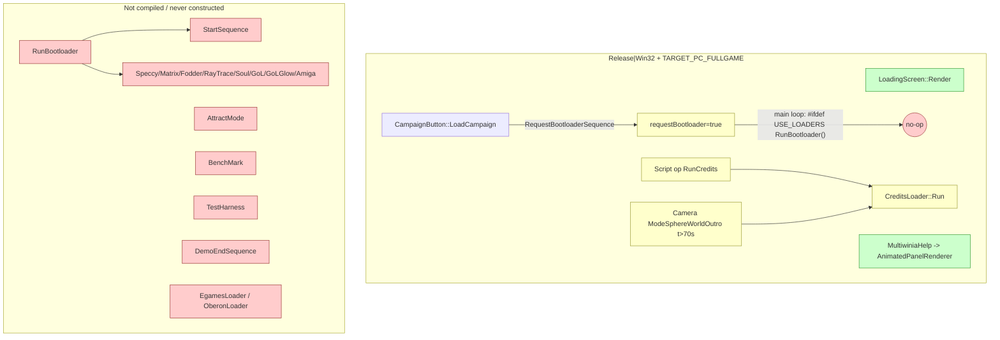
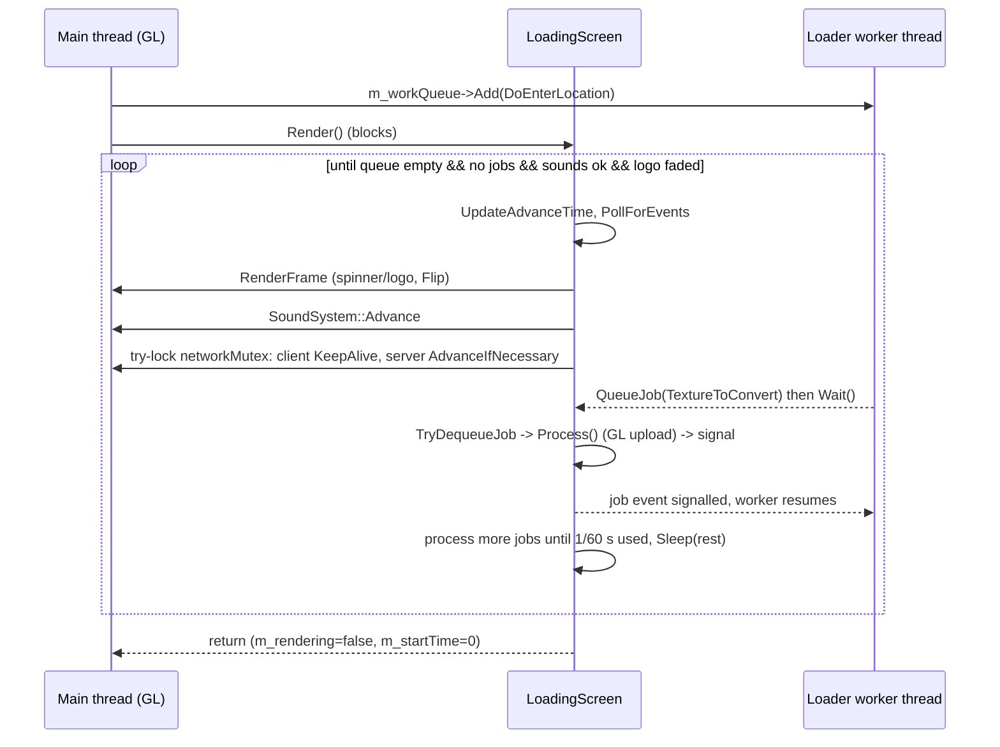
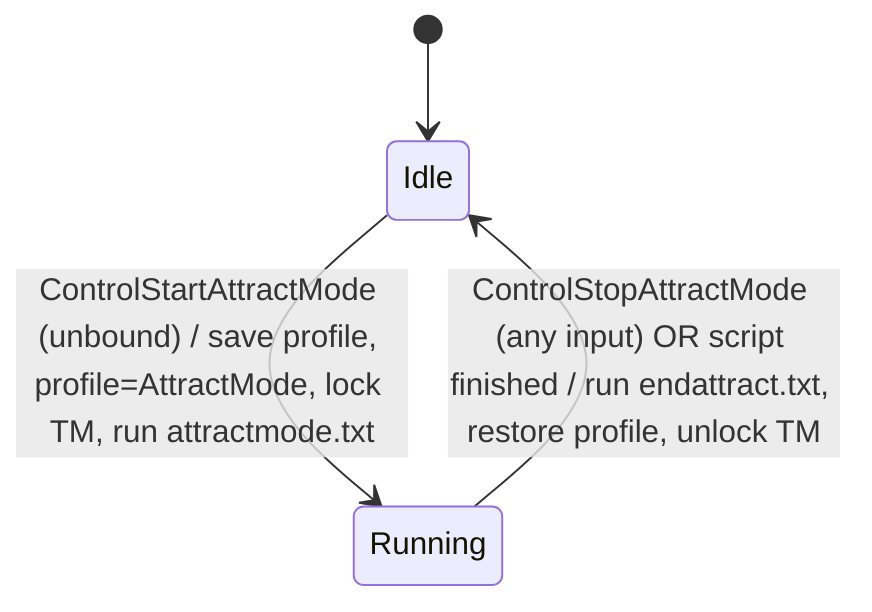

# P20_sequences_loaders_bench — Start/end sequences, attract mode, loading screen, boot-loader mini-programs, benchmark, test harness, animated help panels
Scope: `code/loaders/*` (24 files), `code/loading_screen.*`, `code/attract.*`, `code/benchmark.*`, `code/testharness.*`, `code/startsequence.*`, `code/demoendsequence.*`, `code/animatedpanel.*`, `code/animatedpanel_renderer.*` (38 files, 6 754 lines). Build baseline: see `build_matrix.md` (`Release|Win32` + `TARGET_PC_FULLGAME`, OpenGL).

Supporting files read outside scope (to resolve call sites / gates): `code/main.cpp` (RunBootloader, RunTheGame, EnterLocation, MainMenuLoop, game loops), `code/app.cpp`/`app.h`, `code/lib/work_queue.*`, `code/lib/runnable.*`, `code/lib/resource.cpp`, `code/lib/bitmap.cpp`, `code/landscape_renderer.cpp`, `code/sound/soundsystem.cpp`, `code/script.cpp`, `code/camera.cpp` (intro/outro modes), `code/renderer.cpp`, `code/multiwiniahelp.cpp`, `code/multiwinia.cpp` (grace period), `code/global_world.cpp/.h`, `code/UI/CampaignButton.h`, `code/UI/PrologueButton.h`, `code/UI/GameMenuWindow.cpp`, `code/interface/prefs_other_window.cpp`, `code/lib/preferences.cpp`, `code/lib/universal_include.h`, `code/3d_sierpinski_gasket.*`, `contrib/systemiv/lib/math/random_number.cpp`, `contrib/systemiv/lib/tosser/hash_table.cpp`, `contrib/systemiv/lib/filesys/text_stream_readers.cpp`, `data/input/input_preferences.txt`, `data/sounds.txt`, `data/scripts/attractmode.txt`, `data/scripts/endattract.txt`, `data/animations/*.anim` (headers only — grammar owned by another agent), `data/language/english.txt` (keys only), `data/betatesters.txt` (line count only), `targets/vs2005/Darwinia.vcproj`.

---

## [→ 09_meta_systems] 0. Build reality and reachability of every P20 feature

Every file in scope is listed in `targets/vs2005/Darwinia.vcproj` for all four configurations [C] (`manifest.csv` `vcproj_build=all`), but most of the *content* is removed by preprocessor gates or has no live call site. "Compiled" below means "the function bodies survive the preprocessor in `Release|Win32` + `TARGET_PC_FULLGAME`".

| Feature | Body compiled in [B:FULL]? | Gate(s) | Live call path in [B:FULL]? | Tag |
|---|---|---|---|---|
| `LoadingScreen` (spinner + logo + job pump) | yes | none | yes — startup, every level load, map-select thumbnail preload | **[B:FULL]** |
| `AnimatedPanel` + `AnimatedPanelRenderer` (game-mode "how to play" panel) | yes | none | yes — `MultiwiniaHelp` during the grace period | **[B:FULL]** |
| `Loader` base class (`SetupFor2D`, `FlipBuffers`, `AdvanceSound`, factory) | yes | enum members / factory cases for the 8 mini-programs under `USE_LOADERS` | only via `CreditsLoader` paths below | [B:LEGACY] |
| `CreditsLoader` ("darwinians carry the credits letters") | yes (no gate in file; `GenerateEGamesList` under `EGAMESBUILD`, one line under `OBERONBUILD`) | — | only `Script::RunCommand_RunCredits` (script op `RunCredits`, used by **no** file in `data/scripts`) and `Camera::AdvanceSphereWorldOutroMode` after 70 s (Darwinia `GameOver` ending, `data/scripts/gameover.txt`) — Darwinia campaign only | [B:LEGACY] |
| `SpeccyLoader`, `MatrixLoader`, `FodderLoader`, `RayTraceLoader`, `SoulLoader`, `GameOfLifeLoader` (+Glow), `AmigaLoader` | **no** — each `.h` and `.cpp` is wrapped in `#ifdef USE_LOADERS` | `USE_LOADERS` commented out in `code/lib/universal_include.h` (`//#define USE_LOADERS`) | no | [B:DEAD] |
| `Sierpinski3D` (used only by `AmigaLoader`) | yes (`code/3d_sierpinski_gasket.cpp` has no gate) | — | no caller outside `amiga_loader.cpp` | [B:DEAD] by call graph |
| `EgamesLoader` (AVI intro) | no — `#ifdef EGAMESBUILD` (defined nowhere) | `EGAMESBUILD` | no call site even if defined (header only included by `main.cpp`) | [B:DEAD] |
| `OberonLoader` (distributor splash) | no — body `#ifdef OBERONBUILD` (defined nowhere); class declaration in header is unguarded | `OBERONBUILD` | no call site even if defined | [B:DEAD] |
| `RunBootloader()` (boot-loader dispatcher + first-time intro) | no — `#ifdef USE_LOADERS` | `USE_LOADERS` | the main loop's call is also inside `#ifdef USE_LOADERS` | [B:DEAD] |
| `RequestBootloaderSequence()` / `IsFirsttimeSequencing()` | yes | — | `CampaignButton::LoadCampaign` sets the request; nothing consumes it (see §1.6 side effect) | [B:LEGACY] |
| `StartSequence` (90 s first-time intro) | yes (no gate) | — | its only constructor call is inside `RunBootloader` (`USE_LOADERS`) → never instantiated; `Renderer::Render`'s `if(g_app->m_startSequence)` hook is compiled but always false | [B:LEGACY] (compiled, unreachable) |
| `DemoEndSequence` (prologue end screen) | no — `#ifdef USE_SEPULVEDA_HELP_TUTORIAL` (defined nowhere) | `USE_SEPULVEDA_HELP_TUTORIAL` | `Script::RunCommand_ShowDemoEndSequence` compiles to an empty function | [B:DEAD] |
| `AttractMode` | yes (no gate in `attract.cpp`) | object only constructed under `#ifdef ATTRACTMODE_ENABLED` (defined nowhere); both `Advance` call sites gated too | no (`g_app->m_attractMode` stays `NULL`) | [B:DEAD] (feature); profile-name special cases in `App` are compiled → [B:LEGACY] |
| `BenchMark` | no — whole `.cpp` under `#ifdef BENCHMARK_AND_FTP`; only commented-out `//#define BENCHMARK_AND_FTP` inside the `TARGET_BETATEST_GROUP` block | `BENCHMARK_AND_FTP` | no (all 5 call sites in `app.cpp`/`main.cpp` gated) | [B:DEAD] |
| `TestHarness` | no — `#ifdef TEST_HARNESS_ENABLED` (defined nowhere) | `TEST_HARNESS_ENABLED` | no; `Script::IsRunningScript` still tests `g_app->m_testHarness` (always `NULL`) | [B:DEAD] |

Evidence: [C] `code/lib/universal_include.h` (macro block "PICK ONE OF THESE TARGETS" and `TARGET_BETATEST_GROUP` block); [C] `code/main.cpp:RunBootloader`, `code/main.cpp:RunTheGame`; [C] `code/app.cpp:App::App`; [C] per-file guards listed. `OpenMP` (used by `RayTraceLoader`) is explicitly `false` in `ReleaseDirect3D` and unset (default off) elsewhere [C] `targets/vs2005/Darwinia.vcproj`.

**Design consequence for the new game.** In the shipped Multiwinia PC build the only player-visible features from this partition are (a) the **loading screen** and (b) the **animated game-mode panels**. Everything else is Darwinia-era or dev tooling. The loaders, intro, credits, attract mode, benchmark and test harness are nevertheless specified below (precisely enough to re-implement) because they are design capabilities in the codebase; each section carries its tag.

## [→ 09_meta_systems] 1. Loading screen (`LoadingScreen`) [B:FULL]

### 1.1 Role
A blocking, main-thread "please wait" loop that (1) keeps the window alive and animated while a **background worker thread** performs a load, (2) executes on the main thread the OpenGL work the worker cannot do itself (texture upload/delete, display-list creation, VBO binding) and (3) keeps sound and networking ticking. It shows **no progress bar or percentage** — only an animated spinner and, on first start-up, a publisher logo [C] `code/loading_screen.cpp:LoadingScreen::RenderFrame`.

Single global instance `g_loadingScreen`, created in `code/main.cpp:Initialise` **before** `App` is constructed [C].

### 1.2 Data members [C] `code/loading_screen.h:LoadingScreen`

| Member | Type | Initial | Meaning |
|---|---|---|---|
| `m_rendering` | bool | **uninitialised** (ctor does not set it) [C] | true while `Render()` loop is executing; read by `IsRendering()` |
| `m_texId` | int | -1 | GL texture of the spinner sprite; set by `Resource` once resources are loaded (`code/lib/resource.cpp` L~954: `g_loadingScreen->m_texId = GetTexture("sprites/darwinian.bmp")`) or lazily by `RenderFrame` |
| `m_initialLoad` | bool | true | true only for the very first load (start-up); cleared in `code/main.cpp:RunTheGame` after `Initialise` |
| `m_platformLogoShown` | bool | false | Mac only (platform logo) |
| `m_startTime` | double | 0.0 | time of first rendered frame of the current `Render()`; reset to 0 on exit |
| `m_workQueue` | `WorkQueue*` | new | the background loader thread + its FIFO of `Runnable`s |
| `m_lock` | `NetMutex` | — | protects `m_jobs` |
| `m_jobs` | `LList<Job*>` | empty | FIFO of main-thread jobs queued by worker threads |
| `m_startFadeOutTime` | double | 0.0 | when the logo fade-out began |
| `m_fadeOutLogo` | bool | false | keeps the loop alive until the logo has faded out (initial load only) |

### 1.3 Threading model (loading **is** on a background thread)

- `WorkQueue` constructor starts one OS thread (`NetStartThread(WorkQueue::RunThread)`). The thread calls `StandardiseCPUPrecision()` (per-thread FPU mode — see 22) then loops: wait on `m_event`; pop-front-run-delete each `Runnable`; signal `m_doneJob`; exit on `m_quit` [C] `code/lib/work_queue.cpp:WorkQueue::Run`.
- The first item queued by `LoadingScreen::LoadingScreen` is `SetWorkingThreadProcessor`, which calls `SetThreadAffinityMask(thread, 0x01|0x04|0x10|0x40)` (= logical CPUs 0, 2, 4, 6) under `WIN32` [C].
- Work put on the loader thread (all [C]):

| Producer | Runnable queued | When |
|---|---|---|
| `App::App` | `App::Initialise` | start-up (then `g_loadingScreen->Render()` blocks the main thread) — `code/app.cpp:App::App` |
| `code/main.cpp:EnterLocation` | `DoEnterLocation` (start network/task manager, load level) | every level load |
| `GameMenuWindow::SetupMapSelectPage` | `GameMenuWindow::PreloadThumbnails` | entering the map-select page |
| `CampaignButton::MouseUp` / `PrologueButton::MouseUp` | `LoadCampaign` / `LoadPrologue` | Darwinia modes [B:LEGACY] |

- Sounds are **not** loaded on this thread on PC: after the initial `Render()` returns, `App::App` queues `SetWorkingThreadProcessor` + `App::LoadSounds` on a *second* `WorkQueue` (`App::m_soundsWorkQueue`), because "unrar not thread safe" (two archive reads must not overlap) [C] `code/app.cpp:App::App` (comment). On Mac both run on the loader queue before `Render()`.
- **Main-thread jobs.** A worker that needs GL creates a stack `Job` subclass, calls `g_loadingScreen->QueueJob(&job)` and blocks in `job.Wait()` (a `NetEvent`) until the main thread has run `Job::Process()` (= `Run()` + signal) [C] `code/lib/runnable.cpp:Job::Process`. Producers: `BitmapRGBA::ConvertToTextureAsync` (`TextureToConvert`), `Resource::DeleteTextureAsync` (`DeleteTextureByName`), `Resource::CreateDisplayListAsync` and two further resource jobs (`code/lib/resource.cpp` L~766/830/848), `LandscapeRenderer` VBO binding (`RunnableJob` over `LandscapeRenderer::DoBindBuffers`). Each producer first checks `NetGetCurrentThreadId() == g_app->m_mainThreadId` and runs synchronously if already on the main thread [C].
- Jobs queued while no loading screen is up are drained by `g_loadingScreen->RunJobs()` once per frame in the location game loop [C] `code/main.cpp` (L~496, "Clear out any display lists wanting to be created").
- While `IsRendering()` is true: `Resource::GetTextureWithFlags` takes `Resource::m_mutex` around texture-map lookups [C] `code/lib/resource.cpp`; `SoundSystem::NotReadyForGameSoundsYet()` returns true (all `TriggerEntityEvent/TriggerOtherEvent/...` calls are dropped) [C] `code/sound/soundsystem.cpp`.
- `RenderFrame` holds `g_openGLMutex` for the whole frame [C].

### 1.4 `Render()` loop — exact behaviour [C] `code/loading_screen.cpp:LoadingScreen::Render`

1. `m_rendering = true`; `m_fadeOutLogo = m_initialLoad`; `m_startFadeOutTime = 0`.
2. Loop **while** any of: worker queue not empty; `m_jobs` not empty; `g_app->m_requireSoundsLoaded && !g_app->m_soundsLoaded`; `m_fadeOutLogo`; [B:D3D] `GeneratingMipmaps()`.
   - `UpdateAdvanceTime()` (global frame clock, capped 0.25 s — see 01).
   - `g_inputManager->PollForEvents()` only (input is **not** `Advance`d, so no control events fire during loading).
   - If `g_app`, `m_resource`, `m_renderer` exist: `RenderFrame()`; `SoundSystem::Advance()` if initialised; if `g_app->m_networkMutex.TryLock()` succeeds: `m_clientToServer->KeepAlive()` and `m_server->AdvanceIfNecessary(now)` (so a hosting server keeps ticking and clients don't time out during a level load), unlock.
   - Run one main-thread job; then keep running jobs until `frameStart + 1/60 s`; `Sleep(remaining ms)` if time remains → loading screen frame-rate cap **60 Hz**.
3. `m_rendering = false`; `m_startTime = 0`.

`m_requireSoundsLoaded` is set true when the player leaves `MainMenuLoop` [C] `code/main.cpp:MainMenuLoop` — hence the first level load waits for the background sound load to finish; the main menu itself does not.

### 1.5 What a frame shows [C] `code/loading_screen.cpp:LoadingScreen::RenderFrame`

If `m_texId == -1`: try `Resource::DoesTextureExist("sprites/darwinian.bmp")` → `GetTexture`; draw nothing, no `Flip` (screen keeps last frame).

Otherwise:
1. `m_startTime` := now on first such frame. Clear colour (0,0,0,0) + depth.
2. **Menu backdrop**: if `!m_initialLoad && !g_app->m_loadingLocation && g_app->m_atMainMenu && renderer fade complete` → render `GameMenu` and `UserInput` (e.g. during thumbnail preload the menu stays visible under the spinner).
3. `g_editorFont.BeginText2D()` (2D pixel projection), blend on, cull off.
4. **Publisher logo (initial load only)**. PC constants: `platformLogoDuration = 0`, `ivLogoStartTime = 0`, `ivLogoFadeInDuration = 1.0 s`. `alpha = min(elapsed, 1)`; when the worker queue is empty and no jobs remain, the fade-out starts: `alpha = 1 − (now − m_startFadeOutTime)` (1 s), and when `alpha ≤ 0` → `m_fadeOutLogo = false` (lets the loop end). Logo texture `textures/ivlogo.bmp` (600×600 source), drawn centred, size `500·(ScreenH/1024)` square, colour (1,1,1,alpha) [C] `RenderIVLogo`.
   - **Rating notice** (`WAN_PLAY_ENABLED && !TARGET_OS_MACOSX` → [B:FULL]): if language phrase `esrb_warning` exists, draw it centred at (ScreenW/2, 0.95·ScreenH), font size `0.02·ScreenH`, `g_editorFont`, colour (1,1,1, alpha−0.5) (i.e. at most 50 % opacity) [C].
5. **Spinner** (always on PC): sprite `sprites/darwinian.bmp`, 100×100 px, centre at (ScreenW−100, ScreenH−100), colour (0.2, 0.8, 0.2, 1), rotation `fmod(t·90°, 360°)` about its centre (90°/s; a commented alternative stepped 18° at 5 Hz) [C] `RenderSpinningDarwinian`. Restores cull on, blend off.
6. `EndText2D`, `g_windowManager->Flip()`.

[B:DEAD] Mac-only: 5 s platform logo (`RenderPlatformLogo`, 1 s fade in / 1 s fade out) shown before the publisher logo; spinner hidden during it.

### 1.6 Side effect: `RequestBootloaderSequence` in [B:FULL] [C]
`CampaignButton::LoadCampaign` calls `RequestBootloaderSequence()` which sets `requestBootloader = true` **and** `g_RenderingFirstTimeBL = true`. Only `RunBootloader` (compiled out) resets `g_RenderingFirstTimeBL`; the main loop clears `requestBootloader` but not the other flag. `Renderer::Render` skips `RenderFadeOut()` while `IsFirsttimeSequencing()` is true → after a Campaign launch in a FULL build, screen fade-outs are never drawn again for the session [C] `code/main.cpp`, `code/renderer.cpp:Renderer::Render` (L~671). Reachability of the Campaign button in FULL is decided by P18 (`PageDarwinia`); flagged here as a latent bug — do not replicate.

### 1.7 Re-implementation notes
- Keep: background loading thread; main-thread job queue for GPU work with a per-frame time budget; network keep-alive and server ticking during loads; first-run publisher splash with fade; minimal spinner; menu-backdrop variant for small loads.
- Change (recommended): add real progress reporting (the original has none); initialise `m_rendering`; replace fixed affinity masks with the OS scheduler; DX12 permits multi-threaded resource creation (copy queue), removing most of the job marshalling.

## [→ 09_meta_systems] 2. Animated game-mode panels (`AnimatedPanel`, `AnimatedPanelRenderer`) [B:FULL]

### 2.1 What they are
A small keyframed 2D "cartoon" (sprites moving, rotating, fading) shown in a framed box at the bottom-centre of the screen **during the pre-game grace period** of a Multiwinia match, with the game-mode name as title and a one-line rule summary as caption — a "how this mode works" explainer. One `.anim` file per game mode in `data/animations/` [C] `code/multiwiniahelp.cpp:MultiwiniaHelp::InitialiseAnimatedPanel`. The `.anim` text grammar is owned by another agent; the in-memory model, interpolation and playback are specified here.

### 2.2 Selection, lifetime and trigger [C]

| Game type (`Multiwinia::m_gameType`) | File |
|---|---|
| `GameTypeSkirmish` (Domination) | `animations/domination.anim` |
| `GameTypeKingOfTheHill` | `animations/koth.anim` |
| `GameTypeCaptureTheStatue` | `animations/cts.anim` |
| `GameTypeAssault` | `animations/assault_defend.anim` |
| `GameTypeRocketRiot` | `animations/rocket.anim` |
| `GameTypeBlitzkreig` | `animations/blitz.anim` |
| `GameTypeTankBattle` (compiled out) | none → no panel |

- Created lazily in `MultiwiniaHelp::Advance` (which returns early unless `g_app->Multiplayer()`) when `m_animatedPanel == NULL && Multiwinia::GameInGracePeriod()` (`m_gracePeriodTimer > 0`). If the file cannot be opened, no panel [C].
- Deleted only by `MultiwiniaHelp::Reset()` (called from `App::ShutdownCurrentGame`) — so it is created once per match [C].
- Rendered from `MultiwiniaHelp::Render` (2D matrices) only while `GameInGracePeriod()` **and** `g_app->m_multiwiniaTutorial == NULL` **and** `m_gracePeriodTimer >= GRACE_TIME` [C] `code/multiwiniahelp.cpp:MultiwiniaHelp::Render`. Since `Multiwinia::AdvanceGracePeriod` holds the timer at exactly `GRACE_TIME` (3.0 s) until every team is ready and only then counts down in 0.1 steps [C] `code/multiwinia.cpp`, the panel is visible **while waiting for all players to be ready**, and disappears as soon as the 3-2-1 countdown starts. Also suppressed by `MultiwiniaHelp::Render`'s early-outs: no location, not multiplayer, `m_hideInterface`, game over, Assault with `m_victoryTimer > 0`, no local team.

### 2.3 Layout [C] `MultiwiniaHelp::InitialiseAnimatedPanel`
`scale = ScreenH / 1300`. `screenW = m_width·scale`, `screenH = m_height·scale`, `screenX = ScreenW/2 − screenW/2`, `screenY = ScreenH − m_height·1.15·scale`. `borderSize = 5`, `titleH = 25`, `captionH = 15` (pixels, not scaled). Panel design sizes from the files: domination 800×250 (loop 0–15.01 s), koth 800×250 (0–15.66 s), cts 924×250 (0–20.01 s), assault_defend 900×250 (0–12.02 s), rocket 1000×250 (0–30.01 s), blitz 900×250 (0–24.01 s) [C] `data/animations/*.anim` headers.

| File | Objects | Keyframes | Images used (`data/animations/`) |
|---|---|---|---|
| assault_defend.anim | 14 | 135 | cloudyglow, darwinian, darwinian_ouch4, muzzleflash, trunkport, turretbarrel, turretbase, wmd |
| blitz.anim | 28 | 180 | cloudyglow, darwinian, darwinian_ouch4, flag, flag_down, flag_locked, flag_up, fuelpumper, laser, muzzleflash, trunkport |
| cts.anim | 23 | 111 | cloudyglow, darwinian, darwinian_ouch4, laser, muzzleflash, plusone, spawnpoint, statue, zone-back, zone-front |
| domination.anim | 28 | 169 | cloudyglow, darwinian, darwinian_ouch4, laser, muzzleflash, spawnpoint |
| koth.anim | 17 | 108 | cloudyglow, darwinian, darwinian_ouch4, laser, muzzleflash, plusone, spawnpoint, zone-back, zone-front |
| rocket.anim | 21 | 173 | armour, cloudyglow, darwinian, fuelpump, fuelpumper, island, laser, muzzleflash, rocket, solarpanel, trunkport, water |

(Counts from a grep of `BEGIN Object` / `BEGIN Keyframe` / `IMAGENAME`; [C] data.)

### 2.4 Data model [C] `code/animatedpanel.h`

`AnimatedPanel`: `m_objects` (LList of objects), `m_width`=600, `m_height`=300, `m_start`=0, `m_stop`=30 (defaults, overridden by file), `m_time`=0 (current playback time, s).

`AnimatedPanelObject`: `m_keyframes` (LList, **unsorted** — order as read).

`AnimatedPanelKeyframe` fields and defaults:

| Field | Type | Default | Interpolated? |
|---|---|---|---|
| `m_timeIndex` | float s | 0 | key |
| `m_imageName` | char[256] | `"darwinian.bmp"` | no (step: left keyframe's value) |
| `m_x`, `m_y` | float, panel design units | 100, 100 | eased (ramp) |
| `m_colour` | int enum | `ColourNone` | no |
| `m_scale` | float (× image pixel size) | 0.3 | eased (ramp) |
| `m_angle` | float degrees | 0 | linear |
| `m_flipHoriz` | int bool | 0 | no |
| `m_alpha` | int 0–255 | 255 | linear (integer truncation on assignment) |

Colour enum: `ColourNone`=0 (white 255,255,255), `ColourFriendly`=1 (local team's `Team::m_colour`), `ColourEnemy`=2 (colour of the first team index `i` in `0..NUM_TEAMS-1` that is not `TeamTypeUnused` and not a friend (`Location::IsFriend`) of `g_app->m_globalWorld->m_myTeamId`; white if none), `ColourInvisible`=3 (RGBA 255,255,255,0 — alpha forced 0, keyframe alpha ignored) [C] `code/animatedpanel_renderer.cpp:AnimatedPanelRenderer::RenderObjects`.

Editing API present but unused by the game (no editor in this tree calls it) [I from grep]: `NewObject`, `DeleteObject`, `NewKeyframe(obj, t)` (samples current properties at t and appends), `GetKeyframe(obj, t, maxDiff)` (first keyframe within ±maxDiff), `DeleteKeyframe` (removes from list **without deleting** — leak), `Write(TextFileWriter*)` (serialiser — the inverse of `Read`).

### 2.5 Interpolation [C] `code/animatedpanel.cpp:AnimatedPanel::CalculateObjectProperties`
For object `o` at time `t`:
1. `left` = keyframe with greatest `timeIndex ≤ t`; `right` = keyframe with smallest `timeIndex ≥ t` (linear scan; ties → first found).
2. None → object not drawn. Only `left` → hold `left` (object persists after its last key). Only `right` → **not drawn** (object does not exist before its first key). `left == right` or `|right.t − left.t| < 0.01` → `left`.
3. Else `lin = (t − left.t)/(right.t − left.t)`; `ramp = CalculateRampUpAndDown(left.t, right.t − left.t, t)` where, with `f = (t − start)/duration`: `f > 1` → 1; `f < 0.5` → `2f²`; else `1 − 2(1−f)²` (quadratic ease-in-out).
4. Result = copy of `left`, then `x, y, scale` lerped with `ramp`; `angle, alpha` lerped with `lin`.

### 2.6 Playback and rendering [C] `code/animatedpanel_renderer.cpp`
- Clock: on first `RenderObjects`, `m_time = 0`, `m_animTimer = now`. Each call: `m_time += now − m_animTimer`; if `m_time > m_stop` → `m_time = m_start` (loop; overshoot discarded); `m_animTimer = now`. Real time, not game time (unaffected by pause/speed) [C].
- `RenderBackground(alpha=0.9)`: filled black quad (alpha 0.9) over the outer rectangle `[screenX − border, screenY − titleH − border] … [screenX + screenW + border, screenY + screenH + border + captionH]`; outer line loop white alpha 0.45 on the same rectangle; inner line loop white alpha 0.225 on `[screenX, screenY − titleH] … [screenX + screenW, screenY + screenH + captionH]`.
- `RenderObjects`: scissor (`Renderer::Clip`) to `(screenX+1, screenY−titleH+1, screenW−1, screenH+titleH+captionH−1)`; `scale = screenW / m_width`; for each object (list order = draw order, later on top) with a valid sample: image `animations/<imageName>` (bitmap needed for its pixel size; texture via `Resource::GetTexture`, mip-mapped, linear, clamp); `w = imgW·kf.scale·scale`, `h = imgH·kf.scale·scale`; centre at `(screenX + kf.x·scale, screenY + kf.y·scale)`; rotated by `kf.angle` degrees about the centre (`RotateAroundZ` on corners); horizontal flip by texture u 1→0; colour from §2.4 with `a = kf.alpha` (unless invisible). Blending is whatever `MultiwiniaHelp::Render` set (`SRC_ALPHA, ONE_MINUS_SRC_ALPHA`) [I].
- `RenderTitle(title)`: `g_titleFont`, size 30, centred at `(screenX + screenW/2, screenY − titleH + 10)`; two passes: outline pass colour (1,1,1,0) with `SetRenderOutline(true)`, then fill (1,1,1,1). Title = `LANGUAGEPHRASE(blueprint->GetName())` upper-cased.
- `RenderCaption(caption)`: `g_editorFont`, size 18; `WordWrapText(caption, screenW, 18/1.7)`; lines centred at x = `screenX + screenW/2`, bottom line at `y = screenY + screenH + captionH − 12`, earlier lines 18 px above each; outline + fill passes. Caption key `multiwinia_animdesc_<blueprint m_name>` (language lookup is case-insensitive: `HashTable::HashFunc` masks the case bit and compares with `stricmp` [C] `contrib/systemiv/lib/tosser/hash_table.cpp`), 6 keys in `english.txt` (domination, kingofthehill, capturethestatue, assault, rocketriot, blitzkrieg).
- `BeginRender()` / `EndRender()` are declared but **not defined** anywhere and never called [C grep].

## [→ 09_meta_systems] 3. Boot-loader framework (`Loader`, `RunBootloader`) — [B:LEGACY] base / [B:DEAD] dispatcher

### 3.1 Concept
"Boot loaders" are short, self-contained full-screen demo-scene/retro mini-programs that Darwinia played *instead of* a plain loading screen when entering the campaign. Each owns its own blocking render loop, takes over the GL state, plays one music event and returns when finished, skipped or the app is quitting. They do **not** load anything themselves — they are cosmetic.

### 3.2 Dispatcher `RunBootloader()` [B:DEAD] (`#ifdef USE_LOADERS`) [C] `code/main.cpp:RunBootloader`
Called from the top of the main loop in `RunTheGame` when `requestBootloader` is set (by `RequestBootloaderSequence`, i.e. `CampaignButton::LoadCampaign`):
1. `g_loadingScreen->Render()` (finish any pending load first).
2. `name = prefs "BootLoader"` (lookup default `"none"`; but `PrefsManager::CreateDefaultValues` writes `BootLoader = firsttime` in non-`DEMOBUILD` builds, so a fresh install would get the intro [C] `code/lib/preferences.cpp`; Other-Options apply writes `none`/`random`/`firsttime` — owned by P17b).
3. `name == "firsttime"` (case-insensitive) → construct `StartSequence`, loop `{ UpdateAdvanceTime(); if (StartSequence::Advance()) break; }`, delete it; camera `SetTarget((1000,500,1000), (0,−0.5,−1))` + `CutToTarget()`; set prefs `BootLoader = "random"` and save (the intro plays once).
4. Else `idx = Loader::GetLoaderIndex(name)`; if `idx != −1`: `CreateLoader(idx)->Run()`, delete.
5. `g_RenderingFirstTimeBL = false`.

### 3.3 Loader registry [C] `code/loaders/loader.cpp`

| Index (USE_LOADERS on) | Enum | Name (`GetLoaderName`) | Class | Random weight (`GetRandomLoaderIndex`) |
|---|---|---|---|---|
| 0 | `TypeSpeccyLoader` | `Spectrum` | `SpeccyLoader` | 0 |
| 1 | `TypeMatrixLoader` | `Matrix` | `MatrixLoader` | 10 |
| 2 | `TypeFodderLoader` | `Fodder` | `FodderLoader` | 0 |
| 3 | `TypeRayTraceLoader` | `Raytrace` | `RayTraceLoader` | 10 |
| 4 | `TypeSoulLoader` | `Soul` | `SoulLoader` | 10 |
| 5 | `TypeGameOfLifeLoader` | `GameOfLife` | `GameOfLifeLoader(false)` | 0 |
| 6 | `TypeGameOfLifeLoaderGlow` | `GameOfLife_Glow` | `GameOfLifeLoader(true)` | 10 |
| 7 | `TypeAmigaLoader` | `Amiga` | `AmigaLoader` | 0 |
| 8 | `TypeCreditsLoader` | `Credits` | `CreditsLoader` | 0 (not assigned in the `USE_LOADERS` branch → memset 0) |
| 9 | `NumLoaders` | — | — | — |

In [B:FULL] (`USE_LOADERS` off) the enum collapses to `TypeCreditsLoader = 0`, `NumLoaders = 1`, the name table to `{"Credits"}`, and the random table to `{Credits: 10}` [C].

- `GetLoaderIndex(name)`: `"random"` → `GetRandomLoaderIndex()`; else case-insensitive match against the name table; no match → −1 (so `"none"` → −1 → nothing plays).
- `GetRandomLoaderIndex()`: **reseeds the application RNG** `AppSeedRandom(time(NULL))` (side effect on every later `AppRandom/frand/sfrand` user), then weighted pick `AppRandom() % total` over cumulative weights → with `USE_LOADERS`: Matrix, Raytrace, Soul, GameOfLife_Glow each 25 %; Spectrum, Fodder, GameOfLife, Amiga, Credits only by explicit name [C].
- `CreateLoader(type)`: whole body inside `#ifndef DEMOBUILD` (demo builds return NULL → caller would crash on `->Run()` [C]); unknown type → `AppReleaseAssert`.
- "TODO: These strings should be encrypted" comment on the name table [C].

### 3.4 Shared helpers [C] `code/loaders/loader.cpp`
- `SetupFor2D(screenW)`: `screenH = screenW · (ScreenH/ScreenW)` (aspect-preserving virtual canvas, e.g. 800×600 at 4:3, 800×450 at 16:9); identity modelview; `gluOrtho2D(0, screenW, screenH, 0)` (y down); disable cull, depth test, lighting; returns `screenH`.
- `FlipBuffers()` (virtual): `PollForEvents`, `InputManager::Advance`, `glFinish`, `Flip`, clear colour (0,0,0,1) + depth, `Sleep(1)`.
- `AdvanceSound()`: `g_advanceTime = now − g_gameTime; g_gameTime = now` (keeps the global clock moving); if sound initialised: `SoundSystem::Advance()` + `SoundLibrary2d::TopupBuffer()`.
- Common loop contract (every loader): `while (!controlEvent(ControlSkipMessage))`, break on `g_app->m_requestQuit`; music started with `TriggerOtherEvent(NULL, "<Event>", SoundSourceBlueprint::TypeMusic)` and stopped with `StopAllSounds(WorldObjectId(), "Music <Event>")`.
- **Skip control** `SkipMessage` = `key enter down`, `key esc down`, `XInput start/a/b/y down` (edge-triggered) [C] `data/input/input_preferences.txt` L32–37. The edge stays latched until the next `InputManager::Advance()` (in `FlipBuffers`), which matters for multi-phase loaders (§3.6) [I].
- Other loader controls [C] `data/input/input_preferences.txt` L254–278: `LoaderHelp = key h pressed` (held); `GOLLoaderSpeedup = key p pressed`; `GOLLoaderSlowdown = key o pressed`; `GOLLoaderReset = key g down`; `RTLoaderReflectivenessIncrease = key p pressed`; `…Decrease = key o pressed`; `RTLoaderPixelWaveIncrease = key l pressed`; `…Decrease = key k pressed`; `RTLoaderMotionBlurIncrease = key m pressed`; `RTLoaderMotionBlurDecrease` **commented out** (unbound); `RTLoaderPixelBlurIncrease = key i down`; `…Decrease = key u down`; `RTLoaderBrightnessIncrease = key b pressed`; `…Decrease = key v pressed`; `RTLoaderResolutionIncrease = key x down`; `…Decrease = key c down`; `RTLoaderCameraMode1/2/3 = key 1/2/3 pressed`; `RTLoaderLMB = mouse left pressed` **and** `mouse right pressed`; `RTLoaderRMB` unbound.

### 3.5 Music events used by loaders [C] `data/sounds.txt` (Music section) — samples are third-party/IP (see IP register)

| Event | Sample | Loop | Volume | Attack / Release |
|---|---|---|---|---|
| `LoaderSpeccy` | `speccyloader` | no | 9.00 | — |
| `LoaderMatrix` | `matrix` | no | 9.03 | release 7.55 |
| `LoaderFodder` | `fodder` | no | 9.03 | — |
| `LoaderRaytrace` | `dma_sc-visitors_from_dreams` | yes | 9.00 | release 10.06 |
| `LoaderSoul` | `tresk_-weeklies-_schroeders-failure` | yes | 10.00 | release 10.06 |
| `LoaderGameOfLife` | `twoataris` | no | 9.00 | release 10.26 |
| `LoaderAmiga` | `pang` | no | 9.00 | release 10.06 |
| `Credits` | `trash80_-_pain-fade-down` | no | 10.00 | attack 2.71, release 10.06 |
| `StartSequence` | `dma_sc-visitors_from_dreams` | no | 9.00 | release 10.06 |

`LoaderAmiga` is absent from the sound-editor event list `SoundSystem::GetEventNames` (TypeMusic) but is bound in `sounds.txt` [C] `code/sound/soundsystem.cpp`.

### 3.6 Spectrum tape loader (`SpeccyLoader`) [B:DEAD] [C] `code/loaders/speccy_loader.cpp`
Imitates a ZX Spectrum loading from cassette: striped border, grey "paper", a program-name banner and a loading-screen picture appearing line by line in Spectrum video-memory order.

- Virtual screen 320×256 (`gluOrtho2D(0,320,256,0)`); inner paper rectangle (32,32)–(288,224) = 256×192, colour (200,200,200).
- Phases (each a loop that also exits on skip/quit), in order, with durations measured from phase entry; the first three phases draw **no** banner, all later ones draw it: Silence 1.5 s → Header 4.8 s → Data 0.07 s → (banner from here) Silence 1.1 s → Header 2.0 s → Data 1.85 s → Silence 1.01 s → Header 5.05 s → Data 0.07 s → Silence 0.99 s → Header 1.9 s → Screen. Pre-screen total 20.34 s.
- **Silence**: whole 320×256 filled with one colour of {red (255,0,0), cyan (0,255,255)}; per frame 1/200 chance (`AppRandom()%200==0`) to swap.
- **Header** (pilot tone): per scanline y∈[0,256) draw a 1-px full-width line in the current colour; stripe switches start at `y = AppRandom()%4` and recur every **7** lines; at a switch line a random `x = AppRandom()%1000` is chosen, the line is drawn in the old colour, and the segment [x,320) in the new colour (x ≥ 320 → invisible). Colours red/cyan.
- **Data**: same algorithm, colours yellow (255,255,0)/blue (0,0,255), stripe spacing `2 + AppRandom()%4` (2–5 lines).
- **Text** banner: texture `textures/program_darwinia.bmp` (256×256, nearest filtering) drawn at (33,40)–(289,296), colour black, blended — it shows a "Program: <title>" line in Spectrum font [I from file name; bitmap not inspected].
- **Screen**: data-mode border + paper + banner, plus the picture `textures/speccy_screen.bmp` (256×256 texture, nearest) revealed line by line: `m_nextLine` (0..192) advances by one when `now > timeToAdvance`, starting `timeToAdvance = entry + 0.192 s`, then `+= 0.194 s` (at most one line per frame). For each revealed index `y < m_nextLine`, the destination row is `row = ((y & 0x38) >> 3) + ((y & 0x07) << 3) + (y & 0xC0)` (Spectrum display-file interleave: thirds of 64 lines, then pixel-row-within-character, then character row), drawn as a 1-px quad at screen y = 32+row, x 32–288, texture v from `(256−row)/256` to `+1/256`. Returns as soon as `m_nextLine == 192` (≈ 37.2 s; the final full frame is never flipped) [C].
- Total ≈ 57.6 s. Music `LoaderSpeccy` (a recorded tape-loading sound; LOOPTYPE 0).
- Skip: each phase exits on the skip edge; because the edge stays latched until the next `FlipBuffers`, all following phases also exit immediately → one press skips the whole loader [I].
- Members `m_monoBmp[256*192]`, `m_currentPixel` ("used by the sound callback"), `m_startJ`, `StartFrame/EndFrame` declared; `m_monoBmp`/`m_currentPixel`/`EndFrame` unused [C] — remnants of a planned procedurally generated tape sound.

### 3.7 Matrix rain (`MatrixLoader`) [B:DEAD] [C] `code/loaders/matrix_loader.cpp`
- Grid 40 columns × 30 rows (`m_positions[40][30]`, brightness 0..1); drawn as 20×20 px cells on the 800-wide virtual canvas (cell (i,j) at x = 800·i/40, y = 600·j/30 — y uses a fixed 600, not the aspect-derived height), each cell textured with `sprites/darwinian.bmp`, colour (0.4, 1.0, 0.4, alpha), blending on.
- Logo mask `s_highlights[30·40]` (static, row-major j·40+i): rows 10–17 contain the product name in 8-row block letters (IP — replace), all other rows 0.
- Simulation tick every `MATRIXLOADER_UPDATEPERIOD = 0.02 s` (50 Hz, `#define`):
  1. For each column with probability ½ (`AppRandom()%2==0`): shift down `pos[i][j] = pos[i][j−1]` for j = 29..1; while shifting, if the moved value is exactly 1.0 (a head) and the mask cell is non-zero, `mask *= 2`, capped at 100 (so a cell needs 7 head passes to reach full: 1→2→…→64→100); new top `pos[i][0] = pos[i][1] − 0.05` (trail fades 0.05 per step), set to 0.5 if `pos[i][1]` was a head, clamped ≥ 0.
  2. Spawning by elapsed time `t`: t < 1 s → head in column 20 if `pos[20][0] == 0`; 1 ≤ t < 15 → one head at a random column (`AppRandom()%40`) per tick; 15 ≤ t ≤ 20 → none; first tick with t > 20 → "fall away": every cell outside rows 10–18 := 0, rows 10–18 := `mask/100 · (j−10)/8`, all masks := 0 (static — a second run in the same process has no logo), `fallAway = true`; afterwards the columns keep shifting so the logo drips away; t > 23 s → **return** (without `StopAllSounds`; the non-looping music runs out by itself) [C].
- Render alpha per cell: `a = pos`; if mask > 0: `a = max(mask/100, a) · (0.2 + 0.8·|sin(now + i·j)|)`; clamp [0,1].
- Duration 23 s. Music `LoaderMatrix`.

### 3.8 "Not endorsed by" disclaimer (`FodderLoader`) [B:DEAD] [C] `code/loaders/fodder_loader.cpp`
Homage to an Amiga war game: three centred text lines (keys `bootloader_fodder_1..3`) at (400, 215/265/320) on the 800-wide canvas, `g_gameFont` size 35, white with alpha `clamp((now − start)/5, 0, 1)` (5 s fade-in) while a song plays. Ends when the music instance finishes (`SoundSystem::m_music == NULL` after an `AdvanceSound`) or on skip. If sound is not initialised, `m_music` never becomes non-NULL and the loader ends after one frame [I].

### 3.9 Real-time ray tracer (`RayTraceLoader`) [B:DEAD] [C] `code/loaders/raytrace_loader.cpp`
A CPU ray tracer of chrome-like spheres over a scrolling checkerboard, with interactive controls; runs until skipped (no time limit).

**Scene**
| Item | Value |
|---|---|
| Objects | 6 spheres (`RAYTRACELOADER_MAXOBJECTS` = 10 capacity) |
| Sphere 0 | radius 10, colour (200,130,100) |
| Spheres 1–5 | radius 5; even index (2,4) colour (100,200,130), odd (1,3,5) (200,200,130) |
| Floor | plane y = −40, normal +Y |
| Light | direction `normalise(1,0,1)` (directional) |
| Camera | pos (0,0,−100), front (0,0,1), up (0,1,0), mode 1 (controllable) |
| Defaults | resolution 2, reflectiveness 1.0, pixelWave 0, motionBlur 0.1, pixelBlur 2.0, brightness 1.2 |

**Ray generation** (`SetupMatrices` + `CastAllRays`): render target `W = 160·res`, `H = 120·res` (res ∈ [1, `RAYTRACELOADER_MAXRES` = 5]); buffer `RGBAColour m_buffer[800][600]` cleared each frame. Horizontal FOV 90°, vertical `vfov = 90° · ScreenH/ScreenW`. `left = front` rotated about `up` by −45°, `right` by +45°, `top = front` rotated about `camRight = up × front` by −vfov/2, `bottom` by +vfov/2. Pixel (x,y): `dir = normalise( (left + (right−left)·x/W) + (top + (bottom−top)·y/H) )`.

**CastRay(origin, dir, depth, intensity)** — initial depth `RAYTRACELOADER_RENDERDEPTH` = 2, intensity `brightness / pixelBlur`; returns when `depth < 0` (so up to 3 surface hits):
1. Nearest sphere by squared distance; sphere test: `l = C − O`, `tca = l·d`, reject if `tca < 0`; `d² = l·l − tca²`, reject if `d² > r²`; `t = tca − √(r² − d²)`; `P = O + d·t`, `N = (P − C)/r`.
2. Hit: `k = clamp(−N·L, 0, 1) · intensity`; `buffer[x][y] += colour·k` (saturating `AddWithClamp`), with `colour.a = 255·reflectiveness`; reflect `R = 2(N·(−d))N + d`; recurse `CastRay(P, R, depth−1, intensity)` (no attenuation). Refraction code (index 1.4, `CalculateSphereRefraction`) exists but is commented out.
3. Miss: intersect floor (`t = −(O·n + d0)/(dir·n)`, `d0 = −(−40)`; `t < 0` → nothing). Checker: `xi = (int)P.x`, `zi = (int)(P.z + now·100)` (scrolls 100 units/s toward the camera, using absolute high-res time); white iff `(xi XOR zi) & 32` (32-unit squares). White adds `(200,200,200,200) · min(100000/|P|², 1) · intensity` (falloff by distance from the world origin); dark squares add nothing; floor not reflective.

**Animation** (`AdvanceObjects`, `t = now − start`, `T = now` absolute):
- Static axis `a1` starts (0,0,1); each frame rotated about Y by 0.75·dt and about X by 0.75·dt (rad).
- Sphere 0: `z = max(700 − 150·√t, 0)` (arrives at t ≈ 21.8 s); after t > 60: `z = −2·(t − 60)` (drifts toward/past the camera); `y = −7 + 10·sin(T/6)`; x = 0.
- Satellites: `v = (0,1,0)` rotated about `a1·(T+20)·0.1`; for i = 1..5: `pos_i = pos_0 + v·(10 + 5i)`; then `v` rotated about `a1·π/5` and about Z by `(T+20)·0.05`.
- Camera mode 2 (orbit): pos rotated about Y by 0.3·dt, `y = 10 + 10·sin(0.8T)`, `|pos| = 100 + 40·sin(0.5T)`, `front = −pos/|pos|`, `up = front × (worldUp × front)`.

**Controls** (`AdvanceControls`, dt = frame time): reflectiveness ±dt clamp [0,1]; pixelWave +dt / −dt (≥ 0); motionBlur ±0.1·dt clamp [0,1] (decrease unbound); pixelBlur ±1 per key edge (≥ 1); brightness ±0.1·dt (unclamped); resolution ±1 per edge clamp [1,5]; camera modes 0 fixed / 1 free / 2 orbit. Mode 1: `CameraForwards/Backwards/Left/Right/Up/Down` (W/S/A/D/Q/E per the help text; actual keys are the game's camera bindings, P10 [I]) move 20 units/s along front/right/up; `RTLoaderRMB` held → yaw `0.1·dX·dt`, pitch `−0.1·dY·dt` (unbound in shipped prefs). `RTLoaderLMB` held (either mouse button) → light rotated about its local up by `0.01·dX` rad.

**Compositing** (2D ortho `0..W × H..0`, stretched to the window):
1. Background quad-strip gradient with alpha `1 − motionBlur` (`SRC_ALPHA, ONE_MINUS_SRC_ALPHA`): top (0,0,0.1), middle (0,0,0), bottom (0,0.1,0.1). Because GL never clears the colour buffer here, the previous frame shows through → motion trail. Bug: the middle-left vertex uses `y = W/2` instead of `H/2` [C]. Under [B:D3D] the colour buffer is cleared every frame (comment: "our d3d present discards old backbuffer"), so no trails.
2. Rays: for each row `y < H−1` a quad strip across x with vertex colours `buffer[x][y]` at `(x+dx, y+dy)` and `buffer[x][y+1]` at `(x+dx, y+pixelBlur+dy)`, alpha forced 255, additive (`SRC_ALPHA, ONE`), smooth shading. `pixelWave > 0`: `dx = sin(5T + 0.1y)·wave`, `dy = sin(5T + 0.1x)·wave`.
3. Overlay: while `LoaderHelp` held → help page (`bootloader_raytrace_10..23` with live values; the motion-blur line passes no argument to its `%2.2f` — undefined output [C]); otherwise the message: from t = 30 s fade-in `alpha = (t−30)·0.1`, from t > 60 fade-out `1 − (t−60)·0.1`; drawn at x = 160 (+0.5·sin 2T), y = 20 (+0.5·sin 3T), font 9: 32 "=" rule, `APP_NAME` at size 36, rule, `bootloader_raytrace_1..4` (line pitch 9), gap 45, `_5.._8`, gap 36, `_9`; two passes (shadow, then (0.8,0.8,1.0,alpha)). x = 160 is only centred at resolution 2.
- Frame loop calls `Flip`, `InputManager::Advance`, `PollForEvents`, `AdvanceSound`, `Sleep(1)`; an FPS counter is computed but its display is commented out. `#pragma omp parallel for` over columns — OpenMP is not enabled in any configuration [C].

### 3.10 Floating souls (`SoulLoader`) [B:DEAD] [C] `code/loaders/soul_loader.cpp`
Green "souls" rise through black fog while ten words fade in and out in 3D; runs until skipped.

- Projection `gluPerspective(20°, W/H, 1, 10000)`, camera at origin looking −Z, up +Y; additive blending (`SRC_ALPHA, ONE`), no depth test, no texture; linear fog start 50, end 1500, colour black. Colour buffer cleared every frame.
- Spawner: every 0.6 s a spirit at `(sfrand(200), −170, −frand(1000))` (x ∈ (−100, 100], z ∈ [−1000, 0]; note `sfrand(r)` returns `(0.5 − U)·r`, i.e. ±r/2 [C] `contrib/systemiv/lib/math/random_number.cpp:sfrand`). Removed when y > 200.
- Spirit motion (`SoulLoaderSpirit::Advance`): `life += dt`; `offset += dt` (initial `frand(10)`); each of `xRate, yRate, zRate` (initial `frand(2)`) `+= frand(1)` then clamp [0,2] (drifts to 2); `vel = (sin(offset)·xRate, 3 + frand(3), sin(offset)·zRate)`; `pos += vel·dt` (rise 3–6 units/s → ≈ 80 s lifetime).
- Spirit render: two camera-facing diamonds (vertices `pos ± up·s`, `pos ± right·s`), inner s = 1 alpha 255, outer s = 3 alpha 150, colour (100,200,100); both alphas × `life/10` during the first 10 s.
- Messages (`RenderMessage`, all state **static**, set up once per process): 10 entries, text `bootloader_soul_<i>`.

| i | start time (s after loader start) | duration | base size | size growth | position |
|---|---|---|---|---|---|
| 0–7 | `T_i = T_{i−1} + 5·(1 + sfrand(0.4))` with `T_{−1} = 10` (gaps 4–6 s; ≈ 15, 20, …, 50) | 30 | 3 | 0.7 | follows a private spirit spawned at `(sfrand(150), −170, −700)` that only advances while the message is visible |
| 8 | `T_7 + 30` (≈ 80) | 30 | 5 | 0.15 | (0, 0, −300) fixed |
| 9 | `T_8 + 10` (≈ 90) | 20 | 2 | 0.3 | (0, −5, −300) fixed |

  Visible for `start ≤ t ≤ start+duration`; `fd = 0.2·duration`; alpha ramps 0→1 over `[start, start+fd]`, 1 until `start + 4fd`, then 1→0 to the end; size = `base·(1 + growth·(t−start)/duration)`. Each message drawn 4× per frame with `g_gameFont.DrawText3DCentre`: pass 0 alpha×0.75, passes 1–3 alpha×0.3, each offset by `(sin(T+j), cos(T/2+j), sin(T/3+2j))·size·0.06` (shimmer).
- Music `LoaderSoul` (looping).

### 3.11 Game of Life (`GameOfLifeLoader`, plain and "Glow") [B:DEAD] [C] `code/loaders/gameoflife_loader.cpp`
Conway-style life with ageing and "spirit" afterglow, drawn with creature sprites, slowly zooming out.

| Constant (`#define`) | Value |
|---|---|
| `CELLSIZE` | 20 (virtual px) |
| `MAXAGE` | 50 generations (live cell dies of old age) |
| `MAXSPAWNAGE` | 30 (only live cells younger than this count as neighbours) |
| `MAXSPIRITAGE` | 20 (dead-cell afterglow lifetime) |

- Grid `Nx = 128`, `Ny = int(128·ScreenH/ScreenW)` (96 at 4:3); states `Empty 0`, `Alive 1`, `Dead 2` (spirit); per-cell `age`.
- Init: 20 % alive (`syncrand() % 10 < 2` — uses the **network-synchronised** RNG, an unintended side effect [C]).
- Rule per cell (neighbours = 8-neighbourhood, no wrap, out-of-range ignored; `n` = neighbours that are Alive **and** age < 30):
  - not Alive and `n == 3` → Alive, age 0 (birth);
  - Alive and `2 ≤ n ≤ 3` and age < 50 → Alive, age+1;
  - Alive otherwise → Dead, age 0;
  - Dead and age < 20 → Dead, age+1;
  - otherwise → Empty (age left stale).
- Generation scheduling: a generation takes `m_speed` seconds; each frame computes only the rows `[ceil(Ny·f_prev), Ny·f_now)` where `f = clamp(elapsed/m_speed, 0, 1)`, writing next states into `m_cellsTemp` but **ages in place** (so later rows may see already-advanced neighbour ages — re-implementations may double-buffer ages); at `f ≥ 1` commit (`cells = temp; temp = 0`), reset the period. Bookkeeping: `m_numFound` = count of young-alive neighbour incidences in the generation; at commit, if 0 and `m_allDead < 0` → `m_allDead = now`; if > 0 → `m_totalAge++` ("colony age in years").
- Zoom/speed each frame: `zoom = 0.08 + t²/500` (t = seconds since Run); `m_speed = max(0.1/(5·zoom), 0.1)` (0.25 s per generation at start, 0.1 s from t ≈ 7.7 s). View width `ScreenW·zoom`, height `ScreenH·zoom`, capped at the board width 2560 (height scaled by aspect); centred ortho (`gluOrtho2D(−w/2, w/2, h/2, −h/2)`), additive blend. Because the formula overwrites `m_speed` every frame, the speed-up/slow-down keys (×1.1 / ×0.9 per frame) have **no effect** [C].
- Cell (x,y) top-left at `(20x − 1280, 20y − 10·Ny)`.
  - Alive: `sprites/darwinian.bmp` 20×20, colour (0.4,1,0.4, `1 − age/50`). Glow variant adds `textures/glow.bmp` over 5×5 cells (−2…+3 cells) with alpha `min(a·zoom, 1)·zoom`.
  - Dead (spirit): two untextured diamonds centred in the cell, half-sizes 6.6 and 2.178, alpha `(1 − age/20)·0.1` (Glow: first divided by `zoom·10`); Glow adds `glow.bmp` over 3×3 cells (−1…+2) alpha `min((1 − age/20)·zoom·0.03, 1)`.
- All dead: overlay fades in over 5 s (`alpha = (now − m_allDead)·0.2`): "`bootloader_life_17` <totalAge>" and `bootloader_life_18`, centred at x = 0, y = `h/3 + w/100` and `h/3 + 2w/100`, size `w/100`.
- `GOLLoaderReset` (G): commit, clear, re-randomise, `totalAge = 0` (does not clear `m_allDead`). `LoaderHelp` held: help page (`bootloader_life`, `_1.._16b`; `_16b` hidden under `OBERONBUILD`).
- [B:D3D] `glTraceEnable(true/false)` brackets ctor and `Run` (debug tracing in the GL→D3D layer).
- Music `LoaderGameOfLife`. Runs until skipped.

### 3.12 Amiga demo (`AmigaLoader`) [B:DEAD] [C] `code/loaders/amiga_loader.cpp`, `code/3d_sierpinski_gasket.cpp`
A 1990s "cracktro": starfield, bouncing two-part logo, sine-wave scroller and a spinning 3D Sierpinski pyramid of points.

- Virtual 2D canvas 320×256 (`SetupFor2d`); 3D pass `gluPerspective(80°, 1.33, 1, 1000)`.
- **Stars**: 4000 points, `x = frand(1024)`, `y = frand(768)`, speed `−(frand(200)+20)` px/s (leftwards), grey level `frand(128)+127`; `x` wraps by +1024 when < 0; point size 2, blending off. Because the canvas is 320×256 but stars live in 1024×768, only ≈ 10 % are on screen [C] (quirk).
- **Pyramid** (`Sierpinski3D(10000)`): chaos game over 5 vertices — apex (0,0,20) and base (±20,±20,−20) — starting at the apex; each point = midpoint of the previous point and a random vertex (`AppRandom()%5`). Rendered from t ≥ 10 s: modelview translate (0,0,−100), rotate 90° about −X, rotate `50·phase` degrees about axis `(phase/50, 0, 1)`; `glScalef(s)`; points size 3, additive, colour `(0.4a, 0.7a, a, 128)` with `a = 128·s` as unsigned byte (overflows above s ≈ 2 [C]). Scale: t ∈ [10,11): `2(t−10)`; t ∈ [11,12): `osc·f + 2·(1−f)`, `f = t−11`; afterwards `osc = sin(4t) + 1.25` (0.25…2.25). Spin: `phase` starts 20, `rate` starts 0; each frame `phase += rate·dt`, then `rate −= 2.1·dt` if `phase > 0` else `+= 2.1·dt` (bang-bang pendulum about 0, amplitude 20).
- **Logo**: texture `textures/dmacrew.bmp` (256×256), two sub-images drawn with `GL_REPLACE` (texture colours, blended): part 1 130×50 px from u 0–0.61, v 0.765–1.0; part 2 170×37 px from u 0–0.83, v 0.59–0.76. With `p = 4t`, `o = (40·sin 0.6p, 40·sin(0.4p+2))`: part 1 at `(80 + 30 sin p, 120 + 40 sin(p+1)) + o`; part 2 at `(80 + 40 sin(p+1.5), 120 + 50 sin(p+3.5)) + o`.
- **Scroller**: text `bootloader_amiga` (wraps modulo length), `g_editorFont` in a 1024×768 ortho; speed 450 px/s; pitch 32 px; glyph height 55 with a 63-px shadow glyph in (32,64,64) behind; 34 glyphs per screen; glyph x from the sub-pixel scroll offset; `phase = 0.01x + scrollPhase` (`scrollPhase += 10·dt`); `y = 40 + 20·sin(phase)`; colour `c = 100·sin(4·phase) + 101` → RGB `(255−c, 255−c, c+20)`.
- Fade to black over 15 s starting at 72 s (`alpha = (now − (start+72))/15`); ends at 89 s. Music `LoaderAmiga`.

### 3.13 Distributor loaders (`EgamesLoader`, `OberonLoader`) [B:DEAD]
Full algorithms (AVI-on-a-tilted-screen intro with creature crowd; two-logo cross-fade splash) are in the Appendix — compiled out (`EGAMESBUILD`, `OBERONBUILD` defined nowhere) and without a call site even when enabled [C] `code/loaders/egames_loader.cpp`, `code/loaders/oberon_loader.cpp`, `code/main.cpp` (includes only).

## [→ 09_meta_systems] 4. Credits roll (`CreditsLoader`) — [B:LEGACY]

**Reachability.** Darwinia-campaign only: script op `RunCredits` (`code/script.cpp:Script::RunCommand_RunCredits`; no shipped script uses it [C grep `data/scripts`]) and the Darwinia ending camera `Camera::AdvanceSphereWorldOutroMode` once its running time exceeds 70 s (entered via script op `GameOver` in `data/scripts/gameover.txt`) — after the credits the camera returns to `ModeSphereWorld` at pos (0,0,100) [C] `code/camera.cpp`. **Multiwinia's own credits** are a static scrolling text page in the front-end menu (`GameMenuWindow::SetupCreditsPage`, `ReadCredits` concatenating `multiwinia_credits_<n>` phrases and the beta-tester list) — owned by P18 [C] `code/UI/GameMenuWindow.cpp`.

### 4.1 Concept
On a black 800-wide virtual canvas, little creature sprites walk on from the screen edges, pick up words or single letters and carry them into place to spell each credits page; when a page is complete they carry the pieces off again (or re-use identical pieces for the next page). Credit text itself is IP and is **not** reproduced here — only its structure (keys, layout).

### 4.2 Objects [C] `code/loaders/credits_loader.h`
- `CreditsItem`: `m_string` (UnicodeString — one word or one character), `m_pos`, `m_targetPos` (centre), `m_size` (font size), `m_used` (true while assigned to the page being built).
- `CreditsDarwinian` (carrier): `m_pos`, `m_targetPos`, `m_itemId`, `m_state ∈ {StateWalkingToItem, StateCarryingItem, StateLeaving}`.
- Global `g_creditsLoader` (set in ctor; carriers reach the item list through it).

### 4.3 Page construction `CreateNextScene()` (called whenever **no carriers remain**)
1. `DeleteUnusedStrings`: delete every item with `!m_used` that is off-screen.
2. Emit the page (table below) through:
   - `GenerateWordsCentre(x, y, size, text)` → split at spaces, one item per word, laid out left→right starting at `x − width(text)/2` (word advance = width(word + 1 char)); a 256-wchar copy buffer limits text length.
   - `GenerateCharsCentre(x, y, size, text)` → one item per non-space character, advance = width(1 char) per character (spaces advance too).
   - Each emission goes through `AddString(x, y, size, s)`: re-use the first existing item with an identical string (case-sensitive `StrCmp(_, true)`) that is `!m_used` — it keeps its current position; else create one at `GenerateOffscreenPosition(1000 + AppRandom()%200)`. Then `m_used = true`, `targetPos = (x + width(s)/2, y)`. A carrier is created for each emitted item: starting at the item's position if the item is off-screen, else at `GenerateOffscreenPosition(200 + AppRandom()%100)`; state `WalkingToItem`.
3. `RemoveUnusedStrings`: every item still `!m_used` gets `targetPos = GenerateOffscreenPosition(150)` and a fresh carrier starting at `GenerateOffscreenPosition(40 + AppRandom()%50)` → carried away.
4. `++m_sceneIndex`.

`GenerateOffscreenPosition(d)`: pick an edge with `AppRandom()%4`: 0 → (−d, rand%600); 1 → (rand%800, −d); 2 → (800+d, rand%600); 3 → (rand%800, 600+d). `IsOffscreen(p)`: x < 0, y < 0, x > 800 or y > 600 (fixed 800×600 bounds even on wide screens [C]).

### 4.4 Page layout (keys `bootloader_credits_<n>`; "W" = per-word, "C" = per-character; all centred at x = 400)
| Scene | Items (mode y size key) |
|---|---|
| 0 | W 150 30 `_1`; C 250 40 `_2`; C 300 40 `_3` |
| 1 | W 150 30 `_4`; C 200 50 `_5`; C 300 40 `_6`; C 350 40 `_7`; C 400 40 `_8`; C 450 40 `_9` |
| 2 | W 150 30 `_41`; C 200 40 `_42`; C 250 40 `_43`; C 300 40 `_44` |
| 3 | W 150 30 `_10`; C 250 40 `_11`; C 300 40 `_12` |
| 4 | W 150 30 `_13`; C 250 50 `_14`; [`OBERONBUILD` only: W 400 30 `_15`] |
| 5 | W 150 30 `_16`; C 200 40 `_17`; C 270 40 `_18`; W 400 30 `_19`; C 450 40 `_20` |
| 6 | W 150 30 `_21`; C 250 50 `_22`; W 300 30 `_23`; C 400 50 `_24`; W 450 30 `_25` |
| 7 | W 150 30 `_26`; C 200 40 `_27`; C 250 40 `_28`; W 400 30 `_29`; C 450 40 `_30` |
| 8 | W 150 30 `_31`; C 250 40 `_32` |
| 9 | [`EGAMESBUILD`: `GenerateEGamesList`] else W 150 30 `_33`; C 200 40 `_34`; W 350 30 `_35`; C 400 40 `_36` |
| 10 | W 50 30 `_37`; then beta-tester list |
| 11 | C 200 60 `_38`; W 300 20 `_39`; W 330 20 `_40` |
| 12 | (empty page — everything is carried off) |
| 13 | finished → `Run` exits |

Pattern [I from layout]: per-word size-30 lines are role headings, per-character size-40/50 lines are names. 44 `bootloader_credits_*` keys exist in `english.txt` [C].

- **Beta-tester page** (`GenerateBetaTesterList`): read `data/betatesters.txt` (38 non-empty lines [C]); each line with `strlen > 1` is a name. Two columns at x = 200 and 600; `y0 = 75`; `perCol = int(N/2) − 1`; `gap = (800·ScreenH/ScreenW − 115)/perCol`; `textSize = gap·2/3`; for i: `y += gap`, `GenerateWordsCentre(x, y, textSize, name_i)`; when `i == perCol` → `x += 400`, `y = 75`. (N ≤ 3 → division by zero [C].) Names are real people → IP/personal data, never reuse.
- [B:DEAD] `GenerateEGamesList` (`EGAMESBUILD`): `egames.txt` lines "`<size> <text>`", y from 30, `y += 1.3·size` per line, `+20` for blank lines (file absent from `data/` [C]).

### 4.5 Carrier state machine [C] `CreditsDarwinian::Advance`, `AdvanceToTargetPos`

```mermaid
stateDiagram-v2
    [*] --> WalkingToItem
    WalkingToItem --> Leaving: item deleted (target = offscreen 30)
    WalkingToItem --> CarryingItem: reached item.pos + (0, size/2)
    CarryingItem --> Leaving: item deleted (offscreen 30)
    CarryingItem --> [*]: reached item.targetPos + (0,size/2) AND carrier off-screen (removal trip)
    CarryingItem --> Leaving: reached target on-screen (target = offscreen 100); item.m_used=false
    Leaving --> [*]: reached target
```

While carrying, `item.pos = carrier.pos − (0, size/2)` (item rides just above the carrier). On delivery `item.m_used = false` (so it is available for re-use or removal by the next page).

`AdvanceToTargetPos(dt)` — speed **150 px/s**, two-phase "horizontal then vertical" walk: `v = target − pos` with `v.y *= 0.3`; if `|v| > 10` move `150·dt` along `v̂`, return false; else move `150·dt·|v|/10` along `v̂` and return false if `|v| > 2`. Then the same with `v.x *= 0.3` for the vertical phase; arrived when that distance ≤ 2.

### 4.6 Rendering and timing [C] `CreditsLoader::Render`, `FlipBuffers(alpha)`, `Run`
- Carriers: `sprites/darwinian.bmp` 30×30 centred, colour (100,255,100). Items: `g_gameFont.DrawText2DCentre(pos, size)` twice — outline pass colour (1,1,1,0), fill pass (1,1,1,1). (A faint "ghost at target" draw is commented out.)
- `FlipBuffers(alpha)`: poll/advance input, `glFinish`, `Flip`, clear **depth only**, then a full-canvas black quad with `alpha = min((t − start)/7, 1)` → frames smear during the first 7 s and become fully cleared afterwards [I: relies on blending enabled and the back buffer being preserved].
- `Run`: start music `Credits`; `SetupFor2D(800)`; loop until skip/quit or `CreateNextScene()` returns true (after scene 12 completes); stops `"Music Cutscene3"` at the end — a name mismatch with the started `Credits` event (both use the same sample), so the credits music is not explicitly stopped [C] (it is non-looping).
- Total length is emergent (carrier walking time); no fixed timings.

## [→ 09_meta_systems] 5. Attract mode (`AttractMode`) — [B:DEAD] (feature gate `ATTRACTMODE_ENABLED` defined nowhere)

### 5.1 Trigger conditions [C] `code/attract.cpp:AttractMode::Advance`, `data/input/input_preferences.txt` L280–287
- Would be advanced once per frame in the global-world loop (`code/main.cpp`, `#ifdef ATTRACTMODE_ENABLED`, unconditional `Advance`) and, while running, in the location loop (only `if (m_running)` → there it can only stop) [C].
- Start: `controlEvent(ControlStartAttractMode)` when not running. Both shipped bindings are **commented out**: `#StartAttractMode = key f1 down` and `#StartAttractMode = idle reaches 60` (i.e. 60 s of no input — the intended trigger; code comment "change to a timer for user idleness"). So even with the gate on, attract mode could not start with shipped prefs [C].
- Stop: `controlEvent(ControlStopAttractMode)` — bindings `idle no longer` (any input), `key space down`, `key enter down`, `key esc down`, `XInput start down`, `XInput b down` — **or** the attract script has finished (`!Script::IsRunningScript()`).

### 5.2 What it plays
`StartAttractMode()`:
1. Remember the current profile name; `App::SaveProfile(true, true)`; `App::SetProfileName("AttractMode")` (this name is special-cased: not written to prefs `UserProfile` [C] `code/app.cpp:App::SetProfileName`; `LoadProfile` loads `game_unlockall.txt` with every trunk port online and every location available [C] `App::LoadProfile`; `SaveProfile` refuses to save [C] `App::SaveProfile`).
2. `TaskManagerInterface::m_lockTaskManager = true` (player cannot use the task manager).
3. If `LoadProfile()` succeeds → `Script::RunScript("attractmode.txt")`, `m_running = true`.
4. Remove all Eclipse windows.

`data/scripts/attractmode.txt` [C] (Darwinia campaign levels — IP names):
| Step | Commands |
|---|---|
| Setup | `SetMission mine mission_mine_attract.txt`; `SetMission pattern_buffer mission_pattern_buffer_attract.txt`; `SetMission biosphere mission_biosphere_attract.txt` |
| Location 1 | `EnterLocation mine`; `CamMove attract1 10`, `WaitCam`, `CamMove attract2 10`, `WaitCam`, `CamMove attract3 10`, `WaitCam`, `CamMove attract4 10`, `WaitCam`, `CamMove attract5 10`, `Wait 7`; `ExitLocation` |
| Location 2 | `EnterLocation pattern_buffer`; `CamMove attract1 20`, `WaitCam`, `attract2..attract6` at 10 s each with `WaitCam` between (last followed by `Wait 7`); `ExitLocation` |
| Location 3 | `EnterLocation biosphere`; `attract1..attract6` at 10 s each with `WaitCam`, final `Wait 7`; `ExitLocation` |
| End | `CamReset`, `CamReset`, `ExitLocation` |

(`CamMove <mount> <seconds>` flies the camera to a named camera mount defined in the map; mounts `attract1..6` live in the three `mission_*_attract.txt` files — grammar owned by P19/X agents.) Approximate run time (the last `CamMove` of each location is cut short by `Wait 7` instead of `WaitCam`): mine 4×10+7 = 47 s, pattern_buffer 20+4×10+7 = 67 s, biosphere 5×10+7 = 57 s → ≈ 171 s plus level-load time [I].

`EndAttractMode()`: `Script::m_waitForCamera = false`; `RunScript("endattract.txt")` (2 lines: `CamReset`, `ExitLocation`); restore the saved profile name and `LoadProfile()`; unlock the task manager; `m_running = false`, profile name buffer := `"none"`.

### 5.3 Notes for the new game
Attract mode = "idle → cinematic fly-through of scripted camera mounts over live levels with an unlocked throw-away profile; any input returns to the menu". Worth re-implementing for kiosk/demo builds; the original never shipped it.

## [→ 30_scripting_tutorial_and_cutscenes] 6. Start sequence — first-time intro (`StartSequence`) — [B:LEGACY] (compiled; only constructed by `RunBootloader`, which is `USE_LOADERS`-only)

### 6.1 Trigger
Only from `RunBootloader` when prefs `BootLoader == "firsttime"`, i.e. (with `USE_LOADERS`) the first time the player launches the **Darwinia campaign** from the Multiwinia front end; afterwards the pref becomes `"random"` (§3.2) [C] `code/main.cpp:RunBootloader`. There is no Multiwinia-mode intro in this tree.

### 6.2 Driver loop [C] `code/startsequence.cpp:StartSequence::Advance` (returns true when finished)
1. First call per process (static `started`): trigger music `StartSequence`; camera `SetDebugMode(DebugModeAuto)`, `RequestMode(Camera::ModeSphereWorldIntro)`.
2. `PollForEvents`. If the window lacks focus: `Sleep(1)`, `UserInput::Advance()`, return false — the sequence clock (`now − m_startTime`) keeps running, so time spent unfocused is lost, not paused [C].
3. Finish (stop `"Music StartSequence"`, return true) when `ControlSkipMessage`, `g_app->m_requestQuit`, or elapsed > **90 s**.
4. Else: `UserInput::Advance`, `Camera::Advance`, `SoundSystem::Advance` (if initialised), profiler advance; set additive blending (`SRC_ALPHA, ONE`); `Renderer::Render()` — the full sphere-world render, which calls `StartSequence::Render()` as an overlay (`code/renderer.cpp:Renderer::Render`, `if (g_app->m_startSequence)`). Islands are not drawn in intro/outro camera modes (`SphereWorld::RenderIslands` early-out) and the promotional logo is suppressed [C] `code/global_world.cpp`, `code/renderer.cpp`.

### 6.3 Camera flight (owned by P10; summarised) [C] `code/camera.cpp:Camera::AdvanceSphereWorldIntroMode`
Target FOV 70. First frame (static `fixMeUp`, once per process): pos (−965 852, 1 720 000, 2 600 000), front (−1,0,0), up normalise(0.15, 0.93, 0.31). Look-at target (−1 000 000, 4 000 000, 397 000) for the first 30 s, then (1000, 500, 1000). `forwardSpeed = 3000`, reduced to `3000·distance/1 070 000` when distance < 2 000 000 and t > 30. Each frame: `front = front·(1−k) + targetDir·k` with `k = frameTime·4000/30000`; `up` rotated about `front` by `frameTime·(4000/30000)·sin(0.1t + 0.4)·1.6`; `pos += front·forwardSpeed·frameTime·62`. After the sequence `RunBootloader` cuts the camera to target (1000,500,1000), front (0,−0.5,−1).

### 6.4 Overlay timeline [C] `StartSequence::StartSequence`, `StartSequence::Render`
Virtual canvas 800 × `screenH = 800·ScreenH/ScreenW` (480 at 4:3). Caption origin x = 150, `y0 = screenH·4/5`.

| Key | Content category (text is IP — not reproduced) | x | y | size | visible from (s) | to (s) |
|---|---|---|---|---|---|---|
| `intro_1` | publisher "presents" credit | 150 | y0 | 10 | 3 | 15 |
| `intro_2` | game title | 150 | y0+15 | 20 | 8 | 15 |
| `intro_3` | fictional "connecting to project server…" log line | 150 | y0+40 | 10 | 30 | 45 |
| `intro_4` | "data stream established" log line | 150 | y0+50 | 10 | 42 | 45 |
| `intro_5` | in-fiction welcome line | 150 | y0 | 10 | 54 | 65 |
| `intro_6` | in-fiction advice about the native creatures | 150 | y0 | 10 | 66 | 74 |
| `intro_7` | "errors detected in data stream" warning | 150 | y0+15 | 10 | 72 | 74 |
| `intro_8` | in-fiction farewell naming the scientist character | 150 | y0 | 10 | 74 | 90 |
| `intro_9` | repeat of the error warning | 150 | y0+15 | 15 | 82 | 90 |
| `intro_10` | the same warning with deliberately corrupted spelling | 150 | y0+30 | 15 | 86 | 90 |

- **Typewriter**: a caption active at time `t` shows its first `floor((t − start)·20)` characters (20 chars/s), `g_gameFont.DrawText2D`, colour (1,1,1,0.8).
- **Cursor**: the *last* active caption in registration order owns a block cursor at `(x + width(visibleChars, size), y − 7.25)`, size `0.7·size × 0.88·size` (same colour). Solid while typing; once the whole string is shown (`visibleCount > length`) it blinks: drawn when `fmod(t, 1) < 0.5`. No cursor if no caption is active (detected as `cursorPos == (0,0)`).
- **Fades**: t < 3 s black full-canvas quad alpha `1 − t/3` (fade in); t > 87 s white quad alpha `(t − 87)/2` (fade to white, opaque at 89 s; sequence ends at 90 s).
- **Grid**: from t > 50 s, after `SetupMatricesFor3D`, a line grid drawn in world space scaled ×1000 (`glScalef(1000)`): height −400, spacing 100, both axes from −8000 to `xEnd = 4000 − 8000·p` with `p = max(1 − (t − 50)/10, 0)` (grows from a 4000-wide to a 12 000-wide square over 10 s; final world extent −8 000 000 … +4 000 000 on X and Z at y = −400 000). Lines colour (0.5, 0.5, 1.0, 0.5), additive, smoothed, depth-tested, linear fog 0 … 5 810 000 to black. Restores `GlobalWorld::SetupFog()` and disables fog afterwards.

```mermaid
gantt
    dateFormat s
    axisFormat %S
    title StartSequence overlay (seconds)
    section Fades
    Fade from black      :0, 3s
    Fade to white        :87, 3s
    section Captions
    intro_1              :3, 12s
    intro_2              :8, 7s
    intro_3              :30, 15s
    intro_4              :42, 3s
    intro_5              :54, 11s
    intro_6              :66, 8s
    intro_7              :72, 2s
    intro_8              :74, 16s
    intro_9              :82, 8s
    intro_10             :86, 4s
    section 3D
    Grid grows (50-60) then stays :50, 40s
    Camera target switch at 30 s  :milestone, 30, 0s
```

### 6.5 Design notes
Narrative device: a fake boot/connection log typed onto the screen while the camera dives from deep space into the world, with escalating "data corruption" foreshadowing the plot. A new game should keep the *mechanism* (timed typewriter captions, cursor, fades, camera spline) data-driven rather than hard-coded, and must replace all text, title and character names.

## [→ 30_scripting_tutorial_and_cutscenes] 7. Demo end sequence (`DemoEndSequence`) — [B:DEAD] (`USE_SEPULVEDA_HELP_TUTORIAL` defined nowhere)

**Trigger** (if compiled): script op `ShowDemoEndSequence` — used by `data/scripts/launchpad_victory.txt` L38 (end of the Prologue level) [C]. In [B:FULL] `Script::RunCommand_ShowDemoEndSequence` is compiled with an empty body, and `App::m_demoEndSequence` does not exist (member also gated) [C] `code/script.cpp`, `code/app.h`.

**Behaviour** (as written) [C] `code/demoendsequence.cpp`:
- Constructor: `m_timer = now`; first creature spawn after 20 s (0 s if not single-player); in single-player delete the profile's saved mission file (`<profileDir>users/<profile>/<missionFile>`) and `game_demo2.txt` → the prologue restarts fresh next time; `g_app->m_levelReset = true`.
- `Render()` each frame (800-wide canvas): full-screen white quad, alpha `min(0.2·t, 1)` in single-player (`min(…, 0.8)` otherwise) → fades to white over 5 s.
- Every 3 s (first after 20 s): a "ghost" sprite spawned at (850, frand(screenH)) moving left at 10–20 px/s with vertical drift `sfrand(10)` (±5 px/s), spinning at ±(0.3–0.6) rad/s, size 50 ± 12.5; drawn as `sprites/ghost.bmp` (colour (0.8,0.3,0.8,0), blend `SRC_ALPHA, ONE_MINUS_SRC_COLOR`) plus a 70 %-size `sprites/darwinian.bmp` (0.3,1,0.3,0.1); removed when x < −100.
- After 20 s (single-player, Sepulveda not talking): centred prompt `multiwinia_spacetoexit` (keyboard) or `multiwinia_atoexit` (gamepad) at (ScreenW/2, 0.9·ScreenH), `g_titleFont` size 0.05·ScreenH, outline + fill; `ControlToggleReady` → `m_requestedLocationId = −1`, `m_atMainMenu = true`.
- Deleted in `GameMenu::CreateMenu` (also gated).

## [→ 32_debug_test_and_performance] 8. Benchmark recorder + FTP upload (`BenchMark`) — [B:DEAD] (`BENCHMARK_AND_FTP`)

### 8.1 Build tag
`benchmark.cpp` is entirely inside `#ifdef BENCHMARK_AND_FTP`; the only mention of the macro in `universal_include.h` is a commented-out `//#define BENCHMARK_AND_FTP` inside the `TARGET_BETATEST_GROUP` block → off in every target in this tree [C]. `App::m_benchMark` and all call sites are gated [C] `code/app.h`, `code/app.cpp`, `code/main.cpp`. The beta release notes describe it as live in a beta build (see Docs-vs-code).

### 8.2 What it measures
It is a **telemetry logger**, not a benchmark scene: there is no scoring, no fixed test scene and no pass/fail. While a Multiwinia match runs it appends one sample per second to a per-match text file, prefixed with a hardware/configuration header, and uploads the file when the match ends.

| Sample field (in order) | Source | Units |
|---|---|---|
| time index | `BuildTimeIndex()` = local time `"%02d-%02d-%02d %02d.%02d.%02d"` (year 4-digit) → `YYYY-MM-DD hh.mm.ss` | wall clock |
| frames rendered | `Renderer::m_fps` | frames/s (P12 owns the counter) |
| bandwidth in | `Server::m_receiveRate` if hosting, else `ClientToServer::m_receiveRate` | P15 units [U] (bytes/s assumed) |
| bandwidth out | `…m_sendRate` likewise | as above |
| latency | `ClientToServer::GetEstimatedLatency()·1000` | ms (int) |
| entity count | `Entity::s_entityPopulation` | count |

Line format `"%s,%5d,%6d,%6d,%5d,%5d"` [C] `code/benchmark.cpp:BenchMark::BuildBenchmark`.

### 8.3 Life cycle [C]
1. **App construction** (`App::App`): `m_benchMark = new BenchMark(); RequestDXDiag()` → `ShellExecute("open", "dxdiag.exe", "/t <profileDir>dxdiag.txt", SW_SHOWNORMAL)` inside SEH `__try/__except` (exceptions swallowed) — DirectX Diagnostic writes a text report asynchronously.
2. **Begin()** — called at the start of each non-editor location (`code/main.cpp:EnterLocation`, before `LocationGameLoop`) and retried every frame from `Advance()` while not recording:
   - `CreateDirectory(<profileDir>benchmarks)`.
   - `BuildDxDiag()`; if `dxdiag.txt` cannot be opened → return (retry next frame).
   - If `g_app->m_gameMode != GameModeMultiwinia` → return ("Don't bother in single player").
   - `authKey` = `Authentication_GetKey` (P15/metaserver); `m_filename = "<profileDir>benchmarks/game <authKey> <timeIndex>.txt"` (comment notes newline characters in the key should be stripped — they are not [C]). If the file already exists → return.
   - `m_recording = true`; append header lines `USR AuthKey , <key>`, `USR Build , <DARWINIA_VERSION_STRING>`, `USR Game , <blueprint name>`, `USR Map , <g_app->m_requestedMap>`, `USR Screen , "<w> x <h> <windowed|fullscreen>, <bpp> bit Colour, <hz> hz, <zDepth> zDepth"` (prefs `ScreenWidth`, `ScreenHeight`, `ScreenWindowed`, `ScreenColourDepth`, `ScreenZDepth`, `ScreenRefresh` [C] `code/lib/preference_names.h` — refresh read only with `HAVE_REFRESH_RATES`, which is defined only inside `code/interface/prefs_screen_window.cpp`, so it is always 0 here [I]), then the filtered dxdiag lines, then a blank line.
3. **Advance()** — every frame in the location loop (`code/main.cpp`, gated): if recording and `now ≥ m_timer` → `m_timer = now + 1.0`, append a sample line (file opened/closed per write).
4. **End()** — after `LocationGameLoop` returns: append `@` line.
5. **Upload()** — immediately after `End()`: if the file exists, `ShellExecute("open", "ncftpput.exe", "-t 60 -u <user> -p <password> <ftp host> . \"<file>\"", SW_HIDE)` — external NcFTP client, 60 s timeout, upload to the root of an Introversion FTP account. Credentials are hard-coded in the source (not reproduced here; a new game must never embed credentials).

### 8.4 dxdiag filter [C] `BenchMark::BuildDxDiag`
Reads `dxdiag.txt` line by line (`TextFileReader`, which strips line terminators, `#`-comments and leading separator characters ` \t\n\r:,`); the loop condition also requires `GetRestOfLine()` non-NULL, so reading **stops at the first blank line** [C] (see Unknowns item 0 for the practical effect). Section headers switch the permitted-field list (each field is accepted once per header, then removed):

| Header substring | Tag | Permitted identifiers (exact, case-insensitive, before the first `:`) |
|---|---|---|
| `System Information` | `SYS` | Operating System, Language, System Manufacturer, System Model, BIOS, Processor, Memory, DirectX Version |
| `Display Devices` | `GFX` | Card name, Chip type, Display Memory, Driver Version, Driver Date/Size |
| `Sound Devices` | `SND` | Description, Driver Version, Date and Size |

Commas in values are replaced by spaces; output line `"<TAG> %0-20s,<value>"` (identifier left-justified to 20).

### 8.5 Related data: the stress-test map
`data/levels/mp_benchmark_1.txt` (`MAPID_MP_BENCHMARK_1 = 0x49bda3c0` [C] `code/mapcrc.h`; English name "Stress Test", description: spawns units indefinitely [C] `data/language/english.txt` L2989–2990) declares `GameTypes none` and 4 players. `none` matches no game blueprint so `LevelFile::m_gameTypes` keeps its default [C] `code/level_file.cpp` → not selectable in any mode [I]; it is whitelisted only in `TARGET_PC_HARDWARECOMPAT`'s `PERMITTED_MAPS` [C]. `BenchMark` does not reference it. Owned by P02/P11.

### 8.6 Re-implementation guidance
Keep the idea (opt-in per-second telemetry: fps, net in/out, latency, entity count + hardware summary) but: use an in-process hardware query (DXGI adapter desc, `GetSystemInfo`, `GlobalMemoryStatusEx`) instead of shelling out to dxdiag; upload over HTTPS with per-build tokens; require explicit user consent.

## [→ 32_debug_test_and_performance] 9. Campaign test harness (`TestHarness`) — [B:DEAD] (`TEST_HARNESS_ENABLED`)

### 9.1 Activation [C] `code/main.cpp:RunTheGame`
`#ifdef TEST_HARNESS_ENABLED`: after `Initialise()`, if prefs `TestHarness == 1` → `g_app->m_testHarness = new TestHarness(); TestHarnessLoop()` (= `RunTest()`); `Finalise(); exit(0)`. Never renders.

### 9.2 What it automates
An offline, exhaustive **mission-graph explorer** for the Darwinia campaign's global world: it simulates "completing" missions in every possible order (depth-first over all available missions), applying each mission's objectives to the global state and re-evaluating global events, and reports every reachable end state plus data errors. It does not run the simulation or AI.

### 9.3 Algorithm [C] `code/testharness.cpp`
- Output `test_log.txt` (cwd), unbuffered; `m_indent` = pointer into a 255-space buffer (starts at the end = empty string; indenting moves it back 3 chars).
- `ExploreStates(world)`:
  1. `PrintGlobalState`: for each location `"%-16s %-37s %-8s"` name, mission file, `available|unavailable`.
  2. `FindAvailableMissions`: locations with `m_available` and mission ≠ `"null"`; missions whose name starts with `cutscene` → `PrintError("Cutscene mission file left hanging around in <loc>")` and skipped.
  3. None → end state: print "Game Over. Missions done: N" and the list; store a `CompletedGame` with each mission name minus its first 8 characters (the `mission_` prefix).
  4. Else, for each available mission: deep-copy the world (`GlobalWorld` copy constructor), temporarily make it `g_app->m_globalWorld`, `DoMission`, recurse, pop the mission name, print "End of mission in <loc>", delete the copy, restore.
- `DoMission(world, loc)`: log; push mission name; indent; load `LevelFile(missionFile, mapFile)`; `AchieveObjective` for every primary then every secondary objective; set the location's mission file to `"null"`; `while (world->EvaluateEvents());` (with `TEST_HARNESS_ENABLED`, `GlobalEventAction::Execute` logs `SetMission`, `RunScript`, `MakeAvailable` actions [C] `code/global_world.cpp`).
- `AchieveObjective` per `GlobalEventCondition` type: `AlwaysTrue`, `DebugKey`, `NotInLocation` → nothing; `BuildingOffline` → global building offline (error if bad id); `BuildingOnline` → online, and if it is a `TrunkPort` the port's target location becomes available (error if invalid); `ResearchOwned` → `GlobalResearch::AddResearch(id)`; `NeverTrue` → not handled (nothing).
- `RunTest`: explore from the live world, then a summary: each completed game's mission count and list, and "Number of errors: N".
- Script errors (`SCRIPT_TEST_ENABLED`) are routed to `TestHarness::PrintError` when a harness exists [C] `code/script.cpp`; `Script::IsRunningScript()` returns false whenever `m_testHarness` exists (compiled in FULL; always NULL there).
- Defects: destructor `delete[] m_indent` frees the moved pointer (undefined behaviour); indent underflows after 85 levels; search is factorial in the number of simultaneously available missions (no memoisation) [C/I].

### 9.4 Related test/benchmark gates enumerated (for 32)
| Macro | Defined | Effect in this partition |
|---|---|---|
| `USE_LOADERS` | commented out | removes 8 loaders, `RunBootloader` |
| `ATTRACTMODE_ENABLED` | nowhere | attract mode never constructed |
| `BENCHMARK_AND_FTP` | commented out (beta block) | benchmark recorder |
| `TEST_HARNESS_ENABLED` | nowhere | campaign explorer |
| `SCRIPT_TEST_ENABLED` | nowhere | script error routing |
| `EGAMESBUILD`, `OBERONBUILD`, `DEMOBUILD`, `DEMO2` | nowhere | distributor loaders/credit lines; `CreateLoader` returns NULL under `DEMOBUILD` |
| `USE_SEPULVEDA_HELP_TUTORIAL` | nowhere | demo end sequence |
| `USE_DIRECT3D` | `ReleaseDirect3D` | ray-tracer clears each frame; GoL GL-trace; loading screen waits for `GeneratingMipmaps()` |
| `WAN_PLAY_ENABLED` | FULL | ESRB line on the loading logo |
| `TARGET_OS_MACOSX` | Mac | 5 s platform logo on the loading screen |

## [→ 09_meta_systems] 10. Constants table (all P20 tunables)

Kind: `#define` = preprocessor; `literal` = inline constant in code; `static` = function-static; `data` = from `data/`; `pref` = preferences.

| Subsystem | Constant | Value | Unit | Kind | Ref |
|---|---|---|---|---|---|
| LoadingScreen | frame budget | 1/60 | s | literal | `code/loading_screen.cpp:LoadingScreen::Render` |
| LoadingScreen | worker affinity mask | 0x01\|0x04\|0x10\|0x40 | CPUs 0,2,4,6 | literal | `SetWorkingThreadProcessor` (both files) |
| LoadingScreen | logo fade-in / fade-out | 1.0 / 1.0 | s | literal | `RenderFrame` |
| LoadingScreen | logo size | 500·ScreenH/1024 | px | literal | `RenderIVLogo` |
| LoadingScreen | ESRB text y, size, alpha | 0.95·H, 0.02·H, logoAlpha−0.5 | — | literal | `RenderIVLogo` |
| LoadingScreen | spinner size, centre | 100×100, (W−100, H−100) | px | literal | `RenderSpinningDarwinian` |
| LoadingScreen | spinner colour, rate | (0.2,0.8,0.2,1), 90 | °/s | literal | same |
| LoadingScreen | Mac platform-logo duration | 5.0 | s | literal [B:DEAD] | `RenderFrame` |
| AnimatedPanel | defaults width/height/start/stop | 600/300/0/30 | units, s | literal | `AnimatedPanel::AnimatedPanel` |
| AnimatedPanel | keyframe defaults x,y,scale,angle,alpha,image | 100,100,0.3,0,255,`darwinian.bmp` | — | literal | `AnimatedPanelKeyframe::AnimatedPanelKeyframe` |
| AnimatedPanel | coincident-key threshold | 0.01 | s | literal | `CalculateObjectProperties` |
| AnimatedPanel | placement scale | ScreenH/1300 | — | literal | `MultiwiniaHelp::InitialiseAnimatedPanel` |
| AnimatedPanel | bottom offset | 1.15·height·scale | px | literal | same |
| AnimatedPanel | border/title/caption heights | 5 / 25 / 15 | px | literal | same |
| AnimatedPanel | background alpha | 0.9 (lines 0.45, 0.225) | — | literal | `MultiwiniaHelp::RenderAnimatedPanel`, `RenderBackground` |
| AnimatedPanel | title font / caption font | 30 (`g_titleFont`) / 18 (`g_editorFont`, wrap 18/1.7) | px | literal | `RenderTitle`, `RenderCaption` |
| AnimatedPanel | visibility | grace timer ≥ `GRACE_TIME` (3.0 s) | s | `#define` | `code/lib/universal_include.h` |
| Loader | random weights (USE_LOADERS) | Matrix 10, Raytrace 10, Soul 10, GoL-Glow 10, others 0 | — | literal | `Loader::GetRandomLoaderIndex` |
| Loader | random weight (FULL) | Credits 10 | — | literal | same |
| Loader | virtual canvas width | 800 | px | literal | `SetupFor2D(800)` callers |
| Speccy | phase durations | 1.5, 4.8, 0.07, 1.1, 2.0, 1.85, 1.01, 5.05, 0.07, 0.99, 1.9 | s | literal | `SpeccyLoader::Run` |
| Speccy | first line delay / per-line | 0.192 / 0.194 | s | literal | `SpeccyLoader::Screen` |
| Speccy | lines | 192 | — | literal | same |
| Speccy | header stripe pitch / data pitch | 7 / 2–5 | lines | literal | `Header`, `Data` |
| Speccy | silence swap chance | 1/200 | per frame | literal | `Silence` |
| Speccy | canvas / paper | 320×256 / (32,32)–(288,224) | px | literal | `StartFrame`, all modes |
| Matrix | update period | 0.02 | s | `#define MATRIXLOADER_UPDATEPERIOD` | `matrix_loader.h` |
| Matrix | grid | 40×30, 20×20 px cells | — | literal | `MatrixLoader` |
| Matrix | trail decay / post-head value | 0.05 / 0.5 | per step | literal | `Run` |
| Matrix | mask cap | 100 (×2 per head) | — | literal | `Run` |
| Matrix | phase times | 1, 15, 20, 23 | s | literal | `Run` |
| Fodder | fade-in | 5 | s | literal | `FodderLoader::Run` |
| Fodder | text y / size | 215, 265, 320 / 35 | px | literal | same |
| Raytrace | max objects / depth / max res | 10 / 2 / 5 | — | `#define` | `raytrace_loader.h` |
| Raytrace | base resolution | 160×120 × res | px | literal | many |
| Raytrace | refraction coefficient | 1.4 (unused) | — | `#define REFRACTION_COEFFICIENT` | `raytrace_loader.cpp` |
| Raytrace | FOV | 90 (h), 90·H/W (v) | ° | literal | `SetupMatrices` |
| Raytrace | sphere radii | 10, 5×5 | units | literal | ctor |
| Raytrace | floor y / checker size / scroll | −40 / 32 / 100 | units, units/s | literal | ctor, `GetFloorColour` |
| Raytrace | floor falloff | min(100000/\|P\|², 1) | — | literal | `CastRay` |
| Raytrace | defaults res, refl, wave, mblur, pblur, bright | 2, 1.0, 0, 0.1, 2.0, 1.2 | — | literal | ctor |
| Raytrace | approach | z = max(700 − 150√t, 0); after 60 s z = −2(t−60) | units | literal | `AdvanceObjects` |
| Raytrace | axis spin | 0.75 | rad/s (X and Y) | literal | same |
| Raytrace | camera move speed | 20 | units/s | literal | `AdvanceControls` |
| Raytrace | message window | in 30–40 s, out 60–70 s | s | literal | `RenderMessage` |
| Soul | FOV / near / far | 20° / 1 / 10000 | — | literal | ctor |
| Soul | fog start / end | 50 / 1500 | units | literal | ctor |
| Soul | spawn interval | 0.6 | s | literal | `AdvanceAllSpirits` |
| Soul | spawn box / kill height | x ±100, y −170, z −1000..0 / y > 200 | units | literal | same |
| Soul | rise speed | 3–6 | units/s | literal | `SoulLoaderSpirit::Advance` |
| Soul | spirit sizes / alphas | 1 & 3 / 255 & 150, fade-in 10 s | — | literal | `Render` |
| Soul | message schedule | first at 10 + gaps 5·(1±0.2); dur 30/30/20; sizes 3/5/2; growth 0.7/0.15/0.3 | s | static | `RenderMessage` |
| GoL | `CELLSIZE`, `MAXAGE`, `MAXSPAWNAGE`, `MAXSPIRITAGE` | 20, 50, 30, 20 | px / generations | `#define` | `gameoflife_loader.cpp` |
| GoL | grid width / initial density | 128 / 20 % | cells | literal | ctor, `RandomiseCells` |
| GoL | zoom law / speed law | 0.08 + t²/500 / max(0.02/zoom, 0.1) | — / s per gen | literal | `Run` |
| GoL | all-dead fade | 5 | s | literal | `Run` |
| Amiga | stars | 4000; speed 20–220 px/s; grey 127–255 | — | literal | ctor |
| Amiga | pyramid points / vertex size | 10000 / 20 | — / units | literal | ctor, `Sierpinski3D` |
| Amiga | pyramid start / spin accel / initial phase | 10 s / 2.1 / 20 | s / units·s⁻² / — | literal | `RenderFracTri` |
| Amiga | scroller speed / pitch / height | 450 / 32 / 55 (+8 shadow) | px/s, px | literal | `RenderScrollText` |
| Amiga | fade start / fade length / end | 72 / 15 / 89 | s | literal | `Run` |
| Credits | carrier speed | 150 | px/s | literal | `AdvanceToTargetPos` |
| Credits | arrive / slow-down radius | 2 / 10 | px | literal | same |
| Credits | axis weighting | 0.3 | — | literal | same |
| Credits | spawn distances (new item / carrier / removal target / removal carrier / leave / invalid) | 1000+rand%200 / 200+rand%100 / 150 / 40+rand%50 / 100 / 30 | px beyond edge | literal | `AddString`, `GenerateWords/Chars`, `RemoveUnusedStrings`, `CreditsDarwinian::Advance` |
| Credits | screen bounds | 800×600 | px | literal | `IsOffscreen`, `GenerateOffscreenPosition` |
| Credits | carrier sprite | 30×30, (100,255,100) | px | literal | `RenderDarwinian` |
| Credits | clear fade-in | 7 | s | literal | `Run` |
| Credits | beta list | 2 columns at x 200/600, y0 75, text = gap·2/3 | px | literal | `GenerateBetaTesterList` |
| StartSequence | max length | 90 | s | literal | `Advance` |
| StartSequence | typewriter rate | 20 | chars/s | literal | `Render` |
| StartSequence | cursor | 0.7·size × 0.88·size, offset −7.25, blink 0.5 s of each 1 s | px | literal | `Render` |
| StartSequence | fade in / fade to white | 0–3 s / 87–89 s | s | literal | `Render` |
| StartSequence | grid | start 50 s, grow 10 s, height −400, spacing 100, ×1000, colour (0.5,0.5,1,0.5), fog end 5 810 000 | — | literal | `Render` |
| Intro camera | start pos/front/up; targets; speeds | see §6.3 | world units | literal/static | `Camera::AdvanceSphereWorldIntroMode` |
| DemoEnd | white fade | 0.2/s, cap 1.0 (SP) / 0.8 (MP) | — | literal [B:DEAD] | `DemoEndSequence::Render` |
| DemoEnd | ghost spawn | first 20 s, every 3 s | s | literal [B:DEAD] | same |
| Attract | idle start (commented) | 60 | s | data | `data/input/input_preferences.txt` |
| Benchmark | sample period | 1.0 | s | literal [B:DEAD] | `BenchMark::Advance` |
| Benchmark | FTP timeout | 60 | s | literal [B:DEAD] | `BenchMark::Upload` |
| TestHarness | indent step / buffer | 3 / 255 | chars | literal [B:DEAD] | `testharness.cpp` |
| Prefs | `BootLoader` | `none` / `random` / `firsttime` / loader name | — | pref | `RunBootloader`, `prefs_other_window.cpp` |
| Prefs | `TestHarness` | 1 enables | — | pref [B:DEAD] | `RunTheGame` |

## Cross-partition notes
- **P01 (app core / main loop)**: `LoadingScreen` is created in `Initialise` before `App`; `App::App` queues `App::Initialise` on the loader worker and sounds on `m_soundsWorkQueue`; `RunTheGame` clears `m_initialLoad`; the main loop's bootloader hook is `USE_LOADERS`-only; `UpdateAdvanceTime` is called by the loading screen [C] `code/main.cpp`, `code/app.cpp`.
- **P12/P13 (render, GL backend)**: GL calls from worker threads are marshalled through `LoadingScreen::QueueJob` (`TextureToConvert`, `DeleteTextureByName`, display-list jobs, `LandscapeRenderer::DoBindBuffers`); `g_openGLMutex` locked per loading frame; `GeneratingMipmaps()` [B:D3D] extends the loading loop. `Renderer::Render` contains the `m_startSequence` overlay hook and the `IsFirsttimeSequencing()` fade-out suppression (§1.6).
- **P14 (platform lib)**: `WorkQueue`, `Job`, `RunnableJob`, `NetEvent`, `NetMutex`, `SetThreadAffinityMask` usage; `StandardiseCPUPrecision` per worker thread.
- **P15 (network)**: loading screen calls `ClientToServer::KeepAlive()` and `Server::AdvanceIfNecessary()` under `App::m_networkMutex.TryLock()`; benchmark reads `m_receiveRate/m_sendRate/GetEstimatedLatency` and `Authentication_GetKey`.
- **P16 (sound)**: `SoundSystem::NotReadyForGameSoundsYet()` drops events while `LoadingScreen::IsRendering()`; `m_requireSoundsLoaded`/`m_soundsLoaded` gate the loading loop; loader music events (§3.5); `LoaderAmiga` missing from `GetEventNames`.
- **P17b (options)**: `BootLoader` preference semantics (UI row hidden) — consistent with §3.2.
- **P18 (front-end)**: Multiwinia credits page (`SetupCreditsPage`/`ReadCredits`) is the live credits; `CampaignButton` (`PageDarwinia`, edge-reachable in FULL) triggers `RequestBootloaderSequence` and the latent fade-out bug (§1.6); `SetupMapSelectPage` uses the loading screen for thumbnail preloading.
- **P19 (help/tutorial/script)**: `MultiwiniaHelp` owns the animated panel lifecycle; script ops `RunCredits`, `GameOver` (→ outro → credits), `ShowDemoEndSequence` (empty in FULL); attract scripts use `CamMove`/`WaitCam`/`EnterLocation`/`ExitLocation`/`CamReset`/`SetMission`/`Wait`.
- **P10 (camera)**: `ModeSphereWorldIntro` / `ModeSphereWorldOutro` flights (outro calls the credits loader after 70 s).
- **P02 (game modes)**: grace-period timer semantics drive panel visibility; `mp_benchmark_1` (`GameTypes none`).
- **`.anim` grammar owner**: in-memory semantics in §2.4–2.6 must agree with the grammar doc (`WIDTH/HEIGHT/START/STOP`, `BEGIN Object … END`, `BEGIN Keyframe … END` with `TIMEINDEX IMAGENAME XPOS YPOS COLOUR SCALE ANGLE FLIPHORIZ ALPHA`; unknown commands ignored; parser takes only the first token after a command, so image names cannot contain spaces) [C] `AnimatedPanel::Read`, `AnimatedPanelObject::Read`, `AnimatedPanelKeyframe::Read`.

## Contradictions / open questions
1. `LoadingScreen::m_rendering` is never initialised in the constructor; `IsRendering()` before the first `Render()` returns an indeterminate value (affects `Resource` locking and `SoundSystem` event suppression during early start-up) [C]. Probably harmless because the first `Render()` happens inside `App::App`, but unverified.
2. `CreditsLoader::Run` starts `Credits` but stops `Music Cutscene3` [C]; `MatrixLoader::Run` returns at 23 s without stopping its music [C]. Intent unclear — likely bugs.
3. Raytrace help prints motion blur with a missing `swprintf` argument [C] (undefined behaviour).
4. `GameOfLifeLoader` speed keys are overridden every frame (no effect) [C]; it seeds from `syncrand` (network RNG) [C].
5. `GetRandomLoaderIndex` reseeds `AppRandom` from wall-clock time — affects every later non-synced random consumer in the session [C].
6. `AnimatedPanel::DeleteKeyframe` removes without freeing; `BeginRender/EndRender` declared, undefined [C].
7. `animatedpanel.cpp` includes `lib/render/renderer.h`, which resolves (via the `..\..\contrib\SystemIV` include path) to the uncompiled SystemIV renderer header [I] — nothing from it appears to be used; a re-implementation can ignore it.
8. `RequestBootloaderSequence` leaves `g_RenderingFirstTimeBL = true` forever in FULL builds → fade-outs suppressed after a Campaign launch (§1.6) [C].

## [U] Unknowns
0. (Resolved while drafting — not counted) `TextFileReader::ReadLine` → `TextReader::CleanLine` strips `\n`/`\r` and truncates at `#` (comment) [C] `contrib/systemiv/lib/filesys/text_stream_readers.cpp`; on an empty line `GetRestOfLine()` returns NULL. Consequences: `BenchMark::BuildDxDiag` stops at the first blank line of `dxdiag.txt` — with dxdiag's usual layout (blank line between sections) [I] only `SYS` fields are captured, never `GFX`/`SND`; `CreditsLoader::GenerateBetaTesterList` would crash on a blank line (`strlen(NULL)`) — the shipped `betatesters.txt` has none [C]; a `#` in a name truncates it.
1. [U] Units of `m_receiveRate/m_sendRate` recorded by the benchmark (bytes/s vs bits/s) — P15.
2. [U] Exact appearance of `textures/program_darwinia.bmp`, `speccy_screen.bmp`, `dmacrew.bmp` (only dimensions checked: 256×256 each) — not needed for mechanics; art is IP anyway.
3. [U] Whether `GL_BLEND` is enabled when `CreditsLoader::FlipBuffers` draws its fading clear quad (state inherited from the caller) — determines whether the first 7 s smear. Resolve by tracing GL state at `Script::RunCommand_RunCredits` / outro camera.
4. [U] Exact reachability of `PageDarwinia` (and therefore `CampaignButton`) in FULL — P18 to confirm; affects whether §1.6's bug is player-visible.

## Docs-vs-code discrepancies
| Doc | Claim | Code | Ref |
|---|---|---|---|
| `docs/multiwiniareleasenotes-beta.txt` L35 | Beta records benchmarks and uploads them via FTP "when you exit"; files in a `benchmarks` profile folder | Feature compiled out in every target of this tree (`//#define BENCHMARK_AND_FTP`); when enabled, upload happens at the **end of each match** (after `LocationGameLoop`), not at exit; folder name matches | `code/lib/universal_include.h`, `code/main.cpp:EnterLocation`, `code/benchmark.cpp` |
| `docs/changes.txt` L82–84 | "Show First Time Intro" option makes the intro play "the next time you start Darwinia" | Intro only runs from `RunBootloader`, i.e. when the Campaign is launched (and only with `USE_LOADERS`); the option row is not built in the Multiwinia options UI | `code/main.cpp:RunBootloader`, `code/interface/prefs_other_window.cpp` |
| `docs/detailed schedule.txt` L19 | "(OPTIONAL) Intro bootloaders" planned | Implemented but compiled out (`USE_LOADERS`) | `code/lib/universal_include.h` |
| `docs/todo.txt` L19, `docs/betachanges.txt` L46/L57, `docs/buglist.txt` L21 | Bootloader issues (GoL-glow frame rate, Spectrum text distortion, ray-tracer performance, widescreen stretching) | Loaders not compiled in Multiwinia; widescreen stretching is consistent with fixed 320×256 / 800×600 canvases in Speccy/Amiga/Credits (`IsOffscreen` 800×600) | loader sources |
| `contrib/systemiv/lib/math/random_number.h` comment | `sfrand(range)`: −range < result < range | Implementation returns `(0.5 − U)·range`, i.e. ±range/2 (affects Soul/DemoEnd spawn spreads quoted above) | `contrib/systemiv/lib/math/random_number.cpp:sfrand` |

## IP register
| Item | Kind | Where (ref) | Neutral placeholder |
|---|---|---|---|
| Publisher logo bitmap | art/brand | `data/textures/ivlogo.bmp` (`LoadingScreen::RenderIVLogo`, `OberonLoader`) | `textures/publisher_logo.png` |
| "Darwinian" creature sprite used as spinner, matrix glyph, life cell, carrier | art/name | `data/sprites/darwinian.bmp` | generic "unit" sprite / "Sprite" |
| `esrb_warning` rating notice text | text (rating-board wording) | `data/language/english.txt` L2851 | regenerate from the new game's actual rating |
| Game-mode panel art (`armour, cloudyglow, darwinian, darwinian_ouch4, flag, flag_down, flag_locked, flag_up, fuelpump, fuelpumper, island, laser, muzzleflash, plusone, rocket, solarpanel, spawnpoint, statue, trunkport, turretbarrel, turretbase, water, wmd, zone-back, zone-front`.bmp) and the 6 `.anim` choreographies | art/animation | `data/animations/` | new sprite set + new choreographies (`mode_<id>.anim`) |
| Panel captions `multiwinia_animdesc_*` and mode names | text | `data/language/english.txt` L2356–2361 | rewrite |
| Intro captions `intro_1..10` (publisher credit, title, fictional server log, scientist character name) | text/character | `data/language/english.txt` L1412–1421 | new intro script text; no "Dr Sepulveda", no "Darwin Research Associates" |
| Product name as block-letter mask | brand | `code/loaders/matrix_loader.cpp:MatrixLoader::s_highlights` | new game logo mask |
| Credits text `bootloader_credits_1..44`, `multiwinia_credits_*` (real staff names, roles, third parties) | text/personal data | `data/language/english.txt` | new credits |
| Beta-tester names (38) | personal data | `data/betatesters.txt` | own tester list (with consent) |
| Loader texts `bootloader_amiga`, `bootloader_fodder_1..3` (names a third-party developer), `bootloader_raytrace_1..23`, `bootloader_life*` (20), `bootloader_soul_0..9` (incl. company name and slogan) | text/brand | `data/language/english.txt` | new texts |
| Spectrum banner / loading picture / font | art (and third-party platform homage) | `data/textures/program_darwinia.bmp`, `speccy_screen.bmp`, `speccy_font_*.bmp`, `textures/unicode/speccy.*.bmp` | new retro art |
| Demo-group style logo | art | `data/textures/dmacrew.bmp` | new logo |
| Glow sprite, ghost sprite | art | `data/textures/glow.bmp`, `data/sprites/ghost.bmp` | new FX sprites |
| Music: `speccyloader`, `matrix`, `fodder`, `pang`, `twoataris`, `dma_sc-visitors_from_dreams`, `tresk_-weeklies-_schroeders-failure`, `trash80_-_pain-fade-down`, `tresk_-_faces-of-a-fashion` (names indicate third-party chiptune artists) | audio (third-party licence) | `data/sounds/*.ogg`, `data/sounds.txt` Music events | licensed/commissioned tracks, events `LoaderA..`, `Credits`, `Intro` |
| Distributor splash and video (`msn_oberon_combosplash.bmp`, `cinemaware.avi`) | brand (third party) | `code/loaders/oberon_loader.cpp`, `egames_loader.cpp` | none (drop) |
| Attract levels and scripts (`mine`, `pattern_buffer`, `biosphere`, `mission_*_attract.txt`, camera mounts `attract1..6`) | names/levels | `data/scripts/attractmode.txt`, `data/levels/` | new level ids |
| "Stress Test" map name/description, `mp_benchmark_1` | text/level | `data/language/english.txt` L2989–2990, `data/levels/mp_benchmark_1.txt` | `stress_test_01` |
| Introversion FTP host and hard-coded account | brand/credential | `code/benchmark.cpp:BenchMark::Upload` | none — use a token-based telemetry endpoint |
| `APP_NAME` shown by the ray tracer, `DARWINIA_VERSION_STRING` in benchmark files | brand | `code/loaders/raytrace_loader.cpp:RenderMessage`, `code/benchmark.cpp` | new product constant |
| Profile names `AttractMode`, `AccessAllAreas`, `game_unlockall.txt` | names | `code/app.cpp:App::LoadProfile` | `__attract__`, `__unlockall__` |

## Appendix — dead/legacy code
- **`EgamesLoader`** [B:DEAD] (`EGAMESBUILD`, no call site): plays `cinemaware.avi` (absent from `data/`) through `AviPlayer`; each frame decodes the frame for `now − start`, uploads it as a 512×256 RGB texture (video occupies 320×240 → texcoords 0.625 × 0.9375), and draws it in a 60° perspective as a tilted screen centred at `(0, min(2t, 200), −300 − 35t)` with half-extents right `(320, 0, −106.7)`, up `(0, 240, 0)`, behind a grey (0.3,0.3,0.3,0.5) frame 5 % larger, plus a crowd of creature sprites (`srand(0)` every frame → static layout; grid x ∈ [−0.9, 0.9) step 0.2 × y ∈ [0,1) step 0.07, 65 % occupancy, swaying ±0.2 rad with `sinf(now)`). Audio: replaces `SoundLibrary3d`'s main callback with AVI audio on channel 0 (silence fill has a double-scaled pointer offset bug `_buffer + n*sizeof(short)` [C]); afterwards `RestartSoundLibrary()` and 1 s of black frames. Ends when the video finishes or on skip.
- **`OberonLoader`** [B:DEAD] (`OBERONBUILD`, no call site, not skippable): returns if either `textures/msn_oberon_combosplash.bmp` or `textures/ivlogo.bmp` is missing; on the 800×600 canvas: 0–1 s distributor splash (full canvas) fades in, 1–2.5 s hold, 2.5–3.5 s cross-fade to the publisher logo (400×400 at (200,100) with black surround quads), 3.5–5 s hold, 5–6.5 s fade out, then return.
- **`CreditsLoader::GenerateEGamesList`**, credits line `_15` (`OBERONBUILD`), GoL help `_16b` hidden under `OBERONBUILD` [B:DEAD].
- **`Loader::CreateLoader` under `DEMOBUILD`** returns NULL [B:DEAD].
- **Mac platform logo** in `LoadingScreen::RenderFrame` / `RenderPlatformLogo` [B:DEAD on PC].
- **D3D-only bits** [B:D3D]: `RayTraceLoader` clears colour each frame; `GameOfLifeLoader` `glTraceEnable`; `LoadingScreen::Render` waits for `GeneratingMipmaps()` (this last one is live in the secondary D3D build).
- **`SpeccyLoader` unused members** (`m_monoBmp`, `m_currentPixel`, `m_startJ`, `EndFrame`) and **`AmigaLoader` unused mode enum** (`ModeSilence/Header/Data/Screen`, copied from the Speccy loader) [C].
- **Commented code**: ray-tracer refraction and floor reflection, pixel-wave auto-ramp after 45 s, FPS readout; credits target-ghost; spinner stepped rotation; Intro camera's earlier implementation (block comment in `camera.cpp`).
